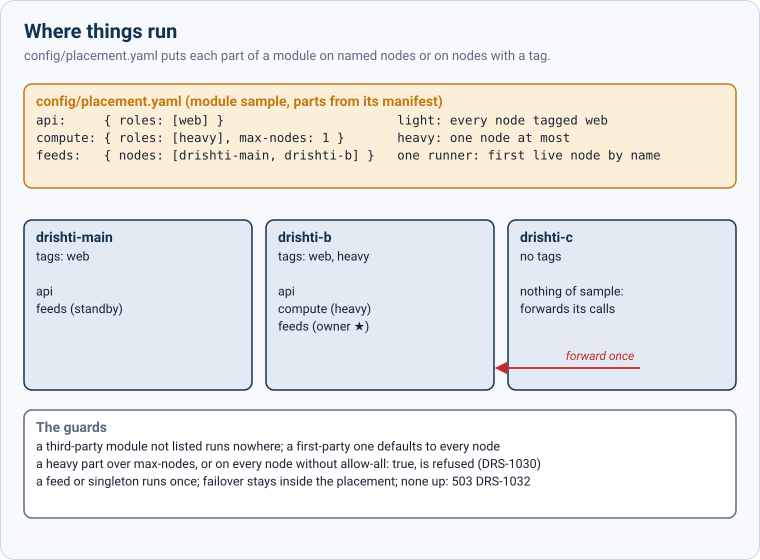

<!--
  Project Drishti · Any data. Any domain. One grammar.
  Copyright (c) 2026 Ashutosh Sinha <ajsinha@gmail.com>. All rights reserved.
  PROPRIETARY AND CONFIDENTIAL. See the LICENSE file in the root of this repository.
-->

# How Drishti fits together

A short tour for someone new to Drishti: an architect at a bank, a developer, an administrator. One idea per section, one picture per
idea, one small real example each. The long references are linked at the end; this page only shows how the pieces connect.
Also as a [PDF](HOW_IT_FITS.pdf).

## The house

![The street: the Drishti Risk, Drishti Finance and Drishti All houses (distributions) stand side by side on one long foundation, the kernel, whose utilities are lakes and connectors (water), compute engines (power), Rachana and BI (common language and tools), security and the cluster. Rooms are modules; market data is the same room in Risk, Finance and All. Each house has one front door, its console, with Health by the door; pipes from the foundation are data bindings. A new room, a .dmod package, slides in like a Linux driver](docs/how-it-fits/house-street.svg)

Think of Drishti as a street of houses built on one foundation:

| In the house | In Drishti |
|---|---|
| **the foundation and its utilities** (water, power, a common language, locks, the estate's grid) | **the kernel**: lakes and connectors, compute engines, Rachana and BI, security, the cluster |
| **a house** | **a distribution** (Drishti Risk, Drishti Finance; Drishti All is the show home with every room) |
| **a room** | **a module** (banking, economy, capital markets); **market data** is one room shared by every house that needs it |
| **the front door** | **the console**, one per house |
| **a shelf** | **a workspace** (a lens): it arranges the books, never locks them; one book can stand on two shelves |
| **a book** | **a screen** (a page, a dashboard, a Sutra) |
| **a pipe** | **a data binding**: which connector brings each kind of data into the rooms |
| **the buildings on the estate** | **placement**: which nodes of the cluster run which part of a module |
| **a renovation with a permit** | **a deploy**: planned, approved by a second administrator, then done on every placed node together |
| **the manager's office** | **Admin** |
| **the dashboard by the door** | **Health** |
| **the keys** | **access rights** (who may enter which room and read which book) |

**The rule: every function has one room, every room one door, every setting one switch on one wall.** A command word belongs to
exactly one module; the module is reached through one console; each setting is switched in one place (its file and its Admin page),
never in two.

**The Linux parallel.** The same idea in software everyone knows:

| Drishti | Linux (and Tomcat) |
|---|---|
| the kernel | the Linux kernel |
| a module (`.dmod`) | a driver (`.ko`), built apart and checked against the kernel it loads into |
| a first-party module | an in-tree driver, shipped with the kernel's own source |
| a third-party module | an out-of-tree driver |
| a distribution | a distro: one kernel, a chosen set of packages, its own name |
| the `modules/` drop-in folder | Tomcat's `webapps/`: drop a package in and it deploys |
| the console | the desktop you sign in to |

## Contents

1. [The three building blocks](#1-the-three-building-blocks)
2. [A request's journey](#2-a-requests-journey)
3. [Modules](#3-modules)
4. [Data: bindings](#4-data-bindings)
5. [Where things run: placement](#5-where-things-run-placement)
6. [A module's life](#6-a-modules-life)
7. [Distributions (white label)](#7-distributions-white-label)
8. [The files and how they relate](#8-the-files-and-how-they-relate)
9. [Where to read more](#9-where-to-read-more)

## 1. The three building blocks


| Block | In one line | What it holds |
|---|---|---|
| **The kernel** | the server (Java 21, Spring Boot); one node or a cluster of many | connectors and lakes, data loads, Rachana (the one grammar), the pivot, BI and aggregation engines, Explain, the access registry, audit, the cluster (Drishti\*net) and placement; it runs the **server part** of each module |
| **The console** | the UI tier, in front of one kernel or a whole cluster | the shell (header, lenses, themes, Home, Help, search), Drishti Elements and the Sutra renderer, the BI and pivot screens, Admin; it shows the **console part** of each module under `/m/<id>/` |
| **Modules** | `.dmod` packages, built apart from both | an industry: packs, compute, functions (command words), lenses, pages, Help |

The kernel knows no industry: it has no idea what a trade or a gene is. Modules bring that knowledge:

| Module | Brings |
|---|---|
| `banking` | VaR and ES, counterparty exposure and the pre-deal check, sensitivities, FRTB-SA, SIMM; the trading and risk packs |
| `market-data` | prices, curves, volatilities and FX; needed by banking |
| `capital-markets` (id `capitalmarkets`) | US equities (filings, facts, indices), funds and ETFs |
| `economy` | economies, central banks, official statistics, public-sector data and news |
| `genomics` | a sample third party's module: variants, genes, cohorts; it proves the kernel carries no finance |

**Example.** `VAR BANK <GO>` is typed into a console, answered by banking's VaR engine running inside a kernel, from trade-level P&L
the bank's own systems loaded into a lake.

## 2. A request's journey


1. **Person → console.** A risk manager types `VAR BANK <GO>` on the Drishti Risk console.
2. **Console → kernel.** The console knows `VAR` belongs to banking and is offered in this distribution and lens. It calls
   `/api/v1/risk/var` on its kernel entry node, **as that person** (the kernel decides what the person may see, never the console).
3. **Any node.** Any kernel node of the cluster may take the call; it need not be the one that computes.
4. **Placement.** If banking is not placed on this node, the call is **forwarded once** to a node where it is placed and up. The answer's
   `X-Drishti-Placement` header names the node that ran it. A node never computes for a part it is not placed for.
5. **Module.** The kernel checks that the module is on, the function is on and the person may use it, writes the audit line, and hands
   the call to banking's VaR engine.
6. **Bindings.** The engine asks for **kinds** (`scenario-set`, `pnl-vector` or `scenario-pv`, `trade` …), never for a database. The
   kernel's bindings say which connector serves each kind.
7. **Connector → lake.** The connector (`risk-store`, a Delta connector) reads that day's tables of the lake (`risklake`).
8. **Answer.** The figures, with how each was calculated (Explain), go back the same way; the console draws them with Drishti Elements.

## 3. Modules


**What a `.dmod` is.** A zip with a fixed layout that anyone can produce:

| Entry | Holds |
|---|---|
| `module.yaml` | the manifest: id, version, origin, the kernel range it needs, the modules it requires, the kinds it provides, its functions, engines, packs, API prefix, console plugin |
| `META-INF/DMOD.MF` | the SHA-256 of every file; one changed byte refuses the whole module |
| `java/` and `lib/` | the module's own jars, and the third-party jars it carries (listed under `java.lib`) |
| `packs/<pack>/` | its packs: `pack.yaml`, the contracts of its kinds, Sutras (screens in YAML), samples, guides |
| `data/needs.yaml` | the kinds it reads, which are required and which optional |
| `console/plugin.yaml` | its console part: pages, menus, command words, Home cards |
| `docs/` | its README, Help sections, guides and tutorials |

**What a `.dmod` never holds:** a connector, a host name, a URL of a data source, a user name or a password. The packer refuses them.

**Checked before anything runs.** The kernel verifies the hash list and the manifest and runs fifteen conformance checks (C1–C15: no kernel
internals, declared jars only, contracts for its kinds, nothing leaked after unloading, and the rest). A refused module is absent, never half
loaded.

**First-party and third-party.**

- A **first-party** module is the product's own (banking, market-data, capital-markets, economy). Its claim is **verified, never trusted**:
  the server jar carries `first-party.yaml`, the id and hash-list hash of each, and only a module that matches counts as first-party.
- Only a first-party module may carry a **kernel-internals allowance** (`kernel-internals:` in its manifest): a short list of kernel
  packages it may still reach, which only ever shrinks. Banking has one. A module with an allowance loads only on the **exact kernel build**
  it was packed for (*built for kernel X, this is Y: install the matching module*).
- A **third-party** module (the genomics sample, or a vendor's) uses the public kernel API only and loads on any kernel inside its
  `kernel` range.

**Where a module's classes come from**, in this order:

1. **The JDK, the kernel API and the shared libraries** (Spring, Jackson, SLF4J, Arrow …): always asked first, never replaced by a module.
2. **The module's own jars** (`java/`, `lib/`): private to it, so two modules may carry two versions of one library.
3. **The server's `lib/` folder** (`drishti.lib.path`): jars the site adds for everyone (a JDBC driver, a connector plugin, a company library).

Every other kernel class is hidden from a module, except a verified first-party module's allowance.

**The Linux parallel, in detail** (the table is in [The house](#the-house)): the driver's `vermagic` here is the module's kernel range,
or the exact build for an allowance; the server's `lib/` folder is Tomcat's `lib/` (shared jars).

### Inside one house: rooms, shelves and books

![The cutaway: one house, Drishti Finance, in cross-section. Its rooms are modules (economy, capital markets, market data); the capital markets room is opened to show shelves (workspaces) holding books (screens: the fund page, dashboards, forms, Sutras), one book on two shelves; the front door is the console with the keys (access rights) and Health beside it; Admin is the manager's office; pipes (bindings) run from the kernel's module interface up into the rooms; the kernel's layers are Rachana and BI, compute, security, lakes and connectors and the cluster; a deploy is a renovation with a four-eyes permit; and a panel gives the Linux parallel](docs/how-it-fits/house-cutaway.svg)

A module (a room) brings its **screens** (books): pages, dashboards, forms and Sutras, in its packs and its console part. A
**workspace** (a lens, a shelf) only arranges screens for one kind of person; it never owns or locks them, so the fund page stands on
the Markets shelf and the World shelf at once. A screen gets its data through the room's **bindings** (pipes) from the kernel, and the
person sees it only with the **keys**: the access rights checked on every call.

**Example.** `banking-1.0.0.dmod` says `origin: first-party`, `requires: market-data`, function `VAR` at `/api/v1/risk/var`, engines
`var`, `exposure`, `frtb-sa`, `simm` and the packs `trading`, `market-risk`, `counterparty-risk`. The genomics sample says
`origin: third-party` and brings its own VCF reader, kinds `variant`, `sample`, `gene`, `cohort` and a lollipop visual.

## 4. Data: bindings


A module says **what** data it needs (kinds); the site decides **where** it comes from. That decision is a **binding**, one per kind,
shared by every module that needs the kind, in `config/bindings.yaml`:

```yaml
format: 1
bindings:
  trade:
    read: [trade-endur, trade-calypso]        # connectors (config/connectors/<name>.yaml), in read order
    union: true                               # rows from all of them: one trade store
    live: trade-kafka                         # live changes from a Kafka connector
  scenario-pv:
    read: [risk-store]                        # a Delta connector on the risklake lake
  var-official:
    write: { lake: risklake, table: banking.var-official }   # where a produced kind is written
  pnl-vector:
    demo: true                                # the demo lake's samples, on purpose
```

A binding names connectors and lakes only. Hosts, URLs and credentials stay in the connector files and the secret store, and no module
ever sees them.

**How a kind finds its data**, first hit wins:

| # | Source | State |
|---|---|---|
| 1 | the site's binding in `config/bindings.yaml` | `BOUND` |
| 2 | the distribution's default (a pack's `routes:`) | `BOUND` |
| 3 | a configured lake that holds the contract's `binding-hint` table | `AUTO` (confirm it) |
| 4 | the demo lake, only while demo is on | `DEMO` |
| 5 | nothing | `UNBOUND` |

A bound kind with no load inside its contract's cadence is `STALE`; one whose source breaks the contract is `MISMATCH` (treated as unbound);
a kind a module computes itself (`position`, `var-result`) is `COMPUTED` and never bound.

**Gated functions explain themselves.** When a **required** kind is unbound, only the functions that need it switch off, and they say why:
the page is *Exposure needs data: exposure-path is not bound* with links to Admin → Data bindings and Help, the API answers
`409 DRS-1035` with the need, the command line says the same words. The rest of the module keeps working. An optional kind that is
unbound only hides its features (backtesting without `desk-pnl`).

**Changing a binding**: Admin → Data bindings or the file; one administrator proposes, a second approves; it applies without a restart.

## 5. Where things run: placement



On a cluster, `config/placement.yaml` says which nodes run each **part** of a module. The module's manifest declares its parts and their
**resource class** (`light`, `heavy` with its memory, `feed`, `singleton`); the site decides where they go, by node name or by node tag
(`tags:` in `config/net/node.yaml`). A module that declares no parts has one, `api`, light.

```yaml
format: 1
modules:
  sample:
    parts:
      api:     { roles: [web] }                     # every node tagged web
      compute: { roles: [heavy], max-nodes: 1 }     # heavy: one node at most
      feeds:   { nodes: [drishti-main, drishti-b] } # one runner, elected among these two
```

- **Not listed, not run.** A third-party module or part that the file does not name runs nowhere (*not placed*). A first-party module the
  file does not name runs on every node, as it always has.
- **Singletons run once.** A `feed` or `singleton` part has exactly one owner: the first live placed node by name. When it stops, the next
  placed node takes over, never one outside the placement.
- **Heavy work does not spread by accident.** A heavy part over its `max-nodes`, or on every node without `allow-all: true`, is refused
  (`DRS-1030`).
- **Forwarding.** A node where a part is not placed forwards the call once, for the same person, to a placed node that is up. With none up,
  the call answers `503 DRS-1032` (*unavailable*, not *absent*: nothing saved is touched).
- **Changing it**: Admin → Cluster → Modules: one administrator plans, a second applies; every member takes it at once, without a restart.

On a single node (no cluster) every part runs on that node: a module the file does not name is placed there by default, and Health
notes *single node: placed here*.

## 6. A module's life


**Build, three ways, one packer.** The same packer and the same fifteen checks, reached from:

| Way | For | Command |
|---|---|---|
| Maven | a project made from the archetype `drishti-module-archetype` | `mvn verify` → `target/dmod/<id>-<version>.dmod` |
| The module tool | Gradle, Bazel, a script, a plain folder | `java -jar drishti-module-tool.jar pack <folder>`, then `check` and `inspect` |
| The command line | Linux, macOS and Windows with Java and Python only | `python3 tools/drishti.py module pack <folder>`, `module check`, `module inspect` |

**Deploy, cluster-first.**

1. **Upload once** to the module store (Admin → Modules → Deploy, or `drishti.py module deploy <file>`). It is checked there once and
   kept by id and version; a version is never rebuilt with other bytes.
2. **Plan**: what each node does now and after; nodes where nothing is placed receive nothing.
3. **Approve and apply**: a **second administrator** applies the plan (`drishti.py module apply <id>`); the proposer cannot.
4. **Two phases**: every placed node receives the package, checks it itself and stages it; then all activate together. A failure on any
   node rolls every node back, and the page says which node and why.
5. **Upgrade**: a newer version is staged everywhere first, then switched **node by node** while the others serve the old one.

**Auto-deploy on one node.** Drop a `.dmod` into `<data folder>/modules/` and within seconds it is verified, installed and loaded; take the
file out and the module is removed. It is on for a single node and off in a cluster, where deploys go through plan and apply.

**Development folders.** With `drishti.modules.dev` a developer's own server loads a module's build folder unpacked and reloads it on every
rebuild; Health marks it *development (unverified)*. It is refused in a cluster and under the production profile.

**Unload and "needs module X".** Switched off, a module's API answers `404 DRS-1025`; removed, `410 DRS-1028` and its pages say it is
no longer installed. Saved Sutras, reports, dashboards, baskets, searches and alert rules that use it are **kept**, marked
*needs module X*; reinstalling restores them.

## 7. Distributions (white label)


A **distribution** is one file that turns the kernel into a product: its modules, brand, theme, lenses, menus, Home and Help. One kernel
build and one console build make all of them.

| Distribution | For | Modules | Start |
|---|---|---|---|
| **Drishti Risk** | traders, risk analysts and managers | banking, market-data | `bin/start-all.sh --distribution risk` |
| **Drishti Finance** | investment and research analysts, economists | capital-markets, economy, market-data | `bin/start-all.sh --distribution finance` |
| **Drishti Genomics** | the sample that proves the kernel is domain-free | genomics | `bin/start-all.sh --distribution genomics` |
| **Drishti All** | developers, QA, demos; the default | every module | `bin/start-all.sh` |

`config/distributions/drishti.risk.yaml`, abridged:

```yaml
format: 1
distribution: drishti.risk
brand:
  product: Drishti Risk
  tagline: VaR, exposure and limits from your own pricing data
theme: { tokens: terminal-blue, mode: dark, density: compact }
modules:
  - { id: banking,     required: true }
  - { id: market-data, required: true }
lenses:
  offered: [risk, trading, market]
  default: risk
home:
  cards: [VAR BANK, VAR DESK RATES, "VRES DESK:RATES", "EXP CPTY:CP-ALDERSHOT"]
docs: { title: Drishti Risk Help }
```

What a distribution leaves out **does not exist in it**: not on the command line, in menus, Home, Help or the catalogue the AI reads.
`VRES` typed in Drishti Finance answers *DRS-4023 VRES is not in Drishti Finance*.

- **Choosing one**: `--distribution <name|path>` on `bin/start-all`, `start-server` and `start-console` (`.sh`, `.ps1`, `.cmd`), else
  `DRISHTI_DISTRIBUTION`, else `drishti.distribution`. On Windows: `bin\start-all.ps1 -Distribution risk`.
- **Two consoles over one cluster**: a console started with its own distribution keeps it whatever the servers run. A stack file's
  `consoles:` list (`{ name: risk, port: 17480, distribution: risk }`, `{ name: finance, port: 17481, distribution: finance }`) gives
  Drishti Risk and Drishti Finance side by side over the same kernels.
- **Your own brand**: copy a shipped file to a new `drishti.acme.yaml` beside it in `config/distributions`, change `distribution:`, `brand:`, `theme:`,
  `modules:`, `lenses:`, `menus:`, `home:` and `docs:`, and start with `--distribution acme`. A distribution names modules; it never
  contains code, connectors or credentials, and it cannot widen the licence. Admin → White label shows every distribution side by side.

## 8. The files and how they relate

![How the files relate: a distribution file lists module ids; each id is a .dmod whose module.yaml names its packs, contracts, data needs and console plugin, with DMOD.MF hashing every file and first-party.yaml verifying the product's own; active.yaml picks the version, config/modules switches it, engine files switch its engines, placement.yaml puts its parts on nodes from node.yaml; the kinds it needs are mapped by bindings.yaml to connectors, which point at lakes; application.yaml picks the distribution and the folders](docs/how-it-fits/files-map.svg)

### 8.1 Every file, in one table

Who writes it, when it is read, what it decides and where an administrator sees it.

| File | Written by | Read | Decides | Admin page |
|---|---|---|---|---|
| **Inside a `.dmod`** | | | | |
| `module.yaml` | the module author | at verification and load; by the distribution reader | id, version, origin, kernel range, required modules, kinds, functions, engines, packs, API prefix, parts, the allowance | Modules (detail), `module inspect` |
| `META-INF/DMOD.MF` | the packer | at every verification, on every node | the SHA-256 of every file in the package | Modules (verify report) |
| `content.yaml` | the module author | **at pack time only**, by the packer | which repository files (packs without their connector templates, lenses, tutorials) go into the package | none |
| `packs/<pack>/pack.yaml` | the module author | when packs load | the pack's kinds and Sutras; its `routes:` are the distribution's default bindings | Packs |
| `packs/<pack>/contracts/*.contract.yaml` | the module author | when packs load; at binding checks | a kind's fields, key, cadence and `binding-hint` | Data bindings (state) |
| `data/needs.yaml` | the module author | at load; at every binding resolution | the kinds the module needs, required or optional | Data bindings |
| `console/plugin.yaml` | the module author | by the console when the module is active | the module's pages, menus, command words, Home cards | Modules |
| **The product** | | | | |
| `first-party.yaml` (inside the server jar) | the product build (`packaging/dist`) | at verification | which modules are the product's own (id + hash-list hash), so which may use an allowance | Health, `module inspect` (origin) |
| `config/distributions/drishti.<name>.yaml` | the product; a site for its own brand | at start, by the kernel and the console | brand, theme, modules, lenses, menus, Home, Help title | White label (read only) |
| `config/distributions/kernel.yaml` | the product | at start | the kernel's own packs, words and menus, in every distribution | White label |
| **The site** | | | | |
| `config/bindings.yaml` | the data administrator (four eyes) | at start, then re-read (`drishti.bindings.refresh-seconds`, 30) | which connectors or lake table serve each kind | Data bindings |
| `config/placement.yaml` | the cluster administrator (plan, then a second applies) | at start; at once on apply, on every member | which nodes run each part of each module | Cluster → Modules |
| `<data folder>/modules/installed/active.yaml` | **the server** (deploy, auto-deploy, upgrade, rollback) | at start and at each activation | which installed version of each module is active | Modules |
| `config/modules/<id>.yaml` | the administrator | at start | the module's on/off switch (`drishti.modules.<id>.enabled` wins over it) | Modules (switch off / on) |
| `config/connectors/*.yaml` | the data administrator; pack templates write first copies | watched; a change applies without a restart | a source: plugin, settings, lake; credentials only as secret references | Connectors |
| `config/lakes/*.yaml` | the data administrator | with the connectors that use the lake | a lake's format, root and tables | Lakes |
| `config/engines/*.yaml` | the product's defaults; the administrator | at start; the switch from the Admin page | each compute engine on or off, and its settings (VaR confidence, window …) | Engines |
| `config/net/node.yaml` | the administrator of each node | watched | this node's name, real address, tags (the `roles:` placement matches) | Cluster → Files |
| `deploy/stack/stack.yaml` | the operator | by `bin/start-cluster.sh` | the nodes to start, their ports and heaps, the consoles and each one's distribution | `bin/status.sh` |
| `application.yaml` and settings | the operator | at start | `drishti.distribution`; `drishti.modules.path` (the `.dmod` folder), `drishti.modules.autodeploy`, `drishti.modules.dev`; `drishti.lib.path` (shared jars); `drishti.module.<id>.*` (a module's own settings) | Configuration (Help → Configuration) |

### 8.2 How they point at each other

- A **distribution** lists **module ids** → each id resolves to an installed **`.dmod`**, and **`active.yaml`** picks its version.
- **`first-party.yaml`** verifies the module's origin against its **`DMOD.MF`**, which hashes every file; only then may the
  **`module.yaml`** allowance be used.
- **`module.yaml`** names its **packs** (whose **contracts** define the kinds), its **`data/needs.yaml`** and its **`console/plugin.yaml`**.
- The kinds in **`needs.yaml`** are mapped by **`bindings.yaml`** to **connectors** (or, unbound, by a pack's `routes:` default), and each
  connector names its **lake**.
- **`placement.yaml`** names the **parts** declared in `module.yaml` and puts them on **nodes** known by their **`node.yaml`** names and
  tags (in a local cluster, the **stack file** creates those nodes).
- **`config/modules/<id>.yaml`** switches the module, and **`config/engines/*.yaml`** switches each engine it declares.
- **`application.yaml`** chooses the distribution and the folders everything else is found in.

### 8.3 One trace: `VAR BANK` in Drishti Risk

Every file the request touches, from start to answer:

| # | File | What it contributes |
|---|---|---|
| 1 | `deploy/stack/stack.yaml` or `bin/start-all.sh --distribution risk` | starts the server and a console with the distribution `risk` |
| 2 | `config/distributions/drishti.risk.yaml` (+ `kernel.yaml`) | brand *Drishti Risk*, modules `banking` and `market-data`, the Risk lens, the Home card `VAR BANK` |
| 3 | `<data folder>/modules/installed/active.yaml` | banking `1.0.0` is the active version (the full server jar installs the shipped `.dmod` at the first start) |
| 4 | `META-INF/DMOD.MF` + `first-party.yaml` | the package is intact and is the product's own, so banking's allowance is honoured on this exact kernel build |
| 5 | `config/modules/banking.yaml` | `enabled: true` |
| 6 | banking's `module.yaml` | requires `market-data`; function `VAR` at `/api/v1/risk/var`; engine `var`; packs `market-risk` and the others |
| 7 | `config/engines/var.yaml` | the VaR engine is on; confidence 0.99, ES 0.975 |
| 8 | `config/placement.yaml` | banking is first-party: not named, so it runs on every node; named, only where placed (others forward) |
| 9 | banking's `console/plugin.yaml` | the console's `VAR` page (route `var`, function `VAR`) |
| 10 | banking's `data/needs.yaml` | VaR needs `scenario-set`, `trade` and `pnl-vector` or `scenario-pv` |
| 11 | `packs/market-risk/contracts/scenario-pv.contract.yaml` | the kind's key (`SCENARIO_PV_ID`), cadence (daily), `binding-hint` (`risk.scenario-pv`) |
| 12 | `config/bindings.yaml`, else `market-risk`'s `routes:` | `scenario-pv` → the connector `risk-store` |
| 13 | `config/connectors/risk-store.yaml` | plugin `delta`, its lake |
| 14 | `config/lakes/risklake.yaml` | format `delta`, root `<data folder>/delta/risklake`, the tables |

The answer goes back through the kernel to the console, which draws it; Explain on any figure shows how it was calculated.

## 9. Where to read more

| To understand | Read |
|---|---|
| the full design of the kernel, modules, loading, data needs, placement and the distribution file | [KERNEL_AND_MODULES.md](docs/architecture/KERNEL_AND_MODULES.md) |
| each distribution, what is shared, and how to start it | [DISTRIBUTIONS.md](docs/architecture/DISTRIBUTIONS.md) |
| building a module: the SDK, the archetype, the three ways to pack, the genomics sample step by step | [DEVELOPER_GUIDE.md section 1.6](docs/guides/DEVELOPER_GUIDE.md#16-the-module-sdk) |
| modules on or off, the `modules/` and `lib/` folders, data bindings, white label, Admin → Modules and Deploy | [ADMIN_GUIDE.md section 22](docs/guides/ADMIN_GUIDE.md#22-modules-on-or-off) to [section 25](docs/guides/ADMIN_GUIDE.md#25-modules-and-deploy) |
| several servers as one, placement and deploying across a cluster | [CLUSTER_GUIDE.md section 1.9](docs/guides/CLUSTER_GUIDE.md#19-module-placement) and [1.10](docs/guides/CLUSTER_GUIDE.md#110-deploying-a-module) |
| lakes, connectors and the bindings file in detail | [DATA_LAKE_GUIDE.md, Data bindings](docs/guides/DATA_LAKE_GUIDE.md#61-data-bindings) |
| installing, starting and checking each part on Windows, Linux and macOS | [DEPLOYMENT_AND_QA_GUIDE.md](docs/DEPLOYMENT_AND_QA_GUIDE.md) |
| every setting | [CONFIGURATION.md](docs/admin/CONFIGURATION.md) |
