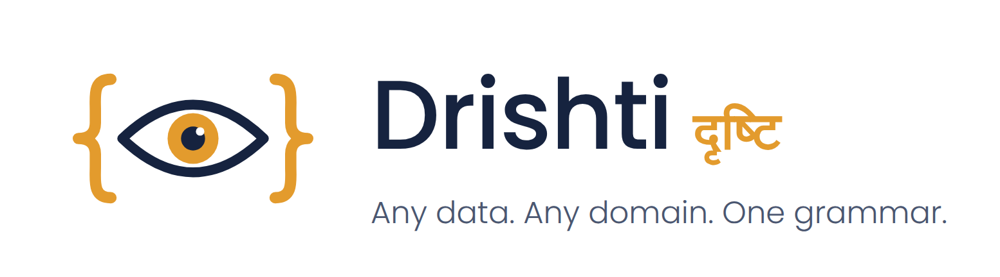

<!--
  Project Drishti · Any data. Any domain. One grammar.
  Copyright (c) 2026 Ashutosh Sinha <ajsinha@gmail.com>. All rights reserved.
  PROPRIETARY AND CONFIDENTIAL. See the LICENSE file in the root of this repository.
-->

<p align="center"></p>

# Drishti

**Any data. Any domain. One grammar.**

*Your data is a treasury;* **Drishti is its sentinel.**

## What Drishti is

**Live, explainable analytics on the data you already have.** Drishti connects to data where it lives (Delta and Iceberg lakes,
files, databases, streams) and keeps it in one lake. It aggregates on demand for any scope, from everything down to a hand-picked
handful of rows, and explains every figure: where it came from, how it was calculated and why it moved. Screens, reports and
dashboards are described, not coded, in one grammar, and served to many users at once with roles, masks, four eyes and an audit trail,
on one machine or a cluster. Drishti never invents a number: it shows what its sources supply and says exactly what is missing.

**Visual analytics and GenUI from the same parts.** Screens are written in **Rachana**'s Sutra language and painted by **Elements**,
plain JavaScript libraries for a grid with a pivot, charts, maps, forms and live tables. Together they give BI-style dashboards and
reports, and they make GenUI safe: an AI assistant writes a Sutra through MCP tools, Rachana checks and compiles it, Elements draws it,
with no generated code to trust. The same parts work outside Drishti: Rachana and Elements in your own Flask or FastAPI application
([IN_YOUR_APP](https://github.com/drishti-platform/drishti-rachana/blob/v1.1.1/docs/IN_YOUR_APP.md#rachana-and-elements-in-your-own-flask-or-fastapi-application); the GenUI kit ships with Rachana 1.1, planned for the platform),
Lake as a Delta and Iceberg library in Java or Python, Tools as shared Java utilities.

Everything specific to a field comes as a **module**: its data shapes, measures, screens and rules. Banking risk, capital markets,
economic data and genomics are modules today; a new field is a new module, not a new product.

## Sample uses

**Banking risk.** Trades and positions arrive from the trading systems a bank already runs (Endur, Calypso, Murex and others, each
through its own source module) into one lake. Drishti computes VaR and expected shortfall by historical simulation for any scope, from
the whole bank down to an ad-hoc set of trades, plus exposure and a pre-deal check of a trade against its limits. Every figure opens to
its contributors, its scenarios and how it was calculated, and a playground lets a user rebuild it step by step in a spreadsheet.
Pricing and simulation engines deliver the trade-grain inputs; Drishti never prices.

**Genomics.** A sample module built with the Module SDK alone and run with no finance at all, which shows the platform carries no
domain of its own. It reads VCF files into variants, samples, genes and cohorts, and its screens include a GWAS Manhattan plot, gene
lollipops, an oncoprint across a cohort and a protein-engineering workbench, all written as Sutras on Elements. Its data is synthetic.

Other modules work the same way: capital markets, and economic and public-sector data from sources such as the World Bank and FRED.

It is built from three blocks:

| Block | What it is |
|---|---|
| **Kernel** | the server (Java 21, Spring Boot), domain-free: connectors and lakes, Rachana (screens written as short YAML Sutras in one grammar), the pivot and BI engines, Explain, the cluster, audit |
| **Console** | the web tier (Python, FastAPI) in front of one kernel or a cluster; it draws what the server decides |
| **Modules** | signed `.dmod` packages that bring an industry (banking, capital markets, the economy, genomics, source-system adapters); a module declares the data it needs and never brings connectors or credentials |

One build makes several products, the **distributions**: Drishti Risk, Drishti Finance, Drishti Genomics (a sample) and Drishti All.
How the pieces fit, one picture per idea: [HOW_IT_FITS.md](HOW_IT_FITS.md) ([PDF](HOW_IT_FITS.pdf)).

```
VAR BANK <GO>                                  →  VaR and ES of the bank, down the hierarchy to a trade, contributions that add up
EXP CPTY:CP-ALDERSHOT <GO>                     →  exposure from the simulator's paths: EE, PFE, EPE, EEPE
PREDEAL CP-ALDERSHOT LIKE 1000001 250M <GO>    →  approve, refer or decline a new trade against the limit and its buckets
FRSA BANK <GO>                                 →  FRTB-SA capital: SBM, DRC and RRAO, by class and bucket
SIMM <GO>                                      →  initial margin per netting set, to collect and to post
PIVOT <GO>                                     →  any table or measure as a pivot, every total computed from its own members
WDI WDI-CAN <GO>                               →  a country's development indicators, with the world map by GDP per head
```

## What is in this repository

| Folder | What it holds |
|---|---|
| `kernel/` | the server, its API, identity, registry, packs runtime and the module runtime (10 Maven modules) |
| `compute/` | the compute engines: Rachana, tables, BI compute, inference |
| `modules/` | the 12 `.dmod` modules (banking, capital-markets, economy, genomics, market-data, trading and six source-system adapters: Calypso, Endur, ICI, Murex, SwapOne, WSS) with their 19 packs |
| `plugins/` | the 13 connector plugins, `plugins/drishti-plugin-*/` (activemq, aerospike, cassandra, delta, duckdb, iceberg, iceberg-external, jdbc, kafka, mongodb, rabbitmq, redis, s3), each with its README; their jars are packed into the server jar |
| `drishti-console/` | the web console (Python), its launchers and its tests ([README](drishti-console/README.md)) |
| `tools/` | the one command line, `tools/drishti.py`, the launcher table and the checks |
| `config/` | settings, profiles, distributions, packs, lakes, feeds, lenses and the Python lock file |
| `lake/`, `net/`, `drishti-sdk/`, `packaging/`, `testing/`, `examples/` | the lake layer, Drishti\*net (the cluster), the Module SDK, packaging, test kits and sample clients |
| `docs/` | guides, tutorials, architecture ([index](docs/README.md)) |
| `deploy/` | the stack and AWS deployment |
| `lib/` | the server jar and the pinned Lake wheel |
| `run-configs/` | the IntelliJ launchers (the PyCharm ones are in `drishti-console/run-configs/`) |
| `data/` | committed test data |

Counts from the file system are in [By the numbers](#by-the-numbers). Drishti is built on products that live in their own repositories
under [github.com/drishti-platform](https://github.com/drishti-platform): drishti-tools, drishti-rachana (the language), drishti-lake and
drishti-elements (the JavaScript libraries). The versions that go together are stated in the index repository's COMPATIBILITY.md.

## Requirements

- **JDK 21.**
- **Python 3.13** that you prepare: a dedicated one, a virtual environment you made yourself, or the system's (not Debian/Ubuntu's own, which is externally managed). Drishti never makes an
  environment and never installs a package; `setup` only checks.
- 20 GB of free disk.
- Windows: `py -3.13 tools\drishti.py ...`. Linux and macOS: `python3.13 tools/drishti.py ...`. The examples below use Linux.

## Quick path

1. **Get the code.** Unzip the platform source zip and the wheel pack (into `~/drishti-wheels`), or run the platform's `clone_all.py`.
   A new user follows the platform's `START_HERE_<OS>.pdf`.
2. **Build.** Platform: `python3.13 build_all.py --skip-tests` (IntelliJ: **IntelliJ-platform-build**, then **platform-clean-install**).
   Drishti alone, with the products already installed: `./mvnw -B clean package -DskipTests`, which builds the server jar into `lib/`
   **and** the modules into `modules/`.
3. **Install the libraries** with two pip commands from `drishti-console`, offline from the unzipped wheel pack, then check the machine with
   `tools/drishti.py setup` (it ends with "Drishti is ready."): [Deployment and QA guide, 1.2](docs/DEPLOYMENT_AND_QA_GUIDE.md#12-what-to-install-per-operating-system) and [1.6](docs/DEPLOYMENT_AND_QA_GUIDE.md#16-the-settings-file-and-drishtipy-setup).
4. **Run:**

   ```bash
   python3.13 tools/drishti.py lake demo --engine java     # the demo lake, about 15 minutes
   python3.13 tools/drishti.py start all --demo            # server :18480, console :17480
   python3.13 tools/drishti.py doctor --acceptance         # signs in, asks VAR BANK: VaR 167,372,692, ES 210,131,972
   python3.13 tools/drishti.py stop all
   ```

Open <http://127.0.0.1:17480> while it runs. Every step with the output you should see:
[DEPLOYMENT_AND_QA_GUIDE.md](docs/DEPLOYMENT_AND_QA_GUIDE.md).

## IDE launchers

Each IDE opens its own project and sees its own launchers, generated from one table (`tools/launch/launchers.yaml`):

| IDE and project | Folder | Groups |
|---|---|---|
| IntelliJ IDEA, open `drishti` | `run-configs/` | IntelliJ-drishti-build, IntelliJ-drishti-run, IntelliJ-drishti-test |
| PyCharm, open `drishti/drishti-console` | `drishti-console/run-configs/` | PyCharm-console-setup, PyCharm-console-data, PyCharm-console-run, PyCharm-console-check |
| VS Code, open `drishti.code-workspace` | the same launchers as tasks | |

`python3.13 tools/drishti.py launchers --list` prints every launcher and the command it runs; `launchers --run "<name>"` runs it.
Details: [IDE_GUIDE.md](docs/guides/IDE_GUIDE.md).

## Where to read next

| You want to | Read |
|---|---|
| install and verify, Windows, Linux, macOS | [DEPLOYMENT_AND_QA_GUIDE.md](docs/DEPLOYMENT_AND_QA_GUIDE.md); the platform's `START_HERE_<OS>.pdf` |
| change the code | [QUICKSTART_DEVELOPERS.md](docs/QUICKSTART_DEVELOPERS.md), [IDE_GUIDE.md](docs/guides/IDE_GUIDE.md), [DEVELOPER_GUIDE.md](docs/guides/DEVELOPER_GUIDE.md) |
| run on Linux in production | [OPERATIONS_GUIDE.md](docs/guides/OPERATIONS_GUIDE.md#production-deployment-linux) |
| find every command and option | [CLI_REFERENCE.md](docs/guides/CLI_REFERENCE.md) |
| use the console | [USER_GUIDE.md](docs/guides/USER_GUIDE.md), [tutorials](docs/tutorials/README.md) |
| build a pack, a screen or a module | [BUILD_GUIDE.md](docs/guides/BUILD_GUIDE.md) |
| everything else | [docs/README.md](docs/README.md) |

The main documents also come as PDFs: [Deploy and verify](docs/DEPLOYMENT_AND_QA_GUIDE.pdf), [developer quickstart](docs/QUICKSTART_DEVELOPERS.pdf) and [how it fits](HOW_IT_FITS.pdf): the documents handed to someone who has no running Drishti yet. Every other guide is read in Help, and `python3 tools/docs/md_to_pdf.py docs/X.md out.pdf` makes a PDF of any one.

## By the numbers

<!-- code-volume:begin -->

*Measured 2026-11-22 from the files the repository tracks (`python3 tools/docs/code_volume.py`; sample data and vendored libraries not counted).*

| Language | Lines | Files |
|---|---|---|
| Java, product | 397k | 2,016 |
| Java, tests | 165k | 1,018 |
| Python, product (console, tools, loaders, feeds) | 155k | 778 |
| Python, tests | 112k | 678 |
| JavaScript, product (console and its own Elements libraries) | 57k | 267 |
| JavaScript, tests | 1.0k | 7 |
| CSS | 10k | 100 |
| HTML (templates and pages) | 42k | 377 |
| YAML: configuration, Sutras, data contracts | 120k | 1,698 |
| Markdown: guides, tutorials, design | 221k | 376 |

About **662k lines of product code** and **278k lines of tests** (42% of the product code), with **221k lines of documentation**.

| What | Count |
|---|---|
| Maven modules | 46 in 10 subject folders: `compute/`, `drishti-sdk/`, `examples/`, `kernel/`, `lake/`, `modules/`, `net/`, `packaging/`, `plugins/`, `testing/` |
| Modules (`.dmod`) | 12: banking, capitalmarkets, economy, genomics, market-data, source-calypso, source-endur, source-ici, source-murex, source-swapone, source-wss, trading |
| Lenses | 12: world, markets, publicsector, research, cio, oversight, risk, trading, market, cro, mr-cube, ccr-cube |
| Functions a module declares | 124 (48 banking, 12 capitalmarkets, 35 economy, 6 genomics, 23 market-data); every other command word is the kernel's |
| Console routes | 646 |
| Server REST handlers | 828 |
| Drishti's own Elements libraries (Drishti Elements itself: vendored) | 2 libraries, 18 ES modules |
| Domain packs | 19: banking 3, capital-markets 2, core 3, economy 8, genomics 2, market-data 1 |
| Sutras in the shipped packs | 265 |
| Connectors | 13 plugins (a driver or native library each) and 9 built-in types |
| Feeds | 13 |
| Lake files | 9 |
| Test files | 1,548: Java 932, console 278, browser 181, tools 150, JavaScript 7 |
| Documents under docs/ | 200 (25 guides, 11 tutorials) |

<!-- code-volume:end -->

## Legal

Copyright (c) 2026 Ashutosh Sinha <ajsinha@gmail.com>. All rights reserved.

This software is **proprietary and confidential**. Copying, use, modification, distribution or
disclosure without the express prior written permission of the copyright holder is prohibited.
See [LICENSE](LICENSE) and [THIRD-PARTY-NOTICES.md](THIRD-PARTY-NOTICES.md).
