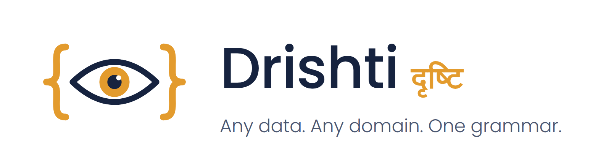

<!--
  Project Drishti · Any data. Any domain. One grammar.
  Copyright (c) 2026 Ashutosh Sinha <ajsinha@gmail.com>. All rights reserved.
  PROPRIETARY AND CONFIDENTIAL. See the LICENSE file in the root of this repository.
-->

<p align="center"></p>

# Drishti

**Any data. Any domain. One grammar.**

Drishti looks at data, analyses it and explains it. Its core knows no industry: connectors and lakes, screens written as short YAML
**Sutras** in one grammar (**Rachana**), a pivot engine, reports and a notebook, a command line, a REST API and Arrow Flight. Industries
come as **modules**: banking brings a bank's risk; capital markets brings listed companies and funds; the economy module brings
economies, governments, central banks, official statistics and news.

**For a bank, Drishti aggregates risk over the engines the bank already runs, explainably and under control.** Pricing and simulation
systems deliver trade-grain inputs (scenario P&L vectors, exposure paths, sensitivities); Drishti computes **VaR, ES, counterparty
exposure, the pre-deal check, FRTB-SA and SIMM on demand, for any scope** from the whole bank to an ad-hoc set of trades. Every figure
says where it came from, how it was calculated and why it moved; every figure obeys roles, masks, four eyes and an audit trail; and
nothing that is not built is shown as built.

The motto is **lean & streamlined**: one implementation of each job, one grammar for every expression, one set of JavaScript libraries
for every screen.

```
VAR BANK <GO>                                  →  VaR and ES of the bank, down the hierarchy to a trade, contributions that add up
EXP CPTY:CP-ALDERSHOT <GO>                     →  exposure from the simulator's paths: EE, PFE, EPE, EEPE
PREDEAL CP-ALDERSHOT LIKE 1000001 250M <GO>    →  approve, refer or decline a new trade against the limit and its buckets
FRSA BANK <GO>                                 →  FRTB-SA capital: SBM, DRC and RRAO, by class and bucket
SIMM <GO>                                      →  initial margin per netting set, to collect and to post
PIVOT <GO>                                     →  any table or measure as a pivot, every total computed from its own members
WDI WDI-CAN <GO>                               →  a country's development indicators, with the world map by GDP per head
TRD MX-20000001 <GO>                           →  a trade: terms, legs, cashflows, everything it links to
```

## Contents

[Modules, lenses and functions](#modules-lenses-and-functions) · [Risk](#risk) · [Analyse](#analyse) ·
[Build](#build) · [Data in](#data-in) · [Data out](#data-out) · [Operate](#operate) · [Run it](#run-it) ·
[Measured performance](#measured-performance) · [Documentation](#documentation) · [Project facts](#project-facts) ·
[By the numbers](#by-the-numbers)

## Modules, lenses and functions

What a person can do is decided in one place, the access registry: licence → module → lens → function → permission
([ACCESS_MODEL.md](docs/architecture/ACCESS_MODEL.md), [DOMAIN_MODULES.md](docs/architecture/DOMAIN_MODULES.md)). The next step, a domain-free kernel with modules
shipped as signed packages, is a design for 2.9.11.i: [KERNEL_AND_MODULES.md](docs/architecture/KERNEL_AND_MODULES.md) ([PDF](docs/architecture/KERNEL_AND_MODULES.pdf)).

| Module | Brings |
|---|---|
| **core** | connectors and lakes, Sutras, search, the Pivot, reports, tables and models, the Notebook, approvals, alerts, Explain, Admin; GLEIF's legal entities as reference data |
| **banking** | VaR and ES (historical and parametric, backtests, the market-risk cube), counterparty exposure and the pre-deal check, sensitivities, FRTB-SA, SIMM, official results; the trading, market-data, market-risk and counterparty-risk packs; the drishti-risk library |
| **capital markets** | US equities (SEC EDGAR filings and facts, indices), funds and ETFs, and the market data's functions |
| **economy** | economies, forecasts, governments and news; the public sector: World Bank indicators, central banks, Statistics Canada, the OECD, official press releases, GDELT world events |

- **A module** is on when it is installed, licensed and enabled (`config/modules/<module>.yaml`). A module that is off loads no engine,
  job, pack or API, and its screens, menus, commands, Help pages and Build items are gone for everyone
  ([ADMIN_GUIDE.md section 22](docs/guides/ADMIN_GUIDE.md#22-modules-on-or-off)).
- **A function** is a command word (`VAR`, `TRD`, `WDI` …), the finest unit of access; an administrator can switch any one off
  ([ADMIN_GUIDE.md section 20](docs/guides/ADMIN_GUIDE.md#20-functions-func-every-command-and-turning-one-on-or-off)).
- **A lens** is what a person works in: its modules, functions, Home cards and chips. Shipped: Risk, Trading, Market, CRO and the two
  risk cubes (banking); World and Public sector (economy); CIO and Oversight (core). `drishti.edition` runs a whole instance as one lens;
  `drishti.lenses` offers several ([ADMIN_GUIDE.md section 12](docs/guides/ADMIN_GUIDE.md#12-what-a-lens-is)).
- **Packs** bring a domain's kinds, functions, Sutras, links, roles and connectors in YAML, in `config/packs/<domain>/<pack>`.

## Risk

The banking module's engines run on the server, in Java, for any scope; the console only draws their answers.

- **VaR and ES** for the bank, a desk, a book, a counterparty, a portfolio, a basket or an expression (`BANK - DESK:CREDIT`): drill from
  the bank to a trade with contributions that add up, hierarchies from rows or from the trades' own columns, limits with one rule
  (within, near, breach), any reporting currency, the 509- or 250-scenario window, stressed and 10-day VaR, intraday updates, the official
  end-of-day record and backtests ([VAR_GUIDE.md](docs/guides/VAR_GUIDE.md), [tutorial 2](docs/tutorials/02-var-from-the-bank-to-a-trade.md));
  regulatory reporting to the cell in [REGULATORY_VAR_REPORTING.md](docs/guides/REGULATORY_VAR_REPORTING.md).
- **Parametric VaR** (`PVAR`) beside historical, as a cross-check and never the official figure
  ([VAR_GUIDE.md section 3.12](docs/guides/VAR_GUIDE.md#312-parametric-var-beside-historical-pvar)).
- **The market-risk cube** (`MCUBE`): VaR by desk and risk class as a Pivot preset, each cell the VaR engine's answer for its scope
  ([PIVOT_GUIDE.md section 29](docs/guides/PIVOT_GUIDE.md#29-the-mr-cube-preset)).
- **Counterparty exposure** (EE, PFE, EPE, EEPE) from the simulator's paths with netting and collateral, and **the pre-deal check**
  (`PREDEAL`): a new trade added to its netting set path by path and answered approve, refer or decline against the credit limit and each
  tenor bucket, audited ([EXPOSURE_GUIDE.md](docs/guides/EXPOSURE_GUIDE.md), [section 18.9](docs/guides/EXPOSURE_GUIDE.md#189-the-pre-deal-check),
  [tutorial 3](docs/tutorials/03-exposure-from-the-bank-to-a-trade.md)).
- **FRTB-SA** for any VaR scope ([FRTB_SA_GUIDE.md](docs/guides/FRTB_SA_GUIDE.md), [tutorial 4](docs/tutorials/04-frtb-sa.md)) and **SIMM**
  per netting set; ISDA's calibration is licensed, so the parameter file ships empty
  ([SIMM_GUIDE.md section 4](docs/guides/SIMM_GUIDE.md#4-the-licensed-parameter-file), [tutorial 5](docs/tutorials/05-simm.md)).
- **Groupings and analytics** computed on request: ownership groups, sectors, correlations, an equity's beta
  ([GROUPINGS_ANALYTICS_GUIDE.md](docs/guides/GROUPINGS_ANALYTICS_GUIDE.md), [tutorial 6](docs/tutorials/06-groupings-and-analytics.md)).

**Explained**: every computed number has one Explain (the formula, the inputs and lineage, why it moved between two dates in steps
that add up, a workbook with live formulas), and VaR, FRTB-SA and SIMM each have a playground (`PLAY VAR`, `PLAY FRTB`, `PLAY SIMM`).
**Controlled**: roles, row rules and field masks apply to every screen, pivot, report and Flight read; corrections, designs, settings and
report sign-offs go through one Approvals queue with four eyes. Anything that depends on unbuilt work is registered in
`config/under-construction.yaml` and shown with an *Under construction* chip or hidden ([UNDER_CONSTRUCTION.md](docs/admin/UNDER_CONSTRUCTION.md)).

## Analyse

- **The terminal**: type-ahead over every source, linked views of any entity, impact (F8), the raw document (F9), any past business
  day, history and compare, live views, one keymap and one search (Alt+K) ([USER_GUIDE.md](docs/guides/USER_GUIDE.md),
  [tutorial 1](docs/tutorials/01-first-15-minutes.md)).
- **Search** by value (`TRD where QUANTITY > 200m order by QUANTITY desc`), in plain words without any AI service, or with a form;
  monitors and alerts on one alert engine.
- **The Pivot** (`PIVOT`): any kind, table or measure, every total computed from its own members, custom functions, why a figure moved,
  what-if, Excel with formulas; **Pivot → Report** turns a view into a report ([PIVOT_GUIDE.md](docs/guides/PIVOT_GUIDE.md),
  [tutorial 7](docs/tutorials/07-pivot-cubes-and-explain.md)).
- **Reports and dashboards** on the table layer: reports and boards, statements, schedules, subscriptions, publishing and governance
  ([REPORTS_GUIDE.md](docs/guides/REPORTS_GUIDE.md), [tutorial 8](docs/tutorials/08-reports-and-dashboards.md)).
- **The Notebook**: SQL on the server and Python on its one sandboxed Python runtime ([NOTEBOOK_GUIDE.md](docs/guides/NOTEBOOK_GUIDE.md),
  [tutorial 9](docs/tutorials/09-notebook-and-python.md)).
- **AI**, off as shipped: Ask about a page and BI from words on any of seventeen provider types, MCP servers' tools behind Drishti's
  policy, masking and audit of every call ([AI_GUIDE.md](docs/guides/AI_GUIDE.md), [tutorial 10](docs/tutorials/10-ai-assistant.md)).
- **Corrections and approvals**: correct a record in a form, approve it in the one queue, the edit log and the audit trail
  ([APPROVALS_GUIDE.md](docs/guides/APPROVALS_GUIDE.md), [tutorial 11](docs/tutorials/11-correct-and-approve.md)).
- **One grammar**: Rachana paths and expressions in Sutras, search, the Pivot, reports and custom functions; every function in one
  catalogue ([FUNCTIONS.md](docs/guides/FUNCTIONS.md), [RACHANA_REFERENCE.md](docs/guides/RACHANA_REFERENCE.md)).

## Build

- **Tables and models** written once over any kind, lake table or query, with keys, rules and masks, edited in Build › Tables & models
  with the YAML live beside the form ([TABLES_GUIDE.md](docs/guides/TABLES_GUIDE.md), [tutorial 18](docs/tutorials/18-tables-and-models.md)).
- **Packs and screens**: a pack from your JSON Schema or JSON Lines; a screen as a Sutra, designed in the Build workbench or on a live page;
  where there is no Sutra the inference engine lays the screen out from the data; forms and phones
  ([BUILD_GUIDE.md](docs/guides/BUILD_GUIDE.md), [tutorial 19](docs/tutorials/19-build-a-pack-and-a-screen.md)). The Build home (`/build`)
  lists everything people build, what it uses and what uses it.
- **Drishti Elements**: the console's JavaScript and CSS as eleven versioned libraries (core, inputs, grid, chart with maps, data, tree,
  graph, insight, designer, renderer, and the banking module's risk). Every screen and every designer is drawn with them, guard tests
  fail the build when a page draws its own controls, and the gallery (`/elements`) shows each component live
  ([ELEMENTS.md](docs/architecture/ELEMENTS.md), [ELEMENTS_API.md](docs/guides/ELEMENTS_API.md)).
- **Embed** live views, panels and reports in your own web pages, or the libraries in your own application; they ship as files, a
  release archive with SRI hashes, npm tarballs or a WebJar, never from a CDN ([EMBED_GUIDE.md](docs/guides/EMBED_GUIDE.md),
  [tutorial 20](docs/tutorials/20-embed-drishti.md)).
- **Extend**: a connector, a plugin or a module, and the REST API ([DEVELOPER_GUIDE.md](docs/guides/DEVELOPER_GUIDE.md),
  [API_REFERENCE.md](docs/guides/API_REFERENCE.md)).

## Data in

- **Connectors**: Delta Lake and Apache Iceberg (Drishti's own engines, local disk or S3, no Hadoop), JDBC databases, DuckDB, MongoDB,
  Redis, Aerospike, Cassandra, Kafka, ActiveMQ, RabbitMQ, files, S3, REST and public feeds, each a plugin in `plugins/drishti-plugin-*/`: `demo`, `file`, `rest`, `jdbc`, `delta`, `iceberg`, `iceberg-external`, `duckdb`, `mongodb`, `redis`, `aerospike`, `cassandra`, `kafka`, `activemq`, `rabbitmq`, `s3`, `feeds`, `news`, `yfinance`;
  each with its README ([DATA_GUIDE.md](docs/guides/DATA_GUIDE.md#8-connectors), [tutorial 15](docs/tutorials/15-connect-your-data.md)).
- **Lakes, each in its own folder** and described by one lake file (`config/lakes/<lake>.yaml`):

  | Lake | Holds |
  |---|---|
  | `demo` | the demo data, built from the committed test data (`drishti.py lake demo`); demo and real data never mix |
  | `risklake` | a bank's own risk data (shipped empty) |
  | `capitalmarket` | prices, curves, volatilities, US equities and funds |
  | `worldlake` | the World Bank, the IMF, the OECD, central banks' and national statistics' series |
  | `newslake` | official press releases, GDELT world events, market headlines |
  | `referencelake` | GLEIF's legal entities |
  | `regulators` | regulators' publications (shipped empty) |

  The banking module adds the official VaR and exposure records. In-memory lakes (`mem://`) hold data that never touches disk.
- **Loading**: JSON Lines is the standard. A plain file is one table and one business date; a `.ready` file says it is complete and names
  its lake; a tar archive loads all or nothing; every row carries its load id, so `drishti.py lake undo <load-id>` removes exactly one
  load. The data inbox loads what your ETL drops, and the parallel Java loader handles large loads
  ([DATA_LAKE_GUIDE.md](docs/guides/DATA_LAKE_GUIDE.md), [tutorial 16](docs/tutorials/16-load-your-own-data-into-a-new-lake.md)).
- **A day of bank data**: what a bank sends each day and the daily cycle ([tutorial 12](docs/tutorials/12-a-day-of-bank-data.md),
  [the data contracts](docs/contracts/README.md), one per command word).
- **drishti-feeds** pulls public data every day, one feed file per source, with incremental pulls, a run ledger and an alert when a run
  fails: the World Bank, central banks, Statistics Canada, the OECD, official news, GDELT, GLEIF, US equities, funds and market data
  ([EXTERNAL_DATA.md](docs/guides/EXTERNAL_DATA.md), [FUNDS_GUIDE.md](docs/guides/FUNDS_GUIDE.md),
  [PUBLIC_SECTOR_GUIDE.md](docs/guides/PUBLIC_SECTOR_GUIDE.md), [tutorial 13](docs/tutorials/13-world-data.md),
  [tutorial 14](docs/tutorials/14-public-sector-data.md)).

## Data out

- **Arrow Flight and Flight SQL** (off as shipped): data, models, pivot views and VaR's scenario P&L vectors to Python, Java, JDBC and
  ODBC clients, read only, with the reader's entitlements and masks ([FLIGHT_GUIDE.md](docs/guides/FLIGHT_GUIDE.md),
  [FLIGHT_REFERENCE.md](docs/guides/FLIGHT_REFERENCE.md), [tutorial 17](docs/tutorials/17-data-out-with-arrow-flight.md); client
  examples in [examples/clients/](examples/clients/README.md)).
- **Export data** (`EXPORT`): any dataset, a simple selection, a day as `.jsonl.gz`, streamed and audited.
- **The REST API** under `/api/v1` with API tokens ([API_REFERENCE.md](docs/guides/API_REFERENCE.md)).

## Operate

- **Install, configure, deploy, monitor, troubleshoot**: by hand, with systemd, Docker Compose or AWS ECS, and on Windows with Java and
  Python only; promotion and roll back by copying; the runbooks; Prometheus metrics ([OPERATIONS_GUIDE.md](docs/guides/OPERATIONS_GUIDE.md),
  [tutorial 21](docs/tutorials/21-run-it-in-production.md)).
- **People and access**: passwords or OpenID Connect, roles per kind, field masks, API tokens, an access log and an audit trail; off by
  default for a developer machine, on for any shared one ([ADMIN_GUIDE.md](docs/guides/ADMIN_GUIDE.md)).
- **Configuration**: every setting in three tiers with its value in effect and where it came from; a change is a proposal a second
  administrator approves ([CONFIGURATION.md](docs/admin/CONFIGURATION.md)).
- **Clusters** (Drishti\*net, off as shipped): servers join by gossip on a port of their own, any member answers any request, and VaR
  shards across members; sizing and tuning ([CLUSTER_GUIDE.md](docs/guides/CLUSTER_GUIDE.md), [tutorial 22](docs/tutorials/22-a-cluster-of-three.md)).
- **Engines and native maths**: each compute engine on or off per node; OpenBLAS bundled for Linux and Windows x86-64, off as shipped
  ([ADMIN_GUIDE.md section 21](docs/guides/ADMIN_GUIDE.md#21-compute-engines-on-or-off),
  [OPERATIONS_GUIDE.md section 14.9](docs/guides/OPERATIONS_GUIDE.md#149-native-libraries-blas)).

## Run it

With a 64-bit Java 21 (JDK) and [uv](https://docs.astral.sh/uv/) for the console's Python (Maven ships with the repository), from the
repository root ([OPERATIONS_GUIDE.md section 2](docs/guides/OPERATIONS_GUIDE.md#2-install-and-run-on-one-machine) has every step):

```bash
# 1. Build the runnable server (the core with the domain modules this build ships)
./mvnw -q package -DskipTests -pl drishti-app -am

# 2. The console's Python environment (it also runs tools/drishti.py)
uv venv --python 3.13 drishti-console/.venv
uv pip install --python drishti-console/.venv/bin/python -r drishti-console/requirements.txt

# 3. The demo lake, from the committed test data in data/testdata
drishti-console/.venv/bin/python tools/drishti.py lake demo

# 4. The server on :18480 (native libraries unpack in its own folder, not /tmp)
mkdir -p data/tmp/server
java -Djava.io.tmpdir=data/tmp/server -jar drishti-server/target/drishti-server-*-exec.jar

# 5. In a second terminal: the console on http://localhost:17480
drishti-console/.venv/bin/python drishti-console/run_drishti_web.py
```

Open http://localhost:17480/t and try `TRD MX-20000001`, `VAR BANK`, `EXP BANK`, `PREDEAL` and `PIVOT`. Security is off in this start,
which is meant for one developer machine; the tutorials sign in
([OPERATIONS_GUIDE.md section 2.7](docs/guides/OPERATIONS_GUIDE.md#27-sign-in-change-the-admin-password-first-views)).

- **The command line** is `tools/drishti.py`, run with the console's Python: lakes and loads, feeds, Elements, approvals, VaR, exposure
  and more ([CLI_REFERENCE.md](docs/guides/CLI_REFERENCE.md), [COMMAND_CATALOG.md](docs/guides/COMMAND_CATALOG.md)).
- **A local cluster of three** with its consoles: [drishti-stack/](drishti-stack/README.md).
- **Other ways**: [Windows](docs/guides/OPERATIONS_GUIDE.md#4-drishti-on-windows) (Java and Python only),
  [Docker Compose](docs/guides/OPERATIONS_GUIDE.md#54-docker-compose) and the
  [IDEs](docs/guides/OPERATIONS_GUIDE.md#3-other-ways-to-build-and-run-maven-intellij-idea-and-pycharm).

## Measured performance

Measured on one developer workstation; the method, the commands to run each again and the limits of each figure are in
[BENCHMARK.md](docs/admin/BENCHMARK.md).

| Run | Result | Where |
|---|---|---|
| VaR, 200,000 positions, one server (`-Xmx8g`) | first open of a date 4.5 s; 50 users 270 requests/s, 0 errors; heap with two dates open 881 MB | [§4.2](docs/admin/BENCHMARK.md#42-one-server-and-the-three-node-cluster), [§4.3](docs/admin/BENCHMARK.md#43-users-50-100-and-200) |
| VaR, 200,000 positions, three-node cluster | the bank's VaR bit-equal to one server | [§4.2](docs/admin/BENCHMARK.md#42-one-server-and-the-three-node-cluster) |
| VaR, 1,000,000 positions, one server (`-Xmx6g`) | first open of a date 20.9 s; 50 users 183 requests/s, 0 errors; heap with two dates open 2.2 GB | [§4.2](docs/admin/BENCHMARK.md#42-one-server-and-the-three-node-cluster), [§4.3](docs/admin/BENCHMARK.md#43-users-50-100-and-200) |
| Many VaR scopes at once, 1,000,000 positions | 100 overlapping sets 3.1x faster summed together on OpenBLAS; 100 desks 3.3x on Java; results identical or within 4.5e-16 | [§17](docs/admin/BENCHMARK.md#17-many-var-scopes-at-once-blas) |
| 1,000,000 trades a day on Delta | search over every trade 134 ms (2,017 matches); open a trade 48 ms cached | [§8.1](docs/admin/BENCHMARK.md#81-a-million-trades-a-day-on-delta) |
| 35.7 million trades over 30 dates, 50 users | 179 requests/s, 0 failures; a day of 400,000 trades restated in 2 min 54 s while 30 users read | [§8.3](docs/admin/BENCHMARK.md#83-thirty-days-and-a-day-restated-while-serving) |
| The parallel Java loader, 10,000 positions × 510 scenarios | 0.19 to 0.29 s warm, 34,000 to 52,000 rows/s | [§7.2](docs/admin/BENCHMARK.md#72-the-java-parallel-loader-per-stage) |

## Documentation

Each major feature has **one guide and one tutorial**; every tutorial step shows the screen, the command line and the YAML, on the
shipped demo data. The console's Help centre holds the same pages, grouped by domain and lens, and shows each person only the pages of
the modules they may use. The map of every document is [docs/README.md](docs/README.md).

| You want to… | Guides | Tutorials |
|---|---|---|
| find anything, pivot, report, analyse | [USER_GUIDE](docs/guides/USER_GUIDE.md), [PIVOT_GUIDE](docs/guides/PIVOT_GUIDE.md), [REPORTS_GUIDE](docs/guides/REPORTS_GUIDE.md), [NOTEBOOK_GUIDE](docs/guides/NOTEBOOK_GUIDE.md), [AI_GUIDE](docs/guides/AI_GUIDE.md), [APPROVALS_GUIDE](docs/guides/APPROVALS_GUIDE.md) | [1](docs/tutorials/01-first-15-minutes.md), [7](docs/tutorials/07-pivot-cubes-and-explain.md), [8](docs/tutorials/08-reports-and-dashboards.md), [9](docs/tutorials/09-notebook-and-python.md), [10](docs/tutorials/10-ai-assistant.md), [11](docs/tutorials/11-correct-and-approve.md) |
| measure risk | [VAR_GUIDE](docs/guides/VAR_GUIDE.md), [REGULATORY_VAR_REPORTING](docs/guides/REGULATORY_VAR_REPORTING.md), [EXPOSURE_GUIDE](docs/guides/EXPOSURE_GUIDE.md), [FRTB_SA_GUIDE](docs/guides/FRTB_SA_GUIDE.md), [SIMM_GUIDE](docs/guides/SIMM_GUIDE.md), [GROUPINGS_ANALYTICS_GUIDE](docs/guides/GROUPINGS_ANALYTICS_GUIDE.md) | [2](docs/tutorials/02-var-from-the-bank-to-a-trade.md), [3](docs/tutorials/03-exposure-from-the-bank-to-a-trade.md), [4](docs/tutorials/04-frtb-sa.md), [5](docs/tutorials/05-simm.md), [6](docs/tutorials/06-groupings-and-analytics.md) |
| work with bank, world and public data | [FUNDS_GUIDE](docs/guides/FUNDS_GUIDE.md), [PUBLIC_SECTOR_GUIDE](docs/guides/PUBLIC_SECTOR_GUIDE.md), [EXTERNAL_DATA](docs/guides/EXTERNAL_DATA.md) | [12](docs/tutorials/12-a-day-of-bank-data.md), [13](docs/tutorials/13-world-data.md), [14](docs/tutorials/14-public-sector-data.md) |
| bring data in and take it out | [DATA_GUIDE](docs/guides/DATA_GUIDE.md), [DATA_LAKE_GUIDE](docs/guides/DATA_LAKE_GUIDE.md), [FLIGHT_GUIDE](docs/guides/FLIGHT_GUIDE.md) | [15](docs/tutorials/15-connect-your-data.md), [16](docs/tutorials/16-load-your-own-data-into-a-new-lake.md), [17](docs/tutorials/17-data-out-with-arrow-flight.md) |
| build tables, packs and screens; embed; extend | [QUICKSTART_DEVELOPERS](docs/QUICKSTART_DEVELOPERS.md) ([PDF](docs/QUICKSTART_DEVELOPERS.pdf)), [TABLES_GUIDE](docs/guides/TABLES_GUIDE.md), [BUILD_GUIDE](docs/guides/BUILD_GUIDE.md), [EMBED_GUIDE](docs/guides/EMBED_GUIDE.md), [DEVELOPER_GUIDE](docs/guides/DEVELOPER_GUIDE.md) | [18](docs/tutorials/18-tables-and-models.md), [19](docs/tutorials/19-build-a-pack-and-a-screen.md), [20](docs/tutorials/20-embed-drishti.md) |
| install, operate, scale, administer | [DEPLOYMENT_AND_QA_GUIDE](docs/DEPLOYMENT_AND_QA_GUIDE.md) ([PDF](docs/DEPLOYMENT_AND_QA_GUIDE.pdf)), [OPERATIONS_GUIDE](docs/guides/OPERATIONS_GUIDE.md), [CLUSTER_GUIDE](docs/guides/CLUSTER_GUIDE.md) ([PDF](docs/guides/CLUSTER_GUIDE.pdf)), [ADMIN_GUIDE](docs/guides/ADMIN_GUIDE.md) | [21](docs/tutorials/21-run-it-in-production.md), [22](docs/tutorials/22-a-cluster-of-three.md) |

**References**, one home each: [CONFIGURATION](docs/admin/CONFIGURATION.md), [API_REFERENCE](docs/guides/API_REFERENCE.md),
[CLI_REFERENCE](docs/guides/CLI_REFERENCE.md), [COMMAND_CATALOG](docs/guides/COMMAND_CATALOG.md), [FUNCTIONS](docs/guides/FUNCTIONS.md),
[RACHANA_REFERENCE](docs/guides/RACHANA_REFERENCE.md), [ELEMENTS_API](docs/guides/ELEMENTS_API.md), [FLIGHT_REFERENCE](docs/guides/FLIGHT_REFERENCE.md),
[VIEWMODEL](docs/architecture/VIEWMODEL.md), [BENCHMARK](docs/admin/BENCHMARK.md), [the data contracts](docs/contracts/README.md) and
[the Knowledge primers](docs/knowledge/README.md). The design is [ARCHITECTURE.md](docs/architecture/ARCHITECTURE.md) and
[DATA_ARCHITECTURE.md](docs/architecture/DATA_ARCHITECTURE.md); what changed and when, [RELEASE_NOTES.md](RELEASE_NOTES.md) and
[CHANGELOG.md](CHANGELOG.md).

## Project facts

- **Server**: Java 21 (64-bit), Spring Boot on virtual threads, Maven modules that depend in one direction (the core imports no domain,
  no domain another; a test fails the build otherwise); identity and user content in SQLite by default or PostgreSQL, one complete
  schema file per database and no migrations.
- **Console**: Python, FastAPI and Jinja2, each domain module's part in `drishti-console/plugins/<module>/`; every front-end asset
  vendored or one of the Elements libraries, under a strict content security policy; it works on phones.
- **Contributing**: work on `develop`; `./mvnw -q verify` and the console tests
  (`drishti-console/.venv/bin/python -m pytest -q drishti-console/tests`) must pass; no source file over 1,500 lines; every file carries
  the copyright header (`python3 tools/license_headers.py --fix`); every change updates the documents it affects and the changelog in
  the same push; the documentation gates (`drishti-console/tests/test_docs_gates.py`, `config/docs-features.yaml`) keep one guide and one
  tutorial per feature.

## By the numbers

<!-- code-volume:begin -->

*Measured 2026-11-08 from the files the repository tracks (`python3 tools/docs/code_volume.py`; sample data and vendored libraries not counted).*

| Language | Lines | Files |
|---|---|---|
| Java, product | 434k | 2,167 |
| Java, tests | 166k | 1,044 |
| Python, product (console, tools, loaders, feeds) | 143k | 732 |
| Python, tests | 107k | 603 |
| JavaScript, product (console and Elements) | 127k | 490 |
| JavaScript, tests | 5k | 23 |
| CSS | 19k | 114 |
| HTML (templates and pages) | 37k | 338 |
| YAML: configuration, Sutras, data contracts | 112k | 1,425 |
| Markdown: guides, tutorials, design | 222k | 307 |

About **759k lines of product code** and **278k lines of tests** (37% of the product code), with **222k lines of documentation**.

| What | Count |
|---|---|
| Maven modules | 52 (19 of them connector plugins) |
| Domain modules | 4: core, banking, economy, capitalmarkets |
| Lenses | 10: risk, trading, market, cro, mr-cube, ccr-cube, world, publicsector, cio, oversight |
| Functions a module declares | 105 (46 banking, 32 capitalmarkets, 27 economy); every other command word is the core's |
| Console routes | 644 |
| Server REST handlers | 761 |
| Drishti Elements | 11 libraries, 190 ES modules |
| Domain packs | 17: banking 4, capitalmarkets 2, core 3, economy 8 |
| Sutras in the shipped packs | 248 |
| Connector plugins | 19 |
| Feeds | 13 |
| Lake files | 9 |
| Test files | 1,529: Java 959, console 250, browser 177, tools 120, JavaScript 23 |
| Documents under docs/ | 178 (32 guides, 22 tutorials) |

<!-- code-volume:end -->

## Legal

Copyright (c) 2026 Ashutosh Sinha <ajsinha@gmail.com>. All rights reserved.

This software is **proprietary and confidential**. Copying, use, modification, distribution or
disclosure without the express prior written permission of the copyright holder is prohibited.
See [LICENSE](LICENSE) and [THIRD-PARTY-NOTICES.md](THIRD-PARTY-NOTICES.md).
