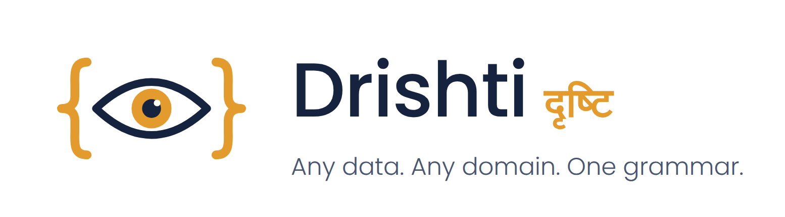

<!--
  Project Drishti · Any data. Any domain. One grammar.
  Copyright (c) 2026 Ashutosh Sinha <ajsinha@gmail.com>. All rights reserved.
  PROPRIETARY AND CONFIDENTIAL. See the LICENSE file in the root of this repository.
-->

<p align="center"></p>

# Drishti

**Any data. Any domain. One grammar.**

Drishti (दृष्टि, "sight") is a live, keyboard-driven terminal for any kind of data. Type an identifier and it
renders the entity behind it, a swap, a counterparty, a liquidity ladder, a gene, as a dense, linked, ticking view,
from whichever system holds it. Nobody codes a screen per product:

- **Rachana** (रचना, *composition*) is a declarative screen grammar. A product family gets a **Sutra**: a short,
  versioned YAML file that says what the screen shows.
- Where there is no Sutra, or a Sutra leaves gaps, an **inference engine** reads the shape of the data and lays
  out the rest.
- **Domain packs** bring an industry: its kinds, mnemonics, Sutras, vocabulary, links, roles and connectors. The core
  knows no industry.

```
TRD MX-20000001 <GO>                          →  the trade: terms, legs, cashflows, curve, DV01 ladder, links
NSET NS-SUMMIT-NY <GO>                    →  exposure profile, member trades, CSA, collateral
TRD where mtm < -10m order by mtm         →  every trade losing more than 10m, worst first
live trades over 5m in BOOK-RATES-3       →  the same in plain words: Drishti shows the search it makes
```

**Current release: 2.0.0** ([release notes](RELEASE_NOTES.md) · [changelog](CHANGELOG.md) ·
[what shipped when](docs/architecture/IMPLEMENTATION_PLAN.md)). **Learn it by doing:** [seventeen tutorials](docs/tutorials/README.md), from your first 15 minutes to BI, AI, embedding and
production, each with real screenshots; the [guides](docs/README.md) are the reference.

## What you can do

**Look things up**
- A command line with type-ahead, as on a Bloomberg terminal: mnemonics, recent entities and matches from every
  source as you type. One match opens; several give a **pick list** with each kind's key fields
  (`TRD MX-200000`, `CPTY north`, `TRD productType=Revolver`). The index behind it keeps several business days, can sit on disk (`DRISHTI_INDEX_DIR`) and reloads by itself or from Admin.
- **Views** of any entity: a header strip, panels (tables, curves, ladders, surfaces, maps, key-value, links), function
  keys, linked entities with badges, and the raw document (F9). Every table sorts, filters, pages and walks with
  the keyboard; id columns link to their entities.
- **The Pivot tab**, where a Sutra or pack offers it: an Excel-style pivot of a table or of a search's results (drag
  fields, or use the keys, into rows, columns, values and filters), with totals, drill-down, a chart, CSV and Excel;
  a search pivots every match of the day on the server, from its columns. Saved per user; authors promote it.
- **Structured search** (`TRD where notional >= 250m and assetClass = 'Rates' order by mtm desc limit 20`), or
  **plain words** (`usd trades maturing before 2028 with negative mtm`): a deterministic parser shows the search
  it makes, part by part, before anything runs. No AI service is involved.
- **Query by form** (`FORM <pack> <GO>`, **Forms** in the **Views** menu, `/forms`): typed inputs for a kind (text, amounts, dates, multi-select
  dropdowns, pasted lists of ids) that write the search for you, which you can name, watch, schedule or send
  ([USER_GUIDE.md](docs/guides/QUERY_BY_FORM.md)).
- **Impact (F8)**: what depends on an entity, what it rolls into, and the amount at stake.
- **Controls and deep documents**: a screen can offer dropdowns, toggles, date ranges and sliders that choose what a
  panel shows, and a trade shows its legs, cashflows and fixings on one screen (tabs that hold panels), with Excel-style
  column filters on every table.

**Over time**
- **Business dates**: Live, or any past business day on the server's calendar, as a static snapshot. Views,
  links, search and impact all follow the date. **Known at** shows a day as it was known at an earlier time.
- **Compare** an entity between two dates, field by field, and a search between two dates, with the change in
  every number.
- **Field history**: click any number for its line over the last 10 to 250 business days, with the date and
  connector each value came from.
- **Freshness**: every view says when its source last received data; a source quiet for longer than its
  `stale-after` is flagged, on the view and in Admin → Health.

**Live**
- Views of live entities tick over server-sent events (measured p99 about 11 ms); changed values flash.
- **Monitors** (live watchlists) and **alerts** (rules the server checks on every change, with a bell and history).
- **Workspaces**: several live views on one screen, a pane following another's selection, views dragged into panes,
  dividers dragged to resize, saved and **shared** read-only with roles or people.

**Work together**
- **Share a view with a note**, read your **inbox**, and discuss a number in a thread anchored to the data; everyone sees
  the view with their own permissions ([USER_GUIDE.md](docs/guides/USER_GUIDE.md#share-a-view-with-a-note)).
- **Notes** on an entity or one of its fields, for the next reader; the author edits, every change is audited.
- **Export and share**: CSV of any table, search or comparison; the document as JSON; print or PDF; a link that
  reopens the view exactly as you see it.
- **Reports** (an entry of **Views**): a search run as you on a schedule (`business-days 18:30`) and delivered as CSV to a
  folder or an approved webhook, with your subscriptions and alerts beside it ([SCHEDULED_REPORTS.md](docs/guides/SCHEDULED_REPORTS.md)).
- **API tokens** (read-only, revocable), a standard-library **Python client** and **Excel** through Power Query
  ([CLIENTS.md](docs/guides/CLIENTS.md)).

**Business intelligence (Rūpaka)**
- The **BI** menu and the `BI <GO>` keyword (`RUPAKA` still works): a catalogue and workspaces with roles, **datasets** (tables from pack
  kinds, relationships, measures, row rules and masks) on an embedded query engine, and **several datasets in one report** (composed
  datasets that join others as the reader, derived ones, a Transform in Python); **reports** with a designer, a Model view, a **map** you
  drill from the world to a country and its regions, **dropdown slicers**, cross-filtering, drill-through, a relative-date slicer, **window functions** and measures that stay correct across several fact tables, **Vega-Lite** and Perspective charts, expected-value tests that stop a bad publish, and a phone and a tablet layout of their own
  ([BI_GUIDE.md](docs/guides/BI_GUIDE.md), [tutorial 10](docs/tutorials/10-first-bi-report.md), [REPORTS.md](docs/guides/REPORTS.md)).
- **Live BI**: live tables, data that moves together (**coherent walks**), reports that follow the ticks with pause and resume,
  incremental live measures and a history of a live table, Perspective grids and **boards** of live tiles in kiosk mode, built in a **board designer** ([BOARDS.md](docs/guides/BOARDS.md), [tutorial 12](docs/tutorials/12-live-bi-and-boards.md)).
- **Distribution**: export a report, page or visual as PDF, PNG, Excel or CSV; **subscriptions** by email; **alerts** on a number, each person on
  their own masks, with **charts in Excel**, retries and **webhook and text** channels, and **narrative summaries**; a report **embedded** in another application ([DISTRIBUTION.md](docs/guides/DISTRIBUTION.md), [tutorial 11](docs/tutorials/11-bi-that-runs-itself.md)).
- **Govern it**: versions and diffs, review with four eyes, certification, lineage past the connector, impact of a change (renames, types), bundles between environments and inside pack archives, with rollback of an import
  ([BI_GOVERNANCE.md](docs/guides/BI_GOVERNANCE.md), [tutorial 13](docs/tutorials/13-govern-bi.md)). **Python** measures, visuals and tests, on boards and in alerts, and
  **Analyse** (slice, SQL in the browser and Python on your masked extract, promoted to a visual); Calc's `drishti_bi` with Graphic Walker ([tutorial 14](docs/tutorials/14-python-and-analyse.md)). **AI in BI** (report from words, ask the data, explain a number, a designer copilot, a dataset helper)
  ([BI_AI.md](docs/guides/BI_AI.md), [tutorial 15](docs/tutorials/15-ai-in-drishti.md)).

**Shape it**
- **Layout mode** (`Alt+L`): drag, resize and hide a view's panels on a 12-column grid, with the mouse, a pen, a finger
  or the keyboard, and keep it as your own layout of the Sutra; an author promotes it to the Sutra through review.
- **Build -> New pack**: JSON Schema files and/or a folder of JSON Lines in, a pack out, to download or deploy
  ([SCHEMA_TO_PACK.md](docs/guides/SCHEMA_TO_PACK.md)).
- **Calc** (`Alt+C`): Python in your browser on the view you are looking at ([PYTHON_CALC.md](docs/guides/PYTHON_CALC.md)).
- **The Build workbench** (`/build`; Sutra Studio's page is folded into it; [tutorial 6](docs/tutorials/06-design-a-screen.md)): drag panels and fields onto a live screen, or a YAML editor with completion from the language's JSON Schema, live checks and a
  preview against any entity. A save is a proposal; an approver reviews the diff (four eyes).
- **Domain packs**, enabled per server and assigned per user: `banking-core`, `market-data`, `trading`
  (125 products), `market-risk`, `counterparty-risk`, `liquidity-risk`, `climate-risk`, `operational-risk`,
  `retail-banking`, `genomics`, `politics-society` and `economics` (real public data; the IMF figures are for internal demonstrations only), and the small `finance`, `logistics`, `news-watch` and `market-watch` packs.
  Packs inherit from each other, load and unload from Admin → Packs, and install from a **signed, versioned
  registry** with rollback ([PACKS.md](docs/guides/PACKS.md)).
- **Drishti Elements**: show live views, panels and published BI reports inside another web application as `<drishti-view>`,
  `<drishti-panel>`, `<drishti-report>`, `<drishti-about>` and `<drishti-search>` Web Components, without iframes (React, Vue and Angular samples) ([ELEMENTS.md](docs/guides/ELEMENTS.md), [tutorial 16](docs/tutorials/16-embed-drishti.md)).
- **An AI layer and an MCP client**, both **off by default** (`drishti.ai.enabled`, `drishti.mcp.enabled`): pluggable
  model providers (OpenAI, Anthropic and seventeen more vendor types, each with TLS and a **Test connection** button) and *Ask about this page* ([AI_PROVIDERS.md](docs/architecture/AI_PROVIDERS.md), [MCP_CLIENT.md](docs/architecture/MCP_CLIENT.md)).
- **Derived kinds**: entities computed from others, declared in a pack, such as each desk's P&L summed from its
  trades (`DPNL DESK-RATES`), with history wherever their members have it.

**Connect any data**
- Delta Lake (local or S3, dated, time travel), PostgreSQL and other JDBC databases, Aerospike, Kafka, ActiveMQ,
  RabbitMQ, Amazon S3 and compatible stores, REST services, JSON and CSV files, and public market data (NY Fed
  SOFR, ECB €STR and FX, US Treasury, FRED), and computed ones such as news headlines for a name and Yahoo Finance quotes.
  Each connector is **one YAML file** in `config/connectors`, changed live in **Admin -> Connectors** with no restart;
  TLS (private CA, mutual TLS) and an outbound HTTP proxy are settings of the file
  ([CONNECTOR_FILES.md](docs/connectors/CONNECTOR_FILES.md), [TLS.md](docs/connectors/TLS.md), [the proxy](docs/connectors/TLS.md#outbound-http-proxy-for-connectors-ai-providers-and-mcp-servers)).
  Database connectors share sized **connection pools** (`drishti.db.pool.*`, shown in Admin → Health).
  Connectors reconnect by themselves, with backoff, and report their health
  ([CONNECTOR_DEVELOPER_GUIDE.md](docs/connectors/CONNECTOR_DEVELOPER_GUIDE.md)).
- Data lands from your ETL; one call tells Drishti to refresh, verify and flag late data ([DATA_LOADS.md](docs/guides/DATA_LOADS.md)).

**Run it safely**
- Sign-in with passwords or single sign-on (OpenID Connect), roles that decide which kinds each person may open,
  redaction of sensitive fields, and an **access log** of who looked at what (Admin → Access).
- Users, roles, packs per user, notes, reports and audit in one identity database: SQLite by default, PostgreSQL
  for production.
- **One console, many servers**: list several servers and people pick one, signing in to each separately.
- Admin → Health, Prometheus metrics, a Grafana dashboard, liveness and readiness checks, Docker images and
  runbooks ([OPERATIONS.md](docs/admin/OPERATIONS.md)).
- Seven themes (Terminal, Parchment, Blue, Wall Street, Green, Crimson, Crimson dark; the last three crimson, blue and green as in Sajha), one top
  bar on every page, a strict content security policy with every asset vendored (no CDN), and phones: it works on iPhone
  and Android and can be added to the home screen.

## Try it

New to Drishti? **[GETTING_STARTED.md](docs/guides/GETTING_STARTED.md)** installs and starts it from a clean machine, and
**[tutorial 1](docs/tutorials/01-first-15-minutes.md)** takes you through your first quarter of an hour; **[IDE_GUIDE.md](docs/guides/IDE_GUIDE.md)** runs the server in IntelliJ IDEA and the console in PyCharm. The short version,
from the repository root (Java 21 or newer, production runs 21; Python 3.11 or newer, [uv](https://docs.astral.sh/uv/)):

```bash
# 1. Build (Java 21 or newer, enforced; production runs 21; Maven comes with the repository)
export JAVA_HOME=/usr/lib/jvm/java-21-openjdk-amd64
./mvnw -q package -DskipTests                 # or: ./mvnw -q verify  (also runs every test)

# 2. Optional: business-day history for the banking packs, so past dates, Compare and field history work
uv run --with deltalake --with pyarrow --with pyyaml python tools/packgen/banking/make_data.py --lake data/delta

# 3. Start the server on :18480 with the packs to load (their parents load with them)
DRISHTI_PACKS=market-risk,counterparty-risk DRISHTI_STUDIO_SAVE=true \
  java -jar drishti-server/target/drishti-server-2.0.0-exec.jar

# 4. In a second terminal: the console on http://localhost:17480
uv venv drishti-console/.venv && uv pip install --python drishti-console/.venv/bin/python -r drishti-console/requirements.txt
drishti-console/.venv/bin/python drishti-console/run_drishti_web.py
```

Open http://localhost:17480/t, type `TRD MX-20000001` and press Enter. Then try `DPNL DESK-RATES`, a past date in the
top bar, or `live trades over 5m, biggest first`. Without `DRISHTI_PACKS` the server loads only the small
`finance` pack; then try `TRD IRS-48213`.

Sign-in is off for local development (you act as a user with every role). To turn it on and sign in as the
development admin **`drishti-dev-admin` / `drishti-dev-admin123`** (change that password; the UI warns until you
do), see [GETTING_STARTED.md, Step 13](docs/guides/GETTING_STARTED.md#step-13--optional-turn-on-sign-in-and-change-the-admin-password).

Checks: `curl -s localhost:18480/actuator/health` and `curl -s localhost:17480/healthz` answer
`{"status":"UP"…}`; `curl -s localhost:17480/readyz` answers `{"status":"UP","server":"reachable"}` once the
console reaches the server.

## How it is built

| Layer | Technology |
|---|---|
| Server | One Spring Boot 3.5 application on Java 21 or newer (production runs 21; 25 also supported) and virtual threads, REST under `/api/v1` (OpenAPI at `/api/docs`) |
| Plugins | A Spring-free SPI found by ServiceLoader; extra jars load in isolated class loaders |
| Identity | JPA over SQLite or PostgreSQL, one schema file per database, no migrations |
| Console | Python, FastAPI and Jinja2; vendored Bootstrap, Bootstrap Icons and ECharts; no inline script |
| Gates | Error Prone and Spotless in every build; ArchUnit, licence-header and file-size tests; `tools/drill.sh` |

```
drishti/
├── drishti-api/                 plugin SPI: SourcePlugin, DataNode, EntityRef, HitIndex (no Spring)
├── drishti-common/              error codes, JSON codec, business calendar, shape fingerprints
├── drishti-rachana/             the Rachana grammar: Sutra model, YAML parser, registry, Rachana-EL, formats
├── drishti-inference/           semantic hints, layout rules, packer, Sutra ⊕ inference merge
├── drishti-graph/               links between entities, badges
├── drishti-engine/              sources and routing, derived kinds, view pipeline, impact, commands, search, phrases
├── drishti-identity/            users, roles, packs per user, notes, access log, reports' store, audit (JPA)
├── drishti-packs/               domain pack loader (inheritance, installed and shipped packs)
├── drishti-diskcache/           the connectors' RocksDB disk cache
├── drishti-messaging/           shared support for message-queue connectors
├── drishti-deltalake/           a Delta Kernel engine without Hadoop (local disk, Windows included, and S3)
├── drishti-server/              the Spring Boot application: API, security, alerts, reports, pack registry
├── drishti-testkit/ drishti-it/ test fixtures; architecture, licence-header and file-size gates
├── drishti-benchmarks/          JMH hot-path benchmarks
├── plugins/drishti-plugin-*/     demo, file, rest, jdbc, delta, aerospike, redis, mongodb, iceberg, duckdb, feeds, news, yfinance, kafka, activemq, rabbitmq, s3
├── drishti-console/                     the web console (routes/, core/, web/templates, web/static, tests/)
├── clients/python/              drishti_client.py: the standard-library Python client
├── config/packs/<name>/                the 16 domain packs: pack.yaml, Sutras, vocabulary, samples, guides
├── deploy/                      Dockerfiles, compose, Grafana dashboard
├── tools/                       packgen/ samplegen/ lake/ (pack data and lakes), rachana/, packreg/ (signed packs),
│                                drill.sh, license_headers.py
└── docs/                        tutorials (17), guides, references, runbooks, plan, ADRs
```

## Documentation

Start with **[Install and run](docs/guides/GETTING_STARTED.md)**, then the **[tutorials](docs/tutorials/README.md)**; the **[user guide](docs/guides/USER_GUIDE.md)** is the reference. The
**[documentation map](docs/README.md)** lists every document by what you want to do.

| Read this when… | Document |
|---|---|
| you want to learn by doing | [the seventeen tutorials](docs/tutorials/README.md) |
| you want it installed and running | [GETTING_STARTED.md](docs/guides/GETTING_STARTED.md) |
| you run the server in IntelliJ IDEA and the console (UX) in PyCharm | [IDE_GUIDE.md](docs/guides/IDE_GUIDE.md) |
| you build, check, load and ship packs and Sutras from a terminal or a pipeline (`tools/drishti.py`) | [CLI_GUIDE.md](docs/guides/CLI_GUIDE.md) |
| your ETL has loaded a batch and Drishti should refresh, verify, check alerts, tell people and flag late data | [DATA_LOADS.md](docs/guides/DATA_LOADS.md) |
| you ship what you built to servers by copying: bundles, checksums, promotion, rollback (no API) | [OPERATIONALISING.md](docs/guides/OPERATIONALISING.md) |
| you use the console | [USER_GUIDE.md](docs/guides/USER_GUIDE.md) |
| you use or build business intelligence (Rūpaka) | [BI_GUIDE.md](docs/guides/BI_GUIDE.md), [tutorial 10](docs/tutorials/10-first-bi-report.md), [DATASETS.md](docs/guides/DATASETS.md), [REPORTS.md](docs/guides/REPORTS.md), [PYTHON_BI.md](docs/guides/PYTHON_BI.md), [BI_AI.md](docs/guides/BI_AI.md), [BI_GOVERNANCE.md](docs/guides/BI_GOVERNANCE.md), [BOARDS.md](docs/guides/BOARDS.md) |
| you run on Windows, or read from a script or Excel | [Install and run: Windows](docs/guides/GETTING_STARTED.md#drishti-on-windows), [CLIENTS.md](docs/guides/CLIENTS.md) |
| you use or refresh the real public data (economics, politics-society) | [REAL_DATA.md](docs/guides/REAL_DATA.md) |
| you define connectors as files, with TLS or a proxy | [CONNECTOR_FILES.md](docs/connectors/CONNECTOR_FILES.md), [TLS.md](docs/connectors/TLS.md), [the proxy](docs/connectors/TLS.md#outbound-http-proxy-for-connectors-ai-providers-and-mcp-servers) |
| you load, assign or install a domain pack | [PACKS.md](docs/guides/PACKS.md) |
| you build a domain pack | [PACK_DEVELOPER_GUIDE.md](docs/guides/PACK_DEVELOPER_GUIDE.md) |
| you learn to build screens in the Build workbench, step by step | [tutorial 6](docs/tutorials/06-design-a-screen.md) |
| you learn to write a Sutra | [SUTRA_DEVELOPER_GUIDE.md](docs/guides/SUTRA_DEVELOPER_GUIDE.md) |
| you choose or add a panel kind | [PANELS.md](docs/guides/PANELS.md) (the kinds, and [developing one](docs/guides/PANELS.md#developing-a-panel-kind)) |
| you need an exact Sutra key, format or expression | [RACHANA_REFERENCE.md](docs/guides/RACHANA_REFERENCE.md) |
| a view is laid out by inference and you want to know why | [INFERENCE.md](docs/architecture/INFERENCE.md) |
| you connect your own data | [CONNECTORS.md](docs/connectors/CONNECTORS.md) (a section per plugin), [CONNECTOR_DEVELOPER_GUIDE.md](docs/connectors/CONNECTOR_DEVELOPER_GUIDE.md) and the per-connector documents |
| you need a setting's name, default and environment variable | [CONFIGURATION.md](docs/admin/CONFIGURATION.md) |
| you manage users, roles, single sign-on, tokens or the access log | [USER_MANAGEMENT.md](docs/admin/USER_MANAGEMENT.md) |
| you script against it, from Python, Excel or curl | [CLIENTS.md](docs/guides/CLIENTS.md), [API_GUIDE.md](docs/guides/API_GUIDE.md) |
| you run it in production | [OPERATIONS.md](docs/admin/OPERATIONS.md), [PERFORMANCE.md](docs/admin/PERFORMANCE.md), [LIVE.md](docs/architecture/LIVE.md) |
| you serve millions of entities a day for years | [DELTA_CONNECTOR.md](docs/connectors/DELTA_CONNECTOR.md), [POSTGRES_CONNECTOR.md](docs/connectors/POSTGRES_CONNECTOR.md), [AEROSPIKE_CONNECTOR.md](docs/connectors/AEROSPIKE_CONNECTOR.md) |
| you need demo data, small or large | [DEMO_DATA.md](docs/connectors/DEMO_DATA.md) |
| something is not working | [TROUBLESHOOTING.md](docs/guides/TROUBLESHOOTING.md), [runbooks](docs/admin/runbooks/) |
| you change the code | [DEVELOPER_GUIDE.md](docs/guides/DEVELOPER_GUIDE.md) |
| you want to understand the design and its decisions | [ARCHITECTURE.md](docs/architecture/ARCHITECTURE.md), [ADRs](docs/architecture/adr/README.md) |
| you want to know what shipped when, and what is next | [IMPLEMENTATION_PLAN.md](docs/architecture/IMPLEMENTATION_PLAN.md), [CHANGELOG.md](CHANGELOG.md) |

## Contributing rules

- Work on `develop`. `tools/drill.sh` runs every check, pushes `develop` and fast-forwards `main`; releases are
  tagged on `main` after it.
- Every build runs Error Prone and Spotless; `./mvnw -q verify` must pass, as must the console tests
  (`drishti-console/.venv/bin/python -m pytest -q drishti-console/tests`).
- No source file over 1,500 lines (UX templates excepted), and every file carries the copyright header
  (`python3 tools/license_headers.py --fix`). Both are enforced by tests.
- Modules depend in one direction only, controllers live only in the server, and the plugin SPI is Spring-free
  (ArchUnit).
- Front-end assets are vendored; a test rejects any external URL. Product name and legal notices come from
  configuration, never from code.

## Legal

Copyright (c) 2026 Ashutosh Sinha <ajsinha@gmail.com>. All rights reserved.

This software is **proprietary and confidential**. Copying, use, modification, distribution or
disclosure without the express prior written permission of the copyright holder is prohibited.
See [LICENSE](LICENSE) and [THIRD-PARTY-NOTICES.md](THIRD-PARTY-NOTICES.md).
