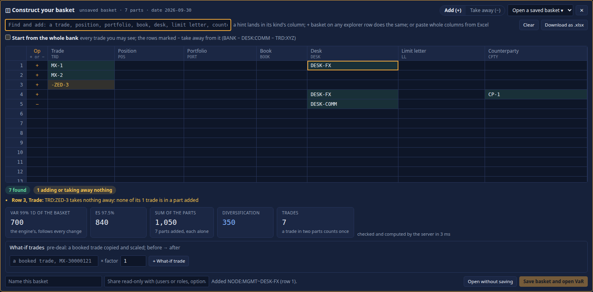

<!--
  Project Drishti · Any data. Any domain. One grammar.

  Copyright (c) 2026 Ashutosh Sinha <ajsinha@gmail.com>.
  All rights reserved.

  PROPRIETARY AND CONFIDENTIAL.

  This file is the confidential and proprietary property of Ashutosh Sinha.
  Unauthorised copying, use, modification, distribution or disclosure of this
  file, via any medium, is strictly prohibited except with the express prior
  written permission of the copyright holder.

  See the LICENSE file in the root of this repository for the full terms.
-->
# Drishti 2.9.11.e — release notes (draft)

*Not released yet.*

## Upgrade: the demo lake's layout and the lake files

- **The demo lake's new layout** (`config/lakes/demo.yaml`): scenario PVs partitioned by `SCENARIO_SET_ID, GRAIN` after the business
  date, sorted by legal entity, division, desk, book and trade, zstd, 256 MB files, 16 MB row groups, 30 days' time travel and
  maintenance; Calypso's and Murex's trades partitioned by `PRODUCT_GROUP` (50+ product types each) instead of `PRODUCT_TYPE`; every
  trade table compacted and vacuumed after 7 days. **An existing demo lake keeps its old layout**: a load into one of these tables is
  refused, naming both layouts, until the lake is rebuilt with `python3 tools/drishti.py lake demo`. VaR figures are the same on
  either layout.
- **The shipped lake files are never re-written at start** (CHANGELOG): after the demo lake's one-time move, a fresh checkout shows
  nothing modified in `config/lakes`.

## Upgrade: Vega-Lite specifications are translated (Vega is retired)

- **One drawing engine.** A report's `vega-lite` visual and a Python visual's `output: vega-lite` are now translated by drishti-chart
  (`fromVegaLite`) and drawn by drishti-chart, like every other chart: the theme's colours, its tooltip, data table, export and Explain.
  The vendored Vega, Vega-Lite, vega-embed and vega-interpreter are deleted (about 0.85 MB less per first draw). The shipped
  specifications (the `python-desk-risk` report's *Net MTM by desk* and the `pnl-vega` Python sample) draw the same data and encodings.
- **What translates:** marks bar, line, area, point, circle, square, tick, rule, rect, arc and boxplot; encodings x, y, color (field,
  value or condition), size, theta, tooltip, opacity; aggregate, bin, sort, stack, scale (log, zero, domain), axis titles and d3 formats;
  inline data; layers; filter and calculate transforms; titles. `width` and `height` are ignored (the chart fills its frame).
- **Not translated, so refused in words (never drawn wrong):** facets, `row` and `column`; `repeat` and `concat`; `params` and
  `selection`; `projection` and `geoshape`; other transforms (aggregate, window, fold, pivot, lookup, ...); `text` marks and encodings
  and the other channels (`shape`, `detail`, `href`, ...); `resolve`. The visual's frame names each feature with what to use instead
  (a split well, one visual per chart, the report's cross-filtering, the map, a calculated column or measure, a table or card).
  Check a report with such a visual after upgrading: [BI_GUIDE.md](docs/guides/BI_GUIDE.md#35-vega-lite-visuals).
- **New, and the preferred form for Python:** a Python visual whose manifest says `output: drishti-chart` returns a drishti-chart spec
  with its rows inline, drawn as it is, every kind the library has ([BI_GUIDE.md](docs/guides/BI_GUIDE.md#14-vega-lite-output)).

## Upgrade: the pivot cell's Explain, the Elements 1.x package, the FRTB-SA totals

- **`POST /api/v1/pivot/explain` is deprecated** and is removed in the next release: ask `POST /api/v1/explain` with `kind: pivot,
  measure: cell` and the same body (the old `measure`, the value's label, is now `value`); the engine's steps are under `why.answer`.
  Until then the old address answers as before, with `Deprecation: true` and a `Link` to its successor. `drishti.py pivot explain`
  already uses the new address.
- **Explain › Open as a page** from a pivot cell now opens the same explanation the drawer showed (the view travels in the link).
- **The `@drishti/elements` 1.x npm package is no longer built** (its tool `tools/elements_package.py` is deleted). Pages that embed the
  1.x elements from the console are unaffected: `/embed/v1/elements/1.4.5/` serves the same bytes, as do the renderer 1.2.0 files. New
  work takes the per-library packages (`drishti.py elements dist`, ELEMENTS_IN_YOUR_APP.md).
- **The FRTB-SA screen shows each class's Total again**, the server's figure (`classTotals` in `GET /api/v1/frtb/sa`).
- **Generated connector files stay unedited across the demo lake's move**: a file nobody edited keeps following its pack's template at
  later upgrades.

## Upgrade: one search (the console's `/api/suggest` is removed)

- **BI's keys** are the keymap's: `?` (and the rail's Keys button) lists them with the rest of the screen's, and BI's own keys dialog is
  gone; `g h` opens the Build home. The Pivot's keys (r c v f s, g, x, 1 to 9, e, w i u, l, m) are unchanged.

- **A script that called the console's `GET /api/suggest?q=...`** asks `GET /api/search?in=command&q=...` instead and reads `items`
  (the same suggestions, in the same order, each now tagged with its `group`). `in=help` searches Help's pages and `in=all` everything
  (entities, commands, screens, Help pages, things you can build), grouped ([API_GUIDE.md](docs/guides/API_GUIDE.md#the-consoles-own-json-routes)).
  The server's `GET /api/v1/command/suggest` is unchanged.
- **Keys:** `?` now lists the keys of the screen you are on (on a view it still opens About this page), and `Alt+K` opens the global
  search. No key acts while you type in a field; the VaR screen's `B`, `M`, `H` and `N` keep their meaning.

## Upgrade: one Approvals queue and one alert engine

- **Approvals.** Every four-eyes decision is made in one queue: **Views → Approvals** (`/approvals`) and `/api/v1/approvals`. The old pages
  redirect: `/build/reviews` and `/build/reviews/{id}` to `/approvals?kind=sutra` and `/approvals/sutra/{id}`, `/review/changes` to
  `/approvals?kind=change`. **Removed endpoints** (scripts and tools that call them move to the queue's `POST /api/v1/approvals/{kind}/{id}/
  approve|reject|withdraw` with `{comment, params}`):
  - `POST /api/v1/sutras/proposals/{id}/approve|reject|withdraw` → kind `sutra`;
  - `POST /api/v1/changes/{id}/approve|reject|withdraw` → kind `change` (the body's `note` or `reason` is now `comment`);
  - `POST /api/v1/bi/items/{id}/approve|reject` → kind `bi` (`force` and `applyRenames` go in `params`);
  - `POST /api/v1/admin/compute/requests/{id}/approve|reject` → kind `compute` (`reason` is `comment`; revoke stays on Admin → Compute);
  - `POST /api/v1/pivot/functions/{owner}/{ref}/approve` → kind `function`, id `owner:name@version` (`scope` in `params`, `reason` is `comment`);
  - `POST /api/v1/var/stress-window/proposals/{id}/decision` → kind `stress-window`, `/approve` or `/reject`;
  - `POST /api/v1/var/reports/{report}/runs/{period}/signoff` → kind `var-report`, id `report:period:vN` (`step` in `params`; `return` is
    `/reject`); the maker's narrative is `POST .../runs/{period}/narrative`.
- **CLI.** `drishti.py approvals list|show|approve|reject|withdraw|ask` replaces `design approve|reject`, `change approve|reject|withdraw`,
  `pivot functions approve`, `var stress-window --decide` and `var report sign` (`var report narrative` writes the maker's text).
- **Tokens.** A token decides with the scope of the kind (`edit`, `design:approve`, `bi:approve`, `pivot:approve`) or the new scope `approve`;
  report sign-offs, stress windows, compute packages and questions are never a token's.
- **Alerts.** The settings `drishti.alerts.measure.*` are now `drishti.alerts.*` (`DRISHTI_ALERTS_MEASURE_*` → `DRISHTI_ALERTS_*`); remove
  `drishti.alerts.keep`. Rules on one entity are converted into alert rules at the first start, by themselves; the alerts they fired before
  (the identity table `drishti_alert`) are no longer read (no migration: drop the table when you like). **Removed endpoints:**
  `/api/v1/me/alerts` and `/api/v1/me/alerts/rules/**` (use `/api/v1/alerts` and `/api/v1/alerts/rules/**`), `/api/v1/me/measure-alerts/**`
  (→ `/api/v1/alerts/rules/**`), `/api/v1/admin/measure-alerts/**` (→ `/api/v1/admin/alerts` and `/api/v1/admin/alerts/rules/**`); the
  platform alerts are under `platform` of `GET /api/v1/admin/alerts`. The stream is `/api/v1/alerts/stream`, and an alert raised arrives as a
  `notice` event of type `alert` (the `alert` event is gone).

## Upgrade: one Build home, one sitemap

- **The Build home** (`/build`) is the one place for everything a person builds: a rail grouped *Data* (connectors, lakes, tables and
  models, Python tables), *Screens* (Sutras, packs, the UI kit), *Analysis* (reports and boards, pivot views, functions, VaR baskets) and
  *Work* (my drafts, waiting for review, recently changed), each with its count; each list shows what an item uses and what uses it; four
  task tiles on a first visit; one search; *+ New* for every kind. **Removed homes:** *My designs* (its list, with Rename, Duplicate and
  Delete, is the Build home's *My drafts*) and Studio's start page.
- **Redirects:** `/studio` with nothing after it opens `/build` (a Studio link with a Sutra, an example or a design opens it in the
  workbench as before). **`/bi` opens `/build`**: BI Studio's own home is folded into the Build home, whose new **For you** strip
  shows its Recent, Favourites, Certified for you and Shared with me (a star there adds or removes a favourite); `BI <GO>` and
  `RUPAKA <GO>` open the Build home, and the catalogue (`/bi/catalogue`, `BI CATALOGUE`) lists every published report and board. Every other address is unchanged.
- **One sitemap.** `drishti-console/config/menus.yaml` is now **`config/sitemap.yaml`** and also draws the Admin pages' tabs (the Admin
  menu, which gains every Admin page), the BI rail (the BI menu, which gains the rail's pages), Help's sections (their name, icon, line and
  roles moved from `help.yaml`, which keeps each section's pages by its id) and the footer (each link names a menu item). A site that
  changed `menus.yaml` moves its changes to `sitemap.yaml`; a site that changed a help section's name or icon in `help.yaml` moves it to
  `sitemap.yaml`'s `help-sections:`. Admin's *Commands* is the *Functions* page (`/func`) in the Admin tabs.
- **Help → Configuration is the reference only.** The values in effect, for administrators, moved to Admin → Configuration.

## Renamed (plain words for jargon)

| Before | Now |
|---|---|
| Build → My designs (`/build`) | Build → **Build home** (`/build`; the designs are its first list, *My drafts*) |
| BI menu column *Rupaka: business intelligence* | *Business intelligence* |
| BI rail *Home* (`/bi`) | the **Build home** (`/build`) |
| BI rail *Runs* | *My runs* |
| BI rail *Designer* | *Report designer* |
| BI rail *Environments* | *Promotion (test to live)* |
| BI rail *Transforms* | *Data prep* |
| Build → Learn *Sutra developer guide* | *Screen developer guide* |
| Build → Learn *Rachana reference* | *Screen language reference* |
| Admin *Tokens* | *API tokens* |
| Admin *Access* | *Who looked at what* |
| Admin *Ad-hoc scopes* | *Saved VaR baskets* |
| Admin *Artifacts* | *Installed items* |
| Admin *Edits* | *Record edits* |
| Admin *Compute* | *Python workers* |
| Admin *Net* | *Cluster* |
| Admin *Embedding* | *Embedded views* |
| Engines → VaR *MR cube* | *Market-risk cube* |
| Counterparties *CCR cube* | *Counterparty-risk cube* |
| Admin → Configuration (was a link to Help → Configuration) | **Admin → Configuration**, the configuration editor (`/admin/configuration`) |

## New

- **Admin → Configuration** (`/admin/configuration`): every setting in three tiers, *everyday* (what a business lead changes: the lenses,
  the VaR and exposure confidences, the scenario window, the feature switches), *admin* and *expert*, searchable, each with its value in
  effect and where it came from; secrets never shown. A change is a **proposal** a second administrator approves (four eyes); an approved
  server or engine key is written to the server's `application.local.yaml`, a console key to the console's, each read at the next start.
  New endpoints `/api/v1/admin/settings/proposals` (list, propose, approve, reject, withdraw, applied); a new add-on admin page id
  `configuration` (editions that list `admin.pages` name it to keep it).

## The pickers and fields have a new look

The product owner approved (2026-11-07) that every form's look changes: the console's pickers are now **drishti-inputs**, the same
components the gallery shows, on every page. What people see:

- **The as-of date in the top bar** is a business-date picker: type `T-1`, `ME` or `6 Nov 2026`, or open the calendar (weekends dimmed,
  the server's holidays named, the shortcuts *Business date*, *T-1* and *Month-end*). A weekend or a holiday is refused in words that
  name the business day before it, instead of being rolled back after the page loads. *Known at* keeps the browser's date-and-time field.
- **Every date field** (search, compare, the query forms, BI's report, notebook, statement and designer dates, the record forms and their
  cells, Explain's two dates, the Admin pages for loads, lakes, caches, access, collaboration and pack data) is the same picker; the
  field still sends `2026-11-06`, so links, bookmarks and scripts are unchanged.
- **Long lists of values** (a query form's enum with more than six values, a Sutra's multi-select control, BI's drop-down slicer) are a
  multi-select with chips and a search field: type to narrow, Enter or a click picks and keeps the list open, *Select all* takes what the
  search matches, *Clear*, Backspace removes the last chip. The criteria in the address are unchanged (`v.productType=BOND&v.productType=REPO`).
- **A Sutra's date-range control** opens the range picker: the server's presets (*This month*, *Next 90 days* …) beside two months, the
  ends typed; one end may stay open. **The history page's range** has the same picker beside its keys (1, 3, 6, Y, T); a preset opens the
  server's own range (`?range=3M`), a picked span `?from=…&to=…`.
- **The people pickers** (Share, Subscribe, a workspace's members, sharing a run) and the comment box's `@` and `{` lists are the
  combobox: the list floats over the page, names, ids and desks as before; typed names still work.
- On a phone every field, option and button of these pickers is at least 44 px high.
- **The forms** (search with a form, a subscription's When, the table editor, BI's Format pane, the Build inspector's options, the
  record forms beside a table and in the New drawer) are drawn with the same components: every field has its label above it, a problem
  in words under it and a warning marked ⚠; numbers and amounts are read loosely (1.5m, 250k) and shown grouped, an amount with its
  currency beside it; a time is typed (14:05, 2pm) or picked from the day's times; a date and time shows its zone. Searching with a form
  makes the same address as before, so saved searches and links still work.

## Upgrade: one Explain for every number

Every computed number now has one **Explain** (USER_GUIDE.md, "Explain: one for every number"): hover a figure for a preview, click it
(or press **E**) for a drawer with **Formula · Inputs & lineage · Why it moved · Workbook**, and **Open as a page** to print. It replaces
these, which are **removed**:

| Removed | Use instead |
|---|---|
| The VaR page's **How calculated ›** drawer (key **H**, `&how=1` in a link) | **Explain ›** (key **E**) or a click on a tile: tab *Inputs & lineage*, the same rows |
| The VaR page's **Why it moved** tab (`&tab=why`, `&view=`, `&efrom=`, `&eto=`) and the setting `varExplainView` | the drawer's *Why it moved* (Waterfall, Matrix, Sentences, the two dates); `VAR EXPLAIN <scope> [from] [to]` opens `/explain?kind=var&…&tab=why` |
| The **?** pop-ups of the parametric figures | the same **?**: its Explain, the server's lines in *Formula* |
| The MR cube's **Explain the move** tables (rail and tab C) | the card's button: the cell's Explain at *Why it moved* |
| The exposure page's **How this number was built** box | **Explain ›** and the tiles: tab *Inputs & lineage* (CSV, JSONL and Capture exposure stay beside it) |
| `GET /api/v1/var/explain`, `GET /api/v1/var/explain/matrix` | `GET /api/v1/explain?kind=var&part=why&scope=…&from=…&to=…` (`view=matrix`); the engine's answer is `why.answer`; `method=shapley` is now `attribution=shapley` (still refused: planned) |
| `GET /api/v1/pivot/mr/explain` | `GET /api/v1/explain?kind=var&part=why&scope=<the cell's scope>` |
| Console `GET /api/var/explain`, `/api/var/explain/matrix`, `/api/pivot/mr/explain` | console `GET /api/explain` (the same parameters) |
| The Pivot's **Why did it move?** card's own waterfall (key **W**), and the console's `POST /api/pivot/explain` it called | the same card's **Explain ›**: the one Explain at *Why it moved* (kind `pivot`; `POST /api/explain` with the view); the server's `POST /api/v1/pivot/explain` is unchanged |

`GET /api/v1/var/explain.xlsx` stays (the drawer's Workbook). A saved link with `how=1` or `tab=why` opens the VaR page as before
without them. Scripts that read the removed endpoints read `why.answer` of the new one (`drishti.py var explain` does).

# Drishti 2.9.11.d — release notes

*Released 2026-11-07.* **BI on the table layer with its editors; one analysis path, Pivot → Report, and the Notebook; one Python runtime
on the server; every lake in its own folder, real data beside the demo and never over it; resizable panels and columns everywhere.**

**VaR check against 2.9.11.c:** 7,414,817 figures and 7,101,824 text fields equal bit for bit at both scenario windows (509 and
250): 3 business dates, the MGMT, LEGAL and LL hierarchies and 28 portfolios, 1-day and 10-day, normal and stressed; VaR, ES,
diversification, limits, component, incremental, standalone and parametric figures; the official record and exposure equal too.
The run moved the demo lake into `data/delta/demo` on first start and every answer stayed equal.

## What changes for VaR users

- **The scenario window is 250 as shipped** (it was the whole set): historical VaR, ES, components, parametric VaR and the backtest use the
  newest 250 scenarios of each date's set (one year, the Basel minimum). An installation that relied on the default sees new figures (at 99%
  the 3rd worst of 250). `DRISHTI_VAR_SCENARIO_WINDOW=all` keeps the whole set, and the figures of the previous release.
- **Backtest ›** in the VaR explorer's toolbar opens the regulatory backtest of the scope and date in view (VAR_GUIDE section 3,
  tutorial 25 step 8); **MR cube ›** opens the MR cube for the same scope and date.
- **The MR cube is a preset of the Pivot** (`/pivot?preset=mr`): `MCUBE`, VaR → MR cube and saved MR cube views open there unchanged, the
  same view and the same figures.
- **Panels and columns resize**: the Scopes panel and the VaR tree's columns can be dragged wider; widths are kept per person and per
  mode (Parametric on or off); a double-click resets. With Parametric on, scope names keep their width.
- **The tree always shows the lens you chose**: changing the horizon, confidence, currency or hierarchy quickly no longer leaves the
  previous lens's figures under the new lens's tiles.
- **VaR data** (VAR_GUIDE section 36): every dataset the VaR engine reads, what it is for, whether it is required, with one sample record
  each.

## New

- **BI on the table layer.** BI's datasets and models are tables and models of the table layer (`config/tables/<domain>/`), written in
  Rachana, the one grammar of Drishti; the pivot, Sutras, Flight and BI see the same tables. A row rule on one fact limits the related
  rows of another (`related_rows`), so nobody sees more data than before (TABLES_GUIDE, BI_GUIDE, tutorial 44).
- **The editors: Build › Tables & models** (`/build/tables`, also on BI's rail). One screen for tables, models and Python-driven tables:
  the objects with search, a visual editor with the **live YAML below it** (either side edits the other; an invalid line is marked), and
  a preview read on the server as you (rows, totals, checks, the cost of a join across connectors, what uses it). The table editor's
  look-ups and computed columns, the model editor's fields, measures (each with its card), hierarchies, row rules, masks and access
  matrix; Validate, Preview, History, Impact, Save draft and Propose for review (four-eyes) (TABLES_GUIDE section 11).
- **One analysis path, Pivot → Report.** Slice and total in the Pivot, keep it as a report. The MR cube is the Pivot's preset `mr`;
  *Data view* is **Export data** (`EXPORT`, `DATA` still works).
- **The Notebook** (`/bi/notebook`, USER_GUIDE › The Notebook): SQL cells in Drishti SQL run by the server as the reader, Python cells on
  the server's compute pool, the Profile tab, and promotion of a cell to a report visual, a measure, a visual, a transform or a
  Python-driven table (*Turn into table*).
- **One Python runtime.** Every Python run (python visuals and measures, Python datasets and tables, Notebook cells, the Transform editor)
  runs on the server's compute pool `python`, in a strict sandbox (no network, Landlock-confined files, CPU and memory limits), against
  pinned libraries (`config/compute/locks/python.lock`), every run audited and its rows checked against the table's contract. Publishing
  a Python item runs its tests on the server (PYTHON_COMPUTE.md section 19).
- **Resizable panels and columns on every screen**: the VaR explorer, the exposure explorer, Help, the Build workbench, the Pivot's
  fields, the BI report designer and a view's context column; every data table, BI grid and the pivot grid. Widths are kept per person in
  the browser; double-click or `Home` resets; off on phones (USER_GUIDE "Resize panels and columns").
- **The data lake work** (DATA_LAKE_GUIDE.md):
  - **Every lake in its own folder**, `data/delta/<lake>/`: the demo lake is `data/delta/demo`, and real data goes into a lake of its own
    (for example `data/delta/risklake`), beside the demo, never over it.
  - **The demo lake's one-time move**: a demo lake in the older layout moves into `data/delta/demo` at the first start, measured table by
    table, rolled back on any difference, never deleting (see Upgrade).
  - **`lake:` in a `.ready` file** names the lake a file goes to; a lake with no file yet is created by the load
    (`config/lakes/<lake>.yaml`). The command-line loaders read it too.
  - **The empty lakes shipped**: `risklake`, `newslake`, `worldlake`, `regulators` and `capitalmarket` ship as lake files with no tables
    and empty folders; nothing shipped points at them, a site points its connectors at them itself.
  - **The no-connector warning**: a load into a lake no connector reads says so (Data loads, the load report, `drishti.py dataload
    status`), naming the pack's connectors to point at it.
  - **Demo and real data never mix**: once a kind's connectors read a lake other than `demo`, the packs' sample documents no longer answer
    for that kind; Admin → Health marks a pack *DEGRADED* when its connectors read more than one lake.
  - **Undo a load in its own lake**: Admin → Inbox → Undo a load, `drishti.py dataload undo <load-id>` and `drishti.py lake undo --lake`
    find the load's lake from the ledger.
  - **Connectors name a lake or a path, both permanent**: `lake: <name>`, or an explicit `root:` with `domain` and `table.<kind>` for
    tables no lake file describes; a connector that gives both uses its own values and says so.
- **The Data lake & data load guide** (DATA_LAKE_GUIDE.md): one home for lakes and loading, with real examples: the lake file key by key,
  partitions and layout, retention and maintenance, the three ways to load, every key of the `.ready` file, routing, dates, replace and
  append, repeats and undo, pointing connectors at a lake, sizing, and reading an existing Delta or Iceberg lakehouse. It replaces the
  lake guide, the load rules and the inbox pages.
- **Tutorial 45, Load your own data into a new lake** (UI, command line and YAML at every step, with its pictures and a deterministic
  synthetic day of trades); **tutorial 44** (virtual tables and models) runs on the test data with real outputs.
- **The Trading lens** gathers every market-data screen in one **Markets** menu and shows my-book P&L and sensitivities in Risk.
- **`ADMIN <GO>`** opens Admin for administrators (`ADMIN USERS`, `ADMIN LOADS`).
- **Tutorials in six tracks** (Start, Risk engines, BI and analysis, Data in and out, Build, Operate) and a *Trader: your first 10
  minutes* path.

## Fixed

- **Pivot:** a member on the last row level no longer shows a "+" that does nothing; **Expand by…** still opens any member by another field.
- **Masked columns** are never charted or exported (Excel, CSV, JSONL) for a reader they are masked for, and row rules hold after the
  move to the table layer.
- **Admin → Health** opens right after a start (the memory gauge says *not measured yet*).
- **BI → Runs:** *Run again as* keeps your choice; closing a run's drawer returns the focus to its row.
- **Clusters:** a node no longer writes its seed administrator over users it has just received, and a user read during a write is not
  kept stale.
- **SQLite identity database:** two identity databases read at once in one server no longer swap their rows' times.
- **Custom functions:** a function's cost is the fastest of up to five warm runs, so a busy server no longer refuses a function within its
  limit.
- **Home's quick cards** keep their touch size on a phone.
- **Tables:** a table over a table that adds no column of its own reads and writes without `columns:`; `tables migrate` checks the tables
  already under `config/tables` in their own domain folders, keeps a dataset's hidden columns, narrowed columns, audience, refresh schedule
  and expected values, and never replaces a table or model already there.
- **`drishti.py lake undo`** works with the server's exec jar.

## Upgrade

- Rebuild and restart as usual; the server jar is `drishti-server-2.9.11.d-exec.jar`.
- **VaR's scenario window is 250 as shipped** (see *What changes for VaR users*): set `DRISHTI_VAR_SCENARIO_WINDOW=all` to keep the whole
  set.
- **The demo lake moves into its own folder, `data/delta/demo`, once, at the first start.** Every lake now has its own folder under
  `data/delta` (a lake you load real data into, `data/delta/risklake`, sits beside the demo, never over it). At its first start the server
  moves a demo lake built in the older layout (`data/delta/trading`, `data/delta/risk`, ...) into `data/delta/demo/` by a rename on the
  same disk, measures every table before and after, moves everything back on any difference, and never deletes. **Before the upgrade:**
  stop any `lake build` or loader that writes the demo lake; if `data/delta` holds a folder of your own that no lake file describes, move
  it out or describe it in a lake file (the move refuses otherwise). `python3 tools/drishti.py lake relocate demo --dry-run` says what
  would move. **After the first start, check:** the log says *the one-time move into its own folder is done* (or why it refused: nothing
  moved then); `data/delta/demo/_drishti-lake/relocated.json` lists every table with its rows; Admin → Lakes and `drishti.py lake status
  --lake data/delta/demo` list the tables; a view, a VaR and a BI page answer as before. Scripts that name `data/delta` for the demo lake
  name `data/delta/demo` now (`lake build --lake`, `lake maintain --root`, your copy of `deploy/lake-maintenance.yaml`). A site that sets
  `DRISHTI_DELTA_ROOT` keeps its root and nothing moves. `drishti.lakes.relocate-on-start: false` leaves the move to the command.
  After the move, the data-version ids in the answers' provenance change (they follow the lake's location), so caches keyed on
  them rebuild once; the figures are unchanged.
- **Your connector files.** Each connector file the server once generated with the demo lake's old root
  (`root: "${DRISHTI_DELTA_ROOT:./data/delta}"`, `domain: ...`) is rewritten at the first start after the move to `lake: demo` and
  `lake-tables: <domain>.<table>`, every reading setting kept, the file before kept beside it as `<name>.yaml.before-lake-<time>.bak`; the
  log names each one. A connector with a root of its own (another folder, `s3://...`) is left as it is: naming tables by path is a
  permanent form, with no warning. If you prefer to do it by hand: replace `root:`, `domain:`, `table.<kind>:` and `layout.<kind>.*` with
  `lake: demo` and `lake-tables: <domain>.<table>` (the entries of `config/lakes/demo.yaml`). A connector that names a lake and also a
  `root:` now reads the root (it was refused before), and Admin → Connectors says so.
- **Real data into a lake of its own.** `lake: risklake` in a `.ready` file (or a rule's `lake:`) loads the file into that lake, creating
  `config/lakes/risklake.yaml` the first time; the load says when no connector reads the lake yet. Point a pack's connectors at it
  (`lake: risklake`) and restart (DATA_GUIDE.md section 7.2).
- **BI reads the table layer.** BI's datasets and models are now tables and models of the table layer (`config/tables/<domain>/`,
  `rachana: 3`), and every expression is Rachana (`&&`, `||`, `!`, `c ? a : b`, `null`, `true`, `x == null`; named arguments
  `sum(x, where = c)`). An installation with **its own datasets or models** in `config/bi/datasets` or `config/bi/models` migrates them
  before starting the new server: `drishti.py tables migrate --dry-run` (read the diff), then `drishti.py tables migrate`. The command
  writes the tables and models under `config/tables/bi/`, rewrites the reports, boards, alerts and notebooks that named an old dataset,
  and leaves the old files to be removed. Shipped content is migrated already.
- **BI's old dataset and model files are refused.** BI no longer reads `rachana: 1` or `2` datasets or models: a file under
  `config/bi/datasets` or `config/bi/models` in those forms is refused with `DRS-9196` (migrate it with `drishti.py tables migrate` first).
  `drishti.py bi migrate --expressions` and `--models` are removed (`tables migrate` does both). A pack carries its BI tables and model as
  `config/bi/tables/*.table.yaml` and `config/bi/models/*.model.yaml` in the table layer's form; a pack generated by Build → New pack before
  this release is generated again. Back up `config/tables` beside `config/bi`.
- **Nobody sees more data after the upgrade.** A row rule on one fact of a model also limits the related rows of another fact: a desk head
  limited to her desks' trades sees the limits of her desks and the exposure of the counterparties her desks trade with, never every row.
  `tables migrate` writes the matching rule, `related_rows('<fact>')`, on each other table of an old `rachana: 1` dataset for the role
  whose rule named that fact; a question that rule cannot answer (the two tables share no key) is refused, as before the upgrade. A live
  table's history is limited the same way on its group columns. A model that says `may-see-all` for a role keeps showing that role every
  row, as before. A table with such a rule, read on its own outside a model, shows that role no rows.
- **Removed:** `config/bi/datasets/*.dataset.yaml` and `config/bi/models/*.model.yaml` in the `rachana: 1` and `2` forms (refused with
  `DRS-9196`; `drishti.py tables migrate` turns them into `config/tables/bi/*.table.yaml` and `*.model.yaml`), `drishti.py bi migrate
  --expressions` and `--models`, BI's old expression syntax in typed formulas, and the guide BI_LANGUAGE_REFERENCE.md (its recipes are
  Rachana's now: RACHANA_REFERENCE.md).
- **Removed screens: tables and models are written in Build › Tables & models only** (one way per job). Gone: the dataset wizard
  (`/bi/datasets/new`, *Edit in the wizard*), the new-dataset wizard (`/bi/datasets/new-layer`, *Narrow it*), the model designer
  (`/bi/md/<item>`, its canvas, measures, calculations, security, contract and AI tabs, *New model* on the Models page), the 2.1 dataset
  page and its Model view (`/bi/d/<item>`, `/bi/m/<item>`) and *Start a model from the packs* on the Datasets page. Their addresses lead to
  Build › Tables & models (a model or a table opened there, or a new one) or to the table's page (`/bi/ds/<item>`). *Make it a model* on a
  report made straight from a dataset still writes the implicit model out, now as a model of the table layer.
- **`tables migrate` reads BI's first expression syntax.** A dataset or model written before `expressions: 2` (`&&`, `||`, `!`,
  `c ? a : b`, `[Measure]`, `in (a, b)`) is read with Rachana's parser inside the migration tool, so an installation that never ran the old
  converter still migrates, its files with `drishti.py tables migrate` and its stored items at the first start.
- **Admin → Artifacts places tables and models.** A `<name>.table.yaml` or `<name>.model.yaml` is checked by the table layer's readers and
  placed in `config/tables/<domain>/`; a `<name>.dataset.yaml` is refused with `DRS-9196` (migrate it first). The kind filter and the impact
  name BI tables and BI models.
- **Pivot formulas are Rachana.** Saved formulas migrate automatically: at the first start the server rewrites every formula in saved views,
  their versions and formula functions into Rachana (`and` → `&&`, `or` → `||`, `not` → `!`, `None` → `null`, `a if c else b` →
  `c ? a : b`, `x ** n` → `power(x, n)`, `x // n` → `floor(x / n)`), in place, once, each item audited (`pivot-formula-migrate`); the
  figures do not change. A formula typed in the old syntax is refused, naming Rachana's spelling. `count()` with no argument counts the
  rows. `x == null` and `x != null` test for a missing value.
- **A pivot formula with an empty list** (`count(where = CCY in [])`) now answers on every path: an empty list matches nothing, so the
  count is 0 (`not in []` matches every row with a value), as the Java path always answered; the SQL path refused it before (approved by
  the product owner, 2026-11-07).

## Upgrade: one Python runtime (Python runs on the server's compute pool)

- **Every Python run is the server's** (python visuals and measures, Python datasets and tables, Notebook cells, the Transform editor), on the
  compute pool `python` in `config/compute/compute.yaml`. To keep Python working: switch compute on (`DRISHTI_COMPUTE_ENABLED=true`; it stays
  off as shipped) and point the pool at an interpreter that carries **exactly** the versions pinned in `config/compute/locks/python.lock`
  (`DRISHTI_PYTHON=...`), or build its locked environment from that lock (Admin → Compute → Build). Until then each Python run answers
  `DRS-9074` and says why (`GET /api/v1/bi/python/runtime`).
- **Linux only.** The pool runs code people write only in its strict sandbox (user namespaces and Landlock, kernel 5.13 or later). On a
  **Windows** server Python stays off, with that reason.
- **Removed settings:** the console's whole `bi.python.*` block (`DRISHTI_BI_PYTHON_*`, `DRISHTI_BI_TRANSFORM_CONSOLE_TOKEN`), and the server's
  `drishti.bi.transform.python`, `runner`, `work-dir`, `console-url`, `console-token` (`DRISHTI_BI_TRANSFORM_PYTHON`, `DRISHTI_BI_TRANSFORM_RUNNER`,
  `DRISHTI_BI_TRANSFORM_CONSOLE_URL`): remove them. The console no longer needs pandas or NumPy for BI.
- **Packages:** an item may list the packages of `drishti.bi.report.python-packages` that the lock pins (`pandas`, `numpy`, `pyarrow`, `scipy`);
  `statsmodels` is no longer offered. To add a library, pin it in `config/compute/locks/python.in` and run `tools/python_lock.py`.
- **Publishing a Python item runs its tests** on the server whichever way it is asked (before, only through the console).
- **The quant stand-in is gone** (`quant` in a Notebook cell); explain's Python tier is named `python` (was `console`).
- **Refusals become answers** (approved by the product owner, 2026-11-07): with the pool on, the Python model `desk-pnl-vs-exposure-py`
  answers each reader from their own inputs, and the python visuals (the report `python-desk-risk`, the board `python-wall`) draw on the
  server. Before, the model refused (`DRS-9026`) and the visuals were the console's. With compute off they still refuse, in words. The BI
  foundation parity record keeps the compute-off answers: they are its baseline, and nothing in it changed.

## Upgrade: removed and renamed pages (one analysis path)

- **Analyse is the Notebook.** `/bi/explore` opens `/bi/notebook` (a notebook's `?item=` is kept). Its **Slice** tab is removed: slice and total a
  table in the **Pivot** (`PIVOT <GO>`, *Pivot* on the BI rail). A **SQL cell over the extract** (`FROM extract`, SQLite on the console) no longer
  runs: write it in Drishti SQL over the model (the server runs it as you). A saved notebook's `slice` cell is left out when it opens, with a note.
  **Python cells** run on the server's compute pool (see *one Python runtime* above). Settings: rename `bi.explore.*` to `bi.notebook.*` and `DRISHTI_BI_EXPLORE_MAX_ROWS` to `DRISHTI_BI_NOTEBOOK_MAX_ROWS`;
  `bi.explore.sql_max_seconds` and `bi.explore.quant_engine` are gone.
- **The browser Python console is removed.** `/pyconsole` opens the Notebook; `bi.pyconsole.*`, `DRISHTI_BI_PYCONSOLE_ENABLED`,
  `DRISHTI_BI_PYCONSOLE_MAX_ROWS` and the edition feature `pyconsole` are no longer read (remove `pyconsole:` from your edition files).
- **Calc is a Labs feature, off as shipped.** To keep Calc, set `DRISHTI_LABS_CALC=true` (console `labs.calc`, server `drishti.calc.enabled`);
  `calc.enabled` and `DRISHTI_CALC_ENABLED` are no longer read. Calc's `drishti_bi.walk` (Graphic Walker) is removed.
- **Data view is Export data.** The page is the same (`/data`); its command word is `EXPORT`, and `DATA` still works.
- **The MR cube is the Pivot's preset `mr`** (`/pivot?preset=mr`); `/mcube` and `MCUBE` lead there, saved views open unchanged. The CCR cube
  (`/pivot?preset=ccr`, `CCUBE`) is under construction.
- **One page renderer.** `ui.render` (`DRISHTI_UI_RENDER`, `DRISHTI_UI_RENDER_PAGES`) and `?render=client` are gone: the console's pages are drawn
  by the server. Embeds: renderers **0.1.0, 1.0.0 and 1.1.0** and **Elements 2.0 and 2.1** are no longer served (`410 DRS-8006`): pin renderer
  `1.2.0` and Elements `2.2.0` (or the aliases `1` and `2`), with the new `integrity.json` hashes.

## Known open

- **Under construction, marked as such:** the P&L explain's waterfall (`pnl-explain-waterfall`) and the CCR cube preset
  (`ccr-cube-preset`, until the CCR provider) (docs/admin/UNDER_CONSTRUCTION.md).
- **Python on Windows:** the compute pool's strict sandbox needs Linux (kernel 5.13 or later), so Python items stay off on a Windows
  server, with that reason.
- Java 25 runs in the release checks; Java 21 is the production runtime.

# Drishti 2.9.11.c — release notes

*Released 2026-11-05.* **Data in by clear rules, data out through Arrow Flight; parametric VaR as a cross-check; lean & streamlined.**

## What changes for VaR users

- **Parametric VaR beside historical, in the same screen.** The VaR explorer gains a **Parametric** toggle: the normal-model VaR and ES
  beside the historical figures, the tree's Parametric and Gap columns, the normal curve over the P&L histogram (key N) and a ? on every
  figure that shows how it was calculated; the VaR Playground gains a Parametric tab with each step as a formula. `PVAR` opens the
  explorer with the toggle on. `pvar()` works in the pivot and the MR cube (tutorial 43, VAR_GUIDE sections 3.12 and 18.15).
- **VaR figures are unchanged**: the release was checked against the previous release (2.9.11.b) on the same data: VaR and ES of every node of
  the three hierarchies (131 nodes) on all three business dates, 1-day and 10-day, and the 28 stored portfolios: 2,526 figures, every one
  equal. The same figures with OpenBLAS switched on were equal too.
- **OpenBLAS is bundled and off as shipped.** VaR is computed by the Java kernels, as before. Turning the `openblas` engine on in
  Admin → Engines gives the same figures (proved to the dollar on 250,000 positions) and faster sums when many overlapping scopes are
  asked at once; measure on your own hardware first (BENCHMARK.md section 17).

## New

- **Data load rules** (DATA_LOAD_RULES.md, DATA_GUIDE): a file's table and business date come from its name
  (`<table>.<YYYY-MM-DD>.jsonl.gz`), from its `.ready` control file or from the command line, never from a row; a tar of
  `<table>/<date>/` folders carries several tables and dates and loads all or nothing; loads **append** by default, every row carries
  its load id, and `drishti.py lake undo` removes a load. The same rules in the Python and Java loaders, the data inbox and every store
  loader. The demo and test data follow them (the same rows, the same lake, the same VaR).
- **Arrow Flight and Flight SQL** (FLIGHT_GUIDE, tutorial 35): Drishti's data, VaR vectors and models to any Arrow Flight client, and
  a read-only SQL door for JDBC and ODBC tools; client examples for Python, Java and Excel.
- **One file per lake** (LAKE_GUIDE, tutorial 34): `config/lakes/<lake>.yaml` names each table's partitions, load mode, retention and
  maintenance; `drishti.py lake check` proves every connector and table agrees with it.
- **The function catalogue** (FUNCTIONS.md): statistics, finance and Excel/SAS/MATLAB equivalents in Rachana and the pivot engine.
- **Under construction, said plainly:** anything not built yet is hidden or marked "Under construction" from one registry
  (docs/admin/UNDER_CONSTRUCTION.md), for example the stored SA-CCR and CVA figures and the stored credit-limit usage.

## Fixed

- **Security:** a column a BI dataset declares masked is now masked for every reader without the raw power, also in an installation
  whose `drishti.security.redact` is empty (before, it then showed); with the shipped settings nothing changes.

## Upgrade

- **Loading data:** name daily files `<table>.<YYYY-MM-DD>.jsonl.gz` (or give the date in the `.ready` file or with `--as-of`); a file
  without a date is loaded under today's business date. A plain file holds one table and one date; several go in a tar. Loads append by
  default: use `mode: replace` (the `.ready` file, `--mode` or the lake file) to replace a date. Existing Delta tables gain the two load
  columns on their first load, without rewriting old files.
- **Static files are named `drishti_<name>`**: a page or embed that linked our JavaScript or CSS by the old names still gets the file.
- **OpenBLAS is off**: a server that relied on it turns the `openblas` engine on in Admin → Engines (or `DRISHTI_OPENBLAS_ENABLED=true`).
- **`/api/v1/notes` is removed** (deprecated in 2.9.10, a facade over comment threads): call `/api/v1/threads`. Notes made before are
  threads already.
- **Ask's old model settings are removed** (`drishti.explain.ask.endpoint`, `api`, `api-key`; `DRISHTI_ASK_ENDPOINT`, `DRISHTI_ASK_KEY`): a
  server that still sets them must move to a provider file (`config/ai/<name>.yaml` with `type`, `base-url` and `api-key: ${ENV}`), set
  `drishti.ai.enabled: true` and `drishti.explain.ask.model: <name>/<model>` (docs/admin/AI.md). Without it Ask answers that no model is
  configured; the rest of the page explanation works.
- **Engine switches removed:** `DRISHTI_SACCR_ENABLED`, `DRISHTI_FVA_ENABLED`, `DRISHTI_CCR_CUBE_ENABLED` and a site's
  `config/engines/sa-ccr.yaml`, `fva.yaml`, `ccr-cube.yaml` are no longer read (those engines are not built yet).
- **`studio.enabled` and an edition's `studio:` feature are no longer read:** `/studio` follows Build (`features.build`).

# Drishti 2.9.11.b — release notes

*Released 2026-11-05.* **The MR cube and BI on the pivot engine; live pivots and pivots at scale; one grammar, one engine; the VaR
screen's baskets in two searchable lists; a console that keeps every person's session to themselves.**

## What changes for VaR users

- **The VaR screen's baskets** moved from the left-hand column into two searchable drop-downs above the figures: **System baskets**
  (key B, the bank's portfolios) and **My baskets** (key M, the baskets you saved and those shared with you). The basket sheet opens only
  from **+ New basket** (Alt+B). **How calculated ›** (key H) opens the explanation as a drawer. The hierarchy tree stays on the left and
  fills the column; every figure, Expected Shortfall included, every chart, tab and key is where it was (VAR_GUIDE.md sections 3.2, 3.5,
  3.6; tutorial 25).
- **The MR cube** (`MCUBE`, MR_CUBE_GUIDE.md, tutorial 38): VaR, ES and sensitivities pivoted by any dimension on the pivot engine; a
  VaR cell is always the VaR engine's figure for its scope, never a sum.
- **VaR figures are unchanged**: the release was checked against the previous build (2.9.11.a) on the same data: VaR and ES of every node of the three hierarchies (131 nodes) on all three business dates, 1-day and 10-day, and the 28 stored portfolios: 2,526 figures, every one equal.

## New

- **The pivot engine, phases 2 and 3** (PIVOT_GUIDE.md sections 19 to 26): live pivots that tick, the pivot screen's switches, top N by
  Space-Saving when asked, cell comments on saved views, and pivots over large tables (BENCHMARK.md section 16).
- **BI on the pivot engine**: BI's visuals are computed by the same engine as the pivot screen.
- **One grammar, one engine** (ONE_GRAMMAR.md): Rachana's tier-1 functions (FUNCTION_CATALOGUE.md, RACHANA_REFERENCE.md › Functions);
  custom functions take the catalogue's names; the browser computes nothing: every figure on screen is the server's.
- **Tutorial 36**: load files automatically with the data inbox.

## Fixed

- **Security (release blocker): a console with several servers kept one person's session to themselves only partly.** Live streams
  opened on the console's first server; a few caches and the browser's storage were shared beyond the person. Every live channel now
  runs as its person on their server and re-checks its session; caches are per person; the browser's storage is per person; sign-out
  clears it.
- **A panel reading another pack's data said "no data" when the read was slow.** It now waits as long as the page's own record, and a
  read that fails shows the panel's failed state with the connector and why, never its empty text.
- **Busy protection** reads memory only after the collector has cleaned the old generation and never forces a full collection.
- The workbench's Versions tab no longer shows the diff of an older save; a panel swapped in later keeps its comment and share buttons.

## Upgrade

- Rebuild and restart as usual; the server jar is `drishti-server-2.9.11.b-exec.jar`.
- **Upgrade every console worker together**: a live channel's messages now carry the person's scope, and a worker of the previous
  release refuses them.
- **Source reads wait up to 10 s** (`drishti.sources.fetch-timeout`, was 5 s) and the console waits 15 s per call to the server
  (`backend.timeout_seconds`, was 5 s). A setting of your own in `application.local.yaml` keeps its value; keep the console's above the
  server's (CONFIGURATION.md).

## Known open

- Java 25 runs in the release checks; Java 21 is the production runtime.

# Drishti 2.9.11.a — release notes

*Released 2026-11-03.* **The pivot engine, with pivots over trade documents in Rachana paths; one Engines menu and the Help hub; the data
inbox; the in-memory lake in its own module.**

## What changes for VaR users

- **VaR now lives in the Engines menu.** The VaR and Exposure menus are replaced by one **Engines** menu with a column per running
  engine (VaR `VAR`, Exposure `EXP`, FRTB-SA `FRSA`, SIMM `SIMM`), shown to the roles that open each engine; the command words work as
  before, and a role that does not open an engine is told so in words.
- **Pivot any table**, with VaR and ES beside notional or P&L: a VaR cell is always the VaR engine's figure for that cell's scope, never a
  sum of its parts (the grid says so in each cell's provenance).
- **VaR figures are unchanged**: the release was checked against the previous build (2.9.11) on the same data: VaR and ES of every node of the three
  hierarchies (131 nodes) on all three business dates, 1-day and 10-day, and the 28 stored portfolios: 2,526 figures, every one equal.
- Help is reorganised into sections (Risk measures holds the VaR guide and its tutorials); old addresses and F1 still work.

## New

- **The pivot engine** (PIVOT_GUIDE.md): one engine for every pivot in Drishti (the pivot screen, Chart any table, the Sutra pivot panel),
  true totals, expand and collapse, provenance, time travel, Top N with Others, exports to Excel (with its outline and formulas where a
  figure adds up), CSV, **JSON Lines** and Arrow.
- **Pivots over documents**: fields are Rachana paths (`$.LEGS[*].NOTIONAL`, `$.LEGS[?@.LEG_TYPE == 'FLOAT'][0].INDEX.NAME`); a list is
  its own grain (legs, cash flows, events), a trade's figure is counted once per trade in a per-leg view, two lists are never crossed.
  Tutorial 33 and the guide's six worked examples use the demo lake's real figures.
- **One Engines menu** and **the Help hub** (search, most used, sections; guides paired with their tutorials).
- **The data inbox** (DATA_GUIDE.md section 7): files dropped in `<data>/dataload/inbox` with a `.ready` marker (or `ready.all`) are
  loaded into the lake by the Java loader every 10 minutes, moved to the outbox with a report, and the cluster is told; off by default.
- **The in-memory lake in its own module**, `drishti-memlake` (no change to settings or behaviour).

## Upgrade

- Rebuild and restart as usual; the server jar is `drishti-server-2.9.11.a-exec.jar`. No configuration change is required. The data
  inbox and the pivot engine have their switches in Admin → Engines (`config/engines/dataload.yaml` is off by default).

## Known open

- Java 25 is not part of this release's checks (Java 21 is the production runtime).
- The MR cube moved to 2.9.11.b, with the rest of the pivot engine's work.

# Drishti 2.9.11 — release notes

*Released 2026-11-03.* **Sensitivities and market-risk capital; the basket as a sheet; the in-memory lake; compute engines switched per
server; busy protection.**

## What changes for VaR users

- **Construct your basket is now one sheet** like Excel: a column per kind of part (trade, position, portfolio, book, desk, limit letter,
  counterparty) and an Op column. Type, pick a hint, use **+ basket** on any row of the explorer, or **paste whole columns from Excel**.
  A minus (`−` in Op, or a leading `-` on an id) takes a part away from everything added; **Start from the whole bank** ticks the bank in
  and the rows take away from it. Every cell is checked by the server as you go (green found, red not found with the reason, amber when it
  adds or takes away nothing), and the basket's VaR, ES, sum of the parts and diversification follow every change. The chip tray is gone;
  **your saved baskets open into the sheet**, and a tray kept in your browser moves into it by itself. **Download as .xlsx** gives the
  sheet back to Excel.
- **Edit, amend and delete your baskets** from the Ad-hoc scopes list (**Edit**, **Edit a copy**, **Delete**); an administrator can do
  the same on anyone's, recorded in the audit and with a note to the owner. Portfolios from the bank's feed are never changed: **Edit a
  copy** makes them your own basket.
- **The what-if** (+ What-if trade) is now computed by the server's Java VaR engine: the same figures to the cent, and it works on every
  server without the compute workers. A what-if may also copy a whole scope (for example a book).
- **When the server is very busy**, opening a new date or a large download may say so and retry by itself after a short countdown;
  everything already open keeps working.
- **VaR figures are unchanged**: the release was checked against the previous build (2.9.10.a) on the same data: VaR and ES of every
  node of the three hierarchies (131 nodes) on all three business dates, 1-day and 10-day, and the 28 stored portfolios: 2,526
  figures, every one equal.

## New

- **FRTB-SA** (`FRSA <scope>`, [FRTB_SA_GUIDE](docs/guides/FRTB_SA_GUIDE.md), tutorial 30): the standardised approach for market-risk
  capital computed for any scope from position sensitivities: delta, vega and curvature per risk class with the three correlation
  scenarios, the default risk charge and the residual risk add-on, with contributions that add up. **`PLAY FRTB`**: every method choice a
  switch compared side by side with the difference explained, saved recipes replayed to the cent, and an Excel workbook of live formulas
  with the switches as cells. Parameters follow Basel MAR21 to MAR23 (checked against the text) and are versioned and hashed into every
  answer.
- **ISDA SIMM** (`SIMM <netting set>`, [SIMM_GUIDE](docs/guides/SIMM_GUIDE.md), tutorial 32): initial margin per netting set and regime,
  collect and post, compared with the counterparty's call; **`PLAY SIMM`** with its workbook. The bank loads its licensed ISDA parameter
  file; Drishti ships none of ISDA's numbers.
- **Position sensitivities and the risk-factor dictionary** as data kinds, with their data contracts ([FRTB](docs/contracts/FRTB.md),
  [FRTB data structures](docs/contracts/FRTB_DATA_STRUCTURES.md), [SIMM](docs/contracts/SIMM.md)).
- **The in-memory lake** ([IN_MEMORY_LAKE_GUIDE](docs/guides/IN_MEMORY_LAKE_GUIDE.md), tutorial 31): Delta tables held only in the
  server's memory for feeds that by contract may never touch a disk, under a hard cap, refilled by server jobs, compacted automatically;
  nothing of them reaches a disk (proved by a marker scan), downloads allowed and audited. News first.
- **Compute engines switched on or off per server** (Admin → Engines, [OPERATIONS section 21](docs/admin/OPERATIONS.md)): each engine
  has its own file under `config/engines/`; an engine that is off disappears everywhere (commands, menus, Help, pages, playgrounds, API),
  dependencies are checked, and in a cluster a request goes to a node that runs the engine. Existing settings keep working.
- **Busy protection** (Admin → Health): new heavy work (sign-in, a new date, a download, a BI run, a bulk load) waits politely when the
  server is short of memory, instead of risking running out; an operator override with a reason.
- **VaR by any trade column on the server** (`by=attribute:TRADER_ID` and others): the Trading landing's VaR by trader is now the
  server's, over every trade.
- **One competitive analysis**, for administrators (Help).

## Upgrade

Rebuild the server and console. Existing `drishti.var.*`, `drishti.frtb.*` and the other engine settings keep working (a warning at
start names the new place); the engine files are in `config/engines/`. A server with memory stores needs its direct-memory limit raised
by the stores' caps (the start scripts do it). `lake demo` now builds 89 tables (sensitivities and risk factors added).

## Known open

- `test_live_tabs_browser.py` (many live tabs, the shared-worker leader case) fails on the release machine as in the last releases.
- The MR cube moved to 2.9.11.a, on the new pivot engine.
- This release was verified on Java 21, the production runtime; the Java 25 run is left to a later release.

# Drishti 2.9.10.a — release notes

*Released 2026-11-01.* **Admin → Capacity; the cluster's VaR under load; three VaR dates in the demo; the competitive analysis; the next releases'
groundwork.**

- **Admin → Capacity** ([OPERATIONS section 12.4](docs/admin/OPERATIONS.md), [RESOURCES_AND_SCALE section 9.7](docs/architecture/RESOURCES_AND_SCALE.md)):
  this server today against the plan (heap, RAM, disk and cores with their headroom, what breaks first and its fix, growth to three
  times the trades); **Edit the plan** for the planner itself (every input, every result with its Why?, each setting with its exact
  YAML key, environment variable and argument, every JVM argument and the command line, with Copy); **Download the working (.xlsx)**,
  the planner workbook with live formulas over the plan, this server's measured figures, or both. One planner file feeds the page, the
  workbook and `drishti.py admin capacity`, so they always agree. `GET /api/v1/admin/capacity`, `/capacity/live`, `/capacity.xlsx`.
- **Three VaR dates in the demo** (2026-09-28, 09-29, 09-30): *Why it moved* shows real waterfalls (the bank's VaR down 533,406 from
  09-29 to 09-30, mostly 37 trades that left; a book moved from the Credit desk to Fixed Income on 09-29). The 09-30 figures are
  unchanged.
- **The cluster's VaR answers under load:** a contribution table and a headline's standalone sums ask each remote shard once (up
  to 1,024 sets a call, the shards side by side) under one deadline, and the skeleton stream no longer pins threads on Java 21. On the
  200,000-position three-member cluster: no failure at 50, 100 or 200 users (17 timeouts at 50 before), contributions p95 0.9, 1.4 and
  2.5 s (10 to 16 s before), the VaR unchanged to the dollar.
- **Large workbooks download whole:** a streamed download may now take up to 30 minutes (`DRISHTI_ASYNC_TIMEOUT`); a whole
  bank's VaR Playground workbook arrived cut short and would not open.
- **The competitive analysis**, for administrators only (Help): Drishti against risk platforms and against general data and analytics
  products, with sources; Help pages may now be limited to roles.
- **Groundwork for the next releases:** the design of position sensitivities, FRTB-SA and SIMM with the product owner's decisions, the
  planned contracts `position-sensitivity` and `risk-factor` with demo data, their screens' mock-ups and plain-words explanations; the
  counterparty engines' design (SA-CCR, exposure, FVA) with hand-built test cases.
- **Upgrade:** rebuild the server and console; rebuild the demo lakes (`drishti.py lake demo`) to get the three VaR dates.
- **Known open:** `test_live_tabs_browser.py` (many live tabs, the shared-worker leader case) fails on the release machine as before.

# Drishti 2.9.10 — release notes

*Released 2026-11-01.* **Memory, scale and mobile; why VaR moved.** (2.9.9 and 2.9.10 are released together as 2.9.10; there is no
2.9.9 release.)

- **Why VaR moved** (`VAR EXPLAIN <scope>`, the VaR page's **Why it moved** tab, [VAR_GUIDE section 3.11](docs/guides/VAR_GUIDE.md)):
  the change of a scope's VaR between two business dates split into causes that add up exactly. The method moves one thing at a time
  from yesterday's state to today's and recomputes VaR at each stage, which is why the steps always add up exactly: the hierarchy and
  rules, the trades that left, the scenario days, the market, the scenario set, the trades that arrived. Each step names its drivers
  (the trades, the books moved, the scenario days in and out, each child's share of the market move). **Waterfall**, **Matrix** and
  **Sentences** views; the working as an Excel workbook of formulas checked against the engine to the cent; `GET /api/v1/var/explain`,
  `drishti.py var explain`.
- **Memory that holds at 1,000,000 positions.** A date's VaR heap measured at about 0.6–0.9 GB at 1,000,000 positions (3.2 GB before): a hierarchy node's
  members kept as runs, the aggregates read from the mapped hot file, the Parquet footer cache weighed in bytes. The 1,000,000-position
  benchmark now runs on one server at `-Xmx6g` (16 GB before): two dates in 2.2 GB of heap, 183, 138 and 124 requests a second at 50,
  100 and 200 users with no failure (40, 36 and 29 before, with failures at 100 and 200), the same VaR to the dollar ([BENCHMARK](docs/admin/BENCHMARK.md)). **Ten dates in memory** by default (`hot-dates`), the least
  recently used leaving first, the date just used and the newest never; a byte safety net; mapped dates bounded by the disk; a date
  refused for room remembered for five minutes so a crowd of requests makes one load; a date in use (read in the last two minutes)
  is never closed for room. **Pinned dates** (month-, quarter-, year- and
  fiscal-year-ends on the New York and Toronto calendars, the stress window, named dates), off by default.
- **The phone display** ([MOBILE_DISPLAY](docs/architecture/MOBILE_DISPLAY.md)): every panel has a phone tier (must, glance, more,
  desk); a phone gets the must and glance panels, a tablet everything but the desk panels, a desktop is unchanged; *Show everything*
  and *Why these panels*; the tiers set in the grammar (`phone:`), by the site and by the edition. The lens menus fold into one menu on a
  phone.
- **AWS S3 Tables and Delta Lake on S3**: the Iceberg connector with `catalog: s3tables` and a table-bucket ARN; the Delta connector
  with an `s3://` root; Python tool scripts (`deploy/aws/s3-tables/`, `deploy/aws/delta-s3/`) that create, check and remove the
  buckets and policies. Live runs pending an AWS sandbox account.
- **Sizing a single node: the planner workbook** ([Drishti-Sizing-Planner.xlsx](docs/architecture/Drishti-Sizing-Planner.xlsx),
  [RESOURCES_AND_SCALE section 9.7](docs/architecture/RESOURCES_AND_SCALE.md)): type the expected positions, trades, intraday updates,
  dates in memory and users; every result is a live formula: the heap term by term, RAM, disk by folder, cores, each setting with its
  exact YAML key, environment variable and argument, the JVM arguments and one command line to paste; calibrated on the measured
  1,000,000-position run; `tools/sizing_planner.py` regenerates it.
- **The VaR Playground**: the Explain tab in plain words for every term; the VaR page's Playground link carries the date.
- **Upgrade:** rebuild the server and console. `drishti.var.hot-dates` and `drishti.ccr.exposure.hot-dates` now default to 10 (were 2);
  `-Ddrishti.parquet.footer-cache-groups` is replaced by `-Ddrishti.parquet.footer-cache-mb` (64); new
  `-Ddrishti.open-dates.net-grace-seconds` (120). A 1,000,000-position server that needed `-Xmx16g` runs at `-Xmx6g`. Hot files written by earlier releases
  open as they are.
- **Known open:** `test_live_tabs_browser.py` (many live tabs, the shared-worker leader case) fails on the release machine as in the
  last releases. The 200,000-position three-node cluster's VaR timeouts under 50 users are fixed in the next release.

# Drishti 2.9.8 — release notes

*Released 2026-11-01.* **Regulatory VaR reporting begins: backtesting, period statistics and signed reports; the VaR Playground; the
Data view; choosing the stress window; the lenses' own menus.**

- **Regulatory VaR reporting** ([REGULATORY_VAR_REPORTING](docs/guides/REGULATORY_VAR_REPORTING.md), one document for Canada and the
  US, every report item by item): the bank's daily actual and hypothetical P&L per desk (`desk-pnl`, `DPNL`); the **backtest** at 99%
  and 97.5% for the bank and every desk, with the zone, the US capital multiplier and the desks that drove each exception
  (`VAR BANK BACKTEST`); **period statistics** over the official records with the 60-day and 12-week stressed averages
  (`VAR BANK STATS FY2026`); **report definitions** (`config/reports/`), frozen runs with each cell's lineage, checks, and a
  maker-checker-approver sign-off before the xlsx, csv and PDF are released (`VAR REPORT annual-report-var FY2026`); the first pack (the
  annual report's VaR table and the backtesting chart). Planned input contracts for what banks will send next (trade cash flows, a
  risk-type mapping, finance's P&L, capital inputs, Volcker attributes, regulatory desks).
- **The VaR Playground** (`PLAY VAR <scope|ids>`, a Playground link on the VaR page): every VaR figure worked out cell by cell for up to
  500 positions (the rest in one Rest of scope column), and exported as an **Excel workbook of real formulas** (100, 500, 1,000, 10,000
  or All positions, its size, recalculation time and the applications that open it stated first) whose check band proves it equals the
  engine to the cent; every confidence, ES, 10-day √10 and the 10-day sum. The frame every later metric's playground reuses.
- **The Data view** (`DATA`, Views → Data): every dataset with its source, format and dates; pick a date, columns and simple filter lines
  (AND, not SQL), see the row count, and download the day as `.jsonl.gz`, streamed, with entitlements and masks applied and every
  download audited; `drishti.py data get`.
- **Choosing the stress window** (`SWIN`): today's portfolio over a long history (`pnl-history`), every 250-day window valued as a
  stressed VaR, the worst windows against the one in use, an alert past a threshold, and a proposal approved by a second person.
- **The lenses' own menus**: Drishti Risk, Trading, Market and World put their subject menus in the top bar (Risk: VaR, Exposure;
  Trading: Blotter, Positions, Risk, Counterparties; Market: Curves, Volatility, FX, Credit; World: Economies, Markets, Companies), each
  entry showing the command it runs.
- **Documents:** one benchmark document ([BENCHMARK](docs/admin/BENCHMARK.md)) for every measurement; three machines on premises and on
  AWS with sizing and monthly cost ([CLUSTER_DEPLOYMENT section 16](docs/architecture/CLUSTER_DEPLOYMENT.md)); the decks updated; the
  designs and mock-ups of the next release's oversight screens.
- **Operating it:** every temporary file of Drishti's processes and of the release drill lives in a configurable folder under the data
  folder (`DRISHTI_TMP_DIR`, `drishti.tmp-dir`; the command line too), never the system `/tmp`.
- **Upgrade:** rebuild the server and console. New commands `PLAY`, `DATA` and `SWIN` are on per edition (EDITIONS); the regulatory
  synthetic history is a demo-only setting, off by default.
- **Known open:** the 200,000- and 1,000,000-position benchmark figures follow in a documents update. One browser test,
  `test_live_tabs_browser.py` (many live tabs, the shared-worker leader case), fails on the release machine as in the last releases.

# Drishti 2.9.7 — release notes

*Released 2026-11-01.* **Four editions; stressed and 10-day VaR; the scenario matrix; VaR that scales with the scope, not the date;
a cluster that upgrades one member at a time; one configuration document.**

- **Editions: Drishti World, Market and Trading** beside Drishti Risk ([EDITIONS](docs/admin/LENSES.md)): each one setting
  (`drishti.edition: world | market | trading`), with three landings each; on a full instance the lenses (`drishti.lenses`, by default
  `risk,world,market,trading`) open any of them for a person, with no restart. Drishti Trading scopes "my" desks and books per person.
- **VaR** ([VAR_GUIDE](docs/guides/VAR_GUIDE.md), now the one VaR document): **10-day VaR** by √10 or the sum of ten consecutive days,
  and **any offered confidence**, chosen on the page (section 18.6); **stressed VaR** on the date's stress scenario set, a Normal /
  Stressed choice beside the pickers, SVAR and SES on official records and the 12-week average (section 18.8; the demo's stress set is
  synthetic and says so); the **scenario matrix** `SMAT <id> [N]` (section 3.9): a node, position or trade scenario by scenario or
  across dates, as Line, Dots, Area or Bars, filling the window; limits compared only at their own horizon and confidence.
- **VaR that scales with the scope** (VAR_GUIDE section 27a): scope membership walked as runs of positions, each position's standalone
  value kept per date, totals and diversification over every position (a long list shows the largest rows and says "N of M shown");
  a date's vector files decoded on several threads in file order. Large ad-hoc scopes answer in milliseconds.
- **Ad-hoc scopes:** owners delete their own baskets, administrators anyone's (Admin → Ad-hoc scopes), audited, owners told.
- **Counterparty risk:** derived netting-set and counterparty MtM (`NSMTM`, `CPMTM`), stress P&L by scenario (`SSPNL`), check panels
  on collateral, limits and netting sets; the exposure engine reads members and MtM from trade valuations and collateral after haircut.
- **Clusters** ([CLUSTER_DEPLOYMENT](docs/architecture/CLUSTER_DEPLOYMENT.md)): readiness that means ready (joined, the newest date open,
  owned shards loaded), a drain before every stop (`POST /api/v1/admin/node/drain`), a rolling upgrade runner
  (`tools/rolling-upgrade.sh`); the console's live channels relayed across console hosts.
- **Operating it:** Admin → Caches (every cache with size against limit, purge or reload one date), one memory budget and one disk
  budget with a free-space guard (`DRS-5218`), the version watch, platform metrics and 17 alert rules (Health,
  `GET /api/v1/admin/alerts`, a Prometheus rule file); the loaders read `.zip`, `.tar.gz`, `.tgz` and `.tar` archives in place.
- **The client-side renderer** ([CLIENT_RENDERER](docs/architecture/CLIENT_RENDERER.md)): phase 2 draws the console's entity page;
  embedding on another site with a token exchange or a sign-in window. Arrow to the browser for the VaR contribution tables.
- **Documents:** one configuration document with every setting of every kind, also in the UI (Help → Configuration); the Java and
  Python API references (Help → Developer); the documentation consolidated (one document per subject per audience) and written for
  customers (the current product only); the lens designs (Oversight, CRO, CIO, MR and CCR cubes) with their mock-ups; the guides'
  screenshots and tutorials 1 to 13 retaken; the decks brought up to date.
- **Upgrade:** rebuild the server image or jar. New settings default to the previous behaviour, except the lenses, now on by default
  (`DRISHTI_LENSES=` turns them off), and the disk free-space guard (`drishti.disk.min-free-gb`, `min-free-percent`), which refuses a new
  date's hot file on a nearly full disk.
- **Known open:** the after-benchmark at 200,000 positions is measured with 2.9.8. One browser test,
  `test_live_tabs_browser.py` (many live tabs, the shared-worker leader case), fails on the release machine as it did for 2.9.6; every
  other check of the release drills passed: Java 21, Java 25, the tools and the console suite.

# Drishti 2.9.6 — release notes

*Released 2026-10-29.* **Drishti Risk with one setting; VaR sharded across servers; a parallel Java loader; servers that run for
days.**

- **Editions: Drishti Risk** ([EDITIONS_GUIDE](docs/admin/LENSES.md), [EDITIONS](docs/admin/LENSES.md#15-the-design)): one setting,
  `drishti.edition: risk` (or `DRISHTI_EDITION=risk`), turns an instance into **Drishti Risk**, VaR and exposure first: its packs
  (others refused, `DRS-1017`), its commands (others hidden from the command line, FUNC and type-ahead, `DRS-4023`; the engines still
  read every kind), its menus, help, Knowledge, Admin pages, BI datasets and models, and its name. Three landings: **Risk desk** (the
  default), **Command first** and **Risk map**, each person's choice remembered. On a full instance, the **lens** (`drishti.lenses:
  risk`, off by default) gives each person *Open Drishti Risk* and *Leave Drishti Risk*, with no restart; a lens hides, it does not
  secure. Without an edition Drishti is exactly as before. Works across a cluster; Admin → Net warns when members differ.
- **VaR sharded across Drishti\*net** ([VAR_SHARDING](docs/architecture/VAR_SHARDING.md)): off by default; with the market-risk pack's
  `sharding:` block each date is cut into legal-entity and desk ranges, owned by two members each (rendezvous hashing, no consensus
  protocol); every member keeps every node's aggregate, so bank and desk totals answer even with a shard's owners down; other scopes sum
  one partial per shard, never a partial VaR (`DRS-5215`); handover and drain for scale-in. Equal to one server to the cent.
- **The parallel lake loader** ([PARALLEL_LOADER](docs/architecture/PARALLEL_LOADER.md), [TOOLS 4.13](docs/guides/TOOLS.md)): a
  config-driven, multi-threaded Java loader of JSON Lines from a folder or S3 into Delta or Iceberg, memory bounded, one commit per
  date. `lake build` keeps the Python path as the default; `--engine java` asks for the loader. Both follow one duplicate-record rule:
  the latest `COMPUTED_AT` wins (else the last read), the others counted, never a failure.
- **Servers that run for days:** lake, hot-file, compute and content-store reads no longer exhaust direct memory (a server had stopped
  answering trade pages after about 13 hours); Kafka fetches capped; every launcher gains the long-run JVM flags (a cached-buffer cap,
  a heap dump on out-of-memory, a rotated GC log, native memory tracking); Admin → Health shows memory and files (direct, mapped, heap,
  threads, open and deleted files).
- **Fixes:** an intraday batch can no longer bring back a date a reload dropped (published only over the date it was built on);
  reporting currencies always carry the current intraday layer; batches listed in a stable order; cluster changes queued for suspected
  members; the browser tests ignore a checkout's own connector and cluster files.
- **Documents:** the ViewModel contract and its JSON Schema ([VIEWMODEL](docs/architecture/VIEWMODEL.md),
  `GET /api/v1/viewmodel/schema`); how a screen is made, generic not bespoke (ARCHITECTURE section 7a); a worked example of every data
  type, field by field ([data samples](docs/contracts/samples/README.md)), with every input contract audited against all its rows and a
  drift test; the computed-attributes analysis of the market-risk and counterparty-risk packs, with its decisions
  ([COMPUTED_ATTRIBUTES](docs/architecture/COMPUTED_ATTRIBUTES.md)); the documentation consolidated (178 to 152 active documents,
  obsolete designs deleted); the README rewritten as a product page.
- **Upgrade:** rebuild the server image or jar so the new launch flags apply; nothing else to do. The lens and sharding are off until
  you turn them on.
- **Known open:** the soak audit's long-run items, the scale benchmark at 200K positions, the remaining computed-attribute work,
  stressed and 10-day VaR, the client-side renderer and the deck clean-up are planned for 2.9.7. One browser test, `test_live_tabs_browser.py` (many live tabs and a live workspace, the shared-worker
  leader case), fails on the release machine since a reboot, and fails the same way on the code before this release's changes; it is
  under investigation for 2.9.7. Every other check of the release drill passed: Java 21, Java 25, the tools and the console suite.

# Drishti 2.9.5 — release notes

*Released 2026-10-28.* **Iceberg as a full alternative to Delta; VaR hierarchies of your own, such as
limit letters; connector files that upgrade themselves safely.**

- **Hierarchies by columns** ([VAR_GUIDE 15.14–15.15](docs/guides/VAR_GUIDE.md)): besides MGMT and LEGAL, any hierarchy built from the
  trades' own columns, configured in the market-risk pack (`hierarchies:`) or `drishti.var.hierarchies`. The demo's **limit letters**
  (`LIMIT_LETTER > DESK`) with their limits (`var-limit`); a letter may hold part of a book (the positions split, and said); `VAR SCOPE
  LL:LL-0011`, the VaR page's hierarchy select, official VaR and exposure records for every hierarchy. Data without the column skips
  that hierarchy alone, with a warning (`DRS-5211`, Admin → Health, *not available* in the select); the rest answers as before.
- **Iceberg, as a full alternative to Delta** ([ICEBERG_CONNECTOR 18–19](docs/connectors/ICEBERG_CONNECTOR.md),
  [tutorial 29](docs/tutorials/29-var-on-iceberg.md)): VaR, intraday (files and Kafka) and exposure read from Iceberg, equal to Delta
  to the cent (VAR BANK 112,041,646 on 2026-09-30 on both); `lake build --format iceberg`, `build_demo_lakes.py --store risk=iceberg`;
  Admin → Lakes and `lake maintain` for Iceberg (the Format column, snapshot expiry, orphan files, the 7-year floor); official results
  published as Delta or Iceberg, to a folder or to S3, with BI's readers following; `deploy/aws/iceberg/` scripts. Delta stays the
  default.
- **Your own lake** ([EXTERNAL_LAKES](docs/guides/DATA_GUIDE.md#3-using-drishti-with-databricks-delta-lake-or-apache-iceberg)): Databricks Delta tables or Iceberg tables from Spark, Databricks,
  Trino or Snowflake, path-based or through a REST catalog (Unity Catalog, Polaris, Glue), by configuration only.
- **Connector upgrades made airtight** ([CONNECTOR_FILES "Upgrades"](docs/connectors/CONNECTOR_FILES.md)): a file nobody edited follows
  the pack's new template; an edited one gains every missing key and keeps its values; each conflict has **Use the pack's value**; the
  file before is kept beside it (`.before-upgrade-….bak`); an upgrade test in the drill.
- **Also:** P&L-vector ids are `PNL-<trade>-<set>` (`PV-` ids still read); one download button per panel with a CSV / JSON Lines menu;
  subscriptions in `jsonl` documented; the demo lake measured at 85 tables, about 3.4 GB.
- **Upgrade:** rebuild the demo lakes (`build_demo_lakes.py`: `LIMIT_LETTER` and `var-limit`); connector files follow by themselves. A
  `var-results.yaml` written by `lake demo` stays on Delta when the official results move to Iceberg: **Reset to pack default**.
- **Known open:** the AWS Glue and S3 Tables live runs (written, not run: they need an AWS account); the S3 format guard is tested on
  S3Mock only; shellcheck was not run on the new scripts; tables copied into Iceberg by `build_demo_lakes.py` are read only in Admin →
  Lakes; about 271 pictures in other guides still show the old top bar.
- **Next, 2.9.6:** editions (`var-engine` first), VaR sharded across servers, the 2.3M-position benchmark, Delta ↔ Iceberg conversion,
  stressed and 10-day VaR, in-place Delta schema evolution, plain tables and Delta through Unity Catalog.
- **Tested:** the drill passed licence headers, Java 21, Java 25, the tools and the console.

# Drishti 2.9.4 — release notes

*2026-10-27.* **VaR from the pricing systems' own data, in any currency, updated through the day; JSON Lines as the one data
standard.**

- **Any input contract** ([VAR_GUIDE 15.9–15.13](docs/guides/VAR_GUIDE.md)): scenario PVs or path P&L, by trade or by position,
  in any currency, from files or Kafka. Every record says what it is (`VALUE_TYPE`, `GRAIN`, its id, `CURRENCY`, `SOURCE_SYSTEM`);
  a per-system pin (`drishti.var.inputs`) is an optional cross-check; a source system may switch form or grain from one day to the
  next. Scenario PVs are converted to P&L with scenario FX (supplied, or derived from the FX history; crosses via USD).
- **VaR in any reporting currency:** USD, EUR, CAD, JPY and GBP built ahead in the background; any other on first ask; a reporting
  currency picker and an *In other currencies* tab on the VaR page; each trade's currency on its page.
- **Intraday:** changed trades or positions only, from small JSONL files or Kafka (JSONL messages, micro-batched every 5 minutes,
  early flush, Apply now), applied as new − old up the tree; the result equals a full reload to the cent. Official numbers come only
  from full runs.
- **Settings:** the scenario window (`all` or the newest N days, e.g. 250), the confidence (99% by default, 95% by setting), the VaR
  tree's top name, the demo's bank and legal-entity names (`config/demo/names.yaml`).
- **A stand-in pricing system** (`tools/pvgen`): a day's morning run, intraday files, a Kafka publisher and a checker that recomputes
  VaR independently; P&L-vector scripts kept.
- **JSON Lines is the data standard** ([DATA_FORMATS](docs/guides/DATA_GUIDE.md#2-data-formats-json-lines-is-the-standard)): every generator writes JSONL, loaders load it
  into Delta; CSV input is deprecated (`drishti.py convert`); every export and download also offers JSONL.
- **Also:** the Basket button left the top bar (Construct your basket stays on the VaR page); connector files get new columns by
  themselves on upgrade (a backup kept); 351 documentation pictures retaken and the fixes the screenshot run found (New pack across
  console workers, installed packs' guides, the About drawer, the Legs list); the decks in `docs/publications` rewritten.
- **Upgrade:** rebuild the demo lakes (`build_demo_lakes.py`); P&L files without `GRAIN`/`VALUE_TYPE`/`CURRENCY` are refused, so add
  them (`drishti.py var convert --set …`).
- **Known open:** about 271 pictures in other guides still show the old top bar; VaR sharding across servers is planned.
- **Next, 2.9.5:** Iceberg as a full alternative to Delta (Delta stays the default); VaR hierarchies configured by columns, such as
  limit letters; all VaR feeds regenerated.
- **Tested:** the drill passed licence headers, Java 21, Java 25, the tools and the console.

# Drishti 2.9.3 — release notes

*2026-10-27.* **A map of all your data that draws itself; a surprising fact from your own data on Home; index membership that is
finally right.**

- **DATAMAP** (Views → Data map, or `DATAMAP [domain|kind]`; [USER_GUIDE "The data map"](docs/guides/USER_GUIDE.md)): every kind of
  data on the server, how it joins and how much there is, as a **Map** (domains as clusters, joins as lines) or as **Cards** (one per
  domain, with each kind's joins and commands). Nothing is hand-drawn: kinds come from the enabled packs, joins from the data
  contracts, each **checked against the data** (how many ids match), counts from the lake on the business date; a new pack appears
  with no setup. It found 11 joins that do not hold (e.g. a jurisdiction code where an id is expected).
- **The fact of the day on Home** ([USER_GUIDE "Home: the fact of the day"](docs/guides/USER_GUIDE.md)): one surprising, true
  sentence from your data, with a small picture, "Why does that happen?", the command that shows it and "Another fact". Each pack
  declares its facts ([PACK_DEVELOPER_GUIDE "Facts for Home"](docs/guides/PACK_DEVELOPER_GUIDE.md)); they are computed as you, on
  your business date, and only those that hold today are shown. Seven ship: a book over its VaR limit while its desk is within, a
  desk that lowers VaR, posted collateral raising exposure, VaR against peak PFE, the most-held company, two managers holding one
  portfolio, a fund's weights above its net assets. Quick cards below: VAR BANK, EXP BANK, FUND SPY, DATAMAP.
- **Knowledge: Companies, funds and ETFs** ([docs/knowledge](docs/knowledge/companies-funds-and-etfs.md)): share classes, NAV,
  look-through, expense ratios, active share and overlap on the demo data; 23 new `WHAT` terms (162 in all); "What does this mean?"
  on USEQ, FUND, HELD and TRACK.
- **Index membership from the tracking ETFs** ([External data](docs/guides/EXTERNAL_DATA.md)): the S&P 500, Nasdaq-100 and Dow members
  are now what SPY, QQQ and DIA report holding to the SEC, not Wikidata's out-of-date lists (which lacked Exxon Mobil, BlackRock,
  NVIDIA in the Nasdaq-100 and about 100 more). **The companies pack grows from 503 to 586.** The *vs index* tab weighs the Dow by
  price and caps the Nasdaq-100 as their methods do: DIA's active share 1.8% (was 57.6%), QQQ's 11.2% (was 26.75%).
- **One firm-wide VaR limit:** the legal-entity tree's root now carries the bank's 150m limit, as the management tree does (it read
  210m); every VaR is unchanged.
- **Planned:** [test data from seeds](docs/architecture/IMPLEMENTATION_PLAN.md#plan-test-data-from-seeds-approved-for-296-not-built), a design for review (nothing built).
- **Known open:** the about 600 older screenshots not touched by this release's changes move to 2.9.4 (the pictures of what changed
  here are retaken); limits still read the stored credit limits (LIM parked); the data map's 11 findings; 55 companies have no usable
  share count, so index-fund active shares are not 0.
- **Next, 2.9.4:** VaR from scenario PVs in any reporting currency.
- **Tested:** the drill passed licence headers, Java 21, Java 25, the tools and the console.

# Drishti 2.9.2 — release notes

*2026-10-26.* **US funds and ETFs with their holdings; Knowledge pages and `WHAT` that explain the data; construct your own basket and see its VaR; a pre-deal what-if for VaR and exposure; risk one click from every trade.**

- **Funds and ETFs** ([FUNDS_GUIDE.md](docs/guides/FUNDS_GUIDE.md), tutorial 28): the 200 largest US mutual funds and ETFs from SEC
  N-PORT, N-CEN and the prospectus summaries, with GLEIF relationships; `FUND <ticker>` (a fact sheet, its look-through holdings and
  how it compares with its index), `HELD`, `TRACK`, `FUNDS`; USEQ's *Held by funds* and *Fund ownership*, IDX's funds tracking it;
  a refresh script for Linux and Windows; 5.6 MB of gzipped data, offline. Sectors are SIC divisions (GICS is proprietary) and
  index weights are computed from SEC filings; the page says so.
- **Knowledge** ([docs/knowledge](docs/knowledge/README.md)): market risk, counterparty credit risk, trades and products, entities and
  ownership, market data, data and contracts, economies; a 139-term glossary; each page with its plain idea, how the records
  connect, a worked example on the demo data and the questions to ask it. `WHAT <term>` explains a term; Help opens on Knowledge;
  "What does this mean?" beside the VaR and exposure explorers and the risk pages.
- **Construct your basket** ([VAR_GUIDE.md section 3.5](docs/guides/VAR_GUIDE.md)): pick portfolios, baskets, desks, books, legal
  entities, counterparties, positions, trades or a rule as you type, add or take away each, and see the mix's VaR, ES and
  diversification live; save it as a basket that opens in the full explorer. A strip in the VaR explorer, a popup elsewhere
  (◫ Basket, Alt+B). It replaces "+ New scope".
- **The pre-deal what-if:** a hypothetical trade (a copy of a booked one, scaled; −1 its unwind) in the basket shows VaR before and
  after; the exposure explorer has it on the counterparty as well as the netting set. Exact methods run on the compute workers.
- **Trade pages' Risk links:** P&L vector, VaR of this trade, exposure of this trade, or why not. Ids that match nothing and trades
  that are not live are said in words instead of a VaR of 0.
- **Data quality** (found while writing the Knowledge pages): economy debt is the latest actual year, not a 2031 projection; netting
  sets and exposure runs hold live trades only (a cancelled trade had driven half of one set's exposure); valuations follow the
  trade's version of the day; equity beta shows its decimals; FX spot dates move with the business date; legal entities no longer
  carry stored VaR. **Exposure figures change** (e.g. NS-ALDERSHOT-LDN peak PFE 85.1m on the data's date); VaR does not.
- **About and Competitive** rewritten for what Drishti now is.
- **Known open:** limits still read the stored credit limits (LIM parked); the bank's VaR limit differs between the management and
  legal-entity hierarchies (150m and about 210m) in the data (one 150m limit from 2.9.3); about 600 older screenshots are refreshed in 2.9.3.
- **Tested:** the drill passed licence headers, Java 21, Java 25, the tools and the console.

# Drishti 2.9.1 — release notes

*2026-10-26.* **Every command in one directory (`FUNC`); groupings and analytics computed, not stored; one External data page; every pack's guide carries its data contracts and where its data comes from.**

- **Functions, `FUNC`** ([COMMANDS.md](docs/admin/USER_MANAGEMENT.md#functions-func-every-command-and-turning-one-on-or-off)): Views → *Functions* lists every command you can use, by pack, with
  what it does and an example; `FUNC <words>` filters it. A pack's name opens its search form; a command opens with its example.
  Administrators see the same page with the commands that are off and the Everyone switches, review, history and the cluster's
  versions; `/admin/commands` opens it. The server still decides who may switch.
- **Groupings and analytics computed instead of stored** ([GROUPINGS_ANALYTICS_GUIDE.md](docs/guides/GROUPINGS_ANALYTICS_GUIDE.md),
  tutorial 27): LEIG (no member cap), LEIC, SIC, ECG (summed or weighted over member economies, as the World Bank does), CORR (a new
  correlation engine, window and estimator picked on the page), the USEQ ratios, the yearly change of a financial fact, IDX totals,
  equity beta (a new engine, `EQB`) and the price-history analytics (internal-only, off as shipped). Their stored versions are retired;
  old ids open the computed pages. **The numbers change** where the stored ones were set by hand (correlations ~0.4 stored, ~0.1
  computed; equity betas near zero on the demo's independent price series); the reconciliation is in the guide.
- **External data** ([the page](docs/guides/EXTERNAL_DATA.md)): every external source with its URL, licence and use; IMF, Yahoo and
  Google News data marked internal only; each refresh script with real `status` and dry-run examples on Linux and Windows.
- **Every pack's guide** now ends with its **data contracts** (every kind, every column) and its **data retrieval** (per kind: external
  with its script, synthetic with its generator, or computed with its engine), generated from the contracts, so they cannot drift.
- **Fixed:** a control that feeds a computed panel (CORR's estimator and window) now recomputes it at once; the exposure answer page
  no longer shows an empty netting-sets table for a single netting set.
- **Exposure:** the benchmark (`ExposureTierBenchmark`, measured at 10,000 and 100,000 trades, extrapolated to 1M) and the explorer's
  browser test.
- **Tested:** the drill passed licence headers, Java 21, Java 25, the tools and the console.

# Drishti 2.9.0 — release notes

*2026-10-26.* **Exposure is computed for any scope, down to a trade; the stored exposure profile is retired; VaR and exposure reach BI; each measure has one guide and one tutorial.**

- **Exposure (EXP), computed like VaR** ([EXPOSURE_GUIDE.md](docs/guides/EXPOSURE_GUIDE.md), tutorial 26):
  - EE, ENE, effective EE, PFE 95/99, EPE, EEPE, peak PFE and EAD (information) for any scope: netting set, counterparty, group (GLEIF
    parents), legal entity, desk, book, a single trade, the bank, joined with `+ - &`; every trade's MtM on every path netted per
    netting set, each CSA's collateral applied path by path (thresholds, MTA, IA, rounding, margin period of risk);
  - **the exposure explorer** (`EXP <scope>`): tree, breadcrumb and Back, headline tiles, the profile with the path fan, the counterparty
    board, netting-set contributions, the Collateral, Trades and Pre-deal tabs, and a trade alone, in its set and its netting benefit;
  - **pre-deal what-if**: exact by the Python engine on the run's own paths (`XWIF`, compute on), or a conservative add-on marked proxy;
  - official end-of-day results published to `risk-results/exposure-official` and `-cpty`, captures and compare, CSV, the load signal
    reloads the date, tiered retention (full trade paths 20 days and month-ends for a year; statistics 7 years), float32 paths read;
  - `drishti.py exposure`; DRS-5440..5446; the demo lake generates paths for 22 of the 24 counterparties (73 netting sets, 9,000 trades).
  - **Retired:** the stored `exposure-profile` kind and the netting set's and counterparty's stored peaks. `EXP-…` ids open the computed
    netting set. **The numbers change:** the stored peaks summed to 92.6bn, computed 7.6bn on the same sets (the generator scaled them
    with gross notional and ignored the CSAs); the 76-set reconciliation is in the guide.
- **VaR and exposure in BI:** the published official results are read-only kinds (`VOFF`, `XOFC`); a new Market risk VaR model and
  report; the Counterparty risk, Trading risk, Desk wall and P&L vs exposure content shows computed exposure (the live model's two exposure
  cards became Collateral and Max utilisation).
- **Documentation:** VaR and exposure have exactly two documents each, a complete guide (use, data contract, engine) and a tutorial, and
  two Help pages; tutorials 10, 12, 14, 18, 25 and 26 have new screenshots; 26 tutorials.
- **Landing page:** the headline "See what your data hasn't told you yet." with the tagline under it, both from configuration.
- **Test runs no longer rewrite the committed screenshots** (`DRISHTI_SHOTS` to retake them on purpose).
- **Known open:** the exposure benchmark and the explorer's browser test (2.9.1); limits read the stored credit limits (LIM parked), which
  were sized on the old profiles, so utilisation reads low; CP-SUMMIT and CP-NORTHPLAINS have no paths in the demo (10,000-trade limit).
- **Tested:** the drill passed licence headers, Java 21, Java 25, the tools and the console.

# Drishti 2.8.0 — release notes

*2026-10-26.* **Every command has a data contract; VaR is computed for any scope, never stored; commands can be switched off; forms save.**
The scope of 2.8.0 was narrowed by the product owner to fundamentals and VaR; the other computed measures are parked with their
designs kept ([IMPLEMENTATION_PLAN.md](docs/architecture/IMPLEMENTATION_PLAN.md#the-computed-measures-roadmap-280-to-2120-product-owner-2026-10-25)).

- **Data contracts** ([docs/contracts](docs/contracts/README.md)): the shared rules (keys, types, dates, signs, vectors, delivery,
  validation, entitlements, versioning, retirement); a machine-readable contract for every command
  (`config/packs/<pack>/contracts/<kind>.contract.yaml`, `drishti.py contract`), generated pages, and the **command catalog**
  ([COMMAND_CATALOG.md](docs/guides/COMMAND_CATALOG.md)): every command with what it does and an example. The detailed VaR contract is
  [VAR_GUIDE.md Part II](docs/guides/VAR_GUIDE.md#14-the-contract-at-a-glance); the parked measures' contracts (FRTB, SIMM, SA-CCR, EXP, CVA, stress, P&L explain …) are kept as designs.
- **VaR, complete** ([VAR_GUIDE.md](docs/guides/VAR_GUIDE.md), tutorial 25):
  - the stored `var` and `var-node` kinds are **retired**: `VAR-*` ids and links open the explorer; positions, portfolios and desks
    carry no stored VaR figure, their pages show the engine's, computed as the reader; a guard test keeps it so;
  - **every live trade** valued (9,572 trades), **positions derived by Drishti** from config rules (securities by book and security,
    listed by book and contract, OTC one per trade), 28 portfolios; new scope words `LE:` and `CPTY:`;
  - **official end-of-day captures** of every node, published to `risk-results/var-official` for other systems; the **data-load signal
    reloads** the engine; vectors kept **7 years**; bad vectors, duplicate trades and mixed runs refused with DRS-5201..5204;
  - **memory tiering**: a memory-mapped float32 hot file per date (sums in float64), history reopened in milliseconds; benchmark
    measured at 100k trades and extrapolated to 1M × 50 dates;
  - `VRES` (VaR as an ordinary page) and `VWIF` (what-if on the Python workers: before and after, incremental, stressed window);
    `drishti.py var`.
  - **The numbers change:** with every live trade the bank's VaR on the test data is about 112m (the 1,673-trade sample gave 9.9m); the
    old stored VAR-COMM (446.9m) was not a historical-simulation figure.
- **Admin → Commands** ([COMMANDS.md](docs/admin/USER_MANAGEMENT.md#functions-func-every-command-and-turning-one-on-or-off)): switch any command off for everyone; it then answers "not active"
  everywhere (page, API, command, CLI, search, exports, BI, AI; `403 DRS-1016`), stored in the Drishti database and gossiped to every
  server; ready for role-based access.
- **Write-back** ([WRITE_BACK.md](docs/guides/WRITE_BACK.md#16-the-design-and-its-reasons), [EDITS.md](docs/guides/WRITE_BACK.md#for-administrators-write-back-is-off-as-shipped), tutorial 24, off by default):
  forms save through an edit log in the Drishti database, with four-eyes approval, a cluster mode, JDBC writes through an outbox, and
  reactive recomputes and live updates after each change.
- **Branding from configuration:** the product name, owner, copyright and notices come from configuration only; guard tests.
- **Fixed:** opening the console no longer replays old notices as a flurry of toasts; VaR explorer and official capture wait for the
  lake's connectors at start.
- **Known open:** the VRES page shows the 99% confidence as "1"; sharding one date across Drishti*net members, pricing a what-if trade,
  the S3 edit log and inline cell editing are not built; the drill's browser tests rewrite documentation screenshots.
- **Tested:** the drill passed licence headers, Java 21, Java 25, the tools and the console.

# Drishti 2.7.0 — release notes

*2026-10-24.* **Sutra Next: screens that respond, built from one UI kit, designed in plain words; two public-data packs.**
Everything since 2.6.7, including the patches pushed to main without a tag.

- **Sutra Next** ([SUTRA_NEXT.md](docs/guides/RACHANA_REFERENCE.md#sutra-next-fragments-events-children-sources-layout-and-forms), [SUTRA_DEVELOPER_GUIDE.md](docs/guides/SUTRA_DEVELOPER_GUIDE.md)):
  - **The Drishti UI kit** (`config/ui-kit/`): reusable fragments (`row-picker@1`, `field-list@1`, `cashflow-ladder@1`...), pack
    fragments (`trading/trade-table@1`), theme tokens and brand; every fragment and every Sutra carries a `doc:` docstring. Every pack
    screen now uses fragments, each proven to draw the same as before.
  - **Events and children:** a click on a row opens linked records under the row, beside, below or in tabs, from any enabled pack
    (`emits`, `@panel.event`, `@parent`, per-panel `source:`); masked ids stay hidden ("Hidden for you").
  - **Refresh and freshness:** `refresh:` per panel or screen, with pause, resume and interval per person and Pause all; every panel says
    "updated N s ago", marks stale data and names a source that is not answering.
  - **Layout:** named areas on a 12-column grid, splits, tabs, sections, a sticky header, phone order; `user-can-arrange` per reader.
  - **Forms** ([SUTRA_FORMS_GUIDE.md](docs/guides/WRITE_BACK.md)): edit beside a table, in its cells, or New in a guided drawer;
    money, date-time and linked-record fields (live server search), rules, computed defaults, masks and roles; **drafts only** until
    2.8.0's write-back.
  - **One server per screen** on a cluster; "your selections were reset" in words when a server goes away.
- **The Sutra designer** (`ui.designer`, off by default; [SCREEN_DESIGNER.md section 31](docs/guides/RACHANA_REFERENCE.md#screen-designer-and-the-build-workbench)): four modes
  over one Sutra — **Customize** the live page, **Describe** a screen in one line, **Outline**, and **Grid** with formulas
  (`B2 = field-list@1(...; source: {... id: @A2.open.ref})`, two levels of click-opened cells); *my version of this page* per person.
  Tutorial 22 builds a screen with it.
- **New packs (opt-in, `DRISHTI_PACKS`), on the standard data pattern (gzipped snapshots in `data/testdata`, built into lakes, served by a Delta connector each):** **us-equities** (479 US companies from SEC EDGAR, Nasdaq, GLEIF and Wikidata: financials,
  filings, index memberships; `USEQ`, `IDX`, `SIC`, `EDGAR`; prices live and internal only) and **gleif** (9,512 legal entities in 540
  ownership groups; `LEI`, `LEIG`, `LEIC`), linked to each other by LEI.
- **Public data, one script per pack** ([PUBLIC_DATA.md](docs/guides/EXTERNAL_DATA.md)): `tools/publicdata/<pack>.py` (world-economy,
  news-and-markets, official market data, us-equities, gleif) with `.sh` and Windows wrappers; widen the scope into the data folder;
  internal-only sources refused in the repository.
- **READMEs as a standard:** every pack and every connector has a `README.md` with a front matter and its data structures, shown on
  the Packs pages (`MKT <GO>`, Admin) and served for AI (`/api/v1/packs/{pack}/readme`); a test enforces it.
- **Documentation:** a rot check over every document (links, paths, commands, settings, error codes, command words, kinds); stale
  docs fixed; long guides split; obsolete designs moved to `docs/archive/`.
- **Known open:** a gleif entity's Country link (`US-DE`) points at world-economy's jurisdictions, which do not hold it (a graph field cannot yet be limited to one pack); server-side refresh push to many viewers; GLEIF groups capped at 50 entities in the committed pack (the script
  widens a group); Wikidata's index memberships are stale in places.
- **Tested:** the drill passed licence headers, Java 21, Java 25, the tools and the console.

# Drishti 2.6.7 — release notes

*2026-10-21.* **BI runs: every heavy question becomes a visible, shareable run; chart any table; Delta and Iceberg side by side.**
2.6.7 also carries 2.6.6, the QA release that was never tagged on its own (see below).

- **BI runs** ([BI_RUNS.md](docs/architecture/BI_DESIGN.md#17-bi-runs-every-bi-query-as-a-bounded-visible-job-built-in-267), [BI_RUNS_GUIDE.md](docs/guides/BI_GUIDE.md#28-background-runs-long-bi-questions)):
  - **Planned before it runs:** a planner sizes every question from metadata only (Delta's row counts, Iceberg's manifests, built
    layers; tested to read no data). A cheap question answers at once; a heavy one becomes a run; a very heavy one asks to confirm; an
    impossible one is refused before anything runs. Report visuals, MQ, SQL and statements all take `Prefer: respond-async`; without it
    nothing changes.
  - **The Runs tab** in each workspace: live list, filters, a drawer per run (open, cancel, rerun, export CSV/Excel, share, schedule,
    promote to a dataset snapshot or a report); run cards on reports and boards; a bell notice when a run ends; `biruns.py` and
    `bi mq|sql --async` on the command line; Admin → BI → Runs.
  - **Fewer duplicate runs:** an identical question joins the run already going; a finished answer is reused while the data is
    unchanged, also after a restart; repeated heavy questions produce **rollup suggestions** an admin accepts into the model's draft.
  - **Masks hold:** a run computes as its runner; a shared run is *the same*, *re-masked* (groups on a masked field collapse) or
    *recomputed as the recipient*, decided at every read. Tested in both directions.
  - **Across the cluster:** a heavy run executes on the node that owns the model; the list is merged from every node; a dead owner's
    unfinished runs are adopted by the next owner.
- **Chart any table** ([TABLE_CHARTS.md](docs/guides/RACHANA_REFERENCE.md#chart-any-table-the-design)): a Chart button (and K; Shift+K on history) on view
  tables, searches, pick lists, admin lists, history and BI table visuals; six types, Top N, stacking, two axes, PNG/SVG/CSV/Excel;
  masked columns are never plotted; every theme and a phone.
- **Delta and Iceberg side by side:** `build_demo_lakes.py --store endur=delta --store calypso=iceberg` (or `all=iceberg`); the right
  connector is switched per system; the same pages, histories, searches and BI answers either way (equality test). Windows QA guide 3.3.
- **Drishti*net:** heartbeats on a port of their own (`gossip-port`), so a busy server is never taken for dead; HTTP/2 between servers
  (one connection per peer; p99 117 ms against 370 ms on HTTP/1.1), falling back to HTTP/1.1 for an older peer.
- **2.6.6, the QA release:** a six-hour adversarial QA, four rounds and four soaks fixed about 100 findings, among them five P1s:
  masked values leaking across the history cache through a peer, a signal storm stalling the server, stale pages across console
  workers, a moved Iceberg table reading as healthy (a Java 25 difference), a rejoining node answering *not found*. The history
  cache is sized in real heap and defaults to 256 MB (`drishti.history.cache-mb`).
- **Known open:** SOAK4-01 (the busiest soak node's live heap rose 165 MB/h over 73 minutes; not the caches; not yet diagnosed);
  Analyse does not use runs yet; runs' Parquet/Arrow results and the second run engine; a real-crash test of run adoption.
- **Patched after the tag:** a fact table whose connector file lacked its kind showed no rows (now said, with
  the fix); as of a date each table reads its latest date on or before it, and the answer and the report say each table's date when
  they differ; a report's `as-of` setting (`per-table`, `aligned`, a date, a relative name); a report's visuals no longer fail
  `DRS-9025` when they queue as runs.
- **Tested:** the drill passed licence headers, Java 21, Java 25, the tools and the console; failures on the way were fixed (an
  undeclared Iceberg setting, two token scopes, a test race, and an HTTP/2 bug: a 413 carried `Connection: close`, which Java 25's
  client refuses). QA reports in `docs/qa/2026-10-20/` and `docs/qa/2026-10-21/`.

# Drishti 2.6.5 — release notes

*2026-10-20.* **History queries: type a range after an id and see the entity over time.** ([HISTORY_QUERIES.md](docs/architecture/DATA_ARCHITECTURE.md#2-history-queries-an-entity-over-time),
tutorial 21, [USER_GUIDE](docs/guides/USER_GUIDE.md#history-an-entity-over-time).)

- **The command:** `TRD 1000015 30` (the last 30 business days with data), `30D`, `2W`, `3M`, `1Y`, `YTD`, `MTD`, `QTD`,
  `FROM 2026-09-01 TO 2026-09-30`, and `DIFF` at the end for only what changed. Aliases keep their range; the type-ahead offers
  `30 — last 30 days` after an id; plain words such as `trade 1000015 last month` make the same command.
- **Generic:** any kind with dated data has a history, with no code per kind: a trade, a counterparty, a curve, an economy. A pack's
  `history:` block only shapes the view (columns, chart fields, headline numbers, limits), and `sutra lint` checks it.
- **The page:** one row per business day, the cells that changed from the day before highlighted with ▲/▼, restated days marked,
  *Changes only* (`C`), a change log (`D`), Enter opens the full page as it stood that day, CSV / Excel / JSON export, a link that
  pins the view. Market data (equities, indices, FX, bonds, curves) gets a chart with last, change, high, low, range and average;
  days before the store's first day come from the price history the document carries. Every theme; masks hold on every day's row.
- **Fast:** 30 days of one trade among 10,000 on Delta in 13 ms cold, under 1 ms warm, 0.3 ms from the cache. Fast paths for
  Delta, Redis, PostgreSQL, DuckDB, MongoDB, Aerospike, Cassandra and Iceberg; every other connector works through the default.
- **Across a cluster:** a node reads an entity's days from the peer that holds them in one call, masked on both nodes. *Fixed after
  the release (QA1-01, QA1-02):* the history cache follows the peers' data versions, so a load on the peer shows on the next request;
  a peer that is down is named (`DRS-5052`), one that does not answer in time is `DRS-1014`, never "no data", and neither is cached.
- **Also:** `drishti.py history KIND ID` and the Python client's `history()`; `GET /api/v1/history/{kind}/{id}`; tutorial 21;
  tutorial 20 completed; the Windows QA guide's history section.
- **Not in 2.6.5:** history as a BI data source (2.7.0); the iceberg-external fast path (the default path serves it).
- **Tested:** the drill passed Java 21, Java 25 and the tools; the console stage's failures were test drift (a stale element sheet,
  the tutorial count word, TOOLS.md missing `history` and `bi statement`), fixed and re-run green, and browser tests that passed
  on their re-run under load (`test_bi_python_browser`, `test_controls_browser`, carried to the adversarial QA).

# Drishti 2.6.0 — release notes

*2026-10-20.* **Paper statements and field parameters in BI, Cassandra and Iceberg without Hadoop, three new themes, and the
known bugs fixed.** ([BI_DESIGN.md](docs/architecture/BI_DESIGN.md).)

- **Paginated reports and statements:** a report page with `layout: statement` is paper: page-exact PDF (written by the
  server) and Excel set to print, headers and footers with tokens, page breaks, repeated column titles, groups kept
  together, and bursting through subscriptions, one statement per recipient, masked as them. The statement designer
  (Format → Layout → statement, the Paper tab) previews page by page ([STATEMENTS.md](docs/guides/BI_GUIDE.md#31-reports-the-yaml-the-visuals-and-how-they-behave), tutorial 20).
- **Field parameters in a report's wells:** a reader's slicer switches which field or measure a visual draws.
- **Apache Cassandra connector** (`cassandra`): Cassandra 4 and 5, ScyllaDB, Astra; a day appears whole or not at all
  ([CASSANDRA_CONNECTOR.md](docs/connectors/CASSANDRA_CONNECTOR.md)).
- **drishti-iceberg:** Drishti's own Apache Iceberg engine with no Hadoop, so Iceberg runs on Windows; it is the default
  engine (`engine: library` brings back the old one), and faster: a connector starts in 637 ms (1.8 s before), a trade on a
  past day reads in 94 ms (353 ms). **`iceberg-external`** reads Iceberg tables Drishti did not write (Spark, Flink, Trino,
  Snowflake, Glue) ([DRISHTI_ICEBERG.md](docs/architecture/DATA_ARCHITECTURE.md#3-drishti-iceberg-drishtis-own-apache-iceberg-engine), [ICEBERG_EXTERNAL_CONNECTOR.md](docs/connectors/ICEBERG_EXTERNAL_CONNECTOR.md)).
- **Three themes:** Green Terminal, Crimson Terminal and Blue Terminal (ten in all); every text colour passes the contrast
  rule on every ground, labels on button fills too.
- **Known bugs fixed:** a Drishti*net cluster never ends with no enabled administrator; members advertise only a real
  address; a BI query waits for a connector that is restarting; the report designer never saves a draft without its last
  change; Show the rows and Drill through use the selection at the click; embedded reports and Analyse wait as long as the
  server runs a query; flaky browser tests made steady under load.
- **Designs:** history queries (2.6.5, [HISTORY_QUERIES.md](docs/architecture/DATA_ARCHITECTURE.md#2-history-queries-an-entity-over-time)), Drishti on AWS
  ([AWS_DEPLOYMENT.md](docs/architecture/CLUSTER_DEPLOYMENT.md#appendix-b-drishti-on-aws-ecs-efs-and-s3)) and super scale, 500 GB a day for seven years
  ([SUPER_SCALE.md](docs/architecture/CLUSTER_DEPLOYMENT.md#appendix-e-super-scale-500-gb-of-json-a-day-for-seven-years-design-not-built)).
- **Roadmap:** 2.6.5 history queries → 2.7.0 write-back → 2.8.0 AI and the Sajha MCP connector; send and push and
  integration (PG-wire, Excel feed, embed tokens) after 3.0.0.
- **Known:** two browser tests still flaky under heavy load (`test_showcase_clean_browser[map]`, the embedded Pivot click
  in Firefox and WebKit), carried to 2.6.5. 2.6.0 was released on targeted tests; the full drill runs with 2.6.5.

# Drishti 2.5.0 — release notes

*2026-10-19.* **Drishti*net: several servers act as one Drishti, and the console carries on when one stops.** (Wave N of
[BI_DESIGN.md](docs/architecture/BI_DESIGN.md); operator's guide [NET.md](docs/admin/OPERATIONS.md#18-drishtinet-running-several-servers-as-one), tutorial 19.)

- **One cluster, off by default:** servers find each other by gossip over HTTP from one seed, keep the member list in
  `<data dir>/net/peers.json`, and publish what they serve (packs with versions, kinds, the tables they read). Configured
  like connectors, in its own folder `config/net/` (node, peers, gossip, routing, access), from the UI, the CLI
  (`drishti.py net`) or YAML.
- **The UI cannot tell which server answered:** a page for data held on another node is built here with the data fetched
  (masked on both nodes) or forwarded to a node that renders it; the newest version of a pack is served; a pack can be
  offered to peers only. Searches and grouped pages are gathered from every node a role may reach, replicas asked once,
  each entity counted once; a node that is down is named in a partial answer, never a wrong one. Live views and BI
  reports work across nodes; saved searches, layouts, pivots and sign-in sessions follow a user.
- **Security:** a cluster key (rotated with no downtime), short-lived on-behalf-of tokens, nodes per role, audit.
- **The console with several servers:** give it one, it learns the rest every minute and keeps the list; if its server
  stops it moves to another within seconds and the open page, live stream and sign-in carry on.
- **Admin → Net:** members with a hash ring of the cluster, the capability map, routing with *Explain*, access, security,
  the configuration files.
- **Measured on real processes:** three servers, 20 users for 10 minutes with servers killed and restarted: 0 wrong answers
  of 9,362 checked, the console moved in 0.27 s, nobody signed out ([NET.md section 13](docs/admin/OPERATIONS.md#18-drishtinet-running-several-servers-as-one)).
- **A ready-made local cluster:** `drishti-stack/` (start, stop, status; secrets stay local and are never committed).
- **No JVM fills `/tmp`:** every Java process Drishti and its build start gets its own temporary folder at launch; the
  server warns in Admin → Health when it was started without one.
- **News without the internet connector:** a switched-off news, quote or public-data connector's kinds are served from
  the committed snapshot ("off (served from the snapshot)").
- **Documents, help and the deck reviewed** for 2.3–2.5 (names, commands checked against the CLI, release order); the
  design-and-evidence deck brought up to date (48 slides).

Upgrading from 2.4.0: nothing to do for a single server (Drishti*net is off without `config/net/`); start the server with
`-Djava.io.tmpdir=<data dir>/tmp/server` (README).

# Previous release: Drishti 2.4.0 — release notes

*2026-10-19.* **BI Studio: authoring and analysis as one product, Python data prep step by step, and query by form at
scale.** (Wave C of [BI_DESIGN.md](docs/architecture/BI_DESIGN.md).)

- **BI Studio:** the report, model and theme designers share one shell: an Explorer of your items, open items as tabs,
  and a dock with **Problems** (the server's check of the draft, linked to each visual) and **Query** (the visual's model
  query and SQL).
- **Report schema v2:** a typed `format:` per visual family, checked by the server, drives a generated **Format pane**;
  **conditional formatting** (rules, colour scales, icons, colour per value), **themes** (Corporate and Print shipped, a
  theme designer), an **interactions matrix** (filter, highlight, none), slicer **sync groups**, **tooltip pages**,
  **small multiples** and the **matrix at every level**.
- **Boards are a report layout:** tiles live on board pages of a report, beside its own visuals; stored boards are
  converted at start (audited), and board files are still read until converted.
- **Python data prep:** **BI → Transforms** builds a Transform without YAML: inputs read straight from a pack kind
  through its connector (as the reader, masked), steps from a library of 21 tested snippets (as-of joins of prices and
  FX, pivots, tenor buckets…), a preview and a profile after every step; warm workers.
- **Browser Python console** (`/pyconsole`): your own Python on a masked extract, in the browser; **Promote** runs the
  same code on the server and keeps it as a notebook draft.
- **Query by form at scale:** a kind's form is kept per data version and per mask view: on 35.7 million trades with 50
  users, form search p50 went from 5.8 s to 0.21 s. A search on a date with no data says so and offers the newest date.
- **Toronto business calendar `CATO`.** A restated day reloaded while serving: 0 failed requests.
- **Live pages with several console workers:** a live channel's calls reach the worker that holds its stream, and a
  console stop closes open streams. Elements 1.4.2; the elements demo shows live valuations.
- **Fixes:** Analyse's filter picker lists its values again; a BI table that names its connector reads only that
  connector; the model designer no longer makes a dataset's own id a dimension; board tile alert settings are kept;
  44 px tap targets on phone.

**Not in this release:** field parameters in report wells (2.6.0). A full browser rehearsal and the tutorial 14 and 16
pictures still to retake are carried to the end of 2.5.0; the release drill's tests pass.

Upgrading from 2.3.0: stored boards become reports at the first start (`/bi/b/<id>` keeps working).

# Previous release: Drishti 2.3.0 — release notes

*2026-10-17.* **BI that calculates like Power BI and stays live, production-shaped trades from three source systems, and a
demo you can run from a fresh clone in minutes.** (Wave B of [BI_DESIGN.md](docs/architecture/BI_DESIGN.md).)

- **Calculations with filter context:** `calc`, `share_of`, `parent_of` and `avg_by` change the filter a measure sees;
  calculation groups, field and numeric parameters (slicers), and % of total built in the UI.
- **Time and balances:** opening, closing and average balances, period-to-date and same period last year on the model's
  calendar, currency conversion; daily snapshots over a window take the last date instead of summing.
- **Live everywhere:** standing queries pushed from the server when data changes (no polling), a time picker (now, as of,
  window) on every report, and a chip that says when a visual is listening, and why not when it is refused.
- **Servers compute, the browser only draws:** a tier planner (source, Java server, console backend) with Python nodes,
  explained per visual in *How this was answered*; work classes, budgets and metrics for scale.
- **Production-shaped trades:** one UPPER_SNAKE schema (47 attributes, `LEGAL_ENTITY`, `SOURCE_SYSTEM`) for ENDUR, CALYPSO
  and MUREX, one Delta table and connector each, searched and analysed as one kind; deal pages with legs, cash flows,
  resets, events and charts; one Sutra per source system and product type built from shared blocks, with a coverage check;
  Compare across business dates including nested changes.
- **Seven packs** (core, market-data, trading, counterparty-risk, market-risk, world-economy, news-and-markets), UPPER_SNAKE
  attribute names everywhere, and samples as one JSON Lines file per kind (12,195 files became 69).
- **A demo from a fresh clone in minutes:** committed synthetic test data (`data/testdata`, 7 business days) and
  `drishti.py lake demo` (or the *Build demo lakes* run configuration) builds 64 Delta tables in under a minute.
- **Lakes:** Admin → Lakes lists every table; **lake maintenance** (retention, compaction, checkpoint, vacuum) runs now or
  on a schedule from the page or the CLI, only on tables Drishti built; a rebuilt lake is never served from old figures.
- **Working in the IDE:** run configurations for IntelliJ IDEA and PyCharm, the console reconnects to the server by
  itself, no hidden files, everything Drishti writes under the data folder.
- **A page explains itself:** the Sutra and connector named in *How this view was built* and *About this page* open in
  the designer and on the connector's page, at one click.
- **Docs verified for this release:** [docs/qa/2.3.0-docs-verification.md](docs/qa/QA_HISTORY.md#5-2026-10-17-the-230-documentation-verification) lists
  every guide, tutorial and help page with what was checked and how to re-check it.

- **Offline demos:** `DRISHTI_OFFLINE=true` (set by the *Drishti server (demo lakes)* run configuration) starts no
  internet connector; quotes and news come from a committed snapshot (Yahoo Finance and Google News, captured
  2026-10-18) that `lake demo` builds into the lake. World economy data was already offline.
- **Ids are text everywhere:** a numeric `TRADE_ID` in a file is read as its exact text; ids may hold letters, dashes and
  underscores; nothing expects a prefix. Older lakes with numeric id columns still read.
- **[How to QA in Windows Environment using Custom Data](docs/qa/windows-custom-data.md):** an offline
  Windows demo with your own ENDUR files replacing the synthetic ENDUR trades, with screenshots; a *Load ENDUR file into
  the lake* run configuration; every Python run configuration uses the project interpreter (works on Windows).
- **Security fix:** field masks match whatever the case or naming style (a camelCase mask masks the UPPER_SNAKE field);
  a mask that matches nothing is reported (DRS-6011).

**Known test drift in this release:** the Java build and every Java, tool and documentation test pass. Part of the
console's browser suite still uses the pre-2.3 field names and ids in its own fixtures (BI report fixtures, embed
examples); those tests, not the product, are being updated in 2.3.1.

Upgrading from 2.2.0: trades and other kinds use UPPER_SNAKE attribute names; Sutras, BI items and forms written against
the old camelCase names need the new names (the shipped packs and examples are converted).

# Previous release: Drishti 2.2.0 — release notes

*2026-10-17.* **The BI foundation rebuilt: datasets and data models rooted in packs, a Python-like expression language,
read-only SQL, one query plan for everything.** (Wave A of [BI_DESIGN.md](docs/architecture/BI_DESIGN.md).)

- **Datasets and data models.** Every pack kind is a dataset automatically; a dataset can narrow, filter, de-duplicate
  explicitly, derive columns (expression or Python) and group, and always traces back to its pack. A **data model** is
  datasets, relationships, measures, hierarchies, security and a versioned contract — a small database rooted in packs.
  Reports, boards, alerts, subscriptions, exports, embeds, Analyse and AI all **reference** one model; many share one.
- **The model query language** (`mq: 1`): the one way the UI, the API, AI and the CLI ask a model; every refusal comes
  with its fix. Answers are identical whichever way you ask, per reader, masked.
- **DEL, the expression language**, now reads like Python (`sum(trades.mtm, where=trades.status == 'Live')`,
  `measure('MTM')`, `a if c else b`): 59 functions, a converter from the old syntax, and
  [EXPRESSIONS.md](docs/guides/RACHANA_REFERENCE.md) with 59 tested finance and risk recipes; the editor completes, checks and
  fixes as you type.
- **Drishti SQL**, read-only, over models (`MEASURE('MTM')`): SQL views as datasets, SQL tests, SQL cells in Analyse,
  `POST /bi/sql` — compiled into the same secured plan.
- **One logical plan** with security applied per dataset before any join, fan-out refusal, a currency guard, rollups that
  respect row rules, and a result cache shared by readers with identical security.
- **Designers:** the dataset wizard (eight steps), the model designer (suggested relationships from packs, field
  properties, perspectives, hidden fields per role, row-rule and test editors, contract and semver, Used by and impact,
  Preview as a role, server autosave with a merge view), reports from a model or straight from a dataset, Python starters,
  and several datasets per report through a model.
- **Security:** the safeguard (a dataset open to a restricted role needs a rule or an audited note), hidden fields that
  answer "not available to your role", a warning when a hidden measure is still reachable, report-only readers limited to
  what their report asks.
- **Governance:** every publish carries a new version; breaking changes need a major; readers pinned `@1` keep the latest
  1.x; the publish gate runs model and dataset tests; lineage and impact from report to pack kind.
- **Deep trading JSON, generically:** Build → New pack reads JSON arrays and JSONL of any depth (ids in any case, blanks as
  missing, UPPER_SNAKE names as words, anonymised samples by default) and makes exactly one Sutra per product type; deal pages
  drill level by level (legs, cash flows, resets, events) with a breadcrumb and the keyboard; counterparty, portfolio and
  index pages; a BI model with a dataset per level; **Load data** streams a whole file into a pack's File connector and
  checks every row. A synthetic multi-product generator (`tools/packgen/comswap_synth.py --mix`) for samples and tests.
- **Lakes from big JSON files:** `drishti.py lake build|scan|status|maintain` streams a JSON array or JSONL file (any
  size, memory capped by the batch) into a Delta lake partitioned by business date and any classifier columns
  (`--partition-by PRODUCT_TYPE`), with Drishti's own Java Delta writer or the Python `deltalake`; scheduler-friendly
  (exit codes, a lock, a run summary); the same from **Admin → Data loads → Lakes**, which binds the lake to a pack.
- **[TOOLS.md](docs/guides/TOOLS.md):** one guide to every command-line and UI tool, with examples and scheduling.
- **The console reconnects by itself** when the server starts late or restarts (a banner, then the page recovers).
- **Also:** `external_lib/` (jars on the server's class path, Python modules in the console, `DRISHTI_EXTERNAL_LIB`); a
  deployed pack's Sutra opens in the designer; tutorials 10–18 rewritten for models with UI, CLI and YAML in every step.

**Upgrading from 2.1.0:** on first start the server converts stored BI items to the new expression syntax and stored
datasets to datasets + models (audited; the text before is kept and restorable; anything it cannot convert is listed in
Admin → BI settings and on the item's page — `drishti.py bi migrate --dry-run` shows what would change). The old dataset
query API answers `410` with the model query to use. The server jar now starts through Spring Boot's properties launcher
(`java -jar` is unchanged). The two live sample reports stay on their 2.1 datasets until wave B (live models).

# Older release: Drishti 2.1.0 — release notes

*2026-10-12.* **The BI long tail closed, a multi-day type-ahead index, and safe install and uninstall in Admin.**

- **Measures and reports:** window functions (`lag`, `lead`, ranks, moving and running figures), several unrelated fact
  tables in one query, every measure aggregated at its own table's grain (no fan-out, also in mixed-grain expressions),
  incremental live measures, dataset refresh state and history that survive a restart with **Refresh now**, the
  relative-date slicer, tablet layouts, expected-value tests in Check, the entity-view visual and a region economics sample.
- **Governance, live data and boards:** renames recognised as renames, BI items in pack archives, import rollback, impact
  of type and meaning changes, lineage past the connector, history of a live table, tile hysteresis and the **board
  designer**.
- **Python, Analyse and Perspective:** Vega-Lite visuals, Python on boards and in alerts, tests shipped with a Python item,
  Calc's `drishti_bi` client with Graphic Walker, Slice and SQL in the browser with DuckDB-Wasm, promote a notebook cell to
  a report visual, Perspective charts and its settings panel.
- **AI and distribution** (AI off by default, through the AI policy): narrative summaries in subscriptions written from
  each recipient's own figures, the designer copilot (suggestions and plain-words Check explanations), the dataset helper;
  native charts in Excel exports, alert delivery retries, **webhook** (signed, allow-listed hosts) and **SMS** (any HTTP
  gateway, never figures) channels.
- **Embedding:** `<drishti-about>` and `<drishti-search>` (token scope `embed:search`, read-only, masked, rate-limited),
  Elements 1.4.0, and React, Vue and Angular sample host pages.
- **Multi-day type-ahead index:** per connector `index.days`; every lookup by a concrete business date; closed days in
  compressed files under `drishti.index.dir` (`./data/index`) with a disk cap and their space freed at once; an automatic
  check every 10 minutes (`index.reload-every`) and **Reload** per day, kind or connector in Admin.
- **Admin → Artifacts:** every installed pack, connector file and shipped BI file in one list; what depends on it before
  anything changes; **Disable**, or **Uninstall** (refused while anything depends on it) into an archive with **Restore**;
  install from the same page; all audited.
- **Temp folders:** the server (`drishti.tmp-dir`) and the console (`DRISHTI_CONSOLE_TMP_DIR`) each keep one folder per
  process, cleaned at exit and at the next start.
- **Documentation:** the BI guides read as one set with no stale "not built" markers; tutorials 10–17 re-followed with
  new pictures where screens changed.

**Upgrading from 2.0.0:** nothing to migrate by hand; what is new is created at start. The type-ahead index keeps today's behaviour (`index.days: 1`) until you raise it; plan heap and disk with
docs/admin/OPERATIONS.md §12.2. Webhook hosts must be allow-listed by an admin before use. The Angular sample page needs a
looser policy on its own path (it compiles in the browser). Pending alert retries are kept in memory, so a restart drops
them.

# Older release: Drishti 2.0.0 — release notes

*2026-10-12.* **BI complete, maps, coherent live data, seventeen hands-on tutorials and one consistent look.**

- **BI essentials:** scheduled dataset refresh; time intelligence (year-, quarter- and month-to-date, prior period, same
  period last year, running totals, business-day aware); map, funnel, histogram, box and bubble visuals; true totals for
  measures that do not add up.
- **Several datasets:** **composed datasets** in YAML (`from:` and `join:` inner, left or full; each source masked and
  row-ruled for the reader before the join; key, fan-out and cycle checks), **Python Transforms** published as derived
  datasets, reports whose visuals each name a dataset with slicers and clicks that carry across (`links:`), and Analyse
  notebooks over several extracts. The sample *Desk P&L vs counterparty exposure* is built both ways.
- **Python in BI and Analyse:** Python measures, visuals and Transforms in a sandboxed runner (no network, CPU, memory and
  time limits, an allow-list of packages, masked input only), the same items in the browser through Pyodide; the Analyse
  workbench (Slice, SQL, Python cells, notebooks, promote a cell) and a quant-engine slot with a stand-in.
- **AI-driven BI**, off by default: describe a report, ask the data (run as the reader), explain this number. The AI layer
  follows Sajha's design in Python and Java (`LLMProvider`, `LLMModel`, the tool base) with **17 vendor types** (the
  OpenAI-compatible family with ten presets, Azure OpenAI, Anthropic, Gemini, Mistral, Cohere, Ollama, AWS Bedrock, a mock),
  each with the connectors' TLS settings and the HTTP proxy, and **Test connection** in Admin → AI.
- **Maps:** a `map` Sutra panel (a jurisdiction's page highlights its country; a click opens another), region shapes for
  251 countries, and BI maps that drill from world to country to region.
- **Coherent live demo data:** a tick moves a curve's points and forwards with its headline rate, a trade's legs with its
  MTM, a netting set's exposure profile, an LCR's parts; every live sample is checked to stay consistent.
- **Connection pools everywhere** (JDBC and PostgreSQL, the identity database, MongoDB, Redis, Aerospike): 20 by default,
  leak warnings with the borrower, borrows only for a unit of work (a build rule), in-use shown in Admin and Health.
- **One look:** one top bar on every page (Forms and Reports inside Views; the Live button carries the page's stream);
  Sajha's Crimson, Dark, Blue and Green themes with their navigation gradients; the Cinzel wordmark; a footer with the
  slogan; dropdown slicers that float over the page; a tidy function-key bar.
- **Documentation:** **17 hands-on tutorials** (docs/tutorials: CLI and UI steps with real output and screenshots), a help
  centre of 40 pages in six sections (every old address redirects), and a pass of every guide against the code.
- **Reliability:** one shared file watcher per process; the drill removes its temporary files.

**Upgrading from 1.22.0:** new tables for revisions of composed datasets and Transform caches are created at start. The
console needs `pandas`, `numpy`, `pyarrow` and `boto3` (`requirements.txt`). Pool sizes default to 20: check the
database's `max_connections` against pools × instances (docs/admin/OPERATIONS.md). Help addresses changed; the old ones
redirect. The BI menu no longer lists report names, and Forms and Reports moved into Views. Pyodide (browser Python) is
installed by `tools/fetch-pyodide.sh`, as for Calc.

# Older release: Drishti 1.22.0 — release notes

*2026-10-11.* **Distribution: export, subscriptions, alerts and embedded reports.**

- **Export** (docs/guides/DISTRIBUTION.md): a BI report, page or visual, or a Sutra view, as PDF (paged, with the title,
  date and filters), PNG, Excel (a typed sheet per visual) or CSV, made for the person asking: their masks and row rules.
- **Subscriptions:** a report, page, visual or view by email on a schedule (daily, business days, weekly, monthly,
  last business day, hourly, cron, or after the day's data lands), as the email itself, a PDF or an Excel file, to users
  and roles. **Each recipient gets their own render** with their own masks; someone who may not open it is skipped, with
  the reason in the history. Pause, run now, history, retries. Outside email addresses are refused.
- **Alerts on measures:** a threshold, a change, or data that did not arrive, on a BI visual, a dataset measure or a
  Sutra field; checked on a schedule, after a load, or live; judged for each person on their own numbers (a masked number
  is never judged or sent); hysteresis and cooldown; to the inbox, email or chat. Board tiles can notify their audience.
- **`<drishti-report>`:** embed a published report, page or visual in another web application, always masked, under the
  host's CSP; Admin → Embedding says which hosts may embed which reports. Elements are versioned, with a package folder.
- **Phone layouts per report** (`layouts.phone`), arranged in the designer's Phone tab.
- **Reliability:** one shared file watcher per process (it was six), which also ends random test failures from the
  operating system's watcher limit; the drill removes the temporary files its tests make.

**Upgrading from 1.21.0:** subscriptions and measure alerts add tables, created at start; existing scheduled reports
appear in the same list and keep working. Outside email addresses on old subscriptions are skipped at send. Hosts that
embed reports need the `embed:report` scope and `report:<id>` (or `report:*`) in their allowed kinds.

# Older release: Drishti 1.21.0 — release notes

*2026-10-11.* **BI you can govern and watch live; connectors behind a proxy; Forms and Reports in the top bar; documentation checked against the code.**

- **Publishing and governance (Rūpaka phase 4)** (docs/guides/BI_GOVERNANCE.md): every save is a version with history, a
  side-by-side diff and restore; review with the diff, Check, impact and a data preview (four eyes); certified and promoted
  badges, certification revoked when a dataset change breaks what it certified; lineage and "what breaks if"; a publish
  that breaks published reports is refused unless a BI admin forces it; BI bundles between environments (dry run first,
  all or nothing, boards bring their reports and datasets); every step audited.
- **Streaming BI (Rūpaka phase 5)** (docs/guides/REPORTS.md, REPORTS.md): live dataset tables kept in memory and updated by
  key, live visuals redrawn in place (pause, resume, stale and disconnected states), Perspective grid and pivot under a
  narrow policy on the pages that hold them, boards with kiosk mode. Samples: Live trading desk, Live exposure, Desk wall.
- **Outbound HTTP proxy** (docs/connectors/PROXY.md) for REST, feeds, news, Yahoo Finance, S3, Delta and Iceberg on S3,
  the schema registry, and the AI and MCP clients: per connector, a site default, or the environment; credentials only
  as `${ENV}` and masked everywhere; Admin shows the effective proxy and tests through it.
- **Connectors that are code:** `news` (Google News RSS) and `yfinance` (Yahoo Finance), off by default, with the sample
  packs **news-watch** and **market-watch**. Yahoo's endpoint is unofficial: samples and internal demos only.
- **The top bar:** **Forms** (with a `/forms` home; `FORM <GO>` opens it) and **Reports** menus beside BI; **Live** is one
  round toggle on every screen (green live, red paused); no overlap from 1024 to 1920 px; every menu fits a phone.
- **Query by form:** a field with more than three values is a checkbox dropdown with a filter box.
- **Admin pages for every connector and pack.**
- **Documentation reviewed against the code:** about 150 fixes across the user, BI, admin, API, connector and developer
  guides and the in-product help; new tests keep the API guide, error codes and the connector settings catalogue in step
  with the code.

**Upgrading from 1.20.0:**
- The identity database gains `drishti_bi_revision` and `drishti_bi_event`, created at start; BI history starts at the
  upgrade.
- The Python AI and MCP clients no longer read `HTTP_PROXY` by themselves; set `DRISHTI_HTTP_PROXY_FROM_ENVIRONMENT=true`
  to keep that.
- The news-watch pack's code is `NEWSW` (`NEWS` is its headlines command); its roles are `news-analyst` and
  `market-analyst` (market-watch).
- The connector settings catalogue no longer marks settings with code defaults as required (file `root`, kafka
  `bootstrap-servers` and others); files that relied on the old warnings are unaffected.
- **Give the server a heap limit** (`-Xmx`, for example 3g for a workstation): without one Java may grow to a quarter of
  the machine's memory before collecting. A 2-hour check showed no leak (about 400 MB live after a collection).

# Older release: Drishti 1.20.0 — release notes

*2026-10-10.* **BI you can use: datasets, a query engine, reports and a designer; deep trades; real public data.**

- **Datasets and the query engine (Rūpaka phase 2)** (docs/guides/DATASETS.md): a dataset is YAML over pack kinds, across
  packs, with relationships, measures, hierarchies, row rules and masks. Queries run on an embedded DuckDB over columns
  and rollup layers, rebuilt when a day's data lands, with caching and limits (`DRS-9010` to `9013`, `9020` to `9027`).
  Row rules fail closed; masks apply before aggregation. Three sample datasets over the trades.
- **Reports, the designer and the Model view (phase 3)** (docs/guides/REPORTS.md): the viewer at `/bi/r/<id>`
  (`BI <report> <GO>`) with 21 visual types, cross-filter and highlight, drill-down, drill-through, show the rows and
  open in the terminal; the designer at `/bi/design/<draft>` with Fields, Visualizations, Format and Filters panes, a
  12-column canvas, a two-way YAML tab, Check, undo and redo; the Model view at `/bi/m/<dataset>`. Three sample reports:
  Trades overview, Counterparty risk, Cashflow ladder. Learn it step by step in docs/guides/BI_TUTORIAL.md.
- **Deep trades:** swaps, basis and cross-currency swaps, caps, swaptions and commodity swaps carry legs, cashflows and
  fixings, three or four levels deep; a `tabs` panel holds whole panels per tab, so a trade shows a tab per leg with its
  cashflows opening to their fixings.
- **Real public data** in the `economics` and `politics-society` packs (World Bank, UNDP, CIA World Factbook, IMF) from
  the repeatable `tools/realdata/` pipeline. The IMF forecasts are for internal demonstrations only.
- **Shared views keep their filters:** a sent share carries the sender's control values and column filters, and the
  recipient (and the emailed picture) sees the same view, masked for the recipient.
- **The `slider` control:** one value or a range, keyboard and touch.
- **Admin pages for every connector and pack**, linked from the lists.
- **Fixed:** Build → New pack no longer loses what you type when a background re-plan arrives.

**Upgrading from 1.19.0:** the identity database gains a nullable `view_state` column on shares, added automatically
(SQLite and PostgreSQL); old shares read as having none. The trading pack's deep samples renamed some cashflow fields
(`accrualStart` → `periodStart`, `accrualEnd` → `periodEnd`, `yearFraction` → `accrualFactor`, `df` → `discountFactor`,
`businessDay` → `businessDayConvention`): your own Sutras over the shipped sample trades may need the new names. BI
datasets and reports are new folders under `config/bi/` and load live. Not built yet (marked in the docs): scheduled
refresh, time intelligence and window functions, live visuals, several visual types, reports over several datasets.

# Older release: Drishti 1.19.0 — release notes

*2026-10-10.* **Connectors as files with TLS everywhere, query by form, Drishti Elements, no restarts, and the start of BI.**

- **Connectors are files** (docs/connectors/CONNECTOR_FILES.md): one `config/connectors/<name>.yaml` per connector, named
  by packs; **Admin → Connectors** creates, tests, edits and disables them; changes apply live. Inline pack connectors are
  templates, written to files once at first start; old per-pack data-source overrides migrate automatically.
- **TLS/SSL for every connector** (docs/connectors/TLS.md): PEM, PKCS12 and JKS, mutual TLS, expiry warnings; Kafka
  (Apache and Confluent: SASL, Schema Registry with JSON Schema and Avro), ActiveMQ, RabbitMQ, Redis, MongoDB,
  PostgreSQL, REST, S3, Delta, Iceberg, Aerospike.
- **Query by form:** `FORM <pack> <GO>` — typed criteria (safe regex, amounts, business-date ranges, multi-select
  dropdowns), results in a grid with drill to the record, save as search, monitor or report; the form folds after a search
  (Alt+F). Every pack has a `form:`; the Build workbench has a Form tab.
- **Interactive Sutras:** `controls:` (dropdowns, date ranges, cascading, top-N …) read as `ctl.*`, cross-filtering by
  click, and **Excel-style column filters** on every table.
- **Panel zoom** (`Z`, the ⤢ button), with zoomed tables fitting the space.
- **Drishti Elements:** `<drishti-view>` puts live views in other web applications without iframes (token exchange,
  always masked, Admin → Embedding).
- **Build → New pack:** a pack from JSON Schemas and/or a folder of JSON Lines, previewed and deployed in the browser.
- **Nothing needs a restart:** packs, connectors, BI files and AI/MCP files load, reload and unload live; anything that
  failed retries with backoff (Admin and Health show the next attempt).
- **BI (Rūpaka), first steps:** the **BI** menu and `BI <GO>`, workspaces, catalogue, publishing with review, BI powers;
  datasets and reports come next (docs/architecture/RUPAKA.md).
- **AI and MCP layers, off by default:** pluggable LLM providers (OpenAI via Spring AI, Anthropic, a mock) and an MCP
  client, on the server and the console, under one policy (masks, audit, limits).
- Also: sign-in and sign-out links on public pages; the console listens on 0.0.0.0; finger-sized controls on touch
  screens; named holidays in the calendars; sample packs can be hidden from business users.

**Upgrade notes:**
- **Folders:** packs moved to `config/packs/` (a missing folder falls back to `./packs` with a warning); connectors live in
  `config/connectors/`; BI files in `config/bi/`; runtime data under `DRISHTI_DATA_DIR` (default `./data`). All paths are
  configurable (CONFIGURATION.md).
- **Connectors:** on first start, connector files are generated from pack templates and old overrides are migrated (a
  backup is kept). A literal secret in a connector file is refused: use `${ENV}`.
- **Roles:** the default roles `viewer`, `author` and `approver` now carry BI powers; roles defined by packs get none until
  granted.
- **Console:** new Python dependency `cryptography` (run `uv pip install -r drishti-console/requirements.txt`);
  DuckDB-Wasm for the BI proof of concept is fetched by `tools/fetch-duckdb-wasm.sh`, not committed.
- **New problem codes:** DRS-1011, DRS-2034..2039, DRS-2060, DRS-4010..4019, DRS-5031..5033, DRS-8001..8006, DRS-9001..9006
  (API_GUIDE.md).

# Older release: Drishti 1.18.0 — release notes

*2026-10-06.* **Data loads: tell Drishti new data has landed, and it acts on it.**

- **The "batch landed" signal** (docs/guides/DATA_LOADS.md). Your ETL — Airflow, a cron script, DishtaYantra — tells
  Drishti that a kind's data for a business date is ready: `POST /api/v1/packs/{pack}/loads` or
  `drishti.py data landed --pack P --kind K --date D --rows N`. Drishti then refreshes what it reads, **verifies** the
  date is there, **evaluates the alert rules** on that date, optionally runs a smoke check, and **sends notices** (bell,
  inbox, email) to the roles you choose, e.g. "EOD trades for 2026-10-06 loaded: 48,213 rows, 12 rejected; 3 alerts
  fired". Re-announcing is safe (idempotent per pack, kind, date and batch); a failure is recorded too.
- **Expectations and late data:** per pack, which kinds are due each business day and by when (time, zone, business-day
  calendar). A late or missing load is flagged once, Health shows `data late: …`, and the flag clears when it lands.
- **Admin → Packs → Data loads:** the history of every load with each step's result, today's expectations (on time,
  late, missing), filters and settings. **CLI:** `data landed` (exit 1 when a ready load is not verified) and
  `data loads [--expectations]`.
- **A least-privilege token scope, `loads:write`,** for ETL jobs: they may announce loads only for kinds their user's
  roles reach.
- Drishti does not ingest data itself: `data ingest`, `--watch` and `pack make` stay for staging, small setups and
  proofs of concept; production ingestion stays with your ETL.

**Upgrade notes:** none required. New: `drishti.loads.*` settings, the `loads:` section in `pack.yaml`, the `loads:write`
token scope, problem codes DRS-5011 and DRS-5012.

# Older release: Drishti 1.17.1 — release notes

*2026-10-06.* **A way home and back, hot reload that never stops, and a drill in nine minutes.**

- **The name and logo lead home:** clicking them in the top bar opens the landing page from any page, also when you are
  signed in; the landing page then offers **← Back to …** (Alt+B) to the view or page you came from. Only same-site paths
  are accepted, so the logo cannot be turned into a redirect.
- **Sutra hot reload never stops silently:** when the operating system has no file watches left (Linux *User limit of
  inotify watches reached*, common on developer machines with several IDEs), the server polls the Sutra files instead
  and keeps picking up edits; Admin → Health shows `hotReload: POLLING`. New settings `drishti.rachana.watch: auto|poll`
  (`DRISHTI_SUTRA_WATCH`) and `poll-interval` (2 s).
- **The drill takes about 9 minutes instead of about 22, testing as much:** Java tests in parallel forks, console tests
  in parallel workers, the Java 25 check beside the console tests, and a `--docs` mode (about a minute) chosen by itself
  for documentation-only changes; `--no-push` for timing runs. Browser tests reload a page once when Chromium cancelled
  its requests because Docker changed the network (`ERR_NETWORK_CHANGED`), the cause of the rare workbench failures.
- Tests no longer depend on the order they run in, and no longer leave files in a `data` folder of the server module.

**Upgrade notes:** none required. Developers: `uv pip install -r drishti-console/requirements-test.txt` once (adds
`pytest-xdist`).

# Older release: Drishti 1.17.0 — release notes

*2026-10-05.* **From a folder of JSON Lines to a deployed pack, by command line or by the admin page.**

- **`drishti.py`, one command line for every build activity** (docs/guides/CLI_GUIDE.md, with real output for every
  command and a PyCharm section):
  - `pack make`: a folder or file of JSON Lines, a kind, a match column and a name give ONE folder to deploy: the pack
    (Sutras per group, tests, About skeleton), the data as a Delta lake or files partitioned by business date, a signed-
    ready bundle, a README.txt written for that pack (deploy, verify, lift data from Delta, add days, roll back), a
    server overlay and run scripts. Key and date fields are detected; the reasons are printed.
  - `sutra gen`, `data profile` (suggests key, date and match columns), `data ingest` (Delta or files, idempotent by
    date, `--watch` for drop folders), `pack regenerate` (a three-way merge that keeps your edits), `pack diff`
    (breaking changes flagged), `pack check`, `catalogue`, `i18n`, `bundle`, `verify`, `deploy`, `rollback`,
    `server smoke`, `doctor`, `view get|explain`, design commands over the API, and shell completion.
- **Admin → Packs → Deploy archive:** upload a bundle; the server verifies it (checksums, paths, server version,
  Sutra tests, optional signature), previews what changes with breaking changes highlighted, deploys with the previous
  version kept and an automatic rollback, and keeps a history with Roll back. A **Data source** panel per pack edits,
  tests (dates and row counts) and resets where the data comes from; changes live in an admin override file, so a
  redeploy never loses them. Archives carry the pack only, never data.
- **Operationalising by copying** (docs/guides/OPERATIONALISING.md): promote the same checksummed bundle from dev to
  test to prod; Docker and Kubernetes recipes.
- **Personal API tokens can write** when created with a scope (`design:write`, `design:approve`, `packs:admin`), always
  within the user's own roles, expiring, audited; existing tokens stay read-only.
- **The console module is `drishti-console/`** (was `console/`).
- Fixed: pack checks from the command line see the pack's own About text; server tests no longer leave a `data` folder.

**Upgrade notes:**
- Recreate the console's virtual environment once: `rm -rf drishti-console/.venv`, then QUICKSTART step 3; point IDE run
  configurations at `drishti-console/`.
- New settings: `drishti.packs.deploy.*`, `drishti.security.token-scopes`, `token-write-max-days`, console
  `packs.deploy_max_mb`. See CONFIGURATION.md.
