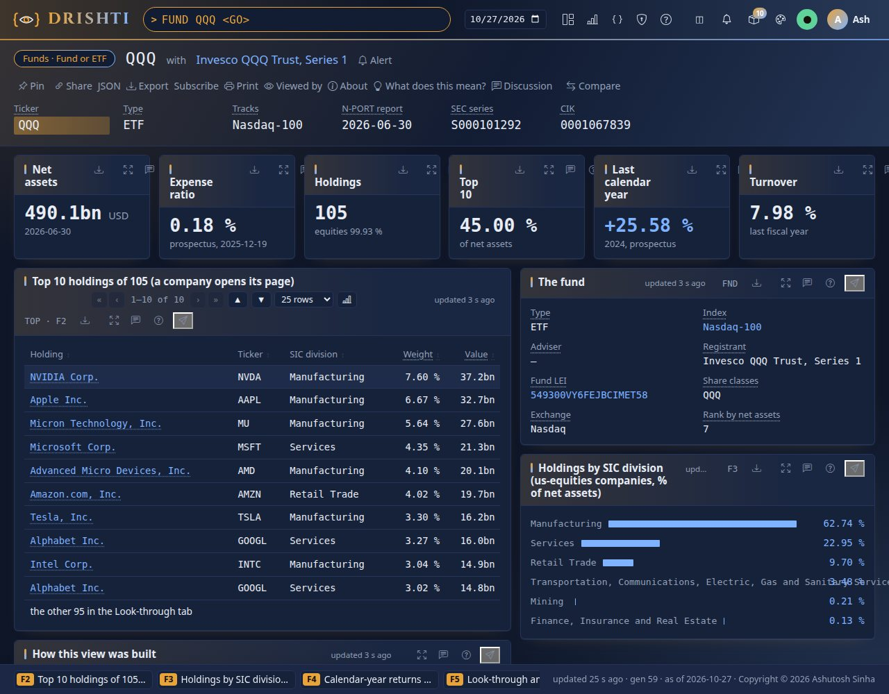

<!--
  Project Drishti · Any data. Any domain. One grammar.

  Copyright (c) 2026 Ashutosh Sinha <ajsinha@gmail.com>.
  All rights reserved.

  PROPRIETARY AND CONFIDENTIAL.

  This file is the confidential and proprietary property of Ashutosh Sinha.
  Unauthorised copying, use, modification, distribution or disclosure of this
  file, via any medium, is strictly prohibited except with the express prior
  written permission of the copyright holder.

  See the LICENSE file in the root of this repository for the full terms.
-->
<!-- Generated by tools/packgen/funds/make.py. Edit the generator, not this file. -->
# The funds pack

The **200 largest US mutual funds and ETFs by net assets** with their holdings, from SEC public data: each fund's Form N-PORT
report (holdings with CUSIP, ISIN and LEI, derivatives and their counterparties, three months of flows and returns), its Form N-CEN
census (ETF facts, adviser, custodian, auditor, authorised participants) and its prospectus risk/return summary (expense ratio,
turnover, calendar-year returns). Everything is published data retrieved on 2026-10-26; the N-PORT reports are dated 2026-05-31 to 2026-07-31.
No prices or NAV history. The full guide, with the data contract of every kind and where the data comes from, is
`docs/guides/WORLD_DATA_GUIDE.md`; the world data tutorial, Part C walks through it.

The pack is **off by default**: add it to the packs a server loads, after `us-equities` (its holdings link to the companies there):
`DRISHTI_PACKS=core,market-data,trading,counterparty-risk,market-risk,world-economy,news-and-markets,us-equities,gleif,funds`.



## What you can open

| Type | Opens | Examples |
|---|---|---|
| `FUND <ticker>` | a fund or ETF: the fact sheet; tabs **Look-through holdings** and **vs its index** | `FUND QQQ`, `FUND VTI` (also `FUND VTSAX`: any share class), `FUND SPY`, `FUND AGG` |
| `FUND <field>=<value>` | a search of the funds | `FUND TYPE=ETF`, `FUND EXPENSE_RATIO<0.05`, `FUND INDEX_ID=SP500` |
| `HELD <ticker>` | the funds holding a us-equities company, by value | `HELD AAPL`, `HELD NVDA` |
| `TRACK <index>` | the funds tracking a us-equities index | `TRACK SP500`, `TRACK NDX`, `TRACK DJIA` |

With `us-equities` on, a company page (`USEQ AAPL`) has the tabs **Held by funds** and **Fund ownership**, and an index page
(`IDX SP500`) lists the ETFs and funds tracking it.

## The data

| Kind | Documents | What one holds |
|---|---|---|
| `fund` | 200 | identity and share classes, census facts, fees and returns, flows, concentration, holdings by asset type, issuer type, country and SIC division, derivatives and counterparties, the 600 largest holdings (with the totals of the rest), the fund against its index |
| `fund-holder` | 586 | one us-equities company: every fund that holds it, its weight, value and shares in each |
| `index-funds` | 3 | one us-equities index: the funds that track it, with net assets, expense ratio and active share |

Holdings kept: 73,577 of 411,796 (a fund keeps its 600 largest; the reverse look-through counts every one). Funds by type: Mutual fund 117, ETF 50, Mutual fund with an ETF share class 31, ETF (unit investment trust) 2.

**Where the data lives.** The documents are committed as Drishti's standard test data, gzipped JSON Lines under
`data/testdata/funds/<kind>/` (the fund kind in parts of about 1.2 MB, 5.7 MB in all), listed in `data/testdata/testdata.yaml`.
`python3 tools/drishti.py lake demo` (or `python3 tools/build_demo_lakes.py`) builds them into the demo lake and the pack's Delta
connector `funds-store` serves them; nothing is served by the demo connector. `samples/` keeps a few reference documents.

## Data sources and licences

| Source | What | Licence |
|---|---|---|
| SEC Form N-PORT data sets (quarterly, about 450 MB) | holdings, derivatives, counterparties, flows, monthly returns | Public domain (U.S. Government work) |
| SEC Form N-CEN data sets (quarterly, about 6 to 16 MB) | ETF facts, service providers, authorised participants, share classes | Public domain |
| SEC mutual fund prospectus risk/return summary data sets (quarterly) | expense ratio, management fee, turnover, calendar-year returns | Public domain |
| SEC `company_tickers_mf.json` and `company_tickers_exchange.json` | share class tickers; a unit investment trust's ticker | Public domain |
| Nasdaq Trader symbol directory | which tickers are ETFs, and where they list | Public directory file |
| GLEIF golden copy, level 2 relationships | managed by, sub-fund of, feeder to | CC0 1.0 |

The SEC asks for a descriptive User-Agent with a contact and at most 10 requests a second; the funds feed uses the same setting
as the us-equities pack (`DRISHTI_FEEDS_USER_AGENT`). **Not included:** index weights (proprietary to the index providers; the index tab
computes market-cap weights from SEC data and says so), prices and NAV history, non-US funds and money market funds (they file Form
N-MFP, not N-PORT).

## Refreshing the data

```bash
python3 tools/drishti.py feed status funds                 # its last runs: last success, rows, failures
python3 tools/drishti.py feed run funds --dry-run      # what would be fetched; changes nothing
python3 tools/drishti.py feed run funds --snapshot                # the downloads (about 700 MB, kept in the data folder), then make.py and --check
python3 tools/packgen/funds/make.py --check              # no network: the pack matches its generator
```

`tools/feeds/feed.sh run funds` and `tools/windows/feed.ps1 run funds` run the same script. The downloads stay in the data folder
(`<data>/datafeeds/sources/cache/funds`), never in git. After a refresh, rebuild the lake: `python3 tools/drishti.py lake demo`.

## Data contracts

Every kind of the pack has a data contract: a YAML file beside the pack (`config/packs/capitalmarkets/funds/contracts/<kind>.contract.yaml`, checked against `tools/contracts.schema.json`) that says what one record is, its key, how it is stored and dated, and every field with its type, presence, unit and meaning. The contracts are published on [docs/contracts/packs/funds.md](../../../../../docs/contracts/packs/funds.md) and each kind's example (a real record of the test data, every field explained) on [docs/contracts/samples](../../../../../docs/contracts/samples/README.md); this guide links them and copies neither. Check them against the pack and its data with `python3 tools/contracts.py check` (or `drishti.py contract check`); show one with `python3 tools/contracts.py show <MNEMONIC>`.

| Command | Kind | Class | Key | Grain | Contract | Example |
|---|---|---|---|---|---|---|
| `FUND` | `fund` | fundamental | `TICKER` | One row per fund or etf, keyed by TICKER. | [FUND: Fund or ETF](../../../../../docs/contracts/packs/funds.md#fund-fund-or-etf-fund) (`contracts/fund.contract.yaml`) | [example](../../../../../docs/contracts/samples/funds.md#fund) |
| `HELD` | `fund-holder` | fundamental | `TICKER` | One row per funds holding a company, keyed by TICKER. | [HELD: Funds holding a company](../../../../../docs/contracts/packs/funds.md#held-funds-holding-a-company-fund-holder) (`contracts/fund-holder.contract.yaml`) | [example](../../../../../docs/contracts/samples/funds.md#fund-holder) |
| `TRACK` | `index-funds` | fundamental | `INDEX` | One row per funds tracking an index, keyed by INDEX. | [TRACK: Funds tracking an index](../../../../../docs/contracts/packs/funds.md#track-funds-tracking-an-index-index-funds) (`contracts/index-funds.contract.yaml`) | [example](../../../../../docs/contracts/samples/funds.md#index-funds) |

*Class*: **fundamental** data is delivered by a source system and stored; **input** is stored data an engine reads; **computed** is worked out by Drishti when asked and never stored by a source; **drishti-owned** is kept by Drishti itself.

## Data retrieval

Where each kind's data comes from, how it reaches the lake and how to check it. Three origins: **external** data, fetched from a public source by its data feed (each source, its licence and worked examples on the [External data](../../../../../docs/guides/WORLD_DATA_GUIDE.md) help page); **synthetic** test data (or hand-written reference data), written by a generator with fictitious names; **computed** by a Drishti engine when it is asked, never stored by a source.

| Command | Kind | Origin | How it reaches Drishti |
|---|---|---|---|
| `FUND` | `fund` | external: SEC Form N-PORT data sets (holdings, derivatives, counterparties, flows, monthly returns) (public domain (US Government work); SEC fair access policy); SEC Form N-CEN data sets (ETF facts, service providers, authorised participants) (public domain (US Government work); SEC fair access policy); SEC mutual fund prospectus risk/return summary data sets (expense ratio, turnover, calendar-year returns) (public domain (US Government work); SEC fair access policy); SEC ticker files (company_tickers_mf.json, company_tickers_exchange.json) (public domain (US Government work)); Nasdaq Trader symbol directory (which tickers are ETFs) (public symbol directory files); GLEIF golden copy level 2: fund relationships (managed by, sub-fund of, feeder to) (CC0 1.0) — refreshed by `drishti.py feed run funds` | `data/testdata/funds/fund/` → `lake demo` → connector `funds-store` |
| `HELD` | `fund-holder` | external: SEC Form N-PORT data sets (holdings, derivatives, counterparties, flows, monthly returns) (public domain (US Government work); SEC fair access policy) — refreshed by `drishti.py feed run funds` | `data/testdata/funds/fund-holder/` → `lake demo` → connector `funds-store` |
| `TRACK` | `index-funds` | external: SEC Form N-PORT data sets (holdings, derivatives, counterparties, flows, monthly returns) (public domain (US Government work); SEC fair access policy); SEC mutual fund prospectus risk/return summary data sets (expense ratio, turnover, calendar-year returns) (public domain (US Government work); SEC fair access policy) — refreshed by `drishti.py feed run funds` | `data/testdata/funds/index-funds/` → `lake demo` → connector `funds-store` |

### External sources

| Source | Where | Licence | Internal only | Refresh |
|---|---|---|---|---|
| SEC Form N-PORT data sets (holdings, derivatives, counterparties, flows, monthly returns) | https://www.sec.gov/data-research/sec-markets-data/form-n-port-data-sets | public domain (US Government work); SEC fair access policy | no | `python3 tools/drishti.py feed run funds -- nport` |
| SEC Form N-CEN data sets (ETF facts, service providers, authorised participants) | https://www.sec.gov/data-research/sec-markets-data/form-n-cen-data-sets | public domain (US Government work); SEC fair access policy | no | `python3 tools/drishti.py feed run funds -- ncen` |
| SEC mutual fund prospectus risk/return summary data sets (expense ratio, turnover, calendar-year returns) | https://www.sec.gov/data-research/sec-markets-data/mutual-fund-prospectus-riskreturn-summary-data-sets | public domain (US Government work); SEC fair access policy | no | `python3 tools/drishti.py feed run funds -- rr` |
| SEC ticker files (company_tickers_mf.json, company_tickers_exchange.json) | https://www.sec.gov/file/company-tickers | public domain (US Government work) | no | `python3 tools/drishti.py feed run funds -- tickers` |
| Nasdaq Trader symbol directory (which tickers are ETFs) | https://www.nasdaqtrader.com/dynamic/SymDir/ | public symbol directory files | no | `python3 tools/drishti.py feed run funds -- nasdaq` |
| GLEIF golden copy level 2: fund relationships (managed by, sub-fund of, feeder to) | https://goldencopy.gleif.org | CC0 1.0 | no | `python3 tools/drishti.py feed run funds -- gleif` |

```bash
python3 tools/drishti.py feed status funds                                  # its last runs: last success, rows, failures (offline: the run ledger)
python3 tools/drishti.py feed run funds --dry-run                           # what would be fetched and loaded; changes nothing
python3 tools/drishti.py feed run funds                                     # pull today's data and load it into the lake `capitalmarket` (what the daily schedule runs)
python3 tools/drishti.py feed run funds --snapshot                          # refresh the committed pack instead: data/testdata/funds, samples/, the README and this guide, then make.py --check
python3 tools/drishti.py feed run funds --snapshot --offline                # the same from the downloads only (about 700 MB in <data>/datafeeds/sources/cache/funds)
python3 tools/drishti.py feed run funds -- --scope FUNDS:300,HOLDINGS:1000  # a widened pull of more funds and holdings
```

The same through the wrappers: `tools/feeds/feed.sh run funds` on Linux and macOS, `.\tools\windows\feed.ps1 run funds` on Windows (every argument is passed on); the daily schedule entries: `drishti.py feed schedule --cron` (or `--systemd`, `--windows`) ([WORLD_DATA_GUIDE.md](../../../../../docs/guides/WORLD_DATA_GUIDE.md)).

### Into the lake, checking, offline

- **The lake.** `python3 tools/drishti.py lake demo` reads `data/testdata/testdata.yaml` and writes every dataset (test data, the packs' samples and the committed public-data snapshots) into `<data>/delta/<domain>/<kind>/`, where the pack's Delta connector serves it; a computed kind needs nothing loaded. `lake build` loads your own large JSON exports the same way ([Command line](../../../../../docs/guides/CLI_REFERENCE.md)).
- **Checking.** `python3 tools/contracts.py check` compares every contract with the pack and its data; each generator's `--check` (above) fails when the committed files differ from what it would write; in the console, `<MNEMONIC> <GO>` lists a kind and the pack's code opens its overview with the count of each kind.
- **Offline.** Everything committed works without a network: the test data, the samples and the public-data snapshots are in the repository and `lake demo` reads only them. A data feed runs offline from its download cache (`--offline`); a connector that reaches the internet (news, yfinance, the public-data feeds) is off as shipped and never starts on a machine configured offline (`drishti.offline.plugins`).
