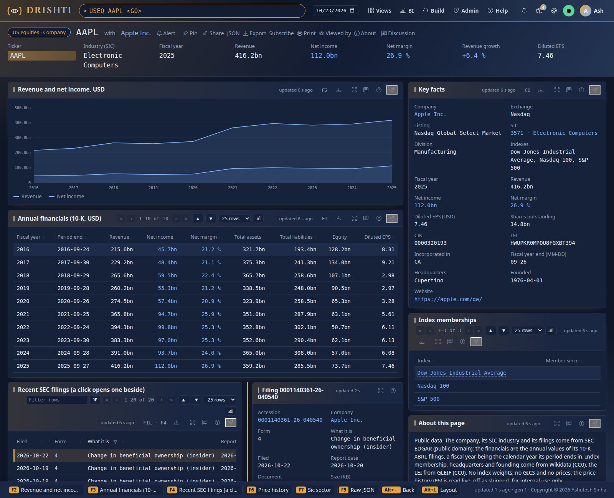

<!--
  Project Drishti · Any data. Any domain. One grammar.

  Copyright (c) 2026 Ashutosh Sinha <ajsinha@gmail.com>.
  All rights reserved.

  PROPRIETARY AND CONFIDENTIAL.

  This file is the confidential and proprietary property of Ashutosh Sinha.
  Unauthorised copying, use, modification, distribution or disclosure of this
  file, via any medium, is strictly prohibited except with the express prior
  written permission of the copyright holder.

  See the LICENSE file in the root of this repository for the full terms.
-->
<!-- Generated by tools/packgen/us_equities/make.py. Edit the generator, not this file. -->
# The us-equities pack

Public data on the companies of the **Dow Jones Industrial Average, the Nasdaq-100 and the S&P 500**: 586 companies with their
SEC filings, ten years of annual financials from their XBRL filings, their LEI, their SIC sector and the indexes they belong to.
Everything here is published data, not samples, retrieved on 2026-10-24; prices are not included (see *Prices: internal use only*).

The pack is **off by default**: add it to the packs a server loads, `DRISHTI_PACKS=core,market-data,trading,counterparty-risk,market-risk,world-economy,news-and-markets,us-equities`
(it needs no other pack; with `world-economy` and `news-and-markets` on, its companies link to them).



## What you can open

| Type | Opens | Examples |
|---|---|---|
| `USEQ <ticker>` | a company: key facts, financials table and chart, recent filings (a click opens one beside), index memberships | `USEQ AAPL`, `USEQ JPM`, `USEQ BRK-B` |
| `IDX <index>` | an index's members, filterable; a click opens the member's summary beside | `IDX SP500`, `IDX NDX`, `IDX DJIA`, `IDX BANKS-US`, `IDX BANKS-CA`, `IDX BANKS-UK` |
| `SIC <code>` | a sector (Standard Industrial Classification), computed from the companies when asked: its companies by revenue, totals of the USD reporters | `SIC 3674`, `SIC 6021`; `SIC ALL` lists every code |
| `EDGAR <form>` | the filings browser: the latest filings, all or of one form; a click opens the filing beside | `EDGAR ALL`, `EDGAR 10-K`, `EDGAR 8-K`, `EDGAR 4`, `EDGAR DEF-14A` |
| `FILING <accession>` | one filing: form, dates, 8-K items and its EDGAR links | from a company's filings |
| `FACT <ticker>-<concept>` | one financial concept of a company over ten fiscal years | `FACT AAPL-REVENUE`, `FACT MSFT-NET-INCOME` |
| `PXH PX-<ticker>` | the price history, **live only, off as shipped** | `PXH PX-AAPL` |

The concepts are `REVENUE`, `NET-INCOME`, `ASSETS`, `LIABILITIES`, `EQUITY`, `EPS-DILUTED` and `SHARES-OUTSTANDING`.

## The data

| Kind | Documents | What one holds |
|---|---|---|
| `us-company` | 586 | CIK, ticker, exchange and listing market, SIC with its description and division, state of incorporation, fiscal year end, LEI, headquarters, founded, website, index memberships, the latest year's figures, ten years of financials, the latest 20 filings |
| `index-membership` | 6 | the members of the S&P 500, Nasdaq-100, Dow and Russell 2000 as their tracking ETF (SPY, QQQ, DIA, IWM) reports holding them, and the bank lists, with their sector and latest revenue; members by sector |
| `sic-sector` | computed (194 codes and `ALL`) | the companies of one SIC code ranked by revenue; `ALL` lists every code. Computed from the companies when asked by the derived connector `us-equities-groupings` (since 2.9.2): nothing is stored |
| `filing-feed` | 6 | the latest 300 filings of the companies, all forms or one |
| `filing` | 11,691 | one filing: form, filing and report dates, document, 8-K items, links to the document and its EDGAR index |
| `financial-fact` | 4,026 | one concept of one company: up to ten annual values with the change, the XBRL tag and the filing each came from |
| `price-history` | live only | the quote, a year of daily prices and the analytics computed from them when read (returns, volatility, drawdown, beta against the benchmark), from the price connector when a site switches it on; nothing is stored |

Members per index or list: Dow Jones Industrial Average 30, Nasdaq-100 99, S&P 500 495, Major US banks 39, Canadian banks 6, Major UK banks 4. The bank lists (BANKS-US, BANKS-CA, BANKS-UK) are kept by Drishti (`LISTS` in
`tools/packgen/us_equities/fetch.py`) and hold banks that file with the SEC. Annual values are those of the annual reports (10-K, or
a foreign filer's 20-F or 40-F, in the currency it reports in: `CURRENCY`; totals over many companies add USD reporters only): a flow (revenue, net income, EPS) for a period of a
year, a balance (assets, liabilities, equity) at the year end, the latest filing winning when a figure was restated. A fiscal year is the
calendar year its period ends in. Where a filer reports no total assets for a year, they are its total equity and liabilities; where it reports no
total liabilities line, it is derived as liabilities and equity less total
equity. Banks and insurers report revenue under several tags; where none of the standard ones is filed the revenue is left empty.

**Where the data lives.** The documents are committed as Drishti's standard test data: one gzipped JSON Lines snapshot per
kind, `data/testdata/us-equities/<kind>/<kind>.<date>.jsonl.gz`, listed in `data/testdata/testdata.yaml`. `python3 tools/drishti.py lake demo`
(or `python3 tools/build_demo_lakes.py`) builds them into the demo lake, the same documents on every business day it holds, and the
pack's Delta connector `us-equities-store` serves them. Nothing is served by the demo connector: a server with `DRISHTI_DEMO_ENABLED=false`
opens every page of the pack from the lake. The pack's `samples/` folder keeps only a few reference documents for this guide and the
README.

## Links

A company links to its filings, its financial facts, its SIC sector, its indexes, the United States economy (`world-economy`, for a
company with a US business address), its market watch page (`news-and-markets`, for the twenty companies there) and to a `core`
legal entity whose LEI is the company's (0 match today: core's entities are a fictional bank's). A filing and a fact link
back to their company; an index and a sector to their members. With the `gleif` pack on, the company's LEI (key facts, and F5)
opens its LEI record, and the record links back to the company.

## Data sources and licences

| Source | What | Licence |
|---|---|---|
| SEC EDGAR: `company_tickers_exchange.json`, `submissions/CIK##########.json`, `api/xbrl/companyfacts` | tickers, CIK, names, SIC, addresses, filings (metadata and links only), annual XBRL facts | Public domain (U.S. Government work). Fetched under the SEC's fair access policy: a descriptive User-Agent with a contact, under 10 requests a second |
| Nasdaq Trader symbol directory (`nasdaqlisted.txt`, `otherlisted.txt`) | the listing market | Public directory file |
| GLEIF LEI records | the LEI, legal name and registration status | CC0 1.0 |
| SEC Form N-PORT of SPY, QQQ, DIA and IWM (read from the funds pack's download cache) | index membership: the stocks each tracking ETF holds on its report date | Public domain (U.S. Government work) |
| Wikidata | headquarters, founded, website, LEI, the date a member joined its index | CC0 1.0 |

**Not included:** index weights and index levels (proprietary to S&P Dow Jones Indices and Nasdaq), GICS sectors (proprietary to MSCI and
S&P; the pack uses SIC, which the SEC publishes) and prices. Index membership is what the index's tracking ETF reported holding on
its N-PORT report date (each index page names the fund, the date and the filing), so it lags a change by up to a quarter; a company
since taken private or merged is listed in the index page's note, not as a member. Until 2.9.3 membership came from Wikidata, whose
lists were out of date (the S&P 500 lacked Exxon Mobil, BlackRock and about 80 others); the companies Wikidata still lists but no
tracking ETF holds stay in the pack, in no index.

## Prices: internal use only

!!! warning "Internal use only"
    Free price feeds forbid redistribution. The pack ships **no price data**: `price-history` is read live by the `us-equities-prices`
    connector (Yahoo Finance's public chart endpoint, the yfinance plugin), **off as shipped**. Switch it on only for internal
    demonstrations (`DRISHTI_US_EQUITIES_PRICES_ENABLED=true`, or Admin, Connectors); every ticker you open is then sent to Yahoo. Raise
    it before any client or external use, as for the IMF data of the world-economy pack.

## Refreshing the data

The pack's data feed fetches, builds and checks in one step, and loads its lake every day (guide: `docs/guides/EXTERNAL_DATA.md`, us-equities):

```bash
python3 tools/drishti.py feed status us-equities                 # its last runs: last success, rows, failures
python3 tools/drishti.py feed run us-equities --dry-run      # what would be fetched; changes nothing
python3 tools/drishti.py feed run us-equities --snapshot                # the network (about 1,100 SEC and 500 GLEIF calls), then make.py and --check
python3 tools/drishti.py feed run us-equities --snapshot -- --scope TSLA,FILINGS:40,YEARS:15   # a wider build in the data folder, not this pack
```

`tools/feeds/feed.sh run us-equities` and `tools/windows/feed.ps1 run us-equities` run the same command. Underneath it are the
generator's two steps, which can also be run by hand:

```bash
python3 tools/packgen/us_equities/fetch.py --cache data/cache/us-equities     # the network: about 1,100 SEC requests and 500 GLEIF lookups
python3 tools/packgen/us_equities/make.py --cache data/cache/us-equities      # writes data/testdata/us-equities/, samples/ and this guide
python3 tools/packgen/us_equities/make.py --check                              # no network: the pack matches its generator
```

`fetch.py` keeps what it downloaded (delete a file to fetch it again) and reduces each company's XBRL facts to the annual values of the
seven concepts, so the cache stays small. Prices are never part of a refresh into the pack: the script's `prices` source writes a
snapshot to the data folder only (internal use only). Set `DRISHTI_FEEDS_USER_AGENT` to your own name and contact before running it.

After a refresh, rebuild the lake so the server reads the new snapshot: `python3 tools/drishti.py lake demo` (or
`python3 tools/build_demo_lakes.py`), then restart the server or let it pick the tables up at its next refresh.

The picture
above is made by `tools/packgen/us_equities/shot.py` (its own scratch server and console on 18742 and 18743).

## Data contracts

Every kind of the pack has a data contract: a YAML file beside the pack (`config/packs/capitalmarkets/us-equities/contracts/<kind>.contract.yaml`, checked against `tools/contracts.schema.json`) that says what one record is, its key, how it is stored and dated, and every field with its type, presence, unit and meaning. The contracts are published on [docs/contracts/packs/us-equities.md](../../../../../docs/contracts/packs/us-equities.md) and each kind's example (a real record of the test data, every field explained) on [docs/contracts/samples](../../../../../docs/contracts/samples/README.md); this guide links them and copies neither. Check them against the pack and its data with `python3 tools/contracts.py check` (or `drishti.py contract check`); show one with `python3 tools/contracts.py show <MNEMONIC>`.

| Command | Kind | Class | Key | Grain | Contract | Example |
|---|---|---|---|---|---|---|
| `USEQ` | `us-company` | fundamental | `TICKER` | One row per us company, keyed by TICKER. | [USEQ: US company](../../../../../docs/contracts/packs/us-equities.md#useq-us-company-us-company) (`contracts/us-company.contract.yaml`) | [example](../../../../../docs/contracts/samples/us-equities.md#us-company) |
| `IDX` | `index-membership` | fundamental | `INDEX` | One row per index members, keyed by INDEX. | [IDX: Index members](../../../../../docs/contracts/packs/us-equities.md#idx-index-members-index-membership) (`contracts/index-membership.contract.yaml`) | [example](../../../../../docs/contracts/samples/us-equities.md#index-membership) |
| `SIC` | `sic-sector` | computed | `SIC` | One record per SIC of the us-company records, computed when asked. | [SIC: SIC sector](../../../../../docs/contracts/packs/us-equities.md#sic-sic-sector-sic-sector) (`contracts/sic-sector.contract.yaml`) | — (computed when asked) |
| `EDGAR` | `filing-feed` | fundamental | `FEED` | One row per edgar filings browser, keyed by FEED. | [EDGAR: EDGAR filings browser](../../../../../docs/contracts/packs/us-equities.md#edgar-edgar-filings-browser-filing-feed) (`contracts/filing-feed.contract.yaml`) | [example](../../../../../docs/contracts/samples/us-equities.md#filing-feed) |
| `FILING` | `filing` | fundamental | `ACCESSION` | One row per sec filing, keyed by ACCESSION. | [FILING: SEC filing](../../../../../docs/contracts/packs/us-equities.md#filing-sec-filing-filing) (`contracts/filing.contract.yaml`) | [example](../../../../../docs/contracts/samples/us-equities.md#filing) |
| `FACT` | `financial-fact` | fundamental | `FACT_ID` | One row per financial fact, keyed by FACT_ID. | [FACT: Financial fact](../../../../../docs/contracts/packs/us-equities.md#fact-financial-fact-financial-fact) (`contracts/financial-fact.contract.yaml`) | [example](../../../../../docs/contracts/samples/us-equities.md#financial-fact) |
| `PXH` | `price-history` | fundamental | — | One row per price history (live, internal use only), keyed by a key to be confirmed. | [PXH: Price history (live, internal use only)](../../../../../docs/contracts/packs/us-equities.md#pxh-price-history-live-internal-use-only-price-history) (`contracts/price-history.contract.yaml`) | — (no test data) |

*Class*: **fundamental** data is delivered by a source system and stored; **input** is stored data an engine reads; **computed** is worked out by Drishti when asked and never stored by a source; **drishti-owned** is kept by Drishti itself.

## Data retrieval

Where each kind's data comes from, how it reaches the lake and how to check it. Three origins: **external** data, fetched from a public source by its data feed (each source, its licence and worked examples on the [External data](../../../../../docs/guides/EXTERNAL_DATA.md) help page); **synthetic** test data (or hand-written reference data), written by a generator with fictitious names; **computed** by a Drishti engine when it is asked, never stored by a source.

| Command | Kind | Origin | How it reaches Drishti |
|---|---|---|---|
| `USEQ` | `us-company` | external: SEC EDGAR: tickers, submissions, XBRL company facts (public domain (US Government work); EDGAR fair access policy); Wikidata: index membership and company facts (CC0 1.0); Nasdaq Trader symbol directory (public symbol directory files); GLEIF LEI records (each company's LEI) (CC0 1.0) — refreshed by `drishti.py feed run us-equities` | `data/testdata/us-equities/us-company/` → `lake demo` → connector `us-equities-store` |
| `IDX` | `index-membership` | external: Wikidata: index membership and company facts (CC0 1.0) — refreshed by `drishti.py feed run us-equities` | `data/testdata/us-equities/index-membership/` → `lake demo` → connector `us-equities-store` |
| `SIC` | `sic-sector` | computed by Drishti: the derived connector us-equities-groupings over the kind us-company; see the [Groupings and analytics guide](../../../../../docs/guides/GROUPINGS_ANALYTICS_GUIDE.md) | nothing to load: computed from its inputs when asked |
| `EDGAR` | `filing-feed` | external: SEC EDGAR: tickers, submissions, XBRL company facts (public domain (US Government work); EDGAR fair access policy) — refreshed by `drishti.py feed run us-equities` | `data/testdata/us-equities/filing-feed/` → `lake demo` → connector `us-equities-store` |
| `FILING` | `filing` | external: SEC EDGAR: tickers, submissions, XBRL company facts (public domain (US Government work); EDGAR fair access policy) — refreshed by `drishti.py feed run us-equities` | `data/testdata/us-equities/filing/` → `lake demo` → connector `us-equities-store` |
| `FACT` | `financial-fact` | external: SEC EDGAR: tickers, submissions, XBRL company facts (public domain (US Government work); EDGAR fair access policy) — refreshed by `drishti.py feed run us-equities` | `data/testdata/us-equities/financial-fact/` → `lake demo` → connector `us-equities-store` |
| `PXH` | `price-history` | external: Yahoo Finance daily prices (the us-equities-prices connector) (Yahoo terms: personal use, no redistribution; **internal only**) — refreshed by `drishti.py feed run us-equities` | read live by connector `us-equities-prices` (plugin `yfinance`) when it is switched on; nothing is committed |

### External sources

| Source | Where | Licence | Internal only | Refresh |
|---|---|---|---|---|
| SEC EDGAR: tickers, submissions, XBRL company facts | https://data.sec.gov | public domain (US Government work); EDGAR fair access policy | no | `python3 tools/drishti.py feed run us-equities -- sec` |
| Wikidata: index membership and company facts | https://query.wikidata.org/sparql | CC0 1.0 | no | `python3 tools/drishti.py feed run us-equities -- wikidata` |
| Nasdaq Trader symbol directory | https://www.nasdaqtrader.com/dynamic/SymDir/ | public symbol directory files | no | `python3 tools/drishti.py feed run us-equities -- nasdaq` |
| GLEIF LEI records (each company's LEI) | https://api.gleif.org/api/v1 | CC0 1.0 | no | `python3 tools/drishti.py feed run us-equities -- gleif` |
| Yahoo Finance daily prices (the us-equities-prices connector) | https://finance.yahoo.com | Yahoo terms: personal use, no redistribution | **yes** | `python3 tools/drishti.py feed run us-equities -- prices` |

**Internal only:** Yahoo Finance daily prices (the us-equities-prices connector). The terms restrict reuse or forbid redistribution: the data is for internal demonstrations only, never written into a committed folder without `--internal-ok`, and must be raised with the owner before any client or external use.

```bash
python3 tools/drishti.py feed status us-equities                          # its last runs: last success, rows, failures (offline: the run ledger)
python3 tools/drishti.py feed run us-equities --dry-run                   # what would be fetched and loaded; changes nothing
python3 tools/drishti.py feed run us-equities                             # pull today's data and load it into the lake `capitalmarket` (what the daily schedule runs)
python3 tools/drishti.py feed run us-equities --snapshot                  # refresh the committed pack instead: data/testdata/us-equities, samples/ and this guide, then make.py --check
python3 tools/drishti.py feed run us-equities --snapshot --offline        # the same from the download cache only
python3 tools/drishti.py feed run us-equities -- --scope TSLA,FILINGS:40  # a widened pull of more companies and filings
```

The same through the wrappers: `tools/feeds/feed.sh run us-equities` on Linux and macOS, `.\tools\windows\feed.ps1 run us-equities` on Windows (every argument is passed on); the daily schedule entries: `drishti.py feed schedule --cron` (or `--systemd`, `--windows`) ([EXTERNAL_DATA.md](../../../../../docs/guides/EXTERNAL_DATA.md)).

### Into the lake, checking, offline

- **The lake.** `python3 tools/drishti.py lake demo` reads `data/testdata/testdata.yaml` and writes every dataset (test data, the packs' samples and the committed public-data snapshots) into `<data>/delta/<domain>/<kind>/`, where the pack's Delta connector serves it; a computed kind needs nothing loaded. `lake build` loads your own large JSON exports the same way ([Command line](../../../../../docs/guides/CLI_REFERENCE.md)).
- **Checking.** `python3 tools/contracts.py check` compares every contract with the pack and its data; each generator's `--check` (above) fails when the committed files differ from what it would write; in the console, `<MNEMONIC> <GO>` lists a kind and the pack's code opens its overview with the count of each kind.
- **Offline.** Everything committed works without a network: the test data, the samples and the public-data snapshots are in the repository and `lake demo` reads only them. A data feed runs offline from its download cache (`--offline`); a connector that reaches the internet (news, yfinance, the public-data feeds) is off as shipped and never starts on a machine configured offline (`drishti.offline.plugins`).
