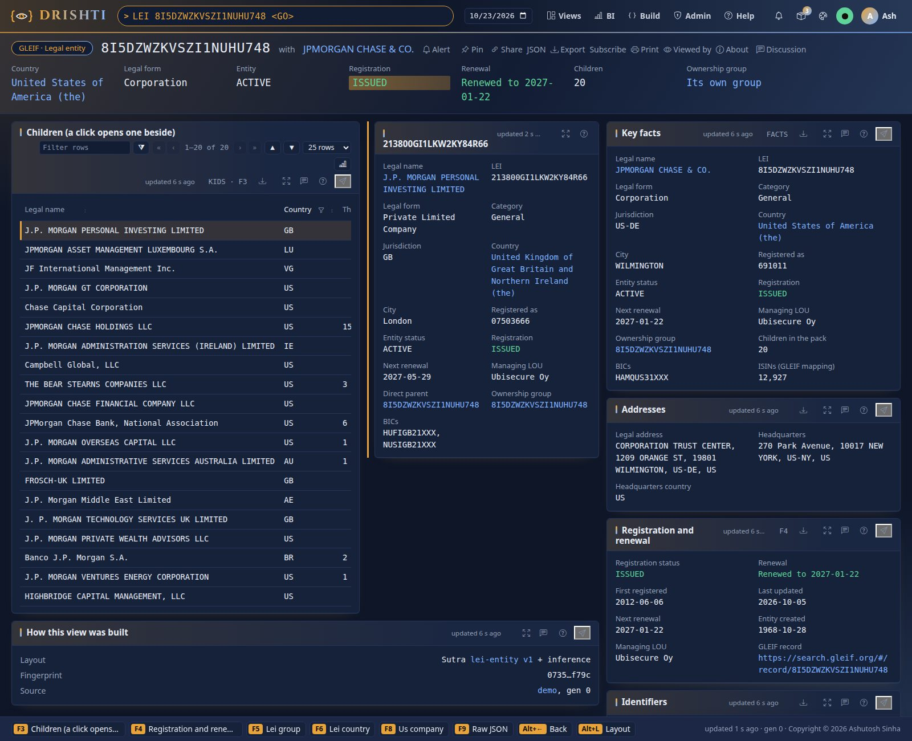

<!--
  Project Drishti · Any data. Any domain. One grammar.

  Copyright (c) 2026 Ashutosh Sinha <ajsinha@gmail.com>.
  All rights reserved.

  PROPRIETARY AND CONFIDENTIAL.

  This file is the confidential and proprietary property of Ashutosh Sinha.
  Unauthorised copying, use, modification, distribution or disclosure of this
  file, via any medium, is strictly prohibited except with the express prior
  written permission of the copyright holder.

  See the LICENSE file in the root of this repository for the full terms.
-->
<!-- Generated by tools/packgen/gleif/make.py. Edit the generator, not this file. -->
# The gleif pack

Legal Entity Identifiers (LEI) and **who owns whom**, from GLEIF: 9,937 legal entities in 590 ownership groups across
133 countries, retrieved from GLEIF's golden copy of 2026-10-25. The groups are those of the us-equities companies (their
ultimate parent with every entity it consolidates) and of 111 large financial institutions: the FSB's global systemically
important banks, other large banks, insurers, asset managers and market infrastructures. Everything is published data under
**CC0**, not samples.

The pack is **off by default**: add it to the packs a server loads, `DRISHTI_PACKS=core,market-data,trading,counterparty-risk,market-risk,world-economy,news-and-markets,us-equities,gleif`
(it needs no other pack; with `us-equities` on, a company and its LEI record link both ways).



## What you can open

| Type | Opens | Examples |
|---|---|---|
| `LEI <code>` | an entity: key facts, addresses, registration and renewal (late renewal flagged), its parents chain, its children (a click opens the child's summary beside), BICs and ISINs, the us-equities company | `LEI 8I5DZWZKVSZI1NUHU748`, `LEI HWUPKR0MPOU8FGXBT394` |
| `LEIG <code>` | a group, computed from the entities when asked: the ultimate parent with its whole tree, counts by country and legal form, no member cap; a click on a member opens it beside | `LEIG 8I5DZWZKVSZI1NUHU748`; `LEIG ALL` lists every group and searches the entities |
| `LEIC <country>` | a country, computed from the entities when asked: every entity of the pack there, the groups present, legal forms and cities | `LEIC US`, `LEIC GB`; `LEIC ALL` lists every country |
| `LEIR <id>` | one relationship: child, parent, direct or ultimate, status, periods, accounting standard | `LEIR LEIREL-<child LEI>-DIRECT`, from an entity |
| `LEIM <identifier>` | an ISIN, BIC or MIC and the LEI it maps to | a BIC or ISIN from an entity page |

A bare LEI (twenty characters) opens its entity.

## The data

| Kind | Documents | What one holds |
|---|---|---|
| `lei-entity` | 9,937 | legal name and other names, legal form (ELF), category, jurisdiction, legal and headquarters addresses, entity and registration status, created, first registered, last updated, next renewal (late renewals flagged), the managing LOU, BICs, the ISIN count, OpenCorporates id, the direct and ultimate parent, the parents chain, the direct children, reporting exceptions |
| `lei-relationship` | 9,347 | one consolidation relationship of an entity to its direct parent (or, when none is in the pack, its ultimate parent): status, relationship and accounting periods, accounting standard, the record's registration and renewal |
| `lei-group` | computed (590 and `ALL`) | an ultimate parent with its tree (a tree table), every member, counts by country and legal form; `ALL` lists the groups. Computed from the entities when asked by the derived connector `gleif-groupings` (since 2.9.2): nothing is stored |
| `lei-country` | computed (133 and `ALL`) | the entities of one legal-address country, the groups present, legal forms and cities; `ALL` lists the countries. Computed like the groups |
| `lei-mapping` | 3,381 | an identifier and its LEI: every BIC and MIC of the entities, and up to 5 ISINs of each seed entity |

**The cap.** The committed data keeps at most 50 entities a group, the nearest levels first (the size of the snapshot); 86 groups are
larger in GLEIF and their page says so (`MEMBERS_IN_GLEIF`, from the ultimate parent's `GLEIF_GROUP_SIZE`). The computation itself has no
cap: a group page counts and lists every entity of the group the lake holds. The formulas are in
[GROUPINGS_ANALYTICS_GUIDE.md](../../../../docs/guides/GROUPINGS_ANALYTICS_GUIDE.md). A wider build of any group goes to the data folder (*Refreshing the data*). The groups are built from the
consolidation relationships only (`IS_DIRECTLY_CONSOLIDATED_BY`, `IS_ULTIMATELY_CONSOLIDATED_BY`); fund management, sub-fund, feeder
and branch relationships are not ownership and are left out. A member whose direct parent is not reported hangs under the ultimate
parent in the tree. An entity with no reported parent may carry a reporting exception (controlled by natural persons, not
consolidated, no known person) which its page shows.

**Late renewal.** An LEI must be renewed every year. A registration whose next renewal date has passed, or which GLEIF lists as
`LAPSED`, is flagged *Late* on its page, in its group and in its country; 2,288 of the pack's entities are late today.

Segments of the groups: US equities 481, Bank 66, G-SIB 17, Insurer 16, Asset manager 11, Market infrastructure 4.

**Where the data lives.** The documents are committed as Drishti's standard test data: one gzipped JSON Lines snapshot per
kind, `data/testdata/gleif/<kind>/snapshot-<date>.jsonl.gz`, listed in `data/testdata/testdata.yaml`. `python3 tools/drishti.py lake demo`
(or `python3 tools/build_demo_lakes.py`) builds them into the demo lake, the same documents on every business day it holds, and the
pack's Delta connector `gleif-store` serves them. Nothing is served by the demo connector: a server with `DRISHTI_DEMO_ENABLED=false`
opens every page of the pack from the lake. The pack's `samples/` folder keeps only a few reference documents for this guide and the
README.

## Links

An entity links to its direct and ultimate parent, its group, its country, its parent relationship (F7) and its identifiers; a relationship to
its child, parent and group; a group to its ultimate parent's entity and its country; an identifier to its entity. With the
`us-equities` pack on, an entity whose LEI is a us-equities company's links to the company (`481` do), and the company's page links
back to the LEI record (its LEI in the key facts, and F5). A `core` legal entity or counterparty whose LEI matches links too
(0 today: core's entities are a fictional bank's).

## Data sources and licence

| Source | What | Licence |
|---|---|---|
| GLEIF LEI API (`api.gleif.org/api/v1`): `lei-records`, `entity-legal-forms`, `countries`, `lei-issuers` | each entity's level 1 record; legal form names; country names; LOU names | CC0 1.0 |
| GLEIF golden copy, level 2 (`goldencopy.gleif.org`): relationship records and reporting exceptions | who consolidates whom, direct and ultimate; why a parent is not reported | CC0 1.0 |
| GLEIF mapping files (`mapping.gleif.org`): BIC, ISIN, MIC, OpenCorporates to LEI | identifiers of the entities | CC0 1.0 (BIC mapping with SWIFT, ISIN with ANNA) |

GLEIF publishes the LEI data free of charge under CC0 1.0: anyone may use it without restriction. **Attribution is appreciated**:
"Source: GLEIF, the Global Legal Entity Identifier Foundation, LEI data, retrieved 2026-10-25"
([GLEIF's terms](https://www.gleif.org/en/meta/lei-data-terms-of-use)).

## Refreshing the data

The pack's own refresh script fetches, builds and checks in one step (guide: `docs/guides/PUBLIC_DATA.md`, gleif):

```bash
python3 tools/publicdata/gleif.py status                       # licence, last refreshed, cached size
python3 tools/publicdata/gleif.py refresh --dry-run            # what would be fetched; changes nothing
python3 tools/publicdata/gleif.py refresh                      # the network (about 90 MB of golden copy, 45 MB of mapping files, 70 API calls), then make.py and --check
python3 tools/publicdata/gleif.py refresh --offline            # rebuild the pack from the cache only
python3 tools/publicdata/gleif.py refresh --scope GROUP:<LEI>,COUNTRY:LU,NAME:allianz   # a wider build in the data folder, not this pack
```

`tools/publicdata/gleif.sh` and `tools/windows/publicdata-gleif.ps1` run the same script. Underneath it are the generator's two
steps, which can also be run by hand:

```bash
python3 tools/packgen/gleif/fetch.py --cache data/cache/gleif     # the network
python3 tools/packgen/gleif/make.py --cache data/cache/gleif      # writes data/testdata/gleif/, samples/ and this guide
python3 tools/packgen/gleif/make.py --check                       # no network: the pack matches its generator
```

After a refresh, rebuild the lake so the server reads the new snapshot: `python3 tools/drishti.py lake demo` (or
`python3 tools/build_demo_lakes.py`), then restart the server or let it pick the tables up at its next refresh.

The picture above is made by `tools/packgen/gleif/shot.py` (its own scratch server and console on 18760 and 18761).
