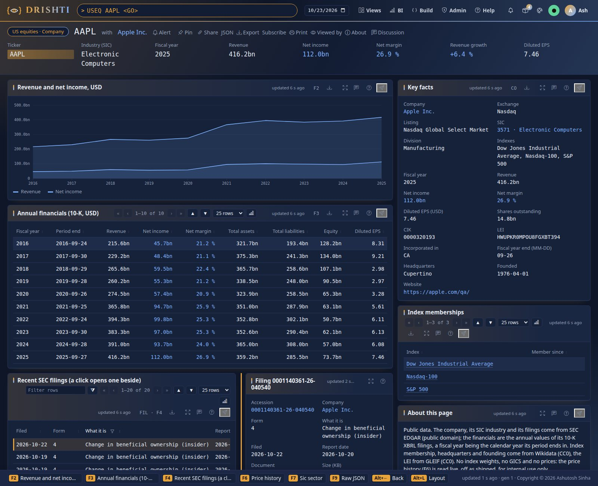

<!--
  Project Drishti · Any data. Any domain. One grammar.

  Copyright (c) 2026 Ashutosh Sinha <ajsinha@gmail.com>.
  All rights reserved.

  PROPRIETARY AND CONFIDENTIAL.

  This file is the confidential and proprietary property of Ashutosh Sinha.
  Unauthorised copying, use, modification, distribution or disclosure of this
  file, via any medium, is strictly prohibited except with the express prior
  written permission of the copyright holder.

  See the LICENSE file in the root of this repository for the full terms.
-->
<!-- Generated by tools/packgen/us_equities/make.py. Edit the generator, not this file. -->
# The us-equities pack

Public data on the companies of the **Dow Jones Industrial Average, the Nasdaq-100 and the S&P 500**: 479 companies with their
SEC filings, ten years of annual financials from their XBRL filings, their LEI, their SIC sector and the indexes they belong to.
Everything here is published data, not samples, retrieved on 2026-10-24; prices are not included (see *Prices: internal use only*).

The pack is **off by default**: add it to the packs a server loads, `DRISHTI_PACKS=core,market-data,trading,counterparty-risk,market-risk,world-economy,news-and-markets,us-equities`
(it needs no other pack; with `world-economy` and `news-and-markets` on, its companies link to them).



## What you can open

| Type | Opens | Examples |
|---|---|---|
| `USEQ <ticker>` | a company: key facts, financials table and chart, recent filings (a click opens one beside), index memberships | `USEQ AAPL`, `USEQ JPM`, `USEQ BRK-B` |
| `IDX <index>` | an index's members, filterable; a click opens the member's summary beside | `IDX SP500`, `IDX NDX`, `IDX DJIA` |
| `SIC <code>` | a sector (Standard Industrial Classification): its companies by revenue | `SIC 3674`, `SIC 6021`; `SIC ALL` lists every code |
| `EDGAR <form>` | the filings browser: the latest filings, all or of one form; a click opens the filing beside | `EDGAR ALL`, `EDGAR 10-K`, `EDGAR 8-K`, `EDGAR 4`, `EDGAR DEF-14A` |
| `FILING <accession>` | one filing: form, dates, 8-K items and its EDGAR links | from a company's filings |
| `FACT <ticker>-<concept>` | one financial concept of a company over ten fiscal years | `FACT AAPL-REVENUE`, `FACT MSFT-NET-INCOME` |
| `PXH PX-<ticker>` | the price history, **live only, off as shipped** | `PXH PX-AAPL` |

The concepts are `REVENUE`, `NET-INCOME`, `ASSETS`, `LIABILITIES`, `EQUITY`, `EPS-DILUTED` and `SHARES-OUTSTANDING`.

## The data

| Kind | Documents | What one holds |
|---|---|---|
| `us-company` | 479 | CIK, ticker, exchange and listing market, SIC with its description and division, state of incorporation, fiscal year end, LEI, headquarters, founded, website, index memberships, the latest year's figures, ten years of financials, the latest 20 filings |
| `index-membership` | 3 | the members as Wikidata records them, with their sector and latest revenue; members by sector |
| `sic-sector` | 180 | the companies of one SIC code ranked by revenue; `ALL` lists every code |
| `filing-feed` | 6 | the latest 300 filings of the companies, all forms or one |
| `filing` | 9,561 | one filing: form, filing and report dates, document, 8-K items, links to the document and its EDGAR index |
| `financial-fact` | 3,275 | one concept of one company: up to ten annual values with the change, the XBRL tag and the filing each came from |
| `price-history` | live only | the quote and a year of daily prices, from the price connector when a site switches it on |

Members per index: Dow Jones Industrial Average 34, Nasdaq-100 77, S&P 500 461. Annual values are those of the annual reports (10-K): a flow (revenue, net income, EPS) for a period of a
year, a balance (assets, liabilities, equity) at the year end, the latest filing winning when a figure was restated. A fiscal year is the
calendar year its period ends in. Where a filer reports no total liabilities line, it is derived as liabilities and equity less total
equity. Banks and insurers report revenue under several tags; where none of the standard ones is filed the revenue is left empty.

## Links

A company links to its filings, its financial facts, its SIC sector, its indexes, the United States economy (`world-economy`, for a
company with a US business address), its market watch page (`news-and-markets`, for the twenty companies there) and to a `core`
legal entity whose LEI is the company's (0 match today: core's entities are a fictional bank's). A filing and a fact link
back to their company; an index and a sector to their members.

## Data sources and licences

| Source | What | Licence |
|---|---|---|
| SEC EDGAR: `company_tickers_exchange.json`, `submissions/CIK##########.json`, `api/xbrl/companyfacts` | tickers, CIK, names, SIC, addresses, filings (metadata and links only), annual XBRL facts | Public domain (U.S. Government work). Fetched under the SEC's fair access policy: a descriptive User-Agent with a contact, under 10 requests a second |
| Nasdaq Trader symbol directory (`nasdaqlisted.txt`, `otherlisted.txt`) | the listing market | Public directory file |
| GLEIF LEI records | the LEI, legal name and registration status | CC0 1.0 |
| Wikidata | index membership, headquarters, founded, website, LEI | CC0 1.0 |

**Not included:** index weights and index levels (proprietary to S&P Dow Jones Indices and Nasdaq), GICS sectors (proprietary to MSCI and
S&P; the pack uses SIC, which the SEC publishes) and prices. Index membership is as Wikidata records it and can lag a change by days
or weeks; it is not an authoritative constituent list.

## Prices: internal use only

!!! warning "Internal use only"
    Free price feeds forbid redistribution. The pack ships **no price data**: `price-history` is read live by the `us-equities-prices`
    connector (Yahoo Finance's public chart endpoint, the yfinance plugin), **off as shipped**. Switch it on only for internal
    demonstrations (`DRISHTI_US_EQUITIES_PRICES_ENABLED=true`, or Admin, Connectors); every ticker you open is then sent to Yahoo. Raise
    it before any client or external use, as for the IMF data of the world-economy pack.

## Refreshing the data

```bash
python3 tools/packgen/us_equities/fetch.py --cache data/cache/us-equities     # the network: about 1,100 SEC requests and 500 GLEIF lookups
python3 tools/packgen/us_equities/make.py --cache data/cache/us-equities      # writes samples/ and this guide
python3 tools/packgen/us_equities/make.py --check                              # no network: the pack matches its generator
```

`fetch.py` keeps what it downloaded (delete a file to fetch it again) and reduces each company's XBRL facts to the annual values of the
seven concepts, so the cache stays small. Set `DRISHTI_SEC_USER_AGENT` to your own name and contact before running it. The picture
above is made by `tools/packgen/us_equities/shot.py` (its own scratch server and console on 18742 and 18743).
