<!--
  Project Drishti · Any data. Any domain. One grammar.

  Copyright (c) 2026 Ashutosh Sinha <ajsinha@gmail.com>.
  All rights reserved.

  PROPRIETARY AND CONFIDENTIAL.

  This file is the confidential and proprietary property of Ashutosh Sinha.
  Unauthorised copying, use, modification, distribution or disclosure of this
  file, via any medium, is strictly prohibited except with the express prior
  written permission of the copyright holder.

  See the LICENSE file in the root of this repository for the full terms.
-->
# Deployment and QA guide

Step by step, on **Windows, Linux and macOS**: install a release, configure it, start the server and the console, and verify every part
with what you should see, then tick the QA checklist. The optional [cluster part](#10-a-cluster-of-three) does the same for three servers
acting as one. A PDF copy of this guide is [DEPLOYMENT_AND_QA_GUIDE.pdf](DEPLOYMENT_AND_QA_GUIDE.pdf).

This guide is the one place for the deployment and QA steps; the details behind them each have one home, which the steps link:
[OPERATIONS_GUIDE.md](guides/OPERATIONS_GUIDE.md) (installing, services, monitoring, troubleshooting), [CLUSTER_GUIDE.md](guides/CLUSTER_GUIDE.md)
(Drishti\*net in depth), [CONFIGURATION.md](admin/CONFIGURATION.md) (every setting), [CLI_REFERENCE.md](guides/CLI_REFERENCE.md) (every command),
[DATA_LAKE_GUIDE.md](guides/DATA_LAKE_GUIDE.md) (lakes and loads). Developers building from source start with
[QUICKSTART_DEVELOPERS.md](QUICKSTART_DEVELOPERS.md).

**Conventions.** `<drishti>` is the release folder (a clone, or the unpacked release). `<host>` is the machine's **real address** on the
network (`hostname -I` on Linux, `ipconfig getifaddr en0` on macOS, `ipconfig` on Windows), for example `192.168.2.77`: give people that
address, never `localhost`. Each step says what to do **in the UI**, **from the command line** and, where a file decides it, **in YAML**.
The pictures were taken on a server and console started exactly as this guide says, on the demo lake.

## Contents

1. [What you deploy](#1-what-you-deploy)
2. [Prerequisites, per operating system](#2-prerequisites-per-operating-system)
3. [Get the release](#3-get-the-release)
4. [Configure](#4-configure)
5. [Build the demo lake](#5-build-the-demo-lake)
6. [Start the server and the console](#6-start-the-server-and-the-console)
7. [Run them as services](#7-run-them-as-services)
8. [Verify, step by step](#8-verify-step-by-step)
9. [The QA checklist](#9-the-qa-checklist)
10. [A cluster of three](#10-a-cluster-of-three)
11. [Offline QA with your own trade files](#11-offline-qa-with-your-own-trade-files)
12. [Troubleshooting](#12-troubleshooting)

## 1. What you deploy

| Process | What it does | Port | Health | Runs on |
|---|---|---|---|---|
| **server** | one Java program, `drishti-server-2.9.11.g-exec.jar`: reads the lakes and sources, computes every number (VaR, exposure, BI), lays out every screen | **18480** | `/actuator/health` | Java 21 |
| **console** | the web pages people open, a Python program, `drishti-console/run_drishti_web.py`: renders what the server sends | **17480** | `/healthz`, `/readyz` | Python 3.13 in its own environment |

Both read from **one release folder** and write everything under **one data folder** (`<drishti>/data`, or `DRISHTI_DATA_DIR`): the lakes,
users, caches, logs. The two can run on one machine or on two; several servers can form a cluster ([section 10](#10-a-cluster-of-three)).
The full picture: [OPERATIONS_GUIDE.md › What you are running](guides/OPERATIONS_GUIDE.md#1-what-you-are-running).

## 2. Prerequisites, per operating system

| Need | Windows 10/11, Server 2019+ | Linux (Ubuntu 22.04+, RHEL 9+) | macOS 13+ (Apple silicon or Intel) |
|---|---|---|---|
| **Java 21**, a JDK, 64-bit | Temurin 21 **ZIP** unpacked to `C:\jdk-21` (no installer needed), or the MSI | `sudo apt install openjdk-21-jdk` / `sudo dnf install java-21-openjdk-devel` | `brew install openjdk@21`, or the Temurin 21 `.tar.gz` |
| **Python 3.13** | python.org's installer for Windows, or its embeddable ZIP with pip | `uv python install 3.13`, or the distribution's `python3.13` | `brew install python@3.13`, or `uv python install 3.13` |
| The console's environment | `py -3.13 -m venv drishti-console\.venv` then pip (no other tool) | `uv venv` (recommended) or `python3.13 -m venv` | the same as Linux |
| Scripts | PowerShell 5.1 or 7: `tools\windows\*.ps1` | bash | bash or zsh |
| **Memory** | 8 GB free for the demo lake (the server's heap 4 GB, the console about 1 GB) | the same | the same |
| **Disk** | 5 GB free: the release 1 GB, the demo lake 3.4 GB | the same | the same |
| Ports | 18480 and 17480 open on the machine's firewall for the people who use it | the same | the same |

**Windows without any `.exe` beyond Java and Python.** Drishti needs nothing else: no Hadoop (`winutils.exe`), no Docker, no MinIO, no
uv. Java comes from the Temurin ZIP (`C:\jdk-21\bin\java.exe` is Java's own), Python from python.org; the console's environment is
made with Python's own `venv` and `pip` (through the company's mirror: `%APPDATA%\pip\pip.ini`); every Windows script is a PowerShell
`.ps1` run with `powershell -ExecutionPolicy Bypass -File …`. Native libraries the server unpacks itself (DLLs loaded by `java.exe`) are
not programs and are allowed. What works differently on Windows: [OPERATIONS_GUIDE.md › Drishti on Windows](guides/OPERATIONS_GUIDE.md#44-what-works-differently-on-windows).

**Check the machine:**

```bash
java -version                       # openjdk version "21.…"
python3.13 --version                # Python 3.13.…  (Windows: py -3.13 --version)
```

**Sizing beyond the demo.** A server's heap grows with the trades held a day (about 4 GB for 400,000, 8 GB for a million or more). The
sizing planner (`tools/sizing_planner.py`, and **Admin → Capacity** in the console) turns your volumes into memory, CPU and disk:
[CLUSTER_GUIDE.md › Sizing](guides/CLUSTER_GUIDE.md#15-sizing-memory-cpu-and-disk), [OPERATIONS_GUIDE.md › Admin → Capacity](guides/OPERATIONS_GUIDE.md#146-admin--capacity-today-against-the-plan).

## 3. Get the release

**A. Build it** from a clone (needs the JDK only; the repository carries Maven):

```bash
git clone https://github.com/ajsinha/drishti.git && cd drishti
./mvnw -q clean package -DskipTests -pl drishti-app -am            # Windows: .\mvnw.cmd -q clean package -DskipTests -pl drishti-app -am
ls drishti-server/target/*-exec.jar                                # drishti-server/target/drishti-server-2.9.11.g-exec.jar
```

**B. Copy a release** built elsewhere (Java bytecode is the same on every operating system). The release folder holds:

| Path | What |
|---|---|
| `drishti-server/target/drishti-server-2.9.11.g-exec.jar` (or `drishti-server.jar` at the top) | the server, every library inside |
| `config/` | packs, lakes, modules, lenses, engines, tables, BI files: the site's configuration |
| `drishti-console/` | the console's code and `requirements.txt` (its `.venv` is made on the machine, never copied) |
| `tools/` | `drishti.py` (the command line), `windows/*.ps1`, `lake/` |
| `data/testdata/` | the committed test data the demo lake is built from (23 MB of `.jsonl.gz`) |
| `docs/`, `LICENSE`, `CHANGELOG.md`, `RELEASE_NOTES.md`, `THIRD-PARTY-NOTICES.md` | shown by the console's Help |
| `deploy/` | the systemd unit, the drain scripts, Docker files, Prometheus alerts and the Grafana dashboard |

To make that folder as a ZIP from a built clone:

```bash
git archive --format=zip --prefix=drishti/ -o drishti-2.9.11.g.zip HEAD
zip -g drishti-2.9.11.g.zip drishti-server/target/drishti-server-2.9.11.g-exec.jar      # Windows: Compress-Archive -Update
```

Unpack it anywhere (`C:\drishti`, `/opt/drishti`, `~/drishti`); every command below runs from that folder.

**The console's environment**, once per machine:

```bash
# Linux and macOS
uv venv --python 3.13 drishti-console/.venv
uv pip install --python drishti-console/.venv/bin/python -r drishti-console/requirements.txt
```

```powershell
# Windows (no uv)
py -3.13 -m venv drishti-console\.venv
drishti-console\.venv\Scripts\python.exe -m pip install -r drishti-console\requirements.txt
```

**You should see** pip end with `Successfully installed …`, and `drishti-console/.venv/bin/python tools/drishti.py doctor`
(Windows: `drishti-console\.venv\Scripts\python.exe tools\drishti.py doctor`) end with `doctor: all clear`.

## 4. Configure

Everything has a working default; a site changes only what differs. Settings come from, in order: the server's built-in defaults,
`application.local.yaml` beside the jar, environment variables, then command-line arguments
([OPERATIONS_GUIDE.md › Where settings come from](guides/OPERATIONS_GUIDE.md#61-where-settings-come-from); every setting:
[CONFIGURATION.md](admin/CONFIGURATION.md)).

| What | Where | Default |
|---|---|---|
| **The data folder** | `DRISHTI_DATA_DIR` | `<drishti>/data` |
| **The lakes** | one file per lake, `config/lakes/<lake>.yaml` (and `config/lakes/<module>/`), each with its root folder | `demo` at `<data>/delta/demo`; `risklake`, `worldlake`, `newslake`, `referencelake`, `capitalmarket`, `regulators` ship empty |
| **The demo lake** | built by `lake demo` ([section 5](#5-build-the-demo-lake)); `DRISHTI_DELTA_ROOT` moves it | `<data>/delta/demo` |
| **Packs** | `DRISHTI_PACKS` (comma list) | the seven of `config/packs/default-packs.yaml` |
| **Modules** | `config/modules/<module>.yaml` (`enabled: true/false`), or `DRISHTI_MODULES_<MODULE>_ENABLED` | banking, capitalmarkets and economy on; the core is always on |
| **Lenses** | `config/lenses/<module>/<lens>.yaml`; the lenses each person may open: `DRISHTI_LENSES` | risk, trading, market (banking), world (economy) |
| **Engines** | `config/engines/<engine>.yaml`, **Admin → Engines** | VaR, exposure, FRTB-SA, SIMM, the MR cube on; the data inbox off |
| **Secrets** | the environment only, never a file in `config/` | none: set them ([below](#secrets)) |

**Modules** (YAML; `POST /api/v1/admin/modules` writes the same file; a change takes effect at the next start):

```yaml
# config/modules/banking.yaml
enabled: true
module: { id: banking, domain: banking, title: Banking and risk }
```

**Lenses.** A lens is a way of seeing the product (Drishti Risk, Trading, Market, World): its Home, menus, commands and packs. The
instance stays the full product; each person opens a lens for their session from Home. `DRISHTI_LENSES=risk,world,market,trading`
offers the four ([ADMIN_GUIDE.md › Modules, functions and lenses](guides/ADMIN_GUIDE.md#121-modules-functions-and-lenses)).

### Secrets

Set them in the environment of both processes (Linux: `/etc/drishti/drishti.env`, mode 600; Windows: the service account's environment
or the scheduled task's script; macOS: the launchd plist's `EnvironmentVariables`). Make each with `openssl rand -hex 32` (Windows:
`py -3.13 -c "import secrets; print(secrets.token_hex(32))"`).

| Variable | Read by | What it is |
|---|---|---|
| `DRISHTI_TOKEN_SECRET` | server and console | signs the tokens of signed-in people; the same on both, at least 32 bytes |
| `DRISHTI_SESSION_SECRET` | console | signs the console's session cookie |
| `DRISHTI_SECURITY_ENABLED=true`, `DRISHTI_AUTH_ENABLED=true` | server; console | sign-in on (off as shipped, for a developer's machine) |
| `DRISHTI_SEED_ADMIN`, `DRISHTI_SEED_USERNAME`, `DRISHTI_SEED_PASSWORD` | server | the first administrator, made at the first start with no users |
| `DRISHTI_NET_SECRET` | every server of a cluster | the cluster key ([section 10](#10-a-cluster-of-three)) |

The security checklist before anyone else uses the machine: [OPERATIONS_GUIDE.md › Security checklist](guides/OPERATIONS_GUIDE.md#11-security-checklist).

**One node or three.** One server and one console serve a team and the demo. Choose a cluster when one machine's memory or CPU is not
enough, when the service must survive a machine's loss, or for upgrades without downtime ([section 10](#10-a-cluster-of-three)).

## 5. Build the demo lake

The demo lake is sixty business days of production-shaped test data (5,000 trades a day from each of ENDUR, CALYPSO and MUREX, and
everything the packs read around them), ending on today's business date. Stop the server first, then:

```bash
drishti-console/.venv/bin/python tools/drishti.py lake demo                 # Windows: drishti-console\.venv\Scripts\python.exe tools\drishti.py lake demo
```

**You should see** one line per table as it is written (a progress line every few days of a large one), then:

```text
Demo lake ready: <drishti>/data/delta/demo: 86 tables, 60 business days 2026-08-13 to 2026-11-06 (the test data's 2026-07-08 to 2026-09-30, moved to end on 2026-11-06), built in 864 s
Feeds: <drishti>/data/feeds/fixing.jsonl (the file connector's sample feed)
Connector files:
  trade-endur: generated by the server at its first start (reads <drishti>/data/delta/demo)
  …
```

It takes about 15 minutes and 3.4 GB. Then check that what the server will read matches the disk:

```text
$ drishti-console/.venv/bin/python tools/drishti.py lake check
  note  demo/climate.climate-profile: no table yet at ./data/delta/demo/climate/climate-profile (a writer creates it as the lake file says)
  …
lake check: 9 lakes, 0 errors
```

Every option (`--as-of`, `--only`, `--lake`): [CLI_REFERENCE.md › The demo lakes](guides/CLI_REFERENCE.md#710-the-demo-lakes-lake-demo).

## 6. Start the server and the console

Start and stop Drishti with the scripts in **`<drishti>/bin`**: each one comes as a `.sh` for Linux and macOS (bash; also Apple's bash 3.2),
a `.ps1` for Windows PowerShell 5.1 and PowerShell 7, and a `.cmd` that runs the `.ps1` from `cmd` or a double-click (no change to the
execution policy). The three take the same options; on Windows an option may also be written `-Name value` (`--env-file` is `-EnvFile`).
This section is the one place for the full list of options; [bin/README.md](../bin/README.md) is the short version.

### 6.1 The start and stop scripts (`bin/`)

| Script | What it does |
|---|---|
| `start-server` | finds Java 21 or newer, the newest server jar, sets the temporary folder, the memory settings and the logs under the data folder, starts the server (in the foreground, or in the background with `--background`), waits for `/actuator/health` and prints the address other machines open. With `--node` it starts a node of a cluster |
| `start-console` | finds the console's Python (makes `drishti-console/.venv` on first use), points the console at the server (or a cluster's entry nodes), waits for `/healthz` and prints the address people open |
| `stop-server` | stops the server (or one node, or every node) **by its pid file only**, never by name: a graceful stop first (SIGTERM; on Windows a graceful `taskkill`), forced after a timeout; removes the pid file |
| `stop-console` | the same for the console |
| `status` | every process this machine started with `bin/`: pid, running or a stale pid, port, whether its health URL answers, its LAN address |
| `start-all` | one server and one console on this machine, in the background (calls `start-server`, then `start-console`) |
| `stop-all` | the console, then the server (`--all-nodes`: every node too) |
| `start-cluster`, `stop-cluster` | a cluster on one machine from a cluster file (`--cluster FILE`, default `drishti-stack/stack.yaml`): every node, then the console, or only those named |
| `drishti-node` | one node's drain before a stop and its readiness: the stop hook of the service unit and the images |

**`start-server` options**

| Option | Default | Meaning |
|---|---|---|
| `--port N` | `DRISHTI_PORT`, else `18480` | the server's port |
| `--heap SIZE` | `2g` (`4g` with `--demo`) | the heap limit (`-Xmx`): about 4 GB per 400,000 trades a day |
| `--jar FILE` | the newest `drishti-server/target/drishti-server-*-exec.jar`, then `drishti-server*.jar` in `<drishti>` | the server jar |
| `--java-home DIR` | `DRISHTI_JAVA_HOME`, `JAVA_HOME`, `java` on the `PATH`; on macOS then `/usr/libexec/java_home -v 21+` | the JDK (21 or newer; refused when older) |
| `--packs LIST` | `DRISHTI_PACKS`, else the server's own (the demo's ten with `--demo`) | the packs to load |
| `--data-dir DIR` | `DRISHTI_DATA_DIR`, else `<drishti>/data` | the data folder; the pid, log and temporary files go under it |
| `--env-file FILE` | none | `KEY=VALUE` lines put into the server's environment: the secrets stay off the command line, and their values are never printed |
| `--demo` | off | the offline demo on the lake of [section 5](#5-build-the-demo-lake) (the ten packs, samples off, offline, sign-in on, the four lenses, the data inbox on) with **development secrets and the `drishti-dev-admin` account: not for production**; a secret you set yourself wins. `-DemoLakes`, the old Windows name, is the same |
| `--engine NAME` | the server's own (Windows: `native`) | the Delta engine: `native`, `hadoop` (needs `winutils.exe` on Windows) or `auto` |
| `--lake-root DIR` | the lake files' own roots | the Delta lake root (`DRISHTI_DELTA_ROOT`) |
| `--iceberg`, `--iceberg-root DIR` | off, `data/iceberg` | serve the stores from Iceberg tables: copies `config/connectors.examples/iceberg/*.yaml` into `config/connectors` |
| `--java-opt FLAG` | none | one more JVM flag (repeatable) |
| `--server-arg ARG` | none | one more server argument such as `--drishti.x=y` (repeatable; on Linux and macOS also everything after `--`) |
| `--workdir DIR` | `<drishti>` | the server's working folder |
| `--background` | off (the foreground; Ctrl+C stops it) | detach; the server writes its own rotated log |
| `--wait SECONDS` | `300` | how long to wait for the health answer |
| `--stop` | | the same as `stop-server` (kept for the old `start-server.ps1 -Stop`) |
| `--node NAME` | none (a single server) | **a cluster node**: its id; its pid, log and temporary folder are named after it, so several run on one machine |
| `--node-dir DIR` | `<data>/nodes/<node>/net`, made with a `node.yaml` when missing | the node's Drishti\*net folder (`node.yaml`, `gossip.yaml`, `peers/`; [section 10.4](#104-configuration-per-node)) |
| `--node-data DIR` | the data folder | the node's own data folder (its identity database, saved members, inbox). Two servers never share one: the script refuses a second node on the same folder. Several nodes on one machine: one each, e.g. `data/nodes/<node>/data` |
| `--seed HOST:PORT` | none | a member to join through (repeatable, or comma-separated); written to `<node-dir>/peers/` when not there yet |
| `--advertise IP` | this machine's real LAN address | the address the node advertises. Never `127.0.0.1`, `localhost` or `0.0.0.0`: the script refuses them |

**`start-console` options**

| Option | Default | Meaning |
|---|---|---|
| `--server URLS` | `DRISHTI_SERVER_URL`, else this machine's LAN address `:18480` (with a warning) | the server, or a cluster's **entry nodes**, comma-separated (`http://<ip>:18480,http://<ip2>:18480`): the console uses the first that answers and **learns the other members from the cluster**, failing over to them. `-Backend`, the old Windows name, is the same |
| `--port N` | `DRISHTI_CONSOLE_PORT`, else `17480` | the console's port |
| `--data-dir DIR` | `DRISHTI_DATA_DIR`, else `<drishti>/data` | the data folder |
| `--env-file FILE` | none | `KEY=VALUE` lines (the token and session secrets, the same as the servers') |
| `--demo` | off | the demo's console settings with **development secrets: not for production** (sign-in on, plain-http cookies) |
| `--python FILE` | `python3` (Windows: `python`) | the Python 3.11+ that makes `drishti-console/.venv` when `uv` is not installed |
| `--reinstall` | off | remake `drishti-console/.venv` (after `drishti-console/requirements.txt` changed) |
| `--background`, `--wait SECONDS` | off, `90` | detach; how long to wait for `/healthz` |

**`stop-server`, `stop-console`, `status`, `start-all`, `stop-all` options**

| Script | Options |
|---|---|
| `stop-server` | `--node NAME` (one node; without it the single server), `--all-nodes` (every server pid file of the data folder), `--data-dir DIR`, `--env-file FILE`, `--timeout SECONDS` (before the forced stop; `60`) |
| `stop-console` | `--data-dir DIR`, `--env-file FILE`, `--timeout SECONDS` (`30`) |
| `status` | `--data-dir DIR` (repeatable), `--env-file FILE` |
| `start-all` | `--demo`, `--env-file FILE`, `--data-dir DIR`, `--server-port N`, `--console-port N`, `--heap SIZE` |
| `stop-all` | `--data-dir DIR`, `--env-file FILE`, `--all-nodes` |
| `start-cluster`, `stop-cluster` | `--cluster FILE`, `--data-dir DIR`, then node names (`console` for the console) |
| `status --cluster FILE` | also shows the members each node sees and the console's servers |

Every script takes `--help` (`-h`; on Windows also `-Help`).

**The environment they read:** `DRISHTI_JAVA_HOME`, `JAVA_HOME`, `DRISHTI_PORT`, `DRISHTI_CONSOLE_PORT`, `DRISHTI_DATA_DIR`, `DRISHTI_PACKS`,
`DRISHTI_SERVER_URL` (the console's server), `DRISHTI_PYTHON` (the console's Python), and the secrets
`DRISHTI_TOKEN_SECRET`, `DRISHTI_SESSION_SECRET`, `DRISHTI_NET_SECRET` (a cluster node). The scripts set for the processes:
`DRISHTI_DATA_DIR`, `DRISHTI_TMP_DIR`, `DRISHTI_PORT`, and for a node `DRISHTI_NET_DIR` and `DRISHTI_ADVERTISE_HOST` (which the `node.yaml`
they make names: `advertise-url: http://${DRISHTI_ADVERTISE_HOST}:${DRISHTI_PORT}`); for the console `DRISHTI_BACKEND_URLS` and
`DRISHTI_BACKEND_URL`. Every other setting of [CONFIGURATION.md](admin/CONFIGURATION.md) goes in the environment or the `--env-file`.

**Where the files go** (`<data>` is the data folder):

| File | Single server | Node `<node>` | Console |
|---|---|---|---|
| process id (first line; then `port=`, `url=`, `health=`, `data=`) | `<data>/run/server.pid` | `<data>/run/server-<node>.pid` | `<data>/run/console.pid` |
| log (`--background`; the server rotates it, 100 MB a file) | `<data>/logs/server.log` | `<data>/logs/server-<node>.log` | `<data>/logs/console.log` |
| standard output (the JVM's own lines, a crash) | `<data>/logs/server.out` (Windows `server.out.log`, `server.err.log`) | `<data>/logs/server-<node>.out` | in `console.log` |
| temporary folder | `<data>/tmp/server` | `<data>/tmp/server-<node>` | `<data>/tmp/console` |
| heap dump, GC log | `<data>/dumps/server`, `<data>/logs/gc-server-<pid>.log` | `<data>/dumps/<node>`, `<data>/logs/gc-server-<node>-<pid>.log` | |

**Exit codes:** `0` up (or stopped, or not running); `1` failed to start (or `status`: one is not running or not answering); `2` a wrong
option; `3` already running, the port is in use, or a node's data folder is taken.

### 6.2 One server and a console

The quickest start, on one machine, with the demo's settings and its development secrets (for a QA machine; anyone else uses an
env-file, 6.4):

**Linux and macOS**

```bash
cd <drishti>
bin/start-all.sh --demo                       # the server, then the console, both in the background
```

**Windows** (`cmd`, PowerShell or a double-click on the `.cmd`):

```powershell
cd <drishti>
bin\start-all.cmd --demo
```

The same in two terminals, in the foreground (Ctrl+C stops each):

```bash
bin/start-server.sh --demo                                   # terminal 1 (Windows: bin\start-server.cmd --demo)
bin/start-console.sh --demo --server http://<host>:18480     # terminal 2 (Windows: bin\start-console.cmd --demo --server http://<host>:18480)
```

**You should see** (the warning names the development secrets in use):

```text
Drishti server: drishti-server-2.9.11.g-exec.jar on Java 21, port 18480, heap 4g, packs core,market-data,…, data <drishti>/data
warning: DEVELOPMENT secrets in use (NOT FOR PRODUCTION): DRISHTI_SEED_PASSWORD DRISHTI_TOKEN_SECRET DRISHTI_SESSION_SECRET. Put your own in an --env-file for anything shared.
server: started (pid 1974114); log <drishti>/data/logs/server.log; waiting up to 300 s for http://127.0.0.1:18480/actuator/health
server: up on http://192.168.2.77:18480
Drishti console on port 17480, given http://192.168.2.77:18480 (using http://192.168.2.77:18480 first), data <drishti>/data
console: started (pid 1975138); log <drishti>/data/logs/console.log; waiting up to 90 s for http://127.0.0.1:17480/healthz
console: up on http://192.168.2.77:17480
```

Open the console's address (the last line) in a browser and sign in as `drishti-dev-admin` (password `drishti-dev-admin123`). In the
server's log, within a minute:

```text
INFO  … DrishtiApplication : Starting DrishtiApplication v2.9.11.g using Java 21.0.12.1 …
INFO  … IdentityDatabase  : identity database ready: jdbc:sqlite:<drishti>/data/identity/drishti.db …
WARN  … UserService       : Created development admin 'drishti-dev-admin' with the default password. Change it before any shared use.
INFO  … DrishtiApplication : Started DrishtiApplication in 14.108 seconds (process running for 14.888)
```

**The first time on macOS**, if a script says *permission denied*, make the scripts executable once: `chmod +x bin/*.sh` (a copy that
lost its permissions; a clone keeps them). **On Windows**, run the `.cmd` (it passes `-ExecutionPolicy Bypass`), or
`powershell -ExecutionPolicy Bypass -File bin\start-server.ps1 …`.

### 6.3 In the background: status and stop

```bash
bin/start-server.sh --env-file /etc/drishti/drishti.env --heap 8g --background
bin/start-console.sh --env-file /etc/drishti/drishti.env --server http://<host>:18480 --background
bin/status.sh
bin/stop-console.sh
bin/stop-server.sh
```

```powershell
bin\start-server.cmd --env-file C:\drishti-secrets\drishti.env --heap 8g --background
bin\start-console.cmd --env-file C:\drishti-secrets\drishti.env --server http://<host>:18480 --background
bin\status.cmd
bin\stop-console.cmd
bin\stop-server.cmd
```

**You should see** from `status`, then from the stops:

```text
process                     pid  state      port   health     address
server                  1974114  running    18480  UP         http://192.168.2.77:18480
console                 1975138  running    17480  UP         http://192.168.2.77:17480
console: stopped (pid 1975138)
server: stopped (pid 1974114)
```

A start of something already running says so and exits `3`; a stop of something not running says so and exits `0`; a pid file whose
process is gone (after a reboot, a crash) is a **stale pid**: `status` shows it, and the next stop or start removes it and says so.

### 6.4 The secrets in an env-file

Put the secrets and settings in a file only the service account can read, and give it to every script with `--env-file`: the values
never appear on the command line, in `ps`, or in the scripts' output.

```bash
# /etc/drishti/drishti.env (Windows: C:\drishti-secrets\drishti.env); chmod 600; never under config/ or in git
DRISHTI_TOKEN_SECRET=<32+ random bytes: openssl rand -hex 32>        # the same value on every server and the console
DRISHTI_SESSION_SECRET=<32+ random bytes>
DRISHTI_NET_SECRET=<32+ random bytes>                                  # a cluster only: the cluster key, the same on every node
DRISHTI_SECURITY_ENABLED=true
DRISHTI_AUTH_ENABLED=true
DRISHTI_SECURE_COOKIE=false                                            # false only for plain http; behind TLS leave it on
DRISHTI_PACKS=core,market-data,trading,counterparty-risk,market-risk,world-economy,news-and-markets,us-equities,gleif,funds
DRISHTI_DEMO_ENABLED=false
DRISHTI_VAR_SYSTEM_BASKETS_SEED=true
DRISHTI_OFFLINE=true
DRISHTI_LENSES=risk,world,market,trading
DRISHTI_DATALOAD_ENABLED=true
DRISHTI_DATALOAD_OWNER=true
DRISHTI_SERVER_URL=http://<host>:18480                                 # the console's server (instead of --server)
```

Blank lines and `#` comments are allowed, as is a leading `export`; one pair of quotes around a value is removed. On Windows make
the file with `openssl` from Git for Windows, or `[Convert]::ToHexString((1..32 | % { Get-Random -Max 256 }))` in PowerShell 7.

### 6.5 Without the scripts

Under a service manager (section 7), or to see exactly what runs: the scripts start `java -Djava.io.tmpdir=<data>/tmp/server -Xmx… -XX:MaxDirectMemorySize=… -XX:TrimNativeHeapInterval=60000 -Djdk.nio.maxCachedBufferSize=262144 -XX:NativeMemoryTracking=summary -XX:+HeapDumpOnOutOfMemoryError … -jar <jar> --server.port=<port>`
with the environment above, and `drishti-console/.venv/bin/python drishti-console/run_drishti_web.py --server.port=<port>` with
`DRISHTI_BACKEND_URLS`. The first lines each script prints say which jar, Java, port, packs and data folder it used.

| Port | Who calls it | Change with |
|---|---|---|
| 18480 (server) | the console, `drishti.py`, scripts, other servers of a cluster | `--port` on `start-server` (`DRISHTI_PORT`) |
| 17480 (console) | people's browsers | `--port` on `start-console` (`DRISHTI_CONSOLE_PORT`) |
| gossip (cluster only) | other servers | `gossip-port` in the node's `node.yaml` ([section 10.2](#102-network-and-ports)) |

**TLS.** Put both behind the company's reverse proxy (or the servers' own TLS) before anyone else uses them, and leave
`DRISHTI_SECURE_COOKIE` on: [OPERATIONS_GUIDE.md › TLS and the reverse proxy](guides/OPERATIONS_GUIDE.md#113-tls-and-the-reverse-proxy).

**A cluster** (several servers acting as one) is started node by node with `start-server --node`: the worked examples, three nodes on one
machine and on three machines, are in [section 10.6](#106-start-order-and-joining).

### 6.6 When a script stops with an error

| The script says | Do this |
|---|---|
| `port 18480 is in use by another process` (exit 3) | another copy runs: `bin/status.sh` (is it ours?), then `bin/stop-server.sh`; something else on the port: pick another with `--port` |
| `no Java` or `Drishti runs on Java 21 or newer; … says: …` | install Temurin JDK 21 and set `DRISHTI_JAVA_HOME` (or pass `--java-home`); on macOS `/usr/libexec/java_home -V` lists the JDKs |
| `no server jar` | build it (`./mvnw -q package -DskipTests -pl drishti-app -am`) or pass `--jar` |
| `already running (pid …)` (exit 3) | it is: `status` shows it; stop it first to restart |
| `stale … removed (pid … is not running)` | nothing to do: the process had ended (a reboot, a crash); see its log for why |
| the console's `no server answers yet at …` | the server is not up yet (the console keeps trying), or `--server` names the wrong address: `curl http://<host>:18480/actuator/health` |
| `--advertise 127.0.0.1 is a loopback or wildcard address` | give the machine's real address; the default is the default route's interface. A machine with several interfaces (VPN, Docker): `--advertise <the LAN one>` |
| `a cluster node needs the cluster key DRISHTI_NET_SECRET` | put it (32+ bytes, the same on every node) in the `--env-file` |
| `… already uses the data folder …: give this node its own with --node-data` | two nodes on one machine: `--node-data <data>/nodes/<node>/data` for each |
| macOS: `permission denied` | `chmod +x bin/*.sh`; *cannot be opened because the developer cannot be verified* does not apply (these are text scripts), but a downloaded copy may carry quarantine: `xattr -dr com.apple.quarantine <drishti>` |
| Windows: `… cannot be loaded because running scripts is disabled on this system` | run the `.cmd`, or `powershell -ExecutionPolicy Bypass -File bin\….ps1 …` |

### 6.7 Starting a white-labelled instance

One build, several products: a distribution (`config/distributions/drishti.<name>.yaml`,
[DISTRIBUTIONS.md](architecture/DISTRIBUTIONS.md)) decides the name, theme, modules, lenses, Home and Help. Without one you get
Drishti All, exactly as in 6.2. What a distribution leaves out does not exist in it: Drishti Finance has no VaR command, menu, Help page
or AI tool; Drishti Risk has no economy command; market data is in both.

**Drishti Risk, one machine.** Linux and macOS:

```bash
cd <drishti>
bin/start-all.sh --demo --distribution risk
```

Windows (`cmd` or PowerShell):

```powershell
cd <drishti>
bin\start-all.cmd --demo --distribution risk
```

**You should see** the same lines as in 6.2, then, at `http://<host>:17480`: **Drishti Risk** in the top bar on the navy dark theme,
the menus Views, Blotter, Positions, Risk, Counterparties, Markets, BI, Admin, Help; Home's cards `VAR BANK`, `VAR DESK RATES`; Help
titled **Drishti Risk Help**. Typing `ECON CAN <GO>` answers *DRS-4023 ECON is not in Drishti Risk*. `bin/status.sh` (Windows
`bin\status.cmd`):

```text
process                     pid  state      port   health     distribution     address
server                  2031144  running    18480  UP         risk             http://192.168.2.77:18480
console                 2031702  running    17480  UP         risk             http://192.168.2.77:17480
```

**Drishti Finance, one machine.** The same with `--distribution finance` (Windows: `bin\start-all.cmd --demo --distribution finance`).
**You should see** **Drishti Finance** on the light theme, the menus Views, Economies, Markets, Companies, BI, Admin, Help; no Risk menu;
Home's cards `USEQ AAPL`, `FUND SPY`, `ECON CAN`, `NEWS rates`; Help titled **Drishti Finance Help** with no VaR, exposure, FRTB or SIMM
guide; `VAR BANK <GO>` answers *DRS-4023 VAR is not in Drishti Finance*; `CRV <GO>` (market data) works.

**Drishti Genomics (the sample).** `bin/start-all.sh --demo --distribution genomics` (Windows: `bin\start-all.cmd --demo --distribution genomics`). **You should see** **Drishti Genomics** on the green theme with only the
kernel's menus (Views, BI, Admin, Help); Admin → Health says the `genomics` module was asked for and is *not installed* (the sample
module ships later): the kernel boots and is useful with no finance at all.

**Drishti Risk and Drishti Finance over one cluster (the owner's stack).** In the stack file, a `consoles:` list beside the nodes:

```yaml
consoles:
  - { name: risk,    port: 17480, distribution: risk }
  - { name: finance, port: 17481, distribution: finance }
```

then `bin/start-cluster.sh --cluster drishti-stack/stack.yaml` (Windows: `bin\start-cluster.cmd --cluster drishti-stack\stack.yaml`).
**You should see** each node start, then `console-risk: up on http://<host>:17480` and `console-finance: up on http://<host>:17481`;
`bin/status.sh --cluster drishti-stack/stack.yaml` lists `console-risk … risk` and `console-finance … finance`. The nodes run Drishti
All; each console shows its own distribution. Without a stack file, start a second console by hand:
`bin/start-console.sh --server http://<host>:18480 --port 17481 --distribution finance --name finance --background` (Windows the same
with `bin\start-console.cmd`), and stop it with `bin/stop-console.sh --name finance`.

**Drishti All (the default).** No argument, or `--distribution all` (Windows: `bin\start-all.cmd --demo --distribution all`).
**You should see** exactly 6.2: **Drishti** on the terminal theme, every menu, Help titled **Help**, the lens switch offering Risk,
World, Market and Trading; `bin/status.sh` shows `all` for both processes.

**By setting instead of an argument.** `DRISHTI_DISTRIBUTION=finance` in the environment or the env-file (both programs read it), or a
path to a site's own file (`DRISHTI_DISTRIBUTION=/etc/drishti/acme.yaml`; Windows `C:\drishti\acme.yaml`). On the server it is the
setting `drishti.distribution` (`--drishti.distribution=finance` as a server argument); on the console the setting `distribution`
(`--distribution=finance` as a console argument). A console given its own keeps it whatever the server runs.

**From the IDEs.** The run configurations in `run-configs/` (IntelliJ IDEA opens the repository root and lists them under *Drishti*):

| Run configuration | Program | What it sets |
|---|---|---|
| `Drishti server (Risk)` | the server on 18480 | environment `DRISHTI_DISTRIBUTION=risk` |
| `Drishti server (Finance)` | the server on 18480 | environment `DRISHTI_DISTRIBUTION=finance` |
| `Drishti server (All)` | the server on 18480 | environment `DRISHTI_DISTRIBUTION=all` (and today's `DRISHTI_PACKS`) |
| `Drishti console (Risk)` | the console on 17480 | argument `--distribution=risk`, `--server.port=17480`; temp folder `data/tmp/console-risk` |
| `Drishti console (Finance)` | the console on 17481 | argument `--distribution=finance`, `--server.port=17481`; temp folder `data/tmp/console-finance` |
| `Drishti console (All)` | the console on 17480 | argument `--distribution=all` |

The server configurations run in **IntelliJ IDEA** (module `drishti-app`, so banking is on the class path). The console
configurations are Python configurations: run them from IntelliJ IDEA with the Python plugin, or from **PyCharm** opened on the
repository root (they run `drishti-console/run_drishti_web.py` from the repository root with the project interpreter, the console's
`.venv`). PyCharm opened on `drishti-console/` keeps its own `Drishti console`; to run a distribution there, add `--distribution=finance`
to its parameters (or `DRISHTI_DISTRIBUTION=finance` to its environment).

**Two consoles against one server from the IDEs:** start `Drishti server (All)` (every module; a Risk or Finance server would limit
both consoles to its own), then `Drishti console (Risk)` and `Drishti console (Finance)`. **You should see** Drishti Risk at
`http://localhost:17480` and Drishti Finance at `http://127.0.0.1:17481`, each with its own top bar, theme and Help. Open
the second by another host name (or in another browser profile): browsers share sign-in cookies across the ports of one host. The same works on Linux, macOS and Windows: the configurations
use `$PROJECT_DIR$` paths only.

**Verify.** Admin → Health, the Distribution line: the console's and the server's distribution and each module *loaded*. Admin → White
label: every distribution side by side, the running one first.

## 7. Run them as services

**Linux (systemd).** The shipped unit is `deploy/systemd/drishti-server.service` (the layout `/opt/drishti`, the user `drishti`,
secrets from `/etc/drishti/drishti.env`, a drain before every stop); the console's unit, the layout and the environment file are in
[OPERATIONS_GUIDE.md › Running as services](guides/OPERATIONS_GUIDE.md#53-running-as-services-systemd):

```bash
sudo cp deploy/systemd/drishti-server.service /etc/systemd/system/
sudo systemctl daemon-reload && sudo systemctl enable --now drishti-server drishti-console
systemctl status drishti-server --no-pager                      # active (running)
```

**Windows (a scheduled task, no service wrapper `.exe`).** One task per process, run at start-up as the service account, whether or
not anyone is signed in. The task runs a small PowerShell file that sets the environment and starts the script in the foreground, so
the task's state is the process's:

```powershell
# C:\drishti\run-server.ps1
Set-Location C:\drishti
$env:DRISHTI_JAVA_HOME = 'C:\jdk-21'
$env:DRISHTI_TOKEN_SECRET = (Get-Content C:\drishti-secrets\token-secret.txt -Raw).Trim()   # a folder only the service account can read
$env:DRISHTI_SECURITY_ENABLED = 'true'; $env:DRISHTI_DEMO_ENABLED = 'false'; $env:DRISHTI_VAR_SYSTEM_BASKETS_SEED = 'true'
& .\bin\start-server.ps1 --heap 4g
```

```powershell
$action  = New-ScheduledTaskAction -Execute 'powershell.exe' -Argument '-NoProfile -ExecutionPolicy Bypass -File C:\drishti\run-server.ps1'
$trigger = New-ScheduledTaskTrigger -AtStartup
$settings = New-ScheduledTaskSettingsSet -RestartCount 3 -RestartInterval (New-TimeSpan -Minutes 1) -ExecutionTimeLimit ([TimeSpan]::Zero)
Register-ScheduledTask -TaskName 'Drishti server' -Action $action -Trigger $trigger -Settings $settings -User 'DOMAIN\svc-drishti' -Password '<its password>'
Start-ScheduledTask -TaskName 'Drishti server'
```

Do the same for the console with `run-console.ps1` (`bin\start-console.ps1`). Before stopping the task, drain the server:
`bin\drishti-node.ps1 drain -Wait 240` ([CLUSTER_GUIDE.md › Drain before a stop](guides/CLUSTER_GUIDE.md#81-drain-before-a-stop)).
`powershell.exe` is part of Windows: nothing is installed.

**macOS (launchd).** One agent (or daemon, under `/Library/LaunchDaemons`) per process:

```xml
<!-- ~/Library/LaunchAgents/com.example.drishti-server.plist -->
<?xml version="1.0" encoding="UTF-8"?>
<!DOCTYPE plist PUBLIC "-//Apple//DTD PLIST 1.0//EN" "http://www.apple.com/DTDs/PropertyList-1.0.dtd">
<plist version="1.0"><dict>
  <key>Label</key><string>com.example.drishti-server</string>
  <key>WorkingDirectory</key><string>/Users/you/drishti</string>
  <key>ProgramArguments</key><array>
    <string>/opt/homebrew/opt/openjdk@21/bin/java</string><string>-Djava.io.tmpdir=data/tmp/server</string>
    <string>-Xmx4g</string><string>-jar</string><string>drishti-server/target/drishti-server-2.9.11.g-exec.jar</string>
  </array>
  <key>EnvironmentVariables</key><dict>
    <key>DRISHTI_SECURITY_ENABLED</key><string>true</string>
    <key>DRISHTI_TOKEN_SECRET</key><string>…</string>
  </dict>
  <key>RunAtLoad</key><true/><key>KeepAlive</key><true/>
  <key>StandardOutPath</key><string>/Users/you/drishti/data/logs/server.out</string>
  <key>StandardErrorPath</key><string>/Users/you/drishti/data/logs/server.out</string>
</dict></plist>
```

```bash
mkdir -p data/logs data/tmp/server
launchctl load ~/Library/LaunchAgents/com.example.drishti-server.plist
launchctl list | grep drishti                                    # a process id in the first column
```

The console's plist runs `drishti-console/.venv/bin/python drishti-console/run_drishti_web.py` the same way. Docker and Kubernetes:
[OPERATIONS_GUIDE.md › Docker Compose](guides/OPERATIONS_GUIDE.md#54-docker-compose).

## 8. Verify, step by step

Do these in order after every installation and upgrade. Each says what to do and what you should see; the [QA checklist](#9-the-qa-checklist)
lists the same with a box to tick. For the command-line steps make a token once (step 8.3) and keep it in a file only you can read:

```bash
export DRISHTI_SERVER=http://<host>:18480
export DRISHTI_TOKEN_FILE=~/drishti-token                          # Windows: $env:DRISHTI_TOKEN_FILE = "$HOME\drishti-token"
```

### 8.1 Health

**From the command line**: `bin/status.sh` (Windows `bin\status.cmd`) shows every process this machine started, its health answer and
its address (exit 0 when all answer); each health address is open even with sign-in on:

```text
$ bin/status.sh
process                     pid  state      port   health     address
server                  1974114  running    18480  UP         http://192.168.2.77:18480
console                 1975138  running    17480  UP         http://192.168.2.77:17480
$ curl -s http://<host>:18480/actuator/health
{"status":"UP","groups":["liveness","readiness"]}
$ curl -s http://<host>:17480/readyz
{"status":"UP","server":"reachable"}
```

On Windows: `Invoke-RestMethod http://<host>:18480/actuator/health`.

**In the UI**, after signing in (8.3): **Admin → Health**: every line green or grey (not used), the server's version
`2.9.11.g`, the lake connectors `UP`, the temporary folder under `data`.

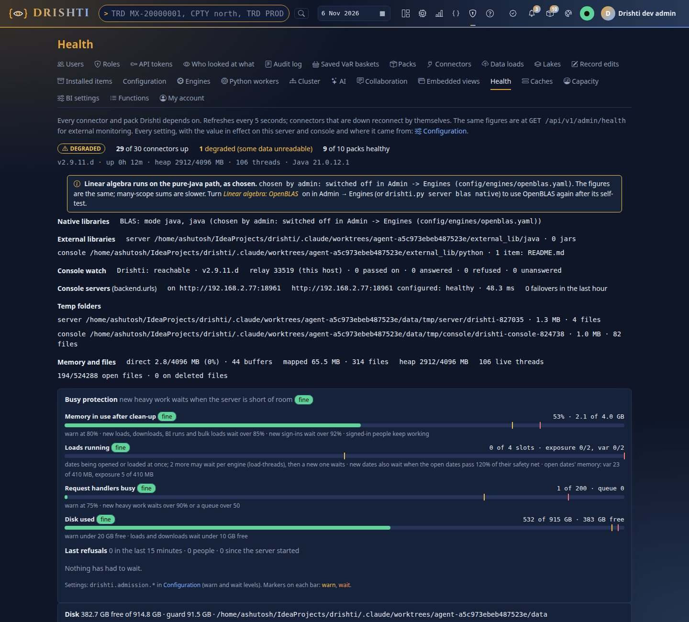

### 8.2 The modules

**From the command line** (a token, 8.3):

```text
$ curl -s -H "Authorization: Bearer $(cat ~/drishti-token)" http://<host>:18480/api/v1/modules
{"modules":[{"id":"core","title":"Core","domain":"core"},
            {"id":"economy","title":"Economy and markets","domain":"economy"},
            {"id":"capitalmarkets","title":"Capital markets","domain":"capitalmarkets"},
            {"id":"banking","title":"Banking and risk","domain":"banking"}],
 "off":[],
 "lenses":[{"id":"world","title":"World","modules":["economy"],"functions":["ECON","MACRO",…],"home":"home/world_landing.html",…},
           {"id":"publicsector",…}, {"id":"risk",…}, {"id":"trading",…}, {"id":"market",…}, …],
 "functions":{"off":[…]}}
```

**You should see** the modules core, economy, capitalmarkets and banking listed as loaded, `off` empty, and the lenses this person
may open. `GET /api/v1/admin/modules` (administrators) adds each module's switch, licence and whether a restart is
needed ([OPERATIONS_GUIDE.md › Engines, modules and editions](guides/OPERATIONS_GUIDE.md#65-engines-modules-and-editions)).

### 8.3 Sign in, and a token for the command line

**In the UI.** Open `http://<host>:17480`: the sign-in page. The first start made the administrator of `DRISHTI_SEED_USERNAME`
(`drishti-dev-admin`, password `drishti-dev-admin123` unless you set others): sign in, then change the password under your name →
**My account** before anyone else uses the machine.

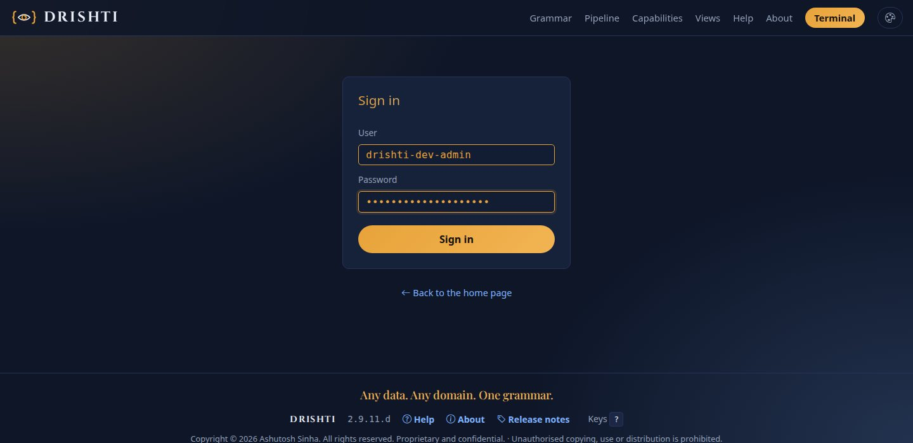

Then your name → **My account** → **API tokens** → a name, 30 days, no scope (read only) → **Create**; copy the secret (`drk_…`, shown
once) into `~/drishti-token`.

**From the command line:**

```text
$ drishti-console/.venv/bin/python tools/drishti.py doctor --server http://<host>:18480 --token-file ~/drishti-token
GREEN  java                    …/bin/java: Java 21.0
GREEN  server jar              <drishti>/drishti-server/target/drishti-server-2.9.11.g-exec.jar (version 2.9.11.g)
GREEN  python                  <drishti>/drishti-console/.venv/bin/python: Python 3.13.15
…
GREEN  server                  http://<host>:18480: version 2.9.11.g, java 21.0.12.1, status UP
GREEN  token                   accepted; this token '…' acts as drishti-dev-admin: scopes read
doctor: 0 red, 0 yellow
```

### 8.4 The Home of each lens

**In the UI.** Home (the logo, top left) → **Open Drishti Risk**: the risk Home with the bank's VaR and exposure cards and the risk
commands; then **Switch to Drishti World**: the world Home (economies, markets, news). **Leave Drishti World** returns to the full product.

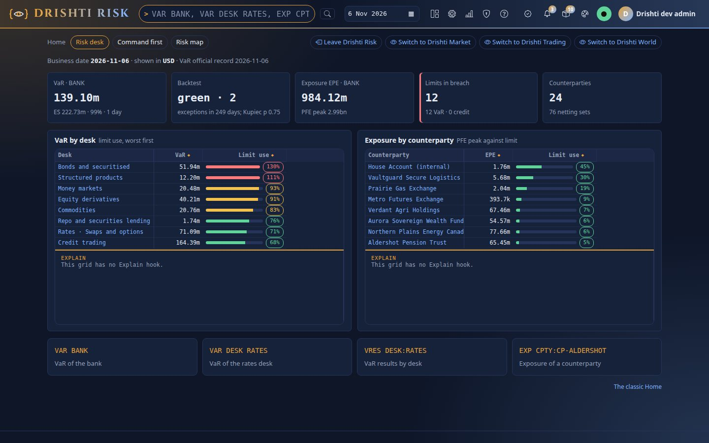

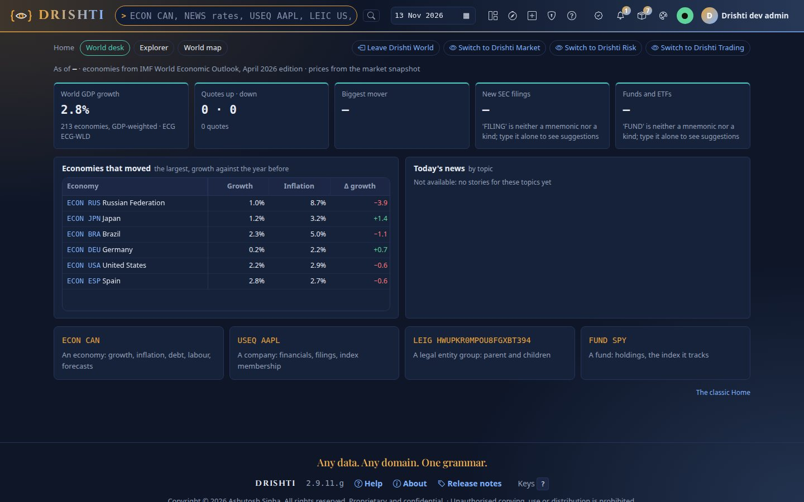

**In YAML** the Home of a lens is its file's `home:` block (`config/lenses/banking/risk.yaml`, `config/lenses/economy/world.yaml`).

### 8.5 The demo lake is loaded

**In the UI.** **Admin → Lakes**: the `demo` lake with its tables (89), each with rows, files, size and its first and last business date;
the other lakes listed empty.

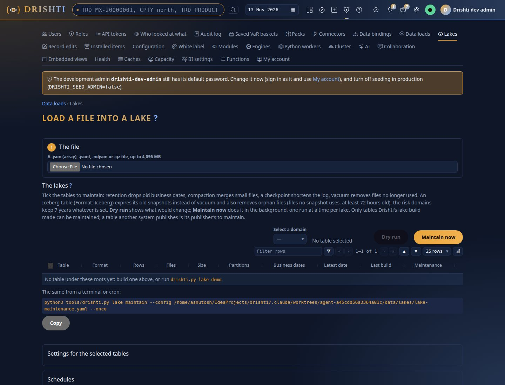

**From the command line:** `tools/drishti.py lake check` (section 5) prints the same lakes and says each connector names a known lake.

### 8.6 A VaR answer: the bank, then a desk

**In the UI.** Type `VAR BANK` in the command line and press Enter: the bank's historical VaR and expected shortfall, the hierarchy with
every node's figure and limit bar, the P&L path. Then `VAR DESK RATES`: one desk.

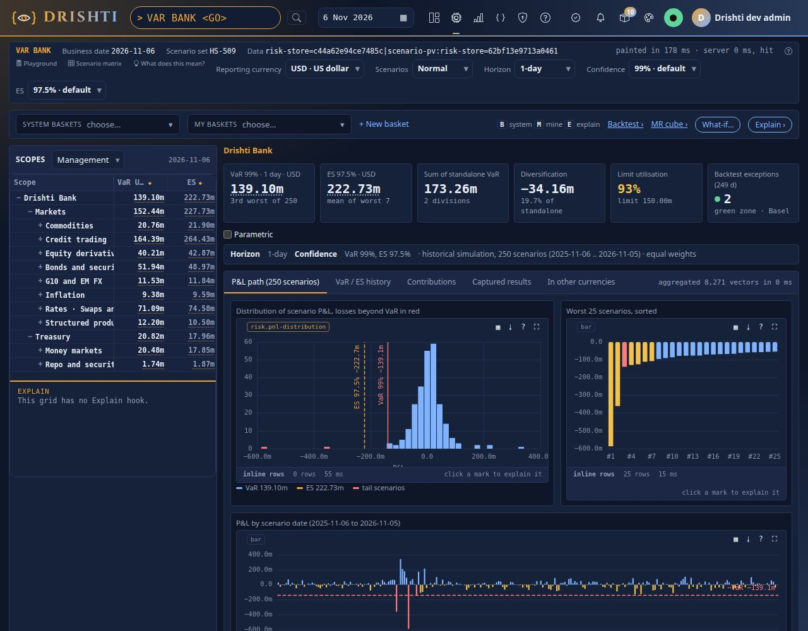

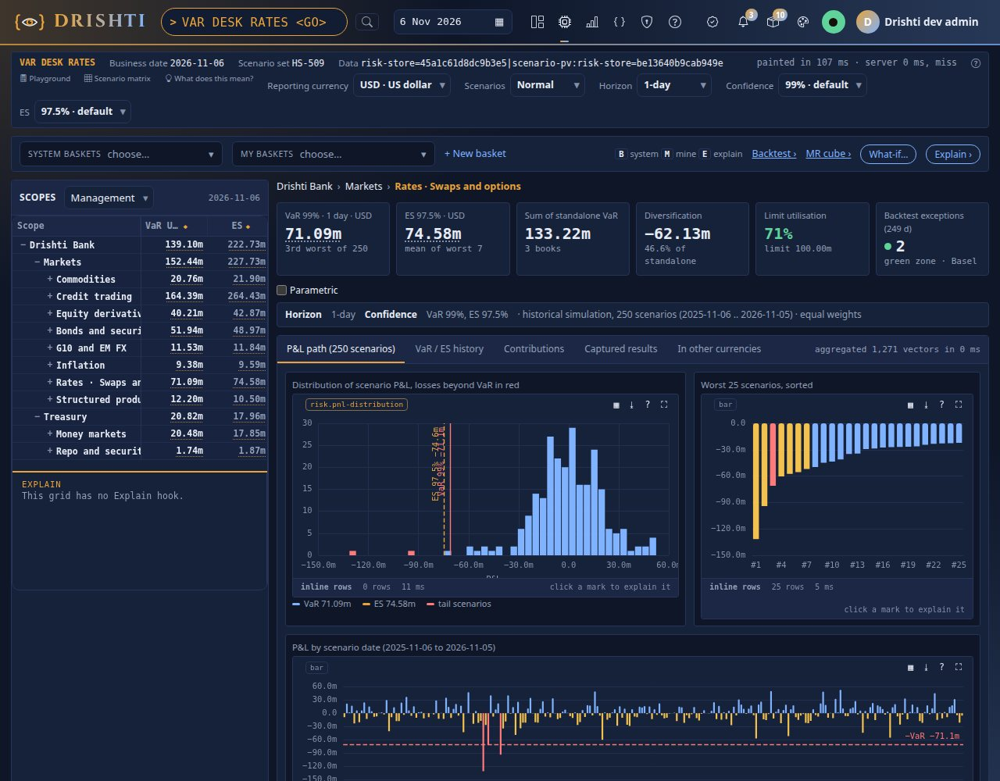

**From the command line:**

```text
$ drishti-console/.venv/bin/python tools/drishti.py var show BANK
VAR BANK  ·  Drishti Bank  ·  node  ·  2026-11-06
  horizon    1-day   (1-day · 99% VaR, ES 97.5% · historical simulation, 250 scenarios)
  VaR 99%   139,096,039 USD   (the 3th worst of 250)
  ES 97.5%   222,732,223 USD   (mean of the 7 worst)
  limit      150,000,000 USD   use 92.7%
  parts      2 division   standalone sum 173,258,800   diversification 34,162,761
  backtest   green  2 exceptions in 249 days   Kupiec p 0.747   Christoffersen p 0.857
  8271 trades in 6876 positions
  …
```

The figures and how they are computed: [VAR_GUIDE.md](guides/VAR_GUIDE.md).

### 8.7 Exposure and the pre-deal check

**In the UI.** `EXP BANK`: the counterparty exposure explorer at the bank, its legal entities and counterparties with PFE and limits.
Then **Counterparties → Pre-deal check** (or `PREDEAL`): a proposed trade checked against a counterparty's limit before it is dealt.

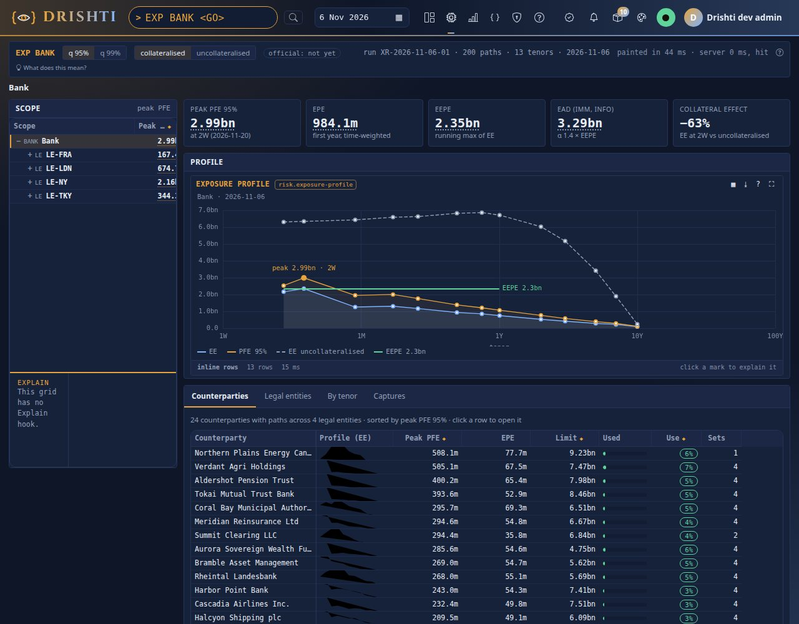

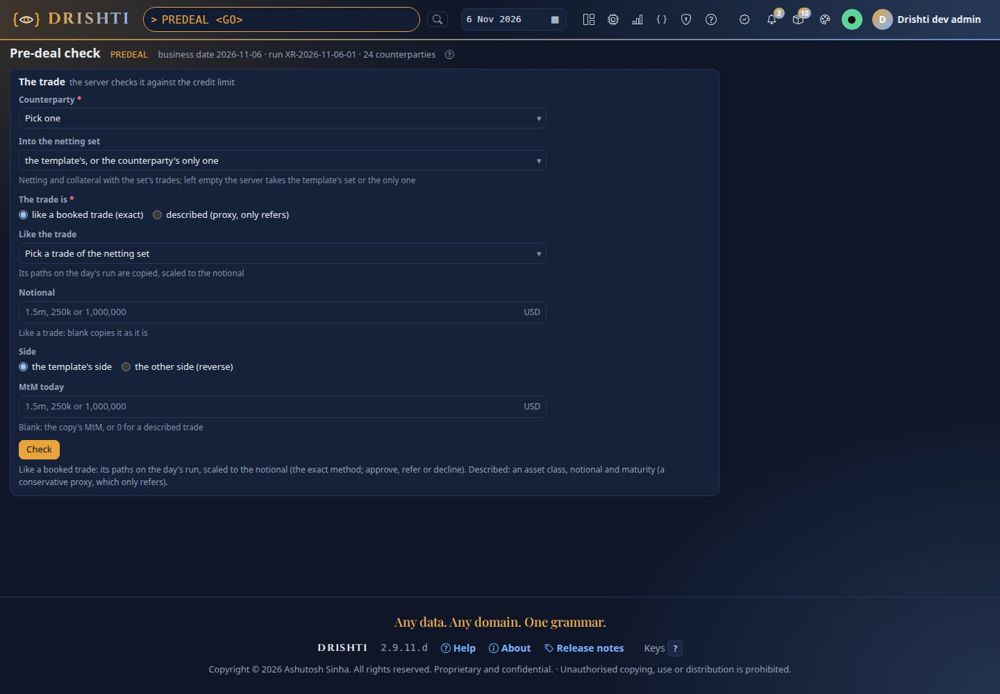

Details: [EXPOSURE_GUIDE.md](guides/EXPOSURE_GUIDE.md).

### 8.8 A BI report and the MR cube

**In the UI.** **BI → Catalogue → Trades overview**: the report's pages over the sixty days, its slicers live. Then `MCUBE`: the
market-risk cube, the Pivot screen on the VaR source with VaR and ES by desk (a total is never the sum of its rows).

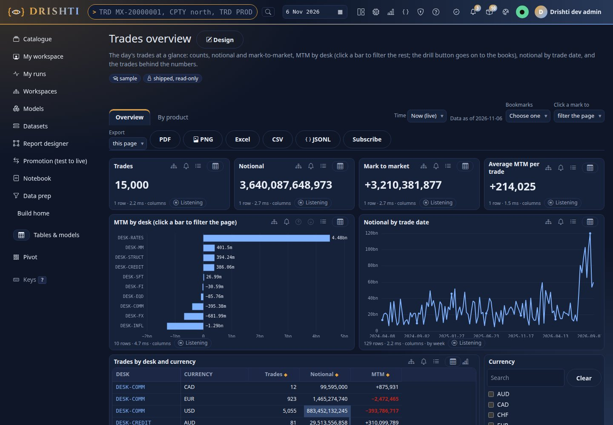

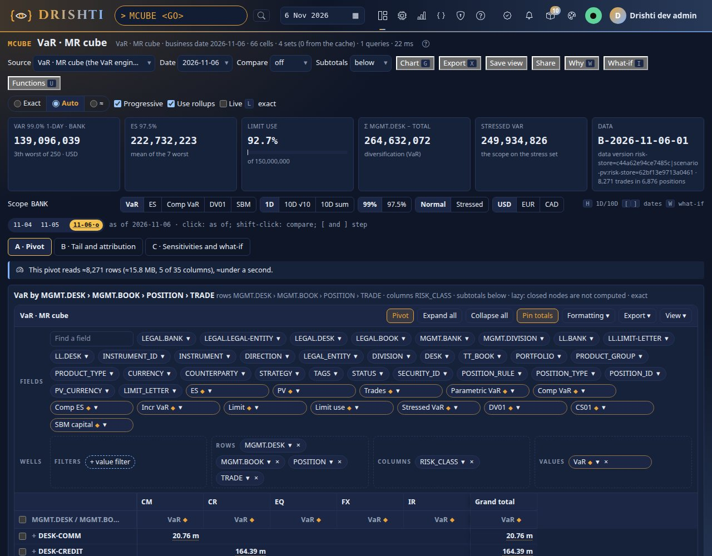

**From the command line:** `tools/drishti.py pivot run --source var --rows MGMT.DESK --values "var()"` prints the same cube.
Details: [REPORTS_GUIDE.md](guides/REPORTS_GUIDE.md), [PIVOT_GUIDE.md](guides/PIVOT_GUIDE.md).

### 8.9 The Elements gallery

**In the UI.** `http://<host>:17480/elements/gallery`: every component of the Drishti Elements libraries, live (grid, charts, inputs,
maps, the risk widgets). A component that does not draw here will not draw on a screen either.

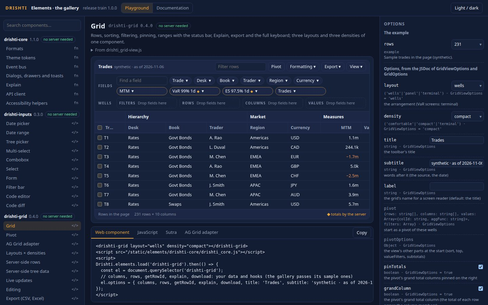

### 8.10 The data inbox and the feeds

The demo uses only the demo lake: do not drop files into a real lake to test. Check that the inbox runs and what it would take.

**In the UI.** **Admin → Data loads → Inbox**: the inbox's folders under `data/dataload/`, this node as its owner, the next cycle, and
the files it has seen (none yet). **Admin → Data loads → Feeds**: the public-data feeds with their lake, schedule and licence.

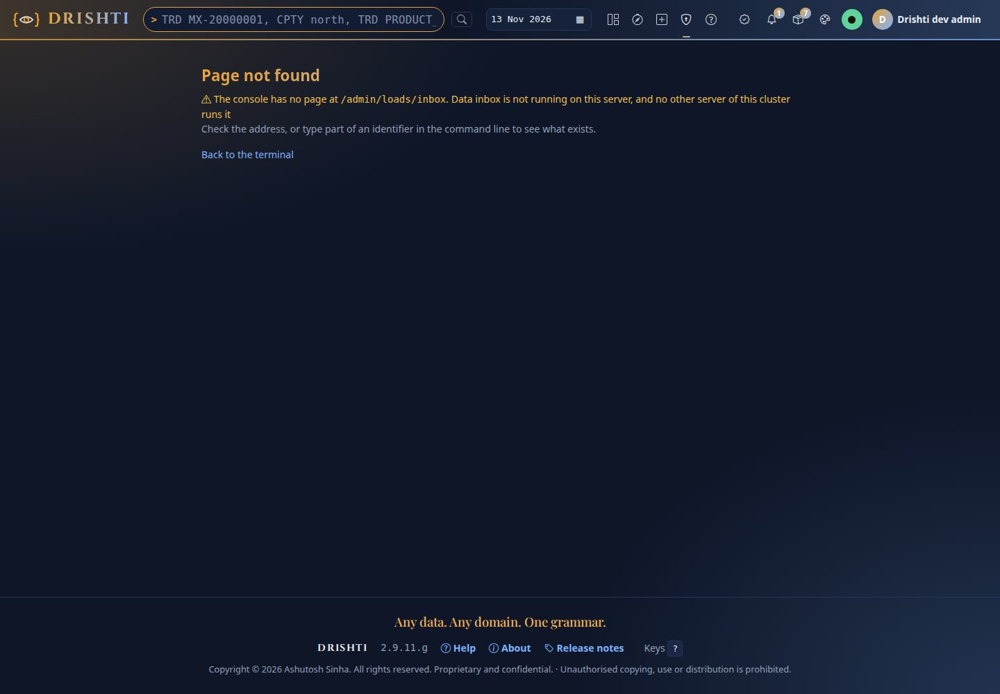

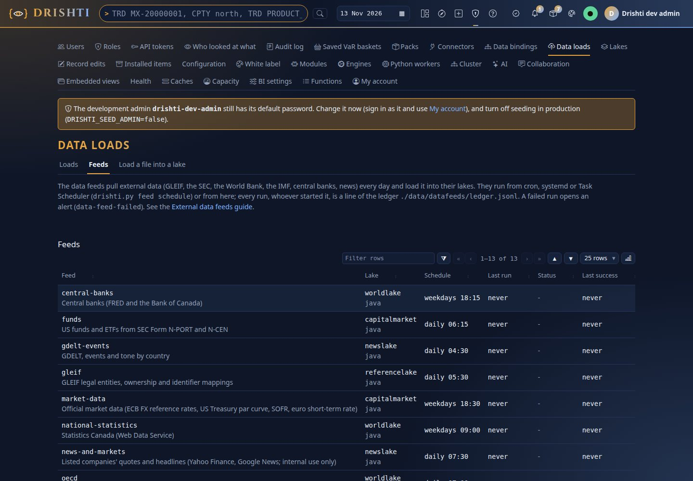

**The `.ready` file** releases a dropped file, and may say how to load it. Empty is fine; its keys are `lake`, `pack`, `kind`,
`connector`, `table`, `business-date`, `mode` (`replace` or `append`), `key`, `sha256`, `rows`, `new-table`, `hold`, and `folders` for a tar
([DATA_LAKE_GUIDE.md › The .ready file, every key](guides/DATA_LAKE_GUIDE.md#4-the-ready-file-every-key)):

```yaml
# data/dataload/inbox/trade_endur.2026-11-06.jsonl.gz.ready  (an example: not for the demo lake)
lake: risklake
pack: trading
mode: replace
```

**From the command line:**

```text
$ drishti-console/.venv/bin/python tools/drishti.py feed list
FEED                 LAKE           LOAD  SCHEDULE        LICENCE                             USE            DATASETS
central-banks        worldlake      java  weekdays 18:15  FRED API terms (the default series  attribution    central-bank, rate-series
funds                capitalmarket  java  daily 06:15     Public domain (U.S. Government wor  allowed        fund, fund-holder, index-funds
gdelt-events         newslake       java  daily 04:30     GDELT terms of use (free for any u  attribution    event-country
gleif                referencelake  java  daily 05:30     CC0 1.0 (attribution appreciated)   allowed        lei-entity, lei-relationship, lei-mapping
…
world-economy        worldlake      java  daily 06:45     World Bank CC BY 4.0; IMF terms (n  internal only  economy, macro-indicator, …
yahoo-prices (off)   capitalmarket  java  weekdays 22:30  Yahoo terms of service (personal u  internal only  price-history
$ drishti-console/.venv/bin/python tools/drishti.py feed run gleif --dry-run
dry run: feed gleif (GLEIF legal entities, ownership and identifier mappings), business date 2026-11-08, window 2026-10-09..2026-11-08, datasets lei-entity, lei-relationship, lei-mapping -> lake referencelake by java
  dry run: gleif, sources golden, api, mapping
    golden (CC0 1.0 (attribution appreciated); committable): 3 request(s) or file(s), cache <drishti>/data/datafeeds/sources/cache/gleif
      https://goldencopy.gleif.org/api/v2/golden-copies/publishes/latest
      …
2026-11-08T07:23:11-05:00 feed dry-run exit=0 feed=gleif date=2026-11-08 files=0 rows=0 seconds=0.0
```

A dry run contacts nothing and writes nothing: it says what a run would fetch and load. On an offline machine stop there.

### 8.11 Modules off and on

Switch the banking module off, restart, check that every risk page is gone, then switch it back on.

**In YAML** (`config/modules/banking.yaml`): `enabled: false`. **From the command line** instead:

```bash
curl -s -X POST -H "Authorization: Bearer $ADMIN_TOKEN" -H 'Content-Type: application/json' http://<host>:18480/api/v1/admin/modules \
  -d '{"module": "banking", "enabled": false, "reason": "QA: banking off"}'
```

Or for one run only: `DRISHTI_MODULES_BANKING_ENABLED=false` in the server's environment. Restart the server.

**You should see** `GET /api/v1/modules` list banking under `off` with its reason; the Risk menu gone from the top bar (its engines
are the banking module's); Home offering no Risk or Trading lens; `VAR BANK` answering *VAR is not available to you: ask your
administrator (the module 'Banking and risk' is not on here …)*; and the risk API answering `404 DRS-1025`:

```text
$ curl -s -H "Authorization: Bearer $ADMIN_TOKEN" "http://<host>:18480/api/v1/risk/var/scope?scope=BANK"
{"type":"about:blank","title":"module off","status":404,"detail":"DRS-1025 the module 'banking' is not on here: switched off (setting drishti.modules.banking.enabled) …","code":"DRS-1025","module":"banking"}
```

In a cluster switch a module on every node alike ([section 10.5](#105-secrets)).

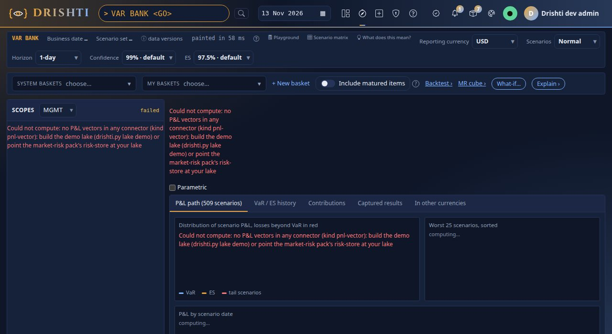

Set `enabled: true` (or remove the variable), restart, and repeat 8.6: VaR answers again.

### 8.12 The phone layout

Open the console on a phone (or the browser's device toolbar at 390 px wide): Home and every view are one
column with no sideways scroll: the top bar wraps, controls and tiles stack, and the function keys become a scrolling row.

| | |
|---|---|
| 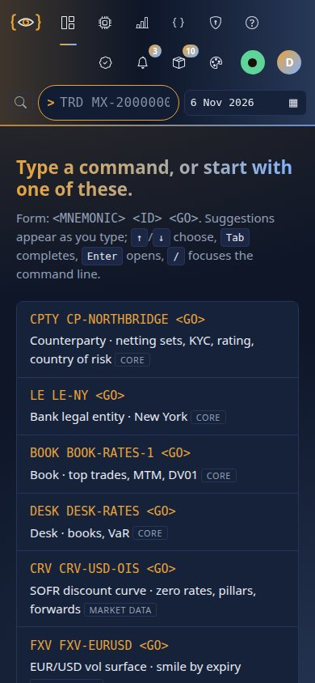 | 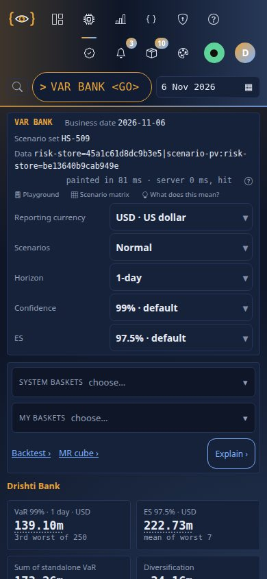 |

### 8.13 Logs and metrics

| What | Where |
|---|---|
| The server's log | its standard output (the terminal, `journalctl -u drishti-server`, the scheduled task's `data\logs\server.log`, launchd's `StandardOutPath`); `DRISHTI_LOG_FILE` adds a rolled file |
| The console's log | its standard output |
| Metrics | `GET http://<host>:18480/actuator/prometheus` with `Authorization: Bearer $DRISHTI_METRICS_TOKEN` (or an administrator's token); `deploy/prometheus/drishti-alerts.yaml` and `deploy/grafana/drishti-dashboard.json` |
| Who did what | **Admin → Audit** |
| The engines on this server | **Admin → Engines** |

```text
$ curl -s -H "Authorization: Bearer $(cat ~/drishti-token)" http://<host>:18480/actuator/prometheus | grep -c '^drishti_'
218
```

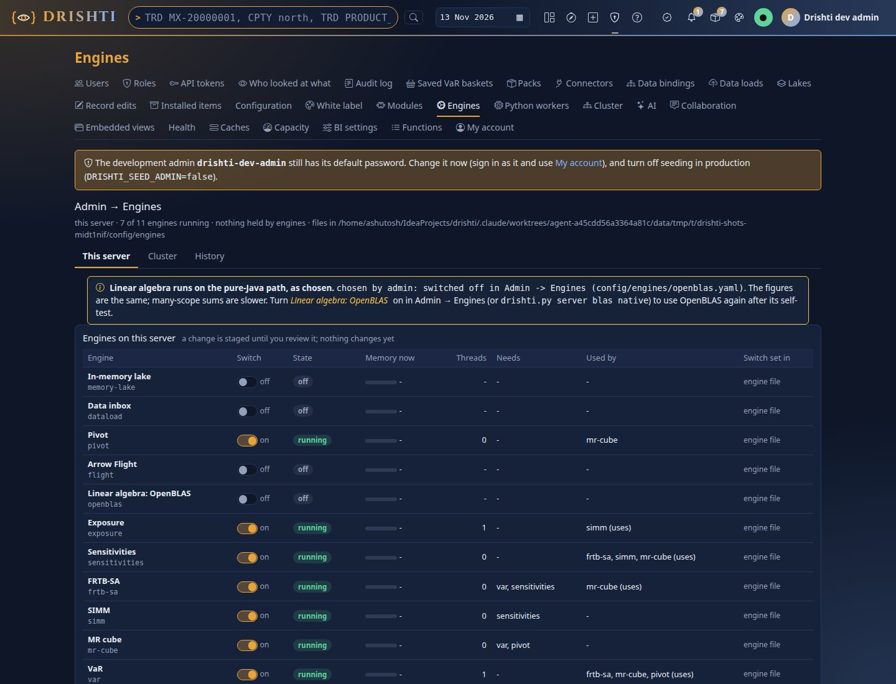

Every endpoint and alert: [OPERATIONS_GUIDE.md › Monitoring and health](guides/OPERATIONS_GUIDE.md#13-monitoring-and-health), the logs:
[› Logs](guides/OPERATIONS_GUIDE.md#139-logs).

## 9. The QA checklist

Tick one column per operating system tested. *Expected* is what section 8 shows.

| # | Check | Expected | Windows | Linux | macOS |
|---|---|---|---|---|---|
| 1 | `java -version`, Python 3.13, `doctor` | Java 21; `doctor: all clear` | ☐ | ☐ | ☐ |
| 2 | Windows only: nothing installed but Java and Python | no `.exe` copied; scripts run with `-ExecutionPolicy Bypass -File` | ☐ | — | — |
| 3 | `lake demo` | `Demo lake ready: … 86 tables, 60 business days …` | ☐ | ☐ | ☐ |
| 4 | `lake check` | no error line | ☐ | ☐ | ☐ |
| 5 | Server start | `Started DrishtiApplication`, no `ERROR` line | ☐ | ☐ | ☐ |
| 6 | `/actuator/health`, console `/readyz` | `"status":"UP"`; `"server":"reachable"` | ☐ | ☐ | ☐ |
| 7 | `/api/v1/modules` | banking, capitalmarkets, economy loaded; `off` empty | ☐ | ☐ | ☐ |
| 8 | Sign in, change the password, make a token | Home opens; `doctor --token-file` green | ☐ | ☐ | ☐ |
| 9 | Home through Risk and through World | each lens's Home with its cards | ☐ | ☐ | ☐ |
| 10 | Admin → Lakes | the demo lake's tables with rows and dates | ☐ | ☐ | ☐ |
| 11 | `VAR BANK`, `VAR DESK RATES` | the bank's VaR and ES, the hierarchy; one desk | ☐ | ☐ | ☐ |
| 12 | `EXP BANK`, Pre-deal check | the exposure explorer; the check's form | ☐ | ☐ | ☐ |
| 13 | BI Trades overview; `MCUBE` | the report with live slicers; VaR by desk | ☐ | ☐ | ☐ |
| 14 | Elements gallery | every component drawn | ☐ | ☐ | ☐ |
| 15 | Admin → Data loads → Inbox and Feeds; `feed list`, `feed run gleif --dry-run` | the owner node; the feeds; `exit=0` | ☐ | ☐ | ☐ |
| 16 | Banking off, restart | `off` lists banking; no risk pages; `DRS-1025` | ☐ | ☐ | ☐ |
| 17 | Banking on, restart | VaR answers again | ☐ | ☐ | ☐ |
| 18 | Phone width (390 px) | one column, no sideways scroll | ☐ | ☐ | ☐ |
| 19 | Logs and `/actuator/prometheus` | no `ERROR`; `drishti_` metrics | ☐ | ☐ | ☐ |
| 20 | Service start at boot, stop with drain | the process comes back after a reboot; a stop drains first | ☐ | ☐ | ☐ |
| 21 | Optional: the cluster checklist | [section 10.10](#1010-the-cluster-qa-checklist) | ☐ | ☐ | ☐ |

## 10. A cluster of three

Optional. Several servers act as one (**Drishti\*net**): each holds its packs and data, they learn of each other by gossip, a request
for something one node holds is forwarded to it, and the console moves to another server when its own stops. How it works inside, at
depth: [CLUSTER_GUIDE.md](guides/CLUSTER_GUIDE.md) (the one home for the internals). This section is the complete deployment and QA path.

### 10.1 When to choose a cluster, and the layout

| Choose a cluster when | Stay on one node when |
|---|---|
| one machine's memory or CPU is not enough for the trades, scenarios and users | one machine holds the day comfortably (the sizing planner says so) |
| the service must survive the loss of a machine, or be upgraded without downtime | a short stop for an upgrade is acceptable |
| teams or regions want their own servers with their own packs, seen as one | |

The three-node layout used here (and by `drishti-stack/`, the repository's ready-made local cluster):

| Node | Role | Packs and engines | Special settings |
|---|---|---|---|
| `drishti-a` | **owner and data-load node**: the seed the others are given, the only node that runs the data inbox | all packs; VaR, exposure, the inbox | `DRISHTI_DATALOAD_ENABLED=true`, `DRISHTI_DATALOAD_OWNER=true` |
| `drishti-b` | **compute**: VaR shards, exposure, BI | all packs (or a subset) | `DRISHTI_COMPUTE_ENABLED=true` |
| `drishti-c` | **compute**, the third copy of every shard | the same | the same |
| console(s) | one per machine, or one behind a load balancer | — | `DRISHTI_BACKEND_URLS=http://<host-a>:18480` (one is enough: it learns the rest) |

In production the three are three machines, each with a server and a console, the lake and the identity database shared and highly
available outside them ([CLUSTER_GUIDE.md › Three machines in production](guides/CLUSTER_GUIDE.md#23-three-machines-in-production)).
Larger estates by role: [CLUSTER_GUIDE.md › Roles and how many](guides/CLUSTER_GUIDE.md#4-roles-and-how-many).

### 10.2 Network and ports

| Port | Between | Notes |
|---|---|---|
| server port (18480) | console → server, server ↔ server (forwarded requests, digests, seeds) | open between every pair of nodes and from the consoles |
| **gossip port** | server ↔ server only | `gossip-port: auto` (default: a free port chosen at start and advertised); **a number** (for example `7946`) when a firewall must name it; `off` shares the server's port. Admin → Health shows `gossipPort` |
| console port (17480) | browsers → console | from people's networks |

**Advertise the real address, never `localhost`, `127.0.0.1` or `0.0.0.0`.** Each node tells the others where to call it
(`advertise-url`); left out, the node uses the default route's interface, which is right on most machines. A loopback or wildcard
address is refused by the CLI, Admin → Cluster and the server alike ([CLUSTER_GUIDE.md › Real addresses only](guides/CLUSTER_GUIDE.md#12-real-addresses-only)).
Clocks within 60 seconds (NTP): signed calls outside that window are refused.

| | Windows | Linux | macOS |
|---|---|---|---|
| the real address | `ipconfig` (the adapter with the default gateway) | `ip route get 1.1.1.1` (`src …`) | `ipconfig getifaddr en0` |
| open the ports | `New-NetFirewallRule -DisplayName 'Drishti' -Direction Inbound -Protocol TCP -LocalPort 18480,7946 -Action Allow` | `sudo firewall-cmd --add-port={18480,7946}/tcp --permanent && sudo firewall-cmd --reload` (or `ufw allow`) | System Settings → Network → Firewall: allow `java` |

### 10.3 Shared data: the lake and paths

**Every node reads the same lake at the same path.** A lake's root is in its lake file (`config/lakes/<lake>.yaml`, `root:`), so the
same file works on every node only when the path is the same everywhere:

| Storage | How | Notes |
|---|---|---|
| S3 or an S3-compatible store | the lake file's root `s3://bucket/lakes/demo` and the connector's `s3.*` settings | nothing mounted; the recommended production choice |
| **NFS** (Linux, macOS) | mount at the same path on every node, for example `/mnt/drishti/delta` | `DRISHTI_DELTA_ROOT=/mnt/drishti/delta/demo` on each |
| **EFS** (AWS) | an access point mounted at the identical path in every task | [CLUSTER_GUIDE.md › Drishti on AWS](guides/CLUSTER_GUIDE.md#12-drishti-on-aws-ecs-efs-and-s3) |
| **SMB** (Windows) | a UNC path, the same on every node: `\\fileserver\drishti\delta\demo` | the service account needs read access; a mapped drive letter is per user, so use the UNC path |

**What is not shared:** each node's own data folder (`DRISHTI_DATA_DIR`: caches, hot files, its net state), which it rebuilds from the
lake. **Shared besides the lake:** the identity database (PostgreSQL in a production cluster, never the SQLite default) and the content
store (`config/store/store.yaml`, the same on every node). Loads are announced to every node, so all read the same lake version.

### 10.4 Configuration per node

Each node has its **own** `config/net/` folder (`DRISHTI_NET_DIR`) and data folder; everything else (packs, lakes, modules, lenses,
engines) is the **same** on every node. On each node:

```yaml
# config/net/node.yaml on drishti-b
enabled: true
node-id: drishti-b
advertise-url: http://<host-b>:18480        # left out: this machine's real address
gossip-port: auto                           # or 7946 behind a firewall
secret: ${DRISHTI_NET_SECRET}               # a reference: the key itself never goes in a file
```

```yaml
# config/net/peers/drishti-a.yaml on drishti-b and drishti-c: the seed
url: http://<host-a>:18480
```

**From the command line** the same, checked as the server would:

```bash
export DRISHTI_NET_SECRET=<the cluster key>
drishti-console/.venv/bin/python tools/drishti.py net set node.node-id drishti-b
drishti-console/.venv/bin/python tools/drishti.py net set node.secret '${DRISHTI_NET_SECRET}'
drishti-console/.venv/bin/python tools/drishti.py net set node.advertise-url http://<host-b>:18480
drishti-console/.venv/bin/python tools/drishti.py net set node.enabled true
drishti-console/.venv/bin/python tools/drishti.py net add-peer drishti-a <host-a>:18480
drishti-console/.venv/bin/python tools/drishti.py net check                 # exit 0: every file would be taken
```

**In the UI** (once a server runs): **Admin → Cluster → Files** (open `node.yaml`, edit, **Check**, **Save**), **Admin → Cluster → Members →
Add a seed**.

**The environment per node** (the example layout of `drishti-stack/stack.yaml`, the repository's three-node cluster on one machine):

| Variable | drishti-a | drishti-b | drishti-c |
|---|---|---|---|
| `DRISHTI_NET_SECRET`, `DRISHTI_TOKEN_SECRET`, `DRISHTI_SESSION_SECRET` | the same three values on every node | same | same |
| `DRISHTI_NET_DIR`, `DRISHTI_DATA_DIR` | its own | its own | its own |
| `DRISHTI_DELTA_ROOT` (or the lake files' roots) | the shared lake path | the same | the same |
| `DRISHTI_DATALOAD_ENABLED`, `DRISHTI_DATALOAD_OWNER` | `true`, `true` | unset | unset |
| `DRISHTI_COMPUTE_ENABLED` | `true` | `true` | `true` |
| `DRISHTI_PACKS`, `DRISHTI_LENSES`, `config/modules/*` | the same everywhere | same | same |

### 10.5 Secrets

The three secrets (the cluster key, the token secret, the session secret) are the same on every node and the consoles, made once with
`openssl rand -hex 32`, kept where only the service account reads them (the environment file, the vault, Secrets Manager), never in a
file under `config/`. A file with a key in clear is refused, and Admin → Cluster shows only whether the key is set. Rolling the key without a
stop: [CLUSTER_GUIDE.md › Security](guides/CLUSTER_GUIDE.md#16-security-the-key-mutual-tls-nodes-per-role). **Modules and licence:** every
node reads its own `config/modules/` and `config/access/licence.yaml`: give each node the same files (from the same release folder), so
the same modules are on everywhere; a module on one node and off on another leaves its pages working only through that node.

### 10.6 Start order and joining

1. The shared pieces first: the lake reachable, the identity database (and Kafka, if used).
2. The seed, `drishti-a`; then `drishti-b` and `drishti-c` (any order, at once is fine).
3. The consoles last, each given the entry node (or several); each learns the other members from the cluster.

Each node starts with `bin/start-server --node` ([section 6.1](#61-the-start-and-stop-scripts-bin) has every option). All nodes share one
env-file with the three secrets ([6.4](#64-the-secrets-in-an-env-file)), here `cluster.env`. Each node advertises its machine's real
address (found by the script; `--advertise` names another), never `127.0.0.1`.

**Three machines** (the production layout): `drishti-a` on `<host-a>`, `drishti-b` on `<host-b>`, `drishti-c` on `<host-c>`, each on port
18480 with its own data folder. Linux and macOS:

```bash
# on <host-a>: the seed
bin/start-server.sh --node drishti-a --env-file /etc/drishti/cluster.env --background
# on <host-b> and <host-c>: join through the seed
bin/start-server.sh --node drishti-b --seed <host-a>:18480 --env-file /etc/drishti/cluster.env --background
bin/start-server.sh --node drishti-c --seed <host-a>:18480 --env-file /etc/drishti/cluster.env --background
# the console (on any machine): given the entry node, it learns drishti-b and drishti-c
bin/start-console.sh --server http://<host-a>:18480 --env-file /etc/drishti/cluster.env --background
```

Windows (each line on its machine):

```powershell
bin\start-server.cmd --node drishti-a --env-file C:\drishti-secrets\cluster.env --background
bin\start-server.cmd --node drishti-b --seed <host-a>:18480 --env-file C:\drishti-secrets\cluster.env --background
bin\start-server.cmd --node drishti-c --seed <host-a>:18480 --env-file C:\drishti-secrets\cluster.env --background
bin\start-console.cmd --server http://<host-a>:18480 --env-file C:\drishti-secrets\cluster.env --background
```

The first start of a node makes its Drishti\*net folder, `<data>/nodes/<node>/net` (a `node.yaml` naming `${DRISHTI_ADVERTISE_HOST}`,
`${DRISHTI_PORT}` and `${DRISHTI_NET_SECRET}`, never the values), and `--seed` writes `peers/seed-<host>-18480.yaml`. A folder made and
checked by hand (10.4) is given with `--node-dir`: `bin/start-server.sh --node drishti-b --node-dir /etc/drishti/net …`. A console may be
given several entry nodes, `--server http://<host-a>:18480,http://<host-b>:18480`: it uses the first that answers.

**Three nodes on one machine** (a laptop, a QA box): different ports, and each node its own data folder (`--node-data`; the script refuses
two nodes on one), while the pid files, logs and temporary folders stay in the one data folder, named after the node:

```bash
bin/start-server.sh --node drishti-a --port 18480 --node-data data/nodes/drishti-a/data --env-file cluster.env --background
bin/start-server.sh --node drishti-b --port 18481 --node-data data/nodes/drishti-b/data --seed <host>:18480 --env-file cluster.env --background
bin/start-server.sh --node drishti-c --port 18482 --node-data data/nodes/drishti-c/data --seed <host>:18480 --env-file cluster.env --background
bin/start-console.sh --server http://<host>:18480 --env-file cluster.env --background
bin/status.sh
```

On Windows the same lines with `bin\start-server.cmd` and `bin\start-console.cmd`. **You should see** (a run on test ports):

```text
t-b: up on http://192.168.2.77:28791
t-c: up on http://192.168.2.77:28792
console: up on http://192.168.2.77:27480
process                     pid  state      port   health     address
server-t-a              1977639  running    28480  UP         http://192.168.2.77:28480
server-t-b              1978776  running    28791  UP         http://192.168.2.77:28791
server-t-c              1979410  running    28792  UP         http://192.168.2.77:28792
console                 1980320  running    27480  UP         http://192.168.2.77:27480
```

and in each server's log:

```text
INFO  … GossipConnector : net: gossip port 36009 open (8 platform threads of its own; gossip, probes and digests only)
INFO  … NetService      : net: node drishti-b joined Drishti*net at http://<host-b>:18480 (incarnation 1, seeds [http://<host-a>:18480], 0 saved members, gossip on port 36009)
INFO  … NetService      : net: member drishti-a joined
INFO  … NetService      : net: member drishti-c joined
```

The console's saved list (`data/console/net/servers.json`) then holds the entry node as `configured` and the other two as `discovered`.

**Stopping** one node, then every node of the machine (each by its pid file; drain first in production, [10.8](#108-rolling-upgrade-and-draining)):

```bash
bin/stop-server.sh --node drishti-c          # Windows: bin\stop-server.cmd --node drishti-c
bin/stop-console.sh
bin/stop-server.sh --all-nodes               # or bin/stop-all.sh --all-nodes: the console, then every node
```

```text
t-c: stopped (pid 1979410)
console: stopped (pid 1980320)
t-a: stopped (pid 1977639)
t-b: stopped (pid 1978776)
```

**The repository's own three on one machine.** `bin/start-cluster.sh` starts three servers and a console from `drishti-stack/stack.yaml`
through these same scripts, with the real address and the secrets made for you; `status.sh` shows them, `stop.sh` stops them
([drishti-stack/README.md](../drishti-stack/README.md)). The same scripts run on Windows (`bin\start-cluster.cmd`).

### 10.7 Verify the cluster, step by step

**1 · The members.** **Admin → Cluster** (`/admin/net`, the Drishti\*net page) → **Members** on any node lists the three `alive`, each with its version, tags, packs and latency; the
hash ring is green.

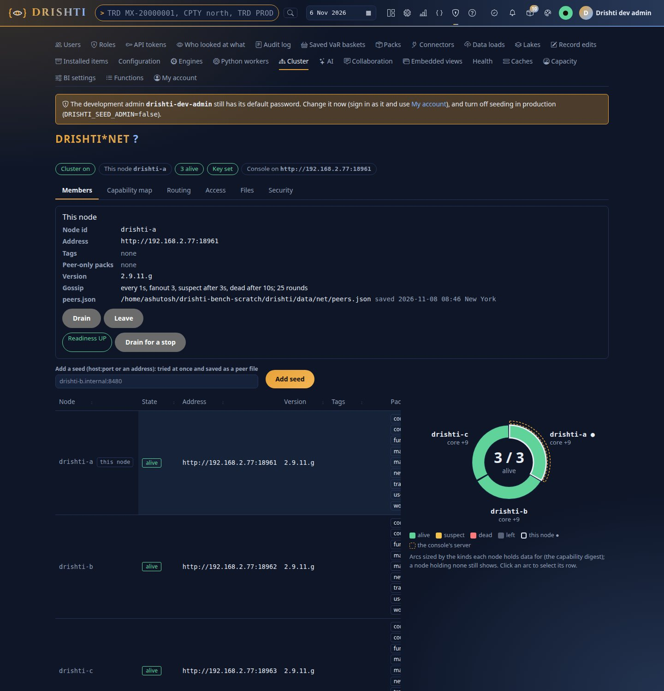

**From the command line:**

```text
$ drishti-console/.venv/bin/python tools/drishti.py net members --server http://<host-a>:18480 --token-file ~/drishti-token
3 member(s); this node drishti-a
  node                   state  address                    version   tags  latency  incarnation
  drishti-a (this node)  alive  http://<host-a>:18480      2.9.11.g        -        1
  drishti-b              alive  http://<host-b>:18480      2.9.11.g        4.0 ms   1
  drishti-c              alive  http://<host-c>:18480      2.9.11.g        4.1 ms   1
```

**2 · Gossip health.** **Admin → Health** on each node: the Drishti\*net line (members alive and suspect, requests forwarded and failed,
`gossipPort`).

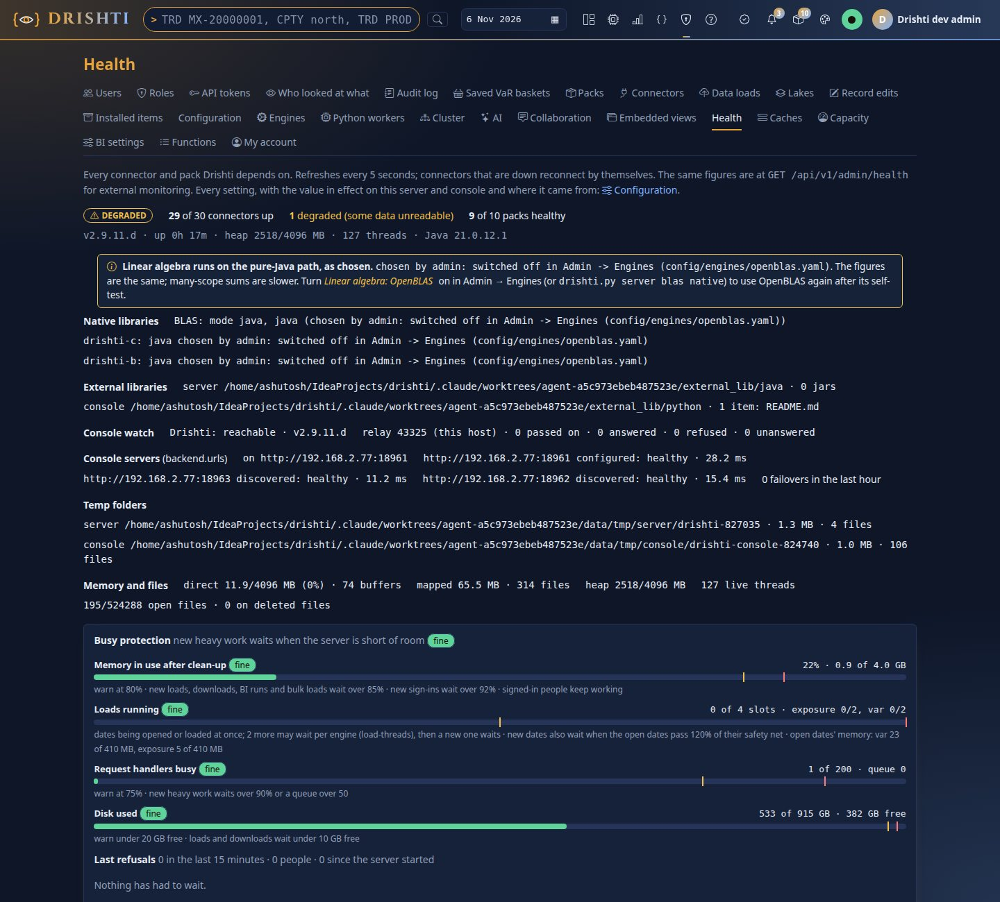

**3 · Drain a node, and an answer still comes.** Drain one node (as for an upgrade): **Admin → Cluster → Drain for a stop** on that node, or

```bash
curl -s -X POST -H "Authorization: Bearer $ADMIN_TOKEN" -H 'Content-Type: application/json' \
  http://<host-c>:18480/api/v1/admin/node/drain -d '{"on": true}'
curl -s -H "Authorization: Bearer $ADMIN_TOKEN" http://<host-c>:18480/api/v1/admin/node        # "safeToStop": true once handed over
```

(Windows: `bin\drishti-node.ps1 drain`; Linux: `bin/drishti-node.sh drain`; a personal token needs the `node:drain` scope.)
The drain answers at once with what it is handing over; `safeToStop` turns true within a few seconds:

```text
{"node":"drishti-c","drained":true,"since":"2026-11-08T12:59:44Z","safeToStop":false,
 "parts":[{"name":"net","draining":true,"detail":"drained: waiting 5 s for every peer to hear it","safeToStop":false},
          {"name":"var-shards","draining":false,"detail":"VaR sharding is off on this server: no shards to hand over","safeToStop":true}],
 "readiness":{"status":"OUT_OF_SERVICE","enabled":true,"waitingFor":{}}}
```

**You should see** the node marked drained on Admin → Cluster, and `VAR BANK` still answer, from the other nodes:

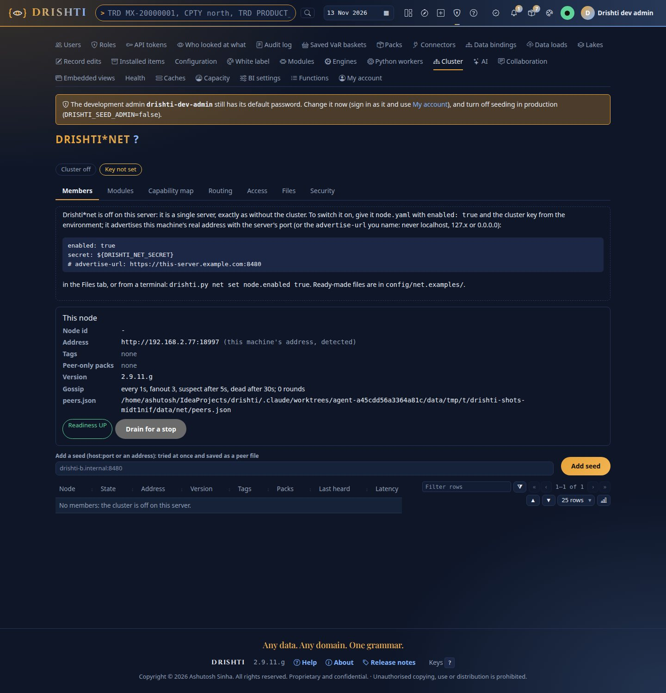

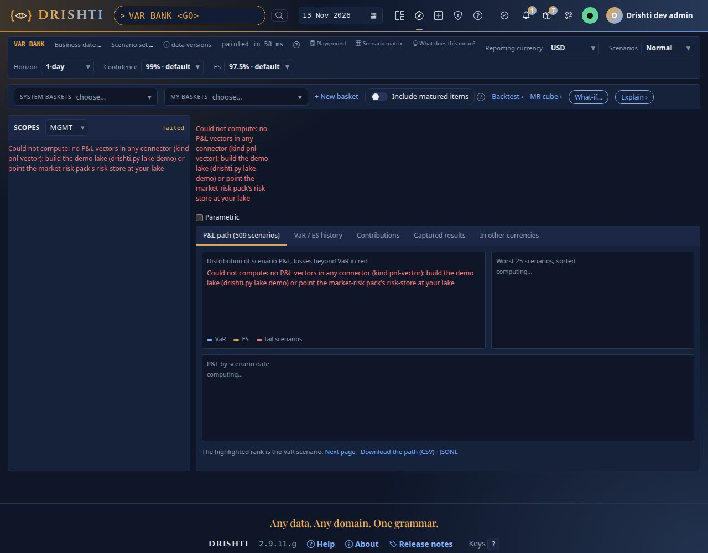

Undrain with `{"on": false}` (or restart the node).

**4 · The inbox owner.** **Admin → Data loads → Inbox** names the owner node, `drishti-a`; on the other nodes the inbox does not run
(a folder lock keeps a second runner out anyway).


**5 · The same modules everywhere.** Ask each node; the answers must be the same:

```bash
for h in <host-a> <host-b> <host-c>; do
  curl -s -H "Authorization: Bearer $(cat ~/drishti-token)" http://$h:18480/api/v1/modules | python3 -c 'import json,sys; d=json.load(sys.stdin); print([m["id"] for m in d["modules"]], d["off"])'
done
```

**6 · The console moves.** With the console given `drishti-a` alone, stop `drishti-a`: the open page carries on from another node
within a second, still signed in (Admin → Health, *Console servers*, shows the move).

### 10.8 Rolling upgrade and draining

One node at a time: drain → `safeToStop` → stop → replace the jar → start → readiness → the next node. Consoles first, then the compute
nodes, then the owner. `tools/rolling-upgrade.sh` (Windows: `tools\windows\rolling-upgrade.ps1`) does exactly this from an inventory
(`deploy/rolling.example.yaml`); `--dry-run` prints every step. The stop hooks of systemd and Docker drain by themselves; on Windows run
`drishti-node.ps1 drain -Wait 240` before stopping the task. Details: [CLUSTER_GUIDE.md › Zero downtime](guides/CLUSTER_GUIDE.md#8-zero-downtime).

### 10.9 Per operating system

| | Windows | Linux | macOS |
|---|---|---|---|
| start a node | `bin\start-server.cmd --node …` (a scheduled task per node, section 7) | `bin/start-server.sh --node …`; systemd, one unit per node | `bin/start-server.sh --node …`; launchd, one plist per node |
| drain before a stop | `bin\drishti-node.ps1 drain -Wait 240` | `ExecStop=` in the unit does it | `bin/drishti-node.sh drain` before `launchctl unload` |
| the shared lake | SMB, a UNC path | NFS or S3 | NFS or S3 |
| three on one machine | three `bin\start-server.cmd --node … --port … --node-data …` | the same with `bin/start-server.sh`, or `bin/start-cluster.sh` | the same as Linux |

### 10.10 The cluster QA checklist

| # | Check | Expected | ☐ |
|---|---|---|---|
| C1 | `net check` on each node | exit 0 | ☐ |
| C2 | Each node's log | `joined Drishti*net at http://<real address>` and `member … joined` for the others | ☐ |
| C3 | Admin → Cluster → Members | three `alive`; addresses are real, none `localhost` | ☐ |
| C4 | `net members` | three lines, one marked this node | ☐ |
| C5 | Admin → Health | the Drishti\*net line green; `gossipPort` as configured | ☐ |
| C6 | Drain a node | drained on Admin → Cluster; `safeToStop` true; `VAR BANK` answers | ☐ |
| C7 | Undrain | the node serves again | ☐ |
| C8 | Inbox | owner `drishti-a` only | ☐ |
| C9 | `/api/v1/modules` on each node | identical | ☐ |
| C10 | Stop the console's server | the page carries on, still signed in | ☐ |
| C11 | Rolling upgrade `--dry-run` | every step listed, in order | ☐ |

### 10.11 Cluster troubleshooting

| What you see | Do |
|---|---|
| A node lists no members | its log's `joined … seeds [...]` line; the seed's address and port, the firewall, `enabled: true` with the key set |
| `node.yaml was not written: '… 127.0.0.1 …' is a loopback or wildcard address` | the machine's real address (the message names it), or leave `advertise-url` out |
| `401 DRS-5051 cluster credential refused: bad signature` | the same `DRISHTI_NET_SECRET` on every node |
| `… signed 75 s away from this node's clock` | NTP on every node |
| A member flaps between `alive` and `suspect` | `gossip-port` on `auto` or a number (not `off`); the firewall must allow it between the nodes |
| `net: the gossip port … cannot be reached … but … answers` | open the numbered gossip port between the nodes |
| `503 DRS-5215` naming a shard | an owner is missing: start it; the shard is rebuilt after `stable-seconds` |
| `409 DRS-5216` | members read different lake versions: the same lake path everywhere; announce the load |
| Admin → Cluster warns that the nodes run different editions | the same `DRISHTI_EDITION` on every node, then restart |

The rest: [CLUSTER_GUIDE.md › When something is wrong](guides/CLUSTER_GUIDE.md#114-when-something-is-wrong).

## 11. Offline QA with your own trade files

A demo or QA rehearsal on a machine **without internet access** (pip and Maven through the company's mirror; on Windows no `.exe`
placed on the machine), showing ENDUR trades from the bank's own JSON Lines files beside the synthetic CALYPSO and MUREX trades and all
the supporting data, the committed quotes-and-news snapshot (no website is contacted) and the world economy data. Do it the day before
the demo. The commands are PowerShell lines; on Linux and macOS the same commands run with `drishti-console/.venv/bin/python` and `/` paths.

**Your real trade files are confidential.** Keep them **outside** the release folder (below `<private>`, for example
`C:\Users\<you>\drishti-private\endur\`); never copy them into the repository. Drishti reads them where they are. Every command is one
PowerShell line, after once:

```powershell
$py = "<drishti>\drishti-console\.venv\Scripts\python.exe"; $tools = "<drishti>\tools"
```

### 11.1 Set up once

1. **The machine:** sections 2 and 3 (Java 21, Python 3.13 and the console's environment). pip reads `%APPDATA%\pip\pip.ini`, Maven
   `%USERPROFILE%\.m2\settings.xml` for the mirror.
2. **Your files** go in `<private>`, **one per business date**, named by the load rules
   ([DATA_LAKE_GUIDE.md › Routing, business dates, modes](guides/DATA_LAKE_GUIDE.md#5-routing-business-dates-modes-repeats-and-undo)):
   `trade_endur.2026-10-16.jsonl` (or `.jsonl.gz`, `.jsonl.zip`, or a tar of `trade_endur\2026-10-16\` folders). A file named only by its
   date is refused, with the name to give it.
3. **Two IDE projects, never one folder** (when you use the IDEs): IntelliJ opens `<drishti>` (its run configurations in `run-configs\`:
   **Drishti build server jar**, **Drishti server (demo lakes)**); PyCharm opens `<drishti>\drishti-console` (`drishti-console\run-configs\`:
   **Drishti console**, **Build demo lakes**, **Load ENDUR file into the lake**), with the `.venv` interpreter
   ([OPERATIONS_GUIDE.md › PyCharm](guides/OPERATIONS_GUIDE.md#33-pycharm-run-and-debug-the-console)). Opened on the same folder they
   overwrite each other's `.idea` (IntelliJ then says **module not specified**: close both, delete `<drishti>\.idea`, reopen).

### 11.2 Put the data in place

**One command for everything** (stop the server first). `build_demo_lakes.py` builds every demo lake over the sixty business days of the
committed test data, moved to end on the date of your newest file, then replaces the synthetic ENDUR trades with your files:

```powershell
& $py "$tools\build_demo_lakes.py" --endur-dir <private> --dry-run     # prints every step, changes nothing
& $py "$tools\build_demo_lakes.py" --endur-dir <private>
```

You should see `1/3 the demo lakes …` (15 to 45 minutes; `data\delta\demo` ends at about 3.4 GB), then
`2/3 your ENDUR files (N: <first date> … <last date>)` with one `lake-build ok … rejected=0` line per file, then `3/3 done in … s`. A line
every 30 seconds says which step runs and which table is being written; *nothing written for N s* means it is waiting (a slow disk, or
antivirus scanning `data`).

| You want | Add |
|---|---|
| synthetic data only, ending today | leave out `--endur-dir` |
| the synthetic ENDUR trades kept beside yours | `--keep-synthetic-endur` |
| your last date | `--as-of 2026-10-16` |
| only your files loaded again | `--endur-dir <private> --files-only` (no server restart needed) |
| another system's files | `--source-dir <folder> --system calypso --files-only` |
| some datasets only | `--only trades/calypso,trades/murex --as-of <the lakes' last date>` |
| one system in Iceberg, the others in Delta | `--store endur=delta --store calypso=iceberg` (`--store all=iceberg` for every system) |
| your bank's names instead of the demo's | edit `config\demo\names.yaml`, then `--only core/legal-entity,market-risk/pnl-history --as-of <date>` ([DATA_GUIDE.md › Your bank's names](guides/DATA_GUIDE.md#1114-your-banks-names)) |
| a running server told at once | `--server http://<host>:18480` with a `loads:write` token in `DRISHTI_TOKEN` (or `--token-file`) |

**By hand, one file:**

```powershell
& $py "$tools\drishti.py" lake build --from <private>\trade_endur.2026-10-15.jsonl --pack <drishti>\config\packs\banking\trading --connector trade-endur --key TRADE_ID --mode overwrite-dates --lake demo
```

The business date comes from the file name; the pack's schema checks each trade; `--mode overwrite-dates` makes a repeat safe. The last
line reads `lake-build ok exit=0 … kind=trade … rows=500 rejected=0 dates=1 …`; a non-zero `rejected` is explained, with the line, above
it. Use full paths: PyCharm's terminal opens in `drishti-console`, where a relative path makes a stray `drishti-console\data`. With the
Java loader (every core, bounded memory) add `--engine java`
([CLI_REFERENCE.md › The parallel lake loader](guides/CLI_REFERENCE.md#713-the-parallel-lake-loader)).

### 11.3 Start and check

Start the server with `bin/start-server.sh --demo` (Windows `bin\start-server.cmd --demo`) and the console as in [section 6](#6-start-the-server-and-the-console) (or the IntelliJ
configuration **Drishti server (demo lakes)** and the PyCharm one **Drishti console**; never the ▶ in the margin of `DrishtiApplication.java`,
which sets none of the demo settings). Then:

- **Admin → Lakes**: `trading/trade_endur` has **your** rows and dates.
- **Admin → Connectors**: `trade-endur`, `trade-calypso`, `trade-murex` and the stores RUNNING; the live quote and news connectors
  disabled and the news store serving the snapshot.
- **Admin → Health** green.
- **Admin → Packs → trading → Sutra coverage**: every SOURCE_SYSTEM × PRODUCT_TYPE of your data has a Sutra (a row without one is a
  product type the pack does not know yet, laid out by inference).

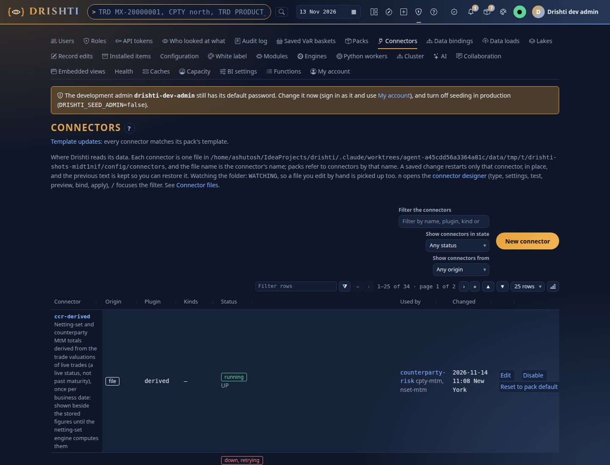

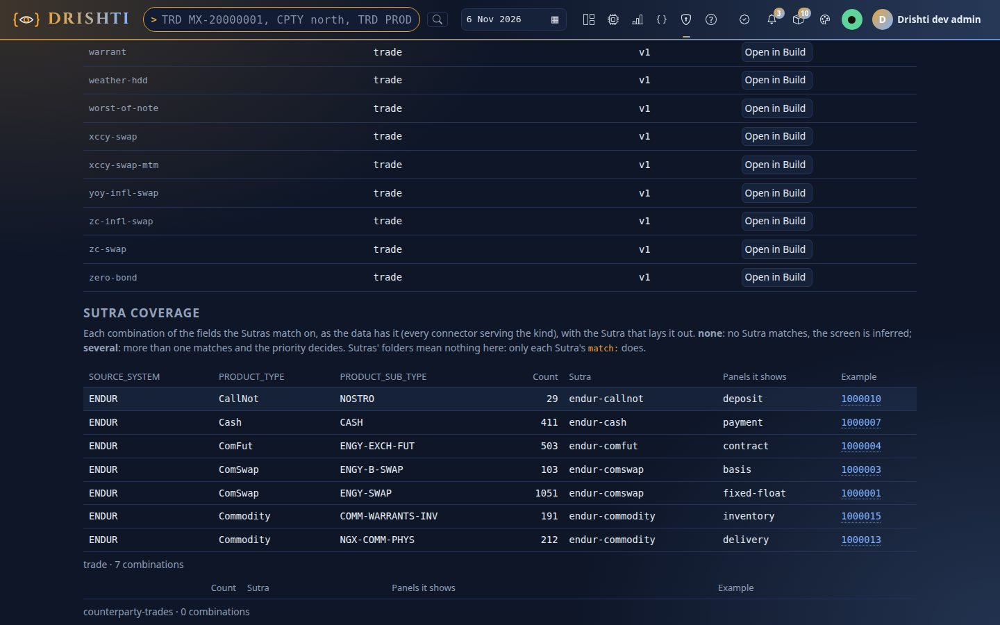

### 11.4 The demo, page by page

| # | Show | How |
|---|---|---|
| 1 | An ENDUR deal from your file | type one of your trade ids → Enter: ticket, legs, cash flows, resets, events |
| 2 | Trades by system and product | **Views → Forms → Trading**: Source system `ENDUR`, a product type → Search; then `CALYPSO`, `MUREX` |
| 3 | A CALYPSO and a MUREX deal | `/v/trade/CLY-3000157`, `/v/trade/MX-20000001` |
| 4 | Counterparty → netting set → CSA → collateral | `CTRD CP-NORTHPLAINS`, then click through |
| 5 | A curve | `/v/commodity-curve/CMDC-BRENT` |
| 6 | An equity price and news | `/v/listed-company/CO-AAPL`; `/v/news-topic/TOPIC-FED` |
| 7 | Compare two dates | on a trade, pick one of your dates → **Compare** → the other |
| 8 | BI by source system | **BI → Catalogue → Trades overview**; change a slicer |
| 9 | VaR and exposure on your data | `VAR BANK`, `EXP BANK` (section 8) |
| 10 | A history | `TRD <your id> 60` (two or more of your files), `TRD 1000279 60` (amended ten times); **C** changes only, **D** the fields that changed |

| | |
|---|---|
| 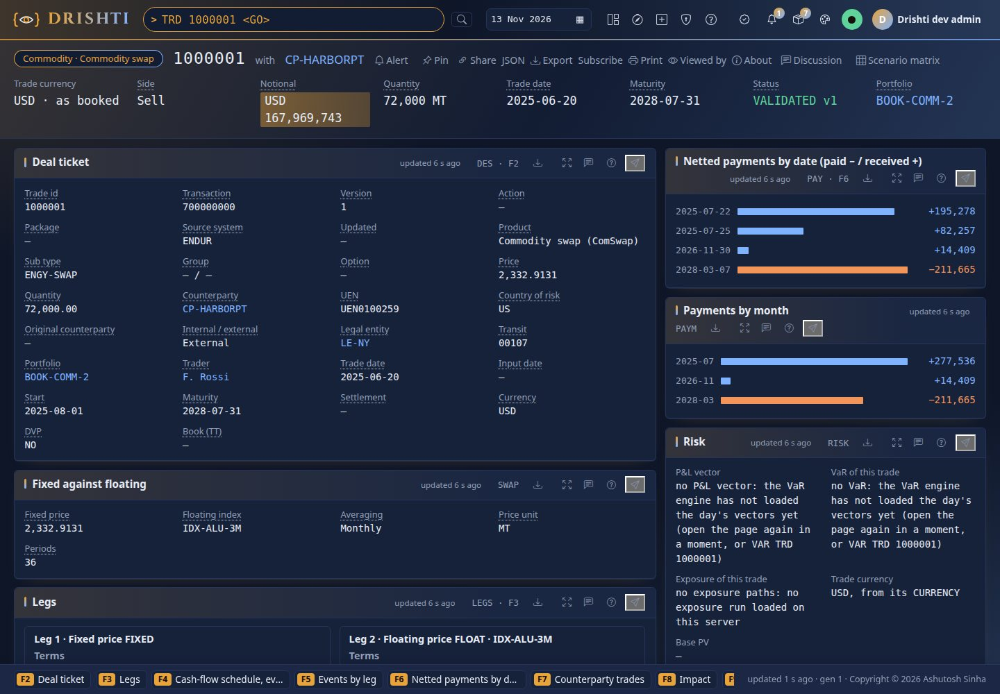 **1. An ENDUR deal** | 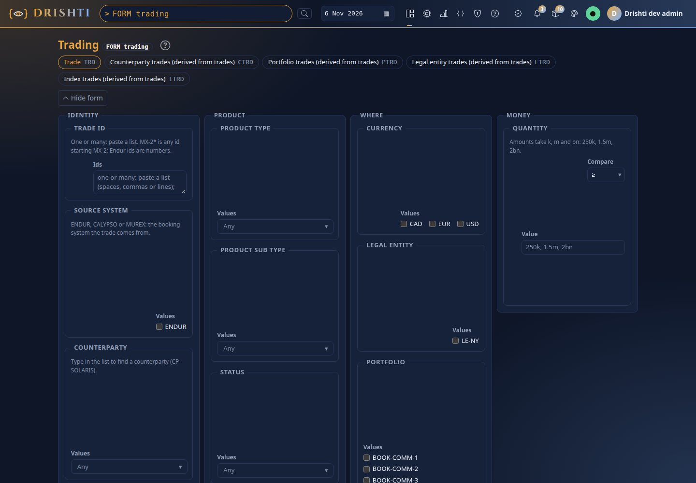 **2. Forms → Trading** |


The pictures are of the synthetic data, loaded exactly as in 11.2.

**Optional: the S3 tests**, against simulators that need no `.exe` and no Docker: `pip install "moto[server]==5.2.3"`, then
`.\mvnw.cmd -q -pl drishti-identity,plugins/drishti-plugin-iceberg -am test "-Dtest=S3ContentStoreTest,S3MockContentStoreTest,MinioContentStoreTest,NativeOnS3SimulatorTest" "-Dsurefire.failIfNoSpecifiedTests=false"`
and `& $py -m unittest -v tools\lake\test_s3_simulators.py`. The MinIO tests are skipped on Windows (they run a server binary).

Afterwards stop both, and check that `git status` (in a clone) shows nothing new outside `data\` and that your files never left
`<private>`. Temporary files (`data\tmp`), caches (`data\cache`) and the grouped pages (`data\derived`) may be deleted while both are stopped.

## 12. Troubleshooting

| What you see | Do this |
|---|---|
| `Drishti needs Java 21 or newer` (build or start) | `JAVA_HOME` (or `DRISHTI_JAVA_HOME`, or `--java-home`) at a JDK 21 |
| `start-server.ps1 … cannot be loaded because running scripts is disabled` | run the `.cmd` (`bin\start-server.cmd`), or `powershell -ExecutionPolicy Bypass -File …` |
| PowerShell says `lake` is not recognized | `lake …` is a sub-command: `& $py "$tools\drishti.py" lake …` |
| `py -3.13 -m venv` fails on Linux with *ensurepip is not available* | `sudo apt install python3.13-venv`, or use `uv venv` |
| `Port 18480 (or 17480) is already in use` | another copy is running: `bin/status.sh` shows it; stop it (`bin/stop-server.sh`, `systemctl stop`, `launchctl unload`); more in [6.6](#66-when-a-script-stops-with-an-error) |
| The console shows *Server not reachable* | the server is not up yet, or `--server` names the wrong address; `curl http://<host>:18480/actuator/health` |
| Every page empty; the console's log says `DRS-5010 missing bearer token` | the console and the server need the same `DRISHTI_TOKEN_SECRET`, and `DRISHTI_AUTH_ENABLED=true` on the console |
| The server refuses to start: `drishti.security.secret must be at least 32 bytes` | a longer `DRISHTI_TOKEN_SECRET` |
| Pages show the packs' samples, not the lake; quotes or news try the internet | `DRISHTI_DEMO_ENABLED=false` and `DRISHTI_OFFLINE=true` (or `--demo`) |
| `VAR BANK` says no data for today | the demo lake ends on another date: rebuild it (`lake demo`), or pick its last date in the date box |
| BI shows 0 trades while Admin → Lakes has the table | stop the server, delete `config\connectors` (the server writes it again from the packs), start it |
| `OutOfMemoryError` | a larger `-Xmx` (`--heap 8g`): about 4 GB per 400,000 trades a day |
| A page says `DRS-1004 … timed out` the first time | the first read of a date on a large table; open it again; exclude `data` from real-time antivirus scanning |
| *documents are not cached on disk* in the log | a second server uses the same data folder: one data folder per server |
| A module's pages are missing | `GET /api/v1/modules`: the module under `off` with its reason; switch it on and restart |
| A lens is not offered | `DRISHTI_LENSES` names it, and its modules are on |

Everything else, with the error codes: [OPERATIONS_GUIDE.md › Troubleshooting](guides/OPERATIONS_GUIDE.md#21-troubleshooting).

---

*Copyright (c) 2026 Ashutosh Sinha <ajsinha@gmail.com>. All rights reserved.
Proprietary and confidential. Unauthorised copying, use or distribution is prohibited.*
