<!--
  Project Drishti · Any data. Any domain. One grammar.

  Copyright (c) 2026 Ashutosh Sinha <ajsinha@gmail.com>.
  All rights reserved.

  PROPRIETARY AND CONFIDENTIAL.

  This file is the confidential and proprietary property of Ashutosh Sinha.
  Unauthorised copying, use, modification, distribution or disclosure of this
  file, via any medium, is strictly prohibited except with the express prior
  written permission of the copyright holder.

  See the LICENSE file in the root of this repository for the full terms.
-->
# Deployment and QA guide

Step by step, on **Windows, Linux and macOS**: prepare the machine, install a release, configure it, start the server and the console
(with Python commands that work the same everywhere, or from IntelliJ IDEA and PyCharm), and verify every part with what you should see,
then tick the QA checklist. The optional [cluster part](#11-a-cluster-of-three) does the same for three servers acting as one. A PDF copy
of this guide is [DEPLOYMENT_AND_QA_GUIDE.pdf](DEPLOYMENT_AND_QA_GUIDE.pdf).

This guide is the one place for the deployment and QA steps; the details behind them each have one home, which the steps link:
[OPERATIONS_GUIDE.md](guides/OPERATIONS_GUIDE.md) (installing, services, monitoring, troubleshooting), [CLUSTER_GUIDE.md](guides/CLUSTER_GUIDE.md)
(Drishti\*net in depth), [CONFIGURATION.md](admin/CONFIGURATION.md) (every setting), [CLI_REFERENCE.md](guides/CLI_REFERENCE.md) (every command),
[DATA_LAKE_GUIDE.md](guides/DATA_LAKE_GUIDE.md) (lakes and loads). Developers building from source start with
[QUICKSTART_DEVELOPERS.md](QUICKSTART_DEVELOPERS.md).

**Conventions.** `<drishti>` is the install folder (a clone, or the unpacked release), `DRISHTI_HOME`, always written out in full: for
example `C:\Users\you\IdeaProjects\drishti` on Windows and `/home/you/drishti` on Linux. `<data>` is the data folder,
`DRISHTI_DATA_DIR` (`<drishti>/data` unless you name another). **Every command is a Python command**, `tools/drishti.py`, the same on
every operating system: Linux and macOS write `python3 tools/drishti.py …` with `/` paths, Windows `py tools\drishti.py …` (or
`python`) with `\` paths. Where only the slashes differ, one line is shown. `setup`, `build`, `start`, `stop` and `status` run on any
Python 3.11 or newer; the other commands (`lake`, `doctor`, `net`, …) need the console's packages, so they run with the console's Python,
`drishti-console/.venv/bin/python` (Windows `drishti-console\.venv\Scripts\python.exe`), which `setup` makes. `~/drishti-envs` is a
folder in your home (`C:\Users\you\drishti-envs` on Windows) for the settings files ([section 5.1](#51-the-settings-file)). `<host>` is
the machine's **real address** on the network (`hostname -I` on Linux, `ipconfig getifaddr en0` on macOS, `ipconfig` on Windows), for
example `192.168.2.77`: give people that address, never `localhost`. Each step says what to do **in the UI**, **from the command line**
and, where a file decides it, **in YAML**. The pictures show a server and console started as this guide says, on the demo lake.

## Contents

1. [Prepare your environment](#1-prepare-your-environment) (Java, Python, the folders, the environment variables, `drishti.py setup`)
2. [Deploy and run Drishti: the short way](#2-deploy-and-run-drishti-the-short-way)
3. [Manual installation, step by step](#3-manual-installation-step-by-step) (no `setup`: a locked-down machine)
4. [Get the release](#4-get-the-release) (and [upgrading an older install](#41-upgrading-an-older-install-start-from-clean-state))
5. [Configure](#5-configure) (and [the settings file](#51-the-settings-file))
6. [Build the demo lake](#6-build-the-demo-lake)
7. [Start the server and the console](#7-start-the-server-and-the-console) (and [from IntelliJ IDEA or PyCharm](#78-from-intellij-idea-or-pycharm))
8. [Run them as services](#8-run-them-as-services)
9. [Verify, step by step](#9-verify-step-by-step)
10. [The QA checklist](#10-the-qa-checklist)
11. [A cluster of three](#11-a-cluster-of-three)
12. [Offline QA with your own trade files](#12-offline-qa-with-your-own-trade-files)
13. [Troubleshooting](#13-troubleshooting)

## 1. Prepare your environment

Once per machine: install Java and Python, choose two folders, set a few environment variables, then let `python tools/drishti.py setup`
check everything and make what is missing. The [short way](#2-deploy-and-run-drishti-the-short-way) follows; on a machine where nothing
may be run but what you type yourself, [section 3](#3-manual-installation-step-by-step) does the same by hand.

### 1.1 What you deploy

| Process | What it does | Port | Health | Runs on |
|---|---|---|---|---|
| **server** | one Java program, `drishti-server-<version>-exec.jar` in `<drishti>/lib` (the version is the one in `.mvn/maven.config`: `python3 tools/version.py` prints it; every Java library is inside it): reads the lakes and sources, computes every number (VaR, exposure, BI), lays out every screen | **18480** | `/actuator/health` | Java 21 |
| **console** | the web pages people open, a Python program, `drishti-console/run_drishti_web.py`: renders what the server sends | **17480** | `/healthz`, `/readyz` | Python 3.13 in its own environment |

Both read from **one install folder** (`DRISHTI_HOME`, read only) and write everything under **one data folder** (`DRISHTI_DATA_DIR`):
the lakes, users, caches, logs. The server never takes a folder from the directory it is started in: `drishti.py start`, the IDE run
configurations and the settings file name the install folder, the data folder and the modules folder (`<drishti>/modules`) as absolute
paths. Nothing outside these is needed: no Kafka or other broker, no database server, no Docker (a stream connector whose broker is not
there waits and says so, and the rest works). The two can run on one machine or on two; several servers can form a cluster
([section 11](#11-a-cluster-of-three)). The full picture: [OPERATIONS_GUIDE.md › What you are running](guides/OPERATIONS_GUIDE.md#1-what-you-are-running).

### 1.2 What to install, per operating system

| Need | Windows 10/11, Server 2019+ | Linux (Ubuntu 22.04+, RHEL 9+) | macOS 13+ (Apple silicon or Intel) |
|---|---|---|---|
| **Java 21**, a JDK, 64-bit | Temurin 21 **ZIP** from adoptium.net unpacked to `C:\jdk-21` (no installer needed), or the MSI | `sudo apt install openjdk-21-jdk` / `sudo dnf install java-21-openjdk-devel`, or the Temurin 21 `.tar.gz` | `brew install openjdk@21`, or the Temurin 21 `.tar.gz` |
| **Python 3.11 or newer** (the release is tested on 3.13) | python.org's installer for Windows (it adds the `py` launcher), or its embeddable ZIP with pip | the distribution's `python3` when 3.11+, else `uv python install 3.13` | `brew install python@3.13`, or `uv python install 3.13` |
| The console's environment | made by `setup` with Python's own `venv` and `pip` (no other tool) | `setup` (with `uv` when installed, else `venv` and `pip`) | the same as Linux |
| The commands | `py tools\drishti.py …` (or `python`) in PowerShell or `cmd` | `python3 tools/drishti.py …` | the same as Linux |
| An IDE (optional) | IntelliJ IDEA (Community or Ultimate) to build and run the server, Java only (no Python, no Python plugin); PyCharm for the console and the tools | the same | the same |
| **Memory** | 8 GB free for the demo (the server's heap 4 GB, the console about 1 GB); building the demo lake: 4 GB a loader job ([section 6](#6-build-the-demo-lake)) | the same | the same |
| **Disk** | 5 GB free: the release about 1 GB (the committed test data 140 MB of it), the demo lake 3.4 GB | the same | the same |
| Ports | 18480 and 17480 open on the machine's firewall for the people who use it | the same | the same |

**Windows without any `.exe` beyond Java and Python.** Drishti needs nothing else: no Hadoop (`winutils.exe`), no Docker, no MinIO, no
uv, no bash. Java comes from the Temurin ZIP (`C:\jdk-21\bin\java.exe` is Java's own), Python from python.org; the console's environment is
made with Python's own `venv` and `pip` (through the company's mirror: `%APPDATA%\pip\pip.ini`); every command is `tools\drishti.py`. The
demo lake is written by Drishti's own Java loader (`--engine java`, [section 6](#6-build-the-demo-lake)) and read by the Delta connector's
**native** engine, the Windows default: both are pure Java. Never choose `--engine hadoop` (or a connector's `engine: hadoop`) on Windows:
Hadoop needs `winutils.exe`. Native libraries the server unpacks itself (DLLs loaded by `java.exe`) are not programs and are allowed. What
works differently on Windows: [OPERATIONS_GUIDE.md › Drishti on Windows](guides/OPERATIONS_GUIDE.md#44-what-works-differently-on-windows).

**Check the machine:**

```bash
java -version                       # openjdk version "21.…"
python3 --version                   # Python 3.11 or newer  (Windows: py --version)
```

**Sizing beyond the demo.** A server's heap grows with the trades held a day (about 4 GB for 400,000, 8 GB for a million or more). The
sizing planner (`tools/sizing_planner.py`, and **Admin → Capacity** in the console) turns your volumes into memory, CPU and disk:
[CLUSTER_GUIDE.md › Sizing](guides/CLUSTER_GUIDE.md#15-sizing-memory-cpu-and-disk), [OPERATIONS_GUIDE.md › Admin → Capacity](guides/OPERATIONS_GUIDE.md#146-admin--capacity-today-against-the-plan).

### 1.3 The folders

Three folders, each with one job:

| | Linux and macOS | Windows | What it is |
|---|---|---|---|
| **The install folder**, `DRISHTI_HOME` | `/home/you/drishti` (a clone) or `/opt/drishti` (a release) | `C:\Users\you\IdeaProjects\drishti` or `C:\drishti` | the release: the server jar in `lib/`, `config/`, `modules/`, `tools/`, `drishti-console/`. **Read only** while Drishti runs; an upgrade replaces it |
| **The data folder**, `DRISHTI_DATA_DIR` | `/home/you/drishti/data` (the default, `<drishti>/data`) or `/srv/drishti-data` | `C:\Users\you\IdeaProjects\drishti\data` or `D:\drishti-data` | everything Drishti writes: lakes, users, caches, logs, pid files. **Writable**; kept across upgrades |
| **The settings folder** | `~/drishti-envs` (`/home/you/drishti-envs`) | `%USERPROFILE%\drishti-envs` (`C:\Users\you\drishti-envs`) | your settings files (`dev.ini`), outside the install so an upgrade never touches them |

`setup` makes the data folder's layout; the server adds its own folders under it at the first start:

```text
<data>/
  run/        pid files: server.pid, server-<node>.pid, console.pid
  logs/       server.log, server.out, console.log, gc-server-<pid>.log
  tmp/        temporary files: tmp/server, tmp/console, tmp/maven
  dumps/      heap dumps
  modules/    .dmod packages dropped here are deployed (a single node)
  delta/      the lakes (delta/demo: the demo lake)
  identity/, cache/, fstore/, net/, feeds/, …   made by the server when it first needs them
```

### 1.4 Drishti's jars and your jars

Every jar lives under the install folder, in two places that never mix:

| | `<drishti>/lib` | `<drishti>/lib/ext` |
|---|---|---|
| Holds | **Drishti's own** jar: the one `drishti-server-<version>-exec.jar` (every Java library is inside it) | **your site's** jars: JDBC drivers, connector plugins |
| Put there by | the release, or the build (`python tools/drishti.py build jar`, or IntelliJ's **Drishti build all**: Maven installs the jar there, removing an older one, and the modules beside it) | you |
| On an upgrade | replaced with the release | kept: copy it into the new install |
| Found by | every tool: `start`, `lake demo --engine java`, `doctor` (exactly one server jar: `start` refuses two) | the server at start (`drishti.lib.path`, `DRISHTI_LIB_PATH`) |

**Drishti's modules are not in the jar.** Each module is a package, `<module>-<version>.dmod`, in `<drishti>/modules`, with `first-party.yaml` (which packages are the product's own) beside them. `python tools/drishti.py build modules` (or `build all`, the jar and the modules in one Maven run; in IntelliJ **Drishti build modules** and **Drishti build all**) makes them: Maven builds the modules' jars, packs every module with the one packer (`module pack` of the server classes, Java; no Python), and installs each package through a `.part` file and one replace, an older file of the same module removed. A package built for a module with Java is stamped for one kernel build: the jar in `lib/`. `start server` (and `start cluster`, and a test session) **refuses a package older than its module folder** or stamped for another jar, naming the module and the command (`modules/banking changed since banking-1.0.0.dmod was built (packs/market-risk/...): python tools/drishti.py build modules banking`); `build jar` alone says which modules are missing or stale instead of leaving banking refused at the next start. A release carries the packages and no module folders: it is never stale. An empty modules folder starts a server with no module (Admin → Modules shows only the core).

A jar found in the data folder's old `lib/` is moved into `lib/ext` once, at the first start that finds it, listed in the moved list, and
**Admin → Health** says so ([ADMIN_GUIDE.md › Module packages and the shared lib folder](guides/ADMIN_GUIDE.md#221-module-packages-and-the-shared-lib-folder)).

**In a container** the image is immutable (its install folder is root-owned; on ECS the root file system is read-only), so the site's jars
cannot go into `<drishti>/lib/ext`: every Drishti image and the ECS task definition set `DRISHTI_LIB_PATH=/opt/drishti/data/lib`, a folder
on the data volume. The images keep the same install layout as a machine: `DRISHTI_HOME=/opt/drishti` with the server jar in `/opt/drishti/lib/`.

### 1.5 Environment variables

None is required on a developer machine: the install folder is where `tools/drishti.py` is, and the data folder defaults to
`<drishti>/data`. Set them to make a machine's choice permanent:

| Variable | Meaning | Default | Example (Linux / Windows) |
|---|---|---|---|
| `DRISHTI_HOME` | the install folder (read only). Must be the folder the tools come from: one release's tools never drive another's install | the folder `tools/drishti.py` is in | `/opt/drishti` / `C:\drishti` |
| `DRISHTI_DATA_DIR` | the data folder (writable) | `<drishti>/data` | `/srv/drishti-data` / `D:\drishti-data` |
| `DRISHTI_MODULES_HOME` | the modules folder | `<drishti>/modules` | rarely set |
| `DRISHTI_JAVA_HOME` | the JDK every Drishti tool uses, before `JAVA_HOME` | none | `/usr/lib/jvm/java-21-openjdk-amd64` / `C:\jdk-21` |
| `JAVA_HOME` | the usual JDK setting: used when `DRISHTI_JAVA_HOME` is not set | none | the same |
| `DRISHTI_PYTHON` | optional: the Python the console runs with, instead of `drishti-console/.venv` | none | `/usr/bin/python3.13` |
| `DRISHTI_LIB_PATH` | your site's jar folder ([1.4](#14-drishtis-jars-and-your-jars)) | `<drishti>/lib/ext` | rarely set |
| `DRISHTI_PORT`, `DRISHTI_CONSOLE_PORT` | the server's and the console's ports | `18480`, `17480` | `18580` |
| `DRISHTI_SERVER_URL` | the server the console talks to | this machine's LAN address `:18480` | `http://192.168.2.77:18480` |
| `DRISHTI_TOKEN_SECRET`, `DRISHTI_SESSION_SECRET`, `DRISHTI_NET_SECRET`, `DRISHTI_SEED_PASSWORD` | the secrets ([5](#secrets)) | none (`--demo` uses development ones) | **never** in a profile or `setx`: an env-file ([7.4](#74-the-secrets-in-an-env-file)) |

**The one order** each command follows (every line `setup`, `start` and `status` print says which one won):

| Root | Taken from the first of |
|---|---|
| install folder | `--home`, `DRISHTI_HOME`, `drishti.home` in the settings file, the folder `tools/drishti.py` is in |
| data folder | `--data-dir`, `drishti.data.dir` in the settings file, `DRISHTI_DATA_DIR`, `<drishti>/data` |
| Java | `--java-home` (`--java` for `lake demo`), `DRISHTI_JAVA_HOME`, `JAVA_HOME`, `java` on the `PATH`; older than 21 is refused in words |

**Set them permanently.** Linux and macOS: in `~/.bashrc` (or `~/.profile`, `~/.zshrc` on macOS), then open a new terminal; for every
user, `KEY=value` lines in `/etc/environment`; for a service, the unit's `Environment=` or `EnvironmentFile=` ([section 8](#8-run-them-as-services)).

```bash
# ~/.bashrc
export DRISHTI_HOME=/home/you/drishti
export DRISHTI_DATA_DIR=/home/you/drishti/data
export DRISHTI_JAVA_HOME=/usr/lib/jvm/java-21-openjdk-amd64
```

Windows: `setx` writes your user's environment (seen by every window opened afterwards: open a new terminal, restart IntelliJ); `setx /M`
in an administrator's window, or **System Properties → Advanced → Environment Variables** (`Win+R`, `sysdm.cpl`), sets it for the machine.

```powershell
setx DRISHTI_HOME "C:\Users\you\IdeaProjects\drishti"
setx DRISHTI_DATA_DIR "C:\Users\you\IdeaProjects\drishti\data"
setx DRISHTI_JAVA_HOME "C:\jdk-21"
```

### 1.6 The settings file and `drishti.py setup`

**`python tools/drishti.py setup`**, from the install folder, does the rest, on every operating system, and can be run again at any time:
it checks Python and Java (and says which `java` and why), shows the install, data and modules folders with where each came from, makes
the data folder's layout, makes `~/drishti-envs` with a copy of `config/settings.examples/dev.ini` **with this machine's paths filled in**
(a file already there is never overwritten), makes `drishti-console/.venv` and installs `drishti-console/requirements.txt`, lists the
environment variables it sees (a secret only as *set*), and prints the next steps. `--check` changes nothing and only reports (exit 1 when
something needs doing).

```bash
cd /home/you/drishti
python3 tools/drishti.py setup --check            # what is missing; changes nothing
python3 tools/drishti.py setup                    # make it
```

```powershell
cd C:\Users\you\IdeaProjects\drishti
py tools\drishti.py setup
```

Its options: `--data-dir DIR` (another data folder), `--envs-dir DIR` (another settings folder), `--java-home DIR`, `--python FILE` (the
Python to make the console's environment with), `--skip-venv`, `--reinstall` (remake `drishti-console/.venv`, after
`drishti-console/requirements.txt` changed). **You should see** (a first run on a clone; `ok` lines for what was already in place):

```text
Drishti setup on linux
  [  ok] python                 /usr/bin/python3 3.13.1
  [  ok] java                   /usr/lib/jvm/java-21-openjdk-amd64/bin/java  Java 21  (from JAVA_HOME=/usr/lib/jvm/java-21-openjdk-amd64)
  [  ok] home (DRISHTI_HOME)    /home/you/drishti  (the folder holding tools/drishti.py; the install, read only)
  [made] data (DRISHTI_DATA_DIR) /home/you/drishti/data  (<home>/data): made run, logs, tmp, dumps, delta
  [todo] modules (packages)     /home/you/drishti/modules  (<home>/modules): 0 .dmod file(s); python tools/drishti.py build modules
  [todo] server jar (<home>/lib) none in <home>/lib yet: python tools/drishti.py build jar
  [  ok] your jars (lib/ext)    /home/you/drishti/lib/ext  (JDBC drivers, connector plugins: drishti.lib.path; kept on an upgrade)
  [made] settings file          /home/you/drishti-envs/dev.ini  (from config/settings.examples/dev.ini, its paths filled in)
  [made] console .venv          /home/you/drishti/drishti-console/.venv/bin/python

Environment variables seen:
  DRISHTI_HOME             -
  DRISHTI_DATA_DIR         -
  …
  JAVA_HOME                /usr/lib/jvm/java-21-openjdk-amd64
  …
  DRISHTI_TOKEN_SECRET     -

Next steps:
  1. python tools/drishti.py build all   (the server jar into lib/ and the modules into modules/)
  2. python tools/drishti.py --settings /home/you/drishti-envs/dev.ini lake demo --engine java   (the demo lake)
  3. python tools/drishti.py --settings /home/you/drishti-envs/dev.ini start all --demo   (server and console; drishti.py status, drishti.py stop all)
```

A `FAIL` line says what to install (Java older than 21: *set DRISHTI_JAVA_HOME to a JDK 21 folder*), and `setup` exits 1. The settings
file it made is what the IDE run configurations and the commands below pass with `--settings`; what it holds and its rules are in
[section 5.1](#51-the-settings-file).

**Profiles.** What makes the demo, the first look on the built-in samples and the QA pair is not in your settings file and not in any
launcher: it is a committed settings file of the install, `config/profiles/demo.ini`, `samples.ini` or `qa.ini`, named after yours (a later
file wins). `drishti.py --profile <name>` adds one (`start server --demo` is `--profile demo`), and the IDE launchers name the same files
([IDE_GUIDE.md section 4](guides/IDE_GUIDE.md#4-every-launcher)), so the terminal and the IDEs start the same server. Every key of each profile
is listed in [CONFIGURATION.md › Profiles](admin/CONFIGURATION.md#profiles-configprofilesini).

## 2. Deploy and run Drishti: the short way

From nothing to the console in a browser, on one machine, with the demo lake. Each step says what you should see; the sections after this
one have every option.

**1 · Get the release.** Unpack the release ZIP (it carries the server jar in `lib/`), or clone and build the jar (JDK 21 only; the
repository carries Maven as `mvnw`):

```bash
git clone https://github.com/ajsinha/drishti.git /home/you/drishti && cd /home/you/drishti
python3 tools/drishti.py build all
```

```powershell
git clone https://github.com/ajsinha/drishti.git C:\Users\you\IdeaProjects\drishti; cd C:\Users\you\IdeaProjects\drishti
py tools\drishti.py build jar
```

You should see `building the server jar with Java 21 (…): …/mvnw -q clean package -DskipTests -pl :drishti-app -am`, a few minutes of
Maven, then `built drishti-server-<version>-exec.jar; copied into /home/you/drishti/lib`.

**2 · Prepare the machine:** `python3 tools/drishti.py setup` (Windows `py tools\drishti.py setup`). You should see every line `ok` or
`made` and the next steps ([1.6](#16-the-settings-file-and-drishtipy-setup)).

**3 · The demo lake** (about 15 minutes; or skip it and start without `--demo` to see the packs' built-in samples, [6.1](#61-the-demo-on-and-off-on-a-clean-data-folder)):

```bash
drishti-console/.venv/bin/python tools/drishti.py --settings /home/you/drishti-envs/dev.ini lake demo --engine java
```

```powershell
drishti-console\.venv\Scripts\python.exe tools\drishti.py --settings C:\Users\you\drishti-envs\dev.ini lake demo --engine java
```

You should see `lake writer: java (asked for); 4 datasets at a time`, a line per table, then `Demo lake ready: …: <n> tables, 60 business
days …` ([section 6](#6-build-the-demo-lake)).

**4 · Start the server and the console** (in the background; the development secrets of `--demo` are for a QA machine only):

```bash
python3 tools/drishti.py --settings /home/you/drishti-envs/dev.ini start all --demo
```

```powershell
py tools\drishti.py --settings C:\Users\you\drishti-envs\dev.ini start all --demo
```

You should see `server: up on http://<host>:18480`, then `console: up on http://<host>:17480` ([7.2](#72-one-server-and-a-console)).

**5 · Open the console**: the last address, `http://<host>:17480`, in a browser; sign in as `drishti-dev-admin` (password
`drishti-dev-admin123`). You should see Home with its cards answering from the demo lake.

**6 · Check:** `python3 tools/drishti.py status` (Windows `py tools\drishti.py status`). You should see the resolved folders and Java, then
`server … running 18480 UP` and `console … running 17480 UP` ([7.3](#73-in-the-background-status-and-stop)).

**7 · Stop:** `python3 tools/drishti.py stop all`. You should see `console: stopped (pid …)` then `server: stopped (pid …)`.

## 3. Manual installation, step by step

For a locked-down machine where `setup` may not run, or to know exactly what it does: the same result, by hand. Every fact behind a step
has its home in [section 1](#1-prepare-your-environment); this section is the order.

**1 · Java and Python.** Install a 64-bit **JDK 21** (Temurin from adoptium.net: the Windows ZIP unpacked to `C:\jdk-21`, the Linux
`.tar.gz` under `/opt`, or the distribution's `openjdk-21-jdk`) and **Python 3.11 or newer** (3.13 is what the release is tested on;
python.org on Windows). Verify: `java -version` says `21.…` (or newer), `python3 --version` (Windows `py --version`) says `3.11` or newer.

**2 · The install folder.** Unpack the release to its place (`/opt/drishti`, `C:\drishti`) and make it read only for the account that
runs Drishti. It holds:

```text
<drishti>/                     DRISHTI_HOME: read only
  lib/                         drishti-server-<version>-exec.jar (Drishti's own; every Java library inside)
    ext/                       your site's jars: JDBC drivers, connector plugins (kept on an upgrade)
  bin/                         README.md (the commands are tools/drishti.py)
  config/                      the kernel's packs, lakes, module switches, lenses, engines, settings examples
  modules/                     the modules (the server refuses to start without this folder)
  tools/                       drishti.py (every command) and what it runs
  drishti-console/             the console's code and requirements.txt (its .venv is made on the machine)
  data/testdata/               the committed test data the demo lake is built from
  deploy/, docs/, LICENSE, CHANGELOG.md, RELEASE_NOTES.md, THIRD-PARTY-NOTICES.md
```

The server jar is the only Java file: copy it into `lib/` if the release carries it elsewhere. Put your JDBC drivers and plugins into
`lib/ext/`.

**3 · The data folder**, writable by the account that runs Drishti, with its layout ([1.3](#13-the-folders)):

```bash
mkdir -p /srv/drishti-data/{run,logs,tmp,dumps,modules,delta}
```

```powershell
foreach ($d in 'run','logs','tmp','dumps','modules','delta') { New-Item -ItemType Directory -Force "D:\drishti-data\$d" | Out-Null }
```

**4 · The environment variables**: `DRISHTI_HOME`, `DRISHTI_DATA_DIR` and `DRISHTI_JAVA_HOME` at least, set permanently as in
[1.5](#15-environment-variables) (a service: its unit's `Environment=` / `EnvironmentFile=`, or the scheduled task's env-file).

**5 · The settings file.** Copy `config/settings.examples/dev.ini` (a QA or developer machine) or `prod.ini` (a production server) into
`~/drishti-envs/` (a service: `/etc/drishti/`, `C:\drishti-config\`) and replace every `/path/to/drishti` with your folders
([5.1](#51-the-settings-file)). The secrets go into an env-file only the service account can read (`chmod 600`; on Windows the folder's
permissions), or a second settings file (`secrets.ini`) given last: never into `config/` or git ([7.4](#74-the-secrets-in-an-env-file)).

**6 · The console's environment:**

```bash
python3 -m venv /opt/drishti/drishti-console/.venv
/opt/drishti/drishti-console/.venv/bin/python -m pip install -r /opt/drishti/drishti-console/requirements.txt
```

```powershell
py -m venv C:\drishti\drishti-console\.venv
C:\drishti\drishti-console\.venv\Scripts\python.exe -m pip install -r C:\drishti\drishti-console\requirements.txt
```

pip ends with `Successfully installed …` (through the company's mirror: `%APPDATA%\pip\pip.ini`, `~/.config/pip/pip.conf`).

**7 · The data.** Build the demo lake ([section 6](#6-build-the-demo-lake)), or point the lakes at your business lake in the settings
file (`[lake.<name>]` `root=`, [5.1](#51-the-settings-file)) and load your files ([section 12](#12-offline-qa-with-your-own-trade-files)).

**8 · Run and verify.** Start as in [section 7](#7-start-the-server-and-the-console) (one machine), [section 8](#8-run-them-as-services)
(services) or [section 11](#11-a-cluster-of-three) (a cluster). Then `curl http://<host>:18480/actuator/health` answers
`{"status":"UP",…}` and **Admin → Health** in the console is green ([section 9](#9-verify-step-by-step)). Stop with
`python3 tools/drishti.py stop all` (or the service manager).

**9 · Upgrade.** Stop both, replace the install folder with the new release (copy `lib/ext/` across), keep the data folder, move aside
what an older release installed or generated ([4.1](#41-upgrading-an-older-install-start-from-clean-state)), remake the console's
environment (step 6), start again.

## 4. Get the release

**A. Build it** from a clone (needs the JDK only; the repository carries Maven 3.9 as `mvnw`):

```bash
cd /home/you/drishti
python3 tools/drishti.py build all           # one Maven clean package: it installs the jar into lib/, the module packages into modules/
ls lib/ modules/                             # drishti-server-<version>-exec.jar  ext/ ; banking-1.0.0.dmod ... first-party.yaml
```

```powershell
cd C:\Users\you\IdeaProjects\drishti
py tools\drishti.py build all
dir lib modules
```

It always builds with `clean` (an older jar never stays beside the new one), with the Java of the one lookup ([1.5](#15-environment-variables)).
`build all` is one Maven command, `clean package -DskipTests -pl :drishti-app,:drishti-modules -am`, and the Maven build itself installs
the jar into `<drishti>/lib` (removing an older server jar there) and the packages into `<drishti>/modules`; Maven's own copies stay in
`kernel/drishti-server/target/` and `packaging/dist/target/dmod/`. So the same build runs with no Python at all: `./mvnw clean package
-DskipTests -pl :drishti-app,:drishti-modules -am` (Windows `mvnw.cmd …`), or IntelliJ's **Drishti build all**.
`--offline` runs Maven offline, `--no-copy` (`-Ddrishti.install.skip=true`) installs nothing, `--dry-run` prints the Maven command. From the IDEs: [7.8](#78-from-intellij-idea-or-pycharm).

**B. Copy a release** built elsewhere (Java bytecode is the same on every operating system). The release folder holds:

| Path | What |
|---|---|
| `lib/drishti-server-<version>-exec.jar` | the server, every library inside; `lib/ext/` is for your site's jars ([1.4](#14-drishtis-jars-and-your-jars)) |
| `deploy/jvm/server-service.args` | the service unit's JVM options (generated from the function `start server` runs), copied to `<drishti>/lib/server.args` |
| `modules/` | the modules (banking, capital markets, economy, market data, trading and one per trading system): their packs, connector templates, Sutras and help. The server refuses to start without this folder |
| `config/` | the kernel's packs, the lakes, the module switches, lenses, engines, tables, BI files and the example settings files (`config/settings.examples/`): the site's configuration |
| `drishti-console/` | the console's code and `requirements.txt` (its `.venv` is made on the machine, never copied) |
| `tools/` | `drishti.py` (every command: setup, build, start, stop, status, lake, …) and what it runs |
| `data/testdata/` | the committed test data the demo lake is built from (about 140 MB of `.jsonl.gz`) |
| `docs/`, `LICENSE`, `CHANGELOG.md`, `RELEASE_NOTES.md`, `THIRD-PARTY-NOTICES.md` | shown by the console's Help |
| `deploy/` | the systemd unit, the Docker files, the three-node local stack (`deploy/stack/`), the AWS files, Prometheus alerts and the Grafana dashboard |

To make that folder as a ZIP from a built clone (the jar goes into the release's `lib/`, where every command finds it):

```bash
mkdir -p /home/you/drishti-release
git archive --format=tar --prefix=drishti/ HEAD | tar -x -C /home/you/drishti-release
mkdir -p /home/you/drishti-release/drishti/lib/ext
cp lib/drishti-server-<version>-exec.jar /home/you/drishti-release/drishti/lib/
(cd /home/you/drishti-release && zip -qr drishti-<version>.zip drishti)
```

```powershell
git archive --format=zip --prefix=drishti/ -o C:\Users\you\drishti-release\source.zip HEAD
Expand-Archive C:\Users\you\drishti-release\source.zip C:\Users\you\drishti-release
New-Item -ItemType Directory -Force C:\Users\you\drishti-release\drishti\lib\ext | Out-Null
Copy-Item lib\drishti-server-<version>-exec.jar C:\Users\you\drishti-release\drishti\lib\
Compress-Archive C:\Users\you\drishti-release\drishti C:\Users\you\drishti-release\drishti-<version>.zip
```

Unpack it anywhere (`C:\drishti`, `/opt/drishti`, `/home/you/drishti`) and run `python3 tools/drishti.py setup` there
([1.6](#16-the-settings-file-and-drishtipy-setup)): it makes the console's environment (`drishti-console/.venv`) with Python's own `venv`
and `pip`, or `uv` when installed. Every command finds the install folder from its own place (`tools/..`), not from where it is started.
**You should see** `drishti-console/.venv/bin/python tools/drishti.py doctor` (Windows
`drishti-console\.venv\Scripts\python.exe tools\drishti.py doctor`) end with `doctor: all clear` (it checks Java, the jar, the Python
packages, the console's environment and the two ports). `start console` also makes `drishti-console/.venv` by itself on its first run.

### 4.1 Upgrading an older install: start from clean state

A server of this release reads its connectors from the modules' templates and never writes connector files; it installs modules from
their own folders. Files an older release generated or installed get in the way: an old generated connector file is at best
superseded (Health lists it *safe to delete*) and refused as `DRS-1046` when its template is gone, and an old installed module copy is
read instead of the release's own. Before the first start of a new release on a
machine that ran an older one, **stop both processes and move these aside** (move, do not delete: you can look at them later):

| Move aside | Why |
|---|---|
| `<data>/modules/installed/` | module copies installed by an older release |
| `<data>/identity/`, `<data>/net/`, `<data>/compute/`, `<data>/fstore/`, `<data>/cache/` | users, cluster membership, compute environments, the content store and caches of the older release (keep `identity/` and `fstore/` only on a shared installation whose users and saved designs must survive; [OPERATIONS_GUIDE.md › Upgrades and rollback](guides/OPERATIONS_GUIDE.md#18-upgrades-and-rollback)) |
| `<data>/connectors/` | the older release's connector history and generation markers |
| `<drishti>/config/connectors/` | connector files an older release generated. Keep only a file you wrote yourself as an override of a template (it names `template:`) |
| `<drishti>/config/bindings.yaml` | bindings an older `lake demo` or server wrote; the trade kinds now read what the modules that are on declare |
| the demo lake, `<data>/delta/demo/` | when it was built by an older release: build it again ([section 6](#6-build-the-demo-lake)) |

```bash
# Linux and macOS (both stopped: python3 tools/drishti.py stop all)
cd /home/you/drishti
aside=/home/you/drishti-aside-$(date +%Y%m%d-%H%M); mkdir -p "$aside"
for d in data/modules/installed data/identity data/net data/compute data/fstore data/cache data/connectors config/connectors config/bindings.yaml data/delta/demo; do
  [ -e "$d" ] && mkdir -p "$aside/$(dirname "$d")" && mv "$d" "$aside/$d"
done
```

```powershell
# Windows (both stopped: py tools\drishti.py stop all, or the red square in IntelliJ)
cd C:\Users\you\IdeaProjects\drishti
$aside = "C:\Users\you\drishti-aside-$(Get-Date -Format yyyyMMdd-HHmm)"
foreach ($d in 'data\modules\installed','data\identity','data\net','data\compute','data\fstore','data\cache','data\connectors','config\connectors','config\bindings.yaml','data\delta\demo') {
  if (Test-Path $d) { $to = Join-Path $aside $d; New-Item -ItemType Directory -Force (Split-Path $to) | Out-Null; Move-Item $d $to }
}
```

When the data folder is not `<drishti>/data` (the settings file's `drishti.data.dir`), use that folder for `data` above. **You should
see** the first start make a new identity database and the development administrator again, and **Admin → Connectors** list every
connector with origin `pack` (a module's template), and nothing written to `config/connectors/`.

## 5. Configure

Everything has a working default; a site changes only what differs. A setting is taken from the first of: a command-line argument
(`--server.port=…`) or `-D` system property, **the settings files** ([5.1](#51-the-settings-file)), an environment variable, the YAML
files, the built-in default ([CONFIGURATION.md › Placeholders](admin/CONFIGURATION.md#placeholders-namedefault) has the one order; every setting:
[CONFIGURATION.md](admin/CONFIGURATION.md)). **Admin → Configuration → Resolved paths** shows every folder the server uses and where each
came from.

| What | Where | Default |
|---|---|---|
| **The data folder** | `drishti.data.dir` in the settings file, `--data-dir`, or `DRISHTI_DATA_DIR` | `<drishti>/data` |
| **The lakes** | one file per lake, `config/lakes/<lake>.yaml` (and `config/lakes/<module>/`), each with its root folder | `demo` at `<data>/delta/demo`; `risklake`, `worldlake`, `newslake`, `referencelake`, `capitalmarket`, `regulators` ship empty |
| **The demo lake** | built by `lake demo` ([section 6](#6-build-the-demo-lake)); `DRISHTI_DELTA_ROOT` moves it | `<data>/delta/demo` |
| **Packs** | `drishti.packs.enabled` in a settings file, or `DRISHTI_PACKS` (comma list; the word `default` stands for the default packs) | the packs of every module that is on, less those its manifest marks `off-by-default` (us-equities and funds); the demo profile adds us-equities, gleif and funds |
| **Modules** | `config/modules/<module>.yaml` (`enabled: true/false`), or `DRISHTI_MODULES_<MODULE>_ENABLED` | banking, capitalmarkets, economy, market-data and the six trading-system modules (source-endur, -calypso, -murex, -wss, -swapone, -ici) on; the core and trading are always loaded |
| **Lenses** | `config/lenses/<module>/<lens>.yaml`; the lenses each person may open: `drishti.lenses` (`DRISHTI_LENSES`) | `default`: every lens of the modules that are on: risk, trading, market (banking), world (economy), research (genomics). A lens named that cannot be offered is left out with an ERROR in the log and a red line on Admin → Health; the server still starts |
| **Engines** | `config/engines/<engine>.yaml`, **Admin → Engines** | VaR, exposure, sensitivities, FRTB-SA, SIMM, pivot and the MR cube on; the data inbox, Arrow Flight, the in-memory lake and OpenBLAS off |
| **Connectors** | the modules' templates (a source module's `connectors/` folder, `modules/source-endur/connectors/`, or a pack's `connectors:` section): read only, never written by the server. A site changes one with an override file in `config/connectors/<name>.yaml` (`template: <name>` and only the keys it changes), or a `[connector.<name>]` section of the settings file | every connector of every module that is on, as its template says; none in `config/connectors/` |
| **Brokers** (Kafka, ActiveMQ, RabbitMQ) | `[broker.<name>]` sections of the settings file | **none needed**. A stream connector whose broker does not answer shows *waiting for broker* in Admin, its health says `WAITING`, overall health stays `UP`, and pages serve the lake with a *live updates paused* banner |
| **Your jars** (JDBC drivers, connector plugins) | the site's lib folder, `drishti.lib.path` / `DRISHTI_LIB_PATH` (one place, [1.4](#14-drishtis-jars-and-your-jars); jars found in an older place are moved into it once, listed in the moved list, and Health says so) | `<drishti>/lib/ext` |
| **Secrets** | the environment only, never a file in `config/` | none: set them ([below](#secrets)) |

**Modules** (YAML; `POST /api/v1/admin/modules` writes the same file; a change takes effect at the next start):

```yaml
# config/modules/banking.yaml
enabled: true
module: { id: banking, domain: banking, title: Banking and risk }
```

**Lenses.** A lens is a way of seeing the product (Drishti Risk, Trading, Market, World): its Home, menus, commands and packs. The
instance stays the full product; each person opens a lens for their session from Home. `drishti.lenses`
(`DRISHTI_LENSES`) is `default`: every lens of the modules that are on (Risk, Trading, Market, World, and Research while genomics is on);
a list narrows it, and a name that cannot be offered is left out with an ERROR in the log and a red line on Admin → Health ([ADMIN_GUIDE.md › Modules, functions and lenses](guides/ADMIN_GUIDE.md#121-modules-functions-and-lenses)).

### 5.1 The settings file

One file per machine (or per environment) holds the folders and named resources, given by its **absolute path** and never searched for.
The IDE run configurations all pass `$USER_HOME$/drishti-envs/dev.ini`; `tools/drishti.py` takes `--settings` before its command and
hands it to every Java program it starts. `python3 tools/drishti.py setup` makes it from `config/settings.examples/dev.ini` with this
machine's paths filled in, and never overwrites one that is there ([1.6](#16-the-settings-file-and-drishtipy-setup)). By hand: copy the
example to `~/drishti-envs/dev.ini` (`C:\Users\you\drishti-envs\dev.ini`) and replace every `/path/to/drishti`.

What a QA or developer machine needs, and nothing more:

```ini
# C:\Users\you\drishti-envs\dev.ini (Linux: /home/you/drishti-envs/dev.ini)
[roots]
drishti.home=C:/Users/you/IdeaProjects/drishti               # Linux: /home/you/drishti
drishti.data.dir=C:/Users/you/IdeaProjects/drishti/data      # Linux: /home/you/drishti/data
drishti.modules.home=C:/Users/you/IdeaProjects/drishti/modules

[console.backend]
url=http://127.0.0.1:18480
```

(No `#` comments after a value in a real file: a value runs to the end of its line. Windows paths with forward slashes work, and need
no doubled backslashes.)

| Rule | |
|---|---|
| Lines | `key=value`; blank lines and lines starting with `#` or `;` are comments |
| Sections | `[roots]` (no dot) is only a label: its keys are full names. A section with a dot is a namespace: `root=` under `[lake.demo]` is `lake.demo.root`. The namespaces: `[lake.<name>]` (`root=`, `storage.*`: where a lake of `config/lakes/` is), `[db.<name>]` (`url=`, `user=`, `password=`), `[broker.<name>]` (`type=kafka\|activemq\|rabbitmq` and its connection keys), `[pack.<pack>]` (`lake=`: that pack's demo-lake connectors read another lake), `[connector.<name>]` (any setting of one connector), `[console.<x>]` (the console's own settings; the console reads nothing else) |
| Placeholders | a value may use `${key}` or `${key:default}`, resolved by the same order as every setting |
| Several files | comma-separated, `--settings C:/a/dev.ini,C:/a/secrets.ini`: the right-most file wins. Keep passwords and tokens in a second file given last (`config/settings.examples/secrets.ini`), shown as `••••` in logs and Admin |
| Order | an explicit `-D` or command-line argument beats every file; the files beat environment variables and the YAML defaults |
| Errors | a relative path, a missing file or a line without `=` stops the start with a message naming the file and line |

The examples, each with comments: `config/settings.examples/dev.ini` (a developer or QA machine), `test.ini` (tests from the IDE),
`prod.ini` (a production server with every lake, database and broker form) and `secrets.ini`. The full rules:
[CONFIGURATION.md › The settings file](admin/CONFIGURATION.md#the-settings-file--ddrishtisettingsfile) and
[› Named lakes, databases and brokers](admin/CONFIGURATION.md#named-lakes-databases-and-brokers).

**Try a changed module file from outside the module** (a developer's or a QA machine's): name an override folder in the same file and
put your copy of any module file there under the module's **id** (`id:` of its `module.yaml`) at the same relative path it has inside the
module: `banking/...` for `modules/banking/`, `capitalmarkets/...` for `modules/capital-markets/`. The server lays the folder over the
modules at start and reads every file from there; the module itself is never touched. Any module file may be overridden (a Sutra, a pack's
YAML, a page's `console/plugin.yaml`, `data/needs.yaml`, a mapping, a blotter, Help) except `module.yaml`, the connector templates (change
a connector in `config/connectors/<name>.yaml`) and the module's code (`java/`, `lib/`, `python/`, `engines/`, any `.jar`, `.py`,
`.class`, `.so`, `.dll` or script file, and symbolic links). To change the Endur cash Sutra of the trading pack:

```ini
[roots]
# Linux: /home/you/drishti-overrides; several folders: comma-separated, the right-most wins
drishti.overrides.dir=C:/Users/you/drishti-overrides
```

```text
C:/Users/you/drishti-overrides/banking/packs/trading/sutras/endur/endur-cash.v1.sutra.yaml     (your edited copy of
modules/banking/packs/trading/sutras/endur/endur-cash.v1.sutra.yaml)
```

Restart the server (`stop server`, then `start server`; the console too). The log names each overridden file with its source, and
**Admin → Health** lists them under *module files overridden by the site*. Delete the copy and restart to go back to the module's file.
The rule in full: [KERNEL_AND_MODULES.md section 18.10](architecture/KERNEL_AND_MODULES.md#1810-site-overrides-of-module-files).

**Check it** without starting anything: `tools/drishti.py --settings <the file> lake check` reads the lakes where the file puts them and
prints each table's folder under your `drishti.data.dir`:

```text
$ drishti-console/.venv/bin/python tools/drishti.py --settings /home/you/drishti-envs/dev.ini lake check
  note  demo/reference.legal-entity: no table yet at /home/you/drishti/data/delta/demo/reference/legal-entity (a writer creates it as the lake file says)
  …
lake check: 9 lakes, 0 errors
```

A relative path is refused at once: `drishti: drishti.settings.file must be a full absolute path, got "dev.ini" …` (exit 2).

### Secrets

Set them in the environment of both processes (Linux: `/etc/drishti/drishti.env`, mode 600; Windows: the service account's environment
or the scheduled task's script; macOS: the launchd plist's `EnvironmentVariables`). Make each with `openssl rand -hex 32` (Windows:
`py -3.13 -c "import secrets; print(secrets.token_hex(32))"`).

| Variable | Read by | What it is |
|---|---|---|
| `DRISHTI_TOKEN_SECRET` | server and console | signs the tokens of signed-in people; the same on both, at least 32 bytes |
| `DRISHTI_SESSION_SECRET` | console | signs the console's session cookie |
| `DRISHTI_SECURITY_ENABLED=true`, `DRISHTI_AUTH_ENABLED=true` | server; console | sign-in on (off as shipped, for a developer's machine) |
| `DRISHTI_SEED_ADMIN`, `DRISHTI_SEED_USERNAME`, `DRISHTI_SEED_PASSWORD` | server | the first administrator, made at the first start with no users |
| `DRISHTI_NET_SECRET` | every server of a cluster | the cluster key ([section 11](#11-a-cluster-of-three)) |

The security checklist before anyone else uses the machine: [OPERATIONS_GUIDE.md › Security checklist](guides/OPERATIONS_GUIDE.md#11-security-checklist).

**One node or three.** One server and one console serve a team and the demo. Choose a cluster when one machine's memory or CPU is not
enough, when the service must survive a machine's loss, or for upgrades without downtime ([section 11](#11-a-cluster-of-three)).

## 6. Build the demo lake

The demo lake is sixty business days of production-shaped test data (5,000 trades a day from each of ENDUR, CALYPSO and MUREX, and
everything the packs read around them), ending on today's business date. It is written by **Drishti's Java loader** (`--engine java`:
the server jar's parallel loader, bounded memory, no Python data library), so it needs the server jar in `<drishti>/lib` first.

**1 · The jar and the modules.** `python3 tools/drishti.py build all` (Windows `py tools\drishti.py build all`) on a clone ([section 4](#4-get-the-release));
a release already carries it.

**2 · The lake.** Stop the server first, then, with the settings file of [5.1](#51-the-settings-file):

```bash
cd /home/you/drishti
drishti-console/.venv/bin/python tools/drishti.py --settings /home/you/drishti-envs/dev.ini lake demo --engine java
```

```powershell
cd C:\Users\you\IdeaProjects\drishti
drishti-console\.venv\Scripts\python.exe tools\drishti.py --settings C:\Users\you\drishti-envs\dev.ini lake demo --engine java
```

**How many at a time.** The loader writes several datasets at once, each in a Java process of its own:

| Option | Default | Meaning |
|---|---|---|
| `--jobs N` | a quarter of the cores, at most 6, and no more than the memory allows at 4 GB a job (three quarters of the memory available) | datasets written at the same time; each job's writer threads share the cores (cores ÷ jobs) |
| `--memory-mb MB` | 4 GB a job (`--jobs` × 4096) | the loaders' heaps together, divided equally among the jobs |

On a 16-core laptop with 32 GB the default is **4 jobs** (16 GB of loader heap): `--jobs 4 --memory-mb 16384` says so outright, and
`--jobs 3 --memory-mb 12288` leaves room while the IDE and a browser are open. With 16 GB of memory, `--jobs 2 --memory-mb 8192`. **On
Windows** the jobs run one after another (Python cannot fork there), so `--jobs` changes nothing and `--memory-mb 4096` is one job's heap;
each table is still written by every core.

```bash
drishti-console/.venv/bin/python tools/drishti.py --settings /home/you/drishti-envs/dev.ini lake demo --engine java --jobs 3 --memory-mb 12288
```

**Which Java.** The one order of every command: `--java FILE` (the `java` executable), `--java-home DIR`, `drishti.java.home` in the settings file
(`--settings`; for a machine whose `JAVA_HOME` is an older Java), `DRISHTI_JAVA_HOME`, `JAVA_HOME`, `java` on the
`PATH`; older than 21 is refused in words. The jar: the newest `drishti-server-*-exec.jar` in `<drishti>/lib` (`--jar FILE` for another).

In PyCharm: the run configuration **Build demo lakes** (it runs `lake demo --engine java` with the same settings file; build the jar first
with IntelliJ's **Drishti build all**; [IDE_GUIDE.md › 2.4](guides/IDE_GUIDE.md#24-the-demo-lakes-and-your-own-data-with-the-java-loader-pycharm)). Your own files go
through the same Java loader with `lake build … --engine java` ([12.2](#122-put-the-data-in-place)). The
lake goes to `<data>/delta/demo`, the data folder being the settings file's `drishti.data.dir`. **You should see** the writer named, one
line per table as it is written, then:

```text
  lake writer: java (asked for); 4 datasets at a time
  reference/legal-entity: 240 rows over 60 days
  …
Demo lake ready: /home/you/drishti/data/delta/demo: 103 tables, 60 business days 2026-08-19 to 2026-11-13 (the test data's 2026-07-08 to 2026-09-30, moved to end on 2026-11-13), built in <s> s
Feeds: /home/you/drishti/data/feeds/fixing.jsonl (the file connector's sample feed)
Connector files:
  reference-store: already reads /home/you/drishti/data/delta/demo (its template)
  …
Next:
  1. Start the server and the console on the lakes …
     python tools/drishti.py start all --demo   (from /home/you/drishti; docs/DEPLOYMENT_AND_QA_GUIDE.md section 7)
```

*already reads … (its template)* is the expected line for every connector: the modules' templates read the demo lake where it is, and
nothing is written to `config/connectors/`. It takes about 15 minutes with 4 jobs (longer with fewer) and 3.4 GB of disk. Then check that
what the server will read matches the disk:

```text
$ drishti-console/.venv/bin/python tools/drishti.py --settings /home/you/drishti-envs/dev.ini lake check
  …
lake check: 9 lakes, 0 errors
```

Every option (`--as-of`, `--only`, `--lake`, `--engine`): [CLI_REFERENCE.md › The demo lakes](guides/CLI_REFERENCE.md#710-the-demo-lakes-lake-demo).

### 6.1 The demo on and off, on a clean data folder

Two ways to see data, chosen by `DRISHTI_DEMO_ENABLED`:

| | Demo **off** (`DRISHTI_DEMO_ENABLED=false`): the QA setting | Demo **on** (the default when nothing sets it) |
|---|---|---|
| What answers | the demo lake (and any lake you load) | the packs' small built-in samples, ticking live, before any lake |
| Set by | the demo profile, `config/profiles/demo.ini`: `drishti.py start server --demo`, `drishti.py start all --demo`, the run configuration **Drishti server (demo lakes)** | a plain `drishti.py start server`, or the samples profile: the run configuration **Drishti server (built-in samples)** |
| Needs | the demo lake of this section | nothing |

To prove a release from nothing, start on a **clean data folder**: a new empty folder named in the settings file
(`drishti.data.dir=/home/you/drishti-qa/data`), then `lake demo` into it, then the server with the demo off. A data folder that nobody
named and that holds no identity database is refused at start (*holds no identity database: set drishti.data.dir*), so a typing mistake
never starts an empty server; a folder you named is made and filled at the first start. **You should see** `Created development admin
'drishti-dev-admin'` once in the log, and every page of [section 9](#9-verify-step-by-step) answer from the lake.

## 7. Start the server and the console

Start and stop Drishti with **`tools/drishti.py`**: `start`, `stop` and `status`, the same commands and options on Linux, macOS and
Windows (`python3 tools/drishti.py …`; Windows `py tools\drishti.py …`). They need only Python 3.11 or newer, not the console's
environment. This section is the one place for the full list of options; `--help` on each prints them too.

### 7.1 The start and stop commands

| Command | What it does |
|---|---|
| `start server` | finds Java 21 or newer ([the one order](#15-environment-variables)) and the server jar in `<drishti>/lib`, sets the temporary folder, the memory settings and the logs under the data folder, starts the server (in the foreground, or in the background with `--background`), waits for `/actuator/health` and prints the address other machines open. With `--node` it starts a node of a cluster |
| `start console` | finds the console's Python (`DRISHTI_PYTHON`, else `drishti-console/.venv`, made on first use), points the console at the server (or a cluster's entry nodes), waits for `/healthz` and prints the address people open |
| `stop server` | stops the server (or one node, or every node) **by its pid file only**, never by name, and only when the process with that id is ours (its full command line holds `-Ddrishti.data.dir=` with the pid file's data folder; on Windows read with PowerShell's `Get-CimInstance`, else `wmic`), so a reused process id never stops another JVM: the server is asked to stop itself over HTTP (`POST /launcher/stop` from this machine with the key of the pid file, the same graceful stop on every OS), forced after a timeout (SIGKILL; Windows `taskkill /F /PID`); removes the pid file. `stop console` is the same |
| `stop console` | the same for the console |
| `status` | the resolved install, data and modules folders and Java, each with where it came from; then every process this machine started with `drishti.py start`: pid, running or a stale pid, port, whether its health URL answers, its distribution and LAN address |
| `start all` | one server and one console on this machine, in the background (the server, then the console) |
| `stop all` | the console, then the server (`--all-nodes`: every node too) |
| `start cluster`, `stop cluster` | a cluster on one machine from a cluster file (`--cluster FILE`, default `deploy/stack/stack.yaml`): every node, then the console, or only those named |
| `setup`, `build jar`, `build modules`, `build all` | prepare the machine ([1.6](#16-the-settings-file-and-drishtipy-setup)); build the server jar into `<drishti>/lib`, the module packages into `<drishti>/modules`, or both ([section 4](#4-get-the-release)) |

`--settings FILES` goes **before** the command (`python3 tools/drishti.py --settings /home/you/drishti-envs/dev.ini start all --demo`):
absolute paths, comma-separated, the right-most winning; the server is given them as `-Ddrishti.settings.file`, the console reads their
`console.` keys and the keys it shares with the server (`drishti.home`, `drishti.data.dir`, `drishti.distribution`, and the server's address,
`console.backend.url`, else `http://127.0.0.1:<server.port>` when a file moves the server's port). `--profile NAME` (also before the
command) adds the install's `config/profiles/<NAME>.ini` after them ([1.6](#16-the-settings-file-and-drishtipy-setup)). Background processes run in their own process group, so closing the terminal does not stop them.

**`start server` options**

| Option | Default | Meaning |
|---|---|---|
| `--port N` | `server.port` of the settings files (a profile's), else `DRISHTI_PORT`, else `18480` | the server's port |
| `--heap SIZE` | `drishti.launch.heap` of the settings files (`4g` in the demo profile), else `2g` | the heap limit (`-Xmx`): about 4 GB per 400,000 trades a day |
| `--jar FILE` | the newest `drishti-server-*-exec.jar` in `<drishti>/lib` | a server jar for a one-off run |
| `--java-home DIR` | `DRISHTI_JAVA_HOME`, `JAVA_HOME`, `java` on the `PATH` | the JDK (21 or newer; refused when older) |
| `--home DIR` | `DRISHTI_HOME`, `drishti.home` of the settings file, the folder `tools/drishti.py` is in | the install folder; another install's folder is refused |
| `--packs LIST` | `drishti.packs.enabled` of the settings files, else `DRISHTI_PACKS`, else the packs of the modules that are on | the packs to load (it beats a profile's list) |
| `--data-dir DIR` | the settings files' `drishti.data.dir`, else `DRISHTI_DATA_DIR`, else `<drishti>/data` | the data folder; the pid, log and temporary files go under it, and the server is given it as `-Ddrishti.data.dir`, so the two always agree |
| `--env-file FILE` | none | `KEY=VALUE` lines put into the server's environment: the secrets stay off the command line, and their values are never printed |
| `--demo` | off | the demo profile, `config/profiles/demo.ini`, the same file **Drishti server (demo lakes)** names: the offline demo on the lake of [section 6](#6-build-the-demo-lake) (the packs of every module that is on plus us-equities, gleif and funds, samples off, offline, sign-in on, the data inbox on, a 4 GB heap), with **development secrets and the `drishti-dev-admin` account: not for production**; a secret you set yourself wins |
| `--engine NAME` | the server's own (`native`) | the Delta engine: `native`, `hadoop` or `auto`. Never `hadoop` on Windows: it needs `winutils.exe` |
| `--lake-root DIR` | the lake files' own roots | the Delta lake root (`DRISHTI_DELTA_ROOT`) |
| `--iceberg`, `--iceberg-root DIR` | off, `<data folder>/iceberg` | serve the stores from Iceberg tables, as settings only: the connectors folder (`DRISHTI_CONNECTORS_DIR`) is `config/connectors.examples/iceberg`, the bindings and placement files stay in `config/`, the warehouse is under the data folder; nothing is copied or written (connector files are read-only; a `DRISHTI_CONNECTORS_DIR` you set is kept) |
| `--distribution NAME` | `DRISHTI_DISTRIBUTION`, else Drishti All | `risk`, `finance`, `genomics`, `all`, or a file path ([7.7](#77-starting-a-white-labelled-instance)) |
| `--java-opt FLAG` | none | one more JVM flag (repeatable) |
| `--server-arg ARG` | none | one more server argument such as `--drishti.x=y` (repeatable) |
| `--workdir DIR` | `<drishti>` | the server's working folder |
| `--background` | off (the foreground; Ctrl+C stops it) | detach; the server writes its own rotated log |
| `--wait SECONDS` | `300` | how long to wait for the health answer |
| `--node NAME` | none (a single server) | **a cluster node**: its id; its pid, log and temporary folder are named after it, so several run on one machine |
| `--node-dir DIR` | `<data>/nodes/<node>/net`, made with a `node.yaml` when missing | the node's Drishti\*net folder (`node.yaml`, `gossip.yaml`, `peers/`; [section 11.4](#114-configuration-per-node)) |
| `--node-data DIR` | the data folder | the node's own data folder (its identity database, saved members, inbox). Two servers never share one: a second node on the same folder is refused. Several nodes on one machine: one each, e.g. `data/nodes/<node>/data` |
| `--seed HOST:PORT` | none | a member to join through (repeatable, or comma-separated); written to `<node-dir>/peers/` when not there yet |
| `--advertise IP` | this machine's real LAN address | the address the node advertises. Never `127.0.0.1`, `localhost` or `0.0.0.0`: they are refused |

**`start console` options**

| Option | Default | Meaning |
|---|---|---|
| `--server URLS` | `DRISHTI_SERVER_URL` (or `DRISHTI_SERVER`), else the settings files' `console.backend.url` (or `server.port`), else this machine's LAN address `:18480` (with a warning) | the server, or a cluster's **entry nodes**, comma-separated (`http://<ip>:18480,http://<ip2>:18480`): the console uses the first that answers and **learns the other members from the cluster**, failing over to them |
| `--port N` | `DRISHTI_CONSOLE_PORT`, else `console.server.port` of the settings files (the QA profile's 17580), else `17480` | the console's port |
| `--data-dir DIR` | as for the server | the data folder |
| `--env-file FILE` | none | `KEY=VALUE` lines (the token and session secrets, the same as the servers') |
| `--demo` | off | the demo profile's console keys (`[console.auth]`: sign-in on, plain-http cookies) with **development secrets: not for production** |
| `--python FILE` | the Python running the command | the Python 3.11+ that makes `drishti-console/.venv` when `uv` is not installed |
| `--distribution NAME`, `--name NAME` | the server's; none | the distribution this console shows; a name when several consoles run from one data folder ([7.7](#77-starting-a-white-labelled-instance)) |
| `--reinstall` | off | remake `drishti-console/.venv` (after `drishti-console/requirements.txt` changed) |
| `--background`, `--wait SECONDS` | off, `90` | detach; how long to wait for `/healthz` |

**`stop`, `status`, `start all` and the cluster options**

| Command | Options |
|---|---|
| `stop server` | `--node NAME` (one node; without it the single server), `--all-nodes` (every server pid file of the data folder), `--data-dir DIR`, `--env-file FILE`, `--timeout SECONDS` (before the forced stop; `60`) |
| `stop console` | `--name NAME`, `--data-dir DIR`, `--env-file FILE`, `--timeout SECONDS` (`30`) |
| `status` | `--data-dir DIR` (repeatable), `--env-file FILE`, `--cluster FILE` (also the members each node sees and the console's servers) |
| `start all` | `--demo`, `--distribution NAME`, `--env-file FILE`, `--data-dir DIR`, `--server-port N`, `--console-port N`, `--heap SIZE`, `--java-home DIR` |
| `stop all` | `--data-dir DIR`, `--env-file FILE`, `--all-nodes` |
| `start cluster`, `stop cluster` | `--cluster FILE`, `--data-dir DIR`, then node names (`console` for the console); `--settings` before the command: every node starts with it |

**The environment they read:** the variables of [1.5](#15-environment-variables) (`DRISHTI_HOME`, `DRISHTI_DATA_DIR`,
`DRISHTI_MODULES_HOME`, `DRISHTI_JAVA_HOME`, `JAVA_HOME`, `DRISHTI_PORT`, `DRISHTI_CONSOLE_PORT`, `DRISHTI_PACKS`, `DRISHTI_SERVER_URL`,
`DRISHTI_PYTHON`) and the secrets `DRISHTI_TOKEN_SECRET`, `DRISHTI_SESSION_SECRET`, `DRISHTI_NET_SECRET` (a cluster node). They set for
the processes: `DRISHTI_HOME`, `DRISHTI_MODULES_HOME`, `DRISHTI_DATA_DIR`, `DRISHTI_TMP_DIR`, `DRISHTI_PORT`, and for a node
`DRISHTI_NET_DIR` and `DRISHTI_ADVERTISE_HOST` (which the `node.yaml` they make names: `advertise-url:
http://${DRISHTI_ADVERTISE_HOST}:${DRISHTI_PORT}`); for the console `DRISHTI_BACKEND_URLS` and `DRISHTI_BACKEND_URL`. Every other
setting of [CONFIGURATION.md](admin/CONFIGURATION.md) goes in the environment or the `--env-file`.

**Where the files go** (`<data>` is the data folder):

| File | Single server | Node `<node>` | Console |
|---|---|---|---|
| process id (first line; then `port=`, `url=`, `health=`, `data=`) | `<data>/run/server.pid` | `<data>/run/server-<node>.pid` | `<data>/run/console.pid` (`console-<name>.pid`) |
| log (`--background`; the server rotates it, 100 MB a file) | `<data>/logs/server.log` | `<data>/logs/server-<node>.log` | `<data>/logs/console.log` |
| standard output (the JVM's own lines, a crash) | `<data>/logs/server.out` | `<data>/logs/server-<node>.out` | in `console.log` |
| temporary folder | `<data>/tmp/server` | `<data>/tmp/server-<node>` | `<data>/tmp/console` |
| heap dump, GC log | `<data>/dumps/server`, `<data>/logs/gc-server-<pid>.log` | `<data>/dumps/<node>`, `<data>/logs/gc-server-<node>-<pid>.log` | |

**Exit codes:** `0` up (or stopped, or not running); `1` failed to start (or `status`: one is not running or not answering); `2` a wrong
option; `3` already running, the port is in use, or a node's data folder is taken.

### 7.2 One server and a console

The quickest start, on one machine, with the demo's settings and its development secrets (for a QA machine; anyone else uses an
env-file, 7.4):

```bash
cd /home/you/drishti
python3 tools/drishti.py --settings /home/you/drishti-envs/dev.ini start all --demo     # the server, then the console, both in the background
```

```powershell
cd C:\Users\you\IdeaProjects\drishti
py tools\drishti.py --settings C:\Users\you\drishti-envs\dev.ini start all --demo
```

`--settings` is optional: without it the data folder is `DRISHTI_DATA_DIR` or `<drishti>/data`. With it, the server reads the folders the
file names and its pid, log and temporary files go under the file's `drishti.data.dir`, the same folder `lake demo --settings` built the
lake in.

The same in two terminals, in the foreground (Ctrl+C stops each):

```bash
python3 tools/drishti.py start server --demo                                   # terminal 1
python3 tools/drishti.py start console --demo --server http://<host>:18480     # terminal 2
```

**You should see** (the warning names the development secrets in use):

```text
Drishti server: drishti-server-<version>-exec.jar on Java 21, port 18480, heap 4g, packs core,market-data,…, data <drishti>/data
  home     <drishti>  (the folder holding tools/drishti.py)
  data     <drishti>/data  (drishti.data.dir in the settings file)
  modules  <drishti>/modules  (<home>/modules)
  java     /usr/lib/jvm/java-21-openjdk-amd64/bin/java  (JAVA_HOME=/usr/lib/jvm/java-21-openjdk-amd64)
warning: DEVELOPMENT secrets in use (NOT FOR PRODUCTION): DRISHTI_SEED_PASSWORD DRISHTI_TOKEN_SECRET DRISHTI_SESSION_SECRET. Put your own in an --env-file for anything shared.
server: started (pid 1974114); log <drishti>/data/logs/server.log; waiting up to 300 s for http://127.0.0.1:18480/actuator/health
server: up on http://192.168.2.77:18480
Drishti console on port 17480, given http://192.168.2.77:18480 (using http://192.168.2.77:18480 first), data <drishti>/data
console: started (pid 1975138); log <drishti>/data/logs/console.log; waiting up to 90 s for http://127.0.0.1:17480/healthz
console: up on http://192.168.2.77:17480
```

Open the console's address (the last line) in a browser and sign in as `drishti-dev-admin` (password `drishti-dev-admin123`). In the
server's log, within a minute:

```text
INFO  … DrishtiApplication : Starting DrishtiApplication v<version> using Java 21.0.12.1 …
INFO  … IdentityDatabase  : identity database ready: jdbc:sqlite:<drishti>/data/identity/drishti.db …
WARN  … UserService       : Created development admin 'drishti-dev-admin' with the default password. Change it before any shared use.
INFO  … DrishtiApplication : Started DrishtiApplication in 14.108 seconds (process running for 14.888)
```

### 7.3 In the background: status and stop

```bash
python3 tools/drishti.py start server --env-file /etc/drishti/drishti.env --heap 8g --background
python3 tools/drishti.py start console --env-file /etc/drishti/drishti.env --server http://<host>:18480 --background
python3 tools/drishti.py status
python3 tools/drishti.py stop console
python3 tools/drishti.py stop server
```

On Windows the same with `py tools\drishti.py` and the env-file `C:\drishti-secrets\drishti.env`. **You should see** from `status`, then
from the stops:

```text
home     /home/you/drishti  (the folder holding tools/drishti.py)
data     /home/you/drishti/data  (<home>/data)
modules  /home/you/drishti/modules  (<home>/modules)
java     /usr/lib/jvm/java-21-openjdk-amd64/bin/java  (JAVA_HOME=/usr/lib/jvm/java-21-openjdk-amd64)

process                     pid  state      port   health     distribution     address
server                  1974114  running    18480  UP         all              http://192.168.2.77:18480
console                 1975138  running    17480  UP         all              http://192.168.2.77:17480
console: stopped (pid 1975138)
server: stopped (pid 1974114)
```

A server or console of this install started from an IDE (or by hand) has no pid file; `status` still lists it, found by its command line,
as `server (elsewhere)` or `console (elsewhere)` with its port and health, and says to stop it where it was started. `build` refuses in
one line while such a server runs (*stop the server first: pid … on port …*): the build replaces the jar and the packages it runs.

A start of something already running says so and exits `3`; a stop of something not running says so and exits `0`; a pid file whose
process is gone (after a reboot, a crash) is a **stale pid**: `status` shows it, and the next stop or start removes it and says so.
Each pid file (mode 600) holds the stop key the launcher made for that process (`stop=`); a process started by an older launcher has
none: on Linux and macOS it gets SIGTERM, on Windows (where a background process has no window or console to signal) it is forced at once.

### 7.4 The secrets in an env-file

Put the secrets in a file only the service account can read, and give it to every command with `--env-file`: the values never appear on
the command line, in `ps`, or in the commands' output. The demo's settings are not repeated here: `--demo` (the demo profile,
`config/profiles/demo.ini`) gives them; on a server of your own put settings in your settings file ([5.1](#51-the-settings-file)).

```bash
# /etc/drishti/drishti.env (Windows: C:\drishti-secrets\drishti.env); chmod 600; never under config/ or in git
DRISHTI_TOKEN_SECRET=<32+ random bytes>                                # the same value on every server and the console
DRISHTI_SESSION_SECRET=<32+ random bytes>
DRISHTI_NET_SECRET=<32+ random bytes>                                  # a cluster only: the cluster key, the same on every node
DRISHTI_SERVER_URL=http://<host>:18480                                 # the console's server (instead of --server)
```

Blank lines and `#` comments are allowed, as is a leading `export`; one pair of quotes around a value is removed. Make each secret with
`python3 -c "import secrets; print(secrets.token_hex(32))"` (Windows `py -c …`), the same on every operating system.

### 7.5 Without the commands

Under a service manager (section 8), or to see exactly what runs: `start server` starts `java -Djava.io.tmpdir=<data>/tmp/server -Xmx… -XX:MaxDirectMemorySize=256m -XX:TrimNativeHeapInterval=60000 -Djdk.nio.maxCachedBufferSize=262144 -XX:NativeMemoryTracking=summary -XX:+HeapDumpOnOutOfMemoryError … -Ddrishti.data.dir=<data> [-Ddrishti.settings.file=<files>] -jar <drishti>/lib/drishti-server-<version>-exec.jar --server.port=<port>`
with the environment above (`DRISHTI_HOME`, `DRISHTI_MODULES_HOME` among it), and `start console` runs `drishti-console/.venv/bin/python drishti-console/run_drishti_web.py --server.port=<port>` with
`DRISHTI_BACKEND_URLS`. The first lines each command prints say which jar, Java, port, packs and folders it used.

| Port | Who calls it | Change with |
|---|---|---|
| 18480 (server) | the console, `drishti.py`, other servers of a cluster | `--port` on `start server` (`DRISHTI_PORT`) |
| 17480 (console) | people's browsers | `--port` on `start console` (`DRISHTI_CONSOLE_PORT`) |
| gossip (cluster only) | other servers | `gossip-port` in the node's `node.yaml` ([section 11.2](#112-network-and-ports)) |

**Folders and the settings file.** The server never takes a folder from the directory it starts in: the install folder
(`DRISHTI_HOME`), the data folder (`DRISHTI_DATA_DIR`) and the modules (`DRISHTI_MODULES_HOME`) are named outright (`drishti.py start`,
the images and the systemd unit do), and every other folder sits under them. Started by hand, set at least `DRISHTI_HOME` and
`DRISHTI_DATA_DIR` (and `DRISHTI_MODULES_HOME`, else `<home>/modules`); the server prints a `resolved paths:` block and stops with one
clear message when a folder it needs is missing. The same settings live best in the settings file ([5.1](#51-the-settings-file)):
`python3 tools/drishti.py --settings /srv/drishti/drishti.ini start server` (or `-Ddrishti.settings.file=/srv/drishti/drishti.ini` on the
`java` line) ([CONFIGURATION.md › Launch roots](admin/CONFIGURATION.md#launch-roots), [› The settings file](admin/CONFIGURATION.md#the-settings-file--ddrishtisettingsfile)).

**TLS.** Put both behind the company's reverse proxy (or the servers' own TLS) before anyone else uses them, and leave
`DRISHTI_SECURE_COOKIE` on: [OPERATIONS_GUIDE.md › TLS and the reverse proxy](guides/OPERATIONS_GUIDE.md#113-tls-and-the-reverse-proxy).
When the proxy serves the console under a path (`https://intranet.example/drishti/`), start the console with `DRISHTI_CONSOLE_BASE_PATH=/drishti`
([CONFIGURATION.md › The console's URL sub-path](admin/CONFIGURATION.md#the-consoles-url-sub-path-serverbase_path)); verify that
`https://intranet.example/drishti/login` opens and that its links stay under `/drishti/`.

**A cluster** (several servers acting as one) is started node by node with `start server --node`: the worked examples, three nodes on one
machine and on three machines, are in [section 11.6](#116-start-order-and-joining).

### 7.6 When a command stops with an error

| The command says | Do this |
|---|---|
| `port 18480 is in use by another process` (exit 3) | another copy runs: `drishti.py status` (is it ours?), then `drishti.py stop server`; something else on the port: pick another with `--port` |
| `no Java found` or `Drishti runs on Java 21 or newer; the java from … is Java …` | install Temurin JDK 21 and set `DRISHTI_JAVA_HOME` (it comes before `JAVA_HOME` and the `PATH`), or pass `--java-home`; on macOS `/usr/libexec/java_home -V` lists the JDKs |
| `no server jar in <drishti>/lib` | `python3 tools/drishti.py build jar` (Maven builds the jar and installs it there), or pass `--jar` |
| `the modules beside the jar are not current` (a module named, with the command) | `python3 tools/drishti.py build modules <id>` (or `build all` after a new jar): a package is older than its module folder, missing, or stamped for another jar |
| `DRISHTI_HOME is …, but these tools come from …` | `DRISHTI_HOME` (or `drishti.home` in the settings file) names another install: run that install's own `tools/drishti.py`, or unset it |
| `already running (pid …)` (exit 3) | it is: `status` shows it; stop it first to restart |
| `stale … removed (pid … is not running)` | nothing to do: the process had ended (a reboot, a crash); see its log for why |
| the console's `no server answers yet at …` | the server is not up yet (the console keeps trying), or `--server` names the wrong address: `curl http://<host>:18480/actuator/health` |
| `--advertise 127.0.0.1 is a loopback or wildcard address` | give the machine's real address; the default is the default route's interface. A machine with several interfaces (VPN, Docker): `--advertise <the LAN one>` |
| `a cluster node needs the cluster key DRISHTI_NET_SECRET` | put it (32+ bytes, the same on every node) in the `--env-file` |
| `… already uses the data folder …: give this node its own with --node-data` | two nodes on one machine: `--node-data <data>/nodes/<node>/data` for each |
| Windows: `'python' is not recognized` | use `py` (python.org's launcher), or tick *Add python.exe to PATH* when installing Python |

### 7.7 Starting a white-labelled instance

One build, several products: a distribution (`config/distributions/drishti.<name>.yaml`,
[DISTRIBUTIONS.md](architecture/DISTRIBUTIONS.md)) decides the name, theme, modules, lenses, Home and Help. Without one you get
Drishti All, exactly as in 7.2. What a distribution leaves out does not exist in it: Drishti Finance has no VaR command, menu, Help page
or AI tool; Drishti Risk has no economy command; market data is in both.

**Drishti Risk, one machine:**

```bash
cd <drishti>
python3 tools/drishti.py start all --demo --distribution risk          # Windows: py tools\drishti.py start all --demo --distribution risk
```

**You should see** the same lines as in 7.2, then, at `http://<host>:17480`: **Drishti Risk** in the top bar on the navy dark theme,
the menus Views, Blotter, Positions, Risk, Counterparties, Markets, BI, Admin, Help; Home's cards `VAR BANK`, `VAR DESK RATES`; Help
titled **Drishti Risk Help**. Typing `ECON CAN <GO>` answers *DRS-4023 ECON is not in Drishti Risk*. `python3 tools/drishti.py status`:

```text
process                     pid  state      port   health     distribution     address
server                  2031144  running    18480  UP         risk             http://192.168.2.77:18480
console                 2031702  running    17480  UP         risk             http://192.168.2.77:17480
```

**Drishti Finance, one machine.** The same with `--distribution finance`.
**You should see** **Drishti Finance** on the light theme, the menus Views, Economies, Markets, Companies, BI, Admin, Help; no Risk menu;
Home's cards `USEQ AAPL`, `FUND SPY`, `ECON CAN`, `NEWS rates`; Help titled **Drishti Finance Help** with no VaR, exposure, FRTB or SIMM
guide; `VAR BANK <GO>` answers *DRS-4023 VAR is not in Drishti Finance*; `CRV <GO>` (market data) works.

**Drishti Genomics (the sample).** `python3 tools/drishti.py start all --demo --distribution genomics`. **You should see** **Drishti
Genomics** on the green theme with only the kernel's menus (Views, BI, Admin, Help) and no finance anywhere; Admin → Health says the
`genomics` module was asked for and is *not installed*. **Install the sample module:** build it (`./mvnw -q package -pl modules/genomics/java/genomics
-am`; Windows `.\mvnw.cmd …`) and copy `modules/genomics/java/genomics/target/dmod/genomics-0.1.0.dmod` into the data folder's `modules/`. **You should
see** it loaded at the next start (a module is a file and a restart): the Research lens with VARIANT, GENE and COHORT, and the lollipop
visual in Create → Elements gallery.

**Drishti Risk and Drishti Finance over one cluster (the owner's stack).** In the stack file, a `consoles:` list beside the nodes:

```yaml
consoles:
  - { name: risk,    port: 17480, distribution: risk }
  - { name: finance, port: 17481, distribution: finance }
```

then `python3 tools/drishti.py start cluster --cluster deploy/stack/stack.yaml`. **You should see** each node start, then
`console-risk: up on http://<host>:17480` and `console-finance: up on http://<host>:17481`; `python3 tools/drishti.py status --cluster
deploy/stack/stack.yaml` lists `console-risk … risk` and `console-finance … finance`. The nodes run Drishti All; each console shows its
own distribution. Without a stack file, start a second console by hand: `python3 tools/drishti.py start console --server
http://<host>:18480 --port 17481 --distribution finance --name finance --background`, and stop it with `python3 tools/drishti.py stop
console --name finance`.

**Drishti All (the default).** No argument, or `--distribution all`. **You should see** exactly 7.2: **Drishti** on the terminal theme,
every menu, Help titled **Help**, the lens switch offering Risk, World, Market and Trading; `status` shows `all` for both processes.

**By setting instead of an argument.** `DRISHTI_DISTRIBUTION=finance` in the environment or the env-file (both programs read it), or a
path to a site's own file (`DRISHTI_DISTRIBUTION=/etc/drishti/acme.yaml`; Windows `C:\drishti\acme.yaml`). On the server it is the
setting `drishti.distribution` (`--drishti.distribution=finance` as a server argument); on the console the setting `distribution`
(`--distribution=finance` as a console argument). A console given its own keeps it whatever the server runs.

**From the IDEs:** [IDE_GUIDE.md › A distribution](guides/IDE_GUIDE.md#34-a-distribution-risk-or-finance) (**Two consoles against one server**, Risk on 17480 and Finance on 17481).
**You should see** Drishti Risk at `http://localhost:17480` and
Drishti Finance at `http://127.0.0.1:17481`, each with its own top bar, theme and Help. Open the second by another host name (or in
another browser profile): browsers share sign-in cookies across the ports of one host.

**Verify.** Admin → Health, the Distribution line: the console's and the server's distribution and each module *loaded*. Admin → White
label: every distribution side by side, the running one first.

### 7.8 From IntelliJ IDEA or PyCharm

The repository carries run configurations for IntelliJ IDEA (the Maven builds and the servers, Java only) and PyCharm (the consoles, the distributions' consoles included, the data preparation and the tools). Everything about them, from opening the projects to building, running and debugging, is in one place: [IDE_GUIDE.md: IntelliJ IDEA and PyCharm](guides/IDE_GUIDE.md). The order is the same as here: **Drishti build all**, **Build demo lakes**, **Drishti server (demo lakes)**, **Drishti console**, then `http://localhost:17480`. IntelliJ's server launchers run the jar the build put in `lib/` (as `start server` does), never IntelliJ's compiled classes, which the modules are not stamped for; a fresh start with a check after every step: [IDE_GUIDE.md › A fresh start](guides/IDE_GUIDE.md#8-a-fresh-start-step-by-step-and-how-to-check-each-step).

The same four steps from a terminal:

```bash
cd /home/you/drishti
python3 tools/drishti.py build all
drishti-console/.venv/bin/python tools/drishti.py --settings /home/you/drishti-envs/dev.ini lake demo --engine java
python3 tools/drishti.py --settings /home/you/drishti-envs/dev.ini start all --demo
python3 tools/drishti.py status
```

```powershell
cd C:\Users\you\IdeaProjects\drishti
py tools\drishti.py build all
drishti-console\.venv\Scripts\python.exe tools\drishti.py --settings C:\Users\you\drishti-envs\dev.ini lake demo --engine java
py tools\drishti.py --settings C:\Users\you\drishti-envs\dev.ini start all --demo
py tools\drishti.py status
```

## 8. Run them as services

**Linux (systemd).** The shipped unit is `deploy/systemd/drishti-server.service`: the layout `/opt/drishti` with the one server jar in
`/opt/drishti/lib/` (the unit runs `lib/drishti-server-*-exec.jar`, so an upgrade only replaces that jar), the user `drishti`, `DRISHTI_HOME=/opt/drishti`, `DRISHTI_DATA_DIR=/opt/drishti/data`,
`DRISHTI_MODULES_HOME=/opt/drishti/modules`, secrets from `/etc/drishti/drishti.env`, and the server's own drain on every stop (`drishti.node.drain.on-stop`).
Only the server's unit ships; the console's unit, the layout and the environment file are in
[OPERATIONS_GUIDE.md › Running as services](guides/OPERATIONS_GUIDE.md#53-running-as-services-systemd). A settings file goes in as
`-Ddrishti.settings.file=/etc/drishti/prod.ini` on the unit's `java` line.

```bash
sudo cp deploy/systemd/drishti-server.service /etc/systemd/system/
sudo systemctl daemon-reload && sudo systemctl enable --now drishti-server drishti-console
systemctl status drishti-server --no-pager                      # active (running)
```

**Windows (a scheduled task, no service wrapper `.exe`).** One task per process, run at start-up as the service account, whether or
not anyone is signed in. The task runs `start server` in the foreground (so the task's state is the process's), with the secrets and
settings in an env-file only the service account can read ([7.4](#74-the-secrets-in-an-env-file)): `DRISHTI_JAVA_HOME=C:\jdk-21`,
`DRISHTI_TOKEN_SECRET=…`, `DRISHTI_SECURITY_ENABLED=true`, `DRISHTI_DEMO_ENABLED=false`, `DRISHTI_VAR_SYSTEM_BASKETS_SEED=true`.

```powershell
$py      = 'C:\Program Files\Python313\python.exe'                # the Python installed for all users
$action  = New-ScheduledTaskAction -Execute $py -WorkingDirectory C:\drishti -Argument 'C:\drishti\tools\drishti.py start server --heap 4g --env-file C:\drishti-secrets\drishti.env'
$trigger = New-ScheduledTaskTrigger -AtStartup
$settings = New-ScheduledTaskSettingsSet -RestartCount 3 -RestartInterval (New-TimeSpan -Minutes 1) -ExecutionTimeLimit ([TimeSpan]::Zero)
Register-ScheduledTask -TaskName 'Drishti server' -Action $action -Trigger $trigger -Settings $settings -User 'DOMAIN\svc-drishti' -Password '<its password>'
Start-ScheduledTask -TaskName 'Drishti server'
```

Do the same for the console with `tools\drishti.py start console --env-file …`. Before stopping the task of a cluster node, drain it:
**Admin → Cluster → Drain for a stop**, or the drain call of [11.7](#117-verify-the-cluster-step-by-step) (PowerShell's
`Invoke-RestMethod -Method Post -Uri http://<host>:18480/api/v1/admin/node/drain -Headers @{Authorization="Bearer $token"} -ContentType application/json -Body '{"on": true}'`),
then wait for `safeToStop` ([CLUSTER_GUIDE.md › Drain before a stop](guides/CLUSTER_GUIDE.md#81-drain-before-a-stop)). Nothing beyond
Python and Java is installed.

**macOS (launchd).** One agent (or daemon, under `/Library/LaunchDaemons`) per process:

```xml
<!-- ~/Library/LaunchAgents/com.example.drishti-server.plist -->
<?xml version="1.0" encoding="UTF-8"?>
<!DOCTYPE plist PUBLIC "-//Apple//DTD PLIST 1.0//EN" "http://www.apple.com/DTDs/PropertyList-1.0.dtd">
<plist version="1.0"><dict>
  <key>Label</key><string>com.example.drishti-server</string>
  <key>WorkingDirectory</key><string>/Users/you/drishti</string>
  <key>ProgramArguments</key><array>
    <string>/opt/homebrew/opt/openjdk@21/bin/java</string><string>-Djava.io.tmpdir=/Users/you/drishti/data/tmp/server</string>
    <string>-Xmx4g</string><string>-jar</string><string>/Users/you/drishti/lib/drishti-server-<version>-exec.jar</string>
  </array>
  <key>EnvironmentVariables</key><dict>
    <key>DRISHTI_HOME</key><string>/Users/you/drishti</string>
    <key>DRISHTI_DATA_DIR</key><string>/Users/you/drishti/data</string>
    <key>DRISHTI_MODULES_HOME</key><string>/Users/you/drishti/modules</string>
    <key>DRISHTI_SECURITY_ENABLED</key><string>true</string>
    <key>DRISHTI_TOKEN_SECRET</key><string>…</string>
  </dict>
  <key>RunAtLoad</key><true/><key>KeepAlive</key><true/>
  <key>StandardOutPath</key><string>/Users/you/drishti/data/logs/server.out</string>
  <key>StandardErrorPath</key><string>/Users/you/drishti/data/logs/server.out</string>
</dict></plist>
```

```bash
mkdir -p /Users/you/drishti/data/logs /Users/you/drishti/data/tmp/server
launchctl load ~/Library/LaunchAgents/com.example.drishti-server.plist
launchctl list | grep drishti                                    # a process id in the first column
```

The console's plist runs `/Users/you/drishti/drishti-console/.venv/bin/python /Users/you/drishti/drishti-console/run_drishti_web.py` the same way. Docker and Kubernetes:
[OPERATIONS_GUIDE.md › Docker Compose](guides/OPERATIONS_GUIDE.md#54-docker-compose).

## 9. Verify, step by step

Do these in order after every installation and upgrade. Each says what to do and what you should see; the [QA checklist](#10-the-qa-checklist)
lists the same with a box to tick. For the command-line steps make a token once (step 9.3) and keep it in a file only you can read:

```bash
export DRISHTI_SERVER=http://<host>:18480
export DRISHTI_TOKEN_FILE=~/drishti-token                          # Windows: $env:DRISHTI_TOKEN_FILE = "$HOME\drishti-token"
```

### 9.1 Health

**From the command line**: `python3 tools/drishti.py status` (Windows `py tools\drishti.py status`) shows every process this machine
started, its health answer and its address (exit 0 when all answer); each health address is open even with sign-in on:

```text
$ python3 tools/drishti.py status
…
process                     pid  state      port   health     distribution     address
server                  1974114  running    18480  UP         all              http://192.168.2.77:18480
console                 1975138  running    17480  UP         all              http://192.168.2.77:17480
$ curl -s http://<host>:18480/actuator/health
{"status":"UP","groups":["liveness","readiness"]}
$ curl -s http://<host>:17480/readyz
{"status":"UP","server":"reachable"}
```

On Windows: `Invoke-RestMethod http://<host>:18480/actuator/health`.

**In the UI**, after signing in (9.3): **Admin → Health**: every line green or grey (not used), the server's version
(`python3 tools/version.py`), the lake connectors `UP`, the temporary folder under `data`.

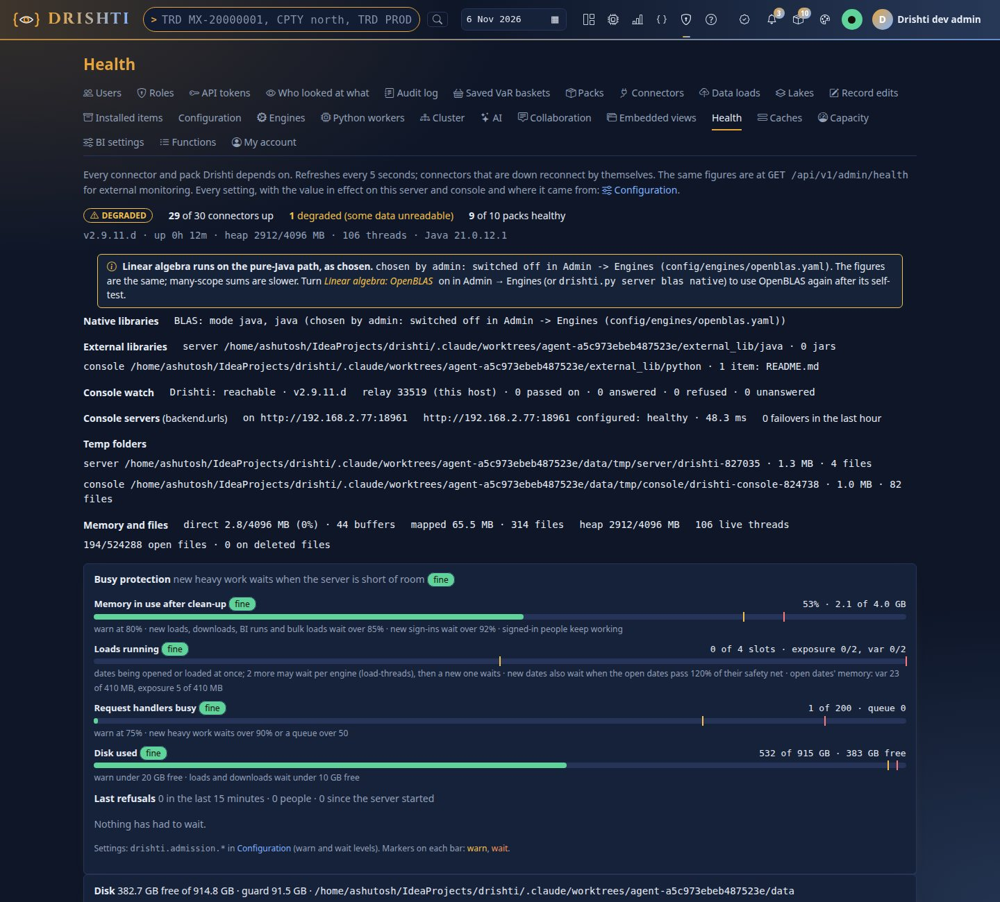

### 9.2 The modules

**From the command line** (a token, 8.3):

```text
$ curl -s -H "Authorization: Bearer $(cat ~/drishti-token)" http://<host>:18480/api/v1/modules
{"modules":[{"id":"core",…}, {"id":"market-data",…}, {"id":"banking","title":"Banking and risk",…},
            {"id":"capitalmarkets",…}, {"id":"economy",…}, {"id":"trading",…}, {"id":"source-calypso",…}, {"id":"source-endur",…},
            {"id":"source-ici",…}, {"id":"source-murex",…}, {"id":"source-swapone",…}, {"id":"source-wss",…}],
 "off":[],
 "lenses":[{"id":"world","title":"World","modules":["economy"],"functions":["ECON","MACRO",…],"home":"home/world_landing.html",…},
           {"id":"publicsector",…}, {"id":"risk",…}, {"id":"trading",…}, {"id":"market",…}, …],
 "functions":{"off":[…]}}
```

**You should see** twelve modules loaded (core, market-data, banking, capitalmarkets, economy, trading and the six `source-*` trading
systems), `off` empty, and the lenses this person may open. `GET /api/v1/admin/modules` (administrators) adds each module's switch, licence and whether a restart is
needed ([OPERATIONS_GUIDE.md › Engines, modules and editions](guides/OPERATIONS_GUIDE.md#65-engines-modules-and-editions)).

### 9.3 Sign in, and a token for the command line

**In the UI.** Open `http://<host>:17480`: the sign-in page. The first start made the administrator of `DRISHTI_SEED_USERNAME`
(`drishti-dev-admin`, password `drishti-dev-admin123` unless you set others): sign in, then change the password under your name →
**My account** before anyone else uses the machine.

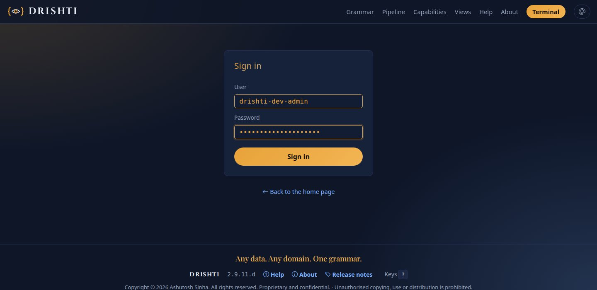

Then your name → **My account** → **API tokens** → a name, 30 days, no scope (read only) → **Create**; copy the secret (`drk_…`, shown
once) into `~/drishti-token`.

**From the command line:**

```text
$ drishti-console/.venv/bin/python tools/drishti.py doctor --server http://<host>:18480 --token-file ~/drishti-token
GREEN  java                    …/bin/java: Java 21.0
GREEN  server jar              <drishti>/lib/drishti-server-<version>-exec.jar (version <version>)
GREEN  python                  <drishti>/drishti-console/.venv/bin/python: Python 3.13.15
…
GREEN  server                  http://<host>:18480: version <version>, java 21.0.12.1, status UP
GREEN  token                   accepted; this token '…' acts as drishti-dev-admin: scopes read
doctor: 0 red, 0 yellow
```

### 9.4 The Home of each lens

**In the UI.** Home (the logo, top left) → **Open Drishti Risk**: the risk Home with the bank's VaR and exposure cards and the risk
commands; then **Switch to Drishti World**: the world Home (economies, markets, news). **Leave Drishti World** returns to the full product.

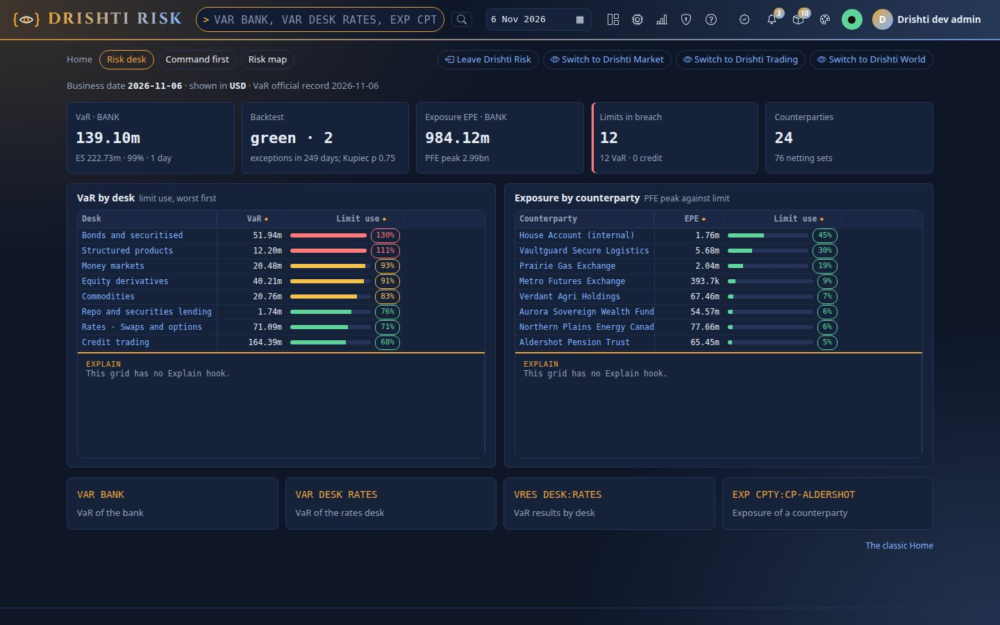

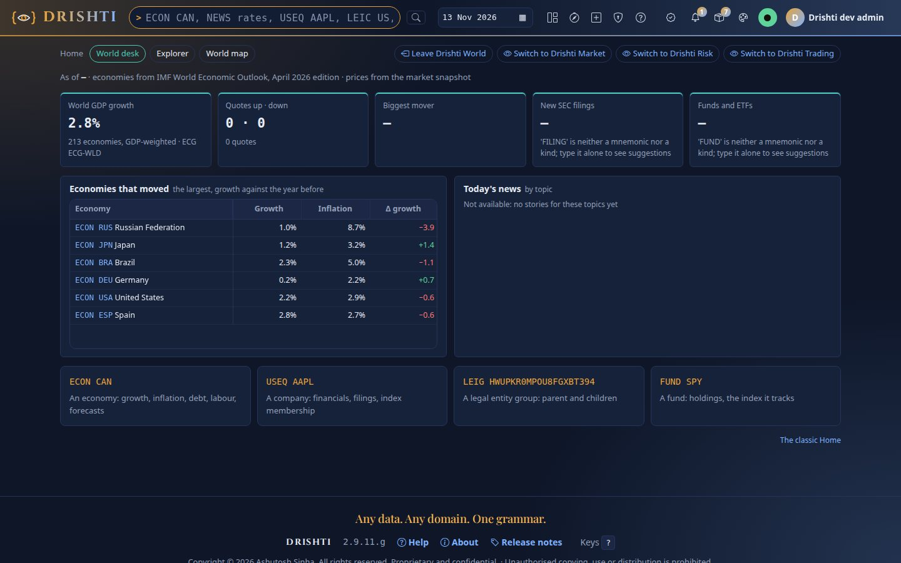

**In YAML** the Home of a lens is its file's `home:` block (`config/lenses/banking/risk.yaml`, `config/lenses/economy/world.yaml`).

### 9.5 The demo lake is loaded

**In the UI.** **Admin → Lakes**: the `demo` lake with its tables (about ninety), each with rows, files, size and its first and last business date;
the other lakes listed empty.

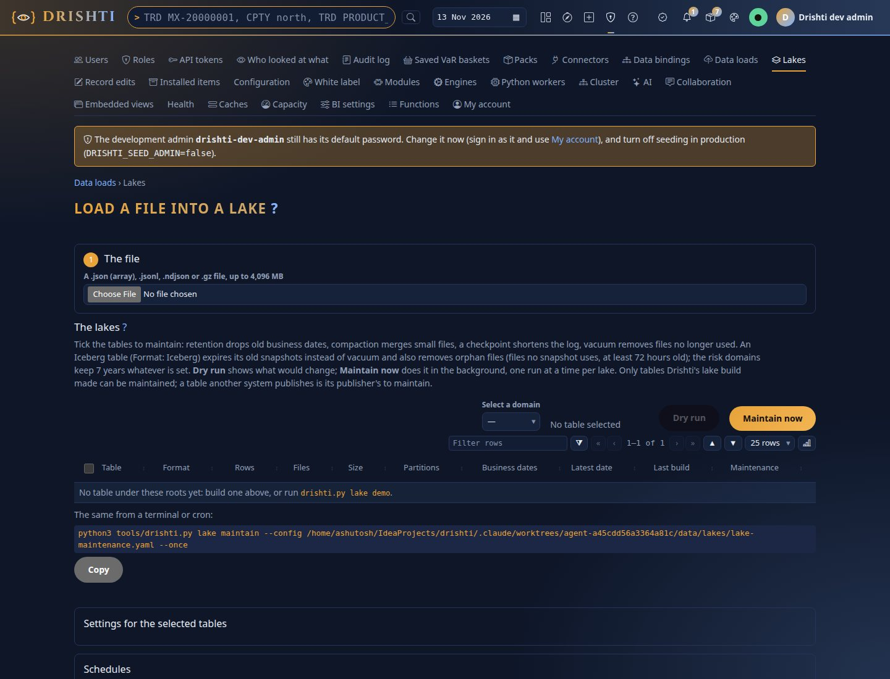

**From the command line:** `tools/drishti.py lake check` (section 6) prints the same lakes and says each connector names a known lake.

### 9.6 A VaR answer: the bank, then a desk

**In the UI.** Type `VAR BANK` in the command line (or **Risk → VaR explorer**) and press Enter: the bank's historical VaR and expected
shortfall, the scope tree with every node's figure and limit bar, the P&L path. Then `VAR DESK RATES`: one desk, the tree below it with a
breadcrumb up. **Explain ›** on a row or on the VaR tile opens how the figure was built; **Why it moved** compares it with the previous
day (or a week, a month end, a date you pick) in steps that add up ([VAR_GUIDE.md section 3.2](guides/VAR_GUIDE.md#32-the-screen),
[section 3.11](guides/VAR_GUIDE.md#311-why-it-moved-the-var-change-explained)).

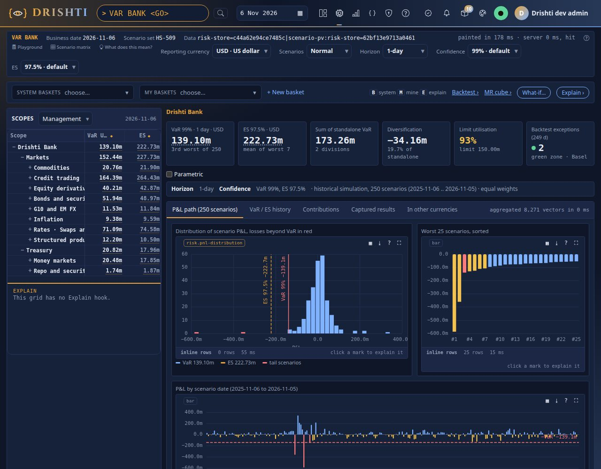

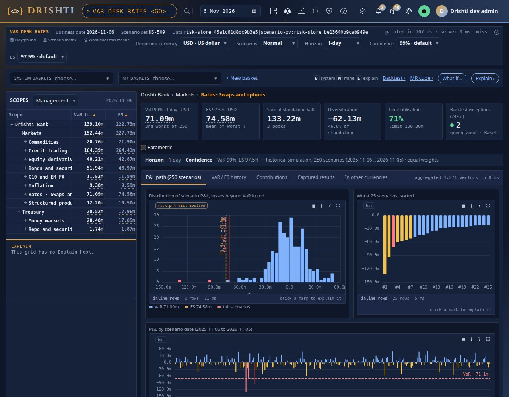

**From the command line:**

```text
$ drishti-console/.venv/bin/python tools/drishti.py var show BANK
VAR BANK  ·  Drishti Bank  ·  node  ·  2026-11-06
  horizon    1-day   (1-day · 99% VaR, ES 97.5% · historical simulation, 250 scenarios)
  VaR 99%   139,096,039 USD   (the 3th worst of 250)
  ES 97.5%   222,732,223 USD   (mean of the 7 worst)
  limit      150,000,000 USD   use 92.7%
  parts      2 division   standalone sum 173,258,800   diversification 34,162,761
  backtest   green  2 exceptions in 249 days   Kupiec p 0.747   Christoffersen p 0.857
  8271 trades in 6876 positions
  …
```

The figures and how they are computed: [VAR_GUIDE.md](guides/VAR_GUIDE.md).

### 9.7 Exposure and the pre-deal check

**In the UI.** `EXP BANK`: the counterparty exposure explorer at the bank, its legal entities and counterparties with PFE and limits.
Then **Counterparties → Pre-deal check** (or `PREDEAL`): a proposed trade checked against a counterparty's limit before it is dealt.

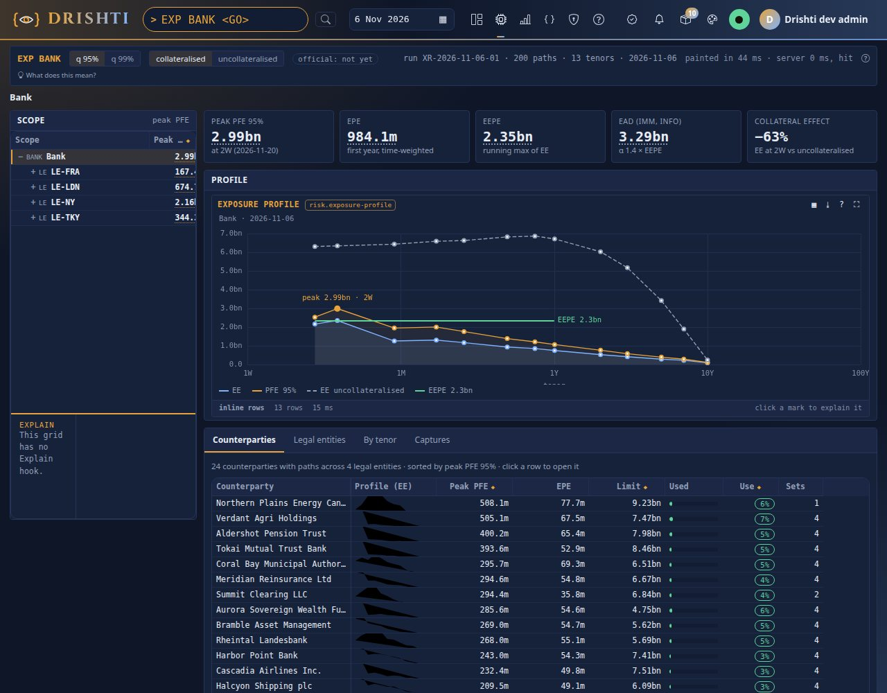

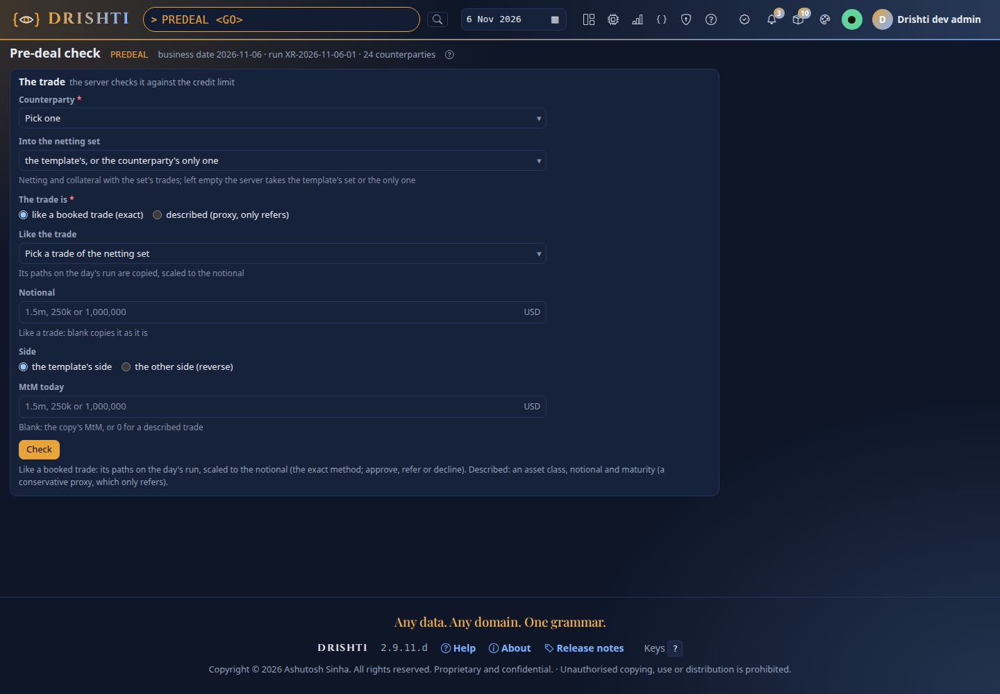

Details: [EXPOSURE_GUIDE.md](guides/EXPOSURE_GUIDE.md).

### 9.8 A BI report and the MR cube

**In the UI.** **BI → Catalogue → Trades overview**: the report's pages over the sixty days, its slicers live. Then `MCUBE`: the
market-risk cube, the Pivot screen on the VaR source with VaR and ES by desk (a total is never the sum of its rows).

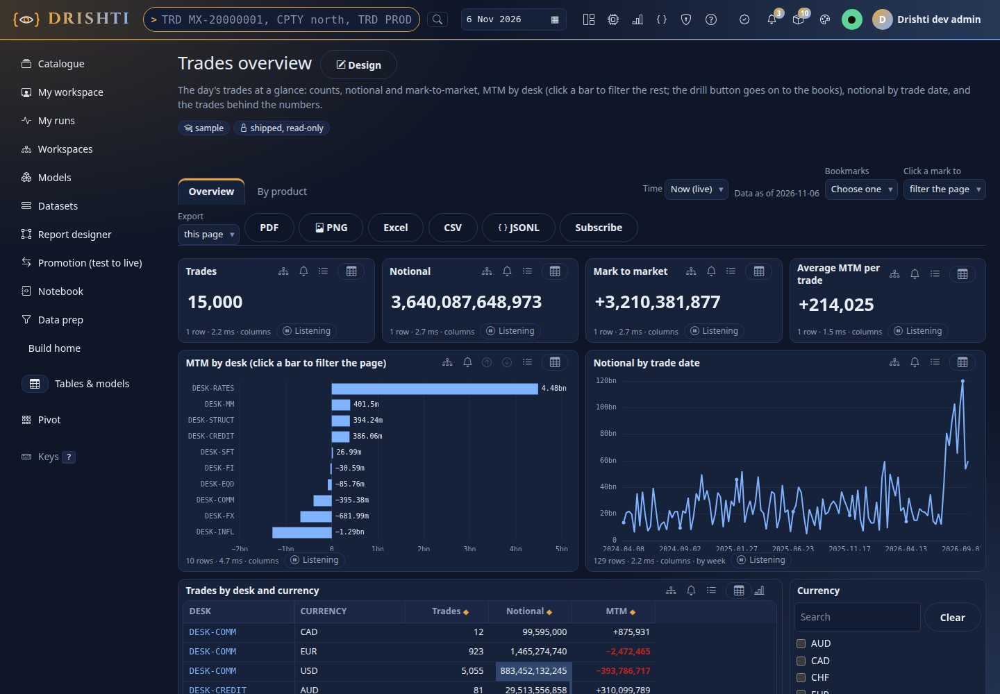

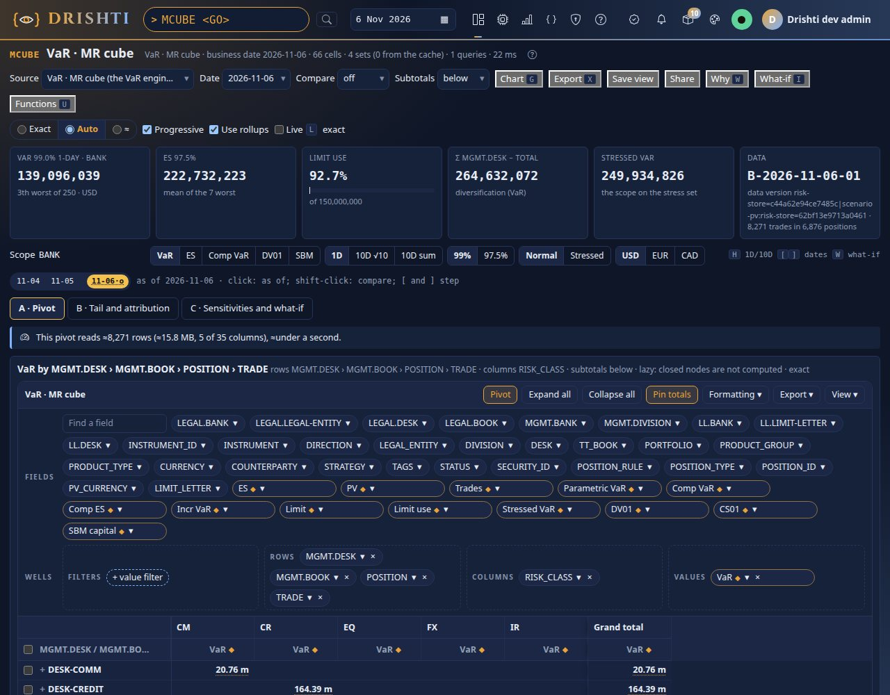

**From the command line:** `tools/drishti.py pivot run --source var --rows MGMT.DESK --values "var()"` prints the same cube.
Details: [guides/bi/README.md](guides/bi/README.md), [guides/bi/README.md](guides/bi/README.md).

### 9.9 The Elements gallery

**In the UI.** **Create → Elements gallery** (`http://<host>:17480/elements`): every component of the Drishti Elements libraries, live
(grid, charts, inputs, maps, the risk widgets); each component's **Playground page** draws it over data you edit in a grid
([ELEMENTS.md section 8.4](https://github.com/ajsinha/drishti-elements/blob/v2.4.0/docs/DESIGN.md)). A component that does not draw here will not draw on a screen
either.

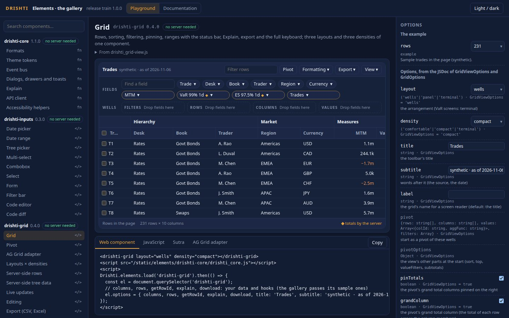

### 9.10 The data inbox and the feeds

The demo uses only the demo lake: do not drop files into a real lake to test. Check that the inbox runs and what it would take.

**In the UI.** **Admin → Data loads → Inbox**: the inbox's folders under `data/dataload/`, this node as its owner, the next cycle, and
the files it has seen (none yet). **Admin → Data loads → Feeds**: the public-data feeds with their lake, schedule and licence.

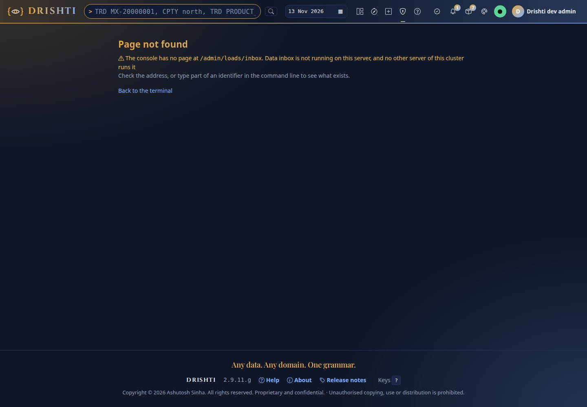

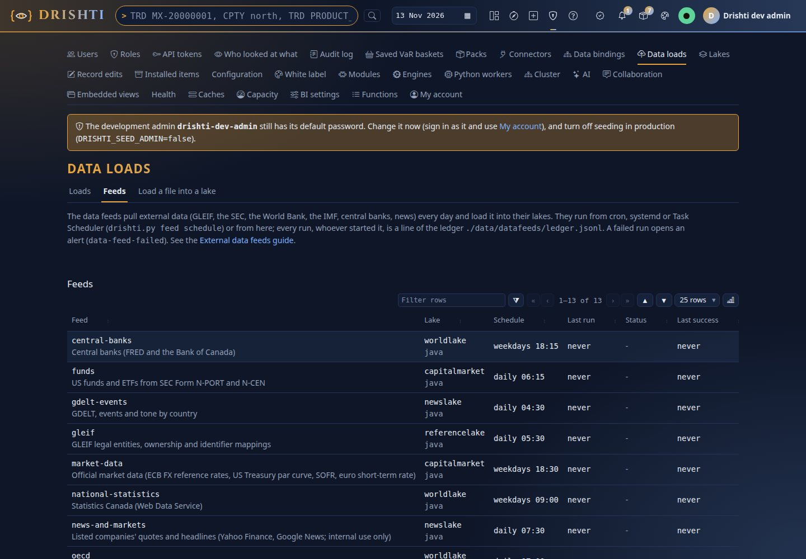

**The `.ready` file** releases a dropped file, and may say how to load it. Empty is fine; its keys are `lake`, `pack`, `kind`,
`connector`, `table`, `business-date`, `mode` (`replace` or `append`), `key`, `sha256`, `rows`, `new-table`, `hold`, and `folders` for a tar
([DATA_LAKE_GUIDE.md › The .ready file, every key](guides/DATA_LAKE_GUIDE.md#4-the-ready-file-every-key)):

```yaml
# data/dataload/inbox/trade_endur.2026-11-06.jsonl.gz.ready  (an example: not for the demo lake)
lake: risklake
pack: trading
mode: replace
```

**From the command line:**

```text
$ drishti-console/.venv/bin/python tools/drishti.py feed list
FEED                 LAKE           LOAD  SCHEDULE        LICENCE                             USE            DATASETS
central-banks        worldlake      java  weekdays 18:15  FRED API terms (the default series  attribution    central-bank, rate-series
funds                capitalmarket  java  daily 06:15     Public domain (U.S. Government wor  allowed        fund, fund-holder, index-funds
gdelt-events         newslake       java  daily 04:30     GDELT terms of use (free for any u  attribution    event-country
gleif                referencelake  java  daily 05:30     CC0 1.0 (attribution appreciated)   allowed        lei-entity, lei-relationship, lei-mapping
…
world-economy        worldlake      java  daily 06:45     World Bank CC BY 4.0; IMF terms (n  internal only  economy, macro-indicator, …
yahoo-prices (off)   capitalmarket  java  weekdays 22:30  Yahoo terms of service (personal u  internal only  price-history
$ drishti-console/.venv/bin/python tools/drishti.py feed run gleif --dry-run
dry run: feed gleif (GLEIF legal entities, ownership and identifier mappings), business date 2026-11-08, window 2026-10-09..2026-11-08, datasets lei-entity, lei-relationship, lei-mapping -> lake referencelake by java
  dry run: gleif, sources golden, api, mapping
    golden (CC0 1.0 (attribution appreciated); committable): 3 request(s) or file(s), cache <drishti>/data/datafeeds/sources/cache/gleif
      https://goldencopy.gleif.org/api/v2/golden-copies/publishes/latest
      …
2026-11-08T07:23:11-05:00 feed dry-run exit=0 feed=gleif date=2026-11-08 files=0 rows=0 seconds=0.0
```

A dry run contacts nothing and writes nothing: it says what a run would fetch and load. On an offline machine stop there.

### 9.11 Modules off and on

Switch the banking module off, restart, check that every risk page is gone, then switch it back on.

**In YAML** (`config/modules/banking.yaml`): `enabled: false`. **From the command line** instead:

```bash
curl -s -X POST -H "Authorization: Bearer $ADMIN_TOKEN" -H 'Content-Type: application/json' http://<host>:18480/api/v1/admin/modules \
  -d '{"module": "banking", "enabled": false, "reason": "QA: banking off"}'
```

Or for one run only: `DRISHTI_MODULES_BANKING_ENABLED=false` in the server's environment. Restart the server.

**You should see** `GET /api/v1/modules` list banking under `off` with its reason; the Risk menu gone from the top bar (its engines
are the banking module's); Home offering no Risk or Trading lens; `VAR BANK` answering *VAR is not available to you: ask your
administrator (the module 'Banking and risk' is not on here …)*; and the risk API answering `404 DRS-1025`:

```text
$ curl -s -H "Authorization: Bearer $ADMIN_TOKEN" "http://<host>:18480/api/v1/risk/var/scope?scope=BANK"
{"type":"about:blank","title":"module off","status":404,"detail":"DRS-1025 the module 'banking' is not on here: switched off (setting drishti.modules.banking.enabled) …","code":"DRS-1025","module":"banking"}
```

In a cluster switch a module on every node alike ([section 11.5](#115-secrets)).

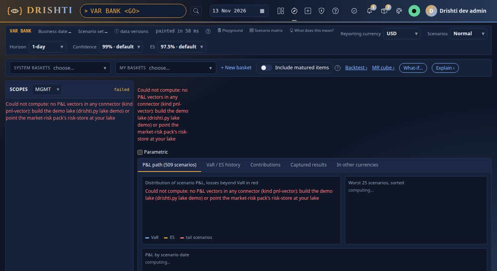

Set `enabled: true` (or remove the variable), restart, and repeat 8.6: VaR answers again.

### 9.12 The phone layout

Open the console on a phone (or the browser's device toolbar at 390 px wide): Home and every view are one
column with no sideways scroll: the top bar wraps, controls and tiles stack, and the function keys become a scrolling row.

| | |
|---|---|
| 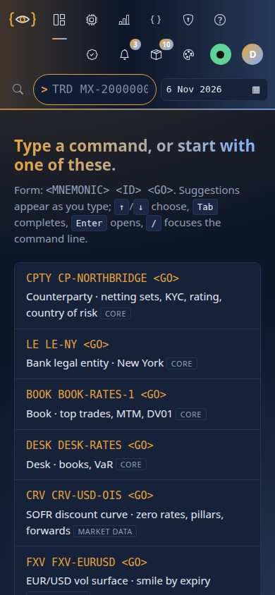 | 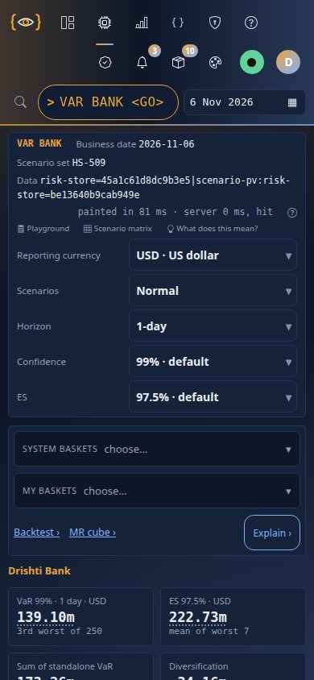 |

### 9.13 Logs and metrics

| What | Where |
|---|---|
| The server's log | its standard output (the terminal, `journalctl -u drishti-server`, the scheduled task's `data\logs\server.log`, launchd's `StandardOutPath`); `DRISHTI_LOG_FILE` adds a rolled file |
| The console's log | its standard output |
| Metrics | `GET http://<host>:18480/actuator/prometheus` with `Authorization: Bearer $DRISHTI_METRICS_TOKEN` (or an administrator's token); `deploy/prometheus/drishti-alerts.yaml` and `deploy/grafana/drishti-dashboard.json` |
| Who did what | **Admin → Audit** |
| The engines on this server | **Admin → Engines** |

```text
$ curl -s -H "Authorization: Bearer $(cat ~/drishti-token)" http://<host>:18480/actuator/prometheus | grep -c '^drishti_'
218
```

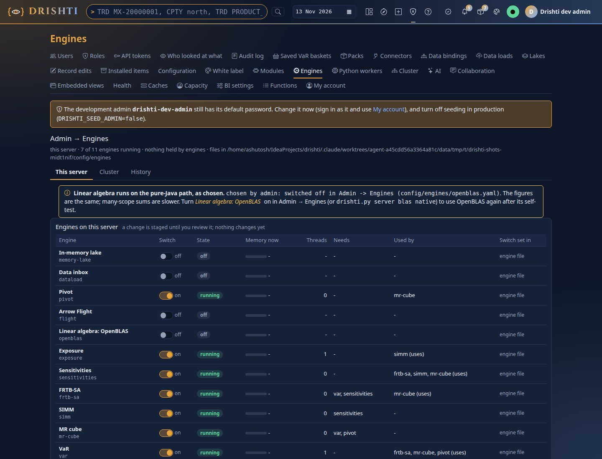

Every endpoint and alert: [OPERATIONS_GUIDE.md › Monitoring and health](guides/OPERATIONS_GUIDE.md#13-monitoring-and-health), the logs:
[› Logs](guides/OPERATIONS_GUIDE.md#139-logs).

## 10. The QA checklist

Tick one column per operating system tested. *Expected* is what section 9 shows.

| # | Check | Expected | Windows | Linux | macOS |
|---|---|---|---|---|---|
| 1 | `java -version`, Python 3.13, `doctor` | Java 21; `doctor: all clear` | ☐ | ☐ | ☐ |
| 2 | Windows only: nothing installed but Java and Python | no `.exe` copied; every command is `py tools\drishti.py …`; the lake written by `--engine java` | ☐ | — | — |
| 2a | The settings file; an older install moved aside | `lake check` under your data folder; nothing left of 3.4's list | ☐ | ☐ | ☐ |
| 3 | `lake demo` | `Demo lake ready: … tables, 60 business days …` | ☐ | ☐ | ☐ |
| 4 | `lake check` | no error line | ☐ | ☐ | ☐ |
| 5 | Server start | `Started DrishtiApplication`, no `ERROR` line | ☐ | ☐ | ☐ |
| 6 | `/actuator/health`, console `/readyz` | `"status":"UP"`; `"server":"reachable"` | ☐ | ☐ | ☐ |
| 7 | `/api/v1/modules` | twelve modules loaded (banking, capitalmarkets, economy, market-data, trading, the six `source-*`, core); `off` empty | ☐ | ☐ | ☐ |
| 8 | Sign in, change the password, make a token | Home opens; `doctor --token-file` green | ☐ | ☐ | ☐ |
| 9 | Home through Risk and through World | each lens's Home with its cards | ☐ | ☐ | ☐ |
| 10 | Admin → Lakes | the demo lake's tables with rows and dates | ☐ | ☐ | ☐ |
| 11 | `VAR BANK`, `VAR DESK RATES`; Explain ›, Why it moved | the bank's VaR and ES, the scope tree; one desk; the change in steps that add up | ☐ | ☐ | ☐ |
| 12 | `EXP BANK`, Pre-deal check | the exposure explorer; the check's form | ☐ | ☐ | ☐ |
| 13 | BI Trades overview; `MCUBE` | the report with live slicers; VaR by desk | ☐ | ☐ | ☐ |
| 14 | Create → Elements gallery, a Playground page | every component drawn; an edited cell redraws the visual | ☐ | ☐ | ☐ |
| 15 | Admin → Data loads → Inbox and Feeds; `feed list`, `feed run gleif --dry-run` | the owner node; the feeds; `exit=0` | ☐ | ☐ | ☐ |
| 16 | Banking off, restart | `off` lists banking; no risk pages; `DRS-1025` | ☐ | ☐ | ☐ |
| 17 | Banking on, restart | VaR answers again | ☐ | ☐ | ☐ |
| 18 | Phone width (390 px) | one column, no sideways scroll | ☐ | ☐ | ☐ |
| 19 | Logs and `/actuator/prometheus` | no `ERROR`; `drishti_` metrics | ☐ | ☐ | ☐ |
| 20 | Service start at boot, stop with drain | the process comes back after a reboot; a stop drains first | ☐ | ☐ | ☐ |
| 21 | Optional: the cluster checklist | [section 11.10](#1110-the-cluster-qa-checklist) | ☐ | ☐ | ☐ |

## 11. A cluster of three

Optional. Several servers act as one (**Drishti\*net**): each holds its packs and data, they learn of each other by gossip, a request
for something one node holds is forwarded to it, and the console moves to another server when its own stops. How it works inside, at
depth: [CLUSTER_GUIDE.md](guides/CLUSTER_GUIDE.md) (the one home for the internals). This section is the complete deployment and QA path.

### 11.1 When to choose a cluster, and the layout

| Choose a cluster when | Stay on one node when |
|---|---|
| one machine's memory or CPU is not enough for the trades, scenarios and users | one machine holds the day comfortably (the sizing planner says so) |
| the service must survive the loss of a machine, or be upgraded without downtime | a short stop for an upgrade is acceptable |
| teams or regions want their own servers with their own packs, seen as one | |

The three-node layout used here (and by `deploy/stack/`, the repository's ready-made local cluster):

| Node | Role | Packs and engines | Special settings |
|---|---|---|---|
| `drishti-a` | **owner and data-load node**: the seed the others are given, the only node that runs the data inbox | all packs; VaR, exposure, the inbox | `DRISHTI_DATALOAD_ENABLED=true`, `DRISHTI_DATALOAD_OWNER=true` |
| `drishti-b` | **compute**: VaR shards, exposure, BI | all packs (or a subset) | `DRISHTI_COMPUTE_ENABLED=true` |
| `drishti-c` | **compute**, the third copy of every shard | the same | the same |
| console(s) | one per machine, or one behind a load balancer | — | `DRISHTI_BACKEND_URLS=http://<host-a>:18480` (one is enough: it learns the rest) |

In production the three are three machines, each with a server and a console, the lake and the identity database shared and highly
available outside them ([CLUSTER_GUIDE.md › Three machines in production](guides/CLUSTER_GUIDE.md#23-three-machines-in-production)).
Larger estates by role: [CLUSTER_GUIDE.md › Roles and how many](guides/CLUSTER_GUIDE.md#4-roles-and-how-many).

### 11.2 Network and ports

| Port | Between | Notes |
|---|---|---|
| server port (18480) | console → server, server ↔ server (forwarded requests, digests, seeds) | open between every pair of nodes and from the consoles |
| **gossip port** | server ↔ server only | `gossip-port: auto` (default: a free port chosen at start and advertised); **a number** (for example `7946`) when a firewall must name it; `off` shares the server's port. Admin → Health shows `gossipPort` |
| console port (17480) | browsers → console | from people's networks |

**Advertise the real address, never `localhost`, `127.0.0.1` or `0.0.0.0`.** Each node tells the others where to call it
(`advertise-url`); left out, the node uses the default route's interface, which is right on most machines. A loopback or wildcard
address is refused by the CLI, Admin → Cluster and the server alike ([CLUSTER_GUIDE.md › Real addresses only](guides/CLUSTER_GUIDE.md#12-real-addresses-only)).
Clocks within 60 seconds (NTP): signed calls outside that window are refused.

| | Windows | Linux | macOS |
|---|---|---|---|
| the real address | `ipconfig` (the adapter with the default gateway) | `ip route get 1.1.1.1` (`src …`) | `ipconfig getifaddr en0` |
| open the ports | `New-NetFirewallRule -DisplayName 'Drishti' -Direction Inbound -Protocol TCP -LocalPort 18480,7946 -Action Allow` | `sudo firewall-cmd --add-port={18480,7946}/tcp --permanent && sudo firewall-cmd --reload` (or `ufw allow`) | System Settings → Network → Firewall: allow `java` |

### 11.3 Shared data: the lake and paths

**Every node reads the same lake at the same path.** A lake's root is in its lake file (`config/lakes/<lake>.yaml`, `root:`), so the
same file works on every node only when the path is the same everywhere:

| Storage | How | Notes |
|---|---|---|
| S3 or an S3-compatible store | the lake file's root `s3://bucket/lakes/demo` and the connector's `s3.*` settings | nothing mounted; the recommended production choice |
| **NFS** (Linux, macOS) | mount at the same path on every node, for example `/mnt/drishti/delta` | `DRISHTI_DELTA_ROOT=/mnt/drishti/delta/demo` on each |
| **EFS** (AWS) | an access point mounted at the identical path in every task | [CLUSTER_GUIDE.md › Drishti on AWS](guides/CLUSTER_GUIDE.md#12-drishti-on-aws-ecs-efs-and-s3) |
| **SMB** (Windows) | a UNC path, the same on every node: `\\fileserver\drishti\delta\demo` | the service account needs read access; a mapped drive letter is per user, so use the UNC path |

**What is not shared:** each node's own data folder (`DRISHTI_DATA_DIR`: caches, hot files, its net state), which it rebuilds from the
lake. **Shared besides the lake:** the identity database (PostgreSQL in a production cluster, never the SQLite default) and the content
store (`config/store/store.yaml`, the same on every node). Loads are announced to every node, so all read the same lake version.

### 11.4 Configuration per node

Each node has its **own** Drishti\*net folder (`DRISHTI_NET_DIR`; `start server --node` makes `<data>/nodes/<node>/net`, or
`--node-dir` names one) and data folder; everything else (packs, lakes, modules, lenses, engines) is the **same** on every node. On each node:

```yaml
# <data>/nodes/drishti-b/net/node.yaml on drishti-b
enabled: true
node-id: drishti-b
advertise-url: http://<host-b>:18480        # left out: this machine's real address
gossip-port: auto                           # or 7946 behind a firewall
secret: ${DRISHTI_NET_SECRET}               # a reference: the key itself never goes in a file
```

```yaml
# <data>/nodes/drishti-b/net/peers/drishti-a.yaml on drishti-b (and the same on drishti-c): the seed
url: http://<host-a>:18480
```

**From the command line** the same, checked as the server would (`--dir` names the node's folder; without it the tool reads
`DRISHTI_NET_DIR`):

```bash
export DRISHTI_NET_SECRET=<the cluster key>
net=/srv/drishti/data/nodes/drishti-b/net
drishti-console/.venv/bin/python tools/drishti.py net set node.node-id drishti-b --dir $net
drishti-console/.venv/bin/python tools/drishti.py net set node.secret '${DRISHTI_NET_SECRET}' --dir $net
drishti-console/.venv/bin/python tools/drishti.py net set node.advertise-url http://<host-b>:18480 --dir $net
drishti-console/.venv/bin/python tools/drishti.py net set node.enabled true --dir $net
drishti-console/.venv/bin/python tools/drishti.py net add-peer drishti-a <host-a>:18480 --dir $net
drishti-console/.venv/bin/python tools/drishti.py net check --dir $net             # exit 0: every file would be taken
```

**In the UI** (once a server runs): **Admin → Cluster → Files** (open `node.yaml`, edit, **Check**, **Save**), **Admin → Cluster → Members →
Add a seed**.

**The environment per node** (the example layout of `deploy/stack/stack.yaml`, the repository's three-node cluster on one machine):

| Variable | drishti-a | drishti-b | drishti-c |
|---|---|---|---|
| `DRISHTI_NET_SECRET`, `DRISHTI_TOKEN_SECRET`, `DRISHTI_SESSION_SECRET` | the same three values on every node | same | same |
| `DRISHTI_NET_DIR`, `DRISHTI_DATA_DIR` | its own | its own | its own |
| `DRISHTI_DELTA_ROOT` (or the lake files' roots) | the shared lake path | the same | the same |
| `DRISHTI_DATALOAD_ENABLED`, `DRISHTI_DATALOAD_OWNER` | `true`, `true` | unset | unset |
| `DRISHTI_COMPUTE_ENABLED` | `true` | `true` | `true` |
| `DRISHTI_PACKS`, `DRISHTI_LENSES`, `config/modules/*` | the same everywhere | same | same |

### 11.5 Secrets

The three secrets (the cluster key, the token secret, the session secret) are the same on every node and the consoles, made once with
`openssl rand -hex 32`, kept where only the service account reads them (the environment file, the vault, Secrets Manager), never in a
file under `config/`. A file with a key in clear is refused, and Admin → Cluster shows only whether the key is set. Rolling the key without a
stop: [CLUSTER_GUIDE.md › Security](guides/CLUSTER_GUIDE.md#16-security-the-key-mutual-tls-nodes-per-role). **Modules and licence:** every
node reads its own `config/modules/` and `config/access/licence.yaml`: give each node the same files (from the same release folder), so
the same modules are on everywhere; a module on one node and off on another leaves its pages working only through that node.

### 11.6 Start order and joining

1. The shared pieces first: the lake reachable, the identity database (and Kafka, if used).
2. The seed, `drishti-a`; then `drishti-b` and `drishti-c` (any order, at once is fine).
3. The consoles last, each given the entry node (or several); each learns the other members from the cluster.

Each node starts with `start server --node` ([section 7.1](#71-the-start-and-stop-commands) has every option). All nodes share one
env-file with the three secrets ([7.4](#74-the-secrets-in-an-env-file)), here `cluster.env`. Each node advertises its machine's real
address (found by the command; `--advertise` names another), never `127.0.0.1`.

**Three machines** (the production layout): `drishti-a` on `<host-a>`, `drishti-b` on `<host-b>`, `drishti-c` on `<host-c>`, each on port
18480 with its own data folder. Linux and macOS:

```bash
# on <host-a>: the seed
python3 tools/drishti.py start server --node drishti-a --env-file /etc/drishti/cluster.env --background
# on <host-b> and <host-c>: join through the seed
python3 tools/drishti.py start server --node drishti-b --seed <host-a>:18480 --env-file /etc/drishti/cluster.env --background
python3 tools/drishti.py start server --node drishti-c --seed <host-a>:18480 --env-file /etc/drishti/cluster.env --background
# the console (on any machine): given the entry node, it learns drishti-b and drishti-c
python3 tools/drishti.py start console --server http://<host-a>:18480 --env-file /etc/drishti/cluster.env --background
```

Windows (each line on its machine):

```powershell
py tools\drishti.py start server --node drishti-a --env-file C:\drishti-secrets\cluster.env --background
py tools\drishti.py start server --node drishti-b --seed <host-a>:18480 --env-file C:\drishti-secrets\cluster.env --background
py tools\drishti.py start server --node drishti-c --seed <host-a>:18480 --env-file C:\drishti-secrets\cluster.env --background
py tools\drishti.py start console --server http://<host-a>:18480 --env-file C:\drishti-secrets\cluster.env --background
```

The first start of a node makes its Drishti\*net folder, `<data>/nodes/<node>/net` (a `node.yaml` naming `${DRISHTI_ADVERTISE_HOST}`,
`${DRISHTI_PORT}` and `${DRISHTI_NET_SECRET}`, never the values), and `--seed` writes `peers/seed-<host>-18480.yaml`. A folder made and
checked by hand (11.4) is given with `--node-dir`: `python3 tools/drishti.py start server --node drishti-b --node-dir /etc/drishti/net …`.
A console may be given several entry nodes, `--server http://<host-a>:18480,http://<host-b>:18480`: it uses the first that answers.

**Three nodes on one machine** (a laptop, a QA box): different ports, and each node its own data folder (`--node-data`; two nodes on
one are refused), while the pid files, logs and temporary folders stay in the one data folder, named after the node:

```bash
cd /home/you/drishti
python3 tools/drishti.py start server --node drishti-a --port 18480 --node-data /home/you/drishti/data/nodes/drishti-a/data --env-file /home/you/drishti-envs/cluster.env --background
python3 tools/drishti.py start server --node drishti-b --port 18481 --node-data /home/you/drishti/data/nodes/drishti-b/data --seed <host>:18480 --env-file /home/you/drishti-envs/cluster.env --background
python3 tools/drishti.py start server --node drishti-c --port 18482 --node-data /home/you/drishti/data/nodes/drishti-c/data --seed <host>:18480 --env-file /home/you/drishti-envs/cluster.env --background
python3 tools/drishti.py start console --server http://<host>:18480 --env-file /home/you/drishti-envs/cluster.env --background
python3 tools/drishti.py status
```

On Windows the same lines with `py tools\drishti.py` and `\` paths. **You should see** (a run on test ports):

```text
t-b: up on http://192.168.2.77:28791
t-c: up on http://192.168.2.77:28792
console: up on http://192.168.2.77:27480
process                     pid  state      port   health     distribution     address
server-t-a              1977639  running    28480  UP         all              http://192.168.2.77:28480
server-t-b              1978776  running    28791  UP         all              http://192.168.2.77:28791
server-t-c              1979410  running    28792  UP         all              http://192.168.2.77:28792
console                 1980320  running    27480  UP         all              http://192.168.2.77:27480
```

and in each server's log:

```text
INFO  … GossipConnector : net: gossip port 36009 open (8 platform threads of its own; gossip, probes and digests only)
INFO  … NetService      : net: node drishti-b joined Drishti*net at http://<host-b>:18480 (incarnation 1, seeds [http://<host-a>:18480], 0 saved members, gossip on port 36009)
INFO  … NetService      : net: member drishti-a joined
INFO  … NetService      : net: member drishti-c joined
```

The console's saved list (`data/console/net/servers.json`) then holds the entry node as `configured` and the other two as `discovered`.

**Stopping** one node, then every node of the machine (each by its pid file; drain first in production, [11.8](#118-rolling-upgrade-and-draining)):

```bash
python3 tools/drishti.py stop server --node drishti-c     # Windows: py tools\drishti.py stop server --node drishti-c
python3 tools/drishti.py stop console
python3 tools/drishti.py stop server --all-nodes          # or stop all --all-nodes: the console, then every node
```

```text
t-c: stopped (pid 1979410)
console: stopped (pid 1980320)
t-a: stopped (pid 1977639)
t-b: stopped (pid 1978776)
```

**The repository's own three on one machine.** `python3 tools/drishti.py start cluster` starts three servers and a console from
`deploy/stack/stack.yaml` through these same commands, with the real address and the secrets made for you; `python3 tools/drishti.py
status --cluster deploy/stack/stack.yaml` shows them, `python3 tools/drishti.py stop cluster` stops them
([deploy/stack/README.md](../deploy/stack/README.md)). The same commands run on Windows with `py tools\drishti.py`.

### 11.7 Verify the cluster, step by step

**1 · The members.** **Admin → Cluster** (`/admin/net`, the Drishti\*net page) → **Members** on any node lists the three `alive`, each with its version, tags, packs and latency; the
hash ring is green.

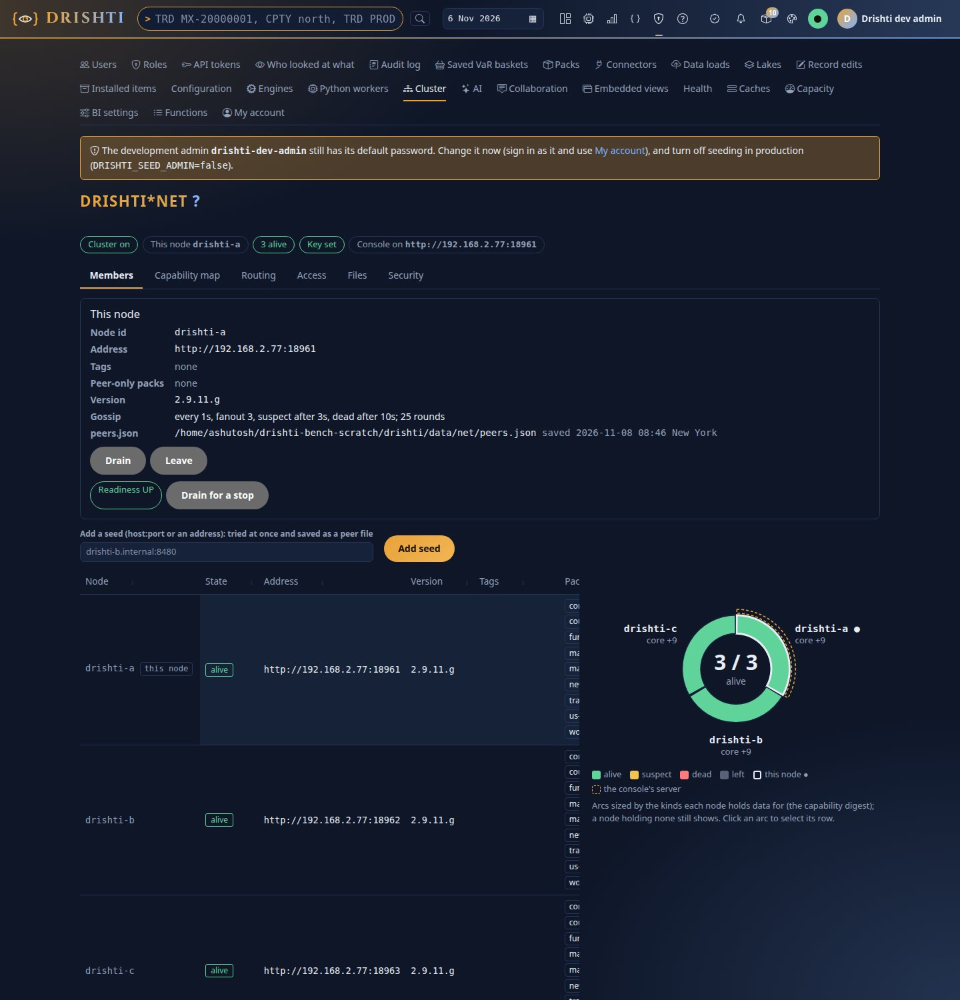

**From the command line:**

```text
$ drishti-console/.venv/bin/python tools/drishti.py net members --server http://<host-a>:18480 --token-file ~/drishti-token
3 member(s); this node drishti-a
  node                   state  address                    version   tags  latency  incarnation
  drishti-a (this node)  alive  http://<host-a>:18480      <version>       -        1
  drishti-b              alive  http://<host-b>:18480      <version>       4.0 ms   1
  drishti-c              alive  http://<host-c>:18480      <version>       4.1 ms   1
```

**2 · Gossip health.** **Admin → Health** on each node: the Drishti\*net line (members alive and suspect, requests forwarded and failed,
`gossipPort`).

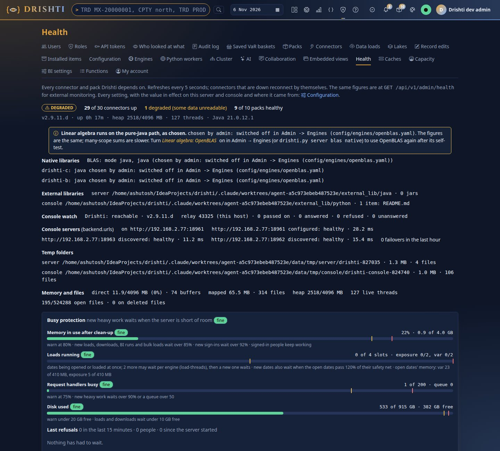

**3 · Drain a node, and an answer still comes.** Drain one node (as for an upgrade): **Admin → Cluster → Drain for a stop** on that node, or

```bash
curl -s -X POST -H "Authorization: Bearer $ADMIN_TOKEN" -H 'Content-Type: application/json' \
  http://<host-c>:18480/api/v1/admin/node/drain -d '{"on": true}'
curl -s -H "Authorization: Bearer $ADMIN_TOKEN" http://<host-c>:18480/api/v1/admin/node        # "safeToStop": true once handed over
```

(Windows: the same calls with `Invoke-RestMethod`, or `curl.exe`, which Windows 10 and 11 carry; every OS: `python tools/drishti.py node drain`; a
personal token needs the `node:drain` scope.)
The drain answers at once with what it is handing over; `safeToStop` turns true within a few seconds:

```text
{"node":"drishti-c","drained":true,"since":"2026-11-08T12:59:44Z","safeToStop":false,
 "parts":[{"name":"net","draining":true,"detail":"drained: waiting 5 s for every peer to hear it","safeToStop":false},
          {"name":"var-shards","draining":false,"detail":"VaR sharding is off on this server: no shards to hand over","safeToStop":true}],
 "readiness":{"status":"OUT_OF_SERVICE","enabled":true,"waitingFor":{}}}
```

**You should see** the node marked drained on Admin → Cluster, and `VAR BANK` still answer, from the other nodes:

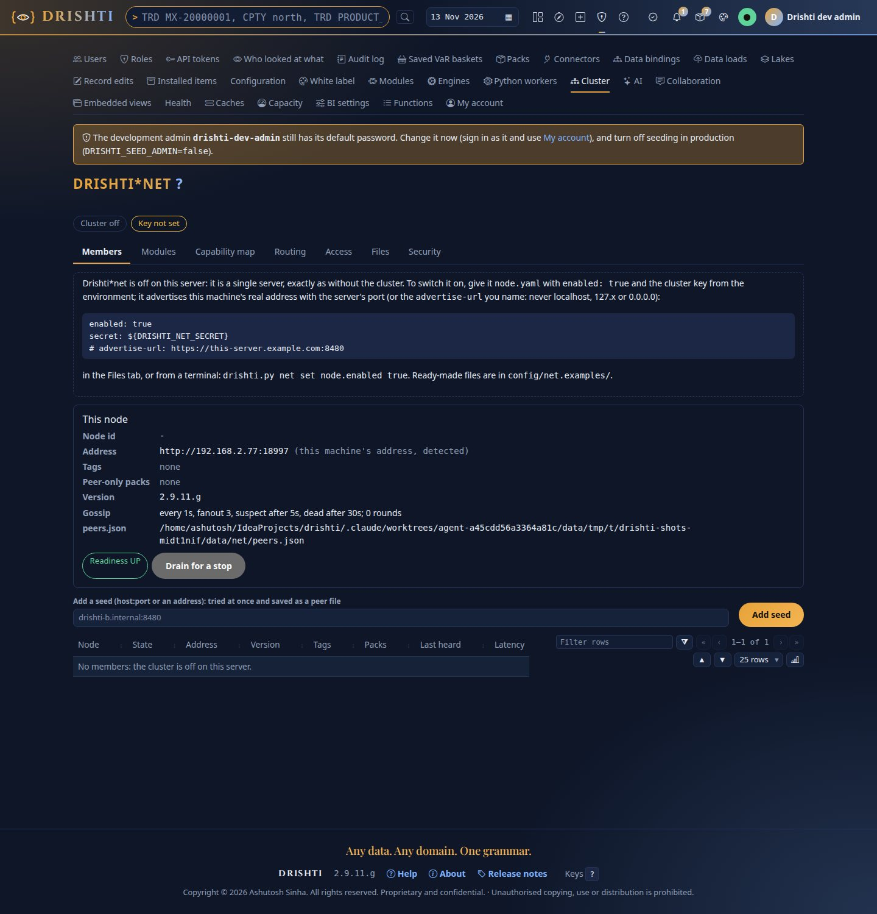

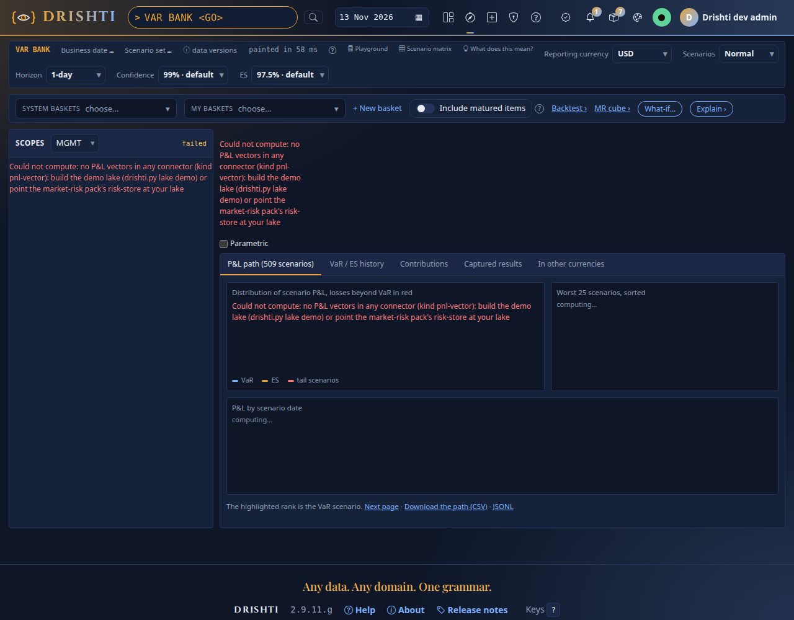

Undrain with `{"on": false}` (or restart the node).

**4 · The inbox owner.** **Admin → Data loads → Inbox** names the owner node, `drishti-a`; on the other nodes the inbox does not run
(a folder lock keeps a second runner out anyway).


**5 · The same modules everywhere.** Ask each node; the answers must be the same:

```bash
for h in <host-a> <host-b> <host-c>; do
  curl -s -H "Authorization: Bearer $(cat ~/drishti-token)" http://$h:18480/api/v1/modules | python3 -c 'import json,sys; d=json.load(sys.stdin); print([m["id"] for m in d["modules"]], d["off"])'
done
```

**6 · The console moves.** With the console given `drishti-a` alone, stop `drishti-a`: the open page carries on from another node
within a second, still signed in (Admin → Health, *Console servers*, shows the move).

### 11.8 Rolling upgrade and draining

One node at a time: drain → `safeToStop` → stop → replace the jar → start → readiness → the next node. **Servers before consoles**: the
BI and data-serving nodes, then the coordinators, then the shard owners one zone at a time, and the consoles last (a console newer than
its servers cannot sign anyone in). `python3 tools/rolling.py --inventory <file> --version <v>` (Windows `py tools\rolling.py …`) does
exactly this from an inventory (`deploy/rolling.example.yaml`); `--dry-run` prints every step. The stop hooks of systemd and Docker drain
by themselves; on Windows drain before stopping the task ([section 8](#8-run-them-as-services)). Details: [CLUSTER_GUIDE.md › Zero downtime](guides/CLUSTER_GUIDE.md#8-zero-downtime).

### 11.9 Per operating system

| | Windows | Linux | macOS |
|---|---|---|---|
| start a node | `py tools\drishti.py start server --node …` (a scheduled task per node, section 8) | `python3 tools/drishti.py start server --node …`; systemd, one unit per node | the same as Linux; launchd, one plist per node |
| drain before a stop | **Admin → Cluster → Drain for a stop**, or the drain call (`Invoke-RestMethod`, section 8) | the server drains itself on the unit's stop | the server drains itself on `launchctl unload` (or `python3 tools/drishti.py node drain` first) |
| the shared lake | SMB, a UNC path | NFS or S3 | NFS or S3 |
| three on one machine | three `start server --node … --port … --node-data …`, or `start cluster` | the same | the same |

### 11.10 The cluster QA checklist

| # | Check | Expected | ☐ |
|---|---|---|---|
| C1 | `net check` on each node | exit 0 | ☐ |
| C2 | Each node's log | `joined Drishti*net at http://<real address>` and `member … joined` for the others | ☐ |
| C3 | Admin → Cluster → Members | three `alive`; addresses are real, none `localhost` | ☐ |
| C4 | `net members` | three lines, one marked this node | ☐ |
| C5 | Admin → Health | the Drishti\*net line green; `gossipPort` as configured | ☐ |
| C6 | Drain a node | drained on Admin → Cluster; `safeToStop` true; `VAR BANK` answers | ☐ |
| C7 | Undrain | the node serves again | ☐ |
| C8 | Inbox | owner `drishti-a` only | ☐ |
| C9 | `/api/v1/modules` on each node | identical | ☐ |
| C10 | Stop the console's server | the page carries on, still signed in | ☐ |
| C11 | Rolling upgrade `--dry-run` | every step listed, in order | ☐ |

### 11.11 Cluster troubleshooting

| What you see | Do |
|---|---|
| A node lists no members | its log's `joined … seeds [...]` line; the seed's address and port, the firewall, `enabled: true` with the key set |
| `node.yaml was not written: '… 127.0.0.1 …' is a loopback or wildcard address` | the machine's real address (the message names it), or leave `advertise-url` out |
| `401 DRS-5051 cluster credential refused: bad signature` | the same `DRISHTI_NET_SECRET` on every node |
| `… signed 75 s away from this node's clock` | NTP on every node |
| A member flaps between `alive` and `suspect` | `gossip-port` on `auto` or a number (not `off`); the firewall must allow it between the nodes |
| `net: the gossip port … cannot be reached … but … answers` | open the numbered gossip port between the nodes |
| `503 DRS-5215` naming a shard | an owner is missing: start it; the shard is rebuilt after `stable-seconds` |
| `409 DRS-5216` | members read different lake versions: the same lake path everywhere; announce the load |
| Admin → Cluster warns that the nodes run different editions | the same `DRISHTI_EDITION` on every node, then restart |

The rest: [CLUSTER_GUIDE.md › When something is wrong](guides/CLUSTER_GUIDE.md#114-when-something-is-wrong).

<a id="11-offline-qa-with-your-own-trade-files"></a>

## 12. Offline QA with your own trade files

A demo or QA rehearsal on a machine **without internet access** (pip and Maven through the company's mirror; on Windows no `.exe`
placed on the machine), showing ENDUR trades from the bank's own JSON Lines files beside the synthetic CALYPSO and MUREX trades and all
the supporting data, the committed quotes-and-news snapshot (no website is contacted) and the world economy data. Do it the day before
the demo. The commands are PowerShell lines; on Linux and macOS the same commands run with `drishti-console/.venv/bin/python` and `/` paths.

**Your real trade files are confidential.** Keep them **outside** the release folder (below `<private>`, for example
`C:\Users\<you>\drishti-private\endur\`); never copy them into the repository. Drishti reads them where they are. Every command is one
PowerShell line, after once:

```powershell
$py = "<drishti>\drishti-console\.venv\Scripts\python.exe"; $tools = "<drishti>\tools"
```

### 12.1 Set up once

1. **The machine:** sections 1 and 4 (Java 21, Python 3.13, `drishti.py setup` and the console's environment). pip reads `%APPDATA%\pip\pip.ini`, Maven
   `%USERPROFILE%\.m2\settings.xml` for the mirror.
2. **Your files** go in `<private>`, **one per business date**, named by the load rules
   ([DATA_LAKE_GUIDE.md › Routing, business dates, modes](guides/DATA_LAKE_GUIDE.md#5-routing-business-dates-modes-repeats-and-undo)):
   `trade_endur.2026-10-16.jsonl` (or `.jsonl.gz`, `.jsonl.zip`, or a tar of `trade_endur\2026-10-16\` folders). A file named only by its
   date is refused, with the name to give it.
3. **The IDE** (when you use it): IntelliJ IDEA on `<drishti>` with your settings file, as in [7.8](#78-from-intellij-idea-or-pycharm)
   (IntelliJ: **Drishti build all**, **Drishti server (demo lakes)**; PyCharm: **Build demo lakes**, **Drishti console**, **Load ENDUR file
   into the lake**). With PyCharm for the console, PyCharm opens `<drishti>\drishti-console` and IntelliJ `<drishti>`, never one folder in both
   (they overwrite each other's `.idea`; IntelliJ then says **module not specified**: close both, delete `<drishti>\.idea`, reopen).

### 12.2 Put the data in place

**One command for everything** (stop the server first). `build_demo_lakes.py` builds every demo lake over the sixty business days of the
committed test data, moved to end on the date of your newest file, then replaces the synthetic ENDUR trades with your files:

```powershell
& $py "$tools\build_demo_lakes.py" --endur-dir <private> --dry-run     # prints every step, changes nothing
& $py "$tools\build_demo_lakes.py" --endur-dir <private>
```

You should see `1/3 the demo lakes …` (15 to 45 minutes; `data\delta\demo` ends at about 3.4 GB), then
`2/3 your ENDUR files (N: <first date> … <last date>)` with one `lake-build ok … rejected=0` line per file, then `3/3 done in … s`. A line
every 30 seconds says which step runs and which table is being written; *nothing written for N s* means it is waiting (a slow disk, or
antivirus scanning `data`).

| You want | Add |
|---|---|
| synthetic data only, ending today | leave out `--endur-dir` |
| the synthetic ENDUR trades kept beside yours | `--keep-synthetic-endur` |
| your last date | `--as-of 2026-10-16` |
| only your files loaded again | `--endur-dir <private> --files-only` (no server restart needed) |
| another system's files | `--source-dir <folder> --system calypso --files-only` |
| some datasets only | `--only trades/calypso,trades/murex --as-of <the lakes' last date>` |
| one system in Iceberg, the others in Delta | `--store endur=delta --store calypso=iceberg` (`--store all=iceberg` for every system) |
| your bank's names instead of the demo's | edit `config\demo\names.yaml`, then `--only core/legal-entity,market-risk/pnl-history --as-of <date>` ([DATA_GUIDE.md › Your bank's names](guides/DATA_GUIDE.md#1114-your-banks-names)) |
| a running server told at once | `--server http://<host>:18480` with a `loads:write` token in `DRISHTI_TOKEN` (or `--token-file`) |

**By hand, one file:**

```powershell
& $py "$tools\drishti.py" --settings C:\Users\you\drishti-envs\dev.ini lake build --from <private>\trade_endur.2026-10-15.jsonl --pack <drishti>\modules\banking\dmod\packs\trading --connector trade-endur --key TRADE_ID --mode overwrite-dates --lake demo
```

The business date comes from the file name; the pack's schema checks each trade; `--mode overwrite-dates` makes a repeat safe. The last
line reads `lake-build ok exit=0 … kind=trade … rows=500 rejected=0 dates=1 …`; a non-zero `rejected` is explained, with the line, above
it. Use full paths: a relative path is taken from the folder the command runs in. From the IDE: [IDE_GUIDE.md](guides/IDE_GUIDE.md#43-build-intellij-and-tools-pycharm). With the
Java loader (every core, bounded memory) add `--engine java`
([CLI_REFERENCE.md › The parallel lake loader](guides/CLI_REFERENCE.md#713-the-parallel-lake-loader)).

### 12.3 Start and check

Start the server with `py tools\drishti.py --settings C:\Users\you\drishti-envs\dev.ini start server --demo` (Linux and macOS `python3 tools/drishti.py --settings <your dev.ini> start server --demo`) and the console as in [section 7](#7-start-the-server-and-the-console) (or the run
configurations **Drishti server (demo lakes)** and **Drishti console**; never the ▶ in the margin of `DrishtiApplication.java`,
which sets none of the demo settings). Then:

- **Admin → Lakes**: `trading/trade_endur` has **your** rows and dates.
- **Admin → Connectors**: `trade-endur`, `trade-calypso`, `trade-murex` and the stores RUNNING, each with origin `pack` (its template); the
  live quote and news connectors disabled and the news store serving the snapshot; the `trade-*-live` stream connectors *waiting for
  broker* (no Kafka is needed).
- **Admin → Health** green.
- **Admin → Packs → trading → Sutra coverage**: every SOURCE_SYSTEM × PRODUCT_TYPE of your data has a Sutra (a row without one is a
  product type the pack does not know yet, laid out by inference).

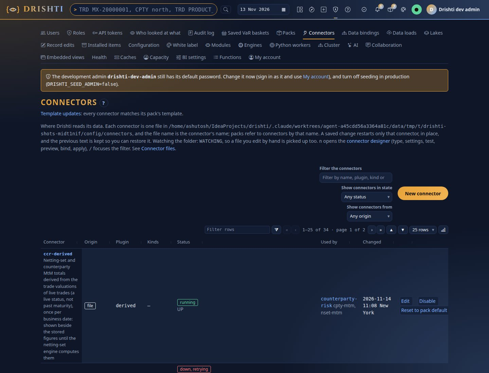

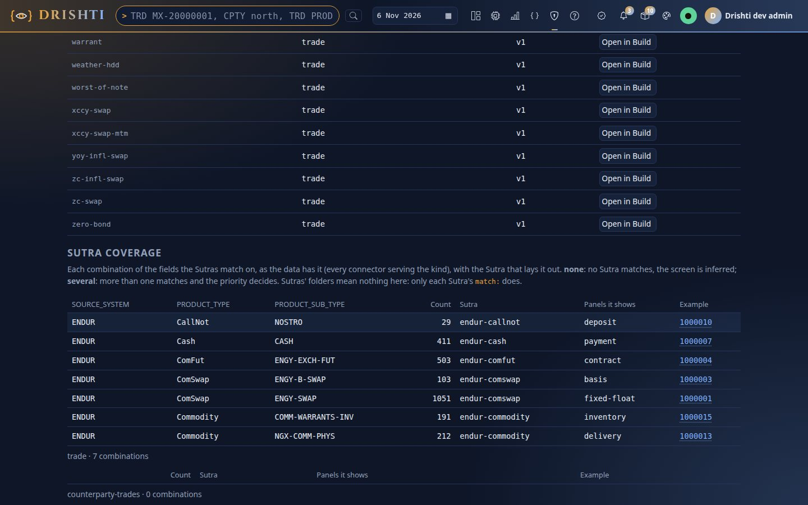

### 12.4 The demo, page by page

| # | Show | How |
|---|---|---|
| 1 | An ENDUR deal from your file | type one of your trade ids → Enter: ticket, legs, cash flows, resets, events |
| 2 | Trades by system and product | **Views → Forms → Trading**: Source system `ENDUR`, a product type → Search; then `CALYPSO`, `MUREX` |
| 3 | A CALYPSO and a MUREX deal | `/v/trade/CLY-3000157`, `/v/trade/MX-20000001` |
| 4 | Counterparty → netting set → CSA → collateral | `CTRD CP-NORTHPLAINS`, then click through |
| 5 | A curve | `/v/commodity-curve/CMDC-BRENT` |
| 6 | An equity price and news | `/v/listed-company/CO-AAPL`; `/v/news-topic/TOPIC-FED` |
| 7 | Compare two dates | on a trade, pick one of your dates → **Compare** → the other |
| 8 | BI by source system | **BI → Catalogue → Trades overview**; change a slicer |
| 9 | VaR and exposure on your data | `VAR BANK`, `EXP BANK` (section 9) |
| 10 | A history | `TRD <your id> 60` (two or more of your files), `TRD 1000279 60` (amended ten times); **C** changes only, **D** the fields that changed |

| | |
|---|---|
| 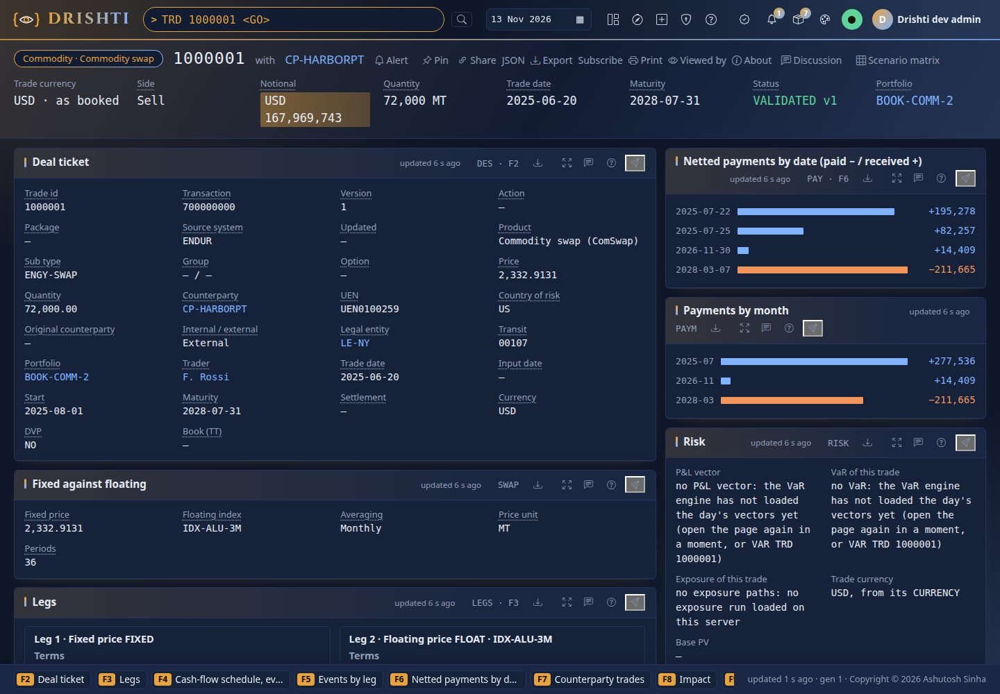 **1. An ENDUR deal** | 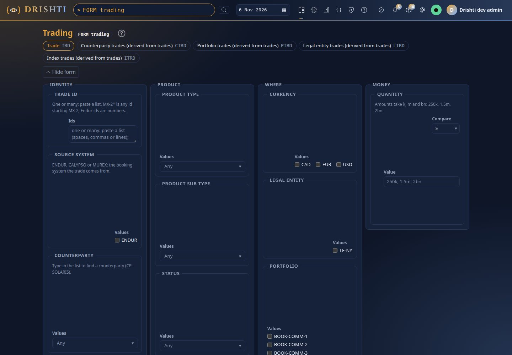 **2. Forms → Trading** |


The pictures are of the synthetic data, loaded exactly as in 11.2.

**Optional: the S3 tests**, against simulators that need no `.exe` and no Docker: `pip install "moto[server]==5.2.3"`, then
`.\mvnw.cmd -q -pl :drishti-identity,plugins/drishti-plugin-iceberg -am test "-Dtest=S3ContentStoreTest,S3MockContentStoreTest,MinioContentStoreTest,NativeOnS3SimulatorTest" "-Dsurefire.failIfNoSpecifiedTests=false"`
and `& $py -m unittest -v tools\lake\test_s3_simulators.py`. The MinIO tests are skipped on Windows (they run a server binary).

Afterwards stop both, and check that `git status` (in a clone) shows nothing new outside `data\` and that your files never left
`<private>`. Temporary files (`data\tmp`), caches (`data\cache`) and the grouped pages (`data\derived`) may be deleted while both are stopped.

## 13. Troubleshooting

| What you see | Do this |
|---|---|
| `Drishti needs Java 21 or newer` (build or start) | `JAVA_HOME` (or `DRISHTI_JAVA_HOME`, or `--java-home`) at a JDK 21 |
| PowerShell says `lake` is not recognized | `lake …` is a sub-command: `& $py "$tools\drishti.py" lake …` |
| `python3.13 -m venv` fails on Linux with *ensurepip is not available* | `sudo apt install python3.13-venv`, or use `uv venv` |
| `Port 18480 (or 17480) is already in use` | another copy is running: `python3 tools/drishti.py status` shows it; stop it (`python3 tools/drishti.py stop server`, `systemctl stop`, `launchctl unload`); more in [7.6](#76-when-a-command-stops-with-an-error) |
| The console shows *Server not reachable* | the server is not up yet, or `--server` names the wrong address; `curl http://<host>:18480/actuator/health` |
| Every page empty; the console's log says `DRS-5010 missing bearer token` | the console and the server need the same `DRISHTI_TOKEN_SECRET`, and `DRISHTI_AUTH_ENABLED=true` on the console |
| The server refuses to start: `drishti.security.secret must be at least 32 bytes` | a longer `DRISHTI_TOKEN_SECRET` |
| Pages show the packs' samples, not the lake; quotes or news try the internet | `DRISHTI_DEMO_ENABLED=false` and `DRISHTI_OFFLINE=true` (or `--demo`) |
| `VAR BANK` says no data for today | the demo lake ends on another date: rebuild it (`lake demo`), or pick its last date in the date box |
| BI shows 0 trades while Admin → Lakes has the table; Admin → Connectors shows `DRS-1046`; Health lists connector files *safe to delete* | an older release's generated connector files or bindings: stop both and move them aside ([4.4](#41-upgrading-an-older-install-start-from-clean-state)); the templates serve every connector |
| The start stops with *names …dev.ini, which is not a file* | make the settings file ([5.1](#51-the-settings-file)); every IDE run configuration names `$USER_HOME$/drishti-envs/dev.ini` |
| The start stops with *the server cannot start: … nothing names its folder* or *… holds no identity database* | name the folders: the settings file's `[roots]`, or `drishti.py start server` (which names them); a new data folder must be named, never found |
| A stream connector shows *waiting for broker* | nothing to do unless you want live updates: no broker is needed; give one with a `[broker.default]` section ([5.1](#51-the-settings-file)) |
| `OutOfMemoryError` | a larger `-Xmx` (`--heap 8g`): about 4 GB per 400,000 trades a day |
| A page says `DRS-1004 … timed out` the first time | the first read of a date on a large table; open it again; exclude `data` from real-time antivirus scanning |
| *documents are not cached on disk* in the log | a second server uses the same data folder: one data folder per server |
| A module's pages are missing | `GET /api/v1/modules`: the module under `off` with its reason; switch it on and restart |
| A lens is not offered | `DRISHTI_LENSES` names it, and its modules are on |

Everything else, with the error codes: [OPERATIONS_GUIDE.md › Troubleshooting](guides/OPERATIONS_GUIDE.md#21-troubleshooting).

---

*Copyright (c) 2026 Ashutosh Sinha <ajsinha@gmail.com>. All rights reserved.
Proprietary and confidential. Unauthorised copying, use or distribution is prohibited.*
