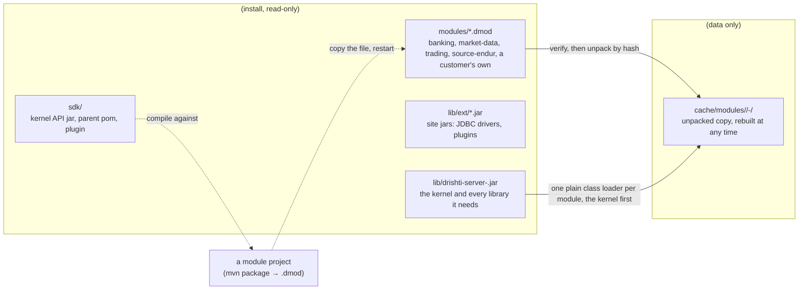

<!--
  Project Drishti · Any data. Any domain. One grammar.

  Copyright (c) 2026 Ashutosh Sinha <ajsinha@gmail.com>.
  All rights reserved.

  PROPRIETARY AND CONFIDENTIAL.

  This file is the confidential and proprietary property of Ashutosh Sinha.
  Unauthorised copying, use, modification, distribution or disclosure of this
  file, via any medium, is strictly prohibited except with the express prior
  written permission of the copyright holder.

  See the LICENSE file in the root of this repository for the full terms.
-->

# Modules outside the server jar (release i5): the design

**Status: design, nothing built.** Coding starts when the owner has answered the questions of [section 10](#10-open-questions-for-the-owner).

**The requirement** (product owner, 2026-11-16). Every Drishti module (banking, market data, a customer's own) is a separate file,
never part of the server jar. The file is the module's **`.dmod`** package: it carries the module's compiled classes, its packs and
its manifest. The `.dmod` files sit in one folder, **`<DRISHTI_HOME>/modules`** (`DRISHTI_MODULES_HOME`), and the server loads shipped
and custom modules from there. What is core stays inside the server jar. Module developers work apart from kernel developers.
Adding or upgrading a module is dropping or replacing a `.dmod`: **no server rebuild**. There is **no second installed copy** anywhere.

This document does not repeat its neighbours:

| For | Read |
|---|---|
| The `.dmod` format, the manifest, verification V1–V9, the class loader, the SDK, conformance C1–C15 | [KERNEL_AND_MODULES.md](architecture/KERNEL_AND_MODULES.md) sections 3, 4 and 8 |
| Which module a distribution contains | [DISTRIBUTIONS.md](architecture/DISTRIBUTIONS.md) |
| The one resolver (site → modules that are on → kernel) | [KERNEL_AND_MODULES.md section 18](architecture/KERNEL_AND_MODULES.md#18-configuration-resolution-packs-connectors-bindings-and-inbox-rules) |

## Contents

1. [The design on one page](#1-the-design-on-one-page)
2. [What is there today](#2-what-is-there-today) (the inventory)
3. [The module file](#3-the-module-file)
4. [One place, and a cache that cannot shadow](#4-one-place-and-a-cache-that-cannot-shadow)
5. [Loading](#5-loading)
6. [Build and the developer's path](#6-build-and-the-developers-path)
7. [Tests, drills and guards](#7-tests-drills-and-guards)
8. [The plan: the minimum, then the optional items](#8-the-plan-the-minimum-then-the-optional-items)
9. [Documents that change](#9-documents-that-change)
10. [Open questions for the owner](#10-open-questions-for-the-owner)

## 1. The design on one page

**Most of the machinery exists.** The `.dmod` format, its hash list, a class loader per module, the version check with its refusal
in words, the SDK and the conformance checks are built and tested. The requirement is met by **moving where the files are, deleting
the copies and making the loading simpler**, not by building a new loading system. The minimum is:

1. The build writes one `.dmod` per module into a modules folder. The server jar contains **no module**: no class, no pack, no `.dmod`.
2. At start the server lists `<DRISHTI_HOME>/modules/*.dmod`, verifies each one and loads it. Nothing else is a source of modules.
3. A `.dmod` is unpacked once into a **cache named by the file's own hash**. The cache is never listed to find modules, so an old
   folder in it can never be loaded in place of a newer file.
4. Add, upgrade or remove a module: put, replace or delete the `.dmod`, then **restart the server**. The same server jar keeps running.
5. A module developer gets the kernel API from an **SDK folder in the install** and builds a `.dmod` with no kernel source.
6. **The kernel provides every library and always wins.** Spring and everything else in the server jar or `lib/ext` is used from
   there. A `.dmod` that carries its own copy still loads, the kernel's copy is used, and a warning says so. A module's beans join the kernel's **one Spring context**.



**What the minimum deliberately leaves out** (each is optional and priced in [section 8.2](#82-optional-items-each-can-be-skipped)):
adding or upgrading without a restart; banking compiled against the public kernel API only; pushing a `.dmod` to the nodes of a
cluster from Admin; a module repository; loading classes straight out of the `.dmod` with no cache.

**Effort: about 14 builder-days for the requirement itself, and 4 more for the one Spring context** (section 8.1).

## 2. What is there today

### 2.1 What each module puts in the server jar

The full server jar (`drishti-app`) depends on one artefact, `drishti-modules`
(`packaging/drishti-app/pom.xml:35`). That artefact holds `.dmod` packages as resources under `drishti/modules/`
(`packaging/dist/pom.xml:35`), packed by the module tool. No module class is on the kernel's class path: banking's two jars are
`provided` there (`packaging/dist/pom.xml:44-45`) and travel inside `banking-1.0.0.dmod`.

| Module | Source | Has code | In the server jar today | How it reaches a running server today |
|---|---|---|---|---|
| `banking` | `modules/banking/` (`banking-compute`, `banking-service`, `dmod/`) | yes: 211 Java files, 3 packs, 4 `ServiceLoader` files | `banking-1.0.0.dmod` (`packaging/dist/pom.xml:79-90`) | copied out of the jar, then unpacked under the data folder |
| `market-data` | `modules/market-data/` | no | `market-data-1.0.0.dmod` (`:92-98`) | the same |
| `capitalmarkets` | `modules/capital-markets/` | no | `capitalmarkets-1.0.0.dmod` (`:100-106`) | the same |
| `economy` | `modules/economy/` | no | `economy-1.0.0.dmod` (`:108-114`) | the same |
| `trading`, `source-endur`, `source-calypso`, `source-murex`, `source-wss`, `source-swapone`, `source-ici` | `modules/<id>/` | no | nothing | read as **folders** from `<DRISHTI_HOME>/modules` (`drishti.modules.home`: `kernel/drishti-api/.../Roots.java:37,83`; `bin/start-server.sh:135`) |
| `genomics` (the SDK sample) | `modules/genomics/` | yes: 8 Java files | nothing | its own build packs `target/dmod/genomics-0.1.0.dmod` |

So there are **three ways** a module reaches the server today, and the design folds them into one:

| Way | Where it is in the code |
|---|---|
| A `.dmod` inside the server jar, copied to `<data>/modules/shipped`, stored and unpacked to `<data>/modules/installed/<id>/<version>/` | `ModuleDeployConfiguration.java:208-213, 232-236`; `ModuleNode.java:135, 608-637` |
| A source folder under `<DRISHTI_HOME>/modules/<id>/` (or `<id>/dmod/`) | `YamlAccessStore.java:129-146`; `PackResolver.java:227-236` |
| A `.dmod` dropped into `<data>/modules` (auto-deploy), stored and unpacked to `installed/` | `ModuleAutoDeploy.java:30-34`; `ModuleDeployConfiguration.java:50` |

**Where a second copy can win today.** The unpacked copy under `<data>/modules/installed` is read in preference to the shipped
module: `PackResolver.java:39` ("which wins over the development copy") and `:242-248`; `YamlAccessStore.java:141-143` ("the installed
package's manifest is the one read"); and a shipped module of another version is left unused when one is installed
(`ModuleNode.java:627-629`). The drill already has to move `modules/installed` aside before it runs (`tools/drill.sh:578`). The new
design removes the `installed` folder, so this cannot happen.

### 2.2 Compile dependencies between the kernel and the modules

**Kernel → module: none in main code.** No Java file under `kernel/`, `compute/`, `lake/`, `net/` or `plugins/` imports
`com.ash.drishti.banking` or a genomics class, and the list of allowed domain words in the kernel is empty
(`tools/domain_strings_allowed.yaml`: `allowed: {}`). The thin jar already builds with no module (`packaging/drishti-kernel-app/pom.xml`).
What still ties the kernel's **build and tests** to module sources:

| # | Tie | Evidence | In the minimum |
|---|---|---|---|
| K1 | The default server jar is built from the modules | `packaging/drishti-app/pom.xml:35`; root `pom.xml:82-84` | removed (step M1) |
| K2 | The kernel's repository tests have banking on their class path | `testing/drishti-it/pom.xml:33` | moved to the modules' side (M4) |
| K3 | Kernel tests read banking's source files (sample documents, a Sutra, the engine list) | 28 test files of `drishti-server`, for example `SutraCliHelpTest.java:201`, `EngineCatalogueTest.java:73`; 9 of `drishti-packs` | moved, or given a small fixture of their own (M4) |
| K4 | The genomics sample and banking are in the kernel's Maven reactor | root `pom.xml:46, 82` | a profile separates them (M1) |

**Module → kernel internals: banking only, and it is the one real limit.** `banking-service` compiles against the whole server
(`modules/banking/banking-service/pom.xml:35`) and its tests against the server's test jar (`:37`). Its main code imports 104 types of
the kernel API and, outside it, 82 of `drishti-server` (15 × `security.Entitlements`, 21 × the playground and export writers), 67 of
`drishti-compute`, 135 of `drishti-common` (132 of them `DrishtiException` and `ErrorCode`) and 27 of `drishti-identity`: 42 packages,
listed in `modules/banking/kernel-internals.txt`. Because of that list, banking's package names **one exact kernel build** and is
refused on any other (`FirstParty.java:193-197`).

What this means for the requirement, in plain words:

- A module that uses only the kernel API (genomics, every content module, every customer module made with the SDK) can be replaced
  under a running product with **no rebuild of anything else**. It declares a range (`kernel: '>=0.2 <1.0'`) and loads on every
  kernel inside it.
- **Banking can be rebuilt and replaced without rebuilding the server**, as long as the server is the build banking was made for.
  When the kernel is upgraded, banking must be the one built with it. The product ships them together, so this is not felt in
  practice. Removing the limit is the already planned release *2.9.11.i6, banking on the public kernel API only*
  ([IMPLEMENTATION_PLAN.md](architecture/IMPLEMENTATION_PLAN.md)); it is **not** part of the minimum (option O1).

One small gap in the published API: `drishti-kernel-api` needs `drishti-common` to compile
(`kernel/drishti-kernel-api/pom.xml`; two types, `DrishtiException` and `ErrorCode`), but a module's class loader is not given
`com.ash.drishti.common` (`KernelFacts.java:51-53`). The two types move into `drishti-api`, which modules already see (step M6).

## 3. The module file

**One artefact: the `.dmod`.** There is no separate module jar in a `lib` folder. The format is unchanged
([KERNEL_AND_MODULES.md section 3](architecture/KERNEL_AND_MODULES.md#3-the-module-package-dmod)).

| Question | Answer |
|---|---|
| What it holds | `module.yaml` (the manifest), `META-INF/DMOD.MF` (the SHA-256 of every entry), `java/` (the module's own jars), `lib/` (rarely: a library the kernel does not have), `packs/` with their contracts, `data/needs.yaml`, `console/`, `docs/`, and for a source-system module `connectors/`, `mappings/`, `dataload.yaml` |
| What it never holds | credentials; a kernel class; the kernel API. It should not hold Spring or any other library the kernel has: such a copy is ignored with a warning (section 3.1) |
| What a module compiles against | `drishti-kernel-api` (with `drishti-api`) and the kernel's libraries, all scope `provided`. The SDK's parent pom fixes their versions to the kernel's (it does for Spring today, `drishti-sdk/drishti-module-parent/pom.xml:41-43`; it gains the rest from `kernel-libraries.txt`) |
| A library the module needs | the kernel's, compiled against with scope `provided`, at the kernel's version. Only when the kernel does not have it at all: section 3.1 |
| File name | `<id>-<version>.dmod`; the id and version inside the manifest must match the name |
| Versions | the module's own version (semver) and the kernel API range it was built for. The kernel API has its own number (`kernelApi=0.4`, `kernel/drishti-kernel-api/src/main/resources/META-INF/drishti/kernel-api.properties:15`), separate from the product version |
| A mismatch | the module is refused and the server keeps running. The words exist: *"genomics 0.1.0: built for kernel >=1.0 <2.0; this kernel is 0.4"* (`ModuleVerifier.java:83-87`), and for banking *"built for kernel X, this is Y: install the matching module"* (`FirstParty.java:173`). A refused module is absent everywhere, and Health and Admin → Modules show the reason |

### 3.1 Libraries: the kernel's, always

**The rule** (product owner, 2026-11-16). The kernel provides all libraries: those in its server jar and the site's in `lib/ext`.
The kernel's copy always wins. A module developer uses the kernel's Spring version and the kernel's version of everything else.

| Case | What happens |
|---|---|
| The module uses a library the kernel has (Spring, Jackson, Arrow, Caffeine, the Kafka client, …) | compile with scope `provided`; nothing goes into the `.dmod` |
| The `.dmod` carries a jar the kernel has, **in any version** | **the module loads, the kernel's copy is used, and a warning is given in words** that names the module, the library, the module's version and the kernel's version used in its place: *"genomics 0.1.0 carries jackson-databind 2.17.1; the kernel's jackson-databind 2.21.4 is used instead. Remove the jar from the module and compile against the kernel's (scope provided)."* The same sentence appears in three places: from `module pack` and `module check`, in the server's log when the module loads, and on Admin → Health against the module |
| The module needs a library the kernel does not have (rare) | the jar goes in the `.dmod`'s `lib/` folder, named under `java: lib:` in the manifest, and loads from there normally (the field exists; banking's is empty, `modules/banking/dmod/module.yaml:84`). Only that module sees it |
| A site later adds a jar to `lib/ext` that a module also carries | the same: the kernel's side wins and the same warning is given at load and on Health |

**The warning never stops a module.** A copy at an older or newer version than the kernel's may mean the module was compiled
against something the kernel does not offer; if a class or method is then missing, the module fails as any module with a missing
class does, and the warning above it in the log is the explanation.

**How the check knows the kernel's libraries.** The kernel's build writes `kernel-libraries.txt` (each library's name, version and
packages, read from the server jar) into the server jar and into the SDK. The module tool compares a module's jars with it; a
module developer needs no kernel to run the check.

**What people see.** Admin → Health lists, for each module, its extra libraries with name, version and SHA-256 (usually none).

**This is simpler than today.** Today a module's own jars are asked before the kernel's for everything outside a short shared list
(`ModuleClassLoader.java:101-109`; the list, `KernelFacts.java:51-53`), so a module may carry its own versions. That path is removed.
The three third-party libraries in banking's allowance file (`modules/banking/kernel-internals.txt`, the lines marked `# library`)
are no longer needed there.

## 4. One place, and a cache that cannot shadow

### 4.1 The folders

| Folder | Holds | Who writes it |
|---|---|---|
| `<DRISHTI_HOME>/lib/` | the server jar (the kernel and all its libraries) | the installer, the upgrade |
| `<DRISHTI_HOME>/lib/ext/` | the site's jars (`DRISHTI_LIB_PATH`) | the site's administrator |
| **`<DRISHTI_HOME>/modules/`** (`DRISHTI_MODULES_HOME`) | **`*.dmod` files, flat: shipped and custom alike** | the installer, the upgrade, `drishti.py module install` |
| `<DRISHTI_HOME>/sdk/` | the module developer's kit (section 6.2) | the installer |
| `<DRISHTI_DATA_DIR>/cache/modules/` | unpacked copies, by hash | the server; safe to delete at any time |

`DRISHTI_MODULES_HOME` stays a setting of its own (it is one today, `bin/start-server.sh:135`), so a site may keep its modules outside
the install folder; the default is `<DRISHTI_HOME>/modules`.

### 4.2 The rules that make shadowing impossible

1. **Only `.dmod` files in the modules folder are modules.** Discovery lists `*.dmod` there and nothing else. It never lists the
   data folder, the cache, or the class path. The settings `drishti.modules.path`, `drishti.module-deploy.dir` and
   `drishti.modules.shipped` and the file `active.yaml` are removed.
2. **The cache is addressed, never searched.** For each `.dmod` the server computes the file's SHA-256 and uses
   `<data>/cache/modules/<id>/<version>-<first 16 hex digits>/`. If that folder is missing it is unpacked; either way it is checked
   against the hash list inside the package (the existing check V2, `Dmod.java:124`). A changed or half-written cache folder is
   deleted and unpacked again.
3. **The cache is swept at every start.** Any folder in it that does not belong to a `.dmod` present now is deleted. An older
   version's files therefore cannot stay behind.
4. **One file per module id.** Two packages of one id in the folder (`banking-1.0.0.dmod` and `banking-1.1.0.dmod`) is a mistake the
   server does not guess about: neither is loaded, and Health says *"banking: two packages in /opt/drishti/modules (1.0.0, 1.1.0);
   remove one and restart"*. The version that runs is the file that is there.
5. **Leftovers are named, never read.** If a data folder still holds `modules/installed`, `modules/store` or `modules/shipped`,
   Health lists it once as *not read: safe to delete*. The server never deletes it.

### 4.3 The operator's commands

All in Python, in `tools/drishti.py`; none needs a running server.

| Command | Does |
|---|---|
| `module list` | each `.dmod` in the modules folder: id, version, hash, publisher, and (asked of a running server) loaded or refused with the reason |
| `module verify <file>` | the checks without installing |
| `module install <file>` | verifies, copies the file into the modules folder, removes the same id's older file after keeping it as `<file>.previous` beside the data folder's backups, and says *restart the server* |
| `module remove <id>` | removes the file; says *restart the server* |
| `module rollback <id>` | puts the kept previous file back |

Copying the file by hand has the same effect; the commands only add the checks and the backup.

**The product upgrade** replaces the server jar and the first-party `.dmod` files (the ids in `first-party.yaml`), and keeps
`lib/ext` and every other `.dmod`.

### 4.4 A cluster

Every node has the same folder layout. In the minimum, a module reaches a node the way the server jar does: by the site's own
roll-out (a copied file, an image, a shared file system mounted at the same path). The cluster's digest already carries each node's
modules; it gains the package hash, so Admin → Cluster shows a node whose `.dmod` differs from the others.

Promotion between clusters (the i5 cluster design, `CLUSTER_I5_DESIGN.md` section 9, a design of its own) keeps its flow
(plan, four eyes, canary, roll-out). Only its last step changes: where it wrote into a node's module store, it now writes the
`.dmod` into that node's modules folder and restarts the node in its turn. That needs the server process to be allowed to write the
modules folder; a site that keeps the install read-only gets the plan's list of nodes and copies the file itself (question Q5).

## 5. Loading

### 5.1 The class loader: one per module, plain, the kernel first

```
  JDK
   └─ the kernel's loader (the server jar: the kernel and every library)
        └─ the lib/ext loader (the site's jars)
             ├─ module "banking"   : its own jars only
             └─ module "genomics"  : its own jars, and a library of its own if the kernel has none
```

A module's loader is the JDK's ordinary `URLClassLoader` behaviour: **ask the parent first, always; there is no exception.** One
filter is kept from today's loader: a kernel class outside the kernel API (`com.ash.drishti.server…` and the like) is not handed
to a module, except the packages a verified first-party module declares (`FirstParty.allowed`, as built). That filter is what makes
"compiled against the public API only" true at run time.

| Topic | Answer |
|---|---|
| Can a module replace a kernel class or a library? | No. The parent is asked first, so a copy inside a module is never reached; the warning of section 3.1 says which copy was ignored |
| Why one loader per module and not one for all | it costs nothing more (the class exists), it keeps one module's rare extra library away from another's, and it tells the kernel which module a class belongs to (its routes, its beans, its Health row). One shared loader would work for classes but lose that |
| `ServiceLoader` | the kernel reads a module's `META-INF/services` entries through that module's loader (`ModuleBridge.java:208`); unchanged |
| Native libraries | a module ships no `.so` or `.dll` of its own; native maths comes from the kernel through the API. A jar that carries natives inside is declared `native: true` and a site may forbid it ([section 3.1 of the module design](architecture/KERNEL_AND_MODULES.md#31-file-format)); unchanged |

### 5.2 Spring: the kernel's one context

**The rule** (product owner, 2026-11-16): a module's beans are registered in the kernel's one Spring context. There is no context
per module.

**Today** each module gets a child context (`ModuleRuntime.java:177-201`), made after the kernel is fully up
(`ModuleDeployConfiguration.java:207-208`). **The change:**

1. The modules are found, verified and given their loaders **before** the kernel's context is built. Reading module manifests that
   early is already done for settings (`ModuleSettingsEnvironmentPostProcessor.java:83`).
2. Each loaded module's configuration classes (the manifest's `java: spring:`) are registered in the kernel's context before it
   starts. A module's own package scan (banking has one, `BankingAutoConfiguration.java:38`) is answered from that module's loader.
3. A module's bean names get the module's id as a prefix, so two modules cannot clash and none can take a kernel bean's name.
4. The kernel finds a module's controllers and extension beans by the loader of the bean's class, where it asks the module's
   context today (`ApiMounts.java:61-84`, `ModuleBridge.java:200-201`).
5. A module's engine defaults join the settings once, before the context starts (`ModuleWiring.java:116-140` becomes shorter).

**No hard blocker was found.** Banking's Spring use is ordinary: one package scan, 12 settings classes, 2 event listeners, no
scheduler of its own. Two consequences the owner should know:

| Consequence | Detail |
|---|---|
| **A module whose bean fails while it is being created stops the server's start** | Today such a module is refused and the kernel starts without it. With one context there is one start. Every check that can be made beforehand still refuses only the module and lets the server start (manifest, hashes, version range, licence, missing classes). What remains is an error inside a bean's own constructor; the server then stops with the module named: *"The server cannot start: module genomics 0.1.1 failed while starting (GenomicsData: …). Remove /opt/drishti/modules/genomics-0.1.1.dmod or switch the module off in config/modules/genomics.yaml, then start again."* |
| **A module's code leaves only at a restart** | Consistent with section 5.4. The code that closes a module's context in a running server, and the conformance check that loads and unloads a module repeatedly (C15), are deleted. *Off means gone* (C13) and *absent everywhere* (C14) are proved across a restart |

### 5.3 Start, and on or off

| Step | What |
|---|---|
| 1 | Settings, the registry and the licence (plain files) |
| 2 | List `*.dmod`, read manifests, order by `requires`, verify, unpack to the cache, make loaders (`ModuleDiscovery.java:53-99`, re-pointed at the files). A refusal carries on to the modules that need the refused one |
| 3 | The kernel's context starts with the modules' configuration classes in it |
| 4 | Each module's entry point is started; packs, Sutras, functions and routes are registered, as today |

**On and off** are unchanged for the administrator: the switch (`config/modules/<id>.yaml`), the licence and the distribution
decide ([ACCESS_MODEL.md](architecture/ACCESS_MODEL.md)). A module that is off at start is not loaded at all. A module switched off
while the server runs is refused at every door at once, as today, and its jobs are stopped; its classes leave at the next restart.

### 5.4 Hot load and unload without a restart: not in scope

**Recommendation: restart.** A promise of swapping code in a running server means proving, on every release, that banking leaves
no thread, cache or connection behind. A module change is rare, and a node restart is a practised operation (a cluster restarts
node by node with no outage). Packs, Sutras and settings inside a loaded module keep reloading without a restart, as today. With
one Spring context, hot unload is not possible at all; that is accepted.

## 6. Build and the developer's path

### 6.1 The product's own build

| Build | Command | Result | Needs |
|---|---|---|---|
| The kernel | `./mvnw clean package` | `lib/drishti-server-<v>.jar` (no module in it) and the SDK folder | no module source |
| The modules | `./mvnw clean package -Pmodules` (the drill's default) | every module's `.dmod` in one folder, `packaging/dist/target/modules/` | the kernel of the same run |

- `drishti-app` loses its dependency on `drishti-modules`; with that it is the same thing as `drishti-kernel-app`, so **one of the
  two is deleted**. One server jar remains.
- `packaging/dist` packs **every** module (it packs four of twelve today), writes them to a folder instead of into a jar, and still
  writes `first-party.yaml`, which the server jar carries.
- In a source checkout, `DRISHTI_MODULES_HOME` is `packaging/dist/target/modules` (the start scripts and the IntelliJ run
  configurations name it, as they name the built jar today, `bin/start-server.sh:174`). A release lays the same files out as
  `<home>/lib` and `<home>/modules`.
- Nothing is installed into `~/.m2`, as today (`tools/drill.sh:300`): the first-party modules build in the same Maven run as the
  kernel they are made for.

### 6.2 A module developer without the kernel's source

The install carries `<DRISHTI_HOME>/sdk/`:

| In it | For |
|---|---|
| `lib/drishti-kernel-api-<v>.jar`, `lib/drishti-api-<v>.jar` (with sources and Javadoc) | any build tool or IDE: add the two jars as compile-only |
| `repo/` (a Maven repository as plain files: the API jars, `drishti-module-parent`, `drishti-module-maven-plugin`, the archetype) | Maven: the generated project names it as a repository by its absolute path; nobody runs `mvn install` on kernel code |
| `drishti-module-tool.jar`, `kernel-libraries.txt` | pack and check a module without Maven; the list of libraries the kernel provides, with versions |

The developer runs `drishti.py module new <id>`, writes the module, and `mvn package` gives `target/dmod/<id>-<version>.dmod`,
already checked (the genomics sample does exactly this, `modules/genomics/pom.xml`). The SDK's artefacts are cut at a release and
never change afterwards, so a copy Maven keeps in its own cache is always the right one.

### 6.3 The IDE

| Who | How they run and debug |
|---|---|
| Kernel developer | the run configuration *Drishti server* starts `DrishtiApplication` with `DRISHTI_MODULES_HOME` at the built `.dmod` folder. Breakpoints in module code work when the module's sources are open in the same project, because the debugger matches classes by name whatever loader holds them |
| Module developer (in the repository) | a *Build modules* step (`package -Pmodules -pl <module> -am`, seconds for one module) before launch, then the same run configuration |
| Module developer (own project) | `drishti.py module run`: starts the installed server with this project's `.dmod` only, on free ports (`tools/modulecli.py:243-280`), with the debug port open |
| Editing packs and Sutras with no rebuild | the existing development switch `drishti.modules.dev` reads a module's source folder directly; it is refused in a cluster and under a production profile (`ModuleDeployConfiguration.java:133-150`) and Health marks the module *development (unverified)* |

## 7. Tests, drills and guards

**What changes**

| Area | Change |
|---|---|
| Kernel tests | no module on the class path and no read of `modules/<id>/…` source files. The 28 + 9 test files of K3 either move to the module they test or use a small fixture pack in the kernel's own test resources |
| `drishti-it` | the repository rules stay; the banking dependency goes; the tests that start a server with modules move to a new `testing/drishti-modules-it`, which runs against the built `.dmod` folder |
| Banking's tests | unchanged in content; still compiled against the server's test jar until i6 |
| Conformance | C15 (load and unload cycles) is deleted; C13 and C14 run across a restart; a new check warns of a library the kernel already has |
| Python tests and the resolver's twin | `drishti-console/core/resolution.py` and the shared fixture of file trees follow the Java resolver: `.dmod` folder and cache, no `installed` |
| The drill | builds kernel then modules in one Maven run; starts servers with `DRISHTI_MODULES_HOME` at the built folder; `modules/installed` leaves its list of state to clear (`tools/drill.sh:578`) |
| VaR goldens | **must stay exactly equal.** Nothing in the maths, the data or the class that computes changes: the same banking jars, with the same libraries (the kernel's, as today for everything banking uses), from another folder. The exact-equality VaR check runs on the branch's pre-merge gate after each step M1–M4, not only at the drill |

**Guard tests to add**

| # | Guard | Fails when |
|---|---|---|
| G1 | The server jar holds no module | the built jar contains a `.dmod`, a class of a module's package, or a module's `META-INF/drishti/*.yaml` |
| G2 | The kernel does not depend on a module | a `pom.xml` outside `modules/` names a module artefact in any scope, or a kernel test opens a path under `modules/` |
| G3 | One place | a planted `<data>/modules/installed/banking/0.9.0/` or a planted old cache folder changes what loads; the cache folder must be gone after the start and the leftover named in Health |
| G4 | No guessing | two packages of one id load one of them |
| G5 | Replace without rebuild | the same server jar (same hash), restarted after `genomics-0.1.0.dmod` is replaced by `0.1.1`, does not serve 0.1.1; and after the file is deleted, still serves genomics |
| G6 | Refusal in words | a module built for another kernel API range loads, or is refused without the range and the kernel's version in the message |
| G7 | The kernel alone | the server does not start, or Health is not green, with an empty modules folder |
| G8 | Cache integrity | a file changed inside the cache is used as it is |
| G9 | No reader beside the resolver | code outside the resolver and the module runtime lists the modules folder or the cache |
| G10 | The kernel's libraries win | a `.dmod` carrying a jar the kernel has (Spring, or Jackson at another version) gets a class from its own copy; or the module does not load; or the warning is missing from the pack and check output, the server log or Health, or does not name the module, the library and both versions |
| G11 | One context | a second Spring context exists in a server with modules; or a module's bean has a kernel bean's name |
| G12 | A failing module is named | a module whose bean throws at start stops the server without the module's id, its file and what to do in the message |

## 8. The plan: the minimum, then the optional items

### 8.1 The minimum (about 14 builder-days, and 4 for the one Spring context)

| Step | What | Days | Risk |
|---|---|---|---|
| M1 | Build: `packaging/dist` packs all twelve modules into a folder; `drishti-app` drops the modules; one server jar (the other packaging module deleted); the `-Pmodules` profile; G1 | 1.5 | low |
| M2 | One place: discovery from `*.dmod` in the modules folder; the cache by hash and its sweep; the registry, the resolver, the Java module node and the Python twin re-pointed; `installed`, `store`, `shipped`, `active.yaml` and the three settings deleted; source folders read only under the development switch; G3, G4, G8, G9 | 4 | **medium**: every reader of a module folder is touched (the resolver's inventory lists them); done in one branch so there is never a mixed state |
| M2b | The plain loader (the kernel first, always), `kernel-libraries.txt`, the warning for a library the kernel already has (module tool, server log, Health), the Health rows of extra libraries; G10 | 1 | low: banking and genomics carry no library of their own today |
| M3 | Launchers, the IntelliJ run configurations, Docker, systemd, the stack and the drill name the modules folder; a release lays out `lib/`, `lib/ext/`, `modules/`, `sdk/`; `drishti.py module list, verify, install, remove, rollback` as file operations; G5, G7 | 2 | medium: many scripts, one launch-matrix test |
| M4 | Tests: K2 and K3 untied, `drishti-modules-it`, the Python fixture, G2, the VaR exact check on the gate | 2.5 | low; tedious |
| M5 | Documents (section 9) | 1 | low |
| M6 | The SDK folder in the install (`sdk/lib`, `sdk/repo`, the tool jar); `DrishtiException` and `ErrorCode` into `drishti-api`; the archetype's project builds against the folder with no kernel source (a test builds genomics that way); G6 | 2 | low |
| M7 | One Spring context: modules found before the context starts, their classes registered in it, name prefixes, the lookups by loader, the child-context and unload code deleted, the conformance changes; G11, G12 | 4 | **medium to high**: it changes the order of the server's start. Prototype on genomics first, then banking; the VaR exact check after it |

Order: M1 → M2 (+ M2b) → M3 → M4, with M6 beside M2 (another builder), then M7, and M5 last. M1–M6 meet the requirement of
2026-11-16 by themselves; M7 is the owner's rule on Spring and is placed last so that it is done on a green base. One full drill
at the end, and a second if M7 needed fixes.

**Relative to the other i5 work**

| Other work | Order | Why |
|---|---|---|
| Core move (the `core` pack into the market-data module) | **before** this | it moves files inside `modules/`; this design then packs them as they are |
| Thin console | in parallel, agreed on one point | both touch `core/resolution.py`; whichever merges second rebases that one file |
| Cluster | this **before** the cluster's deploy and promotion items | they write a `.dmod` to a node; they should be written once, against the modules folder |
| Live | independent | |

### 8.2 Optional items (each can be skipped)

| # | Item | Buys | Days | Recommendation |
|---|---|---|---|---|
| O1 | Banking on the public kernel API only (the 42 packages to none; the exact-build tie removed) | a banking `.dmod` that survives a kernel upgrade inside its API range | 12–18 | **skip in i5**; it is release i6 already |
| O2 | Push from Admin: the deploy and promotion flows write the `.dmod` to each placed node and restart it in turn | no manual copy in a cluster | 2 on top of the cluster work | with the cluster items, if Q5 is answered yes |
| O3 | Hot load and unload | a module change with no restart | not possible with one Spring context; would need the context per module kept | **skip** |
| O4 | An API difference gate (`japicmp` on the API jar at every release) | a kernel change that breaks modules fails the build, not a customer | 1 | worth doing soon; not needed to meet the requirement |
| O5 | Loading classes and packs straight from the `.dmod`, no cache | no unpacked files at all | 5+, and every pack reader learns to read a zip | **skip**: the cache already cannot shadow |
| O6 | A module repository or marketplace | search and download of modules | not estimated | **skip** |
| O7 | Signing with publisher keys | proof of who built a module | planned in release j | not here |

**Said plainly:** the requirement is met by M1–M6 (about 14 days). No new class-loading system, no registry, no hot reload; the
loader and the Spring wiring both become smaller than they are today. If time is short, M6 can follow one release later for
outside developers (the in-repository modules do not need it), and M7 can follow too: the server works correctly with the context
per module it has today, so M7 changes structure, not behaviour that the requirement needs. The smallest shippable set is
M1–M5, about 12 days.

## 9. Documents that change

| Document | Change |
|---|---|
| [KERNEL_AND_MODULES.md](architecture/KERNEL_AND_MODULES.md) | section 3.1 (installed unpacked → the cache), 4.1 (the settings table: one modules folder), 4.2 (discovery), 4.10 (restart is the rule), 7.1 (the commands), 8.1 and 8.8 (the SDK folder), 18.1 and 18.2 (one folder, no store) |
| [DISTRIBUTIONS.md](architecture/DISTRIBUTIONS.md), [DOMAIN_MODULES.md](architecture/DOMAIN_MODULES.md) | a distribution is the server jar and a set of `.dmod` files; "installed = in the jar" removed |
| `docs/admin/CONFIGURATION.md` (generated) | the removed settings, the modules folder, the cache |
| [DEPLOYMENT_AND_QA_GUIDE.md](DEPLOYMENT_AND_QA_GUIDE.md), `OPERATIONS_GUIDE.md`, `ADMIN_GUIDE.md` | the install layout, add / upgrade / remove a module, the product upgrade, what to delete from an older data folder |
| `DEVELOPER_GUIDE.md`, [QUICKSTART_DEVELOPERS.md](QUICKSTART_DEVELOPERS.md) | the two builds, the run configurations, the SDK folder, `module run` |
| `CLI_REFERENCE.md`, `CLUSTER_GUIDE.md` | the module commands; a module on the nodes of a cluster |
| [TEST_HARNESS.md](architecture/TEST_HARNESS.md) | the modules' test project and the guards G1–G9 |
| `README.md`, `HOW_IT_FITS.md`, `bin/README.md`, `CHANGELOG.md` | the layout and the one-line statement of the rule |

This document is deleted when the work is built; its facts live in the documents above.

## 10. Open questions for the owner

| # | Question | Recommendation |
|---|---|---|
| Q1 | Unpack each `.dmod` into a cache named by its hash, or load straight from the file? | **The cache.** It cannot shadow (rules 4.2), it reuses every reader as it is, and it costs days less |
| Q2 | Two packages of one id in the folder: load the newer, or refuse both? | **Refuse both, in words.** The file that is there is the version that runs; no guessing |
| Q3 | Is "restart to add, upgrade or remove a module" acceptable for i5? | **Yes.** Packs and settings keep reloading live; code changes at a restart |
| Q4 | With one Spring context, a module whose bean fails while starting stops the server's start (section 5.2), where today the module is refused and the server starts without it. Accept? | **Accept**, with the message that names the module, its file and what to do. Everything that can be checked beforehand still refuses only the module |
| Q4b | One class loader per module (plain, the kernel first) or a single loader for all modules? | **One per module**: it is already there, and it is how the kernel knows whose class a bean or a route is |
| Q4c | M7 (the one Spring context) in the same release as M1–M6, or the release after? | **Same release, as the last step**, started only when M1–M4 are green |
| Q5 | May the server write its own modules folder (so Admin and promotion can place a `.dmod` on a node), or is the install strictly read-only to it? | **Read-only by default; a site may switch writing on**, or point `DRISHTI_MODULES_HOME` outside the install. Without it, an operator copies the file |
| Q6 | Banking stays tied to the exact kernel build until i6. Accept for i5? | **Yes.** It ships with every kernel; customer modules are not tied |
| Q7 | The SDK folder (M6) in i5, or one release later? | **In i5** if a second builder is free beside M2; otherwise next |
| Q8 | In a source checkout, where do built `.dmod` files go? | **`packaging/dist/target/modules`**, named by the start scripts and run configurations; the source tree `modules/` holds sources only |
| Q9 | The development switch that reads a module's source folder (for editing packs without a rebuild): keep? | **Keep**, developer machines only, refused in production as today, marked in Health |
| Q10 | The product upgrade replaces first-party `.dmod` files and keeps the others. A custom module built for the old kernel API range is then refused at the next start. Refuse the upgrade beforehand instead? | **Warn before, never block:** the upgrade command lists every `.dmod` the new kernel would refuse, with the reason, and asks to continue |
| Q11 | This document's home: `docs/` (as asked) or `docs/architecture/` beside the other i5 designs? | **`docs/architecture/`** at merge, with a row in `docs/README.md` |
