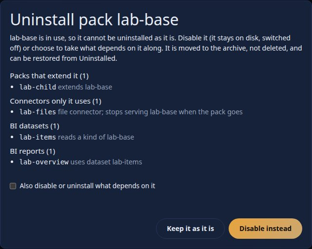
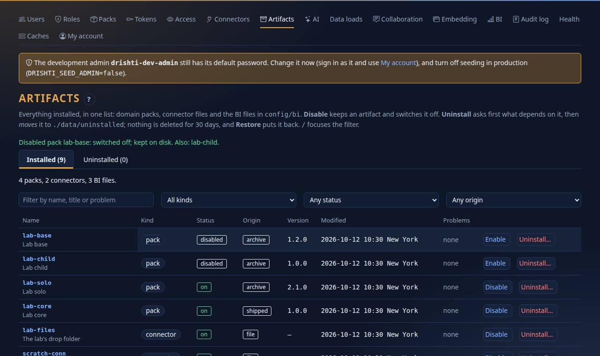
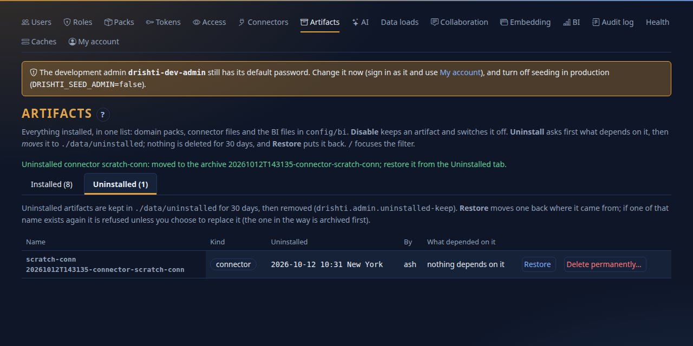
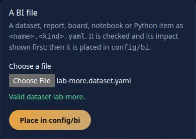
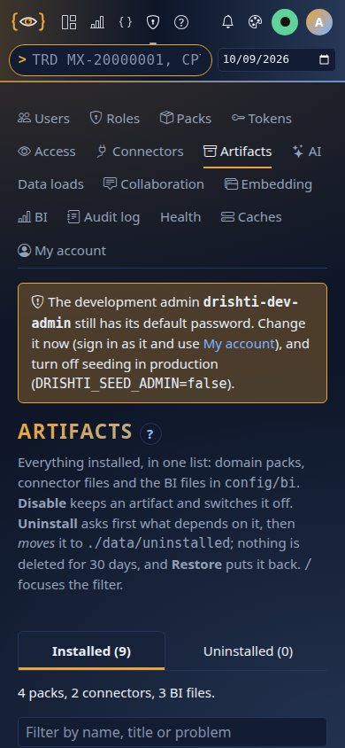
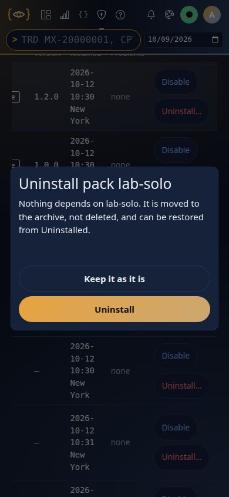

<!--
  Project Drishti · Any data. Any domain. One grammar.

  Copyright (c) 2026 Ashutosh Sinha <ajsinha@gmail.com>.
  All rights reserved.

  PROPRIETARY AND CONFIDENTIAL.

  This file is the confidential and proprietary property of Ashutosh Sinha.
  Unauthorised copying, use, modification, distribution or disclosure of this
  file, via any medium, is strictly prohibited except with the express prior
  written permission of the copyright holder.

  See the LICENSE file in the root of this repository for the full terms.
-->
# Admin → Artifacts: install and uninstall safely

Everything an administrator installs on a Drishti site is a file or a folder that the server watches: **domain packs** (`config/packs`, `data/packs/installed`),
**connector files** (`config/connectors`) and the **shipped BI files** (`config/bi`: datasets, reports, boards, notebooks, Python items). **Admin → Artifacts**
(`/admin/artifacts`) lists all of them in one place, tells you what depends on each before you touch it, and gives you a way out that cannot lose anything:
*disable* (keep it, switch it off) or *uninstall* (move it to an archive you can restore from). It is for administrators only.

- [1. The list](#1-the-list)
- [2. What depends on it: the impact](#2-what-depends-on-it-the-impact)
- [3. Disable and enable](#3-disable-and-enable)
- [4. Uninstall](#4-uninstall)
- [5. The Uninstalled tab: restore, delete for good, retention](#5-the-uninstalled-tab-restore-delete-for-good-retention)
- [6. Install](#6-install)
- [7. The audit trail](#7-the-audit-trail)
- [8. The API, the codes and the settings](#8-the-api-the-codes-and-the-settings)
- [9. Recipes](#9-recipes)
- [10. If something goes wrong](#10-if-something-goes-wrong)

The same safe uninstall is on the pages you already use: **Admin → Packs** (an *Uninstall…* button on each pack), **Admin → Connectors** (on each connector with a
file, the list and the connector's own page) and **Admin → BI** (a *Shipped files* table). They all open the same dialog, so the answer is the same wherever you
start. The folders are still watched: an artifact you add, edit or delete by hand is picked up as before ([PACKS.md](../guides/PACKS.md#live-reload-the-packs-folder-is-watched),
[CONNECTOR_FILES.md](../connectors/CONNECTOR_FILES.md), [config/bi/README.md](../../config/bi/README.md)). This page is the careful way to do the same.

## 1. The list


One row per artifact:

| Column | Meaning |
|---|---|
| **Name** | The artifact's name; a link to its own page (a pack's page, a connector's page, the BI item). The line under it is its title or description. |
| **Kind** | `pack`, `connector`, or for BI the kind of file: `dataset`, `report`, `board`, `notebook`, `python`. |
| **Status** | `on`; `disabled` (kept, switched off); `not loaded` (a pack on disk the server has not loaded); `problem` (something is wrong; see *Problems*). |
| **Origin** | `shipped` (a pack in the packs folder, or a BI file in `config/bi`), `archive` (a pack deployed from an archive or the registry: `data/packs/installed`), `file` (a connector file, or one placed by hand), `ui` (a connector saved from the console), `template` (a connector a pack's template wrote), `application` (a connector only the server's own configuration defines; deprecated). |
| **Version** | A pack's `version:`; `v1`, `v2`... for a BI file (counts the content changes the server has seen); empty for a connector. |
| **Modified** | When the file last changed (your clock zone). |
| **Problems** | What the server says is wrong: a pack refused at load (the reason), a connector file that does not parse or whose connection is down, a BI file that does not parse (and whether its last good version is in use). |

The filter box searches name, title and problems; the three menus narrow by kind, status and origin. **/** focuses the filter. The heading's **?** opens this page
in the help centre.

## 2. What depends on it: the impact

Before it offers Uninstall, the page asks the server what would stop working. The question is the same for every artifact, and the answer is a count and the first
25 names for each kind of dependant. Administrators see everything; nothing is masked.

| You ask about | It lists |
|---|---|
| **A pack** | Packs that extend it; connectors only it uses (no other loaded pack names them: they stop when it goes); BI datasets that read one of its kinds, and the reports, boards and composed datasets over those; **saved searches**, **monitors**, **alert rules** (on a kind of the pack), **measure alerts**, **subscriptions**, **workspaces** and saved pivots, layouts and reports that name one of its kinds; **shares** of its kinds; **embed hosts** whose kinds include one of its kinds. |
| **A connector** | The packs that read through it and the kinds each sends to it; BI datasets that scan it, and what is over those; saved documents, shares and embed hosts on the kinds it serves; and whether a pack's **connector template** would write it back (then it can only be disabled or reset). |
| **A BI file** | The other BI files that name it (a dataset: the reports, boards, notebooks, composed and derived datasets that use it; a report: the boards with a tile on it; a Python item: the datasets and reports that call it), and then what names *those*, down to six steps; **measure alerts**, **alert rules**, **subscriptions**, workspaces and saved views that name it; embed hosts on the kinds a dataset reads. |



How things are matched, because it reads text and not a dependency graph. A BI file names another by a small set of keys (`dataset:`, `report:`, `board:`,
`notebook:`, `python:`, `transform:`, `connector:`, `kind:`), as a name or as `file:<kind>:<name>`; free text (titles, descriptions, notes) is never matched. A saved
document (a monitor, an alert rule, a workspace, a subscription) is matched on the values of the keys that hold a reference (`kind`, `entity`, `ref`, `path`,
`dataset`, `report`...), so a monitor that names a kind only in its title is not counted, and one that names it in a reference is, even if it no longer works. Items
in other people's workspaces count (the draft ones are marked *a draft*). The list is a safeguard for the person about to click, not a guarantee that nothing else
reads the artifact: a script that calls a view of one of the kinds is not a thing the server can see.

## 3. Disable and enable

**Disable** keeps the artifact exactly where it is and switches it off. It is the default way out whenever something depends on the artifact.

| Artifact | Disable does | Enable |
|---|---|---|
| Pack | Switches it off for everyone (`Admin → Packs → Switch off`): its kinds, mnemonics and views disappear. The folder stays; nothing is unloaded from disk. A pack that enabled packs extend is refused unless you also switch those off (*Also disable the packs that build on it*); they go first. | Switches it on, and what it builds on. |
| Connector | `enabled: false` in its file (the file and its history stay). The connector stops; kinds routed to it report it. A connector a pack's template names can be disabled (it is not uninstallable). | `enabled: true`. |
| BI file | Hides it from the catalogue (the file stays in `config/bi`; the list of hidden files is `data/admin/bi-hidden.txt`). Reports and boards that read a hidden dataset keep their own rows in the catalogue but cannot run it while it is hidden. | Shows it again. |


Both packs now read *disabled* and each row offers **Enable**; the folders, the connector and the BI files are untouched:



## 4. Uninstall

*Uninstall…* opens a dialog that first asks the server for the impact (section 2).

- **Nothing depends on it.** The dialog says so and offers **Uninstall**. The folder or file is **moved** to the archive. It is not deleted.
- **Something depends on it.** **Uninstall is not offered.** The dialog lists the dependants and offers **Disable instead**. The server refuses the call as well, with
  `409 DRS-5041` and the same list, so a script that skips the page gets the same answer.
- **Take the dependants along.** Tick *Also disable or uninstall what depends on it* and **type the artifact's name**. Then: packs that extend it are uninstalled
  (deepest first); connectors only it uses are disabled; BI files that depend on it are hidden. Saved searches, monitors, alert rules, subscriptions and the like are
  people's own: they stay, and say so when they are opened. Without the typed name the server answers `422 DRS-5043` and does nothing.
- **A connector a pack's template names** can only be disabled or reset: the pack would write it back at the next start. The dialog says so (`DRS-5044` from the API).
- **A pack named in `DRISHTI_PACKS` / `drishti.packs.enabled`** cannot be uninstalled here (the server would not start without it): take it out of the setting and
  restart, or disable it (`DRS-5044`).
- **A connector that comes only from the server's own configuration** (`application.yaml`) has no file to move: disable it.


Where it goes: `data/uninstalled/<timestamp>-<kind>-<name>/` (setting `drishti.admin.uninstalled-dir`):

```text
data/uninstalled/20261012T142658-connector-scratch-conn/
├── payload/scratch-conn.yaml          the file (or the whole pack folder) exactly as it was
└── uninstalled.json                   who, when, what depended on it, and where it came from
```

The move is what the watchers see: the pack is unloaded, the connector stops, the BI file leaves the catalogue, each as it does when you delete the file by hand. The
page then says what it did and where it went.

## 5. The Uninstalled tab: restore, delete for good, retention



- **Restore** moves the archive back to where it came from (a pack to the folder it left, a connector to the connectors folder, a BI file to its `config/bi`
  folder) and the watchers pick it up. If an artifact of that name exists again, Restore is refused (`409 DRS-5042`); you can choose to **replace** it: type the
  name, and the one in the way is itself archived first, so nothing is lost either way. Restore puts back the artifact only: what was switched off or hidden when it
  was uninstalled *with its dependants* stays off until you **Enable** it from the Installed tab.
- **Delete permanently** removes an archive for good. Type its name (`422 DRS-5043` otherwise). This is the only way an artifact leaves your hands, apart from retention.
- **Retention.** Archives older than `drishti.admin.uninstalled-keep` (default 30 days) are removed by a job that runs once a day (`drishti.admin.uninstalled-prune-interval`);
  each removal is an audit event. `0` keeps archives for ever. An uninstall that you meant to be final does not need a purge: after 30 days it is gone.

## 6. Install

The *Install* section of the page has three cards:

- **A pack.** Upload an archive on **Admin → Packs → Deploy an archive** (`.tar.gz` or `.zip`): it is verified and previewed (breaking changes marked) before
  anything changes, and the version it replaces is kept for roll-back ([PACKS.md](../guides/PACKS.md)). The card links there.
- **A connector.** **Admin → Connectors → New connector**: a form or YAML, tested before it is saved ([CONNECTOR_FILES.md](../connectors/CONNECTOR_FILES.md)).
- **A BI file.** Choose a file named `<name>.<kind>.yaml` (`kind` is `dataset`, `report`, `board`, `notebook` or `python`). **Nothing is written yet**: the server
  checks it and tells you what it found.



  The checks: the file name; UTF-8 text up to `drishti.admin.bi-upload-max-bytes` (1 MiB); YAML with a mapping at the top; the file's own key (`dataset: lab-more`)
  agrees with its name; and for datasets, reports and boards the same parser the server uses finds no error (warnings are shown and do not stop it). If a file of
  that name is already there, the card says so and lists what depends on it; placing it then needs *Replace* and the name typed, and the old file is archived first.
  The file is placed atomically and appears in the catalogue at once. Notebooks and Python items get the structure checks; a Python item's tests and sandbox
  checks run when it is published or used, as for any Python item.

## 7. The audit trail

Every action is an audit event (Admin → Audit log, or `GET /api/v1/admin/audit`) with the subject `<kind>:<name>`, and every refusal is one too:

| Action | Detail |
|---|---|
| `artifact-disabled`, `artifact-enabled` | The impact at the time, the choice (alone or with dependants), the result and what else was switched off. |
| `artifact-uninstalled` | The impact, the choice, `archived as <id>`, and what was taken along. |
| `artifact-restored` | The archive, plain or replace, where it went back to. |
| `artifact-purged` | The archive and its size. |
| `artifact-pruned` | The archives the daily job removed (actor `system`). |
| `artifact-installed` | A BI file uploaded: its size, new or replace, warnings. |
| `artifact-refused` | What was refused and why: the impact, the typed name that did not match, the name that already exists. |

```text
artifact-disabled     pack:lab-base  impact: Packs that extend it (1), Connectors only it uses (1), BI datasets (1), BI reports (1); choice: with dependants; result: off, kept on disk; also off: [lab-child]
artifact-refused      pack:lab-base  uninstall with dependants refused: the name was not typed
artifact-uninstalled  connector:scratch-conn  impact: nothing depends on it; choice: alone; result: archived as 20261012T142658-connector-scratch-conn
artifact-restored     connector:scratch-conn  from 20261012T142658-connector-scratch-conn; choice: plain; result: back in connectors
```

## 8. The API, the codes and the settings

Every call needs an administrator. **A personal API token never reaches these endpoints** (`* /api/v1/admin/artifacts/**` is in `drishti.security.token-never`): they are
for an administrator at the console, not for a script holding a token. From the console the same-origin and CSRF rules apply.

| Method | Path | Does |
|---|---|---|
| `GET` | `/admin/artifacts` | `{artifacts[], uninstalledDir, keepDays}`; each artifact `{kind, subtype, name, title, state, origin, version, modified, problems[], link}` |
| `GET` | `/admin/artifacts/impact?kind=&subtype=&name=` | `{kind, subtype, name, total, blocked, summary, templated, templatePack, notes[], groups[{category, label, count, more, items[{name, owner, detail}]}]}`; 25 names per group; `404 DRS-5040` for an unknown artifact |
| `POST` | `/admin/artifacts/disable` `{kind, subtype, name, cascade}` | Switches it off and keeps it. `409 DRS-5041` (with `impact`) for a pack that enabled packs extend, unless `cascade` |
| `POST` | `/admin/artifacts/enable` `{kind, subtype, name}` | Switches it back on |
| `POST` | `/admin/artifacts/uninstall` `{kind, subtype, name, cascade, confirm}` | Moves it to the archive. `409 DRS-5041` with `impact` while it has dependants; with `cascade` the name must be in `confirm` (`422 DRS-5043`); `422 DRS-5044` for a template connector or a configured pack |
| `GET` | `/admin/artifacts/uninstalled` | `{archives[{id, kind, subtype, name, area, rel, at, by, summary, bytes}], directory, keepDays}`, newest first |
| `POST` | `/admin/artifacts/uninstalled/{id}/restore` `{replace, confirm}` | Moves it back. `409 DRS-5042` when the name exists; `replace` archives the one in the way and needs `confirm` = the name |
| `DELETE` | `/admin/artifacts/uninstalled/{id}?confirm=<name>` | Deletes the archive for good; `422 DRS-5043` without the name |
| `POST` | `/admin/artifacts/bi/check?file=<name>.<kind>.yaml` | The file as the raw body (`application/octet-stream`). The dry run: `{valid, name, subtype, problems[], warnings[], exists, replacesImpact}`. Writes nothing |
| `POST` | `/admin/artifacts/bi?file=&replace=false&confirm=` | The same body: checks, archives what it replaces, places the file. `422 DRS-5044` for an invalid file, `409 DRS-5042` for a name in use, `422 DRS-5043` for a missing name |

| Code | HTTP | Meaning |
|---|---|---|
| `DRS-5040` | 404 | No such installed artifact, or no such archive |
| `DRS-5041` | 409 | Refused because other things depend on it; the answer carries the `impact`. Disable instead, or choose to take the dependants along |
| `DRS-5042` | 409 | An artifact of that name already exists (a restore or an upload); choose replace |
| `DRS-5043` | 422 | A destructive step needs the artifact's name typed |
| `DRS-5044` | 422 | Does not apply: a connector a pack's template names, a pack named in `drishti.packs.enabled`, a connector with no file, or an uploaded BI file that is not valid |

Settings ([CONFIGURATION.md](CONFIGURATION.md#drishtiadmin--uninstalling-packs-connectors-and-bi-files-safely)):

| Key | Default | |
|---|---|---|
| `drishti.admin.uninstalled-dir` (`DRISHTI_UNINSTALLED_DIR`) | `./data/uninstalled` | The archive |
| `drishti.admin.uninstalled-keep` (`DRISHTI_UNINSTALLED_KEEP`) | `30d` | Retention; `0` keeps for ever |
| `drishti.admin.uninstalled-prune-interval` | `1d` | How often old archives are removed |
| `drishti.admin.hidden-bi-file` | `./data/admin/bi-hidden.txt` | The disabled BI files |
| `drishti.admin.bi-upload-max-bytes` | `1048576` | The largest uploaded BI file |

Keep `data/` on one disk with `config/` so an uninstall is a single atomic move; across disks the server copies, then removes.

## 9. Recipes

**See what depends on a pack, from a script run by an administrator's session** (a token cannot; use the console, or `curl` with the session cookie). Real answers
from the scratch site of the pictures (a pack `lab-base` with a child pack, a connector it reads, a dataset over its kind and a report on that dataset):

```text
$ curl -s "localhost:18936/api/v1/admin/artifacts/impact?kind=pack&name=lab-base"   # one line per group
{"category": "packs", "count": 1, "names": ["lab-child"]}
{"category": "connectors", "count": 1, "names": ["lab-files"]}
{"category": "datasets", "count": 1, "names": ["lab-items"]}
{"category": "reports", "count": 1, "names": ["lab-overview"]}
summary: Packs that extend it (1), Connectors only it uses (1), BI datasets (1), BI reports (1) | blocked: True
```

**Uninstall is refused; disable instead; switch it back on:**

```text
$ curl -s -X POST .../uninstall -d '{"kind":"pack","name":"lab-base"}'
{ "status": 409, "code": "DRS-5041",
  "detail": "DRS-5041 pack 'lab-base' has dependants: Packs that extend it (1), Connectors only it uses (1), BI datasets (1), BI reports (1); disable it instead, or choose to take the dependants along" }
$ curl -s -X POST .../disable -d '{"kind":"pack","name":"lab-base"}'
{ "status": 409, "code": "DRS-5041",
  "detail": "DRS-5041 pack 'lab-base' is needed by enabled pack(s) [lab-child]; switch those off too (also disable dependants) or switch them off first" }
$ curl -s -X POST .../disable -d '{"kind":"pack","name":"lab-base","cascade":true}'
{ "ok": true, "note": "switched off; kept on disk", "also": ["lab-child"] }
```

**Take it along, with the wrong name and then the right one** (the right one moves `lab-base` and `lab-child` to the archive, disables `lab-files` and hides the dataset and the report):

```text
$ curl -s -X POST .../uninstall -d '{"kind":"pack","name":"lab-base","cascade":true,"confirm":"lab"}'
{ "status": 422, "code": "DRS-5043", "detail": "DRS-5043 type the name 'lab-base' to uninstall it together with what depends on it" }
```

**A pack named in the site configuration:**

```text
$ curl -s -X POST .../uninstall -d '{"kind":"pack","name":"lab-core"}'
{ "status": 422, "code": "DRS-5044",
  "detail": "DRS-5044 pack 'lab-core' is named in drishti.packs.enabled (DRISHTI_PACKS): take it out there and restart, or disable it here" }
```

**An unused connector, archived and restored:**

```text
$ curl -s -X POST .../uninstall -d '{"kind":"connector","name":"scratch-conn"}'
{ "ok": true, "impact": "nothing depends on it", "archive": "20261012T142658-connector-scratch-conn",
  "note": "moved to the archive 20261012T142658-connector-scratch-conn; restore it from the Uninstalled tab" }
$ curl -s -X POST .../uninstalled/20261012T142658-connector-scratch-conn/restore -d '{}'
{ "ok": true, "note": "restored to connectors/scratch-conn.yaml", "replaced": false }
```

**Check a BI file before it is placed:**

```text
$ printf 'dataset: lab-more\ntitle: x\n' | curl -s -X POST --data-binary @- -H 'Content-Type: application/octet-stream' ".../bi/check?file=lab-more.dataset.yaml"
{ "valid": false, "name": "lab-more", "subtype": "dataset",
  "problems": ["tables: a dataset needs `tables:` (or `from:` to be composed of other datasets, or `derived:` to be made by a Python Transform)"],
  "warnings": [], "exists": false }
```

**On a phone** the list scrolls with the page, the buttons are 44 px high and the dialog's buttons are full width:





## 10. If something goes wrong

| You see | Meaning and the first thing to do |
|---|---|
| *Uninstall* is not offered and the dialog says *in use* | Something depends on it. Read the list; **Disable instead**, or tick *Also disable or uninstall what depends on it* and type the name. |
| `DRS-5044` "named in drishti.packs.enabled" | The pack is in `DRISHTI_PACKS` / `drishti.packs.enabled`; the server needs it to start. Take it out of the setting and restart, or disable it. |
| `DRS-5044` "a pack's template would write it back" | A pack's `connector-templates` names the connector. Disable it, or reset it to the pack's default (Admin → Connectors). |
| `DRS-5042` on Restore | An artifact of that name is there now. Open it first to compare; Restore with *replace* archives it and puts the old one back. |
| The pack is still listed after Uninstall | Another pack that is loaded extends it: the reloader keeps a pack others build on, and says so under *Problems*. Uninstall that pack first (or take the dependants along). |
| An archive is missing | It was older than `drishti.admin.uninstalled-keep`; the audit log has an `artifact-pruned` event naming it. |
| A BI report is blank after its dataset was disabled | A hidden dataset is not in the catalogue; **Enable** it again. |
| The page says *administrators only* | Only an administrator may use it; a token cannot (`token-never`). |

See also: [PACKS.md](../guides/PACKS.md), [CONNECTOR_FILES.md](../connectors/CONNECTOR_FILES.md), [BI_GUIDE.md](../guides/BI_GUIDE.md), [OPERATIONS.md](OPERATIONS.md),
[API_GUIDE.md](../guides/API_GUIDE.md#administration-artifacts-apiv1adminartifacts), [TROUBLESHOOTING.md](../guides/TROUBLESHOOTING.md) and [tutorial 17](../tutorials/17-run-it-in-production.md).
