<!--
  Project Drishti · Any data. Any domain. One grammar.

  Copyright (c) 2026 Ashutosh Sinha <ajsinha@gmail.com>.
  All rights reserved.

  PROPRIETARY AND CONFIDENTIAL.

  This file is the confidential and proprietary property of Ashutosh Sinha.
  Unauthorised copying, use, modification, distribution or disclosure of this
  file, via any medium, is strictly prohibited except with the express prior
  written permission of the copyright holder.

  See the LICENSE file in the root of this repository for the full terms.
-->
# Benchmark

This is the one home of every benchmark of Drishti: what is measured and why, the harness and the exact commands to run each
measurement again, the machine and the data, the results by area (VaR on one server and on a cluster, exposure, the loaders, trades at
scale, the stores, memory and heap), the scaling fits with their extrapolations to 2.3 million and 10 million positions, and how to read
the numbers. The server's own targets, and how to measure one installation, are in [CLUSTER_GUIDE.md](../guides/CLUSTER_GUIDE.md#16-tuning); how the engines
work is in the [VaR guide](../guides/VAR_GUIDE.md) and the [exposure guide](../guides/EXPOSURE_GUIDE.md).

**Measured and extrapolated are never mixed.** Every figure is one of three things, and says which:

- **measured**: a number a run produced, with its machine, data and command;
- **extrapolated**: a number computed from measured ones by a stated formula, labelled as such wherever it appears;
- **to be measured**: a cell the next full run fills; until then it holds no number.

## Contents

1. [What is measured, and why](#1-what-is-measured-and-why)
2. [The harness, and how to run each benchmark again](#2-the-harness-and-how-to-run-each-benchmark-again)
3. [Machine and data](#3-machine-and-data)
4. [The 200,000-position VaR and cluster run](#4-the-200000-position-var-and-cluster-run)
5. [VaR: the store, a date's first open and the cost per request](#5-var-the-store-a-dates-first-open-and-the-cost-per-request)
6. [Exposure](#6-exposure)
7. [The loaders](#7-the-loaders)
8. [Trades at scale](#8-trades-at-scale)
9. [The stores compared, 10,000 to 50,000 trades a day](#9-the-stores-compared-10000-to-50000-trades-a-day)
10. [Java 21 and 25 under 200 clients](#10-java-21-and-25-under-200-clients)
11. [Memory and heap](#11-memory-and-heap)
12. [Scaling fits and extrapolation to 2.3M and 10M positions](#12-scaling-fits-and-extrapolation-to-23m-and-10m-positions)
13. [The soak: flat memory and flat disk](#13-the-soak-flat-memory-and-flat-disk)
14. [Reading the numbers, and their limits](#14-reading-the-numbers-and-their-limits)
15. [Raw results](#15-raw-results)
16. [The pivot engine at scale](#16-the-pivot-engine-at-scale)
17. [Many VaR scopes at once (BLAS)](#17-many-var-scopes-at-once-blas)
18. [The browser test lane](#18-the-browser-test-lane)
19. [The BI scale gate](#19-the-bi-scale-gate)
20. [Drishti Elements: the grid engine at 1,000,000 rows](#20-drishti-elements-the-grid-engine-at-1000000-rows)
21. [Measuring one installation](#21-measuring-one-installation)
22. [Code volume by release](#22-code-volume-by-release)

## 1. What is measured, and why

| Area | The question | Section |
|---|---|---|
| VaR, one server and a cluster | how fast a VaR question is answered at 200,000 and 1,000,000 positions with 50, 100 and 200 users; what heap 1,000,000 positions need and where the time goes; what a three-node sharded cluster costs in memory and time; Java 21 against 25, G1 against ZGC | [4](#4-the-200000-position-var-and-cluster-run) |
| VaR, the store | bytes a date, a date's first open, the sums behind every answer, the cost of each request against the scope's size | [5](#5-var-the-store-a-dates-first-open-and-the-cost-per-request) |
| Exposure | loading a date of paths, scope answers, contributions, pre-deal, at workstation size and extrapolated to a large bank | [6](#6-exposure) |
| Loaders | JSON Lines into the lake: the Python path and the Java loader, per stage, and the time to load 2.3M positions | [7](#7-the-loaders) |
| Trades at scale | a million trades a day; 8.2 and 35.7 million trades with 50 users; a day restated while serving; sizing | [8](#8-trades-at-scale) |
| The stores | every store from 10,000 to 50,000 trades a day, linear fits, checked against a real million | [9](#9-the-stores-compared-10000-to-50000-trades-a-day) |
| Java versions | Java 21 and 25 under the same load of 200 clients | [10](#10-java-21-and-25-under-200-clients) |
| Memory | heap after collection, resident memory, what the heap holds | [11](#11-memory-and-heap) |
| Scale | the formulas from the measured points to 2.3M and 10M positions | [12](#12-scaling-fits-and-extrapolation-to-23m-and-10m-positions) |
| The pivot engine | a pivot of 5 to 75 GB on one node and three, cold and warm, with and without a rollup; ≈ first and exact; 100 GB to 3 TB extrapolated | [16](#16-the-pivot-engine-at-scale) |
| One installation | how to measure one server and one cluster (views, live, search, type-ahead, many users, soaks, memory), the targets and gates, Drishti\*net's membership, gossip under load, HTTP/2 and the soak on real processes, resident memory, the bounded resources of one server | [21](#21-measuring-one-installation) |

**Why.** Two kinds of question decide a deployment: *will it answer in time* (latency at a given load) and *what does it need* (heap,
disk, CPU, cluster members). Each benchmark answers one of them for one area, at a size one workstation can hold, and states the formula
that carries it to a bank's size. A workstation run is limited to one heavy job at a time and to sizes it can hold safely; the full sizes
run on a server.

## 2. The harness, and how to run each benchmark again

### 2.1 The tools

Everything is in `tools/bench/` (Python 3.11 or later, standard library, bash, `curl`; Docker for the stores that need a container), plus
three opt-in Java benchmarks that are never part of the default test run. Each is listed in [CLI_REFERENCE.md](../guides/CLI_REFERENCE.md).

| Tool | What it measures |
|---|---|
| `scale.sh <store> <trades-a-day>`, `measure.py`, `report.py` | the store benchmark ([9](#9-the-stores-compared-10000-to-50000-trades-a-day)): one store, one size; `report.py` writes the tables, the variance, a linear fit per measure and its value at a million, labelled |
| `trades.py`, `users.py` | trades at scale ([8](#8-trades-at-scale)): synthetic trades of the real ENDUR, CALYPSO and MUREX shapes loaded day by day; simultaneous users against a server or a console |
| `pivot_bench.py` | the pivot engine at scale ([16](#16-the-pivot-engine-at-scale)): synthetic trades into a Delta lake of 5, 25 and 75 GB, views V1 to V5 on one node and three, cold and warm, with and without a rollup; the report with 100 GB to 3 TB extrapolated |
| `vargen.py`, `var_bench.py`, `jfr_summary.py` | the VaR run ([4](#4-the-200000-position-var-and-cluster-run)): synthetic VaR inputs; loader timing and the single and cluster runs with profiling; what the JFR recordings say |
| `charts.py` | the charts of this document, drawn as SVG from the VaR run's results files into `docs/admin/images/benchmark/`; rerun after every run |
| `pinning.sh` (`pinload.py`, `mqpublish.py`, `pinned_summary.py`) | Java 21 against 25 under 200 clients, and virtual-thread pinning ([10](#10-java-21-and-25-under-200-clients)) |
| `net_soak.py`, `soak_check.py` | the Drishti\*net soak on real processes ([OPERATIONS_GUIDE.md › section 13](../guides/CLUSTER_GUIDE.md#11-operations-and-disaster-recovery)) |
| `VarTierBenchmark`, `VarScaleBenchmark` (`drishti-compute`) | the VaR store alone: the tiered (mapped) store and the heap tier ([5](#5-var-the-store-a-dates-first-open-and-the-cost-per-request)) |
| `ExposureTierBenchmark` (`drishti-server`) | the exposure store alone ([6](#6-exposure)) |
| `ThroughputTest` (the Java loader's module) | the parallel loader per stage ([7.2](#72-the-java-parallel-loader-per-stage)) |

**Rules for a run.** Scratch on disk, never a memory-backed `/tmp` and never the repository's `data/`; one heavy job at a time; the
machine otherwise idle (no other Drishti stack); each configuration alone.

### 2.2 The store benchmark

```bash
tools/bench/scale.sh delta 10000                       # Delta Lake, engine native, 10,000 trades a day x 3 days
tools/bench/scale.sh postgres 50000 --out results.jsonl
tools/bench/scale.sh delta 10000 --run r2              # a second run of the same size, to see the variance
python3 tools/bench/report.py results.jsonl > report.md
```

`scale.sh` starts the store's container if it needs one, loads it with the project's loader (`tools/load-<store>.sh … --trades N --days 3`),
starts a Drishti server with the store's Spring profile, waits for health, runs `measure.py` (waits until searches are exact, warms up
with 5 rounds of every question, measures, appends one JSON line per measure), then stops the server by its process id and removes the
container, its volume and the scratch data.

| Option | Default | Meaning |
|---|---|---|
| `--days D` | 3 | business days of the book |
| `--run LABEL` | `r1` | tells repeated runs of one size apart |
| `--out FILE` | `$DRISHTI_BENCH_DIR/results.jsonl` | the JSON lines file to append to |
| `--port P` | 18993 | the benchmark server's port |
| `--heap SIZE` | `2g` | the server's `-Xmx` |
| `--container-memory SIZE` | `2g` | the store container's `-m`; Redis's `maxmemory` is three quarters of it |
| `--store-args "…"` | none | extra arguments for the store's container (`-c shared_buffers=3GB` for PostgreSQL; for MongoDB they replace the default `--wiredTigerCacheSizeGB 0.5`) |
| `--reps`, `--clients`, `--seconds` | 25, 8, 5 | repetitions per measure; concurrent clients and seconds for requests per second |
| `--keep` | off | leave the container and scratch data in place |

Environment: `DRISHTI_BENCH_DIR` (scratch; default `/tmp/drishti-bench`: point it at a disk), `DRISHTI_BENCH_MIN_FREE_GB` (default 20: the
run refuses to start, and stops between steps, when the machine has less memory available), `DRISHTI_BENCH_JAVA_HOME` (default
`/usr/lib/jvm/java-25-openjdk-amd64`; `scale.sh` is JDK 25 only, as it measures `-XX:+UseCompactObjectHeaders`).

| Store | Container | Server profile and settings |
|---|---|---|
| `delta` | none | the default profile, `DRISHTI_DELTA_ROOT` at the scratch lake, `DRISHTI_DELTA_ENGINE=native` |
| `postgres` | `postgres:18-alpine`, port 15432 | `postgres` |
| `duckdb` | none | `duckdb`, `DRISHTI_DUCKDB_PATH` at the scratch file |
| `files` | none | `files`, `DRISHTI_FILES_ROOT` at the scratch folder |
| `mongodb` | `mongo:7 --wiredTigerCacheSizeGB 0.5`, port 37017 | `mongodb` |
| `redis` | `redis:8.2`, no persistence, port 16379 | `redis` |
| `aerospike` | `aerospike/aerospike-server:8.1.2.5`, namespace `test` on a file, port 13000 | `aerospike` |
| `iceberg` | none (path-based tables) | `iceberg`, `DRISHTI_ICEBERG_ROOT` at the scratch folder |

The server runs `DRISHTI_PACKS=market-risk,counterparty-risk` (with the packs they extend), `java -Xmx2g -XX:+UseCompactObjectHeaders -jar
kernel/drishti-server/target/drishti-server-*-exec.jar`, its identity database, governance and report folders in the scratch folder, the access log
and the report scheduler off. Each result line:

```json
{"date": "2026-10-01", "at": "2026-10-01T21:38:30+00:00", "run": "r1", "store": "postgres", "engine": "",
 "trades_per_day": 50000, "days": 3, "measure": "search_mtm", "unit": "ms", "median": 6.16, "p95": 7.71, "min": 4.07,
 "max": 7.73, "reps": 25, "errors": 0, "bytes": 25259, "scanned": 50000, "matched": 106, "partial": false, "exact": true,
 "server_ms": 3.36, "rps": 992.4, "rps_clients": 8, "rps_seconds": 5.0, "rps_errors": 0}
```

`server_ms` is the search's own `elapsedMs`; the difference to `median` is HTTP, JSON and the rest of the request. At a million trades a
day, on a machine sized for it, see [9.8](#98-running-it-at-a-million-trades-a-day).

### 2.3 Trades at scale

```bash
# a lake of synthetic trades of the real shapes: N a day per system for D business days, with counterparties and netting sets
drishti-console/.venv/bin/python tools/bench/trades.py --lake <data dir>/delta --tmp <data dir>/tmp/bench \
    --days 7 --min 300000 --max 500000 --systems endur,calypso,murex --counterparties 10000
# start the server and console on that data folder, then: simultaneous users against the server's API, or through the console
drishti-console/.venv/bin/python tools/bench/users.py --server http://127.0.0.1:18480 --token-file token.txt --users 50 --seconds 60
drishti-console/.venv/bin/python tools/bench/users.py --console http://127.0.0.1:17480 --password … --users 50 --seconds 60
# 30 days, the tables of a day loaded side by side, the days in a shuffled order
drishti-console/.venv/bin/python tools/bench/trades.py --lake <data dir>/delta --tmp <data dir>/tmp/bench --days 30 \
    --counterparties 25000 --parallel --order random
```

`trades.py` loads day by day through `drishti.py lake build` (one day's files on disk at once, under `--tmp`). Trade *i* has the same id
every day, as in a full daily dump, and trades change: about 5% are amended each day (version, status, price, quantity, first-leg
notional, update time; amendments add up across the days) and about 1 in 1,000 is cancelled for good from some day on. The same arguments
always make the same lake; its dates are business days of `--calendar` (the server's `DRISHTI_CALENDAR`, USNY by default). `--parallel`
loads a day's tables side by side, `--order random` loads the days shuffled (dates arriving late or replayed), and `--skip` or `--start`
resume an interrupted run. Run it while the server and console are up to watch Drishti as Delta versions move under it: each load is
picked up within the connector's `refresh-seconds`, grouped pages rebuild after it, and Admin → Health → Activity and Pages show the
requests and per-kind times meanwhile. `users.py` prints one JSON line: requests a second and, for single trades, counterparty pages,
netting sets and searches, p50/p95/p99 and failures; `--var-share` mixes in the VaR questions of [4.1](#41-method). `tools/bench/test_bench_trades.py`
runs a small version with the tool tests.

### 2.4 The VaR run

```bash
B=/path/to/bench-scratch                      # on disk, never /tmp (tmpfs) and never the repository's data/
python3 tools/bench/vargen.py --out $B/vargen --positions 200000 --portfolios 1500
python3 tools/bench/var_bench.py load --data $B/vargen --lake $B/lake --engine java --out $B/results.jsonl
DRISHTI_LAKE_HEAP=4g python3 tools/bench/var_bench.py load --data $B/vargen --lake $B/lake-py --engine drishti --out $B/results.jsonl
python3 tools/bench/trades.py --lake $B/lake --tmp $B/tmp --days 2 --end 2026-09-30 --min 20000 --max 20000 --counterparties 2000
for j in 21 25; do
  python3 tools/bench/var_bench.py run --mode single  --java $j --gc g1 --heap 8g --lake $B/lake --work $B/single-$j  --run single-$j-g1  --out $B/results.jsonl
  python3 tools/bench/var_bench.py run --mode cluster --java $j --gc g1 --heap 4g --lake $B/lake --work $B/cluster-$j --run cluster-$j-g1 --out $B/results.jsonl
  python3 tools/bench/var_bench.py run --mode single  --java $j --gc zgc --heap 8g --lake $B/lake --work $B/zgc-$j    --run single-$j-zgc --out $B/results.jsonl
done
python3 tools/bench/jfr_summary.py views $B/single-21/jfr/single-run.jfr --to $B/single-21/views
python3 tools/bench/jfr_summary.py stages $B/single-21/jfr/single-open-2026-09-30.jfr
# 1,000,000 positions and 15,000 portfolios: the same steps on their own lake, the single server at -Xmx6g (section 4.8)
python3 tools/bench/vargen.py --out $B/vargen-1m --positions 1000000 --portfolios 15000 --desks 500 --books 10000 \
    --small-baskets 1490 --rules 3000 --parts 40
python3 tools/bench/var_bench.py load --data $B/vargen-1m --lake $B/lake-1m --engine java --positions 1000000 --out $B/results-1m.jsonl
python3 tools/bench/trades.py --lake $B/lake-1m --tmp $B/tmp --days 2 --end 2026-09-30 --min 20000 --max 20000 --counterparties 2000
python3 tools/bench/var_bench.py run --mode single --java 21 --gc g1 --heap 6g --positions 1000000 --lake $B/lake-1m --work $B/single-21-1m \
    --run single-21-g1-6g --out $B/results-1m.jsonl
python3 tools/bench/charts.py $B/results.jsonl $B/results-1m.jsonl      # the SVG charts of section 4, written to docs/admin/images/benchmark/
./mvnw -o test -pl :drishti-compute -Dtest=VarTierBenchmark -Ddrishti.var.tier.trades=200000 -Ddrishti.var.tier.dates=3 \
    -Ddrishti.var.tier.histogram=true -Ddrishti.var.tier.dir=$B/tier
```

A 1,000,000-position run needs about 12 GB of memory for the server (a 6 GB heap; its resident memory reached 11.2 GB at the end, the
page cache of the mapped hot files included) and about 15 GB of disk (the JSON Lines, the lake, two hot files and the spill); the
cluster at that size needs three such servers. Each run folder holds `jfr/` (the run's recording and one per first open), `histo/` (every heap histogram), `nmt/`, `logs/` (GC and server
logs), `views/` (the `jfr view`s), `users/` and the VaR status. The recordings are large (about 1.6 GB for the full matrix) and are kept
on the measuring machine, not in git.

### 2.5 The store-only benchmarks

```bash
# VaR, the tiered store: T trades over D dates (measured at 100,000 x 5 on a workstation)
./mvnw -o test -pl :drishti-compute -Dtest=VarTierBenchmark -Ddrishti.var.tier.trades=100000 -Ddrishti.var.tier.dates=5 -DargLine=-Xmx4g
# the full size, on a server with about 130 GB of free local disk and 16 GB of heap
./mvnw -o test -pl :drishti-compute -Dtest=VarTierBenchmark -Ddrishti.var.tier.trades=1000000 -Ddrishti.var.tier.dates=50 \
    -Ddrishti.var.tier.dir=/local/var-bench -DargLine=-Xmx16g
# VaR, the heap tier: 500,000 positions and 1,000,000 trades in memory
./mvnw -o test -pl :drishti-compute -Dtest=VarScaleBenchmark -Ddrishti.var.scale.positions=500000 -Ddrishti.var.scale.trades-per-position=2
# exposure (a workstation run is limited to 100,000 trades in memory)
./mvnw -o test -pl :drishti-server -Dtest=ExposureTierBenchmark -Dsurefire.failIfNoSpecifiedTests=false \
    -Ddrishti.ccr.bench.trades=10000 -Ddrishti.ccr.bench.paths=200 -Ddrishti.ccr.bench.grid=24 -DargLine=-Xmx4g
# options: -Ddrishti.ccr.bench.trades-per-set=10 -Ddrishti.ccr.bench.sets-per-cpty=20 -Ddrishti.ccr.bench.big-set=1000
#          -Ddrishti.ccr.bench.dir=/local/ccr-bench (the one hot file; deleted at the end)
```

### 2.6 Java 21 and 25, and pinning

```bash
tools/bench/pinning.sh data && tools/bench/pinning.sh rabbit-up
tools/bench/pinning.sh run delta-native 21 150     # then 25; config: delta-hadoop | delta-native | duckdb | files
tools/bench/pinning.sh rabbit-down
```

## 3. Machine and data

Every figure in this document was measured on one developer workstation:

| | |
|---|---|
| CPU | AMD Ryzen AI 9 HX 370, 12 cores, 24 hardware threads, up to 5.16 GHz |
| Memory | 61 GB; swap 8 GB |
| Disk | NVMe (Crucial P310, 1 TB) |
| OS | Ubuntu, Linux 7.x; Docker for the store containers |
| JDKs | OpenJDK 21.0.12.1 and 25.0.4.1; on 25 the launcher (`tools/javacmd.py`) adds `-XX:+UseCompactObjectHeaders` |

The data of each benchmark is synthetic and made by the harness, the same every time for the same arguments:

| Benchmark | Data |
|---|---|
| the VaR run (section 4) | `vargen.py`: 200,000 positions (one OTC trade each), 2 business dates (2026-09-29, 2026-09-30), 509 scenarios from a 40-factor model, 4 legal entities, 5 divisions, 100 desks, 1,000 books; **1,500 portfolios**: 10 baskets of 50,000 positions, 90 small baskets, 300 rule portfolios, 100 desk and 1,000 book portfolios; limits on the bank, divisions and desks. Per date: 407 MB of float64 vectors; a hot file of 557 MB (float32 rows, aggregates of 3,424 nodes: MGMT, LEGAL and the limit-letter hierarchy, per-currency totals, columns, ids); 571 MB of P&L vectors in the lake for both dates (Java loader). **1,000,000 positions, 15,000 portfolios**: the same 2 dates and scenarios, 4 legal entities, 5 divisions, 500 desks (2,000 positions each, as at 200,000), 10,000 books, 27,024 nodes; 10 baskets of 50,000 positions, 1,490 small baskets, 3,000 rule portfolios, 500 desk and 10,000 book portfolios; 2.66 GB of gzip JSON Lines in 40 files a date; a hot file of 3.14 GB a date (aggregates 639 MB); 2.85 GB of P&L vectors in the lake for both dates. Beside each, `trades.py`: 20,000 trades a day per system (ENDUR, CALYPSO, MUREX), the same 2 dates, 2,000 counterparties: 60,000 a day, a 199 MB lake |
| the VaR store (section 5) | `VarTierBenchmark` / `VarScaleBenchmark`: synthetic vectors (40 correlated factors, longs and shorts), 100 desks, 1,000 books |
| exposure (section 6) | `ExposureTierBenchmark`: netting sets of 10 trades (the first 1,000), counterparties of 20 sets, half margined, five correlated asset-class factors per path |
| the loaders (section 7) | the VaR inputs above; 10,000 positions × 510 scenarios, 53.7 MB of JSON Lines in eight gzip files (22.3 MB) |
| trades at scale (section 8) | `trades.py`: ENDUR, CALYPSO and MUREX trades of the real shapes (9.7, 6.3 and about 14 KB of JSON each) |
| the stores (section 9) | `tools/samplegen/bulk_trades.py`: N trades a day for three business days plus the packs' samples |

## 4. The 200,000-position VaR and cluster run

> **This section is the run's template**, with the same commands ([2.4](#24-the-var-run)) for every size. It holds two sizes side by
> side: **200,000 positions with 1,500 portfolios** and **1,000,000 positions with 15,000 portfolios**, both measured on the machine of
> section 3. At 1,000,000 positions two runs are kept: the **current** one at `-Xmx6g` and the **earlier configuration** at `-Xmx16g`
> ([4.8](#48-1000000-positions-the-heap-and-what-the-formula-missed)); tables that name no heap at that size are the earlier run's. Cells
> marked *to be measured* were not run at that size: the three-node cluster at 1,000,000 positions (three 6 GB heaps now fit the machine).

### 4.1 Method

| Step | Tool | What |
|---|---|---|
| data | `vargen.py`, `trades.py` | section 3: 200,000 positions × 509 scenarios on 2 dates, 1,500 portfolios; 1,000,000 positions on the same 2 dates, 15,000 portfolios (`--desks 500 --books 10000 --small-baskets 1490 --rules 3000 --parts 40`); 60,000 trades a day beside each |
| loaders | `var_bench.py load --engine java` | each kind loaded with the Java loader, timed, with the peak resident memory of the loader's whole process tree |
| servers | `var_bench.py run` | **single**: one server, `-Xmx8g` at 200,000 and `-Xmx6g` at 1,000,000 (`-Xmx16g` in the earlier configuration, [4.8](#48-1000000-positions-the-heap-and-what-the-formula-missed)); **cluster**: three servers on Drishti\*net with VaR sharding, `-Xmx4g` each, `replicas: 2`, `target-shard-mb: 64`, member a the coordinator and seed. Packs `trading,counterparty-risk,market-risk`; security on; the demo off; `drishti.var.currencies=USD`; official captures off; the memory flags `MaxDirectMemorySize=256m`, `TrimNativeHeapInterval`, NMT summary; ports 19480 to 19482. All three members run on the same 24 hardware threads, so the cluster adds no CPU: it shows the cost and memory of sharding, not its capacity |
| Java and GC | `--java`, `--gc` | Java 21 and 25, each with G1 and generational ZGC (single); Java 21 and 25 with G1 (cluster) |
| profile | JVM flags | `-XX:StartFlightRecording=settings=profile` for the whole run, plus a recording of each date's first open; `-Xlog:gc*` to a file; heap histograms (`GC.class_histogram`, after a full GC), `GC.heap_info` and `VM.native_memory summary` at start (no date open), with one date open, with two, after the warm-up and at the end |
| load | `users.py --var-share 0.5` | 50% **the VaR mix**: 60% a node, 20% the bank minus a desk, 10% a stored 50,000-position basket, 10% a desk's contributions by position or a node's P&L path; 50% **the trades mix**: 80% single trades, 10% counterparty pages, 5% netting sets, 5% searches. 45 s warm-up at 50 users, then **50, 100 and 200 users for 60 s each**; in the cluster each user asks one member, round robin. A desk holds 2,000 positions at both sizes |
| references | `users.py` | one user alone for 120 s (the cost per request without contention); trades only (`--var-share 0`) |
| logs | `var_bench.py` | the server's own log file: bytes over 120 s at rest after both dates opened, and over the load |
| reading | `jfr_summary.py` | the JDK's `jfr view`s per recording; each first open split by stage (read, intake, sort, aggregate, write) from its CPU samples, the lake read's own threads counted as read |

`users.py` counts a polite busy refusal (`503` with `DRS-9501` to `DRS-9505` and `Retry-After`, [OPERATIONS_GUIDE.md section
12.5](../guides/OPERATIONS_GUIDE.md#147-busy-protection-refuse-politely-never-fall-over)) apart, as `busy`, not as an error.

Swap is recorded at the start and end of every run and for every users window. A run is kept only when no page was swapped out during it
and swap use grew by less than 256 MB; every run in the tables below passed.

### 4.2 One server and the three-node cluster

Java 21, G1. Heap figures are after a full GC.

| | Single, 200,000 (`-Xmx8g`) | **Single, 1,000,000 (`-Xmx6g`, current)** | Single, 1,000,000 (`-Xmx16g`, earlier) | Cluster, 200,000: a (coordinator, seed) / b / c (`-Xmx4g` each) |
|---|---|---|---|---|
| start to healthy | 11.1 s | 13.1 s | 13.1 s | 19.1 s (a); all three up in 44.9 s |
| shard map | | | | 7 shards of 32,000 rows (the last 8,000), `[LEGAL_ENTITY, DESK]`, 2 replicas a shard; owners of the 14 places: a 3, b 6, c 5 |
| first open of a date, 2026-09-30 / 2026-09-29 | **4.5 / 3.5 s** | **20.9 / 19.2 s** | 26.3 / 24.9 s | 10.8 / 16.0 s |
| the bank's VaR, 2026-09-30 / 2026-09-29 | 12,658,051 / 12,869,199 | 38,618,435 / 36,383,526 | the same, to the dollar | the same as single, bit-equal |
| heap: start | 324 MB | 769 MB | 1,106 MB | 333 / 333 / 333 MB |
| heap: one date open | 594 MB | 1,352 MB | 4,305 MB | 657 / 512 / 333 MB |
| **heap: two dates open** | **881 MB** | **2,213 MB** | 7,505 MB | **1,034 / 818 / 531 MB** |
| heap: warm (after 45 s at 50 users) | 1,011 MB | 2,336 MB | 7,605 MB | 1,690 / 1,874 / 1,738 MB |
| heap: end (after 200 users) | 1,078 MB | 2,355 MB | 7,686 MB | 1,767 / 1,938 / 1,855 MB |
| resident memory (RSS): two dates / end | 3.6 / 5.0 GB | 6.9 / 11.2 GB | 17.2 / 21.2 GB | 4.0, 3.4, 2.3 / 4.9, 5.6, 5.4 GB |
| NMT committed: two dates / end | 3.6 / 4.0 GB | 6.7 / 6.7 GB | 17.1 / 17.1 GB | 3.9, 3.2, 2.2 / 4.4, 4.7, 4.6 GB |

The cluster at 1,000,000 positions: *to be measured* (section 4 note). Rendezvous hashing spreads shards evenly on average; with 7 shards and
3 members an uneven spread such as 3 / 6 / 5 is common. More, smaller shards (`target-shard-mb`) even it out. The coordinator puts each
date together (the date's columns and skeleton) while the owners build shard books. Under load each cluster member's heap after GC is about
1.8 GB of its 4 GB, against 1.1 GB for the single server of 8 GB: each member keeps its own caches of the trades connectors beside its
shards.

### 4.3 Users: 50, 100 and 200

Requests a second (both mixes together), errors, and p50 / p95 / p99 in seconds per question. Java 21, G1.

| Single, 200,000 | req/s, errors | trade | search | VaR node | bank − desk | basket 50K | contributions | P&L path |
|---|---|---|---|---|---|---|---|---|
| 50 users | **270**, 0 | 0.09 / 0.48 / 0.73 | 0.36 / 0.76 / 1.05 | 0.10 / 0.47 / 0.72 | 0.27 / 0.65 / 0.92 | 0.24 / 0.62 / 0.88 | 0.21 / 0.60 / 0.77 | 0.09 / 0.48 / 0.73 |
| 100 users | 223, 0 | 0.27 / 1.31 / 2.01 | 0.50 / 1.58 / 2.07 | 0.27 / 1.35 / 2.14 | 0.42 / 1.41 / 1.98 | 0.41 / 1.43 / 2.27 | 0.43 / 1.42 / 1.86 | 0.27 / 1.24 / 1.85 |
| 200 users | 191, 0 | 0.65 / 3.10 / 5.18 | 1.07 / 4.14 / 5.19 | 0.68 / 3.23 / 5.39 | 0.78 / 3.27 / 5.44 | 0.83 / 2.92 / 4.37 | 0.85 / 3.59 / 5.16 | 0.69 / 3.33 / 5.44 |

| **Single, 1,000,000, `-Xmx6g` (current)** | req/s, errors | trade | search | VaR node | bank − desk | basket 50K | contributions | P&L path |
|---|---|---|---|---|---|---|---|---|
| 50 users | **183.3**, 0 | 0.17 / 0.72 / 1.13 | 0.53 / 1.10 / 1.30 | 0.16 / 0.72 / 1.08 | 0.20 / 0.80 / 1.17 | 0.42 / 0.94 / 1.34 | 0.35 / 0.97 / 1.33 | 0.18 / 0.76 / 1.04 |
| 100 users | 137.5, 0 | 0.49 / 2.10 / 3.39 | 0.77 / 2.58 / 3.75 | 0.46 / 2.06 / 3.25 | 0.49 / 2.05 / 2.86 | 0.77 / 2.33 / 3.38 | 0.59 / 1.95 / 3.97 | 0.47 / 2.22 / 3.25 |
| 200 users | 123.8, 0 | 1.04 / 4.70 / 6.55 | 1.48 / 5.17 / 7.04 | 1.19 / 4.77 / 7.33 | 1.22 / 4.98 / 7.19 | 1.34 / 5.29 / 8.94 | 1.31 / 5.53 / 7.53 | 1.03 / 4.40 / 5.23 |

| Single, 1,000,000, `-Xmx16g` (earlier) | req/s, errors | trade | search | VaR node | bank − desk | basket 50K | contributions | P&L path |
|---|---|---|---|---|---|---|---|---|
| 50 users | **39.7**, 0 | 0.69 / 2.86 / 3.90 | 1.70 / 7.34 / 9.46 | 0.15 / 0.80 / 1.41 | 5.74 / 8.79 / 9.48 | 0.37 / 1.08 / 1.36 | 0.33 / 0.65 / 0.76 | 0.15 / 0.72 / 0.87 |
| 100 users | 35.5, 23 | 2.31 / 8.68 / 10.6 | 3.43 / 8.17 / 8.44 | 0.60 / 4.41 / 5.61 | 6.59 / 10.7 / 11.4 | 0.86 / 3.57 / 5.72 | 0.63 / 2.13 / 3.68 | 0.44 / 3.51 / 3.76 |
| 200 users | 28.9, 77 | 6.23 / 16.7 / 24.4 | 9.53 / 17.6 / 22.4 | 1.42 / 22.6 / 26.0 | 9.16 / 26.0 / 30.7 | 1.75 / 22.6 / 26.5 | 2.09 / 18.1 / 25.4 | 1.53 / 23.3 / 26.0 |

| Cluster, 200,000 (three members) | req/s, errors | trade | search | VaR node | bank − desk | basket 50K | contributions | P&L path |
|---|---|---|---|---|---|---|---|---|
| 50 users | 123, 17 | 0.07 / 0.26 / 0.48 | 0.84 / 1.52 / 1.73 | 0.06 / 0.27 / 0.46 | 0.36 / 0.72 / 1.11 | 0.40 / 0.82 / 60.0 | 0.35 / 10.4 / 14.6 | 0.06 / 0.76 / 1.55 |
| 100 users | 161, 0 | 0.26 / 1.43 / 2.22 | 1.20 / 2.24 / 2.93 | 0.24 / 1.34 / 1.96 | 0.62 / 1.66 / 2.32 | 0.70 / 1.64 / 2.52 | 0.85 / 15.8 / 19.0 | 0.31 / 2.24 / 3.25 |
| 200 users | 148, 0 | 0.79 / 3.27 / 5.04 | 1.56 / 3.71 / 4.50 | 0.78 / 3.51 / 5.08 | 1.02 / 3.89 / 5.15 | 1.23 / 3.98 / 5.36 | 2.16 / 13.9 / 15.5 | 0.87 / 3.56 / 4.94 |

| **Cluster, 200,000, contribution reads fetched ahead** (three members) | req/s, errors | trade | search | VaR node | bank − desk | basket 50K | contributions | P&L path |
|---|---|---|---|---|---|---|---|---|
| 50 users | **226**, 0 | 0.11 / 0.50 / 0.86 | 0.93 / 1.76 / 2.18 | 0.10 / 0.52 / 0.91 | 0.13 / 0.61 / 1.04 | 0.48 / 0.94 / 1.21 | 0.40 / **0.88** / 1.29 | 0.09 / 0.45 / 0.68 |
| 100 users | 249, 0 | 0.23 / 1.16 / 1.78 | 0.79 / 1.62 / 2.02 | 0.22 / 1.11 / 1.79 | 0.25 / 1.05 / 1.65 | 0.47 / 1.37 / 1.94 | 0.49 / **1.35** / 1.95 | 0.24 / 1.11 / 1.41 |
| 200 users | 231, 0 | 0.57 / 2.44 / 3.70 | 0.93 / 2.93 / 4.14 | 0.58 / 2.49 / 3.75 | 0.62 / 2.57 / 3.89 | 0.79 / 2.70 / 3.87 | 0.81 / **2.53** / 3.52 | 0.58 / 2.29 / 3.16 |

The second cluster table is the same run (Java 21, G1, `-Xmx4g` each, the same lake and mix) with the contribution tables' and the
standalone sums' remote reads fetched ahead, one `/partials` call per remote shard ([HOW_IT_FITS.md section D13](../../HOW_IT_FITS.md#d13-var-sharding-how-it-is-built));
the 50-user window ran its 60 s, the warm-up had no error either, and the run recorded no pinned virtual thread on any member. First
opens 10.9 / 17.9 s; the bank's VaR the same to the dollar; heap after GC at the end 1,546 / 1,686 / 1,632 MB, RSS 5.2 / 5.8 / 5.5 GB.

The cluster at 1,000,000 positions: *to be measured*.

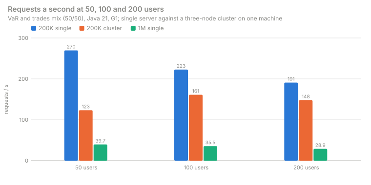

*Read: the cluster on the same machine adds coordination, not CPU. The 1,000,000-position bars are the earlier configuration; the
current run is in the before-and-after chart of [4.8](#48-1000000-positions-the-heap-and-what-the-formula-missed).*

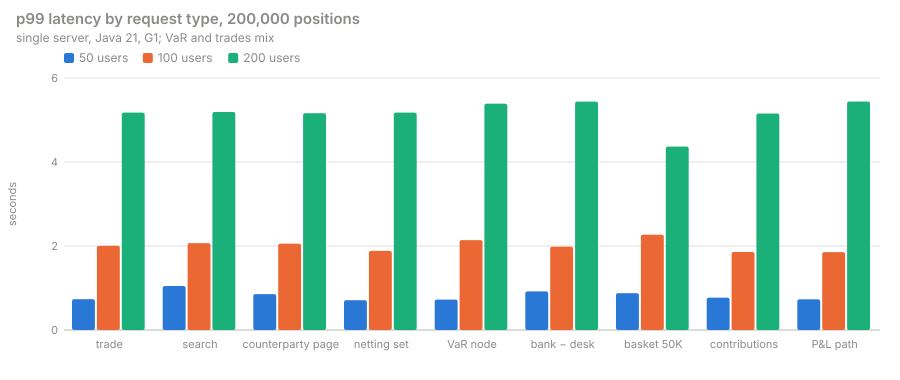

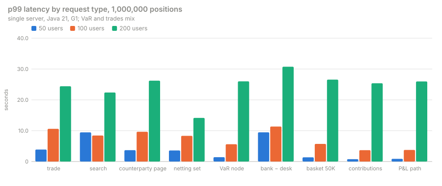

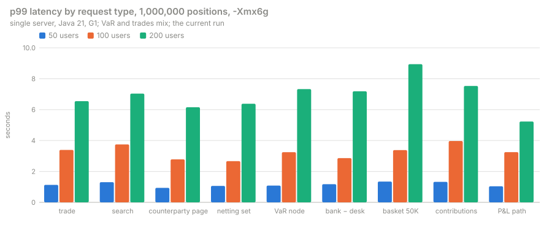

*Read: at 200,000 positions, and at 1,000,000 in the current run, every kind of request queues alike (one CPU pool), so p99 rises
together with the users; in the earlier 1,000,000-position run the bank minus a desk set the pace, and the other kinds waited behind it.*

**What the rows say.**

- At 200,000 positions one server answers the mix at 270 requests a second with 50 users and keeps every p99 under 1 s; at 200 users the
  p99 of every kind is about 5 s, all of it queueing on the 24 hardware threads, with no error.
- At 1,000,000 positions (current, `-Xmx6g`) one server answers **183 requests a second with 50 users, 138 with 100 and 124 with 200,
  with no failure**; every p99 stays under 1.4 s at 50 users and the bank minus a desk costs 0.20 s at p50, as a VaR node does. The
  scope's parts are summed by runs of positions (VAR_GUIDE section 27a), so the bank minus a desk no longer holds the CPU the trade reads
  need.
- In the earlier configuration (`-Xmx16g`) **the bank minus a desk cost about 5.7 s at p50 with 50 users**, walking the scope position
  by position (89% of the CPU, [4.9](#49-where-the-time-goes)): requests a second fell to 40, 36 and 29, and at 100 and 200 users trade
  reads timed out (`DRS-1004`, the 23 and 77 errors, every one a trade, a counterparty page or a netting set).
- **The cluster** (200,000), first table: contributions by position had a p95 of 10 to 16 s (0.6 to 3.6 s on the single server), the
  coordinator asking the owners for each position's vector in turn; in the first seconds of the 50-user window 17 requests (9 bank − desk,
  8 baskets) hit the client's 60 s timeout: thread dumps of a re-run show the vector-sum pool's threads all waiting on owners, asked
  position by position for the scopes' standalone sums. **With the reads fetched ahead** (second table): contributions p95 **0.88 / 1.35 / 2.53 s** at 50 / 100 / 200 users,
  **no error** in any window, and 226 / 249 / 231 requests a second (one server: 270 / 223 / 191), the members' work now side by side.

**Trades only** (`--var-share 0`), single server, the same 60,000 trades a day: the reference for what the VaR share adds.

| | 50 users | 100 | 200 |
|---|---|---|---|
| requests a second, errors | **270**, 0 | 235, 0 | 206, 0 |
| trade p50 / p95 / p99 (s) | 0.11 / 0.51 / 0.78 | 0.28 / 1.20 / 1.89 | 0.62 / 2.94 / 4.81 |

### 4.4 Java 21 and 25, G1 and ZGC

Single server, `-Xmx8g` at 200,000 positions and `-Xmx16g` at 1,000,000 (the earlier configuration; the current `-Xmx6g` run is Java 21,
G1 only: [4.2](#42-one-server-and-the-three-node-cluster)).

| | 200K: 21 G1 | 200K: 25 G1 (compact headers) | 200K: 21 generational ZGC | 200K: 25 ZGC | 1M: 21 G1 | 1M: 25 G1 |
|---|---|---|---|---|---|---|
| first open, 09-30 / 09-29 | 4.5 / 3.5 s | 4.2 / 3.6 s | 4.7 / 4.0 s | 4.6 / 3.7 s | 26.3 / 24.9 s | 25.0 / 26.8 s |
| heap after GC: start / two dates open | 324 / **881** MB | 298 / **838** MB | 430 / 1,011 MB | 394 / 932 MB | 1,106 / **7,505** MB | 1,027 / **7,335** MB |
| heap after GC: end | 1,078 MB | 1,031 MB | 1,217 MB | 1,140 MB | 7,686 MB | 7,493 MB |
| RSS: two dates / end | 3.6 / 5.0 GB | 3.4 / 4.9 GB | 8.3 / 10.0 GB | 7.7 / 9.8 GB | 17.2 / 21.2 GB | 17.2 / 21.2 GB |
| requests a second at 50 / 100 / 200 users | 270 / 223 / 191 | 269 / 235 / 185 | 204 / 188 / 167 | 284 / 210 / 186 | 39.7 / 35.5 / 28.9 | 30.9 / 24.9 / 26.8 |
| errors at 200 users | 0 | 0 | 0 | 0 | 77 | 37 |
| p99 at 200 users: VaR node / basket / trade (s) | 5.4 / 4.4 / 5.2 | 5.4 / 5.1 / 5.4 | 5.8 / 5.5 / 5.8 | 5.6 / 5.1 / 5.5 | 26.0 / 26.5 / 24.4 | 20.1 / 17.5 / 13.7 |
| collections; longest pause | 2,004; 93 ms | 1,922; 89 ms | 1,360; 0.31 ms | 1,020; 0.09 ms | 506; 314 ms | 428; 311 ms |
| total pause; GC CPU over the run | 16.7 s; 4 min 12 s | 14.8 s; 3 min 38 s | 0.11 s; *not reported* | 0.07 s; *not reported* | 21.5 s; 5 min 55 s | 18.6 s; 5 min 1 s |
| ZGC allocation stalls | | | 624 | 402 | | |
| pinned virtual-thread events (≥ 20 ms) | 0 | 50 | 0 | 42 | 0 | 42 |
| log bytes an hour: at rest / under load | 10,560 / 19,701 | 10,560 / 19,713 | 10,560 / 19,644 | 10,560 / 19,511 | 0 / 2.3 MB | 0 / 1.1 MB |

GC CPU is the JDK's `gc-cpu-time` view, over runs of about 6 minutes (200,000) and 7 minutes (1,000,000) of wall time; JFR on Java 21 and
25 does not report it for ZGC. The **pinned events on Java 25** all come from a connector opening the lake at start
(`NativeFileIO.<init>`, `ParquetFooters.footer`, `DeltaTable.layout`: native frames, which Java 25 still pins), none from a request. The
cluster (200,000) on Java 21 had 18 pinned events on members a and b, all in `ShardSkeleton.write` as the coordinator sent a date's
skeleton to the owners, during the first opens (the skeleton now streams without the channel adapter: none in the run of 4.3's second
cluster table); on Java 25 the cluster's members had 52 / 82 / 108, the connector start as above. The
log under load at 1,000,000 positions is the `DRS-1004` warnings of the timed-out trade reads.

**Compact object headers** (Java 25, two dates open): 838 MB against 881 MB on Java 21 at 200,000 positions (−4.9%), 7,335 against 7,505
MB at 1,000,000 (−2.3%): the heap is mostly arrays. **ZGC** keeps every pause under a millisecond but stalls allocations (624 and 402
stalls) and doubles the resident memory (8 to 10 GB against 4 to 5 GB for G1 at the same `-Xmx`). The cluster on Java 25 against 21 (G1),
requests a second at 50 / 100 / 200 users: 167 / 161 / 143 against 123 / 161 / 148.

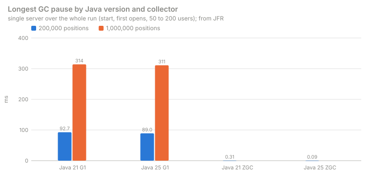

*Read: G1's longest pause grows from about 90 ms to about 310 ms between 200,000 and 1,000,000 positions; generational ZGC stays under
a millisecond at 200,000.*

### 4.5 One user alone: the cost per request

One user for 120 s, single server, Java 21, G1; p50 / p95 / p99 in seconds.

| Question | 200,000 positions | 1,000,000 positions |
|---|---|---|
| a trade | 0.005 / 0.009 / 0.014 | 0.006 / 0.011 / 0.016 |
| a search | 0.13 / 0.17 / 0.19 | 0.16 / 0.24 / 0.27 |
| a node's P&L path (509 rows) | 0.002 / 0.003 / 0.004 | 0.003 / 0.004 / 0.004 |
| a VaR node (its headline) | 0.003 / 0.005 / 0.008 | 0.004 / 0.008 / 0.010 |
| the bank minus a desk | 0.068 / 0.100 / 0.125 | **1.46 / 2.33 / 2.41** |
| a stored 50,000-position basket | 0.064 / 0.092 / 0.095 | 0.083 / 0.122 / 0.122 |
| a desk's contributions by position | 0.074 / 0.098 / 0.108 | 0.073 / 0.103 / 0.103 |
| requests a second, one user | 51.9 | 5.3 |

At 1,000,000 positions a trade, a node, a path, a basket and a desk's contributions cost the same as at 200,000; **the bank minus a
desk costs 21 times as much** (1.46 s against 68 ms at p50) for 5 times the positions, and one user then makes 5.3 requests a second
against 51.9: the part totals of [4.9](#49-where-the-time-goes).

**The store alone** (`VarTierBenchmark`, 200,000 positions, no server, no HTTP): a 50,000-position basket summed in 2.9 ms, the bank minus a
desk in 1.6 ms. What the server adds on top is the scope's parts and their totals ([5.5](#55-the-cost-per-request), [4.9](#49-where-the-time-goes))
and the request.

### 4.6 What the heap holds

The heap histogram with two dates open, against the start, single server, Java 21 (the 200,000 and the earlier 1,000,000 columns held
every node's members as a bit set and the aggregates on the heap; the current run holds runs and maps the aggregates):

| Class | Added, 200,000 positions | Added, 1,000,000, earlier (`-Xmx16g`) | Added, 1,000,000, current (`-Xmx6g`) | What it is |
|---|---|---|---|---|
| `long[]` | +87 MB (6,869 arrays) | **+3,384 MB** (54,067 arrays) | under 27 MB (not among the ten largest classes) | bit sets: the ordinal sets of the nodes and the views, P ÷ 8 bytes each; now the views' sets only |
| `double[]` | +188 MB | +1,634 MB | +333 MB | the aggregates (now mapped from the hot file) and the per-currency totals of the nodes |
| `byte[]` | +134 MB | +584 MB | +505 MB | the contents of the strings below |
| `String` | +55 MB (2.28 million) | +292 MB (12.2 million) | +238 MB (9.9 million) | trade, position and vector ids, the members of the ten 50,000-position baskets of each date, the trades connectors' column texts |
| `int[]` | +73 MB | +368 MB | +376 MB | column codes, the nodes' runs |

At the start, before any date is open, the heap already grows with the lake: 324 MB at 200,000 positions, 1,106 MB at 1,000,000 in the
earlier run, 769 MB in the current one (the footer cache now weighed in bytes, `-Ddrishti.parquet.footer-cache-mb`, 64). The
connectors keep the Parquet footers of the P&L table (560,497 `IntColumnChunkMetaData` with their statistics and index references) and an
entity index of its rows (1.1 million `EntityHit`, `EntityRef` and `HitIndex$Entry`): about 980 bytes a position.

Beside the aggregates and the ordinal sets, **about 205 MB a date at 200,000 positions** (1,020 bytes a position) at the server: the
date's *skeleton* (ids, columns, links, portfolio members, the connector's columns). The store alone holds 214 MB for two dates at
200,000, **492 bytes a position**, besides 8.6 MB of aggregates. What survives collections (`jdk.OldObjectSample`): the skeleton read onto
the heap at open (`VarHotFile$In.strings()` and `columns()`), the per-currency totals, portfolio members, the trades connectors' column
sets, the id index and the views' ordinal sets.

### 4.7 What the run checks

| Measure | Target | 200,000 | 1,000,000 |
|---|---|---|---|
| heap per owner at 2.3M positions, extrapolated from this run | within a 20 GB `-Xmx` | | **met**: about 13 GB, whatever the nodes (current run; the earlier one needed about 27 GB with 27,024 nodes): [12.1](#121-var-from-the-200000-position-run) |
| a 50,000-position basket, p95 warm | ≤ 150 ms | 92 ms alone; 0.62 s at 50 users | 122 ms alone (earlier); 0.94 s at 50 users (current) |
| the cluster's heap after GC under load | within `cache-share` × `-Xmx`; no `OutOfMemoryError` | 1.8 to 1.9 GB of 4 GB; none | *to be measured* |
| compact headers (Java 25) | ≥ 10% less heap | 4.9% | 2.3% |
| a date's first open | the read near disk speed | 4.5 s, 70% of its CPU in the read | 20.9 s (current); 26.3 s, 65 to 74% in the read (earlier) |
| log volume | ≤ 10 MB an hour at rest, under 1% CPU | 10.6 KB an hour at rest | 0 at rest; 101 KB an hour under load (current) |
| pinning | no pinned virtual-thread event on a request path | met (Java 21; on 25 only the connector's start) | met |
| Java 21 against 25 | within 10% of each other in requests a second | met at 50 users (270 against 269) | not met in the earlier run: 39.7 against 30.9 at 50 users; *to be measured* at `-Xmx6g` |
| the collector | the chosen collector's p99 (node, basket) no worse than the other's; G1 is the default | G1 5.4 / 4.4 s, ZGC 5.8 / 5.5 s at 200 users (Java 21) | ZGC *to be measured* |

### 4.8 1,000,000 positions: the heap, and what the formula missed

**Current: two dates in 2.2 GB of a 6 GB heap.** The same lake, data and users as the earlier run (single server, Java 21, G1), served
at `-Xmx6g` with the default settings:

| 1,000,000 positions, 15,000 portfolios | Earlier configuration (`-Xmx16g`) | **Current (`-Xmx6g`)** |
|---|---|---|
| heap after GC: start / one date / two dates / warm / end | 1,106 / 4,305 / 7,505 / 7,605 / 7,686 MB | 769 / 1,352 / **2,213** / 2,336 / 2,355 MB |
| heap a date (each date's step) | 3.2 GB (3,199 and 3,200 MB) | **0.6 to 0.9 GB** (583 and 861 MB; 722 MB on average) |
| heap after GC at the end, share of `-Xmx` | 48% | 39% |
| resident memory (RSS): two dates / end | 17.2 / 21.2 GB | 6.9 / 11.2 GB |
| a date's first open, 09-30 / 09-29 | 26.3 / 24.9 s | 20.9 / 19.2 s |
| the bank's VaR, 09-30 / 09-29 (USD) | 38,618,435 / 36,383,526 | identical, to the dollar |
| requests a second (failures) at 50 / 100 / 200 users | 39.7 (0) / 35.5 (23) / 28.9 (77) | **183.3 (0) / 137.5 (0) / 123.8 (0)** |
| the bank minus a desk, p50 at 50 users | 5.7 s | 0.20 s |
| the lake load, five kinds (Java loader) | 27.6 s | 28.4 s (a 2.8 GB lake for two dates; 20,000 trades a day per system, 2,000 counterparties, beside it) |

What sets the current heap, as designed ([VAR_GUIDE.md sections 26.8, 27.1 and 27a](../guides/VAR_GUIDE.md#271-bytes-per-date)): each
node's members are runs of positions, not a bit set as long as the date; the aggregates are mapped from the hot file, not copied to the
heap; a scope's parts are summed run by run, not position by position (the walk that took 89% of the CPU in the earlier run, 4.9); the
Parquet footer cache is weighed in bytes (`-Ddrishti.parquet.footer-cache-mb`, 64); and the byte safety net leaves a date read in the
last 120 seconds open (`-Ddrishti.open-dates.net-grace-seconds`). At 6 GB the automatic net is a tenth of the heap, 614 MB, less than one
date: the dates in use stay open over it, so two dates asked in turn by 200 users never close and reload each other, and idle dates still
leave. The mapped tier's rows are bounded by the disk, not by `memory-budget-mb`, so the date's float32 rows (2,036 MB) need no heap.

**The per-book formula is confirmed.** [VAR_GUIDE.md section 27.1](../guides/VAR_GUIDE.md#271-bytes-per-date) predicted about **0.77 GB a
book** at these dimensions (T = P = 1,000,000, 27,024 nodes, 130,000 books and cells, 509 scenarios, USD); the run measured 0.58 and
0.86 GB for its two dates, **0.72 GB on average**, within 7% and on the safe side. The resident memory is larger than the heap: at the
end 11.2 GB of RSS against 6.7 GB committed by the JVM, the difference being the page cache of the two mapped hot files (3.14 GB each),
counted in RSS while read and taken back by the operating system when needed.

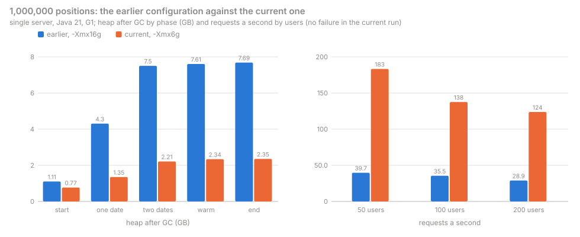

*Read: the heap after GC at every phase falls to under a third, on a heap limit of 6 GB instead of 16; the requests a second at each
number of users rise four to five times, with no failure.*

**The earlier configuration.** The sizing formula of [12.1](#121-var-from-the-200000-position-run) as it then stood gave, for
1,000,000 positions and 27,024 nodes, 3.45 GB with two dates open and an `-Xmx` of 5.9 GB. Each configuration was run in turn; only the
last served the users:

| `-Xmx` | Var budget (`drishti.var.memory-budget-mb`) | What happened |
|---|---|---|
| 6 GB | 1,536 MB (the default, a quarter of the heap) | each first open answered `503 DRS-5204`: the date's float32 copy needed 1,000,000 × 509 × 4 bytes = 2,036 MB of budget; every VaR question then failed after about 10 s |
| 6 GB | 2,200 MB | the first open failed after 35 s with `DRS-1003 … OutOfMemoryError: Java heap space` |
| 12 GB | 3,072 MB (default) | the first date opened in 22.9 s (heap after GC 4.3 GB); the second failed with `OutOfMemoryError` |
| **16 GB** | 4,096 MB (default) | **held**: both dates open, heap after GC 7.5 GB, 7.7 GB at the end, 48% of the heap |

The formula missed by a factor of 2.2, for two reasons the histograms show (4.6): every node kept an ordinal set as long as the date
(P ÷ 8 bytes, about P ÷ 16 on average), a term in P × N; and the heap at start grew with the lake's rows (Parquet footers and an entity
index, about 980 bytes a position). Refitted on both sizes, that configuration's heap with two dates open was
H = 128 MB + 980 B × P + 2 × (1,023 B × P + 23.6 KB × N + P × N ÷ 16): 7.8 GB at 1,000,000 (measured 7.5 GB), an `-Xmx` of 13.0 GB by
(H + 0.13 GB) ÷ 0.61, which is why 12 GB failed and 16 GB held. The current design has neither the P × N term nor the budget floor.

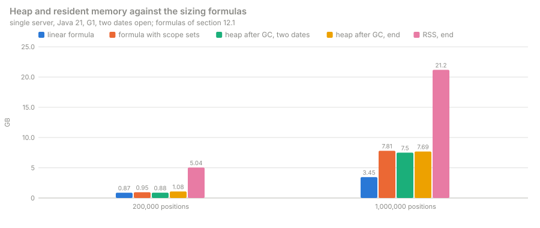

*Read: the earlier configuration. At 200,000 positions both formulas meet the measured heap; at 1,000,000 only the formula with the
scope-set term does, and the resident memory is nearly three times the heap.*

### 4.9 Where the time goes

From the JFR recordings of the single server, Java 21, G1: the share of execution samples (the frame on top of the stack) over the
whole run under load, and over each date's first open. The 1,000,000-position column is the earlier configuration (`-Xmx16g`, 4.8);
the current run was not profiled.

| | 200,000 positions | 1,000,000 positions |
|---|---|---|
| **under load**, top frames | `VarPartTotals.of` 32.3%, `BitSet.nextClearBit` 15.9%, ForkJoin idle 5.8%, `VarMath.es` 4.6%, `BitSet.set` 2.6%, `VarMath.order` 2.4% | `VarPartTotals.of` **50.4%**, `BitSet.nextClearBit` **38.2%**, everything else under 1.1% each |
| under load, top allocation sites | `HashMap.resize` 8.4%, Parquet `Binary.getBytes` 5.8%, `HashMap.newNode` 4.5%, `Throwable.fillInStackTrace` 4.4% | `VarPartTotals.positionRuns` 6.3%, `HashMap.resize` 4.9%, `HeapByteBuffer` 4.7%, `Arrays.copyOf(double[])` 4.6%, `BitSet.initWords` 4.1% |
| **first open**, top frames | Parquet `ByteStreamSplitValuesReader.decodeData` 11%, `RecordReaderImplementation.read` 9 to 13%, `String.hashCode` 6 to 10%, bit-packed integers 5% | Parquet `decodeData` 13 to 16%, `HashMap.getNode` 13 to 14%, bit-packed integers 9 to 10%, column skips 4 to 5% |
| first open, top allocation sites | `Arrays.copyOf(double[])` 14%, `HeapByteBuffer` 5 to 12%, Parquet double vectors 6% | `Arrays.copyOf(double[])` 9 to 15%, `HeapByteBuffer` 10 to 12%, `BitSet.initWords` 9 to 11%, `Arrays.copyOf(long[])` 6 to 7% |
| first open by stage (share of its CPU): read / intake / sort and sums / hot-file write | 70 to 73% / 8 to 10% / 14 to 17% / 3 to 5% | 65 to 69% / 9 to 10% / 20 to 22% / 2 to 3% |
| GC over the run | 16.7 s of pauses, 4 min 12 s of GC CPU in 6 min 10 s | 21.5 s of pauses, 5 min 55 s of GC CPU in 7 min 18 s |

**The three time sinks.**

1. **A scope's part totals** (`VarPartTotals.of`): for the bank minus a desk, a stored basket or a node's contributions, the server walks
   the scope's ordinal set position by position, asks for each whether the scope holds all of it (`positionWithin`, a `BitSet` scan) and
   sums the standalone VaRs. The walk was per request and linear in the scope's positions, which is why the bank minus a desk cost 0.27 s
   at 200,000 and 5.7 s at 1,000,000 under 50 users, and why at 1,000,000 it took 89% of the CPU under load. The parts are now summed run
   by run (VAR_GUIDE section 27a): 0.20 s at 1,000,000 under 50 users (4.8).
2. **The lake read of a first open**: decoding Parquet (byte-stream-split doubles, bit-packed levels) is two thirds of a first open's CPU
   at both sizes; the id lookups of the intake (`HashMap.getNode`, `String.hashCode`) come next.
3. **The garbage collector**: at 1,000,000 positions G1 spends about 6 CPU-minutes in a 7-minute run, much of it copying the per-node
   ordinal sets and the per-request run lists (`positionRuns`, `BitSet.initWords`).

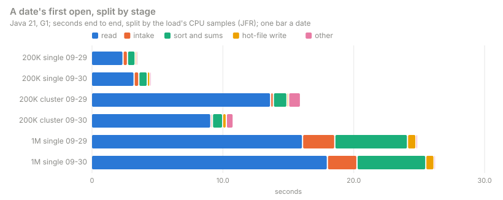

*Read: the read is two thirds of a first open at both sizes; the bars apportion the wall time by CPU samples, and the read runs on
several threads, so its share of the wall time is smaller than its share of the CPU.*

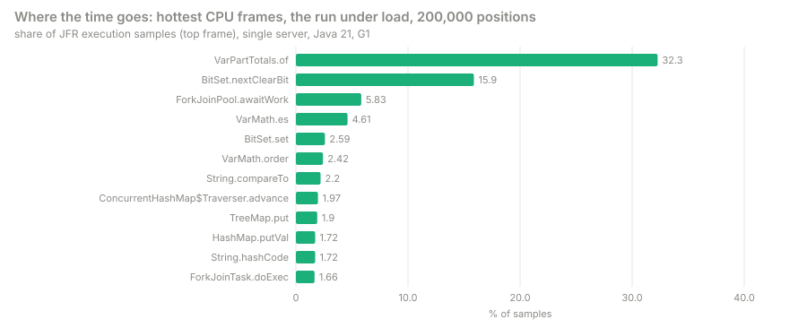

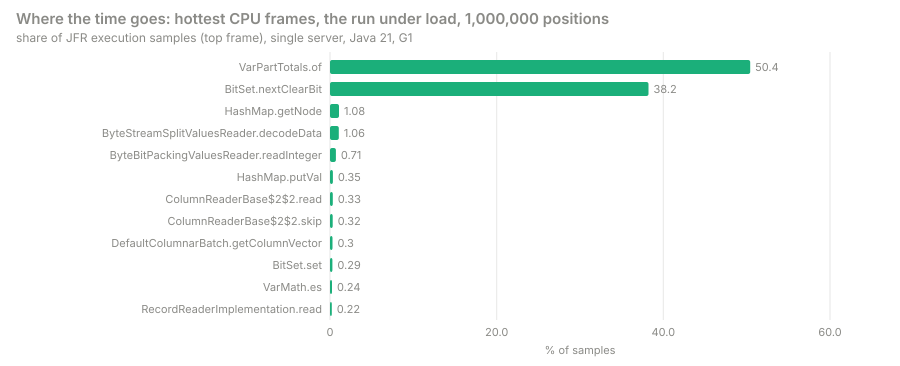

*Read: under load two frames, the part totals and the bit-set scan inside them, take a third of the CPU at 200,000 positions and nine
tenths at 1,000,000.*

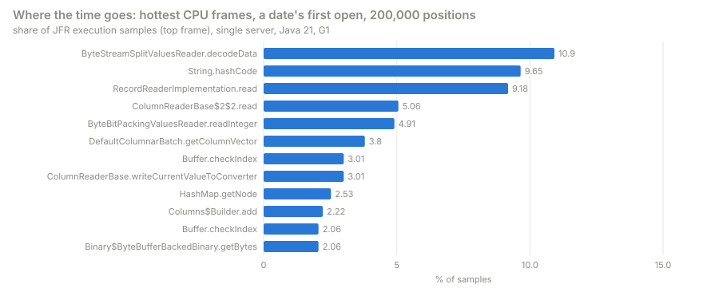

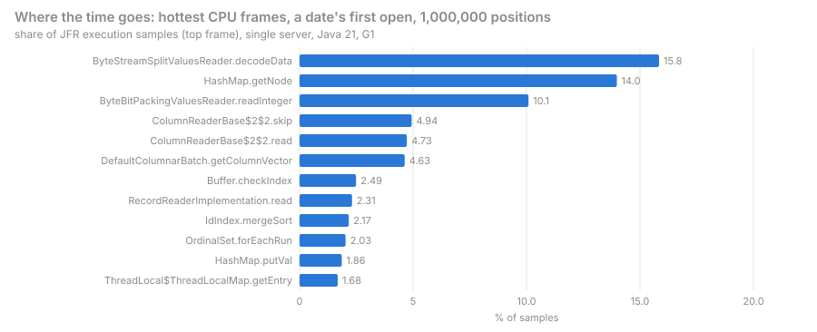

*Read: a first open is Parquet decoding first at both sizes; at 1,000,000 positions the hash lookups of ids come next.*

### 4.10 Faster libraries: candidates

Recommendations only, judged against the profiles of 4.9. "Bound" says what limits the measured hot path: **compute** (instructions on
data in cache), **memory bandwidth** (bytes from memory), **allocation** (garbage and its collection) or **algorithm** (work that a
different method avoids). Native code does not beat pure Java on a bandwidth-bound or allocation-bound path: the same bytes still cross
the memory bus and the same objects are still made; there the Vector API in pure Java is the ceiling. Drishti runs on Java 21 and 25; the
foreign-function API (FFM) is final only from Java 22 and a preview on 21. The Windows QA machine takes no native binaries, so any native
path is optional, behind a setting, with the pure-Java path the default; a native library also means a build per platform, and a crash in
it ends the JVM.

| Candidate | Where in the profile | Bound | Expected gain | Cost and risk |
|---|---|---|---|---|
| **The Java Vector API** (SIMD), behind a setting, off by default | the sums of scenario vectors (`MappedMatrix.addRangeInto`, `ParallelSums`) and the sort and ES of a vector (`VarMath.order`, `VarMath.es`, 4.6% + 2.4% under load at 200,000) | sums: memory bandwidth (the whole bank from float32 rows at about 60 GB/s, 5.1); `VarMath`: compute | small: the sums already run at memory speed; `VarMath` a few percent of the CPU; none on the part totals | an incubator module on 21 and 25 (`--add-modules jdk.incubator.vector`, a warning at start); no dependency; the scalar path stays the default |
| **RoaringBitmap** for scope membership | the per-node ordinal sets (`long[]`, 3.4 GB of 7.5 GB at 1,000,000) and the part totals' scans (`BitSet.nextClearBit` 38% under load at 1,000,000) | allocation and memory: the sets grow as P × N | **large on heap**: a node's positions are contiguous ordinals after the sort, so a run container holds a node in bytes, not P ÷ 8; faster `positionWithin` and set walks | Apache 2.0, one jar, pure Java, mature (Lucene, Spark, Druid); a change of every ordinal-set user |
| **fastutil** primitive collections | `HashMap.getNode` and `String.hashCode` in the intake (13 to 14% of a 1M first open), `HashMap.resize`/`newNode` (top allocation under load), `List<int[]>` of `positionRuns` | allocation and pointer-chasing | moderate: fewer objects and boxing in the id index and the run lists; a few seconds of a 25 s first open | Apache 2.0, a 20 MB jar (or a trimmed build); pure Java; low risk |
| **simdjson-java** for JSON intake | the loader's parse stage (7.2: 30,000 rows a second a thread, its slowest stage); not in the server's profiles (the server reads Parquet) | compute | moderate for the loader only: 1,000,000 positions × 2 dates load in 20 s, of which parsing is the largest part | Apache 2.0, young; needs the Vector API (incubator) and AVX2 or AVX-512, so a fallback to Jackson stays; parses to a DOM or a schema, not Jackson's streaming |
| **BLAS** (OpenBLAS or Intel MKL) through FFM: a scope's vector as a membership mask × the position × scenario matrix (GEMV), many scopes at once as GEMM | the sums of 5.1 and 5.3; not in the profiles under load | memory bandwidth: one pass over float32 rows per scope, about one multiply-add per 4 bytes read | **none** for one scope (the Java sums already reach memory speed); some for many scopes at once (GEMM reuses each row), which the server does not ask today | FFM preview on 21; a native binary per platform (not on the Windows QA machine); MKL's licence (ISSL) or OpenBLAS (BSD); a crash ends the JVM |
| **DuckDB** (already a Drishti plugin) as a vectorised engine over the Parquet lake | the first open's read (65 to 74% of its CPU) | compute (decoding) and allocation (`HeapByteBuffer`, `double[]` copies) | moderate for a first open: a vectorised, multi-threaded Parquet reader with no per-row objects; nothing under load (dates are served from the hot file) | a native library per platform (DuckDB's JDBC jar carries them; not on the Windows QA machine), so behind a setting; the read's result must still reach the intake |
| **A small C or Rust kernel** over JNI or FFM for the sum and select | the sums and the selection of a scope's rows | memory bandwidth | **none** over the Vector API: the bytes are the same | the native costs above, plus its own build and tests |

**Recommendation.** The largest measured costs were **algorithmic and allocation**, not arithmetic: the part totals walked every position
of a scope on each request, and every node kept a set as long as the date. Neither is helped by SIMD or native code; both are now
designed away (node members as runs, parts summed by runs: 4.8), and RoaringBitmap stays a candidate for the views' and ad-hoc scopes' sets. In order: RoaringBitmap
for ordinal sets and part totals kept per scope (both in pure Java, on both Java versions); fastutil in the intake and the run lists;
DuckDB as an optional reader of the first open; the Vector API for `VarMath` behind a setting. BLAS and a native kernel do not pay on
today's bandwidth-bound sums. The roadmap for native libraries and Java 25 features is a separate document
([HIGH_PERFORMANCE_NATIVE.md](../architecture/HIGH_PERFORMANCE_NATIVE.md), the roadmap).

## 5. VaR: the store, a date's first open and the cost per request

How a date is kept in memory and on disk is [VAR_GUIDE.md sections 25 and 26](../guides/VAR_GUIDE.md#26-the-tiered-memory-and-the-hot-file);
the model of bytes a date is [section 27](../guides/VAR_GUIDE.md#27-sizes-performance-and-the-benchmark).

### 5.1 Bytes and times a date, measured and extrapolated

The mapped tier (the default): no vector on the heap; a hot file of float32 rows, resident only while used.

| Per date | 100,000 trades (measured) | 1,000,000 trades (extrapolated) |
|---|---|---|
| vectors in the lake (float64) | 407 MB | 4.07 GB |
| the hot file (float32 positions + columns + aggregates; one trade a position) | 237.7 MB | about 2.25 GB of rows and aggregates; about 2.4 GB with the columns |
| the heap of an open date (columns, ids, links, aggregates) | about 80 MB | about 0.8 GB for the store alone; the server measured 0.72 GB a date at 1,000,000 positions with 27,024 nodes (3.2 GB in the earlier configuration, [4.8](#48-1000000-positions-the-heap-and-what-the-formula-missed)) |
| the first load (spill, sort, aggregates, the file), after the lake read | 0.8 to 1.2 s | about 10 to 12 s |
| reopening a date from its file | 23 ms | about 0.25 s |
| a node (VaR, ES) | 0.48 ms | the same |
| the bank minus a desk | 1.1 ms | a few ms |
| the whole bank summed from its float32 rows (resident) | 3.4 ms, about 60 GB/s | about 34 ms |
| a basket of 50,000 scattered positions | 2.6 ms | about the same (it reads only its rows) |

**Fifty dates of a million trades** hold about 113 GB of hot files on local disk (about 120 GB with the columns) and only the pages in use
in memory; with `hot-dates: 2` the heap holds about 1.6 GB, against 8.1 GB of float64 vectors in the heap tier.

### 5.2 The tiered store (`VarTierBenchmark`)

T synthetic trades over D dates, each date built through its spill into a float32 hot file and mapped, as the server does. **Measured at
100,000 trades × 5 dates** (files in the page cache), **extrapolated** to 1M × 50.

| Measure | 100,000 trades × 5 dates (measured) | 1M trades × 50 dates (extrapolated) | Basis |
|---|---|---|---|
| hot file per date | 237.7 MB (203.6 MB of float32 position rows; the rest aggregates of 2,100 books and nodes, columns, ids) | about 2.25 GB; **about 113 GB for 50 dates** | linear in trades; aggregates fixed |
| first load of a date (spill, sort, aggregates, hot file) | 0.8 to 1.2 s | about 9 to 12 s a date after reading the lake; about 8 to 10 min for 50 dates; the spill takes 4.07 GB of local disk while a date loads | linear, the sort slightly more |
| reopening a history date | 23 ms; the bank's first answer then 1.45 ms | about 0.25 s | linear in trades |
| a node's VaR and ES (its float64 aggregate) | 0.48 ms | 0.5 ms | independent of the bank |
| the bank minus one desk | 1.1 ms | about 2 ms | the desk's aggregate, not its rows |
| the whole bank from its rows | 3.4 ms (203.6 MB at about 60 GB/s on 24 threads) | about 35 ms resident; about 0.7 s the first time from NVMe (2.04 GB at 3 GB/s) | memory or disk bandwidth |
| an ad-hoc basket of 50,000 scattered positions | 2.6 ms (resolving the 50,000 ids: about 45 ms more) | about 3 ms + the ids | the basket's rows |
| a drill to a position's trades | 0.02 to 0.03 ms | the same | one or a few rows |
| heap held by the open dates (`hot-dates` 2) | 161 MB (about 80 MB a date, aggregates 8.6 MB) | about 1.6 GB for 2 dates | linear in trades |

With two trades per position (100,000 trades in 50,000 positions) the file is 331.8 MB, the whole bank reads only the 50,000 position rows
(3.2 ms), and a drill to a position's two trades 0.03 ms. **To be measured on a server:** the full 1M × 50 run, a cold first touch of a
history date from its file.

### 5.3 The heap tier (`VarScaleBenchmark`)

500,000 positions and 1,000,000 trades held in memory (4.07 GB of vectors, never written to disk), JDK 25; the explorer's browser test on
the demo data for click to painted. Targets are p95, warm.

| Operation | Target | Measured | Extrapolated |
|---|---|---|---|
| VaR, ES and headline of a node | 100 ms | under 1 ms from the node's aggregate | independent of the bank's size |
| the bank minus one desk; a scope of nodes plus or minus up to 1,000 positions | 500 ms | 2.6 ms | |
| the whole bank summed from its trades (a filter across every node) | | 58 ms for 1M trades (about 70 GB/s on 24 threads) | 2M: about 0.12 s on one server, 0.03 s on four; 5M: about 0.29 s on one, 0.07 s on four |
| P&L path (509 rows) of a node; explorer, click to painted (a desk) | 100 ms; 300 ms | 9 to 14 ms with answers fetched ahead, 30 to 35 ms without | |
| contributions of a node's children | 300 ms | 148 ms for a desk's 5,000 positions (standalone, component, incremental each) | linear in the parts |
| an ad-hoc scope of 50,000 positions | 250 ms | 52 ms: 43 ms reading the ids, 9 ms to sum and measure | about the same at 5M |
| loading a date (sort, permute, sum every node) | | 3.4 s for 1M trades after reading | minutes for 5M |
| the same bank of 100,000 trades | | whole bank 6.6 ms (0.41 GB of float64, 62 GB/s); basket 52.5 ms with resolving | |

### 5.4 A date's first open

The read decodes Parquet on several threads while the load takes the rows in order ([VAR_GUIDE.md section 27a.6](../guides/VAR_GUIDE.md#27a6-a-dates-first-open)).
Measured at 50,000 positions (one workstation, 24 hardware threads, two data files of 25 row groups, `-Xmx4g`):

| `drishti.var.read.threads` | First open | Of which the lake read |
|---|---|---|
| 1 (the load's own thread) | 2.6 s | 1.5 s |
| 0, the default (half the cores, at most 8) | **1.8 s** | **0.8 s** |

What remains after the read is the intake on the load's thread and the sort, sums and hot file. A whole date with the default threads:
**3.5 to 4.5 s at 200,000 positions, 25 to 27 s at 1,000,000** (Java 21 and 25, G1), of which the read is 65 to 74% of the open's CPU
([4.2](#42-one-server-and-the-three-node-cluster), [4.9](#49-where-the-time-goes)). Five times the positions cost six times the time: the
intake's id lookups and the per-node ordinal sets grow faster than the rows.

### 5.5 The cost per request

P is the scope's positions, S the scenarios (509). Measured: one user's medians of 15 requests, 50,000 positions, Java 21, `-Xmx4g`, warm.
The 2.3M column is **extrapolated**, linear in the scope's positions. The work behind each answer is
[VAR_GUIDE.md section 27a.7](../guides/VAR_GUIDE.md#27a7-cost-per-request).

| Answer | Measured, 50,000 positions | 2.3M positions (extrapolated) |
|---|---|---|
| the headline of a node (its child nodes) | 3 ms (a desk) | a few ms |
| the headline of a scope of positions: the bank minus a desk (48,000 positions) | 10.6 ms (first request of a book and lens 127 ms) | about 0.5 s (first request of a date and lens: several seconds) |
| the headline of a basket of 20,000 positions | 17.7 ms (first request 40 ms) | about 45 ms for a basket of 50,000 |
| contributions by position of the same basket (5,000 rows listed) | 186 ms | about the same for 5,000 rows, plus the pass over P |
| contributions by position of a desk (2,000 positions, all listed) | 69 ms | grows with the desk's positions, not the date's |

Scope membership adds nothing that grows with the date: a position costs its own trades. The standalone values the totals use are kept
per book and lens: 8 bytes a position (1.6 MB at 200,000, 18 MB at 2.3M).

## 6. Exposure

`ExposureTierBenchmark` (modelled on `VarTierBenchmark`): T synthetic trades in netting sets of 10 (the first set 1,000 trades),
counterparties of 20 sets, half the sets under a margined CSA (thresholds 5m, MTA 0.5m, rounding 0.1m, 10-day look-back), the others
unmargined; P paths and G grid dates (G/2 primary from 1 week to 10 years, each with its look-back point). The trades' paths are held in
memory as float32, then one business date is loaded as the server loads it (every row added into its set's value matrix in float64, then
each set's collateral, E and N, the hot file written and mapped). Scopes, contributions and what-ifs are the engine's own code; the trade
paths a drill needs are read both as the wanted rows only and as the server reads the lake (the date streamed once). Best of five warm
runs, hot file in the page cache, JDK 25. The Python engine's exact `paths` method was timed on its own (one netting set and its
candidates, best of three). The exact method is now the Java engine's (`ExposureWhatIfMath`, the same `ExposureMath` arithmetic as
every row below); its row is measured again at the next benchmark run.

**Measured.** 10,000 trades (901 sets) at P = 100, 200 and 500 with G = 24, at P = 200 with G = 48; 100,000 trades (9,901 sets) at P = 200, G = 24:

| Measure | 10,000 trades, P = 200, G = 24 | P = 100 / P = 500 (G = 24) | G = 48 (P = 200) | 100,000 trades, P = 200, G = 24 |
|---|---|---|---|---|
| load a date: rows into the sets' value matrices (float64) | 113 ms (240,000 rows) | 121 / 170 ms | 159 ms | 785 ms (2.4M rows) |
| load a date: collateral, E, N, the hot file written and mapped | 313 ms | 406 / 443 ms | 375 ms | 1,250 ms |
| heap while loading (every set's V in float64) | 35 MB | 17 / 86 MB | 69 MB | 380 MB |
| hot file (V, E, N in float32 + the sets and trades) | 37.6 MB | 20.3 / 89.5 MB | 72.2 MB | 410.8 MB |
| reopen the date from its hot file | 21 ms | 30 / 27 ms | 20 ms | 157 ms |
| heap of the open date (matrices mapped) | 18 MB | 18 / 18 MB | 18 MB | 172 MB |
| scope `BANK` (every set's E, N and max(V, 0) summed, statistics) | 8.1 ms (901 sets) | 5.9 / 15.4 ms | 12.6 ms | 61 ms (9,901 sets) |
| scope `CPTY:` of 20 sets | 0.30 ms | 0.20 / 0.81 ms | 0.40 ms | 0.22 ms |
| scope `NSET:` (one set) | 0.16 ms | 0.05 / 0.20 ms | 0.19 ms | 0.06 ms |
| the counterparty uncollateralised / at 99% | 1.31 / 0.18 ms | 1.65 / 0.12 ms; 1.44 / 0.38 ms | 0.67 / 0.26 ms | 0.73 / 0.14 ms |
| contributions by netting set of the counterparty (20 parts, PFE with incrementals) | 2.2 ms | 2.1 / 3.6 ms | 2.4 ms | 1.3 ms |
| contributions by netting set of the bank: EE / PFE with incrementals | 7.9 / 32 ms | 2.9 / 12 ms; 6.9 / 106 ms | 6.1 / 78 ms | 37 / 168 ms (9,901 parts) |
| contributions by trade of a set of 1,000 trades: the shares and PFE (EE) | 44 (11) ms | 18 (7) / 82 (17) ms | 60 (16) ms | 28 (14) ms |
| the same: its trades' paths read, wanted rows only / the date streamed once | 8 / 17 ms | 5 / 12 ms; 6 / 19 ms | 13 / 24 ms | 2 / 63 ms |
| pre-deal exact, Java arithmetic (one candidate into the 1,000-trade set) | 0.15 ms | 0.07 / 0.25 ms | 0.19 ms | 0.11 ms |
| pre-deal exact, the Python engine (one candidate; five candidates) | 3.1 ms; 9.0 ms | P = 500: 7.6 ms | 6.1 ms | P = 2,000, G = 50: 69 ms |
| pre-deal proxy (`addon`, ten candidates), scope's answer cached / computed | 0.011 / 0.23 ms | 0.010 / 0.21 ms; 0.007 / 0.33 ms | 0.012 / 0.35 ms | 0.007 / 0.16 ms |

What the runs show: the load is linear in the values (T × G × P; about 4 ns a value at 100,000 trades, about 9 ns at 10,000 where fixed
costs weigh more); reopening and the open date's heap are linear in the trades, independent of P and G; a counterparty's or a set's answer
depends only on its own sets × G × P, not on the bank's size; the bank scope is linear in the sets × G × P (about 2.6 ns a value at 9,901
sets); PFE with incrementals grows a little faster than P (a sort of each date's P paths per part); the Python engine is about 0.65 µs a
value of the set's G × P, about 1,000 times the Java arithmetic.

**Extrapolated** to a large bank: 1,000,000 trades in 100,000 netting sets of 10, a counterparty of 20 sets, a set of 1,000 trades. Each
figure is scaled from the measured run nearest in shape by the dimension it is linear in (values for the load; trades for reopening and
heap; a scope's own sets × G × P; the bank's sets × G × P from the 9,901-set run), one node with the pages resident; the factor from P =
200, G = 24 is 20.8 to P = 2,000, G = 50 and 104 to P = 5,000, G = 100. Disk and memory follow the formulas of
[EXPOSURE_GUIDE.md section 27.2](../guides/EXPOSURE_GUIDE.md#272-sizes), checked against the measured files.

| Measure | P = 2,000, G = 50 | P = 5,000, G = 100 | Target |
|---|---|---|---|
| hot file per date (V, E, N float32) | about 80 GB (10 GB a node on 8) | about 400 GB (50 GB a node on 8) | |
| heap while loading (every set's V in float64) | about 80 GB: needs the sharded load | about 400 GB: needs the sharded load or a set-at-a-time load | |
| load a date, compute only | about 7 min on one node; about 1 min a node on 8 | about 35 min on one node; about 4.5 min a node on 8 | 30 min on 8 nodes, with the lake read (0.4 / 2 TB of paths: about 25 s / 2 min a node from NVMe at 2 GB/s) |
| reopen a date from its hot file | about 1.6 s | the same | |
| heap of an open date | about 1.7 GB | the same | |
| scope `BANK` (100,000 sets) | about 13 s, reading 60 GB of mapped matrices | about 65 s, 300 GB | a batch job; over `max-scope-netting-sets` (20,000) an interactive answer is refused, `DRS-5443` |
| a netting set | about 3 ms | about 17 ms | 10 ms (computed when asked, then cached) |
| a counterparty of 20 sets | about 6 ms | about 30 ms | 10 ms; cached after the first answer |
| a group of 20 counterparties (about 200 sets) | about 60 ms | about 0.3 s | 150 ms |
| contributions by netting set of a counterparty | about 50 ms | about 0.25 s | 100 ms |
| contributions by trade of a set of 1,000 trades: compute | about 0.9 s | about 4.5 s | 5 s with the lake read |
| the same: the lake read | the date's `exposure-path` streamed: 0.4 TB, minutes; pruned by `NETTING_SET`: the set's 0.4 GB, about 0.2 s | 2 TB, many minutes; pruned: 2 GB, about 1 s | |
| pre-deal exact, one candidate on a set of 1,000 trades: Java / Python | about 3 ms / 69 ms (measured) | about 16 ms / about 0.35 s, plus the inputs sent as Arrow (about 8 MB) | 1 s |
| pre-deal proxy | under 1 ms with the scope's answer cached, else the scope's time | the same | 50 ms |

**Reading it.** At P = 2,000, G = 50 the targets are met for a set, a counterparty, a group, contributions by set and both what-ifs, once a
date is sharded. At P = 5,000, G = 100 a set and a counterparty are over 10 ms on their first answer (then cached), a group and
contributions by set are about twice their targets, and contributions by trade meet 5 s only with the pruned lake read. What limits a
large bank is the load (every set's V on one heap) and the trade-path read (the whole date streamed): both are open items
([EXPOSURE_GUIDE.md section 28](../guides/EXPOSURE_GUIDE.md#28-open-items)). **To be measured on a server:** the full size, the lake
read of a real `exposure-path` table, and a cold first touch of a hot file.

## 7. The loaders

### 7.1 The 200,000-position VaR inputs: the Python path and the Java loader

The same files: 20 gzip files a date at 200,000 positions (400,000 P&L rows for the two dates), 40 at 1,000,000 (2,000,000 rows). Java
21. Peak resident memory of the loader's whole process tree. The Python path was not run at 1,000,000 positions.

| Kind | Python path, 200,000 (`--engine drishti`) | Java loader, 200,000 (`--engine java`) | Java loader, 1,000,000 |
|---|---|---|---|
| `pnl-vector`, rows × 509 | **68.4 s**, peak 2.7 GB (with `DRISHTI_LAKE_HEAP=4g`) | **7.2 s**, peak 4.0 GB | **20.0 s**, peak 4.6 GB (100,000 rows a second) |
| table size, both dates | 831 MB | 571 MB (285 MB a date) | 2,854 MB (1,427 MB a date) |
| `portfolio` (two dates) | 2.6 s, 0.76 GB (3,000 rows) | 1.8 s, 1.3 GB (3,000 rows) | 2.4 s, 1.5 GB (30,000 rows) |
| `scenario-set`, `var-limit` | 1.3 to 1.7 s each | 1.6 s each (JVM start) | 1.6 to 1.8 s each |
| all five kinds | | **13.9 s** | **27.6 s** |

The Java loader is 9 times faster than the Python path on the vectors and writes a 31% smaller table; from 200,000 to 1,000,000 positions
the vectors take 2.8 times as long for 5 times the rows, all five kinds twice as long (the JVM starts and commits are fixed), and the peak memory grows by 15%. For the Python path,
set `DRISHTI_LAKE_HEAP` (4g here) for loads of 200,000 positions and more: the writer's default heap is 1 GB.

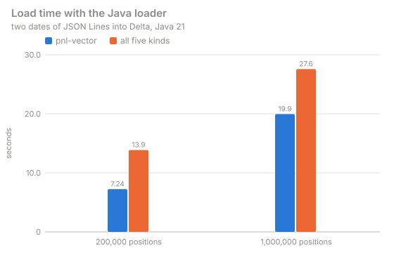

*Read: the load grows less than linearly from 200,000 to 1,000,000 positions; the vectors are most of it.*

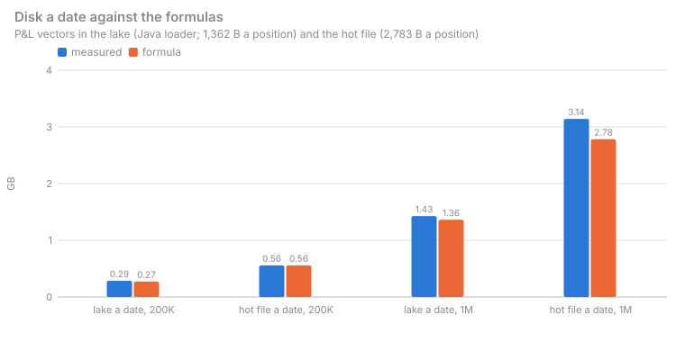

*Read: the lake is 5% above its formula at both sizes; the hot file meets its formula at 200,000 and is 13% above it at 1,000,000, where
27,024 nodes add 639 MB of aggregates a date.*

### 7.2 The Java parallel loader per stage

`ThroughputTest`, 10,000 positions × 510 scenarios, 53.7 MB of JSON Lines in eight gzip files (22.3 MB), into Delta on local disk. The
first load in a JVM is cold (1.3 s, 7,700 rows/s); a warm one (what a long load runs at after its first seconds): **0.19 to 0.29 s, 34,000
to 52,000 rows/s, 180 to 280 MB/s of JSON** end to end. Iceberg warm: 0.25 to 0.27 s (37,000 to 40,000 rows/s). With a 24 MB budget the
same load spilled 37 MB and wrote the identical table. The design is [PARALLEL_LOADER.md](../../HOW_IT_FITS.md#d10-the-parallel-lake-loader-drishti-lakeload).

| Stage | Per thread, warm | Note |
|---|---|---|
| decompress (gzip, JDK Inflater) | 124 MB/s compressed in, about 300 MB/s out | one reader per `.gz` |
| parse (JSON → record, document re-written, 510 doubles) | 30,000 rows/s (about 165 MB/s of JSON) | Jackson's fast double parser |
| write (merge, Parquet, Snappy + BYTE_STREAM_SPLIT/ZSTD) | 24,500 rows/s | |
| commit | 8 ms a date | |

### 7.3 Loading 2.3M positions (extrapolated)

**Extrapolated, not measured.** Per position, warm CPU: decompress 18 µs + parse 33 µs + write 41 µs ≈ **92 µs** for a 5.4 KB position;
a 2.3M load of 20 GB or more is about 8.7 KB a position, so scaled ≈ **150 µs**, about **345 CPU-seconds**. With the stages scaling with
threads at half efficiency (memory bandwidth, GC, read and write phases not overlapping):

| Server | Memory | Spill | Estimate |
|---|---|---|---|
| 32 vCPU, 64 GB, local NVMe (2 GB/s), S3 in and out | `-Xmx40g`, `memory.budget-mb: 32768` (sort buffer 18 GB) | about 0 to 2 GB | CPU about 22 s; S3 read 5 GB of gzip and write about 9 GB of Parquet at 0.5 to 1 GB/s: 15 to 30 s; **about 1 to 2 minutes** |
| ECS Fargate, 16 vCPU, 120 GB | `-Xmx96g`, `memory.budget-mb: 73728` | none | CPU about 45 s; S3 as above; **about 2 minutes** |
| 16 vCPU, 32 GB, EBS gp3 at 125 MB/s for the spill | `-Xmx24g`, `memory.budget-mb: 16384` (sort buffer 9 GB) | about 8 to 9 GB written and read again: about 2.5 minutes | **about 4 to 5 minutes** |

The target of 10 minutes holds on each; the spill disk's speed matters most when the data does not fit. **Spill disk**: at most the
records' size, about 17 to 20 GB for 2.3M positions (about 2 GB more while merge passes rewrite runs); 50 GB is ample. **Heap**: the
budget plus 2 GB. Recommended start: `-Xmx` 40 GB, `memory.budget-mb` 32768, `parallel.writers` 16, `target.layout.file-size-mb` 256,
spill on NVMe. At 10M positions the CPU is about 1,500 CPU-seconds (extrapolated): about 4.3 times each estimate above. **To be measured
on a server.**

## 8. Trades at scale

### 8.1 A million trades a day on Delta

Measured 2026-10-01 (server heap 15.6 GB), the trading pack's lake laid out as declared
([BUILD_GUIDE.md](../guides/BUILD_GUIDE.md#51-large-kinds-the-lake-layout)), 1,000,000 trades a day over three business days
(5.2 GB; `tools/samplegen/bulk_trades.py --trades 1000000 --days 3`), times over HTTP:

| What | Time |
|---|---|
| type-ahead `TRD CLY-40834` | 29 ms |
| open a trade (first read of it / cached) | 137–157 ms / 48 ms |
| open a trade on a past business date (that day's id map is read first) | 288 ms |
| search over all 1,000,000 trades: `TRD where mtm < -50m order by mtm` | 134 ms (2,017 matches) |
| `TRD where currency = 'USD' and notional > 500m order by notional desc` | 322 ms (13,640 matches) |
| `TRD book=BOOK-RATES-3` | 123 ms (70,702 matches) |
| pick list `TRD END-1100` | 41 ms |
| a search on another business date, the first time (its columns are read) / after | 6.6 s / 306 ms |
| desk P&L of every desk from 1,000,000 trades / another desk | 327 ms / 48 ms |
| impact (F8) of a netting set with 143,982 trades | 716–881 ms |
| server heap in use | 2–3.5 GB |

Seven years of history (1,800 business days, 7,200 files, a 7.2 MB log with a checkpoint): the connector lists the files in 84 ms (every
`refresh-seconds`), and a trade on a 2019 date opens in 22 ms. The same book in each connector: [9.7](#97-measurements-at-a-million-trades-a-day).

### 8.2 Millions of trades a day and many users

Measured 2026-10-18 on 8.2 million synthetic trades of the real ENDUR, CALYPSO and MUREX shapes (313,000 to 492,000 a day each for 7
business days, 1.16 million on the latest), 10,000 counterparties and 30,000 netting sets, an 8 GB heap, made and driven by `trades.py` and
`users.py`. The design behind it: [CLUSTER_GUIDE.md › Appendix D](../guides/CLUSTER_GUIDE.md#14-scale-strategy-for-one-server).

| What | Measured |
|---|---|
| single trade over the API at 10 users | p50 15–31 ms, p95 under 50 ms |
| first read of a past date (id map memory-mapped from disk) / after a restart | 0.03–0.06 s / 3 ms per table date for its id map |
| server API, 50 users (80% single trades, grouped pages, netting sets, searches) | about 140–150 requests/s, 0 failures |
| console pages, 50 users, 4 worker processes | about 70 pages/s, 0 failures |
| grouped pages (`trade-pages`, `store: disk`) for 1.16 million trades | built in 45–81 s in the background, 631 MB; a 20,000-trade portfolio page 0.4 s (486 KB) |
| server heap after collection | 1.2–1.8 GB |
| a search with a date range over a business date's 1.1 million trades (the form's "Trade date on") | 0.16 s |
| a table's own page in Admin → Lakes (4 million rows, from its Delta log) | 0.13 s |

### 8.3 Thirty days, and a day restated while serving

**30 days** (2026-10-18). 35.7 million trades (ENDUR 11.5M, CALYPSO 12.5M, MUREX 11.7M over 30 dates; about 5% amended each day),
25,000 counterparties and 75,000 netting sets, loaded with `trades.py --parallel --order random` while the stack served. Grouped pages for
the latest date (1.3 million trades) built in 113 s, 704 MB on disk. 50 users for 60 s over the dates the calendar serves; heap 3.7 GB of
8 GB after the run:

| Target | Requests/s | Failures | p50 / p95 / p99 |
|---|---|---|---|
| server API | 179 | 0 | trade 0.16 / 0.73 / 1.15 s; grouped page 0.17 / 0.73 / 1.10 s; netting set 0.18 / 0.72 / 1.07 s; search 0.85 / 1.47 / 1.68 s |
| console pages | 182 | 0 | trade 0.18 / 0.78 / 1.28 s; form search 0.21 / 0.85 / 1.58 s |

**A day restated while serving.** ENDUR's latest day (400,000 trades) re-dumped with 10% of trades amended, 0.5% cancelled and 2,000 new,
and loaded with `lake build --mode overwrite-dates` while 30 users read the server: the load took 2 min 54 s, the users ran at 202
requests/s with 0 failures (trade p50 0.08 s), and within a minute of the commit the amended trades showed their new version and the new
trades opened.

What makes it so: the Delta connectors share one memory budget (half the heap), id maps are memory-mapped from disk, documents read before
come from a RocksDB cache on disk, Parquet footers are parsed once, grouped pages live on disk and are kept across restarts, and pack
access, recent users and form pick lists are cached.

### 8.4 Sizing for millions of trades a day

From the runs of 8.2 and 8.3 (one machine: 24 cores, 60 GB RAM, NVMe):

| Resource | Measured | Rule of thumb |
|---|---|---|
| lake on disk | 12.5 GB for 8.2M trades (ENDUR 1.45 KB, CALYPSO 0.9 KB, MUREX 2.2 KB a trade, Parquet) | about 1.5 KB a trade a day; a year at 1.5M a day: about 0.6 TB |
| loading a day | 47–69 s per 300,000–460,000 ENDUR or CALYPSO trades, 90–161 s for MUREX's larger documents (`lake build`, one system at a time) | about a minute per 400,000 trades per system |
| server heap | 1.2–1.8 GB used after collection with 1.16M trades on the latest day, several dates open, 50 users; caches capped at half the heap (Admin → Caches) | `-Xmx8g` for 1M+ trades a day; `-Xmx4g` up to about 400,000 |
| grouped pages on disk | 631 MB for 1.16M trades (one date) | about 0.55 KB a trade per cached date |
| id maps on disk | 44 MB per trade connector for 7 dates (`data/cache/<connector>/idmaps`) | about 15 bytes a trade per date |
| document cache on disk | 49 MB for 22,000 documents read (`data/cache/<connector>/docs`), capped at 1 GB per connector | the cap; it holds what people open |
| throughput, server | 140–150 requests/s at 50 users, 0 failures | about 6 requests/s per core |
| throughput, console | 4 worker processes: about 70 pages/s at 50 users | one worker process per ~40 pages/s |

**To provision for 1.5 million trades a day, a year kept:** 8–16 cores; 32 GB RAM (8 GB heap, the rest for the operating system's file
cache and the console's workers); about 1 TB of SSD (the lake, plus a few GB of caches and grouped pages); on Windows, the data folder
excluded from antivirus real-time scanning.

## 9. The stores compared, 10,000 to 50,000 trades a day

`scale.sh` ([2.2](#22-the-store-benchmark)) loads the same book into each of the eight stores at several sizes, asks the same questions over
HTTP, and fits a straight line to what it measured.

### 9.1 What each measure asks

The book is the trading pack's generated book: N trades a day for three business days (2026-09-28 to 2026-09-30) plus 17,910 documents of
reference, market, risk, credit and collateral samples. The first 750 trades are the samples; the rest are clones in each booking system's
own number range (`MX-30000000 …`, `CLY-4000000 …`, `END-1100000 …`). The run used the generated book's fields of the time (`mtm`,
`notional`, `book`); on today's trades, which carry the source systems' UPPER_SNAKE attributes, the same searches read
`TRD where QUANTITY > 500m and CURRENCY = 'USD'` and `TRD PORTFOLIO=BOOK-RATES-3`. Each store is loaded in the layout its connector reads at scale.

| Measure | Request | What it exercises |
|---|---|---|
| type-ahead | `GET /api/v1/command/suggest?q=TRD CLY-400` | the in-memory id index |
| open a trade (view), first time / again | `GET /api/v1/views/trade/{id}`, a different trade each repetition / the same trade | one document read, the Sutra, the links / the cached path |
| raw document, today / a past business day | `GET /api/v1/entities/trade/{id}/raw` (`?asOf=2026-09-29`), a different trade each time | one document read from the store; on another day, its id map |
| three searches | `TRD where mtm < -50m order by mtm`; `TRD where currency = 'USD' and notional > 500m order by notional desc limit 20`; `TRD book=BOOK-RATES-3` | a condition over every trade of the day, from the day's promoted columns |
| pick list | `TRD END-1100` | an id-prefix list (1,000 rows) |
| desk P&L | `GET /api/v1/entities/desk-pnl/DESK-RATES/raw` | a derived kind: a sum over the desk's trades |
| impact | `GET /api/v1/impact/netting-set/NS-SUMMIT-NY` | F8: every trade linked to a netting set, grouped |
| a search on another business day, first / again | the `mtm` search with `asOf=2026-09-28` | the first time loads that day's columns (cold); again is cached |

Every timed measure is asked **25 times one after another** (median and 95th percentile), then from **8 concurrent clients for 5 seconds**
(requests per second). The cold search is asked once. Every search must answer from columns: a result counts as exact when `partial` is
`false` and `scanned` equals N. Around the questions: **load time** (the loader script end to end), **store size** (`du -sb` of the lake or
file; `pg_database_size`; `storageSize + indexSize`; Aerospike's `data_used_bytes`; Redis's `used_memory`), **server start** (to
`/actuator/health` answering 200), **columns ready** (after start, until the newest day's search is exact), **live heap** (`GC.run`, then
the `used` of `GC.heap_info`, after all questions), **resident memory** (`VmRSS` and peak `VmHWM` at the end).

### 9.2 The run

| | |
|---|---|
| Date | 2026-10-01; JDK 25, `-Xmx2g -XX:+UseCompactObjectHeaders`, G1; packs `market-risk,counterparty-risk` |
| Shared with | other work on the workstation (a Drishti server, seven Docker containers, a build running browser tests); memory available stayed between 38 and 46 GB |
| Containers | each capped at 2 GB: PostgreSQL 18 (default settings, `shared_buffers` 128 MB), MongoDB 7 (WiredTiger cache 0.5 GB), Redis 8.2 (`maxmemory` 1.5 GB, no persistence), Aerospike CE 8.1.2.5 (namespace on a file) |
| Scratch | the lakes, the DuckDB file and the JSON-lines files on a memory-backed `/tmp`; the containers' volumes on NVMe. Every store's data fits in the page cache, so all figures are warm-cache figures |
| Sizes | 10,000, 25,000 and 50,000 trades a day, three business days each; 10,000 twice (`r1`, `r2`) for the run-to-run variance |
| Order | one store and one size at a time, each from an empty store, ending with the container, its volume and the scratch data removed; 32 runs of 65–92 s each |
| Raw results | [`tools/bench/results/2026-10-01.jsonl`](../../tools/bench/results/2026-10-01.jsonl) (865 lines); the tables below are `python3 tools/bench/report.py tools/bench/results/2026-10-01.jsonl` |

Every search in every run was exact, on every store, at every size, on the newest day and the older one. Every loader cuts a day's columns
into chunks of 10,000 rows with a ceiling division (`DayColumns.chunks`), so a day of any size is searchable from columns.

### 9.3 Results per store

In each timed cell: **median / p95** of 25 repetitions in ms, then **requests per second** with 8 concurrent clients; every search was exact.

**Delta Lake (native engine)**

| Measure | 10,000 | 10,000 (r2) | 25,000 | 50,000 |
|---|---|---|---|---|
| type-ahead `TRD CLY-400` | 5.6 / 11.3, 544/s | 9.8 / 12.8, 367/s | 8.0 / 11.1, 548/s | 6.3 / 8.4, 469/s |
| open a trade, first time | 5.0 / 6.8 | 4.6 / 5.8 | 4.4 / 6.2 | 5.1 / 7.3 |
| open a trade, again | 3.8 / 5.0, 651/s | 4.0 / 4.6, 699/s | 4.2 / 5.1, 679/s | 2.6 / 5.0, 657/s |
| raw document, today | 14.6 / 24.3 | 14.0 / 24.6 | 12.0 / 30.4 | 12.6 / 27.0 |
| raw document, a past business day | 8.8 / 13.4 | 6.5 / 9.7 | 8.8 / 15.7 | 17.0 / 22.1 |
| `TRD where mtm < -50m order by mtm` | 1.9 / 2.5, 2,986/s | 1.9 / 2.6, 2,932/s | 2.2 / 4.6, 1,896/s | 6.0 / 8.2, 1,047/s |
| `… currency = 'USD' and notional > 500m …` | 2.5 / 3.3, 2,350/s | 1.6 / 2.0, 2,423/s | 4.5 / 6.2, 1,262/s | 7.7 / 9.7, 657/s |
| `TRD book=BOOK-RATES-3` | 1.8 / 2.7, 2,451/s | 2.2 / 3.1, 2,489/s | 4.5 / 5.5, 1,358/s | 7.2 / 9.1, 717/s |
| pick list `TRD END-1100` | 0.9 / 1.2, 3,553/s | 0.9 / 1.1, 3,390/s | 1.3 / 1.6, 2,867/s | 3.1 / 3.6, 1,962/s |
| desk P&L | 3.2 / 4.9, 816/s | 3.0 / 3.5, 812/s | 4.7 / 5.3, 828/s | 4.9 / 6.1, 797/s |
| impact `NS-SUMMIT-NY` | 14.0 / 17.6, 283/s | 15.5 / 17.9, 256/s | 16.4 / 19.6, 260/s | 17.3 / 25.5, 198/s |
| another day, first (cold) / again | 33.3 / 1.7 | 37.6 / 1.2 | 103 / 2.3 | 156 / 10.4 |
| opens of many trades, 8 clients | 758/s | 652/s | 740/s | 746/s |
| load time; store size | 7.2 s; 57.3 MB | 7.7 s; 57.3 MB | 7.8 s; 137 MB | 10.2 s; 270 MB |
| start to healthy; live heap; RSS at the end | 6.8 s; 99.0 MB; 1,754 MB | 7.8 s; 98.9 MB; 1,432 MB | 6.2 s; 110 MB; 1,060 MB | 6.2 s; 129 MB; 1,314 MB |

**PostgreSQL**

| Measure | 10,000 | 10,000 (r2) | 25,000 | 50,000 |
|---|---|---|---|---|
| type-ahead `TRD CLY-400` | 7.3 / 9.2, 376/s | 7.3 / 11.1, 531/s | 7.2 / 13.3, 557/s | 9.0 / 12.8, 358/s |
| open a trade, first time | 4.8 / 6.4 | 3.4 / 6.6 | 3.9 / 6.2 | 5.6 / 6.9 |
| open a trade, again | 4.6 / 6.2, 602/s | 4.3 / 6.0, 688/s | 3.4 / 4.6, 729/s | 4.8 / 5.8, 530/s |
| raw document, today | 3.0 / 9.7 | 1.9 / 9.2 | 1.8 / 10.1 | 4.0 / 15.2 |
| raw document, a past business day | 2.1 / 3.5 | 1.6 / 2.8 | 2.8 / 3.7 | 7.1 / 8.3 |
| `TRD where mtm < -50m order by mtm` | 2.1 / 3.2, 2,278/s | 1.1 / 3.1, 2,847/s | 2.6 / 4.4, 1,832/s | 6.2 / 7.7, 992/s |
| `… currency = 'USD' and notional > 500m …` | 1.9 / 2.5, 1,893/s | 1.7 / 2.4, 2,247/s | 4.0 / 6.0, 1,161/s | 8.7 / 11.4, 621/s |
| `TRD book=BOOK-RATES-3` | 1.8 / 2.8, 1,926/s | 1.7 / 3.1, 2,339/s | 5.5 / 6.5, 1,243/s | 6.9 / 9.0, 726/s |
| pick list `TRD END-1100` | 1.3 / 1.8, 2,996/s | 1.0 / 1.3, 3,266/s | 1.7 / 2.4, 2,671/s | 1.8 / 2.0, 2,283/s |
| desk P&L | 3.0 / 3.3, 781/s | 2.9 / 3.2, 765/s | 3.1 / 5.7, 666/s | 4.6 / 5.9, 750/s |
| impact `NS-SUMMIT-NY` | 19.2 / 26.5, 171/s | 16.8 / 19.1, 182/s | 23.0 / 26.1, 133/s | 20.7 / 24.9, 140/s |
| another day, first (cold) / again | 26.2 / 1.2 | 36.7 / 1.1 | 44.2 / 2.3 | 148 / 11.3 |
| opens of many trades, 8 clients | 769/s | 763/s | 712/s | 689/s |
| load time; store size | 14.4 s; 192 MB | 11.9 s; 192 MB | 14.1 s; 397 MB | 22.3 s; 739 MB |
| start to healthy; live heap; RSS at the end | 6.8 s; 89.8 MB; 1,137 MB | 7.8 s; 89.4 MB; 1,120 MB | 6.2 s; 99.4 MB; 1,330 MB | 7.9 s; 116 MB; 1,150 MB |

**DuckDB**

| Measure | 10,000 | 10,000 (r2) | 25,000 | 50,000 |
|---|---|---|---|---|
| type-ahead `TRD CLY-400` | 7.8 / 10.2, 536/s | 7.5 / 10.3, 473/s | 8.5 / 10.2, 502/s | 8.0 / 9.5, 493/s |
| open a trade, first time | 5.3 / 6.8 | 4.7 / 6.3 | 3.8 / 6.4 | 4.1 / 6.4 |
| open a trade, again | 2.7 / 4.5, 686/s | 4.3 / 5.2, 711/s | 2.8 / 5.2, 647/s | 2.8 / 3.6, 732/s |
| raw document, today | 11.6 / 21.8 | 11.2 / 15.7 | 11.9 / 16.9 | 6.0 / 7.9 |
| raw document, a past business day | 6.0 / 7.4 | 5.9 / 7.9 | 6.7 / 11.9 | 16.6 / 20.3 |
| `TRD where mtm < -50m order by mtm` | 1.2 / 1.8, 2,821/s | 1.1 / 1.5, 2,824/s | 2.4 / 3.7, 1,632/s | 3.6 / 5.1, 984/s |
| `… currency = 'USD' and notional > 500m …` | 1.7 / 2.5, 2,292/s | 1.7 / 2.3, 2,243/s | 4.3 / 6.4, 1,115/s | 7.9 / 9.2, 618/s |
| `TRD book=BOOK-RATES-3` | 2.3 / 3.0, 2,393/s | 1.6 / 2.2, 2,379/s | 3.7 / 5.1, 1,212/s | 8.0 / 10.4, 695/s |
| pick list `TRD END-1100` | 0.8 / 1.2, 3,494/s | 0.8 / 1.1, 3,386/s | 1.5 / 2.5, 2,573/s | 3.4 / 4.3, 1,840/s |
| desk P&L | 3.0 / 4.0, 770/s | 3.1 / 4.5, 782/s | 3.2 / 5.2, 784/s | 3.4 / 5.6, 779/s |
| impact `NS-SUMMIT-NY` | 21.2 / 24.5, 100/s | 22.7 / 24.0, 101/s | 23.0 / 26.1, 94/s | 23.8 / 27.1, 88/s |
| another day, first (cold) / again | 38.3 / 1.3 | 35.5 / 1.2 | 62.5 / 2.9 | 115 / 4.1 |
| opens of many trades, 8 clients | 497/s | 476/s | 424/s | 336/s |
| load time; store size | 12.5 s; 36.5 MB | 12.1 s; 36.5 MB | 15.4 s; 68.3 MB | 22.3 s; 122 MB |
| start to healthy; live heap; RSS at the end | 6.3 s; 87.4 MB; 2,261 MB | 6.3 s; 87.9 MB; 2,182 MB | 6.2 s; 97.8 MB; 2,420 MB | 6.2 s; 114 MB; 2,404 MB |

**JSON-lines files**

| Measure | 10,000 | 10,000 (r2) | 25,000 | 50,000 |
|---|---|---|---|---|
| type-ahead `TRD CLY-400` | 8.7 / 13.2, 541/s | 7.4 / 8.8, 460/s | 8.9 / 13.4, 542/s | 7.8 / 9.8, 544/s |
| open a trade, first time | 3.5 / 4.8 | 5.1 / 6.8 | 3.4 / 5.5 | 4.3 / 6.5 |
| open a trade, again | 3.8 / 5.4, 624/s | 3.3 / 5.1, 569/s | 4.0 / 4.8, 571/s | 4.0 / 6.3, 580/s |
| raw document, today | 2.0 / 2.8 | 1.8 / 2.4 | 2.4 / 2.8 | 1.1 / 2.5 |
| raw document, a past business day | 1.1 / 2.5 | 1.1 / 1.8 | 0.9 / 2.4 | 2.7 / 3.7 |
| `TRD where mtm < -50m order by mtm` | 1.1 / 2.5, 2,861/s | 1.4 / 2.0, 2,516/s | 2.1 / 3.5, 1,728/s | 4.0 / 9.3, 958/s |
| `… currency = 'USD' and notional > 500m …` | 1.6 / 2.0, 2,253/s | 1.8 / 2.4, 2,157/s | 3.9 / 5.7, 1,201/s | 7.8 / 10.4, 623/s |
| `TRD book=BOOK-RATES-3` | 1.8 / 2.6, 2,484/s | 3.1 / 4.7, 1,758/s | 4.3 / 5.4, 1,325/s | 7.7 / 10.0, 683/s |
| pick list `TRD END-1100` | 0.8 / 1.2, 3,584/s | 1.2 / 1.8, 2,519/s | 2.0 / 2.5, 2,647/s | 3.2 / 4.4, 1,947/s |
| desk P&L | 4.8 / 5.4, 726/s | 5.7 / 7.1, 666/s | 5.2 / 6.7, 738/s | 3.5 / 5.5, 787/s |
| impact `NS-SUMMIT-NY` | 16.8 / 19.2, 255/s | 18.9 / 21.7, 250/s | 19.0 / 21.4, 215/s | 17.1 / 21.1, 187/s |
| another day, first (cold) / again | 192 / 1.1 | 291 / 1.4 | 213 / 2.3 | 353 / 4.8 |
| opens of many trades, 8 clients | 735/s | 807/s | 744/s | 717/s |
| load time; store size | 9.2 s; 310 MB | 9.0 s; 310 MB | 11.2 s; 688 MB | 15.4 s; 1,322 MB |
| start to healthy; live heap; RSS at the end | 6.2 s; 88.9 MB; 1,133 MB | 6.2 s; 90.2 MB; 1,225 MB | 6.7 s; 102 MB; 1,322 MB | 7.3 s; 122 MB; 1,240 MB |

**MongoDB**

| Measure | 10,000 | 10,000 (r2) | 25,000 | 50,000 |
|---|---|---|---|---|
| type-ahead `TRD CLY-400` | 6.3 / 10.4, 477/s | 7.7 / 10.6, 448/s | 6.8 / 8.7, 513/s | 6.9 / 11.8, 479/s |
| open a trade, first time | 4.8 / 6.6 | 5.5 / 6.5 | 3.5 / 6.4 | 5.6 / 7.0 |
| open a trade, again | 2.5 / 5.3, 684/s | 4.8 / 5.9, 658/s | 4.4 / 5.1, 678/s | 4.5 / 5.8, 650/s |
| raw document, today | 1.4 / 2.6 | 2.1 / 4.9 | 1.7 / 4.1 | 3.0 / 4.2 |
| raw document, a past business day | 1.3 / 2.3 | 2.1 / 3.5 | 2.7 / 4.0 | 6.2 / 7.2 |
| `TRD where mtm < -50m order by mtm` | 1.0 / 1.2, 2,806/s | 1.4 / 3.2, 2,428/s | 2.5 / 4.4, 1,763/s | 4.0 / 5.9, 918/s |
| `… currency = 'USD' and notional > 500m …` | 2.3 / 3.1, 2,298/s | 2.7 / 3.3, 2,023/s | 4.0 / 5.9, 1,163/s | 9.6 / 11.0, 556/s |
| `TRD book=BOOK-RATES-3` | 1.6 / 2.4, 2,364/s | 3.1 / 4.5, 2,042/s | 4.3 / 5.2, 1,392/s | 9.4 / 11.9, 637/s |
| pick list `TRD END-1100` | 1.0 / 1.4, 3,065/s | 1.1 / 1.5, 2,952/s | 1.0 / 1.5, 3,010/s | 2.9 / 3.3, 1,776/s |
| desk P&L | 6.6 / 8.3, 620/s | 3.1 / 3.8, 782/s | 4.6 / 5.5, 794/s | 3.3 / 5.6, 719/s |
| impact `NS-SUMMIT-NY` | 17.9 / 20.9, 156/s | 18.5 / 21.3, 145/s | 19.9 / 23.9, 154/s | 22.8 / 27.2, 115/s |
| another day, first (cold) / again | 14.1 / 1.1 | 15.5 / 1.5 | 25.6 / 2.1 | 184 / 10.3 |
| opens of many trades, 8 clients | 788/s | 695/s | 727/s | 671/s |
| load time; store size | 10.2 s; 47.1 MB | 12.7 s; 46.9 MB | 16.2 s; 104 MB | 17.1 s; 202 MB |
| start to healthy; live heap; RSS at the end | 5.8 s; 109 MB; 1,254 MB | 6.3 s; 109 MB; 1,086 MB | 6.2 s; 132 MB; 1,330 MB | 6.3 s; 174 MB; 1,406 MB |

**Redis** (store size is Redis's `used_memory`)

| Measure | 10,000 | 10,000 (r2) | 25,000 | 50,000 |
|---|---|---|---|---|
| type-ahead `TRD CLY-400` | 7.2 / 9.3, 537/s | 9.6 / 13.6, 345/s | 7.3 / 9.4, 442/s | 10.4 / 14.1, 346/s |
| open a trade, first time | 6.0 / 7.5 | 7.0 / 9.2 | 6.9 / 8.5 | 6.6 / 8.8 |
| open a trade, again | 5.4 / 6.6, 525/s | 5.2 / 6.7, 589/s | 5.9 / 7.0, 556/s | 5.8 / 7.5, 392/s |
| raw document, today | 1.1 / 2.5 | 0.9 / 1.1 | 1.5 / 1.9 | 2.3 / 2.9 |
| raw document, a past business day | 1.1 / 1.8 | 1.1 / 1.8 | 1.6 / 2.3 | 6.7 / 8.6 |
| `TRD where mtm < -50m order by mtm` | 2.0 / 2.8, 2,722/s | 1.3 / 2.2, 2,650/s | 3.1 / 4.4, 1,081/s | 7.9 / 10.9, 696/s |
| `… currency = 'USD' and notional > 500m …` | 1.7 / 3.1, 2,254/s | 1.7 / 3.5, 2,103/s | 7.2 / 9.3, 869/s | 10.6 / 12.6, 588/s |
| `TRD book=BOOK-RATES-3` | 1.5 / 2.2, 2,466/s | 3.1 / 3.9, 2,161/s | 5.7 / 7.5, 1,079/s | 8.4 / 10.5, 676/s |
| pick list `TRD END-1100` | 0.6 / 1.9, 3,579/s | 1.1 / 1.6, 3,164/s | 1.4 / 2.3, 2,238/s | 2.9 / 5.3, 1,855/s |
| desk P&L | 5.5 / 6.2, 749/s | 3.3 / 7.3, 758/s | 3.5 / 5.8, 666/s | 4.9 / 5.9, 751/s |
| impact `NS-SUMMIT-NY` | 25.0 / 30.1, 114/s | 20.7 / 23.7, 96/s | 31.4 / 37.9, 93/s | 30.9 / 40.8, 71/s |
| another day, first (cold) / again | 17.6 / 1.9 | 17.3 / 2.6 | 9.4 / 3.5 | 46.2 / 17.6 |
| opens of many trades, 8 clients | 682/s | 498/s | 582/s | 367/s |
| load time; store size | 13.4 s; 46.2 MB | 14.6 s; 46.1 MB | 17.2 s; 97.9 MB | 20.2 s; 183 MB |
| start to healthy; live heap; RSS at the end | 6.2 s; 106 MB; 1,314 MB | 9.4 s; 106 MB; 1,201 MB | 8.8 s; 116 MB; 1,396 MB | 8.4 s; 132 MB; 1,208 MB |

**Aerospike**

| Measure | 10,000 | 10,000 (r2) | 25,000 | 50,000 |
|---|---|---|---|---|
| type-ahead `TRD CLY-400` | 22.8 / 40.2, 184/s | 9.2 / 12.7, 344/s | 9.1 / 11.2, 360/s | 8.9 / 11.7, 433/s |
| open a trade, first time | 8.3 / 15.0 | 6.3 / 7.0 | 5.2 / 6.6 | 4.7 / 6.3 |
| open a trade, again | 6.5 / 9.0, 377/s | 5.7 / 6.7, 444/s | 4.6 / 6.4, 603/s | 4.8 / 5.2, 598/s |
| raw document, today | 3.4 / 4.2 | 6.4 / 26.1 | 2.4 / 3.2 | 2.8 / 3.7 |
| raw document, a past business day | 3.5 / 4.6 | 6.1 / 9.8 | 2.3 / 2.9 | 5.0 / 7.9 |
| `TRD where mtm < -50m order by mtm` | 1.5 / 2.3, 1,436/s | 5.0 / 9.5, 1,809/s | 2.2 / 2.9, 1,408/s | 5.0 / 8.0, 983/s |
| `… currency = 'USD' and notional > 500m …` | 4.0 / 5.1, 1,430/s | 3.9 / 4.9, 1,824/s | 6.4 / 7.5, 1,094/s | 8.0 / 13.6, 547/s |
| `TRD book=BOOK-RATES-3` | 2.6 / 5.8, 1,090/s | 5.6 / 6.1, 1,679/s | 3.2 / 4.4, 1,307/s | 8.1 / 13.9, 590/s |
| pick list `TRD END-1100` | 2.1 / 4.1, 1,398/s | 1.1 / 1.6, 2,516/s | 0.9 / 1.1, 2,866/s | 6.2 / 7.3, 1,168/s |
| desk P&L | 5.9 / 7.8, 688/s | 6.1 / 7.6, 624/s | 3.2 / 5.0, 570/s | 5.5 / 7.5, 797/s |
| impact `NS-SUMMIT-NY` | 165 / 220, 5/s | 144 / 205, 7/s | 601 / 743, 6/s | 174 / 191, 6/s |
| another day, first (cold) / again | 66.6 / 2.5 | 109 / 2.7 | 189 / 3.1 | 426 / 6.5 |
| opens of many trades, 8 clients | 326/s | 553/s | 607/s | 578/s |
| load time; store size | 14.4 s; 276 MB | 16.5 s; 276 MB | 14.9 s; 613 MB | 18.8 s; 1,176 MB |
| start to healthy; live heap; RSS at the end | 11.0 s; 88.9 MB; 989 MB | 7.4 s; 88.4 MB; 1,102 MB | 7.3 s; 98.8 MB; 1,271 MB | 6.8 s; 117 MB; 1,289 MB |

**Apache Iceberg**

| Measure | 10,000 | 10,000 (r2) | 25,000 | 50,000 |
|---|---|---|---|---|
| type-ahead `TRD CLY-400` | 8.4 / 11.5, 371/s | 8.0 / 9.9, 411/s | 8.7 / 11.7, 334/s | 7.3 / 10.1, 409/s |
| open a trade, first time | 5.7 / 7.8 | 4.3 / 5.9 | 5.3 / 6.8 | 4.5 / 6.1 |
| open a trade, again | 4.1 / 12.6, 599/s | 4.5 / 5.6, 622/s | 4.1 / 5.5, 577/s | 4.3 / 5.2, 627/s |
| raw document, today | 11.3 / 23.8 | 10.9 / 19.2 | 10.1 / 19.8 | 14.1 / 23.9 |
| raw document, a past business day | 10.9 / 19.9 | 9.2 / 11.8 | 11.5 / 20.7 | 17.1 / 31.3 |
| `TRD where mtm < -50m order by mtm` | 2.7 / 4.3, 2,025/s | 3.2 / 4.0, 2,474/s | 4.3 / 6.9, 1,360/s | 5.8 / 8.7, 836/s |
| `… currency = 'USD' and notional > 500m …` | 2.7 / 3.2, 1,800/s | 3.1 / 3.9, 2,092/s | 5.0 / 7.0, 967/s | 9.6 / 14.2, 594/s |
| `TRD book=BOOK-RATES-3` | 3.0 / 3.8, 2,047/s | 2.2 / 2.7, 2,164/s | 4.5 / 6.2, 892/s | 6.6 / 7.5, 688/s |
| pick list `TRD END-1100` | 1.0 / 1.9, 2,902/s | 0.9 / 1.1, 2,958/s | 2.3 / 3.4, 2,092/s | 2.0 / 3.5, 2,049/s |
| desk P&L | 3.1 / 5.2, 629/s | 6.8 / 9.2, 641/s | 3.6 / 6.3, 679/s | 4.0 / 7.2, 729/s |
| impact `NS-SUMMIT-NY` | 19.3 / 21.6, 242/s | 20.0 / 22.6, 170/s | 21.6 / 24.6, 183/s | 24.3 / 29.6, 155/s |
| another day, first (cold) / again | 33.4 / 2.6 | 57.3 / 3.8 | 123 / 5.4 | 264 / 5.4 |
| opens of many trades, 8 clients | 699/s | 408/s | 576/s | 658/s |
| load time; store size | 18.2 s; 34.8 MB | 17.4 s; 34.8 MB | 22.4 s; 71.5 MB | 26.4 s; 133 MB |
| start to healthy; live heap; RSS at the end | 7.8 s; 98.2 MB; 1,428 MB | 7.3 s; 102 MB; 1,026 MB | 8.9 s; 110 MB; 1,267 MB | 8.8 s; 127 MB; 1,170 MB |

On every store the newest day was searchable from columns at start (0.0 to 0.1 s after healthy).

**Run-to-run variance at 10,000** (r1 against r2; the median difference over the timed measures, and the largest):

| Store | Median | Largest |
|---|---|---|
| Delta Lake | 11% | type-ahead (5.6 against 9.8 ms, 54%) |
| PostgreSQL | 14% | the `mtm` search (2.1 against 1.1 ms, 60%) |
| DuckDB | 7% | open a trade, again (2.7 against 4.3 ms, 44%) |
| JSON-lines files | 17% | `TRD book=BOOK-RATES-3` (1.8 against 3.1 ms, 52%) |
| MongoDB | 26% | desk P&L (6.6 against 3.1 ms, 72%) |
| Redis | 21% | `TRD book=BOOK-RATES-3` (1.5 against 3.1 ms, 70%) |
| Aerospike | 48% | the `mtm` search (1.5 against 5.0 ms, 110%) |
| Apache Iceberg | 17% | desk P&L (3.1 against 6.8 ms, 74%) |

### 9.4 Across stores at 50,000 trades a day

Median ms of the run labelled r1; requests per second with 8 clients in brackets.

| Measure | Delta | PostgreSQL | DuckDB | Files | MongoDB | Redis | Aerospike | Iceberg |
|---|---|---|---|---|---|---|---|---|
| type-ahead `TRD CLY-400` | 6.3 (469/s) | 9.0 (358/s) | 8.0 (493/s) | 7.8 (544/s) | 6.9 (479/s) | 10.4 (346/s) | 8.9 (433/s) | 7.3 (409/s) |
| open a trade, first time | 5.1 | 5.6 | 4.1 | 4.3 | 5.6 | 6.6 | 4.7 | 4.5 |
| open a trade, again | 2.6 (657/s) | 4.8 (530/s) | 2.8 (732/s) | 4.0 (580/s) | 4.5 (650/s) | 5.8 (392/s) | 4.8 (598/s) | 4.3 (627/s) |
| raw document, today | 12.6 | 4.0 | 6.0 | 1.1 | 3.0 | 2.3 | 2.8 | 14.1 |
| raw document, a past business day | 17.0 | 7.1 | 16.6 | 2.7 | 6.2 | 6.7 | 5.0 | 17.1 |
| `TRD where mtm < -50m order by mtm` | 6.0 (1,047/s) | 6.2 (992/s) | 3.6 (984/s) | 4.0 (958/s) | 4.0 (918/s) | 7.9 (696/s) | 5.0 (983/s) | 5.8 (836/s) |
| `… currency = 'USD' and notional > 500m …` | 7.7 (657/s) | 8.7 (621/s) | 7.9 (618/s) | 7.8 (623/s) | 9.6 (556/s) | 10.6 (588/s) | 8.0 (547/s) | 9.6 (594/s) |
| `TRD book=BOOK-RATES-3` | 7.2 (717/s) | 6.9 (726/s) | 8.0 (695/s) | 7.7 (683/s) | 9.4 (637/s) | 8.4 (676/s) | 8.1 (590/s) | 6.6 (688/s) |
| pick list `TRD END-1100` | 3.1 (1,962/s) | 1.8 (2,283/s) | 3.4 (1,840/s) | 3.2 (1,947/s) | 2.9 (1,776/s) | 2.9 (1,855/s) | 6.2 (1,168/s) | 2.0 (2,049/s) |
| desk P&L | 4.9 (797/s) | 4.6 (750/s) | 3.4 (779/s) | 3.5 (787/s) | 3.3 (719/s) | 4.9 (751/s) | 5.5 (797/s) | 4.0 (729/s) |
| impact `NS-SUMMIT-NY` | 17.3 (198/s) | 20.7 (140/s) | 23.8 (88/s) | 17.1 (187/s) | 22.8 (115/s) | 30.9 (71/s) | 174 (6/s) | 24.3 (155/s) |
| another day, first (cold) | 156 | 148 | 115 | 353 | 184 | 46.2 | 426 | 264 |
| another day, again | 10.4 | 11.3 | 4.1 | 4.8 | 10.3 | 17.6 | 6.5 | 5.4 |
| load time | 10.2 s | 22.3 s | 22.3 s | 15.4 s | 17.1 s | 20.2 s | 18.8 s | 26.4 s |
| store size | 270 MB | 739 MB | 122 MB | 1,322 MB | 202 MB | 183 MB | 1,176 MB | 133 MB |
| start to healthy | 6.2 s | 7.9 s | 6.2 s | 7.3 s | 6.3 s | 8.4 s | 6.8 s | 8.8 s |
| live heap after a full GC | 129 MB | 116 MB | 114 MB | 122 MB | 174 MB | 132 MB | 117 MB | 127 MB |
| resident memory at the end | 1,314 MB | 1,150 MB | 2,404 MB | 1,240 MB | 1,406 MB | 1,208 MB | 1,289 MB | 1,170 MB |

### 9.5 The fits, and a million trades a day extrapolated

For each store and measure, `report.py` fits **value = a + b × N** (N trades a day) by least squares over the store's four runs and gives
R². Its value at 1,000,000 trades a day is an **extrapolation**: a straight line drawn twenty times beyond the largest measured point.
The slope b per 10,000 trades a day, and R² in brackets (`report.py` prints a as well):

| Measure | Delta | PostgreSQL | DuckDB | Files | MongoDB | Redis | Aerospike | Iceberg |
|---|---|---|---|---|---|---|---|---|
| type-ahead | −0.32 ms (0.11) | +0.44 (0.84) | +0.11 (0.19) | −0.04 (0.01) | −0.03 (0.01) | +0.49 (0.33) | −1.83 (0.25) | −0.21 (0.47) |
| open a trade, first time | +0.07 (0.14) | +0.36 (0.51) | −0.23 (0.42) | 0.00 (0.00) | +0.10 (0.04) | +0.02 (0.01) | −0.66 (0.60) | −0.12 (0.11) |
| open a trade, again | −0.32 (0.69) | +0.07 (0.05) | −0.19 (0.22) | +0.12 (0.50) | +0.21 (0.14) | +0.12 (0.53) | −0.33 (0.53) | −0.02 (0.03) |
| raw document, today | −0.44 (0.48) | +0.38 (0.45) | −1.31 (0.79) | −0.18 (0.39) | +0.29 (0.67) | +0.32 (0.98) | −0.55 (0.32) | +0.73 (0.62) |
| raw document, a past day | +2.32 (0.89) | +1.31 (0.95) | +2.62 (0.90) | +0.40 (0.77) | +1.10 (0.95) | +1.38 (0.91) | +0.03 (0.00) | +1.75 (0.93) |
| `mtm` search | +1.01 (0.91) | +1.13 (0.94) | +0.64 (0.98) | +0.69 (0.99) | +0.68 (0.98) | +1.55 (0.97) | +0.42 (0.19) | +0.71 (0.97) |
| `currency … notional` search | +1.42 (0.98) | +1.72 (1.00) | +1.55 (1.00) | +1.54 (1.00) | +1.77 (0.97) | +2.25 (0.94) | +1.02 (0.95) | +1.67 (0.99) |
| `book=` search | +1.30 (0.98) | +1.31 (0.88) | +1.51 (0.98) | +1.29 (0.95) | +1.75 (0.96) | +1.53 (0.92) | +0.96 (0.52) | +0.99 (0.97) |
| pick list | +0.53 (0.95) | +0.16 (0.71) | +0.65 (0.99) | +0.55 (0.98) | +0.45 (0.84) | +0.50 (0.94) | +1.12 (0.74) | +0.29 (0.58) |
| desk P&L | +0.47 (0.77) | +0.41 (0.90) | +0.08 (0.98) | −0.41 (0.73) | −0.37 (0.19) | +0.12 (0.05) | −0.14 (0.04) | −0.25 (0.08) |
| impact | +0.64 (0.73) | +0.73 (0.28) | +0.46 (0.64) | −0.18 (0.08) | +1.15 (0.98) | +2.09 (0.59) | +10 (0.01) | +1.17 (0.99) |
| another day, first (cold) | +30.4 (0.96) | +28.7 (0.92) | +19.5 (1.00) | +27.1 (0.47) | +41.7 (0.90) | +6.96 (0.66) | +84.4 (0.98) | +54.6 (0.99) |
| another day, again | +2.20 (0.92) | +2.50 (0.93) | +0.72 (0.95) | +0.87 (0.99) | +2.22 (0.91) | +3.80 (0.91) | +0.96 (0.92) | +0.56 (0.62) |
| load time (s) | +0.68 (0.92) | +2.26 (0.88) | +2.49 (0.99) | +1.56 (1.00) | +1.44 (0.73) | +1.57 (0.96) | +0.83 (0.61) | +2.16 (0.97) |
| store size (MB) | +53.1 (1.00) | +137 (1.00) | +21.4 (1.00) | +253 (1.00) | +38.6 (1.00) | +34.3 (1.00) | +225 (1.00) | +24.5 (1.00) |
| start to healthy (s) | −0.27 (0.47) | +0.13 (0.10) | −0.01 (0.54) | +0.26 (0.98) | +0.06 (0.26) | +0.15 (0.04) | −0.61 (0.35) | +0.33 (0.62) |
| live heap (MB) | +7.48 (1.00) | +6.53 (1.00) | +6.47 (1.00) | +8.12 (1.00) | +16.1 (1.00) | +6.55 (1.00) | +7.18 (1.00) | +6.70 (0.99) |

**At 1,000,000 trades a day** (extrapolations, not measurements):

| Measure | Delta | PostgreSQL | DuckDB | Files | MongoDB | Redis | Aerospike | Iceberg |
|---|---|---|---|---|---|---|---|---|
| type-ahead | 7.4 ms* | 50.2 ms | 18.3 ms† | 8.2 ms* | 6.9 ms* | 56.5 ms† | 12.5 ms* | 8.1 ms* |
| open a trade, first time | 11.3 ms† | 39.4 ms | 4.5 ms* | 4.1 ms* | 14.5 ms† | 8.7 ms† | 6.1 ms* | 5.0 ms* |
| open a trade, again | 3.7 ms* | 11.4 ms† | 3.1 ms* | 15.9 ms† | 24.6 ms† | 17.6 ms | 5.4 ms* | 4.3 ms* |
| raw document, today | 13.3 ms* | 40.1 ms† | 10.2 ms* | 1.8 ms* | 30.3 ms | 33.0 ms | 3.7 ms* | 83.2 ms |
| raw document, a past day | 237 ms | 131 ms | 264 ms | 40.4 ms | 111 ms | 137 ms | 7.3 ms† | 183 ms |
| `mtm` search | 101 ms | 113 ms | 64.1 ms | 69.7 ms | 68.7 ms | 155 ms | 44.7 ms† | 73.5 ms |
| `currency … notional` search | 142 ms | 172 ms | 155 ms | 154 ms | 177 ms | 225 ms | 105 ms | 168 ms |
| `book=` search | 131 ms | 132 ms | 151 ms | 131 ms | 176 ms | 154 ms | 98.3 ms | 101 ms |
| pick list | 53.5 ms | 17.4 ms | 64.6 ms | 55.4 ms | 45.3 ms | 50.1 ms | 112 ms | 29.4 ms |
| desk P&L | 49.7 ms | 43.0 ms | 11.1 ms | 4.8 ms* | 4.4 ms* | 15.9 ms† | 5.2 ms* | 4.4 ms* |
| impact | 78.5 ms | 91.5 ms† | 67.1 ms | 17.9 ms* | 132 ms | 231 ms | 1,248 ms† | 136 ms |
| another day, first (cold) | 3,049 ms | 2,863 ms | 1,965 ms | 2,904 ms† | 4,133 ms | 702 ms | 8,432 ms | 5,451 ms |
| another day, again | 219 ms | 248 ms | 72.4 ms | 87.5 ms | 221 ms | 378 ms | 97.7 ms | 59.2 ms |
| load time | 74.4 s | 236 s | 258 s | 164 s | 155 s | 169 s | 96.7 s | 232 s |
| store size | 5,311 MB | 13,737 MB | 2,158 MB | 25,362 MB | 3,872 MB | 3,446 MB | 22,558 MB | 2,462 MB |
| start to healthy | 6.7 s* | 19.8 s† | 6.3 s* | 32.1 s | 12.2 s† | 22.9 s† | 8.1 s* | 40.2 s |
| live heap after a full GC | 840 MB | 736 MB | 728 MB | 893 MB | 1,702 MB | 754 MB | 799 MB | 763 MB |

\* flat: the measured points do not rise with size (the slope is not above zero), so the figure is their mean, not a fit. † a rising fit
with R² below 0.5: noisy points, a weak extrapolation. Resident memory and the time until columns are ready are listed, not fitted.

### 9.6 How good is the straight line: checked against a real million

Four stores were measured at a million trades a day on the same machine with larger heaps and containers ([9.7](#97-measurements-at-a-million-trades-a-day)).
Extrapolated / measured, milliseconds unless marked (Redis's run held two days):

| Measure | Delta | PostgreSQL | Aerospike | Redis |
|---|---|---|---|---|
| `mtm` search | 101 / 134 | 113 / 102 | 45† / 132 | 155 / 81–144 |
| `currency … notional` search | 142 / 322 | 172 / 225 | 105 / 213 | 225 / 201–257 |
| `book=` search | 131 / 123 | 132 / 189 | 98 / 159 | 154 / 130–244 |
| pick list `TRD END-1100` | 54 / 41 | 17 / 106 | 112 / 225 | 50 / 89–116 |
| a search on another day, first | 3.0 s / 6.6 s | 2.9 s / 1.4 s | 8.4 s / 7.1 s | 0.7 s / 0.3 s |
| a search on another day, again | 219 / 306 | 248 / 90 | 98 / 68 | 378 / 112 |
| impact of `NS-SUMMIT-NY` | 79 / 716–881 | 92† / 217 | 1,248† / 1,600 | 231 / 248 |
| store size, three days | 5.3 GB / 5.2 GB | 13.7 GB / 11 GB | 22.6 GB / — | 3.4 GB / 2.06 GB for two days |
| load time | 74 s / 82–125 s | 236 s / 174 s | 97 s / 148 s | 169 s / 101 s for two days |

- **Store sizes extrapolate well** (within about 25% where both exist): bytes grow linearly with the book.
- **Searches over a day's columns extrapolate to the right order of magnitude**, mostly within a factor of two in both directions: at
  50,000 trades they take a few milliseconds, so fixed costs and noise weigh more than at a million.
- **Impact does not extrapolate.** Its cost grows with the netting set's trades and links (143,842 trades in `NS-SUMMIT-NY` at a
  million); Delta's measured figure is ten times the line. Treat the impact figures as a floor.
- **Live heap after a full GC (0.7–0.9 GB extrapolated) is not the heap to give the server.** At a million the heap in use is 2–3.5 GB,
  with garbage between collections and the columns of every day opened; size the heap from [9.8](#98-running-it-at-a-million-trades-a-day).

### 9.7 Measurements at a million trades a day

Measured on 2026-10-01 on the same workstation with larger limits; each connector's document holds the full table:

| Store | Book | Server heap, container | Where |
|---|---|---|---|
| Delta Lake | 1,000,000 trades a day × 3 days | heap limit 15.6 GB | [8.1](#81-a-million-trades-a-day-on-delta); [DELTA_CONNECTOR.md › Measured results](#81-a-million-trades-a-day-on-delta) |
| PostgreSQL | 1,000,000 × 3 | `-Xmx8g`; PostgreSQL 18 in 12 GB, `shared_buffers` 3 GB | [POSTGRES_CONNECTOR.md › Measured results](../../plugins/drishti-plugin-jdbc/README.md#measured-results) |
| Aerospike | 1,000,000 × 3 | one CE 8.1 node, file storage | [AEROSPIKE_CONNECTOR.md › Measured results](../../plugins/drishti-plugin-aerospike/README.md#sizing-and-limits) |
| Redis | 1,000,000 × 2 | `-Xmx8g`; Redis 8.2, `maxmemory 11gb` | [REDIS_CONNECTOR.md › Measured results](../../plugins/drishti-plugin-redis/README.md#measured-results) |

DuckDB, the JSON-lines files, MongoDB and Iceberg have not been measured at a million trades a day; their million figures are
extrapolations or estimates and say so.

### 9.8 Running it at a million trades a day

On a machine sized for it, one store at a time, `DRISHTI_BENCH_DIR` on its own disk:

```bash
export DRISHTI_BENCH_DIR=/data/drishti-bench DRISHTI_BENCH_MIN_FREE_GB=24
OUT=/data/drishti-bench/results-1m.jsonl
tools/bench/scale.sh delta     1000000 --heap 16g --out $OUT
tools/bench/scale.sh postgres  1000000 --heap 16g --container-memory 12g --store-args "-c shared_buffers=3GB" --out $OUT
tools/bench/scale.sh duckdb    1000000 --heap 16g --out $OUT
tools/bench/scale.sh files     1000000 --heap 16g --out $OUT
tools/bench/scale.sh mongodb   1000000 --heap 16g --container-memory 12g --store-args "--wiredTigerCacheSizeGB 6" --out $OUT
tools/bench/scale.sh redis     1000000 --days 2 --heap 16g --container-memory 12g --out $OUT
tools/bench/scale.sh aerospike 1000000 --heap 16g --container-memory 8g --out $OUT
tools/bench/scale.sh iceberg   1000000 --heap 16g --out $OUT
python3 tools/bench/report.py tools/bench/results/2026-10-01.jsonl $OUT > report-1m.md
```

Adding the million-trade lines to the small ones gives each fit a point at the far end and turns 9.6 into a measurement for every store.
Sizing for a million trades a day over three days (measured where marked, else extrapolated):

| Store | Server heap | Container memory | Data on disk (Redis: in memory) | Load |
|---|---|---|---|---|
| Delta Lake | 16 GB | — | 5.2 GB (measured) | 1.5–2 min (measured) |
| PostgreSQL | 16 GB | 12 GB, `shared_buffers` 3 GB | 11 GB (measured) | 3 min (measured) |
| DuckDB | 16 GB, plus the embedded database's `memory-limit` (native memory) | — | about 2.2 GB | about 4–5 min |
| JSON-lines files | 16 GB | — | about 25 GB | about 3 min |
| MongoDB | 16 GB | 12 GB, WiredTiger cache 6 GB | about 3.9 GB compressed | about 3 min |
| Redis | 16 GB | 12 GB for two days | 2.06 GB for two days (measured) | under 2 min for two days (measured) |
| Aerospike | 16 GB | 8 GB (index in memory, data on the file) | about 22 GB; `scale.sh` sizes the namespace file at 12 KB a trade-day | 2.5 min (measured) |
| Iceberg | 16 GB (the loader takes 6 GB more) | — | about 2.5 GB, plus the loader's spill files, about the size of the JSON | about 4 min |

Leave room for the generator: `bulk_trades.py` uses every core but one and writes 12,000–20,000 trades a second. Eight stores take about
half an hour of loading plus a few minutes of measurement each. The first search on another business day is the measure most sensitive
to the disk: on a memory-backed scratch folder it is a warm-cache figure; on a cold disk it can be several times slower.

## 10. Java 21 and 25 under 200 clients

`pinning.sh` ([2.6](#26-java-21-and-25-and-pinning)) starts the exec jar on a scratch port with 10,000 trades a day for 3 days plus the
samples of `market-risk` and `counterparty-risk`, a RabbitMQ container as a message source (2,000 entities, 20 updates a second while the
load runs) and the public ECB feed on. `pinload.py` drives **200 concurrent clients** for 150 s after a 20 s warm-up over trade views (4),
raw trade documents (3), searches (2), the desk P&L (1), impact (1) and the message entities (2). The Java 21 server runs with
`-Djdk.tracePinnedThreads=full`, its log grouped by `pinned_summary.py`; Java 25 with `-XX:+UseCompactObjectHeaders`. Differences of up to
about 10% between two runs of the same configuration are noise. 0 errors in every run; latency in ms.

| Store | Java | req/s | p50 | p95 | views p50 / p95 | impact (F8) p50 / p95 | raw document p50 / p95 |
|---|---|---:|---:|---:|---|---|---|
| Delta, Hadoop engine | 21 | 962 | 54.8 | 806.7 | 376 / 757 | 810 / 1,182 | 32 / 100 |
| | 25 | 867 | 66.1 | 967.3 | 387 / 795 | 1,007 / 1,406 | 38 / 122 |
| Delta, native engine | 21 | 963 | 57.4 | 827.0 | 364 / 743 | 843 / 1,226 | 33 / 106 |
| | 25 | 1,023 | 58.4 | 819.9 | 313 / 696 | 844 / 1,299 | 33 / 117 |
| DuckDB | 21 | 479 | 142.6 | 1,664.2 | 703 / 1,470 | 1,711 / 2,484 | 91 / 274 |
| | 25 | 478 | 141.4 | 1,687.9 | 699 / 1,455 | 1,756 / 2,517 | 88 / 274 |
| File (JSON lines) | 21 | 1,050 | 51.8 | 749.5 | 343 / 661 | 768 / 1,026 | 31 / 94 |
| | 25 | 1,120 | 52.7 | 759.5 | 295 / 610 | 796 / 1,092 | 30 / 99 |

Java 21 and 25 serve this load within noise of each other: the 200 clients are the bottleneck, not the JVM (p50 around 55 ms; the slow
requests are the heavy ones, views and F8). What Java 25 adds is memory: compact object headers save about 10% of heap on many small
objects (5% on the VaR heap of section 4.4, which is mostly arrays), so on Java 21 give the server a little more `-Xmx`. The rules the code
follows on Java 21 (no blocking inside `synchronized`) are in [CLUSTER_GUIDE.md › Java 21 and virtual-thread pinning](../../HOW_IT_FITS.md#a14-concurrency-and-performance).

## 11. Memory and heap

| Workload | Heap (after collection unless said) | Resident / other | Section |
|---|---|---|---|
| VaR, 200,000 positions, one server: start / one date / two dates | 324 MB / 594 MB / **881 MB** of `-Xmx8g` | RSS 3.6 GB, NMT 3.6 GB with two dates | [4.2](#42-one-server-and-the-three-node-cluster) |
| VaR, 1,000,000 positions and 15,000 portfolios, one server: start / one date / two dates | current: 769 MB / 1,352 MB / **2,213 MB** of `-Xmx6g` (0.6 to 0.9 GB a date); earlier: 1,106 / 4,305 / 7,505 MB of `-Xmx16g` ([4.8](#48-1000000-positions-the-heap-and-what-the-formula-missed)) | RSS 6.9 GB, NMT 6.7 GB with two dates (earlier 17.2 / 17.1 GB) | [4.2](#42-one-server-and-the-three-node-cluster) |
| VaR, 200,000 positions, three-member cluster, two dates | 1,034 / 818 / 531 MB of `-Xmx4g` each | RSS 4.0 / 3.4 / 2.3 GB | [4.2](#42-one-server-and-the-three-node-cluster) |
| VaR under 50 to 200 users, end of the run: 200,000 single / cluster; 1,000,000 single, current / earlier | 1,078 MB; 1,767 / 1,938 / 1,855 MB; 2,355 / 7,686 MB | RSS 5.0 GB; 4.9 / 5.6 / 5.4 GB; 11.2 / 21.2 GB (the current RSS includes the mapped hot files' page cache) | [4.2](#42-one-server-and-the-three-node-cluster) |
| VaR, 200,000, Java 25 (compact headers) / ZGC on 21 / ZGC on 25, two dates; 1,000,000 on Java 25 | 838 / 1,011 / 932 MB; 7,335 MB | RSS 3.4 / 8.3 / 7.7 GB; 17.2 GB | [4.4](#44-java-21-and-25-g1-and-zgc) |
| VaR store alone, 200,000 positions, two dates | 214 MB + 8.6 MB of aggregates (492 B a position) | | [4.6](#46-what-the-heap-holds) |
| VaR store alone, 100,000 trades, `hot-dates` 2 | 161 MB | hot files 237.7 MB a date, on disk, mapped | [5.2](#52-the-tiered-store-vartierbenchmark) |
| Exposure, 100,000 trades, an open date / while loading | 172 MB / 380 MB | hot file 410.8 MB | [6](#6-exposure) |
| Trades, 8.2 million over 7 dates, 50 users | 1.2–1.8 GB of `-Xmx8g` | caches capped at half the heap | [8.2](#82-millions-of-trades-a-day-and-many-users) |
| Trades, 35.7 million over 30 dates, 50 users | 3.7 GB of 8 GB after the run | | [8.3](#83-thirty-days-and-a-day-restated-while-serving) |
| Trades, a million a day on Delta | 2–3.5 GB in use of 15.6 GB | | [8.1](#81-a-million-trades-a-day-on-delta) |
| The stores at 50,000 trades a day | 114–174 MB live of `-Xmx2g` | RSS 1.2–2.4 GB (DuckDB about 1 GB more: its own memory) | [9.4](#94-across-stores-at-50000-trades-a-day) |
| The VaR loaders, 400,000 rows × 509; 2,000,000 rows × 509 | Python path: peak 2.7 GB (`DRISHTI_LAKE_HEAP=4g`); Java loader: peak 4.0 GB; Java loader: peak 4.6 GB | | [7.1](#71-the-200000-position-var-inputs-the-python-path-and-the-java-loader) |

**Resident memory follows the heap limit**, the direct and mapped buffers and the native libraries, not the data; it is listed, not
fitted. The heap a server needs is its heap after collection with the dates it serves open, plus its working set, divided by about 0.61
([CLUSTER_GUIDE.md section 9.5](../guides/CLUSTER_GUIDE.md#154-capacity-per-server)); what to budget, and the two settings that bound resident
memory, are in [CLUSTER_GUIDE.md › Resident memory](../guides/CLUSTER_GUIDE.md#163-resident-memory-two-settings).

## 12. Scaling fits and extrapolation to 2.3M and 10M positions

**Extrapolated, not measured.** These figures come from the measured points by the formulas shown. To size one server for your own
loads, use the planner workbook ([CLUSTER_GUIDE.md section 9.7](../guides/CLUSTER_GUIDE.md#155-the-sizing-planner)):
its coefficients are these measurements, calibrated to the 1,000,000-position run. A workstation does not run 2.3M or
10M positions (one heavy job at a time); the full sizes run on a server.

### 12.1 VaR, from the 200,000-position run

Let P be the positions and N the hierarchy's nodes (3,424 at 200,000 and 27,024 at 1,000,000, measured; 5,000 assumed at 2.3M and 10M,
the reference bank of 12.2). The heap rows scale the current 1,000,000-position run (`-Xmx6g`, 4.8) with P: with node members as
runs and the aggregates mapped, no heap term grows with P × N; the start's heap keeps the earlier fit's fixed 128 MB and the current
run's slope. The other rows are fitted on the two measured sizes. The 2.3M and 10M columns are extrapolated.

| Quantity | Formula | 200,000 (measured) | 1,000,000 (measured) | 2.3M (extrapolated) | 10M (extrapolated) |
|---|---|---|---|---|---|
| heap after GC, two dates open, single server | H = H₀ + 2 × h × P; H₀ = 128 MB + 641 B × P (the start), h = 722 B a position (a date) | 881 MB (earlier design) | **2,213 MB** (the fit's point; 7,505 MB earlier) | 1.60 + 2 × 1.66 = **4.9 GB** | 6.54 + 2 × 7.22 = **about 21 GB** |
| heap a date (a USD book) | h × P; VAR_GUIDE 27.1's per-book formula, 0.77 GB at 1,000,000, is 7% above it | 205 MB of skeleton (earlier design) | **0.58 to 0.86 GB** (3.2 GB earlier) | **1.66 GB** | **about 7.2 GB** |
| the ordinal sets of the nodes, a date | none: node members are runs (the earlier design held P × N ÷ 16) | 43 MB (earlier) | under 27 MB (1.69 GB earlier) | none | none |
| `-Xmx` need | 2.7 × H: the measured run held two dates and 200 users at 6 GB, its heap after GC at 39% of the limit at the end | 1.7 GB (8 GB used) | **6 GB held** (16 GB in the earlier configuration; 6 and 12 GB failed there) | **about 13 GB** | **about 57 GB**; or a sharded cluster |
| the store alone, two dates | 2 × (492 B × P + aggregates) | 214 MB | | 2 × (1.13 + 0.12) = **2.5 GB** | 2 × (4.92 + 0.12) = **about 10 GB** |
| hot file a date | 2,500 B × P + 23.6 KB × N | 557 MB | 3.14 GB | **5.9 GB** | **about 25 GB** |
| P&L vectors in the lake a date (Java loader) | 1,427 B × P | 285 MB | 1,427 MB | **3.3 GB** | **about 14.3 GB** |
| the Java loader, P&L vectors of two dates | 4 s + 8 µs a row (2 × P rows) | 7.2 s | 20.0 s | about 41 s | about 2.7 min |
| standalone values kept, per book and lens | 8 B × P | 1.6 MB | 8 MB | 18 MB | 80 MB |
| a scope's ordinal set | P ÷ 8 bytes (one trade a position) | 25 KB | 125 KB | 290 KB | 1.25 MB |
| a VaR node; a stored basket summed by the store | constant; the basket's rows | 2.9 ms (basket) | | about 3 ms | about 3 ms |
| the bank minus a desk | summed by runs (earlier: linear in the scope's positions) | 68 ms alone | 0.20 s p50 at 50 users (earlier 1.46 s alone, 5.7 s at 50 users) | *to be measured* | *to be measured* |
| a date's first open | 21 µs × P (in proportion to the current run; the earlier line through 4.5 and 26.3 s was 27 µs × P − 1 s) | 4.5 s | 20.9 s (26.3 s earlier) | about 48 s | about 3.5 min |

The 509 values, USD only, of this run set these figures; the design's 36 GB `-Xmx` at 2.3M adds 1,518 values, four currency books, the
2 GB load sort and headroom ([CLUSTER_GUIDE.md section 9.5](../guides/CLUSTER_GUIDE.md#154-capacity-per-server)). The
earlier configuration's fit (H = H₀ + 2 × (b × P + a × N + P × N ÷ 16), 4.8) gave 8.8 GB and an `-Xmx` of about 15 to 19 GB at 2.3M,
and about 37 GB and 61 GB at 10M; its P × N term made a bank with many nodes pay in heap before its vectors. Each further date kept open
adds h × P to the heap after GC (0.72 GB at 1,000,000, 1.66 GB at 2.3M), about 1.2 GB and 2.7 GB of `-Xmx` (÷ 0.61); each currency book or
stress book built ahead adds about one book more ([VAR_GUIDE.md section 27.1](../guides/VAR_GUIDE.md#271-bytes-per-date), whose per-book
formula the 1,000,000-position run confirms: 0.77 GB predicted, 0.72 GB measured). At 10M the skeleton (ids and columns, most of h) sets
`-Xmx`; mapping it (D1, [CLUSTER_GUIDE.md section 5.1](../../HOW_IT_FITS.md#a3212-bounded-resources-inside-one-server)) is the
designed lever.

### 12.2 VaR, the reference bank

The design's reference bank: 2,000,000 positions (trades) a day, 509 scenarios, 5,000 hierarchy nodes (bank, 20 legal entities, divisions,
400 desks, 4,500 books), 300 concurrent interactive users, 60 business days of vectors hot. Storage a day: 2,000,000 × 509 × 8 bytes =
**8.1 GB** of float64 vectors (about 6 GB in Parquet with byte-stream split and ZSTD); node vectors 5,000 × 509 × 8 bytes = 20 MB.

| Positions | Values (× 509) | float64 in memory | float32 in memory | float64 in the lake (≈ 0.75 × raw) |
|---|---|---|---|---|
| 1,000,000 | 0.509 billion | 4.07 GB | 2.04 GB | ~3.1 GB |
| 2,000,000 | 1.018 billion | 8.14 GB | 4.07 GB | ~6.1 GB |
| 2,300,000 | 1.171 billion | 9.36 GB | 4.68 GB | ~7.0 GB |
| 5,000,000 | 2.545 billion | 20.36 GB | 10.18 GB | ~15.3 GB |
| 10,000,000 | 5.09 billion | 40.7 GB | 20.4 GB | ~30.5 GB |

The position index adds about 0.3 KB a position. **In the lake a year** (252 dates): about 0.8, 1.5 and 3.9 TB of vectors for 1, 2 and 5
million positions (about 7.7 TB for 10 million); 60 hot dates about 0.18, 0.37 and 0.92 TB. **In memory**, the two most-used dates hot:
about 8, 16 and 41 GB (float64) across the servers, doubled by two replicas. The hot copy is float32 in a memory-mapped file on local disk
and in the page cache, none of it on the heap.

**The whole bank summed** (a filter that cuts across every node) is bandwidth-bound; at a sustained 15 GB/s a server:

| Positions | float64 bytes | 1 server | 4 servers (sharded) | float32, 4 servers |
|---|---|---|---|---|
| 1,000,000 | 4.07 GB | ~0.27 s | ~0.07 s | ~0.04 s |
| 2,000,000 | 8.14 GB | ~0.54 s | ~0.14 s | ~0.07 s |
| 5,000,000 | 20.36 GB | ~1.36 s | ~0.34 s | ~0.17 s |
| 10,000,000 | 40.7 GB | ~2.7 s | ~0.68 s | ~0.34 s |

A node, or anything the planner covers with aggregates, costs microseconds. From the lake, cold (decoding Parquet at roughly 0.5–1 GB/s a
core), the same pass is 10 to 40 seconds on one server at 2M: an overnight cost, which is why loaded dates are served from memory.
**An ad-hoc scope of 50,000 positions** as the design budgeted it: resolving 1–20 ms, the planner under 1 ms, summing the uncovered leaves
about 40 ms on one server (10–15 ms sharded), quantiles, ES and components 5–10 ms, answering about 5 ms: about 100 ms against a target of
250 ms at p95 warm. The engine measures 52 ms on the heap tier and 2.6 ms plus about 45 ms of ids on the mapped tier (5.2, 5.3).

The design's other targets, to be measured: a filter scope over the whole bank (2 million positions) 3 s on a three-node cluster; VaR and
ES history of a precomputed node (250 days) 300 ms; the history of an ad-hoc scope of up to 10,000 positions 60 s as a visible job, then
cached; position-level component VaR for the whole bank 30 s as a job; a what-if of one vanilla trade over 509 scenarios 3 s, of 100
trades 60 s with progress; an applied write-back reflected in the shared VaR on every watcher's screen 2 s after the change applies.

### 12.3 Trades, the loaders and exposure

| Area | 2.3M / 10M scale | Where |
|---|---|---|
| trades a day on Delta | lake about 1.5 KB a trade a day; a server holds 1.5M trades a day with `-Xmx8g`; store sizes extrapolate within about 25% | [8.4](#84-sizing-for-millions-of-trades-a-day), [9.6](#96-how-good-is-the-straight-line-checked-against-a-real-million) |
| the Java loader | 2.3M positions in 1 to 5 minutes by server; 10M about 4.3 times that | [7.3](#73-loading-23m-positions-extrapolated) |
| exposure | 1M trades: a set or a counterparty in milliseconds, the load sharded | [6](#6-exposure) |

## 13. The soak: flat memory and flat disk

**To be measured.** A soak of 24 hours (8 on a workstation; the full one on a server) at the 200,000-position size: every hour a new
business date loaded and announced, every 10 minutes an intraday version, a restatement of a past date every 3 hours, history dates opened
at random, 50 users of the mix of [4.1](#41-method). Sampled every minute: heap after GC, RSS, direct and mapped buffers, `/proc/<pid>/maps`
lines, deleted-but-open files, every cache's size, every folder's size, free disk, threads, pool queues. **Pass:** heap after GC and RSS
slopes over the last 6 hours under CLUSTER_GUIDE.md's gates (1% and 2% of the limit an hour); every folder under its cap at every sample and
the disk never under the guard; mapped and deleted-file counts flat; no `OutOfMemoryError`, no thread death. Disk over N dates: with 60
dates of hot files at 200,000 positions (about 1 GB each at 1,518 values) and `max-disk-gb` set to 20, the `var/hot` folder never above
20 GB. The method of a soak on one installation is [CLUSTER_GUIDE.md method 9](#213-many-users-soaks-and-memory);
the Drishti\*net soak on real processes is [OPERATIONS_GUIDE.md › section 13](../guides/CLUSTER_GUIDE.md#11-operations-and-disaster-recovery).

## 14. Reading the numbers, and their limits

- **One run a configuration.** Section 4 ran each configuration once. At 1,000,000 positions Java 25 served 31 requests a second at 50
  users against 40 on Java 21, with the same heap and first opens, a gap not seen at 200,000 (269 against 270); a second run of each
  would tell variance from a real difference.
- **One workstation.** Every measured figure comes from one 24-thread machine. A cluster on it shares those threads, so it shows the cost
  and memory of sharding, not its capacity; capacity is measured on separate machines.
- **Warm unless said.** Store and VaR store figures are with the files in the page cache. A cold disk makes first reads (another
  business day, a history date's hot file, a date's first open) several times slower.
- **Small numbers are mostly fixed costs.** At 50,000 trades most questions take a few milliseconds, and HTTP, JSON and the view pipeline
  are a large share; differences between stores there are mostly smaller than the run-to-run variance (7–48%). Compare stores at a
  million, not at 50,000.
- **What grows with the book** is what reads every trade of a day (searches, pick lists, the first search on another day, a past day's
  id map) and the bytes. Type-ahead, opening a trade and the desk P&L stay flat. For VaR, a node and a stored basket do not grow with the
  date; a scope's totals grow with the scope's positions.
- **Requests a second** come from Python clients on the same machine as the server and stores: they show how a measure changes, not the
  server's capacity.
- **The extrapolations are straight lines** through a few points. Read them as orders of magnitude; [9.6](#96-how-good-is-the-straight-line-checked-against-a-real-million)
  shows how far they were from real measurements where both exist: bytes within about 25%, searches within a factor of two, impact
  not at all.
- **Live heap after a full GC is not `-Xmx`.** Size the heap from the heap with the dates open, the working set and the cache share
  (section 11), not from a live-heap line.
- **Aerospike's impact** (144–601 ms at 50,000, 1.6 s at a million) is about ten times the other stores': the one measure where the store,
  not the engine, dominates.
- **To be measured** cells are filled by the next full run with the commands of section 2; nothing in them is estimated.

## 15. Raw results

| File | What |
|---|---|
| [`tools/bench/results/2026-10-01.jsonl`](../../tools/bench/results/2026-10-01.jsonl) | the store comparison (section 9): one JSON line per measure, store, size and run |
| [`tools/bench/results/2.9.7-baseline.jsonl`](../../tools/bench/results/2.9.7-baseline.jsonl) | an earlier run of section 4 at 200,000 positions, whose Python-path loader figures 7.1 keeps: one JSON line per measure |
| [`tools/bench/results/2.9.8-200k.jsonl`](../../tools/bench/results/2.9.8-200k.jsonl) | section 4 at 200,000 positions: the Java loader, the single server and the cluster on Java 21 and 25, G1 and ZGC, one user alone, and what each JFR recording says (GC, pinning, first-open stages, hottest frames and allocation sites) |
| [`tools/bench/results/2.9.8-1m.jsonl`](../../tools/bench/results/2.9.8-1m.jsonl) | section 4 at 1,000,000 positions, the earlier configuration: the Java loader and disk, the single server on Java 21 and 25 at `-Xmx16g`, one user alone, and the configurations that failed (`run_failed`, with the heap histogram) |
| [`tools/bench/results/2.9.10a-200k-cluster.jsonl`](../../tools/bench/results/2.9.10a-200k-cluster.jsonl) | section 4.3's second cluster table: the three-member cluster at 200,000 positions on Java 21, G1, `-Xmx4g`, with the remote reads fetched ahead (`cluster-21-g1`) |
| [`tools/bench/results/2.9.10-1m.jsonl`](../../tools/bench/results/2.9.10-1m.jsonl) | section 4 at 1,000,000 positions, the current run: the Java loader (`r1`) and the single server on Java 21, G1, `-Xmx6g` (`single-21-g1-6g`), with the heap histograms |

`python3 tools/bench/report.py <results.jsonl …>` turns the store lines into the tables of section 9; lines without a `store` (the VaR
run's) are counted and skipped. `python3 tools/bench/charts.py <results.jsonl …>` draws the charts of sections 4 and 7 from the VaR run's lines.

## 16. The pivot engine at scale

**Status: the plan and the harness; to be measured.** Nothing in this section is measured yet; every cell below is filled by the run
of 16.3, and the larger sizes of 16.4 are EXTRAPOLATED from those measured points, labelled so wherever they appear. The design is
[HOW_IT_FITS.md section A26.13](../../HOW_IT_FITS.md#a2613-tests-that-prove-it); what it measures is
[BI_GUIDE.md section P23](../guides/BI_GUIDE.md#p23-scale-sketches-rollups-progressive-answers-and-the-cluster).

### 16.1 What is measured

| Run | Lake | Nodes | Cache | Rollup | Views |
|---|---|---|---|---|---|
| P1 (warm-up) | 5 GB | 1, then 3 | cold, then warm | without, then with `DESK × month × CURRENCY` | V1 to V5 |
| P2 | 25 GB | 1, then 3 | cold, warm | without, with | V1 to V5 |
| P3 | 75 GB (25 GB a node) | 3 | cold, warm | without, with | V1 to V5 |
| 100 GB, 1 TB, 3 TB | **EXTRAPOLATED** from P1 to P3, never run here | 1 and 3 | | | |

The machine's disk is limited (product owner, 2026-11-02): at most 25 GB read by one node, about 75 GB of lake in all, so one node runs
at 5 and 25 GB and three nodes at 5, 25 and 75 GB, all on the same lake (it grows by appending days). The views: **V1** `sum` by desk ×
month; **V2** V1 and the distinct counterparties, ≈ (HyperLogLog) and exact; **V3** V1 and the p99 of the day's P&L, ≈ (KLL) and exact;
**V4** a six-level expansion (region, legal entity, desk, product group, product type, currency) with `sum` and `count`; **V5** a Python
mergeable function (only where Python functions are on, phase P2; otherwise recorded as not answered).

For each: the time to the first (≈) answer and to the exact one, the estimate's rows, bytes and seconds against what was read and how long
it took, the cells, the statements, whether a rollup answered, how many nodes computed it, and (from the servers' own measures, as in
section 4) peak heap and DuckDB memory per node, spill bytes and the cache's hit rate.

### 16.2 The data

`tools/bench/pivot_bench.py generate` writes synthetic trades of a flat 40-column table, `bench_trade` (ids, five dates, desk, book, legal
entity, region, product group and type, instrument, currency, counterparty with its rating and country, trader, strategy, status, side;
notional and its USD value, price, quantity, MTM, P&L for the day, month and year, DV01, CS01, vega, delta, gamma, the FX rate, tenor,
coupon, spread, version, update time), five years of business dates, 250,000 counterparties, clustered by date and desk. It writes one
day as gzipped JSON Lines, loads it into Delta with the project's loader (`tools/ingest_jsonl.py`, domain `bench`), deletes the day's
file and goes on until the lake reaches the size; the next size appends days, never rewriting one. The same seed makes the same rows.

**Where.** A folder the operator names on the data disk (`--data-dir`): never `/tmp` (on this machine a 31 GB tmpfs shared with RAM),
never a memory-backed filesystem, never inside the repository. The runner refuses to start under **150 GB free** there, stops when the
disk falls under 20 GB free, and **deletes what it generated when the run ends** (`--keep` keeps it; `clean` deletes it later).

**Serving it.** The server reads the lake as the kind `bench_trade` of domain `bench` (a pack declaring it, made from the JSON Lines by
`tools/packgen/pack_from_jsonl.py`, with `DRISHTI_DELTA_ROOT` at `<data-dir>/delta`), on the direct lake route; the three servers of a
cluster read the same folder (shared storage). The one-node runs use a server with `drishti.pivot.cluster.enabled: false` on the same
lake (`--single`).

### 16.3 How to run it

```bash
# what would run, and the disk it needs (nothing written)
python3 tools/bench/pivot_bench.py plan --nodes 3
# everything: 5, 25 and 75 GB, every configuration, the report; the data deleted at the end (--keep keeps it)
drishti-console/.venv/bin/python tools/bench/pivot_bench.py all --data-dir /data/drishti-bench/pivot --nodes 3 \
    --servers http://<node-1>:18480,http://<node-2>:18480,http://<node-3>:18480 --single http://<node-1>:18490 \
    --token-file token.txt --cold-cmd "<restart the servers and drop the page cache>" --out tools/bench/results/pivot-2.9.11c.jsonl
# or step by step
drishti-console/.venv/bin/python tools/bench/pivot_bench.py generate --data-dir /data/drishti-bench/pivot --gb 5
python3 tools/bench/pivot_bench.py run --servers http://<node-1>:18480 --token-file token.txt --gb 5 --nodes 1 --cache warm --rollups with
python3 tools/bench/pivot_bench.py report tools/bench/results/pivot-2.9.11c.jsonl > pivot-report.md
python3 tools/bench/pivot_bench.py clean --data-dir /data/drishti-bench/pivot
```

`--cold-cmd` is the operator's: a cold view comes after the servers restarted (their caches and DuckDB's empty) and the operating system's
page cache was dropped (`sync; echo 3 > /proc/sys/vm/drop_caches`, as root). A warm view is run once untimed first. Each result is one
JSON line:

```json
{"view": "V2", "exact_asked": false, "estimate_s": 41.2, "estimate_rows": 191000000, "estimate_bytes": 4800000000, "first_s": 1.1,
 "exact_s": 38.7, "estimate_ms": 12.0, "cells": 744, "rows_read": 191000000, "provider_ms": 37900, "from_cache": 0, "sets": 4,
 "rollup": null, "nodes": "computed on 3 nodes (a, b, c), one row shard each, partial states merged in node order", "error": null,
 "label": "25GB-3n", "gb": 25, "nodes": 3, "cache": "cold", "rollups": "without", "at": "2026-11-03T10:12:00-0500"}
```

(The figures in that line show its shape only; none is measured.)

### 16.4 Results

**Measured** (to be measured: filled by the run of 16.3, the `report` command's first table).

| Lake | Nodes | Cache | Rollup | View | First (≈) s | Exact s | Estimate s | Rows read |
|---|---|---|---|---|---|---|---|---|
| 5 GB | 1 | cold | without | V1 | *to be measured* | | | |

**EXTRAPOLATED** (a straight line through the measured 5, 25 and 75 GB points, the `report` command's second table; never measured):

| Nodes | Cache | Rollup | View | 100 GB (EXTRAPOLATED) | 1 TB (EXTRAPOLATED) | 3 TB (EXTRAPOLATED) |
|---|---|---|---|---|---|---|
| 3 | cold | without | V1 | *after the run* | | |

Read the extrapolations as section 14 says: straight lines through three points, orders of magnitude. Past what one node's disk and
memory hold, other effects (spill, object-store bandwidth, more files than the disk cache) bend the line; the decision on a distributed
SQL backend (HOW_IT_FITS.md section A26) waits for measured common views over 5 minutes on three nodes, not for an extrapolation.

## 17. Many VaR scopes at once (BLAS)

**Measured 2026-11-03** on the developer machine (24 cores, 61 GB; a release drill running beside it, so absolute times are pessimistic
and the ratios are the result). `ManyScopeBenchmark` (drishti-benchmarks): P positions x 509 scenarios of float32 rows in a memory-mapped
file (the hot file's shape), K scope sets, summed (a) one set at a time as before (`ParallelSums.sum`), (b) by `MultiSums` on Java and
(c) by `MultiSums` on the bundled OpenBLAS 0.3.26 (one thread per call). 8 sum threads, `-Xmx2g`, best of the repeats.

```bash
java -Xmx2g -cp <compute, benchmarks and their jars> com.ash.drishti.benchmarks.ManyScopeBenchmark <folder> 1000000 8 2
```

Shapes: **cube** (each row in one of K cells at random: a cube view's cells), **dense** (each row in each set with probability 1/2:
overlapping portfolios and ad-hoc baskets), **desks** (K contiguous ranges).

**1,000,000 positions** (2 repeats):

| Shape | K | One at a time | MultiSums, Java | MultiSums, OpenBLAS | Java speed-up | OpenBLAS speed-up | Largest relative difference |
|---|---|---|---|---|---|---|---|
| cube | 10 | 62.2 ms | 67.3 ms | 55.8 ms | 0.92x | 1.11x | 0 |
| cube | 100 | 291.1 ms | 124.7 ms | 121.2 ms | 2.34x | 2.40x | 0 |
| cube | 1,000 | 324.7 ms | 313.4 ms | 324.1 ms | 1.04x | 1.00x | 0 |
| dense | 10 | 318.6 ms | 272.5 ms | 256.2 ms | 1.17x | 1.24x | 0 |
| dense | 100 | 3,209.8 ms | 2,645.4 ms | 1,028.4 ms | 1.21x | **3.12x** | 4.5e-16 |
| desks | 10 | 35.4 ms | 34.8 ms | 36.3 ms | 1.02x | 0.97x | 0 |
| desks | 100 | 110.3 ms | 33.0 ms | 34.5 ms | 3.34x | 3.20x | 0 |
| desks | 1,000 | 107.2 ms | 104.6 ms | 104.3 ms | 1.02x | 1.03x | 0 |

**200,000 positions** (3 repeats): cube 100 cells 2.0x (Java and OpenBLAS alike), dense 100 sets 1.9x on Java and 2.4x on OpenBLAS,
desks 100 2.2x on Java.

Reading it: the Java path reads each tile of rows once for all the sets and gives **the same bits** as one set at a time (the benchmark
checks every vector); OpenBLAS adds the most where many sets overlap (each row in many sets: portfolios, baskets, what-if batches), where
`dgemm` replaces many additions of the same row; a cube's cells (each row in one cell) and desks are bandwidth-bound and gain from the
single pass, not from BLAS. At K = 1,000 cube cells every set is under 1,024 rows and is summed alone (plain row order), as before.
OpenBLAS is used for a 1,024-row tile only when at least 32 sets share it at a density of at least a quarter (below that the conversion
of the rows to float64 costs more than it saves: dense K = 10 was 3x slower on `dgemm` in the first measurement).

The `dgemm` thresholds were **tuned on this one machine** and are settings (`drishti.native.blas.gemm-min-sets`, 32;
`drishti.native.blas.gemm-min-density`, 0.25): measure again on the bank's hardware before changing them.

**The VaR regression check of a release** runs the release twice against the previous release's figures on the same inputs:

| Run | Must hold |
|---|---|
| `drishti.native.blas.mode=java` | **bit-exact** against the previous release: every VaR, ES, component and vector figure equal to the bit (the Java path keeps the sums' fixed order, and near ties are ordered as before) |
| `drishti.native.blas.mode=auto` (OpenBLAS loaded) | every figure within a **relative 1e-12** of the Java run, and the **same VaR scenario date** for every scope (the near-tie rule) |

Measured and **not kept** (slower than the Java loops, so they stay on Java): the FRTB bucket sum as `dgemv` (1,000 factors 1.9 ms loop
against 8.2 ms; 3,000 factors 20.6 ms against 48.0 ms) and exposure's means and set additions (200 dates x 10,000 paths: means 1.2 ms
loop against 1.3 ms; ten sets added 6.5 ms loop against 48.7 ms with `daxpy`, the native call copying its arrays).

## 18. The browser test lane

The console's browser tests as the release drill runs them (the design, its rules and how each number is taken:
[TEST_HARNESS.md](../architecture/TEST_HARNESS.md)). Machine: Ryzen AI 9 HX 370, 12 cores / 24 threads, 61 GB.

| Run | Workers | Wall | Work (the files' seconds together) | Peak memory |
|---|---:|---:|---:|---|
| the drill's browser lane, by file (`--dist loadfile`), measured | 3 | 58 min 42 s | 10,535 s | 17 server JVMs and 16 GB at once (beside the Java verify) |
| the browser lane by test (`--dist loadgroup`), the redesigned harness, three runs (no Java verify beside it) | 9 | 25 min 15 s, 28 min 55 s, 25 min 54 s | 13,444 s, 15,420 s, 13,848 s | about 36 GB (18 to 19 server JVMs, 81 Chromium processes); at least 10.8 GB left available |
| both render suites alone, by test, measured on a shared machine | 4 | 353 s | | |

### 18.1 The full drill: before and after

The lanes as last measured on the release machine, and what the changes to the drill are expected to give. **"After" is an estimate until the release's single full drill measures it.**

| Lane | Before (measured) | After (estimate) | What changes |
|---|---:|---:|---|
| Gate | 197 s (measured on this change) | same | |
| Browser lane | 3,222 s (4 workers by the sizing formula at 49 GB free) | about 2,000 s (7-8 workers on a quiet machine) | sized at 3 GB a worker with a memory floor, cached demo lakes |
| Java 21 | 2,443 s | same | every test, unchanged |
| Java 21 Docker | 519 s, after the browser lane | same | |
| Java 25 | 4,775 s, after the browser lane and Java 21 | about 500 s, from 20 GB free | whole tree compiled, tests of the code a JDK version can change |
| Tools | about 1,180 s each | same | |
| **Full drill** | **about 80 minutes** (older releases 82 to 115) | **about 50 to 55 minutes** | the Java 21 lane becomes the longest job |

"Before" is the last full run on record, on a machine shared with other work. Measured for the new pieces: `VarGoldenMatrixTest`, 12 cases with all hierarchies and baskets, about 3 s in the test JVM; a VaR browser file's set-up with the demo lake built, 589 s, and reusing the cached lake, 93 s; `tools/drill.sh --affected` on a two-file diff (one module's tests, one console file), 25 s.

### 18.2 Page load in the browser tests

Every page a browser test opens is timed from its main document's request to its load event (`drishti-console/tests/pageload_log.py`,
on when `DRISHTI_PAGELOAD_LOG` names a file; the drill sets `<data>/drill/pageloads.jsonl`). After its lanes the drill prints p95 and
median per page, slowest first, and writes the table below (`tools/drillkit/pageloads.py`). The numbers are taken under the drill's full
load (many workers and the Java builds beside them), so they are an upper bound for one person on a quiet server. A page whose p95 is
2 s or more is marked slow and reported, not failed; a test fails a page only over the 10 s page budget (the page walk's
`DRISHTI_PAGEWALK_BUDGET`).

<!-- pageloads:begin (tools/drillkit/pageloads.py --write; the last drill's browser lane) -->
Not measured yet: the next drill writes it.
<!-- pageloads:end -->

## 19. The BI scale gate

A small, always-on guard for the BI engine: one model query timed and its Java allocation counted, failing the build when the
engine grows slower or hungrier than its budgets. The pivot engine at scale (section 16) shows such a regression only when it is run;
this gate runs in every drill's Java lanes (a JUnit test, never in the gate's static checks).

### 19.1 What it measures

`BiScaleGateTest` (`kernel/drishti-server/src/test/java/com/ash/drishti/server/bi/mq/`) builds the BI test lake at the most a local test may
hold: 10,000 trades a day for two days (20,000 rows), the desks dimension and the limits fact. It asks the `desk-risk` model for
`MTM`, `Notional`, `Trades`, `AvgMTM`, `Limit` and `Usage` by region and desk (fields both facts reach), with the result cache off,
so every warm query reads the columns layer:

- **cold**: the first query (the source read, the columns layer of the two dates built, the answer);
- **warm p95**: the same query again, 30 runs after 5 to warm up, the 95th percentile;
- **warm allocation**: the Java bytes allocated on the asking thread by one warm query, the median of the 30 runs.

It also checks the answer: the newest date's 10,000 trades are each counted once, and every warm answer equals the first. It writes
`kernel/drishti-server/target/bi-scale-gate.txt`.

### 19.2 Measured, and the budgets

One run on the reference workstation (Ryzen AI 9 HX 370, 12 cores / 24 threads, 61 GB; Java 21; nothing else heavy running),
2026-11-06:

| Figure | Measured | Budget | Headroom |
|---|---:|---:|---:|
| cold | 590 ms | 3,000 ms | about 5 times |
| warm p50 | 12.0 ms | | |
| warm p95 | 18.1 ms | 100 ms | about 5 times |
| warm Java allocation (median) | 0.9 MB | 4 MiB | about 4 times |

The headroom covers a drill's Java lanes running beside each other on the same machine; a genuine regression (a lost columns layer,
a query planned again on every ask, a per-row copy) costs far more than that. When the engine gets faster, the budgets are lowered
from a new measured run with the same headroom; they are never raised to make a slower engine pass.

## 20. Drishti Elements: the grid engine at 1,000,000 rows

drishti-grid's engine ([ELEMENTS.md section 8.1](../architecture/ELEMENTS.md#81-as-built-the-foundation-drishti-core-and-the-grids-engine)),
without a browser: `node --max-old-space-size=6144 tools/bench/elements_grid.mjs 1000000 10000` (Node v22.22.1, the workstation of
[section 3](#3-machine-and-data), 2026-11-07). One million synthetic trades of ten columns in the page. A scroll frame is the viewport's
window at a random position and the text of every drawn cell (40 rows on screen with overscan, 530 cells): what a
layout paints.

| Step | Time |
|---|---|
| the model made (ids indexed, the first view) | 318.9 ms |
| sort by a number / by text (5,000 distinct) / by two columns | 206.6 / 282 / 338.7 ms |
| filter by members (250,000 kept) / by a range / a quick filter across every column | 33.6 / 24.4 / 581.8 ms |
| **a scroll frame: median / 99th percentile / worst of 10,000** | **0.275 / 0.642 / 3.563 ms** |
| every frame from the top to the bottom (13,393 frames) | 3,974.8 ms |
| two levels of row groups with their figures / all opened (1,001,008 rows shown) | 407.1 / 14.6 ms |
| a client-side pivot: desk and book by currency, two values / opened to level two | 849 / 873.2 ms |
| the server-side row model paging through every row (5,000 blocks of 200, 50 held) | 42 ms |
| heap at the end | 313 MB |

The scrolled height is capped at 15,000,000 px (browsers stop near 16 to 33 million) and a scroll position maps onto the
rows in proportion: the last row is reachable. A frame costs well under a millisecond, so a 60 Hz frame's 16.7 ms is left to the
browser's painting. Sorts compare typed keys (text is ranked once among its distinct values). The quick filter, which reads every
column of every row as text, is the slowest step and the first to move to a worker if needed. The client-side pivot is for pages
without a server: in the console every total is the server's (`clientAggregation: false`).

## 21. Measuring one installation

How to measure one server and one cluster, the targets each figure is held to, and the measured results that do not belong to one engine:
views, live updates, search and type-ahead on one server; many users, soaks and memory; Drishti\*net; and the server's own bounded
resources. What to change when a number is too slow is the [clusters and scale guide, *Tuning*](../guides/CLUSTER_GUIDE.md#16-tuning).

### 21.1 Targets and measured numbers

Measured 2026-09-30 on the developer workstation (24 cores), local server, unless said:

| What | Target | Measured | Where the number comes from |
|---|---|---|---|
| Warm view build, server work | p99 < 50 ms (build gate) | 0.57–0.62 ms (`timings.total`) | `timings` in the view JSON (21.2); the gate is `ViewPipelineTest` |
| Warm view over HTTP, p99 | < 50 ms | 3.0 ms (p50 1.7 ms) | the `curl` loop of 21.2 |
| Live tick → frame built, p50 / p99 | — / < 40 ms | 2.4 ms / 11.2 ms | `GET /api/v1/health/live` while streaming IRS-48213 through the console |
| Browser top bar | — | `Live, p99 2 ms` | real Chrome over the DevTools protocol |
| Fan-out | — | 10,000 listeners on one topic all receive the latest of 50 ticks | `TopicHubTest` |
| Structured search over 750 trades | — | 7.2 ms (`elapsedMs`) | `GET /api/v1/search` |
| Pick list `TRD MX-200000` (99 of 99) / `TRD productType=Revolver` (6 of 750) | — | 1.2 ms / 5.9 ms | the same; an id pattern reads only the ids it names, a field condition every trade |
| Command-line suggestions over HTTP (25 entries) | 30 ms budget a source | p50 5.2 ms, p99 8.0 ms | the loop of 21.2, on a busy workstation |

At scale: section 8 (a million trades a day on Delta; 35.7 million over 30 dates with 50 users) and section 9 (every store).

### 21.2 How to measure one server

**1. The `timings` of one view** (start here: it needs only `curl`):

```bash
curl -s http://<server>:18480/api/v1/views/trade/MX-20000001 \
  | python3 -c 'import json,sys; d=json.load(sys.stdin); print(d["timings"]); print(d["provenance"]["layout"])'
```

```text
{'fetch': 0.11, 'layout': 0.14, 'links': 0.16, 'bind': 0.21, 'total': 0.62}
Sutra irs-fixfloat v1 + inference
```

`fetch` reads the entity from its source; `layout` finds the Sutra and merges it with inference (cached by Sutra version, kind and data
shape: normally microseconds); `links` fetches linked entities in parallel up to `drishti.graph.link-budget`; `bind` evaluates every panel's
expressions in parallel. The same numbers are in the console's *How this view was built* panel.

**2. A latency distribution with `curl`** (what a client sees, HTTP included; with security on add `-H "Authorization: Bearer $TOKEN"`):

```bash
for i in $(seq 200); do
  curl -s -o /dev/null -w "%{time_total}\n" http://<server>:18480/api/v1/views/trade/MX-20000001
done | sort -n | awk '{a[NR]=$1} END {printf "n=%d p50=%.1f ms p99=%.1f ms max=%.1f ms\n",
  NR, a[int(NR*0.5)]*1000, a[int(NR*0.99)]*1000, a[NR]*1000}'
```

`n=200 p50=1.7 ms p99=3.0 ms max=3.8 ms` on an idle workstation; `n=200 p50=4.0 ms p99=8.3 ms max=12.5 ms` while two Maven builds ran,
with `timings.total` still under 1 ms: the difference was the busy client, not view building. Compare like with like.

**3. Server metrics (Prometheus)** at `/actuator/prometheus` (with security on, the scrape token `DRISHTI_METRICS_TOKEN` or an
administrator's token as a Bearer header; only `/actuator/health` stays open):

```bash
curl -s -H "Authorization: Bearer $DRISHTI_METRICS_TOKEN" http://<server>:18480/actuator/prometheus | grep -E '^drishti_'
curl -s http://<server>:18480/actuator/metrics/drishti.view          # one metric as JSON
```

| Metric | Meaning |
|---|---|
| `drishti_view_seconds{quantile="0.5"/"0.99"}` | view build percentiles over a short decaying window (`0.0` when nothing was built recently) |
| `drishti_view_seconds_count`, `_sum`, `_max` | views built, total time, the slowest recent one |
| `drishti_live_latency_p99_milliseconds` | live tick → frame p99 over `drishti.live.window` |
| `drishti_live_streams`, `drishti_live_topics`, `drishti_live_frames_total` | open streams, entities with a source subscription, frames built |
| `http_server_requests_seconds_*{uri="/api/v1/views/{kind}/{id}"}` | per-endpoint HTTP timing |
| `jvm_*`, `process_*` | heap, GC pauses, threads, CPU |

`deploy/grafana/drishti-dashboard.json` is a ready Grafana dashboard over them (Dashboards → Import, a Prometheus data source scraping
`http://<server>:18480/actuator/prometheus`).

**4. Live latency.** `curl -s http://<server>:18480/api/v1/health/live` answers `{"streams":0,"topics":0,"frames":11652,"p50Ms":0.886,
"p99Ms":1.917}` over the last 30 seconds (`drishti.live.window`), so measure while something streams:

```bash
for i in $(seq 50); do curl -sN -o /dev/null http://<server>:18480/api/v1/views/trade/1000001/stream & done
sleep 10
curl -s http://<server>:18480/api/v1/health/live
kill $(jobs -p)
```

`"streams":50,"topics":1`: fifty viewers of one entity share one topic and one source subscription; open fifty different live entities to
load the source and frame builder harder.

**5. Search.** A structured search reports what it read:

```bash
curl -s -G http://<server>:18480/api/v1/search --data-urlencode 'q=TRD where $.mtm > 1000000' \
  | python3 -c 'import json,sys; d=json.load(sys.stdin); print({k: d[k] for k in ("scanned","matched","partial","elapsedMs")})'
```

`{'scanned': 750, 'matched': 163, 'partial': False, 'elapsedMs': 7.18}`. `"partial": true` means the search stopped at
`drishti.search.max-scan` or ran out of `drishti.search.budget`. An id pattern (`TRD MX-200000`: `scanned` 99) reads only the ids it names;
a field condition (`TRD productType=Revolver`: `scanned` 750) reads every entity of the kind, so put an id pattern in front when you can
(`TRD MX-2* currency=usd`). The console adds `limit` (100 by default) and pages 25 rows at a time in the browser.

**6. Suggestions (type-ahead).** The command line asks about 60 ms after each keystroke; each source has `drishti.commands.suggest-budget`
(30 ms):

```bash
for i in $(seq 100); do
  curl -s -o /dev/null -w "%{time_total}\n" 'http://<server>:18480/api/v1/command/suggest?q=TRD%20T-10'
done | sort -n | awk '{a[NR]=$1} END {printf "n=%d p50=%.1f ms p99=%.1f ms max=%.1f ms\n",
  NR, a[int(NR*0.5)]*1000, a[int(NR*0.99)]*1000, a[NR]*1000}'
```

`n=100 p50=5.2 ms p99=8.0 ms max=10.3 ms`; up to 25 entries an answer (`drishti.commands.suggest-limit`; a program may ask `&limit=50`).

**7. Micro-benchmarks (JMH).** `HotPathBenchmark` (`drishti-benchmarks`) times the innermost hot paths against the IRS-48213 document; run
from the repository root (3 one-second warm-ups and 5 measured iterations in one fork, about a minute):

```bash
./mvnw -q -pl :drishti-benchmarks -am install -DskipTests
./mvnw -q -pl :drishti-benchmarks dependency:build-classpath -Dmdep.outputFile="$PWD/cp.txt"
java -cp "testing/drishti-benchmarks/target/classes:$(cat cp.txt)" org.openjdk.jmh.Main          # or add a pattern: … Main evalSum
```

| Benchmark | 2026-09-30 | What it is |
|---|---|---|
| `evalTernary` | 0.011 µs | `$.direction == 'PAY_FIXED' ? … : …` (compiled Rachana-EL) |
| `evalSum` | 0.049 µs | `sum($.legs[0].cashflows, 'pv')` |
| `formatSigned` | 0.090 µs | `signed2` of −1,962,430.56 |
| `fingerprint` | 3.5 µs | shape fingerprint of the whole IRS document (cached per generation) |
| `inferColdLayout` | 12.9 µs | full inference for the IRS document (cached per shape) |

**8. The build's performance gate.** `ViewPipelineTest.warmViewsStayWellUnderFiftyMillisecondsAtP99` builds the full IRS view 300 times to
warm up and 2,000 times while timing (fetch, match, cached layout, link fan-out on virtual threads, parallel binding); the build fails if p99
≥ 50 ms or the layout cache hit rate ≤ 99%.

### 21.3 Many users, soaks and memory

**Five kinds of test.**

| Test | What | Tool |
|---|---|---|
| Baseline | one user, warm caches | `measure.py`, every release candidate |
| Capacity | a fixed number of users for a fixed time against the server API (`--server`, `--token-file`) or the console's pages (`--console`, `--user`, `--password`) on a lake made by `trades.py`; one JSON line: requests a second and p50/p95/p99 and failures per kind of request | `tools/bench/users.py`; stepping 50, 100, 200, 400 … users until a gate fails is the target form |
| Stress | past capacity, and each limit pushed on purpose (`drishti.live.max-streams`, `embed.max_streams`, rate limits, a tick storm, a slow source): graceful refusal (`429`/`503` with a code and `Retry-After`), open views keep ticking, recovery within a minute | a mode of `users.py` to come |
| Soak | capacity × 0.7 for 8 hours (72 before a major release): heap after a full GC, RSS, native memory summary, threads, file descriptors, RocksDB cache size, the console's RSS and Python heap, streams and topics every 5 minutes | the cluster soak `net_soak.py` (21.5); `VarResourcesSoakTest` in every build |
| Memory steps | one thing changed in steps with a full GC and a heap measure at each (open live views, packs on, trades cached); a straight-line fit gives bytes per open view, per subscription, per pack, per cached entity | a mode of `users.py` to come |

**The gates.**

| Gate | Threshold | Test |
|---|---|---|
| Warm view p99 at capacity | < 50 ms | capacity |
| Live tick to frame p99 at capacity | < 40 ms | capacity |
| Type-ahead p95 at capacity | < 100 ms | capacity |
| Errors at capacity | < 0.1% of actions, none without a `DRS` code | capacity |
| Past capacity | refusals carry a code and `Retry-After`; open views keep ticking; back to baseline within 60 s | stress |
| No crash, no `OutOfMemoryError`, no stuck stream | always | all |
| Heap after GC, slope over the last 6 h of a soak | < 1% of heap max an hour, the 95% confidence interval including 0 | soak |
| RSS slope over the last 6 h | < 2% an hour | soak |
| Console RSS per open tab, after tabs close | back within 10% of the start | soak |
| Browser JS heap over 60 minutes of ticks | no upward slope after 10 minutes | browser memory |
| Regression against the last release | p99s not more than 10% worse; per-view bytes not more than 15% worse | release run |

**Where memory goes, and the targets:** live topics ≤ 4 KB a topic plus its latest document; view streams ≤ 50 KB an open view; console ≤
200 KB an open tab; native memory RSS ≤ heap max + 1.5 GB at capacity; VaR and exposure open dates about 0.72 KB of heap a position a date
(4.8); grouped pages with `store: disk` only each group's totals. A memory budget is then `heap ≈ base + views × per-view + topics ×
per-topic + caches`.

**Profiling, step by step.**

```bash
JAVA_TOOL_OPTIONS="-XX:MaxRAMPercentage=75 -XX:+UseZGC -XX:+ZGenerational -XX:NativeMemoryTracking=summary \
  -Xlog:gc*:file=gc.log:time,uptime,level,tags:filecount=5,filesize=20m \
  -XX:+HeapDumpOnOutOfMemoryError -XX:HeapDumpPath=./dumps \
  -XX:StartFlightRecording=name=soak,settings=profile,maxage=6h,disk=true,filename=./dumps/soak.jfr" \
  java -jar kernel/drishti-server/target/drishti-server-*-exec.jar
jcmd <pid> GC.run && jcmd <pid> GC.heap_info                         # is something growing? (cheap, any time)
jcmd <pid> GC.class_histogram | head -40 > histo-$(date +%H%M).txt    # at the start, after 1 h and 6 h; diff them
jcmd <pid> VM.native_memory summary
jcmd <pid> GC.heap_dump -all=false ./dumps/heap-$(date +%H%M).hprof  # who holds it? pauses the server: a test server only
jfr summary ./dumps/soak.jfr; jfr print --events jdk.VirtualThreadPinned ./dumps/soak.jfr
```

Leak suspects are classes whose count grows with time but not with open views (maps keyed by something that never repeats). Open a dump in
Eclipse Memory Analyzer (*Leak Suspects*, the dominator tree, the path to GC roots); `asprof -e alloc -d 60 -f alloc.html <pid>` shows who
allocates when the problem is churn. In JFR: `jdk.ObjectAllocationSample` (who allocates), `jdk.OldObjectSample` (what survives),
`jdk.GCHeapSummary` and `jdk.GarbageCollection`, `jdk.ExecutionSample` (CPU), `jdk.VirtualThreadPinned` (on 21), `jdk.FileRead` and
`jdk.FileWrite`. The console: `tracemalloc` snapshots, `memray run --live drishti-console/run_drishti_web.py` on a test machine, `py-spy dump
--pid <pid>` when the event loop is stuck; watch live channels and hub subscriptions return to zero after tabs close. The browser: record
`JSHeapUsedSize` and DOM node count through CDP every minute for an hour with a collection before each reading; on failure compare two heap
snapshots 30 minutes apart (detached DOM nodes, undisposed charts, listeners added on every patch).

**The flat-memory and flat-disk soak in every build** (`VarResourcesSoakTest`): the fixture's business dates restated and reloaded several
times (3 in CI; `-Dsoak.versions=60` for the long form), checked at every step (open dates, views and answers within `hot-dates`; hot files
within `disk-dates`; mapped id maps bounded; no deleted file mapped) with the heap after a collection growing under 64 MB. The 24-hour soak
at 200,000 positions is section 13.

### 21.4 Resident and native memory

Two 20 to 40 minute runs of `net_soak.py` (20 users, no kills, `-Xmx2g`, G1) with `-XX:NativeMemoryTracking=summary` and `jcmd <pid>
VM.native_memory summary.diff` every four minutes found no native leak:

| Server a (the console's, under load) | Default allocator | `MALLOC_ARENA_MAX=2` |
|---|---:|---:|
| RSS after warm-up, then 20 to 32 minutes later | 2,548 → 2,846 MB | 1,832 → 2,290 MB |
| of which committed heap (G1 growing it towards `-Xmx`) | 1,446 → 1,654 MB | 1,198 → 1,629 MB |
| NMT total (heap, metaspace 131, code 84, GC 111, threads 13, direct buffers 9 MB) | 1,888 → 2,111 MB | 1,638 → 2,077 MB |
| RSS that NMT does not see (malloc arenas, native libraries) | 660 → 735 MB | 194 → 213 MB |
| glibc malloc arenas (64 MB each, from `pmap -x`) | 149 (733 MB resident) | 1 extra (49 MB) |
| `jcmd <pid> System.trim_native_heap` at the end | | gave back 82 MB (b: 90 MB) |

Server b (little load): 1,227 to 1,317 MB with the default allocator (388 to 489 MB unseen by NMT), 911 to 914 MB with two arenas (about 105
MB unseen). Metaspace, code cache, thread stacks and direct buffers were flat. The growth is the committed heap reaching `-Xmx` (it stops
there) and, with the default allocator, one arena per busy thread holding freed memory: RSS levels off at about `-Xmx` + 0.9 to 1 GB with the
default allocator and `-Xmx` + 0.4 GB with two arenas. A temporary direct buffer cached per thread filled the 256 MB direct cap after 13 hours
in one cluster before `-Djdk.nio.maxCachedBufferSize=262144`.

### 21.5 Drishti\*net

**Membership.** Five nodes from one seed list each other within 5 rounds and a killed one is dead everywhere within 40 s (fake clock,
`MembershipTest`); three real servers in one JVM list each other 52 ms after the third has started (`NetMembershipTest`); a pack switched on
at one of three servers is in the others' capability tables 1.0 s later; 13,542 signed calls among three servers through the three steps of
a key rotation, none refused. A restarted node asked 408 times from its first open port answered every read (held until its peers' digests
were in, about 0.3 s; `NetRejoinMissTest`).

**Gossip under load** (`NetGossipBusyTest`, three servers in one JVM, `suspect-after: 3s`, `dead-after: 4s`, six platform request threads
each, forty two-second requests in flight per node for 12 s, half of some nodes' as forwarded reads): the server's port answered nothing;
with the gossip port no node suspected another and every heartbeat rose by at least six; with `gossip-port: off` every node suspected both
peers. A node that then died was suspect everywhere after 3.0 s and dead after 7.0 s.

**HTTP/2 between nodes** (`NetPeerProtocolBench`, run on demand with `-Ddrishti.net.bench=true`: two servers in one JVM, 64 users asking B
for trade views that A holds, 4,000 requests a run, the protocols alternated twice; *connections* is the most A held from B at once):

| Run | Protocol | p50 | p99 | Requests/s | Connections B → A |
|---|---|---|---|---|---|
| 1 (cold) | HTTP/1.1 | 144 ms | 1,037 ms | 331 | 312 |
| 1 (cold) | HTTP/2 | 112 ms | 277 ms | 535 | **1** |
| 2 (warm) | HTTP/1.1 | 76 ms | 370 ms | 753 | 227 |
| 2 (warm) | HTTP/2 | 68 ms | **117 ms** | 939 | **1** |

**The soak on real processes** (`tools/bench/net_soak.py`, one 60 GB workstation, JDK 21, each server `-Xmx1536m`): three servers from one
seed, **a** and **b** reading one Delta lake (ENDUR and CALYPSO: replicas), **c** its own (MUREX: a shard), overlapping packs; 4,500 trades;
security on; one console given **a** alone with 20 users of `users.py` for 10 minutes; c killed (SIGKILL) at 2 minutes and restarted at 3.5,
then a killed at 5.5 and restarted at 7 with no seed; a checker asking 420 fixed requests of a random running node all along and comparing
each with a single server holding all the data.

| Measure | Result |
|---|---|
| The console lists all three servers after it starts | 1.5 s |
| A killed node suspect or dead on every other node | 2.7 s (c), 3.1 s (a) |
| The console's next page after its own server was killed | 0.27 s, the same session: 0 sign-ins in 476 page checks |
| A restarted node alive everywhere again (JVM start included) | 18.9 s (c, its seed file), 20.1 s (a, from `peers.json` alone) |
| Answers checked | 9,362: 5,977 equal to the single server; 2,416 trades equal but for links still *pending* past `link-budget`; 758 partial and naming the stopped node; 211 asked of a node at the moment it was killed |
| **Wrong answers** | **0** |
| Load through the console | 136,187 requests in 600 s (227 a second); trade p50 74 ms, p95 177 ms, p99 261 ms; 8% of trade pages said a MUREX trade was unavailable while c was down, as they should |

The live view through a failover is checked by the browser suite (the console moved in 0.8 s and the open page kept ticking). **A long
soak** asks history queries too (a share of the users' requests, and a checked set asked as an administrator and as a viewer, masks
compared), samples each process's memory every minute and ends with a verdict: no wrong answers; errors only inside the kill windows; memory
not growing after warm-up (the slope over the steady spans outside every kill window, below `--max-growth` MB an hour). A two-hour run, the
shard killed at 20 minutes and the seed at 60, each back five minutes later:

```bash
python3 tools/bench/net_soak.py --work ~/drishti-scale-test/net-2h --users 20 --seconds 7200 --days 10 \
    --kill-shard-at 1200 --restart-shard-at 1500 --kill-seed-at 3600 --restart-seed-at 3900 \
    --history-share 0.15 --sample-every 60 --warmup 600 --max-growth 64
```

Add `--server-env MALLOC_ARENA_MAX=2 --jvm-arg=-XX:MaxDirectMemorySize=256m --jvm-arg=-XX:TrimNativeHeapInterval=60000` for the production
settings (repeatable, recorded in `soak.json` under `serverLaunch`). Give a new `--work` when `--dates`, `--days` or `--trades` change. The
report is `<work>/soak.json` and `<work>/soak-report.txt`; the exit code is 0 only when the verdict passes; the checker's logic is tested
without servers by `tools/bench/test_net_soak.py`.

### 21.6 Bounded resources of one server

**Concurrency on 8.2 million trades** (`-Xmx8g`, 24 cores, each user looping 60 s over 80% single trades, 10% counterparty-trades pages, 5%
netting sets, 5% searches over 1.16M; three rounds, each fix found by profiling the round before):

| Round | Users | Requests/s | Trade p50 / p95 | Counterparty trades p50 / p95 | Search p50 | Failed |
|---|---|---|---|---|---|---|
| 1 | 10 / 50 / 100 | 76 / 110 / 83 | 0.07 / 0.21 · 0.29 / 0.55 · 0.76 / 1.28 s | 0.23 / 0.56 · 1.4 / 2.3 · 3.7 / 5.9 s | 0.43 · 0.40 · 0.46 s | 0 |
| 2 (+ pack access cached) | 10 / 50 / 100 | 65 / 66 / 66 | 0.06 / 0.54 · 0.07 / 3.0 · 0.16 / 5.0 s | 0.10 / 0.14 · 0.10 / 0.20 · 0.12 / 1.6 s | 0.59 · 0.65 · 0.69 s | 913 trades at 100 |
| 3 (+ Parquet footers cached) | 10 / 50 / 100 | **133 / 141 / 122** | **0.03 / 0.08** · 0.18 / 1.0 · 0.53 / 2.4 s | **0.10 / 0.16** · 0.26 / 1.0 · 0.52 / 2.3 s | 0.57 · 0.79 · 0.98 s | **0** |

The same lake: loading one system's day with `lake build` 47–69 s (ENDUR, CALYPSO) and 90–161 s (MUREX); server start 9 s; a counterparty page
13 ms, a netting-set page 71–91 ms, a counterparty's trades page (~116 trades) 0.15 s; a purge and rebuild of the grouped pages 46 s while the
old ones served. With the earlier grouped pages (each trade read one at a time) 15,000 trades took 16.6 s against 1.9 s in one pass, and
whole documents kept in memory ran out of memory at 300,000 trades in 4 GB. Id maps memory-mapped from disk: after a restart 3 ms instead of
729 ms a table date; the first read of a past date 0.03–0.06 s instead of 0.24–0.34 s. The RocksDB document cache: −17% CPU a read for trades
read before. 256 KB row groups with 64 KB pages: +13% reads a second, −20% CPU a first read (362,804 trades).

**History queries** (`HistoryBench`, 10,000 trades × 30 business days on Delta, 200 trades, at the service): 30 days cold 13.2 ms median (p95
19.1), warm 0.83 ms (p95 1.6), a cached answer 0.29 ms; series over 30 days 0.02–0.12 s, diffs 6–14 ms.

**Multi-day type-ahead** (`DatedHitIndexTest`, `DaySegmentTest`: 100,000 ids a day, five days, a prefix, limit 10, 5,000 lookups after
warm-up): the heap tier 0.002 ms a lookup; a segment file 0.04 ms (548 KB on disk for 100,000 ids), 0.045 ms over 200,000 ids
(`DatedHitIndexReloadTest`).

**A fixed reduction order** (`FixedOrderSumTest.main`, 100,000 rows of 509, median of 21 interleaved runs of 10, Java 21, 24 threads; the
fixed order against the earlier one): at 8 and 24 threads every scope within +3.2% (the bank +2.5% and +3.2%), desks 34 to 39% and 25%
baskets 17 to 31% faster; at one thread within the machine's noise (about ±3%). Java 25 the same: within +4.5%, desks 38 to 40% and baskets
17 to 32% faster.

**The skeleton's id indexes** (`VarTierBenchmark`, 100,000 trades in 100,000 positions, two dates open, Java 21): the heap two open dates hold
161 MB with hash maps, 117 MB with sorted id indexes (−27%; `HashMap$Node` 25.7 MB, `Integer` 12.8 MB and their tables 8.5 MB gone, `int[]`
+3.2 MB); a lookup 0.33 µs (50,000 lookups over 100,000 ids in 16.7 ms against 1.6 ms), a 50,000-id basket about 15 ms slower; reopening a
date sorts its ids in 41.5 to 62.3 ms. Of the 117 MB, the `String` ids are 37 MB. The same run: a node from its aggregate 0.79 ms, the bank
minus a desk 1.85 ms, the whole bank from float32 rows 3.7 ms (54.7 GB/s), a basket of 50,000 scattered positions 3.2 ms.

**A date's first open** at 50,000 positions with the read decoded on several threads: 2.6 s to 1.8 s, the read itself 1.5 s to 0.8 s. **The
version watch** reloads a date restated without a signal within 1 to 3 s of the commit at `version-check: 1s` and `refresh-seconds: 1`. A
SHA-256 digest of 50,000 trade ids (the exposure paths' cache key) takes about 2 ms.

**The in-memory lake** (`MemoryRatiosTest`, at most 10,000 rows a table from `data/testdata`, sorted by key, one business date; decoded =
the documents' JSON in UTF-8; bytes):

| Table | Rows | Decoded JSON | Disk lake (Snappy) | In memory (zstd 3) | Held in 64 KB chunks | Decoded / memory | Disk / memory |
|---|---:|---:|---:|---:|---:|---:|---:|
| news (headlines) | 71 | 573,768 | 229,843 | 138,078 | 327,680 | 4.2x | 1.7x |
| quote (with a year of history) | 20 | 717,516 | 224,022 | 137,048 | 327,680 | 5.2x | 1.6x |
| trades (Calypso) | 10,000 | 66,918,873 | 7,553,647 | 2,038,223 | 2,228,224 | 32.8x | 3.7x |
| counterparty | 1,440 | 3,461,706 | 317,821 | 82,159 | 262,144 | 42.1x | 3.9x |
| desk P&L | 2,600 | 696,007 | 140,575 | 77,063 | 262,144 | 9.0x | 1.8x |

In-memory files are 4 to 42 times smaller than the decoded documents and 1.6 to 3.9 times smaller than the disk lake's Snappy files; with
`codec: snappy` they are byte-equal to the disk lake's. A small table's log files dominate, so stores of small tables use `chunk-kb: 64`.

**Java 21 pinning** (`pinning.sh`, 200 clients, `-Djdk.tracePinnedThreads=full`, section 10): the one hot-path pin found was a day's
JSON-lines index loaded inside a cache's compute in the file connector (and the same pattern in the S3 connector); after the change no pin.
Pins that need no change: Hadoop's `Shell.runCommand` and RocksDB's libc check (once, at start), Hadoop security's `LoginContext` (once),
DuckDB, lz4 and zstd JNI calls (they do not park).

## 22. Code volume by release

Lines of code at each release and now, **measured** from git by `python3 tools/code_volume.py --write`, run in each release's preparation: Java under `src/main` and
`src/test`; the console's Python, without its tests; the console's JavaScript, without `static/vendor`, the frozen `render/1.2.0` and `web/embed`.

<!-- code-volume:begin (tools/code_volume.py --write) -->
| Release | Date | Java main | Java test | Console python | Console js |
|---|---|---:|---:|---:|---:|
| v2.9.11.d | 2026-11-07 | 421,661 | 160,177 | 43,438 | 56,384 |
| v2.9.11.g | 2026-11-08 | 431,422 | 164,993 | 46,531 | 119,031 |
| current | 2026-11-09 | 436,337 | 167,731 | 46,788 | 122,291 |
<!-- code-volume:end -->
