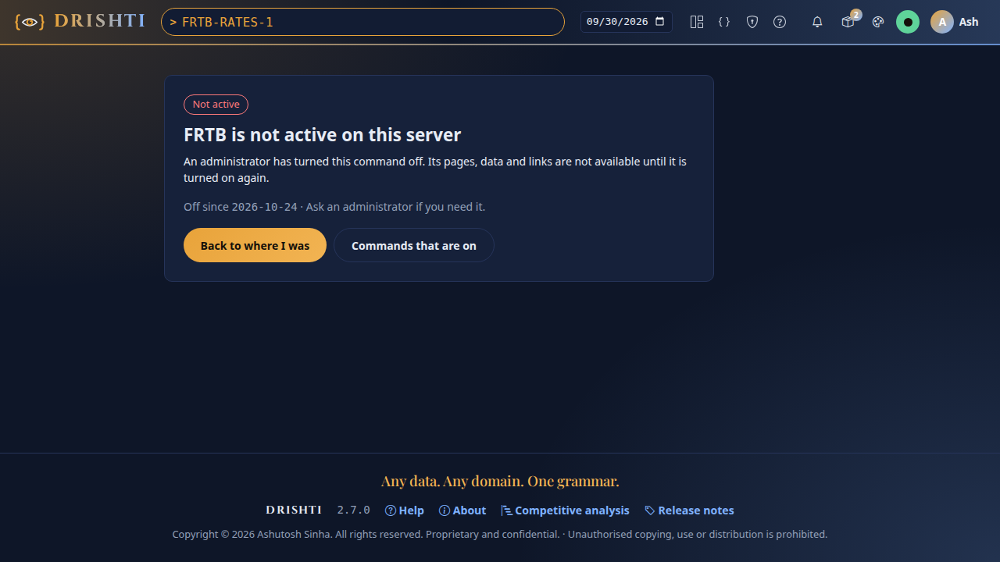

<!--
  Project Drishti · Any data. Any domain. One grammar.

  Copyright (c) 2026 Ashutosh Sinha <ajsinha@gmail.com>.
  All rights reserved.

  PROPRIETARY AND CONFIDENTIAL.

  This file is the confidential and proprietary property of Ashutosh Sinha.
  Unauthorised copying, use, modification, distribution or disclosure of this
  file, via any medium, is strictly prohibited except with the express prior
  written permission of the copyright holder.

  See the LICENSE file in the root of this repository for the full terms.
-->
# Commands: turning a command on or off (Admin → Commands)

An administrator can turn any command of the packs off for everyone: `FRTB`, `EQV`, `TRD` and every other mnemonic. The code stays; a
command that is off is **not active** everywhere, and nothing about it leaks. Turn it back on at any time. Packs are switched on the same
page and in the same record, so a cluster of servers always agrees on both.

- [The page](#the-page)
- [What "not active" means](#what-not-active-means)
- [Review, reason and history](#review-reason-and-history)
- [Several servers](#several-servers)
- [Where it is kept](#where-it-is-kept)
- [From a script](#from-a-script)

## The page

Admin → **Commands** (`/admin/commands`, administrators only) lists every command of the loaded packs, grouped by pack. Each row says
what the command opens, **what it does** (the one-line description of its data contract, the same text as the
[command catalog](../guides/COMMAND_CATALOG.md)) and an example. The **Everyone** column turns a command on or off for everyone; a pack's
row has a **Pack** switch that turns the whole pack on or off, as Admin → Packs does. The greyed role columns are where commands will
be granted per role later; today only Everyone is used.


**Find** (or `/`) narrows the rows to a command, kind, pack or word of the description; **Show** keeps only the commands that are on or
off. **Version on each server** says which version of the switches each server of the cluster holds: *in step*, or *catching up* for
a few seconds after a change.

## What "not active" means

A command that is off answers the same way whatever asks for it:

| Where | What happens |
|---|---|
| The command line (`FRTB FRTB-RATES-1 <GO>`) and its page (`/v/frtb-sensitivity/…`) | The **not active** page: "FRTB is not active on this server", since when, and "ask an administrator if you need it" |
| The API (views, search, history, raw, exports), the command line tool, subscriptions, the compute ask | `403 DRS-1016` with `command`, `kind` and `since`; no data |
| Search, type-ahead and pick lists, the packs' menus, example commands on the landing page | Left out: it is not suggested |
| A link to it on another page (a linked-entity row, a table cell, a link key) | Struck through, *not active*, not clickable |
| A panel of another page that reads it | *Not active (turned off by an administrator)*, with nothing of its data |
| BI datasets and models that read its kind, BI SQL, AI answers about a page | Refused, or the tables of the kind left out, exactly as for a kind the person may not open |



An open page follows a change at once: the server tells every console on its live channel, a page of a command just turned off is drawn
again (as the not active page), and links to it stop being links.

## Review, reason and history

Ticking a box only records a change: the page counts the changes not saved, **Undo** takes back the last one, and **Review N changes**
(or **Turn FRTB off** for a single one) opens the side panel. It lists everything each change blocks: the typed command, its page and
API, the command line tool, exports and AI tools, search and type-ahead, links and panels on other pages, and what is saved that reads its
kind (BI datasets and what is built on them, saved searches, monitors, alerts, subscriptions, workspaces, shares, embed hosts). Write the
**reason**: it is kept with the change. **Apply** sends the whole batch; a pack another switched-on pack builds on cannot be switched off
(switch that one off first).

**History** lists every change, newest first: when, what, on or off, who, why and the server it was made on. Each change is also in the
audit log (`command-disabled`, `command-enabled`, `pack-disabled`, `pack-enabled`).

## Several servers

On a cluster ([NET.md](NET.md)) a change made on any server reaches every other within a gossip round or two, and is written to each
server's own database before it takes effect there:

- Every change carries a **stamp** (a hybrid logical clock: the wall time in milliseconds and a counter, never behind a stamp the server
  has seen) and the **node** it was made on. When two changes of one switch meet, the newer by (stamp, node) wins, so every server
  reaches the same state whatever order it hears them in.
- Each member's gossip entry carries the hash of its switches (`switchesHash`, beside `digestHash`). A server whose hash differs from a
  peer's pulls the peer's switches (`GET /api/v1/net/switches`, signed with the cluster key, on the gossip port too) and merges them.
  Both sides of a difference pull, so a server that was down or cut off while changes were made catches up when it comes back, and a
  change it made meanwhile reaches the others (anti-entropy on join and rejoin).
- A server starts from what its own database holds, then reconciles with its peers.

## Where it is kept

The switches live in the Drishti database (SQLite by default, PostgreSQL for a cluster that shares one; [DATABASE.md](../architecture/DATABASE.md)),
in both complete schema files:

| Table | Holds |
|---|---|
| `drishti_switch` | The newest state of each switch: `scope` (`command` or `pack`), `name` (the mnemonic or the pack), `grantee` (`*` is everyone; a role once commands are granted per role), `enabled`, `reason`, `actor`, `stamp`, `node`, `updated_at` |
| `drishti_switch_log` | Every change applied, made here or learned from a peer, once each: the same columns, with `at` (when it was made) and `applied_at` (when this server applied it) |

A server that kept pack states before (Admin → Packs, `drishti_pack_state` or the content store's `admin/pack-state.json`) imports them
into the switches once, stamped with the time they were set.

## From a script

The admin API is `/api/v1/admin/commands` ([API_GUIDE.md](../guides/API_GUIDE.md)): `GET` the list, `POST` a batch
`{"reason": "...", "changes": [{"scope": "command", "name": "FRTB", "on": false}]}`, `GET /history`, `GET /{code}/impact`. Like every
admin endpoint that changes access, it is never for a personal API token: use the console, or `drishti.py server commands` where sign-in
is off:

```
$ python3 tools/drishti.py server commands off FRTB EQV --reason "quarter-end freeze" --user ash
FRTB, EQV off; 2 of 90 commands off; every server of the cluster follows within seconds
$ python3 tools/drishti.py server commands list --off --user ash
$ python3 tools/drishti.py server commands history --user ash
```

---

*Copyright (c) 2026 Ashutosh Sinha <ajsinha@gmail.com>. All rights reserved.
Proprietary and confidential. Unauthorised copying, use or distribution is prohibited.*
