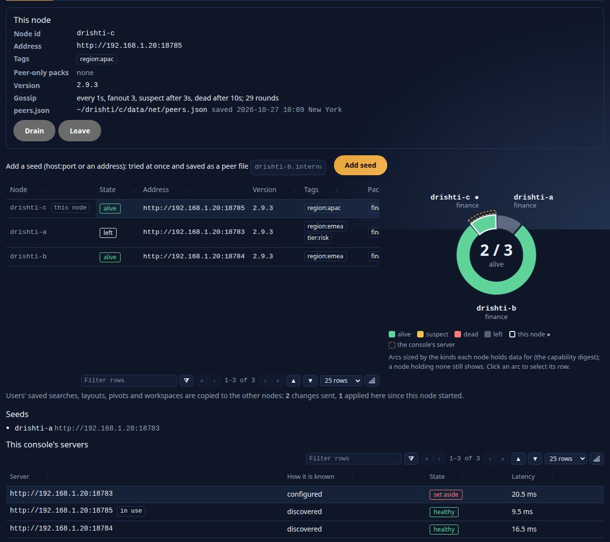

<!--
  Project Drishti · Any data. Any domain. One grammar.

  Copyright (c) 2026 Ashutosh Sinha <ajsinha@gmail.com>.
  All rights reserved.

  PROPRIETARY AND CONFIDENTIAL.

  This file is the confidential and proprietary property of Ashutosh Sinha.
  Unauthorised copying, use, modification, distribution or disclosure of this
  file, via any medium, is strictly prohibited except with the express prior
  written permission of the copyright holder.

  See the LICENSE file in the root of this repository for the full terms.
-->
# Drishti*net: the operator's guide

Drishti*net makes several Drishti servers act as one. Each server (a **node**) tells the others, by gossip over HTTP, which packs,
kinds and data it serves. A request that one node cannot answer is answered by another, and the console never knows which: a person
connected to any node sees the same pages. The design, with the reasons behind each choice, is
[DRISHTI_NET.md](../architecture/DRISHTI_NET.md).

**It is off by default.** A server with no `config/net/` folder, or whose `node.yaml` does not say `enabled: true`, is a single server
exactly as before: no thread gossips, no peer is asked, nothing is forwarded, and the cluster's endpoints answer `404 DRS-5050`.

- [1. Before you start](#1-before-you-start)
- [2. A cluster of three](#2-a-cluster-of-three)
- [3. The files of config/net/](#3-the-files-of-confignet)
- [4. Membership: how the nodes find each other](#4-membership-how-the-nodes-find-each-other)
- [5. What each node offers: the capability digest](#5-what-each-node-offers-the-capability-digest)
- [6. Security: the key, mutual TLS, nodes per role](#6-security-the-key-mutual-tls-nodes-per-role)
- [7. Routing: where a request goes](#7-routing-where-a-request-goes)
- [8. The console and several servers](#8-the-console-and-several-servers)
- [9. Admin → Net](#9-admin--net)
- [10. Drain, maintenance and a node leaving](#10-drain-maintenance-and-a-node-leaving)
- [11. Sizing](#11-sizing)
- [12. When something is wrong](#12-when-something-is-wrong)
- [13. Measured: the soak on real processes](#13-measured-the-soak-on-real-processes)

## 1. Before you start

| Need | Why |
|---|---|
| The same Drishti version on every node (the same Drishti*net protocol, `1`) | A node that speaks another protocol is listed but never sent a request |
| One **cluster key**, at least 32 bytes, in the environment of every node (`DRISHTI_NET_SECRET`) | Every call between nodes is signed with it; a node without it cannot join or read |
| The same **token secret** (`DRISHTI_TOKEN_SECRET`) or the same OIDC issuer on every node | A person signed in on one node is signed in on all, so a console can move between them |
| Each node reachable by the others on its own port (the address it advertises: a real one, never `localhost`, `127.x.x.x`, `::1`, `0.0.0.0` or `::`) | Gossip, digests and forwarded requests are plain HTTP(S) calls to that address |
| Clocks within 60 seconds of each other (NTP) | A signed call is refused outside a 60 s window, so a replay cannot be sent later |

Generate the key, do not invent it, and keep it where only the service user can read it:

```bash
openssl rand -hex 32          # the same value goes into DRISHTI_NET_SECRET on every node
```

The key is never written in a file of `config/net/` in clear: the file names the variable (`secret: ${DRISHTI_NET_SECRET}`), and a
file with a key in clear is refused. It is never shown in Admin → Net either, only whether it is set.

## 2. A cluster of three

**The ready-made local cluster: `drishti-stack/`.** For a cluster running on one machine without the steps below, the repository's
`drishti-stack/` starts three servers (18480, 18791, 18792) and a console (17480) from one file, `stack.yaml`, with each node's net folder
checked in (`secret: ${DRISHTI_NET_SECRET}` only) and the secrets made on the first start in a git-ignored `secrets.env`: `start.sh`,
`status.sh`, `stop.sh` (by process id), one entry to add a node. See [drishti-stack/README.md](../../drishti-stack/README.md).

Three nodes, `a`, `b` and `c`. Only `a` needs to be named anywhere: `b` and `c` are given `a` as their seed, and gossip tells every node
about every other within a round or two. The examples run the three on one machine on ports 18783, 18784 and 18785, at that machine's
address, `192.168.1.20` here; on three machines use each machine's own address.

**Members advertise a real address, never a loopback one.** A node is called at the address it advertises by every other node and every
console, on any machine, so `localhost`, `127.x.x.x`, `::1`, `0.0.0.0` and `::` are refused wherever an address is given, in any spelling
(`localhost.`, `ip6-localhost`, `0`, `127.1`, `2130706433`, `0x7f000001`), as are link-local addresses (`169.254.x.x`, `fe80::…`), the
addresses of this machine's container and VM bridges (`172.17.0.1` on `docker0`) and a host name that resolves here to any of them (on
Debian and Ubuntu the machine's own name is `127.0.1.1` in `/etc/hosts`; the message says so): `advertise-url`
in node.yaml, a seed's `url` in `peers/*.yaml` (by `drishti.py net check|set|add-peer`, by Admin → Net → Files and by the server when it
loads the folder), and a member address learned by gossip is never kept nor passed on. Even three nodes on one machine use the machine's
real address. The refusal names the address to use:

```text
$ drishti.py net set node.advertise-url http://127.0.0.1:18784
drishti: node.yaml was not written: 'http://127.0.0.1:18784' is a loopback or wildcard address: the address this node advertises must be an address other machines can call (this machine's address is 192.168.1.20: use http://192.168.1.20:18784); or leave advertise-url out and the node advertises that address with its port
```

**An address is an address.** `advertise-url` and a seed's `url` are `http` or `https`, then a host, then an optional port and path,
and nothing else: the host is a host name (letters, digits and dashes between dots, no dot at the end), an IPv4 address in four decimal
parts (`192.168.2.77`) or an IPv6 address in brackets (`http://[2001:db8::5]:18611`); the port is 1 to 65535. A port of `0` or past
65535, a `%`-escaped or trailing-dot host, a user part (`user@host`), a query or a fragment are refused with the reason (*port 0 is not a
port: the port must be 1 to 65535*, *'192.168.2.77.' ends with a dot: write the address without it*), and a member gossiping such an
address is never kept, so it can't show *alive* while every read through it fails. `drishti.py net` and the server apply the same rules:
both are tested on one table of cases (`drishti-net/src/test/resources/net/advertise-urls.tsv`).

**Without `advertise-url`** a node advertises this machine's primary IPv4 address with the server's port (`server.port`; `https` when
`server.ssl.enabled`): the address of the interface the default route leaves by, else the first interface that is up and is not a
loopback, a container bridge (`docker0`, `br-…`, `veth…`) or a virtual link. Set `advertise-url` on a machine with several interfaces,
behind a load balancer or with a DNS name. To see the address a node would take: `ip -4 route get 1.1.1.1` (Linux: the `src` address),
`ipconfig getifaddr en0` (macOS) or `ipconfig` (Windows); Admin → Net → Members shows it beside **Address** as *detected*. A machine with
no address but loopback cannot be a member: `enabled: true` without `advertise-url` is refused there.

**Step 1 · node.yaml on each node.** The same file on each, with its own address and tags:

```yaml
# config/net/node.yaml on node b
enabled: true
advertise-url: http://192.168.1.20:18784  # the address the other nodes and the consoles call this node at (left out: this machine's)
tags: [region:emea, tier:risk]
secret: ${DRISHTI_NET_SECRET}
```

From a terminal, `drishti.py net` writes and checks the same file. It refuses `enabled: true` until the key is there, as the server does:

```text
$ drishti.py net set node.enabled true
drishti: node.yaml was not written: enabled: true needs the cluster key: secret: ${DRISHTI_NET_SECRET} with the variable set (at least 32 bytes)
  error   node.yaml  secret: enabled: true needs the cluster key: secret: ${DRISHTI_NET_SECRET} with the variable set (at least 32 bytes)
(exit 1)

$ drishti.py net set node.secret '${DRISHTI_NET_SECRET}'
wrote ~/drishti/config/net/node.yaml
$ drishti.py net set node.advertise-url http://192.168.1.20:18784
wrote ~/drishti/config/net/node.yaml
$ drishti.py net set node.tags region:emea,tier:risk
wrote ~/drishti/config/net/node.yaml
$ drishti.py net set node.enabled true
wrote ~/drishti/config/net/node.yaml
```

In the UI: **Admin → Net → Files**, open `node.yaml`, type the settings, **Check**, **Save**.

**Step 2 · the seed.** On `b` and `c`, one peer file naming `a`:

```text
$ drishti.py net add-peer drishti-a 192.168.1.20:18783 --tags region:emea
wrote ~/drishti/config/net/peers/drishti-a.yaml

$ drishti.py net list
config/net at ~/drishti/config/net: Drishti*net is ON
  node (generated)  at http://192.168.1.20:18784  tags region:emea,tier:risk  key set
  seed drishti-a  http://192.168.1.20:18783
  node.yaml             in force
  gossip.yaml           absent (defaults)
  routing.yaml          absent (defaults)
  access.yaml           absent (defaults)
  peers/drishti-a.yaml  in force
```

```yaml
# config/net/peers/drishti-a.yaml
url: http://192.168.1.20:18783
tags: [region:emea]
```

In the UI: **Admin → Net → Members**, **Add a seed**, type `192.168.1.20:18783`, **Add seed**. The seed is saved as `peers/192-168-1-20-18783.yaml`
and tried at once; the page says whether it answered.

**Step 3 · start them.** Start the three servers (each with `DRISHTI_NET_SECRET` in its environment). A running server picks a change of the
folder up by itself within `drishti.net.poll` (5 s), so a server that is already running joins as soon as `enabled: true` is saved; switching it
back to `false` makes it leave cleanly. Each logs what it did:

```text
INFO  net: Drishti*net is on; this node joins once the server is ready (its web server answers and its connectors have started)
INFO  Tomcat started on port 18784 (http) with context path '/'
INFO  net: node n-1ace3ceb60 joined Drishti*net at http://192.168.1.20:18784 (incarnation 1, seeds [http://192.168.1.20:18783], 0 saved members)
INFO  net: member n-3d5a69faa3 joined
```

A server joins only once it is ready (since the 2.6.5 soak): its web server answers and its connectors have started. Until then its peers keep it as they
last saw it, so a restarting node is never routed to before its port opens (before, it joined 12 to 19 s early and its peers got
`ConnectException`).

**Step 4 · check.** On any node, **Admin → Net → Members** lists the three, each `alive`, with its version, tags and the latency this node
measured to it. From a terminal (an administrator's token in `DRISHTI_TOKEN`), `drishti.py net members --server http://192.168.1.20:18784` prints the same
table: one line per member with its node id (this node marked), state, address, version, tags, the latency this node measured and its
incarnation (`--json` for the whole answer).

In the in-process test of three servers (`NetMembershipTest`), the three list each other 52 ms after the third has started.

## 3. The files of config/net/

Drishti*net is configured the way connectors are ([CONNECTOR_FILES.md](../connectors/CONNECTOR_FILES.md)): one folder of small YAML files,
watched, each checked against its schema before it is used. `application.yaml` holds only where the folder is and how it is watched
([CONFIGURATION.md](CONFIGURATION.md#drishtinet--drishtinet-the-cluster-folder)):

```yaml
drishti:
  net:
    dir: ${DRISHTI_NET_DIR:./config/net}     # created on first write; ready-made files in config/net.examples/
    watch: ${DRISHTI_NET_WATCH:auto}         # auto (file events, polling as a fallback) | poll | off
    poll: 5s
```

**A refused file keeps the previous settings in force.** A file with an error (a value that is not a duration, a key in clear, `enabled: true`
without a key) is refused as a whole: the settings it held before stay, Admin → Net → Files shows it **refused** with each problem and its line,
and the log names the file and the line. An unknown setting is a warning, not an error. Every write (Admin → Net or `drishti.py net`) is atomic
and keeps the previous text in `<data dir>/net/history/`; Admin → Net shows the history and a diff against the file. What gossip learns at
run time is state, not configuration: it goes to `<data dir>/net/peers.json`, never into this folder.

Ready-made files, with every setting explained, are in [config/net.examples/](../../config/net.examples/).

### node.yaml: this node

| Setting | Default | What it does | A change |
|---|---|---|---|
| `enabled` | `false` | `true` makes this server a member | `false` → `true` joins; `true` → `false` leaves cleanly (gossips `left` first) |
| `node-id` | empty | This node's id; empty: generated once (`n-` and ten hex digits) and kept in `<data dir>/net/node-id` | the node leaves and joins again with the new id |
| `advertise-url` | this machine's primary IPv4 address with the server's port | The address the other nodes and the consoles call this node at; never `localhost`, `127.x.x.x`, `::1`, `0.0.0.0` or `::` (refused) | gossiped at once |
| `tags` | `[]` | `key:value` words (`region:emea`, `tier:risk`) that `access.yaml` names | gossiped at once |
| `peer-only-packs` | `[]` | Packs this node serves to its peers only, hidden from its own users | the next request |
| `secret` | none (needed with `enabled: true`) | The cluster key, **only** as `${DRISHTI_NET_SECRET}`; at least 32 bytes | the next call |
| `previous-secret` | none | A second key also accepted (never used to sign), during a key rollover | the next call |
| `tls.*` | none | Mutual TLS between nodes: the shared TLS settings ([TLS.md](../connectors/TLS.md)) for an `https://` peer | the next call |

### peers/&lt;name&gt;.yaml: the seeds

One file per seed, the file name its logical name (lower-case letters, digits and dashes). A new file is contacted at once; a deleted file is
no longer a seed, but gossip may still know the node.

| Setting | What it does |
|---|---|
| `url` | The peer's address (`http://` or `https://`, with a host); never `localhost`, `127.x.x.x`, `::1`, `0.0.0.0` or `::` (refused) |
| `tags` | The tags it is expected to carry |
| `tls.*` | Overrides of node.yaml's `tls.*` for this peer |

### gossip.yaml: the protocol's timings

| Setting | Default | What it does |
|---|---|---|
| `interval` | `1s` | How often a round runs: a push-pull exchange with `fanout` random members |
| `fanout` | `3` | How many members each round exchanges tables with (1 to 16) |
| `suspect-after` | `5s` | A member whose heartbeat has not risen this long is probed (at least `interval`) |
| `indirect-probes` | `2` | How many other members are asked to probe it when it does not answer directly |
| `dead-after` | `30s` | How long a member stays suspect before it is dead |
| `forget-after` | `24h` | How long a dead or left member is remembered, so a stale table cannot bring it back |
| `persist-every` | `10m` | How often `peers.json` is saved (also on every join or leave, and at shutdown) |

Applied on the next round.

### access.yaml: nodes per role

| Setting | Default | What it does |
|---|---|---|
| `roles.<role>.nodes` | none (every node) | The node ids and tags the role may reach ([section 6](#6-security-the-key-mutual-tls-nodes-per-role)) |

Applied to the next request, and told to the other nodes in the digest.

### routing.yaml

Budgets, the hop limit, the peer choice weights and user state: in [section 7](#7-routing-where-a-request-goes).

## 4. Membership: how the nodes find each other

SWIM-style membership, carried over HTTP:

- **Every `interval`** a node raises its own **heartbeat** and does a push-pull exchange (`POST /api/v1/net/gossip`) with `fanout` random
  members: it sends its member table and merges the one it gets back. With fanout 3, news reaches 100 nodes in about five rounds.
- **The merge rule:** the higher **incarnation** wins; at equal incarnation the worse state wins (`left` > `dead` > `suspect` > `alive`); a node's
  own entry is only ever changed by itself. A node that hears it is suspected raises its incarnation and gossips `alive`.
- **Failure detection:** a member whose heartbeat has not risen for `suspect-after` is probed directly (`GET /api/v1/net/ping`), then through
  `indirect-probes` other members; still silent, it is **suspect**; suspect for `dead-after`, it is **dead**. With the defaults a crashed node is
  dead everywhere within 40 seconds (the in-process test of five nodes measures it).
- **Leaving:** a server stopping cleanly, or switched off in node.yaml, gossips `left` before it stops, so its peers drop it at once.
- **Joining:** a node contacts its seeds, and failing those the members its `peers.json` lists; one exchange gives it the whole table. With no
  seed and no file it is a cluster of one, and keeps trying.
- **Persistence:** `<data dir>/net/peers.json` holds this node's id and every member with its last-known state; it is written atomically
  (a temporary file moved over it) every `persist-every`, on every join or leave and at shutdown. A restarted node reads it, raises its
  incarnation above the saved one and rejoins from the members it lists, with no seed at all. A file that cannot be read is ignored with a
  warning (the node then joins from its seeds).
- **Forgetting:** dead and left members are kept `forget-after` (24 h), then dropped.

Every call between nodes is signed with the cluster key (an HMAC over the method, the path and query, the time, the calling node and the body)
and refused outside a 60 s window: a node without the key cannot join, gossip or read, and each refused call is listed on Admin → Net with the
address and the reason (`401 DRS-5051`).

## 5. What each node offers: the capability digest

Each node publishes a **digest** of what it serves (`GET /api/v1/net/digest`), and gossips its hash with its member entry; a peer pulls the
digest again when the hash changes (and once a minute anyway, for the load). The digest holds:

| Part | What it says |
|---|---|
| `packs` | every pack switched on: name, code, version, a hash of its files, and whether it is served to peers only |
| `kinds` | every kind of those packs: its mnemonic, its pack, and its **sources**: connector, plugin, **table identity**, the newest business date it holds, its data version, whether it keeps columns, is dated, is live |
| `load` | requests a second and the average latency over the last full minute, for choosing between peers |
| `calendar` | the business calendar (`DRISHTI_CALENDAR`): an as-of date must mean the same day on both nodes |
| `tags`, `redact`, `access` | the node's tags, the fields it masks and its nodes per role, so Admin → Net can show where nodes differ |

A node rebuilds its digest every gossip round from cheap reads (no data is read) and announces a change at once, so **a pack switched on at one
node is in every node's table within about a second** (1.0 s measured with the default 1 s round, three servers). From all the digests each node
builds the **capability table**: for each kind, the nodes that render it and the nodes that hold its data.

**Replicas and shards.** A source names where its data lives, the same on every server that reads the same data: a Delta table by the id in its
log (or, failing that, its location; a local path counts only on its own machine); a `file` connector by its folder and a fingerprint of the
kind's files (`file:<folder>#<fingerprint>`: each file's path, size and time, taken at each rescan, so two servers reading one folder say the same).
Two nodes whose sources name the same table are **replicas** for that kind: a search asks one of them. Different tables of the same kind (ENDUR's
trades on one node, CALYPSO's on another) are **shards**: a search asks every one. A source that cannot say where its data lives is taken as a
shard of its node, which is always safe. A source that holds nothing of a kind (a Delta connector with no table for it, a folder with no file of
it) is left out of the kind's sources, so it never makes its node a holder of the kind; a table or file that appears is in the digest by the next
round (a `file` folder: by its next rescan, `rescan-seconds`).

**The newest pack is served.** When nodes hold different versions of a pack, the newest is the one served; the map marks it.

## 6. Security: the key, mutual TLS, nodes per role

**The cluster key.** Every call between nodes carries the calling node's id, the time and an HMAC-SHA256 of the method, the path and query, the
time, the node and the body, made with the cluster key. A call is refused (`401 DRS-5051`, listed on Admin → Net → Security with the address
and the reason) when it has no signature, when another key made it, or when it was signed more than 60 seconds away from this node's clock
(a replay). A node without the key cannot gossip, read a digest or ask for data.

**Rotating the key with no downtime.** A node with only the old key cannot check a call signed with the new one, so a rotation is three rolling
steps; in each, restart (or reload) the nodes one by one, and the cluster keeps working throughout:

| Step | node.yaml on every node | The environment | What it does |
|---|---|---|---|
| 1 | `secret: ${DRISHTI_NET_SECRET}` and `previous-secret: ${DRISHTI_NET_PREVIOUS_SECRET}` | `DRISHTI_NET_SECRET` = old, `DRISHTI_NET_PREVIOUS_SECRET` = **new** | every node also accepts the new key |
| 2 | the same | `DRISHTI_NET_SECRET` = **new**, `DRISHTI_NET_PREVIOUS_SECRET` = old | every node signs with the new key and still accepts the old |
| 3 | remove `previous-secret` | `DRISHTI_NET_SECRET` = new | the old key is refused everywhere |

`previous-secret` is never used to sign; it is only also accepted. Admin → Net → Security shows, for each peer, when it last signed with the
previous key: when no peer has for a while (every node is at step 2), do step 3. On-behalf-of tokens live 30 seconds, so none outlives a
rollover. In the in-process test of three servers, 13,542 signed calls made through the three steps were all taken.

**Mutual TLS.** Between nodes on an untrusted network, give each node a certificate: inbound, the server's own TLS with client certificates
(`server.ssl.*`, `server.ssl.client-auth: need`), outbound, `tls.*` in node.yaml (the shared TLS settings of [TLS.md](../connectors/TLS.md):
`keystore`, `truststore`, their passwords as `${ENV}` references), with `https://` addresses. Mutual TLS comes on top of the cluster key, never in
its place. Admin → Net → Security lists the configured certificates and when each expires.

**The user is carried, not trusted blindly.** A request forwarded for a person carries an **on-behalf-of token**: the user, the roles, the embed
application if any, the node that forwarded it and the request id, the node it is for, signed with the cluster key and valid 30 seconds. The
receiving node checks the token as it checks the call, and serves the request as that person: their masks, their kinds, their packs. With
`drishti.security.registered-users-only` on (the default), the user must exist and be enabled on the receiving node too; the nodes copy their
users to each other ([section 7](#7-routing-where-a-request-goes), *the identity follows*), so a user known to one node is known to all. A token
for another node, or older than 30 s, is refused.

**Masks twice.** The node that reads the data masks it as it would for that person; the node that shows the page applies its own masks again. The
stricter configuration wins; Admin → Net → Capability map warns when two nodes mask different fields.

**Nodes per role** (`access.yaml`, or Admin → Net → Access). A role may name the nodes it may reach, by node id or tag; a role not listed, or with no
nodes, reaches every node; a person reaches a node when any of their roles does.

```yaml
# config/net/access.yaml
roles:
  trader:
    nodes: [region:emea]        # the EMEA nodes only
  risk:
    nodes: []                   # every node
```

Before any request leaves a node, the capability table is cut to the nodes the caller's roles reach: a search, a type-ahead or a forwarded request
never reaches another node, and a kind held only on nodes outside the list is answered as not held. The receiving node checks again: a forwarded
request whose roles do not reach it is refused `403 DRS-5054`. The person's own node always answers them (they are connected to it).

**Audit.** A forwarded request is in the access log of both nodes: the forwarding node's row names the node it went to and the request id, the
receiving node's row says `net:from <node> request <id>`. Every management action is in the audit log with the node it was made on.

## 7. Routing: where a request goes

Every request a node's own clients make (a view, its panels' rows, About this page, the raw document, history, a live view, a search, a form)
goes through three questions, in order. Only nodes the caller's roles may reach are ever considered, and a request another node forwarded is
answered by the receiving node from itself only (one hop at most, `X-Drishti-Net-Hop: 1`).

1. **Can this node answer it?** The kind's pack is on here, it is the newest version of that pack among the nodes the caller may reach, and it is
   not served to peers only here. Then it is answered here, as without the cluster.
2. **Is the kind's pack missing here, older here, or peer-only here?** Then the **whole request is forwarded** (view forwarding) to a node that
   renders the kind: the path, the query, the body, the business date and "known at", signed, with an on-behalf-of token for the caller. That
   node's answer is passed back unchanged (a live view's events streamed as they come), so the page, its help and its links are that node's: the
   console cannot tell. Among the nodes that render it, those whose sources hold the kind's data come first, then the lowest latency, then a
   stable hash of the entity id (the same entity goes to the same node, whose caches stay warm). A node that does not hold the entity (`404`) or
   fails passes the read to the next (at most three; after a failure, once); a write goes to one node and is never repeated.
3. **Is the pack here but not the data?** Then the view is built here, and the document is read from a peer that holds it (data forwarding:
   `GET /api/v1/net/fetch/{kind}/{id}`, the document as the caller may see it there, masked by that node), and masked again here. A peer whose
   sources all read tables this node reads too (a replica) is never asked: it would answer as this node did. Peers that hold the date asked come
   first. A local source that **failed** is never replaced by a peer's data (its failure is the answer); a peer that failed makes the read fail with
   `502 DRS-5052` naming it, never a wrong "not found". A view's **linked entities** are read the same way, side by side: this node's own sources
   within `drishti.graph.link-budget` (40 ms), and one that none of them holds from the peers within routing.yaml's `link-budget` (1 s from the
   read's start), so a linked entity a peer holds shows with its badge, and a panel that reads it (`source:`) is drawn, exactly as on the node
   that holds it; only a peer slower than that leaves it *pending*.
   A **history** (`GET /api/v1/history/{kind}/{id}`, [HISTORY_QUERIES.md](../architecture/HISTORY_QUERIES.md)) takes the same three steps:
   a node without the pack forwards the whole request; a node with the pack reads the dates its own dated sources do not cover from a
   peer in **one** call for all of them (`GET /api/v1/net/history/{kind}/~?id=&from=&to=&dates=`, each day masked there and again here),
   not one call per day. Dates two peers both answer keep the higher generation. Admin → Net → Traffic lists the call as `history`.
   The history cache is keyed by the peers' data versions too (their digests carry them), so a load on the peer shows on the next
   request. When a node that holds the kind is down or suspect and no node that answered holds the dates, the answer is `502 DRS-5052`
   naming that node (or, when some days were read, a partial answer whose `problems` name it), never `DRS-1013` "no data"; a failed,
   partial or empty answer is never cached. The down node counts only for the dates its last digest said it holds (`earliestDate` to
   `latestDate` of its sources of the kind): a 3-month history of data this node holds, asked while a node whose lake starts later is
   down, is complete. A peer that refuses the connection (it just died, or is still starting) passes the read to the next holder, and is
   `DRS-5052` naming it when no one else holds the dates; a peer that answers with its own failure is `DRS-5052` too, never `DRS-1003`.

**The newest pack is served.** When nodes hold different versions of a pack, a request for its kinds goes to a node with the newest, even when this
node could answer with its older one (in the in-process test, B with the shipped finance pack forwards to A, which has 9.9.9).

**Peer-only packs** (`peer-only-packs` in node.yaml) are loaded and served to peers, but hidden from this node's own users: not in their packs, forms,
type-ahead or command line; a request of theirs for such a kind is forwarded to another node that renders it, or answered as if the pack were not
here (`404 DRS-1002`). A node can so be a pure data or rendering server behind others.

**When the node that serves it is down**, the answer says so: `502 DRS-5052 ... the nodes that hold trade cannot be reached now: n-a (left)`, or
`... did not answer within 5000 ms` (`504 DRS-5053`), never a wrong page.

**Searches and type-ahead are scattered.** A search (`GET /api/v1/search`, the form, the command line's search) is asked of every node that
holds data of the kind and is not a replica of a node already asked (section 5), each running it on its own data (`GET /api/v1/net/search`, one hop),
within `scatter-budget` (3 s). The answers are merged as one: rows by kind and id (a trade two nodes hold is counted once, this node's answer first),
re-sorted by the search's `order by` (or by id, as one node sorts), cut to its `limit`; `scanned` and `matched` summed, an entity two nodes matched
counted once (each node's share lists its matches' ids, up to 20,000; above that the overlap is taken from the rows both returned). A node that failed, was late
or is down (it holds the kind but is suspect, dead or left) is named in `failed` and the answer is `partial`: an answer is never silently smaller. A
search of a kind whose pack is not here is asked of the nodes that hold it and merged here the same way. The answer has `nodes` (each node with what it
scanned, matched and how long it took) for administrators only. The type-ahead asks every reachable node with `suggest-budget` (150 ms): what a slow
node would have suggested is simply missing, the list is never late. In the in-process test, trades split three ways (one on two nodes) give the same
answer on every node: the union, the shared trade once, ordered by notional exactly as the union sorted.

**Live views are relayed.** A live view of an entity whose data is on a peer is built here and ticks here: this node opens one stream from the
peer (`GET /api/v1/net/subscribe/{kind}/{id}`, the entity's new generations as the viewer may see them there) and feeds every viewer here that has the
same roles; viewers with other roles get a stream of their own, since the peer masks for the user a stream was opened for. A stream that breaks is
opened again a second later. In the in-process test a ticking trade held on A streams frames to a viewer on B.

**BI reports run where the model's data is.** A BI report's requests (`/api/v1/bi/reports/{id}` and what is under it: its query, its live table) are
answered here when this node has the report and its sources hold every kind the report's datasets read; otherwise they go to a node whose digest lists
the report and that holds those kinds, and its answer comes back unchanged. In the in-process test the same report asked of B (no data) answers
exactly what A (the lake) answers. A model spanning nodes is not joined across them.

**A user's state follows them.** Saved searches (they are in the user's settings), layouts, pivots, workspaces and settings written on one node are
copied to every other node within a second (`POST /api/v1/net/state`, signed, in batches; the newest write wins), so after a failover the user finds
them on the node the console moved to. A node that was down gets what it missed when it comes back: every node sends a member that joins the user
documents it holds, applied there only where it has none. Alerts, monitors and scheduled reports are **not** copied: they act, and would act once per
node; they stay on the node they were made on. **Console sign-in sessions are copied the same way**: when a console opens a session on one
node, the others learn it (only the SHA-256 of the session id travels, with the user and the expiry, never the id), a sign-out on any node ends it
on all, and an administrator's disabling or deleting a user ends their sessions everywhere; a node that joins is given the sessions that stand. So
a console that moves to another server keeps every person signed in.

**The identity follows too.** Users (their roles, packs, whether they are enabled, and the password hash, never a password), the roles
administrators define (Admin → Roles) and personal API tokens (the SHA-256 of the secret, never the secret) made or changed on one node are copied to
every other node the same way, so a user created on one node can sign in on any, stays signed in when the console moves, and a script's token works
on every node. The newest change wins; each change applied is audited on the receiving node with the node it came from (`net:<node>`, e.g.
`user-created`, `user-updated`, `user-deleted`, `role-updated`, `token-copied`, `token-revoked`). **Disabling** a user is copied as any change, and
their sessions end everywhere. **Deleting** a user or a role leaves a tombstone (`<data dir>/net/identity-deleted.json`, kept 90 days): a node that
was down at the time deletes it when it comes back (with the user's tokens, settings and sessions), and its stale copy never brings the user back
elsewhere; a user created again under the same name after the deletion is a new user. Two users of one name made apart on two nodes (each node's
seeded administrator, typically) are settled by the older: a new node's seeded administrator never replaces the cluster's. **The cluster never
ends with no enabled administrator.** The last-administrator rule (`DRS-6006`) is checked on the node where a change is made, so two
administrators on two nodes could each disable, demote or delete one of the last two administrators at the same moment. When a peer's change
would leave a node with none, the node repairs it as it applies it: it enables the disabled administrator that was enabled most recently (the
newest change, then the name, so every node picks the same one), or, when no disabled administrator is left, keeps the one the change took
away (a deletion is refused and the user kept, as a new user, so the tombstone does not refuse them elsewhere). The repair is a change like any
other, sent to every node, audited as `last-admin-kept` and shown on **Admin → Health** under Drishti*net as *Last administrator kept*.
Everything travels over
the signed `POST /api/v1/net/state`; between nodes on an untrusted network add mutual TLS ([section 6](#6-security-the-key-mutual-tls-nodes-per-role))
so the password hashes are not readable on the wire. With one shared identity database (PostgreSQL, `DRISHTI_IDENTITY_DB_URL`) the nodes already
share all of it: set `user-state: off` in routing.yaml. Admin → Net → Members says how many changes were sent and applied and what waits for which
peer.

**Which node answered, for administrators.** A view's *How this view was built* panel has, for an administrator only, a line **Node**:
`drishti-a · local`, `drishti-a · built here, data from drishti-c`, `drishti-b · forwarded from drishti-a`, or
`drishti-b · scatter-gather from drishti-a, drishti-b, drishti-c` (with the nodes missing, for a partial grouped page). A live view keeps it on
every frame. Everyone else sees the panel as on a single server.

**Grouped pages are gathered across the nodes.** A page a derived connector builds from many entities (a counterparty's trades, a book's P&L,
a netting set over several systems) is built from the members on every node that holds the kind it groups, as a search is: the nodes asked are
the ones the caller's roles reach, never a replica of a node already asked (`GET /api/v1/net/group/{kind}/{id}`, within `scatter-budget`). Each
node sends its share of the group masked as it masks for the caller; the page is masked again on the node that shows it. When every node lists
all its members of the group (a group of up to the connector's `max-members`, 1,000 by default), the page is exactly the one a single node
holding every member would build, and a member two nodes hold counts once. In a larger group each node's totals are combined (counts and sums
added, extremes compared, distinct values united, an average weighted by member count) and the members listed are the first `max-members` by id;
a member two nodes hold is then counted on each, so keep overlapping systems on one node or in a shared lake. A node that holds the kind but did
not answer or is down makes the page partial: the page's document carries `partial: true` and `missing` naming the node, and the view says so
to every reader (`provenance.partial` and `provenance.missing` in the view's answer; a **Partial** banner on the page naming the server), never a
smaller page that looks whole. A page with members on one node only is that node's page, unchanged.

**Roles.** A kind whose pack is here and that the caller's roles may not open is refused here before any call (`403 DRS-5002`). A kind whose pack is
not here is decided by the node that renders it, which knows the pack's roles.

**Business calendars.** A peer whose business calendar differs from this node's is used only for live reads: for a past business date its "date" could
mean another day.

Each forwarded request is in the access log of both nodes (`net:to <node> request <id>` here, `net:from <node> request <id>` there), in Admin → Net →
Routing's traffic, and in the metrics `drishti_net_forwarded_total{peer,kind,outcome}` and `drishti_net_peer_latency_seconds{peer}`.

`routing.yaml`:

| Setting | Default | What it does |
|---|---|---|
| `forward-timeout` | `5s` | Longest a forwarded view or a peer's document may take |
| `scatter-budget` | `3s` | Longest a peer's share of a scattered search may take |
| `suggest-budget` | `150ms` | The same for type-ahead |
| `link-budget` | `1s` | Longest a view waits for a linked entity that only a peer holds (this node's own sources: `drishti.graph.link-budget`, 40 ms) |
| `max-hops` | `1` | `0` switches forwarding off (gossip and digests only) |
| `weights.latency` | `1.0` | How much latency counts when choosing between peers (steps of 10 ms times the weight; `0`: by the entity's hash only) |
| `user-state` | `replicate` | Saved searches, layouts, pivots and console sign-in sessions copied to the other nodes, or `off` |

## 8. The console and several servers

With the cluster on, give the console several servers instead of one, so it always has one to fall back to
([CONFIGURATION.md](CONFIGURATION.md#the-console-and-several-servers-drishtinet)):

```yaml
# drishti-console/config/application.yaml
backend:
  urls: ${DRISHTI_BACKEND_URLS:}       # http://192.168.1.20:18783 (one is enough; empty: backend.url, as before; the console's own
                                       # choice: it may name 127.0.0.1 for a server on its machine, members never advertise one)
  discover: true
  discover_every: 60s
  check_every: 5s
  fail_after: 2
```

- **It learns the cluster.** Every minute it asks the server it uses for the member list (`GET /api/v1/net/members`) and keeps it, so one configured
  server is enough: it learns every other member, and new members and departures within a minute. The list is saved to
  `<console data dir>/net/servers.json` (atomically, and at shutdown), so a console restarted while its configured server is down still knows where
  else to go. A member the cluster reports dead or left is dropped; the configured `urls` never are. A member now advertised at another address
  replaces its old one, and a loopback or wildcard address is never discovered or read back from the file, so the list holds real addresses.
- **One server per session.** A session (a browser's sign-in) uses the first healthy server, the configured ones first, then the discovered ones,
  nearest first; it stays on it while it answers, so its caches and live views stay put. Each server is checked every `check_every`.
- **Falling over.** A server that refuses connections, times out or answers 502/503 `fail_after` times in a row is set aside and the session moves to
  the next. A 502 or 503 that is the server's own answer about another node (a problem with a code from `DRS-5050` to `DRS-5059`, such as
  `DRS-5052` while the node holding a trade is down, and from a server of 2.6.5 or older a `DRS-1003` naming a peer, `net:<node> failed reading …`)
  is not a failure of the server: the console stays, and the page shows the answer. A peer's time-out (`504 DRS-1014`) never counts. A **read** that failed on the way is tried once on another server, so the person sees the page, not an error; a **write** (a layout, a
  search, a pivot) never is: the page says it did not save, and saving again works on the new server.
- **Nothing to sign in again.** Every node accepts the same tokens (one token secret, or one OIDC issuer), and every node knows the console's
  sign-in sessions (copied with the user's state, section 7), so the session carries over. An open
  page's live view carries on with no reload: when its stream from the old server breaks, or ends because that server stopped, the console opens it
  again on the next server (up to 12 times in a row, a second apart and growing), and the page is sent the view afresh and keeps ticking. Without
  `backend.urls` a broken stream makes the view *Static*, as before.
- **Coming back.** A set-aside server that answers again is used for new sessions after a minute of health, never moved under a running session.
- **Visible to administrators.** Admin → Net and Admin → Health show the server the console is on, its list with each server's state, and the
  failovers of the last hour; each failover is a line in the console's log and an audit row on the server it moved to (`net-console-failover`).

## 9. Admin → Net

**Admin → Net** (`/admin/net`, administrators) is the cluster as the node the console is on sees it. Its summary line says whether the cluster is
on, this node's id, how many members are in each state, whether the key is set (never the key) and whether this node is drained.



**Members.** This node (id, address, tags, peer-only packs, version, the gossip timings and how many rounds it has run, where `peers.json` is and
when it was saved), then every member: state, address, version (and protocol when it differs), tags, packs, when it was last heard, the latency
measured to it, its incarnation. The table refreshes every 5 seconds.

Beside the table (above it on a phone) the **hash ring**: one arc per member, coloured by its state (green alive, amber suspect, red dead, grey
left, from the theme's colours, so it reads in every theme), **this node** outlined and marked ●, the **console's server** with a dashed outer
band. Each arc is labelled with the node id and its packs; hovering it lists the kinds whose data it holds. The arcs are sized by the number of
kinds each node holds data for (the capability digest's holders; a node holding none keeps one share), or equal when no node reports any; the
caption says which. The centre counts the members alive out of all. Clicking an arc (or Enter on it) selects its member's row, and clicking a row
selects its arc. It redraws with the table every 5 seconds: a member that joins grows in, one that is removed fades out. Its data is
`/admin/net/api/members` with `holds` (node id to the kinds it holds) added by the console. Actions:

| Action | What it does | API | Audited as |
|---|---|---|---|
| **Add a seed** | `host:port` or an address, saved as `peers/<host>-<port>.yaml` and tried at once | `POST /api/v1/net/seeds` | `net-seed-added` |
| **Remove** (a dead or left member) | Takes it out of the table; an alive one is refused, since the next round would bring it back | `DELETE /api/v1/net/members/{id}` | `net-member-removed` |
| **Drain** / **Undrain** | This node takes no forwarded work, and tells its peers; its own users are served as before | `POST /api/v1/net/drain`, `/undrain` | `net-drain`, `net-undrain` |
| **Leave** / **Rejoin** | Gossips `left` and serves its peers nothing, without switching the cluster off; Rejoin comes back with a higher incarnation | `POST /api/v1/net/leave`, `/rejoin` | `net-leave`, `net-rejoin` |

**Capability map.** For each kind: its mnemonic and pack (with the newest version in the cluster), the nodes that render it (the pack's version on
each, **newest** or **older**, **peer-only**, **not routed** for a node that is drained or suspect), the nodes that hold its data (connector, plugin,
**replica** or **shard**, the newest business date), and which nodes a search of it asks. Type in **Filter** to narrow it by kind, mnemonic, pack or
node. Above the table, the **warnings**: one version of a pack with different contents on different nodes, different business calendars, different
masked fields. The same at `GET /api/v1/net/capabilities`.

**Routing.** **Explain a request**: type a kind and an id (or a search) and pick a role, and the page says where the request would go from this
node and why (answered here; forwarded, to which nodes in order; the peers its document would be read from; the peers a search asks; the nodes the
role may not reach; the nodes that would serve it but are down). Below, the **forwarded traffic**: for each peer, the requests sent to it a minute at
a time for the last hour (answered, and failed in red), the slowest peers over ten minutes and the latest calls with their outcome and time. API:
`GET /api/v1/net/explain?kind=&id=&q=&role=&dated=`, `GET /api/v1/net/traffic`.

**Access.** Each role (those of Admin → Roles and those `access.yaml` names) with the nodes it may reach (node ids or tags, chosen from the
members' ids and tags) and the nodes it reaches now; this node's tags and its peer-only packs. **Save access** checks and writes `access.yaml` and
the two settings of `node.yaml` (the rest of it kept), applies them at once and audits `net-access-saved`; the other nodes learn of them with this
node's digest. API: `GET` and `PUT /api/v1/net/access`.

**Security.** Whether the cluster key is set (never the key), whether a previous key is accepted and which peers last signed with it, mutual TLS and
its certificates' expiry, and the calls this node refused (when, from which address and node, why). API: `GET /api/v1/net/security`.

**Files.** Every file of the folder, **in force**, **refused** (with its problems) or **not there (defaults)**. Open one to edit it: **Check**
says what the server would make of the text without writing it; **Save** writes it with the version you read (`If-Match`), so two administrators
cannot overwrite each other; **Delete** removes it (its text stays in the history). The history lists the earlier texts; opening one shows a
line diff against the file. **New peer file** starts `peers/<name>.yaml`.

Every action and every save is in the audit log with the node it was made on.

## 10. Drain, maintenance and a node leaving

**Maintenance of one node** (an upgrade, a restart, a new disk): **Drain** it first. It keeps gossiping and keeps serving its own users, but
its peers stop sending it forwarded work, and a forwarded request that reaches it is answered `503` so the caller tries the next peer. When it
is back, **Undrain**.

**Taking a node out for a while:** **Leave**. Its peers mark it `left` at once and send it nothing; **Rejoin** brings it back. To take it out
for good, set `enabled: false` in its node.yaml (it leaves cleanly) or stop the server (the same); after `forget-after` the others forget it,
or **Remove** it from their tables at once.

**A node that crashed** is suspect after `suspect-after` and dead after `dead-after` more; when it restarts it rejoins from its `peers.json`.

**A clean stop with live views open** takes up to 30 seconds: the server's graceful shutdown waits that long for its open streams. It takes no
new requests meanwhile, so the console moves to another server at once, and the open streams move when the stop ends them.

## 11. Sizing

Gossip is small: one round sends the member table (about 300 bytes a member) to `fanout` members, and gets theirs back. With 10 members, the
defaults cost each node 3 exchanges a second of about 3 KB each way, and the failure detector a probe now and then. Raise `interval` (and
`suspect-after`, `dead-after` with it) on a large cluster over a slow network; lower `dead-after` to drop a crashed node sooner, at the cost of
declaring a node that paused (a long garbage collection) dead and having it refute.

## 12. When something is wrong

| Symptom | Look at | Fix |
|---|---|---|
| A node lists no members | Its log: `net: node ... joined ... seeds [...]`; Admin → Net → Files: is `node.yaml` **refused**? | The seed's address and port, the firewall, `enabled: true` with the key (the address is detected unless `advertise-url` says otherwise) |
| `node.yaml was not written: 'http://127.0.0.1:...' is a loopback or wildcard address` (or a seed's file refused the same way) | The address in `advertise-url` or the seed's `url` | The machine's real address, which the message names ([section 2](#2-a-cluster-of-three)); or leave `advertise-url` out |
| A member is missing that a node's own log says joined at `127.0.0.1` or `0.0.0.0` | That node's version and `advertise-url` | A member advertising a loopback or wildcard address is never kept nor passed on: give it a real address |
| Admin → Health shows *Last administrator kept* (audit action `last-admin-kept`) | The audit log: which change would have left no enabled administrator, and which administrator was kept | Nothing to repair: the cluster kept one enabled administrator ([section 7](#7-routing-where-a-request-goes)); review who disabled whom |
| `401 DRS-5051 cluster credential refused: bad signature` in a node's log, the caller listed on Admin → Net | The two nodes' `DRISHTI_NET_SECRET` | The same key on every node (during a rollover, the three steps of [section 6](#6-security-the-key-mutual-tls-nodes-per-role)) |
| `... signed 75 s away from this node's clock` | The two machines' clocks | NTP on every node |
| A member flaps between `alive` and `suspect` | The latency on Admin → Net, the log of the flapping node (long pauses) | Raise `suspect-after`, or fix the network or the pauses |
| `404 DRS-5050 Drishti*net is off on this node` | The node's `node.yaml` | `enabled: true` (and the node is not left: Rejoin) |
| A page says `502 DRS-5052 ... cannot be reached now: n-a (left)` | Admin → Net → Members: the node that holds the data | Start it (or Rejoin it); the page works again by itself |
| While a node is down the log has `WARN request refused: DRS-5052 … n-a (dead) …; repeats are counted and logged once a minute`, then `request refused 6000 times in the last 60 s naming n-a (dead)` | Nothing: these are the expected answers, one line per change of the node's state and a count a minute (since the 2.6.5 soak; before, every refusal was a WARN with a stack trace, about 11 MB a minute) | Start the node; a `request failed:` line with a stack trace is a real fault of this server |
| The console moves between servers often | Admin → Health, *Console servers*, and the console's log (`console moved from ... to ...`) | The server it leaves: its health and latency; raise `backend.fail_after` on a flaky network |
| Links on a page say *pending* on one node and not on another | The peer that holds them answers slower than routing.yaml's `link-budget` (1 s): its latency on Admin → Net | The peer's health and latency; raise `link-budget` (a page waits that long at most) |
| A view is answered by an older pack | Admin → Net → Capability map: which node has the newest, and whether it is routable | The newest is served only from nodes the caller may reach and that are not drained |

More in [TROUBLESHOOTING.md](../guides/TROUBLESHOOTING.md#drishtinet).

## 13. Measured: the soak on real processes

`tools/bench/net_soak.py` (2.5.0, on one 60 GB workstation, JDK 21, each server `-Xmx1536m`): three servers started from one seed, **a** and
**b** reading one Delta lake (ENDUR and CALYPSO trades: replicas) and **c** its own (MUREX: a shard), with overlapping packs (a: trading and
counterparty-risk; b: trading; c: trading, counterparty-risk and market-risk); 1,500 trades a day per system over two business days (4,500
trades); security on. One console given **a** alone (`backend.urls`), 20 users of `tools/bench/users.py` on it for 10 minutes; meanwhile c
was killed (SIGKILL) at 2 minutes and restarted at 3.5, then a, the console's own server, killed at 5.5 minutes and restarted at 7 with no
seed of its own. A checker asked a fixed set of 420 requests (trades of each system and day, searches by counterparty, counterparty trade
pages) of a random running node all along and compared each with the answer of a single server holding all the data.

| Measure | Result |
|---|---|
| The console lists all three servers after it starts | 1.5 s |
| A killed node is suspect or dead on every other node | 2.7 s (c), 3.1 s (a) |
| The console's next page after its own server was killed | 0.27 s, the same session: 0 sign-ins asked in 476 page checks |
| A restarted node alive on every node again (from the start command, JVM start included) | 18.9 s (c, its seed file), 20.1 s (a, from its `peers.json` alone) |
| Answers checked | 9,362: 4,912 + 703 + 362 equal to the single server (trades, searches, pages); 2,416 trades equal but for links still *pending* past `link-budget` (fixed since: routing.yaml's `link-budget`, section 7); 509 trades, 165 searches and 84 pages partial and naming the stopped node; 211 asked of the node at the moment it was killed |
| **Wrong answers** | **0** |
| Load through the console | 136,187 requests in 600 s (227 a second); p50 74 ms, p95 177 ms, p99 261 ms for a trade; 8,965 trade pages (8 %) said a MUREX trade was unavailable while c was down, as they should |

Found and fixed by this soak (CHANGELOG 2.5.0): a trade held by a node that had just stopped answered *not found* for half a second; a grouped
page with a node down was marked partial in its document only; the console moved off a healthy server that answered 502 about another node; and
console sign-in sessions were known only to the node that opened them, so a failover sent people to sign in again. The live view through a
failover is checked by the browser suite (`test_admin_net_stack_browser.py`: the console moved in 0.8 s and the open page kept ticking).

Since 2.6.5 the soak also asks and checks history queries, samples each process's memory every minute and ends with a verdict, so it can
run for hours: how to run a two-hour soak, and what its report holds, is in
[DRISHTI_NET.md section 17.1](../architecture/DRISHTI_NET.md#171-the-soak-with-history-queries-and-long-runs-265).
