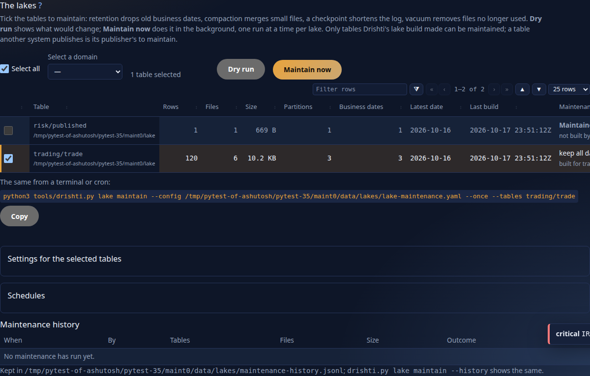
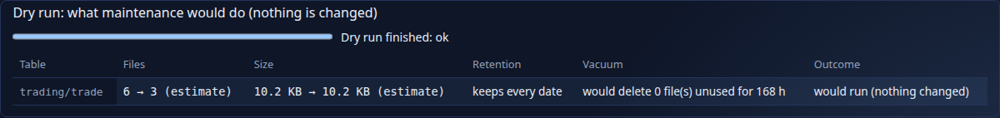
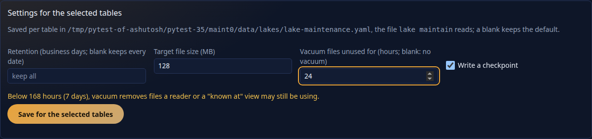
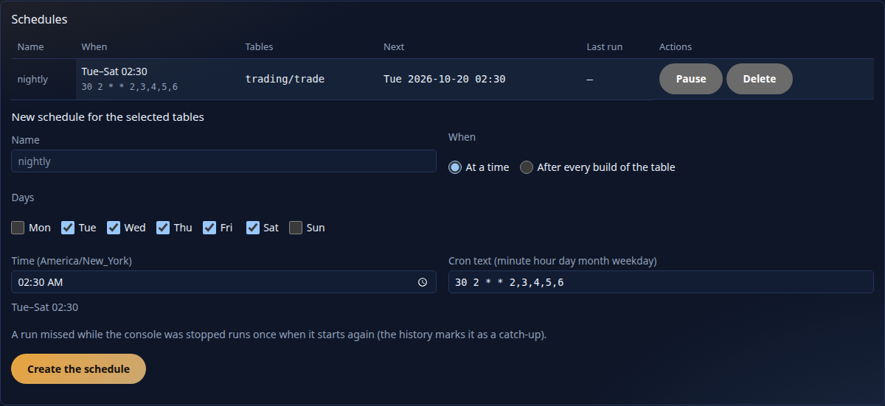
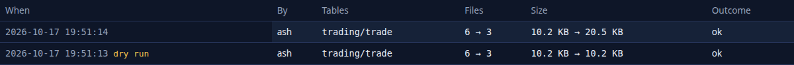

<!--
  Project Drishti · Any data. Any domain. One grammar.

  Copyright (c) 2026 Ashutosh Sinha <ajsinha@gmail.com>.
  All rights reserved.

  PROPRIETARY AND CONFIDENTIAL.

  This file is the confidential and proprietary property of Ashutosh Sinha.
  Unauthorised copying, use, modification, distribution or disclosure of this
  file, via any medium, is strictly prohibited except with the express prior
  written permission of the copyright holder.

  See the LICENSE file in the root of this repository for the full terms.
-->
# Operations

This is the operator's handbook: how to install Drishti, start it, put it behind TLS, keep it safe, back it up,
watch it and upgrade it. Paths, settings and defaults here are taken from the code and the shipped configuration. Where a command prints something, the
text after **You should see** is what a healthy system prints.

If you only want to try Drishti on your own machine, the README's *Try it* section is enough. Read this document
when other people will use the installation.

## Contents

1. [What you are running](#1-what-you-are-running)
2. [Prerequisites](#2-prerequisites)
3. [Install from a build (one machine)](#3-install-from-a-build-one-machine)
4. [Install with Docker Compose](#4-install-with-docker-compose)
5. [Data stores, sample data and feeds](#5-data-stores-sample-data-and-feeds)
6. [Environment variables](#6-environment-variables)
7. [Running as services (systemd)](#7-running-as-services-systemd)
8. [TLS and the reverse proxy](#8-tls-and-the-reverse-proxy)
9. [Production checklist](#9-production-checklist) · [The token secret is a master key](#9a-1-the-token-secret-is-a-master-key) · [Scheduled reports](#9a-scheduled-reports) · [Collaboration email](#9a-2-collaboration-email-and-the-outbox) · [Retention, holds and export](#9a-3-collaboration-retention-legal-holds-and-the-compliance-export) · [Watermarked snapshots](#9a-3b-watermarked-snapshots-privacy-note) · [Chat bridges](#9a-4-chat-bridges-teams-slack-webhooks) · [The access log](#9b-the-access-log) · [Pack registry keys](#9c-pack-registry-keys)
10. [Backups and restore](#10-backups-and-restore)
11. [The lake: where it lives and keeping it bounded](#11-the-lake-where-it-lives-and-keeping-it-bounded)
12. [Memory and caches](#12-memory-and-caches) · [Several servers as one (Drishti*net)](#12a-several-servers-as-one-drishtinet) · [Editions](#12b-editions)
13. [Monitoring](#13-monitoring)
14. [Logs](#14-logs)
15. [Upgrades and rollback](#15-upgrades-and-rollback)
16. [Capacity](#16-capacity)
17. [Runbooks](#17-runbooks)
18. [Drishti*net: running several servers as one](#18-drishtinet-running-several-servers-as-one)
    - [1. Before you start](#1-before-you-start)
    - [2. A cluster of three](#2-a-cluster-of-three)
    - [3. The files of config/net/](#3-the-files-of-confignet)
    - [4. Membership: how the nodes find each other](#4-membership-how-the-nodes-find-each-other)
    - [5. What each node offers: the capability digest](#5-what-each-node-offers-the-capability-digest)
    - [6. Security: the key, mutual TLS, nodes per role](#6-security-the-key-mutual-tls-nodes-per-role)
    - [7. Routing: where a request goes](#7-routing-where-a-request-goes)
    - [8. The console and several servers](#8-the-console-and-several-servers)
    - [9. Admin → Net](#9-admin--net)
    - [10. Drain, maintenance and a node leaving](#10-drain-maintenance-and-a-node-leaving)
    - [11. Sizing](#11-sizing)
    - [12. When something is wrong](#12-when-something-is-wrong)
    - [13. Measured: the soak on real processes](#13-measured-the-soak-on-real-processes)
19. [Compute workers](#19-compute-workers)
    - [1. Switch it on](#1-switch-it-on)
    - [2. Pools and how many workers](#2-pools-and-how-many-workers)
    - [3. Fair scheduling and back-pressure](#3-fair-scheduling-and-back-pressure)
    - [4. Fan-out: one request over many workers and nodes](#4-fan-out-one-request-over-many-workers-and-nodes)
    - [5. Limits and the sandbox](#5-limits-and-the-sandbox)
    - [6. Requirements, environments and approval](#6-requirements-environments-and-approval)
    - [7. Admin → Compute](#7-admin--compute)
    - [8. Windows](#8-windows)
    - [9. Measured: the load test](#9-measured-the-load-test)
    - [10. When something is wrong](#10-when-something-is-wrong)
    - [11. Reactive connectors](#11-reactive-connectors)
20. [Lake maintenance: Admin → Lakes → Maintain and `lake maintain`](#20-lake-maintenance-admin--lakes--maintain-and-lake-maintain)
    - [1. The tables and who owns them](#1-the-tables-and-who-owns-them)
    - [2. Dry run](#2-dry-run)
    - [3. Maintain now](#3-maintain-now)
    - [4. Settings per table](#4-settings-per-table)
    - [5. Schedules](#5-schedules)
    - [6. History](#6-history)
    - [7. The file, the API and the settings](#7-the-file-the-api-and-the-settings)
    - [8. Iceberg lakes](#8-iceberg-lakes)

---

## 1. What you are running

Drishti is two processes. Users only ever talk to the console; the console talks to the server.

```
 browser ──HTTPS──▶ reverse proxy ──HTTP──▶ console (FastAPI, :17480) ──HTTP──▶ server (Spring Boot, :18480) ──▶ your sources
                                             sessions, pages, live channel        views, live streams, users,        Delta Lake, PostgreSQL,
                                                                                  Sutras, packs, governance          Aerospike, Kafka, ActiveMQ,
                                                                                                                     RabbitMQ, S3, files, REST, feeds
```

| Process | Default port | Health check | Metrics | Started by |
|---|---|---|---|---|
| `drishti-server` (Spring Boot, Java 21 or newer, production runs 21) | 18480 | `/actuator/health/liveness`, `/actuator/health/readiness` | `/actuator/prometheus` | `java -Djava.io.tmpdir=data/tmp/server -jar drishti-server-<version>-exec.jar` |
| `console` (FastAPI on uvicorn, Python) | 17480 | `/healthz` | none | `python drishti-console/run_drishti_web.py` |

Things worth knowing before you plan an installation:

- **Both processes keep no session state in memory that matters.** The console's sign-in session is a signed
  cookie, so any console instance can serve any user. You can run several of each behind a load balancer, as long
  as the server instances share the same `data/` directories (users, governance) and the same Sutra directories.
- **The server's working directory matters.** Every relative path in its configuration (`./config/packs`, `./sutras`,
  `./data/...`, `./application.local.yaml`) is resolved from the directory you start it in. Start it from the
  installation directory, or set the paths to absolute values.
- **The console finds its files relative to itself.** It reads `drishti-console/config/application.yaml`, and its default
  `packs.dir` (`../config/packs`) and `help.docs_dir` (`../docs`) are relative to the `drishti-console/` directory, not to the
  directory you start it in.
- **The server's `/api/v1/...` endpoints trust the caller completely when security is off.** With
  `drishti.security.enabled: false` (the development default) anyone who can reach port 18480 is an administrator.
  In any shared installation, turn security on (section 9) and do not expose port 18480 to users at all.

## 2. Prerequisites

| Need | Version | Why |
|---|---|---|
| OpenJDK | 21 (the build enforces it) | runs the server and builds it |
| Python | 3.13 (the console image uses `python:3.13-slim`; the minimum: [GETTING_STARTED.md](../guides/GETTING_STARTED.md#step-1--install-the-prerequisites)) | runs the console |
| `uv` (recommended) | any recent | creates the console's virtual environment and runs the data tools with their libraries |
| Docker and Docker Compose | any recent | only for the container installation and the sample databases |
| Disk | a few GB, plus the lake, the Kafka disk cache (up to `disk-cache.max-gb`, 10 GB per stream connector) and each ActiveMQ or RabbitMQ connector's state store (budget `state.max-gb`, 10 GB each; plan about twice that) | an SSD for the state stores: they sync every write by default |
| Memory | 2 GB for the server is plenty for the sample packs; see section 12 for what grows | |

Check Java:

```bash
export JAVA_HOME=/usr/lib/jvm/java-21-openjdk-amd64
$JAVA_HOME/bin/java -version
```

You should see a line starting `openjdk version "25.`.

## 3. Install from a build (one machine)

This installs both processes under `/opt/drishti` on a Linux host. Adjust the paths to taste.

### 3.1 Build

From a checkout of the repository:

```bash
export JAVA_HOME=/usr/lib/jvm/java-21-openjdk-amd64
./mvnw -q clean package -DskipTests
ls drishti-server/target/*-exec.jar
```

You should see exactly one file, for example `drishti-server/target/drishti-server-2.9.6-exec.jar`.

> Use `clean`. Without it, `target/` keeps the jars of earlier versions, and both `java -jar
> drishti-server-*-exec.jar` and the server Dockerfile's `COPY drishti-server/target/drishti-server-*-exec.jar`
> then match several files: Java runs the first one alphabetically (the oldest), and Docker refuses the copy.

### 3.2 Lay out the installation

```bash
sudo useradd --system --home /opt/drishti drishti
sudo mkdir -p /opt/drishti/data /opt/drishti/sutras
sudo cp drishti-server/target/drishti-server-2.9.6-exec.jar /opt/drishti/drishti-server.jar
sudo cp -r config drishti-console docs /opt/drishti/
sudo cp LICENSE CHANGELOG.md RELEASE_NOTES.md THIRD-PARTY-NOTICES.md /opt/drishti/   # the help centre shows them
sudo chown -R drishti:drishti /opt/drishti
```

The result:

```
/opt/drishti/
├── drishti-server.jar           the server
├── application.local.yaml       your site settings (optional; create it, see CONFIGURATION.md)
├── config/
│   ├── packs/                   domain packs (the server reads ./config/packs, the console ../config/packs)
│   ├── connectors/              one file per connector (DRISHTI_CONNECTORS_DIR)
│   └── bi/                      Rupaka (BI) files: datasets/, reports/, python/ (DRISHTI_BI_DIR)
├── sutras/                      your own Sutras (drishti.rachana.dirs, default ./sutras)
├── data/                        everything the server writes: users, governance, caches (DRISHTI_DATA_DIR, section 10)
├── docs/                        rendered by the console's help centre
└── drishti-console/
    ├── run_drishti_web.py
    ├── config/application.yaml  console settings; put overrides in config/application.local.yaml
    └── .venv/                   created in the next step
```

### 3.3 Install the console's Python libraries

```bash
cd /opt/drishti
sudo -u drishti uv venv drishti-console/.venv
sudo -u drishti uv pip install --python drishti-console/.venv/bin/python -r drishti-console/requirements.txt
```

Without `uv`: `python3.13 -m venv drishti-console/.venv && drishti-console/.venv/bin/pip install -r drishti-console/requirements.txt`.

### 3.4 First start (by hand)

Open two terminals. In the first:

```bash
cd /opt/drishti
sudo -u drishti mkdir -p data/tmp/server        # the JVM's temp folder (-Djava.io.tmpdir below): native libraries unpack there, not in /tmp
sudo -u drishti env JAVA_HOME=/usr/lib/jvm/java-21-openjdk-amd64 DRISHTI_PACKS=market-risk,counterparty-risk \
  /usr/lib/jvm/java-21-openjdk-amd64/bin/java -Djava.io.tmpdir=/opt/drishti/data/tmp/server -jar drishti-server.jar   # any JDK 21 or newer; on Java 25 add -XX:+UseCompactObjectHeaders (Java-25-only flag, about 10% less heap; Java 21 refuses to start with it; drishti-stack, the images and start-server.ps1 add it themselves on 25 since 2.9.7)
```

You should see, after a few seconds, a line ending `Started DrishtiApplication in … seconds`, and on the very first
start a warning:

```
Created development admin 'drishti-dev-admin' with the default password. Change it before any shared use.
```

In the second terminal:

```bash
cd /opt/drishti
sudo -u drishti drishti-console/.venv/bin/python drishti-console/run_drishti_web.py
```

You should see `Uvicorn running on http://127.0.0.1:17480`.

The console runs **4 worker processes** on that port by default (`server.workers`, `DRISHTI_CONSOLE_WORKERS`): one Python process
uses one core and serves about 40 pages a second, so several share the load (4 workers: trade pages p50 53 ms at 10 users).
Nothing a request needs lives in one process only: a live page's stream is held by one worker, and its later calls on that
stream (a view added or removed, an embedded element's fresh token) are passed to that worker by whichever one receives them, over a
loopback port each worker opens for the others (with a key the launcher makes for them). Set `DRISHTI_CONSOLE_WORKERS=1` for a single process (a small machine, or a
debugger); give it more on a machine with cores to spare and many users. A stop closes the open live streams after
`server.shutdown_seconds` (`DRISHTI_CONSOLE_SHUTDOWN_SECONDS`, 5 s), so a console with live pages open still stops promptly; the pages say
*Disconnected* and reconnect by themselves when it is back.

### 3.5 Check it works

```bash
curl -s localhost:18480/actuator/health
curl -s localhost:18480/actuator/info
curl -s localhost:17480/healthz
```

You should see:

```
{"status":"UP","groups":["liveness","readiness"]}
{"build":{"artifact":"drishti-server","name":"drishti-server","time":"2026-10-11T12:53:58.674Z","version":"2.5.0","group":"com.ash.drishti"}}
{"status":"UP"}
```

Then open `http://localhost:17480` in a browser, type `TRD 1000001` on the command line and press Enter (an ENDUR
commodity swap of the `trading` pack, from the demo lakes that `drishti.py lake demo` builds; the landing page lists other
examples). The deal ticket with its legs side by side, the cash flows and their resets should appear.

`/healthz` on the console only says the console process is answering (liveness). `/readyz` also asks the server:
`{"status":"UP","server":"reachable"}`, or `503` with `"server":"unreachable"` while it cannot reach it. Point a load
balancer's readiness check at `/readyz` and a restart policy at `/healthz`.

**Start order does not matter, and a restart is noticed.** Start the console first, the server first or both at once. The
console asks each server every `backend.check_seconds` (default 5; `DRISHTI_CONSOLE_BACKEND_CHECK_SECONDS`), logs
`server http://... unreachable: ...` and `server ... reachable again after 42 s` once each, shows the state on
Admin > Health (Console watch) and answers `GET /healthz/backend` (`reachable`, `since`, `lastError`, `version`; no secrets).
What people see while the server is down or restarting: a page that was already open keeps what it shows; the first call
that fails, or a page opened meanwhile, shows a bar at the top, "Server not reachable, retrying...", with **Retry now**. The
page checks with a growing pause (2 s up to 30 s). When the server is back the bar says "Connected again" and a page that
had failed reloads by itself. A page with unsaved edits (a designer) is never reloaded: the bar offers **Reload** instead.
The sign-in page says the server is not reachable and recovers the same way.

### 3.6 Choosing packs

`DRISHTI_PACKS` is a comma-separated list of pack names (directories under `config/packs/`). Unset, it is the seven shipped
packs, `core,market-data,trading,counterparty-risk,market-risk,world-economy,news-and-markets`. Enabling a pack also enables the packs it `extends`. For example `DRISHTI_PACKS=market-risk`
brings in `market-data`, `trading` and `core` as well. The shipped packs are:

```bash
ls /opt/drishti/packs
```

```
core  counterparty-risk  market-data  market-risk  news-and-markets  trading  world-economy
```

The retired example packs (`finance`, `genomics`, `logistics`, `retail-banking`, `climate-risk`, `operational-risk`,
`liquidity-risk`) are under `examples/packs/`; `DRISHTI_PACKS_EXTRA_DIRS=examples/packs` lets you name one. What each pack contains,
and how to write your own, is in [PACKS.md](../guides/PACKS.md). The seven packs read Delta lakes under `./data/delta`; section 5 builds
them.

**Changing packs while the server runs.** The packs folder is watched (`DRISHTI_PACKS_WATCH`, default `auto`): copy a new pack folder in and it is
checked and loaded; edit a `pack.yaml`, `about.yaml` or Sutra and it is checked and swapped in; delete a folder and the pack is unloaded. None of
this restarts the server. A bad edit keeps the last good version running and shows on **Admin → Packs** and **Health** (DEGRADED). Copy a pack in
under a dot name and rename it when the copy is done, so a half-copied pack is never looked at (a burst is also debounced). Admin → Packs
**Load**, **Unload**, archive deploys and registry installs use the same path. Everything a pack contributes follows: its kinds, mnemonics and Sutras,
and also the roles it defines, the link graph, search columns and pivots, formats, semantic hints, About pages, kind routes and the demo connector's
sample folders; they are built first and swapped in together or not at all (see *What changes live* below). A pack that was refused is looked at again by
itself (see *Retries* in section 13).

### Taking a pack, a connector or a BI file out safely

**Admin → Artifacts** (`/admin/artifacts`; [OPERATIONALISING.md section 18](../guides/OPERATIONALISING.md#18-admin--artifacts-install-and-uninstall-safely)) is the careful way to remove something. *Uninstall…* asks what depends on it (packs that extend it,
connectors only it uses, BI datasets, reports and boards, saved searches, monitors, alert rules, subscriptions, shares, workspaces, embed hosts), refuses while
anything does (`DRS-5041`) and offers *Disable instead*, and otherwise **moves** the folder or file to `data/uninstalled/<time>-<kind>-<name>/`
(`drishti.admin.uninstalled-dir`); the watchers then unload or stop it as if you had deleted it. Archives are kept `drishti.admin.uninstalled-keep` (30 days) and pruned
once a day, so **back up `data/uninstalled` with `data/`** if you want longer. A pack named in `DRISHTI_PACKS` is not uninstalled here (take it out of the setting and
restart, or disable it). Every action and every refusal is in the audit log as `artifact-*`.

### Connectors behind their pack's template

After a pack upgrade a connector file generated from the older template can lack the kinds the pack serves now. With
`template-updates: additive` (the default, `config/connectors-settings.yaml`) the server adds the missing kinds and settings itself,
keeping every edit, and logs it; with `notify` it only lists them. Either way **Admin → Connectors → Template updates** shows each
drifted connector beside its template with *Add missing kinds*, *Regenerate from template*, *Remove obsolete kinds* and *Fix all
additive*. See [CONNECTOR_FILES.md, Template updates](../connectors/CONNECTOR_FILES.md#template-updates).

From 2.9.5 an upgrade is airtight ([CONNECTOR_FILES.md, Upgrades](../connectors/CONNECTOR_FILES.md#upgrades-295)): a file nobody edited
carries a stamp (`# drishti-template: …`) and is replaced in full by the pack's new template, the file before kept beside it
(`.before-upgrade-….bak`), logged and audited (`connector-template-upgrade`); an edited file gets every key its template gained at any
depth (settings, kinds, layout lists, a reactive connector's parameters, result, reads, triggers, limits …) and keeps every value it has.
Where its value and the pack's differ, Template updates lists the key under *changed* with **Use the pack's value**.

### What changes live (no restart)

Drishti is meant to run for months. Anything you can write as a file or set on an Admin page is noticed while the server runs; only the
application's own configuration (`application.yaml` and the environment, which Spring binds at start) needs a restart.

| Artifact | Where it lives | How a change is noticed | What happens on a bad edit |
|---|---|---|---|
| **Pack** (`pack.yaml`, `about.yaml`, `config/formats.yaml`, `config/semantics.yaml`, `samples/`) and a new or deleted pack folder | `config/packs/`, `data/packs/installed/` | the folder is watched (`drishti.packs.watch`, events with a poll every `drishti.packs.poll`, 5 s), debounced; Admin → Packs Load / Unload, deploys and registry installs take the same path | the **last good version keeps running**; the problem is on the pack's row and on Health, audited (`pack-problem`); a refused pack is retried by itself (*Retries*) |
| What a pack contributes: **roles, link graph, search columns and pivots, formats, semantic hints, About pages, kind routes, demo sample folders** | the same `pack.yaml` and its files | built from the new packs first and swapped in one at a time, in the same reload; cached view layouts are dropped last | if any of them cannot be built the whole change is refused (`(all)` problem) and nothing is swapped |
| **Sutras** (`*.sutra.yaml`) | pack `sutras/` and the site's Sutra folders | watched, within about a second | the previous version of that Sutra stays; the problem is at `/api/v1/sutras/problems` and on Health |
| **Connector files** | `config/connectors/` | watched (`drishti.sources.connectors-watch`, poll every 5 s); only the connector whose file changed restarts | the last good configuration keeps running; the bad file is listed; a connector that cannot start is retried |
| **AI provider files** and **MCP server files** (server) | `config/ai/`, `config/mcp/` | watched (`drishti.ai.watch`, `drishti.mcp.watch`; poll `drishti.ai.poll-ms`, 5 s) | the file is listed with its reason (Admin → AI) and the other files load; a provider that cannot be built is retried |
| **AI provider and MCP server files** (console) | the console's `config/ai/`, `config/mcp/` | a supervisor looks every `ai.poll_seconds` (5 s) | the same as on the server |
| **Admin switches**: pack on/off, sample-pack mode, roles and users, API tokens, embedded applications registered in Admin → Embedding, collaboration settings | the identity database and `data/` | at once | refused at save with the reason |
| **Data loads** (expectations, who is told) | the pack's `loads:` section and the override files written from the Data loads page | read at each use | refused at save |
| **Console catalogues**: the help library (`config/help.yaml`, pack guides), workspace templates, the competitive page | the console's `config/` | the help library is rebuilt when a loaded pack's version or `help.yaml` changes; the others are read at each request | an unreadable file is reported on that page; nothing else is affected |
| **BI artifacts** (`config/bi`) | `config/bi/` (`drishti.bi.dir`) | watched (`drishti.bi.watch`: auto, poll, off), on the same retry and reload utilities ([DEVELOPER_GUIDE.md](../guides/DEVELOPER_GUIDE.md#510-retry-and-live-reload-utilities)) | the last good version of that file stays; the problem shows in Admin, BI settings and on Health ([config/bi/README.md](../../config/bi/README.md)) |

What does **not** change live, and why:

- **`application.yaml` and environment variables** of the server and the console (ports, TLS, the token secret, OIDC, the identity database URL, `drishti.packs.enabled`,
  security and limits): Spring binds them once. Change them and restart.
- **A pack named in `drishti.packs.enabled`** cannot be unloaded from Admin (it is site configuration); deleting its folder is reported and the server will not start until the name
  is taken out.
- **Connector values taken from environment variables** (`${NAME}` inside a connector file): the file is live, the variable is read at start.
- **Extra plugin jars** in `drishti.sources.plugin-dir`: a new plugin type is discovered at start (a connector *file* for an installed plugin is live).
- **Chat bridge URLs and secrets** and **embedded applications declared in configuration** (the GitOps list, read-only in Admin → Embedding): read at start.
- **Python code** of the console and **Java code** of the server: a new build.

**Sample packs.** Of the seven packs enabled by default, `news-and-markets` is marked `sample: true` (so are the example packs `genomics` and `logistics`). Once your own packs exist, set
`DRISHTI_PACKS_SAMPLES=developers` so only authors and administrators see them, or `hidden` to unload them and stop their connectors; or press
**Hide samples from business users** in Admin → Packs (saved in `data/packs/samples-mode`, which overrides the variable).

## 4. Install with Docker Compose

`deploy/docker/compose.yaml` runs the server and the console as two containers. The images run as a non-root user
(uid 10001) and have health checks. The server image runs ZGC (generational) with `-XX:MaxRAMPercentage=75`, so it
uses up to three quarters of the container's memory limit, plus the native memory settings of section 7.2 (`MALLOC_ARENA_MAX=2`,
`-XX:MaxDirectMemorySize=256m`, `-XX:TrimNativeHeapInterval=60000`): leave about 1 GB of the limit above the heap.

### 4.1 Build the images

From the repository root:

```bash
export JAVA_HOME=/usr/lib/jvm/java-21-openjdk-amd64
./mvnw -q clean package -DskipTests
docker build -f deploy/docker/server.Dockerfile  -t drishti-server:2.9.2 .   # base image eclipse-temurin:21-jre; --build-arg BASE_IMAGE=eclipse-temurin:25-jre for Java 25
docker build -f deploy/docker/console.Dockerfile -t drishti-console:2.9.2 .
```

The server image contains the jar and `config/packs/`. The console image contains the console, `docs/`, `config/packs/` and the
licence and release files, so the help centre works without network access.

### 4.2 Provide the secrets

The compose file refuses to start without four values: two secrets and the first administrator. It has no default
password anywhere and does not create the development admin. Put them in a file you create, `.env` in the `deploy/` folder (never commit it; it is not in `.gitignore`), and pass it with `--env-file`:

```bash
cat > deploy/.env <<EOF
DRISHTI_TOKEN_SECRET=$(openssl rand -hex 32)
DRISHTI_SESSION_SECRET=$(openssl rand -hex 32)
DRISHTI_ADMIN_USER=your-name
DRISHTI_ADMIN_PASSWORD=$(openssl rand -base64 18)
DRISHTI_PACKS=market-risk,counterparty-risk
EOF
chmod 600 deploy/.env
```

`DRISHTI_ADMIN_USER` and `DRISHTI_ADMIN_PASSWORD` become the one administrator created on the first start with an empty
user store (at least 10 characters, with a letter and a digit); create the others in **Admin → Users**. The
token secret is a master key, see [section 9a-1](#9a-1-the-token-secret-is-a-master-key).

`openssl rand -hex 32` prints 64 characters, which satisfies both minimums (32 bytes for the token secret, 32
characters for the session secret).

### 4.3 Start

```bash
docker compose --env-file deploy/.env -f deploy/docker/compose.yaml up -d
docker compose --env-file deploy/.env -f deploy/docker/compose.yaml ps
```

You should see both services `running`, and after about 30 seconds `(healthy)`. If you forgot a secret you get
`required variable DRISHTI_TOKEN_SECRET is missing a value: set DRISHTI_TOKEN_SECRET` (likewise for the other three).

### 4.4 What the compose file sets, and what you should add

| Service | Setting | Value in `compose.yaml` | Meaning |
|---|---|---|---|
| server | `DRISHTI_SECURITY_ENABLED` | `true` | every `/api/v1` call needs a token from the console |
| server | `DRISHTI_TOKEN_SECRET` | from `.env` | shared with the console |
| server | `DRISHTI_SEED_ADMIN`, `DRISHTI_SEED_USERNAME`, `DRISHTI_SEED_PASSWORD` | `true`, `DRISHTI_ADMIN_USER`, `DRISHTI_ADMIN_PASSWORD` from `.env` | the first administrator you chose; the well-known development admin is not created |
| server | `DRISHTI_METRICS_TOKEN` | from `.env`, empty if unset | the bearer token a Prometheus scrape uses; empty means only an admin token reads `/actuator` |
| server | `ports` | `127.0.0.1:18480:18480` | the server is reachable from this host only; the console reaches it over the compose network |
| server | `DRISHTI_PACKS` | `${DRISHTI_PACKS:-core,market-data,trading,counterparty-risk,market-risk,world-economy,news-and-markets}` | packs to enable |
| server | volume `../sutras` → `/opt/drishti/sutras` (read-only) | | your own Sutras |
| server | volume `../data/feeds` → `/opt/drishti/data/feeds` (read-only) | | the file connector's folder |
| server | named volume `drishti-identity` → `/opt/drishti/data/identity` | | users, roles, audit, preferences |
| console | `DRISHTI_BACKEND_URL` | `http://server:18480` | where the server is |
| console | `DRISHTI_CONSOLE__PACKS__ENABLED` | the same packs | used only if the server cannot be asked |
| console | `DRISHTI_AUTH_ENABLED` | `true` | users must sign in |
| console | `DRISHTI_TOKEN_SECRET`, `DRISHTI_SESSION_SECRET` | from `.env` | |

The compose file is a starting point. Before you rely on it, add:

1. **A volume for governance.** Sutra proposals and their history live in `/opt/drishti/data/governance`. Without a
   volume they are lost when the container is recreated:
   ```yaml
         - drishti-governance:/opt/drishti/data/governance
   ```
   (and `drishti-governance: {}` under `volumes:`).
2. **The lake.** The packs read `./data/delta` (`DRISHTI_DELTA_ROOT`). Mount your lake there, read-only, or set
   `DRISHTI_DELTA_ROOT` to an `s3a://` location (section 11):
   ```yaml
         - /srv/lake:/opt/drishti/data/delta:ro
   ```
   Without it, the lake connectors find no tables and their views say *No data available*.
3. **The Kafka disk cache**, if you turn on a stream connector: a volume on `/opt/drishti/data/cache`, sized above
   `DRISHTI_STREAM_CACHE_GB`.
4. **TLS.** The console sets `Secure` cookies by default, which browsers send only over HTTPS (and to
   `http://localhost`). Put a TLS proxy in front (section 8). For a quick test from another machine over plain
   HTTP, add `DRISHTI_SECURE_COOKIE: "false"` to the console, and remove it afterwards.
5. **Port 18480** is published on the loopback address only (`127.0.0.1:18480:18480`), for checks from the host. In
   production remove that line: only the console needs to reach the server, over the compose network.
6. **The demo source** is on in the image (`DRISHTI_DEMO_ENABLED`): add `DRISHTI_DEMO_ENABLED: "false"` under the
   server's `environment` once your packs read your own stores.

### 4.5 Sign in

Open `http://localhost:17480`. Sign in as the `DRISHTI_ADMIN_USER` and `DRISHTI_ADMIN_PASSWORD` of your `.env`
(a manual start without them has the development admin `drishti-dev-admin` / `drishti-dev-admin123`; the console shows
a warning until you change that password). Then create real users under
**Admin → Users**; see [USER_MANAGEMENT.md](USER_MANAGEMENT.md).

## 5. Data stores, sample data and feeds

The banking packs (`core`, `market-data`, `trading`, `market-risk`, `counterparty-risk`, and the packs built
on them) read one store per data domain: `reference`, `market`, `trading`, `risk`, `credit`, `collateral`. Delta
Lake is the default; PostgreSQL and Aerospike are one Spring profile away. Each command below is run from the
repository root.

### 5.1 Delta Lake (default)

```bash
# the seven packs' lakes, from the committed test data (data/testdata): sixty business days ending today, about 15 minutes, 3.4 GB
drishti-console/.venv/bin/python tools/drishti.py lake demo
```

It writes `data/delta/<domain>/<kind>/business_date=…/` for every dataset (the trades in `data/delta/trading/trade_endur`,
`trade_calypso` and `trade_murex`, also partitioned by `PRODUCT_TYPE`), and tells a running server (or leaves a stamp for its next start)
so its BI store reads the new data: [data/testdata/README.md](../../data/testdata/README.md). Your own data goes in with your ETL, or
`drishti.py lake build` for a large JSON export ([TOOLS.md](../guides/TOOLS.md)). The retired example packs keep their generators under
`tools/packgen/` (for instance `tools/packgen/banking/make_data.py --lake data/delta`, which writes JSON Lines rows under
`data/build/lake-rows` and then loads them; generating and loading are separate steps, [DATA_FORMATS.md](../guides/DATA_FORMATS.md)).

### 5.2 PostgreSQL, Aerospike and Kafka in Docker

`deploy/docker/compose.data.yaml` starts PostgreSQL 18, a single-node Kafka 3.9 broker and Aerospike Community Edition:

```bash
docker compose -f deploy/docker/compose.data.yaml up -d
tools/load-postgres.sh jdbc:postgresql://localhost:5432/drishti
tools/load-aerospike.sh localhost:3000 test
```

Then start the server with the profile for the store:

```bash
SPRING_PROFILES_ACTIVE=postgres  DRISHTI_PACKS=market-risk,counterparty-risk java -Djava.io.tmpdir=data/tmp/server -jar drishti-server.jar
SPRING_PROFILES_ACTIVE=aerospike DRISHTI_PACKS=market-risk,counterparty-risk java -Djava.io.tmpdir=data/tmp/server -jar drishti-server.jar
```

The `postgres` profile (`application-postgres.yaml`, inside the jar) points each `<domain>-store` connector at the
table `<domain>.entities`; the `aerospike` profile points them at a set per domain. The packs still decide the
kinds and routes; the profile changes only the store.

The profiles still work but are deprecated: copy the example files for your store from `config/connectors.examples/<store>/` into
`config/connectors/` instead (a file replaces the pack's template wholesale, whereas a profile overlays it setting by setting), and
drop the profile ([CONNECTOR_FILES.md](../connectors/CONNECTOR_FILES.md#11-moving-off-applicationyaml-and-the-old-data-source-override)).

**Aerospike at scale, and retention.** Each domain is three sets: `<domain>` (a record per entity per business date,
the document and the pack's promoted fields as bins), `<domain>_ix` (a record per entity listing its dates) and
`<domain>_kinds` (the kinds' dates). Add a bulk book and a retention period to the load:

```bash
tools/load-aerospike.sh localhost:3000 test --trades 1000000 --days 3 --ttl-days 730
```

`--trades N --days D` streams `bulk_trades.py` straight into the loader (no file in between). `--ttl-days N` gives
every record written a time to live of N days, so Aerospike expires old business dates by itself: there is no
maintenance job, unlike the lake ([section 11](#11-the-lake-where-it-lives-and-keeping-it-bounded)). Without it,
records never expire. In the generated book a day record takes about 7 KB of namespace storage and an index record
about 150 bytes (`asinfo -v sets/test/trading` and `sets/test/trading_ix`: `data_used_bytes` over `objects`); size
the namespace for trades × days kept. Drishti's memory does not grow with the days kept: it holds one id per entity in the index set and the
days of promoted bins in use (section 12). See
[AEROSPIKE_CONNECTOR.md](../connectors/AEROSPIKE_CONNECTOR.md) for the design.

### 5.3 Live trades from Kafka

```bash
uv run --with kafka-python python tools/samplegen/stream.py --rate 5          # 5 trades a second to drishti.trading.trades
DRISHTI_STREAM_TRADING=true DRISHTI_PACKS=trading java -Djava.io.tmpdir=data/tmp/server -jar drishti-server.jar
```

`stream.py` also takes `--bootstrap` (default `localhost:9092`), `--topic`, `--samples` and `--seconds` (0 runs until
stopped).

### 5.4 Public feeds

The `market-data` pack has five public feeds, each off by default and refreshed every 60 minutes once on:

| Variable | Connector | Kind | Needs |
|---|---|---|---|
| `DRISHTI_FEED_NYFED_SOFR=true` | `nyfed-sofr-feed` | `rate-fixing` | internet access |
| `DRISHTI_FEED_ECB_ESTR=true` | `ecb-estr-feed` | `rate-fixing` | internet access |
| `DRISHTI_FEED_ECB_FX=true` | `ecb-fx-feed` | `fx-spot` | internet access |
| `DRISHTI_FEED_US_TREASURY=true` | `us-treasury-feed` | `ir-curve` | internet access |
| `DRISHTI_FEED_FRED=true` | `fred-feed` | `rate-fixing` | `FRED_API_KEY`; series from `DRISHTI_FRED_SERIES` (default `DGS10,DFF`) |

A feed that fails keeps its last good data and shows as down in **Admin → Health**; the rest of Drishti keeps
working.

## 6. Environment variables

Every variable below is a placeholder in a configuration file, written `${NAME:default}`. If you do not set it, the
default after the colon applies. Variables are read at start-up; change one and restart the process.

### 6.1 Server: core

Defined in `drishti-server/src/main/resources/application.yaml`.

| Variable | Default | Setting | What it does |
|---|---|---|---|
| `DRISHTI_PORT` | `18480` | `server.port` | HTTP port of the server |
| `DRISHTI_SECURITY_ENABLED` | `false` | `drishti.security.enabled` | require a bearer token on every `/api/v1` call; **must be `true` in production** |
| `DRISHTI_TOKEN_SECRET` | empty | `drishti.security.secret` | HS256 key the console signs tokens with; at least 32 bytes; the same value on the console. The server refuses to start with security on and a shorter secret |
| `DRISHTI_OIDC_ENABLED` | `false` | `drishti.security.oidc.enabled` | accept single sign-on ID tokens |
| `DRISHTI_OIDC_ISSUER` | empty | `drishti.security.oidc.issuer` | the provider's issuer URL (https) |
| `DRISHTI_OIDC_CLIENT_ID` | empty | `drishti.security.oidc.client-id` | the client id the ID token is issued to |
| `DRISHTI_CALENDAR` | `USNY` | `drishti.business-date.calendar` | holiday calendar for the default business date: `USNY`, `GBLO`, `EUTA`, `JPTO`, `CATO` (Toronto), or joint such as `USNY+GBLO` |
| `DRISHTI_PACKS` | `core,market-data,trading,counterparty-risk,market-risk,world-economy,news-and-markets` | `drishti.packs.enabled` | comma-separated packs to enable |
| `DRISHTI_PACKS_OVERLAY` | `./data/packs/added.yaml` | `drishti.packs.overlay` | packs loaded from Admin → Packs (written by the server, read at every start); back it up with `data/` |
| `DRISHTI_PACKS_DIR` | `./config/packs` | `drishti.packs.dir` | where the packs are. The console reads the same variable, but resolves a relative value from `drishti-console/`; use an absolute path if you set it |
| `DRISHTI_DEFAULT_PACKS` | empty (every installed pack) | `drishti.packs.default-for-users` | packs new users get until an admin changes them |
| `DRISHTI_SUTRAS` | `./sutras` | `drishti.rachana.dirs` | your own Sutra directories, scanned recursively, in addition to the packs' Sutras |
| `DRISHTI_STUDIO_SAVE` | `false` | `drishti.rachana.studio-save` | let Sutra Studio save files (into the first Sutra directory); only in authoring environments |
| `DRISHTI_SUTRA_REVIEW` | `true` | `drishti.governance.enabled` | a Studio save becomes a proposal that an approver must approve |
| `DRISHTI_SUTRA_FOUR_EYES` | `true` | `drishti.governance.four-eyes` | nobody approves their own proposal (with security on) |
| `DRISHTI_GOVERNANCE_DIR` | `./data/governance` | `drishti.governance.dir` | proposals and their history; back it up |
| `DRISHTI_PLUGIN_DIR` | empty | `drishti.sources.plugin-dir` | a directory of extra plugin jars, each loaded in its own class loader |
| `DRISHTI_NET_DIR` | `./config/net` | `drishti.net.dir` | Drishti*net's folder ([section 18](#18-drishtinet-running-several-servers-as-one)); without it the server is a single server |
| `DRISHTI_NET_WATCH` | `auto` | `drishti.net.watch` | how that folder is watched: `auto`, `poll`, `off` |
| `DRISHTI_NET_SECRET` | none | `secret` in `config/net/node.yaml` | the cluster key, the same on every node, at least 32 bytes; only ever named in node.yaml (`${DRISHTI_NET_SECRET}`), never written there in clear |
| `DRISHTI_NET_PREVIOUS_SECRET` | none | `previous-secret` in `config/net/node.yaml` | a second key also accepted while the key is rotated ([section 18](#18-drishtinet-running-several-servers-as-one)) |

### 6.2 Server: users

| Variable | Default | What it does |
|---|---|---|
| `DRISHTI_SEED_ADMIN` | `true` | on first start with no users, create `drishti-dev-admin` / `drishti-dev-admin123`. Set `false` in production once you have a real admin |
| `DRISHTI_SEED_USERNAME`, `DRISHTI_SEED_PASSWORD` | `drishti-dev-admin`, `drishti-dev-admin123` | the administrator that first start creates: set both to choose your own instead of the development admin |
| `DRISHTI_FORCE_PW_CHANGE_ON_CREATE` | `false` | new users must change their password at first sign-in |
| `DRISHTI_FORCE_PW_CHANGE_ON_RESET` | `false` | users must change a password an admin reset |
| `DRISHTI_USERS_FILE`, `DRISHTI_AUDIT_FILE` | `./data/identity/users.json`, `./data/identity/audit.jsonl` | release 1.9 keeps users and the audit log in these files. From 1.10 they are only read once, to import them into the identity database |
| `DRISHTI_IDENTITY_DB_URL` | `jdbc:sqlite:./data/identity/drishti.db` | from 1.10: the identity database (users, roles, audit, saved per-user documents). SQLite by default, or `jdbc:postgresql://...` |
| `DRISHTI_IDENTITY_DB_USER`, `DRISHTI_IDENTITY_DB_PASSWORD` | empty | from 1.10: its credentials (PostgreSQL) |

Everything about users, roles and the identity database is in [USER_MANAGEMENT.md](USER_MANAGEMENT.md).

### 6.3 Server: built-in plugins

| Variable | Default | What it does |
|---|---|---|
| `DRISHTI_DEMO_ENABLED` | `true` | the demo source (synthetic ticking entities). Turn off in production |
| `DRISHTI_FEEDS` | `./data/feeds` | the file connector's root folder (rescanned every 30 s) |
| `DRISHTI_REST_ENABLED` / `DRISHTI_REST_URL` | `false` / `http://localhost:9000/api` | the REST connector and its base URL (it reads `<base>/{kind}/{id}`) |
| `DRISHTI_JDBC_ENABLED` | `false` | the single JDBC connector |
| `DRISHTI_JDBC_URL`, `DRISHTI_JDBC_USER`, `DRISHTI_JDBC_PASSWORD` | empty | its connection |
| `DRISHTI_ACTIVEMQ_ENABLED` | `false` | the ActiveMQ plugin (configure its settings in `application.local.yaml`; see [CONNECTOR_DEVELOPER_GUIDE.md](../connectors/CONNECTOR_DEVELOPER_GUIDE.md)) |
| `DRISHTI_RABBITMQ_ENABLED` | `false` | the RabbitMQ plugin (likewise) |
| `DRISHTI_S3_ENABLED` | `false` | the S3 document plugin (likewise) |

### 6.4 Server: pack connectors

Connectors are site resources: one YAML file each in `config/connectors/` (`DRISHTI_CONNECTORS_DIR`), the file name being the
connector's name. The packs name the connectors they read through; their `pack.yaml` `connectors:` sections are templates from
which the server writes a missing file once, at the first start, and never overwrites it afterwards. The variables below are
read by those templates and by `${NAME:default}` references inside connector files. See
[CONNECTOR_FILES.md](../connectors/CONNECTOR_FILES.md).

**Changing a connector without a restart.** Edit the file (or use **Admin → Connectors**, `/admin/connectors`, or
`drishti.py connector apply`). The folder is watched (`drishti.sources.connectors-watch`, default `auto`, with a poll every 5 s as
a safety net): only the connector whose file changed is restarted, and reads in flight get `connectors-drain` (3 s) to finish.
Every earlier text of a file is kept in `data/connectors/history/` and can be restored from the page. A change to an environment
variable that a file refers to still needs a restart of the server, because variables are read at start-up. A connector that fails to start,
or whose plugin reports `DOWN` later, is retried by itself ([Retries](#retries-what-failed-is-tried-again-by-itself)).

**Reading a bad-file problem.** A file that cannot be read (bad YAML, an unknown top-level key, a `name:` that differs from the file
name, a credential written in clear, an unset `${VARIABLE}` without a default, a plugin that is not installed) does not stop the
server and does not stop the connector: the last good configuration keeps running. The problem is in the log, in **Admin → Health**
(the `connectors` block: `badFiles` with the message, `watch`, `deprecated`) and on the Connectors page. A pack row in Health
lists `connectorsNotConfigured` when a pack routes a kind to a connector that has no file (views of that kind say `DRS-1011`). The
table of messages and fixes is in [CONNECTOR_FILES.md, section 12](../connectors/CONNECTOR_FILES.md#12-health-and-problems).

| Variable | Default | Used by | What it does |
|---|---|---|---|
| `DRISHTI_LAKE_ENABLED` | `true` | every pack's Delta connector | `false` turns the lake connectors off (for example when a profile replaces them) |
| `DRISHTI_DELTA_ROOT` | `./data/delta` | every pack's Delta connector | the lake root: a local directory or `s3a://bucket/path` |
| `DRISHTI_STREAM_TRADING` | `false` | `trading` pack, `trading-stream` | read live trades from Kafka |
| `DRISHTI_KAFKA_BOOTSTRAP` | `localhost:9092` | `trading-stream` | Kafka bootstrap servers |
| `DRISHTI_TRADING_TOPIC` | `drishti.trading.trades` | `trading-stream` | the topic |
| `DRISHTI_STREAM_STALE_AFTER` | `15m` | `trading-stream` | with no new trade for this long the stream is shown as behind (`stale-after`) |
| `DRISHTI_STREAM_DISK_CACHE` | `true` | `trading-stream` | keep the day's messages in a local RocksDB disk cache |
| `DRISHTI_CACHE_ROOT` | `./data/cache` | `trading-stream` | parent folder of the disk caches (one sub-folder per connector) |
| `DRISHTI_STREAM_CACHE_GB` | `10` | `trading-stream` | disk cache size limit; oldest files are dropped beyond it |
| `DRISHTI_CACHE_RESET_AT` | `02:00` | `trading-stream` | the disk cache is cleared every night at this time (New York) |
| `DRISHTI_FEED_NYFED_SOFR`, `DRISHTI_FEED_ECB_ESTR`, `DRISHTI_FEED_ECB_FX`, `DRISHTI_FEED_US_TREASURY`, `DRISHTI_FEED_FRED` | `false` | `market-data` | the public feeds (section 5.4) |
| `DRISHTI_FRED_SERIES` | `DGS10,DFF` | `fred-feed` | FRED series to fetch |
| `FRED_API_KEY` | empty | `fred-feed` | your FRED API key |

### 6.5 Server: database profiles

With `SPRING_PROFILES_ACTIVE=postgres` or `aerospike` (section 5.2):

| Variable | Default | What it does |
|---|---|---|
| `DRISHTI_PG_URL` | `jdbc:postgresql://localhost:5432/drishti` | PostgreSQL holding the `<domain>.entities` tables |
| `DRISHTI_PG_USER` / `DRISHTI_PG_PASSWORD` | `drishti` / `drishti` | its credentials |
| `DRISHTI_AEROSPIKE_HOSTS` | `localhost:3000` | Aerospike seed hosts |
| `DRISHTI_AEROSPIKE_NAMESPACE` | `test` | the namespace |

### 6.6 Console

Defined in `drishti-console/config/application.yaml`.

| Variable | Default | Setting | What it does |
|---|---|---|---|
| `DRISHTI_CONSOLE_HOST` | `0.0.0.0` | `server.host` | interface the console listens on: every interface by default, so other machines and phones can open it. Set `127.0.0.1` behind a proxy on the same host, or to keep it to this machine |
| `DRISHTI_CONSOLE_PORT` | `17480` | `server.port` | port |
| `DRISHTI_BACKEND_URL` | `http://127.0.0.1:18480` | `backend.url` | the server |
| `DRISHTI_AUTH_ENABLED` | `false` | `auth.enabled` | require sign-in; **`true` in production** |
| `DRISHTI_SESSION_SECRET` | empty | `auth.session_secret` | signs session cookies; at least 32 characters (the console refuses to start otherwise when auth is on) |
| `DRISHTI_TOKEN_SECRET` | empty | `auth.token_secret` | the same value as the server's |
| `DRISHTI_SECURE_COOKIE` | `true` | `auth.secure_cookie` | mark cookies `Secure`; set `false` only for plain HTTP tests |
| `DRISHTI_SESSION_RECHECK_SECONDS` | `10` | `auth.recheck_seconds` | how long the console reuses the server's answer to "does this session still stand, and who is the user now?": disabling, demoting or signing out takes effect within this time, and at once on every worker of the console where it was done (the user stamps under `<console data>/user-stamps`); `0` asks on every request |
| (none) | `[]` | `auth.allowed_origins` | extra origins allowed to send state-changing requests, for a proxy that changes the `Host` header (section 8.4) |
| `DRISHTI_OIDC_ENABLED`, `DRISHTI_OIDC_ISSUER`, `DRISHTI_OIDC_CLIENT_ID` | `false`, empty, empty | `auth.oidc.*` | single sign-on; the same values as the server's |
| `DRISHTI_OIDC_CLIENT_SECRET` | empty | `auth.oidc.client_secret` | the client secret (empty for a public client using PKCE alone) |
| `DRISHTI_OIDC_REDIRECT_URI` | empty (`<console>/auth/oidc/callback`) | `auth.oidc.redirect_uri` | set it to the public HTTPS URL when the console is behind a proxy |
| `DRISHTI_PACKS_DIR` | `../config/packs` (relative to `drishti-console/`) | `packs.dir` | the packs (for guides and examples) |
| `DRISHTI_USER` | `ash` | `ui.user` | the acting user when sign-in is off (development only) |

### 6.7 Docker Compose only

| Variable | Default | File | What it does |
|---|---|---|---|
| `DRISHTI_PG_USER`, `DRISHTI_PG_PASSWORD`, `DRISHTI_PG_PORT` | `drishti`, `drishti`, `5432` | `compose.data.yaml` | the PostgreSQL container |
| `DRISHTI_KAFKA_PORT` | `9092` | `compose.data.yaml` | the Kafka port (also the advertised listener) |
| `DRISHTI_AEROSPIKE_PORT` | `3000` | `compose.data.yaml` | the Aerospike port |

### 6.8 Any other setting

Any server setting without its own variable can still be set from the environment with Spring's relaxed names:
upper case, dots and dashes become underscores, and dashes inside a word are dropped. For example:

```bash
DRISHTI_LIVE_MAXSTREAMS=40000                 # drishti.live.max-streams
DRISHTI_SOURCES_FETCHTIMEOUT=3s               # drishti.sources.fetch-timeout
SERVER_ADDRESS=127.0.0.1                      # bind the server to loopback only
LOGGING_LEVEL_COM_ASH_DRISHTI=DEBUG           # log level for Drishti's own classes
```

Or pass `--drishti.live.max-streams=40000` on the command line. Console settings follow
`DRISHTI_CONSOLE__<SECTION>__<KEY>`, for example `DRISHTI_CONSOLE__BACKEND__TIMEOUT_SECONDS=10`, or
`--backend.timeout_seconds=10`. The order of precedence and every setting are in
[CONFIGURATION.md](CONFIGURATION.md).

## 7. Running as services (systemd)

### 7.1 An environment file

Keep secrets out of unit files. Create `/etc/drishti/drishti.env`, owned by root, mode `0600`:

```bash
sudo mkdir -p /etc/drishti
sudo tee /etc/drishti/drishti.env >/dev/null <<EOF
# shared
DRISHTI_TOKEN_SECRET=$(openssl rand -hex 32)
# server
DRISHTI_SECURITY_ENABLED=true
DRISHTI_PACKS=market-risk,counterparty-risk
DRISHTI_DEMO_ENABLED=false
SERVER_ADDRESS=127.0.0.1
# console
DRISHTI_AUTH_ENABLED=true
DRISHTI_SESSION_SECRET=$(openssl rand -hex 32)
DRISHTI_BACKEND_URL=http://127.0.0.1:18480
EOF
sudo chmod 600 /etc/drishti/drishti.env
```

Both processes may read the same file: each ignores the other's variables.

### 7.2 The server

`/etc/systemd/system/drishti-server.service`:

```ini
[Unit]
Description=Drishti server
After=network-online.target
Wants=network-online.target

[Service]
User=drishti
WorkingDirectory=/opt/drishti
EnvironmentFile=/etc/drishti/drishti.env
Environment=JAVA_TOOL_OPTIONS=-Xmx4g -XX:+UseZGC -XX:+ZGenerational -XX:MaxDirectMemorySize=256m -XX:TrimNativeHeapInterval=60000 -Djdk.nio.maxCachedBufferSize=262144 -XX:NativeMemoryTracking=summary -XX:+HeapDumpOnOutOfMemoryError -XX:HeapDumpPath=/opt/drishti/data/dumps
Environment=MALLOC_ARENA_MAX=2
ExecStartPre=/usr/bin/mkdir -p /opt/drishti/data/logs /opt/drishti/data/dumps
ExecStart=/usr/lib/jvm/java-21-openjdk-amd64/bin/java -Djava.io.tmpdir=/opt/drishti/data/tmp/server -Xlog:gc*:file=/opt/drishti/data/logs/gc-%p.log:time,uptime:filecount=5,filesize=20m -jar /opt/drishti/drishti-server.jar
SuccessExitStatus=143
TimeoutStopSec=45
Restart=on-failure
RestartSec=5

[Install]
WantedBy=multi-user.target
```

- `WorkingDirectory` matters: `./config/packs`, `./data`, `./sutras` and `./application.local.yaml` are found from it.
- The server shuts down gracefully (`server.shutdown: graceful`): it stops taking requests and lets running ones
  finish, for up to 30 seconds; `TimeoutStopSec=45` gives it that time. Exit code 143 is a normal stop on SIGTERM.
- Without `-Xmx` the JVM takes a quarter of the machine's memory as its heap ceiling.
- `MALLOC_ARENA_MAX=2`, `-XX:MaxDirectMemorySize=256m` and `-XX:TrimNativeHeapInterval=60000` keep the server's resident memory near
  `-Xmx` plus 0.4 GB over days (two glibc malloc arenas instead of one per busy thread, direct buffers capped, freed native memory given
  back every minute; Java 21.0.1 or later). Every launcher Drishti ships sets them: `drishti-stack`, the Docker and ECS server images,
  `deploy/docker/compose.yaml`, `tools/windows/start-server.ps1` (the two JVM flags; `MALLOC_ARENA_MAX` is glibc's) and the IntelliJ run
  configurations. Budget the machine for `-Xmx` plus about 1 GB all the same ([PERFORMANCE.md](PERFORMANCE.md#resident-memory-what-to-budget-and-two-settings)).
- `-Djdk.nio.maxCachedBufferSize=262144` stops the JDK hoarding direct memory per thread, and the heap dump, the GC log and native
  memory tracking are what explain a failure after days: [12.1a](#121a-direct-memory-and-the-diagnostics-of-a-long-run). The
  `ExecStartPre` line makes their folders: the JVM does not start when the GC log's folder is missing.

### 7.3 The console

`/etc/systemd/system/drishti-console.service`:

```ini
[Unit]
Description=Drishti console
After=network-online.target drishti-server.service
Wants=drishti-server.service

[Service]
User=drishti
WorkingDirectory=/opt/drishti/console
EnvironmentFile=/etc/drishti/drishti.env
ExecStart=/opt/drishti/drishti-console/.venv/bin/python /opt/drishti/drishti-console/run_drishti_web.py
Restart=on-failure
RestartSec=5

[Install]
WantedBy=multi-user.target
```

### 7.4 Start and check

```bash
sudo systemctl daemon-reload
sudo systemctl enable --now drishti-server drishti-console
systemctl status drishti-server --no-pager | head -3
curl -s localhost:18480/actuator/health/readiness
```

You should see `Active: active (running)` and `{"status":"UP"}`. Follow the logs with
`journalctl -u drishti-server -f` (section 14).

The lake maintenance job can run as a third unit; see section 11.3.

## 8. TLS and the reverse proxy

Terminate TLS at a reverse proxy in front of the **console**. Users never need the server directly.

### 8.1 What to expose

| Path | Expose to users? | Why |
|---|---|---|
| console `:17480`, everything | yes, through the proxy | the whole user interface, including its live channel |
| server `:18480/api/v1/...` | no | the console calls it; with security off it trusts anyone |
| server `:18480/actuator/...` | no; only to your monitoring network | with security on, only `/actuator/health` is open; the rest needs an admin token or `DRISHTI_METRICS_TOKEN` |
| server `:18480/api/docs`, `/api/docs/ui` | no (developers only) | the OpenAPI description and Swagger UI; with security on they need a token (any user), with security off they are open |

To serve the actuator on a separate port that only monitoring can reach, set Spring's standard
`MANAGEMENT_SERVER_PORT=18481`.

### 8.2 Live updates through a proxy

Each browser holds one long-lived Server-Sent Events connection to the console (`/api/channel`), shared by all its
tabs and workspace panes (from a SharedWorker, or from one tab elected by the others). For it to work through a
proxy:

- the proxy must **not buffer** responses (the console sends `X-Accel-Buffering: no`, which nginx honours);
- the proxy's **read timeout** must be well above the heartbeat (the console sends a comment line about every 15
  seconds when nothing changes);
- use HTTP/1.1 to the console.

### 8.3 nginx example

```nginx
server {
    listen 443 ssl http2;
    server_name drishti.bank.example;
    ssl_certificate     /etc/ssl/drishti/fullchain.pem;
    ssl_certificate_key /etc/ssl/drishti/privkey.pem;

    location / {
        proxy_pass         http://127.0.0.1:17480;
        proxy_http_version 1.1;
        proxy_set_header   Host              $host;
        proxy_set_header   X-Forwarded-For   $proxy_add_x_forwarded_for;
        proxy_set_header   X-Forwarded-Proto $scheme;
        proxy_set_header   Connection        "";
        proxy_buffering    off;          # live updates
        proxy_read_timeout 1h;           # long-lived event streams
    }
}

server {
    listen 80;
    server_name drishti.bank.example;
    return 301 https://$host$request_uri;
}
```

Check from outside:

```bash
curl -sI https://drishti.bank.example/healthz | head -1
```

You should see `HTTP/2 200`.

### 8.4 Cookies, CSP and single sign-on behind a proxy

- **Cookies** are `Secure` by default. Keep `DRISHTI_SECURE_COOKIE` unset (true) once TLS is in place. The session
  cookie is `HttpOnly` and `SameSite=Lax`, and holds only a signed reference to a session the server keeps: signing
  out (a `POST`), or disabling, deleting or resetting the password of the user, ends it on the server.
- **Cross-site requests.** Besides `SameSite=Lax` (which does not separate sibling subdomains), the console refuses a
  state-changing request (`POST`, `PUT`, `PATCH`, `DELETE`) whose `Origin` header (or, without one, `Referer`) is not
  the console itself (`403 DRS-5002`), and refuses JSON not sent as `application/json` (`415`). It compares the origin
  with the request's `Host` header, so keep `proxy_set_header Host $host;` (as in 8.3); if your proxy changes the host,
  list the public origin in `auth.allowed_origins` (for example `[https://drishti.bank.example]`) in
  `drishti-console/config/application.local.yaml`.
- **Content security policy** is strict and set by the console (`script-src 'self'`, no inline scripts or styles).
  Do not add or loosen a CSP at the proxy. Every asset is vendored, so the console works with no internet access.
- **Single sign-on**: set `DRISHTI_OIDC_REDIRECT_URI=https://drishti.bank.example/auth/oidc/callback` and register
  exactly that URL with the identity provider. Without it the console builds the URL from the request, which behind
  a proxy may come out as `http://127.0.0.1:17480/...`.

### 8.5 The BI folder is live

The BI folder (`drishti.bi.dir`, default `./config/bi`) is watched like the packs and the connector files (`drishti.bi.watch`: `auto`, `poll`, `off`;
polling every `drishti.bi.folder-refresh`, 5 s). Copy a `*.report.yaml`, `*.dataset.yaml`, `*.board.yaml` or `*.notebook.yaml` file in and it is in the catalogue
within seconds; edit it and the item moves to its next version; delete it and it is removed (an open page says so). A file that does not parse keeps its last good
version and is reported with its message in Admin, BI settings and in the Health document (`bi`: `watch`, `shippedItems`, `problems`), so a bad deploy of a BI file
never takes content away. On a shared network folder where file events do not arrive the polling covers it; use `poll` there. No restart is needed for any of it
([BI_GUIDE.md](../guides/BI_GUIDE.md#10-shipped-content-settings-and-the-command-line)). Workspaces, items and versions made in the BI page live in the identity
database: back it up with the rest ([section 10](#10-backups-and-restore)).

## 9. Production checklist

Work through this list for every shared installation. Each item says how to check it.

1. **Server security on.** `DRISHTI_SECURITY_ENABLED=true` and `DRISHTI_TOKEN_SECRET` at least 32 bytes.
   Check: `curl -s localhost:18480/api/v1/sources` answers
   `{"title":"unauthenticated","status":401,"code":"DRS-5010","detail":"missing bearer token"}`.
2. **Console sign-in on.** `DRISHTI_AUTH_ENABLED=true`, `DRISHTI_SESSION_SECRET` at least 32 characters, and the
   same `DRISHTI_TOKEN_SECRET` as the server. Check: a private browser window opening the console is sent to the
   sign-in page. Sessions follow the user: disabling or demoting someone takes effect within `auth.recheck_seconds`
   (10 s by default), and signing out ends the session on the server.
3. **The development admin is gone.** The compose file never creates it (it seeds the administrator of
   `DRISHTI_ADMIN_USER` / `DRISHTI_ADMIN_PASSWORD`). On any other install sign in as `drishti-dev-admin`, create your
   own admin, then either change the development admin's password or disable it, and set `DRISHTI_SEED_ADMIN=false`
   (or give `DRISHTI_SEED_USERNAME` and `DRISHTI_SEED_PASSWORD` for the first start). Check: the console no longer
   shows the default-password warning (the server reports `"defaultAdminPasswordInUse": false` at
   `/api/v1/admin/status`).
4. **Single sign-on (optional).** `DRISHTI_OIDC_ENABLED=true`, `DRISHTI_OIDC_ISSUER` (https) and
   `DRISHTI_OIDC_CLIENT_ID` on both processes, `DRISHTI_OIDC_CLIENT_SECRET` and `DRISHTI_OIDC_REDIRECT_URI` on the
   console, and the group-to-role map (`drishti.security.oidc.role-map`) on the server. See
   [USER_MANAGEMENT.md](USER_MANAGEMENT.md).
5. **Roles.** Review `drishti.security.roles` and what the packs add. Keep `drishti.security.redact` listing the
   fields that roles without raw access must not see: they read `•••` everywhere (raw JSON, search, views, Impact,
   type-ahead, alerts; [CONFIGURATION.md](CONFIGURATION.md#field-masks)). List every field that holds the value,
   since a mask hides only the field it names.
6. **Authoring.** `DRISHTI_STUDIO_SAVE=false` except in an authoring environment. Keep `DRISHTI_SUTRA_REVIEW=true`
   and `DRISHTI_SUTRA_FOUR_EYES=true` so every change is approved by a second person.
7. **Demo source off.** `DRISHTI_DEMO_ENABLED=false`.
8. **Network.** Only the proxy reaches the console; only the console reaches the server's `/api`; only monitoring
   reaches `/actuator`. `SERVER_ADDRESS=127.0.0.1` when they share a host.
9. **TLS** at the proxy, `DRISHTI_SECURE_COOKIE` left at `true`.
10. **Backups** of the content store root (`data/fstore`: Designs, collaboration, audit, embed apps, pack switches, proposals), `data/identity`, your Sutra directories and your configuration (section 10),
    and of `data/state/<connector>` if you run ActiveMQ or RabbitMQ connectors (their only copy of what the queues
    delivered; copied with the server stopped).
11. **Lake maintenance** scheduled (section 11).
12. **Monitoring**: Prometheus scraping `/actuator/prometheus` with `bearer_token: <DRISHTI_METRICS_TOKEN>` (with security on, every
    `/actuator` endpoint but health needs it, or an admin token; `/api/docs` needs any token), the Grafana dashboard imported, alerts set
    (section 13).
13. **Secrets** only in a `0600` environment file or your secret store; never in `application.yaml` or a repository.
    No password in a sample is a password to keep: `DRISHTI_PG_PASSWORD` (the development stack
    `deploy/docker/compose.data.yaml` uses `drishti` and binds `127.0.0.1` only; a shared database needs its own),
    `DRISHTI_SEED_PASSWORD`, `DRISHTI_METRICS_TOKEN` (empty means only an admin token reads `/actuator`).
14. **The token secret** is protected and rotated as a master key (next section).
15. **Published ports.** `docker compose ps` shows no `0.0.0.0:18480`; the server's port is not reachable from outside.
16. **Business intelligence.** If people use BI: `drishti.bi.query.store-dir` (`DRISHTI_BI_STORE`) on a local disk with room for the Parquet layers of the
    dates in use (it can always be deleted and rebuilt), `drishti.bi.query.memory-limit` (default 768MB) and `threads` inside the host's memory
    next to the heap, the query limits left on (`timeout`, `max-rows`, `max-concurrent`), `config/bi` in version control, and `drishti.bi.poc.enabled`
    left `false` (the proof of concept is throw-away). Check: `GET /api/v1/bi/engine` as a `bi-admin` shows the limits in force and
    `GET /api/v1/bi/poc/bench` answers `404`.
17. **AI and MCP stay off unless wanted.** `drishti.ai.enabled` and `drishti.mcp.enabled` are `false` by default; switch them on only with
    provider files in `config/ai` whose keys are `${ENV}` references, the policy limits set (`drishti.ai.policy`: `per-user-per-day`,
    `cost-per-user-per-day`, `mask-redacted: true`) and an outbound proxy if the host needs one ([TLS.md (proxy)](../connectors/TLS.md#outbound-http-proxy-for-connectors-ai-providers-and-mcp-servers)).
    Check: `GET /api/v1/admin/ai` shows `enabled` as you intend and `keySet` for each provider, never a key.
18. **Embedding stays off unless wanted.** `drishti.embed.enabled` is `false` by default. When it is on, each host application is registered with exact
    origins (`drishti.embed.allow-wildcard-origins` stays `false`), the narrowest scopes and kinds it needs, and a secret or key kept by its backend
    only. Check: Admin → Embedding lists only the applications you expect.

## 9a-1. The token secret is a master key

`DRISHTI_TOKEN_SECRET` signs every token the console hands the server (HS256), and the server accepts **any token
signed with it**. That is by design, and it means the secret is not a password for one service: whoever holds it can
mint a token for any user name (even one that does not exist) with any role, `admin` included, and the server will
believe it. It does not need the console, a user account or a sign-in. Treat it like a database root password.

- **Protect it.** Generate it with `openssl rand -hex 32`; keep it in a `0600` environment file or a secret store, on
  the two hosts that need it (the server and the console), never in `application.yaml`, an image, a repository, a
  chat or a ticket. Do not reuse it across environments (a test secret must not open production). Keep the server's
  `/api` unreachable except from the console (section 8), so a leaked token cannot be used from elsewhere.
- **Rotate it** on a schedule you choose (every 90 days is common), whenever someone who knew it leaves, and at once
  after any suspicion of a leak: 1) generate a new value; 2) put it in the server's and the console's environment;
  3) restart both together (the server first or at the same time). Every token signed with the old secret stops
  working at the restart: users sign in again (their sessions end), and a client that minted its own tokens needs the
  new secret. Personal API tokens (`drk_...`) are not signed with it and keep working; revoke them separately in
  **Admin → Tokens** if the leak could have reached them. There is no overlap window for two secrets: plan the
  restart for a quiet moment.
- **Limit the damage.** Tokens carry an expiry (the console mints short ones), so a captured token ages out; a leaked
  secret does not. Review **Admin → Audit log** after a suspected leak: actions are recorded under the user name in the
  token, including one that was made up.
- **Alternatives that avoid sharing one secret.** Single sign-on (OIDC, section 9 item 4) moves who may sign in to
  your identity provider, though the console and server still share the signing secret between them. For a client that
  needs to read, use a personal API token (`drk_...`), which acts as one real user, only reads, and is revoked on its
  own; for machine access put a gateway in front that authenticates the caller and mints nothing. Splitting the
  secret per environment, and a vault that hands it to both processes at start, are the practical hardening steps
  today.

## 9a. Scheduled reports

People schedule searches to be delivered as CSV (User guide, *Scheduled reports*). What operators decide:

- **Where files go.** `DRISHTI_REPORTS_DIR` (default `./data/reports`), one folder per user and report. Nothing
  prunes it: rotate it with your usual tools (`find data/reports -mtime +30 -delete`).
- **Which webhooks are allowed.** `drishti.reports.webhooks` lists URL prefixes; empty (the default) means none.
- **Which server schedules.** With several servers on one identity database, set `DRISHTI_REPORTS_ENABLED=false` on
  all but one, or each report runs once per server.
- **What is audited.** `report.save`, `report.run` (with `ok` or `failed`) and `report.delete`. Admin → Health is
  not affected by a failing report; its owner sees the error on the Reports page.

## 9a-2. Collaboration email and the outbox

Shares can also be emailed ([COLLABORATION.md](../architecture/COLLABORATION.md)). It is off until you switch it on, and it never carries a
data value.

**Switch it on** (all three, or it stays off): `drishti.security.enabled: true` (the server refuses to start with email on and sign-in off),
`drishti.collab.console-url` (where links point) and an SMTP server:

```bash
export DRISHTI_CONSOLE_URL=https://drishti.example.com
export DRISHTI_MAIL_FROM=drishti@example.com
export SPRING_MAIL_HOST=smtp.example.com SPRING_MAIL_PORT=587 SPRING_MAIL_USERNAME=drishti SPRING_MAIL_PASSWORD=...
export SPRING_MAIL_PROPERTIES_MAIL_SMTP_STARTTLS_REQUIRED=true
export SPRING_MAIL_PROPERTIES_MAIL_SMTP_CONNECTIONTIMEOUT=10000 SPRING_MAIL_PROPERTIES_MAIL_SMTP_TIMEOUT=10000
export DRISHTI_COLLAB_EMAIL_ENABLED=true
```

Then send yourself a test: `POST /api/v1/admin/collab/mail-test` mails the signed-in administrator's own address and answers
`503 DRS-7012` with the SMTP reason when it cannot.

**What is sent.** For each person a share reaches who has an address (`User.email`, set by an administrator or the identity provider; people cannot
type addresses) and has not turned share mail off, one message: the sender's name, the kind and id, the panel and date, the note as that person
may read it (masked values `•••`, `{$.path}` quotes filled from the recipient's own view) and the link. Emails carry values by design (decision 2026-10-05): a pack that must not sends `link-only`. A pack whose identifiers are sensitive sets `drishti.collab.packs.<pack>.email.content: link-only`.
The message is built when it is sent, so a person whose role was removed since gets nothing (the row is *cancelled*). Several notices for the same person inside `email.coalesce-window` (default 10 seconds, a short first-send delay for a lone notice; `0` = off) go out as one digest email, each notice
still checked for opt-outs, rights and masking; so mail is sent up to that long after the event. People are not emailed about
their own shares, and no more than `limits.mails-per-recipient-per-hour` an hour.

**The outbox.** The row is written in the share's own transaction; a worker on each server (`outbox.enabled`) claims due rows under a lease, so
several servers never send one twice (after a crash between sending and recording, one repeat is possible; its `Message-ID` is fixed, so mail
clients fold it). A failure retries after `outbox.backoff`, doubling to `outbox.max-backoff`; a refusal by the server (SMTP 5xx, a malformed address)
or the `outbox.max-attempts`th failure makes a **dead letter**. Sent rows are deleted after `outbox.keep-sent-days`.

**Looking and fixing.**

```bash
curl -s -H "Authorization: Bearer $ADMIN" 'http://localhost:18480/api/v1/admin/collab/outbox?state=dead'        # counts and rows
curl -s -X POST -H "Authorization: Bearer $ADMIN" http://localhost:18480/api/v1/admin/collab/outbox/42/retry   # send a dead letter again
```

Rows show the recipient, template, share id, attempts, next attempt and the last error, never the message. `state` is `pending`, `sending`, `sent`,
`dead` or `cancelled`. Alert on `drishti.collab.outbox{state="dead"} > 0` and on a growing `state="pending"`. The usual causes of dead letters are in
[TROUBLESHOOTING.md](../guides/TROUBLESHOOTING.md#the-email-never-arrived). An outage of the mail server needs no action: rows stay pending and go out
when it returns.

## 9a-3. Collaboration retention, legal holds and the compliance export

Nothing in the collaboration record is destroyed by default (`retention.keep-days: 0`). Comments are never deleted by their authors or by
moderators: retract and hide change what readers see, and every revision stays. Only retention, or an administrator removing a whole thread,
destroys anything, and neither touches what a legal hold covers.

**Retention.** Set days in `application.yaml`, most specific first: `drishti.collab.retention.kinds.<kind>`, then
`drishti.collab.packs.<pack>.retention-days` for the pack that owns the kind, then `retention.keep-days`. A daily job
(`retention.interval`; it starts only when some retention above 0 is set) removes whole threads whose last activity, and shares whose creation,
is older than that, and writes one audit event each (`collab.purge.thread` with the thread's final hash, `collab.purge.share`). A thread goes
whole or not at all. Several servers on one database may each run it; it is idempotent. Look before you leap, and run it by hand:

```bash
curl -s -X POST -H "Authorization: Bearer $ADMIN" 'http://localhost:18480/api/v1/admin/collab/retention/run?dryRun=true'
# {"dryRun":true,"threadsPurged":12,"sharesPurged":30,"threadsHeld":2,"sharesHeld":1}   "held" = past retention but kept by a hold
```

Everything in this section can also be done in the console, on **Admin > Collaboration** (`/admin/collab`; the *Mail outbox* section lists pending mail with tries, next try and last error, dead letters with *Send again*, and sends a test mail; a share that asks for email while mail is failing says so): holds (place, list, release), the export
(start, wait, download once), verify and the retention dry run (the page only ever asks for the dry run; real runs stay the server's schedule). The
calls below are what the page makes.

**Legal holds** (the `compliance` role power; an administrator is not enough). A hold has a scope (`entity` = kind and id, `kind`, `user` =
everything the person wrote, sent or received, `thread`, or `all`), a reason, and an optional date range (a thread is covered when its activity
overlaps it, a share when it was sent inside it). Place and release are audited; a released hold stays in the list.

```bash
curl -s -X POST -H "Authorization: Bearer $COMPLIANCE" -H 'Content-Type: application/json' http://localhost:18480/api/v1/admin/collab/holds \
  -d '{"scope":"entity","kind":"trade","id":"MX-20000001","from":"2026-09-01","to":"2026-09-30","reason":"case 4411"}'
curl -s -H "Authorization: Bearer $COMPLIANCE" 'http://localhost:18480/api/v1/admin/collab/holds?active=true'
curl -s -X DELETE -H "Authorization: Bearer $COMPLIANCE" http://localhost:18480/api/v1/admin/collab/holds/7     # release
```

An administrator's permanent removal of one thread (`DELETE /admin/collab/threads/{id}`) answers `423 DRS-7010` while a hold covers it.

**Export (eDiscovery).** An export is a job: ask, poll, download once.

```bash
curl -s -X POST -H "Authorization: Bearer $COMPLIANCE" -H 'Content-Type: application/json' http://localhost:18480/api/v1/admin/collab/exports \
  -d '{"from":"2026-09-30","to":"2026-09-30","kind":"trade","id":"MX-20000001"}'          # 202 {"id":"…","state":"queued"}
curl -s -H "Authorization: Bearer $COMPLIANCE" http://localhost:18480/api/v1/admin/collab/exports/ID          # state: queued|running|done|failed
curl -s -H "Authorization: Bearer $COMPLIANCE" -o export.zip http://localhost:18480/api/v1/admin/collab/exports/ID/download
```

Filters (all optional): `from`/`to` (a day, or an instant), `kind`, `id`, `user` (a thread they wrote in; a share they sent or received),
`includeShares`, `includeThreads`. The zip holds `shares.jsonl`, `threads.jsonl` (every comment with every revision, **unscrubbed**: this is the
record), `chains.jsonl` (each thread's first and last hash and whether its chain verified), `holds.jsonl`, `inbox.jsonl` (the in-scope inbox notices: who, type, entity, actor, when, read) and `outbox.jsonl` (the in-scope email and bridge
delivery rows: channel, state, attempts, times, never a message body), `README.txt` (field meanings and
how to recompute a hash) and `manifest.json` (filters, who and when, counts, software version, and the SHA-256, size and line count of every
other file). It is written line by line, so memory stays bounded; one export runs at a time per server (a queue of 8). Only the person who asked
may download it, once; it is deleted then, or after `export-keep`. Starting, finishing and downloading are audited (`collab.export.*`); the file
lives in `<drishti.collab.dir>/exports` and a restart forgets a job that was not finished. Check a file against the manifest with
`sha256sum -c`-style comparison of each entry; **keep the manifest and `chains.jsonl` in the firm's archive**: a later export that disagrees on a
thread's hashes proves history was rewritten (the chain is evidence of tampering, not prevention: someone with the database could rewrite all of it).

**Verify.** `GET /admin/collab/verify?thread=th_…` recomputes one chain, checks the live comment rows against their revisions (text, author, state, revision number), and compares the thread's head (revision count and last hash) with the seal kept beside it, so a changed row or a removed newest revision is found (`{ok, steps, firstHash, lastHash, problem}`); with no `thread` (or with
`kind` and `id`) it checks every thread and share, in bounded memory, and reports the failures (`problems`, capped by `maxProblems`), and also checks the legal holds and the audit trail, each sealed in `drishti_collab_seal` (or `seals.jsonl` with the file store; `seals.log` before 2.9.4, still read); rows that cannot be read are reported, never a 500. Seals are evidence, not prevention. A failure
names the revision that was changed or no longer follows the one before it.

**Backups.** With `drishti.collab.store: content` (the default) the whole record (threads with their revision chains, shares, inbox,
outbox, holds and seals) is in the content store, so **the backup of the store root** (`data/fstore`, the `drishti_content` table, or the
bucket) is the backup of the record ([CONTENT_STORE.md section 9.8](../architecture/CONTENT_STORE.md)). With `drishti.collab.store: jpa` every collaboration table (`drishti_share`, `drishti_share_recipient`, `drishti_inbox`, `drishti_outbox`, `drishti_thread`,
`drishti_comment`, `drishti_comment_revision`, `drishti_mention`, `drishti_follow`, `drishti_collab_hold`, `drishti_note_link`) is in the identity
database, so the backup of that database is the backup of the record, and it is the only copy of what the hash chains protect. With
`drishti.collab.store: file` (one server) the same records are the JSON-lines files under `drishti.collab.dir`; copy that folder, except
`exports/`, which holds only what is waiting to be downloaded. A restored database needs no repair: the chains verify against the manifest you kept.

## 9a-3b. Watermarked snapshots (privacy note)

`drishti.collab.snapshots.enabled` (default `false`) lets a sender tick **Include a picture** on a share: the server draws a PNG of the view (or the shared
panel) and attaches it to the share's page and, when `email.content` is `comment`, to its email. Read this before turning it on.

- **An image leaves the application's controls, and may show figures.** A masked field is `•••` in the picture, but an attachment can be forwarded, kept in a mailbox and read
  by anyone, with no rights check at the time it is read. That is why it is off by default, per pack switchable and an administrator's choice.
  A pack whose figures must never leave Drishti sets `drishti.collab.packs.<pack>.snapshots.enabled: false` (for instance a genomics pack); a share of
  such a kind asking for a picture is refused with `403 DRS-7015` and the dialog does not offer the option.
- **Least privilege.** One picture serves every recipient of a share, so it is drawn for the most restrictive of them: if any recipient lacks `raw`, the
  fields named in `drishti.security.redact` are `•••` for everyone; a panel any recipient may not open is not drawn at all. A recipient who may not open
  the kind never receives the share, so never the picture. Choose recipients with this in mind: one picture for a trader and a risk officer is the
  trader's.
- **Watermark.** Every picture carries the sender, the recipients (a count, or names with `snapshots.recipients: names`), the time, the data's business
  date or "live", its generation, and the link, in a band and tiled diagonally, so a leaked picture says whose it was.
- **Audit.** Each picture produced, including a preview in the dialog and each time one is served or attached, writes an access-log row with action
  `export` (kind, entity, and `snapshot sh_… for N recipients, masked|unmasked, bytes`).
- **Resources.** Drawing is headless (`java.awt.headless=true` is set by the renderer), uses the JDK's logical fonts (a server needs a JDK with its font
  libraries, as the standard images have; nothing is downloaded), is bounded by `snapshots.timeout`, `max-bytes`, `width` and `max-height`, runs two at a
  time, and is cached for `cache-ttl`. A picture is not stored: after the cache expires it is drawn again from the data as pinned, but its rights are frozen when the share is made (the roles of the recipients and the sender are kept in the share): a redraw uses that profile together with the rights of the recipients and of whoever asks *now*, so it can only get more restrictive; promoting a recipient to `raw` later never unmasks a picture, and a masked sender never sees more than they could see themselves.
- A picture that cannot be made (`503 DRS-7016`: timeout, too large, renderer failure) refuses the share; an email whose picture cannot be made later is
  sent without it. A digest email (several notices in one) carries no picture.

## 9a-4. Chat bridges (Teams, Slack, webhooks)

A bridge posts a share, a comment or a mention to a chat channel as **a sentence and a link**: "Ann Shah commented on a view", the kind and id, the
panel's title, the pinned date, the note, and the link. Posts carry values (decision 2026-10-05): the note is written as a person holding only the role `bridges.render-as`
(the bundled `viewer`, no `raw`) would read it, so a value copied from a masked field reads `•••`, and a `{$.mtm}` quote is filled from that role's view (`•••` if masked). Name a raw role in `render-as` only for a restricted channel. People who click
the link sign in and see what *they* may see. A pack whose ids are sensitive sets `packs.<pack>.email.content: link-only` and its posts carry no id, panel or
note either. Posts go through the same outbox as email (retries with backoff, dead letters, `outbox.max-attempts`), so a chat outage delays them and
never loses one.

**Set one up** (Teams: add a *Workflows* "post to a channel when a webhook request is received", or a classic incoming webhook; Slack: create an app with
an incoming webhook; generic: any HTTPS endpoint that checks the signature):

```bash
export BRIDGE_RISK_DESK_URL='https://...the webhook URL...'      # a credential: environment only, never in a file
export BRIDGE_AUDIT_URL=https://hooks.example/drishti BRIDGE_AUDIT_SECRET=...   # a json bridge also needs a signing secret
```

```yaml
drishti.collab:
  console-url: https://drishti.example.com
  bridges:
    enabled: true
    allow: [https://prod-00.westus.logic.azure.com/, https://hooks.example/]   # the URL must start with one of these; empty = nothing posts
    webhooks:
      - name: risk-desk
        format: teams                      # or slack
        url-env: BRIDGE_RISK_DESK_URL
        routes:
          - { packs: [market-risk], events: [share, comment] }
      - name: audit
        format: json
        url-env: BRIDGE_AUDIT_URL
        secret-env: BRIDGE_AUDIT_SECRET
        routes: [{ kinds: [trade], events: [mention] }]
```

Then `GET /api/v1/admin/collab/bridges` (each bridge: `usable`, or the `status` that says which variable is unset or that the URL is not under `allow`) and
`POST /api/v1/admin/collab/bridges/risk-desk/test` (posts a data-free test message; `503 DRS-7013` says why it failed). A share is private to its recipients:
route `share` to a channel only when everyone in it may know that a share happened and read its note (the note is scrubbed, but its words are the sender's).

**The signed webhook (`format: json`).** `POST` with `Content-Type: application/json`, a body of `{schema: "drishti.bridge/1", event, id, product,
headline, kind, entityId, panel, asOf, note, link, at}` and the headers `X-Drishti-Event`, `X-Drishti-Delivery` (the outbox number: use it to drop a repeat),
`X-Drishti-Timestamp` (epoch seconds) and `X-Drishti-Signature: sha256=<hex>`, the HMAC-SHA256, with the secret, of `<timestamp>.<raw body>`. The receiver
recomputes it over the exact bytes, compares in constant time and rejects a timestamp older than a few minutes.

**Limits and safety.** `bridges.per-minute` posts per bridge (the rest wait a minute; no attempt is lost), `bridges.timeout`, redirects are never followed
(a `3xx` is a dead letter: use the final URL), the answer's body is never read, and neither the URL nor the secret appears in a log line, an audit entry,
a dead letter or the admin listing (which shows the host only). Every post is in the audit log as `collab.bridge.post`, every dead letter as
`collab.bridge.dead`, every test as `collab.bridge.test`. A dead letter is sent again with `POST /api/v1/admin/collab/outbox/{seq}/retry` once the cause is fixed.
Changing a bridge's URL or secret needs a restart (the variables are read at start). Not supported: replies from chat into Drishti.

## 9b. The access log

Every answered read is a row in `drishti_access` (about 150 bytes). A desk of 200 people opening 300 views a day each
adds about 60,000 rows a day, 5.4 million over the default 90 days (roughly 1 to 2 GB on PostgreSQL with its indexes). For
heavier use put the identity database on PostgreSQL, or shorten `drishti.access-log.keep-days`. If writes fall
behind (the database is down), events queue in memory (`drishti.access-log.queue`, 100,000) and beyond that are
dropped and counted; Admin → Access shows the count. To keep it longer, export it on a schedule
(`GET /api/v1/admin/access?from=…&limit=5000`) before it is pruned.

### Ask about this page and your data

*Ask about this page* ([CONFIGURATION.md](CONFIGURATION.md)) is off by default. Turning it on sends text to the model endpoint
you configure, so decide what may leave the server:

- With `values: labels-only` (the default) the prompt holds the page's labels, the glossary, the pack's guide text and the user's
  question; no value of any entity. With `values: shown` it also holds the page's rendered sentence, with the figures the asking
  user may see. A field masked for that user is never in it, in either mode.
- The model gets no tools and cannot fetch anything. Document values and pack text are put in the prompt as marked, untrusted
  data; the fixed instructions tell the model not to follow them, which reduces but cannot remove the chance of a wrong answer.
- The question text is written to the access log (action `ask`) unless `log-questions: false`; answers are not stored unless
  `log-answers: true`. An endpoint that you do not control sees every question and the material around it.
- The key is read from `DRISHTI_ASK_KEY` only. If the endpoint is down the drawer says so (`DRS-4008`) and everything else in it works.

## 9c-0. Shipping packs, Sutras and data by copying

Packs, Sutras, about files and data are plain files: deploy them by copying a versioned, checksummed bundle, with an atomic swap and a backup, and no server API. Step by step, with CI, permissions, Docker/Kubernetes, rollback and troubleshooting: [OPERATIONALISING.md](../guides/OPERATIONALISING.md).

## 9c. Pack registry keys

The private key that signs packs (`tools/packreg/packreg.py keygen`) is the one secret of the registry: keep it
off servers, in your secrets store, with access for release managers only. Servers hold only public keys
(`drishti.packs.registry.trusted-keys`). To rotate: make a new key, add its public key to every server, republish
the packs with it, then remove the old key. To stop trusting a publisher at once, remove its key: installed packs
keep working, nothing new from it installs. Back up `data/packs/installed/` with the rest of `data/`.

## 10. Backups and restore

The server writes state in a few directories; the console writes nothing. All paths are relative to the server's
working directory unless you changed them.

| Path | Holds | Back up? | How |
|---|---|---|---|
| `data/identity/` | users, password hashes, the audit log, each user's settings, workspaces, monitors and pins. In 1.9: `users.json`, `audit.jsonl`, `preferences/`. From 1.10: the SQLite database `drishti.db` (`DRISHTI_IDENTITY_DB_URL`), which also holds roles defined in Admin → Roles | **yes, daily** | 1.9: copy the directory (files are written atomically). 1.10 with SQLite: `sqlite3 data/identity/drishti.db ".backup '/backup/drishti/identity.db'"`, safe while running. With PostgreSQL: `pg_dump` the database |
| `data/governance/` (`DRISHTI_GOVERNANCE_DIR`) | Sutra proposals, approvals and their history | **yes, daily** | copy the directory |
| `sutras/` (`DRISHTI_SUTRAS`) | your own Sutras, and what Studio saves | **yes**, preferably in version control | git, or copy |
| `application.local.yaml`, `drishti-console/config/application.local.yaml`, `/etc/drishti/drishti.env` | your configuration and secrets | **yes**, securely | copy |
| `data/state/<connector>/` | ActiveMQ and RabbitMQ connectors' latest document of each entity received (RocksDB, with its write-ahead log). A queue does not send a message twice, so this is the only copy Drishti has | yes, if you use those connectors | stop the server, copy the whole folder (the write-ahead log with the table files), start; or rely on the source system to re-send. A copy taken while the server runs is not consistent |
| `config/connectors/` (`DRISHTI_CONNECTORS_DIR`) | one YAML file per connector: which plugin, where it connects, which kinds it serves. No secret is written in a file (credentials are `${ENV_NAME}` references). `<data dir>/connectors/history/` holds earlier texts, a convenience and not a backup | **yes**, preferably in version control | commit the folder, or copy it (files are written atomically) |
| `data/packs/settings/migrated/` | the original data-source override files that were moved into connector files at the upgrade | once, then optional | copy; they are kept only as a record |
| `data/connectors/history/` | every earlier text of every connector file (Admin -> Connectors -> Restore); written before each change | yes, with `config/connectors/` | copy; moved there from `config/connectors/.history/` on first start, nothing lost |
| `config/net/` (`DRISHTI_NET_DIR`) | Drishti*net's files: this node, its seeds, gossip timings, routing, nodes per role; no key in clear. `<data dir>/net/history/` holds earlier texts | **yes**, with the connector files | copy, or version control |
| `data/net/` | `node-id` (this node's id, generated once: keep it, or the node rejoins as a new member), `peers.json` (the member table, saved every 10 minutes, on joins and leaves and at shutdown) | `node-id` yes; `peers.json` optional | copy; without `peers.json` a node rejoins from its seeds |
| `data/connectors/generated/` | markers that say which connector files were written from a pack template and whether they were edited | no | rebuilt from the packs |
| `data/cache/<connector>/` | the Kafka connectors' disk cache | no | rebuilt from the topic; cleared every night anyway |
| `data/delta/` (`DRISHTI_DELTA_ROOT`) | the lake | by its owner | Drishti only reads it; back it up with your data platform's policy |
| `data/feeds/` (`DRISHTI_FEEDS`) | files for the file connector | by whoever writes them | |
| `config/bi/` (`DRISHTI_BI_DIR`) | Rūpaka datasets, reports, boards and python files; what people publish from the BI pages is saved here too, and the identity database holds drafts, workspaces and history | **yes**, preferably in version control | version control, or copy |
| `data/bi/imports/` (`drishti.bi.governance.imports-dir`) | what each BI import replaced, one JSON file per import (the newest 20), so *Roll back this import* works | **yes**, with `data/identity/` | copy the directory |
| `data/bi-store/` (`DRISHTI_BI_STORE`) | the BI engine's Parquet layers (columns and rollups) | no | rebuilt from the sources for the business date asked for; may be deleted while the server is stopped |
| `config/ai/`, `config/mcp/` (`DRISHTI_AI_DIR`, `DRISHTI_MCP_DIR`) | one YAML file per AI provider and per MCP server; no key is written in a file (`${ENV}` references) | yes, with the connector files | copy |
| `data/collab/` (`DRISHTI_COLLAB_DIR`) | with the file store only: shares, threads and the outbox; compliance exports (kept 24 h). With the database store they are in `data/identity/` | **yes**, if you use the file store | copy |
| `data/fstore/` (the content store, `config/store/store.yaml`, `DRISHTI_STORE_ROOT`) | user content every cluster node reaches: designs (and the Sutra designer's pages and drafts), collaboration, audit, embed apps, pack switches, proposals, load history, BI items and runs; with the `sqlite` or `postgres` backend it is the `drishti_content` table, with `s3` a bucket ([CONTENT_STORE.md](../architecture/CONTENT_STORE.md)) | **yes** | copy the directory (or back up that table or bucket) |
| `data/designs/`, `data/loads/`, `data/reports/` | the Build workbench's designs (only with the old `drishti.builder.designs.store: file`; the default `content` keeps them in the content store, and an old folder is imported once and renamed `designs-imported-<time>`), the data-load history and expectation overrides, scheduled report output | yes (designs and loads); reports as you need them | copy |
| `data/packs/` | `installed/` (packs deployed or installed from the registry), `added.yaml` (packs loaded from Admin), `deploy-history.jsonl`, `samples-mode` | **yes**, with `config/packs/` if you deploy through Admin | copy |
| `config/packs/` | the packs you installed | no, if they come from the release | keep your own packs in version control |

### 10.1 A nightly backup

```bash
#!/usr/bin/env bash
# /opt/drishti/backup.sh: keep 14 nightly archives of Drishti's own state.
set -euo pipefail
cd /opt/drishti
stamp=$(date +%Y%m%d-%H%M)
if [ -f data/identity/drishti.db ]; then                      # 1.10+: a consistent copy of the live SQLite database
  sqlite3 data/identity/drishti.db ".backup 'data/identity/backup.db'"
fi
keep=()                                                         # only what exists here: a server that never wrote data/designs has none
for p in data/fstore data/identity data/governance data/packs data/loads data/designs data/collab sutras config/connectors config/bi config/ai config/mcp application.local.yaml; do
  [ -e "$p" ] && keep+=("$p")
done
tar czf /backup/drishti/drishti-$stamp.tgz --exclude=data/identity/drishti.db* "${keep[@]}"
ls -1t /backup/drishti/drishti-*.tgz | tail -n +15 | xargs -r rm --
```

Run it from cron (`30 1 * * * /opt/drishti/backup.sh`) as the `drishti` user. Check the archive:

```bash
tar tzf /backup/drishti/drishti-20261001-0130.tgz | head
```

You should see `data/identity/...`, `data/governance/...` and your Sutras.

The script leaves out `data/state/`, the ActiveMQ and RabbitMQ state stores: RocksDB files copied while the server
writes them are not a consistent copy. Back those up with the server stopped (`systemctl stop drishti-server`, `tar
czf … data/state`, start), in a maintenance window; the messages that arrive meanwhile wait in the broker.

### 10.2 Restore

1. Stop the server: `sudo systemctl stop drishti-server`.
2. Move the damaged directories aside, for example `mv data/identity data/identity.broken`.
3. Unpack: `tar xzf /backup/drishti/drishti-20261001-0130.tgz -C /opt/drishti`. With 1.10 and SQLite, then
   `mv data/identity/backup.db data/identity/drishti.db`.
4. `sudo chown -R drishti:drishti /opt/drishti/data` and start the server.
5. Check: sign in as an admin, open **Admin → Users** and **Admin → Audit**; the users and recent events are there.

## 11. The lake: where it lives and keeping it bounded

### 11.1 Local disk or object storage

The Delta connector reads a lake through `LakeStore`: a `root` without a scheme is a local directory;
`s3a://bucket/lake` is Amazon S3 or any S3-compatible store (MinIO, Ceph, on-premises), read through Hadoop's S3 file
system with only the AWS SDK modules it needs. Dates, time travel, reverse lookups and search work the same on both.

The simplest switch is one variable for every pack's lake connectors:

```bash
DRISHTI_DELTA_ROOT=s3a://risk-lake/banking java -Djava.io.tmpdir=data/tmp/server -jar drishti-server.jar
```

Credentials then come from the AWS default chain (environment variables, profile, instance role). To set the
region, an endpoint or keys explicitly, give the connector its own file, `config/connectors/trade-endur.yaml` (the same keys
under `drishti.sources.connectors.trade-endur` in `application.local.yaml` still work but are deprecated):

```yaml
drishti:
  sources:
    connectors:
      trade-endur:
        plugin: delta
        settings:
          root: s3a://risk-lake/banking
          domain: trading
          s3.region: us-east-1               # credentials from the AWS chain (environment, profile, instance role),
          # s3.endpoint: https://minio.bank.example   # or s3.access-key / s3.secret-key; an endpoint for S3-compatible stores
          # hadoop.fs.s3a.connection.maximum: "200"   # any Hadoop S3A setting, prefixed hadoop.
```

The layout is `<root>/<domain>/<kind>/business_date=YYYY-MM-DD/`. See [CONNECTOR_DEVELOPER_GUIDE.md](../connectors/CONNECTOR_DEVELOPER_GUIDE.md) for every
Delta setting.

**Sizing.** A laid-out trade table takes about 1.7 KB per trade per business day (Parquet, compressed): 1,000,000
trades a day is about 1.6 GB a day, 35 GB a month, 2.8 TB for seven years. The server's memory does not grow with
history: it keeps the days in use (their ids and columns, a few hundred MB a day for a million trades) and a document
cache, all bounded: the Delta connectors share caches sized from the heap (section 12) unless one sets `id-map-mb`,
`columns-cache-mb` or `doc-cache-mb`. Give the server a heap of 8 GB or more for a million trades a day; the sizing guide for
millions of trades a day is [SCALE_BENCHMARK.md section 8](SCALE_BENCHMARK.md).

### 11.2 Maintenance

Drishti's server only reads the lake. Writers leave small files every day, and Delta keeps old files for time
travel, so a lake grows until something tidies it. `tools/lake/maintain.py` does that, for local and S3 lakes,
configured by `deploy/lake-maintenance.yaml`:

| Step | Setting (per lake) | Default in the tool | What it does |
|---|---|---|---|
| retention | `keep-business-days` (the shipped file: 520, about two years; `null` keeps all) | `null` | deletes business dates older than the window, counted back from today in `schedule.zone` (or `--as-of`), never from the newest date in the table |
| retention guard | `max-drop-share` | `0.5` | a table whose retention would delete more than this share of its rows is left as it is and reported `failed`; `--force-drop` deletes anyway |
| compaction | `compact`, `target-file-mb` | `true`, `128` | merges each day's small files |
| checkpoint | `checkpoint` | `true` | writes a Delta checkpoint, so readers replay a short log |
| vacuum | `vacuum-hours` | `168` | removes files unreferenced for longer than this; *known at* (time travel) reaches back this far |

Other settings: `root` (a local path or `s3://bucket/path`), `domains` (default `["*"]`, every domain folder),
`storage-options` (for S3: `AWS_REGION`, `AWS_ACCESS_KEY_ID`, `AWS_SECRET_ACCESS_KEY`, `AWS_ENDPOINT_URL`,
`AWS_ALLOW_HTTP: "true"` for plain HTTP). `schedule.at` (`"02:30"`) and `schedule.zone` (`America/New_York`) set when
the daemon runs. Note the maintenance tool uses `s3://`, while the server uses `s3a://`, for the same bucket.

**Worked example: a dry run.** From the repository (or installation) root:

```bash
uv run --with deltalake --with pyarrow --with pyyaml python tools/lake/maintain.py \
    --config deploy/lake-maintenance.yaml --once --dry-run
```

You should see one JSON line per table, and nothing is changed:

```
{"at": "2026-09-30T20:59:08-04:00", "event": "maintained", "dry_run": true, "table": "data/delta/civic/bill", "before": {"files": 10, "mb": 0.03}, "retention": {"cutoff": "2024-10-02", "would_remove_files": 0}, "vacuum": {"files": 0, "dry_run": true}, "after": {"files": 10, "mb": 0.03}}
{"at": "2026-09-30T20:59:08-04:00", "event": "maintained", "dry_run": true, "table": "data/delta/civic/candidate", "before": {"files": 10, "mb": 0.03}, "retention": {"cutoff": "2024-10-02", "would_remove_files": 0}, "vacuum": {"files": 0, "dry_run": true}, "after": {"files": 10, "mb": 0.03}}
...
```

`cutoff` is the oldest business date kept; `would_remove_files` is what retention would delete. Run it again
without `--dry-run` to do the work; the lines then also show `compact` (`numFilesAdded`, `numFilesRemoved`) and
`checkpoint` (the table version). A table that fails prints `{"event": "failed", "table": ..., "error": ...}` and the
others carry on. With `--once` the exit code is `1` if any table failed, else `0`, which suits cron and alerting.

### 11.3 Scheduling it

Either from cron, once a night:

```cron
30 2 * * *  cd /opt/drishti && uv run -q --with deltalake --with pyarrow --with pyyaml python tools/lake/maintain.py --config /etc/drishti/lake-maintenance.yaml --once >> /var/log/drishti/lake.log 2>&1
```

Or as a service that sleeps until `schedule.at` every day (`--daemon`; it logs `{"event": "sleeping", "until": ...}`
between runs):

```ini
# /etc/systemd/system/drishti-lake.service
[Unit]
Description=Drishti lake maintenance
[Service]
User=drishti
WorkingDirectory=/opt/drishti
ExecStart=/usr/local/bin/uv run -q --with deltalake --with pyarrow --with pyyaml python tools/lake/maintain.py --config /etc/drishti/lake-maintenance.yaml --daemon
Restart=on-failure
[Install]
WantedBy=multi-user.target
```

Run it next to the writers. It is safe while Drishti reads the lake: a test proves Drishti's reader reads a lake the
job has compacted, checkpointed and vacuumed.

## 12. Memory and caches

Nothing grows with the day's data without bound. Every cache has a size limit you can set:

| Where | Holds | Limit (setting) |
|---|---|---|
| Kafka connector | the index of where each entity's latest message is, with each id for type-ahead (about 0.4–0.5 GB per million entities, estimated), and recently read documents | `cache-mb` (256); `mode: ticks` keeps nothing (a store serves entities, the stream only ticks); `search: false` drops the identifier index |
| Kafka disk cache (per connector) | every live message of the day, on local disk (RocksDB, no write-ahead log, LZ4, oldest files dropped first) | `disk-cache.max-gb` (10); cleared every night at `disk-cache.reset-at` (02:00 New York); its own directory `disk-cache.dir` (default `<disk-cache.root>/<connector>`, root `./data/cache`), so connectors never contend on one store and a busy stream can have its own disk |
| ActiveMQ / RabbitMQ connectors | recently read documents in memory; the latest document of every entity on disk (RocksDB, LZ4, level compaction: size follows the entities held, not the messages). Writes are kept per `state.durability`: `sync` (default; write-ahead log synced, no acknowledged message lost on a crash or power loss), `wal` or `none`; a message the store cannot keep is not acknowledged and comes again | `cache-mb` (128); `state.max-gb` (10) per connector under `state.dir` (default `./data/state/<connector>`); past it `state.when-full: evict-oldest` (default) removes the entities written longest ago, logged and counted in `evicted`, or `warn` only says so in health |
| Delta Lake connectors (heap) | days' id maps, days' promoted columns, recently read documents, whole days of small tables | **one memory budget**: connectors that do not set their own share one cache of each, sized from the heap: `id-map-mb` 20 %, `columns-cache-mb` 20 %, `doc-cache-mb` 5 %, `cache-mb` 5 % (half the heap in all, however many connectors); a connector that sets one keeps its own of that size |
| Delta Lake connectors (disk) | id maps memory-mapped, one file per table version and date (`<data dir>/cache/<connector>/idmaps`); documents read before, in a RocksDB per connector (`<data dir>/cache/<connector>/docs`), kept across restarts, keyed by table version | `id-map-disk.*` (old versions' files go when a new one is written; about 44 MB per trade connector measured); `doc-disk-cache.max-gb` (1), `.ttl` (12h), compacted hourly, cleared daily at `.reset-at` (02:00 New York) |
| Delta Lake (Parquet footers) | each file's parsed footer, kept per immutable file | `-Ddrishti.parquet.footer-cache-groups` (50,000 row groups) |
| Derived connector (grouped pages) | `store: heap`: every page; `store: disk` (the trading pack's `trade-pages`): each group's totals only, the members' keys and rows in a sorted store under `<data dir>/derived/<connector>`, kept across restarts | `store: heap`: `max-stream` (100,000 members); `store: disk`: the disk, one computation per date kept (16 dates) |
| Aerospike connector | the kinds' dates and the ids (from the index set), and days of promoted bins for searches, impact and reverse lookups; not the days kept | `columns-cache-mb` (1024), kept `columns-seconds` (300) |
| PostgreSQL (JDBC table mode) | nothing: every read is a query | `pool-size` connections (20; [sizing](#sizing-the-database-connection-pools)) |
| Engine | layouts, shape fingerprints, compiled expressions | `drishti.engine.layout-cache-size` (10,000), `fingerprint-cache-size` (100,000), `drishti.rachana.expression-cache-size` (10,000) |
| Live views | the current document of each entity someone is watching | `drishti.live.max-streams` (20,000) |

**Disk space in the disk cache.** A delete or an overwrite in RocksDB writes a small marker; the space comes back
when the file holding the old value is dropped. The disk cache uses FIFO compaction, which never rewrites files, so
space is reclaimed in three ways: the oldest files go once the store passes `disk-cache.max-gb`; the whole store is
deleted at the nightly `reset-at`; and an admin purge does the same at once. In between, deleted and overwritten
entries still take space, never beyond `max-gb`. Clearing and purging are safe under load: the new store takes
over at once and the old one is closed only after its last reader has finished.

**Disk space in a message-queue state store.** The ActiveMQ and RabbitMQ state stores use level compaction instead:
overwritten and deleted values are merged away, so a store holds about the compressed latest document of each entity,
plus values not yet compacted and a write-ahead log of at most 64 MB. Every `state.check-seconds` (60) each store is
compared with its own `state.max-gb`; with `state.when-full: evict-oldest` (the default) the entities written longest
ago are removed until it is under 90% of the budget and the store is compacted at once to give the space back. The
compaction writes new files before deleting old ones, so plan about twice `state.max-gb` of disk per connector. A
full disk does not lose messages: they are not acknowledged and come again once there is room, and health says
`DOWN: … (messages are not acknowledged and come again)` meanwhile.

**Seeing and purging caches.** **Admin → Caches** lists every cache with its statistics and a purge button for each
one or all. Since 2.9.7 (RESOURCES_AND_SCALE.md section 8.1) it shows **every** cache of the server, VaR's (answers, open dates, hot
files, views, shard books), exposure's, BI's (results, layers on disk), pack access and the mapped id maps besides the engine and the
connectors, each with where it lives (heap, mapped, disk), its size against its limit, its TTL and oldest entry, its hit rate, its
freshness and its last purge (when, by whom, which date); above them the memory budget and the disk's free space against the guard. A
cache with dates has **Dates** (open or on disk, size, data versions, digest, last used) and **Purge a date**; purges run on this
server unless **whole cluster** is ticked (each member audits its own). The same list from the server:

```bash
curl -s localhost:18480/api/v1/admin/caches
```

```
{"memory":{"budgetBytes":2147483648,"usedBytes":104857600,"heapMaxBytes":4294967296,...},"disk":{"freeBytes":412316860416,"guardBytes":21474836480,...},
 "caches":[{"name":"engine","type":"Layouts and shape fingerprints","where":"heap","stats":{"layouts":24,"fingerprints":8818,"layoutHitRate":0.999}},
           {"name":"market-store","type":"Connector","where":"heap","stats":{"tables":20,"partitions":24,"timeTravel":0}},
           {"name":"var.hot-files","owner":"var","where":"disk","sizeBytes":12025908428,"limitBytes":42949672960,"entries":33,...}, ...]}
```

The page's first row is the **memory budget**: each shared Delta cache's size against its cap, and the heap in use against its
maximum. A purge is `POST /api/v1/admin/caches/{name}/purge` (or `all`; `drishti.py server caches purge NAME|all` from the
terminal); it is audited as `cache-purged`. A Delta connector's purge drops its entries in the shared caches, its document cache on
disk, its id map files and the parsed Parquet footers; a derived connector's drops its pages, and with `store: disk` the latest date
is rebuilt from the lake at once while the old pages serve. Everything is rebuilt from the data at the next read. A
`layoutHitRate` well below 0.99 after warm-up means the data's shapes vary a lot; raise `layout-cache-size`.

Documents of entities nobody is viewing are not held: Kafka messages for them are indexed from their key without
being parsed, and a later view reads that one message back by its offset.

### 12.1 Temporary folders

The server's temporary files (DuckDB spill, native libraries, atomic-save scratch, Python transform runs) live in `drishti-<pid>` under `DRISHTI_TMP_DIR` (default `<data dir>/tmp/server`; the console's `<data dir>/tmp/console`); the console's (uploads, exports, the static-file cache, Python runner scratch) in `drishti-console-<pid>` under `DRISHTI_CONSOLE_TMP_DIR`. Each is removed on a clean stop. A `kill -9` or a power cut leaves one: the next start leaves it alone (removing them automatically is disabled) and Health lists it for you to delete. Put the base on a disk with room when DuckDB spills big queries: `DRISHTI_TMP_DIR=/var/tmp/drishti`. **Start Java with `-Djava.io.tmpdir=<that base>`** (every start command in this guide does; `JAVA_TOOL_OPTIONS=-Djava.io.tmpdir=…` works too): since JDK 17 only the command line moves the folder where DuckDB (60 MB), RocksDB and CatBoost unpack their native libraries, so without it every server killed without a clean stop leaves them in `/tmp`, whose quota fills. The server warns in its log and on Admin, Health when the flag is missing, and at start removes stale copies from its own base (never from `/tmp`). Admin, Health lists both with their size, so a growing folder is seen before the disk fills. Details: [CONFIGURATION.md](CONFIGURATION.md#temporary-folders-drishtitmp-dir-and-the-consoles-tmp_dir).

### 12.1a Direct memory, and the diagnostics of a long run

**Direct memory.** `-XX:MaxDirectMemorySize=256m` caps the server's direct (off-heap) buffers. On Java 21, every read of a file
through a channel into an ordinary heap array makes the JDK copy through a temporary direct buffer as large as the read, and keep it
cached on that thread for good (`jdk.nio.maxCachedBufferSize` is unlimited by default). Before 2.9.6 the lake readers read column chunks
of up to 8 MB that way, on many threads: after about 13 hours a server had all 256 MB pinned, and every lake read failed with
`java.lang.OutOfMemoryError: Cannot reserve 8192 bytes of direct buffer memory (allocated: 268430166, limit: 268435456)`, so pages showed
errors. Two fixes, both in 2.9.6:

- **The code.** Lake reads (local `LocalStorage`, the Delta and Iceberg streams, the Parquet reader), the lake loader's runs and
  outputs, VaR and exposure hot files, compute results (Arrow IPC), the day index segments, the JSON Lines file connector and the
  content store go through `ChannelIo` (`drishti-api`): a heap transfer is cut into 128 KB slices through a small pool of reusable
  direct buffers (64 at most, 8 MB in all). Throughput holds (a 128 MB file in 8 MB reads: 8.1 GB/s before, 9.5 GB/s after, one
  thread; 11.8 and 25.3 GB/s on eight; 64 KB reads within 10%). Kafka consumers fetch at most 4 MB (`fetch.max.bytes`) and 1 MB per partition
  (`max.partition.fetch.bytes`); `client.fetch.max.bytes` and `client.max.partition.fetch.bytes` in the connector file raise them.
- **The launch flag.** `-Djdk.nio.maxCachedBufferSize=262144` (256 KB): a temporary buffer larger than that is freed after its read
  instead of kept, so any other library that reads into heap arrays cannot pin more than 256 KB per thread. Every launcher sets it:
  `drishti-stack/stack.py`, the Docker and ECS server images, the ECS lake task, `tools/windows/start-server.ps1`, the IntelliJ run
  configurations, every `tools/load-*.sh` and `tools/windows/load-*.ps1` loader, and `tools/javacmd.py` (every JVM the tools start). Set it
  in any start command of your own.

Java 25 copies through native memory outside the direct limit for these reads, so the old code did not fail there; production runs 21.
**Admin → Health** shows direct memory against its limit, in amber from 80% ([13.2](#132-admin--health)).

**Diagnostics of a long run.** The production launchers (`drishti-stack`, the Docker and ECS server images,
`tools/windows/start-server.ps1`, and the systemd unit in [7.2](#72-the-server)) also start the server with:

| Flag | What it gives you |
|---|---|
| `-XX:+HeapDumpOnOutOfMemoryError -XX:HeapDumpPath=<folder>/dumps` | a `java_pid<pid>.hprof` heap dump when the heap runs out: open it in Eclipse MAT or VisualVM to see what held the memory. A dump is about the size of the heap: keep room on that disk |
| `-Xlog:gc*:file=<logs>/gc-%p.log:time,uptime:filecount=5,filesize=20m` | a GC log per process, rotated at 20 MB with five files kept (100 MB at most): heap after each collection, pauses, and whether the heap was filling for hours before a failure |
| `-XX:NativeMemoryTracking=summary` | `jcmd <pid> VM.native_memory summary` (and `baseline` then `summary.diff scale=MB`) splits native memory by category; "Other" holds direct buffers. A few per cent of overhead |

Where they go: `drishti-stack` puts dumps in `drishti-stack/run/dumps/<node>` and GC logs in `drishti-stack/run/logs/gc-<node>-<pid>.log`;
the Docker and ECS images in `data/dumps` and `data/logs` of the node's data folder; `start-server.ps1` in `data\dumps` and `data\logs` of
the repository (the GC log's path is relative there, because `-Xlog` reads a colon as a separator, so a drive letter cannot appear in it).
**Health → Disk (2.9.7)** lists every folder Drishti fills (`var/hot`, `ccr/hot`, `bi-store`, dumps, `tmp/server`, the connectors'
`cache`) with its size against its cap and its oldest item, and the disk's free space against the guard (`GET /api/v1/admin/health`,
`disk`): amber at 80% of a cap or under twice the guard, red at the cap or under the guard (the overall status is then `DEGRADED`, and a
new date that would go under the guard is refused with `DRS-5218`). **Since 2.9.7** the server keeps at most `drishti.disk.max-dumps` (2) dumps in that folder (the oldest beyond go at start), and its own log
rotates: with `drishti.logging.file` (or `DRISHTI_LOG_FILE`) set it writes that file itself, rolled at `drishti.logging.max-file-mb` (100)
and by day, compressed, kept within `drishti.logging.max-total-mb` (1024) and `drishti.logging.max-files` (30 days); unset (containers),
it logs to standard output only, as before. `drishti-stack` and `start-server.ps1 -Background` set it (`run/logs/<node>.log`,
`data\logs\server.log`) and send standard output to `<node>.out` / `server.out.log`. The console's crash leftovers in
`<data>/tmp/console` are removed at its start, and its log lines carry a timestamp (2.9.7) (a folder of a dead process, with the console's marker, untouched ten minutes; links never
followed; not on Windows).
The IntelliJ run configurations write a heap dump to `data/tmp/server` and keep no GC log (the JVM refuses to start when the log's
folder is missing, and a run configuration cannot make it). The JVM makes neither folder; each launcher makes both before it starts
Java.

### 12.2 Sizing the multi-day type-ahead index

Each connector with `index.days` above 1 (see [CONFIGURATION.md](CONFIGURATION.md#drishtiindex--the-multi-day-type-ahead-index))
holds, per kind, one dictionary of its distinct ids and one bitmap per kept day.

- **Heap.** About 150 bytes per distinct id (the id twice, its hit and the sort order) plus one bit per id per kept day.
  A kind with a million distinct ids over ten days is about 150 MB plus 1.2 MB of bitmaps; the dictionary is shared by
  the days, so ids that repeat from day to day are paid for once. `index.max-memory` (600MB) caps the estimate for the
  whole connector.
- **Disk.** A closed day in a segment file is about 5 bytes per id compressed (548 KB for 100,000 ids of the shape
  `MX-30000001`). Ten days of a million ids is about 50 MB. `index.max-disk` (2GB) caps a connector; the oldest
  days are dropped above it and searches for them fall back to the newest day's ids. Put `drishti.index.dir` on a local
  disk that is kept across restarts; a file is reused after a restart only when its source is unchanged, otherwise it is
  rebuilt in the background.
- **Reading the state.** Admin, Health shows, per connector, `type-ahead index: 5 days (4 on disk, 0.1 MB), 1,200 ids,
  0.3 MB, warm`. `warming (N days to build)` means the background build is still running: searches for those dates
  answer from the newest day's ids until it finishes. A memory figure close to the cap with all days on disk is normal
  with `index.storage: mmap`.
- **Disk is managed.** The folder is `drishti.index.dir` (`DRISHTI_INDEX_DIR`; default `./data/index`), one subfolder per
  connector. `index.max-disk` is checked against the files' real sizes; a day that rolls out of the window, is evicted by
  the cap, or is replaced by a reload gives its disk back at once (the file is removed and its descriptor closed when the
  last lookup lets go; a mapped file would have been counted by `df` until a garbage collection). Health and the
  connector page show the real bytes on disk per connector, kind and day.
- **Cleaning.** Segment files of days that left the window are deleted at the roll; files from an earlier run that no
  longer match their source, and temporary files left by a crash, are deleted at the next start. The folder can be
  deleted at any time: the days are rebuilt.

**When to reload.** The index follows its source by itself: a data-load signal rebuilds the kept past days, and every
`index.reload-every` (10 minutes) each past day is compared with the source and rebuilt if it changed, so a corrected
past day usually appears within one cycle. Reload by hand when you cannot wait for the cycle, when `index.reload-every`
is `0`, when type-ahead for a past date misses ids you know are in the source (a past day restated with no signal), or
after repairing a source that a day failed to read from. In **Admin → Connectors → (the connector) → Index** each
kind and day has a **Reload**, each kind has **Reload kind**, and **Reload all** rebuilds everything; **Admin → Health**
has **Reload index** per connector. The row shows *rebuilding* with progress while it runs and *fresh* with the new
build time when it is done; a failure keeps the old day and shows the error. Only one reload runs per connector at a
time (a second click says it is already running), the old day answers lookups until the new one swaps in, and each
reload is written to the audit log (who, what, when, and again with the result). The page also shows the automatic
check: last check, next check, last change found.

```text
$ curl -s -X POST $B/admin/connectors/trading-lake/index/reload -H 'Content-Type: application/json' -d '{"kind":"trade","date":"2026-10-05"}' | jq -c '{queued, reload}'
{"queued":1,"reload":{"running":true,"trigger":"manual","total":1,"done":0,"current":"trade 2026-10-05"}}
```

### 12.3 Sizing caches and disk per connector

The Delta and Iceberg connectors keep two caches on local disk, one folder each per connector, both kept across restarts. Neither
is ever the only copy of anything: delete either folder and the next reads rebuild it from the lake.

- **The id maps** (`<data dir>/cache/<connector>/idmaps`). For each table and business date, the list of that day's ids, sorted, with
  the data file that holds each. It tells a read which one file to open for `T-123` instead of scanning the day. It is written once
  per table version (Delta) or per day's set of files (Iceberg) and read through a memory map, so it costs no heap. Delta keeps the
  current and the previous version of each table (a request started on the previous one finishes); Iceberg keeps the newest map of
  each date.
- **The document cache** (`<data dir>/cache/<connector>/docs`). Documents already read, in a RocksDB store (one per connector): a
  second read of the same entity on the same table version is answered without decompressing Parquet pages.

**Settings** (in the connector's file, `config/connectors/<name>.yaml`, under `settings:`). Nested and flat forms are the same
setting:

```yaml
# config/connectors/risk-lake.yaml (nested)
plugin: delta
settings:
  root: /data/lake
  domain: risk
  id-map-disk:
    enabled: true          # default true
    dir: /fast/drishti/idmaps/risk-lake   # default <data dir>/cache/<connector>/idmaps
    max-gb: 20             # default 5
    idle-release: 30m      # default 30m; at least 5m
    ttl: 7d                # default off (empty or 0); at least 24h
  doc-disk-cache:
    enabled: true          # default true
    dir: /fast/drishti/docs/risk-lake     # default <data dir>/cache/<connector>/docs
    max-gb: 2              # default 1
    ttl: 12h               # default 12h
    reset-at: "02:00"      # default 02:00, daily clearing
    zone: America/New_York # default America/New_York
```

```yaml
# the same, flat
settings:
  id-map-disk.max-gb: 20
  id-map-disk.ttl: 7d
  doc-disk-cache.max-gb: 2
```

| Setting | Default | Meaning |
|---|---|---|
| `id-map-disk.enabled` | `true` | Id maps on disk, memory-mapped. `false`: built in the heap at every start (`id-map-mb`). |
| `id-map-disk.dir` | `<data dir>/cache/<connector>/idmaps` | Its folder: a local disk, never shared by two servers. |
| `id-map-disk.max-gb` | `5` | The folder's cap. The least recently used maps beyond it are unmapped, then deleted; never one in use (below). |
| `id-map-disk.idle-release` | `30m` | A map not read for that long is unmapped; its file stays and the next read maps it again. At least `5m`. |
| `id-map-disk.ttl` | off | Drops a map unused for that long. Empty or `0`: off. At least `24h`; a lower value fails the connector's start. |
| `doc-disk-cache.enabled` | `true` | Documents read before, on disk. |
| `doc-disk-cache.dir` | `<data dir>/cache/<connector>/docs` | Its folder. |
| `doc-disk-cache.max-gb` | `1` | Its cap; the oldest files go first. |
| `doc-disk-cache.ttl` | `12h` | Entries written longer ago go (compacted hourly). |
| `doc-disk-cache.reset-at` | `02:00` | Daily clearing time. |
| `doc-disk-cache.zone` | `America/New_York` | The zone of `reset-at`. |

**The sizing rule for id maps: about 75 MB per million ids per table and date** (the ids' text plus 8 bytes each; Endur-length ids).
At 2.3 million trades a day a trade date's map is about 170 MB, so:

| `id-map-disk.max-gb` | Trade dates held at 2.3M a day (one table) | With trades and positions (two such tables) |
|---|---|---|
| 5 (the default) | about 29 | about 14 |
| 20 | about 118 | about 59 |

Count every large table the connector serves, and the previous version Delta keeps for each date reloaded today. Ten working days of
three large tables at 2.3M ids is about 5 GB: raise the cap on a connector that serves VaR or exposure history.

**Idle mappings are released.** The connectors' heap caches keep a mapped map for a few bytes, so without help a long-running server
would keep every date it ever read mapped, and the cap could not delete them. Every ten minutes the connector's sweep unmaps each map
not read for `id-map-disk.idle-release` (30 minutes): a release, not a delete. The file stays, and the next read maps it again (a
fraction of a millisecond; no lake read). Never while a read is inside the map, and never for a date open in VaR or exposure.

**At the cap.** The cap trims the least recently used maps, but never one that is being read, mapped and read within
`idle-release`, written or mapped in the last five minutes, or of a date open in VaR or exposure. So a map is never evicted while it is
used and rebuilt in a loop, and once idle maps are released the folder converges back under the cap at the next sweep. When one date's
map alone is larger than the cap, it is kept, the other dates are trimmed, and the connector logs a warning once per date and table
version, naming the connector, the date, the size and the setting to raise:

```text
WARN  risk-lake: the id map of trade 2026-10-30 (version 41@1761800000000) is 1.50 GB alone, more than id-map-disk.max-gb (1.00 GB): it is kept
      while in use and the other dates are trimmed; raise id-map-disk.max-gb of risk-lake to at least 3 GB
```

Only maps genuinely in use can hold the folder above its cap; **Admin → Caches** then shows `idMapsInUseOverCap` on the connector's
row, a warning to raise the cap, not a leak.

**The TTL, and when to use it.** Leave it off unless a connector's folder stays full of dates nobody reads (a long history read once, a
month-end batch). The cap already bounds the disk, and a dropped map costs a full read of the day's id column at the next request. The
TTL's safeguards:

- age is counted from the **last use** (mapped or read), not from when the map was written;
- never dropped: the connector's **latest and previous dates** of each table, **today's**, a date **open in VaR or exposure** (the
  engines tell the connectors which dates they hold), a map **being read**; and when no engine can say which dates it has open, no
  mapped map at all;
- each file's TTL is the setting **±10%** (fixed per file), so maps written together do not all go together;
- it runs every ten minutes on the connector's scheduler; a map is **unmapped first, then deleted**; a delete that fails (Windows, a
  virus scanner holding the file) is tried again at the next sweep and is never an error.

**Why neither cache serves stale data.** Both are keyed by the table version: Delta's maps and documents by the version and its
timestamp, Iceberg's by the day's fingerprint (its data and delete files). A new commit is a new key, never an overwrite of a cached
answer. What decides which version a read asks for is the connector's view of the table's latest version, refreshed in two ways: a
**data-load signal** (`POST /api/v1/packs/{pack}/loads`, or **Announce a load**) makes the next read look at once; without one, the
connector checks every `refresh-seconds` (default `10`). So after a commit with no signal, a read may answer the previous version for
up to `refresh-seconds`, and always the new one after that; an as-of read (`knownAt`) asks for the old version on purpose and gets the
old document. Tests: `DeltaDocStalenessTest`, `IcebergDocStalenessTest`.

**Reading Admin → Caches to decide.** The connector's row shows `idMapDiskMB` against `idMapDiskMaxGb`, `idMapTtl`, and the maps dropped
by reason: `idMapsEvicted` (the cap), `idMapsExpired` (the TTL), `idMapsReplaced` (a new version), and `idMapsIdleReleased` (unmapped
for being idle, file kept). The `connectors.id-maps` row's
**Dates** lists every map (connector, table, date, version, mapped or on disk, size, last use) and the last drops with their reason
(`evicted (max-gb)`, `expired (ttl)`, `replaced (new version)`); a map alone over its cap is flagged with the warning's text.

- Many `evicted (max-gb)` of dates people still read: raise `id-map-disk.max-gb` (each eviction costs a rebuild later).
- A warning on a date: raise `id-map-disk.max-gb` to at least the size the warning names.
- `idMapsInUseOverCap` for long: the dates in use need more than the cap; raise it.
- The folder full of dates last used weeks ago, and the disk tight: set `id-map-disk.ttl` (`7d` or more).
- Document cache: a low `docsOnDiskHits` against `docsOnDiskMisses` with `docsOnDiskMB` at its cap: raise `doc-disk-cache.max-gb`.

## 12a. Several servers as one (Drishti*net)

Off by default. With `config/net/node.yaml` saying `enabled: true` the server is a node of a Drishti*net cluster: it gossips with its peers over
HTTP and answers requests for packs and data the others hold ([section 18](#18-drishtinet-running-several-servers-as-one), the operator's guide).

- **Ports and firewalls.** Each node calls the others at the address it advertises (`advertise-url`, the server's own port): open that port
  between the nodes. Nothing else is needed; there is no separate gossip port.
- **Addresses.** A member advertises only a real address (2.6.0): `localhost`, `127.x.x.x`, `::1`, `0.0.0.0` and `::` are refused in
  `advertise-url` and in a seed's `url`, and never kept from gossip. Without `advertise-url` a node advertises this machine's primary IPv4
  address (the default route's interface, never a container bridge) with its port; set it on a machine with several interfaces, behind a
  load balancer or with a DNS name ([Drishti*net: running several servers as one, section 2](#2-a-cluster-of-three)).
- **Administrators.** The cluster never ends with no enabled administrator: a peer's change that would leave none is repaired where it is
  applied, audited `last-admin-kept` and shown on Admin → Health ([Drishti*net: running several servers as one, section 7](#7-routing-where-a-request-goes)).
- **A cluster on one machine.** `drishti-stack/` at the repository's root starts three servers and a console from one `stack.yaml`, each
  node advertising the machine's real address (`DRISHTI_STACK_HOST`, set by `start.sh`); for trying a cluster, not for production
  ([drishti-stack/README.md](../../drishti-stack/README.md)).
- **The key.** `DRISHTI_NET_SECRET`, the same on every node, in the environment only; every call between nodes is signed with it and refused
  outside a 60 s window, so keep the clocks in step (NTP).
- **What it writes.** `<data dir>/net/node-id`, `<data dir>/net/peers.json` (atomically), `<data dir>/net/history/` (earlier texts of the
  files). Nothing outside the data folder.
- **Health.** Admin → Net lists every member with its state, latency and version; Admin → Health has a Drishti*net line (members alive and
  suspect, requests forwarded and failed over ten minutes); the log names every join, departure, suspicion and refused call (`net: ...`).
- **Metrics.** `drishti_net_members{state}`, `drishti_net_gossip_rounds_total`, `drishti_net_forwarded_total{peer,kind,outcome}` and
  `drishti_net_peer_latency_seconds{peer}` (a histogram) at `/actuator/prometheus`. Alert on `drishti_net_members{state="suspect"} > 0` for five
  minutes, and on the share of `outcome!="ok"` among the forwarded requests.
- **The console.** With `backend.urls` the console keeps `<console data dir>/net/servers.json` (the servers it learnt, saved atomically): nothing to
  back up, it is rebuilt from the cluster within a minute; keep it if the console may restart while its configured servers are down.

## 12b. Editions

One setting turns an instance into a focused product: `drishti.edition: risk` (`DRISHTI_EDITION=risk`) on the server runs **Drishti Risk**
(VaR and exposure first): its packs only (others refused, `DRS-1017`), its commands (others hidden, `DRS-4023`), its menus, Home landings,
help, Admin pages, BI datasets and branding. The console learns it from the server. Blank is the full Drishti, exactly as before.

- **Set it on every server** of a cluster, then restart: Admin → Net warns when members run different editions. The stack, Docker and ECS
  steps are in [EDITIONS.md](EDITIONS.md#1-run-an-instance-as-drishti-risk).
- **Check it**: `curl -s http://<server>/public/about` answers `"edition": {"name": "risk", ...}`.
- **Adjust it** in the site's configuration (`drishti.edition-spec.*` on the server, `edition:` in the console), without editing the file.
- **A lens** (`drishti.lenses: risk` on a full instance) lets each person open Drishti Risk for their own session, with no restart; it hides,
  it does not secure.
- **White-label**: the checklist is in [EDITIONS.md section 6](EDITIONS.md#white-labelling-checklist).

## 13. Monitoring

**BI runs (2.6.7).** Admin → BI → Runs (`GET /api/v1/bi/admin/runs`, bi-admin) shows the slots by work class, the run queue (oldest
waiting run and whose), the result store (bytes against `store.max-bytes`, the five largest users), how honest the estimates are (median and
10th to 90th percentile of actual ÷ estimated seconds, the share of questions the planner could not size) and how often the inline wait was
enough. Metrics: `drishti.bi.runs.submitted`, `finished`, `inline`, `reuse`, `seconds`, `estimate.ratio` (by `basis`) and
`cancel.release`. Results live under `<data>/bi-runs` (back it up with the data folder or not at all: a missing result only makes its run
`expired`). Settings: `config/runs/runs.yaml`. Also on the page (the same answer): the interactive admission wait p95 over the last 5
minutes (the fairness signal: it should stay in milliseconds while background runs are busy), accuracy by estimate basis, promoted
snapshots' size, and **rollup suggestions**: a question asked as an ad-hoc heavy run `suggest.min-runs` times in `suggest.window`, each about
`suggest.min-seconds` or more, is listed with its rollup drafted; *Accept* (`POST /api/v1/bi/admin/runs/suggestions/{id}/accept`) adds the
rollup to the model's draft for review, *Dismiss* hides it; the decisions are kept in `<data>/bi-runs/suggestions.json`. Gauges:
`drishti.bi.runs.queue`, `drishti.bi.runs.running`, `drishti.bi.runs.store.bytes` (`kind` results, snapshots); `GET /api/v1/bi/engine` has a
`runs` part. Shared runs are re-decided at every read (a recipient whose rights narrowed is refused, never shown the wider answer); scheduled
runs fire every 30 s at most as their owner, and an owner who lost access gets a failed firing and a notice.

### 13.1 The endpoints

| URL | Auth | Answers | Use it for |
|---|---|---|---|
| `GET :18480/actuator/health/liveness` | none | `{"status":"UP"}` | restart the process if it fails |
| `GET :18480/actuator/health/readiness` | none | `{"status":"UP"}` | send traffic only when up (the image's health check) |
| `GET :18480/actuator/info` | none (security on: admin or metrics token) | build version and time | which version is running |
| `GET :18480/actuator/prometheus` | none (security on: `Authorization: Bearer $DRISHTI_METRICS_TOKEN`) | Prometheus metrics | scraping |
| `GET :18480/api/v1/health/live` | token (when security is on) | live streaming numbers | quick latency check |
| `GET :18480/api/v1/admin/health` | admin | everything in one answer | **Admin → Health** page, deep checks |
| `GET :18480/api/v1/sources` | token | each connector and its health | which source is down |
| `GET :18480/api/v1/sutras/problems` | token | Sutra problems, `{}` when none | broken Sutras |
| `GET :17480/healthz` | none | `{"status":"UP"}` | the console process is answering (liveness; it does not check the server) |
| `GET :17480/readyz` | none | `{"status":"UP","server":"reachable"}`, or `503` | the console can reach the server (readiness) |

The calls that need a token work with plain `curl` only while security is off (development). In production,
read them through the console's **Admin → Health** page, or from monitoring rely on the actuator.

### 13.2 Admin → Health

The **Admin → Health** page (console `/admin/health`, refreshed automatically) shows the overall status, each
connector's state, traffic, latency and last error, each pack's connectors and Sutra problems, and the live numbers.
**Pages** lists, per kind of any pack, the views built on the server in the last ten minutes with their p50, p95 and p99,
slowest first: the screen to look at when users say a page is slow. **Activity** is a bar chart of requests a minute and their
average response time over the last 30 minutes (hover a bar for the slowest request and the errors in that minute).
The data behind it:

```bash
curl -s localhost:18480/api/v1/admin/health | python3 -m json.tool | head -40
```

```json
{
    "status": "OK",
    "summary": { "packsWithProblems": 0, "failedToStart": 0, "sourcesDown": 0, "sourcesDegraded": 0, "sources": 18, "packs": 12 },
    "server": { "version": "2.9.6", "uptimeSeconds": 6916, "java": "21.0.12.1", "heapUsedMb": 121,
                "heapMaxMb": 15640, "threads": 75, "cpus": 24,
                "directUsedBytes": 9437184, "directCapacityBytes": 9437184, "directBuffers": 71,
                "mappedUsedBytes": 46137344, "mappedCapacityBytes": 46137344, "mappedBuffers": 12,
                "directMaxBytes": 268435456, "directPercent": 3, "directWarning": false, "ioPoolBytes": 8388608,
                "openFiles": 412, "maxFiles": 1048576, "deletedOpenFiles": 0 },
    "sources": [
        { "name": "credit-store", "version": "1.0", "status": "UP", "health": "UP",
          "kinds": ["credit-limit", "cva", "netting-set", "sa-ccr"],
          "live": false, "dated": true, "search": true,
          "lastUpdate": "2026-09-30T21:04:11Z", "staleAfter": null, "stale": false,
          "reads": { "reads": 4, "found": 4, "notHeld": 0, "errors": 0, "lastError": null, "lastErrorAt": null,
                     "lastOkAt": "2026-10-01T00:57:54.993176502Z", "p50Ms": 11.07, "p99Ms": 18.604 },
          "cache": { "tables": 5, "partitions": 7, "timeTravel": 0 } },
        ...
    ],
    "packs": [
        { "name": "market-data", "extends": ["core"], "kinds": 20, "sutras": 20, "sutraProblems": [],
          "connectors": ["market-store", "nyfed-sofr-feed", "ecb-estr-feed", "ecb-fx-feed", "us-treasury-feed", "fred-feed"],
          "connectorsDown": [], "connectorsOff": ["ecb-estr-feed", "fred-feed"], "status": "OK", ... },
        ...
    ],
    "sutras": { "hotReload": "WATCHING", "problemFiles": 0 },
    "live": { "frames": 11660, "p50Ms": 0.809, "streams": 0, "p99Ms": 1.198, "topics": 0, "droppedFrames": 0 }
}
```

How to read it:

- **`status`**: `OK`; `DEGRADED` when any source is down, degraded or stale, a connector failed to start
  (`failedToStart`), a pack has a problem or the Sutra watcher has stopped; `DOWN` when no source is up at all.
- **`connectors`**: `count` and `failed` connectors, `badFiles` (a file that could not be read, with the message; the last
  good configuration keeps running), `watch` (`WATCHING`, `POLLING`, `OFF` or `STOPPED: <reason>`; on `STOPPED` edits are not
  picked up until a restart), the folder, and `deprecated` (connectors still defined in `application.yaml`, which the start-up
  warning names). A bad file or a pack's `connectorsNotConfigured` makes the status `DEGRADED`.
- **`sutras`**: `hotReload` is `WATCHING` (edits to Sutra files are picked up), `OFF` (`drishti.rachana.hot-reload:
  false`) or `STOPPED: <reason>` (the watcher ended unexpectedly; the log has the error; restart to pick up edits
  again). `problemFiles` counts the files listed by `GET /api/v1/sutras/problems`, site and pack.
- **`lastUpdate`** is when the connector last received new data: the newest Kafka message, ActiveMQ or RabbitMQ
  message, Delta table commit, file in a file connector's folder, feed refresh that brought data, or demo tick. It is
  null for sources read on demand (PostgreSQL, Aerospike, S3), which cannot tell. **`stale`** is true when nothing new
  arrived for longer than the connector's `stale-after` setting (`staleAfter`, an ISO-8601 duration such as `PT15M`).
  The **Last update** column shows it, in amber when stale. Views of that source's entities show a "behind" banner.
- **A source** is `UP`, `DEGRADED` or `DOWN`; `health` carries the plugin's own text (the reason, when not up).
  `DEGRADED` means it serves, but some of its data cannot be read: a Delta connector names each table and date whose
  last read failed (a truncated Parquet file, pages in a codec its engine does not decompress, a table log missing a
  commit) and why, until a read of it succeeds or the table gets a new version. A Redis connector is `DOWN` as soon
  as its connection drops or a read fails, not at its next refresh; while it is down its reads fail at once instead of
  each waiting for the timeout, and it is `UP` again within a second of Redis answering (`fail-fast`, `recheck-ms`). `reads.errors`, `lastError` and `lastErrorAt`
  show the most recent failure; `p99Ms` its read latency.
- **A pack** is `DEGRADED` when one of its Sutras has problems or one of its connectors is down. `connectorsOff`
  lists connectors switched off by configuration (for example a feed you did not enable): not a fault.
- **`server`**, what a long run exhausts (2.9.6), shown on the page as the **Memory and files** row:
  `directUsedBytes` of `directMaxBytes` (`-XX:MaxDirectMemorySize`, or the heap's maximum when it is not set) with `directPercent`
  and `directBuffers`; from 80% (`directWarning`) the figure turns amber and a warning names the cause
  ([12.1a](#121a-direct-memory-and-the-diagnostics-of-a-long-run)): at 100% every lake read fails. `mappedUsedBytes` and
  `mappedBuffers` are memory-mapped files (Delta and Iceberg id maps, VaR hot files): outside the heap and the direct limit, but resident
  memory all the same. `ioPoolBytes` is the direct memory the read pool holds (8 MB at most). `openFiles` of `maxFiles` (`ulimit -n`;
  not on Windows) and, on Linux, `deletedOpenFiles`: descriptors still open on deleted files, whose disk space is not given back until
  they close. A figure that only rises over days is a leak: note it with the time and take `jcmd <pid> VM.native_memory summary`.

### 13.3 The live numbers

```bash
curl -s localhost:18480/api/v1/health/live
```

```
{"streams":0,"topics":0,"frames":11660,"p50Ms":0.809,"p99Ms":1.198}
```

`streams` is the number of open live views, `topics` the distinct entities being watched, `frames` the frames sent
since start, and `p50Ms`/`p99Ms` the tick-to-frame latency over the last 30 seconds (`drishti.live.window`). The
same p99 is in the console's top bar. See [LIVE.md](../architecture/LIVE.md) and [PERFORMANCE.md](PERFORMANCE.md).

### 13.4 Prometheus and Grafana

Scrape the server:

```yaml
scrape_configs:
  - job_name: drishti
    metrics_path: /actuator/prometheus
    static_configs:
      - targets: ["drishti-host:18480"]
```

Drishti's own metrics:

```bash
curl -s localhost:18480/actuator/prometheus | grep '^drishti_'
```

```
drishti_collab_mail_total{outcome="cancelled"} 0.0
drishti_collab_mail_total{outcome="dead"} 0.0
drishti_collab_mail_total{outcome="retry"} 0.0
drishti_collab_mail_total{outcome="sent"} 0.0
drishti_collab_outbox{state="dead"} 0.0
drishti_collab_outbox{state="pending"} 0.0
drishti_explain_seconds{quantile="0.5"} 0.0
drishti_explain_seconds{quantile="0.99"} 0.0
drishti_explain_seconds_count 2
drishti_explain_seconds_sum 0.048063026
drishti_explain_seconds_max 0.0
drishti_explain_template_errors_total 0.0
drishti_live_frames_total 0.0
drishti_live_latency_p99_milliseconds 0.0
drishti_live_streams 0.0
drishti_live_topics 0.0
drishti_view_seconds{quantile="0.5"} 0.0
drishti_view_seconds{quantile="0.99"} 0.0
drishti_view_seconds_count 0
drishti_view_seconds_sum 0.0
drishti_view_seconds_max 0.0
```

`drishti_explain_seconds` is the time to build an About answer, `drishti_collab_mail_total{outcome}` counts collaboration emails (`sent`, `retry`, `dead`, `cancelled`) and `drishti_collab_outbox{state}` the outbox rows waiting (`pending`) or given up (`dead`); see [section 9a-2](#9a-2-collaboration-email-and-the-outbox).

With embedding on, each registered host application has `drishti_embed_tokens_total`, `drishti_embed_calls_total`, `drishti_embed_refusals_total{code="DRS-8002"}` and the gauge `drishti_embed_streams`, all labelled `app` (the same numbers as Admin → Embedding; refusals that name no registered application are `app="(unknown)"`).

The usual Spring metrics (`jvm_*`, `http_server_requests_seconds_*`, `process_*`) are there too.

Import `deploy/grafana/drishti-dashboard.json` into Grafana. Its panels: view build p99 (`drishti_view_seconds`),
views per second, live tick → frame p99 (`drishti_live_latency_p99_milliseconds`), live streams and topics, live
frames per second, and JVM heap used.

### 13.5 Suggested alerts

| Alert | Condition | First look |
|---|---|---|
| Views slow | `drishti_view_seconds{quantile="0.99"} > 0.15` for 5 min | [source down](runbooks/source-down.md) |
| Live late | `drishti_live_latency_p99_milliseconds > 40` for 5 min | [live latency high](runbooks/live-latency-high.md) |
| Server down | `up{job="drishti"} == 0`, or readiness not `UP` | `journalctl -u drishti-server` |
| A source down | Admin → Health `status` not `OK`, or a source not `UP` in `/api/v1/sources` | [source down](runbooks/source-down.md) |
| Broken Sutra | `/api/v1/sutras/problems` not `{}` | [a Sutra is broken](runbooks/sutra-broken.md) |
| Heap high | `sum(jvm_memory_used_bytes{area="heap"}) / sum(jvm_memory_max_bytes{area="heap"}) > 0.9` for 10 min | section 12 |
| Lake maintenance failed | the job's exit code is 1, or a `"event": "failed"` line | the `error` in that line |
| Message state store cannot write | an ActiveMQ or RabbitMQ connector's health ends `(messages are not acknowledged and come again)` | free or grow the disk under `state.root` |
| A pool exhausted | `drishti_db_pool_waiting > 0` for 2 min, or `poolsAttention` not empty | [pool exhausted](../guides/TROUBLESHOOTING.md#a-connector-says-no-free-connection-in-the--pool) |
| A connection held too long | `increase(drishti_db_pool_leaks[1h]) > 0`, or the log line `connection leak suspected` | the stack in that line names the code |
| Message state store full | a health `UP (state store over its budget: …)`, or `evicted` rising in Admin → Caches | raise `state.max-gb` and the disk |

### Connection pools in the monitoring

Admin → Health has a *Connection pool* column for each connector (*in use / size, idle, waiting, longest borrow*), the identity database's pool below the
table, and a red line when a pool needs attention; `GET /api/v1/admin/health` has `sources[].pool`, `identityPool` and `poolsAttention` (a list of sentences).
Prometheus: `drishti_db_pool_max`, `_open`, `_in_use`, `_idle`, `_waiting`, `_longest_borrow_seconds`, `_leaks` and `_timeouts`, one series per connector
(`connector`, `type` labels; the identity database is `connector="identity"`). Alert on `drishti_db_pool_waiting > 0` for 2 minutes, on
`increase(drishti_db_pool_leaks[1h]) > 0`, and on `drishti_db_pool_in_use / drishti_db_pool_max > 0.9` for 10 minutes ([TROUBLESHOOTING.md](../guides/TROUBLESHOOTING.md#a-connector-says-no-free-connection-in-the--pool)).

### Retries: what failed is tried again by itself

Anything that failed to load or lost its connection is tried again without anyone pressing a button, so it works as soon as the cause is
fixed: a pack refused for a conflict loads after the other pack is removed, a connector loads when its database comes up, an AI provider
or an MCP server comes back when its endpoint does. One mechanism serves all four (`RetryPolicy`, `RetryTracker` and `RetryBoard` in
`drishti-common`; the console has the same in `core/retry.py`):

| Area | What is retried | When it is looked at |
|---|---|---|
| **Packs** (`drishti.retry.packs.*`) | a pack refused (a clash, a missing `extends`, a bad file, a setting that cannot be used) or kept at its last good version | when the packs folder, the connector files, the sample-pack switch or the overlay change, **and** on the schedule below. Needs `drishti.packs.watch` other than `off` (that is the timer); otherwise use Retry now |
| **Connectors** (`drishti.retry.connectors.*`) | a connector that failed to start (`FAILED`), and a running one whose plugin reports `DOWN` (it is started afresh after a few looks if it stays down) | on the schedule. A recovered connector serves again at once and open live views read the new instance on their next refresh |
| **AI providers** (`drishti.retry.ai.*`) | a provider that cannot be built (type not installed, a setting wrong) | on the schedule (the folder is looked at every `drishti.ai.poll-ms`) |
| **MCP servers** (`drishti.retry.mcp.*`) | a server that cannot be set up, and one whose last call failed (**DOWN**): closed and connected afresh | on the schedule |

**The schedule** is exponential backoff with jitter: `initial` 5 s, `factor` 2, `max` 5 min, `jitter` 0.2 (each wait varies by up to 20 %), so the waits are
about 5 s, 10 s, 20 s, 40 s, 80 s, 160 s, 300 s, 300 s, ... A failure that waiting cannot fix (bad settings, credentials refused) is first tried like any other; when
the same kind of error comes `permanent-after` (3) times in a row it is classed **permanent** and slowed to one try every `max`. Pressing Retry now, or saving the file, starts again.
`drishti.retry.enabled: false` turns the timer off; a per-area key (`drishti.retry.mcp.max: 1m`) overrides the general one. All keys:
[CONFIGURATION.md](CONFIGURATION.md#retry-settings).

**What you see.** Admin → Packs, Connectors and AI and the Health page show on the row of anything that is failing: *failed — next retry in 8 s
(attempt 3)* and the last error. Health lists them all, and the API returns the same (excerpt of a real server whose database was not up and whose pack clashed with another):

```
$ curl -s http://localhost:18984/api/v1/admin/retry
{"packs":{"gamma":{"attempt":3,"nextRetryInSeconds":8,"nextRetryAt":"2026-10-10T20:56:08.085720248Z",
   "lastError":"kind widget is defined by both pack 'beta' and pack 'gamma' (not loaded)","permanent":false,"failingSince":"2026-10-10T20:55:55.726017159Z"}},
 "connectors":{"site-db":{"attempt":3,"nextRetryInSeconds":8,"lastError":"connection lost: DOWN: cannot reach Redis at redis://127.0.0.1:19996: Unable to connect to 127.0.0.1/<unresolved>:19996; ...","permanent":false}},
 "ai":{"lab":{"attempt":3,"nextRetryInSeconds":30,"lastError":"no provider type 'nosuchtype' is installed (have: [openai, anthropic, mock])","permanent":true}},
 "mcp":{},"policy":{"enabled":true,"factor":2.0,"max":"PT30S","initial":"PT2S"}}
```

**Retry now.** A button on those pages, or `POST /api/v1/admin/retry/{packs|connectors|ai|mcp|all}` (`?name=` for one connector). It needs the admin role and is audited
(`pack-retry-now`, `connector-retry-now`, `ai-retry-now`, `mcp-retry-now`); a personal API token needs the `packs:admin` scope. The answer is what was tried and the new state:

```
$ curl -s -X POST http://localhost:18984/api/v1/admin/retry/packs
{"packs":{"loaded":[],"problems":{"gamma":"kind widget is defined by both pack 'beta' and pack 'gamma' (not loaded)"}},"retry":{ ...as above, attempt now 4... }}
$ rm -r config/packs/beta                      # the conflict goes; gamma's own folder is untouched
$ curl -s http://localhost:18984/api/v1/admin/packs | jq -r '.[] | [.name, .loaded] | @tsv'
alpha	true
gamma	true
```

**Logs and audit, without spam.** The log gets the first failure and then failures number 2, 4, 8, ... of each thing, and always the recovery; the audit log gets the same
events (`pack-retry-failed`, `connector-retry-failed`, `ai-retry-failed`, `mcp-retry-failed`, and `pack-recovered`, `connector-recovered`, `ai-recovered`,
`mcp-recovered`). Real lines from that server:

```
WARN  RetryBoard : pack 'gamma' failed (first time): kind widget is defined by both pack 'beta' and pack 'gamma' (not loaded); next try ...
WARN  RetryBoard : pack 'gamma' failed (attempt 2): kind widget is defined by both pack 'beta' and pack 'gamma' (not loaded); next try ...
WARN  RetryBoard : pack 'gamma' failed (attempt 4): ...
INFO  PackReloader : packs reloaded: loaded [gamma], reloaded [], unloaded [beta], problems {}
INFO  RetryBoard : pack 'gamma' recovered after 4 failed attempt(s); it was: kind widget is defined by both pack 'beta' and pack 'gamma' (not loaded)
```

Before this change, only a file edit re-evaluated anything: a pack refused for a reason outside its own folder, a connector whose database was down at start, or an
AI provider or MCP server that failed stayed failed until someone edited a file or restarted the server. Calls to an AI provider or MCP server are always attempted
(there is no circuit breaker that holds calls back); the retry makes the state shown on Admin → AI honest and reconnects MCP sessions.

### BI metrics (wave B)

The BI engine reports to Prometheus (`/actuator/prometheus`, [BI_DESIGN.md §6.8](../architecture/BI_DESIGN.md#68-slas-and-observability)):

| Metric | Tags | What it says |
|---|---|---|
| `drishti_bi_query_seconds` | `model`, `layer` | time of each query the engine ran (count, sum, p50/p95/p99); `layer` is `columns`, `rollup`, `live`, `direct`, `composed`, `derived` |
| `drishti_bi_query_rows` | | rows each query answered |
| `drishti_bi_cache_requests_total` | `result` (`hit`, `miss`) | model-query answers served from the L1 result cache, and missed |
| `drishti_bi_admission_wait_seconds` | | how long queries waited for a place (work classes, shares) |
| `drishti_bi_refusals_total` | `code` | refusals by DRS code (`DRS-9025` busy, `DRS-9029` over budget, `DRS-9026` a connector's open breaker, ...) |
| `drishti_bi_fragment_seconds` | `tier`, `connector` | source fragments (layer builds, direct queries) by connector |
| `drishti_bi_sq_active` | | open standing queries |
| `drishti_bi_sq_lag_seconds` | | the longest a standing-query group took from a change of its data to its new answer |
| `drishti_bi_sq_mode` | `mode` (`incremental`, `recompute`, `tick`) | standing-query groups by how they are kept current |
| `drishti_bi_python_seconds` | `item` | Python node calls (Python measures) |
| `drishti_bi_layer_rebuild_seconds` | | layer rebuilds of refreshes |

Alert on: `drishti_bi_sq_mode{mode="tick"} > 0` for long (a model over its maintenance budget), a growing
`drishti_bi_refusals_total{code="DRS-9026"}` (a connector failing), the p95 of `drishti_bi_query_seconds` over the SLAs of §6.8 (500 ms on the columns
layer, 50 ms cached). `GET /api/v1/bi/engine` shows the same live: `admission` (slots, running, waiting, refused), `connectors` (each one's breaker,
fragments in use, runs, refused, last error) and `bus` (notices published and delivered).

## 14. Logs

| Process | Where | Notes |
|---|---|---|
| server | standard output (systemd journal, or `docker logs`) | Spring Boot's default format. Write to a file as well with `LOGGING_FILE_NAME=/var/log/drishti/server.log`; raise detail with `LOGGING_LEVEL_COM_ASH_DRISHTI=DEBUG` |
| console | standard output | uvicorn at level `info`; the access log is off |
| lake maintenance | standard output | one JSON line per table and step |

```bash
journalctl -u drishti-server --since "1 hour ago" --no-pager | grep -E "WARN|ERROR"
docker compose -f deploy/docker/compose.yaml logs --tail 100 server
```

Lines worth knowing:

| Line contains | Meaning |
|---|---|
| `Started DrishtiApplication` | start-up finished |
| `Created development admin 'drishti-dev-admin' with the default password` | first start with no users; change that password |
| `drishti.security.secret must be at least 32 bytes when security is enabled` | the server refused to start: set `DRISHTI_TOKEN_SECRET` |
| `auth.session_secret must be at least 32 characters when auth is enabled` | the console refused to start: set `DRISHTI_SESSION_SECRET` |

User actions (sign-ins, user changes, cache purges, Sutra approvals) are not in the logs but in the audit log:
**Admin → Audit**, or `GET /api/v1/admin/audit?limit=50`.

## 15. Upgrades and rollback

1. **Read the release notes** (`RELEASE_NOTES.md`, `CHANGELOG.md`) for anything marked as a change in
   configuration or storage.
2. **Back up** (section 10.1), and keep the old jar: `cp drishti-server.jar drishti-server-$(date +%F).jar`.
3. **Build or fetch** the new release: `./mvnw -q clean package -DskipTests`.
4. **Stop** the console and the server: `sudo systemctl stop drishti-console drishti-server`.
5. **Replace** the jar, `config/packs/`, `drishti-console/` and `docs/` (keep `drishti-console/.venv` and your
   `drishti-console/config/application.local.yaml`). Re-run `uv pip install --python drishti-console/.venv/bin/python -r
   drishti-console/requirements.txt` in case the console's libraries changed.
6. **Start** the server, then the console.
7. **Verify**:
   ```bash
   curl -s localhost:18480/actuator/info
   curl -s localhost:18480/actuator/health/readiness
   ```
   You should see the new `version`, and `{"status":"UP"}`. Then check **Admin → Health** shows `OK` and open a view.

With Docker: build the new images with the new tag, change the `image:` tags in your compose file, and run
`docker compose --env-file deploy/.env -f deploy/docker/compose.yaml up -d`; the named volumes are kept.

**Rollback**: stop, put the old jar (or image tag) back, restore the backup if the new version changed stored
data, start.

**Upgrading past 1.13 (server-side console sessions).** Sessions now live on the server (table `drishti_session`,
created at start). Cookies from before the upgrade carry no server session, so everyone signs in once more. Upgrade
the server and the console together: a new console cannot sign anyone in to an older server.

**Upgrading to 1.10 (users move into a database).** On its first start, 1.10 copies `users.json`, `audit.jsonl` and
the saved per-user documents into the identity database, once, and renames the old files `*.imported` (never
deletes them). To roll back to 1.9 after that, rename the files back. Details in
[USER_MANAGEMENT.md](USER_MANAGEMENT.md).

## 16. Capacity

Measured on a developer workstation; see [PERFORMANCE.md](PERFORMANCE.md) for how.

- A warm view builds in a few milliseconds (gate: p99 < 50 ms), and a cold one in about 14 ms.
- One topic fans out to 10,000 listeners.
- Live streams are capped per server by `drishti.live.max-streams` (20,000). Each browser tab uses one connection to
  the console, whatever it shows.
- File watching (Sutras, packs, connectors, BI, AI and MCP folders) shares one operating-system watch service per
  server process, so the server needs one inotify instance (`fs.inotify.max_user_instances`) however many folders it
  watches. Watches (`fs.inotify.max_user_watches`) are still one per watched folder.
- An ActiveMQ or RabbitMQ connector applies one message at a time; with `state.durability: sync` (the default) each
  waits for a disk sync, so a connector runs at about one message per sync of its disk, typically thousands a second
  on an SSD (not measured here). Split a heavy feed over several connectors, or use `wal` where losing the last
  moments before a power loss is acceptable. Disk: about twice `state.max-gb` per connector.

### Sizing the database connection pools

Every database connector, and the identity database on PostgreSQL, has its own pool of up to `pool-size` connections (20 by default,
[CONFIGURATION.md](CONFIGURATION.md#drishtidbpool--database-connection-pools)). The database must be able to accept all of them at once:

```
max_connections  >=  (sum of the pool sizes of every connector that points at it  +  the identity pool  +  loaders  +  your own clients)  x  server instances
```

For example a PostgreSQL that serves the six banking connectors of the `postgres` profile (6 x 20 = 120), the identity database (20) and a loader (20) for two
server instances needs 2 x 160 = 320 plus headroom for administrators: PostgreSQL's default `max_connections` of 100 is **not** enough, and the symptom is
`FATAL: sorry, too many clients already` from the database, long before a Drishti pool is exhausted. Either raise `max_connections`, put PgBouncer (transaction
mode) in front, or lower the pools: `pool-size` per connector, or the site default `drishti.db.pool.size`. A pool opens connections only as it is used and
closes extras after `pool-idle-timeout`, so the sum is a ceiling, not the usual count (Admin shows the open count). Start from the busiest reads: a pool needs
`scan-threads` plus the reads you expect at once, and a quiet connector needs 2 to 4. MongoDB, Redis and Aerospike have their own limits (`maxIncomingConnections`,
`maxclients`, `proto-fd-max`); each Drishti server instance can open `pool-size` to a MongoDB or Redis deployment and `pool-size` per node to Aerospike.
SQLite and DuckDB are embedded files and need no sizing.

### BI scale (wave B)

**Settings** (`drishti.bi.*`, [CONFIGURATION.md](CONFIGURATION.md#drishtibiexec--execution-connectors-and-scale-wave-b-230)):

| What | Setting | Start with |
|---|---|---|
| queries at once | `drishti.bi.query.max-concurrent` | twice the cores of the server |
| a person's share | `drishti.bi.query.max-concurrent-per-user` | 3 to 4 (standing-query maintenance does not count against it) |
| a model's share | `drishti.bi.exec.per-model-share` | 0.5 (one hot model takes at most half the slots) |
| time limits | `drishti.bi.exec.interactive`, `background`, `drishti.bi.query.timeout` | 30 s, 300 s |
| memory | `drishti.bi.query.memory-limit` (DuckDB, spills to the store's scratch) | half the server's memory |
| cost budget | `drishti.bi.exec.max-estimated-rows` (a query's `options.budget.rows` may set its own) | 200 million rows read |
| a connector's fragments | `drishti.bi.exec.max-fragments`, `connectors.<name>.max-fragments` | 8; fewer for a small database |
| a failing connector | `drishti.bi.exec.breaker-failures`, `breaker-open` | 5 failures, 30 s |
| standing queries | `drishti.bi.mq.max-subscriptions`, `max-subscriptions-per-user`, `maintenance-budget`, `tick` | 500, 20, 250 ms per second per model, 5 s |
| Python | `drishti.bi.transform.console-url`, `console-token`, `max-concurrent`, `timeout`; the console's `bi.python.workers`, `fork_server`, `cache_entries` | the console's URL and secret, 2 per console, 60 s; the fork-server on; 256 cached answers |

**Many viewers of one report.** Readers with the same effective security share one standing-query group and one cache entry per visual: 500 viewers with 5
distinct securities are 5 evaluations per visual. `GET /api/v1/bi/engine` and the `drishti_bi_sq_*` metrics show the groups and their modes.

**Several Java nodes.** Asked queries are stateless: any node answers any model query (the result cache is per node). Each model's shard (its live tables
and standing queries) has one owner, chosen by rendezvous hashing of the model over the nodes that are up (`drishti.bi.exec.node`, `nodes`): a node that
leaves moves only its own shards. A subscription asked of another node is held on the owner under the same id and is held again where the shard moved
when the owner is lost (its stream goes on). The generation bus carries loads and refreshes between nodes; each node's live tables hear their connectors
themselves. *As built in 2.3.0:* the directory, the forwarding and the failover are in the server and proven with two nodes in one process
(`TwoNodesTest`); the HTTP transport for one model's shards between Java nodes (the peers and the bus bridge over the network) is not built yet.
Since 2.5.0 several servers can still serve BI together through **Drishti*net**: a report's requests go to the node that holds the kinds its datasets
read, and its answer comes back unchanged ([section 18](#18-drishtinet-running-several-servers-as-one), section 7).

**The console's Python runner** (the console tier of the plan: `PyTransform`, `PyAggregate`, `PyColumn`, Analyse's cells, python visuals). Each console
runs a **fork-server** (`bi.python.fork_server`, on by default): one parent process that has imported pandas, numpy and pyarrow, and forks one child per
call with its own session, limits, audit hook and scratch folder, so a call costs a fork (milliseconds), not an interpreter start (about a second). The
answers are kept in the **L4 result cache** (`bi.python.cache_entries`, `cache_max_bytes`, `cache_seconds`) by the item's code, its parameters and the
exact input bytes (already masked for the reader). To let the server's planner run Python on the console, give both the same secret and the server the
console's URL:

```
# the server (application.yaml or the environment)
DRISHTI_BI_TRANSFORM_CONSOLE_URL=http://console-1:17480
DRISHTI_BI_TRANSFORM_CONSOLE_TOKEN=<a long random secret>
# the console (the same variable sets bi.python.runner_token)
DRISHTI_BI_TRANSFORM_CONSOLE_TOKEN=<the same secret>
```

The console answers `POST /internal/py/transform`, `/measure` and `/column` only with that token (`403 DRS-9073` without it, `503 DRS-9074` when no token
is set). `GET /bi/python/status` on the console (signed in) and **Admin → BI → BI usage** say whether the fork-server runs, how many calls it forked, the
cache's hits and whether the endpoint is on. Size `bi.python.workers` (calls at once per console) to the cores you give Python, and
`drishti.bi.transform.max-concurrent` on the server to the sum over the consoles.

**Admin → BI → BI usage** (`/admin/bi/usage`, BI administrators; the audit part for system administrators) sums the latest audit events: questions and
SQL statements per model, the share answered from the cache, the layers that answered and the average rows, the busiest readers, the other BI actions,
the engine's counters and the Python runner. A model with many questions and few from the cache is the one a rollup helps.

**The 500-viewer load test** is `ViewersLoadTest` (in `drishti-server`): run it **against a real server, never on a laptop**:
`./mvnw -pl drishti-server test -Dtest=ViewersLoadTest -Ddrishti.load.url=http://server:18480 -Ddrishti.load.queries=/path/visuals.jsonl
-Ddrishti.load.users=rita:…,hana:…` (test properties, not server settings: `-Ddrishti.load.viewers=500 -Ddrishti.load.seconds=120` are the defaults). It prints the p95 of cached and columns-layer
answers and the refusals by code, and fails over the SLAs of §6.8.

## 17. Runbooks

- [Source down or slow](runbooks/source-down.md)
- [A Sutra is broken](runbooks/sutra-broken.md)
- [Live latency high](runbooks/live-latency-high.md)
- [Users cannot sign in](runbooks/sign-in.md)
- [TROUBLESHOOTING.md](../guides/TROUBLESHOOTING.md) for everything else.

## 18. Drishti*net: running several servers as one

Drishti*net makes several Drishti servers act as one. Each server (a **node**) tells the others, by gossip over HTTP, which packs,
kinds and data it serves. A request that one node cannot answer is answered by another, and the console never knows which: a person
connected to any node sees the same pages. The design, with the reasons behind each choice, is
[DRISHTI_NET.md](../architecture/DRISHTI_NET.md).

**It is off by default.** A server with no `config/net/` folder, or whose `node.yaml` does not say `enabled: true`, is a single server
exactly as before: no thread gossips, no peer is asked, nothing is forwarded, and the cluster's endpoints answer `404 DRS-5050`.


### 1. Before you start

| Need | Why |
|---|---|
| The same Drishti version on every node (the same Drishti*net protocol, `1`) | A node that speaks another protocol is listed but never sent a request |
| One **cluster key**, at least 32 bytes, in the environment of every node (`DRISHTI_NET_SECRET`) | Every call between nodes is signed with it; a node without it cannot join or read |
| The same **token secret** (`DRISHTI_TOKEN_SECRET`) or the same OIDC issuer on every node | A person signed in on one node is signed in on all, so a console can move between them |
| Each node reachable by the others on its own port (the address it advertises: a real one, never `localhost`, `127.x.x.x`, `::1`, `0.0.0.0` or `::`) | Gossip, digests and forwarded requests are plain HTTP(S) calls to that address |
| Clocks within 60 seconds of each other (NTP) | A signed call is refused outside a 60 s window, so a replay cannot be sent later |

Generate the key, do not invent it, and keep it where only the service user can read it:

```bash
openssl rand -hex 32          # the same value goes into DRISHTI_NET_SECRET on every node
```

The key is never written in a file of `config/net/` in clear: the file names the variable (`secret: ${DRISHTI_NET_SECRET}`), and a
file with a key in clear is refused. It is never shown in Admin → Net either, only whether it is set.

### 2. A cluster of three

**The ready-made local cluster: `drishti-stack/`.** For a cluster running on one machine without the steps below, the repository's
`drishti-stack/` starts three servers (18480, 18791, 18792) and a console (17480) from one file, `stack.yaml`, with each node's net folder
checked in (`secret: ${DRISHTI_NET_SECRET}` only) and the secrets made on the first start in a git-ignored `secrets.env`: `start.sh`,
`status.sh`, `stop.sh` (by process id), one entry to add a node. See [drishti-stack/README.md](../../drishti-stack/README.md).

Three nodes, `a`, `b` and `c`. Only `a` needs to be named anywhere: `b` and `c` are given `a` as their seed, and gossip tells every node
about every other within a round or two. The examples run the three on one machine on ports 18783, 18784 and 18785, at that machine's
address, `192.168.1.20` here; on three machines use each machine's own address.

**Members advertise a real address, never a loopback one.** A node is called at the address it advertises by every other node and every
console, on any machine, so `localhost`, `127.x.x.x`, `::1`, `0.0.0.0` and `::` are refused wherever an address is given, in any spelling
(`localhost.`, `ip6-localhost`, `0`, `127.1`, `2130706433`, `0x7f000001`), as are link-local addresses (`169.254.x.x`, `fe80::…`), the
addresses of this machine's container and VM bridges (`172.17.0.1` on `docker0`) and a host name that resolves here to any of them (on
Debian and Ubuntu the machine's own name is `127.0.1.1` in `/etc/hosts`; the message says so): `advertise-url`
in node.yaml, a seed's `url` in `peers/*.yaml` (by `drishti.py net check|set|add-peer`, by Admin → Net → Files and by the server when it
loads the folder), and a member address learned by gossip is never kept nor passed on. Even three nodes on one machine use the machine's
real address. The refusal names the address to use:

```text
$ drishti.py net set node.advertise-url http://127.0.0.1:18784
drishti: node.yaml was not written: 'http://127.0.0.1:18784' is a loopback or wildcard address (loopback): the address this node advertises must be an address other machines can call (this machine's address is 192.168.1.20: use http://192.168.1.20:18784); or leave advertise-url out and the node advertises that address with its port
  error   node.yaml:2  advertise-url: 'http://127.0.0.1:18784' is a loopback or wildcard address (loopback): [the same message]
```

**An address is an address.** `advertise-url` and a seed's `url` are `http` or `https`, then a host, then an optional port and path,
and nothing else: the host is a host name (letters, digits and dashes between dots, no dot at the end), an IPv4 address in four decimal
parts (`192.168.2.77`) or an IPv6 address in brackets (`http://[2001:db8::5]:18611`); the port is 1 to 65535. A port of `0` or past
65535, a `%`-escaped or trailing-dot host, a user part (`user@host`), a query or a fragment are refused with the reason (*port 0 is not a
port: the port must be 1 to 65535*, *'192.168.2.77.' ends with a dot: write the address without it*), and a member gossiping such an
address is never kept, so it can't show *alive* while every read through it fails. `drishti.py net` and the server apply the same rules:
both are tested on one table of cases (`drishti-net/src/test/resources/net/advertise-urls.tsv`).

**Without `advertise-url`** a node advertises this machine's primary IPv4 address with the server's port (`server.port`; `https` when
`server.ssl.enabled`): the address of the interface the default route leaves by, else the first interface that is up and is not a
loopback, a container bridge (`docker0`, `br-…`, `veth…`) or a virtual link. Set `advertise-url` on a machine with several interfaces,
behind a load balancer or with a DNS name. To see the address a node would take: `ip -4 route get 1.1.1.1` (Linux: the `src` address),
`ipconfig getifaddr en0` (macOS) or `ipconfig` (Windows); Admin → Net → Members shows it beside **Address** as *detected*. A machine with
no address but loopback cannot be a member: `enabled: true` without `advertise-url` is refused there.

**Step 1 · node.yaml on each node.** The same file on each, with its own address and tags:

```yaml
# config/net/node.yaml on node b
enabled: true
advertise-url: http://192.168.1.20:18784  # the address the other nodes and the consoles call this node at (left out: this machine's)
tags: [region:emea, tier:risk]
secret: ${DRISHTI_NET_SECRET}
```

From a terminal, `drishti.py net` writes and checks the same file. It refuses `enabled: true` until the key is there, as the server does:

```text
$ drishti.py net set node.enabled true
drishti: node.yaml was not written: enabled: true needs the cluster key: secret: ${DRISHTI_NET_SECRET} with the variable set (at least 32 bytes)
  error   node.yaml  secret: enabled: true needs the cluster key: secret: ${DRISHTI_NET_SECRET} with the variable set (at least 32 bytes)
(exit 1)

$ drishti.py net set node.secret '${DRISHTI_NET_SECRET}'
wrote ~/drishti/config/net/node.yaml
$ drishti.py net set node.advertise-url http://192.168.1.20:18784
wrote ~/drishti/config/net/node.yaml
$ drishti.py net set node.tags region:emea,tier:risk
wrote ~/drishti/config/net/node.yaml
$ drishti.py net set node.enabled true
wrote ~/drishti/config/net/node.yaml
```

In the UI: **Admin → Net → Files**, open `node.yaml`, type the settings, **Check**, **Save**.

**Step 2 · the seed.** On `b` and `c`, one peer file naming `a`:

```text
$ drishti.py net add-peer drishti-a 192.168.1.20:18783 --tags region:emea
wrote ~/drishti/config/net/peers/drishti-a.yaml

$ drishti.py net list
config/net at ~/drishti/config/net: Drishti*net is ON
  node (generated)  at http://192.168.1.20:18784  tags region:emea,tier:risk  key set
  seed drishti-a  http://192.168.1.20:18783
  node.yaml             in force
  gossip.yaml           absent (defaults)
  routing.yaml          absent (defaults)
  access.yaml           absent (defaults)
  peers/drishti-a.yaml  in force
```

```yaml
# config/net/peers/drishti-a.yaml
url: http://192.168.1.20:18783
tags: [region:emea]
```

In the UI: **Admin → Net → Members**, **Add a seed**, type `192.168.1.20:18783`, **Add seed**. The seed is saved as `peers/192-168-1-20-18783.yaml`
and tried at once; the page says whether it answered.

**Step 3 · start them.** Start the three servers (each with `DRISHTI_NET_SECRET` in its environment). A running server picks a change of the
folder up by itself within `drishti.net.poll` (5 s), so a server that is already running joins as soon as `enabled: true` is saved; switching it
back to `false` makes it leave cleanly. Each logs what it did:

```text
INFO  net: Drishti*net is on; this node joins once the server is ready (its web server answers and its connectors have started)
INFO  Tomcat started on port 18784 (http) with context path '/'
INFO  net: node n-1ace3ceb60 joined Drishti*net at http://192.168.1.20:18784 (incarnation 1, seeds [http://192.168.1.20:18783], 0 saved members)
INFO  net: member n-3d5a69faa3 joined
```

A server joins only once it is ready (since the 2.6.5 soak): its web server answers and its connectors have started. Until then its peers keep it as they
last saw it, so a restarting node is never routed to before its port opens (before, it joined 12 to 19 s early and its peers got
`ConnectException`).

A node that has just joined is *joining* until it has its peers' digests, usually a few tenths of a second (since the 2.6.6 soak 3,
SOAK3-01). Meanwhile a read of something none of its own sources holds waits for them, up to routing.yaml's `join-wait` (2 s), and is
then answered from the peer; if they are still not in, the answer is `502 DRS-5052` "this node is still joining Drishti*net …; try again
in a moment", which the console retries once on another server. It never says "no source holds" (`404 DRS-1001`) for what a peer may
hold. A node with no seeds and no saved members (a single server, the first node) is never joining. The log line is
`net: node n-1ace3ceb60 has joined: it has its peers' digests (2), 270 ms after joining`, and Admin → Health → Drishti*net says
`state: joining` until then.

**Step 4 · check.** On any node, **Admin → Net → Members** lists the three, each `alive`, with its version, tags and the latency this node
measured to it. From a terminal (an administrator's token in `DRISHTI_TOKEN`), `drishti.py net members --server http://192.168.1.20:18784` prints the same
table: one line per member with its node id (this node marked), state, address, version, tags, the latency this node measured and its
incarnation (`--json` for the whole answer).

In the in-process test of three servers (`NetMembershipTest`), the three list each other 52 ms after the third has started.

### 3. The files of config/net/

Drishti*net is configured the way connectors are ([CONNECTOR_FILES.md](../connectors/CONNECTOR_FILES.md)): one folder of small YAML files,
watched, each checked against its schema before it is used. `application.yaml` holds only where the folder is and how it is watched
([CONFIGURATION.md](CONFIGURATION.md#drishtinet--drishtinet-the-cluster-folder)):

```yaml
drishti:
  net:
    dir: ${DRISHTI_NET_DIR:./config/net}     # created on first write; ready-made files in config/net.examples/
    watch: ${DRISHTI_NET_WATCH:auto}         # auto (file events, polling as a fallback) | poll | off
    poll: 5s
```

**A refused file keeps the previous settings in force.** A file with an error (a value that is not a duration, a key in clear, `enabled: true`
without a key) is refused as a whole: the settings it held before stay, Admin → Net → Files shows it **refused** with each problem and its line,
and the log names the file and the line. An unknown setting is a warning, not an error. Every write (Admin → Net or `drishti.py net`) is atomic
and keeps the previous text in `<data dir>/net/history/`; Admin → Net shows the history and a diff against the file. What gossip learns at
run time is state, not configuration: it goes to `<data dir>/net/peers.json`, never into this folder.

Ready-made files, with every setting explained, are in [config/net.examples/](../../config/net.examples/).

#### node.yaml: this node

| Setting | Default | What it does | A change |
|---|---|---|---|
| `enabled` | `false` | `true` makes this server a member | `false` → `true` joins; `true` → `false` leaves cleanly (gossips `left` first) |
| `node-id` | empty | This node's id; empty: generated once (`n-` and ten hex digits) and kept in `<data dir>/net/node-id` | the node leaves and joins again with the new id |
| `advertise-url` | this machine's primary IPv4 address with the server's port | The address the other nodes and the consoles call this node at; never `localhost`, `127.x.x.x`, `::1`, `0.0.0.0` or `::` (refused) | gossiped at once |
| `tags` | `[]` | `key:value` words (`region:emea`, `tier:risk`) that `access.yaml` names | gossiped at once |
| `peer-only-packs` | `[]` | Packs this node serves to its peers only, hidden from its own users | the next request |
| `secret` | none (needed with `enabled: true`) | The cluster key, **only** as `${DRISHTI_NET_SECRET}`; at least 32 bytes | the next call |
| `previous-secret` | none | A second key also accepted (never used to sign), during a key rollover | the next call |
| `tls.*` | none | Mutual TLS between nodes: the shared TLS settings ([TLS.md](../connectors/TLS.md)) for an `https://` peer | the next call |
| `gossip-port` | `auto` | The **gossip port** (2.6.7, [section 4](#4-membership-how-the-nodes-find-each-other)): gossip, probes and digests on a port of their own with their own threads. `auto`: a free port, chosen when the node joins and advertised through gossip; a number (`18490`): that port, for a firewall that must name it; `off`: the server's port, as before 2.6.7 | the port is opened again and gossiped at once |

#### peers/&lt;name&gt;.yaml: the seeds

One file per seed, the file name its logical name (lower-case letters, digits and dashes). A new file is contacted at once; a deleted file is
no longer a seed, but gossip may still know the node.

| Setting | What it does |
|---|---|
| `url` | The peer's address (`http://` or `https://`, with a host); never `localhost`, `127.x.x.x`, `::1`, `0.0.0.0` or `::` (refused) |
| `tags` | The tags it is expected to carry |
| `tls.*` | Overrides of node.yaml's `tls.*` for this peer |

#### gossip.yaml: the protocol's timings

| Setting | Default | What it does |
|---|---|---|
| `interval` | `1s` | How often a round runs: a push-pull exchange with `fanout` random members |
| `fanout` | `3` | How many members each round exchanges tables with (1 to 16) |
| `suspect-after` | `5s` | A member whose heartbeat has not risen this long is probed (at least `interval`) |
| `indirect-probes` | `2` | How many other members are asked to probe it when it does not answer directly |
| `dead-after` | `30s` | How long a member stays suspect before it is dead |
| `forget-after` | `24h` | How long a dead or left member is remembered, so a stale table cannot bring it back |
| `persist-every` | `10m` | How often `peers.json` is saved (also on every join or leave, and at shutdown) |

Applied on the next round.

#### access.yaml: nodes per role

| Setting | Default | What it does |
|---|---|---|
| `roles.<role>.nodes` | none (every node) | The node ids and tags the role may reach ([section 6](#6-security-the-key-mutual-tls-nodes-per-role)) |

Applied to the next request, and told to the other nodes in the digest.

#### routing.yaml

Budgets, the hop limit, the peer choice weights, user state and `peer-protocol` (HTTP/2 between nodes): in [section 7](#7-routing-where-a-request-goes).

### 4. Membership: how the nodes find each other

SWIM-style membership, carried over HTTP:

- **Every `interval`** a node raises its own **heartbeat** and does a push-pull exchange (`POST /api/v1/net/gossip`) with `fanout` random
  members: it sends its member table and merges the one it gets back. With fanout 3, news reaches 100 nodes in about five rounds.
- **The merge rule:** the higher **incarnation** wins; at equal incarnation the worse state wins (`left` > `dead` > `suspect` > `alive`); a node's
  own entry is only ever changed by itself. A node that hears it is suspected raises its incarnation and gossips `alive`.
- **Failure detection:** a member whose heartbeat has not risen for `suspect-after` is probed directly (`GET /api/v1/net/ping`), then through
  `indirect-probes` other members; still silent, it is **suspect**; suspect for `dead-after`, it is **dead**. With the defaults a crashed node is
  dead everywhere within 40 seconds (the in-process test of five nodes measures it).
- **Leaving:** a server stopping cleanly, or switched off in node.yaml, gossips `left` before it stops, so its peers drop it at once.
- **Joining:** a node contacts its seeds, and failing those the members its `peers.json` lists; one exchange gives it the whole table. With no
  seed and no file it is a cluster of one, and keeps trying.
- **Persistence:** `<data dir>/net/peers.json` holds this node's id and every member with its last-known state; it is written atomically
  (a temporary file moved over it) every `persist-every`, on every join or leave and at shutdown. A restarted node reads it, raises its
  incarnation above the saved one and rejoins from the members it lists, with no seed at all. A file that cannot be read is ignored with a
  warning (the node then joins from its seeds).
- **Forgetting:** dead and left members are kept `forget-after` (24 h), then dropped.

Every call between nodes is signed with the cluster key (an HMAC over the method, the path and query, the time, the calling node and the body)
and refused outside a 60 s window: a node without the key cannot join, gossip or read, and each refused call is listed on Admin → Net with the
address and the reason (`401 DRS-5051`).

**Gossip off the busy path (2.6.7).** A server busy with queries is never wrongly suspected:

- **Its own port.** Each node opens a **gossip port** as it joins (node.yaml `gossip-port`, `auto` by default: a free port) and advertises it in
  its member entry; peers send gossip, probes and digest pulls there. The port is a second connector of the same server with its own acceptor,
  its own connection limit and **eight platform threads of its own**, and it serves nothing else (any other path: `404`). So a server whose
  request threads are all taken by slow reads, whose virtual-thread carriers are held by CPU-bound work, whose connection limit is reached or
  whose admission slots (read slots, BI admission, `max-concurrent`) are full, still answers its peers at once. The log says `net: gossip port
  41234 open (8 platform threads of its own; gossip, probes and digests only)` and Admin → Health shows `gossipPort`.
- **The priority path.** On either port, gossip, probes and the digest are answered by the server's very first filter, from memory: the
  cluster key is checked and the answer written; no token check, request accounting, view forwarding or admission gate runs.
- **The sender.** The gossip round runs on one platform thread of its own, its exchanges and probes on a pool of eight more, through an HTTP
  client of their own (HTTP/1.1, two platform threads, a connect timeout of half the gossip timeout), never the client, connections or
  timeouts that forwarded data uses. routing.yaml's `forward-timeout` never touches suspicion.
- **The firewall.** With `gossip-port: auto` the port changes at each start; between machines behind a firewall, set a number and open it
  between the nodes. A gossip port that refuses while the server's port answers is not tried again for 5 minutes (gossip uses the server's
  port meanwhile) and the log says `net: the gossip port ... cannot be reached ... but ... answers: gossip goes to the server port for 5 min`.
- **Rolling upgrade.** A node of before 2.6.7 advertises no gossip port: its peers gossip with it on its server port, where the priority path
  answers. Seeds are always called on their server port first.

Measured (`NetGossipBusyTest`, three servers in one JVM, each with six platform request threads, forty two-second requests in flight per node
for twelve seconds, a third of them forwarded reads from a peer): the server's port answered nothing; with the gossip port no node suspected
another and every heartbeat rose; with `gossip-port: off` every node suspected both of its peers. A node that then died (both ports closed,
no word to anyone) was suspect everywhere after 3.0 s and dead after 7.0 s (`suspect-after: 3s`, `dead-after: 4s`).

### 5. What each node offers: the capability digest

Each node publishes a **digest** of what it serves (`GET /api/v1/net/digest`), and gossips its hash with its member entry; a peer pulls the
digest again when the hash changes (and once a minute anyway, for the load). The digest holds:

| Part | What it says |
|---|---|
| `packs` | every pack switched on: name, code, version, a hash of its files, and whether it is served to peers only |
| `kinds` | every kind of those packs: its mnemonic, its pack, and its **sources**: connector, plugin, **table identity**, the newest business date it holds, its data version, whether it keeps columns, is dated, is live |
| `load` | requests a second and the average latency over the last full minute, for choosing between peers |
| `calendar` | the business calendar (`DRISHTI_CALENDAR`): an as-of date must mean the same day on both nodes |
| `tags`, `redact`, `access` | the node's tags, the fields it masks and its nodes per role, so Admin → Net can show where nodes differ |

A node rebuilds its digest every gossip round from cheap reads (no data is read) and announces a change at once, so **a pack switched on at one
node is in every node's table within about a second** (1.0 s measured with the default 1 s round, three servers). From all the digests each node
builds the **capability table**: for each kind, the nodes that render it and the nodes that hold its data.

**Commands and packs switched on or off** (Functions, `FUNC`, as an administrator, and Admin → Packs; 2.8.0) are the same on every node, even when each node has a
database of its own: the switches carry a hybrid-logical-clock stamp, their hash rides each member's gossip entry (`switchesHash`), and a
node whose hash differs from a peer's pulls the peer's switches and keeps the newer of each, written to its own database first. A node that
was down catches up when it rejoins ([USER_MANAGEMENT.md (Functions)](USER_MANAGEMENT.md#several-servers)).

**Replicas and shards.** A source names where its data lives, the same on every server that reads the same data: a Delta table by the id in its
log (or, failing that, its location; a local path counts only on its own machine); a `file` connector by its folder and a fingerprint of the
kind's files (`file:<folder>#<fingerprint>`: each file's path, size and time, taken at each rescan, so two servers reading one folder say the same).
Two nodes whose sources name the same table are **replicas** for that kind: a search asks one of them. Different tables of the same kind (ENDUR's
trades on one node, CALYPSO's on another) are **shards**: a search asks every one. A source that cannot say where its data lives is taken as a
shard of its node, which is always safe. A source that holds nothing of a kind (a Delta connector with no table for it, a folder with no file of
it) is left out of the kind's sources, so it never makes its node a holder of the kind; a table or file that appears is in the digest by the next
round (a `file` folder: by its next rescan, `rescan-seconds`).

**The newest pack is served.** When nodes hold different versions of a pack, the newest is the one served; the map marks it.

### 6. Security: the key, mutual TLS, nodes per role

**The cluster key.** Every call between nodes carries the calling node's id, the time and an HMAC-SHA256 of the method, the path and query, the
time, the node and the body, made with the cluster key. A call is refused (`401 DRS-5051`, listed on Admin → Net → Security with the address
and the reason) when it has no signature, when another key made it, or when it was signed more than 60 seconds away from this node's clock
(a replay). A node without the key cannot gossip, read a digest or ask for data.

**Rotating the key with no downtime.** A node with only the old key cannot check a call signed with the new one, so a rotation is three rolling
steps; in each, restart (or reload) the nodes one by one, and the cluster keeps working throughout:

| Step | node.yaml on every node | The environment | What it does |
|---|---|---|---|
| 1 | `secret: ${DRISHTI_NET_SECRET}` and `previous-secret: ${DRISHTI_NET_PREVIOUS_SECRET}` | `DRISHTI_NET_SECRET` = old, `DRISHTI_NET_PREVIOUS_SECRET` = **new** | every node also accepts the new key |
| 2 | the same | `DRISHTI_NET_SECRET` = **new**, `DRISHTI_NET_PREVIOUS_SECRET` = old | every node signs with the new key and still accepts the old |
| 3 | remove `previous-secret` | `DRISHTI_NET_SECRET` = new | the old key is refused everywhere |

`previous-secret` is never used to sign; it is only also accepted. Admin → Net → Security shows, for each peer, when it last signed with the
previous key: when no peer has for a while (every node is at step 2), do step 3. On-behalf-of tokens live 30 seconds, so none outlives a
rollover. In the in-process test of three servers, 13,542 signed calls made through the three steps were all taken.

**Mutual TLS.** Between nodes on an untrusted network, give each node a certificate: inbound, the server's own TLS with client certificates
(`server.ssl.*`, `server.ssl.client-auth: need`), outbound, `tls.*` in node.yaml (the shared TLS settings of [TLS.md](../connectors/TLS.md):
`keystore`, `truststore`, their passwords as `${ENV}` references), with `https://` addresses. Mutual TLS comes on top of the cluster key, never in
its place. Admin → Net → Security lists the configured certificates and when each expires.

**The user is carried, not trusted blindly.** A request forwarded for a person carries an **on-behalf-of token**: the user, the roles, the embed
application if any, the node that forwarded it and the request id, the node it is for, signed with the cluster key and valid 30 seconds. The
receiving node checks the token as it checks the call, and serves the request as that person: their masks, their kinds, their packs. With
`drishti.security.registered-users-only` on (the default), the user must exist and be enabled on the receiving node too; the nodes copy their
users to each other ([section 7](#7-routing-where-a-request-goes), *the identity follows*), so a user known to one node is known to all. A token
for another node, or older than 30 s, is refused.

**Masks twice.** The node that reads the data masks it as it would for that person; the node that shows the page applies its own masks again. The
stricter configuration wins; Admin → Net → Capability map warns when two nodes mask different fields.

**Nodes per role** (`access.yaml`, or Admin → Net → Access). A role may name the nodes it may reach, by node id or tag; a role not listed, or with no
nodes, reaches every node; a person reaches a node when any of their roles does.

```yaml
# config/net/access.yaml
roles:
  trader:
    nodes: [region:emea]        # the EMEA nodes only
  risk:
    nodes: []                   # every node
```

Before any request leaves a node, the capability table is cut to the nodes the caller's roles reach: a search, a type-ahead or a forwarded request
never reaches another node, and a kind held only on nodes outside the list is answered as not held. The receiving node checks again: a forwarded
request whose roles do not reach it is refused `403 DRS-5054`. The person's own node always answers them (they are connected to it).

**Audit.** A forwarded request is in the access log of both nodes: the forwarding node's row names the node it went to and the request id, the
receiving node's row says `net:from <node> request <id>`. Every management action is in the audit log with the node it was made on.

### 7. Routing: where a request goes

Every request a node's own clients make (a view, its panels' rows, About this page, the raw document, history, a live view, a search, a form)
goes through three questions, in order. Only nodes the caller's roles may reach are ever considered, and a request another node forwarded is
answered by the receiving node from itself only (one hop at most, `X-Drishti-Net-Hop: 1`).

1. **Can this node answer it?** The kind's pack is on here, it is the newest version of that pack among the nodes the caller may reach, and it is
   not served to peers only here. Then it is answered here, as without the cluster.
2. **Is the kind's pack missing here, older here, or peer-only here?** Then the **whole request is forwarded** (view forwarding) to a node that
   renders the kind: the path, the query, the body, the business date and "known at", signed, with an on-behalf-of token for the caller. That
   node's answer is passed back unchanged (a live view's events streamed as they come), so the page, its help and its links are that node's: the
   console cannot tell. Among the nodes that render it, those whose sources hold the kind's data come first, then the lowest latency, then a
   stable hash of the entity id (the same entity goes to the same node, whose caches stay warm). A node that does not hold the entity (`404`) or
   fails passes the read to the next (at most three; after a failure, once); a write goes to one node and is never repeated.
3. **Is the pack here but not the data?** Then the view is built here, and the document is read from a peer that holds it (data forwarding:
   `GET /api/v1/net/fetch/{kind}/{id}`, the document as the caller may see it there, masked by that node), and masked again here. A peer whose
   sources all read tables this node reads too (a replica) is never asked: it would answer as this node did. Peers that hold the date asked come
   first. A local source that **failed** is never replaced by a peer's data (its failure is the answer); a peer that failed makes the read fail with
   `502 DRS-5052` naming it, never a wrong "not found". A view's **linked entities** are read the same way, side by side: this node's own sources
   within `drishti.graph.link-budget` (40 ms), and one that none of them holds from the peers within routing.yaml's `link-budget` (1 s from the
   read's start), so a linked entity a peer holds shows with its badge, and a panel that reads it (`source:`) is drawn, exactly as on the node
   that holds it; only a peer slower than that leaves it *pending*.
   A **history** (`GET /api/v1/history/{kind}/{id}`, [HISTORY_QUERIES.md](../architecture/HISTORY_QUERIES.md)) takes the same three steps:
   a node without the pack forwards the whole request; a node with the pack reads the dates its own dated sources do not cover from a
   peer in **one** call for all of them (`GET /api/v1/net/history/{kind}/~?id=&from=&to=&dates=`, each day masked there and again here),
   not one call per day. Dates two peers both answer keep the higher generation. Admin → Net → Traffic lists the call as `history`.
   The history cache is keyed by the peers' data versions too (their digests carry them), so a load on the peer shows on the next
   request. When a node that holds the kind is down or suspect and no node that answered holds the dates, the answer is `502 DRS-5052`
   naming that node (or, when some days were read, a partial answer whose `problems` name it), never `DRS-1013` "no data"; a failed,
   partial or empty answer is never cached. The down node counts only for the dates its last digest said it holds (`earliestDate` to
   `latestDate` of its sources of the kind): a 3-month history of data this node holds, asked while a node whose lake starts later is
   down, is complete. A peer that refuses the connection (it just died, or is still starting) passes the read to the next holder, and is
   `DRS-5052` naming it when no one else holds the dates; a peer that answers with its own failure is `DRS-5052` too, never `DRS-1003`.

**The newest pack is served.** When nodes hold different versions of a pack, a request for its kinds goes to a node with the newest, even when this
node could answer with its older one (in the in-process test, B with the shipped finance pack forwards to A, which has 9.9.9).

**Peer-only packs** (`peer-only-packs` in node.yaml) are loaded and served to peers, but hidden from this node's own users: not in their packs, forms,
type-ahead or command line; a request of theirs for such a kind is forwarded to another node that renders it, or answered as if the pack were not
here (`404 DRS-1002`). A node can so be a pure data or rendering server behind others.

**When the node that serves it is down**, the answer says so: `502 DRS-5052 ... the nodes that hold trade cannot be reached now: n-a (left)`, or
`... did not answer within 5000 ms` (`504 DRS-5053`), never a wrong page.

**Searches and type-ahead are scattered.** A search (`GET /api/v1/search`, the form, the command line's search) is asked of every node that
holds data of the kind and is not a replica of a node already asked (section 5), each running it on its own data (`GET /api/v1/net/search`, one hop),
within `scatter-budget` (3 s). The answers are merged as one: rows by kind and id (a trade two nodes hold is counted once, this node's answer first),
re-sorted by the search's `order by` (or by id, as one node sorts), cut to its `limit`; `scanned` and `matched` summed, an entity two nodes matched
counted once (each node's share lists its matches' ids, up to 20,000; above that the overlap is taken from the rows both returned). A node that failed, was late
or is down (it holds the kind but is suspect, dead or left) is named in `failed` and the answer is `partial`: an answer is never silently smaller. A
search of a kind whose pack is not here is asked of the nodes that hold it and merged here the same way. The answer has `nodes` (each node with what it
scanned, matched and how long it took) for administrators only. The type-ahead asks every reachable node with `suggest-budget` (150 ms): what a slow
node would have suggested is simply missing, the list is never late. In the in-process test, trades split three ways (one on two nodes) give the same
answer on every node: the union, the shared trade once, ordered by notional exactly as the union sorted.

**Live views are relayed.** A live view of an entity whose data is on a peer is built here and ticks here: this node opens one stream from the
peer (`GET /api/v1/net/subscribe/{kind}/{id}`, the entity's new generations as the viewer may see them there) and feeds every viewer here that has the
same roles; viewers with other roles get a stream of their own, since the peer masks for the user a stream was opened for. A stream that breaks is
opened again a second later. In the in-process test a ticking trade held on A streams frames to a viewer on B.

**BI reports run where the model's data is.** A BI report's requests (`/api/v1/bi/reports/{id}` and what is under it: its query, its live table) are
answered here when this node has the report and its sources hold every kind the report's datasets read; otherwise they go to a node whose digest lists
the report and that holds those kinds, and its answer comes back unchanged. In the in-process test the same report asked of B (no data) answers
exactly what A (the lake) answers. A model spanning nodes is not joined across them.

**A user's state follows them.** Saved searches (they are in the user's settings), layouts, pivots, workspaces and settings written on one node are
copied to every other node within a second (`POST /api/v1/net/state`, signed, in batches; the newest write wins), so after a failover the user finds
them on the node the console moved to. A node that was down gets what it missed when it comes back: every node sends a member that joins the user
documents it holds, applied there only where it has none. Alerts, monitors and scheduled reports are **not** copied: they act, and would act once per
node; they stay on the node they were made on. **Console sign-in sessions are copied the same way**: when a console opens a session on one
node, the others learn it (only the SHA-256 of the session id travels, with the user and the expiry, never the id), a sign-out on any node ends it
on all, and an administrator's disabling or deleting a user ends their sessions everywhere; a node that joins is given the sessions that stand. So
a console that moves to another server keeps every person signed in.

**The identity follows too.** Users (their roles, packs, whether they are enabled, and the password hash, never a password), the roles
administrators define (Admin → Roles) and personal API tokens (the SHA-256 of the secret, never the secret) made or changed on one node are copied to
every other node the same way, so a user created on one node can sign in on any, stays signed in when the console moves, and a script's token works
on every node. The newest change wins; each change applied is audited on the receiving node with the node it came from (`net:<node>`, e.g.
`user-created`, `user-updated`, `user-deleted`, `role-updated`, `token-copied`, `token-revoked`). **Disabling** a user is copied as any change, and
their sessions end everywhere. **Deleting** a user or a role leaves a tombstone (`<data dir>/net/identity-deleted.json`, kept 90 days): a node that
was down at the time deletes it when it comes back (with the user's tokens, settings and sessions), and its stale copy never brings the user back
elsewhere; a user created again under the same name after the deletion is a new user. Two users of one name made apart on two nodes (each node's
seeded administrator, typically) are settled by the older: a new node's seeded administrator never replaces the cluster's. **The cluster never
ends with no enabled administrator.** The last-administrator rule (`DRS-6006`) is checked on the node where a change is made, so two
administrators on two nodes could each disable, demote or delete one of the last two administrators at the same moment. When a peer's change
would leave a node with none, the node repairs it as it applies it: it enables the disabled administrator that was enabled most recently (the
newest change, then the name, so every node picks the same one), or, when no disabled administrator is left, keeps the one the change took
away (a deletion is refused and the user kept, as a new user, so the tombstone does not refuse them elsewhere). The repair is a change like any
other, sent to every node, audited as `last-admin-kept` and shown on **Admin → Health** under Drishti*net as *Last administrator kept*.
Everything travels over
the signed `POST /api/v1/net/state`; between nodes on an untrusted network add mutual TLS ([section 6](#6-security-the-key-mutual-tls-nodes-per-role))
so the password hashes are not readable on the wire. With one shared identity database (PostgreSQL, `DRISHTI_IDENTITY_DB_URL`) the nodes already
share all of it: set `user-state: off` in routing.yaml. Admin → Net → Members says how many changes were sent and applied and what waits for which
peer.

**Which node answered, for administrators.** A view's *How this view was built* panel has, for an administrator only, a line **Node**:
`drishti-a · local`, `drishti-a · built here, data from drishti-c`, `drishti-b · forwarded from drishti-a`, or
`drishti-b · scatter-gather from drishti-a, drishti-b, drishti-c` (with the nodes missing, for a partial grouped page). A live view keeps it on
every frame. Everyone else sees the panel as on a single server.

**Grouped pages are gathered across the nodes.** A page a derived connector builds from many entities (a counterparty's trades, a book's P&L,
a netting set over several systems) is built from the members on every node that holds the kind it groups, as a search is: the nodes asked are
the ones the caller's roles reach, never a replica of a node already asked (`GET /api/v1/net/group/{kind}/{id}`, within `scatter-budget`). Each
node sends its share of the group masked as it masks for the caller; the page is masked again on the node that shows it. When every node lists
all its members of the group (a group of up to the connector's `max-members`, 1,000 by default), the page is exactly the one a single node
holding every member would build, and a member two nodes hold counts once. In a larger group each node's totals are combined (counts and sums
added, extremes compared, distinct values united, an average weighted by member count) and the members listed are the first `max-members` by id;
a member two nodes hold is then counted on each, so keep overlapping systems on one node or in a shared lake. A node that holds the kind but did
not answer or is down makes the page partial: the page's document carries `partial: true` and `missing` naming the node, and the view says so
to every reader (`provenance.partial` and `provenance.missing` in the view's answer; a **Partial** banner on the page naming the server), never a
smaller page that looks whole. A page with members on one node only is that node's page, unchanged.

**Roles.** A kind whose pack is here and that the caller's roles may not open is refused here before any call (`403 DRS-5002`). A kind whose pack is
not here is decided by the node that renders it, which knows the pack's roles.

**Business calendars.** A peer whose business calendar differs from this node's is used only for live reads: for a past business date its "date" could
mean another day.

Each forwarded request is in the access log of both nodes (`net:to <node> request <id>` here, `net:from <node> request <id>` there), in Admin → Net →
Routing's traffic, and in the metrics `drishti_net_forwarded_total{peer,kind,outcome}` and `drishti_net_peer_latency_seconds{peer}`.

`routing.yaml`:

| Setting | Default | What it does |
|---|---|---|
| `forward-timeout` | `5s` | Longest a forwarded view or a peer's document may take |
| `scatter-budget` | `3s` | Longest a peer's share of a scattered search may take |
| `suggest-budget` | `150ms` | The same for type-ahead |
| `link-budget` | `1s` | Longest a view waits for a linked entity that only a peer holds (this node's own sources: `drishti.graph.link-budget`, 40 ms) |
| `join-wait` | `2s` | Longest a read that nothing on this node holds waits, while the node is still joining, for its peers' digests; then `502 DRS-5052` "still joining" (never `404`). At most half of `forward-timeout`; `0s`: answer at once |
| `join-grace` | `30s` | Longest a node counts as joining after it joined: with every peer down it then answers as a node alone does. `0s`: never joining (the behaviour before 2.6.6) |
| `max-hops` | `1` | `0` switches forwarding off (gossip and digests only) |
| `weights.latency` | `1.0` | How much latency counts when choosing between peers (steps of 10 ms times the weight; `0`: by the entity's hash only) |
| `user-state` | `replicate` | Saved searches, layouts, pivots and console sign-in sessions copied to the other nodes, or `off` |
| `peer-protocol` | `http2` | How peer data travels (2.6.7): forwarded views, peer documents, scattered searches, peer history and the live relay over **HTTP/2**, many requests multiplexed over one connection per peer (`h2c` by the upgrade on plain HTTP, ALPN on TLS). A peer that does not speak it (a node of before 2.6.7, or `server.http2.enabled: false`) is answered in HTTP/1.1 on the same call. `http1`: a connection per request in flight, as before. Gossip never uses it |

**HTTP/2 between nodes (2.6.7).** The server's port speaks HTTP/2 as well as HTTP/1.1 (`server.http2.enabled: true` in `application.yaml`,
`DRISHTI_HTTP2`; a peer may have 1,000 streams open and executing on one connection). The first call to a peer, and the first after 30 s of
quiet, is a signed `GET /api/v1/net/ping` made alone: the upgrade happens once and every call after it shares that connection. Measured
(`NetPeerProtocolBench`, 64 users at once asking B for trade views that A holds, 4,000 requests, warm): HTTP/1.1 used up to 227 connections
from B to A, p50 76 ms, p99 370 ms; HTTP/2 used **1**, p50 68 ms, p99 117 ms ([DRISHTI_NET.md](../architecture/DRISHTI_NET.md#the-transport-between-nodes-as-built-267)).

#### BI runs on the cluster (2.6.7)

A heavy BI run ([BI_RUNS.md section 13](../architecture/BI_RUNS.md#13-the-cluster)) runs on its model's owner, chosen among the members
alive; the console may ask any node. The run's id names its node (`r-<node id>-…`); its result and actions are answered by that node from
any node, and the Runs tab lists your runs of every node (a node that does not answer is named in `nodes.failed`). To have a dead
node's unfinished runs adopted by another, give the cluster **one identity database** (PostgreSQL); the lease is
`config/runs/runs.yaml` `lease.renew` (10 s) and `lease.ttl` (45 s). With a database per node, a dead node's runs show as unknown until
it returns: re-run them on another node.

### 8. The console and several servers

With the cluster on, give the console several servers instead of one, so it always has one to fall back to
([CONFIGURATION.md](CONFIGURATION.md#the-console-and-several-servers-drishtinet)):

```yaml
# drishti-console/config/application.yaml
backend:
  urls: ${DRISHTI_BACKEND_URLS:}       # http://192.168.1.20:18783 (one is enough; empty: backend.url, as before; the console's own
                                       # choice: it may name 127.0.0.1 for a server on its machine, members never advertise one)
  discover: true
  discover_every: 60s
  check_every: 5s
  fail_after: 2
```

- **It learns the cluster.** Every minute it asks the server it uses for the member list (`GET /api/v1/net/members`) and keeps it, so one configured
  server is enough: it learns every other member, and new members and departures within a minute. The list is saved to
  `<console data dir>/net/servers.json` (atomically, and at shutdown), so a console restarted while its configured server is down still knows where
  else to go. A member the cluster reports dead or left is dropped; the configured `urls` never are. A member now advertised at another address
  replaces its old one, and a loopback or wildcard address is never discovered or read back from the file, so the list holds real addresses.
- **One server per session.** A session (a browser's sign-in) uses the first healthy server, the configured ones first, then the discovered ones,
  nearest first; it stays on it while it answers, so its caches and live views stay put. Each server is checked every `check_every`.
- **Falling over.** A server that refuses connections, times out or answers 502/503 `fail_after` times in a row is set aside and the session moves to
  the next. A 502 or 503 that is the server's own answer about another node (a problem with a code from `DRS-5050` to `DRS-5059`, such as
  `DRS-5052` while the node holding a trade is down, and from a server of 2.6.5 or older a `DRS-1003` naming a peer, `net:<node> failed reading …`)
  is not a failure of the server: the console stays, and the page shows the answer. A peer's time-out (`504 DRS-1014`) never counts. A **read** that failed on the way is tried once on another server, so the person sees the page, not an error; a **write** (a layout, a
  search, a pivot) never is: the page says it did not save, and saving again works on the new server. A **live stream that opened and then broke**
  (the server restarted, an idle or proxy timeout closed it) is not a failed request: it never counts toward `fail_after`; the console checks the
  server's health at once instead, and only a check or a request that fails counts. A session that moved because its server restarted (its streams
  broke, then it refused requests) **returns to that server** once it has answered its health check for a minute.
- **Nothing to sign in again.** Every node accepts the same tokens (one token secret, or one OIDC issuer), and every node knows the console's
  sign-in sessions (copied with the user's state, section 7), so the session carries over. An open
  page's live view carries on with no reload: when its stream from the old server breaks, or ends because that server stopped, the console opens it
  again on the next server (up to 12 times in a row, a second apart and growing), and the page is sent the view afresh and keeps ticking. Without
  `backend.urls` a broken stream makes the view *Static*, as before.
- **Coming back.** A set-aside server that answers again is used for new sessions after a minute of health, never moved under a running session.
- **Visible to administrators.** Admin → Net and Admin → Health show the server the console is on, its list with each server's state, and the
  failovers of the last hour; each failover is a line in the console's log and an audit row on the server it moved to (`net-console-failover`).

#### One server per screen

A screen with clickable rows (a Sutra Next screen such as the book desk) keeps what the reader picked on the server that drew it.
The console sends that screen's clicks and details to the same server, even when the reader's other pages have moved to another;
any other node that receives them passes them on to it. When that server stops, the next click says *Your selections were reset
because server X went away. Pick again.*: the reader clicks the row again and carries on, on a server that is up. Nothing to
configure; Admin → Net lists the passed-on requests with the others (kind `selection`).

### 9. Admin → Net

**Admin → Net** (`/admin/net`, administrators) is the cluster as the node the console is on sees it. Its summary line says whether the cluster is
on, this node's id, how many members are in each state, whether the key is set (never the key) and whether this node is drained.


**Members.** This node (id, address, tags, peer-only packs, version, the gossip timings and how many rounds it has run, where `peers.json` is and
when it was saved), then every member: state, address, version (and protocol when it differs), tags, packs, when it was last heard, the latency
measured to it, its incarnation. The table refreshes every 5 seconds.

Beside the table (above it on a phone) the **hash ring**: one arc per member, coloured by its state (green alive, amber suspect, red dead, grey
left, from the theme's colours, so it reads in every theme), **this node** outlined and marked ●, the **console's server** with a dashed outer
band. Each arc is labelled with the node id and its packs; hovering it lists the kinds whose data it holds. The arcs are sized by the number of
kinds each node holds data for (the capability digest's holders; a node holding none keeps one share), or equal when no node reports any; the
caption says which. The centre counts the members alive out of all. Clicking an arc (or Enter on it) selects its member's row, and clicking a row
selects its arc. It redraws with the table every 5 seconds: a member that joins grows in, one that is removed fades out. Its data is
`/admin/net/api/members` with `holds` (node id to the kinds it holds) added by the console. Actions:

| Action | What it does | API | Audited as |
|---|---|---|---|
| **Add a seed** | `host:port` or an address, saved as `peers/<host>-<port>.yaml` and tried at once | `POST /api/v1/net/seeds` | `net-seed-added` |
| **Remove** (a dead or left member) | Takes it out of the table; an alive one is refused, since the next round would bring it back | `DELETE /api/v1/net/members/{id}` | `net-member-removed` |
| **Drain** / **Undrain** | This node takes no forwarded work, and tells its peers; its own users are served as before | `POST /api/v1/net/drain`, `/undrain` | `net-drain`, `net-undrain` |
| **Leave** / **Rejoin** | Gossips `left` and serves its peers nothing, without switching the cluster off; Rejoin comes back with a higher incarnation | `POST /api/v1/net/leave`, `/rejoin` | `net-leave`, `net-rejoin` |

**Capability map.** For each kind: its mnemonic and pack (with the newest version in the cluster), the nodes that render it (the pack's version on
each, **newest** or **older**, **peer-only**, **not routed** for a node that is drained or suspect), the nodes that hold its data (connector, plugin,
**replica** or **shard**, the newest business date), and which nodes a search of it asks. Type in **Filter** to narrow it by kind, mnemonic, pack or
node. Above the table, the **warnings**: one version of a pack with different contents on different nodes, different business calendars, different
masked fields. The same at `GET /api/v1/net/capabilities`.

**Routing.** **Explain a request**: type a kind and an id (or a search) and pick a role, and the page says where the request would go from this
node and why (answered here; forwarded, to which nodes in order; the peers its document would be read from; the peers a search asks; the nodes the
role may not reach; the nodes that would serve it but are down). Below, the **forwarded traffic**: for each peer, the requests sent to it a minute at
a time for the last hour (answered, and failed in red), the slowest peers over ten minutes and the latest calls with their outcome and time. API:
`GET /api/v1/net/explain?kind=&id=&q=&role=&dated=`, `GET /api/v1/net/traffic`.

**Access.** Each role (those of Admin → Roles and those `access.yaml` names) with the nodes it may reach (node ids or tags, chosen from the
members' ids and tags) and the nodes it reaches now; this node's tags and its peer-only packs. **Save access** checks and writes `access.yaml` and
the two settings of `node.yaml` (the rest of it kept), applies them at once and audits `net-access-saved`; the other nodes learn of them with this
node's digest. API: `GET` and `PUT /api/v1/net/access`.

**Security.** Whether the cluster key is set (never the key), whether a previous key is accepted and which peers last signed with it, mutual TLS and
its certificates' expiry, and the calls this node refused (when, from which address and node, why). API: `GET /api/v1/net/security`.

**Files.** Every file of the folder, **in force**, **refused** (with its problems) or **not there (defaults)**. Open one to edit it: **Check**
says what the server would make of the text without writing it; **Save** writes it with the version you read (`If-Match`), so two administrators
cannot overwrite each other; **Delete** removes it (its text stays in the history). The history lists the earlier texts; opening one shows a
line diff against the file. **New peer file** starts `peers/<name>.yaml`.

Every action and every save is in the audit log with the node it was made on.

### 10. Drain, maintenance and a node leaving

**Maintenance of one node** (an upgrade, a restart, a new disk): **Drain** it first. It keeps gossiping and keeps serving its own users, but
its peers stop sending it forwarded work, and a forwarded request that reaches it is answered `503` so the caller tries the next peer. When it
is back, **Undrain**.

**Taking a node out for a while:** **Leave**. Its peers mark it `left` at once and send it nothing; **Rejoin** brings it back. To take it out
for good, set `enabled: false` in its node.yaml (it leaves cleanly) or stop the server (the same); after `forget-after` the others forget it,
or **Remove** it from their tables at once.

**A node that crashed** is suspect after `suspect-after` and dead after `dead-after` more; when it restarts it rejoins from its `peers.json`.

**A clean stop with live views open** takes up to 30 seconds: the server's graceful shutdown waits that long for its open streams. It takes no
new requests meanwhile, so the console moves to another server at once, and the open streams move when the stop ends them.

#### VaR shards (2.9.6)

With VaR sharding on (the market-risk pack's `sharding:` block, or `drishti.var.sharding.enabled`; off by default), each date's trades are
cut into shards by legal entity and desk and each shard is held by `replicas` members ([VAR_SHARDING.md](../architecture/VAR_SHARDING.md)).
For the operator:

- **Every member answers every VaR scope**; only the rows are spread. `drishti.py var shards --date D` lists the date's shards, their
  owners and the members ready to serve each; `GET /api/v1/var/shards` the same as JSON. A member that should only coordinate (a small
  front node) sets `drishti.var.sharding.coordinator-only: true`.
- **A node joining or leaving** moves only its shards, once the membership has been the same for `stable-seconds` (30); a new owner builds
  its shards from the lake and announces them; the old owner keeps serving until the new one has been ready for `grace-seconds` (30).
- **Before stopping a member** (maintenance, a scale-in): `drishti.py var shards --drain`, then wait for `safeToStop: true` in
  `drishti.py var shards --json`, then stop it. Net's own **Drain** (above) also takes the member out of the shards' owners, but does not
  wait for the handover: use the VaR drain first.
- **Both owners of a shard down** before the membership settles: a scope that needs the shard's rows answers `503 DRS-5215`; node figures
  still answer; after `stable-seconds` other members own the shard and build it. Keep `replicas: 2` or more in production, and spread
  them over zones with `zone-tag`.
- **Disk**: each member keeps its shards' hot files under `<data folder>/var/hot/<date>-shard-<i>/` (and `<date>-<CCY>-shard-<i>/`);
  memory is the date's columns and aggregates (about 0.8 KB a trade) plus the page cache of its own shards' rows.
- The members must read the **same lake** (the same tables and versions): a member that reads another version refuses partials as stale
  (`409 DRS-5216`).

### 11. Sizing

Gossip is small: one round sends the member table (about 300 bytes a member) to `fanout` members, and gets theirs back. With 10 members, the
defaults cost each node 3 exchanges a second of about 3 KB each way, and the failure detector a probe now and then. Raise `interval` (and
`suspect-after`, `dead-after` with it) on a large cluster over a slow network; lower `dead-after` to drop a crashed node sooner, at the cost of
declaring a node that paused (a long garbage collection) dead and having it refute.

### 12. When something is wrong

| Symptom | Look at | Fix |
|---|---|---|
| A node lists no members | Its log: `net: node ... joined ... seeds [...]`; Admin → Net → Files: is `node.yaml` **refused**? | The seed's address and port, the firewall, `enabled: true` with the key (the address is detected unless `advertise-url` says otherwise) |
| `node.yaml was not written: 'http://127.0.0.1:...' is a loopback or wildcard address` (or a seed's file refused the same way) | The address in `advertise-url` or the seed's `url` | The machine's real address, which the message names ([section 2](#2-a-cluster-of-three)); or leave `advertise-url` out |
| A member is missing that a node's own log says joined at `127.0.0.1` or `0.0.0.0` | That node's version and `advertise-url` | A member advertising a loopback or wildcard address is never kept nor passed on: give it a real address |
| Admin → Health shows *Last administrator kept* (audit action `last-admin-kept`) | The audit log: which change would have left no enabled administrator, and which administrator was kept | Nothing to repair: the cluster kept one enabled administrator ([section 7](#7-routing-where-a-request-goes)); review who disabled whom |
| `401 DRS-5051 cluster credential refused: bad signature` in a node's log, the caller listed on Admin → Net | The two nodes' `DRISHTI_NET_SECRET` | The same key on every node (during a rollover, the three steps of [section 6](#6-security-the-key-mutual-tls-nodes-per-role)) |
| `... signed 75 s away from this node's clock` | The two machines' clocks | NTP on every node |
| A member flaps between `alive` and `suspect` | The latency on Admin → Net, the log of the flapping node (long pauses); Admin → Health `gossipPort` (0: gossip shares the server's port) | Leave `gossip-port` on `auto` or a number (not `off`); raise `suspect-after`, or fix the network or the pauses |
| `net: the gossip port http://...:41234 cannot be reached ... but ... answers` | A firewall between the nodes | Set `gossip-port` to a number on every node and open it between them; meanwhile gossip uses the server's port |
| `404 DRS-5050 Drishti*net is off on this node` | The node's `node.yaml` | `enabled: true` (and the node is not left: Rejoin) |
| A page says `502 DRS-5052 ... cannot be reached now: n-a (left)` | Admin → Net → Members: the node that holds the data | Start it (or Rejoin it); the page works again by itself |
| While a node is down the log has `WARN request refused: DRS-5052 … n-a (dead) …; repeats are counted and logged once a minute`, then `request refused 6000 times in the last 60 s naming n-a (dead)` | Nothing: these are the expected answers, one line for each thing said about the node in a minute (`not answering`, `failed`, `suspect`, `dead`: a line each from the first refusal, however they alternate) and a count a minute (since the 2.6.5 soak; before, every refusal was a WARN with a stack trace, about 11 MB a minute). A node that has just come back but whose digest has not arrived yet is named `(rejoining)`, never `(alive)` | Start the node; a `request failed:` line with a stack trace is a real fault of this server |
| The console moves between servers often | Admin → Health, *Console servers*, and the console's log (`console moved from ... to ...`) | The server it leaves: its health and latency; raise `backend.fail_after` on a flaky network |
| Links on a page say *pending* on one node and not on another | The peer that holds them answers slower than routing.yaml's `link-budget` (1 s): its latency on Admin → Net | The peer's health and latency; raise `link-budget` (a page waits that long at most) |
| A view is answered by an older pack | Admin → Net → Capability map: which node has the newest, and whether it is routable | The newest is served only from nodes the caller may reach and that are not drained |

More in [TROUBLESHOOTING.md](../guides/TROUBLESHOOTING.md#drishtinet).

### 13. Measured: the soak on real processes

`tools/bench/net_soak.py` (2.5.0, on one 60 GB workstation, JDK 21, each server `-Xmx1536m`): three servers started from one seed, **a** and
**b** reading one Delta lake (ENDUR and CALYPSO trades: replicas) and **c** its own (MUREX: a shard), with overlapping packs (a: trading and
counterparty-risk; b: trading; c: trading, counterparty-risk and market-risk); 1,500 trades a day per system over two business days (4,500
trades); security on. One console given **a** alone (`backend.urls`), 20 users of `tools/bench/users.py` on it for 10 minutes; meanwhile c
was killed (SIGKILL) at 2 minutes and restarted at 3.5, then a, the console's own server, killed at 5.5 minutes and restarted at 7 with no
seed of its own. A checker asked a fixed set of 420 requests (trades of each system and day, searches by counterparty, counterparty trade
pages) of a random running node all along and compared each with the answer of a single server holding all the data.

| Measure | Result |
|---|---|
| The console lists all three servers after it starts | 1.5 s |
| A killed node is suspect or dead on every other node | 2.7 s (c), 3.1 s (a) |
| The console's next page after its own server was killed | 0.27 s, the same session: 0 sign-ins asked in 476 page checks |
| A restarted node alive on every node again (from the start command, JVM start included) | 18.9 s (c, its seed file), 20.1 s (a, from its `peers.json` alone) |
| Answers checked | 9,362: 4,912 + 703 + 362 equal to the single server (trades, searches, pages); 2,416 trades equal but for links still *pending* past `link-budget` (fixed since: routing.yaml's `link-budget`, section 7); 509 trades, 165 searches and 84 pages partial and naming the stopped node; 211 asked of the node at the moment it was killed |
| **Wrong answers** | **0** |
| Load through the console | 136,187 requests in 600 s (227 a second); p50 74 ms, p95 177 ms, p99 261 ms for a trade; 8,965 trade pages (8 %) said a MUREX trade was unavailable while c was down, as they should |

Found and fixed by this soak (CHANGELOG 2.5.0): a trade held by a node that had just stopped answered *not found* for half a second; a grouped
page with a node down was marked partial in its document only; the console moved off a healthy server that answered 502 about another node; and
console sign-in sessions were known only to the node that opened them, so a failover sent people to sign in again. The live view through a
failover is checked by the browser suite (`test_admin_net_stack_browser.py`: the console moved in 0.8 s and the open page kept ticking).

Since 2.6.5 the soak also asks and checks history queries, samples each process's memory every minute and ends with a verdict, so it can
run for hours: how to run a two-hour soak, and what its report holds, is in
[DRISHTI_NET.md section 17.1](../architecture/DRISHTI_NET.md#171-the-soak-with-history-queries-and-long-runs-265).

## 19. Compute workers

Compute workers run Python computations for connectors outside the server's JVM: a pool of worker processes per kind of work, data
handed to them as Arrow files already read and masked as the person who asked, from a locked environment of libraries an administrator
approved. The design, with the reasons behind each choice, is [PYTHON_COMPUTE.md](../architecture/PYTHON_COMPUTE.md); the module is
`drishti-compute` ([its README](../../drishti-compute/README.md)).

**It is off as shipped.** With `compute.enabled: false` (the default in `config/compute/compute.yaml`) no worker starts and every compute
request is refused with `DRS-9201`. Approvals work either way, so requirements can be reviewed before compute is switched on.

**Built in 2.8.0 (unreleased): steps C1 to C3, and the reactive connectors R1 to R4 that send work to the pools ([section 11](#11-reactive-connectors)).**
Pools, workers, transport, limits, fan-out, environments and approval. The pricer interface, QLRisk and the QuantLib Java worker (steps
C4 to C6) and the reactive connectors' cluster and screen-wide as-of (R5, R6) are still planned.


### 1. Switch it on

```yaml
# config/compute/compute.yaml
compute:
  enabled: true                 # or DRISHTI_COMPUTE_ENABLED=true
  python: /opt/python3.12/bin/python3   # or DRISHTI_PYTHON; empty: python3 (python on Windows)
```

Restart the server. Its log says `compute: on, node <name>, 1 pool(s): sample 0..4 fork`. Open **Admin → Compute** and press **Test** on
the `sample` pool: the sample engine sums four numbers on a worker and the page says which worker answered and how long it took.

Everything compute writes goes under `<data dir>/compute/`: `sdk/` (the worker SDK, extracted from the server's jar), `envs/` (locked
environments), `jars/` (staged Java libraries), `shipped/` (wheels and jars shipped with Drishti or a pack), `scratch/` (one folder per
request, removed when the request ends) and `work/` (pip's and the workers' temporary files). Nothing is written to the machine's
temporary folder.

### 2. Pools and how many workers

A pool is a set of worker processes that load the same engines in the same environment:

```yaml
compute:
  pools:
    risk:
      engines: [drishti_var.connector:VarEngine]
      environment: { python: "3.12", lock: locks/risk.lock, index: bank-pypi }   # or: system
      workers: { min: 4, max: 32 }
      memory: 4GB
      cpu-seconds: 300
      timeout: 30s
      timeout-batch: 10m
      recycle-after: 200
      batch-share: 0.25
  nodes:                         # a node's own count, by its Drishti*net id
    drishti-big-1:
      pools:
        risk: { workers: { max: 64 } }
```

| Key | Default | Meaning |
|---|---|---|
| `workers.min` | `0` | workers kept warm (started at once and replaced when one stops) |
| `workers.max` | `2` | workers at most **on this node**; there is no limit in the code: the machine's cores and memory are the limit |
| `nodes.<node>.pools.<pool>.workers` | — | this node's own `min`/`max` (a big machine runs more); a placeholder such as `${RISK_WORKERS:8}` works too |
| `mode` | `auto` | `fork` (Linux, macOS: the engines are imported once and each request runs in a fresh forked child) or `warm` (Windows: the request runs in the worker, which is reset afterwards and recycled) |
| `memory`, `cpu-seconds` | none | per worker and per request ([section 5](#5-limits-and-the-sandbox)) |
| `timeout`, `timeout-batch` | `30s`, `10m` | a request's wall-time budget by class; waiting for a worker counts |
| `recycle-after` | `200` (`50` warm) | requests before a worker is replaced |
| `batch-share` | `0.25` | the share of the workers batch requests may hold at once |
| `idle-stop` | `5m` | idle workers beyond `min` stop after this long |
| `start-timeout` | `60s` | how long a new worker may take to load its engines |
| `python-path` | — | extra folders on the workers' module path (an administrator's setting) |

**One request per worker at a time.** Concurrency is the number of workers. A worker never holds two people's data at once, and a result
goes only to the request id that asked for it.

**More workers.** Raise `workers.max` (per pool, and per node under `nodes:`); add Drishti\*net nodes that serve the same pool to scale
out ([section 4](#4-fan-out-one-request-over-many-workers-and-nodes)). Each Python worker costs its interpreter (about 15 MB) plus what
its engines import (numpy and polars: 60 to 120 MB); in fork mode the children share the parent's pages until they write to them.

### 3. Fair scheduling and back-pressure

Each pool keeps one queue per class, served in this order:

| Class | Who | Queue (`compute.scheduling.queue`) | When full |
|---|---|---|---|
| `interactive` | a person waiting on a panel or an API call | `256` | refused at once: `DRS-9203` busy, try again |
| `event` | triggers | `10000` | refused (the reactive connector coalesces by key before it gets here) |
| `batch` | schedules, fan-outs, precomputation | `100000`, and at most `batch-share` of the workers at once | refused; fan-out waits and retries ([section 4](#4-fan-out-one-request-over-many-workers-and-nodes)) |

Within a class, people take turns: the queue goes round the users with waiting work, and no user has more than
`compute.scheduling.max-inflight-per-user` (default 4) requests running on a pool at once. One person's thousand requests wait behind
another person's one.

### 4. Fan-out: one request over many workers and nodes

A request may be split into chunks (a batch of trades to price over 509 scenario days): one input is cut into chunks of
`compute.fan-out.chunk-rows` rows (default 5000), the other inputs go whole with every chunk, every chunk is an ordinary request (its own
id `<parent>-c<i>`, the parent's user, class and budget, so fairness and limits apply to each), and the answers are gathered in chunk
order. Chunks go to whichever target has the least outstanding work for its size: this node's workers and, with
`compute.fan-out.peers: true` (the default), every other Drishti\*net member alive that serves the pool, each with its own worker count.
Chunks sent to another node travel signed, on behalf of the person who asked, one hop (the other node runs them on its own workers and
never forwards them again). A node that cannot be reached is skipped and its chunk runs here.

At most twice the total worker count of chunks is outstanding at once, so a large fan-out never floods the queues.

### 5. Limits and the sandbox

| Limit | Fork mode (Linux, macOS) | Warm mode (Windows) |
|---|---|---|
| wall time | the supervisor kills the request's child at its budget; the worker stays | the supervisor kills the worker and starts another |
| CPU time | `RLIMIT_CPU` on the child: `failed: the computation passed its CPU-time limit` | not enforced in 2.8.0 (the wall time is) |
| memory | `RLIMIT_AS` on the child: `MemoryError` becomes a limit failure | the worker watches its own working set every 250 ms and stops above the limit |
| network | refused by an audit hook (sockets, address lookups) | the same |
| processes | refused (`subprocess`, `os.system`, `os.exec*`, `os.fork`) | the same |
| files | writes, renames and removals outside the request's scratch folder are refused | the same |

Workers start with an empty environment: no tokens, no credentials, only `PATH`, the SDK on `PYTHONPATH`, one thread per numeric library
(`OMP_NUM_THREADS=1` and the like: the pool decides parallelism) and temporary folders under `<data dir>/compute/work/`. An engine's
`print` goes to the server's log under the worker's name, never into the protocol. An engine's own refusal (`ComputeError("the scope is
empty")`) reaches the person in those words; any other failure is "the computation failed (request <id>)" and the traceback is in the
server's log only. A worker that crashes is replaced; in fork mode only the request's child dies.

### 6. Requirements, environments and approval

A connector names the libraries it needs in its file:

```yaml
# config/connectors/var-engine.yaml
plugin: reactive                # the reactive plugin arrives with step R1; any connector may carry requires: today
requires:
  python: { version: "3.12", lock: requires/var-engine.lock, index: shipped }
  java:
    - coords: org.quantlib:quantlib-java:1.36.0-drishti.1
      sha256: 4b1f…e09a
      classifier: linux-x86_64
      source: shipped
      native: true
  plugins: [ { name: drishti-plugin-delta } ]
```

- **The lock file** pins every wheel with its version and sha256 (`name==version --hash=sha256:...`, pip's syntax; ranges, unhashed lines
  and option lines are refused). Write the Python version in quotes (`"3.10"` is not `3.1`).
- **Sources:** `shipped` (`<data dir>/compute/shipped/`), a named index of `compute.indexes` (the bank's mirror), or `path:<folder>`.
  Public PyPI is never used unless the site names it as an index.
- **Java libraries** are checked against their sha256 and scanned for native code; a jar with a `.so`, `.dll` or `.dylib` that does not
  say `native: true` is refused. They are staged under `<data dir>/compute/jars/<sha256>/`; nothing loads them until the Java worker
  (step C6).

**Approval.** A connector (or a pool on a locked environment) whose items are not all approved **stays off**: Admin → Connectors shows it
as *waiting for approval* with the request id, and an approval request appears in Admin → Compute. An administrator other than the
person who asked approves or rejects it, with a reason; `compute.approval.roles` can narrow approvers to administrators holding given
roles. The person who asked is `requires.requested-by` when the file names one, else the administrator who last saved the file through
Admin → Connectors, else `file <name>.yaml`; a pool's environment is asked for by `compute.yaml`. Each decision is in the audit log
(`compute-request`, `compute-approve`, `compute-reject`, `compute-revoke`; a refused self-approval is `compute-approve-refused`). An approved
item serves every connector and pool that names it; a new version, hash or source is a new item. **Revoke** an approval and connectors that
need its items stop at once (running computations finish). Requests and approved items are rows of `drishti_compute_request` and
`drishti_compute_approval` in the Drishti database, so every node of a cluster sees the same approvals.

**Environments.** One per lock: its id is the sha256 of (Python version, platform, lock text). **Build** (Admin → Compute, or
`compute.build: on-approval`) runs `python -m venv` and `pip install --require-hashes --no-deps --only-binary=:all:` from the named source
only, writes a manifest of every file's sha256, and makes the folder read-only. A build that fails (a hash mismatch, a wheel missing for
the platform) leaves nothing behind and names the wheel. Every worker start checks the manifest: a changed, added or removed file stops it
with the file named. An environment is never changed in place: a new lock is a new environment.

### 7. Admin → Compute

| Part | Shows |
|---|---|
| Pools | per pool: workers busy, idle and starting here; the other nodes serving it and their workers; queued by class; served, crashed, recycled, failures by kind; run and queue latency (p50, p95); ready or why not; **Test** (the sample engine) and **Build** (a locked environment) |
| Busy now | the requests running: worker, request id, user, class, kind, for how long; **Cancel** |
| Approval requests | id, connector or pool, the items (kind, name, version, source, native code, sha256), who asked and when, the state and decision; **Approve**, **Reject**, **Revoke** (a reason each time; no buttons on your own request) |
| Environments | id, Python and platform, packages, built when and by whom, the last failure, size |
| Recent requests | the last 200 on this node: user, pool and kind, class, outcome, queued and run time, worker |

The same data is `GET /api/v1/admin/compute`; decisions are `POST /api/v1/admin/compute/requests/{id}/approve|reject|revoke` with
`{"reason": "..."}`, a build `POST /api/v1/admin/compute/pools/{pool}/build`, a test `POST .../pools/{pool}/test`, a cancel
`POST /api/v1/admin/compute/running/{id}/cancel` ([API_GUIDE.md](../guides/API_GUIDE.md)).

### 8. Windows

The Windows QA machine takes no `.exe` and no native binary placed by hand. The worker SDK is pure Python (its Arrow reader and writer
included), so pools in warm mode run on the console's Python with no extra package; the sample engine needs nothing else. Environments
build from `win_amd64` wheels. Tests that need fork skip on Windows with the reason; the QuantLib Java tests (step C6) will skip there too.

### 9. Measured: the load test

`ComputeLoadTest` (tag `load`, not in the normal build) starts N workers, sends a burst of small requests from eight users through the
fair queue, runs a closed loop of N clients, and fans out 20,000 trades × 509 doubles:

```bash
./mvnw test -pl drishti-compute -Dcompute.excluded.groups=none -Dgroups=load -Dtest=ComputeLoadTest \
    -Ddrishti.compute.load.workers=32 -Ddrishti.compute.load.requests=8000 -Ddrishti.compute.test.python=<python>
```

Measured on a 24-core Linux workstation (2026-10-24, Python 3.13 with numpy):

| Workers | Mode | Burst throughput | Closed loop: throughput, p50 / p95 / p99 (ms) | Fan-out 20,000 × 509 |
|---|---|---|---|---|
| 16 | fork | 2,607 req/s | 3,004 req/s, 5 / 7 / 9 | 65 chunks on 16 workers, 0.36 s |
| 32 | fork | 2,786 req/s | 3,506 req/s, 8 / 14 / 18 | 129 chunks on 32 workers, 0.62 s |
| 32 | warm | 2,212 req/s | 2,521 req/s, 11 / 21 / 25 | 129 chunks on 32 workers, 0.22 s |
| 64 | fork | 2,726 req/s | 3,214 req/s, 16 / 40 / 54 | 257 chunks on 64 workers, 1.17 s |

Each request is a trivial sum, so these measure the supervisor's own cost per request (a scratch folder, Arrow files, the control
message, a fork): about 3,000 requests a second on this machine whatever the worker count. Real engines spend milliseconds to seconds per
request, and throughput then grows with the workers; past the machine's cores, add nodes.

### 10. When something is wrong

| You see | It means | Do |
|---|---|---|
| `DRS-9201` compute is off | `compute.enabled` is false | switch it on ([section 1](#1-switch-it-on)) |
| a pool *not ready: waiting for approval* | its environment's lock is not approved | approve the request in Admin → Compute (another administrator than the one who asked) |
| *approved but not built* | nothing has built the environment | **Build**, or set `compute.build: on-approval` |
| a build fails *pip refused the lock* | a wheel's hash differs from the lock, or no wheel for this platform | put the right wheel in the source, or regenerate the lock; nothing was left behind |
| *a file of the environment was changed after it was built* | someone wrote into a read-only environment | treat it as tampering; remove the environment folder and build it again |
| `DRS-9203` busy | the pool's queue for that class is full | wait, raise `workers.max` or the queue, or add a node |
| `DRS-9204` the computation passed its time budget | the request ran longer than `timeout` | raise the budget, or split the work (fan-out) |
| `failed: ... sandbox refused` | the engine opened a socket, started a process or wrote outside its scratch folder | the engine must not; data arrives as inputs |
| a connector *waiting for approval* | its `requires:` is not approved | Admin → Compute → Approval requests |
| Admin → Compute shows no other nodes | Drishti\*net is off, or the other nodes do not serve the pool | [section 18](#18-drishtinet-running-several-servers-as-one); each node needs the pool in its own `compute.yaml` |
| a panel says *Not computed: compute is off on this server* | a reactive connector with a Python engine, compute off | switch compute on, or use a Java engine |
| a panel says *… would run inside the server; this server allows only Drishti's own Java engines there* | a reactive connector's Java engine is not Drishti's own | `compute.in-process-java: true`, after reviewing the engine (it runs in the server's JVM) |

### 11. Reactive connectors

A **reactive connector** (a connector file of plugin `reactive`, [REACTIVE_CONNECTOR.md](../connectors/REACTIVE_CONNECTOR.md)) computes
its kinds when a screen or a program asks, as the person asking, and sends a Python engine's work to a pool of this file: `engine.pool`
names it; `engine.split` cuts a request over every worker of the pool, here and on the other nodes that serve it. A Java engine runs in
the server instead; Drishti's own always may, any other only with

```yaml
compute:
  in-process-java: true          # Java engines that are not Drishti's own may run in the server's JVM (false as shipped)
```

**Watching them.** `GET /api/v1/admin/compute/reactive` (`drishti.py compute reactive`) lists each reactive connector: its kinds and
typed parameters, engine and whether it can run now (*ready*, or why not), its cache (results, hits, misses, late results dropped),
coalescing (events in, computations), computations running, joined and failed, and each kind's latency. The pools behind them are the
pools above (queues by class: a person's reads are `interactive`, triggers `event`).

**Events.** Triggers fire on `POST /api/v1/compute/events` (administrators and service tokens): the write-back module sends applied
changes there once it is built (W6); a feed or a script may send `live` and `schedule` events. Each connector ignores an event id it has
seen. Loads (`POST /api/v1/packs/{pack}/loads`) reach the `data-version` triggers by themselves.

**Audit.** Every computed answer is `compute.answer` (who, connector, kind and id, parameters, pin, view signature, time, result hash);
a failure `compute.failed`; events `compute.event`; sandboxes `compute.sandbox.*`.

**Data folder.** Private what-if sandboxes are kept under `<data dir>/compute/sandboxes/<owner hash>/` (one JSON file each); results are
in memory (`cache.results`, `cache.ttl` per connector).

**The sample.** The `compute-demo` pack (`DRISHTI_PACKS=…,compute-demo`) brings two reactive connectors, `path-sum-python` (pool
`sample`) and `path-sum-java`; [tutorial 23](../tutorials/23-computed-panels.md) walks through it.

## 20. Lake maintenance: Admin → Lakes → Maintain and `lake maintain`

A Delta lake that is only ever written grows without bound: every load leaves small files, old business dates stay forever and the
transaction log gets longer. **Maintenance** does what Drishti's readers cannot do themselves:

| Step | What it does | Setting |
|---|---|---|
| **Retention** | Deletes the business dates older than the history window, counted back from today (never from the newest date in the table). A run that would delete more than `max-drop-share` (0.5) of a table's rows deletes nothing and says why. | `keep-business-days` (blank keeps every date) |
| **Compaction** | Merges each date's small files into files of the target size. A table whose pack declares a layout is instead rewritten in that layout, only for the dates that drifted from it. | `target-file-mb` (128) |
| **Checkpoint** | Writes a Delta checkpoint, so readers replay a short log. | `checkpoint` (on) |
| **Vacuum** | Removes the files no table version uses any more, once they are older than the window. A *known at* view reaches back that far, no further. | `vacuum-hours` (168, one week) |

**The risk lake keeps 7 years.** The tables of the domains `risk` (the VaR engine's inputs: P&L vectors, scenario sets, hierarchies,
portfolios) and `risk-results` (the published official results) keep 7 years of business dates and of time travel, whatever their
settings say ([VAR_GUIDE.md section 23.1](../guides/VAR_GUIDE.md#231-open-questions-of-the-contract), the product owner's decision of 2026-10-25): a lower
`vacuum-hours` or `keep-business-days` is raised to 7 years (61,368 hours; 1,827 business days) and the run reports it as
`retention-floor`. `lake build` creates those tables with `delta.logRetentionDuration` and `delta.deletedFileRetentionDuration` of 2,557
days, so a checkpoint's log clean-up keeps the log as long. A lake's `retain-years:` mapping changes the floor per domain
(`retain-years: {risk: 10}`; `0` turns it off on purpose).

**Delta is the default; Iceberg by configuration.** Every table above is a Delta table unless the lake says `format: iceberg` or holds
Iceberg tables (`lake build --format iceberg`): those are maintained by Drishti's Iceberg maintenance with the same floor, ownership
rule, lock, schedules and history, and orphan files are removed too ([section 8](#8-iceberg-lakes)).

There is one engine, `tools/lake/maintain.py`. The page **Admin → Lakes** runs it in the console, and `drishti.py lake maintain` runs it
from a terminal, cron or a container. Both read and write the same file, `<data>/lakes/lake-maintenance.yaml`, and keep the same history.


The examples use a small demo lake, the same one in the UI and on the command line. It has two trade tables that `lake build` made from
six small loads each (`trading/trade_endur` and `trading/trade_calypso`), and one table that another system published (`risk/var_published`).

### 1. The tables and who owns them

**The ownership rule.** Drishti maintains only the tables that its own lake tool, `drishti.py lake build`, built. Every build that commits records
its table in `<lake>/_drishti-lake/tables-built.json`, with the pack, kind and first and last build. Builds made before that file existed are
found once in their run summaries (`_drishti-lake/runs/*.json`). A table with no build record was published by another system, such as a
vendor feed or another team's Spark job. That system decides how the table is compacted and vacuumed. If Drishti did it too, it could remove
files the publisher still expects, or rewrite files under a reader that is in the middle of a scan. Drishti therefore never touches these
tables: it lists them read-only.

**In the UI.** Open **Admin → Data loads → Lakes** (`/admin/lakes`) and scroll to **The lakes**. Each table shows its rows, files, size,
partitions, business dates and last build; its name opens the table's own page (dates, columns, commits, loads, the connectors that read
it: [TOOLS.md section 10.2](../guides/TOOLS.md)). The **Maintenance** column shows the table's current settings, or for a foreign table
*Maintained by its publisher: not built by drishti.py lake build: read only here*. A foreign table's checkbox is disabled, and the reason is
also shown when you hover over it.



To choose tables, tick them one by one, use **Select all**, or use **Select a domain**, which ticks every table of that domain that Drishti owns.
The line under the table always shows the command that does the same from a terminal or cron, with a **Copy** button.

**From the command line.** `lake status` lists the same tables:

```text
$ drishti.py lake status --lake delta
tables (3):
  table                  rows   files  size     partitions  dates  latest date  last build
  risk/var_published     1      1      669 B    1           1      2026-10-16   2026-10-17 23:51:39Z
  trading/trade_calypso  3,000  6      64.4 KB  3           3      2026-10-16   2026-10-17 23:51:39Z
  trading/trade_endur    3,000  6      64.4 KB  3           3      2026-10-16   2026-10-17 23:51:37Z
lock: free
```

`lake maintain` refuses a foreign table that you name. A run over every table skips foreign tables without failing:

```text
$ drishti.py lake maintain --once --tables risk/var_published
{"at": "2026-10-17T19:51:57-04:00", "event": "refused", "table": "delta/risk/var_published", "reason": "maintained by its publisher: not built by drishti.py lake build (no build record in _drishti-lake)"}
{"at": "2026-10-17T19:51:57-04:00", "event": "run", "outcome": "failed", "tables": 1, "failures": 1}
(exit 1)
```

`--force-foreign` overrides the refusal. It prints a warning, and the history marks the table *forced*. Use it only when the publisher has
agreed. The page never offers it.

**The YAML.** Ownership is not configured anywhere: it is the build record. Only tables you can tick have settings in the file.

### 2. Dry run

**In the UI.** Tick the tables and press **Dry run**. The run happens in the background. For each table it shows:

- the files and size **before → after**, marked *estimate*: a dry run changes nothing, so the size after is worked out from the dates
  retention would keep and from how compaction would merge their small files;
- the dates **retention would drop**, or *keeps every date*;
- what **vacuum would delete**: the number of files, their size, and the window in hours.



**From the command line.**

```text
$ drishti.py lake maintain --once --dry-run --tables trading/trade_endur --as-of 2026-10-16
{"at": "2026-10-17T19:51:57-04:00", "event": "maintained", "dry_run": true, "table": "delta/trading/trade_endur", "before": {"files": 6, "mb": 0.06, "dates": 3, "latestDate": "2026-10-16", "latestRows": 1000}, "retention": {"cutoff": "2025-10-17", "would_remove_files": 0, "dates": []}, "estimate": {"files": 3, "mb": 0.06, "dates": 3, "latestDate": "2026-10-16", "latestRows": 1000, "estimate": true}, "vacuum": {"files": 0, "dry_run": true, "hours": 168, "first": [], "mb": 0.0}, ...}
{"at": "2026-10-17T19:51:57-04:00", "event": "run", "outcome": "ok", "tables": 1, "failures": 0}
(exit 0)
```

`--as-of DATE` counts retention back from that date instead of today. Without `--config` the command reads
`<data>/lakes/lake-maintenance.yaml` (`<data>` is `DRISHTI_DATA_DIR`, else `./data`), the same file the page uses.

**The YAML.** A dry run writes nothing to the file. It does add a line to the history, marked *dry run*.

### 3. Maintain now

**In the UI.** Press **Maintain now**. The progress bar counts the tables, names the one in hand, and lists each finished table as it ends.

- **One run at a time per lake.** A second run on the same lake is refused while one is going. Each run also takes the lake tool's lock
  (`<lake>/_drishti-lake/lock`) exclusively; `lake build` holds it shared while it loads (and its own table's lock exclusively), so
  maintenance waits for every load and no load starts while it runs. A table whose lake is locked fails with *the lake is locked by …*
  and nothing is changed.
- **Cancel after this table** stops the run before the next table. The table in hand finishes, so a table is never left half maintained.
- **Afterwards** each changed table that was built for a pack sends the **data-load signal** (`POST /api/v1/packs/{pack}/loads` for its
  latest business date, `source: lake maintain`), as `lake build` does. The server refreshes and readers' caches stay right. The signal is
  sent as the administrator who started the run; for a schedule, as the administrator who made it. Each row of the result shows
  *readers told (date)*, or why the signal failed. The maintenance itself still stands if the signal fails.

**From the command line.**

```text
$ drishti.py lake maintain --once --tables trading/trade_endur,trading/trade_calypso
{"at": "2026-10-17T19:51:58-04:00", "event": "maintained", "dry_run": false, "table": "delta/trading/trade_calypso", "before": {"files": 6, "mb": 0.06, ...}, "compact": {"numFilesAdded": 3, "numFilesRemoved": 6}, "checkpoint": 6, "vacuum": {"files": 0, "dry_run": false, "hours": 168, "first": []}, "after": {"files": 3, "mb": 0.02, ...}}
{"at": "2026-10-17T19:51:58-04:00", "event": "maintained", "dry_run": false, "table": "delta/trading/trade_endur", ... "after": {"files": 3, "mb": 0.02, ...}}
{"at": "2026-10-17T19:51:58-04:00", "event": "run", "outcome": "ok", "tables": 2, "failures": 0}
(exit 0)
```

Add `--signal http://server:18080` (with `DRISHTI_TOKEN` or `--token-file`) to send the data-load signal from the command line.
`--tables` takes `domain/table` names, or `root|domain/table` when the file lists several lakes. Without `--tables`, every table of every
lake in the file is maintained, apart from foreign tables. The exit code is 0 when every table succeeded and 1 when any failed.

### 4. Settings per table

**In the UI.** Tick the tables, then open **Settings for the selected tables**. With exactly one table ticked, its current values are filled in.

| Field | Saved as | Default |
|---|---|---|
| Retention (business days) | `keep-business-days` | blank: keep every date |
| Target file size (MB) | `target-file-mb` | 128 |
| Write a checkpoint | `checkpoint` | on |
| Vacuum files unused for (hours) | `vacuum-hours` | 168; blank: no vacuum |

Only the fields you change are saved, to every ticked table. Below 168 hours, a warning appears beside the vacuum field: a shorter window
removes files that a reader, or a *known at* view, may still be using.



**From the command line and the YAML.** The settings are the per-table entries of the file. Edit the file by hand and the page shows your
values the next time it loads:

```yaml
lakes:
  - root: data/delta
    domains: ["*"]
    keep-business-days: null      # the lake's defaults ...
    vacuum-hours: 168
    tables:                       # ... and per table, over them
      trading/trade_endur: {keep-business-days: 260, target-file-mb: 64, checkpoint: true, vacuum-hours: 168}
```

A table's settings are its own entries over its lake's, and its lake's over the defaults. Keys the page does not know (`max-drop-share`,
`compact`, `storage-options`, comments aside) are kept when it saves. The page rewrites the file whole: comments you wrote by hand are not
kept.

### 5. Schedules

**In the UI.** Tick the tables (all from one lake), open **Schedules**, name the schedule and choose when it runs:

- **At a time.** Tick the days and pick the time. The cron text (`minute hour day month weekday`) is written for you as you pick, and its
  plain words show below it, such as *Tue–Sat 02:30*. You can also type cron text yourself, for example `*/30 * * * *`. Times are in the
  schedule zone (`schedule.zone` in the file, default America/New_York).
- **After every build of the table.** The schedule runs when `lake build` writes one of its tables again, whether the build came from the
  page, the command line or cron.

The list shows each schedule's times, its tables, its next run and its last run. **Pause** stops a schedule without forgetting it,
**Resume** starts it again, and **Delete** removes it after you confirm.



**Missed runs.** If the console was stopped when a run was due, it runs that schedule **once** when it starts again. Several missed runs
still make one run. The history marks it *catch-up: the run due … was missed while nothing was running* (the behaviour of systemd's
`Persistent=true`).

**Where schedules run.** They run in the console (`lakes.maintenance_schedules: true`), checked every 30 seconds. To run them without a
console, use the lake tool's daemon, which reads the same file and uses the same scheduler:

```text
$ drishti.py lake maintain --daemon            # the file's schedules; with none, every table daily at schedule.at
```

Run the schedules in **one** place. When the daemon runs them, set `DRISHTI_LAKE_MAINTENANCE_SCHEDULES=false` on the console. Drishti uses
no other scheduler for this, and no crontab entry is needed. To use cron instead, have it run `lake maintain --once`, the line the page shows.

**The YAML.**

```yaml
lakes:
  - root: data/delta
    schedules:
      - {name: nightly, when: "30 2 * * 2,3,4,5,6", tables: [trading/trade_endur], paused: false, by: admin, roles: [admin]}
      - {name: after-load, when: after-build, tables: [trading/trade_calypso], paused: true, by: admin, roles: [admin]}
schedule: {zone: America/New_York}
```

What each schedule last did is kept beside the history, in `<data>/lakes/maintenance-schedule-state.json`.

### 6. History

Every run is kept in `<data>/lakes/maintenance-history.jsonl`: dry runs, manual runs, scheduled runs and command-line runs. Each entry
records when it ran, who ran it or which schedule, the tables, the files and size before → after, the outcome (ok, partial, failed or
cancelled), any note (such as a catch-up), and the errors. The last 2,000 runs are kept.

**In the UI.** **Maintenance history** lists the last 50 runs, newest first.



**From the command line.**

```text
$ drishti.py lake maintain --history
2026-10-17T19:51:57-04:00  ok        run     by ashutosh  2 table(s)  files 12 -> 6  MB 0.12 -> 0.04
2026-10-17T19:51:57-04:00  failed    run     by ashutosh  1 table(s)  files 0 -> 0  MB 0.00 -> 0.00
    risk/var_published: refused: maintained by its publisher: not built by drishti.py lake build (no build record in _drishti-lake); --force-foreign maintains it anyway
2026-10-17T19:51:57-04:00  ok        dry run by ashutosh  1 table(s)  files 6 -> 3  MB 0.06 -> 0.06
```

`--history --json` prints the entries as JSON, and `--limit N` sets how many are shown.

### 7. The file, the API and the settings

| What | Where |
|---|---|
| Settings and schedules | `<data>/lakes/lake-maintenance.yaml` (`lake maintain --config` reads any file in this format; `deploy/lake-maintenance.yaml` is an example) |
| History | `<data>/lakes/maintenance-history.jsonl`, or `history:` in the file |
| Schedule state | `<data>/lakes/maintenance-schedule-state.json` |
| Ownership | `<lake>/_drishti-lake/tables-built.json`, written by `lake build` |
| The lock | `<lake>/_drishti-lake/lock`, shared with `lake build` |

The page calls the console's own API. These endpoints are for administrators only, under `/admin/api/lakes/maintain`:

| Method | Path | Body / answer |
|---|---|---|
| `GET` | (the base path) | Every table with `owned`, `owner`, `reason` and `settings`; the schedules with `friendly`, `next` and `lastRun`; the last 50 history entries; `configFile`, `zone` and the runs in progress |
| `POST` | `/runs` | `{tables: {root: [domain/table]}, dryRun}` gives `202` and the run. A foreign table gives `403 DRS-5002`; a lake with a run in progress gives `409 DRS-5032` |
| `GET` | `/runs/{id}` | The run's state, the table in hand, `done` of `total`, the results, and the history `entry` once the run ends |
| `POST` | `/runs/{id}/cancel` | Stops the run before its next table |
| `PUT` | `/settings` | `{tables, settings: {keep-business-days, target-file-mb, checkpoint, vacuum-hours}}` gives `{saved, warnings, tables}` |
| `POST` | `/schedules` | `{name, tables}` with `days[]` and `at`, or `cron`, or `afterBuild: true`; gives `201` |
| `POST` | `/schedules/pause`, `/schedules/delete` | `{root, name[, paused]}` |
| `POST` | `/command` | `{tables, dryRun}` gives the equivalent `lake maintain` line |

Console settings ([CONFIGURATION.md](CONFIGURATION.md)):

- `lakes.data_dir` (`DRISHTI_DATA_DIR`, default `../data`): where the file and the history live.
- `lakes.maintenance_schedules` (`DRISHTI_LAKE_MAINTENANCE_SCHEDULES`, default `true`): whether the console runs the schedules.
- `lakes.roots`: the lakes the page can maintain.

See also [TOOLS.md §7](../guides/TOOLS.md#7-lake-maintenance-toolslakemaintainpy) for the command line in depth, including `relayout`,
storage options for S3, and `max-drop-share`.

### 8. Iceberg lakes

Delta stays the default. A lake's tables are maintained as Iceberg tables when the lake says `format: iceberg` in the file, or, with
`format: auto` (the default), when a table under a local root is an Iceberg table (`<root>/<domain>/<table>/metadata/*.metadata.json`,
as `lake build --format iceberg` writes it). The tables list shows each table's **Format** (Delta or Iceberg).


For an Iceberg table the run is `IcebergMaintenance` from the server's exec jar (`tools/lake/maintain_iceberg.py` builds the command;
`DRISHTI_ICEBERG_CLASSPATH` in development), each step one Iceberg commit:

| Step | Delta | Iceberg |
|---|---|---|
| Retention | `keep-business-days`: dates older than N business days back from today | the table's newest N business dates on or before today are kept; older days go in one metadata-only delete; `max-drop-share` as for Delta |
| Compaction | merge small files, or relayout a laid-out table | relayout of the days that drifted from the layout (sorted by id) |
| Checkpoint | `checkpoint` | none (an Iceberg table has no log to replay) |
| Vacuum | `vacuum-hours`: unused files older than that | `vacuum-hours`: snapshots older than that are expired, and the files only they used deleted |
| Orphans | none | `orphan-hours` (72, the least allowed): files no snapshot references, older than that (a load that died before its commit left them) |

**The floor holds for Iceberg too.** For the `risk` and `risk-results` domains `keep-business-days` and `vacuum-hours` are raised to
7 years as for Delta, and the Java side is given `--floor-days 2557`: it never drops a business date, nor expires a snapshot, younger
than that, whatever else it is told. The run reports `floor` (the first date it keeps) beside `retention-floor`.

**Dry run.** It lists the dates retention would drop and the orphan files the sweep would remove (`orphans.wouldRemove`, the first
five paths), and changes nothing. The results table says *would expire snapshots older than … h; would remove N orphan file(s)*.

**Ownership, locks, schedules, history.** As for Delta: only tables `lake build --format iceberg` built under this root are maintained
(their build record in `<lake>/_drishti-lake/tables-built.json`); `--force-foreign` overrides with a warning. Tables `build_demo_lakes.py --store …=iceberg` copies into
Iceberg get the same build record (the Delta table's pack and kind), so they are maintained as the ones `lake build --format iceberg`
writes. A run holds the lake's
lock; schedules (cron or after-build) and the history are shared. A history entry carries each table's `format`, `orphans` and
`floor`.

**Object storage and REST catalogs.** `root: s3://bucket/prefix` with `format: iceberg` lists the tables by their `metadata/` folders.
A lake read through a REST catalog (AWS Glue) names its tables (`tables:`) and its catalog in `iceberg-settings:`, passed to the
maintenance as `--set key=value`:

```yaml
lakes:
  - root: s3://acme-drishti-prod-lake/iceberg
    format: iceberg
    keep-business-days: 1800
    vacuum-hours: 168
    orphan-hours: 72
    iceberg-settings: {catalog: rest, uri: "https://glue.eu-west-2.amazonaws.com/iceberg", warehouse: "123456789012",
                       catalog.rest.sigv4-enabled: "true", catalog.rest.signing-name: glue, catalog.rest.signing-region: eu-west-2}
    tables: {risk/pnl_vector: {}}
```

`deploy/aws/iceberg/maintain.sh` writes such a file and runs it nightly ([AWS_DEPLOYMENT.md section 22](../architecture/AWS_DEPLOYMENT.md#22-iceberg-on-aws-295)).
The setting `orphan-hours` is in **Settings per table** of the page too (under 72 is refused).
