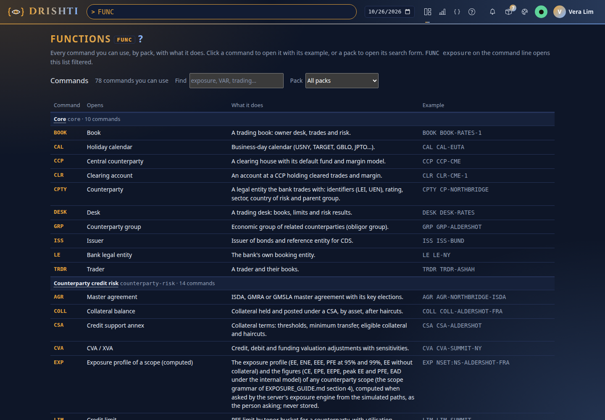
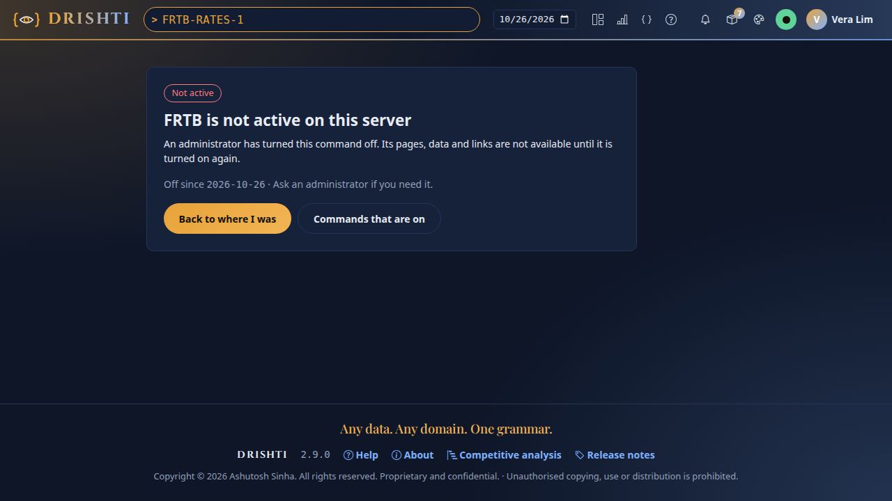
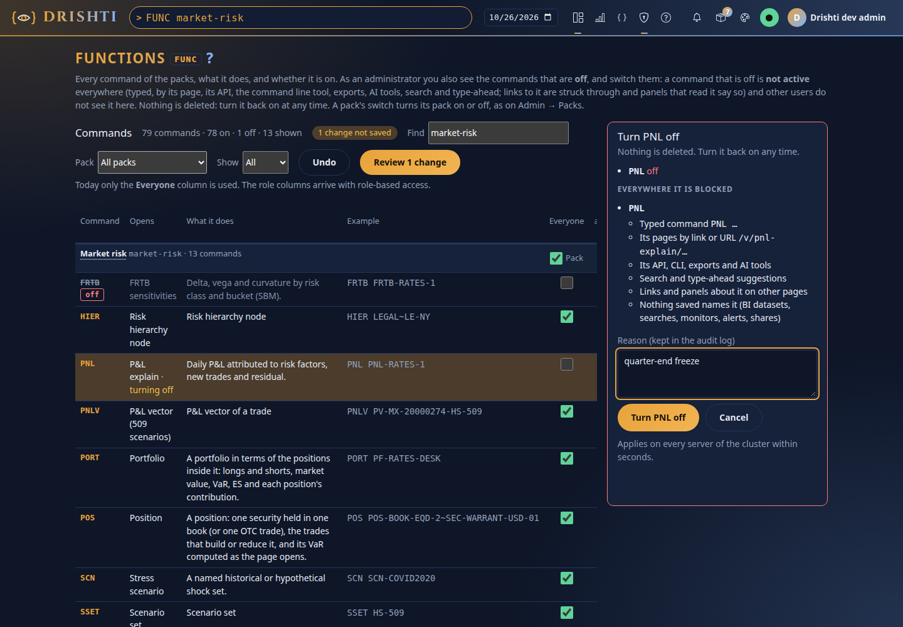

<!--
  Project Drishti · Any data. Any domain. One grammar.

  Copyright (c) 2026 Ashutosh Sinha <ajsinha@gmail.com>.
  All rights reserved.

  PROPRIETARY AND CONFIDENTIAL.

  This file is the confidential and proprietary property of Ashutosh Sinha.
  Unauthorised copying, use, modification, distribution or disclosure of this
  file, via any medium, is strictly prohibited except with the express prior
  written permission of the copyright holder.

  See the LICENSE file in the root of this repository for the full terms.
-->
# Users, roles and packs

This guide is for the people who run Drishti for others. It covers:

1. adding a person, from scratch;
2. what a role is and how to make your own;
3. which packs each person sees;
4. where all of this is stored (SQLite or PostgreSQL), and how to back it up;
5. single sign-on, the rules Drishti enforces, and the API.

You need the **admin** role for everything here. All of it is under **Admin** in the top bar (`/admin/users`).

---

## Signing in and out

Where the links are, when sign-in is **on** (`DRISHTI_AUTH_ENABLED=true`, see [OPERATIONS.md](OPERATIONS.md)):

- The landing page (when you are not signed in): a **Sign in** button in the top navigation. It returns you to the page you
  were on. Any protected page (the terminal, Search, Admin) sends you to the sign-in page first.
- Signed in: your initial and name at the right of the top bar, or of the landing page's navigation, open a menu with
  **My account** and **Sign out**. Signing out ends the session on the server and lands on the landing page with a
  "Signed out" notice. It is a POST from the console's own pages only.
- The sign-in page has a link back to the home page.

When sign-in is **off** (the local default), everyone who reaches the console acts as the development user, so there is
nothing to sign in to and no **Sign out**. The top bar's user menu says **Sign-in is off on this server** and links here, and
`/login` says so and offers to open the terminal. To turn it on, set `DRISHTI_AUTH_ENABLED=true` with the session and token
secrets on both programs (GETTING_STARTED, step 13).

---

## 1. Your first ten minutes: add a person

The example: Priya joins the credit desk. She should see counterparties and credit curves, nothing else, and she
works with the *Banking core* and *Counterparty credit risk* packs.

### Step 1: sign in as the development admin

On a fresh installation the server creates one account the first time it starts:

| User | Password | Roles |
|---|---|---|
| `drishti-dev-admin` | `drishti-dev-admin123` | `admin` |

Open the console (for example `http://localhost:17480`), click **Sign in** and use those details. Until you change
the password, every admin page shows a red warning: *The development admin still has its default password.*

### Step 2: change that password

Click your name in the top bar, then **My account → Change password**. Type the current password and the new one
twice. The new one needs at least 10 characters, with letters and digits, and must not be your user name. You
should see *Password changed.* The warning disappears.

### Step 3: make a role for the credit desk

Go to **Admin → Roles** and click **New role**. Fill in:

| Field | Value |
|---|---|
| Name | `credit-analyst` |
| Description | `Reads counterparties and credit curves` |
| Kinds it opens | `counterparty` and `credit-curve` (one per line) |
| Powers | leave all five unticked |

Click **Save**. You should see *Created credit-analyst.* The row shows the two kinds, *0* users, and who
changed it and when.

> Instead of typing kinds, you can click a pack's button under *Add every kind of a pack*. Tick **Opens every
> kind** for a role that may open everything.

### Step 4: create the user

Go to **Admin → Users** and click **New user**:

| Field | Value |
|---|---|
| User name | `priya` (3–64 of `a-z 0-9 . _ -`; it never changes) |
| Display name | `Priya Raman` |
| Desk | `Credit` |
| Email | `priya@bank.example` |
| Roles | tick `credit-analyst` |
| Packs | untick all but `core` and `counterparty-risk` |
| Initial password | something at least 10 characters long; tell Priya it, privately |
| Must change at first sign-in | tick it if Priya should choose her own |

Click **Save**. Priya appears in the list as *active*.

### Step 5: check what Priya sees

Sign out and sign in as `priya`. Then:

- `CPTY CP-NORTHBRIDGE <GO>` opens the counterparty.
- `TRD IRS-48213 <GO>` is refused: *priya may not open trade entities*. Links to trades on her pages are still shown,
  but greyed out with the reason. Drishti shows that something exists without showing its content.
- The pack switcher in the top bar lists only her two packs.

### Step 6: read the audit log

Back as the admin, open **Admin → Audit log**. You should see, newest first, `login` (priya),
`user-created` (priya) and `role-created` (credit-analyst), each with who did it and when. Type `priya` in the
filter to see only what concerns her.

---

## 2. Roles

A role says two things:

1. **Which kinds of entity** its holders may open (`trade`, `counterparty`, … or `*` for every kind).
2. **Six powers** (plus `collaborate` and `compliance`, described under [Discussion, sharing and shared workspaces](#discussion-sharing-and-shared-workspaces), and, for business intelligence, the four [BI powers](#bi-powers-rupaka)):

   | Power | Lets the holder |
   |---|---|
   | `raw` | see every field, in raw JSON (F9) and everywhere else; others see the fields in `drishti.security.redact` as `•••` wherever their value could be seen or inferred: views, search, Impact, type-ahead, alerts ([CONFIGURATION.md](CONFIGURATION.md#field-masks)). Masks work on fields: a masked value copied into another text field (a timeline note) stays visible unless that field is masked too or `drishti.security.mask-copies` is on (best effort, exact match); fix the source so free text does not carry sensitive values |
   | `author` | save Sutras from Studio and propose them (where Studio saving is on). **Designing is open to everyone**: any signed-in user may use Studio and the Screen Builder and preview against a pasted document; saving, proposing, approving and deleting need the right, and previewing a stored entity needs the right to its kind |
   | `approve` | approve or reject proposed Sutras, but never their own (four eyes) |
   | `admin` | everything in this guide: users, roles, caches, health, audit |
   | `calc` | use Calc (`Alt+C`): Python run in their own browser on the views a pack offers it, reading only what their roles open ([PYTHON_CALC.md](../guides/PYTHON_CALC.md)) |
   | `layout` | use layout mode (`Alt+L`): arrange a view's panels for themselves and keep that personal layout ([USER_GUIDE.md](../guides/USER_GUIDE.md#layout-mode-arrange-a-view-your-way)). **On unless a role says `layout: false`**; with `author` too, they may promote a layout to a Sutra proposal |

A person may hold several roles. They may open a kind if **any** of their roles allows it, and they have a power if
**any** of their roles grants it.

### Built-in roles and your own roles

| | Built-in roles | Roles you define |
|---|---|---|
| Come from | `drishti.security.roles` in configuration, and the `roles:` section of each pack | **Admin → Roles** |
| Stored in | configuration files | the identity database |
| Changed by | editing configuration, then a restart | an admin, at once, from the browser |
| Shown as | *built-in*, without Edit or Delete | normal rows, with Edit and Delete |

Configuration ships with these:

| Role | Opens | Raw JSON | Author | Approve | Admin | Calc | Layout |
|---|---|---|---|---|---|---|---|
| `viewer` | everything | masked | — | — | — | — | — (`layout: false`) |
| `author` | everything | yes | yes | — | — | yes | yes |
| `approver` | everything | yes | yes | yes | — | yes | yes |
| `admin` | everything | yes | yes | — | yes (and admins may approve) | yes | yes |

Packs add their own. The seven shipped packs add `trader` (trading), `market-risk` (market-risk), `credit-risk` (counterparty-risk),
`economist` and `analyst` (world-economy), `news-analyst` and `market-analyst` (news-and-markets); core and market-data add none. The roles
of the packs that offer Calc hold `calc`: `trader`, `market-risk` and `credit-risk`. The roles of world-economy and news-and-markets
do not ([PYTHON_CALC.md](../guides/PYTHON_CALC.md#9-roles-who-may-use-calc)). Every pack role has
`layout` (none sets `layout: false`), and so has every role you define in Admin → Roles unless you untick *Customise
layouts*. A pack declares one like this:

```yaml
# config/packs/world-economy/pack.yaml
roles:
  economist:
    kinds: [economy, macro-indicator, economic-forecast, labour-market, fiscal-position, country-group, ...]
```

Rules for your own roles:

- Names are 2–64 of `a-z 0-9 -` and start with a letter (`credit-analyst`, `ops-l2`).
- A built-in name always means the built-in role, so you cannot create a role called `admin` or `trader`.
- A role opens at least one kind.
- A role that someone holds cannot be deleted. The Delete button says how many hold it. Take the role away from
  them on the Users page first, and the server refuses (`DRS-6009`) if you try anyway.
- A change applies at each holder's next click: no restart and no new sign-in.
- Every create, change and delete is audited (`role-created`, `role-updated`, `role-deleted`), with what the role
  allows.

### How Drishti decides whether someone may open an entity

Two checks, and both must pass:

```
may open trade MX-20000001  =  one of my roles opens "trade"          (roles: section 2)
                   AND the pack that defines "trade" is mine   (packs: section 3)
```

---

## 3. Packs per user

A pack is a domain's worth of kinds, mnemonics, layouts and roles (see PACKS.md). The server may have many
installed; each person sees the ones assigned to them.

- **Default packs.** A user who was never given a list of packs (the field left out, not an empty list) sees the packs in `drishti.packs.default-for-users`, or every
  installed pack when that is empty. In the Users list this shows as *default packs*.
- **Assigned packs.** Tick packs in the user dialog to give exactly those. Untick all of them (an empty list, `"packs": []`), and the user sees
  none: every kind answers `DRS-5002`. This is not the same as the default.
- **Choosing among them.** Someone with several packs picks which to see from the pack switcher in the top bar.
  That choice is theirs, and it is saved with their settings.

A pack's role is still needed to open its kinds. Giving Priya the *trading* pack without a role that opens
`trade` shows her trade links greyed out.

---

## API tokens

People read Drishti from scripts, notebooks and Excel with personal API tokens they make on **My account → API
tokens** ([API_GUIDE.md (clients)](../guides/API_GUIDE.md#clients-scripts-notebooks-and-excel)). What an administrator needs to know:

- A token acts as its owner, with the owner's roles and packs at the time of each call, and, unless it was
  made with a **write scope**, **only reads**: every `GET`, and the `POST`s that carry a query and change nothing, listed in
  `drishti.security.token-read-posts` (the search pivot, `/api/v1/command`, the search-form compile, and the BI query, validate and format calls). Any other `POST`, `PUT`, `PATCH` or
  `DELETE` is refused with `403 DRS-5002 API tokens only read`; add a path to the list only if it writes nothing.
- **Write scopes (for tools, CI and GitOps).** A person may tick `design:write`, `design:approve`, `packs:admin`, `bi:write`, `bi:approve`, `bi:admin`, `ai:use`, `ai:admin`, `loads:write` or `risk:write` (VaR baskets and captures, what-if sandboxes) (an ETL job announcing that a batch landed: [DATA_LOADS.md](../guides/DATA_LOADS.md#10-permissions)) when making a
  token (`drishti.security.token-scopes`; the account page lists them in words). What a token may do is the scope **and** the
  roles its user holds at the time of each call (`design:approve` is useless to someone who is not an approver, `packs:admin` to
  someone who is not an admin; `packs:admin` covers loading and deploying packs, the registry, Retry now and writes to `/api/v1/admin/connectors/**`; the `bi:*` scopes cover the write calls of [business intelligence](#bi-powers-rupaka) and still need the BI power and the workspace role each call needs; `ai:use` opens `POST /api/v1/ai/chat` and the MCP tool calls), so demoting or disabling a user cuts their tokens at once. A token with a write scope must
  expire (`drishti.security.token-write-max-days`, 90). Every write done with a token is in the audit log as `token-write`
  (token id, method, path, status; never the secret) and each refusal as `token-denied`. Users, roles, tokens, sign-in, caches and
  personal or collaboration state are never open to a token (`token-never`); there is no `admin` scope. Tokens made before scopes
  existed keep reading only.
- Disabling a user stops their tokens at once (and they cannot make new ones); deleting a user deletes them.
- **Admin → Tokens** lists every token (owner, name, scopes: *read only* or the write scopes it holds, created, expires, last used in the console's
  time zone) and revokes any of them.
- Secrets are never stored, only their SHA-256; nobody, administrators included, can see a secret after it is made.
- `token-created` and `token-revoked` are in the audit log; so are `signed-out` (a console sign-out) and
  `sessions-ended` (an administrator's disable, delete or password reset ended the user's console sessions).

## Embedding host applications

Another web application (a CRM, a portal) can show live Drishti views in its own pages with `<drishti-view>` ([ELEMENTS.md](../architecture/ELEMENTS.md)), without an iframe. An administrator allows it, one **host application** at a time. Embedding is off until `drishti.embed.enabled` is on ([CONFIGURATION.md](CONFIGURATION.md#drishtiembed--embedded-views-for-other-web-applications)); register applications on **Admin → Embedding** (`/admin/embedding`), or with the API ([API_GUIDE.md](../guides/API_GUIDE.md#embedding-views-in-another-web-application)), for example:

```bash
curl -s -X POST $SERVER/api/v1/admin/embed/apps -H "Authorization: Bearer $ADMIN_TOKEN" -H 'Content-Type: application/json' -d '{
  "id": "crm", "name": "Client CRM", "contact": "crm-team@bank.example",
  "origins": ["https://crm.bank.example"], "kinds": ["trade", "counterparty"], "scopes": ["embed:view"],
  "jwks": "{\"keys\": [ ... the host backend public key ... ]}"}'      # the answer shows the client secret once
```

- The host's **backend** keeps the client secret (or signs with its key) and tells Drishti who its signed-in user is with that user's ID token or a JWT it signs itself; it can never name a user with the secret alone. The browser only ever holds a five-minute, read-only embed token.
- Embedded views **always mask** the fields in `drishti.security.redact`, even for users whose roles have `raw`, and show only the kinds the application was registered for (`kinds`) that the user's roles open now.
- `enabled: false` (a `PUT`) stops the application at once: its tokens are refused at the next call. Disabling a user does the same for that user. **Rotate** the secret with a grace period (`rotate-secret`) so the host can switch over.
- The audit log has `embed-app-created`, `-changed`, `-enabled`, `-disabled`, `-secret-rotated`, `-deleted`, and for every token request `embed-token` or `embed-token-refused`. The access log shows each embedded view as the user's own with the detail `embed:<application>`, so "which application showed what to whom" is Admin → Access.
- Rates (`callsPerMinute` per application, `userCallsPerMinute` per user) answer `429 DRS-8004` with `Retry-After`.

### The Admin → Embedding page

Admin menu → **Embedding** (`/admin/embedding`, administrators only) lists every host application: name and id, its origins, how it signs in (client secret, public key, or both), scopes and kinds, whether it is enabled, and what it did **since the server started**: tokens issued, embed calls, live streams open now, refusals by code (`DRS-8002` wrong origin, `DRS-8003` unknown or disabled, `DRS-8004` rate limit, and so on), and when it was last used. Refusals that name no registered application are counted together in a line above the table. The counters are in memory (they start again at a restart) and are also Prometheus metrics (`drishti_embed_tokens_total`, `_calls_total`, `_refusals_total{code}`, `drishti_embed_streams`, each with an `app` label).

- **New application** (key `n`): name, id (made from the name; lower-case letters, digits and hyphens), origins one per line, how it signs in, scopes (the ones this server defines), the kinds it may show (empty: every kind its users' roles open), rates and token life. With a client secret, the secret is **shown once** in its own dialog, with a Copy button; closing the dialog forgets it, and a reload does not bring it back. With a public key, paste a JWK set (public keys only).
- **Rotate secret** asks for a grace period (seconds; the old secret keeps working that long, `0` ends it at once) and shows the new secret once.
- **Disable** stops the application at once (no new tokens; its tokens fail at the next call) but keeps its registration; **Enable** brings it back. **Delete** asks first and removes it for good. All of them are audited (`embed-app-created`, `-disabled`, `-enabled`, `-secret-rotated`, `-deleted`).
- Applications **declared in configuration** (`drishti.embed.apps`, for GitOps; [CONFIGURATION.md](CONFIGURATION.md#drishtiembed--embedded-views-for-other-web-applications)) are marked *from config* and read-only: change them in the file and restart. A configured id cannot be registered again here.
- Keys: `n` opens *New application*, `/` focuses the filter, `Esc` closes a dialog. The page works at phone width and in both themes.

## Who looked at what: the access log

Every read that was answered is recorded: a view, a raw document (F9), a history or compare read, a search and a
CSV export, with the person, the time, the entity (or the search text) and the business date asked for (blank for
live). Refused reads are not recorded (they returned nothing). Administrators see it in **Admin → Access**, filtered
by person, action, kind, id and dates; a view's **Viewed by** (administrators only) opens the list for that entity.
Worked example: "who looked at MX-20000001 last week" is Access with kind `trade`, id `MX-20000001`, from and until.

It is in the identity database (`drishti_access`), kept `drishti.access-log.keep-days` (90) days. Recording is
asynchronous and never slows a read; if the database cannot keep up, events are dropped and the page says how
many. The console's own service identity is not recorded. Through the API:
`GET /api/v1/admin/access?user=&action=&kind=&id=&from=&to=&limit=`.

## BI powers (Rupaka)

Business intelligence ([BI_GUIDE.md](../guides/BI_GUIDE.md)) has four powers of its own, granted on roles beside the six above. They are
a list, `bi`, on a role: `drishti.security.roles.<role>.bi: [bi, bi-author]` in configuration or a pack, or, for a role you define,
**Admin → BI settings** (a table of roles with four tick boxes each; built-in roles are read-only there) or the `bi` list of
`PUT /api/v1/admin/role-definitions/{name}`. Saving a role in **Admin → Roles** keeps the BI powers it has.

| Power | Lets the holder |
|---|---|
| `bi` | open BI (the **BI** top-bar menu, `RUPAKA <GO>`, `/bi`), the catalogue and the published items their audience allows; favourites and recents |
| `bi-author` | create, edit, move, propose and publish items in the workspaces they are a contributor or member of, and create shared workspaces (when the policy is `authors`, the default) |
| `bi-steward` | **certify** published items (owners only *promote*); **review** proposals in any workspace; **import bundles**; create shared workspaces when the policy is `stewards` |
| `bi-admin` | Admin → BI settings (the workspace policy, powers per role); admin of every shared workspace; always allowed to create workspaces |

A higher power also opens BI, so a role with only `bi-author` sees the catalogue. An administrator (`admin`) holds all four; with security off
everyone does. The built-in `viewer` holds `bi`, `author` and `approver` hold `bi` and `bi-author`; the roles packs add (`trader`, `risk`,
`market-risk`, ...) hold **none** until you grant them. A power opens the door; what a person may do in a given workspace is then decided by their **workspace
role** (viewer, contributor, member, admin) there. Approving a proposal needs the existing `approve` power as well, and with four-eyes on never
your own proposal. Changes to roles, settings, workspaces, members and items are in the audit log (`role-updated` with `bi=[...]`, `bi-settings-changed`,
`bi-workspace-*`, `bi-member-*`, `bi-item-*`).

## Calc

Calc ([PYTHON_CALC.md](../guides/PYTHON_CALC.md)) runs Python in the user's browser on the view they are looking at.
What an administrator needs to know:

- **Who:** holders of a role with `calc`. Tick *Use Calc* in the role's dialog (Admin → Roles), or `calc: true` in
  configuration or a pack. The default grants are in [section 2](#2-roles).
- **What it reads:** only what the user could open by clicking. Every read goes through the console with the user's
  session; roles, packs and masking apply call by call. Nothing runs on the server.
- **Where:** on views of kinds whose pack enables Calc (`python.enabled` in `pack.yaml`).
- **What is kept:** each user's own snippets (`drishti_preference`, namespace `calc-snippets`, at most 50), deleted
  with the user. Reads are in the access log like any read (`drishti.columns()` as a `search`).
- **Switched off for everyone:** `DRISHTI_CALC_ENABLED=false` (server and console).

## Layouts

Layout mode ([USER_GUIDE.md](../guides/USER_GUIDE.md#layout-mode-arrange-a-view-your-way)) lets a user drag, resize and
hide a view's panels for themselves. What an administrator needs to know:

- **Who:** holders of a role with `layout`, which is **every role unless it says otherwise**: the exact defaults are
  `viewer` without it, `author`, `approver`, `admin` and every pack role with it, and roles defined in Admin → Roles
  with it unless *Customise layouts* is unticked. To take it away from a role in configuration or a pack, write
  `layout: false`. A person with several roles has it if any of them grants it. Without it, the footer's **Layout**
  key is greyed with the reason and `/api/v1/me/layouts/**` answers `403 DRS-5002`.
- **What is kept:** each user's layout per Sutra (`drishti_preference`, namespace `layouts`, one document per Sutra:
  panel order, column, `span`, `height`, `hidden`; at most 50), deleted with the user. A layout never changes the
  Sutra; the console applies it only when it draws that user's views.
- **Promoting a layout** needs `author` as well (and `drishti.rachana.studio-save`): it is a Sutra proposal like any
  Studio save, reviewed by an approver (four eyes) and audited as `sutra-proposed`.
- **Stored as:** a `no-layout` row in `drishti_role_power` for a role defined in Admin → Roles without it (so roles
  saved before this power existed keep the default, allowed).
- **Switched off for everyone:** `DRISHTI_LAYOUTS_ENABLED=false` (server and console); saved layouts are then not
  applied either.

## Pivots

The Pivot tab ([USER_GUIDE.md](../guides/USER_GUIDE.md#the-pivot-tab-slice-a-table-your-way)), offered where a Sutra
or a pack opts in, has **no power of its own**:

- **Who:** anyone who may open the kind may pivot its tables and search results and save their arrangement, as they
  may sort or filter a table; it changes nothing for anyone else. The pivot reads only what the view or search would
  show them: a panel's rows as the view has them, a search's matches masked exactly as in a search (a masked field
  groups under `•••` and is never added up).
- **What is kept:** each user's arrangement per Sutra and panel, and per kind for searches (`drishti_preference`,
  namespace `pivots`), deleted with the user.
- **Promoting a pivot** to a Sutra needs `author` (and `drishti.rachana.studio-save`): a Sutra proposal like any Studio
  save, reviewed by an approver and audited as `sutra-proposed`.
- **Reads** are in the access log: a panel's rows for its pivot as a `view`, a search pivot and its drill-downs as a
  `search`.
- **Switched off for everyone:** `DRISHTI_PIVOT_ENABLED=false` (server).

## Discussion, sharing and shared workspaces

- **Discussion** (notes are now comment threads; see the User guide): anyone who may open a kind reads and writes comments on its
  entities, and sends a view to colleagues with a note, if their role has the `collaborate` power (on unless an administrator took it away,
  `roles.<role>.collaborate: false`). Only the author edits, and only within `drishti.collab.threads.edit-window`; nobody erases: a
  retracted comment reads "Retracted by the author" and its text stays in the revisions. Comments, edits, retractions and moderation are in the
  audit log (`collab.comment.*`, `collab.thread.*`); a share is in the access log as `share`.
- **What people can learn about each other.** The people picker (the directory) lists only users who share a pack with the person searching
  (`drishti.collab.directory.scope`), needs two letters, is rate limited, and shows a role's size, never its members. A notice is never sent to,
  and a mention never reaches, someone who may not open that kind of view; the sender is told who was left out and why (never what the view
  holds) under `share.undeliverable: tell`.
- **Moderation** (`admin`): **Hide** a comment with a reason (readers see "Hidden by a moderator: <reason>"; the text stays in the record), **Lock** a
  thread (no new comments), and remove a whole thread for good with `DELETE /admin/collab/threads/{id}` (audited; refused with `423 DRS-7010`
  under a legal hold). The API is in [API_GUIDE.md](../guides/API_GUIDE.md#comment-threads).
- **Compliance** (`roles.<role>.compliance`, a power of its own: an administrator does not have it unless the role does). A compliance officer
  reads any share and the full record of any thread (hidden and retracted comments, every revision, unscrubbed), places and releases **legal
  holds**, runs the **export** and **verifies** the hash chains. The runbooks (retention, holds, export, verify) are in
  [OPERATIONS.md](OPERATIONS.md#9a-3-collaboration-retention-legal-holds-and-the-compliance-export); the console page for all of them is **Admin > Collaboration**
  (`/admin/collab`; see the next item).
- **Admin > Collaboration** (`/admin/collab`) shows what the signed-in roles may use, and the server decides every call: *Threads and moderation*
  (search by user, kind, id and dates; open a thread to read its comments, see the hidden ones, **Hide** with a reason, **Unhide**, **Lock** or
  **Unlock**; `admin`), *Legal holds* (list, place by scope, release; `compliance`), *Compliance export* (start, wait, download once;
  `compliance`), *Verify the chains* (one thread or everything; `compliance`), *Retention* (a dry run that counts what would go and what a hold keeps,
  never deletes; `admin`) and *Bridges* (the configured chat bridges with their queue, and a **Test** that posts one message; `admin`). A role that
  holds only `compliance` sees the compliance sections; an administrator without the power sees the others. Times are in the top bar's zone.
- **Shared workspaces**: a workspace's owner shares it with everyone, roles or named people. Readers see it
  read-only; panes on kinds a reader's roles may not open stay hidden. Share records are kept with the preferences
  (`drishti_preference`, namespace `workspace-shares`).

## 4. Where it is stored: the identity database

Everything in this guide is in **one database**:

- users, with their roles and packs;
- the roles you define;
- each person's saved workspaces, monitors, alert rules and settings;
- the audit log.

The server reaches it through JPA (Hibernate and Spring Data repositories), with no hand-written SQL in the code.

| Database | When | URL |
|---|---|---|
| **SQLite** (default) | one server; nothing to install | `jdbc:sqlite:./data/identity/drishti.db` |
| **PostgreSQL** | several servers sharing users, or your database team's backups | `jdbc:postgresql://host:5432/drishti` |

### The schema: two files, no migrations

The tables are written out in full, once per database, in `drishti-identity/src/main/resources/db/`:

- `schema-sqlite.sql`
- `schema-postgres.sql`

The server runs the right file every time it starts. Each statement is `CREATE … IF NOT EXISTS`, so running it on an
existing database changes nothing. There is no migration tool and no migration history: the file *is* the schema.
On PostgreSQL the server also checks at start that its entities match the tables, and refuses to start, naming the
column, if they do not.

| Table | Holds |
|---|---|
| `drishti_user` | one row per person: name, email, desk, password hash, enabled, lockout, timestamps |
| `drishti_user_role` | (user, role) pairs |
| `drishti_user_pack` | (user, pack) pairs; `drishti_user.packs_assigned` says whether they apply or the defaults do |
| `drishti_role` · `drishti_role_kind` · `drishti_role_power` | roles defined in Admin → Roles, the kinds each opens, and powers added since the first release (`calc`; `no-layout` for a role that may not customise layouts), one row each |
| `drishti_preference` | (user, namespace, name) → a JSON document: workspaces (with their divider sizes), monitors, alert rules, settings, Calc snippets (`calc-snippets`), personal layouts (`layouts`, one per Sutra) |
| `drishti_audit` | one row per audited action, numbered in order |
| `drishti_alert` | every alert a user's rules fired: when, rule, entity, severity, message (the newest `drishti.alerts.keep`, 1,000, per user) |
| `drishti_pack_state` | packs an admin switched off or on (Admin → Packs) |
| `drishti_api_token` | personal API tokens: owner, name, a SHA-256 of the secret (never the secret), scopes, created, expires, last used, revoked |
| `drishti_session` | console sign-in sessions: a SHA-256 of the session id (never the id), user, created, expires. A row is removed at sign-out, when the user is disabled, deleted or has their password reset, and (hourly) once expired |
| `drishti_access` | the access log: when, who, action (view, raw, history, search, export), kind, id, search text or field, business date |
| `drishti_note` | notes on entities and their fields: entity, field path, author, text, created, edited. Kept when their author is deleted |

Deleting a user removes their role and pack rows with them (`ON DELETE CASCADE`), and their saved documents too.

### Use PostgreSQL

1. Create a database and a user (as a PostgreSQL superuser):

   ```sql
   CREATE USER drishti WITH PASSWORD 'choose-a-long-one';
   CREATE DATABASE drishti OWNER drishti;
   ```

2. Point the server at it, through environment variables or `application.local.yaml`:

   ```bash
   export DRISHTI_IDENTITY_DB_URL=jdbc:postgresql://db.bank.example:5432/drishti
   export DRISHTI_IDENTITY_DB_USER=drishti
   export DRISHTI_IDENTITY_DB_PASSWORD='choose-a-long-one'
   ```

   ```yaml
   # application.local.yaml
   drishti:
     identity:
       database-url: jdbc:postgresql://db.bank.example:5432/drishti
       database-user: drishti
       database-password: ${DRISHTI_IDENTITY_DB_PASSWORD}
       # database-pool-size: unset = drishti.db.pool.size (20) on PostgreSQL
   ```

3. Start the server. The log says:

   ```
   identity database ready: jdbc:postgresql://db.bank.example:5432/drishti (db/schema-postgres.sql)
   ```

   If PostgreSQL is not up yet, the server waits for it, retrying with growing pauses for up to about four minutes:
   *identity database not reachable yet (…); retrying in 2000 ms*.

To try it locally with Docker (the repository's compose file runs PostgreSQL 18 on port 5432, or `DRISHTI_PG_PORT`):

```bash
docker compose -f deploy/docker/compose.data.yaml up -d postgres
docker compose -f deploy/docker/compose.data.yaml exec postgres psql -U drishti -c 'CREATE DATABASE drishti_identity'
DRISHTI_IDENTITY_DB_URL=jdbc:postgresql://localhost:5432/drishti_identity DRISHTI_IDENTITY_DB_USER=drishti \
DRISHTI_IDENTITY_DB_PASSWORD=drishti java -jar drishti-server/target/drishti-server-*.jar
```

### SQLite: what to know

- The database is one file, plus `-wal` and `-shm` files beside it while the server runs. Keep the folder on local
  disk, not a network share.
- Readers never wait. Writers take turns: SQLite allows one writer at a time, and Drishti's writes (a sign-in, a
  saved workspace) take milliseconds.
- For more than one server sharing the same users, use PostgreSQL.

### Back it up

| Database | Command |
|---|---|
| SQLite (safe while running) | `sqlite3 data/identity/drishti.db ".backup 'backup/drishti-$(date +%F).db'"` |
| PostgreSQL | `pg_dump -Fc -h db.bank.example -U drishti drishti > drishti-$(date +%F).dump` |

To restore SQLite, stop the server and copy the backup over `drishti.db`. For PostgreSQL, use
`pg_restore -d drishti --clean drishti-….dump`. Keep `data/` out of version control (it is git-ignored).

### Upgrading from 1.9 or earlier

Earlier releases kept users in `data/identity/users.json`, the audit log in `audit.jsonl` and saved documents in
`preferences/`. When 1.10 starts with an empty database and finds those files, it:

1. imports every user (with password hashes, roles, packs and lockouts);
2. imports every audit event, with its original time;
3. imports every saved workspace, monitor, alert rule and setting;
4. renames the files to `*.imported` (it never deletes them).

The log says *imported 12 users, 3482 audit events and 57 saved documents into the identity database*. The import
runs once: a database that has users is never imported into again.

---

## 5. Single sign-on (OpenID Connect)

Staff can sign in through the bank's identity provider (Keycloak, Microsoft Entra ID, Okta, Ping, …). The login
page then offers **Sign in with single sign-on** beside the password form. The server verifies every ID token itself
(ADR-014); the console only runs the browser redirect.

Register Drishti at the provider as a web application:

- redirect URI `https://<console>/auth/oidc/callback`;
- scopes `openid profile email`;
- a groups claim in the ID token.

Then set, for both console and server:

```bash
DRISHTI_OIDC_ENABLED=true
DRISHTI_OIDC_ISSUER=https://login.bank.example/realms/staff
DRISHTI_OIDC_CLIENT_ID=drishti
DRISHTI_OIDC_CLIENT_SECRET=…          # console only; omit for a public client (PKCE alone)
```

Map the provider's groups to Drishti roles, built-in ones or your own, in the server's configuration:

```yaml
drishti:
  security:
    oidc:
      groups-claim: groups                 # Keycloak realm roles: realm_access.roles; Entra ID: groups or roles
      username-claim: preferred_username   # or email, upn
      role-map:
        desk-rates: [trader]
        credit-desk: [credit-analyst]      # a role defined in Admin → Roles works too
        sutra-authors: [author]
        sutra-approvers: [approver]
        drishti-admins: [admin]
      default-roles: []                    # empty: users whose groups map to nothing are refused
      roles-from-provider: true            # groups replace roles at each sign-in
```

- The first sign-in creates the user, with no password. Later sign-ins update the name, email and roles.
- Disabling a user here keeps them out, whatever the provider says. The last enabled admin is never demoted by the
  provider.
- A mapped role that does not exist is dropped, and the server log says so.
- Every sign-in, first-time creation and refusal is in the audit log (`login-sso`, `user-provisioned`,
  `login-sso-refused`). Refusals tell the user only that sign-on was refused; the reason is in the server log.
- Password sign-in stays for accounts created here, so keep one break-glass admin.

---

## 6. Rules Drishti enforces

| Rule | Default | Setting (`drishti.identity.*`) |
|---|---|---|
| Hashing | PBKDF2-HMAC-SHA256, 240,000 iterations, 16-byte salt, constant-time check | `iterations` |
| Password policy | at least 10 characters, letters and digits, not the user name | `min-password-length` |
| Lockout | 5 failed sign-ins lock the account for 15 minutes; an admin's password reset unlocks it | `max-failed-attempts`, `lockout` |
| Unknown users | answered like a wrong password, in the same time | — |
| Forced password change | off; an admin can tick it per user. Until it is done the console answers only the account page, the change and sign-out (other pages lead back to *My account*; console API calls `403 DRS-6010`) | `force-password-change-on-create`, `force-password-change-on-reset` |
| Sessions follow the user | each console sign-in is a session the server keeps; the console checks it, the user's roles and enabled flag per request (reusing an answer for the console's `auth.recheck_seconds`, 10). Disabling, deleting or resetting the password of a user signs them out everywhere (enabling them again does not bring a session back); a role change applies within those seconds, at once on every worker process of the console you used. Sign-out ends the session on the server | console `auth.recheck_seconds` |
| Development admin | created when the database has no users | `seed-admin` (`DRISHTI_SEED_ADMIN=false` in production), `seed-username`, `seed-password`, `seed-roles` |
| Last admin | there is always one enabled admin: it cannot be disabled, demoted or deleted | — |
| Self-protection | nobody can disable or delete their own account | — |
| Database | SQLite file | `database-url` (`DRISHTI_IDENTITY_DB_URL`), `database-user`, `database-password`, `database-pool-size` (unset: `drishti.db.pool.size`, 20, on PostgreSQL; 8 on SQLite) |

Every user can see their own profile and roles on **My account** (`/account`), change their password (giving
the current one), and choose their theme, clock zone, density and landing page.

Admins also have:

- **Connectors** (`/admin/connectors`): one YAML file per connector in `config/connectors/`; list, edit (a generated form or the YAML), test, save with a version history, enable or disable, reset to the pack's template, delete. Changes apply without a restart and are audited (`connector-saved`, `-deleted`, `-reset`, `-enabled`, `-disabled`, `-restored`, `-tested`, `-generated`, `-migrated`). See [CONNECTOR_FILES.md](../connectors/CONNECTOR_FILES.md);
- **Health** (`/admin/health`): connectors, packs, live streams and the server, refreshed every 5 seconds; since 2.9.7 a **Disk** section:
  every folder Drishti fills (`var/hot`, `ccr/hot`, `bi-store`, dumps, temp, connector caches) with its size against its cap and its oldest
  item, and the disk's free space against the guard (amber at 80% of a cap or under twice the guard, red at the cap or under the guard);
- **Caches** (`/admin/caches`): every cache of the server (2.9.7: VaR, exposure, BI and pack access too) with where it lives, its size
  against its limit, age, hit rate, freshness and last purge, the memory budget and free disk above; a purge for any one or all, **Purge
  a date** and **Dates** for a cache that holds business dates, and a **whole cluster** switch (default: this server). Every purge is audited
  (`cache-purged`).

---

## 7. The API

Every call is under `/api/v1`. Anything under `/admin` needs a token with an admin role. With security off (local
development), the examples work as they are. With security on, add `-H "Authorization: Bearer <token>"`.

```bash
# Define a role
curl -s -X PUT localhost:18480/api/v1/admin/role-definitions/credit-analyst \
  -H 'Content-Type: application/json' \
  -d '{"description":"Reads counterparties and credit curves","kinds":["counterparty","credit-curve"]}'
# → {"name":"credit-analyst","kinds":["counterparty","credit-curve"],"raw":false,…,"builtIn":false,"updatedBy":"…"}

# Create a user holding it, with two packs
curl -s -X POST localhost:18480/api/v1/admin/users -H 'Content-Type: application/json' \
  -d '{"username":"priya","displayName":"Priya Raman","desk":"Credit","roles":["credit-analyst"],
       "packs":["core","counterparty-risk"],"password":"credit-desk-2026"}'

# Every role, with how many people hold it
curl -s localhost:18480/api/v1/admin/role-definitions
# → [{"name":"admin","kinds":["*"],"builtIn":true,"users":1,…},{"name":"credit-analyst",…,"users":1}]

# What happened to priya
curl -s 'localhost:18480/api/v1/admin/audit?subject=priya&limit=20'
```

| Method | Path | Does |
|---|---|---|
| `POST` | `/auth/login` | verify a sign-in (the console's service token only) |
| `POST` · `GET` · `DELETE` | `/auth/sessions[/{id}]` | open, check and end console sign-in sessions (the console's service token only) |
| `GET` | `/auth/me` | the caller's profile |
| `POST` | `/auth/password` `{current, next}` | change your own password |
| `GET` / `POST` | `/admin/users[?q=]` | list or search / create |
| `GET` / `PUT` / `DELETE` | `/admin/users/{u}` | read / update profile, roles and packs / delete |
| `POST` | `/admin/users/{u}/enabled` `{enabled}` | enable or disable |
| `POST` | `/admin/users/{u}/password` `{password}` | reset a password (also clears a lockout) |
| `GET` | `/admin/roles` | every role name a user may be given |
| `GET` | `/admin/role-definitions` | every role: kinds, powers (`raw`, `author`, `approve`, `admin`, `calc`, `layout`, `collaborate`, `compliance`, and the `bi` list), built-in or not, holders |
| `GET` / `PUT` / `DELETE` | `/admin/role-definitions/{name}` | read / create or replace / delete a role you defined (the body: `description`, `kinds`, the powers as booleans, `bi` as a list; a `bi` entry that is not one of the four powers is `422 DRS-9003`; leave `bi` out to keep the role's) |
| `GET` | `/admin/audit?limit=&subject=` | audit events, newest first; `subject` matches who did it or to whom |
| `GET` | `/admin/status` | the default-password warning, user count, installed packs |
| `GET` | `/admin/caches` · `GET` `/admin/caches/{name}/dates` · `POST` `/admin/caches/{name}/purge[?date=D&scope=cluster]` | caches; a cache's dates; purge one, `all`, or one date, here or on every member |

| Code | HTTP | Meaning |
|---|---|---|
| `DRS-5001` | 400 | bad request (for example a role name with capitals, or no kinds) |
| `DRS-5002` | 403 | not allowed (not an admin, or a kind none of your roles opens) |
| `DRS-6001` | 404 | no such user |
| `DRS-6002` | 409 | the user already exists |
| `DRS-6003` | 422 | weak password |
| `DRS-6004` | 401 | bad credentials |
| `DRS-6005` | 423 | locked after repeated failures |
| `DRS-6006` | 409 | that would leave no enabled admin |
| `DRS-6007` | 422 | invalid user data (name, email, or a role that does not exist) |
| `DRS-6008` | 404 | no such role |
| `DRS-6009` | 409 | the role is held by someone; take it away from them first |
| `DRS-6010` | 403 | (console) the user must choose a new password on *My account* first |

---

## Functions (FUNC): every command, and turning one on or off

**Functions** is the command directory, for everyone: Views → **Functions**, or type `FUNC <GO>`. It lists every command you can use,
grouped by pack, with what each does and an example; click one to open it. An administrator sees the same page with the switches: any
command of the packs can be turned off for everyone (`FRTB`, `EQV`, `TRD` and every other mnemonic). The code stays; a command that is off
is **not active** everywhere, and nothing about it leaks. Turn it back on at any time. Packs are switched on the same page and in the same
record, so a cluster of servers always agrees on both. (Admin → Commands, the page this was until 2.9.1, opens Functions:
`/admin/commands` redirects to `/func`.)

- [The page, for everyone](#the-page-for-everyone)
- [The administrator's view](#the-administrators-view)
- [What "not active" means](#what-not-active-means)
- [Review, reason and history](#review-reason-and-history)
- [Several servers](#several-servers)
- [Where it is kept](#where-it-is-kept)
- [From a script](#from-a-script)

### The page, for everyone

Views → **Functions** (`/func`), or `FUNC <GO>` on the command line, lists every command **you can use**: the commands that are on, of the
packs switched on for you, of the kinds your roles open. They are grouped by pack; each row says what the command opens, **what it does**
(the one-line description of its data contract, the same text as the [command catalog](../guides/COMMAND_CATALOG.md)) and an example. A
command an administrator turned off is not listed at all. The count reads *N commands you can use*.



- **The command** (`TRD`) opens it with the pack's example (`TRD 1000015 <GO>`): the pack's own example command for it, else the mnemonic
  with the example id its contract records. A command with no example opens its kind's search form instead (`FORM <pack> <kind>`), and the
  Example column says *search form*.
- **The pack's name** opens the pack's search form, exactly what `FORM <pack>` opens.
- **Find** (or `/`) narrows the list: every word you type must appear in the command's code, title, description, kind, or its pack's name
  or title. `FUNC <words>` opens the page with them typed: `FUNC exposure` (every command about exposure), `FUNC VAR`, `FUNC trading` (one
  pack's commands). The filter is kept in the address (`/func?q=exposure`), so a reload or a shared link shows the same list. **Pack**
  keeps one pack's commands.

`FUNC` is a reserved command word, like `BI`, `RUPAKA`, `FORM`, `WHAT` and `DATAMAP`: no pack may define a mnemonic named `FUNC`, in any case. F1 or the `?`
beside the title opens this page of help.

### The administrator's view

An administrator (someone with the `admin` role, the same rule that shows the Admin menu) sees everything above and more:

- The commands that are **off** too, greyed, struck through, with an *off* chip, and never a link. **Show** keeps only the commands that are
  on or off. The count reads *N commands · X on · Y off*.
- The **Everyone** column turns a command on or off for everyone; a pack's row has a **Pack** switch that turns the whole pack on or off, as
  Admin → Packs does. Everyone is the only column today: a column per role will appear when role-based access per command is built
  (the switches already record a grantee, `*` for everyone).
- **Undo** and **Review changes**, with the side panel and its reason (below).
- **Cluster** (a section that opens): the version of the switches each server of the cluster holds (*in step*, or *catching up* for a few
  seconds after a change) and the **History** of changes.


The server alone decides who may change a switch: the switches' API refuses anyone who is not an administrator (`403`), whatever page or
script asks. Admin → Commands in the Admin menu opens this page.

### What "not active" means

A command that is off answers the same way whatever asks for it:

| Where | What happens |
|---|---|
| The command line (`FRTB FRTB-RATES-1 <GO>`) and its page (`/v/frtb-sensitivity/…`) | The **not active** page: "FRTB is not active on this server", since when, and "ask an administrator if you need it" |
| The API (views, search, history, raw, exports), the command line tool, subscriptions, the compute ask | `403 DRS-1016` with `command`, `kind` and `since`; no data |
| Search, type-ahead and pick lists, the packs' menus, example commands on the landing page | Left out: it is not suggested |
| A link to it on another page (a linked-entity row, a table cell, a link key) | Struck through, *not active*, not clickable |
| A panel of another page that reads it | *Not active (turned off by an administrator)*, with nothing of its data |
| BI datasets and models that read its kind, BI SQL, AI answers about a page | Refused, or the tables of the kind left out, exactly as for a kind the person may not open |



An open page follows a change at once: the server tells every console on its live channel, a page of a command just turned off is drawn
again (as the not active page), and links to it stop being links.

### Review, reason and history



Ticking a box only records a change: the page counts the changes not saved, **Undo** takes back the last one, and **Review N changes**
(or **Turn FRTB off** for a single one) opens the side panel. It lists everything each change blocks: the typed command, its page and
API, the command line tool, exports and AI tools, search and type-ahead, links and panels on other pages, and what is saved that reads its
kind (BI datasets and what is built on them, saved searches, monitors, alerts, subscriptions, workspaces, shares, embed hosts). Write the
**reason**: it is kept with the change. **Apply** sends the whole batch; a pack another switched-on pack builds on cannot be switched off
(switch that one off first).

**History** (in **Cluster**) lists every change, newest first: when, what, on or off, who, why and the server it was made on. Each change is also in the
audit log (`command-disabled`, `command-enabled`, `pack-disabled`, `pack-enabled`).

### Several servers

On a cluster ([NET.md](NET.md)) a change made on any server reaches every other within a gossip round or two, and is written to each
server's own database before it takes effect there:

- Every change carries a **stamp** (a hybrid logical clock: the wall time in milliseconds and a counter, never behind a stamp the server
  has seen) and the **node** it was made on. When two changes of one switch meet, the newer by (stamp, node) wins, so every server
  reaches the same state whatever order it hears them in.
- Each member's gossip entry carries the hash of its switches (`switchesHash`, beside `digestHash`). A server whose hash differs from a
  peer's pulls the peer's switches (`GET /api/v1/net/switches`, signed with the cluster key, on the gossip port too) and merges them.
  Both sides of a difference pull, so a server that was down or cut off while changes were made catches up when it comes back, and a
  change it made meanwhile reaches the others (anti-entropy on join and rejoin).
- A server starts from what its own database holds, then reconciles with its peers.

### Where it is kept

The switches live in the Drishti database (SQLite by default, PostgreSQL for a cluster that shares one; [DATABASE.md](../architecture/DATABASE.md)),
in both complete schema files:

| Table | Holds |
|---|---|
| `drishti_switch` | The newest state of each switch: `scope` (`command` or `pack`), `name` (the mnemonic or the pack), `grantee` (`*` is everyone; a role once commands are granted per role), `enabled`, `reason`, `actor`, `stamp`, `node`, `updated_at` |
| `drishti_switch_log` | Every change applied, made here or learned from a peer, once each: the same columns, with `at` (when it was made) and `applied_at` (when this server applied it) |

A server that kept pack states before (Admin → Packs, `drishti_pack_state` or the content store's `admin/pack-state.json`) imports them
into the switches once, stamped with the time they were set.

### From a script

What a user sees on Functions is `GET /api/v1/functions` ([API_GUIDE.md](../guides/API_GUIDE.md)): the commands the caller can use, by
pack, with nothing of the switches; a personal API token reads it too.

The admin API is `/api/v1/admin/commands` ([API_GUIDE.md](../guides/API_GUIDE.md)): `GET` the list, `POST` a batch
`{"reason": "...", "changes": [{"scope": "command", "name": "FRTB", "on": false}]}`, `GET /history`, `GET /{code}/impact`. Like every
admin endpoint that changes access, it is never for a personal API token: use the console, or `drishti.py server commands` where sign-in
is off:

```
$ python3 tools/drishti.py server commands off FRTB EQV --reason "quarter-end freeze" --user ash
FRTB, EQV off; 2 of 90 commands off; every server of the cluster follows within seconds
$ python3 tools/drishti.py server commands list --off --user ash
$ python3 tools/drishti.py server commands history --user ash
```

---

*Copyright (c) 2026 Ashutosh Sinha <ajsinha@gmail.com>. All rights reserved.
Proprietary and confidential. Unauthorised copying, use or distribution is prohibited.*

## Troubleshooting

| You see | Why | Do |
|---|---|---|
| *unknown role 'x'* when saving a user | the role does not exist (a typo, or it was deleted) | check Admin → Roles |
| *'trader' is a built-in role* | you tried to define a role with a built-in name | pick another name |
| *… is held by [priya]* when deleting a role | someone still has it | remove it from them on the Users page |
| a user cannot open a kind their role lists | the kind's pack is not one of theirs | tick the pack in their user dialog |
| the server does not start: *Schema-validation: missing column …* (PostgreSQL) | the database was changed by hand, or is another application's | point it at Drishti's own database |
| *identity database not reachable yet* in the log | PostgreSQL is down, or the URL, user or password is wrong | check with `psql "postgresql://drishti@host:5432/drishti"` |
| every admin is locked after failed sign-ins | the lockout (15 minutes) | wait, or clear it in the database: `sqlite3 data/identity/drishti.db "UPDATE drishti_user SET failed_attempts=0, locked_until=NULL WHERE username='drishti-dev-admin'"` |
| a user is sent to the sign-in page every few seconds | their account was disabled, deleted or had its password reset (audit: `sessions-ended`), or the console cannot keep a session the server opened (`auth.recheck_seconds`) | check the audit log for the user; see the sign-in runbook |
| every admin's password is forgotten | — | restore the identity database from a backup; Drishti has no back door by design |
