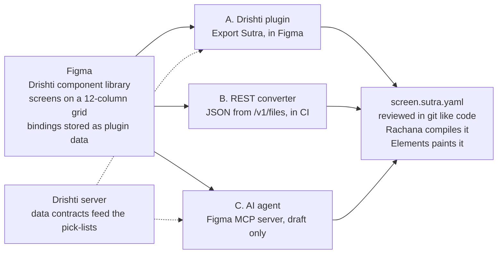

<!--
  Project Drishti · Any data. Any domain. One grammar.

  Copyright (c) 2026 Ashutosh Sinha <ajsinha@gmail.com>.
  All rights reserved.

  PROPRIETARY AND CONFIDENTIAL.

  This file is the confidential and proprietary property of Ashutosh Sinha.
  Unauthorised copying, use, modification, distribution or disclosure of this
  file, via any medium, is strictly prohibited except with the express prior
  written permission of the copyright holder.

  See the LICENSE file in the root of this repository for the full terms.
-->

# Figma to Drishti: generating Sutras from Figma designs

*A design study: whether, and how, a Figma design can become a working Drishti screen with no programming. Nothing here is built yet.*

## Summary

**Yes, with one condition: the design must be drawn from a Drishti component library in Figma, not as free-form pixels.** A Sutra
is not a picture of a screen. It is a short YAML list of *panels* (metric, table, chart, form) placed on a 12-column grid, each bound
to data by an expression. A Figma frame built from matching Figma components ("Drishti/Metric", "Drishti/Table", "Drishti/Line
chart") already carries that structure, so a converter can read it and write the Sutra with no hand coding. A free-form design
(arbitrary rectangles, absolute positions, custom effects) cannot be turned into a Sutra reliably by rules alone; an AI pass can
approximate it, but someone still has to say which data each panel shows.

The best route is a **Figma plugin plus a Drishti component library**: the designer lays out a screen from the library, names each
panel's data in the plugin's side panel, and presses *Export Sutra*. The plugin reads Figma's own node tree (no reverse engineering
of the binary `.fig` file), writes `<screen>.sutra.yaml`, and Rachana compiles it; Drishti Elements paints it. The Figma REST API
(JSON) serves the same conversion in a pipeline, and Figma's MCP server lets an AI agent do it for designs that were not drawn from
the library.

## What a Figma design file actually is

There are four ways to read a Figma design, and only three of them are stable enough to build on.

| Source | What it is | Stable? | Use for Drishti |
|---|---|---|---|
| `.fig` file | A ZIP holding `canvas.fig`, a binary in Evan Wallace's *Kiwi* format (schema inside the file), plus `meta.json`, a thumbnail and images; no published specification ([madebyevan.com](https://madebyevan.com/figma/), [Grida .fig notes](https://grida.co/docs/wg/feat-fig/)) | No: an internal detail Figma may change; Figma has declined to support it ([forum](https://forum.figma.com/archive-21/inquiry-about-the-fig-file-format-35603)) | Only for offline archives, through a community parser, never as the main road |
| REST API JSON | `GET /v1/files/:key` (or `/nodes?ids=…`) returns the document as a JSON node tree: frames, auto layout, text, components and their properties ([file endpoints](https://developers.figma.com/docs/rest-api/file-endpoints), [node types](https://developers.figma.com/docs/rest-api/file-node-types)) | Yes: documented, versioned, an OpenAPI spec | A server-side converter in a pipeline (CI, nightly sync) |
| Plugin API | JavaScript that runs inside Figma on the open file, with the live node tree and per-node `pluginData` storage | Yes: Figma's supported extension route | The designer's *Export Sutra* button; also stores the data bindings on the nodes |
| Figma MCP server | Gives an AI agent the design context (layout, variables, screenshots, Code Connect maps) ([help centre](https://help.figma.com/hc/en-us/articles/32132100833559-Guide-to-the-Dev-Mode-MCP-Server), [blog](https://www.figma.com/blog/design-context-everywhere-you-build/)) | Yes, but its tools still change | AI-assisted conversion of designs not drawn from the library |

The JSON is what matters: auto-layout frames say direction, gaps, padding and sizing per axis (`layoutSizingHorizontal` FIXED, HUG
or FILL), components say which master they come from and their properties, and text nodes carry their words and style. That is
enough to recover *structure*, which is what a Sutra needs.

## What others do today

Every mature tool converges on the same lesson: output is good only where design components are mapped to real code components;
free-form frames give code that needs an engineer.

| Tool | Approach | What it gets right | Where it stops |
|---|---|---|---|
| [Builder.io Visual Copilot](https://www.builder.io/compare/builder-vs-figma-make) | Figma plugin + AI; maps Figma components to your code library | Design-system-aware output in several frameworks | Generates code (React and others), which then has to be maintained |
| Locofy, Anima | Plugins that tag layers and generate front-end code ([roundup](https://aimultiple.com/figma-to-code)) | Fast landing pages and prototypes | Tagging work per screen; code drifts from the design system |
| [Figma Make](https://uxdesign.cc/is-figma-make-ready-for-dev-handoff-9fe2594630e3) | Figma's own prompt-to-app inside Figma | Quick working prototypes | Div-heavy code; not production handoff |
| [Code Connect](https://developers.figma.com/docs/code-connect) + Figma MCP server | Map each Figma component to its code component; agents read the map | The higher the share of mapped components, the better the result ([Figma blog](https://figma.com/blog/the-benefits-of-code-connect-in-mcp)) | Needs an Organization or Enterprise seat for the UI; still emits code |

**Where Drishti differs:** every tool above produces source code someone then owns. Drishti would produce a *Sutra*: a declarative
description that Rachana compiles and Elements paints at run time. There is no generated code to maintain, review or drift. That
makes the problem smaller than general design-to-code: map Figma components to Sutra panel kinds, not to arbitrary code.

## How Figma maps to a Sutra

A Sutra screen is a title, a `data:` block naming its tables, and a list of `panels`, each with a `kind`, a `span` on a 12-column
grid, labels, a format and data expressions (see Rachana's `examples/static-sales/overview.sutra.yaml`). Most of that has a direct
Figma counterpart.

| Figma | Sutra / Elements | Converts automatically? |
|---|---|---|
| Top-level frame (the screen) | the Sutra: `sutra:` id from the frame name, `title:` from its title text | Yes |
| Layout grid of 12 columns; auto-layout rows | panel `span` (1–12) from each child's width in columns; rows in order | Yes, when the frame uses a 12-column grid |
| Instance of *Drishti/Metric*, *Table*, *Bar*, *Line*, *Form* … | `kind: metric`, `table`, `hbar`, `line`, form fields | Yes: the master component's name is the kind |
| Component properties (label, format, show search) | `label:`, `fmt:`, `search:` | Yes |
| Text layers inside a table header | `columns:` labels, in order | Yes |
| Variables (colours, spacing, type) | Elements theme tokens | Yes, through a token map |
| Variants (state, size) | panel options (compact, emphasis) | Partly: only variants the library defines |
| Free rectangles, vectors, absolute positions, blend effects | no equivalent: Sutra lays out by grid, not pixels | No: flagged in the export report |
| Prototype links (on click, go to frame) | navigation between Sutras (`links`) | Partly: frame-to-frame links only |
| Sample numbers typed in the mock-up | nothing: real data comes from bindings | Ignored on purpose |

The rule that falls out: **a design drawn from the Drishti library converts whole; anything outside it is reported, not guessed.**

## The hard part: data and intent

A picture says what a screen looks like, never where its numbers come from. In the Sutra above,
`value: "sum($.sales, 'revenue')"` is the whole meaning of the Revenue tile, and no Figma property holds that. "No coding" therefore
means *no programming*, not *no decisions*: someone still has to say which data each panel shows. Three ways to capture that, from
most to least structured:

1. **Plugin side panel (recommended).** Selecting a panel in Figma shows a Drishti form: data source (a pick-list of the
   connector's tables and measures, fetched from the Drishti server), measure, group-by, filter, format. The answers are stored on
   the node as plugin data and travel with the design file. The designer picks from lists; nothing is typed as an expression unless
   they want to.
2. **Naming and annotations.** A layer named `Revenue · sum(revenue) by region`, or a Dev Mode annotation, read by the converter.
   Cheap, but fragile: one rename breaks it.
3. **AI inference.** An agent reads the frame (through the Figma MCP server or the JSON), the visible labels ("Revenue by region")
   and the data contract of the chosen mnemonic, and proposes the bindings; a person confirms them in the plugin. Good for a first
   draft; never trusted silently for risk numbers.

Behaviour follows the same split. What Sutra already expresses (drill to another screen, filters, live tables, forms that submit to
an action) maps from prototype links and library components. Anything beyond that (custom calculations, bespoke widgets) stays
outside the design file by Drishti's own rule: no bespoke UI, extend a library instead.

## Architecture options

All three roads end in the same reviewable file, so the screen is versioned and diffed like any other Sutra, and Rachana and
Elements stay exactly as they are. A person confirms every AI-proposed binding.

| Road | Who uses it | Strength | Weakness |
|---|---|---|---|
| A. Drishti plugin for Figma | designers | live node tree, bindings picked from the server's real tables, one click | a plugin to build and keep current with Figma's plugin API |
| B. REST converter (`drishti.py figma import <file-key>`, proposed) | a pipeline | no Figma UI needed; screens regenerate on every design change | needs a Figma token; bindings must already be on the nodes (from A) |
| C. AI agent over the Figma MCP server | anyone, for designs not built from the library | handles free-form designs | proposes, never decides; needs review |
| D. Offline `.fig` parse | archives only | no Figma account | undocumented format; may break any release |

## Risks and limits

| Risk | Why it matters | Mitigation |
|---|---|---|
| The `.fig` binary changes without notice | Figma publishes no specification and has declined to support it | Never depend on it; use the plugin and REST roads |
| Designs that ignore the library | Free-form frames have no Sutra meaning | The plugin's export report lists every unmapped layer; a library-first design guide |
| Wrong data behind a right-looking screen | A tile can look perfect and sum the wrong column | Bindings come from data-contract pick-lists; AI bindings always confirmed by a person; the Sutra is reviewed in git |
| Figma plan and seat limits | Code Connect UI and some MCP features need Organization or Enterprise plans; the REST API needs a token per user or service | Road A needs only a normal editor seat and our own plugin |
| Library drift | The Figma library and Elements evolve separately | One source: generate the Figma library's component list from Elements' component catalogue, and check it in CI |
| Data leaving the bank | Real data must never go into Figma | Bindings store names only (table, measure, filter); no values are fetched into Figma beyond the contract's column names |
| Pixel fidelity expectations | Sutra lays out on a grid; Elements paints its own style | Agree up front: Figma decides *what and where*, Elements decides *how it looks* |

## Recommendation

**Build road A first, in three steps, and prove it on one real screen before going further.** Each step is small, and each ends with
something a person can use.

1. **A Drishti library for Figma.** One Figma component per Sutra panel kind (metric, table, bar, line, form fields), its
   properties matching the Sutra keys, a 12-column grid frame template. Generated from Elements' catalogue so the two never drift.
   *Done when* a designer can lay out the existing `sales-overview` screen from the library alone.
2. **The plugin: Export Sutra.** Reads the selected frame, maps instances to panels and spans, shows the side panel for bindings
   (pick-lists from a running Drishti server's data contracts), writes `<screen>.sutra.yaml` and an export report of anything
   unmapped. *Done when* that layout exports a Sutra that Rachana compiles and Elements paints, with the same figures as the
   hand-written one.
3. **Round trip and roads B and C.** Import a Sutra back into Figma as library instances (so existing screens become editable
   designs), a `drishti.py figma import` converter on the REST API for pipelines, and an AI "propose bindings" step over the Figma
   MCP server for free-form designs.

**What to prototype first:** step 2 on a copy of `sales-overview`, read-only against the demo lake, to answer the one question that
decides everything: can a designer pick bindings without writing an expression? If yes, the rest is engineering.

**Open questions:** which Figma plan the teams use (decides Code Connect and MCP features); whether designers or analysts own the
data bindings; whether the plugin may call the Drishti server from inside Figma, or should work from an exported contract file
instead.

## Sources

[Figma REST API: files](https://developers.figma.com/docs/rest-api/file-endpoints) ·
[node types](https://developers.figma.com/docs/rest-api/file-node-types) ·
[Figma MCP server guide](https://help.figma.com/hc/en-us/articles/32132100833559-Guide-to-the-Dev-Mode-MCP-Server) ·
[Code Connect](https://developers.figma.com/docs/code-connect) ·
[.fig format notes (Evan Wallace)](https://madebyevan.com/figma/) ·
[Grida .fig documentation](https://grida.co/docs/wg/feat-fig/) ·
Rachana `examples/static-sales/overview.sutra.yaml`.
