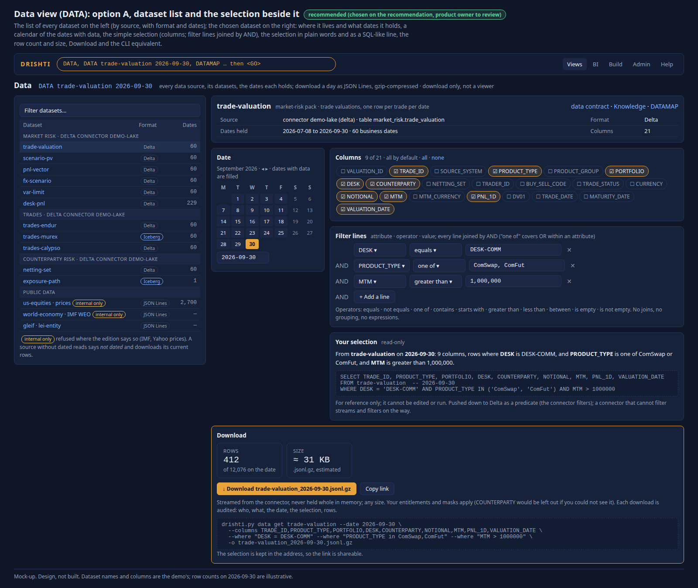

<!--
  Project Drishti · Any data. Any domain. One grammar.
  Copyright (c) 2026 Ashutosh Sinha <ajsinha@gmail.com>. All rights reserved.
  PROPRIETARY AND CONFIDENTIAL. See the LICENSE file in the root of this repository.
-->

# Drishti — Implementation Plan

*Revision 1.4 · 2026-10-31 · Author: Ashutosh Sinha · Companion to [ARCHITECTURE.md](ARCHITECTURE.md)*

**Built 2026-10-24: the us-equities pack** (`config/packs/us-equities`, [guide](../../config/packs/us-equities/guides/us-equities.md); off by default, enabled through `DRISHTI_PACKS`; as built it covers the members of the three indexes, about 500 companies, to keep the repository small: every listed company is a later step; links company to LEI to a core legal entity where the LEI matches). Planned by the product owner on 2026-10-22: Every NYSE and Nasdaq listed company, Dow 30, Nasdaq-100 and S&P 500 membership, from openly licensed sources first: SEC EDGAR (company facts, filings, SIC codes, ticker to CIK), the Nasdaq Trader symbol lists, GLEIF LEI (CC0) and Wikidata (CC0). Kinds: listed-company (enriched), filing, financial-fact (with history), index-membership, price-history; screens from the Sutra fragment library; links company to LEI to parent to counterparty. Index weights and levels are proprietary, and free price feeds forbid redistribution: internal use only (like the IMF data) until a licensed feed is chosen.

**North star: Sutra Next, one grammar for every screen (product owner, 2026-10-22).** The board/chip paradigm is dropped: Sutra itself grows from an entity browser into the UI library, in ONE grammar, built on today's panels and shared blocks (`use:`/`with:`): a versioned, parameterised fragment library whose every fragment and Sutra carries a `doc:` docstring a component browser and an AI agent read; per-panel sources over several packs; events (`emits`, `@panel.event.path`, `@parent`); nested child panels (expand-row, detail-right/below, tabs; lazy; depth 3); refresh control and freshness; forms with validation; actions that write through connectors' `writes:` (2.8.0 write-back); dynamic screens saved to the workspace; an optional layout grid; and an editor built from the product owner's mock-ups. Design and phases: [RACHANA_REFERENCE.md](../guides/RACHANA_REFERENCE.md#sutra-next-fragments-events-children-sources-layout-and-forms); phase 1 (the library, now the Drishti UI kit in `config/ui-kit` loaded whatever packs are enabled, with assets and brand; docstrings and lint, composite fragments, the ir-curve and economics screens migrated and proved identical, `GET /api/v1/ui-kit`) is built for 2.7.0 (unreleased); since then events and per-panel sources, nested children, refresh and freshness, forms with drafts, the `layout:` grid, every pack screen on fragments and the Sutra designer (Customize, Describe, Outline, Grid; `ui.designer`) are built too, unreleased. The UI Board (2026-10-21) stays parked on branch `ui-board-preview`; it is not in any release.

**Where things stand.** Every wave in this plan is done. The current release is **2.9.11** (2026-11-02: FRTB-SA and SIMM with their playgrounds, position sensitivities, the basket as a sheet, the in-memory lake, compute engines per server, busy protection, VaR by any column and the what-if in Java; the MR cube moved to 2.9.11.a on the pivot engine); before it **2.9.10.a** (2026-11-01: Admin → Capacity, the cluster's VaR answers under load (2.9.11 row 7), three VaR dates in the demo, the competitive analysis, the groundwork of 2.9.11 and 2.9.12); before it **2.9.10** (2026-11-01: 2.9.9 and 2.9.10 together, see below); before it **2.9.8** (2026-11-01: regulatory VaR reporting begins (the desk P&L, backtesting, period statistics, signed report runs), the VaR Playground, Export data, the stress window selection, the lenses' own menus; [its table](#298-market-risk-regulatory-foundation-and-debugging-planned)); **2.9.10**, released: 2.9.9 and 2.9.10 together, with no 2.9.9 release of its own (memory, scale and mobile: the memory model of VaR and exposure, pinned dates, the phone display and the lens menus' phone form, S3 Tables and Delta on S3 connectors, [its table](#299-memory-scale-and-mobile-released-as-2910); and the VaR change explained, RO1, [its table](#2910-var-change-explained-ro1)), then **2.9.11** (sensitivities and market-risk capital), **2.9.12** (counterparty engines), **2.9.13** (Java 25 and performance I) and **2.9.14** (oversight); the themed releases continue to 2.9.19 ([the release rules](#release-rules-product-owner-2026-10-31) and [the releases](#the-themed-releases-after-297-product-owner-2026-10-31)); before it **2.9.7** (2026-11-01: four editions, stressed and 10-day VaR, the scenario matrix, VaR that scales with the scope, rolling upgrades, one configuration document; [its table](#297-future-product-owner-2026-10-28-in-progress)); before it **2.9.6** (2026-10-29: editions with Drishti Risk, its three landings and the lens; VaR sharded across servers; the parallel Java loader; long-run memory fixes; [its table](#296-released-2026-10-29)); before it **2.9.5** (2026-10-28: Iceberg as a full alternative to Delta; VaR hierarchies configured by columns; connector files that upgrade themselves safely); before it **2.9.4** (2026-10-27: VaR from scenario PVs or P&L, by trade or position, in any reporting currency, intraday from files and Kafka; JSON Lines as the data standard); before it **2.9.3** (2026-10-27: `DATAMAP`, the fact of the day on Home, the Companies, funds and ETFs Knowledge page, index membership from the tracking ETFs); before 2.9.3 **2.9.2** (2026-10-26: funds and ETFs, Knowledge and `WHAT`, Construct your basket and the pre-deal what-if); before it **2.9.1** (2026-10-26: `FUNC`, groupings and analytics computed, External data and complete pack guides); before it **2.9.0** (2026-10-26: exposure (EXP) computed for any scope like VaR, with its guide and tutorial 26, and VaR and exposure in BI; [the computed-measures roadmap](#the-computed-measures-roadmap-280-to-2120-product-owner-2026-10-25)); before it **2.8.0** (2026-10-26: the data contract of every command, VaR computed for any scope and never stored, Admin → Commands, write-back, branding from configuration; [the computed-measures roadmap](#the-computed-measures-roadmap-280-to-2120-product-owner-2026-10-25)); before it **2.7.0** (Sutra Next, [RACHANA_REFERENCE.md](../guides/RACHANA_REFERENCE.md#sutra-next-fragments-events-children-sources-layout-and-forms): the UI kit, events and children across packs, refresh and freshness, layout, forms with drafts and the four-mode Sutra designer; the us-equities and gleif packs, the per-pack public-data scripts and the README standard); before it **2.6.7** (BI runs, [BI_DESIGN.md](BI_DESIGN.md#17-bi-runs-every-bi-query-as-a-bounded-visible-job); chart any table, [RACHANA_REFERENCE.md](../guides/RACHANA_REFERENCE.md#chart-any-table-the-design); mixed Delta and Iceberg storage, [DEMO_DATA.md](../connectors/DEMO_DATA.md#mixed-delta-and-iceberg-storage); gossip on its own port and HTTP/2 between nodes; with 2.6.6, the QA release); next are **2.8.0** (Sutra Next write-back: forms and actions saved through connectors, [WRITE_BACK.md](../guides/WRITE_BACK.md#16-the-design-and-its-reasons); its item 0, the one Drishti store, is begun as the content store, DATA_ARCHITECTURE.md; the UI Board stays parked on branch `ui-board-preview`, in no release) with the data contracts of every command and VaR complete; everything after it (the other computed measures, 2.9.0 to 2.11.0, and AI with GenUI, 2.12.0) is parked since 2026-10-25 ([the computed-measures roadmap](#the-computed-measures-roadmap-280-to-2120-product-owner-2026-10-25))
([CHANGELOG.md](../../CHANGELOG.md), [RELEASE_NOTES.md](../../RELEASE_NOTES.md)). The table below maps each release to
the waves it shipped; [What shipped after the waves](IMPLEMENTATION_HISTORY.md#what-shipped-after-the-waves-1100) and [Since 1.10](IMPLEMENTATION_HISTORY.md#since-110) list the work done since
the last numbered wave, and [Known gaps](#known-gaps) lists what is still open. The wave sections themselves are
kept as they were planned, with notes where the delivery differed.

| Release | Waves |
|---|---|
| 1.0.0 | W1–W10 |
| 1.1.0 | W11 user management |
| 1.2.0 | W12 help centre and About |
| 1.3.0 | W12b competitive landscape and mobile |
| 1.4.0 | W13 workspaces |
| 1.5.0 | W13b domain packs |
| 1.6.0 | W14 monitors and alerts |
| 1.7.0 | W15 F8 impact |
| 1.8.0 | W13c packs per user |
| 1.9.0 | W22 business dates and Delta Lake; R1–R2 risk taxonomy and Sutras; Markdown Sutras (replaced in 1.11: Sutras are YAML only, ADR-017) |
| 1.10.0 | B0, R3–R5, P2–P8 (all domain packs); W16–W21; and the work [below](IMPLEMENTATION_HISTORY.md#what-shipped-after-the-waves-1100) |
| 1.11.0 | Sutras are YAML only (ADR-017) |
| 1.12.0 | derived kinds, notes, scheduled reports, plain words, the signed pack registry (ADR-018) |
| 1.13.0 | a million trades a day on eight stores, Calc, pivots, twenty panel kinds |
| 1.14.0 | the Build workbench |
| 1.15.0 | the metric tile, five developer guides |
| 1.16.0 | Java 21 for production, About this page, share and discussion (ADR-020) |
| 1.17.0 | the `drishti.py` command line, `pack make`, Admin deploy, API token write scopes |
| 1.18.0 | data loads: the batch-landed signal, expectations, late data |
| 1.19.0 | connectors as files, TLS and proxy, query by form, Drishti Elements, retry and no-restart reload, AI and MCP layers, Rūpaka phase 1 |
| 1.20.0 | Rūpaka phases 2 and 3 (datasets, reports, designer), deep trades, real public data |
| 1.21.0 | Rūpaka phases 4 and 5 (governance, live tables, Perspective, boards), outbound HTTP proxy, news and market sample packs, Forms and Reports in the top bar, the Live toggle, a documentation review against the code |
| 1.22.0 | Rūpaka phase 7, distribution: export (PDF, PNG, Excel, CSV), scheduled subscriptions rendered per recipient, alerts on measures and board notifications, `<drishti-report>` and Elements steps 11 to 14, per-report phone layouts; one shared file watcher per process |
| 2.0.0 | the waves after 1.22.0 in one release, see [What 2.0.0 contains](IMPLEMENTATION_HISTORY.md#what-200-contains) |
| 2.1.0 | the BI long tail in four waves, see [What 2.1.0 contains](IMPLEMENTATION_HISTORY.md#what-210-contains) |
| 2.2.0 | BI wave A: datasets and data models rooted in packs, the Python-like expression language (DEL), read-only Drishti SQL, one query plan; see [What 2.2.0 to 2.5.0 contain](IMPLEMENTATION_HISTORY.md#what-220-to-250-contain) |
| 2.3.0 | BI wave B: filter context, time and live push, the servers compute every number; production-shaped UPPER_SNAKE trades from ENDUR, CALYPSO and MUREX; seven packs; committed test data and `lake demo`; offline mode |
| 2.4.0 | BI wave C: BI Studio, report schema v2, boards as a report layout, Python data prep (the Transform editor), the browser Python console; query by form at scale; the CATO calendar; the console's channel relay |
| 2.5.0 | wave N: Drishti\*net, several servers as one; `-Djava.io.tmpdir` on every JVM; a stand-in for switched-off internet connectors; `drishti-stack/` |
| 2.6.0 | wave D: no known bug; statements (paginated reports, bursting, PDF and Excel, the statement designer); field parameters in report wells; the Apache Cassandra connector; drishti-iceberg (Iceberg without Hadoop) and `iceberg-external`; members advertise only a real address; ten themes |
| 2.6.5 | history queries: any entity over time (`TRD <id> 30`, `EQ <id> 3M`), on every connector and across Drishti\*net ([DATA_ARCHITECTURE.md](DATA_ARCHITECTURE.md#2-history-queries-an-entity-over-time)); sixty business days of committed test data |
| 2.6.7 | BI runs: every BI query through one bounded asynchronous pipeline, the Runs tab ([BI_DESIGN.md](BI_DESIGN.md#17-bi-runs-every-bi-query-as-a-bounded-visible-job)); Drishti\*net gossip off the busy path (its own small HTTP client pool and platform thread on the sender, reserved handling of `/api/v1/net/gossip` and probes on the receiver; accepted when a heavy BI burst on one node gives no false *suspect* anywhere) and HTTP/2 for peer data forwarding (`server.http2.enabled`; tests across views, history, search and live relay, and a soak comparison) ([CLUSTER_DEPLOYMENT.md](CLUSTER_DEPLOYMENT.md#the-transport-between-nodes)); chart any table: a Chart icon and K on every table, one shared `drishti_table-chart.js` over the pivot engine and ECharts, chart all N on the server, save, export, promote to a `chart` panel, open in BI ([RACHANA_REFERENCE.md](../guides/RACHANA_REFERENCE.md#chart-any-table-the-design)); mixed storage: `build_demo_lakes.py --store <system>=delta|iceberg` (and `all=`), each source system's trades in Delta or Iceberg, the connector file switched with it, proven by an equality test against all-Delta ([DEMO_DATA.md](../connectors/DEMO_DATA.md#mixed-delta-and-iceberg-storage)) |
| 2.7.0 | Sutra Next phases 1 to 5 (the UI kit, events and children, refresh, layout, forms with drafts, the Sutra designer); the us-equities and gleif packs; public-data scripts; the README standard |
| 2.8.0 | the data contract of every command and the command catalog; VaR computed for any scope from every live trade (stored var and var-node retired, positions derived, memory tiering, official captures published, what-if); Admin → Commands; write-back W1–W7; branding from configuration (the other computed measures parked) |
| 2.9.0 | exposure computed for any scope (the stored exposure-profile retired; the explorer; the exact pre-deal what-if; official results; the wider demo run); VaR and exposure in BI; VaR and exposure in two documents each; the landing headline |
| 2.9.1 | Functions (`FUNC`) for everyone; groupings and analytics computed (LEIG, LEIC, SIC, ECG, CORR, USEQ ratios, FACT change, IDX totals, equity beta, PXH analytics); the External data page and every pack's data contracts and data retrieval; the exposure benchmark and explorer test |
| 2.9.2 | Funds and ETFs (SEC N-PORT, N-CEN, risk/return summaries, GLEIF); Knowledge pages and `WHAT`; Construct your basket and the pre-deal what-if for VaR and exposure; trade pages' Risk links; data-quality fixes; About and Competitive rewritten |
| 2.9.3 | `DATAMAP` (Map and Cards, inferred from the packs and contracts, every join checked against the data); the fact of the day on Home (facts declared per pack, computed as the user); the Companies, funds and ETFs Knowledge page; index membership from the tracking ETFs' N-PORT (companies 503 to 586); one firm-wide VaR limit; the test-data-from-seeds plan |
| 2.9.4 | VaR from scenario PVs or P&L, by trade or position, in any reporting currency (five built ahead, the currency picker, trade currency); intraday from files and Kafka micro-batches; the scenario window and confidence as settings; the stand-in pricing system; JSON Lines as the data standard and on every export; 351 pictures retaken; the decks rewritten |
| 2.9.5 | Iceberg as a full alternative to Delta (VaR, intraday and exposure read from Iceberg; official results as Delta or Iceberg, local or S3; Delta = Iceberg to the cent); VaR hierarchies by columns (limit letters, `var-limit`, a missing column skips only its tree); `PNL-` vector ids; airtight connector upgrades | released 2026-10-28 |

**The waves and the early releases** (what 2.0.0 to 2.5.0 contained, the wave map, waves W1 to W21, what shipped up to and since 1.10) are in [IMPLEMENTATION_HISTORY.md](IMPLEMENTATION_HISTORY.md).

## Working agreement

- All work happens on **`develop`**. Each wave closes with a green build, updated docs,
  and a merge to **`main`** ("drill it": push `develop`, merge into `main`, push `main`).
- Sole author: Ashutosh Sinha. Commit messages explain *why*; no trailers.
- Every file carries the copyright/proprietary header; build fails otherwise.
- No source file over 1500 lines (UX templates excepted); build fails otherwise.
- Each wave updates `docs/` (guides, ADRs, CHANGELOG) as it goes, not afterwards.

## Release rules (product owner, 2026-10-31)

Decided by the product owner on 2026-10-31 ("just plan like that"); they govern every release from 2.9.8. Rule 2 changed on 2026-11-01
(product owner): from 2.9.10 on, one planned drill per release and a second only when the first needed fixes (2.9.8 and 2.9.9 had
Drill A and Drill B).

| # | Rule |
|---|---|
| 1 | **One theme per release**, with **at most two large items**; the rest small or medium and on the same theme |
| 2 | **Drills** (product owner, 2026-11-01): **drill 1 runs the full suite; if it is green, release at once.** If drill 1 needed fixes, fix them and run **drill 2** as a full validation and regression run (nothing ships fixed but not re-tested). **Performance releases** (Java 25 and performance I, native performance II) **always keep a planned second drill**, because a **benchmark** sits between the two (before and after) |
| 3 | **Design one release ahead:** a release's designs (and their mock-ups) are done while the release before it is built |
| 4 | **Scope frozen at a release's start:** new asks go to the next release, not the current one |
| 5 | **A quick pre-check before every full drill:** each builder runs its own area's tests; then the changed areas run together on a quiet machine; only then the full drill |
| 6 | **No builders during a drill or a benchmark** (they distort both) |
| 7 | **Never mix a big documentation restructure with features in one drill** |
| 8 | **Every metric ships with its playground in the same release** (never deferred; [VAR_PLAYGROUND.md section 13](VAR_PLAYGROUND.md#13-the-playground-family-and-the-rule), the [Playgrounds](#playgrounds-one-per-metric-in-the-metrics-release) list) |
| 9 | **The decks are enhanced with each release** (Design-and-Evidence, VaR-Engine, Drishti-on-AWS): the release's capabilities, new screenshots, measured figures with footnotes, the roadmap from these themed releases; no release numbers on the slides |
| 10 | **Docs ship with every change:** every builder brief lists its documents; the CHANGELOG in the same push |

## The roadmap from 2.9.11.c (product owner, 2026-11-04; supersedes every later release table in this file)

*Decided after a six-seat product review (product manager, BI, market risk, trader, counterparty credit risk, architect): the engines
are strong; what a bank needs first is a coherent product. The motto is **lean & streamlined**: one way per job, the old way deleted in
the same release, nothing unbuilt shown as if it works. Revised 2026-11-05 and 2026-11-06: the domain-module platform comes right after the BI
foundation, so the next releases are built straight into the modules; the whole documentation corpus is rewritten right after the one
Build home, when the structure and the screens have settled; security and controls (with module licensing) follow; performance has its
own release.*

| Release | Theme | Contents |
|---|---|---|
| **2.9.11.c** | Performance and data | OpenBLAS with a Java fallback; parametric VaR as a toggle, a column and a curve in the VaR explorer and a tab in the VaR Playground; the data load rules ([DATA_LAKE_GUIDE.md](../guides/DATA_LAKE_GUIDE.md#5-routing-business-dates-modes-repeats-and-undo)) with the demo and test data converted; Arrow Flight and Flight SQL; the lake configuration; the client examples; the `drishti_` asset names; the function catalogue; the BI declared-mask fix; lean removals and the under-construction registry |
| **2.9.11.d** | BI foundation, one analysis path | the formula parsers folded into Rachana with one row-rule system; virtual tables as BI's only data layer (migration, parity proof, switch, old code deleted) with the new table and model editors ([EDITORS.md](EDITORS.md)); one Python runtime on the server with Python-driven tables and models; one analysis path, Pivot → Report (cubes as Pivot presets, one report designer, one page renderer); resizable panels and columns on every screen (one shared component); the BI tutorials consolidated; a mid-way independent critique ([PRODUCT_CRITIQUE_BRIEF.md](PRODUCT_CRITIQUE_BRIEF.md)) |
| **2.9.11.e** | Drishti Elements: reusable JavaScript libraries | first, because every later screen is built on it and the module split then moves far less code: the JavaScript module foundation (packaging, versions, assets loaded per module); the console's JavaScript as eight libraries usable inside and outside Drishti ([ELEMENTS.md](ELEMENTS.md), mock-ups g1 to g4): **drishti-core** (formats, theme, API client, events, accessibility, resize, keys, dialogs), **drishti-inputs** (pickers, forms, filters, the code editor), **drishti-grid** (a professional grid with **pivoting first**: row groups, column pivots, values, totals, server-side pivot, Explain on any cell; an AG Grid-style adapter for the Enterprise pivot API, not a clone), **drishti-chart** (one chart spec over ECharts, risk chart kinds, **maps**: the world, US states, Canadian provinces and territories, every country's first-level regions, loaded per country), **drishti-data** (live updates, Arrow), **drishti-insight** (Explain, search, approvals, workbook export), **drishti-renderer** (screens from a streamed ViewModel) and **drishti-risk** (the banking module's charts); 1–5 work without a Drishti server; every Drishti screen moved onto them and the old code deleted (about 10 grids and 22 chart scripts into one each), a guard test against new duplicates, a live gallery per component; the finished components of the Build-home work (keymap, search, Approvals, Explain) packaged rather than rebuilt; each later domain adds its own library (genomics, public sector, AML) |
| **2.9.11.f** | Platform: domain modules | the core knows no industry: generic `drishti-compute` and `drishti-compute-banking`; the banking services and API (`/api/v1/risk/…`, old paths redirecting one release) and its console plugin (routes, screens, static assets served only to the people who use them, Help, tutorials); packs grouped by domain (`config/packs/core/`, `banking/`, `economy/`; ids unchanged); a thin jar with a plugins folder; `drishti-native` ([DRISHTI_NATIVE.md](DRISHTI_NATIVE.md)) with a Java fallback for every native library and the native-access flag; one storage profile (one database chosen in its own config file, two complete schema files, upgrades by copying into a fresh database: no migration scripts); an architecture test that the core never imports a domain and domains never import each other; **lakehouse interoperability** (product owner, 2026-11-07): Unity Catalog for Delta (tables by `catalog.schema.table`, credential vending, Unity grants), Delta Sharing (tables shared across organisations, no storage keys) and reading plain Delta and Iceberg tables without the id/doc shape (columns mapped in the connector), with credentials and grants designed in 2.9.11.i's security discussion ([DATA_LAKE_GUIDE.md section 10](../guides/DATA_LAKE_GUIDE.md)) |
| **2.9.11.g** | One Build home, one search (the rest) | built straight into the modules ([SHARED_SCREENS.md](SHARED_SCREENS.md)): one Build home and the Admin configuration editor (settings in three tiers); one sitemap and Help grouped by domain, visible by lens; one Approvals queue; one Explain for every number; one search; one alert engine; one keymap; Python compute moved to Java; the pre-deal service in Java (**built** on `wip/g-predeal`: `PREDEAL` and `POST /api/v1/exposure/predeal`, approve, refer or decline against the credit limit and its buckets, the method and the template shown, a proxy only refers; the Counterparties → Pre-deal check screen waits for the Elements libraries); the trader home |
| **2.9.11.h** | Documentation and onboarding | **the whole corpus rewritten** (guides, tutorials, references, Help, the README) for the product after the module split and the one Build home; four role doors; the long guides split into task guides and references; tutorial tracks completed; documentation truth checked in the gate; the decks |
| **2.9.11.i** | Trust, RBAC, security and controls | designed with the product owner first: security on by default, server-minted tokens, one entitlement service for every door, visibility by role, People & access and API keys ([EDITORS.md](EDITORS.md) sections 5 and 6); data licensing (RBAC and the data licence both decide); **module licensing** on the clean modules; the controls ([CONTROLS_SCREENS.md](CONTROLS_SCREENS.md)): run status and sign-off, one breach and escalation queue, computed credit-limit usage, number honesty; the PLA test; the pilot kit |
| **2.9.11.j** | Optimisation: memory and speed | measured first, everywhere, then fixed where it matters: every server's heap and native memory at rest and under load (VaR, exposure, BI, the pivot, the lakes, Flight), the hot files and caches sized against their gain, start-up time, GC pauses, the console's page weight and paint time per lens, query latency at the 95th percentile; OpenBLAS profiled (on by default or not, decided by measurement); BLAS, LAPACK and the Vector API; the 1M-position benchmark and the 2.3M extrapolation; Java 25 measured; ONNX Runtime and OR-Tools behind `drishti-native`; budgets for memory and time in the gate so they cannot regress; the VaR check exactly equal |
| **2.9.11.k** | Risk engines II | SA-CCR with incremental EAD in the pre-deal answer; the CCR cube as a Pivot preset with a limit board; the exposure playground; a stress-testing engine. Finance P&L reconciliation, US capital totals and forms, and delta-gamma-vega VaR only when their inputs exist (else under construction) |
| **2.9.11.l** | Collateral and margin | collateral valuation and eligibility; margin calls and disputes; stressed exposure; wrong-way risk flags |
| **2.9.11.m** | CVA | BA-CVA from SA-CCR exposure; FVA |
| **2.9.11.n** | Hardening: adversarial and soak testing | the last release of the line, after every feature: adversarial tests (malformed and hostile inputs at every door: the API, Flight, the loaders and their file names and `.ready` files, Rachana and SQL texts, Sutras, uploads; concurrency and race tests; a node killed mid-request; disk full; a lake half-written; clock and business-date edges; permission probing across users) and soak tests (days of load at production-like volumes: memory, file handles, threads, caches and hot files that must not grow; the cluster's gossip and failover; scheduled jobs and retention over many business dates). Every finding fixed at its cause with a test that keeps it fixed; the VaR check exactly equal |

**Not scheduled:** QuantLib (a release of its own: the `quantlib_for_maven` binding in single-threaded worker processes); the
PostgreSQL wire protocol (when a pilot asks); FRTB internal models, SA-CVA and full xVA; new domains beyond the two named above wait
until those are built. At the end, an
independent critique of the whole product ([PRODUCT_CRITIQUE_BRIEF.md](PRODUCT_CRITIQUE_BRIEF.md)).

**Domains are modules** (product owner, 2026-11-05). The core knows no industry: each domain (risk and banking now, the public sector
next) is a set of modules owning its compute (`drishti-compute-<domain>`, beside the generic `drishti-compute`), its services and API
(`/api/v1/<domain>/…`), its console routes, screens and static assets (served only to people whose role, lens or packs use it), its Help
and tutorials, and its packs. The core and the generic compute never import a domain module, and domains never import each other. What
a person sees follows their role and lens through the one entitlement service. The reason: **module-based licensing** (a signed licence
names the modules an installation may run; an unlicensed module is not loaded at all), with editions folded into it. The split is
2.9.11.f, visibility by lens in 2.9.11.g and by role in 2.9.11.i, module licensing in 2.9.11.i; the public-sector domain is
built as a module from day one.

**A large commercial product** (product owner, 2026-11-05). Beyond features, the roadmap carries what a bank buys and audits:

| Theme | What it means | Where |
|---|---|---|
| **Data licensing** | every dataset carries its licence (vendor, terms, who may see it, redistribution, display versus non-display use, derived data rules); a person sees a source's data only if both RBAC and the data licence allow it; exports, Flight, embeds and the AI honour the same rule; usage reported per source for vendor audits (market data vendors bill by user and use) | designed and built with the security model (2.9.11.i), enforced by the one entitlement service |
| **Module licensing** | signed licence naming modules and limits; unlicensed modules not loaded; editions folded in | 2.9.11.i, on 2.9.11.e's modules |
| **Metering** | per module, per user and per data source: who used what, for licence compliance and billing | with licensing |
| **Tenancy and residency** | several business units (or clients) on one installation with separated data; data kept in a chosen region | after licensing |
| **Security assurance** | penetration tests, dependency and container scanning, signed releases, an SBOM, secrets in a vault, customer-managed keys | 2.9.11.i onward, every release |
| **Compliance evidence** | audit trail export, access reviews, SOC 2 and ISO 27001 style evidence, model governance (SR 11-7) for risk models | with the controls (2.9.11.i) |
| **Operations** | high availability and disaster recovery (tested restore), observability (metrics, traces, alerts), upgrades by copying into a fresh database built from the complete schema, a long-term-support branch | 2.9.11.e and every release |
| **Support** | diagnostics bundle, support tooling, documented service levels | with operations |
| **Ecosystem** | a pack and module SDK, partner certification, a signed pack registry (exists) as a marketplace | after the module split |
| **Accessibility and languages** | WCAG 2.2 AA everywhere, right-to-left and translations for the console | a UX pass each release |

**New domains, in order** (product owner, 2026-11-05): **economy, government and the public sector** first (as much public open data as
possible), then **anti-money laundering** (customers and KYC, accounts, transactions, alerts and cases, sanctions and PEP screening,
typologies, network analysis and the suspicious-activity report), each a licensable domain module.

**Packs organised by domain** (product owner, 2026-11-05): `config/packs/` grouped into domain folders, each folder the packs of one
domain module, licensed and shipped with it: e.g. `config/packs/core/` (the generic pack), `banking/` (trading, market-data,
market-risk, counterparty-risk, funds, us-equities, gleif), `economy/` (world-economy, news-and-markets) and later `gov/` and `aml/`;
the pack loader reads the folders, a pack names its domain, and Admin → Packs, Help and the Build home group by it. Done with the module
split (2.9.11.f); pack ids stay the same, so links and saved items keep working.

**Every release:** two drills, the VaR check, the README rewritten, the decks updated, a code survey and A/B/C mock-ups before a new
screen, and anything unbuilt hidden or marked "Under construction" through the one registry
([UNDER_CONSTRUCTION.md](../admin/UNDER_CONSTRUCTION.md)).

## 2.8.0: write-back, reactive connectors and VaR (planned)

Scope agreed by the product owner on 2026-10-24: **write-back**, **reactive connectors** and a **generic VaR engine**. Packs stay as they
are; connectors may be static, live, on-demand or reactive; a screen combines as many connectors as it needs, on one as-of. Waves V0 to V3
of the VaR engine are built (as built: [VAR_GUIDE.md](../guides/VAR_GUIDE.md), Part III); the rest is planned. The designs:

| Design | What it decides |
|---|---|
| [WRITE_BACK.md](../guides/WRITE_BACK.md#16-the-design-and-its-reasons) (section 18 added for 2.8.0) | forms save through connectors; an applied change publishes an event that triggers reactive connectors; updated records and results pushed to viewers |
| [DATA_ARCHITECTURE.md](DATA_ARCHITECTURE.md#4-reactive-connectors) | the four connector modes; typed parameters on a panel's source; triggers (write-back, live feed, new load, schedule); point-in-time stamps, ordering, idempotence; per-user isolation; coalescing and incremental recompute; one as-of per screen; per-panel failure |
| [PYTHON_COMPUTE.md](PYTHON_COMPUTE.md) | out-of-process Python and Java compute workers; the connector's requirements (pinned Python wheels, Java libraries with hashes, plugins) in locked environments, approved by an administrator; the pricer interface with QLRisk as default (design only until its API is stable) and QuantLib's own Java binding in an isolated worker (Linux first; skipped on Windows); reconciles [AI.md](../admin/AI.md#4-server-side-pricing-the-quant-service-proposed) |
| [VAR_GUIDE.md Part III](../guides/VAR_GUIDE.md#24-where-the-engine-lives) | VaR, ES, contributions, history and backtesting for any scope (a position, a book, a desk, the bank, any basket of trades) from precomputed 509-day P&L vectors; what-if priced just in time; full drill-down with tables and charts; entitlements and audit; targets for a large bank |
| [VAR_GUIDE.md sections 15, 25 to 29](../guides/VAR_GUIDE.md#29-the-pl-vector-in-the-lake) | positions derived from trades; portfolios by hierarchy, rule and basket, resolved point in time; the vector layout in Delta (one row per position, one array column), the rolling window as daily snapshots, restatements, precision, cubes, the in-memory vector store, sharding and sizing |

**Waves, in order** (each with its docs and CHANGELOG entries in the same push):

| Wave | What | Design |
|---|---|---|
| 0 | the one Drishti database (unchanged from the table above) | [DATA_ARCHITECTURE.md](DATA_ARCHITECTURE.md#6-the-one-drishti-database-design-not-built) |
| W1–W5 | write-back as designed (lanes, edit log, approval, cluster, outbox and connector writes, forms and phone) (**built** 2026-10-25, unreleased: [WRITE_BACK.md › The design and its reasons, section 19](../guides/WRITE_BACK.md#19-implementation); the S3 edit log, the lake fold of overlays and the per-column `edit:` are not built) | [WRITE_BACK.md](../guides/WRITE_BACK.md#16-the-design-and-its-reasons) section 14 |
| C1–C3 | compute workers: the supervisor and Python pools (Linux and Windows), Arrow transport, locked environments, approval (**built**, unreleased: the `drishti-compute` module, fan-out over N workers and nodes, Admin → Compute, [OPERATIONS.md](../admin/OPERATIONS.md#19-compute-workers)) | [PYTHON_COMPUTE.md](PYTHON_COMPUTE.md) section 16 |
| R1–R4 | reactive connectors: the plugin and its interface, typed source parameters, cache and single flight, the worker bridge with progress, triggers with coalescing and ordering, per-user isolation (**built**, unreleased: the `reactive` plugin in `drishti-compute`, the SPI in `drishti-api`, panel states in the console, the compute-demo sample pack, [REACTIVE_CONNECTOR.md](../connectors/REACTIVE_CONNECTOR.md), tutorial 23; per-event impacts wait for W6/V5) | [DATA_ARCHITECTURE.md](DATA_ARCHITECTURE.md#4-reactive-connectors) sections 18 and 21 |
| V0–V3 (built) | VaR data (positions, vectors, hierarchies, vector columns in the lake tools and the Delta plugin), the engine and the VaR explorer, history and backtesting, baskets, captures, entitlements and audit; the portfolio and position pages | [VAR_GUIDE.md section 30](../guides/VAR_GUIDE.md#30-the-design-record) (phased delivery), [section 29](../guides/VAR_GUIDE.md#29-the-pl-vector-in-the-lake) |
| W6–W7 | forms save through connectors; applied changes trigger recomputes; viewers updated (**built** 2026-10-25, unreleased) | [WRITE_BACK.md](../guides/WRITE_BACK.md#16-the-design-and-its-reasons) section 18 |
| C4–C6, V4 | the pricer interface and stand-in; what-if; **QLRisk only if its API is declared stable, otherwise in 2.8.x**; the QuantLib Java worker with its parity test (Linux) | [PYTHON_COMPUTE.md](PYTHON_COMPUTE.md) section 9, [VAR_GUIDE.md section 8.4](../guides/VAR_GUIDE.md#84-what-if-pricing-and-intraday-recomputes) |
| R5–R6, V5–V6 | one as-of per screen; the cluster (key owners, sharded vector store); intraday VaR from write-backs; the targets measured on a real server | [DATA_ARCHITECTURE.md](DATA_ARCHITECTURE.md#4-reactive-connectors), [VAR_GUIDE.md section 27](../guides/VAR_GUIDE.md#27-sizes-performance-and-the-benchmark) |

Open questions for the product owner are listed at the end of each design.

## The computed-measures roadmap: 2.8.0 to 2.12.0 (product owner, 2026-10-25)

*The release numbers in this section are history: the measures still to build are placed in [the themed releases](#the-themed-releases-after-297-product-owner-2026-10-31) (2026-10-31).*

**Scope narrowed (product owner, 2026-10-25, later the same day): "I worry we are expanding the scope too much. Just fundamentals and
VaR is good for now."** What is active:
- **Fundamentals:** the data contract of every command ([docs/contracts](../contracts/README.md#16-contracts-of-every-command): one
  contract per kind, the `contract` tool, the generated pages and the command catalog), kept current by tests.
- **VaR, complete** (the 2.8.0 VaR row below; [VAR_GUIDE.md Part II](../guides/VAR_GUIDE.md#14-the-contract-at-a-glance)): the stored `var` and `var-node` kinds retired, and the VaR
  figures on positions, portfolios and desks computed; positions derived on the server; the full trade set and portfolios; memory
  tiering; the load signal reloading the engine; vectors kept 7 years; the published `var-official` results; the VaR guide. **Part 1
  built** (2026-10-25): everything but memory tiering, the 1 M-trade benchmark, the Python engine and the VaR guide. **Part 2 built**
  (2026-10-26): memory tiering (memory-mapped float32 hot files, lazy history dates), the benchmark (measured at 100,000 × 5,
  extrapolated to 1 M × 50), the computed kinds `var-result` and `var-whatif` with the Python VaR engine, `drishti.py var`, the VaR guide
  and tutorial 25. Not built: sharding across Drishti*net (no mechanism yet: VAR_GUIDE.md section 28), what-if pricing (QLRisk).

**2.9.0: EXP brought forward (product owner, 2026-10-26).** Exposure profiles computed for any scope, exactly as VaR was in 2.8.0
([EXPOSURE_GUIDE.md](../guides/EXPOSURE_GUIDE.md)), with the stored `exposure-profile` retired in the same release. **Part 1 built** (2026-10-26): the
inputs `simulation-run` and `exposure-path` with their test data (`tools/packgen/ccr`), the Java engine (netting and CSA collateral
per path with the margin period of risk, EE, ENE, EEE, PFE, EPE, EEPE, contributions, scopes `NSET:`, `CPTY:`, `GROUP:`, `LE:`,
`DESK:`, `BOOK:`, `TRD:`, `BANK`, `WHERE:`), the memory-mapped hot file per date (`DRSHEXP1`), `/api/v1/exposure`, the computed kind
`exposure-result` (`EXP <scope>`), the `addon` what-if, captures, the official results `exposure-official` and `-cpty`, retention
settings, the netting-set and counterparty pages' computed figures, and the retirement (the reconciliation of the 76 stored sets in
EXPOSURE_GUIDE.md section 22.2). **Part 2 built** (2026-10-26): the exposure explorer (`/exposure`, `EXP <scope> <GO>`: breadcrumb,
tree, tiles, the profile chart and path fan, the tabs by level, the pre-deal what-if, captures and compare), the Python what-if engine
(`exposure-whatif`, `XWIF`, the exact `paths` method, compute pool `exposure`), `drishti.py exposure` (`tools/expcli.py`), float32
paths in the Delta reader, `drishti.ccr.exposure.kinds.limit` (the stored credit limits read as stored), and the documentation in two
documents by the product owner's rule (one guide and one tutorial per measure): [EXPOSURE_GUIDE.md](../guides/EXPOSURE_GUIDE.md) (the
contract EXP.md folded in as its Part II, version 1.2; the old page deleted) and
[tutorial 26](../tutorials/26-exposure-from-the-bank-to-a-trade.md). **Not built in 2.9.0:** the exposure benchmark at a large bank's
size, sharding across Drishti\*net, a restricted list (EXPOSURE_GUIDE.md section 28). The other counterparty measures (CVA, SA-CCR, LIM,
GRP, WWR) stay parked and stored, unchanged; the stored credit limits were sized on the retired profiles, so their use reads very low
against the computed PFE until LIM is brought back.

**2.9.0: VaR in BI (2026-10-26).** The published official VaR results are a read-only kind `var-official` (`VOFF`) of the market-risk
pack on the Delta connector `var-results` over `risk-results/var-official`, with the BI samples (datasets `market-risk-var-official`
and `market-risk-var-latest`, model and report `market-risk-var`: VaR 99% and ES 97.5% by node, never summed) (VAR_GUIDE.md
section 19).

**Built (2.9.2): the Funds and ETFs pack (product owner, 2026-10-26).** The `funds` pack: the 200 largest US mutual funds and ETFs by
net assets from SEC public data (the newest Form N-PORT data set, four quarters of Form N-CEN and of the prospectus risk/return
summaries, the SEC and Nasdaq Trader ticker files, GLEIF's fund relationships). Kinds `fund` (FUND: the fact sheet, with the tabs
Look-through holdings and the fund against its index, as on the approved mock-ups), `fund-holder` (HELD: the funds holding a us-equities
company, also USEQ's Held by funds tab) and `index-funds` (TRACK: the funds tracking an index, also on IDX). Index weights are computed
from SEC data (shares outstanding times the price the filings imply); no prices. A 5.6 MB gzipped snapshot in parts
(`data/testdata/funds`), the refresh script `tools/publicdata/funds.py` (downloads kept in the data folder), contracts, the guide
[FUNDS_GUIDE.md](../guides/FUNDS_GUIDE.md) and tutorial 28. Not built from the candidate: N-MFP (money-market funds) and 13F holdings.

**After 2.9.0: synthetic test data from its generators (to plan).** A plan for regenerating the synthetic test data from the
deterministic generators (`tools/packgen`, `tools/testdata/make_testdata.py`) instead of committing it; public data stays committed. The plan is shown
to the product owner before anything is built.

Everything else in this section is **PARKED**: the 2.9.0, 2.10.0 and 2.11.0 measures (but EXP, above), the groupings and analytics, the DESK/BOOK/TRDR/CPTY
figures other than VaR, and 2.12.0 (AI and GenUI). Their stored kinds stay active and unchanged, and their contracts are kept as designs
in docs/contracts. The other 2.8.0 items stay in 2.8.0 (confirmed by the product owner, 2026-10-25): housekeeping (branding from configuration), Admin → Commands and write-back W1–W7. The
release numbers below are the plan of record for when a parked item is brought back.

**The principle.** Drishti keeps *fundamental* data as it is: masters, trades, terms, market data, public data, and the trade-level
inputs that upstream engines produce. Everything that can be derived from them is **computed when asked**, for any scope, never stored
as a summary. The first case was VaR: the stored `VAR-COMM` record read 446.9m while the engine computed 1.97m for the same
commodities scope. A stored copy of a computed figure drifts, so none is kept.

**The boundary.** Trade-level values stay inputs from the upstream engines: a trade's MtM, its sensitivities, its P&L vectors
and its exposure paths. Drishti computes everything above the trade:
- netting, positions and aggregation over any scope;
- regulatory and risk formulas;
- what-ifs, pre-deal checks, captures and history.

Pricing trades inside Drishti comes later, through QLRisk once its API is stable ([PYTHON_COMPUTE.md](PYTHON_COMPUTE.md),
[AI.md](../admin/AI.md#4-server-side-pricing-the-quant-service-proposed)).

**One architecture for every measure:**
- **One common risk Delta lake** holds every input of every measure:
  - trades, derived positions, portfolios and hierarchies;
  - P&L vectors, sensitivities, scenario P&L and exposure paths;
  - CSAs and netting sets, scenarios, market data;
  - later cash flows, the banking book and the loan book.

  Ids are shared across all of it (trade, position, counterparty by LEI, netting set, legal entity), and every pack reads the same lake.
- **The measure framework**, generalised from the VaR engine:
  - per-trade inputs, with additive totals kept per hierarchy node;
  - the measure's non-additive rule applied at query time (a percentile, a square root of correlated sums, caps, ratios);
  - one scope grammar, one memory tiering (memory-mapped date files, lazy history);
  - baskets, captures, official end-of-day captures, entitlements and audit.
- **A Python engine per measure** on the compute worker pools (C1–C3: fork or warm pools, fan-out across workers and nodes,
  approved locked environments). It runs the formulas, the heavy and the what-if work.
- **A reactive connector per measure** (`plugin: reactive`, R1–R4). Every answer is an ordinary kind: it opens by command, link,
  API, CLI or AI, and recomputes on a load, a write-back or a schedule. Repeated asks are merged, users are isolated, and what-if
  sandboxes are supported.
- **Scopes:** `BANK`, `DESK`, `BOOK`, `POS`, `TRD`, `PORT`, `BASKET`, `CAPTURE`, `WHERE`, joined with `+ - &`. New: `CPTY:` (counterparty),
  `GROUP:` (connected group through GLEIF parent links), `NSET:` (netting set) and `LE:` (legal entity).

**The retirement rule.** Every item that moves to compute retires its old version **in the same release**; the old and new versions
never coexist. For each item:
1. The old command, the old ids and every link open the computed page.
2. The stored kind is removed, with its samples, test data, Sutra and connector routes (for CTRD, PTRD, LTRD and ITRD, their entries in the
   trading pack's `derived` connector).
3. A guard test fails the build if a retired kind returns, or if a stored record carries a field a compute engine produces.
4. The computed numbers are reconciled against the old stored ones before the old version goes. The release notes explain each difference.
5. The docs and the CHANGELOG say what was retired, what replaced it and how old links behave.

**How each release is run:**
- Mock-ups come first for every new explorer or page, and the product owner picks.
- Each measure's docs are as elaborate as VaR's: a guide, worked examples, help and tutorials.
- At most two builders work at once:
  - **Track A** takes the main sequence;
  - **Track B** takes housekeeping and the groupings and analytics.
- Each release ends with one drill, a cluster restart, the release and the tag.

### 2.8.0: the foundation, with VaR fully computed

| Item | What |
|---|---|
| Housekeeping | (The "TLS certificate expires 2026-11-14" item is closed: the local cluster uses no TLS; the warning came from TLS tests that mint short-lived certificates on every run.) Branding from configuration only: the product name, owner, copyright and notices come from `ui.*` and `drishti.branding.*`, about 26 literal names in templates and scripts are removed, `ui.owner` is added to the console, and a guard test is added **Branding built 2026-10-25** (guard tests in the console and drishti-it). |
| The common risk lake | One layout and shared ids; today's market-risk and counterparty-risk inputs move into it |
| The measure framework | The VaR engine generalised: per-node additive totals, query-time rules, captures, baskets, official end-of-day captures, memory tiering |
| Scopes | `CPTY:`, `GROUP:`, `NSET:`, `LE:` |
| Engine template | A Python engine plus reactive connector template that each measure fills in |
| Retirement mechanism | Redirects from old commands and ids, removal of stored kinds, the guard test |
| Published official results | Every measure's official end-of-day captures also written to a read-only results area of the lake (`risk-results/<measure>-official`, one row per hierarchy node per date, versioned on restatement, kept 7 years) for reporting and regulatory systems; engines never read it (guard test) ([contracts README section 11](../contracts/README.md#11-what-drishti-answers-computed-kinds-the-api-captures); product owner, 2026-10-25) |
| VaR complete | The old `var` and `var-node` kinds (VAR, VNODE) are retired. The full trade set (about 12,000 live trades), about 25–30 portfolios (one per desk and legal entity, plus rule and basket portfolios). Positions derived on the server by config-driven rules (securities by book and security id, OTC by book and trade; signed quantity; live statuses only). Memory tiering: a float32 hot copy, a memory-mapped file per date, lazy history, official end-of-day captures, and a benchmark at 1M trades and 50 dates (**built**; sharding planned, not built). The computed kinds and the Python engine (**built**). The elaborate VaR guide and help (**built**: [VAR_GUIDE.md](../guides/VAR_GUIDE.md); [VAR_GUIDE.md Part III](../guides/VAR_GUIDE.md#24-where-the-engine-lives), [VAR_GUIDE.md Part III](../guides/VAR_GUIDE.md#29-the-pl-vector-in-the-lake), [VAR_GUIDE.md section 3](../guides/VAR_GUIDE.md#3-the-explorer-screen-by-screen)) |
| Admin → Commands | Each command switched on or off by an administrator (the matrix with a side panel and a "what it does" column). A command that is off is blocked everywhere (command, URL, API, CLI, exports, AI, search, links, child panels, BI) with a "not active" answer and its own DRS code. The switches are stored in the Drishti database (both schema files, audited) and spread to every member by gossip; ready for role-based access per command **Built 2026-10-25** ([USER_MANAGEMENT.md (Functions)](../admin/USER_MANAGEMENT.md#functions-func-every-command-and-turning-one-on-or-off); DRS-1016). |
| Write-back | W1–W7 as in [2.8.0: write-back, reactive connectors and VaR](#280-write-back-reactive-connectors-and-var-planned) **Built 2026-10-25** ([WRITE_BACK.md › The design and its reasons, section 19](../guides/WRITE_BACK.md#19-implementation), [WRITE_BACK.md, for administrators](../guides/WRITE_BACK.md#for-administrators-write-back-is-off-as-shipped); DRS-9301 to 9306). |

### 2.9.0: trading and market risk

**Parked, not built.** 2.9.0 shipped exposure (EXP, brought forward) and no measure of this table; 2.9.1 to 2.9.5 did not
build them either. They stay designs (their contracts in docs/contracts, status *proposed*) until the product owner brings them back;
the release number is the plan of record for then.

| Order | Command (retired kind) | Computed instead |
|---|---|---|
| 1 | CTRD, PTRD, LTRD, ITRD (`counterparty-trades`, `portfolio-trades`, `legal-entity-trades`, `index-trades`) | The counterparty, portfolio, legal-entity and index pages over the scope engine: every trade, paged, with no 1,000-member cap, for any business date, plus the group's exposure and market-risk figures |
| 2 | TVAL (`trade-valuation`) | Valuation totals: trade MtM summed and broken down over any scope. NSET, margin calls, P&L explain and SA-CCR all build on it |
| 3 | STR (`stress-result`) | Stress P&L for any scope, from per-trade scenario P&L (full revaluation upstream), and from sensitivities × shocks for scenarios defined on the spot. SCN (scenario definitions) stays fundamental |
| 4 | FRTB (`frtb-sensitivity`) | The FRTB standardised (sensitivities-based) charge: delta, vega and curvature, with three correlation scenarios, for any scope. Adds per-trade sensitivity tables to the lake |
| 5 | SIMM (`simm`) | ISDA SIMM initial margin by netting set, from the same sensitivities in CRIF form with ISDA's weights and correlations (versioned yearly). Includes incremental margin before dealing and reconciliation by risk class and bucket |
| 6 | PNL (`pnl-explain`) | P&L explain from sensitivities × market moves and day-over-day MtM, with the unexplained remainder |

### 2.10.0: counterparty risk

| Order | Command | Kept (fundamental) | Computed instead |
|---|---|---|---|
| 1 | NSET (`netting-set`) | Agreement, CSA and trade membership | Net MtM, collateral, EE and PFE peaks, utilisation, CVA and the exposure profile (today stored copies) |
| 2 | SACCR (`sa-ccr`) | Nothing: retired | Replacement cost, add-ons per hedging set, multiplier and EAD by netting set, counterparty or legal entity; incremental EAD before dealing |
| 3 | COLL (`collateral-balance`) | Holdings: asset, quantity, held or posted | Market value and value after haircut, from market data and the CSA's haircuts |
| 4 | MC (`margin-call`) | Actual calls and their events (workflow) | The expected call (MtM − collateral − threshold, then minimum transfer and rounding), shown beside the actual call |
| 5 | EXP (`exposure-profile`) | Nothing: retired | EE, EPE, effective EPE and PFE at any tenor after netting and collateral, from per-trade MtM per path and tenor. The heaviest data, on the VaR memory tiering. **Brought forward to 2.9.0: parts 1 and 2 built 2026-10-26** (above) |
| 6 | LIM (`credit-limit`) | Limit amount, measure, tenor buckets, approval | Used, utilisation and status from EXP or SA-CCR at any date; headroom before dealing |
| 7 | GRP (`counterparty-group`) | Members and the approved limit | Group utilisation over the GLEIF parent links |
| 8 | CVA (`cva`) | Nothing: retired | CVA and XVA from EXP's exposure profiles and credit curves |
| 9 | Wrong-way risk | (new) | Exposure that rises as the counterparty weakens, from EXP plus credit factors |

### Groupings and analytics (Track B, shipped in 2.9.0 or 2.10.0 as each is ready)

| Command | Computed instead | Status |
|---|---|---|
| LEIG (`lei-group`) | The ownership group from GLEIF relationships, with no 50-member cap | **Built 2026-10-26 (2.9.2)**: the derived connector `gleif-groupings` from `lei-entity`; tree and levels from `DIRECT_PARENT` |
| LEIC (`lei-country`) | Entity counts, lapsed and late renewals per country | **Built 2026-10-26 (2.9.2)**: `gleif-groupings`; every entity listed (no 400-row cap) |
| SIC (`sic-sector`) | Companies, revenue and net income over the sector's companies | **Built 2026-10-26 (2.9.2)**: `us-equities-groupings` from `us-company`; totals of the USD reporters |
| ECG (`country-group`) | GDP, population, growth and inflation summed or weighted over member economies | **Built 2026-10-26 (2.9.2)**: `macro-groupings` from `economy`; growth GDP-weighted, inflation the median |
| CORR (`correlation-matrix`) | Correlations from price history for any factor set, window and estimator | **Built 2026-10-26 (2.9.2)**: the set keeps its factors; `correlation-result` (CORRC) by the reactive Java `CorrelationEngine`, Pearson or Ledoit-Wolf over a window |
| USEQ ratios | Margins and growth from the financial facts | **Built 2026-10-26 (2.9.2)**: worked out by the pages from `REVENUE`, `NET_INCOME`, `FINANCIALS[]` |
| PXH analytics | Returns, volatility and beta from price history (internal use only, like the prices) | **Built 2026-10-26 (2.9.2)**: by the `yfinance` plugin as the history is read; off as shipped |
| FACT changes, IDX totals | A fact's change on the year; an index's members' revenue, net income and divisions | **Built 2026-10-26 (2.9.2)**: worked out by the pages from the values and the member rows |
| EQ beta (`equity` `BETA`) | An equity's beta against its index from both price histories | **Built 2026-10-26 (2.9.2)**: the computed kind `equity-beta` (`EQB`) by the reactive Java `BetaEngine`; the equity page's Beta panel |

The reference is [GROUPINGS_ANALYTICS_GUIDE.md](../guides/GROUPINGS_ANALYTICS_GUIDE.md) (Part II the contracts and the reconciliation
with the retired stored pages), the hands-on companion [tutorial 27](../tutorials/27-groupings-and-analytics.md).

### 2.11.0: balance sheet and regulatory

| Order | Measure | New data needed |
|---|---|---|
| 1 | Concentration and large exposures: top N by counterparty or connected group, % of Tier 1, checked against the 10%, 20% and 25% limits. The OSFI report goes here once its template is supplied (the nearest public returns are OSFI930 Large Exposures, the 2A schedule and EB/ET) | Tier 1 capital; banking-book exposures beside SA-CCR |
| 2 | Liquidity: LCR (HQLA levels and caps, outflow and inflow rates, the 75% inflow cap), NSFR (ASF and RSF factors), OSFI NCCF, cash-flow gaps, intraday liquidity | Contractual cash flows per contract, generated from the trades plus a synthetic deposit and funding book; counterparty type, deposit stability, encumbrance; the factor tables from OSFI LAR and Basel as pack config. The retired example pack `examples/packs/liquidity-risk` (`tools/packgen/liquidity/make.py`) is a starting point for the data |
| 3 | IRRBB: ΔEVE under the six standard shocks, ΔNII | A banking book with repricing cash flows and behavioural assumptions (prepayment, non-maturity deposits) |
| 4 | Credit risk: IFRS 9 / CECL expected credit loss, stage migration, credit VaR | A loan book with PD term structures, LGD, EAD and stage |

Climate risk is out of scope (product owner, 2026-10-25). Operational, model, conduct and reputational risk are not compute measures:
they are served by ordinary packs (records, workflows, write-back).

**Kept as fundamental data (not moved):**
- **Core masters:** counterparty, issuer, legal entity, book, desk, trader, calendar, CCP, clearing account.
- **Counterparty terms:** agreements and CSAs.
- **GLEIF:** entities, relationships and mappings.
- **Market data:** curves, surfaces, cubes, fixings, bonds, equities, indices, correlation inputs.
- **Engine inputs:** P&L vectors (PNLV), scenario sets (SSET), stress scenario definitions (SCN), portfolio definitions (PORT), the hierarchy (HIER), trades (TRD).
- **Public data:** SEC filings and facts, IMF macro and forecasts, regional figures, elections, news.

### 2.12.0: AI and generated UI (parked until 2.11.0 is done)

Parked by the product owner on 2026-10-25 and brought back after the computed measures. The scope is unchanged from the plan it replaces:
- AI, with the Sajha MCP connector and AI management ([AI.md](../admin/AI.md#3-ai-management-design-not-built)). Drishti's AI layer follows Sajha's
  LLM provider and model design ([AI.md](../admin/AI.md#1-model-providers), [AI.md](../admin/AI.md#2-the-mcp-client-other-servers-tools-behind-drishtis-policy)).
- GenUI ([CLIENT_RENDERER.md](CLIENT_RENDERER.md#21-genui-screens-composed-for-an-ai-agent-design-not-built)): pages an AI client asks for are dynamic Sutras it composes from the UI kit's fragment docstrings.
- Every computed measure is an ordinary kind, so the AI reads VaR, FRTB, SA-CCR, liquidity and the rest through the same tools, with
  the same entitlements, masks and audit.

### After banking and finance: other industries

Once the banking and finance measures are done, the same pattern of fundamental data in one lake, connectors, and computed measures
served by Python engines and reactive connectors is carried to other industries. Each gets its own packs, connectors and compute
engines. Which industries, and in what order, is for the product owner to decide then.

## 2.9.4 (planned): VaR from scenario PVs, in any reporting currency (product owner, 2026-10-26)

**Status (2026-10-27): built on a local branch for the product owner's review, not pushed or merged** (VAR_GUIDE.md sections 15.9 and
15.10, contract 1.5): scenario PVs (`scenario-pv`) beside P&L vectors, FX supplied (`fx-scenario`) or derived (`fx-spot`), crosses through
USD, `DRS-5206` and `DRS-5207`, `ccy` on every answer and `--ccy` on the command line, books per currency on first ask, official records
per `drishti.var.official.currencies`; the demo's Endur trades as scenario PVs. Open: the console's currency picker (mock-ups), the
screenshots of tutorial 25 and VAR_GUIDE on the new figures.

Moved from 2.9.3 to its own release, 2.9.4 (product owner, 2026-10-27). Decided after 2.9.1: the upstream engine gives **scenario PVs** (each live trade revalued under each historical scenario) and the
**base PV**, and FX rates are available; Drishti computes the P&L vectors itself and reports VaR and ES **in a chosen currency**.
The P&L-vector input of 2.8.0 stays supported (a bank sends either).

| Part | What |
|---|---|
| Input | per trade and scenario: `PV` in the trade's currency (or one stated currency), the base PV of the same run, the scenario set's order; FX: today's rates and each scenario's (or derived from the FX history of the scenario dates) |
| P&L at load | `P&L(s) = PV(s) × FX(s) − PV(base) × FX(base)` into the reporting currency; same valuation date for both PVs; same scenario order for every trade; a scenario that failed to price flagged, never zero-filled (a new DRS code) |
| Reporting currency | VaR, ES, components, captures, official results and the basket tray in USD, EUR, CAD or any currency with FX; the currency move is part of the risk, so the same trades give different VaR per currency |
| Engine | vectors per reporting currency built at load (USD always; others on first ask, cached per date), on the existing memory tiering |
| Docs and screens | mock-ups for the currency picker first; VAR_GUIDE Part II (the contract) for PV input; tutorial 25; the Market risk Knowledge page ("From scenario PV to the P&L vector"); test data regenerated as scenario PVs and FX |

Decided by the product owner (2026-10-27): (1) PVs in each trade's own currency (one stated currency for a file is the same thing);
(2) scenario FX derived from the FX history of the scenario dates, the batch's supplied FX used when it sends it; (3) cross rates via USD;
(4) 1-day moves, as today.

### 2.9.4 also: JSON Lines is the data standard (product owner, 2026-10-27; built)

The decisions, final: **generators write JSONL only** (one JSON object a line, UTF-8; generating and loading are separate steps, as
`make_trades.py` already did); **readers keep CSV, JSON and JSONL, CSV deprecated** (logged and named in Admin → Health; `drishti.py
convert`); **every export and download gains a JSONL option** (CSV, Excel, PDF and PNG stay); **Sutra test cases are one
`tests/<sutra>/cases.jsonl`** (the per-file folders read with a warning during 2.9.4); **official results also as JSONL** beside their
Delta tables, the content store's row lists `.jsonl`; `lake build`'s staging rows, `seals.log` and `catalog.json` become JSONL; a
guard test in the drill. The page: [DATA_GUIDE.md](../guides/DATA_GUIDE.md#2-data-formats-json-lines-is-the-standard).

| Part | Built |
|---|---|
| Generators | `make_data.py --lake`, `samplegen/lake.py`, `packbuild --lake`: dated lake rows, then `samplegen/load_rows.py` (the same lake, byte for byte); `bulk_trades.py`: JSONL then `lake build`; `comswap_synth`/`note_synth` JSONL (`--array` for the export shape); retired, finance and logistics samples `<kind>.jsonl`; `realdata` dataset `*.jsonl`; the feed `fixing.jsonl`; loaders no longer rewrite samples, tests or feeds |
| Readers | the file connector's CSV deprecated (one warning a file, named in Health); `drishti.py convert` |
| Exports | server (search, SQL, BI runs, `/export/jsonl`, statements, subscriptions, scheduled reports, exposure and VaR captures, the cluster allow-list), console routes and `to_jsonl`, every UI menu, the CLI; the compliance export's `.ndjson` renamed `.jsonl` |
| Sutra tests | `cases.jsonl` (197 folders converted; every writer; `SutraCli`, `ExpectFile`, the pack fragment export) |
| Official results | `risk-results/jsonl/<table>/<date>/` beside the Delta tables (`official.jsonl`, on by default); `-membership-v<n>.jsonl`, `-trades-v<n>.jsonl` |
| Smaller | `samples/catalog.jsonl`, staged lake rows as objects, `seals.jsonl` (the older forms still read) |
| Guard | `tools/test_generators_write_jsonl.py`, `tools/test_exports_offer_jsonl.py` in the drill |

Removing CSV input is for a later release (not yet planned); the per-file Sutra test folders stop being read after 2.9.4.

## 2.9.5 (released 2026-10-28): Iceberg as a full production alternative to Delta; hierarchies by columns (product owner, 2026-10-27)

**Status (2026-10-28): built on develop, before its drill** ([CHANGELOG.md](../../CHANGELOG.md) `2.9.5 (unreleased)`). What was built:

| Part | Built |
|---|---|
| Iceberg plugin parity | `vectors()`, `documents()`, `tableIdentity()`, `inventory()`, `holdsNone()`, `refreshVersions()`; vector columns (`list<double>`); id maps and documents cached on disk across restarts. VaR, intraday (file batches and Kafka windows as Iceberg appends) and exposure read from Iceberg equal to Delta to the cent (`VarFormatEqualityTest`, `ExposureFormatEqualityTest`); the demo's 2026-09-30 gives VAR BANK 112,041,646 on both |
| Lake build | `lake build --format iceberg` (local, `s3://` or a REST catalog; `overwrite-dates` only); `build_demo_lakes.py --store risk=iceberg` (and `risk=delta` back) switching `risk-store.yaml` and `exposure-store.yaml` |
| Official results anywhere | `drishti.var.official.format/storage`, `drishti.ccr.exposure.official.format/storage`: Delta (default) or Iceberg, a folder or `s3://` (Delta commits as exclusive creates); append-only, 7 years; a table keeps its format; BI's `var-results`/`exposure-results` follow the format (`OfficialReaders`) |
| Admin and maintenance | Admin -> Lakes and `lake maintain` for Iceberg (retention under the 7-year floor, relayout, snapshot expiry, orphan files at 72 h at least, dry runs, ownership, schedules); the tables list's Format column |
| AWS scripts | `deploy/aws/iceberg/`: load-day, backfill, maintain, lifecycle, alarms, report, IAM, conditional-write and Glue checks (`--help`/`--dry-run` tested) |
| Hierarchies by columns | `HierarchySpec` (the pack's `hierarchies:` block, `drishti.var.hierarchies` over it); the limit letters (`LL`, `LIMIT_LETTER > DESK`) with `var-limit`; a letter may hold part of a book (positions split, `DRS-5212`); a source without a level column skips that hierarchy alone with a `DRS-5211` warning (Admin -> Health, the picker's *not available*), not a refusal; `DRS-5213`, `DRS-5214`; `LL:` in every scope; official VaR and exposure records for every hierarchy; P&L-vector ids `PNL-<trade>-<set>` (`PV-` still read) |
| Connector upgrades | airtight: an unedited file follows the pack (the template stamp), an edited one gains every missing key, **Use the pack's value** per conflict, `.before-upgrade-….bak`; `ConnectorUpgradeTest` in the drill |
| Docs | the guides above, [DATA_GUIDE.md](../guides/DATA_GUIDE.md#3-using-drishti-with-databricks-delta-lake-or-apache-iceberg) (Databricks Delta or Iceberg), tutorial 25 step 14 and [tutorial 29](../tutorials/29-var-on-iceberg.md) (the risk lake and the official results on Iceberg) |

**Deferred:** the AWS Glue and S3 Tables **live runs** (`deploy/aws/iceberg/check-glue.sh`: written, never run; they need an AWS account,
the product owner's); the format guard of an `s3://` official root has no automated test (S3Mock cannot run in the server's tests) and
was **not run against real S3**; **shellcheck was not run** on the new scripts (not installed on the build machine). The four gaps the
docs review found were fixed in 2.9.5 (CHANGELOG, *Iceberg*): build records for the copied tables, `lake demo` leaving the official
results' readers to the server, a template's own kinds never obsolete, and all-null columns kept in the copy.

The plan as agreed (2026-10-27):

Production may run on Delta Lake or Iceberg. Above the storage plugins Drishti is already identical for both (packs, data contracts,
connector names, engines, BI, UI, Drishti*net); the review behind the AWS Iceberg deck (since merged into `docs/publications/Drishti-on-AWS.pptx`) found what the Iceberg
side still lacks. 2.9.5 closes it, so every capability the Delta side has is built for Iceberg too. Started only after 2.9.4 is on main.

| Group | Part | What |
|---|---|---|
| 1. Production VaR on Iceberg | Iceberg plugin parity | `SourcePlugin.vectors()` (VaR scenario PVs and P&L vectors, exposure paths), `documents()`, `tableIdentity()`, `inventory()`, `refreshVersions()` on the Iceberg plugin, so VaR and exposure load from Iceberg exactly as from Delta; the same tests run on both formats |
| | Official results anywhere | official VaR and exposure results published to Iceberg as well as Delta, and to `s3://` roots in either format (today: a local or EFS Delta root; an `s3://` root fails with `publishError`); JSONL beside them as now |
| 2. Running on AWS | AWS scripts | Iceberg versions of the `deploy/aws/` scripts: load, backfill, maintain, lifecycle, alarms, report (dry-run tested, as the Delta ones) |
| | Catalogs | the AWS Glue catalog run for real (the SigV4 REST client exists, never run against Glue), Glue IAM and endpoint documented; S3 Tables through its Iceberg REST endpoint if it works with the same client |
| | Admin and maintenance | Iceberg in Admin -> Lakes: the maintenance page, schedules, the ownership rule, the 7-year risk retention floor, orphan-file removal |
| 3. Speed and convenience | Disk caches | Iceberg id maps and document caches across restarts, as Delta has |
| | Lake build | `lake build --format iceberg` (and `build_demo_lakes.py`), JSONL in as everywhere |

| 4. Hierarchies | Any number of VaR hierarchies | a third hierarchy beside MGMT and LEGAL, e.g. limit letters (a tree of nodes with VaR limits, rolled up like desk; a bank may have about 700): the `risk-hierarchy` contract's HIERARCHY and LEVEL open, the VaR page's selector listing the hierarchies the date holds, a scope word for a limit letter (`LL:<id>`), official VaR and exposure records for every hierarchy (product owner, 2026-10-27). Assumes a letter groups whole books; a letter holding part of a book would need position-level membership |
| | Hierarchies defined by columns (configurable drill-down) | a VaR hierarchy is configured as an ordered list of columns that every input row carries (scenario-PV, P&L-vector or trade record in the lake), e.g. `LEGAL_ENTITY > DESK > TT_BOOK`, `LIMIT_LETTER > DESK`, `REGION > PRODUCT_TYPE`: the nodes are derived from the data, so any column present on every row can be a level and the drill-down path is configuration; limits attach to node paths from a limits table; a hierarchy whose level column is on each row also handles a limit letter holding part of a book (membership per row, not per book). Validated at load: a configured column missing from a source's rows is refused with a DRS code naming the source and column (product owner, 2026-10-27) |

Deferred (decided later): converting tables between Delta and Iceberg; S3 Tables if the REST route does not work.
Docs: ICEBERG_CONNECTOR, DRISHTI_ICEBERG, VAR_GUIDE (section 29.3), EXPOSURE_GUIDE, LAKE_MAINTENANCE, AWS_DEPLOYMENT, the Windows QA guide
where it changes, and both AWS decks (`Drishti-AWS-Iceberg.pptx` labels move from proposed to built).

## 2.9.6 (released 2026-10-29)

Build, test and close 2.9.5 (drill, main, tag) first; only the editions design doc may be drafted meanwhile. Two builders at most.

| # | Part | What |
|---|---|---|
| 0 | The parallel lake loader | **built (2026-10-28)**: a config-driven, multi-threaded Java loader of JSON Lines (folder or S3) into Delta or Iceberg, memory bounded by `memory.budget-mb`, one commit per business date, shard-aligned files and a load manifest for item 2; `lake build --engine java` ([PARALLEL_LOADER.md](PARALLEL_LOADER.md)). Measured at 10K positions; the 2.3M load is estimated at 1 to 5 minutes, to be measured with item 3 |
| 1 | Editions | **moved to 2.9.7** (product owner, 2026-10-28): built there with the Drishti Risk edition (VaR and exposure first) instead of a VaR-only edition now and a redo later |
| 2 | Scale-out | **VaR sharding built (2026-10-28)**, measure-agnostic machinery ([VAR_SHARDING.md](VAR_SHARDING.md)); several servers as one cluster; VaR sharded (a map-reduce of vectors); consoles without sticky sessions. Target (product owner): many small ECS Fargate tasks each owning a shard of books, auto-sharding and rebalancing, all reading the same Delta or Iceberg lake on S3; any task coordinates and sums the partial vectors; a hot file per shard on its own EBS; replicas auto-scale, Fargate Spot for read replicas. Cost options compared in the BMO deck: A (ECS on EC2 capacity), B (Fargate), C (sharded Fargate) |
| 3 | The scale benchmark | no server for 2.3M (product owner, 2026-10-28): measured locally at **200K positions and 1,500 portfolios**, single server and a 3-node sharded cluster, Python and Java loaders; 2.3M extrapolated and labelled so |
| 4 | Screenshots | the about 271 pictures still showing the old top bar |
| 5 | Delta <-> Iceberg conversion | table conversion between the formats (deferred from 2.9.5) |
| 6 | Stressed and 10-day VaR, ES backtests | |
| 7 | The data map's 11 findings | joins that do not hold (2.9.3) |
| 8 | Test data from seeds | approved; the plan is [its section below](#plan-test-data-from-seeds-approved-for-296-not-built) |
| 9 | Glue and S3 Tables | the code completed and tested on simulators where they exist, with a runbook; the live runs once the product owner's AWS credentials arrive |
| 10 | In-place Delta schema evolution | add a nullable promoted column to an existing Delta table without rewriting it (old files read as null), with an optional backfill from the `doc` column; tested on both formats and in the upgrade drill. Both VaR decks carry a Delta-vs-Iceberg slide and a *when the data's structure changes* section |
| 11 | Plain tables and Unity Catalog | reading plain tables (no `doc` column), driven by per-table configuration; Delta through Unity Catalog (`catalog.schema.table`, credential vending, UC permissions) as an opt-in per connector ([DATA_GUIDE.md](../guides/DATA_GUIDE.md#3-using-drishti-with-databricks-delta-lake-or-apache-iceberg)) |
| 12 | Documentation consolidation | **done (2026-10-28)**: the audit's 20 contradictions fixed from the code; one home per topic (178 to 152 active documents, help 64 to 59 pages); obsolete designs deleted, not archived (git keeps them) |

Item 9's live runs need the product owner's AWS credentials.

## 2.9.7 (future, product owner 2026-10-28; in progress)

*Released 2026-11-01.*

Editions and Drishti Risk were brought into 2.9.6 and released there.

| # | Part | What |
|---|---|---|
| 2 | **A client-side renderer (first item, product owner 2026-10-30; both phases in 2.9.7)** | One renderer, in the browser ([CLIENT_RENDERER.md](CLIENT_RENDERER.md), [ADR-022](adr/022-one-renderer-in-the-browser.md), superseding ADR-021's rendering decision): a library that paints Drishti screens from the server's ViewModel JSON so other applications show them while the backend stays in one place. **Phase 1 built (2026-10-30, on develop, for 2.9.7):** Drishti Render 0.1.0 at `static/render/0.1.0/` (plain ES modules, no build, vendored ECharts, no CDN; 49 KB gzip of script, 27 KB of sheet; integrity record and types): all 22 panel kinds and their states, charts, tables, trees, drills, tabs, the layout grid with phone stacking, live patches, a streamed (GenUI) ViewModel, in-place navigation with a back stack and a cancelable `drishti:navigate`, `render(el, {kind, id})` or `<drishti-screen>`; the playground `/render/demo`; a parity suite that draws every pack Sutra, the captured views and the VIEWMODEL.md edge cases both ways (macros and library) in every theme at 390 and 1280 px. **Phase 2 built (2026-10-30):** Drishti Render 1.0.0; the console's entity page (and a workspace pane) drawn by it behind `ui.render` (`server` by default this release, page by page), every console behaviour unchanged on the drawn view, live through its `subscribe()` (`vm:` subscriptions, panels as JSON), About from JSON; the library's `behaviours: 'console'` (funnels, Chart any table, the Pivot grid, the nested pivot, drills in place); Elements 2.0 and the embed API v2 beside v1; the server's `"contract": "1.0"`; the three console fixes phase 1 found; parity on the console's own page in both modes (CLIENT_RENDERER.md section 16). **Next (the release after):** the macros retired, then the Studio and Build previews and the exports moved |
| 2a | Renderer follow-ups | **built (2026-10-31)**: **the optional sign-in window `auth: 'popup'`** for hosts without a backend (Drishti Render 1.1.0, Elements 2.1; the console's `/embed/v2/sign-in` through `auth.oidc` with PKCE, the server's `POST /api/v1/embed/sign-in-window`, the token by `postMessage` to the exact origin and in memory only, silent renewal while the SSO session lasts, registered origins only, audited; [CLIENT_RENDERER.md 10.1](CLIENT_RENDERER.md#101-signing-in-on-another-site-the-token-exchange-and-an-optional-sign-in-window)); the client-mode "stall" on a shared item opened from an inbox link (a race: the reply box was usable before its deferred script, which waited behind the renderer's cold module graph; the box now comes disabled until wired, and the page preloads the graph; CLIENT_RENDERER 16.5); the playground opening on an entity the server holds, in the person's lens (`/render/demo/start`); the lens named in a `DRS-4023` hint (console page, `/api/view`, the embed API v2, the renderer) |
| 2b | **10-day VaR (moved from 2.9.8, product owner 2026-10-30)** | **Built (2026-10-31; on develop with Drill A)** ([VAR_GUIDE.md section 18.6](../guides/VAR_GUIDE.md#186-horizons-the-two-10-day-methods-and-the-confidence-chosen)): `VarLens` (compute) reads any answer at a horizon (1-day; 10-day √10 or the 10-day sum of N − 9 overlapping windows) and confidences (`drishti.var.confidences`, `es-confidences`; `ten-day-method` `sqrt10` by default), bit-equal across shards and threads (tested); the VaR page's Horizon, Confidence and ES (the approved mock-up), limit use only when comparable (`var-limit` `HORIZON`, `CONFIDENCE`), commands, API, CLI, VRES parameters, BI fields and measures; official records carry `HORIZON` `1D` and `METHOD` null (rows 1.4); the bank 2026-09-30: 1-day 99% 112,041,646, 10-day √10 354,306,794, 10-day sum 274,544,283, 95% 68,355,411. Planned: two methods from the 1-day scenario PVs or P&L the sources already send, no new feed: **√10** (1-day VaR × √10) and **the 10-day sum** (each 10-day scenario the sum of 10 consecutive 1-day P&Ls of the historical days; 509 scenarios give 500 overlapping windows, 250 give 241); VaR, ES, components, contributions and the P&L path for either; **chosen on screen** on the VaR page (a horizon picker: 1-day, 10-day √10, 10-day sum, beside the currency picker, kept in the address and per person), in commands (`VAR BANK 10D`, `VAR BANK 10D SUM`) and in BI; the default 10-day method a setting; every answer and official record names its horizon and method; a slot for full 10-day revaluation (a second vector set, `HORIZON: 10D`) designed, not built. **The confidence chosen on screen too** (product owner, 2026-10-30): a Confidence picker beside Horizon and Currency, **99% the default**, from a configured list (`drishti.var.confidences`, default 95%, 97.5%, 99%, 99.5%; ES keeps its own, 97.5% by default, selectable the same way); the rank follows (99% of 509: the 6th worst; 95%: the 26th); limit use shown only when the chosen horizon and confidence are the limit's own, else named as not comparable; official records stay at the configured confidence and horizon, other choices computed on demand (a different rank of the same sorted vector: no extra data); commands `VAR BANK 95` and `VAR BANK 10D SUM 97.5`. **Stressed VaR left out for now**. **Documented in the same change** (product owner): VAR_GUIDE (a section on horizons and the two 10-day methods: how each is computed, when each is right, its limits for options, the overlapping windows, worked figures on the demo data, the full-revaluation slot), USER_GUIDE (the horizon picker), tutorial 25 (a 10-day step with both methods, CLI and UI, pictures), a Knowledge page entry, the help entries, API_GUIDE and CLI_GUIDE (`10D`, `SUM`, `SQRT`), CONFIGURATION (the default method), the data contracts of the official record (`HORIZON`, `METHOD`), BI_GUIDE (the fields), the decks' VaR roadmap, CHANGELOG |
| 2c | **Stressed VaR (in 2.9.7, Drill B; product owner 2026-10-31; decided)** | VaR and ES on a **stress scenario set** per date (a 12-month stress window, about 250 days, e.g. 2008-07 to 2009-06): the same contract and feed as the normal vectors, a second `SCENARIO_SET_ID` (`HS-STRESS-…`) flagged as the stress set, today's positions revalued under the stress days' moves by the source's pricing system (proxies for instruments that did not exist then are the source's); 1-day and 10-day (√10 and the sum, as 2b), at any confidence; a **Normal / Stressed** choice beside the Horizon and Confidence pickers, commands `VAR BANK SVAR`, `SVAR 10D [SUM|SQRT]`, BI fields; official records with `SVAR`; the **12-week average** for the period statistics; a date without a stress set says so, never zero; bit-equal across shards; a **synthetic demo stress set** from the test-data generators (wider, fat-tailed 2008-like moves, labelled synthetic). Not included: choosing the stress window over a long history (later, separate). Documented as 2b (VAR_GUIDE, USER_GUIDE, tutorial 25, Knowledge, help, API and CLI guides, CONFIGURATION, contracts, BI_GUIDE, decks) |
| 2d | **One comprehensive VaR document (Drill B, product owner 2026-10-31)** | VAR_GUIDE becomes the single complete document on VaR: **methodology** (historical simulation, scenario sets and windows, P&L from scenario PVs, ranks and confidence, ES, components, contributions, diversification, 1-day and 10-day by √10 and the sum, **stressed VaR**, the **stress window selection tool** (as designed, built in 2.9.8), backtesting (2.9.8), period statistics); **the logic and the calculation, worked step by step** with formulas and demo figures; **Drishti's implementation** to the smallest detail (inputs and contracts, intake and refusals, positions, hierarchies and limits, the hot file and tiers, sharding and bit-equality, intraday, currencies, official records, caches, settings, API, CLI, UI, provenance); **the VaR-related regulatory reporting** (Canada and the US, what each report needs and what Drishti produces). REGULATORY_VAR_REPORTING keeps the analysis of reports beyond VaR and links in; VAR_SHARDING's operational detail folded in where it is VaR's |
| 2e | **Every document reviewed and consolidated (Drill B, product owner 2026-10-31)** | target approved: one document per subject per audience, about 89 hand-written architecture, guide and admin documents into about 30 (VaR, exposure, cluster deployment, operations, resources and scale, BI guide and design and language reference, Sutra guide and reference, client renderer, data guide and data architecture, packs, editions, AI, write-back, user guide, plan); generated references, tutorials, connector READMEs and Knowledge kept; the old QA round reports removed after a summary; content moved never dropped; a list of proposed deletions put to the product owner before anything is removed; all ~350 documents under docs/ read: duplicates merged (one document per subject), stale statements corrected against the code, obsolete documents deleted (git keeps history), links and the help map updated, docs/README.md as the one index; the one configuration document (C1–C3) is part of it; tests (docs rot, help links, knowledge, contracts) green |
| 2f | **Screenshots (Drill B, the long-pending item)** | every picture in the guides, tutorials, Knowledge and decks retaken from scratch stacks with the repo's shot scripts (about 271 with the old top bar, plus the new screens: editions, the renderer, Admin → Caches, Health → Disk, the VaR pickers, stressed VaR, the scenario matrix); each picture checked by eye; the image tests green |
| 2g | **Java and Python API references, available in the console (Drill B, product owner 2026-10-31)** | **Javadoc** for the public Java surfaces (`drishti-api`: the plugin and connector interfaces; `drishti-compute`'s extension points: `ShardedMeasure` and the shard machinery; anything a plugin or pack developer touches), with doclint in the drill (a broken link or an undocumented public member fails); **pdoc** for the public Python surfaces (the compute-worker SDK, BI Python Transforms, the `drishti.py` CLI and its client library, the pack and test-data generator helpers), with a check that every public function and class has a docstring and type hints; both **generated at build time, never committed** (no generated HTML in git), versioned per release, self-contained (no CDN), **packaged with the console** and served at **Help → Developer** beside the REST API (OpenAPI) and the renderer's API (`.d.ts`, ELEMENTS); also attached to each GitHub release as a zip for readers without a running console; the developer guides link straight to the classes and functions |
| 0 | **Arrow where it pays (first deliverable, product owner 2026-10-30)** | Where Arrow is used today: Java to the Python compute workers (Arrow IPC files, memory-mapped), BI answers (Arrow or JSON), the console's Python (pyarrow). Where it is not, and whether it should be: **the VaR hot files** stay our own format (float32 position rows in hierarchy order, memory-mapped, float64 node totals): for summing vectors it is better than Arrow, about 70 GB/s on 24 threads, near the machine's memory limit; **the lake** stays Parquet (Delta or Iceberg), Arrow's partner on disk; **shard partials** between servers stay raw vectors of doubles (Arrow would add framing, no gain). **Built (2026-10-30, on develop, for 2.9.7), measured first:** `Accept: application/vnd.apache.arrow.stream` answers a BI visual's answer and a VaR contribution table as Arrow (the JSON answer cell for cell: the table the record batch, repeated text as dictionaries, the rest in the schema's metadata; server `ArrowAnswers`, console `core/arrow_answer.py`), read in the browser by `Drishti.fetchTable` with Arrow JS 21.1.0 vendored. **The browser uses it where it won:** the VaR contribution tables by position and by trade (1,173 and 1,281 rows: 692 and 632 KB of JSON to 243 and 244 KB, gzip 15 to 21% smaller, fetched in 59 to 61 ms against 81 to 91 ms, painted in the same time). **Stayed JSON, measured:** the 509-point P&L path (no smaller, gzip larger), a node's few children, the BI grid (5,000 and 50,000 trades: 36% smaller raw, 8 to 14% gzip, slower to parse, painted no sooner); search is HTML drawn on the server (1,000 rows: a 680 KB page whose rows are 124 KB as JSON, 74 KB as Arrow: drawing it in the browser is left to row 2). Entity pages stay JSON. [DATA_GUIDE.md › Data formats: JSON Lines is the standard, section 6](../guides/DATA_GUIDE.md#6-arrow-to-the-browser-where-it-pays) |
| 1 | Soak-proofing | the long-run audit's items: background loops that restart themselves, connector tasks cancelled on restart, a restart policy for connectors that are down, one cache memory budget, mapped id maps released, shard books and access views released, write-back caching, the console's stream pool, stream timeouts, dead subscriptions, log rotation |
| 3 | Scale benchmark | 200K positions and 1,500 portfolios locally: single server against a three-node sharded cluster, Python against Java loader; written up, and in both VaR decks |
| 4 | Computed attributes | **built (2026-10-30, drilled, on develop and main)**; its modelling defaults (section 10) **decided (product owner, 2026-10-31)**: all confirmed, one live rule for every figure (status AND maturity): the quick wins and fixes of [COMPUTED_ATTRIBUTES.md](COMPUTED_ATTRIBUTES.md) (netting-set and counterparty MtM, the Sutra checks, stress per scenario, the test-data fixes, the exposure engine on its fundamental sources) |
| 5 | Carried from 2.9.6 | stressed and 10-day VaR with ES backtests; plain tables; in-place Delta schema evolution; Delta and Iceberg conversion; Unity Catalog; AWS Glue and S3 Tables; the data map findings; test data from seeds; the deck clean-up; about 271 screenshots |
| 6 | Drishti World edition | **built (2026-10-29, on develop, for 2.9.7)**: `config/editions/world.yaml` (**Drishti World**): the world-economy, news-and-markets, us-equities, gleif and funds packs (allow-only), their 32 commands, Knowledge pages, the world-economy BI datasets, help and branding; its three landings (World desk, Explorer, World map) from the approved mock-ups, filled from the packs' own answers; the landing mechanism generalised (each edition names its landings, template and titles); two lenses side by side (`drishti.lenses: risk,world`, "Switch to" between them); the stack runs `risk,world`. IMF and Yahoo data shown inside the bank (product owner, 2026-10-29); an external showing still needs a decision. [EDITIONS.md](../admin/EDITIONS.md#13-the-design) section 12 |
| 7 | Drishti Market edition | **built (2026-10-29, on develop, for 2.9.7)**: `config/editions/market.yaml` (**Drishti Market**): the market-data pack and the core it extends (allow-only), its 22 commands (`CRV` … `EQB`), no trades and no VaR, the Market data Knowledge page, help and branding; BI kept to `market-data-*` names (the pack ships no dataset yet); its three landings (Market desk, Explorer, Quality) from the approved mock-ups, figures worked out from the pack's own answers by `core/market_landing.py` (changes only where both days hold real data, biggest moves in σ of their own history); the Quality checks the data supports (stale with `quality.stale-days`, gaps, discount factors and negative forwards, vol surfaces); three lenses (`drishti.lenses: risk,world,market`), which the stack runs. [EDITIONS.md](../admin/EDITIONS.md#13-the-design) section 13 |
| 8 | Phone display, configured (design) | which panels go to a phone, configured not coded: four tiers (must, glance, more, desk) resolved over five layers (kind default, fragment, Sutra, site/pack/edition with caps, the person's pins); the server binds only must and glance panels for a phone (`X-Drishti-Device`), more loads on tap, desk opens on desktop; design in [MOBILE_DISPLAY.md](MOBILE_DISPLAY.md); **decided (product owner, 2026-10-31)**: four tiers, charts glance, site and edition caps, personal pins later, tablets as proposed (its section 11); first placed in 2.9.8, the build is **2.9.9 row 1**; **built** (the tiers, the grammar, the site and edition caps, the phone page, the VaR and exposure pages and the landings, the lens menus' phone form; the server-side binding by tier, `sutra lint --phone` and the packs' own `phone:` keys remain: [MOBILE_DISPLAY.md section 12](MOBILE_DISPLAY.md#12-as-built-the-build-checklist)) |
| 9 | Drishti Trading edition | **built (2026-10-30, on develop, for 2.9.7)**: `config/editions/trading.yaml` (**Drishti Trading**, for traders and desk heads): the five packs of Drishti Risk (allow-only), 33 commands (blotter, books and positions, risk on my book, counterparties, market data) with `VAR` and `EXP`, no regulatory, stress, collateral operations or macro economics, Build and Studio off, the trading and VaR BI datasets; "my" scoping by configuration (`trading.people`), then a matching trader record, then a View as choice kept in the person's settings (`tradingView`), never widening access; its three landings (Trader desk, Desk head, Explorer) from the approved mock-ups, figures from the servers' own answers by `core/trading_landing.py` (P&L from valuations on both dates, the engines' VaR, limits and official records), and the new-trade check from one VaR what-if and one pre-deal check; four lenses by default (`risk,world,market,trading`). [EDITIONS.md](../admin/EDITIONS.md#13-the-design) section 14 |
| 10 | **The scenario matrix, `SMAT` (item 7, option B of the mock-ups; product owner 2026-10-31)** | **built (2026-10-31; on develop with Drill A)**: one trade, position or VaR node's scenario P&L by scenario day (rows) across its last N business dates (columns; 20 by default, at most `drishti.var.smat.max-days`, 60), each date's VaR rank and ES tail outlined and marked V / E, VaR, ES and base PV per date, P&L, PV or the change against the day before, Only tail scenarios, sort by the worst on any date, By trade for a position whose trades are known, export CSV and Arrow; selecting a row charts it against −VaR with the cell's rank, PV, FX, days in the tail and its source (batch, data version, linked); each date read from the engine's memory when open, else a trade's (or supplied position's) record by id from the lake, a node's official capture, or the engine one date at a time, said per column; gaps with their DRS code, never zeros; read as the person; Arrow for a big matrix; virtualised rows; a phone's glance form. `GET /api/v1/var/matrix`, `drishti.py var matrix`, links on the trade, position, `PNLV`, `SPV` and VaR pages; in Drishti Risk and Trading only (`commands.words.SMAT`); the confidence, ES confidence, window and horizon are parameters for the pickers of 2b. [VAR_GUIDE.md section 3.9](../guides/VAR_GUIDE.md#39-the-scenario-matrix-smat) |

### 2.9.7: Drill A (built) and Drill B (next)

**Drill A: built, on develop (2026-10-31).** The client-side renderer, both phases (row 2) and its follow-ups (2a); 10-day VaR with the
confidence and ES pickers (2b); the scenario matrix `SMAT` (10); Arrow where it pays (0); the computed attributes' quick wins (4); the
World, Market and Trading editions (6, 7, 9); the phone display's design (8); the one configuration document (C1 to C3); the diet's
D2, D3 (the shared budget), D4, D5, D9 (part) and D10; caches, disk and loads O1 to O9; the documentation consolidation's first phase (2e
phase 1: one cluster deployment document, the merged guides, the index); the lens documents (Risk, Trading, Market, World, Oversight,
the two risk cubes, CRO, CIO) with every mock-up in the repository and its build checklist. All design-only items stay designs.

**Drill B: exactly this, in this order** (product owner, 2026-10-31; no builders during the drill or a benchmark):

| # | Item | What |
|---|---|---|
| B1 | **The baseline benchmark, with profiling** | row 3: 200K positions and 1,500 portfolios, one server against a three-node sharded cluster, the concurrency test; JFR, heap histograms, GC and allocation profiles; Java 21 and 25 — **measured** (2026-10-31, [BENCHMARK.md section 4](../admin/BENCHMARK.md#4-the-200000-position-var-and-cluster-run)): CPU-bound at about 30 requests a second by the parts path (`VarViews.positionSize`, about 60% of the CPU), which the profile puts before D1; then D8, D1 |
| B2 | **The diet** | **Scope membership and parts (first, by the B1 profile): built** — a position's run checked in place, totals over every part with each whole position's standalone VaR cached per book and lens, `max-parts` a display limit only, VaR by selection of the worst values ([VAR_GUIDE.md section 27a](../guides/VAR_GUIDE.md#27a-how-scopes-parts-and-totals-are-computed-and-why-it-scales)); **sharding of a lake without scenario PVs: built**; per-shard partial sums of the standalone values: designed, not built. **D8 cold loads: built** — a date's first open decodes its files, or runs of their row groups, on `drishti.var.read.threads` threads and hands the rows to the load in file order, bounded by `drishti.var.read.buffer-mb`, the same book to the bit ([VAR_GUIDE.md section 27a.6](../guides/VAR_GUIDE.md#27a6-a-dates-first-open)). Not built in this round, carried: **D1** the memory-mapped skeleton; **the rest of D3** (RESOURCES_AND_SCALE 14.23); each measured against B1 (B12). **Alerts and metrics: built** — the platform gauges the CIO lens reads and the alert rules each server evaluates, told to administrators and listed on Health ([OPERATIONS.md section 13.6](../admin/OPERATIONS.md#136-platform-metrics-and-alerts)). **The PO-11 relay: built** — channel ids name their console host, the relay passes live-channel calls across hosts, the load balancer needs no stickiness ([CLUSTER_DEPLOYMENT.md section 9.4](CLUSTER_DEPLOYMENT.md#94-sticky-sessions-and-the-relay)) |
| B3 | **Cluster hardening CD1 to CD3** (decided, product owner 2026-10-31, PO-C10) | **CD1** readiness gated on dates and shards; **CD2** drain on stop; **CD3** rolling upgrades with zero downtime ([the cluster candidates](#cluster-deployment-candidates-2026-10-31)) · **built (2.9.7)**: `/actuator/health/readiness` its own group (`drishti.node.readiness.*`); `POST /api/v1/admin/node/drain` (Admin → Net *Drain for a stop*, token scope `node:drain`), the stop hook `deploy/bin/drishti-node.sh` (.ps1) in both server images and `deploy/systemd/drishti-server.service`, the ECS task's `stopTimeout` 120 and liveness health check; `tools/rolling-upgrade.sh` (`tools/rolling.py`, `tools/windows/rolling-upgrade.ps1`, `deploy/rolling.example.yaml`); tests `NodeReadinessTest`, `NodeApiTest`, `VarShardSingleNodeTest`, `VarShardClusterTest` (a drained owner hands over and is safe to stop), `tools/test_rolling.py`, `test_admin_net.py` ([CLUSTER_DEPLOYMENT.md sections 4.6, 9.1, 10.1](CLUSTER_DEPLOYMENT.md#101-rolling-upgrades)) |
| B4 | **Stressed VaR (2c)** | **built (2026-10-31, `wip/stressed-var`)** ([VAR_GUIDE.md section 18.8](../guides/VAR_GUIDE.md#188-stressed-var)): the date's stress set (`SET_TYPE: STRESS` or the `HS-STRESS-` prefix) in the same tables, its rows kept out of the normal book and loaded as a book of its own (its own hot file); `set=stressed` on every answer, the tree and captures, `VAR BANK SVAR [10D [SUM\|SQRT]]`, the VaR page's **Scenarios: Normal / Stressed** picker, `--stressed` in the CLI, VRES `set`; 1-day and 10-day (√10, the sum of 241 windows), any offered confidence; no limit use, no backtest, USD only; a date without a stress set answers `404` in words; official records with `SVAR`, `SES`, `STRESS_SET_ID` (published contract 1.5) and the 12-week average (`stressAverage`, `drishti.var.stress.average-weeks`); the synthetic demo set `HS-STRESS-2008` (250 days, 2008-07-01 to 2009-06-30) from `tools/packgen/var/stress.py`; the bank 2026-09-30: stressed VaR 213,637,794 (normal 112,041,646), ES 222,810,303, 10-day √10 675,582,023, 10-day sum 293,280,315. Left: the stress set sharded (it loads whole on the answering member), other reporting currencies, the BI datasets' `SVAR` fields, screenshots and tutorial 25's step |
| B5 | **Compute-first** (product owner, 2026-10-31) | VAR_GUIDE states that **scenario-pv is the preferred input**: P&L = scenario PV − base PV, FX-converted, in memory and the hot-file cache, **never written to Delta**; `pnl-vector` an accepted alternative; derived P&L, positions and totals are never persisted; **a test that the P&L derived from the demo's scenario PVs equals the stored vectors** (so the demo can run PV-only). **Built (2026-10-31, `wip/stressed-var`):** `VarComputeFirstTest` (all 8,233 vectors sent as scenario PVs give their stored vectors exactly in USD, to 6e-8 USD in the trades' own currencies; every node's vector of the PV-only date equal to the bit), `VarComputeFirstGuardTest` (the engine's only lake writers are the official publisher and the PV topic's as-received append), `VarStressApiTest` (loading both sets and capturing leave every input table unchanged) |
| B6 | **The loaders read .zip, .gz and .tar.gz** (product owner, 2026-10-31) | Python (`tools/samplegen/load_rows.py`, `tools/build_demo_lakes.py`, `tools/convertcmd.py`) and Java (`drishti-lakeload`, `Inputs.SUFFIXES`), one shared rule: JSONL members (plain or compressed) load in name order, other members skipped with a note; **a tarball's folders, exactly one level deep, are datasets** (each folder name a dataset, its files that dataset's JSONL); **a tarball or zip with no folders is one dataset named after the file** (`trade.tar.gz`, `trade.tgz`, `trade.zip` → `trade`), `--dataset` overrides; **a mixed tarball (folders and loose files) is refused**; a folder that matches no configured dataset is refused and listed (no silent table creation); every dataset validated before any commit, then one Delta (or Iceberg) commit per dataset with a per-dataset report (rows, files, version); guards against zip-slip and zip bombs (size and ratio caps, configurable), nested archives one level; S3 and globs too; `.zst` kept; a test of the same row counts as the unpacked files. Docs: DATA_GUIDE (formats), TOOLS, CONFIGURATION, CHANGELOG · **built (2.9.7)**: the rule is [DATA_GUIDE.md section 2.7](../guides/DATA_GUIDE.md#7-archives-zip-and-tarballs), implemented once per language (`tools/lake/archives.py`; `drishti-lakeload` `Archives`, `TarStream`, `DatasetLoads`) and run by both suites on the same fixtures (`tools/lake/testdata/archives/expected.json`, 23 cases: `tools/lake/test_archives.py`, `ArchivesTest`); `.zip`, `.tar.gz`, `.tgz`, `.tar` read in place by lake build (both engines), the parallel loader (local, S3, globs; `datasets:`, `source.dataset`/`--dataset`, `source.archive.*`), `load_rows.py`, `build_demo_lakes.py` (one archive a date) and `convert` (`--dataset`); caps `DRISHTI_ARCHIVE_MAX_MB`/`_MAX_RATIO`/`_MAX_MEMBERS`; with several datasets every one is dry-run before the first commit (`source.archive.validate: rows`); the parallel loader keeps its one commit per business date within a dataset |
| B7 | **Soak and hardening** | row 1's remaining soak items; the `ReactiveConnectorTest` audit test; the `config/connectors/` test litter (tests that leave connector files behind: `@TempDir` only); the small-fix list — **test hygiene built (2026-10-31, `wip/test-hygiene`)**: a reactive computation is audited before its requesters are answered (`ReactiveConnector`), so the audit test reads a complete trail; the `sutra` command line (`drishti.py sutra`, `pack check`, which start the engine in the repository folder) runs with `drishti.sources.connectors-generate=false` and writes no connector file; the drill fails when a test run leaves a file under `config/` that was not there before it ([PACK_DEVELOPER_GUIDE.md](../guides/PACK_DEVELOPER_GUIDE.md) §2.6, step 5) — **CLI scratch built (2026-10-31, `wip/cli-scratch`)**: the `sutra` command line's settings are system properties (they win over `application.yaml` and the environment), its data folder, temp folder and every written folder are a scratch folder deleted after the command, the official VaR and exposure captures, ticking, compute, write-back and Drishti*net are off, and the site's lakes and added packs are read where they are ([CLI_GUIDE.md](../guides/CLI_GUIDE.md) §15); the tool tests that run it use a scratch `DRISHTI_DATA_DIR`; `CliLauncherScratchTest` runs it in a site-like working folder and checks that nothing there changes; the drill's check covers the data folder too (a warning, not a failure, while a server runs from the repository). Open: the soak items and the small-fix list |
| B8 | **2d** | the one comprehensive VaR document (row 2d), with B5's input, computed, cache and official-record distinctions — **written (2026-10-31, `wip/var-doc`)**: [VAR_GUIDE.md](../guides/VAR_GUIDE.md) gains the compute-first table (input, computed, cache, official record; scenario PVs preferred, `pnl-vector` the alternative, derived P&L, positions and totals never written to Delta), the whole chain step by step (18.7), stressed VaR (18.8, B4's design), the stress window tool, period statistics and regulatory backtesting (18.9 to 18.11, 2.9.8, design), sharding's bit-equality and operation folded into section 28, section 31 as one designed-not-built table, and Part IV (32 the VaR-related reports of Canada and the US, 33 the editions and lenses that show VaR, 34 the configuration keys, 35 the measured performance); stale 10-day statements corrected there and in REGULATORY_VAR_REPORTING; no document deleted (the big consolidation is B9). B4's and B5's own builds update their sections when they land |
| B9 | **2e, consolidation phase 2** | **customer-ready documents (product owner, 2026-10-31):** no change history, release-version notes or defect write-ups inside any document (the history lives only in CHANGELOG.md and RELEASE_NOTES.md); every document states the product as it is, and the docs index stops pointing customers at the history files; then row 2e's remaining documents; never in the same drill as features (rule 7): run after B1 to B8 are green |
| B10 | **2g** | Javadoc and pdoc in the console (row 2g) — **built (2026-10-31, `wip/api-docs`)**: Maven profile `api-docs` (doclint `all,-missing`, warnings fail) on `drishti-api`, `drishti-compute`'s `shard` and `cluster` packages and `drishti-server`'s `shard` package, in the drill's Java 21 verify; `tools/api_docs.py` (`tools/api_docs.yaml`) checks every public Java member and Python function, class and method (docstring and type hints) in the drill's tool tests, builds both references (pdoc for the compute worker SDK, BI Python items `core/python_items.py`, `drishti.py` and `drishti_client`, the pack and test-data helpers) into `drishti-console/web/apidocs/<version>/` (never committed) and zips them for the release; **Help → Developer** (`/help/developer`, `/help/reference/<version or latest>/...`) serves them beside OpenAPI and `drishti-render.d.ts`; the connector and pack developer guides link to the classes ([TOOLS.md › API references](../guides/TOOLS.md#api-references)) |
| B11 | **2f, all screenshots (last)** | row 2f: every picture retaken from scratch stacks, checked by eye |
| B12 | **The after-benchmark** | B1 again, the "after" figures for the decks |
| B13 | **The decks enhanced** | Design-and-Evidence, VaR-Engine, Drishti-on-AWS: 10-day and the confidence pickers, `SMAT`, cluster deployment and CD1 to CD3, the configuration document, the lenses (cubes, CRO, CIO designs), stressed VaR, the measured benchmark; the roadmap from the themed releases; every figure footnoted; no release numbers. **The VaR scaling algorithms (product owner, 2026-10-31)** in every deck that discusses VaR (VaR-Engine, Design-and-Evidence; the BMO deck locally): scope membership as trade ordinals with constant-time whole-position checks, each position's standalone VaR kept once per date, totals over every position of a scope with the row limit for display only, per-shard partial sums equal to one server, parallel cold load (if built); diagrams plus the after-benchmark figures; design and performance only, no history or defects |
| B14 | **The release** | version bump, notes, the full drill, the tag |

**Moved out of Drill B:** the **VaR Playground** moved to **2.9.8** (decided 2026-10-31; only its design, [VAR_PLAYGROUND.md](VAR_PLAYGROUND.md), and its mock-ups are done in 2.9.7); the lens mock-up gaps moved to 2.9.8 (LX1, the lens menus) and 2.9.9 (the rest).

### 2.9.7: the order of the remaining work, and the memory and CPU diet (product owner, 2026-10-30)

*Items 1 (the renderer) is done in Drill A; items 2 to 7 are Drill B's B1, B2, B12, B7 and B14 above.*

**Order:**
1. The client-side renderer, both phases.
2. The benchmark (200K positions and 1,500 portfolios, the concurrency test) **with profiling**: JFR recordings, heap histograms, GC and
   allocation profiles, as the baseline, on **Java 21 and Java 25** both.
3. **The memory and CPU diet** (below), each change measured against that baseline.
4. The benchmark again, as the "after" figures for the decks.
5. Soak-proofing.
6. The small fixes.
7. The release (version bump, notes, full drill, tag).

**Java 21 and Java 25 stay supported** for now: the build targets 21, every drill tests both, and no change may need a 25-only API.
Where 25 helps for free (compact object headers, virtual threads without pinning), it is switched on when the JVM is 25, as the Docker
image already does.

**The diet, in order of likely payoff (each to be confirmed by the profile first):** the design of every item below, with today's code
and settings, configuration keys, tests and measurements, is [RESOURCES_AND_SCALE.md](RESOURCES_AND_SCALE.md) (sections 5 and 6; its
build order in section 11, its decisions in section 12).

| # | Where | Change | Expected |
|---|---|---|---|
| D1 | The heap skeleton on every shard (ids, columns, node totals of all positions, about 1.7 GB a date at 2.3M (0.72 GB measured at 1M); explained in [VAR_SHARDING.md 5.1](VAR_SHARDING.md#51-the-skeleton-in-plain-words)) | memory-map the ids and columns like the hot file, or shard the skeleton with remote parts fetched on demand | heap per shard owner from about 36 GB toward 12–16 GB at 2.3M; the capacity slides follow · not built (RESOURCES_AND_SCALE 14.23 says exactly what remains) |
| D2 | Ids and repeated text held as separate strings | dictionary encoding: one copy per distinct value, small integers in rows | 20–40% of the non-vector heap · **built (2.9.7)**: the id maps (14.22); the ids as strings remain |
| D3 | Caches with separate limits | one shared memory budget, least used evicted first (soak audit) | steady memory over weeks · **built (2.9.7)** (14.20) |
| D4 | Mapped id maps, shard books, access views outliving their date | released with the date (soak audit) | no slow growth · **built (2.9.7)** (14.2-14.6, 14.23) |
| D5 | Compact object headers only in Docker | on wherever the JVM is 25 (the stack, the docs) | 10–20% less heap, free · **built (2.9.7)** (14.18) |
| D6 | Pages drawn on the console | the client-side renderer (first item) | console capacity 2 to 3 times · the renderer (items 1 and 2) |
| D7 | JSON in and out | the browser fetches ViewModels directly after the renderer; Arrow for large tables (built for contributions) | less CPU on server and console · after the renderer |
| D8 | Cold loads (Parquet decode, JSON parse) | profile, then parallel decode per row group, skip unneeded columns | faster first open and overnight load · **built**: parallel decode by file and row group, in file order (VAR_GUIDE 27a.6) |
| D9 | Logging volume | quieter defaults, summaries every N batches | less CPU and disk · **built in part (2.9.7)** (14.8, 14.21) |
| D10 | Virtual threads pinned by `synchronized` on Java 21 | the hot ones to `ReentrantLock` (helps 21; 25 is already unpinned) | throughput under many users on 21 · **built (2.9.7)** (14.9) |

**Caches, disk and loads: visible and bounded** (product owner, 2026-10-30; done with soak-proofing; designed in
[RESOURCES_AND_SCALE.md](RESOURCES_AND_SCALE.md) sections 3, 4, 7 and 8, which adds O9, a version watch for the engines' open dates):

| # | Where | Change |
|---|---|---|
| O1 | **Admin → Caches shows the details** | today a name, a kind and raw stats; then, per cache: where it lives (heap, off-heap, disk folder), size now against its limit (MB/GB and entries), TTL and age of the oldest entry, hit rate, the dates it holds (hot files: each date, open or on disk, its size, its inputs' data versions), last purge and by whom; totals for memory and for disk · **built (2.9.7)** (14.12) |
| O2 | **Purge a date** | Admin → Caches "Purge a date" (one cache or all), `POST /admin/caches/{name}/purge?date=D`, `drishti.py server caches purge <name> --date D` · **built (2.9.7)** (14.12) |
| O3 | **Reload one date** | `--date D` on `drishti.py var reload` and `exposure reload`; exposure gains the per-date API VaR has · **built (2.9.7)** (14.13) |
| O4 | **Announce a load from the UI** | Admin → Packs → Data loads → "Announce a load" (kind, date, status, rows, batch), the same as `data landed` and `POST /packs/{pack}/loads` · **built (2.9.7)** (14.14) |
| O5 | **Hot files bounded by size** | `max-disk-gb` for VaR and exposure hot files (least recently used first, beside `disk-dates`), and a free-space guard: below the threshold no new date is built and the answer says why; the disk never fills · **built (2.9.7)** (14.11) |
| O6 | **Old id-map versions** | each date keeps its current and previous table version's id map; older ones deleted · **built (2.9.7)** (14.4) |
| O7 | **Admin → Health → Disk** | every folder under the data folder with its size, limit and free space; an alert when one nears its cap or the disk nears full · **built (2.9.7)** (14.15) |
| O8 | **A soak test** | many dates and table versions in a row: memory and disk stay flat · **built, short form (2.9.7)** (14.17) |

**One configuration document, complete by construction, also in the UI** (product owner, 2026-10-30):

| # | Part | What |
|---|---|---|
| C1 | **One document** · **built (2.9.7)** | `docs/admin/CONFIGURATION.md` becomes the one and only place for every setting: how configuration works (precedence, placeholders, environment variables, recipes) followed by **every key of every kind**, the same row shape everywhere: key, type, default, environment variable, applies to, meaning, restart needed or live, since. Areas: the server (`application.yaml`), the console (`application.yaml`, `sitemap.yaml`, `help.yaml`, `workspaces.yaml`, `datamap.yaml`, …), every connector plugin (`plugin-settings.yaml`), packs (`pack.yaml`), editions (`config/editions/*.yaml`, `features.yaml`), the content store, BI runs, write-back, Sutras' configuration keys (with the full grammar staying in RACHANA_REFERENCE, linked), the environment variable index. The scattered settings tables elsewhere become links to it |
| C2 | **Generated, never stale** · **built (2.9.7)**: `tools/settings_catalogue.py`, `settings_sources.py`, `settings_schemas.yaml`; `--check` in the drill and `test_settings_catalogue.py` | a generator in tools (proposed name settings_catalogue.py) builds the reference sections from the sources (the YAML files with their comments, `plugin-settings.yaml`, schemas for the files that have none yet); the explanatory sections stay hand-written; `--check` in the drill fails when a key has no meaning or default, or the document is out of date |
| C3 | **In the UI** · **built (2.9.7)**: `/help/configuration`, `GET /api/v1/admin/settings` | Help → **Configuration**: the same document, searchable (by key, env var or words), each key with its meaning and default; for administrators, the **value in effect** on this server beside the default and where it came from (file, environment variable, override), secrets never shown; linked from Admin → Health and from every Admin page's settings |

VaR's sum (about 70 GB/s, at the memory limit), node answers (under 1 ms), the hot-file format, Parquet and the shard partials stay as
they are. Any vectorised sum keeps a fixed order, so VaR stays equal to the bit across shards.

## The themed releases after 2.9.7 (product owner, 2026-10-31)

Agreed by the product owner on 2026-10-31 under the [release rules](#release-rules-product-owner-2026-10-31): one theme per release, at
most two large items (L); one planned drill each, a second only if drill 1 needed fixes (a full validation and regression run), and
always a planned second drill for the performance releases (2.9.13 and 2.9.16), with the benchmark between the two (product owner,
2026-11-01). **2.9.8 is released** (2026-11-01); **2.9.10 is released** (2026-11-01, 2.9.9 and 2.9.10 together): 2.9.9 (memory, scale and mobile) and
2.9.10 (the VaR change explained, RO1 alone) ship as one release, 2.9.10, with no 2.9.9 release of its own (product owner, 2026-11-01); **2.9.11 to 2.9.19 are
proposed** until each starts (rationalized 2026-11-01, reordered by the product owner the same day: sensitivities and capital, then counterparty engines, then Java 25, then oversight; memory first, the VaR change explained and oversight next, the Java 25 performance
foundation before Java 21 is retired, the native libraries after the engines they speed up, the last release split in two; renumbered
the same day when RO1 became a release of its own); **nothing beyond 2.9.7 starts without the product owner's go**. **2.9.20 to 2.9.22** (IFRS 9 expected credit loss; financial crime in two parts) were added by the product owner on 2026-11-02, placement to confirm. Earlier placements in the lens, cube, CRO, CIO and oversight
documents (2.9.8, 2.9.9 and later) are moved onto this plan; a candidate not named here is listed under
[Unscheduled](#unscheduled-candidates).

| Release | Theme | Contents (L = large) |
|---|---|---|
| **2.9.8** (released 2026-11-01) | Market-risk regulatory foundation and debugging | **(L)** regulatory VaR phase 1 (the P&L feed, backtesting with the traffic light, period statistics, the report-definition framework, the pilot pack; demo stress window 2008-07-01..2009-06-30, generated demo P&L, fiscal year end October 31, outputs xlsx, csv and PDF); **(L)** the playground frame and the **VaR Playground** ([VAR_PLAYGROUND.md](VAR_PLAYGROUND.md)); the stress-window selection tool (built); the lens menus (LX1, built: each lens's subject menus in the bar; their phone form moved to 2.9.9) |
| **2.9.9** (released as **2.9.10** on 2026-11-01, together with 2.9.10's RO1; no 2.9.9 release of its own) | Memory, scale and mobile | **(L)** the memory model of VaR and exposure (mapped dates budgeted against disk and RAM, refusals remembered, the heap of a date shrunk from about 3.2 GB to about 0.72 GB at 1M positions (measured: one server at -Xmx6g instead of 16g), ten dates in memory with least recently used out and bytes as the safety net, pinned month-, quarter-, year- and fiscal-year-ends), proved by the 1M benchmark again; **(L)** the phone display (MOBILE_DISPLAY, the decided tiers) and the lens menus' phone form; **(M)** connectors for AWS S3 Tables and Delta Lake on S3 with their Python tool scripts; the VaR page's Playground link carries the date |
| **2.9.10** (released 2026-11-01, 2.9.9 and 2.9.10 together; product owner 2026-11-01; one planned drill, a second only if drill 1 needed fixes) | VaR change explained (RO1), with 2.9.9's memory, scale and mobile | **(L)** RO1: the states S0 to S7 telescoping to V(t) − V(t−1), the drivers of each step, the order-free view by child, the order as the setting `drishti.var.explain.order` (Shapley planned, not built); the *Why it moved* tab of the VaR page (Waterfall · Matrix · Sentences), `GET /api/v1/var/explain`, `drishti.py var explain`, the command `VAR EXPLAIN <scope>`; the explanation as a formula workbook on the Playground frame |
| **2.9.11** (proposed) | Sensitivities and market-risk capital | position sensitivities and the factor dictionary (first); **(L)** FRTB-SA; **(L)** the MR cube pivot, with the shared cube core built for it; SIMM; each with its playground; the cluster's VaR timeouts found by the 200K benchmark (S); **(M)** overload defences: refuse politely, never fall over |
| **2.9.12** (proposed) | Counterparty engines | **(L)** the SA-CCR engine and its playground; **(L)** the CCR cube on the shared core of 2.9.11; the Exposure playground; FVA and its playground |
| **2.9.13** (**on hold**: awaiting the decision on Java 25 in production; product owner, 2026-11-02) | Java 25 and performance I | **(L)** the native seam (a Java 21 build runs today's code, a Java 25 build the accelerated paths; `auto` and `off`; the canary; Admin → Health → Native), the hot files through `MemorySegment`, compact headers and the AOT cache; **(L)** Vector API kernels with bit-exact scalar twins and many scopes in one pass; **(M)** fastutil and RoaringBitmap where the profiles point, the PFE selection, the Python loader's staging on Polars; the rest of the VaR heap a date (hot-file format 3: currency totals, columns and ids mapped; Admin → VaR); Java 21 retired (by 2026-12-25); the benchmark Java 21 against Java 25 `off` against `auto` ([HIGH_PERFORMANCE_NATIVE.md](HIGH_PERFORMANCE_NATIVE.md)) |
| **2.9.14** (proposed) | Oversight | **(L)** RO2 (breaches and escalation); **(L)** the board-pack PDF and Market data checks (VaR at stake, jumps, two sources); the remaining lens gaps; the screenshots carried over; the phone display's server-side binding |
| **2.9.15** (proposed) | Regulatory reporting | **(L)** the regulatory reports (BCAR 90.010, Pillar 3 MR1 and MR2, the annual-report VaR table, FFIEC 102, §217.212, Volcker); the CRO decision queue; the first CIO rows |
| **2.9.16** (proposed; two planned drills) | Native performance II | **(L)** BLAS (OpenBLAS only) through FFM for many scopes at once, VaR and the engines of 2.9.11 and 2.9.12, within the parity rule; **(L)** DuckDB's Arrow export and direct Delta and Iceberg scans for BI and Export data; libdeflate and zstd; each measured against 2.9.13 |
| **2.9.17** (proposed) | XVA and wrong-way risk | CVA; BA-CVA; SA-CVA; MVA and KVA; wrong-way risk; each with its playground |
| **2.9.18** (proposed) | Advanced market risk | **(L)** FRTB-IMA; **(L)** QLRisk pre-deal |
| **2.9.19** (proposed) | Executive | **(L)** the CRO and CIO lens builds; liquidity, capital and climate (climate an optional supplied-input tile, off by default) |
| **2.9.20** (proposed; product owner 2026-11-02; placement and decisions as recommended) | IFRS 9 expected credit loss | **(L)** the ECL engine (staging with reasons and cure, PD from curves or migration matrices, LGD with collateral, EAD with CCF, discounting at the EIR, weighted scenarios, POCI); **(L)** why the provision moved (S0 to S10, the IFRS 7.35H table); the credit-risk pack and demo loan book; overlays with four eyes; the playground and workbook; the screens after mock-ups ([IFRS9_ECL.md](IFRS9_ECL.md)) |
| **2.9.21** (proposed; product owner 2026-11-02; placement and decisions as recommended) | Financial crime I: AML core | **(L)** transaction monitoring on the scenario framework, with the threshold-tuning playground; **(L)** alerts and case management on write-back with the data-protection rules; customer risk rating; FINTRAC STR, LCTR and EFTR; rule effectiveness ([FINANCIAL_CRIME.md](FINANCIAL_CRIME.md)) |
| **2.9.22** (proposed; product owner 2026-11-02; placement and decisions as recommended) | Financial crime II: screening, surveillance, networks, fraud | **(L)** sanctions and PEP screening; **(L)** trade surveillance (orders, ticks, five market-abuse scenarios, the replay); network analytics; fraud scoring; each with its playground ([FINANCIAL_CRIME.md](FINANCIAL_CRIME.md)) |

## 2.9.8: market-risk regulatory foundation and debugging (planned)

*Released 2026-11-01.*

Reports produced automatically with human sign-off: the measures, the backtesting engine and a report-definition framework, proved on one
pilot pack; and the playground frame with the VaR Playground, so every VaR figure can be checked by hand. The analysis, its sources and
the gaps G1 to G15 are in [REGULATORY_VAR_REPORTING.md](../guides/REGULATORY_VAR_REPORTING.md); the framework's design is its
[section 6](../guides/REGULATORY_VAR_REPORTING.md#6-controls-definitions-checks-frozen-runs-and-sign-off). **Decided (product owner, 2026-10-31):** the demo stress window 2008-07-01 to 2009-06-30 (synthetic); generated demo desk P&L; fiscal year end
October 31; outputs xlsx, csv and PDF, XBRL later.

| # | Part | What |
|---|---|---|
| 1 | 10-day VaR (G1) | **moved to 2.9.7 (row 2b), built in Drill A**: √10 and the 10-day sum; full 10-day revaluation stays a slot |
| 2 | Stressed VaR (G2) | **moved to 2.9.7 (row 2c, Drill B)**: a configured 12-month stress window (250 scenarios), 1-day and 10-day, weekly at least |
| 3 | Actual and hypothetical P&L (G3) | **Built (2026-11-01, `wip/reg-var`)**: the kind `desk-pnl` (`DPNL`), its contract and generated demo P&L ([VAR_GUIDE 15.16](../guides/VAR_GUIDE.md#1516-desk-pnl-the-banks-actual-and-hypothetical-pl)). Planned: a data contract and connector for the bank's daily P&L per desk: actual (from finance, without fees, commissions, reserves, net interest income, intraday) and front-office hypothetical; Drishti's own risk-theoretical P&L kept and named as such |
| 4 | Backtesting engine (G4) | **Built (2026-11-01, `wip/reg-var`)**: `GET /api/v1/var/backtesting`, `VAR <scope> BACKTEST`, the screen (mock-up A) ([VAR_GUIDE 18.11](../guides/VAR_GUIDE.md#1811-backtesting-for-regulation)). Planned: VaR 99% (and 97.5%) against actual and hypothetical P&L, bank and desk; exceptions over 250 days, the traffic-light zone and the capital multiplier (US 3.00 to 4.00); computed on demand, never stored; the backtesting chart. Mock-ups: [the 2.9.8 screens](#298-mock-ups-the-screens-to-build). |
| 5 | Period statistics (G5) | **Built (2026-11-01, `wip/reg-var`)**: `GET /api/v1/var/statistics`, `VAR <scope> STATS <period>`, a demo server's synthetic official history ([VAR_GUIDE 18.10](../guides/VAR_GUIDE.md#1810-period-statistics)). Planned: high, low, average and period-end over a quarter or a year; 60-day averages; 12-week stressed-VaR averages; over the stored official runs. Mock-ups: [the 2.9.8 screens](#298-mock-ups-the-screens-to-build). |
| 6 | Report-definition framework | **Built (2026-11-01, `wip/reg-var`)**: `config/reports/`, frozen runs with lineage, checks, the sign-off record, xlsx, csv and PDF, the review screen (mock-up A) ([VAR_GUIDE 18.14](../guides/VAR_GUIDE.md#1814-regulatory-reports-definitions-runs-checks-and-sign-off)); the BI review report and scheduling not built. Planned: one YAML per report (lines and cells mapped to computed measures and scopes), a generator (filled template, an extract, a review report in BI), checks before review (cross-report consistency, sums to totals, movements explained, missing data), the period frozen with every figure traced to its official run and data versions, a maker-checker sign-off record; submission stays with the bank's reporting team |
| 7 | Pilot pack | **Built (2026-11-01, `wip/reg-var`)**: `annual-report-var` and `var-backtesting-chart` (rows by desk on the demo). Planned: the annual report's VaR table (1-day 99% by risk type with diversification; year-end, average, high, low) and the backtesting chart: public, well defined, they prove the chain official run → measures → report → checks → sign-off → file. Mock-ups: [the 2.9.8 screens](#298-mock-ups-the-screens-to-build). |
| 8 | **Stress window selection tool (product owner 2026-10-31)** | which 12-month stress period is worst for today's portfolio: node-level long-history P&L series (for example 2007 to today, from the source or a monthly batch) → rolling 250-day VaR across every window → the top candidates, by bank and desk, against the current window; an alert when another window overtakes it by a threshold; the analysis frozen with its inputs and the window approved through the 2.9.8 sign-off framework, then used by stressed VaR; a position-level full run later, monthly, if needed; documented in VAR_GUIDE. Mock-ups: [the 2.9.8 screens](#298-mock-ups-the-screens-to-build). **Built (2026-11-01, `wip/stress-lx1`)**, [VAR_GUIDE section 18.9](../guides/VAR_GUIDE.md#189-choosing-the-stress-window): the input kind `pnl-history` (node-level, its demo rows anchored to the stress and normal sets), the engine's rolling VaR, candidates, alert and by-node table, `SWIN` and its page (option A), freeze and propose with maker-checker approval; Export CSV instead of xlsx; the approval kept as the tool's own record, not yet through the report sign-off framework (row 6); no scheduled monthly run (the alert shows when the tool is opened). |
| 9 | **The playground frame and the VaR Playground (L; product owner 2026-10-31; moved from 2.9.7 Drill B)** | **Built (2026-11-01, `wip/playground`)**: option A with option B's Rest of scope, the workbook of generated formulas recalculated by headless LibreOffice equal to the engine to the cent at 1, 50 and 500 positions, the export drop-down (100, 500, 1,000, 10,000, All) with its estimate ([VAR_PLAYGROUND.md](VAR_PLAYGROUND.md), as built; [VAR_GUIDE.md section 3.10](../guides/VAR_GUIDE.md#310-the-var-playground-play-var)). Planned: the shared frame every metric's playground reuses (the grid and the tall explanation panel, the version-controlled template filled by `XlsxWriter`, check cells, the look, the formula scanner, the headless LibreOffice test) and **the VaR Playground** on it: up to 500 positions from the VaR screen's scope (configurable, VAR_PLAYGROUND section 11) with a "Rest of scope" column, component VaR for every position and incremental VaR for the top 50, the tabs Main, Config, Data, FX, PnL, Explain and Provenance, every confidence, the ES confidences, 10-day √10 and the overlapping sum, the workbook equal to the engine to the cent; **mock-ups first**; design in [VAR_PLAYGROUND.md](VAR_PLAYGROUND.md). Mock-ups: [the 2.9.8 screens](#298-mock-ups-the-screens-to-build). |
| 10 | **The lens menus (LX1)** | each lens's own subject menus, mock-ups first for the bar ([Lens product candidates](#lens-product-candidates-not-started)); the other lens mock-up gaps are 2.9.9 row 7. Mock-ups: [the 2.9.8 screens](#298-mock-ups-the-screens-to-build). **Built** (option A): an edition's `menus.top` names its top menus in order; the subject menus are `subject: true` menus of `drishti-console/config/sitemap.yaml`, each item running its command (`cmd:`) or filling the command line (`fill:`), shown only when the edition keeps the command; Risk's VaR menu holds the stress window (`SWIN BANK`), and its VaR Playground and Backtesting items show once those screens are on the server. The lens documents' checklists X1 to X5 say built. **The phone form** (the subject menus folded into one menu named after the lens, option C) is **built** in 2.9.9 with the phone display. |
| 11 | **Export data (`DATA`, M; product owner 2026-10-31)** | a screen listing every data source (each connector's datasets or kinds, with its source, format and the dates it holds); per dataset a date picker and a **Download** button that streams that dataset's rows for the chosen date as JSON Lines, gzip-compressed (`.jsonl.gz`) — download only, never a viewer. Design points: streamed from the connector (never held whole in memory, any size), the same entitlements and masks as the data's other screens (a column a viewer may not see is masked or left out), internal-only datasets (IMF, Yahoo) marked and refused where the edition says so, each download audited (who, what, date, rows), a row count and size shown before and after, a source without dated reads says so; the command word `DATA` (beside `DATAMAP`), an admin switch like the other words; **a simple selection (product owner, 2026-10-31), deliberately not SQL:** pick the columns (all by default), add filter lines `attribute · operator · value` (equals, not equals, one of, contains, starts with, greater or less than, between, is empty, is not empty), all lines joined by AND ("one of" covers OR within an attribute); no joins, no grouping, no expressions; the selection shown read-only in plain words and as a SQL-like line for reference; a row count before download; pushed down to the connector where it can filter (Delta and Iceberg predicates), streamed otherwise; the selection kept in the URL (shareable) and the same in the CLI (the command `drishti.py data get` with the dataset, --date, --columns and --where, built); mock-ups first (2 to 3). Mock-ups: [the 2.9.8 screens](#298-mock-ups-the-screens-to-build). |

### 2.9.8 mock-ups: the screens to build

Made 2026-10-31 so the build can start as soon as 2.9.7 ships: three options for each screen, a self-contained HTML page (system fonts,
everything inline, nothing from a CDN) with a headless-Chrome screenshot beside it, dark by default and light with `#light` at the end
of the address. The recommended option of each is **chosen on the recommendation, product owner to review**. Each screen's build
checklist (panel, contents, data, interaction, status) lives in its design document; Export data's is below, since it has no other.

| Row | Screen | Options | Recommended | Checklist |
|---|---|---|---|---|
| 9 | VaR Playground and its workbook | [A](mockups/var-playground/A.html) grid with a tall explanation · [B](mockups/var-playground/B.html) three panes with the position list · [C](mockups/var-playground/C.html) explanation first; the seven [workbook tabs](mockups/var-playground/workbook-main.html) | **A**, and the workbook look shown | [VAR_PLAYGROUND.md section 16](VAR_PLAYGROUND.md#16-mock-ups-the-screens-to-build) |
| 4 | Backtesting | [A](mockups/backtesting/A.html) one large chart, zone card, desk table · [B](mockups/backtesting/B.html) small multiples · [C](mockups/backtesting/C.html) zone over time and an exceptions calendar | **A** | [REGULATORY_VAR_REPORTING.md section 6.7](../guides/REGULATORY_VAR_REPORTING.md#67-screens) |
| 5, 6, 7 | Period statistics, the report and the pilot pack: review and sign-off | [A](mockups/report-signoff/A.html) report with checks, lineage and sign-off · [B](mockups/report-signoff/B.html) a stepper · [C](mockups/report-signoff/C.html) the report as a document | **A** | [section 6.7](../guides/REGULATORY_VAR_REPORTING.md#67-screens) |
| 8 | Stress window selection | [A](mockups/stress-window/A.html) long history, worst and current marked · [B](mockups/stress-window/B.html) heat map of window starts · [C](mockups/stress-window/C.html) compare first | **A** | [section 6.7](../guides/REGULATORY_VAR_REPORTING.md#67-screens) |
| 10 | Lens menus (LX1) | [A](../lenses/mockups/menus/A.html) subject menus in the bar · [B](../lenses/mockups/menus/B.html) a subject strip under the bar · [C](../lenses/mockups/menus/C.html) one lens menu with subject columns | **A** | each lens document's section 11, for example [RISK_LENS.md section 11.4](../lenses/RISK_LENS.md#114-the-lens-menus-lx1-menusahtml) |
| 11 | Export data (`EXPORT`) | [A](mockups/data-view/A.html) dataset list with the selection beside it · [B](mockups/data-view/B.html) one table with a selection drawer · [C](mockups/data-view/C.html) a four-step guide | **A** | below |

#### Export data (row 11, option A)



**Why A.** The screen's two jobs are finding a dataset and saying exactly which rows to take, and A keeps both in view: the list of
every dataset (by source, with format and the number of dates held) on the left, and on the right the chosen dataset's facts, the dates
that have data, the selection, the selection read back in plain words and as a SQL-like line, the row count and the download. The table
of B is quicker for whole-day downloads but squeezes the selection into a drawer; the guide of C helps the first time and slows every
time after. A whole-day download in A is one click too: pick a dataset and a date, leave the selection empty, Download.

| # | Panel | Contents on the mock-up | Data, API or contract | Interaction | Status |
|---|---|---|---|---|---|
| D1 | Header | *Data*, the command (`DATA` with a dataset and date), *download only, not a viewer* | the command word `DATA`, switchable per edition like the others | — | built (`DATA`, `EXPORT <dataset> [date]`; `commands.words.DATA`, `features.data`) |
| D2 | Dataset list | a filter box; datasets grouped by source (market risk, trades and counterparty risk on the demo's Delta connector; the public-data packs): name, format (Delta, Iceberg, JSON Lines), dates held; *internal only* marked on the IMF and price datasets; *not dated* for a source without dated reads | every connector's datasets and the dates each holds (the same sources as `DATAMAP`) | filter; pick a dataset | built |
| D3 | Dataset facts | name, pack and a one-line description; source (connector and table), format, dates held, column count; links to its data contract, Knowledge and `DATAMAP` | the connector and the data contract | open the links | built |
| D4 | Date | a month calendar with the dates that have data filled; the chosen date; a date field | the dates the dataset holds | pick a date (only one with data) | built (the date field is a list of the dates held) |
| D5 | Columns | every column as a chip, ticked or not; all by default; *all*, *none*; the count (9 of 21) | the dataset's schema, less what the person may not see | tick or untick | built |
| D6 | Filter lines | lines of attribute · operator · value joined by AND; operators equals, not equals, one of, contains, starts with, greater than, less than, between, is empty, is not empty; *+ Add a line*; *No joins, no grouping, no expressions* | the schema for the attributes and their types | add, change, remove a line | built |
| D7 | Your selection | the selection in plain words, and a read-only SQL-like line (*for reference only; it cannot be edited or run*); pushed down as a Delta or Iceberg predicate, else filtered while streaming | — | — | built: the comparisons go to the connector's column read (the column scan of Delta, Iceberg, DuckDB and JSON Lines sources); a Parquet-level predicate is not used yet |
| D8 | Download | the row count before download (412 of 12,076 on the date), the estimated size; *Download trade-valuation_2026-09-30.jsonl.gz*, *Copy link*; streamed, entitlements and masks, audited; the CLI equivalent (`drishti.py data get` with the dataset, --date, --columns and --where); the selection kept in the address | the connector's streamed read; the audit log | download; copy the shareable link | built (the size before the download; the CLI prints the bytes written after) |

**States.** *Refused:* an internal-only dataset the edition refuses says so in place of D4 to D8. *Empty:* a selection matching no rows
shows 0 and leaves Download off. *Large:* the size is stated before the download starts. *Phone:* the list and the facts only; the
selection and the download are desk-tier.


## 2.9.9: memory, scale and mobile (released as 2.9.10)

*2.9.10 (2.9.9 and 2.9.10 together), released 2026-11-01: this table ships with [2.9.10's](#2910-var-change-explained-ro1) as one release, 2.9.10; there is no 2.9.9 release of its own. Decided by the product owner, 2026-11-01: memory, scale and mobile only; the oversight items moved out (RO1 to 2.9.10, the rest to [2.9.14](#2914-oversight-proposed)).*

| # | Part | What |
|---|---|---|
| 1 | **The phone display (L)** | [MOBILE_DISPLAY.md](MOBILE_DISPLAY.md) as decided (product owner, 2026-10-31): four tiers (must, glance, more, desk), charts glance, site and edition caps, personal pins later, tablets as proposed. **Built**, with the lens menus' phone form; what remains is in [its section 12](MOBILE_DISPLAY.md#12-as-built-the-build-checklist) |
| 2 | **Connectors for AWS S3 Tables and Delta Lake on S3 (M)** | product owner, 2026-11-01: an S3 Tables connector (Iceberg through its REST catalog endpoint, SigV4) and a Delta Lake on S3 connector, each with its connector YAML, README and guide section, the loaders writing to them, and tool scripts in a new s3-tables folder under deploy/aws (and for the Delta bucket) as `.sh` and `.ps1` to create, check and remove the AWS resources; tests against a local S3 stand-in, the live runs on an AWS sandbox account the product owner provides; **built** (2026-11-01): S3 Tables as the `iceberg` connector's `catalog: s3tables` with `table-bucket-arn` ([ICEBERG_CONNECTOR.md section 20](../connectors/ICEBERG_CONNECTOR.md#20-aws-s3-tables)), Delta on S3 as the `delta` connector's `s3://` root ([DELTA_CONNECTOR.md section 17](../connectors/DELTA_CONNECTOR.md#17-delta-lake-on-aws-s3)), templates in `config/connectors.examples/s3tables/` and `delta-s3/`, Python tool scripts in `deploy/aws/s3-tables/` and `deploy/aws/delta-s3/`; tested on S3Mock, a stand-in REST endpoint and signatures recorded with botocore; **live runs pending an AWS sandbox account** |
| 3 | **Mapped dates budgeted against disk and RAM (S)** | step 0 of [HIGH_PERFORMANCE_NATIVE.md section 3](HIGH_PERFORMANCE_NATIVE.md#3-step-0-the-memory-model-of-mapped-dates): `drishti.var.memory-budget-mb` bounds only on-heap structures; the mapped tier's spill and hot file are checked against free disk in the tier folder (hard) and physical RAM (advisory, a Health warning); the same for exposure; the heap sizing formula in RESOURCES_AND_SCALE and the status page counts the heap only. Check: a 1M-position date opens at `-Xmx6g` |
| 4 | **Refused dates remembered (S)** | step 0, the same section: a date refused with `DRS-5204` is kept (date, currency, inputs digest, budget settings) and answered at once with `Retry-After` instead of reading the lake again; dropped when a date is evicted, the inputs or settings change, or after a time to live; listed in Admin → Caches. Check: one lake read per refused date under 50 users |
| 5 | **The VaR heap a date shrinks (M; product owner 2026-11-01: memory work in 2.9.9, on Java 21 too)** | step 0 items 0.5 to 0.7, [HIGH_PERFORMANCE_NATIVE.md section 3.3](HIGH_PERFORMANCE_NATIVE.md#33-what-still-lives-on-the-heap-for-each-open-date): every per-date heap structure named with its bytes a position (the 1M benchmark measured about 3.2 GB of heap a date: `long[]` 1.69 GB, `double[]` 0.83 GB); the large ones moved into the date's mapped tier file (`MappedByteBuffer` views, which Java 21 has; `MemorySegment` replaces them on Java 25) or shrunk with fastutil and RoaringBitmap (plain Java libraries, Java 21 and 25); the sizing formula corrected from the measurement; **the parts of a scope by runs**: `VarPartTotals.of` walks a scope position by position (`BitSet.nextClearBit`), 48% of the server's CPU under load at 200K and 89% at 1M (BENCHMARK.md section 4.9), which is why the bank minus a desk took 21 times longer for 5 times the positions; with node members kept as runs the parts are summed run by run; target: 1M positions with two dates open within `-Xmx6g`, measured by the 1M benchmark again. **Eviction by bytes:** today open dates are capped by count (`hot-dates`: the newest dates plus the one just used), and each date may also hold its reporting-currency books built ahead and its stress book; the product owner's rule (2026-11-01): a configured number of dates in memory (`hot-dates`, default **10**: two weeks of business dates), least recently used out first, the newest business date and the date just used always kept, pinned dates optional; a date's currency and stress books leave with it (before it when room is short); a byte budget over every open book as the safety net; the same for exposure. Nothing in this row needs Java 25 |
| 6 | **Pinned dates (M; product owner 2026-11-01: "this can be a game changer")** | [VAR_GUIDE section 26.8](../guides/VAR_GUIDE.md#268-dates-in-memory-over-years-of-history): rules `month-end`, `quarter-end`, `year-end`, `fiscal-year-end`, `stress-window` and named dates, found from the business-date calendars (USNY+CATO and the Gregorian calendar: the last business day in every calendar named), each with how far back it reaches and whether it is kept on disk (hot file built in the background after the official record, never trimmed) or in memory (counted in `hot-dates`); Admin → VaR lists them with the reason and the build state; the same for exposure; tests on the calendar rules (holidays in New York or Toronto, weekends, the fiscal year-end) |
| 7 | **The Playground link carries the date (S)** | the VaR page's Playground link passes `asOf` with the scope, currency, measure, horizon, confidences and set (`wip/play-date`) |
| 8 | **Documents and decks after the memory work (product owner 2026-11-01)** | once the 1M re-benchmark has measured the new memory model: every deck (VaR Engine, Design and Evidence, Drishti on AWS, and the local BMO deck) and the documents that state sizing or memory behaviour: BENCHMARK (the 1M rerun beside today's), VAR_GUIDE 25 to 27, EXPOSURE_GUIDE, RESOURCES_AND_SCALE 9.5, CLUSTER_DEPLOYMENT section 16 (the three-machine sizing and the AWS cost recomputed from the new formula), VAR_SHARDING, PERFORMANCE, OPERATIONS (eviction, pinned dates, refusals), CONFIGURATION (generated), TROUBLESHOOTING (`DRS-5204`), GETTING_STARTED and tutorial 17 (heap advice), tutorial 25, API_GUIDE (status fields); the phone display in the user guide and tutorials with new screenshots |

## 2.9.10: VaR change explained (RO1)

*2.9.10 (2.9.9 and 2.9.10 together), released 2026-11-01, with [2.9.9's table](#299-memory-scale-and-mobile-released-as-2910); **one planned drill**, a second only if drill 1 needed fixes. Decided by the product owner, 2026-11-01: RO1 alone, taken out of the oversight
release (now [2.9.14](#2914-oversight-proposed)).*

| # | Part | What |
|---|---|---|
| 1 | **The explanation (L)** | [OVERSIGHT_LENS.md section 4.1](../lenses/OVERSIGHT_LENS.md#41-ro1-var-change-explanation) and its build design, [section 4.1.1](../lenses/OVERSIGHT_LENS.md#411-ro1-the-build-design): the states S0 to S7 between the two dates, each a full VaR, whose differences telescope exactly to V(t) − V(t−1); the drivers of each step (its top contributors); the order-free view by child; the order of the steps a setting, `drishti.var.explain.order`; Shapley planned, not built; computed on demand, never stored |
| 2 | **The *Why it moved* tab** | a tab of the VaR page drawn with the standard panel kinds (waterfall, table, pivot); one screen with the views Waterfall (the default) · Matrix · Sentences (decided 2026-11-01). Mock-ups: [the screen](#2910-mock-ups-the-screen-to-build) |
| 3 | **The API, the CLI and the command** | `GET /api/v1/var/explain`; `drishti.py var explain`; the command `VAR EXPLAIN <scope>` |
| 4 | **The explanation as a formula workbook** | on the Playground frame of 2.9.8 ([VAR_PLAYGROUND.md](VAR_PLAYGROUND.md)): the steps and their drivers as formulas, under the [playground rule](#playgrounds-one-per-metric-in-the-metrics-release) |

### 2.9.10 mock-ups: the screen to build

Made 2026-11-01 with the oversight screens and under the same rules ([2.9.14 mock-ups](#2914-mock-ups-the-screens-to-build)): option A is
the default view, B and C are alternative views of the same data on the one screen.

| Screen | Options | Phone | Views | Built as | Checklist |
|---|---|---|---|---|---|
| RO1 VaR change explanation (rows 1 and 2) | [A](mockups/ro1-var-change/A.html) · [B](mockups/ro1-var-change/B.html) · [C](mockups/ro1-var-change/C.html) | [phone](mockups/ro1-var-change/phone.html) | A is the default view; B and C are views on the same screen: Waterfall · Matrix · Sentences | a VaR page tab drawn with the standard panel kinds | [OVERSIGHT_LENS 11.1](../lenses/OVERSIGHT_LENS.md#111-ro1-var-change-explanation) |

**Inputs.** None new (the existing contracts). **New computed kind:** `var-explain` (RO1's answer; read by RO2's panel in 2.9.14).

## 2.9.11: sensitivities and market-risk capital (released 2026-11-02)

**Every calculation ships with its playground and its Excel workbook (product owner, 2026-11-02):** position sensitivities, FRTB-SA (SBM delta, vega and curvature, DRC, RRAO), SIMM and the MR cube's figures each get a playground (the grid, the plain-words explanation, the formula bar) and an **export to Excel with live formulas** (Main, Data, Config and the method's own tabs, [SENSITIVITIES_AND_FRTB_SA.md section 12](SENSITIVITIES_AND_FRTB_SA.md#12-the-playgrounds)) whose result cells equal the engine's to the cent, checked by a test; no calculation is released without both. Each playground can be **critiqued and reproduced** (product owner, 2026-11-02): every method choice is a switch with its alternative computed side by side and the difference explained, the same switches live in the Excel workbook, and every run is a saved recipe (input versions, parameter hash, switches, engine version) replayed to the cent ([section 12.1a](SENSITIVITIES_AND_FRTB_SA.md#121a-critique-and-reproduce-the-method-choices-as-switches)).

| # | Part | What |
|---|---|---|
| 1 | **Position sensitivities and the factor dictionary (first)** | RO15 = MC1 and MCP3: the `position-sensitivity` contract (decided), the loader and checks, the factor naming standard with a mapping from the bank's names (decided), FRTB and bank bucket grids both (decided), synthetic demo data from the VaR factor model, sums by bucket |
| 2 | **FRTB-SA (L)** | MC5 to MC7 (SBM with the three correlation scenarios, DRC, RRAO), each with its playground; replaces the stored `frtb-sensitivity` charges |
| 3 | **The MR cube pivot (L)** | **moved to after the pivot engine (product owner, 2026-11-02):** it runs on the pivot engine, in **2.9.11.b** (moved from 2.9.11.a, product owner, 2026-11-03; [the pivot engine's plan](#2911a-the-pivot-engine-then-the-mr-cube)) (built on `wip/mr-cube-2`: the pivot engine's VaR source as the MR cube, the MR lens, [MR_CUBE_GUIDE.md](../guides/MR_CUBE_GUIDE.md), tutorial 38). Its scope: the shared cube core first, built with its first user (MC2, MCP1: the pivot, non-additive totals from vectors, drill-through, saved views, provenance, export, the cell budget); on it MC3 (ladders, heat map), MC4 (visuals), MC12 (explain the move), MCP2, MCP4 to MCP6; landing A, tabs B and C (decided); with RO4 (sensitivity limits), RL5 and TL7 |
| 4 | **SIMM (built 2026-11-02, unreleased: [SIMM_GUIDE.md](../guides/SIMM_GUIDE.md), tutorial 32)** | CC8 per netting set and regime from the shared sensitivities, per the CSA's version (decided), with its playground. **Built** (unreleased): the Java engine `com.ash.drishti.compute.simm` (delta, vega, curvature and base correlation per risk class with the concentration factors per currency, per issuer and seniority or per factor, f_kl and g_bc, S_b always capped, the residual buckets outside the root, vega σ from the risk weight × HVR, HVR_IR⁻² on rates curvature, equity bucket 12 without curvature, ψ within a product class, the product classes added, the CSA's add-ons with multipliers ≥ 1; the hand-built cases 6 and 11 and SIMM.md section 15 to the cent with a toy file), the licensed parameter file per version read and checked (`drishti.simm.parameters-dir`, shipped empty, `DRS-5333`), netting sets from the netting-set and CSA records with SENS mapped to the CRIF terms, collect and post, analytic scopes, the stored figure labelled where a netting set has no sensitivities; `/api/v1/simm/...`, `SIMM <netting set>` (mock-up A with C as a tab), `PLAY SIMM` with the Choices panel, comparisons in words, recipes replayed to the cent and the workbook of live formulas (the switches and the side as Config cells, recalculated by LibreOffice to the engine in the tests), `drishti.py simm` and `play simm`; `drishti.simm.enabled` switches it off. Not yet: contributions and incremental IM, the CRIF export and line comparison, per-trade regime eligibility, the official capture |
| 5 | **Delta-gamma-vega VaR on request (parked, product owner 2026-10-31)** | designed in [VAR_GUIDE 18.12](../guides/VAR_GUIDE.md#1812-delta-gamma-vega-var-on-request-design-not-built-parked): computed only on a button press, beside full revaluation, by risk class and position; inputs given on the screen as an input set (the PV contract unchanged): sensitivities uploaded from the bank's pricing system, or estimated from the scenario PVs (labelled), with factor shocks; its playground tab; scheduled with this release's position sensitivities when the product owner decides |
| 6 | **Statistical factor VaR on request (parked, product owner 2026-10-31)** | no input beyond scenario PVs and P&L: drivers estimated from the scope's scenario P&L (principal components), positions fitted with loadings and curvature, factor VaR beside full VaR, labelled a statistical estimation on every panel, a Factors tab in the playground; designed in [VAR_GUIDE 18.13](../guides/VAR_GUIDE.md#1813-statistical-factor-var-estimated-from-scenario-pl-design-not-built-parked) |
| 7 | **The cluster's VaR answers under load (S; moved from Oversight by the product owner, 2026-11-01)** | the 200K benchmark's three-member cluster (one machine): VaR requests timing out at 60 s in the 50-user step and contributions with a p95 of 10 to 24 s against 0.8 s on one server; **built in 2.9.10.a** (one call per remote shard for contribution tables and standalone sums, one deadline per answer, the skeleton stream without pinning): no errors at 50 to 200 users, contributions p95 0.9 to 2.5 s; [VAR_SHARDING.md section 15](VAR_SHARDING.md#15-contributions-under-load) |
| 8 | **Overload defences: refuse politely, never fall over (M; product owner, 2026-11-01; built 2026-11-02, unreleased)** | when the server is short of memory or threads, new work is refused with a polite message instead of risking an out-of-memory: one admission gate in front of sign-in, date loads, VaR and exposure opens, Export data's downloads, BI runs and bulk loads, reading the heap after the last collection, the loads in flight against `load-threads`, the open dates' heap against the safety net, request threads and queue depth, and free disk; thresholds as settings (`drishti.admission.*`: warn and refuse levels, e.g. refuse new loads over 85% of the heap after a collection, refuse new sign-ins over 92%); people already signed in keep working (reads of open dates are cheap), new heavy work waits; every refusal `503` with `Retry-After` and a code (`DRS-`), remembered like the refusals for room so a crowd makes one decision; the console shows a calm full-page or in-panel message (what is busy, when to try again, the request kept to retry with one click), mock-ups first: [A](mockups/overload/A.html), [B](mockups/overload/B.html), [C](mockups/overload/C.html) in mockups/overload/ (**A picked** by the product owner (2026-11-02): calm messages in place with a countdown and automatic retry); the API and `drishti.py` print the same words; Admin → Health shows the gate's state and the refusals; an operator override; tests that drive the heap and the load slots to the thresholds, and the benchmark's users phase run past them at a small heap to prove refusals instead of `OutOfMemoryError`. **Built** (unreleased, as busy protection: [OPERATIONS.md section 12.5](../admin/OPERATIONS.md#125-busy-protection-refuse-politely-never-fall-over)): the gate `com.ash.drishti.server.admission` with `drishti.admission.*` (new heavy work waits over 85% of the heap after a collection, new sign-ins over 92%), `DRS-9501` to `DRS-9505`, refusals remembered for their `Retry-After`, mock-up A in the console (sign-in, VaR and exposure panels, Export data's Download card), `drishti.py data get --wait`, Admin → Health's Busy protection card and the audited operator override; tests drive the heap after a collection and the load slots to the levels. Still to run: the benchmark's users phase past the levels at a small heap (the run that proves refusals instead of `OutOfMemoryError`) |
| 9 | **VaR by trader on the server (S; product owner, 2026-11-02)** | every risk number is computed by the server, none by the console: the Trading landing's VaR by trader (today the console adds the trades' component VaR from `/scope/contributions?by=trade`, and only the largest trades when a desk has many) becomes the server's: `by=attribute:<COLUMN>` on `/scope/contributions` (first `TRADER_ID`), each group's component VaR summed over every trade of the scope in Java, the column's masking honoured as for the valuations (a role that sees it masked gets no groups, said so); the console shows the rows; a test that the groups add up to the scope's VaR to the cent; VAR_GUIDE, the Trading guide, the data contract. **Built** (unreleased): `by=attribute:<COLUMN>` on `/scope/contributions`, a column of the vectors or of the trade valuations (`drishti.var.kinds.valuation`, joined by trade id), every trade in its value's group, the mask honoured (`masked: true`, no rows, a note); the Trading landing asks `by=attribute:TRADER_ID` and shows the rows ([VAR_GUIDE section 11.3](../guides/VAR_GUIDE.md#113-path-and-contributions)); tests: the groups add up to the scope's VaR, a masked role, a desk with more trades than the page |
| 10 | **The basket is a sheet (S to M; product owner, 2026-11-02; built 2026-11-02, unreleased: [VAR_GUIDE section 3.5](../guides/VAR_GUIDE.md#35-construct-your-basket))** | Construct your basket becomes one sheet like Excel and the chip tray is retired: a column per kind of part (trade, position, portfolio, book, desk, limit letter, counterparty, and + or −), filled by the type-ahead (a hint lands in its kind's column), by **+ basket** on any explorer row, or by pasting whole columns from Excel; **Start from the whole bank** (product owner, 2026-11-02): one checkbox above the sheet, never a row in it; ticked, the basket is the whole bank (every trade the viewer may see, `BANK`) and the sheet's rows refine it, so `BANK - DESK:COMM - TRD:XYZ` is the bank without the commodities desk and one trade (+ rows then only add what the bank lacks, which is nothing, and are flagged so); a saved basket keeps the tick; **take away by a minus** (product owner, 2026-11-02): the basket is everything added, then everything marked − taken away (a `−` in the Op column, or a leading `-` on an id, `-TRD:XYZ` or `-XYZ` in the Trade column, as the scope grammar `A + B - C` already does); a minus that takes nothing away (not in any part added) is flagged in words, and a minus on a desk or book takes away all its trades whichever part added them; every cell checked by the server with the reason for any not found; under it the live VaR, ES, sum of the parts and diversification, the what-if trades, then name, share, save and open; a saved basket opens back into the sheet column by column; Download as .xlsx. The parts go to the server as lists, not one long scope text, and a saved basket keeps them (to 10,000 a column at least); every check and figure the server's. Mock-ups in [mockups/basket-paste](mockups/basket-paste/): **D picked** by the product owner (2026-11-02; A with the tray folded in); A, B and C were the paste popup beside the old tray |
| 12 | **Edit, amend and delete a basket built with Drishti (S; product owner, 2026-11-02; built 2026-11-02, unreleased: [VAR_GUIDE section 5.8](../guides/VAR_GUIDE.md#58-baskets))** | in the VaR page's *Ad-hoc scopes* list, a **saved basket** (made with Construct your basket) has **Edit** (opens it in the sheet of row 10; Save keeps its name as a new version) and **Delete**: its owner, or an administrator on anyone's at any time (the server checks both already); an administrator's edit of someone else's basket is saved under its owner, audited, with an inbox notice to the owner as delete does today. A **portfolio** belongs to the bank (its feed, the `portfolio` table): never edited, amended or deleted in Drishti; **Edit a copy** opens it in the sheet as the viewer's own basket (product owner, 2026-11-02) |
| 13 | **The in-memory lake, on Java 21 (L to XL; product owner, 2026-11-02; moved from 2.9.13; built 2026-11-02, unreleased: what is not built yet is listed in IN_MEMORY_LAKE.md section 15)** | data feeds that by contract may never touch a disk, held as Delta (then Iceberg) tables of Parquet files on `mem://`: `MemoryStorage` behind the lake `Storage` interface, a pool of direct buffers reused under a hard cap per store (no preview feature; the launchers' `MaxDirectMemorySize` raised by the stores' caps), replenish jobs from any connector, the eviction ladder (old versions, decoded cache, whole unpinned tables refilled, then refuse), **automated compaction**, the never-on-disk guard at every sink (downloads only may leave), the owner node binding the pack for the cluster; **news first**; design and decisions in [IN_MEMORY_LAKE.md](IN_MEMORY_LAKE.md); pairs with row 8 (overload defences: the same memory accounting) |
| 11 | **The VaR what-if in Java (S to M; product owner, 2026-11-02)** | the pre-deal what-if (`POST /api/v1/var/what-if`: a booked trade's vector copied and scaled by a factor; before → after VaR, ES and stressed VaR; each item's standalone, incremental and component VaR) moves from the Python engine (`drishti_compute.var.whatif`, the compute workers) into the Java VaR book, the one that already answers baskets: same request and answer, no sandbox and no compute workers needed, so it works on every server; parity test against the Python engine to the cent on the demo, then the Python engine and connector `var-whatif` retired; the sheet of row 10 and the Trading landing's new-trade check use it; VAR_GUIDE 8.2 and 8.5, the data contract. The exposure what-if (`exposure/whatif.py`) follows in 2.9.12 with the counterparty engines. **Built** (unreleased): `VarWhatIfMath` in the Java VaR engine, the same request and answer (an item may also copy any scope or bring a vector priced elsewhere), no compute workers; parity with the Python engine to the cent on the demo's DESK-RATES (frozen answers); the Python engine, `var-whatif` (connector, contract, `VWIF`), the pool `var` and `DRS-5205` retired; a pack-retired connector file nobody edited is removed at start ([VAR_GUIDE section 8.2](../guides/VAR_GUIDE.md#82-the-what-if-the-java-engine)) |
| 14 | **Compute engines on or off, each with its own configuration file (M; product owner, 2026-11-02)** | each engine (VaR, exposure, sensitivities, FRTB-SA, SIMM, SA-CCR, FVA, the MR and CCR cubes, the in-memory lake) gets its own file `config/engines/<engine>.yaml` with its switch and its settings, imported by `application.yaml` (today's keys keep their names; the old switch names stay accepted as aliases); off, the engine is not started (no memory, threads or loads), its API answers 404 in words and its words, menus, Help, tiles, lens chips, BI datasets, CLI commands and playgrounds disappear everywhere; dependencies enforced with words (FRTB-SA needs VaR; FVA and the CCR cube need exposure); Admin → Engines writes the engine's file (audited, live where safe, else "restart needed"); per node in a cluster, requests routed to a node that runs the engine; the command line tool gains server engines list, on and off; design in [COMPUTE_ENGINES.md](COMPUTE_ENGINES.md); mock-ups [A](mockups/engines/A.html) (recommended), [B](mockups/engines/B.html), [C](mockups/engines/C.html) in mockups/engines/; **mock-up A picked** and the five points decided as recommended (product owner, 2026-11-02); **built (2026-11-02)**: the ten files under `config/engines/` with their jar copies and the old switch names as aliases (DRS-1024), the registry with dependencies (DRS-1021, DRS-1022) and live off with a drain, the API's 404 DRS-1020 and routing to a node that runs the engine, the console hiding an engine that runs nowhere everywhere, Admin → Engines (A, with C as its Cluster tab), `drishti.py server engines` (and `admin engines`), CONFIGURATION.md's Engines area; [OPERATIONS.md section 21](../admin/OPERATIONS.md#21-compute-engines-on-or-off), [COMPUTE_ENGINES.md section 17](COMPUTE_ENGINES.md#17-as-built) |

**Groundwork (2026-11-01):** the design of rows 1, 2 and 4 in [SENSITIVITIES_AND_FRTB_SA.md](SENSITIVITIES_AND_FRTB_SA.md)
(the method of every step with its formulas, where each number comes from, the API, command line and screens, the playgrounds and the
hand-built test cases); the planned contracts `position-sensitivity` (SENS) and `risk-factor` (RFAC) with their generated pages and
sample pages ([market-risk contracts](../contracts/packs/market-risk.md)); the demo data from the VaR factor model
(`tools/packgen/sensitivity/`, run by `tools/testdata/make_testdata.py`, not loaded by `lake demo` until the kinds have a command); the
parameter files (now the market-risk pack's [capital/](../../config/packs/market-risk/capital/frtb-sa-sbm.yaml)); row 7's diagnosis.

### 2.9.11 mock-ups: the screens to build

Made 2026-11-01 for the product owner to choose, three options each, self-contained HTML (system fonts, everything inline, nothing from a
CDN), dark by default and light with `#light`; screenshots are taken when an option is chosen. **Decided already:** the MR cube's landing
A with tabs B and C ([MR_CUBE_LENS.md section 6.7](../lenses/MR_CUBE_LENS.md#67-mock-ups-the-screens-to-build)), and the playgrounds on
the VaR Playground's chosen frame ([VAR_PLAYGROUND.md section 16](VAR_PLAYGROUND.md#16-mock-ups-the-screens-to-build)). **To choose:**

| Screen (row) | Options | Checklist |
|---|---|---|
| FRTB-SA capital (row 2) | [A: scenarios first](../lenses/mockups/frtb-sa/A.html) · [B: the capital stack](../lenses/mockups/frtb-sa/B.html) · [C: desk by class pivot](../lenses/mockups/frtb-sa/C.html) | [SENSITIVITIES_AND_FRTB_SA.md section 15](SENSITIVITIES_AND_FRTB_SA.md#15-mock-ups-the-screens-to-build) |
| SIMM initial margin (row 4) | [A: netting-set list](../lenses/mockups/simm/A.html) · [B: one netting set](../lenses/mockups/simm/B.html) · [C: margin against the counterparty](../lenses/mockups/simm/C.html) | the same |
| Risk factors and sensitivities (row 1) | [A: the dictionary](../lenses/mockups/risk-factors/A.html) · [B: the load's quality](../lenses/mockups/risk-factors/B.html) · [C: the factor's page](../lenses/mockups/risk-factors/C.html) | the same |


## 2.9.11.a: the pivot engine, then the MR cube

*Product owner, 2026-11-02: placement, mock-up A and every decision as recommended.*

*"Build capability of a super scalable very generalized pivot capability. Think of MS Excel but more capable", with custom aggregation functions (Python too) and extremely large data; "pause MR cube then and build this capability first, then come back to MR cube"; "better than anything out there"; BI uses it; one `drishti-bicompute` module (product owner, 2026-11-02). The design: [PIVOT_ENGINE.md](PIVOT_ENGINE.md) (its build checklist, section 24; decisions, section 23). **More than two large items, so split** (each release with its own drills): first in three, then in two by the product owner (2026-11-03): 2.9.11.a (P1), 2.9.11.b (P2, BI, P3 and the MR cube, which moved from 2.9.11.a by the product owner on 2026-11-03 so 2.9.11.a ships tonight). P4 is an unscheduled candidate. Each branch passes the drill's gate and its own tests before it is merged, and a short check runs before the full drill.*

| # | Part | What | Size | Release |
|---|---|---|---|---|
| P1 | **The pivot engine: core, tabular provider, built-ins, the screen** | the module `drishti-bicompute` (plain Java, no Spring; no other module re-implements aggregation) with the cube core migrated from `wip/mr-cube` (cell keys, grouping sets, functions with start, add, merge, finish, partial states, the cluster merge) and DEL moved from BI; mergeable and exact holistic built-ins; the DuckDB tabular provider (BI layers, lake scans, memory-only tables); the VaR provider; cache, budgets, busy protection; correctness (non-additive totals, currencies, units, masks, no truncation, exact or ≈); provenance; time travel and compare; cell references; expand and collapse, lazy per node; pick-and-choose charts; Excel (values, outline, formulas only where right, Provenance sheet) and CSV of the pivot and its rows, Arrow, Parquet, Power Query; the `pivot` engine file; API and command-line tool commands; the screen of the chosen mock-up ([A](mockups/pivot/A.html) recommended, [B](mockups/pivot/B.html), [C](mockups/pivot/C.html)) **Building on `wip/pivot`:** the module, the tabular provider over Export data's tables, the VaR provider, the API, the CLI, the screen (A), xlsx/CSV/Arrow, the guide and tutorial 33 are built; built since: the engine on the engine switches, the direct lake route, slicers and conditional formats, currencies and units, the architecture rule, and the old Pivot tab retired onto the engine; left: BI layers and object stores, Parquet and Power Query export, PNG/SVG and pinned charts, per-person limits | | XL (two large parts) | 2.9.11.a |
| MR | **The MR cube on the pivot engine** | 2.9.11 row 3 resumed on the engine: the paused branch's VaR source as a provider, its landings A, B and C, every test of the branch unchanged; FRTB-SA and SIMM providers as those engines ship. **Building on `wip/mr-cube-2`:** the VaR provider as the MR cube (hierarchy levels, risk class, positions and trades; components, incremental VaR, limits, stressed VaR, DV01, CS01, SBM; the scope and lens as options; one batched vector sum per plan), the engine `mr-cube` installed, `/api/v1/pivot/mr`, `MCUBE` as the pivot screen with the MR lens (A, B, C), the CLI, the guide and tutorial 38, the branch's tests ported to the pivot API; left: the tests run, screenshots, per-class vectors, streaming patches | L | 2.9.11.b (moved from 2.9.11.a, product owner, 2026-11-03) |
| P2 | **Custom functions, explain, what-if** | DEL formulas, SQL macros, Python (per-node sandboxed pool, shipped off) and Java plug-ins; the split-and-merge harness; the playground; versions, approval by someone other than the author, audit, labels; explain the difference between any two cells or dates in steps that add up; what-if overlays; view versions and cell comments; expand by and a correct Others for holistic measures **Building on `wip/pivot-b`:** the four languages (a formula of built-ins; an SQL macro rewritten into states or holistic; Python in the node's `pivot-fn` pool with the compute SDK's guard, Arrow batches over pipes, off as shipped and never on memory-only data; Java plug-ins pinned by SHA-256), functions without an SQL form fed in batches by the tabular provider, the full harness, the playground, versions, approval by someone other than the author, withdrawal in the cell, audit, labels, official runs refused; explain (sequential replacement, member changes with a named residual, price and quantity effects); what-if overlays joined into the source's relation; API, CLI, the screen's Why, What-if and Functions cards, the guide's sections 19 to 21 and tutorial 37 are written; view versions (diff, restore); left: cell comments, what-if on VaR through the engine, a per-store allowance of Python on memory-only data, the Java and API tests run | L | 2.9.11.b |
| PB | **BI on the pivot engine** | BI's matrix, totals, rollups and the semantic model's measures on the engine; models as sources (MQ stays the contract); parity proved by tests against figures recorded from the current code (every BI test suite and shipped report), then one switch with BI's old aggregation deleted in the same release (no dual machinery) **Building on `wip/pivot-b`:** every total and subtotal of a matrix, a table and a model query in one grouping-sets statement of the engine over the model's rows (BI's compiler writes the rows; the statement runs where the layers are), the model's measures as pivot functions and their additivity from the engine; the per-level total queries, `Totals.java` and the console's adding up deleted; the parity recorder and `BiParityTest` written (fixtures to record from the code before the switch); left: models as sources on the pivot screen, Analyse's Slice, rollups of partial states (with P3) | L | 2.9.11.b |
| P3 | **Scale** | sketches (HLL, KLL, Space-Saving) with exact on request; rollups of partial states refreshed incrementally on load; aggregate awareness; progressive answers; scan estimates with options; scatter and gather across nodes with hedging; live pivots; the benchmark (measured at 5, 25 and 75 GB, at most 25 GB a node, on the data disk with 150 GB free, the data deleted after the run; 100 GB, 1 TB and 3 TB EXTRAPOLATED from those points, product owner 2026-11-02; 1 node and 3; cold and warm; with and without rollups) into BENCHMARK.md section 16. **Building on `wip/pivot-c`:** the sketches (HLL and KLL written in the module: DataSketches is not resolvable offline), exact or ≈ by request and size, rollups with incremental refresh, aggregate awareness and advice, progressive answers from a sample, the cluster's partial states over Drishti\*net with hedging and a deadline, estimates from measured rates with options, the API and CLI, PIVOT_GUIDE section 23, the harness `tools/bench/pivot_bench.py`; the Java tests written, not yet run; left: live pivots, the screen's controls for exact, progressive and rollups, the benchmark runs | L | 2.9.11.b |
| OG | **One grammar, one engine** | [ONE_GRAMMAR.md](ONE_GRAMMAR.md) parts 1, 2, 3 and 5: Rachana's function table open to providers and every aggregate implemented once, in the engine (Rachana's own list aggregates removed, every shipped Sutra proved unchanged); `measure`, `cell`, `group` on the engine; the Sutra pivot panel in paths; one generated function catalogue; guards against a second parser or aggregate | M | 2.9.11.b |
| SC | **The browser computes nothing** | the figures the console still totals itself, found by the one-grammar guard (`test_console_does_not_aggregate.py`, its DEBT list), moved to the server: the trading landing's MTM and DV01 totals, the market landing's medians, sigma and group sums, the sum inside `core/facts_expr.py`, the quant stand-in's prices, the column filter's average, the pivot screen's diversification bar; the DEBT list then empty and the guard strict (product owner, 2026-11-03) | M | 2.9.11.b |
| P4 | Excel and advice (candidate) | the native PivotTable with its pivot cache and charts bound to it; references in formulas and Excel; layout advice; ask in words; automatic insights | M to L | unscheduled |

**Also in 2.9.11.a — the Help centre reorganised (product owner, 2026-11-02):** the main Help page becomes a search box, a "most used" row and eight tiles (Get started, Risk measures, Analytics and BI, Data, Build, Operate, Reference, Knowledge; Internal for administrators), each opening its own subpage with its pages grouped, every guide paired with its tutorial, a section-scoped search, only running engines' pages shown, old addresses and F1 kept working; two mock-ups first: [A](mockups/help-hub/A.html) (tiles, recommended) and [B](mockups/help-hub/B.html) (a rail of sections), **A picked for both** by the product owner (2026-11-02). Size S to M.

**Also in 2.9.11.a — one Engines menu (product owner, 2026-11-02: engines are not common to all users):** the Engines menu replaces the VaR and Exposure top-level menus; shown only to roles that open an engine and only for running engines (a column or entry per engine with its command word, a search box when there are many, Admin → Engines for administrators); the top bar becomes Views, Engines, BI, Build, Admin, Help, and Views, BI, Build, Help for a role that opens no engine. Mock-ups [A](mockups/engines-menu/A.html) (a mega-menu with a column per engine, recommended), [B](mockups/engines-menu/B.html) (a list of engines with the pointed engine's pages) and [C](mockups/engines-menu/C.html) (engines grouped by risk family), **A picked for both** by the product owner (2026-11-02). Size S.

**Also in 2.9.11.a — the in-memory lake in its own module (product owner, 2026-11-03):** `drishti-memlake` holds the `mem://` storage
(from `drishti-lakeio`) and the service (from `drishti-server`); the server keeps only its wiring. The Delta and Iceberg readers reach it
through the shared storage interface. The old code is removed in the same change. Size S.

## 2.9.11.c: the lake configuration, Arrow Flight and the client examples (planned)

*Product owner, 2026-11-03: 2.9.11.c and 2.9.11.d merged into one release with one drill pair (the examples read through Flight and the
lake configuration). Built in this order, each branch gated before it merges: the lake configuration, Arrow Flight, the client
examples; two drills and the VaR check before the tag.*

### Arrow Flight, Drishti's data to any client

*Product owner, 2026-11-03: "Arrow flight is a good idea"; release 2.9.11.c, picked up after 2.9.11.b is released; the design is
discussed with the product owner first, then mock-ups, then the build.*

One service, a module `drishti-flight`, sending Drishti's data as Arrow to any client: Python, Java, C#, R, Go and, through Flight SQL,
JDBC and ODBC tools. It is a transport over the existing query layer (kinds, model queries, the pivot engine, VaR and the other measures,
the in-memory lake), with the same entitlements, masks, busy protection and audit; API tokens and their scopes; TLS; the cluster's nodes
named for parallel reads; snapshots and live streams. The first use: VaR scenario P&L (a scope's vector computed when asked and never
stored, per-position P&L in batches, live intraday), exactly the engine's figures. The official Arrow Java library replaces the
hand-written Arrow writers, and the console's own JSON-to-Arrow conversion goes; browsers keep Arrow over HTTP and live views over
Server-Sent Events. The design questions, each with a recommendation: [ARROW_FLIGHT.md](ARROW_FLIGHT.md). Size L.

### The client examples (in 2.9.11.c)

*Product owner, 2026-11-03.* Examples in several languages and technologies, led by Python notebooks: read-only (they never write to
Drishti), querying through Arrow Flight by default; examples that read the lake directly are marked for people who already hold lake
access (no entitlements or masks, no in-memory tables, no computed figures). Java, JDBC through Flight SQL, Excel, a JDBC tool and the browser (C#, R and Go later: product owner,
2026-11-03). Each example runs as a test on the demo lake. Size M.

**Built** ([examples/clients](../../examples/clients/README.md)): nine Python notebooks (connect and catalogue, a kind into pandas and
polars, a BI model, a pivot over trade legs, VaR scenario P&L with the VaR scenario and ES tail, a live stream with resume, a DuckDB join,
an in-memory lake table, a direct lake read through `config/lakes/demo.yaml`); Java (a kind and VaR P&L, one file; JDBC through Flight
SQL, built in 2.9.11.c); Excel through Python (openpyxl, no add-in; Power Query through ODBC over Flight SQL, an installer);
`test_client_examples.py` (the form always, the runs against a Flight server in the heavy run). **Later** (product owner, 2026-11-03):
C#/.NET, R and Go examples.


## 2.9.11.f: the data inbox (planned)

*Product owner, 2026-11-03.* Files dropped in `<data>/dataload/inbox` with a `.ready` marker (or a `ready.all`) are loaded into the lake
every 10 minutes by the existing Java loader, moved to the outbox with their marker, and the server is told through the data-load
signal; crash-safe, duplicate-safe, owner node only, a module `drishti-dataload` run as a server thread with the load in a child
process. The design and its questions: [DATA_LAKE_GUIDE.md](../guides/DATA_LAKE_GUIDE.md#31-the-data-inbox). Size M.

## Virtual tables: one central table layer (in 2.9.11.e; design under discussion)

*Product owner, 2026-11-03.* Named, typed tables defined in Rachana over any kind any connector serves (not only the lake): a grain, a
filter, columns as paths or scalar expressions; models relate them and hold measures. BI's datasets and models move under this layer (BI
keeps reports, visuals and boards), BI's cached and rollup layers become its materialisation, and every consumer reads it: BI, the pivot,
Sutras, **Arrow Flight (a ticket naming a virtual table or model)**, Flight SQL, the PostgreSQL protocol, Export data, alerts, the AI.
BI is **moved onto** virtual tables, never left beside them (product owner, 2026-11-03). Built in **2.9.11.e together with the DEL fold**, so each BI dataset and model is migrated once (one tool, one parity proof, one drill pair). Design for discussion: [VIRTUAL_TABLES.md](VIRTUAL_TABLES.md). Size L.

## The PostgreSQL wire protocol (on hold: product owner, 2026-11-03)

*Product owner, 2026-11-03.* Drishti answers on a port of its own as if it were PostgreSQL, so `psql`, psycopg, DBeaver, Tableau, Power
BI, Grafana and anything with a Postgres driver can connect: read-only SQL over BI models and virtual tables, compiled to the same plans
as Flight SQL (no second query engine), the password an API token with its scopes, entitlements, masks and audit, off by default. For
tools and modest queries; large reads go through Arrow Flight. Size M to L.

## The lake configuration (planned; in 2.9.11.c, built first)

*Product owner, 2026-11-03.* One configuration per lake (`config/lakes/<lake>.yaml`, planned): where it is, its format and storage, and
every table's settings (partitioning after `business_date`, which is always first; promoted columns, vectors, id and date fields, file
layout, retention, maintenance, table properties, in-memory caps). Every writer (lake build, the Java loader, the data inbox, the demo
lakes) and every reader (the Delta and Iceberg connectors, BI, the pivot engine, Arrow Flight) refers to it; connectors keep only reading
concerns. The design and its questions: [LAKE_CONFIG.md](LAKE_CONFIG.md). Size M.

## 2.9.11.e: BI's foundation: DEL into Rachana, and virtual tables (planned)

*Product owner, 2026-11-03: one grammar and no functionality coded twice.* BI's measures, derived columns, filters and row rules written in
Rachana expressions, DEL's filter-context rules carried over as Rachana functions, every model, report and row rule migrated by a tool
and proved equal (figures and the rows each person sees) to the current code, then DEL's parser, checker and lowering deleted
([ONE_GRAMMAR.md](ONE_GRAMMAR.md) part 4). With it, the function catalogue's tier 1 ([section 7.1](ONE_GRAMMAR.md#71-tier-1-the-everyday-analysts-set-excels-and-sas-proc-meanstabulaterank-core)): conditional aggregates, descriptive and two-variable statistics, shares of totals, ranks, windows and time on the engine; math, logic, text, lists and calendar dates in Rachana; each with its Excel equivalent. Designed in detail first. Size L.

*Product owner, 2026-11-03:* BI ends with only its own job (reports, visuals, the designer, boards, publishing, subscriptions): its
computing moved to the pivot engine in 2.9.11.b, and here its expression language moves to Rachana and its datasets, models, cached and
rollup layers move to **virtual tables** ([VIRTUAL_TABLES.md](VIRTUAL_TABLES.md)), in one release: one migration tool rewrites each
dataset as a virtual table and each measure from DEL to Rachana in one pass, and one parity proof (every BI suite and shipped report the
same figures, every person the same rows) covers both. Arrow Flight gains its `table` and `model` request forms; the client examples gain
virtual-table notebooks. Two large items, two drills. Nothing is coded until the design discussion is finished. The detailed design draft for that discussion (nothing decided): [BI_FOUNDATION_2911E.md](BI_FOUNDATION_2911E.md) (the 59 DEL functions mapped, every dataset and model key mapped, the one migration tool, the one parity proof, the order of work and drills, questions Q1 to Q30).

## 2.9.12: counterparty engines (proposed)

**Every calculation ships with its playground and its Excel workbook of live formulas (product owner, 2026-11-02):** SA-CCR, the CCR cube's figures, exposure and FVA, each equal to the engine's to the cent in a test.

| # | Part | What |
|---|---|---|
| 1 | **SA-CCR engine and playground (L)** | CC7: CRE52 from `saccr-trade` (BCBS first, decided), replacing the stored `sa-ccr`; its playground (replacement cost, add-ons, the multiplier, EAD as formulas) |
| 2 | **The CCR cube (L)** | the CCR cube on the shared cube core (MC2, MCP1, built in 2.9.11 with the MR cube pivot): CC1 to CC4 (board, allocated exposure at date load, the GLEIF group roll-up with a synthetic legal tree, limits by tenor with demo credit limits regenerated from the computed PFE), CCP1 to CCP6; landing A, tabs B and C (decided); RL6, RL9, TL2 |
| 3 | The Exposure playground | EE, EPE and PFE for one netting set: the simulated paths as data, every step after them a formula |
| 4 | FVA and its playground | EPE and ENE × the funding spread |
| 5 | **The exposure what-if in Java (S to M; product owner, 2026-11-02)** | the pre-deal exposure check (`POST /api/v1/exposure/what-if`) moves from the Python engine (`drishti_compute.exposure.whatif`) into the Java exposure engine, same request and answer, parity to the cent, then the Python engine retired (as the VaR what-if in 2.9.11 row 11). **Built** (unreleased, in 2.9.11.g, branch `wip/g-predeal`): `ExposureWhatIfMath` in the Java exposure engine (`ExposureMath`'s collateral and statistics, no second calculation), the same request and answer field by field (only the texts of `engine` and `note` say Java), no compute workers; parity with the Python engine to the cent on six what-ifs over a book of four netting sets (the three collateral models, both rank rules, an unwind, a horizon change; frozen answers); the Python engine, `exposure-whatif` (connector, contract, `XWIF`: the pre-deal check is `PREDEAL`, the server's pre-deal service, EXPOSURE_GUIDE section 18.9), the pool `exposure`, `exposure-result`'s `detail` and `sets` and `DRS-5446` retired ([EXPOSURE_GUIDE section 19.5](../guides/EXPOSURE_GUIDE.md#195-the-exact-what-if-in-the-java-engine)); the demo-desk API parity (before against after the switch) is for the next heavy run |

**Before the 2.9.12 build (noted 2026-11-02):** the SA-CCR screens need their mock-ups first (COUNTERPARTY_ENGINES.md section 12: the EAD waterfall, the netting-set list with the selected set's breakdown, a counterparty's sets side by side); section 3.12 still places RC to EAD in a Python engine and must say Java on the server (the product owner's rule); the SA-CCR parameter draft moves from section 11.1 into its own file beside `simm.yaml`. Branches `wip/saccr` and `wip/exposure-fva` exist, empty.

**Decisions (product owner, 2026-11-02):** every open point of the counterparty engines' design is decided, each as recommended ([COUNTERPARTY_ENGINES.md section 14](COUNTERPARTY_ENGINES.md#14-decisions)).

## 2.9.13: Java 25 and performance I (proposed)

*A performance release: two planned drills, the benchmark between them. **On hold (product owner, 2026-11-02)** until the decision on Java 25 in production; the in-memory lake moved to 2.9.11 on Java 21. Later releases keep their order and do not wait for it.*

| # | Part | What |
|---|---|---|
| 1 | **The native seam (L)** | [HIGH_PERFORMANCE_NATIVE.md section 2.8](HIGH_PERFORMANCE_NATIVE.md#28-two-builds-one-code-base-the-baseline-and-the-accelerated-path-side-by-side): today's hot paths behind small interfaces as the baseline; the accelerated module built on Java 25 and found by `ServiceLoader`; the native mode (auto, off); the canary; Admin → Health → Native; the hot files through `MemorySegment`; compact headers and the AOT cache |
| 2 | **Vector API kernels and many scopes in one pass (L)** | bit-exact against their scalar twins (section 6.2); the VaR and exposure sums |
| 3 | fastutil and RoaringBitmap; the PFE selection | where the 2.9.9 and 2.9.12 profiles point |
| 4 | The Python loader's staging on Polars | the 9× gap with the Java loader |
| 5 | Java 21 retired | by 2026-12-25 (product owner): the drill's Java 21 stage, the Dockerfiles, the start scripts and the docs move to Java 25 only |
| 6 | The benchmark: Java 21, Java 25 `off`, Java 25 `auto` | the gain of the JVM and of the accelerated paths, separately, in BENCHMARK.md |
| 7 | **The VaR heap a date, the rest (from 2.9.9; moved from the oversight release by the product owner, 2026-11-01)** | hot-file format 3: per-currency totals (`CTOT`) mapped, per-book sums spilled and node sums streamed at build; columns, ids, `IdIndex` and string tables mapped (F3 to F5 of the investigation); vector kinds out of type-ahead (G2); footers left uncached on the bulk vector read; Admin → VaR (pinned dates, open dates, refusals), mock-ups first | One hot-file format change together with the `MemorySegment` reads of row 1 |

## Database-driven roles and access (proposed; product owner 2026-11-02; after the counterparty engines)

*A release of its own after 2.9.12, before or as 2.9.14 is scheduled (placement to confirm).* Fine-grained roles and access held in the
Drishti database (SQLite by default on one server, PostgreSQL for a cluster, per the database rules: two complete schema files, no
migrations): roles, permissions per engine, command word, pack, kind, page, API path and action (read, run, save, approve, administer),
row rules and column masks by role, groups and role inheritance, time-bound grants, an administrator screen to edit them (mock-ups first),
an audit of every change, the API and CLI, and today's configuration-file roles moved in once (one place, no dual machinery). The engine
switches decide what runs on a server; roles decide who may use it: the Engines menu, commands, Help and API all follow both.

## 2.9.14: oversight (proposed)

| # | Part | What |
|---|---|---|
| 1 | Market data impact (Market's VaR at stake) | the Quality landing's Impact card: who uses each flagged point (VaR scenarios, the valuations of which trades) and the VaR at stake if it is wrong, computed, never invented (ML1); needs the market data linked to the VaR and valuation inputs that use it; Market shows it read-only (decided 2026-10-31); built as Sutra panels on the Quality landing, VaR at stake read from the VaR engine by a panel (a computed kind); one screen with the views Exceptions (the default) · Impact · Checks (decided 2026-11-01); design in [MARKET_LENS.md section 5.11](../lenses/MARKET_LENS.md#511-var-at-stake-jumps-and-two-sources-the-build-design). Mock-ups: [the 2.9.14 screens](#2914-mock-ups-the-screens-to-build). |
| 2 | More quality checks | jumps over n σ against each item's own history (ML2; 4σ warning and 6σ critical, decided); two sources disagreeing (ML3; a synthetic labelled second source on the demo, decided); calendar and smile checks on the commodity, cap and swaption grids (ML4); the kept end-of-day quality records (ML7) and *Since* (ML11); rows 1 and 2 are one screen, mocked up together |
| 3 | **The board-pack PDF** | a board and risk-committee pack (VaR, limits, breaches, backtesting) as PDF in a configurable house style (logo, layout, sign-off block), on 2.9.8's framework: a report definition (`config/reports/board-pack.yaml`, a `pack` type of pages) with the framework's checks, frozen runs and sign-off, and a PDF layout extension (chart and image bands); `layout: pages` the default, `landscape` and `register` by choice (decided 2026-11-01); design in [OVERSIGHT_LENS.md section 4.11.1](../lenses/OVERSIGHT_LENS.md#4111-the-board-pack-the-build-design). Mock-ups: [the 2.9.14 screens](#2914-mock-ups-the-screens-to-build). |
| 4 | **RO2 breaches and escalation** | [section 4.2](../lenses/OVERSIGHT_LENS.md#42-ro2-breaches-and-escalation), on 2.9.8's sign-off record; temporary limits recorded in Drishti and applied by the bank's system; write-back's approvals reused; one near-limit threshold, 80% by default (decided); built as Sutras over the Drishti-owned breach, breach action and limit request records, the actions (explain, review, escalate, request a temporary increase, close) as Sutra Next forms with write-back; one screen with the views Queue (the default) · Board · Timeline (decided 2026-11-01); the build design in [section 4.2.1](../lenses/OVERSIGHT_LENS.md#421-ro2-the-build-design). Mock-ups: [the 2.9.14 screens](#2914-mock-ups-the-screens-to-build). |
| 5 | **The remaining lens gaps** | from the lens documents' build checklists: RL1, RL2, RL3, RL4, RL11, RL12, RL14, RL15; TL3, TL4a, TL5, TL6, TL8 (the fidelity line), TL10, TL12, TL14; WL12 (the external-showing switch, decided) ([Lens product candidates](#lens-product-candidates-not-started)) |
| 7 | **The screenshots carried over** | tutorials 14 to 29, BI, BI Studio, exposure and the VaR guide |
| 8 | **The phone display, the rest (from 2.9.9)** | the Drishti server binding only the must and glance panels for a phone (2.9.9 cuts them in the console); Arrow for a tablet's Show all; the lint warning for a fragment without `doc.phone` and `sutra lint --phone`; the payload measured before and after; per-pack settings for the VaR and exposure pages; Pin to my phone (MOBILE_DISPLAY.md section 12) |

### 2.9.14 mock-ups: the screens to build

Made 2026-11-01, before the release starts (design only, product owner's go): three options for each of the three new screens (RO1's, the fourth, is [2.9.10's](#2910-mock-ups-the-screen-to-build)), a phone
variant where the screen is on a phone tier, self-contained HTML (system fonts, everything inline, nothing from a CDN), dark by default
and light with `#light`. **Decided (product owner, 2026-11-01): one screen per item.** Option A is the default view; B and C are
alternative views of the same data on that screen (a view switch, the chosen view kept in the address and remembered per person, the same
API for every view). For the board pack, A is the default PDF layout and B and C are layout choices of the report definition. Screenshots
are taken as each view is built. Each screen's build checklist lives in its design document.

| Screen (row) | Options | Phone | Views | Built as | Checklist |
|---|---|---|---|---|---|
| Market's VaR at stake, jumps and two sources (rows 1, 2) | [A](mockups/market-checks/A.html) · [B](mockups/market-checks/B.html) · [C](mockups/market-checks/C.html) | [phone](mockups/market-checks/phone.html) | A is the default view; B and C are views on the same screen: Exceptions · Impact · Checks | Sutra panels on the Quality landing; VaR at stake from the engine by a panel | [MARKET_LENS 11.3](../lenses/MARKET_LENS.md#113-quality-with-var-at-stake-jumps-and-two-sources-market-checks) |
| The board pack (row 3) | [A](mockups/board-pack/A.html) · [B](mockups/board-pack/B.html) · [C](mockups/board-pack/C.html) | desk tier | A is the default PDF layout; B and C are layout choices of the definition: `pages` · `landscape` · `register` | a report definition with a PDF layout extension | [OVERSIGHT_LENS 11.3](../lenses/OVERSIGHT_LENS.md#113-the-board-pack) |
| RO2 breaches and escalation (row 4) | [A](mockups/ro2-breaches/A.html) · [B](mockups/ro2-breaches/B.html) · [C](mockups/ro2-breaches/C.html) | [phone](mockups/ro2-breaches/phone.html) | A is the default view; B and C are views on the same screen: Queue · Board · Timeline | Sutras over Drishti-owned records; actions as forms with write-back | [OVERSIGHT_LENS 11.2](../lenses/OVERSIGHT_LENS.md#112-ro2-breaches-and-escalation) |

**Inputs the rows add.** RO2 the proposed Drishti-owned `limit-breach`, `breach-action` and
`limit-request` (CRO_LENS section 7); the board pack the proposed `governance-calendar`; Market a `SOURCE` field on the market-data
contracts and the proposed `market-data-usage` and `market-data-quality`. The new kinds' contract files are created with the build (status
*planned* once the contract schema has it).

**Grammar the rows add (no new panel kind).** Reference lines on `line` and `area` (`markers:`, as `histogram` has: the near level on
RO2's use chart, ±4σ and ±6σ on Market's jump evidence); a form field defaulting from the record the page shows (RO2's action records
carry the breach id); a pending change's decision drawn in place on the record's screen (RO2's temporary increase; the Approvals queue until
then); the report framework's `pack` type with `pages:`, `layout:` and `style:` and the PDF writer's chart and image bands (the board
pack). New pack fragments: `breach-detail@1`, `quality-exception@1`. New computed kind: `market-data-at-stake` (RO2's panel reads
2.9.10's `var-explain`).

## 2.9.15: regulatory reporting (proposed)

| # | Part | What |
|---|---|---|
| 1 | **The regulatory reports (L)** | the report packs on 2.9.8's framework, each definition mirroring the regulator's **current published template** cell for cell (taken from the regulator or the bank's regulatory-reporting team before it is built): **Canada** BCAR schedule 90.010 Market Risk (the sections that apply), Pillar 3 MR1 and MR2 (MR2's backtesting exceptions against 99% VaR), the annual report's VaR table (from the 2.9.8 pilot); **US** FFIEC 102 (VaR, stressed VaR, averages, backtesting exceptions), the §217.212 disclosure tables, the Volcker metrics (VaR per desk, limits and usage) in their electronic format; VaR by risk type (G6); the daily risk report and the committee pack (RO11). Outputs xlsx, csv and PDF; XBRL or a regulator's electronic format per report later ([REGULATORY_VAR_REPORTING.md section 8](../guides/REGULATORY_VAR_REPORTING.md#82-the-order-to-build-in)) |
| 2 | **The CRO decision queue** | CRO4: open breaches with age and action, temporary limit increases with approve and reject (four eyes), increases expiring this week; with RO3, the one limit catalogue (`risk-limit`, decided) |
| 3 | **The first CIO rows** | CIO1 (feed service levels, extending `ExpectationService`), CIO2 (data quality), CIO3 (the BCBS 239 scorecard); RO13 (the data-trust card) |

## 2.9.16: native performance II (proposed)

*A performance release: two planned drills, the benchmark between them.*

| # | Part | What |
|---|---|---|
| 1 | **BLAS through FFM (L)** | OpenBLAS only (product owner, 2026-11-01); many scopes at once for VaR, the CCR and FRTB aggregations; the parity rule (a relative 1e-12 and the same scenario) |
| 2 | **DuckDB on Arrow (L)** | its Arrow export and direct Delta and Iceberg scans for BI and Export data |
| 3 | libdeflate and zstd | the loaders and the lake |

## 2.9.17: XVA and wrong-way risk (proposed)

| # | Part | What |
|---|---|---|
| 1 | CVA (and DVA) | CC5 from the risk-neutral run's EE: unilateral, EE at period end, USD OIS discounting, market LGD (decided defaults); with its playground |
| 2 | BA-CVA | MAR50 basic approach, with its playground |
| 3 | SA-CVA | CC6 with hedges, from `cva-sensitivity` and the shared sensitivities, with its playground; CC13 the proxy curves |

## 2.9.18: advanced market risk, and 2.9.19: executive (proposed)

*Rows 1 and 2 are 2.9.18; rows 5 and 6 are 2.9.19; rows 3 and 4 (MVA and KVA, wrong-way risk) move to 2.9.17.*

| # | Part | What |
|---|---|---|
| 1 | **FRTB-IMA (L)** | MC8 to MC10: ES by liquidity horizon, stressed calibration, NMRF and SES, PLA and desk backtesting; each with its playground |
| 2 | **QLRisk pre-deal (L)** | MC13 and CC12 (QLRisk pricing of new terms over the scenarios and on the exposure paths), TL8's real pricing; once QLRisk's API is declared stable |
| 3 | MVA and KVA | from projected IM and capital (the projections as data, everything after them formulas in their playgrounds) |
| 4 | Wrong-way risk | CC9: specific flags from the GLEIF group, general from `credit-path` |
| 5 | The CRO and CIO lens builds | CRO1 to CRO3, CRO8 to CRO13; CIO4 to CIO13 (the decided landings B, Brief C, Detail A, the phone layouts) |
| 6 | Liquidity, capital and climate | CRO5, CRO6, RO10, RL8; CRO7 climate as **an optional supplied-input tile, off by default** (climate stays out of scope as a computed measure, decided) |

### Playgrounds: one per metric, in the metric's release

**Rule (product owner, 2026-10-31):** every metric calculation ships with its playground in the same release, never deferred
([VAR_PLAYGROUND.md section 13](VAR_PLAYGROUND.md#13-the-playground-family-and-the-rule)). The frame is built once, in 2.9.8, with VaR.

| Playground | Release |
|---|---|
| The frame and **VaR** (VaR, ES, components, incremental, 10-day, stressed) | 2.9.8 (built) |
| The VaR change explained (RO1's steps as a formula workbook) | 2.9.10 (2.9.9 and 2.9.10 together), released 2026-11-01 |
| SA-CCR | 2.9.12 (proposed) |
| Exposure (one netting set) | 2.9.12 (proposed) |
| FVA | 2.9.12 (proposed) |
| FRTB-SA (SBM, DRC, RRAO) | 2.9.11 (proposed) |
| SIMM | 2.9.11 (proposed) |
| CVA, BA-CVA, SA-CVA | 2.9.17 (proposed) |
| FRTB-IMA | 2.9.18 (proposed) |
| MVA, KVA | 2.9.17 (proposed) |
| IFRS 9 ECL and its movement | 2.9.20 (proposed) |
| Threshold tuning, CRR | 2.9.21 (proposed) |
| Screening, surveillance, network, fraud | 2.9.22 (proposed) |

### Unscheduled candidates

Kept as candidates with no release; each waits for the product owner: **cluster** CD4 to CD12 (CD10 = CC14, exposure sharding);
**oversight** RO5, RO6, RO7, RO8, RO9, RO12 (the Oversight lens, after RO1 and RO2), RO14; **cubes** MC11 (corrections), CC10 (stressed
EEPE and CVA), CC11 (collateral and margin views); **CIO** CIO14 (cloud cost per desk); **lenses** RL10, TL1, TL4b, TL9, TL11, TL13 ("my"
from the directory, later by decision), ML5, ML6, ML8, ML10, WL1 to WL11. RL7 (stress in Risk) is closed by decision: kept hidden.

## 2.9.20: IFRS 9 expected credit loss (proposed)

*Proposed; product owner 2026-11-02; placement and every decision as recommended. The design: [IFRS9_ECL.md](IFRS9_ECL.md) (its build checklist, section 21).*

| # | Part | What |
|---|---|---|
| 1 | The credit-risk pack | the contracts (facility, staging attributes, PD curve, migration matrix, LGD, collateral, macro scenario) and the seeded demo loan book of 10,000 facilities (M) |
| 2 | **The ECL engine (L)** | staging with reasons and cure; PD, LGD, EAD, discounting; weighted scenarios; POCI; its own engine file, off as shipped |
| 3 | Overlays | Drishti-owned, four-eyes approval through write-back (S) |
| 4 | Scopes and captures | any cut, FX, the cluster partial sums, the API and CLI, month-end captures (M) |
| 5 | **Why the provision moved (L)** | S0 to S10 per facility and scope, the order setting, sentences, the IFRS 7.35H table |
| 6 | The playground and workbook | live formulas equal to the engine, the switches, recipes (M) |
| 7 | The screens | after the mock-ups are chosen: provision, why it moved, staging monitor, facility (M) |

## 2.9.21 and 2.9.22: financial crime (AML, fraud, FCU) (proposed)

*Proposed; product owner 2026-11-02; placement and every decision as recommended. **Split in two** to keep two large items each. The design:
[FINANCIAL_CRIME.md](FINANCIAL_CRIME.md) (its build checklist, section 21). Drishti provides explainable, testable engines; the bank's FCU
owns the rules, models and reporting decisions.*

| # | Release | Part | What |
|---|---|---|---|
| 1 | 2.9.21 | The financial-crime pack | contracts and a seeded synthetic population with planted, labelled patterns (M) |
| 2 | 2.9.21 | **Transaction monitoring (L)** | the scenario framework (windows in one pass, segments, suppression, below-the-line events) and eight starting scenarios |
| 3 | 2.9.21 | The threshold-tuning playground | above and below the line, alert-to-STR rates, sample sizes, in Excel (M) |
| 4 | 2.9.21 | **Alerts and cases (L)** | states, queues, SLAs, four eyes, pinned evidence, audit; roles, masking, the tipping-off rule, retention |
| 5 | 2.9.21 | Customer risk rating, FINTRAC reports, effectiveness | CRR with its playground (M); STR, LCTR, EFTR on the report framework (M); effectiveness and the model inventory (S) |
| 6 | 2.9.22 | **Sanctions and PEP screening (L)** | lists, transliteration, blocking, scores, audited discounting, rescreening |
| 7 | 2.9.22 | **Trade surveillance (L)** | order events and ticks, spoofing, wash trades, front-running, marking the close, insider timing, the replay |
| 8 | 2.9.22 | Network analytics, fraud scoring | the graph and five patterns (M); streaming rules and a transparent scorecard (M) |

## High-performance native integration (proposed)

Product owner, 2026-11-01: keep BLAS on the Java 25 roadmap, find more places where native libraries and Java 25 help, and explore
embedded columnar engines (Polars and similar) so Drishti becomes a low-latency analytics platform. The design, the measurements that
decide each step and the ranked opportunities are in [HIGH_PERFORMANCE_NATIVE.md](HIGH_PERFORMANCE_NATIVE.md). Step 0 (P0) is in
2.9.9 (rows 3 to 6); the other phases are proposed and unscheduled, each waiting for the product owner and for its go or no-go
measurement.

| Phase | What | Release |
|---|---|---|
| P0 | the memory model: mapped dates budgeted against disk and RAM, refusals remembered, the per-date heap shrunk, the heap formula for the heap only; plain Java, on Java 21 and 25 | 2.9.9 (rows 3 to 6) |
| P0b | the seam (HIGH_PERFORMANCE_NATIVE section 2.8): today's hot paths behind small interfaces as the baseline; the `drishti-native` module built only on JDK 25 and found by `ServiceLoader`; a native mode setting (auto by default, or off); the canary; Admin → Health → Native; the benchmark's off-against-auto runs. A Java 21 build runs exactly today's code, a Java 25 build the accelerated paths, so each step's gain is measured | 2.9.13 (Java 25 and performance I, row 1) |
| P1 | Java 25 as the only runtime (build, drill, start scripts, Dockerfiles, docs); compact headers everywhere; native access granted; the hot files read through `MemorySegment` (no copy, no 2 GB pieces); selection for PFE and a primitive order in the exposure maths; fastutil where profiles show boxing; scoped values; the AOT cache | proposed, unscheduled |
| P2 | Vector API kernels with scalar twins behind a switch (exposure, the heap tier); BI row evaluators compiled with the Class-File API | proposed, unscheduled |
| P3 | many VaR scopes in one pass (a Java kernel), then BLAS through FFM, optional, for reports, board packs, regulatory runs and what-if batches | proposed, unscheduled |
| P4 | loaders and BI data paths: libdeflate or zlib-ng, simdjson-java, DuckDB's Arrow export and direct Delta and Iceberg scans, jemalloc as an operations option | proposed, unscheduled |
| P5 | the Python side and transport: the Java loader as the default for large inputs, a Polars staging path with parity to the Python stager, Arrow Flight between the server and the console | proposed, unscheduled |

**Java 21 retirement** (product owner, about 2026-11-11): the drill's Java 21 stage, the Dockerfiles and the docs move to Java 25 only
when it is confirmed; until then the drill keeps both stages.

## Cluster deployment candidates (2026-10-31)

The gaps [CLUSTER_DEPLOYMENT.md](CLUSTER_DEPLOYMENT.md) (the deployment reference) found against high availability, load balancing and zero
downtime. **Decided (product owner, 2026-10-31):** PO-C1 to PO-C10 as recommended (its section 18): the reference topology with the
coordinator's heap the same as an owner's, `target-shard-mb` 512 (1024 at 10M), the exposure key counterparty and netting set with no
group prefix, leases in the Drishti database (no ZooKeeper), partials spread over replicas, readiness gated on dates and shards, the
N/N−1 rule with a drill stage, a warm standby per site, owners on EC2 with NVMe and consoles on Fargate; **CD1 to CD3 built in 2.9.7 Drill
B** (B3); CD4 to CD12 unscheduled.

| # | Part | What | Release |
|---|---|---|---|
| CD1 | Readiness that means ready | the server's `/actuator/health/readiness` DOWN while joining, while an enabled engine's newest date is not open, or while a shard it owns for an open date is not ready; `OUT_OF_SERVICE` while drained · **built (2.9.7, B3)**: a readiness group of its own (`nodeReadiness`), never in `/actuator/health` or liveness; the check opens the newest date; `drishti.node.readiness.*` | 2.9.7 Drill B (decided) · **built** |
| CD2 | Drain on stop | one administrator action and endpoint draining both Drishti\*net forwarding and the VaR (later exposure) shards and waiting for `safeToStop`; the images' and systemd's stop hooks call it; the ECS 120 s stop limit documented · **built (2.9.7, B3)**: `POST /api/v1/admin/node/drain`, Admin → Net *Drain for a stop*, `deploy/bin/drishti-node.sh` | 2.9.7 Drill B (decided) · **built** |
| CD3 | The rolling upgrade runner | a script for VMs and ECS: one node at a time, consoles, BI and data-serving, coordinators, then owners one zone at a time: drain, wait, stop, upgrade, start, wait for readiness · **built (2.9.7, B3)**: `tools/rolling-upgrade.sh` with `--dry-run`, `--from`, `--only` | 2.9.7 Drill B (decided) · **built** |
| CD4 | N and N−1 | the rule that a release runs beside the previous one during an upgrade (gossip, digests, partials, skeletons, hot files, the ViewModel contract), and a drill stage running both releases side by side | unscheduled |
| CD5 | Singleton jobs by lease | official VaR and exposure captures, the PV stream reader (`var-pv-stream`), scheduled reports and alerts, lake maintenance: one member at a time by a lease in the Drishti database (as BI runs already do), another takes over when it lapses | unscheduled |
| CD6 | Spread and admit heavy work | a shard's partial to any ready owner (by request hash or least outstanding calls, still exactly one answer a shard) instead of the first owner first; a shorter call timeout with one hedged retry; an admission queue for whole-bank ad-hoc scopes per coordinator | unscheduled |
| CD7 | Hot files on local NVMe on ECS | `register.sh --cache nvme` extended to the VaR and exposure hot folders (today they default under the data folder, on EFS); owners on EC2 with instance storage | unscheduled |
| CD8 | PostgreSQL high availability | a guide (streaming standby, Patroni or RDS Multi-AZ, pools against `max_connections`) and a failover test under the soak: sign-in, sessions, edits, run leases | unscheduled |
| CD9 | Secure transport by default | the production node.yaml template with mutual TLS between members and a fixed gossip port; OPERATIONS section 12a corrected (it predates the gossip port) | unscheduled |
| CD10 | Exposure sharding | `ExposureMeasure` on the shard machinery, key `[COUNTERPARTY, NETTING_SET]`, the set-at-a-time load, partial path matrices, quantiles after the combine, the equality suite and the migration from the single server ([CLUSTER_DEPLOYMENT.md section 6](CLUSTER_DEPLOYMENT.md#6-exposure-sharding-in-depth-planned)) | unscheduled |
| CD11 | Disaster recovery | a second-site runbook (warm standby cluster, database replica, lake replication, DNS) and a twice-yearly exercise with RTO and RPO measured | unscheduled |
| CD12 | A minority warning | a member that sees fewer than half of its last-known members says so on Admin → Health and in answers' provenance (no quorum, but visible) | unscheduled |

## Risk oversight (candidates, not started)

What market risk oversight (the second line, the CRO's function) needs from Drishti, and a proposed **Drishti Oversight** lens: the
analysis, the status of each need and the design sketches are in [OVERSIGHT_LENS.md](../lenses/OVERSIGHT_LENS.md) (product owner, 2026-10-31:
"please write detailed document"; "do you think a lens for risk oversight will be a good idea?"). Every row is a candidate, not started (RO1 to RO15);
sizes S (days), M (one to three weeks), L (more). **Decided (product owner, 2026-10-31):** every decision of OVERSIGHT_LENS section 9 as
recommended: a separate Oversight lens after RO1 and RO2; RO1 and RO2 in 2.9.9 (now RO1 in 2.9.10 and RO2 in 2.9.14); temporary limits recorded in Drishti, applied by the
bank's system; one `risk-limit` table; counterparty exposure read-only in the lens; write-back's approvals reused; one near-limit
threshold, 80% by default, configurable; editions may `extends:` another; a new `position-sensitivity` contract; Drishti's factor
naming standard with a mapping; both FRTB and the bank's bucket grids. The Release column is the themed plan's.

| # | Part | What | Size | Release |
|---|---|---|---|---|
| RO1 | **VaR change explanation** | why a node's VaR moved since yesterday (or between any two dates, or since the morning): a fixed sequence of full VaR states whose differences add up exactly (restatement, hierarchy and rules, trades out, oldest scenario dropped, market, newest scenario added, trades in, amendments split out), each step with its top contributors; a Shapley variant on request; computed from the official capture and the churned trades' vectors, never stored ([OVERSIGHT_LENS.md section 4.1](../lenses/OVERSIGHT_LENS.md#41-ro1-var-change-explanation)) | M | 2.9.10 (2.9.9 and 2.9.10 together), released 2026-11-01 |
| RO2 | **Breaches and escalation** | a breach record per limit and date created by the official run (open, explained, approved or remediated, closed; escalated), the desk's explanation, review, temporary limit increases with four eyes, escalation by the limit's chain, notifications from the catalogue, comment threads on the breach, approvals on the 2.9.8 sign-off record ([section 4.2](../lenses/OVERSIGHT_LENS.md#42-ro2-breaches-and-escalation)) | M | proposed 2.9.14 |
| RO3 | One limit catalogue | `risk-limit` for every measure (VaR, stressed VaR, ES, stress, DV01, CS01, vega, FX delta, notional, position, stop-loss) with buckets, two sides, warning level, owner, chain, validity; utilisation computed per limit and recorded with the official run ([section 4.3](../lenses/OVERSIGHT_LENS.md#43-ro3-one-limit-catalogue-and-its-utilisation)) | M | proposed 2.9.15 |
| RO15 | **Position sensitivities (data contract, loader, ladders)** | the prerequisite of RO4 and RO8: a new kind `position-sensitivity`, one record per position (or trade) per date and batch with the VaR inputs' grain and ids, a sparse list of risk factors (DV01 by curve and tenor, CS01 by issuer and tenor, FX, equity and commodity delta, vega, gamma, IE01) in a factor naming standard, configurable bucket grids (FRTB and the bank's limit grids), intraday like scenario PVs, refusals and completeness checks; Delta or Iceberg through the same loaders; about 0.3 to 1.7 GB of lake a day at 2.3M positions (estimate); synthetic demo data, the summing engine and a first DV01 ladder ([OVERSIGHT_LENS.md section 7](../lenses/OVERSIGHT_LENS.md#7-sensitivities-data)) | M | proposed 2.9.11 |
| RO4 | Sensitivity limits | position sensitivities (RO15) summed by bucket for any scope; ladders against two-sided bucket limits ([section 4.4](../lenses/OVERSIGHT_LENS.md#44-ro4-sensitivity-aggregation-and-sensitivity-limits)) | M once RO15 is in | proposed 2.9.11 |
| RO5, RO6 | Stop-loss; position and notional limits | from the 2.9.8 P&L feed; from the derived positions and notionals ([section 4.5](../lenses/OVERSIGHT_LENS.md#45-ro5-and-ro6-stop-loss-position-and-notional-limits)) | S each | unscheduled |
| RO7 | The RNIV register | risks not in VaR as Drishti-owned, versioned entries; amounts supplied or computed and frozen at approval; monthly review with sign-off ([section 4.7](../lenses/OVERSIGHT_LENS.md#47-ro7-the-rniv-register)) | S to M | unscheduled |
| RO8 | Concentration | market value, notional and component VaR by issuer, sector, country, currency, tenor; top N, shares, Herfindahl; risk concentration from RO15's sensitivities ([section 4.8](../lenses/OVERSIGHT_LENS.md#48-ro8-concentration)) | M | unscheduled |
| RO9 | Stress engine, stress limits, reverse stress | STR.md as proposed, limits from RO3, then reverse stress and firm-wide exercises with sign-off ([section 4.9](../lenses/OVERSIGHT_LENS.md#49-ro9-stress-testing-the-engine-limits-and-reverse-stress)) | L | unscheduled |
| RO10 | Liquidity | days to liquidate, bid-offer cost, volume share, a liquidity ladder ([section 4.10](../lenses/OVERSIGHT_LENS.md#410-ro10-liquidity)) | M to L | proposed 2.9.19 |
| RO11 | The daily risk report and the committee pack | report definitions on the 2.9.8 framework: appetite, limits, breaches with commentary, VaR change explained, backtest, data trust; the board pack is 2.9.14 row 3 ([section 4.11](../lenses/OVERSIGHT_LENS.md#411-ro11-the-daily-risk-report-and-the-committee-pack)) | M | proposed 2.9.15 (the board pack itself 2.9.14) |
| RO12 | **The Drishti Oversight lens** | a fifth edition file (read-only; Build, Studio and write-back off; governance actions on), menus with Breaches, Limits, RNIV; three landings (Appetite, Breaches and escalations, Explorer or Risk map) **after mock-ups: mock-ups first, before any build (none exists yet, OVERSIGHT_LENS.md section 11)**; built once RO1 and RO2 exist ([section 5](../lenses/OVERSIGHT_LENS.md#5-the-drishti-oversight-lens-recommendation-and-design)) | M | unscheduled (after RO1 and RO2) |
| RO13, RO14 | Data trust; model performance | one card: loads on time, completeness against trades booked, proxied share of VaR, market data exceptions and VaR at stake; backtests with exception commentary, the light and multiplier over time ([section 4.6](../lenses/OVERSIGHT_LENS.md#46-the-data-trust-card-ro13-and-model-performance-ro14)) | S to M; S | RO13 proposed 2.9.15; RO14 unscheduled |

## Risk cubes (candidates, not started)

What it takes to build a risk cube like FIS Adaptiv's artiQ in Drishti, "even better" (product owner, 2026-10-31), as two lens
documents on one shared cube core: the market risk cube [MR_CUBE_LENS.md](../lenses/MR_CUBE_LENS.md) (its section 4 is the core) and the
counterparty credit risk cube [CCR_CUBE_LENS.md](../lenses/CCR_CUBE_LENS.md). Each has an exhaustive data and contracts chapter (section 7),
a visualisation chapter (section 6) with mock-ups to pick from, and a point-by-point "How this beats FIS Adaptiv / artiQ" (section 11).
Every row is a candidate, not started; **the Release column is the themed plan's** (2026-10-31), proposed until each release starts;
sizes S (days), M (one to three weeks), L (more).

| # | Part | What | Size | Release | Depends on |
|---|---|---|---|---|---|
| MC1 | Position sensitivities | `position-sensitivity` contract, loader and checks, the factor dictionary (`risk-factor`) and `sensitivity-buckets.yaml`, synthetic demo data, sums by bucket; the same row as RO15 ([MR_CUBE_LENS section 7.9](../lenses/MR_CUBE_LENS.md#79-d8-position-sensitivity-sens-new)) | M | proposed 2.9.11 | none |
| MC2 | The cube core | the pivot over any dimensions with non-additive totals re-aggregated from vectors, drill-through, saved and shared views, provenance per cell, export (xlsx, csv, Power Query, Arrow), batched scatter-gather on the shards, cell cache and budget ([MR_CUBE_LENS section 4](../lenses/MR_CUBE_LENS.md#4-the-shared-cube-core-mr-and-ccr)) | L | proposed 2.9.11 (with its first user, the MR cube pivot) | the VaR engine (built) |
| MC3 | Ladders and the factor heat map | sensitivity ladders by tenor against two-sided limits, factor heat maps, concentration | M | proposed 2.9.11 | MC1; RO3 for limits |
| MC4 | Cube visuals | in-cell sparklines and limit bars, the attribution waterfall, the tail histogram, the time-travel slider, the provenance popover; after the mock-ups (`mr-cube-A/B/C`) | M | proposed 2.9.11 | MC2 |
| MC5 | FRTB SA: SBM | delta, vega and curvature per MAR21 with the three correlation scenarios, from MC1; replaces the stored `frtb-sensitivity` charges | M | proposed 2.9.11 | MC1 |
| MC6 | FRTB SA: DRC | MAR22 from `default-risk` | S to M | proposed 2.9.11 | `default-risk` input |
| MC7 | FRTB SA: RRAO | MAR23 from `residual-risk` | S | proposed 2.9.11 | `residual-risk` input |
| MC8 | FRTB IMA: ES | ES by liquidity horizon, stressed calibration, IMCC, from `ima-pnl-vector` | L | proposed 2.9.18 | 2.9.7 row 2c (stressed VaR); the bank's IMA subsets |
| MC9 | FRTB IMA: NMRF and SES | the factor dictionary's modellability, stress scenarios per NMRF, SES aggregation | M | proposed 2.9.18 | MC8 |
| MC10 | FRTB IMA: PLA and backtesting by desk | Spearman and KS on HPL against RTPL, desk zones, exceptions | M | proposed 2.9.18 | 2.9.8 rows 3 and 4 (the P&L feed, backtesting) |
| MC11 | Corrections in the cube | `cube-correction` overlays through write-back approvals, expiry, markers per cell, the official run's list | M | unscheduled | write-back (built) |
| MC12 | Explain the move | RO1's exact steps in the cube, plus the factor overlay from sensitivities | M | proposed 2.9.11 | RO1; MC1 |
| MC13 | Pre-deal pricing (shared with CC12) | QLRisk pricing of new terms over the scenarios (and on the exposure paths), the delta-gamma fallback, per-cell what-if side by side | L | proposed 2.9.18 | QLRisk's API declared stable |
| CC1 | The CCR cube on the core | counterparty × tenor board, treemap, fan chart with the limit line and headroom shading (mock-ups `ccr-cube-A/B/C`) | M | proposed 2.9.12 | MC2 |
| CC2 | Allocated exposure | Euler allocation of each netting set's collateralised exposure to trades, summed up any hierarchy; closes RL6 and TL2 ([CCR_CUBE_LENS section 8.2](../lenses/CCR_CUBE_LENS.md#82-allocated-exposure-cc2)) | M | proposed 2.9.12 | exposure engine (built) |
| CC3 | GLEIF group roll-up | `connected(G)` with approved exclusions, the legal tree beside the desk tree | M | proposed 2.9.12 | the gleif pack (built) |
| CC4 | Limits by tenor and headroom | the extended `credit-limit`, computed use and headroom per tenor, group limits on the group's own PFE (the LIM engine) | M | proposed 2.9.12 | CC1 |
| CC5 | CVA, DVA, BA-CVA | computed from the risk-neutral run's EE (modelling defaults of COMPUTED_ATTRIBUTES section 10) | M | proposed 2.9.17 | a risk-neutral run; credit curves |
| CC6 | SA-CVA | MAR50 with hedges, from `cva-sensitivity` and the shared sensitivities | M | proposed 2.9.17 | CC5; `cva-sensitivity`; MC1 |
| CC7 | SA-CCR computed | CRE52 from `saccr-trade`; replaces the stored `sa-ccr` | M | proposed 2.9.12 | `saccr-trade` |
| CC8 | SIMM computed | per netting set and regime from the shared sensitivities through the CRIF mapping, against `crif-external`; ISDA parameters from the client's licence | M | proposed 2.9.11 | MC1 |
| CC9 | Wrong-way risk | specific flags from the GLEIF group, general from `credit-path` | M | proposed 2.9.17 | CC3; `credit-path` |
| CC10 | Stressed EEPE and CVA | several runs a date (`PURPOSE`), the Normal / Stressed lens | M | unscheduled | stressed runs from the simulator |
| CC11 | Collateral and margin views | the collateral waterfall, posted at risk, calls and disputes, IM history | M | unscheduled | `collateral-holding`, `im-history` |
| CC12 | Pre-deal pricing on paths | QLRisk and regression pricing of new terms on the run's paths; incremental CVA, EAD, IM, headroom in one answer (shared with MC13) | L | proposed 2.9.18 | QLRisk stable |
| CC13 | CVA proxies | `cva-proxy-map` by rating × sector × region | S | proposed 2.9.17 | CC5 |
| CC14 | Exposure sharding | the same as CD10 ([CLUSTER_DEPLOYMENT.md section 6](CLUSTER_DEPLOYMENT.md#6-exposure-sharding-in-depth-planned)) | L | unscheduled (with CD10) | CD machinery |

**The proof of concept (product owner, 2026-10-31: "design the lenses, then POC them").** Status of every row below: **designed, POC not
started**. **Decided (product owner, 2026-10-31):** every POC decision of section 12.7 of each document as recommended (one branch
`risk-cube-poc`; sensitivities from the factor model; time travel over dates and batches; explain in three exact steps; the lenses off
by default, on in the demo profile; `MCUBE` and `CCUBE` in Risk, `MCUBE` in Trading; a 5,000-cell budget; demo credit limits
regenerated; a synthetic legal tree apart from GLEIF; allocation at date load; pre-deal by add-on and copied paths; one exposure server);
the command words **`MCUBE`** and **`CCUBE`**; layout A as each landing with B and C as tabs. The other section 15 decisions stay open.
**Placement (themed plan):** the shared core (MCP1) is built first, with its first user, the MR cube pivot: the core and the MR rows in 2.9.11; the CCR rows in 2.9.12 on that core; the same branch. The design, scope, data, architecture, success criteria, the "10-minute FIS beat" demo scripts and the builder plan are section
12 of each document ([MR](../lenses/MR_CUBE_LENS.md#12-lens-design-and-proof-of-concept-poc),
[CCR](../lenses/CCR_CUBE_LENS.md#12-lens-design-and-proof-of-concept-poc)). Recommended: one branch, `risk-cube-poc`, the shared core
first; at most two heavy builders at a time; about six to eight weeks elapsed (rough estimate); one drill per cube or one for both. The
lenses `mrcube` and `ccrcube` (command words `MCUBE` and `CCUBE`); layout A is each landing, B and C its tabs. Out of the POC: FRTB, IMA,
SA-CCR, SIMM, CVA, QLRisk pricing, exposure sharding.

| # | Part | What | Size | Status | Depends on | Release |
|---|---|---|---|---|---|---|
| MCP1 | Cube core (server) | the `cube` package: view model, planner over VaR scopes, totals as the union's own figure, batching per shard owner, provenance ids, saved private views, the cell budget | L | designed, POC not started | the VaR engine (built) | proposed 2.9.11 (with its first user, the MR cube) |
| MCP2 | MR cube endpoints | /api/v1/cube/mr/query, `cell`, `explain` (three exact steps), `versions` (dates and batches), `sensitivities` (ladder and heat map) | M | designed, POC not started | MCP1 | proposed 2.9.11 |
| MCP3 | MR synthetic data | tools/packgen/var/sensitivities.py (from the VaR factor model), `risk_factors.py`, `make_risk_limits.py`, per-class vectors; contracts, READMEs, samples, `build_demo_lakes` | M | designed, POC not started | none (parallel with MCP1) | proposed 2.9.11 |
| MCP4 | MR console and lens | config/editions/mrcube.yaml, /mcube, the landing (A) with tabs B and C, `cube-core.js`, the renderer's `cube-view`, phone tiers, help | L | designed, POC not started | MCP2's API frozen | proposed 2.9.11 |
| MCP5 | MR tests and evidence | Java (totals never summed, explain adds up, `CubeShardEqualityTest` on 1 and 3 members, Delta and Iceberg), console, browser, the drill | M | designed, POC not started | MCP4 | proposed 2.9.11 |
| MCP6 | MR docs and the demo script | the VaR guide's cube chapter, a tutorial, CONFIGURATION, screenshots, "the 10-minute FIS beat" | S | designed, POC not started | MCP4 | proposed 2.9.11 |
| CCP1 | CCR cube endpoints | /api/v1/cube/ccr/query, `limits`, `allocation` (Euler, at date load), `group-tree`, `waterfall` | M to L | designed, POC not started | MCP1 | proposed 2.9.12 |
| CCP2 | CCR synthetic data | tools/packgen/ccr/credit_limits.py (limits by tenor bucket on the computed PFE), `legal_tree.py` (a synthetic legal tree kept apart from GLEIF) | S | designed, POC not started | none | proposed 2.9.12 |
| CCP3 | CCR console and lens | config/editions/ccrcube.yaml, /ccube, the landing (A) with tabs B and C, treemap, fan with limit line and headroom, waterfall, pre-deal overlay | M | designed, POC not started | CCP1's API frozen; MCP4's `cube-core.js` | proposed 2.9.12 |
| CCP4 | Pre-deal overlay | the built add-on and copied-paths what-if drawn on the profile with the limit and headroom | S | designed, POC not started | CCP3 | proposed 2.9.12 |
| CCP5 | CCR tests and evidence | allocation adds up (property test), group sums per path, board buckets, console, browser, the drill | M | designed, POC not started | CCP3 | proposed 2.9.12 |
| CCP6 | CCR docs and the demo script | the exposure guide's cube chapter, a tutorial, screenshots, the CCR demo script | S | designed, POC not started | CCP3 | proposed 2.9.12 |

## CRO lens (candidates, not started)

The Chief Risk Officer's lens (product owner, 2026-10-31): is the bank within its risk appetite, what changed overnight, and what must the
CRO act on or tell the board; it summarises and drills into the cubes, Oversight, Market and World. The analysis, the screens, the
mock-ups with a build checklist per panel, the complete data list and the contracts are in [CRO_LENS.md](../lenses/CRO_LENS.md).
**Decided (product owner, 2026-10-31):** the landing is mock-up B (appetite first), with C (morning brief) as the Brief tab, A (terminal
grid) as the Detail tab and the phone view as its own layout; every panel carries one of four badge levels (built, partly, planned,
proposed); floor metrics (LCR, NSFR, survival horizon, CET1) show headroom above the floor with a board-set warning band. Every row is a
candidate, not started; **the Release column is the themed plan's** (2026-10-31): the decision queue (CRO4) in 2.9.15, the lens build
in 2.9.19; sizes S (days), M (one to three weeks), L (more). Also decided (2026-10-31): climate an optional supplied-input tile, off by
default; the demo gains Northbridge's second member and a 500m group appetite limit.

| # | Part | What | Size | Release | Depends on |
|---|---|---|---|---|---|
| CRO1 | Appetite catalogue and statuses | `risk-appetite-metric` (the board's metrics, limits, warning levels, owners) with its synthetic generator; `appetite-status` computed and captured with the official runs; the status rule (ceilings by use at 80%, floors by headroom and the warning band) ([CRO_LENS sections 7.3, 7.4, 8.1](../lenses/CRO_LENS.md#73-risk-appetite-metric-rapm-the-risk-appetite-framework-table-new-fundamental)) | M | proposed 2.9.19 | the VaR and exposure engines (built) |
| CRO2 | The landing and its tabs | B (Appetite) as the landing, C (Brief, its text from a template) and A (Detail) as tabs, one data request; the panel badges; the proposed command word `CRO` ([section 6](../lenses/CRO_LENS.md#6-mock-ups-the-screens-to-build)) | M | proposed 2.9.19 | CRO1 |
| CRO3 | What changed, with reasons | moves ranked by their share of the limit, each with a reason from the owning engine | M | proposed 2.9.19 | RO1 / MC12; exposure compare |
| CRO4 | The CRO's decisions | open breaches with age and action, temporary limit increases with approve and reject (four eyes), increases expiring this week; `limit-breach`, `breach-action`, `limit-request` | M | proposed 2.9.15 | RO2, RO3; write-back approvals (built) |
| CRO5 | Liquidity | `liquidity-metric` (LCR, NSFR, survival horizon) as an input, its generator from the retired liquidity example | S to M | proposed 2.9.19 | the bank's treasury feed; 2.11.0 if Drishti computes LCR |
| CRO6 | Capital | `capital-position` (CET1, RWA by risk type) as an input, its generator | S to M | proposed 2.9.19 | the bank's finance feed |
| CRO7 | Climate | `financed-emissions` as a supplied input only (climate is out of scope as a computed measure), its generator; decision 4 | S | proposed 2.9.19 | decision 4 |
| CRO8 | The world, as it touches the book | market moves with VaR at stake, headlines touching the book, macro signals | S | proposed 2.9.19 | 2.9.14 row 1; WL9 |
| CRO9 | Data health and "safe to quote" | the feeds of the as-at and the rule (official, complete, no unapproved correction) with its caveats | S | proposed 2.9.19 | RO13 |
| CRO10 | Ask | answers from the engines as tools, every figure linked, refused when unsupported; on when the site has a model provider | M | proposed 2.9.19 | the AI layer (built); CRO3 |
| CRO11 | Time travel and the board pack | "as at last board" and "since last board" from `governance-calendar`; the Brief as the board pack's first page | S; with 2.9.14 row 3 | proposed 2.9.19 | 2.9.14 row 3; RO11 |
| CRO12 | The phone layout | the decided 390 px layout: the answer, tiles breached first, decisions with full-width buttons, what changed, Ask | S | proposed 2.9.19 | MOBILE_DISPLAY (the phone display, 2.9.9 row 1) |
| CRO13 | The lens and edition file | a `cro` edition file in the editions folder, lens id `cro`, menus, powers (`limit.approve`), the four proposed packs with READMEs and generators | S | proposed 2.9.19 | CRO1 |

## CIO lens (candidates, not started)

The Chief Information Officer's lens (product owner, 2026-10-31): is the risk data estate healthy, trustworthy, on time, secure,
affordable, and used; a read-only executive summary with trends and evidence, BCBS 239 its strongest angle. The analysis, the screens, the
mock-ups with a build checklist per panel, the complete data list, the contracts and the BCBS 239 mapping are in
[CIO_LENS.md](../lenses/CIO_LENS.md). **Decided (product owner, 2026-10-31):** the landing is mock-up B (status first), with C (the
platform brief) as the Brief tab and the evidence pack PDF, A (terminal grid) as the Detail tab and the phone view as its own layout;
feed service levels extend the existing `ExpectationService`; BCBS 239 on the self-assessment scale (4 to 1), proposed from evidence and
confirmed quarterly by the data office, principles 12 to 14 left out; cloud cost per desk a later phase; the security tiles subject to
the security team; the 2.3M-position scale estate in the mock-ups, labelled; PLANNED in its own colour. Every row is a candidate, not
started; **the Release column is the themed plan's** (2026-10-31): the first CIO rows (CIO1 to CIO3) in 2.9.15, the lens build in
2.9.19; sizes S (days), M (one to three weeks), L (more).

| # | Part | What | Size | Release | Depends on |
|---|---|---|---|---|---|
| CIO1 | Feed service levels | `feed-sla` over the packs' expectations (owner, grace, control totals, official flag, target); `feed-status` captured by `ExpectationService` beyond `lookback-days`; `feed-dependency` and the 7am-ready forecast ([CIO_LENS sections 7.3 to 7.5, 8.2](../lenses/CIO_LENS.md#73-feed-sla-fsla-each-feeds-service-level-extended-fundamental)) | M | proposed 2.9.15 | Data loads and expectations (built) |
| CIO2 | Data quality | `dq-result` from the contracts' validation (built) and new content checks per pack (past maturity, unmapped risk factors, stale prices, LEI gaps), with owners and a history | M | proposed 2.9.15 | CIO1's owners |
| CIO3 | The BCBS 239 scorecard | `bcbs239-assessment`: a proposed score per principle from the rules of CIO_LENS section 9, confirmed quarterly by the data office (four eyes), the evidence linked | M | proposed 2.9.15 | CIO1, CIO2 |
| CIO4 | Platform metrics history | `platform-metric`: hourly and daily roll-ups per member (requests, errors, p50, p95, heap, budgets, disk, shards, alive, positions, lake size, alerts) | M | proposed 2.9.19 | the platform metrics and alerts (built, B2; [OPERATIONS section 13.6](../admin/OPERATIONS.md#136-platform-metrics-and-alerts)) |
| CIO5 | Capacity | positions and lake size over time, the forecast, the next scale step from the cluster sizing, headroom | S | proposed 2.9.19 | CIO4 |
| CIO6 | Usage and adoption | `usage-event` extending the access log with lens, screen, desk and sources; a daily summary; active users, top screens, embeds, AI questions | M | proposed 2.9.19 | the access log (built) |
| CIO7 | Security and access | `entitlement` export, `secret-inventory`, sign-ins and failures from the audit, the internal-only source map; names only with `cio.security`; subject to the security team | M | proposed 2.9.19 | decision 5 |
| CIO8 | Change and incidents | `change-record` (versions, upgrade steps, restarts, failovers, configuration changes from the audit); `incident` from the bank's ITSM | S to M | proposed 2.9.19 | CD1 to CD3 for upgrade steps |
| CIO9 | The landing and its tabs | B (Status) as the landing, C (Brief, from a template) and A (Detail) as tabs, one data request; the badges; the command word `CIO` | M | proposed 2.9.19 | CIO1 |
| CIO10 | Ask | answers from the records of CIO_LENS section 7 as tools, every record linked, refused when unsupported | M | proposed 2.9.19 | the AI layer (built) |
| CIO11 | Evidence pack and time travel | the Brief for a period with the scorecard and evidence as a PDF in the house style; as-at any date from the captures | S to M | proposed 2.9.19 | 2.9.14 row 3; CIO3 |
| CIO12 | The phone layout | the decided 390 px layout: the verdict, ACT and WATCH tiles first, feeds needing attention, BCBS 239, Ask | S | proposed 2.9.19 | the phone display (2.9.9 row 1) |
| CIO13 | The lens and edition file | a `cio` edition file, lens id `cio`, menus, powers (`cio.read`, `cio.security`, `bcbs.confirm`, `evidence.generate`), the `platform` pack with its README and generators | S | proposed 2.9.19 | CIO1 |
| CIO14 | Cloud cost per desk (later phase) | `cloud-cost` from the billing export and `cost-allocation` rules; cost a day, per desk, per 1,000 positions | M | unscheduled (after 2.9.19) | the bank's billing export and FinOps rules |

## Known gaps

What is open today. None blocks normal use; each is a candidate for a future wave.

| Gap | Today | Where it shows |
|---|---|---|
| Rūpaka, not built | The Python Source interface, a pool of pre-forked Python children, escalation of alerts, a Data tab and Notes in Analyse, a large-screen layout; the full list is in BI_DESIGN.md › Rupaka: the original design and every phase as built, section 20.15 | [BI_DESIGN.md](BI_DESIGN.md#16-rupaka-the-original-design-and-every-phase) |
| Server-side pricing | Not built: the QuantLib service is a proposal | [AI.md](../admin/AI.md#4-server-side-pricing-the-quant-service-proposed) |
| A million trades a day on a real server | The numbers in the scale document are measured on one workstation at the sizes its safety rule allows and extrapolated beyond | [BENCHMARK.md](../admin/BENCHMARK.md) |

## Lens product candidates (not started)

One product document per lens, in `docs/lenses/` (product owner, 2026-10-31: "We should have similar and fuller standalone document for
other lenses too"): who uses each lens, their questions, every need's status with its source, the landings as built, the gaps with design
sketches, the data needed, the relationship between the lenses and the decisions: [RISK_LENS.md](../lenses/RISK_LENS.md),
[TRADING_LENS.md](../lenses/TRADING_LENS.md), [MARKET_LENS.md](../lenses/MARKET_LENS.md), [WORLD_LENS.md](../lenses/WORLD_LENS.md). Every
row is a candidate, not started; sizes S (days), M (one to three weeks), L (more); **the Release column is the themed plan's**
(2026-10-31): LX1 in 2.9.8 (built; its phone form in 2.9.9), the remaining lens gaps in 2.9.14, the rest with the engine they need or unscheduled. Where a 2.9.7 to 2.9.19
row builds the engine, the lens row is only the lens's part. **Decided (product owner, 2026-10-31):** every decision of the four lens
documents as recommended: stress stays hidden in Risk (RL7 closed); allocated exposure (RL6, TL2); `SMAT` in Risk and Trading (done);
Market shows the VaR at stake read-only; World's external-showing switch yes; Trading's "my" from the directory later. RO ids are the risk oversight candidates (OVERSIGHT_LENS.md, on its branch).

**Mock-ups (2026-10-31).** Every lens document ends with a build checklist of its mock-ups (section 11; the mock-ups and their
screenshots in `docs/lenses/mockups/`), checked against the code: Risk 38 built, 9 partly, 2 not built (its landings, the scenario matrix,
the VaR horizon picker); Trading 23, 2, 1; Market 15, 4, 2; World 12, 4, 3; Oversight has no mock-up yet (mock-ups first, before RO12).
What a mock-up showed and the build left out is a row below: an existing row where one already covered it, else LX1, RL14, RL15, TL14 and
ML11.

**All lenses:**

| # | Part | What | Size | Depends on | Release |
|---|---|---|---|---|---|
| LX1 | Subject menus per lens | the mock-ups' bars name a lens's own menus (Risk: VaR, Exposure; Trading: Blotter, Positions, Risk, Counterparties; Market: Curves, Volatility, FX, Credit; World: Economies, Markets, Companies); an edition names its top menus in order (`menus.top`), the subject menus being `subject: true` menus of the menus file whose items run the edition's commands; mock-ups first for the bar (menus/A chosen) | S | — | built 2.9.8; the phone form (one lens menu) 2.9.9 |

**Drishti Risk** (risk managers near the desks; [RISK_LENS.md section 5](../lenses/RISK_LENS.md#5-gaps-with-design-sketches)):

| # | Part | What | Size | Depends on | Release |
|---|---|---|---|---|---|
| RL1 | Stressed VaR on the landings | a Stressed VaR of BANK tile with the 12-week average; the map and heat map follow Normal / Stressed; no stress set said, never zero | S | 2.9.7 row 2c | proposed 2.9.14 |
| RL2 | Horizon and confidence on the landings | tiles and map follow the person's choice; limit use only when comparable (greyed and named otherwise); the backtest stays 1-day | S | 2.9.7 row 2b (`wip/var-horizons`) | proposed 2.9.14 |
| RL3 | Backtesting on the bank's P&L | actual and hypothetical counts and the light on the desk tile and each map node; Drishti's figure named risk-theoretical | S | 2.9.8 rows 3, 4 | proposed 2.9.14 |
| RL4 | Why it moved | the VaR change waterfall (RO1) as a Risk desk card and a map action on every node | S | RO1 | proposed 2.9.14 (RO1 shipped in 2.9.10 on the VaR page; the Risk desk card and map action not built) |
| RL5 | Sensitivities | per-trade `sensitivity` input (FRTB.md), summed by bucket for any scope; ladders (DV01, CS01, vega, FX delta) on the VaR page and the map | L (M if bucketed by the bank) | the bank's per-trade sensitivities; shares RO4 | proposed 2.9.11 |
| RL6 | Exposure on the VaR hierarchy | EE and EPE allocated to trades and summed by node; an EPE column on the heat map; each desk's share of counterparties' limit use | M | exposure allocation (shared with TL2) | proposed 2.9.12 |
| RL7 | Stress in Risk | by decision: keep hidden, show stored and derived results read-only (S), or the stress engine (RO9, L) | S to L | decision; RO9 | closed: kept hidden (decided) |
| RL8 | Liquidity and climate lines | liquidity as RO10 in Risk; climate scoped first (transition scenarios, physical concentration, financed emissions) | L each | data; RO10 | proposed 2.9.19 |
| RL9 | Credit limits on computed PFE | demo limits regenerated from computed PFE (data); the LIM engine when its wave resumes | S; M | LIM wave (parked) | proposed 2.9.12 |
| RL10 | World context on the counterparty page | the country's macro figures, the LEI group's parent, the latest filing; internal only | S to M | World packs loaded | unscheduled |
| RL11 | Recently opened and the capture time | Command first's recents from the person's history; the official capture's time in the Today feed | S | — | proposed 2.9.14 |
| RL12 | Intraday limit alerts | limit use of changed nodes after each intraday batch, notified at near and breach with hysteresis | S to M | intraday VaR (built); RO2 notifications | proposed 2.9.14 |
| RL13 | The scenario matrix in the lens | `SMAT` shown in Risk once merged | S | `wip/scenario-matrix` merged | built (2.9.7) |
| RL14 | The Risk landings' mock-up remainders | from [RISK_LENS.md section 11.1](../lenses/RISK_LENS.md#111-the-risk-landings-risk-landinghtml): the batch count and latest batch time on the meta line; the limit letter's figure on Command first's strip; tutorials 25 and 26 in Learn; expand and collapse in the Risk map's tree; the Today feed's events (each batch's VaR change, the time a limit was crossed, credit-limit crossings) | S | RL12 for the crossings | proposed 2.9.14 |
| RL15 | The horizon picker as drawn | from [RISK_LENS.md section 11.3](../lenses/RISK_LENS.md#113-the-var-horizon-picker-var-horizon-pickerhtml): a segmented Horizon control on a desktop (the drop-down stays on a phone), a one-line description per option, and a *vs √10* tile at the 10-day sum | S | — | proposed 2.9.14 |

**Drishti Trading** (traders and desk heads; [TRADING_LENS.md section 5](../lenses/TRADING_LENS.md#5-gaps-with-design-sketches)):

| # | Part | What | Size | Depends on | Release |
|---|---|---|---|---|---|
| TL1 | New trades on the demo data | the generator books a share of trades on their business date; `SOURCE_UPDATE_TIME` and `TRADE_ACTION` as store columns (no full-document scan, no `DRS-1004`) | S | test data from seeds | unscheduled (test data from seeds) |
| TL2 | The desk's share of counterparty exposure | allocated EE, EPE and peak PFE by desk per counterparty, with limit use; replaces the positive-MtM stand-in | M | exposure contributions by trade | proposed 2.9.12 |
| TL3 | P&L against VaR from the bank's P&L | actual and hypothetical series, separate exceptions, left out without official history as today | S | 2.9.8 rows 3, 4 | proposed 2.9.14 |
| TL4 | P&L explain | TL4a by trade events (continuing, new, ended, amended; adds up to P&L today, no new data); TL4b by risk factor (PNL.md) | S; L | TL4b: per-trade sensitivities, market moves | proposed 2.9.14 (TL4a); unscheduled (TL4b) |
| TL5 | Horizons, confidence, stressed VaR on the landings and the check | tiles follow the VaR page's pickers; limit use only when comparable; the check at the official horizon | S | 2.9.7 rows 2b, 2c | proposed 2.9.14 |
| TL6 | My breaches to explain | open breaches of my books with an Explain action; the second line reviews in Oversight | S | RO2 | proposed 2.9.14 |
| TL7 | Sensitivity ladders and limits on my books | DV01 ladder by currency × tenor against bucket limits | M | RO3, RO4 | proposed 2.9.11 |
| TL8 | The check on the real trade | now: a fidelity line (exact for linear same-terms, approximate otherwise); later: price the trade (QLRisk) | S; L | QLRisk API stable (parked) | proposed 2.9.14 (fidelity line); 2.9.18 (pricing) |
| TL9 | Intraday P&L | from intraday base PVs where the stream carries them, labelled estimate | M | the bank's intraday base PVs | unscheduled |
| TL10 | Watch my books | one click creates alert rules on my books' limit use at near and 100% | S | alerts on numbers (built) | proposed 2.9.14 |
| TL11 | MTD and YTD P&L, stop-loss | sums over the bank's daily P&L against the stop-loss limit | S | 2.9.8 row 3; RO5 | unscheduled |
| TL12 | Limit use statistics | per book: average, peak, days near, days in breach over the month and year, from the official records | S | — | proposed 2.9.14 |
| TL13 | "My" from the directory | single sign-on claims or groups first, then records, then View as; never widening access | M | SSO groups; RBAC later | unscheduled (later, decided) |
| TL14 | My VaR since the morning | from [TRADING_LENS.md section 11.1](../lenses/TRADING_LENS.md#111-the-trading-landings-trading-landinghtml): the My VaR tile's change against the day's first figure (the official record, else the first intraday answer) | S | intraday VaR (built) | proposed 2.9.14 |

**Drishti Market** (the market-data team; [MARKET_LENS.md section 5](../lenses/MARKET_LENS.md#5-gaps-with-design-sketches); ML1 to ML4 break 2.9.14 rows 1 and 2 into steps):

| # | Part | What | Size | Depends on | Release |
|---|---|---|---|---|---|
| ML1 | Usage map, Used by, VaR and valuations at stake | a computed usage map (trades' leg indexes, currencies, underlyings to market-data ids, by rules or the bank's pricing configuration); a Used by panel; MtM, component VaR and incremental VaR at stake on the Quality landing | M, then S | usage rules; VaR contributions (built); 2.9.14 row 1 | proposed 2.9.14 |
| ML2 | σ-jump check | every pillar against its own history, warning and critical thresholds, spike-and-revert named | S | 2.9.14 row 2 | proposed 2.9.14 |
| ML3 | Two sources, tolerance, IPV | a source column per kind; tolerances by asset class and tenor; the month-end IPV report | M | a second source per kind | proposed 2.9.14 |
| ML4 | Grid calendar and smile checks | commodity per row, cap caplet variance, swaption co-terminal, butterfly convexity on every surface | M | 2.9.14 row 2 | proposed 2.9.14 |
| ML5 | Curve moves decomposed | pillar moves; shift, twist, butterfly; surface level and skew | S | history (built) | unscheduled |
| ML6 | Market-data BI | `market-data-*` datasets for curves, surfaces and quality, and the `market-data` model | S | ML7 for quality | unscheduled |
| ML7 | Quality records | an immutable end-of-day record of exceptions, acknowledgements and corrections, month statistics | M | content store (built) | proposed 2.9.14 |
| ML8 | Completeness against an expected list | missing ids as a critical exception, distinct from stale | S | load expectations (built) | unscheduled |
| ML9 | The proxy list | the market data behind proxied trades, with their MtM and component VaR | S | ML1 | unscheduled |
| ML10 | Historical-day check for the VaR window | jumps across the 509-day window; a bad day's VaR at stake (VaR without that scenario) | M | ML1, ML2 | unscheduled |
| ML11 | Since when each exception has stood | from [MARKET_LENS.md section 11.1](../lenses/MARKET_LENS.md#111-the-market-landings-market-landinghtml): the Quality landing's *Since* column (today, 2 days) from the kept quality records | S | ML7 | proposed 2.9.14 |

**Drishti World** (macro, research and context; [WORLD_LENS.md section 5](../lenses/WORLD_LENS.md#5-gaps-with-design-sketches)):

| # | Part | What | Size | Depends on | Release |
|---|---|---|---|---|---|
| WL1 | FX and index levels | ECB reference FX (openly licensed) as a small World kind; index levels from the Yahoo snapshot, internal only, if chosen | S | decision | unscheduled |
| WL2 | G7 and G20 as country groups | membership as reference data, `ECG-G7` and `ECG-G20` GDP-weighted; the landing's hard-coded lists removed | S | — | unscheduled |
| WL3 | Elections as date windows | `NEXT_ELECTION` text parsed into a window with its precision; an Elections in the next 90 days tile | S | — | unscheduled |
| WL4 | A change feed | added, removed and changed by key between two lake table versions, per kind, with field rules | M | Delta or Iceberg versions (built) | unscheduled |
| WL5 | "Since yesterday" on the tiles | change lines only where the source refreshes at that cadence | S | WL4 | unscheduled |
| WL6 | GLEIF, sectors, IMF revisions | new entities and parent changes, SIC changes, economies revised between vintages (internal only) | S | WL4 | unscheduled |
| WL7 | Fund holdings over quarters | bought, sold, entered, exited per company and fund between N-PORT quarters | M | WL4 | unscheduled |
| WL8 | BI beyond economies | datasets for companies, funds and LEIs | S | — | unscheduled |
| WL9 | News relevance | topics from the coverage list and the companies' names | S to M | WL10 | unscheduled |
| WL10 | A coverage list | my companies, economies and LEI groups filter the desk | S | — | unscheduled |
| WL11 | Freshness and a refresh schedule | each source's last refresh, cadence and licence; the per-pack scripts on a schedule | S | — | unscheduled |
| WL12 | An external-showing switch | hide every internal-only source (IMF, Yahoo, Google News) with a banner; never a substitute for the legal decision | S | decision | proposed 2.9.14 |

## Roadmap

**Current (product owner, 2026-10-31):** [the themed releases 2.9.8 to 2.9.19](#the-themed-releases-after-297-product-owner-2026-10-31)
under [the release rules](#release-rules-product-owner-2026-10-31) supersede every later release name in the history below; there is no
release after 2.9.19 named yet.

**Agreed after 2.1.0 (2026-10-12):** the Rūpaka model architecture and waves W1–W16 for 2.2.0 onward — see
[BI_DESIGN.md section 14](BI_DESIGN.md#14-the-model-architecture-decisions-d1-to-d6); the gap check is [BI_DESIGN.md section 11](BI_DESIGN.md#11-gap-check-against-power-bi) (the 2.1 study behind it, BI_PARITY_PLAN.md, was deleted: in git at tag v2.9.5; its item ids are [BI_DESIGN.md section 11.1](BI_DESIGN.md#111-the-parity-studys-item-ids)).

**Re-ordered again on 2026-10-25 (supersedes the release numbers below):** 2.8.0 is the measure foundation with VaR fully computed, Admin → Commands and write-back; 2.9.0 trading and market risk; 2.10.0 counterparty risk; 2.11.0 balance sheet and regulatory; 2.12.0 AI and GenUI (parked until then); then other industries. See [the computed-measures roadmap](#the-computed-measures-roadmap-280-to-2120-product-owner-2026-10-25).

**Next releases (re-ordered 2026-10-18, twice on 2026-10-19, on 2026-10-21 and on 2026-10-22: 2.7.0 Sutra Next phase 1+ ([RACHANA_REFERENCE.md](../guides/RACHANA_REFERENCE.md#sutra-next-fragments-events-children-sources-layout-and-forms); the UI Board stays parked on branch `ui-board-preview`), 2.8.0 write-back, 2.9.0 AI with CLIENT_RENDERER.md folded in):** 2.5.0, Drishti*net, 2.6.0 and 2.6.5 are released (2026-10-19 and 2026-10-20); 2.6.0 was wave D (it starts with no known bug; paginated reports and statements, field parameters in report wells, the Cassandra connector, drishti-iceberg (Iceberg without Hadoop); on 2026-10-20 send and push and integration (PG-wire, Excel feed, embed tokens, SDK events) moved to the unscheduled list and the Sajha MCP connector to the AI release, now 2.9.0); 2.6.5 was history queries (`TRD 1000015 30 <GO>`: an entity over time, [DATA_ARCHITECTURE.md](DATA_ARCHITECTURE.md#2-history-queries-an-entity-over-time), added between 2.6.0 and 2.7.0 on 2026-10-20); 2.6.6 is the QA-clean release (QA round 3 fixed); 2.6.7 is BI runs ([BI_DESIGN.md](BI_DESIGN.md#17-bi-runs-every-bi-query-as-a-bounded-visible-job), decided 2026-10-20: every BI query through one bounded asynchronous pipeline, the Runs tab, super scale as the architecture at every size), with gossip off the busy path and HTTP/2 for peer data forwarding ([CLUSTER_DEPLOYMENT.md](CLUSTER_DEPLOYMENT.md#the-transport-between-nodes)) chart any table ([RACHANA_REFERENCE.md](../guides/RACHANA_REFERENCE.md#chart-any-table-the-design)) and mixed Delta and Iceberg storage per source system ([DEMO_DATA.md](../connectors/DEMO_DATA.md#mixed-delta-and-iceberg-storage)), all decided 2026-10-20; 2.6.7 is released (2026-10-21). Next: 2.7.0 is Sutra Next phase 1+ (built, unreleased); 2.8.0 is wave W, write-back ([WRITE_BACK.md](../guides/WRITE_BACK.md#16-the-design-and-its-reasons), item 0 the one Drishti database); 2.9.0 is wave I, AI, with the Sajha MCP connector, GenUI ([CLIENT_RENDERER.md](CLIENT_RENDERER.md#21-genui-screens-composed-for-an-ai-agent-design-not-built)) and AI management ([AI.md](../admin/AI.md#3-ai-management-design-not-built)); the real-life QA and wave E (QA findings and production readiness) follow.

Everything planned up to 2.4.0 is built (see the changelog, [What 2.0.0 contains](IMPLEMENTATION_HISTORY.md#what-200-contains), [What 2.1.0 contains](IMPLEMENTATION_HISTORY.md#what-210-contains) and [What 2.2.0 to 2.5.0 contain](IMPLEMENTATION_HISTORY.md#what-220-to-250-contain)); 2.5.0 (Drishti\*net) is released (2026-10-19); 2.6.0 (the known-bug pass, statements and field parameters, the Cassandra connector, drishti-iceberg with `iceberg-external`) and 2.6.5 (history queries, [DATA_ARCHITECTURE.md](DATA_ARCHITECTURE.md#2-history-queries-an-entity-over-time)) are released (2026-10-20); 2.6.6 (QA clean) and 2.6.7 (BI runs, [BI_DESIGN.md](BI_DESIGN.md#17-bi-runs-every-bi-query-as-a-bounded-visible-job); gossip off the busy path, HTTP/2 between nodes, chart any table, [RACHANA_REFERENCE.md](../guides/RACHANA_REFERENCE.md#chart-any-table-the-design), and mixed Delta and Iceberg storage) are released (2026-10-21). Next: 2.7.0 Sutra Next phase 1+ → 2.8.0 write-back (item 0 the one Drishti database, [DATA_ARCHITECTURE.md](DATA_ARCHITECTURE.md#6-the-one-drishti-database-design-not-built)) → 2.9.0 AI and the Sajha MCP connector → the real-life QA.

**2.8.0 (write-back; was 2.7.0 until the re-order of 2026-10-21; 2.7.0 is Sutra Next phase 1+ since 2026-10-22), in order (product owner, 2026-10-20):**

| Item | What | Design |
|---|---|---|
| 0 | **The one Drishti database:** every Drishti-owned relational table (identity today; the edit log, lanes, overlays and owned data next) in one database; SQLite by default, PostgreSQL long term; no migrations: two complete schema files with a parity test, a schema version stamp, a planned `drishti.py db copy` to switch or upgrade; its own file `config/db/database.yaml` (neither was built yet) | [DATA_ARCHITECTURE.md](DATA_ARCHITECTURE.md#6-the-one-drishti-database-design-not-built) |
| W1–W5 | Write-back, with **the edit log on that database**: `drishti_edit_lane` and `drishti_edit_log`, acknowledged after commit, ordered by seq, fenced by epoch; SQLite on one node (W1), PostgreSQL or S3 across a cluster, or one edit primary (W3); source commands through the outbox and connector `writes:` (W4); off by default | [WRITE_BACK.md](../guides/WRITE_BACK.md#16-the-design-and-its-reasons) sections 5, 7, 11, 12, 14 |
| C, R, V, W6–W7 | Compute workers, reactive connectors, the VaR engine, and write-back's triggers (added 2026-10-24) | [2.8.0: write-back, reactive connectors and VaR](#280-write-back-reactive-connectors-and-var-planned) |

The long tail of BI gaps that the product owner trimmed on 2026-10-11 (window functions, several fact tables in one query, relative-date slicers, per-device layouts, rename detection, BI in pack archives, import rollback, incremental aggregates, live-table history, a board designer) was built after all, in 2.1.0. The platform loose ends (live bridges and plugin jars, proxy gaps, AI streaming and stdio MCP) remain candidates, not plans.

Later candidates: server-side pricing (the QuantLib service), Windows proven on a real machine, a real deployment (single
sign-on, HTTPS, the images together), scale on a real server, load with many users, delete handling in the Redis connector.

## Risks

| Risk | Mitigation |
|---|---|
| Inference produces noisy layouts | Scored rules with density limits; golden tests; Studio "promote" loop |
| EL grows into a scripting language | Closed grammar, no loops/assignment, reviewed via ADR |
| Live fan-out cost at scale | Coalescing, dependency index, bounded queues, perf gates in W6 |
| Mockup fidelity drifts | Screenshot comparison tests from W5 onwards |

## Plan: test data from seeds (approved for 2.9.6, not built)

**Status: proposed, design not built; approved for 2.9.6 by the product owner (plan of 2026-10-27, tracked in this plan, row 8 of 2.9.7 above).** Goal: stop committing the synthetic part of `data/testdata` and regenerate
it, identically, on any machine (the offline Windows laptop included: Python only, no `.exe`, no internet), without git LFS. Public
snapshots (funds, us-equities, gleif, news-and-markets) stay committed.

### 1. Today

- `tools/testdata/make_testdata.py` writes everything in one process: the universe (3 × 5,000 trades) → 60 days of history →
  `make_var_data` (reads the trades it just wrote) → `make_ccr_data` (reads the netting sets) → manifest `testdata.yaml`.
- Committed: **137.6 MB** in 2,860 files. Synthetic **127.7 MB** (trades 41.6, market-risk 50.3, counterparty-risk 23.8, core 8.8,
  market-data 3.0); public **9.55 MB** (stays). Git history holds about 353 MB of test-data blobs.
- Generation time (measured in memory): about **3–4 min** here, **5–12 min** on a Windows laptop with Defender; `lake demo` itself
  takes 15–45 min.
- Determinism: seeds are text-hashed and the business date is fixed in code (safe). **Not** safe today: gzip bytes (zlib vs zlib-ng),
  `GzParts` splits on *compressed* size (file names can differ by platform), a few float `sum()` calls, last-bit differences of the
  platform math library (`exp`, `log`, `gauss`), and side files (pack samples, `reference.json`) rewritten when generating in place.

### 2. What stays and what is generated

| Path | |
|---|---|
| `README.md`, `testdata.yaml`, **new** `testdata.lock` (~250 KB), **new** `seeds.yaml` (~2 KB) | committed |
| `news-and-markets/`, `us-equities/`, `gleif/`, `funds/` | committed as now |
| `trades/`, `core/`, `market-data/`, `counterparty-risk/`, `market-risk/` | **generated in place**, git-ignored, same names and layout |
| `data/testdata-scale/` | generated, never committed |

Same paths, so `lake demo`, `build_demo_lakes`, the benches, `contracts.py`, the Java tests and the CLI examples need no change.

### 3. Seeds and lock

- `seeds.yaml`: profiles `demo` (5,000 per system, 60 days, 2026-09-30, locked), `small` (tests), `scale`; split files by
  **uncompressed** bytes; the compression level is not part of the hash. The seeds stay in the code; the file names the parameters.
- `testdata.lock`: one tab-separated line per generated file: sha256 of the **decompressed** content, a canonical hash with floats
  rounded to 9 significant digits (reported as *equivalent*, not a failure, when only the last bits differ), line count, bytes,
  path; plus a fingerprint of the generator sources, so CI catches "code changed, lock not regenerated" in a second.

### 4. One command

```
Linux:    drishti-console/.venv/bin/python tools/drishti.py testdata generate      (planned, not built)
Windows:  drishti-console\.venv\Scripts\python.exe tools\drishti.py testdata generate   (planned, not built)
```
Standard library + PyYAML only. Quick check when up to date (< 1 s); otherwise generate into `data/build/testdata-gen/`, verify
against the lock, then move each folder in (a half-written folder never replaces a good one). `--check`, `--check-lock`, `--force`,
`--profile demo|small|scale`, `--out`, `--explain`, `--accept-unverified`. Refuses Python < 3.12; checks free disk (~1.3 GB peak).

- `build_demo_lakes.py` gains step **1/4 the test data** (skipped with `--files-only`; `--no-generate` to forbid it).
- `lake demo` generates by itself when the folders are missing ("about 5 minutes, once").
- **Your own data is unchanged**: `--endur-dir`, `--source-dir`, `--with-real` work as now; generation never reads real files.

### 5. Scale (100k positions, 1,000 portfolios)

About 190k trades give 100k positions (0.53 positions per trade today), so `--positions 100000` sizes the run. 1,000 portfolios:
the 28 named ones plus generated rule, basket and per-book portfolios. 5 days of history by default (~1 min of trade states; 60 days
would be ~15 min). VaR vectors ~160 MB gz. Exposure stays capped at 9,500 trades. Written to `data/testdata-scale/`, not locked.

### 6. Tests, drill, CI

- New `test_lock.py` (lock complete, public folders tracked and synthetic ones not, sources fingerprint current); determinism test
  extended to every kind, two hash seeds and a second Python; `git status` clean after a user's generation.
- Java `ExposureParityTest` and `VarTestDataPrecisionTest` skip with a message naming the command, and fail in CI/drill
  (`-Ddrishti.requireTestdata=true`).
- Drill generates first (cached), then runs the generators' `--check` as now.
- CI: `fast.yml` generates (cached on the lock's hash); **a Windows job on Python 3.13 and 3.14, no cache, must be green before the
  folders stop being tracked**: the proof for the offline Windows machine.

### 7. Migration (one commit each)

1. Platform-independent output: split by raw bytes, `fsum` audit, side files off by default; prove the content unchanged.
2. Lock code. 3. Regenerate once, commit lock + manifest (data still tracked). 4. The command, `lake demo` and `build_demo_lakes`
   wiring, run configuration. 5. Windows CI green. 6. Stop tracking the five folders (`git rm --cached` + `.gitignore`); the first
   `lake demo` after a pull regenerates them; release note and QA guide say so. 7. Docs (README, QA on Windows, getting started,
   developer guide).
8. *Separate decision, not recommended now:* rewriting history to reclaim ~350 MB (changes every commit id; needs force pushes).

### 8. Risks

Last-bit floats on Windows (canonical hash, Windows CI, round `gauss` draws at the source if needed) · zlib differences (hash
decompressed content) · Python drift (≥ 3.12, CI on two versions) · a user's run rewriting committed files (side files off, test) ·
forgotten lock (fingerprint check) · first run 5–12 min offline (once, with progress) · history stays large (separate decision) ·
`git pull` removes the folders (auto-generate, release note) · scale memory (5 days, measure, stream if needed).

### 9. Estimate

About **6 days** for the core (sections 2–4, 6, 7), **8 days** with scale, +1 if Windows floats need fixing at the source.

---

*Copyright (c) 2026 Ashutosh Sinha <ajsinha@gmail.com>. All rights reserved.
Proprietary and confidential. Unauthorised copying, use or distribution is prohibited.*
