<!--
  Project Drishti · Any data. Any domain. One grammar.

  Copyright (c) 2026 Ashutosh Sinha <ajsinha@gmail.com>.
  All rights reserved.

  PROPRIETARY AND CONFIDENTIAL.

  This file is the confidential and proprietary property of Ashutosh Sinha.
  Unauthorised copying, use, modification, distribution or disclosure of this
  file, via any medium, is strictly prohibited except with the express prior
  written permission of the copyright holder.

  See the LICENSE file in the root of this repository for the full terms.
-->

# The kernel and its modules

**Status: design, not built** (except P1's kernel API, section 2.3, the module runtime, section 10.4, and from wave 1 of 2.9.11.i2 + i3 the Module SDK of section 8 (the archetype, the parent pom and the Maven plugin with the conformance checks C1-C15), banking's sources under `modules/banking/` building on their own with the kernel internals they still reach listed in `modules/banking/kernel-internals.txt`, and the thin jar `drishti-kernel-app`, which boots with no modules; the rest of P2 and P3 is being built in 2.9.11.i2 + i3). Written for 2.9.11.i, now split into **i1, i2, i3 and i4** (section 14.2), on the product owner's request of 2026-11-08: Drishti
becomes a domain-free **kernel** for BI and aggregation; capabilities arrive as separately built, signed **modules** loaded from
folders; connectors stay the kernel's; a **distribution file** white-labels the product. Banking is the first module and the worked example
throughout. The same day the owner decided the three building blocks (section 1.1): the **Drishti Kernel**, the **Drishti Console**, now a
**separate Spring Boot application** in front of one or many kernels (section 10), and **Drishti modules**; and that Drishti Elements is the
one controlled set of UI statics (section 11). Surveyed on `wip/train` `89f010df5`. A printable copy with the diagrams and mock-ups: [KERNEL_AND_MODULES.pdf](KERNEL_AND_MODULES.pdf).

**Built so far.** The kernel API jar (`drishti-kernel-api`, kernel API 0.2) carries the SPIs of section 2.3 that i1 moved plus
`DrishtiModule`, `ModuleContext` (with `Kinds` and `KindWriter`), `ModuleSettings`, `KindProvider`, `BindingState`, `AiToolProvider`,
`@ModuleApi` and `ApprovalSource`; `FunctionProvider` (its `ElFunction` and `EvalContext`), `CacheGroup` (`MemoryBudget`), `CacheReport`
(Caffeine) and `FlightForm` (Arrow Flight types) stay at their homes until their types move. Banking's `var-positions` and
`var-system-baskets` are `KindProvider`s the kernel routes as computed kinds; `var-pv-stream` (the Kafka PV transport) is still a source
plugin until the kernel's Kafka connector serves a kind's `live:` binding. Kernel-controlled bindings (section 5) are built:
`config/bindings.yaml`, the resolution order, the states, the data gate on functions, four-eyes changes applied without a restart, Admin →
Data bindings (mock-up A), contracts with `binding-hint:`, banking's needs as `META-INF/drishti/needs.yaml`, and the one-time upgrade from
the connectors' `kinds:` lists. `MISMATCH` is decided by the resolver but not yet detected (no source is schema-checked against its
contract), and the distribution default is a pack's `routes:` until distribution files exist (section 6).

This is the one home for the three blocks, the module package, loading, data binding, distributions, the SDK and the console tier. It builds on what is already
built and does not repeat it: the access chain (licence → module → lens → function → permission) and the registry are
[ACCESS_MODEL.md](ACCESS_MODEL.md); the boundary survey, the dependency rules and the split as built are
[DOMAIN_MODULES.md](DOMAIN_MODULES.md) (section 16 says what moves from it into this document); the JavaScript libraries are
[ELEMENTS.md](ELEMENTS.md); the lakes and connectors are [DATA_ARCHITECTURE.md](DATA_ARCHITECTURE.md); the lenses are [LENSES.md](LENSES.md).

Worked examples (files, not product code) are in `docs/architecture/kernel-and-modules/examples/` (the banking manifest:
[module.yaml](kernel-and-modules/examples/banking/module.yaml); the genomics sample module as a Maven project with its own pages:
[genomics/](kernel-and-modules/examples/genomics/project-tree.txt)); the screens' mock-ups in `docs/architecture/kernel-and-modules/mockups/`
(section 17). The developer path is section 8, a module's own pages section 9, the console on Spring Boot section 10, Elements section 11,
and what happens when a module is removed section 12.

## Contents

1. [The three building blocks, goals and principles](#1-the-three-building-blocks-goals-and-principles)
2. [The kernel](#2-the-kernel)
3. [The module package (`.dmod`)](#3-the-module-package-dmod)
4. [Loading](#4-loading)
5. [Data needs and connector binding](#5-data-needs-and-connector-binding)
6. [The distribution file (white label)](#6-the-distribution-file-white-label)
7. [Lifecycle and tooling](#7-lifecycle-and-tooling)
8. [The Module SDK and the developer path](#8-the-module-sdk-and-the-developer-path)
9. [Module UI and the developer's own pages](#9-module-ui-and-the-developers-own-pages)
10. [The Drishti Console on Spring Boot (a separate UI tier)](#10-the-drishti-console-on-spring-boot-a-separate-ui-tier)
11. [Drishti Elements: the controlled UI statics](#11-drishti-elements-the-controlled-ui-statics)
12. [Offloading a module: everything disappears](#12-offloading-a-module-everything-disappears)
13. [Security](#13-security)
14. [Migration, with banking as the proving ground](#14-migration-with-banking-as-the-proving-ground)
15. [Decisions](#15-decisions)
16. [What moves from DOMAIN_MODULES.md](#16-what-moves-from-domain_modulesmd)
17. [Mock-ups](#17-mock-ups)

## 1. The three building blocks, goals and principles

### 1.1 The three building blocks

**Decided by the owner on 2026-11-08.** Drishti is built from three blocks, and every later section of this document hangs off one of
them or off the glue between them. The names below are used throughout; *the kernel*, *the console* and *a module* are their short forms.


| Block | What it is | What it owns | Hosts of modules | Sections |
|---|---|---|---|---|
| **Drishti Kernel** (Data & BI Kernel) | the server: a Spring Boot application on Java 21, domain-free | connectors and their bindings, lakes, data load and `.ready`, the Sutra grammar (Rachana), the pivot, BI and aggregation engines, Explain, the registry and access, the cluster (Drishti\*net, placement), audit, and **kernel-managed Python workers** | hosts modules' **server parts** (Java, Python compute, packs, feeds, REST) | 2, 4, 5, 7, 12, 13 |
| **Drishti Console** (Data & BI Console) | the experience tier: a **separate** Spring Boot web application on Java 21 | the shell (header, lenses, themes, keys, Home, Help, search), **Drishti Elements** and the Sutra renderer, the BI and pivot screens, Admin; one console sits in front of **one or many kernels** | hosts modules' **console parts** (declared pages, templates, static files, a domain Elements library) | 9, 10, 11 |
| **Drishti modules** (`.dmod`, banking first) | signed packages built apart from both | packs, Java and Python compute, custom experiences (Sutras first, composed pages, a domain Elements library), functions, lenses, Home cards, Help, feeds; a module **declares its data needs and never brings connectors** | (is hosted) | 3, 5, 8, 9 |

**The glue:**

- **`drishti-module-runtime`**: one Java library that reads and verifies a `.dmod`, builds a class loader per module, keeps the live route
  table and runs the unload and absence machinery. **One implementation, two hosts**: the kernel uses it for server parts, the console for
  console parts (section 10.4). No dual machinery.
- **The distribution file** (white label, section 6): which modules, brand, theme, lenses, Home and docs; it may differ per console (10.6).
- **The Module SDK** (section 8): the kernel API jar, the console API jar, the Elements typings, the harness, the conformance suite.
- **Placement** (section 4.11): which nodes run which part of a module; consoles are nodes with the role `console` (10.5).

### 1.2 Goals

| # | Goal | Proof |
|---|---|---|
| G1 | **A domain-free kernel**: general BI and aggregation (packs runtime, Sutras, Rachana, Pivot, BI, tables and models, lakes, connectors, search, Explain, approvals, security, cluster, Elements core) that serves a bank, a hospital or a genome lab unchanged | the kernel boots and serves BI, Pivot and its own reference data with **no module installed**; `tools/domain_strings_allowed.yaml` is empty |
| G2 | **Modules built and shipped separately**, like Linux kernel modules: one signed file (`.dmod`) per module, compiled against the kernel API only, dropped into a configured folder | the banking module is built in its own build against the SDK jars and passes its suite against the kernel alone |
| G3 | **A module carries everything its capability needs**: Java compute, services and API; Python compute; packs (kinds, contracts, Sutras, samples); console routes, templates, the domain Elements library, CSS on the theme tokens; lenses, functions, Home cards; feeds; Help, guides, tutorials, glossary; settings schema; licence feature | removing `banking.dmod` leaves no banking word, page, file, Help page, engine or API anywhere ([ACCESS_MODEL.md section 6](ACCESS_MODEL.md#6-guarantees-as-tests), extended to "not installed") |
| G4 | **The kernel controls connectors.** A module declares the *data* it needs (kinds and contracts); the site binds its configured connectors and lake tables to them | no connector name, plugin id, host or credential in any module file (a packager check); Admin → Data bindings shows every need and what serves it |
| G5 | **White label by configuration**: one distribution file picks modules, brand, theme, lenses, Home and docs | `drishti.finance` and a sample `drishti.genomics` boot from configuration only, from the same kernel build |
| G6 | **VaR exactly equal** through every phase | the 2.9.11.c VaR check, bit for bit, at the 509 and 250 windows |

### 1.3 Non-goals

- No public module marketplace or online repository in 2.9.11.i1–i4 (a site's module repository is phase P5).
- No third-party connector plugins inside modules, ever (G4). Connector plugins remain kernel extensions (section 2.4).
- No OSGi or JPMS layer: one class loader per module with an explicit export list is enough and keeps Spring and the build simple.
- No second way: banking does not keep an "in the jar" path once it is a `.dmod` (no dual machinery: the development fat jar is a build of the kernel plus modules, not a different loading path; section 4.10).
- No hot load of code in P2 (packs and Sutras are already hot; code modules restart). Hot code load is P5. Pages, words, menus and
  every other surface **disappear hot** in P2 (section 12).

### 1.4 Principles

1. **The kernel knows no domain.** No banking word, engine id, kind, path or package in kernel code, templates, scripts or styles. The
   rule-4 check of [DOMAIN_MODULES.md section 4](DOMAIN_MODULES.md#4-the-dependency-rules) becomes a gate with an empty allow list.
2. **One way. Banking ships as a module like any other.** No privileged module, no "built-in" path. Economy and capital markets are
   content-only modules packaged the same way. The kernel's own reference data (calendar, GLEIF) stays kernel content.
3. **Modules reach the kernel only through the kernel API** (section 2.2): versioned SPIs and services, the Rachana grammar, the
   data-contract format, the Elements core API, the REST namespace given to the module, the event bus. Everything else of the kernel is
   invisible to a module's class loader.
4. **Modules never depend on each other's internals.** `requires:` names a module and a version range; a module may use another's
   *published kinds and functions* (data), never its classes.
5. **Standard libraries, standard formats.** The package is a zip with a JAR-style signature; YAML manifests; JSON Schema for settings;
   ES modules and `.d.ts` for JavaScript; semver for versions; data in JSONL and Delta/Iceberg via their official libraries.
6. **Secure by default.** Unsigned or untrusted modules are refused (a development key exists for the SDK harness only); licences decide
   what loads; Python runs in the kernel's sandbox; module assets live under a strict CSP; **secrets never enter a module**.
7. **Elements, never bespoke UI.** A module's screens are Sutras first, then composed pages, then its own domain library (drishti-risk
   for banking; section 9), all built from Drishti Elements on the kernel's theme tokens ([ELEMENTS.md](ELEMENTS.md)).
8. **Declared, so removable.** Everything a module shows or offers (routes, words, menus, cards, Help, jobs, SPIs) is declared and
   registered by the kernel, never by module code at import; removing a module withdraws the declarations, so it is absent everywhere
   (section 12).
9. **Refused means absent, with the reason.** A module that fails a check is not loaded at all; Health and Admin → Modules say why in
   words.

### 1.5 The Linux analogy (the owner's frame)

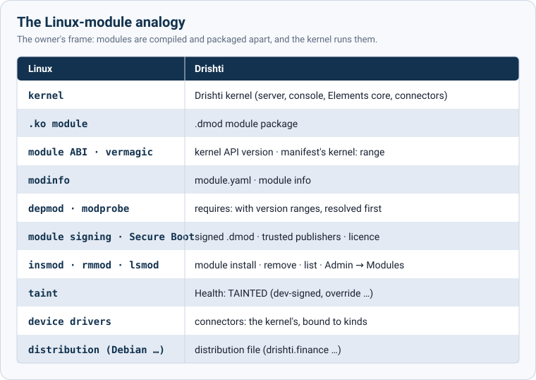

| Linux | Drishti |
|---|---|
| kernel | the Drishti Kernel (the Data & BI server with its connector plugins) |
| desktop environment over the kernel (one desktop, several machines over X or a remote session) | the Drishti Console: a separate process, in front of one or many kernels (section 10) |
| `.ko` module | `.dmod` module package |
| module ABI, `vermagic` | the versioned kernel API and the manifest's `kernel:` range |
| `modinfo` | `module.yaml` (and `drishti.py module info`) |
| `depmod` / `modprobe` dependency resolution | `requires:` with version ranges, resolved before loading |
| module signing, Secure Boot | signed `.dmod`, trusted publisher keys, licence through the registry |
| `insmod` / `rmmod` / `lsmod` | `drishti.py module install | remove | list`, Admin → Modules |
| taint | Health "unsupported module loaded" (development-signed, out-of-range, or overridden) |
| device drivers talk to hardware via the kernel's bus | modules read data via kernel **bindings**; connectors are the kernel's drivers |
| distribution (Debian, Fedora) | distribution file (`drishti.finance`, `drishti.genomics`) |

## 2. The kernel

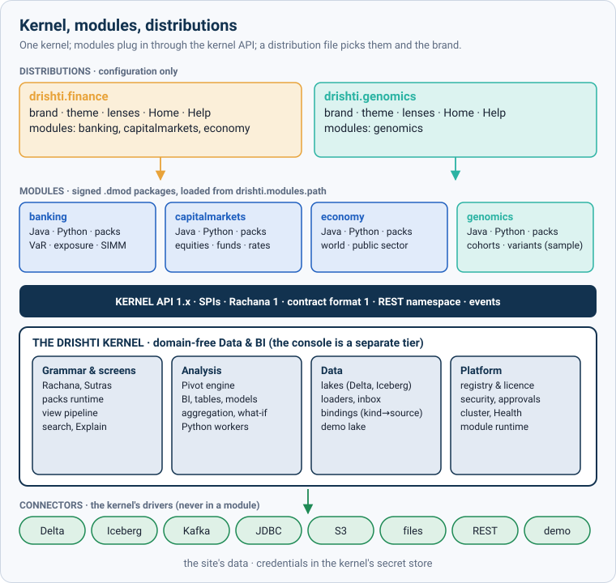

### 2.1 What is in it

| Area | Kernel (Maven modules / folders) |
|---|---|
| Foundations | `drishti-common`, `drishti-api` (data SPIs), `drishti-registry` (access registry, licence), `drishti-identity` |
| Grammar and screens | `drishti-rachana` (Rachana, Sutras), `drishti-engine` (view pipeline, inference, search, phrase, view augmenters), `drishti-packs` (pack loader and pack runtime) |
| Analysis | `drishti-bicompute` (pivot engine, Rachana functions, Explain, what-if), `drishti-tables` (virtual tables, models), `drishti-graph`, `drishti-inference` |
| Data | `drishti-lakeio`, `drishti-lakeconfig`, `drishti-lakeload`, `drishti-deltalake`, `drishti-iceberg`, `drishti-memlake`, `drishti-diskcache`, `drishti-dataload` (the inbox), `drishti-flight`, `drishti-messaging` |
| Connectors | every `plugins/drishti-plugin-*` (delta, iceberg, iceberg-external, file, s3, jdbc, duckdb, kafka, rabbitmq, activemq, redis, mongodb, cassandra, aerospike, rest, feeds, news, demo, yfinance); the connector files, credentials and **bindings** (section 5) |
| Compute | `drishti-compute` (generic: vector store, many-set sums, sharding, the Python pool and sandbox, the scheduler), `drishti-native` (BLAS/LAPACK with Java fallbacks) |
| Platform | `drishti-server` (REST, security, approvals, collaboration, alerts, cluster `drishti-net`, Health, audit, Admin), `drishti-ai` (LLM providers, MCP), `drishti-app` (the runnable kernel jar) |
| Module runtime | `drishti-module-runtime`: manifest reading, verification, class loader per module, live route table, unload and absence machinery; **shared with the Drishti Console** (section 10.4) |
| Content | the core pack (calendar and generic entities), GLEIF reference data, the compute-demo pack, the kernel's Help (generic guides and tutorials), the CIO and oversight lenses, the default theme |

**Not in it, because it is the Drishti Console** (a separate application, section 10): the shell, command line, Home, the Pivot, BI, Build,
Notebook and Admin screens, the Help centre, search, embed and phone pages, and **Drishti Elements** with the vendored libraries
(section 11). The kernel answers their questions over its REST API; it serves no page and no UI static file.

**Not in it, because they are modules:** `drishti-banking`, `drishti-compute-banking`, `drishti-console/plugins/{banking,economy}`, the drishti-risk library, the
packs of `config/packs/{banking,economy,capitalmarkets}`, their lenses, lakes, BI content, feeds, guides and tutorials. Each of those is a
module (section 14.1 lists today's leaks).

### 2.2 The kernel API

The kernel API is a **published, versioned contract**: what a module may compile against and rely on. It is one version number for
the whole surface, `kernelApi: MAJOR.MINOR`, separate from the product version (2.9.11.i2 ships kernel API **1.0**; i1 ships 0.x).

| Surface | Form | Where |
|---|---|---|
| Java SPIs and services | `drishti-kernel-api-<v>.jar` (interfaces, records, annotations only; no implementation) | section 2.3 |
| Python compute API | `drishti_kernel` package (the compute SDK's item, frame and result types; the sandbox's rules) | section 4.6 |
| Rachana and Sutras | grammar version `rachana: 1` (already in every Sutra) | [RACHANA_REFERENCE.md](../guides/RACHANA_REFERENCE.md) |
| Data contracts | contract format `contract-format: 1` (the `*.contract.yaml` shape the packs use today) | section 5.2 |
| Elements core | `@drishti/elements-core` etc.: ES modules + `.d.ts`, the theme tokens | [ELEMENTS.md](ELEMENTS.md) |
| Console API (the Drishti Console's half, versioned as `plugin-api`) | `plugin.yaml` format 2 (routes, words, menus, cards, slots, the API proxy list) and `drishti-console-api-<v>.jar` (the Java context-builder interface); replaces format 1 and the hooks of `core/plugins.py` | sections 4.7, 9, 10.4 |
| REST | the namespace a module is given (`/api/v1/<module api>/…`) and the kernel's public endpoints | section 2.5 |
| Events | the kernel event catalogue | section 2.6 |
| Manifest | `module.yaml` format 1 | section 3.3 |

**Versioning rules.**

- **Semver on the kernel API**, not on the product: a MINOR adds (a new SPI, a new optional method with a default, a new event); a MAJOR
  removes or changes. The product version and the kernel API version are both printed on About, Health and `drishti.py module list`.
- **Deprecation over one release** (the owner's rule): a deprecated element keeps working for one product release, logged once per start
  and listed on Admin → Modules against each module that still uses it ("banking 3.0.0 uses `HealthFigures.contribute(Map)`, deprecated,
  gone in the next release"); the next release removes it and bumps MAJOR.
- **Compatibility range**: the kernel declares `kernelApi: 1.4` and `serves: [1.3, 1.4]` (the current minor and the one before it within
  the major). A module declares `kernel: ">=1.3 <2.0"`. A module is loadable when its range contains the kernel's `kernelApi` and its
  lowest bound is not older than `serves`' lowest (the `vermagic` check, section 4.3).
- **The SDK jar is the contract**: anything not in `drishti-kernel-api` is not API, even if public in `drishti-server`. An architecture
  test fails a module class that imports anything else of `com.ash.drishti..` (section 4.4).
- **API diffs are generated** each release (`japicmp` on the API jar, a `.d.ts` diff, a manifest-schema diff) and a MAJOR change without a
  MAJOR bump fails the gate.

### 2.3 The SPIs

**Existing SPIs** (built for the domain split; the banking module fills them today). Each moves into `drishti-kernel-api` under
`com.ash.drishti.kernel.api.*`, keeping its shape; banking's use is in brackets.

Built in `drishti-kernel-api` (kernel API **0.1**; the jar is on the class path of the kernel modules, `ApiSurfaceTest` pins its surface):
`ComputeEngine` (`kernel.api.engines`), `PivotProvider` and `PivotSourceProvider` with their value types (`kernel.api.pivot`), `ViewAugmenter`
(`kernel.api.view`), `Explainer`, `ExplainRequest`, `Explanation` (`kernel.api.explain`), `Principal` (`kernel.api.security`), `ShardedMeasure` and
`ShardGather` (`kernel.api.shard`), `CapacityFigures`, `HealthFigures`, `ApiAlias`, `OfficialResults`, and the new `DomainVocabulary` (`kernel.api.vocabulary`).
Still at their old homes and to move with i2: `FunctionProvider` (its `EvalContext` carries the formats), `CacheGroup`/`CacheReport` (Caffeine and
`MemoryBudget` in their shape), `ApprovalSource`, `FlightForm` (Arrow types); `SourcePlugin`, `StorageProvider` and `ProviderFactory` stay kernel-only, off this jar.

| SPI (today's home) | What a module contributes | Banking |
|---|---|---|
| `ComputeEngine` (`drishti-api` compute) | a compute engine with its switch, words and health | VaR, exposure, FRTB-SA, SIMM, sensitivities, MR cube |
| `PivotProvider` (`drishti-bicompute` spi) | measures the pivot engine computes per cell (non-additive totals) | VaR, ES, PVaR by any grouping |
| `PivotSourceProvider` (`server.pivot`) | a source the pivot asks before the tabular provider | the VaR source of the MR lens |
| `FunctionProvider` (`drishti-rachana` el) | Rachana functions (`var()`, `pvar()`, `es()`) | VaR functions in BI and Sutras |
| `ViewAugmenter` (`drishti-engine`) | fields added to a kind's view as the page opens | `VAR_ENGINE.*` on a position, trade, book |
| `Explainer` (`server.explain`) | the Explain drawer's formula, inputs and lineage for its numbers | VaR, component VaR, EPE, FRTB charge |
| `CacheGroup` / `CacheReport.Owner` (`server.caches`) | caches the kernel reports and clears in order | VaR and exposure date caches |
| `ApprovalSource` (`kernel.api.approvals`, moved in i2) | items in the Approvals inbox | regulatory VaR sign-off, scope changes |
| `ShardedMeasure` (`server.shard`) | a measure computed across shards | VaR by hierarchy at scale |
| `FlightForm` (`server.flight`) | an Arrow Flight descriptor it serves | P&L vectors out |
| `CapacityFigures` (`server.capacity`) | its rows in the capacity planner | VaR memory and time per date |
| `HealthFigures` (`server.api`) | figures in Health | hierarchies skipped |
| `OfficialReaders.OfficialResults` (`drishti-packs`) | published results lakes it reads | `var-official`, `ccr-official` |
| `ApiAlias` (`server.modules`) | old paths answered as new for one release | `/api/v1/var` → `/api/v1/risk/var` |
| `SourcePlugin` (`drishti-api`) | **kernel only from P1** (section 5.7): banking's `VarPositionsPlugin` and `VarPvStreamPlugin` become `KindProvider`s | — |
| `StorageProvider` (`drishti-lakeio`), `ProviderFactory` (`drishti-ai`) | **kernel only** (storage back-ends, LLM providers) | — |

**New SPIs** (P1 unless noted):

| SPI | Purpose | Banking |
|---|---|---|
| `DrishtiModule` | the module's entry point: `start(ModuleContext)`, `stop()`, `health()`; the context gives the kernel services below, its settings, its folders and its logger | `BankingModule` |
| `ModuleContext` services | `Kinds` (read and subscribe to bound kinds **as the person**), `KindWriter` (write produced kinds to their bound target), `Events`, `Scheduler`, `ComputePools` (incl. the Python pool), `Settings`, `Secrets` (**none**: modules get no secrets; section 13.4), `Audit`, `Registry` (ask, never read), `Caches`, `Clock` (business date) | VaR reads `scenario-pv`, `pnl-vector`, `var-limit` through `Kinds` |
| `KindProvider` | answers a kind the module **computes** (replaces modules' `SourcePlugin`s and the reactive-connector Java runners): fetch, search, subscribe; inputs read through `Kinds` | `position` (derived from trades), `var-result` (`VRES`), `exposure-result`, intraday scenario PVs |
| `ModuleSettings` | binds the module's `settings/schema.json` to a typed record; validated at start and on change | VaR windows, confidence, root names, hierarchies |
| `AiToolProvider` | tools the AI assistant may call, each tied to a function (off function = no tool) | "VaR of a scope", "why VaR moved" |
| `RestModule` (annotation `@ModuleApi`) | marks the module's controllers; the kernel mounts them under the module's namespace (section 4.5) | `/api/v1/risk/**` |
| `ExportProvider` (P3) | named exports (workbook, regulatory files) | regulatory VaR files |
| `PlaygroundTemplates` (P3) | the generic workbook streamer's templates | VaR, FRTB-SA, SIMM, SA-CCR, FVA playgrounds |
| `ModuleMigration` (P4) | upgrade hooks between module versions for its own stored state (no database migrations: state files and caches only) | VaR date caches rebuilt on a format change |

The Java SPIs are discovered with `ServiceLoader` **inside the module's class loader** (`META-INF/services/…` in the module's jars) and,
for Spring beans, through the module's own child application context (section 4.4).

### 2.4 What stays kernel-only, and why

| Kernel-only | Why |
|---|---|
| Connector plugins (`SourcePlugin`), storage providers, the lake formats | the site's data, credentials and network belong to the site's administrators; one place to secure and audit them (G4) |
| Identity, RBAC, the licence check, the registry's model | one trust point ([ACCESS_MODEL.md section 2](ACCESS_MODEL.md#2-one-registry-asked-by-every-layer)) |
| The Python runtime, its lock file and sandbox | one runtime ([ARCHITECTURE.md section 29.1](ARCHITECTURE.md#291-one-python-runtime)) |
| In the Drishti Console, never in a module: the shell, menus, Help centre, search, Drishti Elements and every vendored library | one look, one search, one Help, one controlled set of UI statics (section 11) |
| The database schema files | no migrations, two complete schema files; modules keep state in files under their data folder or in kinds |

A new connector type (say, a genomics VCF reader) is a **kernel extension**: a connector plugin jar shipped with the kernel or added to the
kernel's `plugins/` folder by the site, signed by the kernel's publisher key; never part of a `.dmod`. A module that needs such a format
says so in its data needs (`formats: [vcf]`), and Admin → Data bindings shows *no connector of type vcf is installed*.

### 2.5 REST namespaces

| Prefix | Owner |
|---|---|
| `/api/v1/{admin,bi,pivot,tables,packs,sutras,views,entities,search,explain,approvals,changes,export,flight,modules,functions,…}` | kernel (the about 100 prefixes of today) |
| `/api/v1/<api>/…` | a module, `<api>` declared in its manifest (`api.prefix: risk` for banking); unique across installed modules, refused when it clashes with the kernel's list or another module's |
| `/api/v1/admin/modules`, `/api/v1/admin/bindings` | kernel: module and binding administration (sections 5, 7) |
| `/m/<module>/static/<version>/…` | console: a module's static files (section 4.7) |
| `/m/<module>/…` pages | console: a module's pages (declared routes, section 9.8); a declared `alias:` keeps a current address (today's `/var`, `/exposure`), checked against the reserved names, refused on clash |
| `/m/<module>/api/…` | console: the console's API proxy to the owning kernel's `/api/v1/<api>/…`, declared endpoints only, as the person (section 9.5) |
| `/k/<kernel>/…` | console: a kernel page on a named kernel when the console fronts several (section 10.6); absent with one kernel |

### 2.6 Events

One kernel event bus (in process, gossiped over `drishti-net` where marked). Modules subscribe through `ModuleContext.events()`; a module
may publish only events under its own id (`banking.*`).

| Event | Payload | Typical module use |
|---|---|---|
| `data.loaded` | lake, table, kind, business date, batch id, rows | VaR rebuilds a date when `scenario-pv` or `pnl-vector` lands |
| `data.changed` | kind, ids or range, cause (correction, restatement) | exposure recomputes a netting set |
| `binding.changed` | kind, old and new source | VaR drops caches for that kind |
| `date.rolled` | new business date | hot file prepared |
| `module.started` / `module.stopped` / `module.refused` | id, version, reason | a dependent module reacts |
| `settings.changed` | module, keys | VaR reloads hierarchies |
| `approval.decided` | item, decision | regulatory sign-off |
| `cache.invalidated` | group | — |
| `function.switched` | word, on/off | AI tools refreshed |

### 2.7 How the kernel is versioned and shipped

- The kernel ships as `drishti-kernel-<product version>.jar` (the thin jar, P2) with its connector plugins and the kernel's content. The
  **Drishti Console ships separately** as `drishti-console-<product version>.jar` with Elements and the vendored libraries (section 10). Its `kernelApi` and `serves` are in `/public/about`.
- A **distribution build** (section 6.6) is the kernel, the console and the `.dmod` files the distribution names, in one archive; the modules stay
  separate files inside it.

## 3. The module package (`.dmod`)

### 3.1 File format

- A **zip** (ZIP64 allowed) named `<id>-<version>.dmod`, e.g. `banking-3.0.0.dmod`.
- Signed like a JAR, with a modern signature: `META-INF/DMOD.MF` lists every entry with its SHA-256; `META-INF/DMOD.SIG` is an
  **Ed25519** detached signature over `DMOD.MF`; `META-INF/publisher.pem` is the publisher's certificate, chained to a key the site trusts
  (section 13.1). An entry not listed, or listed with another hash, refuses the whole module.
- Uncompressed `module.yaml` first in the archive, so `module info` reads it without unpacking.
- No executable native binaries (`.exe`, `.so`, `.dll`, `.dylib`) at the top level of `python/` or `console/` (Windows QA rule: a module
  runs on Java and the kernel's Python only); native code a jar bundles (JavaCPP) is allowed and declared (`native: true`), and refused on a
  site that forbids it.
- Installed **unpacked** into `<modules.dir>/<id>/<version>/` (read-only to the server process), with the original `.dmod` kept beside it for
  verification at every start.

### 3.2 Folder layout

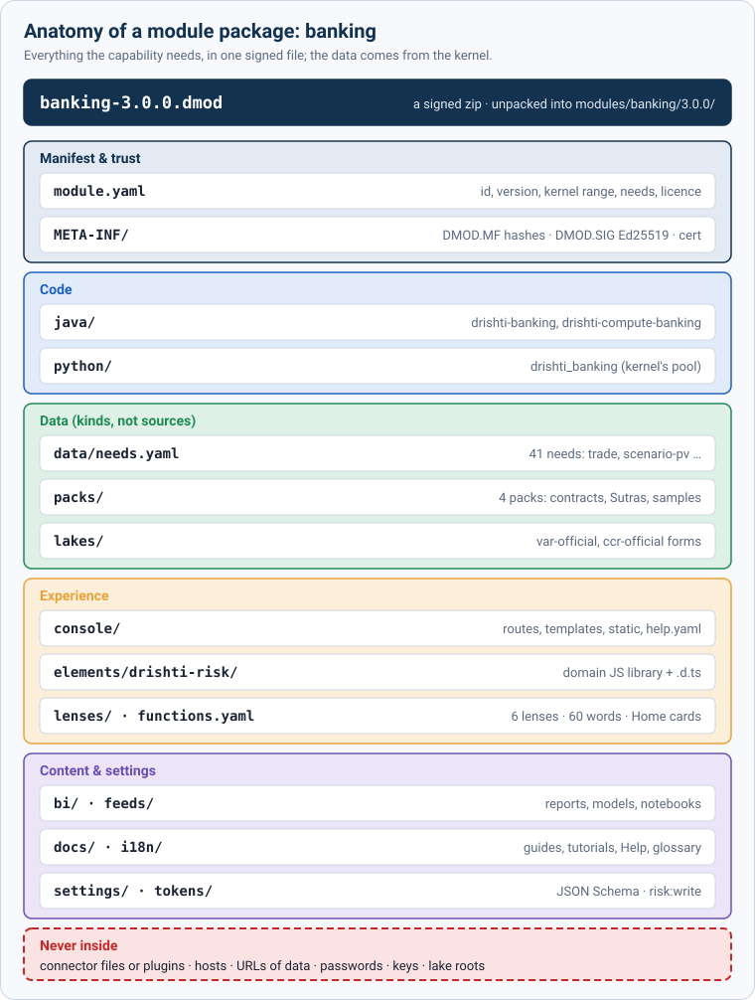

```
banking-3.0.0.dmod
├── module.yaml                     the manifest (section 3.3)
├── META-INF/                       DMOD.MF (hashes) · DMOD.SIG (Ed25519) · publisher.pem
├── java/                           the module's jars (own class loader) and their private third-party jars
├── python/                         its Python package(s) for the kernel's pool; requirements.txt (must be within the kernel's lock)
├── data/needs.yaml                 the kinds it needs and produces, with contract ranges (section 5)
├── packs/<pack>/                   its packs, exactly today's pack folders (pack.yaml, contracts/, sutras/, samples/, python/, guides/)
├── engines/                        engine catalogue entries and engine defaults
├── lakes/                          its published-results lake forms (var-official, ccr-official): tables only, no location
├── bi/                             reports, models, tables, notebooks, fragments, report definitions
├── lenses/                         lenses.yaml (registry lenses: modules, functions, cards, chips) and lens files (menus, Home, Help)
├── functions.yaml                  its command words and the APIs behind each
├── console/                        plugin.yaml, templates/, static/ (drishti_*.js, drishti_*.css), java/ (context builders), help.yaml
├── elements/<lib>/                 its domain Elements library (drishti-risk): ES modules, CSS on tokens, .d.ts, manifest
├── feeds/                          feed definitions and their refresh scripts (.py, with .sh and .ps1 launchers)
├── settings/                       schema.json (JSON Schema 2020-12) and defaults.yaml
├── tokens/token-scopes.yaml        its API token scopes
├── docs/                           guides/, tutorials/, img/, help pages (help.yaml groups), glossary.yaml, README.md
├── i18n/                           message bundles
├── tests/                          its conformance tests (run by `module verify --deep`; never loaded by the server)
└── NOTICES/                        LICENSE, THIRD-PARTY-NOTICES.md
```

The full tree for banking, every folder filled from today's files, is
[examples/banking/dmod-tree.txt](kernel-and-modules/examples/banking/dmod-tree.txt).

### 3.3 The manifest (`module.yaml`)

The manifest grows from today's `META-INF/drishti/module.yaml` (id, domain, title, feature, requires, contributes); it is still read only by
the registry (other kernel parts ask the registry). Every field:

| Field | Required | Meaning |
|---|---|---|
| `format` | yes | manifest format, `1` |
| `id` | yes | lower-case id, unique (`banking`); also the folder, the class-loader name, the events prefix |
| `version` | yes | semver of the module (`3.0.0`) |
| `title`, `about` | yes | words for Admin, About, Help |
| `domain` | yes | the domain it serves (`banking`, `economy`, `capitalmarkets`, `genomics`) |
| `publisher` | yes | `{name, id, contact}`; must match the signing certificate's subject |
| `licence.feature` | yes | the licence feature that unlocks it (`banking`); `licence.limits` it understands (`positions`, `nodes`) |
| `kernel` | yes | the kernel API range (`">=1.0 <2.0"`) |
| `rachana`, `contracts`, `plugin-api`, `elements` | yes | grammar, contract-format, console API and **Elements API** ranges it was built for (`elements: ">=1.4 <2"`, checked by the console: section 11.3) |
| `requires` | no | other modules with ranges, and `optional:` ones it uses when present (`capitalmarkets` optional for banking) |
| `conflicts` | no | modules it cannot run beside |
| `provides.kinds` | no | kinds it owns (defined in its packs), by pack |
| `java` | no | `jars:` (in `java/`), `entry:` the `DrishtiModule` class, `spring:` its auto-configuration, `exports:` packages other modules may *not* see (default none), `native:` true when a jar bundles native code |
| `compute` | no | its engines (ids, words, pools, switches) |
| `python` | no | `packages:`, `requirements:`, `pools:` (the kernel pools it submits to, `python` by default), `items:` (Python compute items it registers) |
| `packs` | no | its packs (folders under `packs/`) and which are on by default |
| `data` | no | `needs:` file (`data/needs.yaml`, section 5) |
| `api` | no | `prefix:` (its REST namespace), `aliases:` (old paths answered for one release), `tokens:` |
| `console` | no | `plugin:` (`console/plugin.yaml`, format 2: routes, aliases, words, menus; section 9), `handlers:` the context-builder jar under `console/java/` (Java, section 10.4), `elements:` libraries it ships |
| `functions` | no | `functions.yaml` (or inline): words, their APIs, their module |
| `lenses`, `home` | no | `lenses/lenses.yaml`; Home cards and chips per lens |
| `feeds` | no | its feed definitions (each fills one of its kinds) |
| `bi` | no | its BI folders |
| `docs` | no | Help sections and pages, guides, tutorials, glossary; `features:` rows for the docs register |
| `settings` | no | `schema:` and `defaults:` |
| `events` | no | events it publishes and subscribes to |
| `parts` | no | the parts the site places separately, each with its resource class (`light`, `heavy` with `memory-mb`, `feed`, `singleton`) and what it contains (section 4.11.2) |
| `resources` | no | expected memory and threads (the capacity planner and the loader's budget check) |
| `health` | no | its health checks' ids |
| `taint` | no | set by the kernel, never by the publisher |

**The full banking example:** [examples/banking/module.yaml](kernel-and-modules/examples/banking/module.yaml). It lists the two jars
(`drishti-banking`, `drishti-compute-banking`), the six engines, the Python package `drishti_banking` with its items, the five packs (with
`banking-reference`, decision Q1), the 30-odd data needs, the console plugin and `drishti-risk`, the six lenses, 60 functions, the
Home cards, the market-data feed (decision Q6), the seven guides and nine tutorials, the settings schema, the licence feature
`banking`, the optional `capitalmarkets` dependency and the kernel range.

Representative stub files with real-looking content:

| File | Shows |
|---|---|
| [data/needs.yaml](kernel-and-modules/examples/banking/data/needs.yaml) | banking's data needs (section 5.3) |
| [settings/schema.json](kernel-and-modules/examples/banking/settings/schema.json) | the settings schema (VaR windows, confidence, root names, hierarchies) |
| [packs/market-risk/sutras/var-desk.v1.sutra.yaml](kernel-and-modules/examples/banking/packs/market-risk/sutras/var-desk.v1.sutra.yaml) | one Sutra as the module ships it |
| [docs/help/var-in-five-minutes.md](kernel-and-modules/examples/banking/docs/help/var-in-five-minutes.md) | a Help page stub |
| [console/plugin.yaml](kernel-and-modules/examples/banking/console/plugin.yaml) | the console plugin as packaged (today's file, paths made module-relative) |

## 4. Loading

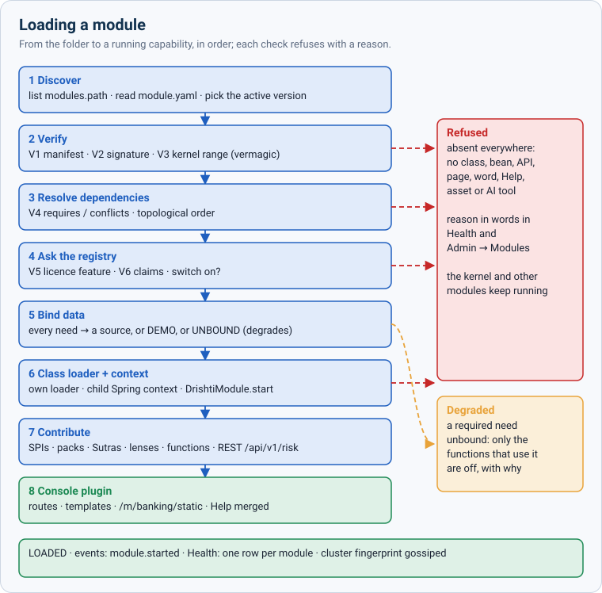

### 4.1 Module paths

| Setting | Default | Meaning |
|---|---|---|
| `drishti.modules.path` (`DRISHTI_MODULES_PATH`) | `${drishti.data.dir}/modules` | an ordered list of folders holding installed modules (`<id>/<version>/` unpacked + the `.dmod`); first match of an id wins; read-only to the server |
| `drishti.modules.inbox` | `${drishti.data.dir}/modules-inbox` | where `module install` and Admin → Modules put an uploaded `.dmod` waiting for approval |
| `drishti.modules.active` | `config/modules/active.yaml` | which version of each installed module is active (written by install, upgrade, rollback; four eyes) |
| `drishti.modules.trust` | `config/trust/publishers/` | publisher certificates the site trusts |
| `drishti.modules.<id>.enabled` | `true` | the existing switch ([ACCESS_MODEL.md section 8](ACCESS_MODEL.md#8-as-built-the-backend-phase-1-of-the-split)) |

All folders live under the configurable data folder (no root litter, visible names); the server never writes to a module's folder.

### 4.2 Discovery

At start, before any bean: list every `<path>/<id>/<version>/module.yaml`; pick the version `active.yaml` names (else the highest);
parse each manifest against the manifest schema; build the dependency graph. Nothing else of a module is touched yet.

### 4.3 Verification, in order

Each step refuses with a reason code and words; a refused module is **absent everywhere** (section 4.9).

| # | Check | Refusal (example words) |
|---|---|---|
| V1 | manifest valid (schema, `format: 1`, id = folder) | *banking 3.0.0: module.yaml line 12: `kernel` missing* |
| V2 | signature: `DMOD.MF` hashes match the unpacked files and the `.dmod`; `DMOD.SIG` verifies; certificate chains to a trusted publisher; publisher id = manifest's | *signature does not verify (file java/drishti-banking-3.0.0.jar changed)* |
| V3 | kernel range (`vermagic`): `kernel`, `rachana`, `contracts`, `plugin-api`, `elements` ranges contain the kernel's | *built for kernel API >=2.0; this kernel is 1.4* |
| V4 | dependencies: every `requires` present, in range, and itself not refused; no cycle; no `conflicts` | *needs capitalmarkets >=1.2; 1.1 installed* |
| V5 | licence through the registry: the licence names the feature, is valid on this date, within limits | *the licence does not include banking* |
| V6 | claims: its API prefix, paths, functions, kinds and lens ids clash with no kernel or other module's | *function VAR is claimed by banking and riskx* |
| V7 | data needs: every `provides.kinds` contract parses; every `needs` contract range is satisfiable by some module or kernel kind | a missing *binding* does not refuse: it degrades (section 5.6) |
| V8 | resources: its declared memory fits the node's budget | *needs 6 GB; 3 GB free in the module budget* (warning, or refusal when `drishti.modules.strict-resources`) |
| V9 | enabled: the site switch | not a refusal: *off by the administrator* |

**Order:** topological by `requires` (a module after everything it requires), then by id for a stable order. A refusal propagates to
every module that requires it (*refused: requires banking, which is refused*).

### 4.4 Java: one class loader per module

```
            bootstrap / platform
                    │
        kernel application class loader  (drishti-server and every kernel jar)
                    │
          kernel API class loader   ◀── exports ONLY: com.ash.drishti.kernel.api.**, plus the shared libraries below
           ┌────────┴─────────┐
   module "banking" loader   module "economy" loader      (child-first for everything in the module's java/)
```

- **Shared (parent-first)**: `com.ash.drishti.kernel.api..`, the Java platform, Spring Framework and Boot, Jackson, SLF4J, Apache Arrow,
  Micrometer, Jakarta Servlet and Validation. The list is part of the kernel API (a MINOR may add, only a MAJOR removes).
- **Private (child-first)**: every other class in the module's `java/` jars, including its own copies of libraries (a module may ship
  commons-math 3.6 while the kernel uses another version).
- **Hidden**: every kernel class outside the API (`com.ash.drishti.server..` etc.) is not visible to a module (`ClassNotFoundException`); an
  architecture test in the SDK fails the build earlier.
- **Spring**: each module gets a **child `ApplicationContext`** with the module's class loader; its parent exposes only the kernel API
  beans (the `ModuleContext` services). Its `@ConditionalOnModule` stays as a guard. SPI implementations are beans or `ServiceLoader`
  entries in that context; the kernel collects them through the registry of contributions (`ModuleContributions`), never by scanning a
  module's packages.
- **No module sees another module's classes**; modules talk through kinds, functions and events.
- **Stop**: `DrishtiModule.stop()`, then the child context closes, the contributions are withdrawn, the class loader is dropped (P5 hot
  unload depends on this being leak-free; a leak test loads and unloads 50 times in the SDK harness).

### 4.5 REST

The module's controllers (`@ModuleApi`) are mounted by the kernel under `/api/v1/<prefix>/`, behind the kernel's filters in this order:
TLS/identity → module gate (`DRS-1025` when off) → function gate (`DRS-1026`) → permission (`DRS-1027`) → audit → the module's
`DispatcherServlet` (one per module, bound to its child context). A module cannot register a filter, a servlet or a path outside its
prefix. `ApiAlias` keeps working for one release.

### 4.6 Python compute

- The module's `python/` packages are made importable **only in that module's runs**: a run submitted by `banking` gets
  `<module>/python` prepended to its sandbox's import path; another module's runs never see it. The kernel's `drishti_kernel` package and
  the locked libraries are shared.
- **No pip at install time.** `python/requirements.txt` must be satisfied by the kernel's lock file; a module needing a library outside it
  is refused with *needs scipy-stats-x 1.2, not in this site's Python lock: an administrator approves it first*
  ([ARCHITECTURE.md section 29.6](ARCHITECTURE.md#296-requirements-and-approval)).
- Every run goes through the kernel's one door (`PythonRuns`): same strict sandbox, limits, audit line, the person's row rules on every
  frame. The audit line gains `module`.
- A module's Python items (BI python visuals, Python measures, its compute packs) are registered by the manifest's `python.items`, shown in
  Build with the module's name.

### 4.7 The console part (loaded by the Drishti Console)

- **Where**: the console never reads the kernel's module folders: it receives the **console part** of each module (`console/`,
  `elements/`, `docs/` with the signed hash list) from the kernel once the kernel reports the module active. **In i2** today's Python
  console reads the part the kernel has verified and hosts it **declaratively** (section 14.2.1); **from i4** the Drishti Console on Spring
  Boot verifies it itself and loads it with the shared `drishti-module-runtime` (section 10.4).
- **`plugin.yaml` format 2**: everything the console shows for a module is declared (routes, the API proxy list, words, menus, Home
  cards, slots, settings page); format 1's `routers:` (FastAPI routers included at import) and the shared template loader go. Section 9
  is the design; format 1 is read for one release with a deprecation line, then refused.
- **Java context builders** (optional, small, **from i4**; none in i2): `console/java/<id>-console.jar`, in the console's class loader for the module, which sees only
  `drishti-console-api`; a builder returns plain values and registers nothing (section 10.4). No Python runs in the console.
- **Templates**: one sandboxed Jinjava instance per module, namespace `<id>:`, which sees only the kernel's public layouts and its own
  files; a kernel template never includes a module's (rule 1) and a module never overrides a kernel template (section 9.2, 9.3).
- **Static files**: served from `/m/<id>/static/<version>/…` with a year-long cache (the version busts it) and SRI, only to people for
  whom the module is on and their lens uses it (today's `_module_asset_refused`, unchanged). The `drishti_` prefix stays (section 9.7).
- **Elements**: the module's `elements/<lib>/` is added to the Elements manifest with `module: <id>`; the loader's existing refusal applies;
  the module's Elements API range is checked against the console's train, and copies of Elements or vendored libraries are refused (section 11).
- **Help merge**: `console/help.yaml` heads and pages (today's `help-sections:` / `sections:`) merge into Help; the guides and tutorials
  are read from the module's `docs/` folder; the docs register gains the module's `docs.features` rows, so the docs gates check a module's
  docs like the kernel's.
- **Sitemap and menus**: module menu entries carry `requires: module:<id>` as today; lens files from `lenses/` replace
  `config/lenses/<module>/`.

### 4.8 Order of start

1. Kernel core (settings, registry, licence, identity).
2. Discovery and verification of modules (4.2, 4.3).
3. **Data bindings resolved** for every need (section 5): before any module starts, so a module starts knowing which of its needs are bound.
4. Modules started in dependency order: class loader, child context, `DrishtiModule.start`, contributions registered.
5. Packs loaded (kernel packs, then modules' packs in module order), Sutras, lenses, functions.
6. Kernel services open (REST, console, scheduler, feeds); `module.started` events.

A module's start has a time budget (`drishti.modules.start-seconds`, 120); exceeded → refused (*did not start in 120 s*), the kernel goes on.

### 4.9 Failure: refused means absent

A refused module (any of V1–V8, a start failure or a crash in `start`) is treated exactly as *not installed*: no class loaded (its loader
is dropped), no bean, engine, job, API, pack, connector binding, route, menu, search hit, command, Help page, asset, AI tool, export or
embed. What remains:

- **Health**: one row per module: `LOADED`, `LOADED (degraded: 2 data needs unbound)`, `OFF (administrator)`, `REFUSED (reason)`, `TAINTED`.
- **Admin → Modules**: the same with the full reason, the check that failed, and what to do.
- **Words for people**: a typed function of a refused module answers *VAR is not available: the banking module is not running (signature
  does not verify). Ask your administrator.* (administrators see the reason; others see *not available*).
- **Kernel keeps running**; a refused module never stops the kernel. A refused *required-by-distribution* module (section 6.2, `required:
  true`) makes Health `DEGRADED` for the whole instance.

### 4.10 Restart versus hot load

| What | P2 | P5 |
|---|---|---|
| Packs, Sutras, lenses, Help, BI content inside an installed module | **hot** (the pack reloader, as today) | hot |
| Settings of a module | hot where the schema marks a key `hot: true`; else *restart needed* | same |
| Data bindings | hot (section 5.8) | hot |
| A module's pages, menus, words, Help (declared in `plugin.yaml`) | **hot** through the live route table (section 9.8): off, on and **remove** always; install and upgrade when the console part is declarative and the server has the module loaded | hot |
| A module's code (Java, Python package, console context builders) | **restart**: install/upgrade/remove stages the change, Admin shows *restart needed*, a rolling restart applies it | **hot**: unload (stop, close context, drop loader), load the new version; refused when a leak check fails |
| A module's static assets | with the code (versioned path) | same |

**The development build:** the SDK's harness and the developer's IDE run the kernel with a module folder pointing at the module's build
output (`target/dmod/`), same loader, same checks, a development key (section 8.5). There is no "on the class path" second path.

### 4.11 Modules in a cluster

The owner's question: *what happens when a module is deployed on one node and not on another, and how does the console deal with it?*
The answer: **the deployer decides which nodes get a module, part by part**. There is no default "all nodes": a module runs only where it
is placed, heavy work never spreads by itself, every other node forwards, and the console never talks to a node's module, only to the
cluster's registry, and its API proxy calls go to the kernel. Consoles are nodes with the role `console` (section 10.5). Drishti\*net itself (membership, gossip, the capability digest, routing, roles and tags) is
[CLUSTER_GUIDE.md section 1](../guides/CLUSTER_GUIDE.md#1-several-servers-as-one-drishtinet); this section adds only what modules need.

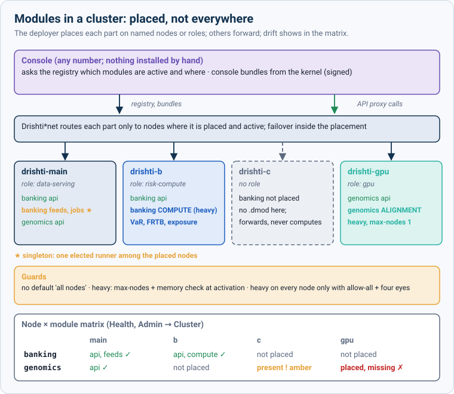

#### 4.11.1 Explicit placement, opt-in

- A module is installed on **the nodes the deployer names**, by **role** (a node tag, `role:risk-compute`, as in `config/net/node.yaml`)
  or by **node name** (`drishti-b`). **There is no default "all nodes"**: a module with no placement is installed nowhere and shows
  *not placed* in Admin → Modules.
- **One home**: `config/placement.yaml` (cluster configuration, four eyes to change, audited), edited by hand or in Admin → Modules →
  *Placement* (a node picker per part, showing each node's role, free memory and current modules). The example:
  [examples/site/placement.yaml](kernel-and-modules/examples/site/placement.yaml).
- The kernel **copies the `.dmod` only to nodes where at least one part is placed**; other nodes never hold it.

#### 4.11.2 Placement per part, with resource classes

The manifest declares the module's **parts** and each part's **resource class**; the deployer places each part separately, so heavy
parts go on fewer nodes than light ones.

```yaml
# module.yaml (the publisher declares the parts; never where they go)
parts:
  api:      { class: light,     contains: [rest, view-augmenters, explain, functions] }   # the façade
  compute:  { class: heavy,     contains: [engines: [var, frtb-sa, simm], kind-providers, python-items], memory-mb: 6144 }
  exposure: { class: heavy,     contains: [engines: [exposure]], memory-mb: 4096 }
  feeds:    { class: feed,      contains: [feeds] }                                         # always singleton
  jobs:     { class: singleton, contains: [scheduled-jobs, official-results-publish] }
  console:  { class: light,     contains: [console-bundle, help, glossary] }               # placed on console nodes (role console)
```

| Class | Meaning | Guard |
|---|---|---|
| `light` | registry entries, the REST façade, Help, the console bundle | may be placed widely |
| `heavy` | compute engines, `KindProvider`s, Python items; declares `memory-mb` | a **max-nodes** limit set by the deployer; a **memory headroom check** on each placed node at activation (refused with the reason: *drishti-c: banking.compute needs 6,144 MB, 2,300 MB free in the module budget*); Admin warns before it goes wide |
| `feed`, `singleton` | feeds, schedulers, daily jobs, publishing official results | **exactly one runner**: leader election among the placed nodes (the lease mechanism the inbox and run leases already use); failover to another placed node only |

**Banking** (a 3-node site): `api` on `drishti-main` and `drishti-b`; `compute` and `exposure` on `drishti-b` only; `feeds` and `jobs` on
`drishti-main` (singleton); `console` on every console node (`role:console`); **nothing on `drishti-c`** (its `.dmod` is not even copied there). **Genomics**: `alignment` compute
(class heavy, `gpu: true`) on the one GPU-class node (`role:gpu`), its API on the same node and `drishti-main`.

#### 4.11.3 Guards against heavy work spreading

- **Singletons run once**, by election among their placed nodes, never on all.
- **Heavy parts** obey the deployer's `max-nodes` and the per-node memory check at activation.
- **A node never computes for a module part it is not placed for**: routing sends work only to placed, active nodes; an unplaced node that
  receives a module request (a client hit it) **forwards** it, never computes it.
- **Activation refuses a placement that puts a heavy part on every node** (*banking.compute on 3 of 3 nodes: confirm with allow-all*),
  unless the placement says `allow-all: true` and a second administrator approves it.
- **Health shows the effective placement**: per module and part, the nodes placed, active, leader (for singletons) and the memory used.

#### 4.11.4 Install and activation across the placed nodes

- **One action**: a deployment (section 7.6: `drishti.py module deploy … --plan` / `--apply`, or Admin → Modules → *Deploy*),
  approved once (four eyes). No per-node install, no manual copying.
- **Replication to placed nodes only**, over Drishti\*net (chunked, mutual TLS, the cluster key); each receiving node checks the SHA-256
  and the signature itself (V2 on every node; a node never trusts another's verification). On AWS with EFS the identical path is read.
- **Two-phase activation across the placed nodes**, run by the coordinator: (1) **stage** on each placed node: unpack, run V1–V9 locally
  (kernel range, licence, claims, the memory check for the parts placed there), answer *ready* or *refused (reason)*; (2) **activate them
  together** when all answered *ready* within `cluster.modules.stage-seconds` (300): the cluster configuration moves to version N+1 and each
  placed node applies it (hot for declarative parts, at the rolling restart for code in P2: section 4.10), or **abort on all of them**
  when one refused: staged files removed, nothing changed, the proposer sees which node and why.
- **A late joiner** receives **only the modules placed on it** (by its name or its role) and serves them only after activation; a node
  given a role later is staged and activated the same way.

#### 4.11.5 Routing and availability

- Drishti\*net routes a module's API calls, compute and jobs **only to nodes where that part is placed and active** (each node's capability
  digest gains a `modules` part: id, version, the parts active here, the singleton leader). **Failover stays inside the placement**: the
  next placed node, never an unplaced one.
- **No placed node up** for a part: the part is **unavailable**, not absent. People see *Banking's VaR is unavailable right now (no
  compute node is up); try again later*; pages that need only the façade still work; saved artefacts, schedules (paused) and data stay;
  nothing is tombstoned. Absent (section 12) is only for an off or removed module.

#### 4.11.6 Drift

- Each node gossips its **module fingerprint** (`id@version#sha256-of-DMOD.SIG`, with the parts it runs); drift is **a node's actual
  state differing from its placement**.
- Health and Admin → Cluster show a **node × module matrix**: **green** placed and active; **red** placed but missing, refused or at another
  version (that node is left out of routing for the module until *Resync* re-sends the package and activation passes); **amber**
  *present but not placed* (a leftover `.dmod`: the node serves nothing for it; *Clean up* removes it).
- In strict mode (`cluster.modules.consistency: strict`, the default) a node whose **kernel API range** differs is refused from joining:
  modules cannot be checked against a kernel the cluster does not run.

#### 4.11.7 How the console interacts

- **The console never talks to "a node's module".** It asks the **cluster registry** (through its entry node, `backend.urls` with discovery
  as today: [CLUSTER_GUIDE.md section 1.8](../guides/CLUSTER_GUIDE.md#18-the-console-and-several-servers)) which modules are active and
  where.
- **Consoles are placement nodes** (role `console`, section 10.5). The module's **console part is placed on console nodes** like any other
  light part; the deployment streams it to the placed consoles only (`GET /api/v1/modules/<id>/bundle/<version>`: the `console/`,
  `elements/` and `docs/` parts), each console checks it against the signed `DMOD.MF` itself, caches it under
  `console-cache/modules/<id>/<version>/` and serves from there. A console machine needs **no manual install**, placed consoles serve
  identical bytes, and **no compute node ever holds a console part**. Its pages exist on the placed consoles; **its API calls still route
  only to the nodes where the API part is placed**.
- **API calls** go through the console's API proxy (section 9.5) to the kernel's entry node, which routes by capability as in 4.11.5.
- **Several kernels**: a console in front of more than one kernel keeps one registry view and one route table per kernel (section 10.6).
- **The live route table follows the registry's events** (`module.activated`, `module.unavailable`, `module.available`,
  `module.removed`): unavailable parts show the notice above, removal shows the notices of section 12.4.

#### 4.11.8 Rolling upgrade and rollback

- For a short window (`cluster.modules.upgrade-window-minutes`, 30) two versions may run **across the placed nodes** when both are inside
  each other's compatibility range. Each placed node advertises its version.
- Requests are **pinned per session** to one version: the proxy routes the session only to placed nodes with that version, and the console
  serves the matching bundle (`/m/<id>/static/<version>/` lets both coexist), so a page always talks to the API version it was built for.
  When the old version's last placed node is upgraded, pinned sessions get the *updated: reload* notice.
- The placed nodes then converge; rollback is the same in reverse. A mixed set outside the window is drift (red).

#### 4.11.9 Tests

| Test | Proves |
|---|---|
| **Placement honoured** | on three nodes with banking placed on main and b: the `.dmod` exists only on main and b; c holds nothing of it; the matrix shows exactly that |
| **Heavy work stays put** | 1,000 VaR requests through each node (including c): every computation runs on b; c and main forward, never compute (engine counters, thread names `mod-banking-…`) |
| **Singleton once** | feeds and daily jobs run once per schedule; kill the leader: another placed node takes over; never an unplaced node |
| **Failover inside the placement** | stop b: VaR is *unavailable* with the notice (not absent, not computed on main or c); saved work intact; restart b: available again |
| **All-nodes heavy refused** | placing `compute` on 3 of 3 nodes is refused without `allow-all: true` and a second approval |
| **Memory check** | a heavy part placed on a node without headroom is refused at stage, and the activation aborts on all placed nodes |
| **Late joiner** | a fourth node with `role:risk-compute` receives only banking (placed by role), activates it, then serves; a fourth node without the role receives nothing |
| **Drift** | delete the module on b: red cell, b out of routing, *Resync* repairs; copy a `.dmod` onto c: amber cell, c serves nothing for it |
| **Rolling upgrade** | 3.0.0 → 3.0.1 across the placed nodes under load: sessions stay pinned until reload, no request reaches a mismatched API, no failed request |
| **Console without install** | a separate console shows a newly placed module's pages from the kernel-served bundle; two consoles serve identical bytes; its API calls land only on placed nodes |

## 5. Data needs and connector binding

The heart of requirement 4: **a module says what data it needs; the kernel decides where that data comes from.**

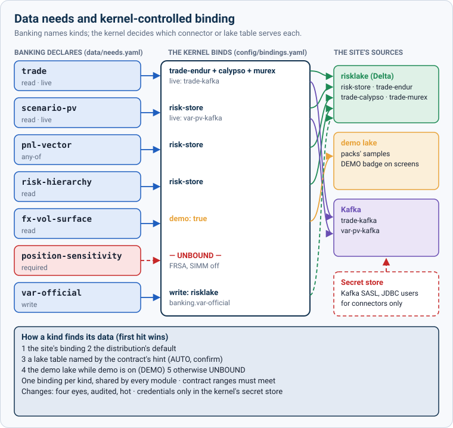

### 5.1 Who owns what

| Thing | Owner | Where |
|---|---|---|
| Connector **types** (plugins) | kernel | `plugins/drishti-plugin-*`, the kernel's plugin folder |
| Connector **configurations** (a Kafka cluster, a JDBC database, a Delta root on S3) | the site's data administrator | `config/connectors/<name>.yaml` (unchanged), credentials as references `${secret:…}` |
| **Credentials** | the site's security administrator | the kernel's secret store (environment, a secrets file outside `config/`, or an external vault) |
| Lakes and their tables | the site | `config/lakes/<lake>.yaml` (unchanged) |
| **Kinds and their contracts** | the module that defines them (`provides.kinds`), or the kernel (core kinds) | the module's packs (`packs/<pack>/contracts/*.contract.yaml`) |
| **Data needs** (which kinds a module reads or writes, which contract versions, required or optional) | the module | `data/needs.yaml` in the `.dmod` |
| **Bindings** (kind → which connectors / lake tables serve it, in what read order, live or not, and where produced kinds are written) | the site's data administrator, **through the kernel** | `config/bindings.yaml` (new) + Admin → Data bindings, four eyes |
| Default bindings for a product | the distribution | `bindings.defaults` in the distribution file (section 6) |

### 5.2 Contracts: the format the kernel owns

The contract format is today's `*.contract.yaml` (kind, mnemonic, pack, version, class, grain, key, dated-by, cadence, fields with type and
presence, vectors) with **one change**: the `storage:` block (which today names `connector: risk-store`, `plugin: delta`, `table:`) is
**removed from the contract** and replaced by a connector-free **hint**:

```yaml
binding-hint:                 # what a site usually binds; never a connector name, plugin or location
  lake-table: risk.scenario-pv          # the table name a lake file would use
  partition: [BUSINESS_DATE]            # the first partition is always the business date
  live: optional                        # a live source makes sense (intraday)
  demo: samples/scenario-pv.jsonl       # the demo lake's sample for this kind
```

The kernel reads `contract-format: 1`; a module declaring `contracts: ">=1 <2"` is checked at V3.

### 5.3 Data needs (`data/needs.yaml`)

Each need: the kind, the contract version range, `use` (`read`, `write`, `live`), `required` (true / false), `any-of` groups, the
functions and engines that depend on it, and its `demo` allowance. Banking's needs, abridged (the full file:
[examples/banking/data/needs.yaml](kernel-and-modules/examples/banking/data/needs.yaml)):

| Kind | Contract | Use | Required | Used by | Notes |
|---|---|---|---|---|---|
| `trade` | `>=1.0 <2` | read, live | yes | TRD, VAR (scope by trade), EXP, PREDEAL | a union of trade stores (Endur, Calypso, Murex) |
| `scenario-pv` | `>=1.1 <2` | read, live | any-of A | VAR, PVAR, SMAT | per trade, own currency; intraday stream |
| `pnl-vector` | `>=1.0 <2` | read | any-of A | VAR, PVAR, SMAT | instead of scenario PVs |
| `fx-scenario` | `>=1.0 <2` | read | with scenario-pv | VAR | converts scenario PVs to USD |
| `scenario-set` | `>=1.0 <2` | read | yes | VAR, SWIN | the 509-day and 250-day windows |
| `var-limit` | `>=1.0 <2` | read | no | VLIM, limit bars | the VaR limits of the hierarchies' nodes (the trees are built from the trades' promoted columns) |
| `desk-pnl` | `>=1.0 <2` | read | no | backtesting | actual and hypothetical P&L |
| `pnl-history` | `>=1.0 <2` | read | no | SWIN | stress window selection |
| `position-sensitivity` | `>=1.0 <2` | read | yes for FRSA, SIMM | FRSA, SIMM, SENS | |
| `risk-factor` | `>=1.0 <2` | read | yes for FRSA, SIMM | RFAC | |
| `netting-set`, `csa`, `agreement`, `collateral-balance` | `>=1.0 <2` | read | yes for EXP | EXP, PREDEAL, SIMM | |
| `credit-limit` | `>=1.0 <2` | read | no | limit use | computed use, stored limits |
| `ir-curve`, `fx-spot`, `fx-vol-surface`, … (market data) | `>=1.0 <2` | read | yes for EXP; no for VaR | EXP paths, TVAL | from capital markets when installed (Q6) |
| `counterparty`, `legal-entity`, `book`, `desk`, `trader` | `>=1.0 <2` | read | yes | every screen | `banking-reference` (Q1) |
| `calendar` | kernel `>=1.0` | read | yes | business dates | kernel kind |
| `var-official`, `ccr-official` | own | **write** | no | VOFF, XOFC, official results | written to a lake the site binds |
| `position`, `var-result`, `exposure-result` | own | **computed** | — | POS, VRES | `KindProvider`s; not bindable |

### 5.4 Bindings (`config/bindings.yaml`)

**Bindings are per kind, not per module.** A kind is one dataset at a site; every module that needs it reads the same binding. The file
([examples/site/bindings.yaml](kernel-and-modules/examples/site/bindings.yaml)) has three example sites in one:

```yaml
bindings:
  trade:
    read: [trade-endur, trade-calypso, trade-murex]   # connectors (config/connectors/<name>.yaml), in read order
    union: true                                        # one trade store across them
    live: trade-kafka                                  # live updates (a Kafka connector)
  scenario-pv:
    read: [risk-store]                                 # a Delta connector on risklake (lake: risklake)
    live: var-pv-kafka
  var-limit:
    read: [risk-store]
  var-official:
    write: { lake: risklake, table: banking.var-official }
  pnl-vector:
    demo: true                                         # explicitly the demo lake (a test site)
```

| Key | Meaning |
|---|---|
| `read` | connectors that serve the kind, in read order (today's `readOrder`: Redis for recent days, Delta behind it) |
| `union` | rows from all of them (today's `union: true` on the trade connectors) |
| `live` | a connector that pushes changes (Kafka, RabbitMQ, ActiveMQ); subscribers get them through `Kinds.subscribe` |
| `write` | where a produced kind is written: a lake and table (the kernel's writer; the module never names a path) |
| `demo` | `true` binds the demo lake's samples explicitly |
| `for:` (exception) | a per-module override, `for: {genomics-qc: [qc-store]}`; allowed only for kinds marked `shareable: per-module` in their contract (Q4) |

**Today's equivalent is spread out**: a connector file's `kinds:` list and its `lake:`; the contract's `storage.connector`. P1 folds both
into `bindings.yaml` (no dual machinery): connector files keep `plugin`, settings and `lake:`, lose `kinds:`; `drishti.py bindings
migrate` writes `bindings.yaml` from today's files once, and a connector file still carrying `kinds:` is read for one release with a
deprecation line in Health.

### 5.5 How a kind finds its data (resolution)

For each kind any loaded module needs, in this order, first hit wins:

1. **The site's binding** in `config/bindings.yaml` (as approved).
2. **The distribution's default** (`bindings.defaults`, section 6), e.g. `drishti.finance` binds banking's kinds to `risklake` tables by
   their hints when a lake file holds them.
3. **The lake convention**: a configured lake (not demo) whose lake file has the contract's `binding-hint.lake-table` table, read by a
   connector of the lake's format → bound, marked `AUTO` (Admin shows *found by convention: confirm*).
4. **The demo lake**, only while `drishti.demo.enabled` and the need allows demo: marked `DEMO` (amber everywhere: "demo data").
5. Otherwise **UNBOUND**.

Demo and real never mix ([DATA_LAKE_GUIDE.md](../guides/DATA_LAKE_GUIDE.md)): a kind is either demo or real; a pack whose kinds are bound
to more than one lake is `DEGRADED` (today's warning, moved from packs to bindings).

### 5.6 What a missing or bad binding does

| State | Meaning | Effect |
|---|---|---|
| `BOUND` | a source serves it; its schema satisfies the contract range | normal |
| `AUTO` | found by convention | normal; Admin asks to confirm |
| `DEMO` | demo samples | works; "DEMO DATA" badge on screens using it |
| `STALE` | bound, but no load within the contract's cadence | works; Health amber *scenario-pv last loaded 2026-11-04 (cadence daily)* |
| `MISMATCH` | the source's columns or types break the contract (a required field missing) | **treated as unbound for that need**; Health red with the columns |
| `UNBOUND`, required | nothing serves it | the module **loads but is degraded**: functions that depend on the need are off with the reason (*VAR needs scenario-pv or pnl-vector: no source is bound; ask your data administrator*); others work |
| `UNBOUND`, optional | nothing serves it | info only; dependent features hidden (e.g. backtesting without `desk-pnl`) |

`any-of` groups are satisfied by one bound member. Health lists `needs[]` per module; `GET /api/v1/admin/bindings` answers the same.

### 5.7 Computed kinds and the end of module connectors

Today banking ships connector plugins (`var-positions`, `var-pv-stream`) and reactive connectors (`var-engine`, `exposure-engine`). Under
G4 these are not connectors: they **compute** a kind from other kinds. They become `KindProvider`s in the module: `position` and
`var-result` are *computed kinds* (`provides.kinds[].computed: true`), never bindable, always the module's. The transport part of
`var-pv-stream` (reading Kafka) is the kernel's Kafka connector bound as `scenario-pv`'s `live:` source; banking subscribes to the kind.
Connector files written for the old names keep loading for one release (today's `moved-classes.properties` mechanism).

### 5.8 Changing a binding

Admin → Data bindings (mock-up b) or `drishti.py bindings set scenario-pv --read risk-store`: proposed, approved by a second
administrator (four eyes), audited, applied **hot**: the kernel validates the new source against the contract, swaps the route, publishes
`binding.changed`; modules drop their caches for that kind. A binding change never needs a module restart.

### 5.9 Two modules, one kind

- One binding per kind: banking and a hypothetical `collateral` module both read the one `trade` binding.
- **Contract ranges must intersect**: if banking needs `trade >=1.0 <2` and `collateral` needs `>=1.3 <2`, the bound source must satisfy
  1.3+; V7 refuses a module whose range cannot meet the kind owner's version (*collateral needs trade >=2.0; banking provides 1.4*).
- **One owner per kind**: the module that defines it in its packs; another module that needs it `requires` the owner (optionally) or uses
  a kernel kind. Two modules defining the same kind id → V6 refuses the second.
- Per-module views of a kind are row rules and masks (permissions), not separate bindings; the `for:` exception is Q4.

### 5.10 Credentials never inside a module

- A module's files contain no connector, plugin, host, URL of a data source, user name, password, key or token: the packager and V1 scan
  for connector keys (`plugin:`, `connector:`, `bootstrap-servers`, `jdbc:`, `password`, `secret`, `token`) and known secret patterns, and
  refuse.
- At run time a module has no API to read connector settings or secrets; `Kinds` returns rows, never the connection.
- Feeds a module ships (public sources such as the ECB rates) name a public URL and need no credentials; one that needs a key reads it
  from the kernel's secret store by a **name the site provides** in the feed's binding (`feeds.market-data.api-key: ${secret:ecb}`), not from
  the module.

### 5.11 Banking's example bindings, three sites

| Site | `trade` | `scenario-pv` / `pnl-vector` | `var-limit` | `var-official` |
|---|---|---|---|---|
| Laptop demo | `DEMO` | `DEMO` | `DEMO` | written to the demo lake |
| Bank on Delta (`risklake`) | `trade-endur` + `trade-calypso` + `trade-murex` (union) on risklake | `risk-store` (Delta, risklake) | `risk-store` | `risklake` table `banking.var-official` |
| Bank with live trades | the same + `live: trade-kafka` (Kafka, SASL credentials from the secret store) | `risk-store` + `live: var-pv-kafka` | `risk-store` | the same |

## 6. The distribution file (white label)

### 6.1 What it is

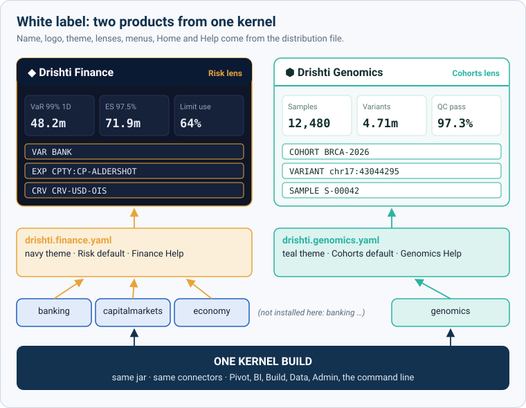

One YAML file, `config/distribution.yaml` (or `DRISHTI_DISTRIBUTION=<path>`), that turns the kernel into a product: which modules, which
brand and theme, which lenses and Home, which docs, which default bindings. It folds today's scattered product settings
(`drishti.edition`, `ui.product`, `ui.copyright`, `drishti.branding.*`, the lens files' `title`, `config/packs/default-packs.yaml`) into
one place, **as the one way**: the old keys are read for one release when no distribution file exists.

**Kernel and console.** The same file format serves both blocks. On a kernel it decides **what is loaded** (modules, default bindings); on
a Drishti Console it decides **the presentation** (brand, theme, lenses, Home, the modules shown, docs). A console in front of several
kernels shows the intersection of its distribution and the modules active on those kernels (section 10.6), so one estate can run
differently branded consoles over the same kernels. Brand and theme are always tokens, never module CSS (section 11.6).

### 6.2 Fields

| Field | Meaning |
|---|---|
| `distribution` | id (`drishti.finance`) |
| `version` | the distribution's own version |
| `kernel` | the kernel product version range it was tested with |
| `brand` | `product` (name in the top bar), `product_native`, `tagline`, `owner`, `copyright`, `logo` (light/dark files), `favicon`, `about` page text, `support` contact |
| `theme` | the theme token set (`finance-navy`), overrides of tokens (`--ac`, `--bg`…), default mode (dark/light/system), density |
| `modules` | each module id with `version` range, `required` (Health degraded if refused) and `enabled` default |
| `lenses` | which lenses are offered, the default lens, per-lens title overrides |
| `home` | the default landing per lens, cards and chips order, the welcome text |
| `menus` | top-level menu order; menu entries hidden for the whole product |
| `features` | presets of switches (today's `config/lenses/features.yaml`) |
| `docs` | which Help sections and tutorials show, their order, the docs title ("Drishti Finance Help"), extra pages from the distribution's folder |
| `bindings.defaults` | default bindings for this product (section 5.5) |
| `demo` | whether the demo lake ships and is on |
| `glossary` | extra terms |
| `locale` | default language and formats |

### 6.3 Examples

The shipped distributions (Drishti Risk, Drishti Finance, Drishti Genomics, Drishti All), what each holds and how to start each:
[DISTRIBUTIONS.md](DISTRIBUTIONS.md).

- [examples/distributions/drishti.finance.yaml](kernel-and-modules/examples/distributions/drishti.finance.yaml): banking + capital markets
  + economy; navy theme; Risk lens default; Help in the banking order; risklake defaults.
- [examples/distributions/drishti.genomics.yaml](kernel-and-modules/examples/distributions/drishti.genomics.yaml): a hypothetical
  `genomics` module + the kernel; teal theme; Cohorts lens; Help with the kernel's generic guides and the genomics module's; no banking
  word anywhere.

### 6.4 How Help and docs follow

Help is assembled at start from the kernel's pages plus each loaded module's pages, filtered by the distribution's `docs` (sections and
order), then by the person's lens and functions (as today). The product name in every page is the brand's (`{product}`), never a literal
(the branding rule: the 26-literal fix becomes a P3 gate). Exported PDFs, the About page and the console title use the brand. Docs built
for print (`docs build --distribution drishti.finance`) render the same selection.

### 6.5 What a distribution may not do

It cannot add code, connectors or credentials; it names modules, never contains them. It cannot widen a licence (the licence still
decides). It cannot rename functions (command words are the modules').

### 6.6 Distribution builds

`drishti.py dist build drishti.finance.yaml` (P3) makes `drishti-finance-<version>.zip`: the kernel jar, the console, the connector
plugins, the named `.dmod` files (unchanged, signed by their publishers), the distribution file and the brand's assets. Installing it is
unzipping it; the modules are installed into `modules.path` on first start (approved by the installer's act, audited).

## 7. Lifecycle and tooling

### 7.1 The command line

| Command | Does |
|---|---|
| `drishti.py module new <id> --domain <d> [--template content|compute|full]` | a new module Maven project from the SDK archetype (section 8.3) |
| `drishti.py module build [--sign-with dev|<key>]` | builds the jars (Maven), runs the module's tests against the SDK harness, checks (no secrets, no kernel internals, docs gates, contracts), writes `target/dmod/<id>-<version>.dmod` |
| `drishti.py module sign <file> --key <publisher key>` | signs (or re-signs) a `.dmod` with a publisher key (an HSM or a key file; never stored in the repo) |
| `drishti.py module verify <file> [--deep]` | V1–V7 against a running or offline kernel; `--deep` runs its conformance tests |
| `drishti.py module deploy <file> --placement <file> --plan` / `--apply <plan>` | the scriptable deployment: plan, apply, status, approve, cancel, rollback (section 7.6); `install` below is its short form |
| `drishti.py module install <file> [--place <part>=<roles or nodes> …]` | uploads to the inbox and proposes the install with its placement (four eyes); with approval: copies to the placed nodes only, stages, activates them together, writes `active.yaml`; *restart needed* on those nodes for code (section 4.11) |
| `drishti.py module list [--json]` | `lsmod`: id, version, state, licence, taint, needs bound/unbound |
| `drishti.py module info <id|file>` | `modinfo`: the manifest, signature, publisher, contributions, needs |
| `drishti.py module run [--shots] [--two-people]` | the dev loop: the kernel + this module only, sample data, hot reload (section 8.4) |
| `drishti.py module remove <id> [--version v]` | proposes removal (four eyes) with a removal report (what disappears, what is kept); refused while another active module requires it; section 12 |
| `drishti.py module purge-state <id>` / `prune` | deletes a removed module's state folder (four eyes) / inactive versions' files |
| `drishti.py module upgrade <file>` / `rollback <id>` | install a newer version beside the old; switch `active.yaml`; rollback switches back (both versions stay until `prune`) |
| `drishti.py bindings list | set | migrate | check` | section 5 |
| `drishti.py dist build | check <file>` | section 6 |

Transcripts: [module new](kernel-and-modules/examples/cli/module-new.txt),
[module build](kernel-and-modules/examples/cli/module-build.txt),
[module install](kernel-and-modules/examples/cli/module-install.txt),
[module list](kernel-and-modules/examples/cli/module-list.txt),
[module remove](kernel-and-modules/examples/cli/module-remove.txt).

### 7.2 Admin → Modules

The screen of mock-up (a): installed modules with version, publisher, state, licence, needs, taint; refused ones with the reason and the
fix; *Install module…* (upload `.dmod` → verify report → propose); *Remove*, *Upgrade*, *Roll back*, *Switch off*; a pending-approvals strip
(four eyes); *restart needed* banner with the nodes affected.

### 7.3 Four-eyes install

Install, upgrade, rollback, remove and every binding change are **proposals** in the Approvals inbox (the kernel's one approvals engine):
the proposer cannot approve; the approver sees the verify report (signature, publisher, kernel range, dependencies, licence, needs and
which would be unbound, resource budget, what it contributes: functions, APIs, lenses, Help) and the effect (*adds 60 functions, 6 lenses;
needs 3 bindings you have not made*). Approved → applied at the next (rolling) restart in P2.

### 7.4 Upgrade and rollback

- Versions are installed side by side (`banking/3.0.0`, `banking/3.0.1`); `active.yaml` picks one.
- Upgrade: verify the new one with the current set (dependents' ranges still met), approve, restart (rolling), `module.started` with the
  new version; the module's `ModuleMigration` (P4) upgrades its own state files.
- Rollback: switch `active.yaml` back, restart; state written by the newer version must be readable by the older or the module declares
  `rollback: false` for that pair (then rollback is refused with words).
- `module prune` deletes inactive versions after a retention (default: keep one previous).

### 7.5 Health and taint

**Taint** (Linux's word, the owner's frame) marks an instance that runs something unsupported; it does not stop anything:

| Taint | Cause |
|---|---|
| `D` development-signed | a module signed with the SDK's development key (allowed only when `drishti.modules.allow-dev: true`) |
| `O` override | an administrator forced a module past a soft check (resource budget) |
| `R` out-of-range | `drishti.modules.ignore-kernel-range: true` (development only) |
| `U` unknown publisher | a publisher added to trust by the site, not Drishti's chain |

Health shows *TAINTED (D: banking-dev 3.1.0-SNAPSHOT)*; support bundles carry it.

### 7.6 Deployment: one API, a script and an Admin page

Deploying a module onto a cluster (install, upgrade, move a part, undeploy, roll back) is possible **from a Python script and from an
Admin page**, and both are thin clients of **one server API**: one way, no second implementation.

**The deployment API** (kernel, `/api/v1/admin/modules/deployments`, administrators only, audited):

| Call | Does |
|---|---|
| `POST …/plans` | takes a `.dmod` (uploaded to the module inbox, or one already in the store folder) and a placement (section 4.11); verifies signature, licence and kernel range; computes **the plan**: which parts go on which nodes, memory headroom per node, singleton leaders, what is replaced or removed, warnings (heavy parts, heavy-on-all refused without `allow-all`); **changes nothing**; returns the plan with its id and the **cluster fingerprint** it was computed against |
| `POST …` (`{plan}`) | proposes applying a plan: a deployment in state `PROPOSED`, waiting for a second administrator (four eyes) |
| `POST …/<id>/approve` | the approval (never by the proposer) |
| `POST …/<id>/apply` | executes **that plan only**: refused with `DRS-1029` *the cluster changed since the plan* when the fingerprint, placement or module set differs; then copies to placed nodes, stages, verifies, activates together (section 4.11.4) |
| `GET …/<id>` (and a live channel topic) | status per node and step: `copying`, `staged`, `verified`, `activated`, `failed (reason)` |
| `POST …/<id>/cancel` | before activation: aborts on every placed node, staged files removed |
| `POST …/<id>/rollback` | after activation: the previous active version and placement, as a new plan of its own (four eyes) |
| `GET …` | the audit list: who proposed, who approved, the plan, the outcome, timings |

Undeploy and *move a part* are plans too (placement without the module, or with a part's nodes changed); the same calls apply them.

**The Python script: `drishti.py module deploy`** (part of the existing CLI, in `tools/modulecli.py`), Terraform-style:

```
drishti.py module deploy banking-3.0.1.dmod --placement config/placement.yaml --plan [--out plan.json] [--json]
drishti.py module deploy --apply plan.json            # this plan only; non-zero exit on failure or a stale plan
drishti.py module deploy status <deployment-id> [--watch] [--json]
drishti.py module deploy approve <deployment-id> --reason "..."   # the second administrator
drishti.py module deploy cancel | rollback <deployment-id>
drishti.py module undeploy banking --plan                # a plan that removes it (section 12)
```

- **`--plan`** prints exactly what goes where, writes the plan file (the API's plan JSON, with its id and fingerprint), and changes nothing.
- **`--apply <plan>`** proposes the plan if it is not yet proposed, waits for the approval (`--wait-approval`, default 0: return at once with
  exit 3 *waiting for approval*), applies it, prints progress per node, and returns **0** on success, **1** on failure, **2** on a stale plan,
  **3** while waiting for approval: scriptable in CI and schedulers.
- **Auth**: an administrator's API token from `DRISHTI_TOKEN` (or the keyring the CLI already uses), **never on the command line**; the
  server is `--server` or `DRISHTI_SERVER`.
- **Wrappers for schedulers and CI**: `tools/deploy-module.sh` and `tools/deploy-module.ps1`, a few lines each, calling `drishti.py module
  deploy` with the same arguments and exit codes (the project's convention for scripts people schedule: a `.sh` and a `.ps1` beside the
  Python). No separate Python deploy script: one implementation (question Q20).
- The full transcript for banking on the 3-node cluster: [cli/module-deploy.txt](kernel-and-modules/examples/cli/module-deploy.txt); the
  plan file: [site/deployment-plan.json](kernel-and-modules/examples/site/deployment-plan.json).

**The Admin page: Admin → Modules → Deploy**, a guided flow built only from Drishti Elements (the no-bespoke-UI rule):

1. **Choose the `.dmod`**: upload, or pick from the module store folder; the signature, publisher, licence feature and kernel range are
   verified and shown.
2. **Placement**: per part, nodes or roles from a **node picker** that shows each node's role, free memory in the module budget and
   current modules; heavy parts warn as they widen; heavy-on-all needs the explicit *allow all* confirmation.
3. **The plan**: the same plan the CLI prints, from the same API call: the node × part matrix before and after, headroom, singletons,
   warnings.
4. **Approval**: proposed into the Approvals inbox; a second administrator approves (the page shows who must act).
5. **Apply** with live progress per node (copy, stage, verify, activate) over the live channel, with *Cancel* before activation and
   *Roll back* after.
6. **Result**: links to Health, the node × module matrix (Admin → Cluster) and the deployment's audit entry.

The same page offers **Upgrade** (a newer `.dmod`, placement carried over), **Move a part** (placement only) and **Undeploy**, each through
the same plan, approve, apply steps. **Deployments** (a tab beside it) lists every deployment: who, what, the plan, the approval, the
outcome. Mock-ups: section 17 (e).

**Tests**: the CLI and the page produce **the identical plan** (byte-equal JSON) for the same `.dmod`, placement and cluster; `--apply` of a
plan computed before a node joined, a placement change or another deployment is refused (exit 2, `DRS-1029`), from both front ends; four
eyes holds on both (the proposer's approve is refused, from the CLI and the page); a failed stage on one node aborts on all and exits 1.

## 8. The Module SDK and the developer path

A module is **its own Maven project**, built, tested and signed apart from the kernel, by anyone who has the SDK: a Drishti team, a
partner or a customer's own developers. This section is the path from an empty folder to a signed module running at a customer, with the
command at every step.

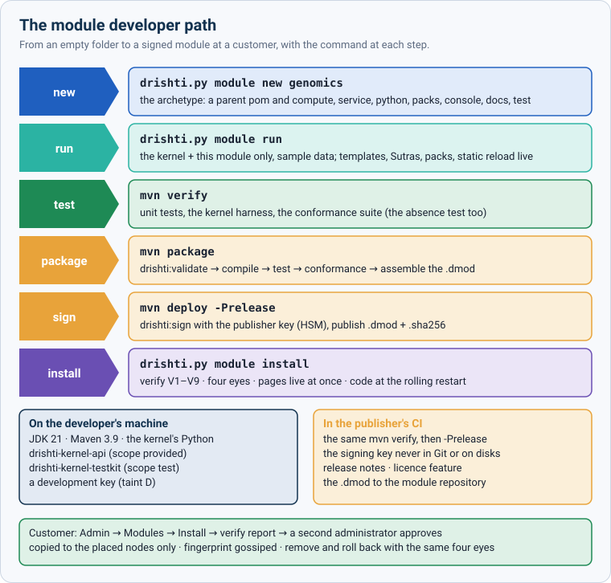

### 8.1 What the SDK contains

| Part | Contents |
|---|---|
| `drishti-kernel-api-<v>.jar` | the SPIs and service interfaces of section 2.3, Javadoc; Maven `com.ash.drishti.sdk:drishti-kernel-api`, always scope **`provided`** (the kernel supplies it at run time; never inside a `.dmod`) |
| `drishti-kernel-testkit-<v>.jar` | the harness (8.5), `ModuleConformanceSuite` (8.6) and `AbsenceSuite` (12.11); scope `test` |
| `drishti-module-parent` (pom) | the parent every module project inherits: Java 21, the versions of the shared libraries (section 4.4), the plugin's defaults, the licence-header check |
| `drishti-module-maven-plugin` | the goals `validate`, `conformance`, `assemble`, `sign`, `publish` (8.2) |
| `drishti-module-archetype` | the Maven archetype `module new` wraps (8.3) |
| `@drishti/elements-*` `.d.ts` | the Elements core typings (from ELEMENTS.md's distribution channels), the plugin.yaml format 2 schema, the kernel templates' macro reference |
| `drishti-console-api-<v>.jar` (from i4) | the Drishti Console's half: the context-builder interface (`PageContext.Builder`), the page context and the `ModuleApi` client types; scope `provided` (section 10.4) |
| `drishti_kernel` Python | the compute SDK's types and a local sandbox runner for tests (Python runs only on the kernel's workers) |
| schemas | `module.schema.json`, `needs.schema.json`, `contract.schema.json`, `plugin.schema.json` (format 2), `distribution.schema.json` (editors validate as you type) |
| `drishti.py module …` | the command line of section 7.1 plus `new` and `run` (8.3, 8.4), for teams without Maven expertise |
| a sample | the `genomics` sample module (examples in `examples/genomics/`), used by the SDK's own tests and by `drishti.genomics` |

All of it is published to the site's (or Drishti's partner) Maven repository; nothing needs the kernel's sources.

### 8.2 The module as a Maven project

One **multi-module Maven project** per module. The parent pom inherits `drishti-module-parent`, depends on `drishti-kernel-api` with scope
`provided`, lists the sub-modules and runs the `drishti-module-maven-plugin` once, after them. Each sub-module maps to one part of the
`.dmod` (section 3.2):

| Sub-module | Holds | Into the `.dmod` | Needed when |
|---|---|---|---|
| `<id>-compute` | Java compute: engines, `KindProvider`s, pivot measures, functions | `java/` | the module computes in Java |
| `<id>-service` | the `DrishtiModule` entry point, `ModuleSettings`, `@ModuleApi` controllers, the other SPIs | `java/` | it has an API or any Java |
| `<id>-python` | Python compute items and packs' Python; `requirements.txt` inside the kernel's lock; pytest | `python/` | it has Python |
| `<id>-packs` | packs (kinds, contracts, Sutras, samples), `data/needs.yaml`, lenses, `functions.yaml`, BI, feeds | `packs/`, `data/`, `lenses/`, `bi/`, `feeds/` | always (a module without kinds or Sutras has nothing to show) |
| `<id>-console` | `plugin.yaml` (format 2), its own templates, static files, i18n, Java context builders (against `drishti-console-api`), the domain Elements library | `console/`, `elements/` | it has pages beyond Sutras (section 9) |
| `<id>-docs` | README, Help, the guide, the tutorial, glossary, the docs register rows, images | `docs/` | always (the docs rule: one guide + one tutorial per feature) |
| `<id>-test` | harness tests, the conformance and absence suites, two-people tests | never packed | always |

The content-only template (economy's shape) has only `-packs`, `-docs` and `-test`; Maven builds what exists.

**The plugin's goals**, bound to Maven's lifecycle so the ordinary commands do the work:

| Phase | Goal | Does |
|---|---|---|
| `validate` | `drishti:validate` | `module.yaml` against `module.schema.json`; id and version equal the pom's; `needs.yaml`, contracts, Sutras (Rachana 1), `plugin.yaml` format 2, settings schema parse; every route, word and menu id unique; no connector or secret keys (section 5.10) |
| `compile`, `test` | Maven's own | the jars; unit tests; pytest through the `-python` sub-module |
| `verify` | `drishti:conformance` | runs `<id>-test` against the kernel harness, then the conformance checks of 8.6 that need no kernel (lints, licence headers, CSP, SRI) |
| `package` | `drishti:assemble`, `drishti:sign` | lays the files into the `.dmod` layout, writes `DMOD.MF` (SHA-256 of every entry), signs with the configured key (`dev` by default: taint `D`), writes `target/dmod/<id>-<version>.dmod` and its `.sha256` |
| `deploy` (`-Prelease`) | `drishti:publish` | re-signs with the publisher key (PKCS#11 URI, an HSM in CI), publishes the `.dmod`, its `.sha256` and release notes to the module repository |

The complete example: [genomics/pom.xml](kernel-and-modules/examples/genomics/pom.xml) and its
[project tree](kernel-and-modules/examples/genomics/project-tree.txt).

### 8.3 Creating a module: the archetype and `module new`

Two doors, one result:

```
$ mvn archetype:generate -DarchetypeGroupId=com.ash.drishti.sdk -DarchetypeArtifactId=drishti-module-archetype \
      -DarchetypeVersion=1.0.0 -DgroupId=com.example.genomics -DartifactId=genomics -Dtemplate=full -Ddomain=genomics
$ python3 tools/drishti.py module new genomics --domain genomics --template full --publisher example-labs
```

`module new` **wraps the archetype** (it runs the bundled Maven wrapper `mvnw`, so a team without Maven on the path or Maven knowledge
still gets the same tree) and then asks the three things a team usually does not know: the publisher id, the licence feature, and the
first kind's name. Templates: `content` (packs, Sutras, lenses, docs), `compute` (+ Java compute and Python), `full` (+ console pages
and a domain Elements library). The generated project builds green on the first `mvn verify` (its sample kind, Sutra, page, guide,
tutorial and tests are complete, not stubs). The transcript: [module new](kernel-and-modules/examples/cli/module-new.txt).

### 8.4 The dev loop: `module run`

```
$ cd genomics && python3 tools/drishti.py module run            # or: mvn drishti:run
```

- Starts the **kernel thin jar and its console with this module only** (and its `requires`, fetched from the module repository), a data
  folder under `target/run/`, the demo lake built from the module's `samples/`, a development licence naming its feature, the development
  key (taint `D`), on free ports printed at start (never the usual 18480/17480).
- **Hot reload** while it runs: templates, `plugin.yaml` (the live route table, section 9.8), static files, i18n, Sutras, packs,
  contracts, lenses, Help and guides reload on save (the kernel's pack reloader plus a watcher on `target/run/modules/<id>/`, which is a
  link to the sub-modules' source folders). Java code (server parts and console context builders): `module run` recompiles and restarts the module's part only
  (a few seconds; the kernel stays up, the harness's hot unload of section 4.4 is used in development before P5 uses it in production).
- `--shots` takes the docs' screenshots of the module's pages into `<id>-docs/img/` (the same driver as `tools/docs/screenshots.py`).
- `--two-people` opens two sessions as two test people (the session-isolation check by eye).
- Nothing it writes leaves `target/`; Ctrl-C removes its temporary files.

### 8.5 The test harness (kernel + one module)

- `KernelHarness.with(module("target/dmod")).demoLake().start()` boots the **real kernel** (thin jar, in process) with only this module
  (and its `requires`, fetched from the module repository), a temporary data folder (`@TempDir`), the demo lake from the module's
  samples, a development licence and key (taint `D`).
- Gives: a REST client as a test person, the `Kinds` API with fixture bindings, a console client (pages, the route table, search, Help),
  a headless browser page (Playwright) for composed pages, a Python pool, the module-off and module-removed variants, and the suites of
  8.6 and 12.11.
- Python side: `pytest` plugin `drishti_kernel.testing` (the console harness with the module mounted).

### 8.6 The conformance suite

Every module passes it to be signed with a publisher key (`drishti:sign` refuses a release build that has not passed it); `module verify
--deep` runs it again at the customer.

| # | Check | How |
|---|---|---|
| C1 | **No kernel internals** | ArchUnit: no class imports `com.ash.drishti..` outside `kernel.api`; the jar's classes resolve against the API loader alone; the console jar's classes import only `drishti-console-api` and the module's own packages |
| C2 | **No bespoke UI** | templates use only `kernel/*` layouts and `kernel/elements.html` macros plus the module's own Elements library; no `<table>`, `<canvas>`, `<svg>` drawing or hand-made widgets outside Elements components; JS imports only `@drishti/elements-*` public entry points |
| C3 | **Theme tokens only** | CSS lint: colours, spacing, fonts and radii are `var(--…)` tokens; no hex, rgb or named colours; no `!important` over kernel classes |
| C4 | **`drishti_` asset prefix** | every file under `static/` and `elements/` is `drishti_<name>` (the static-asset rule); vendor libraries are not allowed in a module (they belong to the console's vendored set; the hash scan of section 11.5) |
| C5 | **CSP-clean** | no inline `<script>`, no `on*=` attributes, no `javascript:` URLs, no `eval`/`new Function`, no remote origins; SRI hashes for every static file written into the manifest |
| C6 | **Routes namespaced** | every route under `/m/<id>/`; aliases and words checked against the reserved names (9.9); no route registered by code (no controller or `@RequestMapping` in a console jar) |
| C7 | **Help, guide, tutorial present** | `docs/README.md` with front matter; a Help section; one guide and one tutorial per `docs.features` row; the docs gates (links, images, register) on the module's `docs/` |
| C8 | **Data contracts present** | every kind in `provides.kinds` has a contract (`contract-format: 1`) with `binding-hint:` and no `storage:`; every need names a contract range |
| C9 | **No secrets, no connectors** | the secret patterns and connector keys of section 5.10 in every file, including templates and samples |
| C10 | **Licence headers** | the publisher's header on every source file (the parent pom's check) |
| C11 | **Functions answer** | every word in `functions.yaml` answers through the harness (a page, a view or an API) |
| C12 | **Two people at once** | the session-isolation test: two people, different row rules, concurrent requests, no crossed data in any page, API or cache |
| C13 | **Off means gone** | the module switched off: every surface refused (the existing guarantee, ACCESS_MODEL section 6) |
| C14 | **Absent everywhere** | the absence suite of section 12.11: install, record every surface, remove, assert each one gone and nothing left in the registry |
| C15 | **Class loader unloads** | 50 load/unload cycles in the harness; the loader is collected (section 4.4) |

### 8.7 The release path

1. **Version**: semver in the pom and `module.yaml` (validated equal); release notes from the module's CHANGELOG.
2. **Build in CI**: `mvn -Prelease deploy` on the publisher's CI: `verify` (tests, harness, conformance), `package`, `sign` with the
   **publisher key** (an HSM through PKCS#11; the key never on disk or in Git), `publish` to the module repository with its `.sha256`.
3. **Certificate**: the publisher's certificate is issued under the Drishti module root (section 13.1, question Q7); a partner signs its
   own modules with its own certificate; Drishti signs banking, economy and capital markets.
4. **Deliver**: the customer receives the `.dmod` (download from the module repository, or a distribution build of section 6.6).
5. **Install at the customer**: Admin → Modules → *Install module…* or `module install` (section 7.1): verify report (V1–V9), four eyes,
   active on approval (pages at once for content and templates; code at the rolling restart in P2: section 9.8).
6. **Support**: `module info` and the support bundle carry the module's id, version, publisher, signature fingerprint and taint.

### 8.8 From start to delivery: the steps

| Step | Who | Command | Result |
|---|---|---|---|
| 1 Get the SDK | developer | add the module repository to `~/.m2/settings.xml` (or unpack the SDK zip) | `drishti-module-parent`, the API, the testkit, the archetype |
| 2 Create | developer | `drishti.py module new genomics --template full` (or `mvn archetype:generate …`) | a project that builds green |
| 3 Model the data | developer | edit `<id>-packs`: contracts, `needs.yaml`, samples | kinds the kernel can bind (section 5) |
| 4 Show it | developer | Sutras first; composed pages in `<id>-console` (section 9) | pages, words, menus, Home cards |
| 5 Compute | developer | Java in `<id>-compute`/`-service`, Python in `<id>-python` | engines, `KindProvider`s, APIs |
| 6 Run | developer | `drishti.py module run` | the kernel + this module, hot reload |
| 7 Document | developer | `<id>-docs`: guide, tutorial, Help, glossary; `module run --shots` | the docs gates pass |
| 8 Test | developer, CI | `mvn verify` | unit, harness, conformance (C1–C15), absence |
| 9 Package | CI | `mvn package` | `target/dmod/genomics-0.1.0.dmod` (development-signed) |
| 10 Sign and publish | publisher's CI | `mvn -Prelease deploy` | signed `.dmod` + `.sha256` in the module repository |
| 11 Install | customer administrators | `drishti.py module install genomics-0.1.0.dmod` + approval | verify report, four eyes, LOADED |
| 12 Bind data | customer data administrator | Admin → Data bindings (or `drishti.py bindings set …`) | needs `BOUND` (section 5) |
| 13 Upgrade or remove | customer administrators | `module upgrade` / `rollback` / `remove` | section 7.4 and section 12 |

### 8.9 Worked example: the genomics sample module

The files, all in `examples/genomics/` (laid out as inside the `.dmod`; the project tree shows the source sub-modules):

| File | Shows |
|---|---|
| [project-tree.txt](kernel-and-modules/examples/genomics/project-tree.txt) | the Maven project and where each folder lands in the `.dmod` |
| [pom.xml](kernel-and-modules/examples/genomics/pom.xml) | the parent pom: `provided` kernel API, seven sub-modules, the plugin's goals, the release profile |
| [module.yaml](kernel-and-modules/examples/genomics/module.yaml) | the manifest of a partner-published module with Java, Python, a computed kind and pages |
| [console/plugin.yaml](kernel-and-modules/examples/genomics/console/plugin.yaml) | format 2: routes, API proxy, words, menus, Home cards, slots, settings, search |
| [console/templates/variant_explorer.html](kernel-and-modules/examples/genomics/console/templates/variant_explorer.html) | a composed page (section 9.11) |
| [packs/genomics/sutras/variant-call.v1.sutra.yaml](kernel-and-modules/examples/genomics/packs/genomics/sutras/variant-call.v1.sutra.yaml) | a Sutra (tier 1) |

### 8.10 Banking's equivalent

Banking becomes the same shape at `modules/banking/` in this repository (Q9): `banking-compute` ← `drishti-compute-banking`,
`banking-service` ← `drishti-banking`, `banking-python` ← `drishti_banking` and the packs' Python, `banking-packs` ← `config/packs/banking/`
(+ its lenses, BI and lake forms), `banking-console` ← `drishti-console/plugins/banking/` (plugin.yaml format 1 → 2, the nine route files
reduced to context builders, the ~35 API pass-throughs replaced by the kernel's proxy), `banking-docs` ← the seven banking guides and nine
tutorials, `banking-test` ← the banking tests, the VaR exact check and `BankingAbsenceTest`. The file-by-file mapping:
[banking/project-mapping.txt](kernel-and-modules/examples/banking/project-mapping.txt); the format-2 plugin file:
[banking/console/plugin.yaml](kernel-and-modules/examples/banking/console/plugin.yaml).

### 8.11 The developer guide (outline)

A new guide, `docs/guides/MODULE_DEVELOPER_GUIDE.md` (P2; one guide + one tutorial, per the docs rule):
1. What a module is; the kernel API and its versions. 2. The Maven project, `module new`, the archetype. 3. Data: kinds, contracts, needs;
testing with the demo lake; never connectors. 4. Java: `DrishtiModule`, the SPIs one by one with examples, REST under your prefix.
5. Python compute items. 6. Pages: Sutras first, composed pages from Elements, your domain library, CSS on tokens, routes and the API
proxy. 7. Lenses, functions, menus, Home cards. 8. Help, guides, tutorials, glossary. 9. Settings schema. 10. `module run`, the harness,
the conformance and absence suites. 11. Build, sign, publish, install. 12. Upgrades, deprecations, removal and what your users keep.
13. Security rules. 14. Worked examples: genomics, then banking. Tutorial: *Build the genomics sample module from scratch*.

## 9. Module UI and the developer's own pages

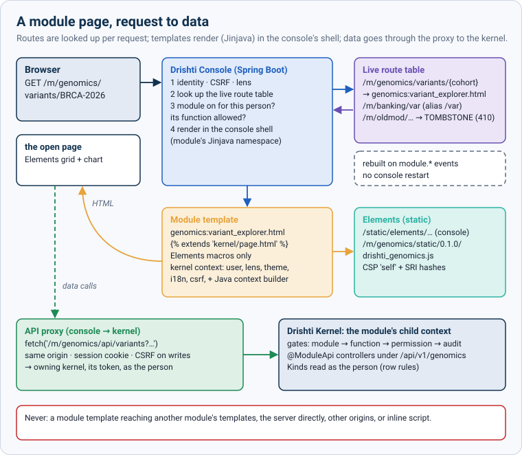

### 9.1 Three tiers, preferred first

| Tier | What the developer writes | Code | When |
|---|---|---|---|
| **1 Sutras** | YAML pages in Rachana (`packs/<pack>/sutras/*.sutra.yaml`): strips, tables, charts, linked entities, Explain, keys | none | **first choice**: an entity's page, a list, a dashboard of a kind; the kernel draws them, search and Help find them, the designer edits them |
| **2 Composed pages** | the module's **own templates** (Jinja syntax, rendered by Jinjava in the console), built only from Drishti Elements macros and components, rendered inside the console's shell; optional Java context builder | a template (+ a small handler) | a screen Sutras cannot express: a workflow, an explorer with linked filters, a playground |
| **3 A domain Elements library** | `elements/<lib>/`: ES modules and custom elements (`<drishti-genomics-variant-track>`) on the Elements core API, CSS on tokens, `.d.ts`, a manifest | JavaScript | a visual the general library lacks (a genome track, a VaR limit bar); used by tiers 1 and 2, never alone |

A tier-3 component is offered to Sutras as a panel type and to composed pages as a tag; the no-bespoke-UI rule holds at every tier
(conformance C2). Most modules need tier 1 only; banking uses all three.

### 9.2 Serving a module's own templates: the namespace and the loader

- **One namespace per module**: a module's templates are addressed `<id>:<path>` (`genomics:variant_explorer.html`). The console builds
  **one Jinjava instance per module** (autoescape forced on, Jinjava's restricted methods and properties, the console's filters and
  functions only) whose resource locator has exactly two prefixes: `kernel` → the console's **public** platform templates
  (`kernel/page.html`, `kernel/elements.html`, `kernel/partials/*`; the prefix keeps its name because it is the platform's published
  layout API), and `<id>` → the module's `console/templates/`. Nothing else is reachable: not the console's private templates
  (`terminal/*`, `admin/*`), not another module's namespace.
- The console's own pages keep their instance; it has **no** module locator at all, so a platform template cannot include a module's
  (principle 1, structurally rather than by review).
- Parsed-template cache per module instance (in memory, keyed by `<id>/<version>`); dropping the instance drops its cache.
- Today's `templates:` list (format 1) and the shared loader chain (`Jinja2Templates(directory=[web, plugin dirs…])`, where a module's
  file could shadow a kernel file of the same name) are **removed** with format 2.

### 9.3 Layouts, Elements macros and extension slots

- A composed page **extends `kernel/page.html`** (the shell: top bar, menus, command line, notices, the live channel, the theme) and fills
  its blocks: `title`, `assets`, `page`, optional `aside` and `keys`. `kernel/page.html` is part of the kernel API (`plugin-api`
  version; its blocks change only with a MAJOR).
- It uses only the macros of `kernel/elements.html` (page header, KPI strip, filter bar, grid, chart, map, tabs, panel, form fields,
  notices, Explain button, export) and tags of Elements libraries (kernel or its own). Each macro emits the markup of an Elements
  component with its data source; the JavaScript is the kernel's.
- **No override of kernel templates.** A module that ships `terminal/_base.html` or any `kernel/…` path is refused at V6 (*claims a
  kernel template*). The only ways into a kernel page are **declared extension slots**:

| Slot | Kernel page | Today's equivalent |
|---|---|---|
| `home.landing`, `home.cards` | Home, per lens | landings (`trading_landing`), lens cards |
| `pivot.top`, `pivot.below` | Pivot, by lens or kind | `screens.pivot` (the MR lens panes) |
| `entity.panels` | an entity's view, by kind | view augmenters' panels |
| `admin.tabs` | Admin, a tab | `/admin/scopes` |
| `help.section` | Help centre | `help.yaml` heads |
| `explain.drawer` | the Explain drawer, by measure | `Explainer` SPI's text |

  A slot template is in the module's namespace, gets the slot's context only, and is drawn in an isolated container
  (`<section data-module="banking">`) so its removal leaves the page whole.

### 9.4 The template context the console provides

| Name | What | Not included |
|---|---|---|
| `user` | id, display name, roles, locale | tokens, cookies, the session id, other people |
| `lens` | the person's current lens id and title | — |
| `theme` | mode (dark/light), density, token set name | raw colours (CSS uses tokens) |
| `t(key, **args)` | i18n: the module's bundle, then the kernel's | — |
| `csrf_token` | for forms posting through the proxy | — |
| `module` | `id`, `version`, `title`, `settings` (only keys listed in `settings.expose-to-pages`) | secrets (there are none), other settings |
| `route` | the route's id, typed params, title | the raw request |
| `url_for(route_id, **params)` | a link to the module's own route (canonical address) or `kernel:<page>` | another module's routes (use command words or `link()` to entities) |
| `api(path, **query)` | the proxied URL of one of its declared API endpoints (9.5) | the server's address |
| `asset(path)`, `elements(lib)` | versioned `<link>`/`<script type=module>` tags with SRI (9.7) | other modules' assets |
| `product`, `business_date`, `now` | the brand (distribution), the business date | — |
| the builder's map | whatever the module's optional context builder returns (plain values: strings, numbers, lists, maps, records) | objects with behaviour, callables |

From i4, a **context builder** (`handler: VariantExplorerContext` → `com.example.genomics.console.VariantExplorerContext`, a class in the module's
`console/java/` jar implementing `PageContext.Builder` from `drishti-console-api`) is given a read-only page context (the person, the typed
params, a `ModuleApi` client bound to the module's declared endpoints as that person) and returns a map of plain values. It cannot register
routes, read the raw request, set cookies or keep state (no mutable fields: an architecture test): per-person data lives only in the call
(session isolation). It replaces the Python handlers of earlier drafts (decision Q14, superseded: section 15). In i2 a module declares no `handler:` at all
(section 14.2.1).

### 9.5 How a page calls its module's API: the console's API proxy

- The browser calls **`/m/<id>/api/<path>`** on the console's own origin; the console's proxy forwards to the server's
  **`/api/v1/<prefix>/<path>`** on **the kernel that owns the module** **as the person** (the console's `KernelClient` for that kernel, with
  that kernel's token only: section 10.6), adds the request id and
  `Drishti-Module: <id>`, and streams the answer back (JSON, JSON Lines, Arrow, xlsx keep their media types).
- **Only declared endpoints** pass: `api.proxy` in `plugin.yaml` lists method + path patterns (+ an optional permission); anything else is
  404 at the console. Non-GET methods need the CSRF token. Timeouts and size limits come from `api.limits`.
- The server applies its gates in order (module → function → permission → audit, section 4.5); the proxy adds nothing it could bypass.
- The proxy keeps **no per-person state**: no cache unless keyed by person and module; it is the same code for every module
  (session-isolation rule).
- This replaces today's hand-written pass-throughs (banking's ~35 `/api/var/**`, `/api/exposure/**` … handlers); their console paths stay
  as `api.aliases` for one release.
- Elements data sources (`source=api("/variants")`) and the module's own JS (`fetch(api.url("/variants"))` from the Elements data
  library) both use it; the JS never builds URLs to other paths (lint C5, CSP `connect-src 'self'`).

### 9.6 Template sandboxing: what is forbidden

| Forbidden | Enforced by |
|---|---|
| Inline `<script>`, `on*=` attributes, `javascript:` URLs, `eval` | CSP `script-src 'self'` (nonce only for the console's shell), conformance C5 |
| Raw HTML from data (the `safe` filter, `Markup`) | the module's Jinjava instance has no `safe` filter; autoescape forced; only Elements macros emit markup |
| Styles other than tokens; `style=` with colours | conformance C3; CSP `style-src 'self'` |
| Network calls to other origins; `<iframe>`, remote images, fonts or scripts | CSP `connect-src 'self'`, `frame-src 'none'`, `img-src 'self' data:`; lint C5 |
| `fetch` to anything but `/m/<id>/api/…` | lint C5 (CSP cannot restrict paths), proxy 404 for undeclared endpoints |
| Other modules' templates, assets, JS modules or globals | the per-module loader (9.2); the Elements loader refuses another module's library; lint C1 |
| Console internals: private templates, the request, the session, the `KernelClient`, Java methods on context values | the Jinjava sandbox (restricted methods and properties; the context holds plain maps and records only); the context of 9.4 is all there is |
| Forms posting outside the proxy | lint; the console's CSRF check (Spring Security) on every non-GET |

### 9.7 Static assets

- Served at **`/m/<id>/static/<version>/<path>`** from the module's `console/static/` (and `elements/<lib>/` at
  `/m/<id>/elements/<lib>/<version>/`), read-only, `Cache-Control: public, max-age=31536000, immutable`: the version in the path **busts the
  cache** on upgrade; rollback serves the older version's path again.
- **SRI**: `drishti:assemble` writes the SHA-384 of every static file into `console/assets.lock`; `asset()` emits `integrity=` from it; the
  console refuses to serve a file whose hash differs (tamper check at run time, besides V2 at load).
- **CSP**: `script-src 'self'` and `style-src 'self'`; no inline, no remote origins; the module cannot change the policy.
- **`drishti_` prefix** on every file (C4); vendor libraries are the kernel's only.
- Served only to people for whom the module is on and whose lens uses it (today's `_module_asset_refused`, unchanged); a removed module's
  paths answer 410 (section 12.10).

### 9.8 Routes: declared, namespaced, live

- **Declared, never registered by code.** Every page and every API pass-through is an entry of `plugin.yaml` (`routes:`, `api.proxy:`).
  No module code runs at import to add a route (format 1's `routers:` and FastAPI `include_router` are removed). A route names what draws
  it: `sutra:` (tier 1), `page:` (tier 2, with an optional `handler:`), or `moved:` (a 308 to another route for one release).
- **The namespace**: every route lives under **`/m/<id>/…`**; ids are unique in the module and are what links, menus, cards and words
  use (`route: variant-explorer`), never raw paths.
- **The live route table.** The console registers its own pages at start as today plus **one dispatcher** for `/m/{id}/{path}` and one
  fall-through for declared aliases (consulted only after the kernel's routes miss). The dispatcher looks the path up **per request** in an
  immutable **route table snapshot**; a new snapshot is built from the loaded modules' `plugin.yaml` files and swapped atomically when a
  `module.*` event or a cluster config version arrives (copy-on-write; no lock on the request path; nothing per person in it). Each entry
  carries the module, function, permission and state, so the dispatcher answers: render, *not available* (404 for an off module, as today),
  or **tombstone** (410 for a removed one, section 12.10).
- **What needs no console restart in P2**: switching a module off or on; **removing** a module (every page, word, menu, asset gone at
  once); installing, upgrading or rolling back a module whose console part is **declarative** (Sutras, templates, static, menus, words,
  Help: no `handlers:`), once the server reports it loaded.
- **What still needs a restart in P2**: a module's **console context builders** (Java) newly installed or changed (the console loads a
  module's console jar only at start until P5, so no two versions of it ever share a console process; a rolling restart of the consoles
  applies it), and the server's Java and Python code
  (section 4.10). Until then the new routes are listed to administrators as *installed, restart pending* and absent for everyone else.
  P5 makes both hot (with the leak check).
- **Deep links and bookmarks.** The canonical address is `/m/<id>/<path>`; an alias answers the same page (200) with
  `<link rel="canonical">`; page state lives in the query string (Elements' URL state), so a link reproduces the view. A path that changes
  between versions is declared `moved:` (308 for one release). Upgrades keep route ids and paths unless a `moved:` says otherwise.
  After removal, a bookmark lands on the removed-module page (12.10), and Drishti's own bookmark list marks it *needs module X*.

### 9.9 Aliases, short words and reserved names

- A module may declare **short path aliases** (`alias: /variants`, banking's `/var`) and **command words**. Both are checked at V6 against
  the **reserved names**: the kernel's paths (`/t`, `/pivot`, `/bi`, `/build`, `/admin`, `/help`, `/data`, `/static`, `/m`, `/api`,
  `/embed`, `/public`, `/healthz`, `/readyz`, …), the kernel's words (`PIVOT`, `BI`, `FUNC`, `FORM`, `HELP`, `WHAT`, `DATAMAP`, `EXPORT`,
  …), the site's own list (`config/reserved-names.yaml`), and every name already claimed by an installed module.
- **Conflicts are refused at load with the reason**, never resolved by order: *genomics 0.1.0 refused: alias /variants is claimed by
  biobank 2.1.0 (route biobank:variants)*. The first-installed keeps it; the newcomer is refused whole (refused means absent).
- Path aliases outside `/m/` are allowed for **Drishti-signed modules**; partner modules get them only when the site grants
  `drishti.modules.<id>.allow-aliases: true` (four eyes) (question Q15). Command words are allowed for all, checked the same way.

### 9.10 Menus, functions, Home cards and search, declared

`plugin.yaml` declares the module's **menu entries** (merged into the sitemap's menus, tagged `domain: <id>`), its **words** (each to a
route, with its grammar), **Home cards and chips** per lens, **slots**, the **settings page** (generated from the settings schema), and extra
**search** entries. The kernel builds every door from these declarations plus the module's Sutras, functions and Help; nothing is drawn
from module code. That is what makes removal complete: withdrawing the declarations withdraws the doors (section 12.3).

### 9.11 Examples: a genomics variant explorer, banking's VaR explorer

**Genomics** ([plugin.yaml](kernel-and-modules/examples/genomics/console/plugin.yaml),
[variant_explorer.html](kernel-and-modules/examples/genomics/console/templates/variant_explorer.html)): the route

```yaml
- id: variant-explorer
  path: /variants/{cohort}
  page: variant_explorer.html          # genomics:variant_explorer.html
  function: VARX
  permission: genomics:read
  alias: /variants
```

draws a page that extends `kernel/page.html`, puts a KPI strip (a partial of its own), a filter bar, an **Elements grid** over
`api("/variants", cohort=…)` and an **Elements chart** (allele-frequency histogram fed by the grid) side by side, and the module's
tier-3 `<drishti-genomics-variant-track>` following the grid's selection. No script in the template; the JS is the kernel's Elements
plus `drishti_genomics-explorer.js`.

**Banking's VaR explorer** today is `terminal/var.html` included through the shared loader, `var_routes.py`'s FastAPI routes and ~10
pass-throughs, and the `drishti_var-*.js` files. As a composed page:

```yaml
- { id: var-explorer, path: "/var/{scope...}", page: var_explorer.html, function: VAR, alias: /var }
```

`banking:var_explorer.html` extends `kernel/page.html`; it has no handler (declarative, section 14.2.1): the scope words (`DESK RATES`)
go to the module's API as they are and are parsed there, on the kernel; the
page is a KPI strip (VaR, ES, limit use), an Elements grid of contributions over `api("/var/contributions", scope=…)`, an Elements chart
of the P&L distribution, and `drishti-risk`'s `<drishti-risk-limit-bar>` and `<drishti-risk-hierarchy>`; every number is computed on the
server (the server-computes-risk rule). `/var` stays as the alias, so bookmarks and typed `VAR …` keep working.

## 10. The Drishti Console on Spring Boot (a separate UI tier)

**Decided by the owner on 2026-11-08:** the console moves from Python (FastAPI and Jinja) to a **Spring Boot web application**, to gain
Java's multi-threading, and it **stays separate from the kernel**: UX work must never make the BI kernel unstable, and one UI must be able
to stand in front of several kernels. The move is **its own release, i4** (owner, 2026-11-08; section 14.2). Until then today's Python
console serves modules' declarative console parts (section 14.2.1), so that no module changes when i4 re-hosts them in Java. This section is the design; sections 9 (module UI) and 12
(unload) are written for the Java console.

### 10.1 Why

**Why Java:**

- **One language for modules.** A module's console part becomes declarations, templates, static files and, when needed, small Java
  context builders. There is no Python in a module's console part, so one toolchain builds the module (section 8.2), and one conformance
  suite checks it.
- **Virtual threads for fan-out.** A page that asks the kernel five questions (a KPI strip, a grid, a chart, the menus and the person's
  stamps) asks them **at once** on Java 21 virtual threads, with no event loop to keep free of blocking calls. Today the Python console
  depends on `async` discipline: one blocking call in a handler stalls every person served by that worker.
- **One plugin model.** The kernel and the console load modules with the same library (`drishti-module-runtime`, 10.4) instead of a
  Java loader and a Python loader that must agree.
- **Fewer cross-person leak risks.** The 2.9.11.b drill found engine state in a module-level Python global shared by every person (the
  session-isolation rule). In the Java console, per-person state lives only in the request and the session. Singletons are stateless
  services checked by an architecture test, and the conformance suite runs two people at once (C9).
- **One security stack.** Spring Security handles sign-in, enterprise SSO (section 10.11), CSRF, headers and per-kernel tokens in the
  console, and the kernel already uses it. i4 brings SSO on it; trust and security (j) builds roles, licensing and hardening on the same
  stack, not on two.

**Why separate from the kernel:**

| Concern | In the kernel | Separate console (decided) |
|---|---|---|
| Isolation | a heavy page render, a template bug or the console's garbage collection shares the heap and CPU with VaR and pivot compute | UI load, GC pauses and crashes **never touch compute**; a console restart drops no computation |
| Scaling and restart | one unit: scaling the UI scales the compute, and restarting for a template change restarts the engines | consoles scale out on cheap machines and restart (rolling) on their own; kernels keep their caches warm |
| Attack surface | sign-in pages, uploads, templates and the static file server would live inside the data and compute process | the kernel exposes only its REST API to consoles and clients; the browser-facing surface lives in the console |
| Many kernels | a kernel's UI shows only that kernel | **one console in front of many kernels** (10.6): finance production and a genomics cluster side by side |

### 10.2 The tiers


- **Browser**: Drishti Elements, the Sutra renderer, Calc's Pyodide worker (Python in the browser, 10.7). It talks to its console's origin
  only (CSP `connect-src 'self'`).
- **Drishti Console**: one or more `drishti-console-web` processes. They hold no data and run no compute. They render pages, serve
  Elements and module static files, keep sessions, and proxy API calls to the right kernel as the person.
- **Drishti Kernel**: one or more kernels or clusters, each with its own modules, data and registry. Consoles reach them over HTTPS (later
  also Arrow Flight).
- **Python workers**: managed by the kernel on its compute nodes, sandboxed. They serve notebook cells, Python compute packs, BI Python
  items, transforms and feeds. **No Python runs in the console.**

### 10.3 The console application

| Part | Design |
|---|---|
| **Application** | `drishti-console-web`: Spring Boot 3, **Spring WebMVC** (servlet, not WebFlux) with `spring.threads.virtual.enabled: true`, so every request runs on a virtual thread and blocking code is the simple, correct style. A Maven module of its own, shipped as `drishti-console-<version>.jar` beside the kernel's jar, built on Java 21 (no JDK 25 feature). |
| **Templates** | **Jinjava** (HubSpot, Apache 2.0), a Jinja-compatible engine for Java, so the 148 templates (10,856 lines) and the 6 macro files port mostly mechanically. One Jinjava instance for the console's own templates and **one per module** (the namespaces of section 9.2). Autoescape is forced on, the sandbox restricts methods and properties, and the context holds only plain maps and records (10.3.1). |
| **Static files and Elements** | **unchanged**: the files under `web/static` (Elements libraries, the vendored libraries with `VENDOR.md`, CSS on tokens, images, Calc, the gallery) move as they are and are served by the console with immutable caching, SRI and CSP. Elements is governed as the one controlled set of UI statics (section 11). |
| **Sessions** | **Spring Session JDBC**. A single console uses **SQLite** (a file under its data folder). Several consoles use **PostgreSQL**, the site's one database. **No migrations**: the session tables are written into the two complete schema files (`schema-sqlite.sql`, `schema-postgres.sql`), `initialize-schema: never`, and the connection settings sit in `config/db/database.yaml`, not in `application.yaml` (the database rules). The session holds the console's state only: the person, their per-kernel server sessions and tokens (encrypted attributes), CSRF, the current kernel and lens. The kernel's session (`/api/v1/auth/sessions`) stays the authority on who the person is. |
| **Security** | **Spring Security**: today's sign-in (the console verifies a password through the identity kernel's `POST /api/v1/auth/login` with its service token and never sees a hash), the session cookie (`HttpOnly`, `Secure`, `SameSite=Lax`), CSRF on every non-GET, the same-origin check, the security headers and CSP from one filter chain. Per-request kernel tokens are minted per kernel (10.6). **Enterprise SSO** (OIDC first, SAML 2.0, optional LDAP and Kerberos) in the same chain: section 10.11. |
| **Talking to kernels** | `KernelClient`: one per kernel connection, on the JDK `HttpClient` (HTTP/2, a pool per kernel), with Spring's `RestClient` on top. Page handlers fan out on virtual threads (`Executors.newVirtualThreadPerTaskExecutor()`, structured as one task per question, with a deadline per page). Server answers stream through unchanged (JSON, JSON Lines, Arrow IPC, xlsx), and the console never converts JSON to Arrow (today's rule in `core/arrow_answer.py`). Sticky routing by selection token and the entry-node discovery of `backend.urls` move as they are (`core/backend.py`, `core/cluster.py`). **Later, Arrow Flight** for bulk reads ([FLIGHT_GUIDE.md](../guides/FLIGHT_GUIDE.md)): the client gains a Flight path behind the same interface. |
| **Live channel** | today's `/api/channel` (server-sent events relayed from the kernels) is served by the console on a virtual thread per connection, so thousands of open tabs cost no platform threads. A tab receives only events for its person, kernel and modules (session isolation). |
| **Configuration** | `config/console/application.yaml` (the console's own settings: listen address, the `kernels:` list, distribution, limits); database settings in `config/db/database.yaml`; secrets as `${secret:…}` references. Example: [examples/console/application.yaml](kernel-and-modules/examples/console/application.yaml). Every key goes into [CONFIGURATION.md](../admin/CONFIGURATION.md) (the one-config-document rule). |

#### 10.3.1 What does not port mechanically, and how it is replaced

| Today (Python, Jinja2) | Count in templates | In the Java console |
|---|---|---|
| Standard filters (`urlencode`, `length`, `join`, `replace`, `tojson`, `forceescape`, `round`, `lower`, `map`, `format`, `selectattr`, `default`, `sort`, `first`, `last`, …) | about 750 uses | Jinjava's built-in filters of the same names. A **render-equality test** renders every template with recorded contexts in both engines and diffs the HTML, so each difference is found by a test, not by a person. |
| Drishti's own filters (`product`, `half_up`, `the`, `live`, `connector`, `both`, `bi`) | about 20 uses | Jinjava `Filter` classes in Java with the same names and the same unit tests. |
| Python callables as globals (`admin_form`, `when_local`, `known_local`, `edition_of(request)`, `design_on`, `smat_on`, settings values) | per page | `ELFunctionDefinition`s or values in the template context. Nothing receives the raw request: `edition_of(request)` becomes a `lens` value in the context (section 9.4). |
| Python methods called on values (`.items()`, `.get(…)`, `.startswith(…)`, `.split(…)`, `%`-formatting) | a few hundred | Jinjava supports `.items()` and dictionary access. Python string methods become filters (`startswith`, `split`), found by a scan and rewritten by a script during the port. |
| ``, loop scoping, `` with arguments, `` blocks | a few | checked one by one in the week-1 spike. Where Jinjava differs, the template is rewritten to the plain form that both engines read the same way. |
| `safe` and `Markup` (7 uses) | 7 | allowed only in the console's own templates for markup that Elements macros build; module namespaces have no `safe` (section 9.6) |
| Route handlers that assemble context in Python (`routes/*.py`, 13,357 lines; `core/*.py`, 20,140 lines) | — | Java controllers per route group (10.8), and ports of `core/` helpers (menus, search, facts, designer forms, lakes, guides) as services. This is the bulk of the work. |

**Engine choice:** Jinjava is recommended over **Pebble** (faster and compiled, but Twig-like syntax, so every template is rewritten by
hand) and over **Thymeleaf** (a full rewrite in another model). Decision gate: if the week-1 spike measures a page render more than 20%
slower than today's Jinja2, or finds a gap that cannot be rewritten, Pebble is the fallback (open question O1).

### 10.4 One module runtime library, two hosts

The runtime is the glue drawn in section 1.1's picture.

- **`drishti-module-runtime`** (a Java library, a Maven module of the kernel's build, published with the SDK) is the **one
  implementation** of: reading `module.yaml` and `plugin.yaml`; the verification checks V1–V9 (signature, hashes, kernel and Elements
  ranges, claims, reserved names); the **class loader per module** with its export list; the **live route table** (immutable snapshots
  swapped on events, section 9.8); tombstones; the **unload sequence's** generic steps and the inventory that the **absence suite** records
  (section 12).
- **Built** in `drishti-module-runtime` (package `com.ash.drishti.module.runtime`; [DEVELOPER_GUIDE.md section 1.5](../guides/DEVELOPER_GUIDE.md#15-the-module-runtime)):
  the `.dmod` packer, unpacker and hash list (`Dmod`; V2 verifies the hashes, an absent signature is a Health note until j), the manifest
  with every field of section 3.3 (`DmodManifest`), discovery (`ModuleDiscovery`), V1–V3 and V5–V8 (`ModuleVerifier`, `Claims`), V4 and the
  load order (`DependencyResolver`), the class loader per module (`ModuleClassLoader`, a Spring `SmartClassLoader` so no Spring cache keeps a
  module's classes), the child Spring context, the live route table (`RouteTable`), the registry of contributions with the unload order of
  section 12.2 (`Contributions`) and the leak check (`LeakCheck`), behind one facade (`ModuleRuntime`) and the host's hooks (`ModuleHost`).
  Its tests build a module at test time and load, route and unload it leak-free. The kernel's start calls it once banking is a module.
- **Two hosts.** The **kernel** uses it for a module's server parts: Java and its child Spring context, Python items, packs, REST. The
  **console** uses it for the `console/` part: declared routes, the per-module Jinjava namespace, static files and the domain Elements
  library, Help pages and **context builders**. Each host adds only its own kind of contribution. No check, loader or route table exists
  twice (no dual machinery).
- **Which part goes where.** A `.dmod` is one file. The kernel unpacks it and loads everything except `console/` and `elements/`. A
  console receives **only the console part**: `console/`, `elements/` and `docs/`, with `DMOD.MF` and `DMOD.SIG`, streamed by the kernel
  (`GET /api/v1/modules/<id>/bundle/<version>`). The console verifies the bundle against the signed hash list itself (V2 on every host) and
  loads it only when the kernel reports the module active.
- **Context builders are Java** (from i4). A composed page's optional handler is a small class implementing
  `PageContext.Builder` from **`drishti-console-api`** (the console's half of the SDK, scope `provided`). It is given the person, the
  route's typed parameters and a `ModuleApi` client bound to the module's endpoints *as that person*, and it returns a map of plain
  values. It cannot register routes, read the raw request, set cookies or keep state (the architecture test fails a static or instance
  field that is not final and immutable). It lives in `console/java/<module>-console.jar`, loaded in the console's class loader for the
  module. **This supersedes the Python handlers** of decision Q14 (section 15).
- **The API proxy is console → kernel.** `/m/<id>/api/<path>` on the console forwards to `/api/v1/<prefix>/<path>` on the kernel that owns
  the module, as the person, with that kernel's token (section 9.5).
- **Unload in the console** (section 12.2, step 6): the module's route-table entries become off or tombstones, its Jinjava environment and
  template cache are dropped, its static and Elements mounts are withdrawn, and its context-builder class loader is released. At the
  console's next rolling restart in P2 the loader goes; in P5 it goes at once, under the same leak check as the kernel's.

### 10.5 The console as a placement role (i4)

- In the cluster design (section 4.11), **a console is a node with the role `console`**. It registers with the cluster as a light
  member: no data, no compute, no vote in leader elections, no lake. It receives the cluster configuration version, the registry's
  module events and the console bundles placed on it.
- A module's **`console` part** (class `light`) is placed **on console nodes** like any other part: `console: { roles: [console] }` for every
  console, or named consoles (`consoles: [console-research]`) for a module that only some consoles show. **No compute node holds or
  serves a console part**, and no console holds server parts.
- The deployer (section 7.6) plans console nodes like the others: the plan's node × part matrix has a column per console, the
  two-phase activation stages the bundle on each placed console (verify, load into a staging route table) and activates them together
  with the kernel nodes.
- Drift covers consoles too: a console with a missing or other-version bundle is **red** in the matrix and serves the module's pages as
  *unavailable* until *Resync*.
- The example: [examples/site/placement.yaml](kernel-and-modules/examples/site/placement.yaml) (two consoles, one of them for
  research only).

### 10.6 One console, many kernels (i4)

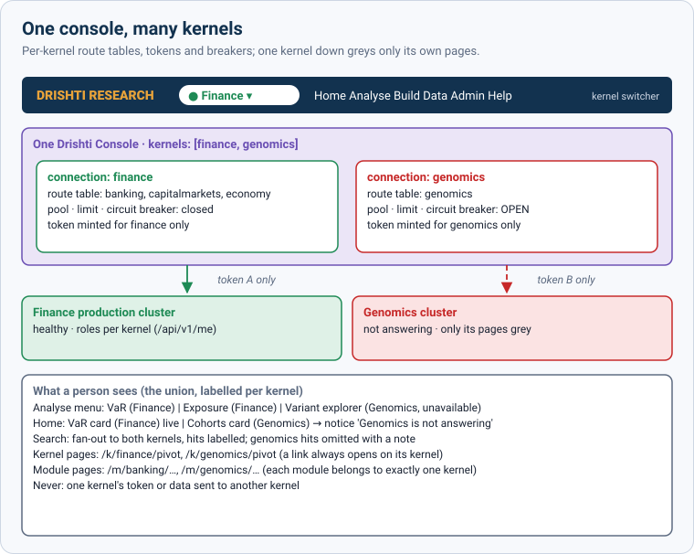

- **Configuration.** A console lists its kernels in `kernels:` (example:
  [examples/console/application.yaml](kernel-and-modules/examples/console/application.yaml)). Each entry has an id (`finance`, `genomics`), a
  label and colour for the header, the entry URLs (`backend.urls` with discovery, as today), its own token secret or OIDC audience, and
  limits (connections, timeouts). One kernel is the **identity kernel**, which verifies sign-in and maps identity to access (section 10.11).
- **Each connection has its own module set.** The console keeps a **route table per kernel** (from that kernel's registry). Menus, Home
  cards, Help, search and command words are the **union**, and each entry is **labelled with its kernel** when the console has more than
  one (*VaR · Finance*, *Variant explorer · Genomics*). A module id must be unique across the console's kernels. The same module on two
  kernels (production and UAT) is refused unless the second kernel's entry sets `prefix: uat`, which serves it at `/k/uat/m/<id>/…`.
- **The kernel switcher** in the header chooses the **current kernel** for kernel pages (Pivot, BI, Build, Data, Admin). With one kernel
  there is no switcher and today's addresses are unchanged. With several, kernel pages carry the kernel in the address (`/k/genomics/pivot`),
  so a link always opens on the right kernel. Module pages need no prefix, because their module belongs to exactly one kernel. Mock-ups:
  section 17 (f).
- **Routing per kernel.** Every request to a kernel names the kernel: module pages by the module's owner, kernel pages by the address,
  search and Home by fan-out to all kernels (virtual threads, a deadline per kernel), with the results merged and labelled.
- **Failure isolation per kernel.** Each kernel connection has its own HTTP pool, a concurrency limit (a semaphore on virtual threads) and a
  circuit breaker. A slow or down kernel **greys only its own pages**: its menus show *unavailable*, its pages show the kernel's notice
  (*Genomics is not answering; other areas work*), and its Home cards turn into notices. The other kernels' pages, and the console itself,
  are unaffected. Health shows one row per kernel.
- **Security: per-kernel tokens, never shared.** A person's call to kernel A carries a token minted for A only (a console-signed JWT with
  audience A, or an OAuth token exchanged for A's audience: section 10.11). The console never sends one kernel's token or data to another kernel. Roles are **per kernel**:
  the console asks each kernel `/api/v1/me` and shows only what that kernel allows. A page never mixes two kernels' data, except Home and
  search, where each card or hit is fetched from its own kernel as the person and labelled. Session isolation applies per person and per
  kernel.
- **White label per console.** The console's `distribution:` decides the **presentation**: brand, theme, the lenses offered, Home, which
  modules are shown and the docs. Each kernel's distribution decides **what is loaded** there. What a person sees is the intersection of
  the console's distribution and the modules active on its kernels, filtered by the person's roles on each kernel. So one estate can run
  a *Drishti Finance* console for the bank's desks in front of the finance kernel, and a *Drishti Research* console in front of finance
  and genomics, with different brands and the same kernels.

### 10.7 Python's future

Python stays **only where it is genuinely needed**: notebooks, the transform editor, Python compute packs and feeds scripts. These run as
**kernel-managed Python workers** (the kernel's sandboxed Python pool on compute nodes: strict sandbox, per-run import path, audit line,
the person's row rules), **never in the console**.

| Today | What it does (checked in the code) | Where it goes |
|---|---|---|
| `core/notebook.py` (304 lines), `routes/notebook_routes.py` (317) | the notebook's document (YAML cells), the masked extract and the SQL cell. The console already runs no code: SQL and Python cells run on the kernel | the document handling and pages move to the Java console (group G10). **Python cells stay on the kernel's Python workers.** SQL cells stay on the kernel. |
| `core/transform_editor.py` (202), `routes/transform_routes.py` (140) | turns a Transform spec into a Python item and a dataset, and **parses Python source back into steps with `ast`** | the page moves to the console. **The parse and generate steps move to a kernel Python worker** as a tooling call (`POST /api/v1/python/transform/parse` and `/render`), because they need a Python parser and the console has none. |
| `routes/python_routes.py` (72) | pages and proxies for Python items | Java controllers (G10). The items run where they run today, on the kernel. |
| `core/arrow_answer.py` | passes the kernel's Arrow bytes through unchanged; `decode` for tests and scripts | the Java console passes the bytes through the same way. `decode` stays only in the test helpers and the Python client. Arrow Flight later retires the hand-written writers ([FLIGHT_GUIDE.md](../guides/FLIGHT_GUIDE.md)). |
| `web/static/calc/*.py` with `drishti_calc-worker.js` | **Calc: Pyodide (CPython on WebAssembly) in a Web Worker of the person's browser**, reading data through the page with the person's session | **kept as it is**: it is client-side. The Java console serves `/pyodide/<version>/` and `/static/calc/` as vendored static files, and `routes/calc_routes.py` (109 lines, the reads as the person) becomes a Java controller. |
| Python compute packs, BI Python visuals and measures | already in the kernel's Python pool | unchanged (section 4.6) |
| Feeds and their refresh scripts | feed runs scheduled by the kernel; standalone `.py` scripts with `.sh` and `.ps1` launchers | feed runs on kernel Python workers placed with the module's `feeds` part; the standalone scripts stay tools for administrators |
| `tools/drishti.py` and the other command-line tools | clients of the kernel's API | unchanged: they are clients, not the console |

### 10.8 Migration: the strangler

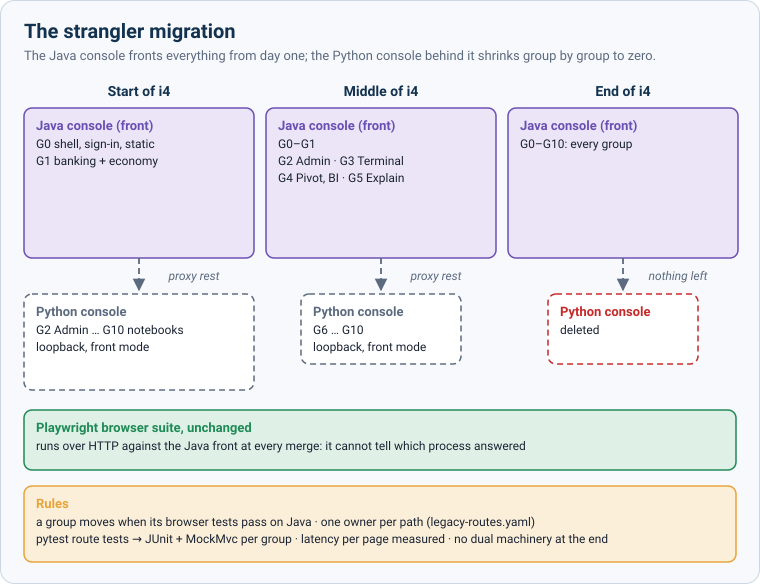

1. **The Java console fronts everything from the first day.** It takes the public port, owns sign-in and sessions, serves the static
   files and Elements, and serves every **migrated route group** itself. Every other path is **proxied to the Python console**, which then
   listens on loopback only (`127.0.0.1`).
2. **Identity for the proxied groups.** The Java console mints the per-request identity token that the Python console already accepts
   (today's HS256 token, which carries the user and their current roles) and sends it in a front header. The Python console runs in
   *front mode*: it accepts identity only from that header, refuses direct connections and runs no sign-in of its own. A person signs in
   once, on the Java console.
3. **One group at a time.** A group moves when **its Playwright browser tests pass against the Java console** with the rest still proxied.
   The group's entry in `config/console/legacy-routes.yaml` is deleted in the same merge (one owner per path at every moment).
4. **The Playwright browser tests stay unchanged.** About 32,000 lines in 148 files test over HTTP, so they cannot tell which process
   answered. They run against the Java front from the first merge, which proves the whole product at every step. This is the main
   safeguard against regressions.
5. **Unit tests are replaced per group.** The pytest unit tests that call Python routes or `core/` helpers (68 files) are replaced by
   **JUnit and MockMvc** tests for that group's controllers and services, and deleted with the Python code they tested.
6. **The Python console is deleted** when the last group moves: `drishti-console/` Python sources, `run_drishti_web.py`, the console's
   `requirements.txt` and its virtual environment for serving. The browser tests then move to the console's own test tree (still
   Playwright, the test runner's Python stays a test tool). No dual machinery remains.

**The route groups, in order** (sizes from the code on `970160f9f`: route-file lines and route count, templates; `core/` helpers, 20,140
lines, move with the groups that use them). The full table with the files of each group is
[examples/console/route-groups.md](kernel-and-modules/examples/console/route-groups.md).

| # | Group | Route files (lines · routes) | Templates | Why this place |
|---|---|---|---|---|
| G0 | **Shell and serving**: sign-in, sessions, static, Elements, live channel, the proxy, module page hosting | 4 files (521 · 15) + `core/app.py`, `auth.py`, `channel*.py`, `backend.py`, `cluster.py` | `base.html`, `_macros/` (6), `auth/` (2) | the front itself; nothing works without it |
| G1 | **Banking and economy pages**: the proving ground | `plugins/banking` (3,548 lines of Python, 65 routes) | 20 | the first module pages on the Java host, through the shared runtime, declared routes and the API proxy |
| G2 | **Admin** | 18 files (3,868 · 200) | `admin/` (44), `monitor/` (2), `servers.html` | large but plain forms over kernel APIs; administrators test it first |
| G3 | **Terminal, Home, data and search** | 8 files (1,750 · 50) | `terminal/` (26), `landing.html` | the daily screens; moves after the Admin group has proved the patterns |
| G4 | **Pivot and BI** | 9 files (1,715 · 98) | `bi/` (20), `workspace/` (2), reports (2) | heavy fan-out; the virtual-thread gain shows here |
| G5 | **Explain, approvals, alerts, collaboration** | 8 files (1,244 · 59) | 8 (`explain`, `approvals`, `alerts`, `inbox`, `subscribe`) | live-channel users |
| G6 | **Embed** | 4 files (1,185 · 44) | `embed/` (1) | token sign-in for embeds; after the security patterns are settled |
| G7 | **Designers, Build, Studio, forms** | 5 files (1,844 · 72) | `designer/` (4), `build/` (10), `studio/` (2), `_designer_kit.html` | the largest JavaScript-facing contracts |
| G8 | **Help** | 1 file (364 · 13) | `help/` (9) | the Help merge of modules (section 4.7) |
| G9 | **AI assistant** | 1 file (213 · 5) | — | small |
| G10 | **Notebooks, Python, transforms, Calc** | 4 files (638 · 24) | `bi/notebook.html` (counted in G4) | last: the transform parse moves to kernel Python workers first (10.7) |

### 10.9 Tests and the performance proof

| Test | Proves |
|---|---|
| **Browser suite, unchanged** | the full Playwright suite passes against the Java front at every merge, and at the end against the Java console alone |
| **Render equality** | each template rendered by Jinja2 and by Jinjava from recorded contexts gives the same HTML (whitespace normalised), until the group moves |
| **Latency per page** | for the 30 most used pages, p50 and p95 server time and time to first byte, Python console against Java console, on the benchmark machine with the demo lake. The budget is **no page slower**, and the fan-out pages (Home, Pivot, BI report, VaR explorer) **at least 30% faster** at 50 concurrent people. Recorded in [BENCHMARK.md](../admin/BENCHMARK.md). |
| **Two people at once** | every group's MockMvc tests run two people concurrently and fail on any shared per-person state (the session-isolation rule; architecture test on singletons) |
| **Kernel isolation** | with two kernels, stop one: its pages show the notice and the other kernel's pages and Home answer within budget; no token for one kernel ever reaches the other (a recording kernel stub) |
| **Windows** | the console runs on the Windows QA machine as a jar with Java only: no Python and no native binary for the UI |

### 10.10 Risks and mitigations

| Risk | Mitigation |
|---|---|
| **Jinjava compatibility gaps** (filters, scoping, `namespace`, `call` blocks) | a week-1 spike ports the 10 most complex templates. The render-equality test covers every template, and differences are rewritten to the common form. Pebble is the fallback (O1). |
| **Session migration** | sessions are not migrated: on the switch, people **sign in again once** (announced in the release notes). Saved work, tokens and preferences live on the kernel and are untouched. |
| **Performance not proved** | the latency-per-page benchmark (10.9) is a gate for every group, not only at the end. A group that is slower does not move until it is fixed. |
| **Windows QA** | a plus: the UI becomes a jar on Java, with no Python environment to install for the console. Native-binary rules are unchanged. |
| **Test-suite runtime** | the browser suite already runs on all 24 threads with per-worker fixtures. The Java console starts faster than the Python console with its plugins, and MockMvc unit tests run in seconds. The proxy hop during the migration is measured, and its cost is gone at the end. |
| **Two consoles during the migration** | it is a strangler, not dual machinery: each path has exactly one owner at every moment (`legacy-routes.yaml`), the Python console is loopback-only behind the Java front, and it is deleted at the end of i4. |
| **The bulk of `core/` logic** (menus, search, facts, designer forms) | ported service by service with its existing unit tests turned into JUnit tests first. Logic that belongs on the kernel (anything that computes a number) moves to the kernel instead (the server-computes-risk rule). |

### 10.11 Enterprise single sign-on (i4)

**Decided by the owner on 2026-11-08: i4 includes how Drishti integrates with enterprise single sign-on.** Authentication and SSO move from
j to i4, because the Spring Boot console's security chain is where they belong. j keeps roles, licensing, module signing, audit and
hardening (section 14.2). Roles, row rules and the access chain are [ACCESS_MODEL.md](ACCESS_MODEL.md); this section does not repeat them.

**What exists today, and stays true.** OpenID Connect sign-in is built: the Python console runs the browser redirect and the **server verifies
every ID token itself**, maps the provider's groups to roles (`drishti.security.oidc.role-map`), creates the user on first sign-in, and
re-checks the session every `auth.recheck_seconds`. A user disabled in Drishti stays out whatever the provider says, and one break-glass
administrator keeps a password ([ADMIN_GUIDE.md section 5](../guides/ADMIN_GUIDE.md#5-single-sign-on-openid-connect)). i4 keeps every one of
these rules and moves the browser side into Spring Security.


**Protocols**, all through Spring Security in the console:

| Protocol | Use | Spring Security |
|---|---|---|
| **OpenID Connect** (preferred) | every modern IdP: authorization code with **PKCE**, `state` and `nonce`; the client authenticates with `private_key_jwt` where the IdP supports it, else a client secret | `oauth2Login` with one `ClientRegistration` per provider |
| **SAML 2.0** (second) | IdPs or sites that only offer SAML (older ADFS farms, some Ping set-ups): SP-initiated, signed assertions, encrypted where the IdP supports it | `saml2Login` with a `RelyingPartyRegistration` from the IdP's metadata |
| LDAP / Active Directory bind (optional) | sites without an IdP: the person's password checked by a bind over LDAPS, never stored | `ldapAuthentication` (bind only, no password comparison) |
| Kerberos / SPNEGO (optional) | desktop SSO inside a Windows domain, no prompt at all | the Spring Security Kerberos extension, falling back to OIDC or SAML |

**Providers.** One block per provider in the console's configuration; full examples in
[examples/console/application.yaml](kernel-and-modules/examples/console/application.yaml):

| Provider | Protocol | Issuer or metadata | Groups claim |
|---|---|---|---|
| Microsoft Entra ID (Azure AD) | OIDC | `https://login.microsoftonline.com/<tenant>/v2.0` | `groups` (object ids) or app `roles`; more than 200 groups arrive as an overage claim, so **app roles are recommended** |
| Okta | OIDC | `https://<org>.okta.com/oauth2/<server>` | `groups` (a claim added on the authorization server) |
| Ping (PingFederate, PingOne) | OIDC or SAML | `https://<ping>/as` or the SAML metadata URL | `memberOf` or a mapped `groups` attribute |
| ADFS | OIDC (ADFS 2016+) or SAML | `https://<adfs>/adfs` | `group` or `role` claims from the claim rules |
| Keycloak | OIDC | `https://<host>/realms/<realm>` | `groups` mapper, or realm roles at `realm_access.roles` |
| Google Workspace | OIDC | `https://accounts.google.com` | none in the ID token: groups come from the Directory API by a service account, or the site maps by the `hd` domain and e-mail lists |

**Identity to Drishti access.** The identity kernel stays the authority (one registry, ACCESS_MODEL section 2):

- After the console has verified the ID token (or SAML assertion), it sends it to the **identity kernel**, which **verifies it again
  itself** (issuer, audience, signature from the IdP's JWKS, expiry, nonce), as it does today. The console is never the only check.
- The mapping from IdP groups and claims to **roles, lenses and module access** lives in **one file**, `config/security/identity-map.yaml`
  (it grows from today's `drishti.security.oidc.role-map` and replaces it, one way): claim names, `groups → roles`, `groups → lenses`,
  `groups → modules` (within what the licence allows), the default when nothing maps (refuse), and per-provider overrides. A change is a
  **four-eyes proposal** in the Approvals inbox, and it is audited. Example:
  [examples/site/identity-map.yaml](kernel-and-modules/examples/site/identity-map.yaml).
- **Just-in-time users**: the first sign-in creates the user, with no password. Later sign-ins update the name, e-mail and roles (when
  `roles-from-provider: true`). Every creation and refusal is audited (`user-provisioned`, `login-sso-refused`), as today.
- **SCIM 2.0** provisioning and de-provisioning (users and groups pushed by the IdP, so a leaver is disabled before they try to sign
  in) comes **later**, as an optional endpoint on the identity kernel (open question O9).

**Token propagation, console to kernels:**

- **The console never forwards the browser's IdP token.** Each call to a kernel carries a token **made for that kernel only**: audience =
  the kernel's id, a life of 2 minutes, the person's subject, their identity kernel's session id and the request id.
- **Recommended: a console-signed JWT** (ES256, the console's key pair, its public keys at `/.well-known/jwks.json`; each kernel lists the
  consoles it trusts by issuer and JWKS URL). This replaces today's shared HS256 secret, so no kernel holds a key that could mint tokens.
  **Option for sites that require IdP-issued tokens: OAuth 2.0 token exchange** (RFC 8693; Entra ID's on-behalf-of flow), one exchange
  per kernel audience, cached for the token's life (open question O8).
- **One console, many kernels**: one token per kernel, never shared (section 10.6). Roles are resolved by each kernel for itself.
- **The kernel validates** issuer, audience, expiry, signature (JWKS, with the key id), then applies the person's roles and row rules
  (ACCESS_MODEL), exactly as for any other caller.
- **Identity flows on**: the person's id is on every audit line, and on every Python worker run (the run's audit line and the row rules
  applied to its frames), so a notebook cell or a transform is attributed to the person who ran it.

**Non-browser access:**

| Who | How |
|---|---|
| People on the command line (`drishti.py`, deploy, `.ready` loaders run by hand) | **OAuth 2.0 device code**: `drishti.py login` prints a code and a URL, the person signs in at the IdP (MFA included), and the CLI keeps a short-lived token in the OS keyring |
| Schedulers, CI, ETL jobs, deploy pipelines | **OAuth 2.0 client credentials** (a service principal per job, mapped to a service account in `identity-map.yaml`), or today's **API tokens with scopes** for service accounts ([ADMIN_GUIDE.md section 6](../guides/ADMIN_GUIDE.md#6-api-tokens), a module's `tokens/token-scopes.yaml`) |
| Everyone | **no passwords on command lines** or in scripts: tokens from the environment (`DRISHTI_TOKEN`) or the keyring only |

**Sessions:**

- **Timeouts**: idle (30 minutes) and absolute (12 hours) on the console session, both configurable. Refresh tokens are used only to
  check that the person is still allowed, never handed to the browser.
- **MFA is delegated to the IdP**. The console can require it (`acr_values`, or an `amr` claim it checks) for Admin and for four-eyes
  approvals (step-up).
- **Single logout**: OIDC **back-channel logout** (the IdP calls the console, which ends every session of that IdP session) and
  front-channel logout as a fallback; **SAML SLO**. Sign-out in Drishti calls the IdP's end-session endpoint.
- **Revocation**: a person disabled in Drishti, or removed at the IdP, loses access **within `auth.recheck_seconds`** (10 s by default; the
  identity kernel's session check on every request, as today) or at once on a back-channel logout or a SCIM de-provision.

**Several consoles and key rotation:**

- Consoles behind a load balancer share the **session store** (Spring Session JDBC on the site's PostgreSQL, the database rules), so any
  console serves any person and a logout ends the session everywhere. No sticky sessions are needed.
- **IdP keys rotate** without a restart: JWKS and SAML metadata are fetched and cached, refreshed on an unknown key id and every
  `security.sso.metadata-refresh-minutes` (60). The console's own signing key rotates the same way (two keys in its JWKS during the
  overlap).

**Local development and demos:** today's built-in sign-in (users and passwords in the identity kernel) stays for laptops, demos and the
break-glass administrator. On a console where it is the only method, every page shows a **not for production** banner, and Health warns.

**Testing (Windows-safe, no containers):** the integration tests use an **in-process mock IdP**, a Java OIDC mock server started by the
test (for example `mock-oauth2-server` as a test dependency) and a SAML test IdP that signs fixed assertions with a test key, so the suite
runs on the Windows QA machine with Java only (no Keycloak container, no native binary). The tests cover code + PKCE, a bad `nonce`,
a wrong audience, an expired token, a rotated key, the group mapping, JIT creation, back-channel logout, and **a token for kernel A
refused by kernel B**. Real providers are checked at **site acceptance** with a checklist per provider in the SSO guide.

**Where secrets live:** client secrets, private keys for `private_key_jwt`, SAML signing keys and the console's JWT signing key are in the
site's **secret store** or the environment (`${secret:…}` references, `DRISHTI_*` variables), **never** in configuration committed to git and
**never in a module** (section 5.10).

**Documentation (an i4 deliverable).** The **SSO integration guide** is a rewrite of [ADMIN_GUIDE.md section 5](../guides/ADMIN_GUIDE.md#5-single-sign-on-openid-connect),
the existing home of sign-in for administrators (not a new document): step-by-step set-up for **Entra ID, Okta, Ping and ADFS, and
Keycloak**, claim-mapping examples, logout, the CLI's device code, and troubleshooting (clock skew, wrong audience, the groups overage,
the redirect URI). It is paired with one **SSO tutorial** (the two-docs rule) and with the per-provider site-acceptance checklists.
DEPLOYMENT_AND_QA_GUIDE links to it from its configuration step.

**If i4 were skipped**, SSO would fall back to j on the Python console: the same identity map, token per kernel and logout rules, built
on the Python console's OIDC code instead of Spring Security.

## 11. Drishti Elements: the controlled UI statics

**Decided by the owner on 2026-11-08:** Drishti Elements is **the one set of UI statics**, and it is tightly controlled. The libraries
themselves, their APIs and their packaging are [ELEMENTS.md](ELEMENTS.md). This section says only who serves Elements, what a module may
and may not ship, and how that is enforced.

### 11.1 Who owns and serves Elements

- **The platform owns Elements**: the libraries (drishti-core, -inputs, -grid, -chart with maps, -data, -insight, -renderer and the
  generic additions) and **every vendored third-party library** (`static/vendor` with `VENDOR.md`).
- **Only the Drishti Console serves them** (today's console from i2, the Spring Boot console from i4), from its own **signed, versioned bundle**: one Elements release train per console
  (`elements.json`, [ELEMENTS.md section 8](ELEMENTS.md#8-packaging-versions-and-licensing)), served under
  `/static/elements/<library>/<version>/` with immutable caching, **SRI** on every tag and the console's **CSP** (`script-src 'self'`, no
  inline script, no remote origin). A console's About and Health show its Elements train version.
- The kernel serves no UI statics. A module's own statics (its pages' scripts, its domain library) are served by the console under
  `/m/<id>/…` (section 9.7), separate from Elements.

### 11.2 What a module may not ship

- **No copy of Elements**, in whole or in part, under any name.
- **No vendored library**: no second chart, grid, date picker, map or icon library, no framework (React, Vue, jQuery), and no copy of a
  library the platform already vendors.
- **Nothing from a CDN** or any other origin: no remote script, style, font or image.
- **No bespoke UI**: no hand-drawn tables, canvases or widgets outside Elements components (the no-bespoke-UI rule, conformance C2), no
  inline styles or colours (C3), no `eval` or inline scripts (C5).

### 11.3 Version ranges

- A module declares the **Elements API range** it was built for in its manifest: `elements: ">=1.4 <2"` (section 3.3). The range is checked
  against the console's Elements train version.
- **The console refuses a mismatch with a reason**, like the kernel's `vermagic` check: *genomics 0.1.0 refused on console-research: needs
  Elements >=1.4 <2, this console serves 2.0.0*. A refused console part means the module's pages are absent on that console (section 4.9),
  while its server parts are unaffected.
- Elements follows **semver** and the **deprecation over one release** rule. A deprecated component keeps working for one release and is
  listed in Admin → Modules against each module that still uses it.

### 11.4 Domain libraries

- A module's domain library (drishti-risk for banking, drishti-genomics for the sample) is **built on Elements core through the SDK**. It
  imports only the **published Elements API** (`@drishti/elements-*` entry points and their `.d.ts`), never a file path inside a library.
- It uses **theme tokens only** (no colours, fonts or spacing of its own), the **`drishti_` asset prefix** on every file (C4), and it is
  **versioned with its module**: it ships inside the `.dmod` (`elements/<lib>/`), is served by the console at
  `/m/<id>/elements/<lib>/<version>/`, and goes away with its module (section 12).
- It is licensed with its module (ELEMENTS.md section 8). An unlicensed or removed module's library is not served.

### 11.5 Enforcement

| Where | Check |
|---|---|
| **SDK conformance** (`drishti:conformance`, section 8.6) | a **hash scan** refuses known library files inside a `.dmod` (the SHA-256 of every vendored file of every supported Elements train, and of the popular libraries' published builds, in a list shipped with the SDK), plus a name-and-signature scan for minified bundles; no bespoke UI (C2); tokens only, no inline styles or colours (C3); `drishti_` prefix (C4); no CDN or remote origin, no `eval`, no inline scripts (C5); imports only of published Elements entry points |
| **Console load-time verification** (V6 for the console part, section 4.3) | the same scans run again on the bundle the console receives, before anything is served. A failure refuses the console part with the reason (*elements/drishti-genomics/vendor/chart.min.js matches chart.js 4.4.1: modules may not ship libraries*). |
| **Guard tests** | the existing guards (no-bespoke-UI, the static-asset prefix, vendor without CDN, the Elements loader's refusal of another module's library) **become part of the conformance suite**, so partners run the same tests as the kernel's own code |

### 11.6 Governance

- Changes to Elements go through **the platform team**: semver, deprecation over one release, and an **API diff gate** (the `.d.ts` diff
  generated each release, like the kernel API's `japicmp` gate in section 2.2). A breaking change without a major version fails the build.
- **A module that needs a new widget extends Elements**: it files a request to the platform, and the widget is added to the right library
  (or to the module's domain library on Elements core when it is truly domain-specific). It never draws its own. This is the
  no-bespoke-UI rule, **now enforced on partners too**.
- **White labelling** follows: brand and theme are **tokens** chosen by the distribution file (section 6), never module CSS. A module looks
  right under every brand because it has no colours of its own.

## 12. Offloading a module: everything disappears

The owner's rule: **when a module is removed or disabled, all its pages, and everything else it brought, disappear**, at once, on every
node, without breaking an open page, and without losing anything a person saved or any data the site holds.

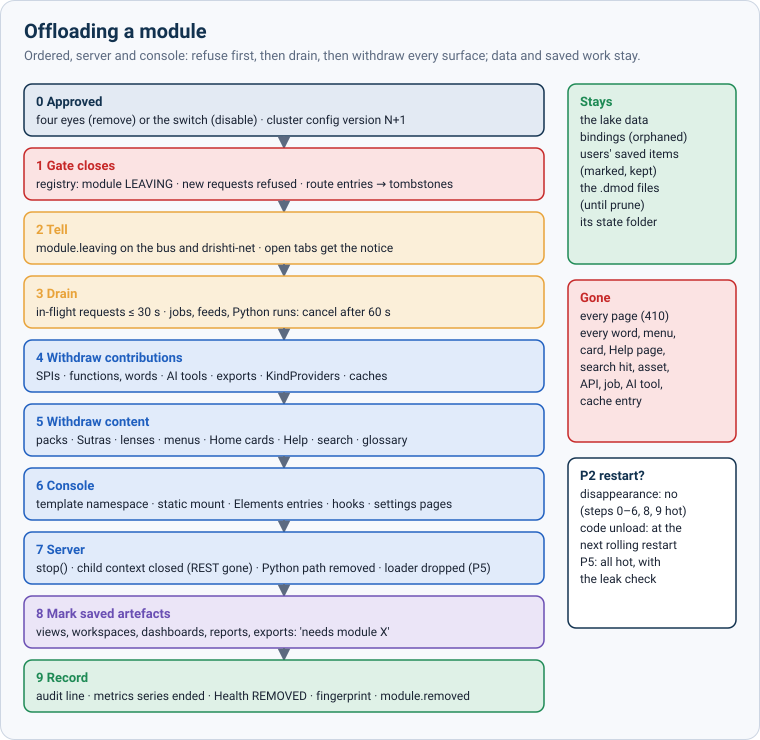

### 12.1 Four ways a module leaves

| | Disabled (switch off) | Removed | Upgraded | Rolled back |
|---|---|---|---|---|
| Trigger | `drishti.modules.<id>.enabled: false`, Admin switch (four eyes) | `module remove` (four eyes) | `module upgrade` (four eyes) | `module rollback` (four eyes) |
| Files | kept | kept until `module prune` (rollback, reinstall) | old and new side by side | both kept |
| Pages | **404** + notice *not available* (as today) | **410** + notice *no longer installed* (tombstones) | carried over by route id; changed paths 308 (`moved:`) | as upgraded, back |
| Every other surface | withdrawn (12.3) | withdrawn (12.3) | withdrawn and re-added within the swap | same |
| Open tabs | notice *switched off* | notice *no longer installed* | notice *updated: reload* | notice *changed: reload* |
| Saved work | marked *needs module X (off)* | marked *needs module X (not installed)* | untouched, unless the new version drops a function it uses (then marked *needs VARX, removed in 0.2.0*) | same |
| Schedules, alerts | paused | paused | kept | kept |
| Data, bindings | stay | stay (bindings orphaned) | stay | stay |
| Code in the processes (P2) | stays loaded, unreachable | unloaded at the next rolling restart | new code at the rolling restart | same |
| Reverse | switch on | reinstall (approved): everything marked is restored | rollback | upgrade again |

### 12.2 The unload sequence

Ordered; the same for disable and remove except where marked. Each step is idempotent and logged; a failing step does not stop later
steps (it is retried and shown in Health), because **refusing first** (step 1) already makes the module absent to everyone.

| # | Step | Server | Console |
|---|---|---|---|
| 0 | **Approved** | the change (four eyes) writes the cluster configuration version N+1: `genomics: REMOVED` (or `OFF`) | — |
| 1 | **Gate closes** | the registry marks the module `LEAVING`: the module gate answers `DRS-1025` (off) or `DRS-1028` (*not installed*) for every new request; the scheduler starts nothing of it | the route-table snapshot is rebuilt with its entries as **off** or **tombstones**; words answer *not available* |
| 2 | **Tell** | `module.leaving` on the bus and over `drishti-net` | every open tab of the module gets the event on its live channel (12.4) |
| 3 | **Drain** | in-flight requests finish within `drishti.modules.drain-seconds` (30); running jobs, feed runs and Python runs get a cooperative cancel, then a hard cancel after `drishti.modules.cancel-seconds` (60) (12.5) | proxied calls in flight finish or time out with the same limits |
| 4 | **Withdraw contributions** | every SPI registration in `ModuleContributions` (engines, `PivotProvider`s, `FunctionProvider`s, view augmenters, explainers, approval sources, sharded measures, Flight forms, capacity and health figures, AI tools, exports, playground templates); `KindProvider`s (its computed kinds become *not available*); its `CacheGroup`s cleared; pivot, BI and Explain cache entries tagged with the module dropped; event subscriptions removed | — |
| 5 | **Withdraw content** | packs, kinds, contracts, Sutras, lenses, functions, Home cards, BI content, report definitions, feeds; the search index's entries tagged `module:<id>`; Help pages, guides, tutorials, glossary terms; designer palette entries (its panel types) | menus and the sitemap entries tagged `domain:<id>`; Help centre sections; command-line words, type-ahead and hints (the hooks are keyed by module) |
| 6 | **Console** (on every console that holds the console part, through the shared runtime) | — | the module's Jinjava instance and its template cache dropped; static and Elements mounts withdrawn (paths answer 404/410); Elements manifest entries removed; its settings page removed; P2: its context-builder class loader stays loaded but unreachable (no route points at it) until the consoles' rolling restart |
| 7 | **Server** | `DrishtiModule.stop()`; the child Spring context closed (its `DispatcherServlet` and every `@ModuleApi` mapping gone); the Python pool's import-path entry removed; P2 removal: the class loader is dropped at the next rolling restart (P5: now, with the leak check); disable keeps it loaded | — |
| 8 | **Mark saved work** | the tombstone file `modules/tombstones/<id>.yaml` (its route ids, words, kinds, Sutras, report ids, API prefix) is written; saved artefacts that reference any of them show *needs module X* (12.6); schedules and alerts that need it pause; owners are notified once | — |
| 9 | **Record** | audit line (who proposed, who approved, what was withdrawn, counts); the module's metrics series ended (meters removed from the registry; history kept); Health row `REMOVED` / `OFF`; the cluster fingerprint updated; `module.removed` / `module.stopped` | the route table version shown in Admin → Modules |

The transcript of a removal with every count: [cli/module-remove.txt](kernel-and-modules/examples/cli/module-remove.txt).

### 12.3 The inventory: every surface and how it goes

| Surface | Contributed by | Removed by (step) | The absence test asserts |
|---|---|---|---|
| Routes and pages | `plugin.yaml` `routes:` | route table → tombstones (1, 6) | every recorded URL answers 410 with the notice page (404 when off) |
| Menus | `plugin.yaml` `menus:` | sitemap entries tagged `domain:<id>` (5) | no menu, Admin tab or BI rail item links into the module, in every lens |
| Lens entries | `lenses/lenses.yaml` | registry lenses withdrawn (5); a person on that lens falls back to the default lens with a notice | the lens list has none of its lenses |
| Function / command words | `functions.yaml`, `plugin.yaml` `words:` | registry functions (5); console hooks (5) | each word answers *not available*; `FUNC` lists none |
| Home cards and chips | `plugin.yaml` `home:`, `module.yaml` `home:` | lens cards (5) | Home in every lens has none |
| Search index entries | Sutras, functions, Help, `search:` | entries tagged `module:<id>` (5) | a search for each of its words, titles and terms finds nothing |
| Help pages, guides, tutorials | `docs/`, `help.yaml` | Help centre sections, the docs register rows (5) | Help index, Help search, guides list and tutorials list have none; their URLs 410 |
| Glossary | `docs/glossary.yaml` | glossary terms (5) | none of its terms |
| Static assets | `console/static`, `elements/` | mounts withdrawn (6) | every recorded asset URL answers 410 |
| REST endpoints | `@ModuleApi` | child context closed (7); gate first (1) | every recorded endpoint answers 410 `DRS-1028` (404 `DRS-1025` when off, as today) |
| SPI registrations | `ServiceLoader`, beans | `ModuleContributions` withdrawn (4) | the registry of contributions has no entry whose class loader is the module's |
| Scheduled jobs and feeds | `feeds/`, scheduler registrations | suspended, then removed (3, 5) | the scheduler lists none; no run starts after step 1 |
| Python compute | `python.items`, packages | items unregistered (4), import path removed (7) | Build lists none; a run naming one is refused |
| Caches (pivot, BI, Explain, its own) | `CacheGroup`, tagged entries | cleared (4) | cache reports have no group or entry tagged with it |
| AI tools | `AiToolProvider` | withdrawn (4) | the assistant's tool list has none |
| Settings pages | `settings/`, `plugin.yaml` `settings:` | page removed (6); stored values kept for reinstall | Admin → Modules has no settings tab for it |
| Sutras | `packs/*/sutras/` | pack withdrawn (5) | no kind matches one of its Sutras; its Sutra URLs 410 |
| Designer palettes | tier-3 panel types | palette entries (5) | the designer offers none |
| Exports | `ExportProvider`, export buttons | withdrawn (4) | the export list has none; scheduled exports paused |
| Audit | audit lines carry `module` | **kept** (audit is never removed); the removal itself is audited (9) | the removal's audit line exists |
| Metrics | meters named `<id>.*` | meters removed, series ended (9) | the metrics endpoint exposes none |
| Event subscriptions | `events.subscribes` | removed (4) | publishing `data.loaded` reaches no handler of it |
| Embeds and tokens | embed pages, `tokens/token-scopes.yaml` | scopes withdrawn (5); embed URLs 410 | its scopes are not grantable; embeds 410 |

### 12.4 Open browser tabs

- The console's shell keeps one **live channel** per tab (today's `/api/channel`). On `module.leaving` the console sends a `module` event
  (`{module, state: removed|off|upgraded, title}`) to every channel; the shell (the console's JavaScript, not the module's) handles it.
- On a page **of** that module: the shell freezes the page's Elements (they stop polling and refuse input), shows the kernel's notice
  *Genomics is no longer installed on this system* with *Go to Home* and, for administrators, the reason and the change id. The page's own
  JS is not called again; nothing throws (Elements components are told to `detach()` first, and their data sources answer a typed
  *module gone* result instead of failing requests).
- On a kernel page **with** module parts (a slot, a menu entry, a card, a palette): the shell removes the slot containers
  (`[data-module=genomics]`), refreshes menus and cards from the next answer, and shows a quiet notice.
- A tab that was asleep reconnects, receives the current route-table version, and does the same; a navigation lands on the 410 page.
- Mock-up: section 17, (d).

### 12.5 In-flight requests and running jobs

- **Requests**: new ones are refused at step 1; those already past the gate finish within `drain-seconds` (30), then are cancelled
  (the client gets 503 `DRS-1028` with *the module was removed while this ran*).
- **Jobs, feeds, Python runs**: none starts after step 1; running ones get a cooperative cancel at once, a hard cancel after
  `cancel-seconds` (60); partial results are discarded, never published (a produced kind is written only on success).
- **Long exports and scheduled reports**: cancelled the same way; their schedules pause (12.6).
- **Four eyes and drain**: the approver sees *9 people have pages open, 2 calls in flight, 0 jobs running* before approving.

### 12.6 Users' saved artefacts

Saved views, workspaces, dashboards, bookmarks, BI reports, notebooks, scheduled exports, alerts and subscriptions that reference a
module's pages, words, kinds, Sutras or functions are **kept, marked and restored, never silently deleted**:

- **How the kernel knows**: the tombstone file (step 8) lists what the module owned; when an artefact is listed or opened, a reference
  that no longer resolves is looked up there and reported as *needs module genomics*. No artefact is rewritten and **no database change is
  needed** (no migration; artefacts keep their stored form).
- **Shown**: in lists, the artefact keeps its place with a *needs genomics* chip and is not openable; a workspace or dashboard opens with
  the missing tiles replaced by a notice tile and everything else working; a BI report shows the visuals that depend on it as notices.
- **Schedules and alerts** pause with status *paused: needs module genomics*; the owner is notified once.
- **Reinstall**: references resolve again, chips disappear, paused items resume (same major version), or stay paused with the list of
  what is still missing (a new major that dropped something).
- **Deletion** only by the owner (or an administrator acting for them), with the usual confirmation; tombstones are kept
  `drishti.modules.tombstone-days` (365) (question Q16).

### 12.7 The data in lakes

Data belongs to the site, bindings to the kernel (section 5): **nothing in a lake is touched**. The module's produced kinds
(`var-official`) stay where the site bound them; its kinds' bindings stay in `config/bindings.yaml` and show as *orphaned: no installed
module needs this kind* in Admin → Data bindings (never removed automatically); the data stays readable by Pivot, BI and `DATA` through the
kernel's connectors only if another module or the kernel defines the kind (otherwise the lake tables are still there for a reinstall).
The module's own state folder (`${drishti.data.dir}/module-state/<id>/`) is kept; `module purge-state <id>` (four eyes) deletes it.

### 12.8 Sessions

Session isolation makes removal clean: nothing module-scoped lives in shared state. Per-person caches keyed by person **and module**
are dropped on `module.leaving`; the person's session and cookie are untouched; a person whose current lens was the module's falls back
to the distribution's default lens at the next request, with a notice. The absence test (12.11) runs with two people signed in during the
removal and asserts neither sees the other's data or a broken page.

### 12.9 The cluster

- Removal is a **cluster operation**: the change writes cluster configuration version N+1 and removes the module's placement; every
  node closes its gate on receipt (unplaced nodes only stop forwarding) and confirms; the coordinator reports *3/3 confirmed*. A placed
  node that does not confirm within `drishti.modules.confirm-seconds` (30) is left out of routing until it does.
- Every node's **module fingerprint** (section 4.11.6) changes; a node that starts later with the `.dmod` still on its disk shows **amber**
  (*present but not placed*) in the node × module matrix and serves nothing of it; a late joiner receives only what is placed on it.
- Consoles are placement nodes (section 10.5): each console holding the console part confirms like any placed node, follows the cluster
  registry's configuration version (section 4.11.4) and drops the module's cached console bundle; a console's route table is never ahead
  of or behind the cluster by more than one event. A console in front of several kernels drops only the removed module's entries from that
  kernel's route table (section 10.6).

### 12.10 What people see: the removed-module page, 410 or 404

- **Removed** module's page, asset or API: **410 Gone** with `Cache-Control: no-store`. Pages render the kernel's notice page (in the
  kernel shell, so menus and the command line still work): *This page belonged to Genomics, which is no longer installed on this system.*
  with *Go to Home* and *Search*. **Administrators** also see *removed by alice, approved by bob on 2026-11-08 10:42 (CHG-2026-1108-0057)*
  and a link to Admin → Modules. APIs answer an RFC 7807 problem: `DRS-1028`, *Module not installed*, `module: genomics`.
- **Disabled** (or unlicensed, or refused) module: **404**, as today (*not available: the genomics module is off; ask your
  administrator*): the module is still installed and may come back; nothing permanent is claimed.
- **Never installed**: the ordinary 404 (no tombstone, so nothing reveals what other sites install).
- **Recommendation** (question Q12): **410 for removed, 404 for off**; tombstones are what make 410 possible and are kept 365 days.

### 12.11 The "absent everywhere" guarantee, and how it is tested

**Guarantee**: after a module is removed (or switched off), no person, page, API, search, Help, job, cache, AI tool or registry anywhere
on any node can reach anything of it; what stays is the site's data, people's saved work (marked) and the audit.

**The absence suite** (`AbsenceSuite` in the testkit; the kernel runs it on the genomics sample and banking; every module runs it as
conformance C14):

1. **Install** the module in the harness (kernel + module, demo lake, two people signed in, one composed page open in a headless
   browser, one saved view, one workspace tile, one scheduled export).
2. **Record every surface** into an inventory: the console route table and every URL it can produce; the sitemap per lens; the function
   list and type-ahead for each word; a search for each title, word and glossary term; the Help index; the asset list; the server's mapped
   endpoints (OpenAPI); the scheduler; the Python items; `ModuleContributions` entries; AI tools; cache reports; metrics names; the
   designer palette; settings pages; exports; event subscribers.
3. **Remove** it (the four-eyes path with a test approver).
4. **Assert each surface is gone**: every recorded URL 410 (404 for the *off* variant) with the right page or problem; every list,
   index and registry without the module's entries; the kernel's own entries unchanged (the inventory diff is exactly the module's).
5. **Assert the open tab** shows the notice, logged **no JavaScript error**, and made no further request to the module's paths.
6. **Assert saved work** is marked, not changed or deleted; the export paused; the two people still isolated.
7. **No references left**: a reachability scan from every kernel registry (contributions, caches, scheduler, event bus, AI tools,
   route table, Jinjava instances) finds **no object whose class loader is the module's**, in the kernel **and in the console** (the
   console's context-builder loader included; in P5 the loader itself is collected there too).
8. **Class loader released** (P5 hot unload, and in the harness from P2): a `WeakReference` to the module's class loader is cleared
   after GC within a bounded number of cycles; repeated 50 times (install/remove) without growth in metaspace or threads named
   `mod-<id>-…`.
9. **Reinstall** and assert everything recorded is back and saved work resolves again.

A failure names the surface and the leftover (*search still finds "Variant explorer" (index entry 41922, tag module:genomics)*).

## 13. Security

### 13.1 Signing

- Every `.dmod` is signed (Ed25519 over the hash list). Drishti's **module publisher root** signs publisher certificates (Drishti itself
  for banking, economy, capital markets; partners later). The site trusts the root by default (`config/trust/publishers/drishti-root.pem`)
  and may add its own publishers (taint `U`).
- Keys: private keys in an HSM or an offline key file, never in a repository; `module sign` takes a PKCS#11 URI or a file.
- Revocation: a revocation list file shipped with each kernel release and loadable by the site; a revoked certificate refuses its modules.
- The kernel jar and connector plugins are signed the same way (P4).

### 13.2 The licence

The signed licence of [ACCESS_MODEL.md section 7](ACCESS_MODEL.md#7-what-is-built-when) (built in i, after the security discussion)
names **features**; each module's `licence.feature` must be in it (V5). Limits (`positions`, `nodes`, `users`) are read by the registry and
offered to the module through `ModuleContext.licence()` (read-only, the module cannot change them). The licence check is the kernel's;
modules know nothing of it beyond the limits.

### 13.3 Sandboxing

| Part | Isolation |
|---|---|
| Java | own class loader, sees only the kernel API; no `System.exit`, no new threads outside the kernel's pools (an SDK architecture test; the kernel's thread factory names threads `mod-<id>-…` for attribution); file access only to its own data folder through `ModuleContext.folders()` (checked by the conformance suite; the JVM has no Security Manager any more, so this is a review and test rule, not a runtime wall: Q5) |
| Python | the kernel's strict sandbox (no network interface, Landlock, audit hook), per-run import path, the person's row rules on every frame |
| Console part | runs in the **Drishti Console, never in the kernel** (section 10); context builders in their own class loader that sees only `drishti-console-api`, with no mutable state (architecture test); templates in a per-module Jinjava sandbox (section 9.6); no Python in the console at all |
| JavaScript and CSS | served from `/m/<id>/static/<version>/`, under the console's CSP (`script-src 'self'` plus SRI hashes from the module's manifest; no inline script, no `eval`, no remote origins) |

### 13.4 Secrets

Never in a module (5.10). A module has no secret API. Its own sensitive settings (none for banking) would be references the site fills
(`${secret:name}`) and only the kernel resolves.

### 13.5 Session isolation

A module runs in a multi-user, concurrent server: the module conformance suite runs two people at once and fails on any per-person
state in statics, singletons or shared caches without the person's identity (the session-isolation rule; cross-person leaks are P1 and
release blockers). `Kinds` reads are always **as the person**.

### 13.6 Audit

Install, upgrade, rollback, remove, switch, binding change, refusal, taint, and every run of a module's API and Python items carry the
module id and version in the audit line.

## 14. Migration, with banking as the proving ground

### 14.1 Where we are (surveyed on `89f010df5`)

| Already modular (built in the e+f+g train) | Still leaking or not done |
|---|---|
| Java split: `drishti-banking`, `drishti-compute-banking`; cycles J1–J6 broken through SPIs; `ArchitectureRulesTest` | **39 kernel files with 77 banking strings** on the rule-4 allow list (`tools/domain_strings_allowed.yaml`): bicompute (Explain, functions, what-if, scale), the console's `core/edition.py` (14), `core/facts.py`, `drishti_pivot.js`, `EngineCatalogue`, `ModuleManifest`, `EmbeddedAccessRegistry`, `ErrorCode` |
| Manifests (`META-INF/drishti/module.yaml`, `lenses.yaml`, `engines.yaml`, `token-scopes.yaml`) in the jar; the registry decides | **The thin jar is built but not the default** (`drishti-kernel-app`, no modules; Health says so): banking is on the full jar's class path; "installed" = in the fat jar |
| `@ConditionalOnModule`, module switch, `DRS-1025` / `1026`; module off = gone everywhere (tests) | **Console plugins live inside the repo's console** (`drishti-console/plugins/{banking,economy}`), imported as `plugins.<id>` |
| Console plugin hooks C1–C7; static assets by module and lens; Elements loader refuses a module's library | **Modules depend on `drishti-server` internals** (banking: 44 packages listed in `modules/banking/kernel-internals.txt`, a list that only shrinks) |
| Packs, lakes, BI, tables, reports, lenses in module folders (`config/*/banking/`) | **Banking ships connector plugins** (`var-positions`, `var-pv-stream`) and reactive connectors; contracts name connectors (`storage.connector`) |
| **Editions folded into lenses: done** (`config/lenses/<module>/`) | **No signing, no module path, no distribution file**; branding split across `ui.*`, `drishti.branding.*` and lens titles |
| Packs name their domain; Help by module (`plugins/banking/help.yaml`) | Banking Python CLIs (`varcli.py`, …) and the guides/tutorials live in the repo's shared folders |

### 14.2 Phases

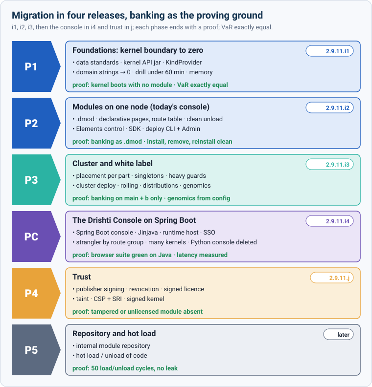

| Phase | Deliverables | Proof (gate) |
|---|---|---|
| **P1 · Kernel boundary to zero** (**i1**, with data standards and the drill under 60 minutes) | `drishti-kernel-api` jar (section 2.3: existing SPIs moved under `kernel.api`, new `DrishtiModule`, `ModuleContext`, `KindProvider`, `ModuleSettings`, `AiToolProvider`, `@ModuleApi`); banking compiled against it only; the 39-file allow list to **0**; `KindProvider` replaces banking's connector plugins; contracts' `storage:` → `binding-hint:`; `config/bindings.yaml` + `bindings migrate`; kernel API 1.0 frozen with `japicmp` baseline | kernel boots with **no modules** (economy and capital markets off too) and serves BI, Pivot, Build, Help, GLEIF; `domain_strings` empty; banking passes its suite; **VaR exactly equal** |
| **P2 · Modules on one node, on today's console** (**i2**) | the `.dmod` format and packager (`module build`, unsigned dev key), `modules.path`, discovery and V1–V4, V6–V7 checks, **loading in the kernel through `drishti-module-runtime`** (section 10.4), class loader per module + child Spring context, REST mounting, Python per-module import path; **module pages served by the current (Python) console, declarative only** (section 14.2.1): plugin.yaml format 2, the live route table, per-module template namespaces, the API proxy (section 9), no console handlers in modules; **the unload sequence, tombstones and the absence suite** (section 12); **Elements control** (served only by the console, an Elements API range per module, the hash scan and conformance: section 11); Help merge, **the thin jar**, `module list | info | install | remove | verify`, **single-node deployment** (`module deploy` plan/apply and Admin → Modules → Deploy over the deployment API, four eyes: section 7.6), Admin → Modules (mock-up a), Admin → Data bindings (mock-up b), launchers/Docker/ECS/stack with the modules folder; the SDK (parent pom, archetype, `drishti-module-maven-plugin`, harness, `module new` / `run`); banking, economy and capital markets as `.dmod`s built as Maven projects; the developer guide + tutorial | **banking runs as a `.dmod`** and passes against the kernel alone (the harness: kernel thin jar + `banking.dmod`, nothing else); **install → remove → reinstall leaves nothing** (genomics and banking pass the absence suite); a `.dmod` carrying a copy of a vendored library is refused; the full drill on the thin jar + three modules; a drill with **no modules**; VaR exactly equal |
| **P3 · Cluster and white label** (**i3**) | **placement** per node or role and per part, singletons, the heavy-work guards, `config/placement.yaml`; **cluster deployment** (plan and apply across the placed nodes, two-phase activation, late joiners, the node × module matrix, rolling upgrades pinned per session: section 4.11); the distribution file and `dist build`; branding literals to 0 (the 26-literal fix and its guard); `drishti.finance` (banking + capital markets + economy) as the default product; the **`genomics-sample`** module and `drishti.genomics`; white-label mock-up (c) built; Help/docs by distribution | **`drishti.genomics` boots from configuration only** (same kernel build, a different file and module set): no banking word on any page, in search, Help or assets (a crawler test); `drishti.finance` equals today's product (screenshots); **banking placed on main and b only, nothing on c**; failover stays inside the placement |
| **PC · The Drishti Console on Spring Boot** (**i4**) | `drishti-console-web` (Spring Boot 3, WebMVC on virtual threads, Jinjava, Spring Session JDBC on the two schema files, Spring Security with today's sign-in); **the console host of `drishti-module-runtime`** (the same declarative module parts as i2, re-hosted without changing any module; optional Java context builders through `drishti-console-api`); **Elements served from the Java console**; the **strangler migration of every route group**, banking's pages first (G0–G10, section 10.8), with the browser tests unchanged and JUnit/MockMvc replacing the pytest route tests; **consoles as placement nodes** (role `console`, 10.5); **one console in front of many kernels** (the kernel switcher, routing, failure isolation and tokens per kernel, a distribution per console: 10.6); the transform parse onto kernel Python workers (Python only on kernel-managed workers, 10.7); **enterprise single sign-on** (OIDC first, SAML 2.0, optional LDAP and Kerberos; the identity map with four eyes; a token per kernel; device code and client credentials for non-browser use; single logout: 10.11) with **the SSO integration guide** (a rewrite of ADMIN_GUIDE section 5: Entra ID, Okta, Ping and ADFS, Keycloak, claim mapping, troubleshooting) and its tutorial; **the Python console deleted at the end** | **every browser test passes against the Java console** with no Python console process; **page latency measured against today** (no page slower, the fan-out pages at least 30% faster: 10.9); every i2 module's pages unchanged on the Java console (the same `.dmod` files); one console in front of a finance and a genomics kernel, one stopped: only its pages grey; **the Python console is gone**; SSO passes the in-process mock IdP suite (OIDC and SAML) and one real provider's site checklist |
| **P4 · Trust** (**j**, the security release; authentication and SSO are in i4) | signing with publisher keys, trust store, revocation, V5 with the signed licence, taint, `ModuleMigration`, CSP with SRI for module assets, signed kernel and connector plugins | tampered `.dmod` refused; unlicensed module absent; a revoked publisher's modules absent; rollback restores VaR exactly |
| **P5 · Repository and hot load** (later) | an internal module repository (search, fetch, dependency download), hot code load/unload with the leak test, module marketplace only if the owner wants one | 50 load/unload cycles without a class-loader leak; hot upgrade under load with no failed request |

**Four releases (decided by the owner, 2026-11-08; Q8 and Q24):** **2.9.11.i1 · Foundations** (data standards: Iceberg onto iceberg-core,
Python Delta reads through Delta Kernel, a critical review of the other connectors and sources; P1, with the kernel API at 0.x; the shared
module runtime is **not** here; the full drill under 60 minutes; memory and speed; **about 1.0 × g**), **2.9.11.i2 · Modules on one node**
(P2, on today's Python console; **about 1.2 × g**), **2.9.11.i3 · Cluster and white label** (P3; **about 1.0 × g**) and **2.9.11.i4 · The
Drishti Console on Spring Boot** (PC; **about 1.3 × g**: the skeleton, the runtime host, Elements and banking's pages about 0.4 × g, the
migration of groups G2–G10 about 0.7 × g, console nodes and several kernels per console about 0.2 × g). P4 is in **2.9.11.j** (trust and
security); then k (risk engines II), l (collateral), m (CVA), n (hardening); new
domains after the line. P5 later. The rows are in [IMPLEMENTATION_PLAN.md](IMPLEMENTATION_PLAN.md).

#### 14.2.1 Why i2's console hosting is declarative

In i2 the modules' pages are served by **today's Python console**, and in i4 by the Java console. To keep one way at every moment and
**not change any module in i4**, i2's console hosting is **minimal and declarative**: a module's console part is Sutras, templates (Jinja
syntax, which Jinjava reads too), static files, its domain Elements library, menus, words, Home cards, slots and Help, all declared in
`plugin.yaml` format 2. **No console handlers in modules in i2**: a page that needs more context gets it from its module's API through the
proxy (Elements data sources), and scope words are parsed by the module's REST API on the kernel. The kernel verifies every `.dmod` with
`drishti-module-runtime`; the Python console only reads the verified, declarative console part, runs no module code and holds no second
verifier. In i4 the Java console hosts **the same `.dmod` files** with the runtime itself, the Python reader is deleted with the Python
console, and Java context builders become available as an option for later module versions.

### 14.3 Banking step by step (P1–P2)

1. Survey again; freeze the boundary list (refresh [DOMAIN_MODULES.md section 2](DOMAIN_MODULES.md#2-the-boundary-list)).
2. Create `drishti-kernel-api`; move the SPI interfaces (package rename `com.ash.drishti.kernel.api.*`; the old types deleted, not
   aliased: banking is the only implementer and moves in the same branch).
3. Banking's `pom.xml` depends on `drishti-kernel-api` (`provided`) and drops `drishti-server`; fix each compile error by a kernel API
   service or a new SPI; the architecture test *module imports only the kernel API* turns on.
4. Empty the allow list file by file: words to the module's manifest, engine knowledge to the engine catalogue, `edition.py`'s banking
   words to lens files, `drishti_pivot.js`'s MR bits to the plugin's `screens.pivot`.
5. `var-positions`, `var-pv-stream` → `KindProvider`; `var-engine`, `exposure-engine` reactive connectors → computed kinds; contracts'
   `storage:` → `binding-hint:`; `bindings migrate` on the demo and test sites.
6. The packager: lay banking's files into the Maven project of section 8.10 ([project-mapping.txt](kernel-and-modules/examples/banking/project-mapping.txt)) and the `.dmod` layout (a `git mv` of the plugin, packs, lenses, BI, lakes, docs into a
   `modules/banking/` source tree in the repo; the repo remains one repository, the module builds separately from it).
7. The thin jar; launchers gain the modules folder; the drill installs `banking.dmod`.
8. The VaR check, both drills.

### 14.4 Risks and mitigations

| Risk | Mitigation |
|---|---|
| VaR drifts during the moves | the exact-equality VaR check on every banking branch's pre-merge gate, not only at the drill |
| Spring child contexts break auto-configuration ordering or AOP across loaders | prototype in week 1 on `economy` (content-only) then on banking's smallest engine (SIMM); keep the shared library list small; a test per SPI crossing the boundary |
| Class-loader leaks (threads, caches, ThreadLocals) | kernel-owned thread pools only; the leak test in the harness from P2 even though hot unload is P5 |
| Size of i (2–3× g), larger with the console migration | **split into i1, i2, i3 and i4** (decided, Q8 and Q24): each with its own proof and drill; the console move is its own release (i4) |
| Packaging change across every launcher, Docker, ECS, stack and the drill (why the thin jar was deferred) | one branch for all launchers with a launch-matrix test; the drill's first run on the thin jar is a dry run without timing |
| Two ways during migration (in-jar and `.dmod`) | none: the branch that introduces the module path removes the in-jar path in the same merge; tests and harness use the `.dmod` |
| Python code paths across modules | per-run import path; a test that one module's run cannot import another's package |
| The console moves from Python to Java in i4 (Jinjava gaps, session switch, performance, test runtime) | section 10.10: render-equality tests, sign in again once, the latency-per-page gate per group, the browser suite unchanged, the strangler with one owner per path |
| Performance (an extra class-loader hop, per-module DispatcherServlet) | measured in the benchmark: VaR request latency and pivot throughput before/after, budget ≤ 2% |
| Windows QA (no .exe) | the packager and loader are Java + Python only; `.dmod` is a zip; signature checks in Java; tests run on Windows |
| Docs churn (guides move into modules) | guides keep their slugs; Help merges them; the docs gates read module docs |

## 15. Decisions

The owner accepted every recommendation on 2026-11-08; each row below is a decision. Q21–Q24 are the owner's own decisions of the same day
(the three blocks, the console on Spring Boot, Elements, the console migration as its own release i4); Q14 is superseded by Q22.

| # | Question | Decision (2026-11-08) |
|---|---|---|
| Q1 | The core pack's finance entities (`book`, `desk`, `trader`, `counterparty`, `legal-entity`, …): kernel or banking? (was D1) | move them to a **`banking-reference` pack in the banking module**; the kernel keeps `calendar` and generic entities (organisation, person, location); GLEIF stays kernel |
| Q2 | Bindings file vs connectors' `kinds:` lists | **`config/bindings.yaml` is the one home**; `kinds:` read for one release, then removed |
| Q3 | Module static files at `/m/<id>/static/<version>/` (new addresses) or today's `/static/…` | **new addresses** (versioned cache, per-module CSP, clean unload); page addresses unchanged |
| Q4 | Per-module bindings of one kind (`for:`) | **not in i**: one binding per kind; per-person views are row rules; revisit with a real case |
| Q5 | Java isolation without a Security Manager: accept review + tests, or run untrusted modules out of process | **in process for Drishti-signed and partner modules**; out-of-process modules (a gRPC/Flight boundary) only if a third-party marketplace is wanted (P5+) |
| Q6 | The market-data pack and feed: banking or capital markets | **capital markets owns market data** (pack and feed); banking `requires: capitalmarkets` (optional today, required once its engines read it); closes DOMAIN_MODULES D6's interim |
| Q7 | Who signs: one Drishti key for everything, or publisher certificates under a Drishti root | **a root + publisher certificates** (Drishti, then partners), revocation list per release |
| Q8 | Split i | **three releases**: i1 foundations (data standards, P1, drill under 60 minutes, memory and speed); i2 modules on one node (P2); i3 cluster and white label (P3); P4 in j. **Extended by Q24**: a fourth release, i4, for the console |
| Q9 | Repository layout: banking's sources stay in this repository under `modules/banking/` or move to their own repository | **stay in this repository** (one drill, one history) but build separately into a `.dmod`; a separate repository when a partner module exists |
| Q10 | Default distribution of the repo's build | **`drishti.finance`** (today's product); `drishti.genomics` as a sample only, never shipped to customers |
| Q11 | The kernel API version's start | **1.0 at the end of P2** (P1's API is 0.x and may change freely) |
| Q12 | HTTP status for a removed module's pages and APIs: 410 Gone or 404 | **410 for removed** (tombstones), **404 for off, refused or unlicensed** (it may come back; nothing permanent claimed), the plain 404 for never installed; all `no-store` (section 12.10) |
| Q13 | Hot page install: P2 or P3 | **P2 for off, on and remove** (the guarantee needs it) **and for declarative console parts** (Sutras, templates, static, menus); console context builders (Java, from i4) and server code at the rolling restart until P5 (section 9.8) |
| Q14 | Console Python handlers in partner modules, or templates and Sutras only | **Superseded by Q22 (owner, 2026-11-08).** Was: *allowed, but optional and small: Python context builders only*. Now: there is **no Python in a module's console part**; in i2 modules have **no console handlers at all** (declarative hosting, section 14.2.1); from i4 a module's optional handlers are **small Java context builders** (`drishti-console-api`, no routes, no request, no state; section 10.4); a module with no builders installs fully hot |
| Q15 | Top-level path aliases (`/var`) for partners, or only Drishti-signed modules | **Drishti-signed only by default**; a site may grant one partner module aliases (`allow-aliases`, four eyes); command words for all, checked against the reserved names (section 9.9) |
| Q16 | How long tombstones (and the *needs module X* marks) are kept | **365 days** (`drishti.modules.tombstone-days`), then the artefacts show *needs a module that is no longer known* and are still never deleted automatically |
| Q17 | Where the SDK and modules are published | **an internal Maven repository** (the one the build already uses) for the SDK artefacts and `.dmod` files from P2; the P5 module repository adds search and dependency download on top of it |
| Q18 | Plugin format 1 (`routers:`) after P2 | **read for one release with a deprecation line in Health, then refused**: banking, economy and capital markets move to format 2 in the P2 branch itself (no dual machinery) |
| Q19 | Placement by role or by node name as the recommended default (section 4.11.1) | **by role** (`role:risk-compute`): a new node with the role is staged automatically, replacing a machine changes no placement, and roles already drive Drishti\*net access; **node names allowed** for one-off placements (a single GPU box) and shown as such in Admin |
| Q20 | Deployment from scripts: the CLI only, or also a standalone `tools/modules/deploy_module.py` | **the CLI (`drishti.py module deploy`) plus thin `tools/deploy-module.sh` / `.ps1` wrappers** for schedulers and CI (the project's script convention); no second Python implementation, both front ends call the one deployment API |
| Q21 | How is Drishti divided? | **Three building blocks** (owner, 2026-11-08): the **Drishti Kernel** (Data & BI Kernel: connectors, lakes, grammar, engines, registry, cluster, Python workers; hosts server parts), the **Drishti Console** (Data & BI Console: shell, Elements, BI and pivot screens, Admin; hosts console parts; in front of one or many kernels) and **Drishti modules**; glued by `drishti-module-runtime`, the distribution file, the SDK and placement (section 1.1) |
| Q22 | The console: keep Python, fold it into the kernel, or a separate Java application | **A separate Spring Boot web application** (owner, 2026-11-08): WebMVC on virtual threads, Jinjava, Spring Session and Security; **separate from the kernel** for isolation, independent scaling and restart, a smaller kernel attack surface and **one console in front of many kernels**; one module runtime shared with the kernel; Python only on kernel-managed workers (section 10) |
| Q23 | What UI statics may exist | **Drishti Elements is the one controlled set** (owner, 2026-11-08): owned by the platform, served only by the console from its signed, versioned train with SRI and CSP; modules ship no copy of Elements, no vendored library and nothing from a CDN; an Elements API range per module, refused with a reason on a mismatch; conformance and load-time hash scans; changes through the platform team with an API diff gate (section 11) |
| Q24 | When does the console move | **The console migration is i4: owner 2026-11-08.** Its own release after i3: the Spring Boot console, the console host of the runtime, Elements served from Java, the strangler migration of every route group (banking's pages first), one console in front of many kernels, consoles as placement nodes, Python only on kernel workers, **the Python console deleted at the end of i4**. i2 keeps modules on one node on today's console with **declarative** console hosting, so no module changes in i4 (section 14.2.1) |
| Q25 | Where enterprise single sign-on is built | **In i4** (owner, 2026-11-08), in the Spring Boot console's security chain: OIDC and SAML 2.0 with optional LDAP and Kerberos, the identity map with four eyes, a token per kernel, device code and client credentials, single logout, the SSO guide and tutorial (section 10.11). j keeps roles, licensing, module signing, audit and hardening; if i4 is skipped, SSO falls back to j on the Python console |

### 15.1 Open questions (with recommendations)

| # | Question | Recommendation |
|---|---|---|
| O1 | Template engine: Jinjava or Pebble | **Jinjava** (Jinja-compatible: the 148 templates port mostly mechanically; Apache 2.0). Gate in the week-1 spike: a page render more than 20% slower than Jinja2, or a gap that cannot be rewritten, switches to **Pebble** before G2 starts (section 10.3.1) |
| O2 | How many kernels per console | **Up to 4 supported, a hard cap of 8** (`kernels:` refuses more): menus, search and Home stay readable and the fan-out per page stays bounded; one is the default and keeps today's addresses |
| O3 | Session store | **Spring Session JDBC**: SQLite for one console, the site's PostgreSQL for several; the tables in the two complete schema files, no migrations; **not Redis** (one more server to run, against the database rules) |
| O4 | i4's start | **After i3's tag**, with the Jinjava spike (the 10 hardest templates, render equality and timing) front-loaded during i3 when a builder slot is free; the O1 engine choice is made before i4 starts |
| O5 | Where the Python console runs during the migration | **On the same machine as the Java console, loopback only**, in front mode (identity only from the Java console's header); never reachable from the network; gone at the end of i4 |
| O6 | Should the same module run on two kernels behind one console (production and UAT) | **Refused by default; allowed with a `prefix:` on the second kernel** (`/k/uat/m/banking/…`), labelled everywhere; a UAT console of its own is the cleaner setup and is what the deployment guide recommends |
| O7 | Which protocols first | **OIDC first** (every listed provider speaks it, and it is built today), **SAML 2.0 second** in the same release for sites that require it; LDAP bind and Kerberos as options, off by default |
| O8 | Token to the kernels: OAuth token exchange (RFC 8693) or a console-signed JWT | **A console-signed JWT** (ES256, audience per kernel, 2 minutes, the console's JWKS): it works with every IdP, adds no IdP round trip per kernel and removes today's shared HS256 secret. **Token exchange as an option** for sites whose policy requires IdP-issued tokens at every hop |
| O9 | SCIM provisioning | **Later** (after i4): JIT creation and the per-request session check cover joiners and leavers within seconds; SCIM is added when a site asks for pushed de-provisioning or group sync |

## 16. What moves from DOMAIN_MODULES.md

[DOMAIN_MODULES.md](DOMAIN_MODULES.md) remains the record of the split as built (sections 1–5, 8) until P2 completes, then is deleted
(git keeps it) and its rules move into the developer guide. From today:

| DOMAIN_MODULES.md | Moves to |
|---|---|
| section 6 step 9 (the thin jar and the plugins folder) and section 8 *Phase 2, still to do* | this document, section 14 (P2) |
| section 7 D1 (core pack's finance entities), D6's interim (market-data pack) | section 15, Q1 and Q6 |
| section 4 rule 4 (strings) with its allow list | section 1.4 principle 1 and P1's gate (empty) |
| section 3 (the layout as built) | stays until P2, then replaced by section 3.2 here |

[ACCESS_MODEL.md](ACCESS_MODEL.md) stays the home of the access chain and the registry; this document adds the package, the loader and
binding, and only links back.

## 17. Mock-ups

Static, self-contained (no CDN), in Drishti's terminal look with light and dark; each file holds the alternatives as views of one page
(A the recommended default, per the A/B/C rule), with the trade-offs written under each.

| Screen | File | Alternatives | Recommendation |
|---|---|---|---|
| (a) Admin → Modules | [mockups/admin-modules.html](kernel-and-modules/mockups/admin-modules.html) | A table + detail drawer · B cards by state · C terminal `lsmod` | **A** (dense, sortable, the drawer carries the verify report and four eyes); C as the terminal layout |
| (b) Admin → Data bindings | [mockups/data-bindings.html](kernel-and-modules/mockups/data-bindings.html) | A needs matrix (kind × module, source per row) · B by module (needs list per module) · C data map (sources → kinds → modules) | **A** (one row per kind shows sharing and gaps at once); B as the module's own tab; C later as a read-only picture |
| (c) White label: Finance vs Genomics | [mockups/white-label.html](kernel-and-modules/mockups/white-label.html) | A side by side · B one console with a distribution switch · C the distribution file beside its result | **A** for the owner's review; C is the authoring view in Admin → Distribution (P3) |
| (d) Module removed: an open page and a saved view | [mockups/module-removed.html](kernel-and-modules/mockups/module-removed.html) | A in place: the page frozen under a notice bar, saved views kept in their list with a *needs genomics* chip · B replaced: the page swapped for a full notice card, saved views moved to an *Unavailable* group | **A** (people keep their bearings and their work stays where they left it; nothing jumps); B for phones |
| (e) Admin → Modules → Deploy | [mockups/module-deploy.html](kernel-and-modules/mockups/module-deploy.html) | A step wizard (choose, place, plan, approve, apply, result) · B one page, the plan matrix updating live as placement changes · C split view: placement on the left, the plan on the right | **C** (placement and its consequence side by side, the plan always visible before approval; it steps through approval and apply in the right pane); A for first-time administrators as a *guided* toggle; B gets crowded with more than five nodes |
| (f) The kernel switcher: one console, several kernels | [mockups/kernel-switcher.html](kernel-and-modules/mockups/kernel-switcher.html) | A a kernel chip in the header with a menu (current kernel, the others with their health), menus and Home labelled per kernel · B a kernel rail: one coloured tab per kernel across the top, each with its own menus | **A** (one header for any number of kernels, the current kernel always visible beside the brand, a down kernel greyed in the menu and on its cards; the union of menus stays one menu bar); B is clearer for two kernels but crowds at three or more and splits search |
| (g) Admin → Cluster: the node × module placement matrix | [mockups/admin-cluster.html](kernel-and-modules/mockups/admin-cluster.html) | A matrix (part × node) with a detail drawer · B node cards · C terminal `cluster modules --matrix` | **A** (where each part runs at a glance, drift in words with its fix); B as its *By node* tab and phone layout; C as the CLI output |
| (h) Module SDK: `drishti.py module run` | [mockups/module-run.html](kernel-and-modules/mockups/module-run.html) | A terminal and browser side by side, a developer bar on the page · B the browser with a developer drawer (checks, bindings, routes, log) · C a floating developer pill | **A** (the terminal stays the source of truth, the page stays as people will see it); C for `--shots` runs |

### 17.1 The recommended options

Screenshots of the static pages (dark theme; each page also has light). The other options are in the same pages (buttons A, B, C) and as
pictures beside them (`admin-modules-B.png` …).

**(a) Admin → Modules, option A** (table + detail drawer, the verify report, four-eyes items and *restart needed* on top):

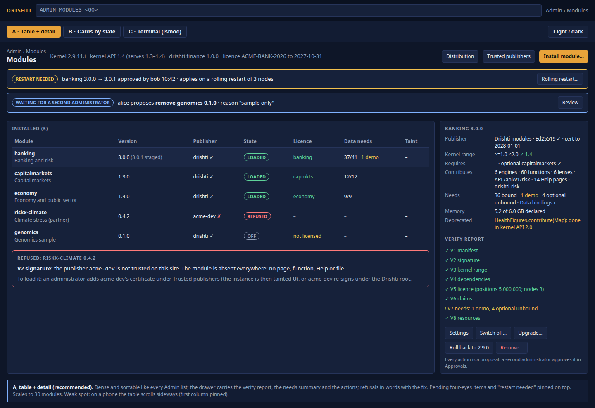

**(a) Admin → Modules, option C** (the terminal layout of the same page):

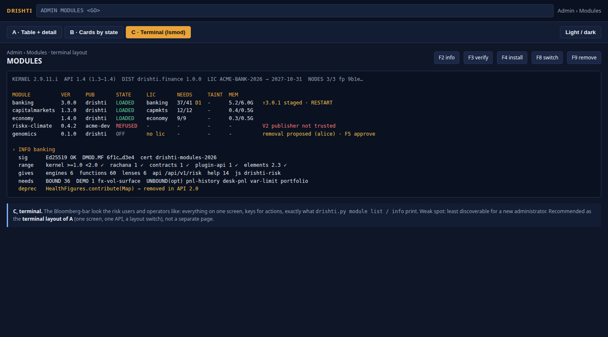

**(b) Admin → Data bindings, option A** (needs by kind, sharing, contract fit, freshness; the bind form checks before proposing):

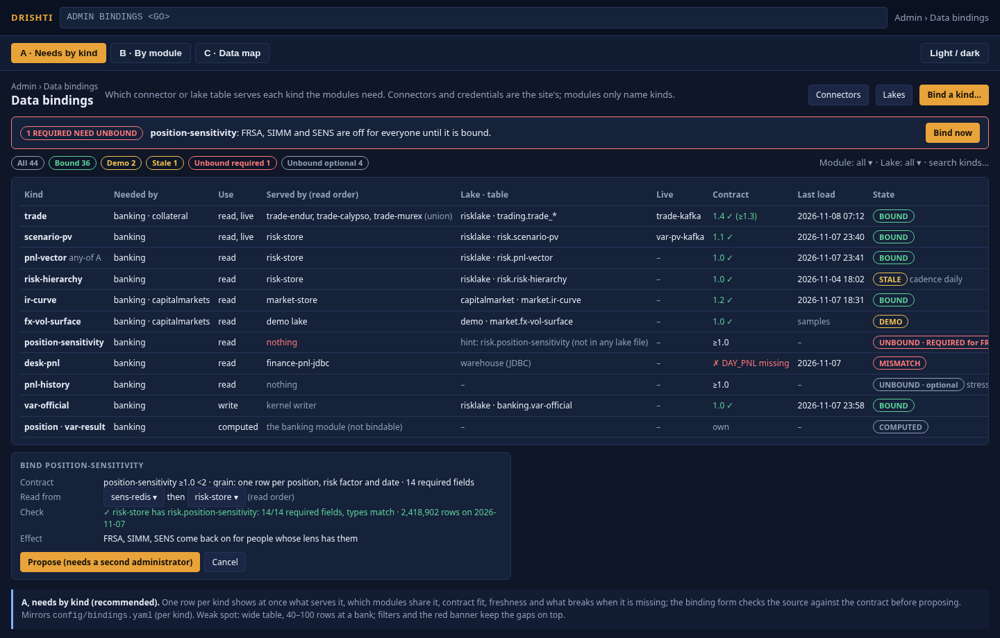

**(b) option B** (by module, the tab inside Admin → Modules → banking):

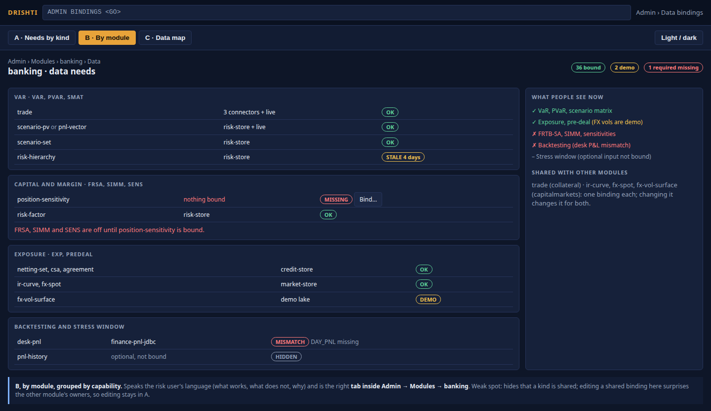

**(c) White label, option A** (Drishti Finance and Drishti Genomics side by side, one kernel):

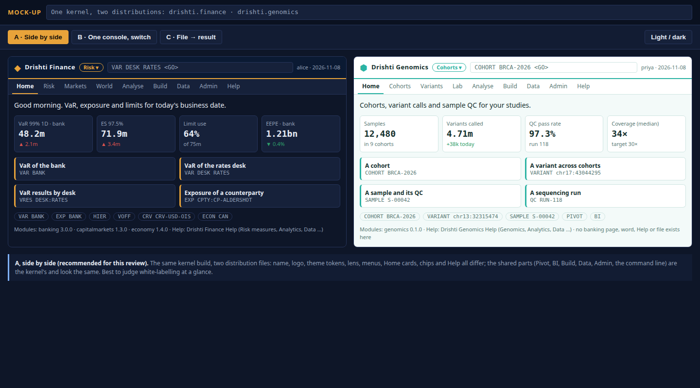

**(d) Module removed, option A** (the open variant explorer frozen under the kernel's notice, the administrator's reason line; saved views
with the *needs module genomics* chip, kept in place):

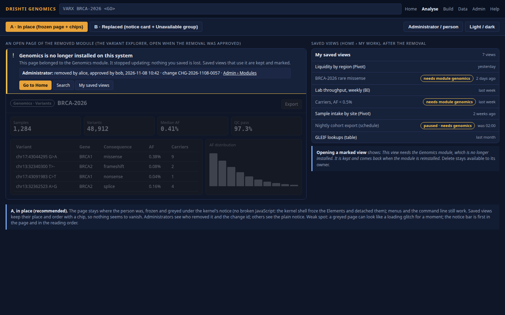

**(e) Admin → Modules → Deploy, option C** (placement per part on the left with the node picker; the plan matrix, headroom and
warnings on the right; then approval and live apply in the same pane):

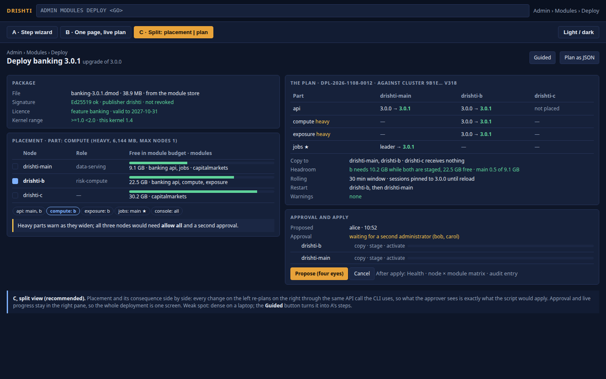

**(f) The kernel switcher, option A** (one console in front of the finance and genomics kernels: the kernel chip and its menu, labelled
menus and Home cards, the genomics kernel down and greyed):

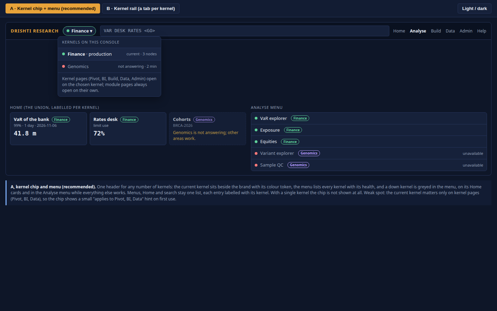

The same option in the light theme: [kernel-switcher-A-light.png](kernel-and-modules/mockups/kernel-switcher-A-light.png); option B:
[kernel-switcher-B.png](kernel-and-modules/mockups/kernel-switcher-B.png).

**(g) Admin → Cluster, option A** (the node × module placement matrix: banking's API on main and b, VaR compute and exposure on b with
max nodes 1, feeds and jobs as singletons on main, nothing placed on c; b's API drifted to 3.0.0 and c holds a leftover package):

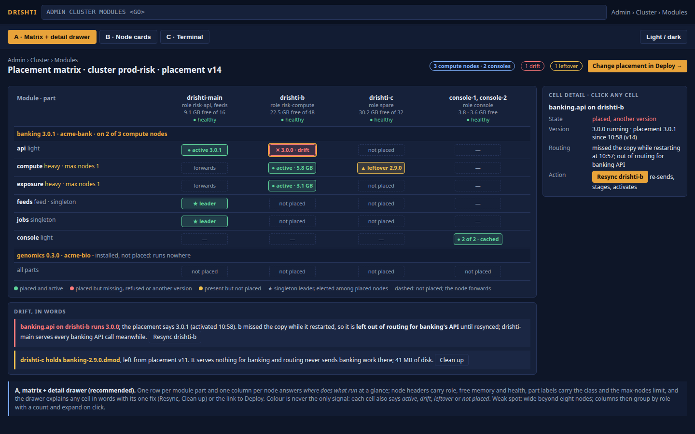

Recommendation: **A**. One row per module part and one column per node answers *where does what run* without reading every node; the node
headers carry role, free memory and health, the part labels carry the resource class and the max-nodes limit, singleton leaders are starred,
and every cell says its state in words as well as colour (green placed and active, red placed but missing or at another version, amber
present but not placed). Clicking a cell opens the drawer with the version, the routing consequence and the one fix (*Resync*, *Clean up*);
any change of placement goes to Deploy (e), so this screen only reads and repairs. B (node cards) becomes its *By node* tab and the phone
layout; C is what `drishti.py cluster modules --matrix` prints. The light theme: [admin-cluster-A-light.png](kernel-and-modules/mockups/admin-cluster-A-light.png).

**(h) Module SDK, `drishti.py module run`, option A** (the genomics module: the fast conformance set C1–C15, the kernel API range, data
bindings resolved against `samples/`, pages and routes with their URLs, hot-reload lines; beside it the module's page with the developer bar):

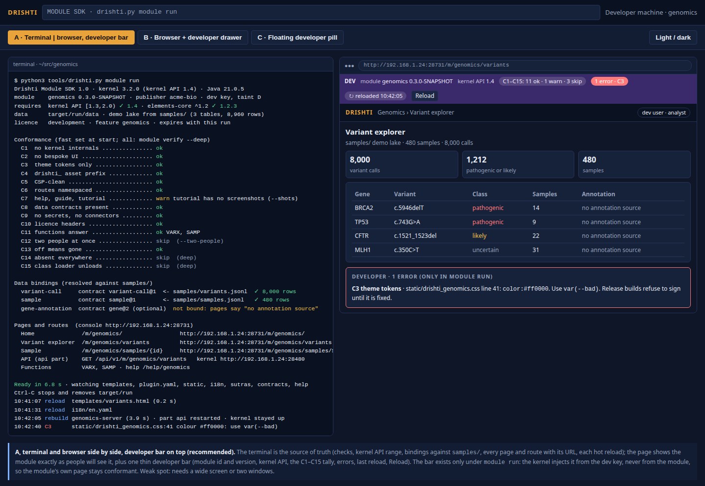

Recommendation: **A**. The terminal stays the one source of truth for checks, bindings, routes and reloads, and the browser shows the module
exactly as people will see it, plus one thin developer bar (module id and version, kernel API, the C1–C15 tally, errors, last reload,
*Reload*). The kernel injects the bar from the development key only under `module run`, never from the module, so the page itself stays
conformant and screenshots taken with `--shots` leave it out. B repeats the terminal in a drawer that covers the page being designed;
C hides errors in a corner and is kept only for `--shots` runs.
