<!--
  Project Drishti · Any data. Any domain. One grammar.

  Copyright (c) 2026 Ashutosh Sinha <ajsinha@gmail.com>.
  All rights reserved.

  PROPRIETARY AND CONFIDENTIAL.

  This file is the confidential and proprietary property of Ashutosh Sinha.
  Unauthorised copying, use, modification, distribution or disclosure of this
  file, via any medium, is strictly prohibited except with the express prior
  written permission of the copyright holder.

  See the LICENSE file in the root of this repository for the full terms.
-->

# The kernel and its modules

**Status: target design, built in the parts named here** (built: P1's kernel API, section 2.3, the module runtime, section 10.4, installation, sections 4.11.4, 4.11.8, 7.1 and 12 (a module is a file in the modules folder and a restart, a rolling restart node by node on a cluster, saved work marked *needs module X*, `drishti.py module install|remove|rollback|list|run`, Admin → Modules), placement, section 4.11 (`config/placement.yaml` per part by node or role, the singleton election behind one interface, the heavy-work guard and the node × part matrix in Admin → Cluster → Modules), and from wave 1 of 2.9.11.i2 + i3 the Module SDK of section 8 (the archetype, the parent pom and the Maven plugin with the conformance checks C1–C14), banking's sources under `modules/banking/` building on their own with the kernel internals they still reach listed in `modules/banking/java/kernel-internals.txt`, and the thin jar `drishti-kernel-app`, which boots with no modules; the kernel loading `.dmod` modules (the registration bridge of section 12.3 for the kernel API's provider types, multi-jar packages with `java.lib`, auto-deploy from `drishti.modules.path`, development mode for exploded folders, and the shared lib folder `drishti.lib.path`); first-party modules with the kernel-internals allowance and the exact kernel build (section 3.3: `origin:` verified against the shipped `first-party.yaml`, conformance check C1, the module class loader, `module inspect` and `module list`), and banking as `banking-1.0.0.dmod`, loaded as a module by the full distribution with market-data, capital-markets and economy installed by default and placed on every node; and the console part of section 4.7 hosted declaratively by today's console (section 14.2.1): `plugin.yaml` format 2's routes, menus, words, Home cards, Help and AI tools under `/m/<id>/`, a Jinja environment per module over `kernel/page.html` and `kernel/elements.html`, statics with the version in the path, Elements copies, code and private templates refused, every surface withdrawn on switch-off or removal with saved work marked *needs module X* (section 12), the economy module's World page among them; content modules read by the access registry from their own manifests; the module's Python compute of section 4.6 (installed into the kernel's worker pool on load, withdrawn on unload, placed with its `compute` part, 2.9.11.i5); the rest of P2 and P3 is being built in 2.9.11.i2 + i3). Written for 2.9.11.i, now split into **i1, i2, i3 and i5** (section 14.2), on the product owner's request of 2026-11-08: Drishti
becomes a domain-free **kernel** for BI and aggregation; capabilities arrive as separately built, signed **modules** loaded from
folders; connectors stay the kernel's; a **distribution file** white-labels the product. Banking is the first module and the worked example
throughout. The same day the owner decided the three building blocks (section 1.1): the **Drishti Kernel**, the **Drishti Console**, now a
**separate Spring Boot application** in front of one or many kernels (section 10), and **Drishti modules**; and that Drishti Elements is the
one controlled set of UI statics (section 11). Surveyed on `wip/train` `89f010df5`.

**Built so far.** The kernel API jar (`drishti-kernel-api`, kernel API 0.5) carries the SPIs of section 2.3 that i1 moved plus
`DrishtiModule`, `ModuleContext` (with `Kinds` and `KindWriter`), `ModuleSettings`, `KindProvider`, `BindingState`, `AiToolProvider`,
`@ModuleApi`, `@EngineWide` and `ApprovalSource`; `FunctionProvider` (its `ElFunction` and `EvalContext`), `CacheGroup` (`MemoryBudget`), `CacheReport`
(Caffeine) and `FlightForm` (Arrow Flight types) stay at their homes until their types move. Banking's `var-positions` and
`var-system-baskets` are `KindProvider`s the kernel routes as computed kinds (from a loaded module, a provider a connector file names is that connector's type: the connector starts when the module loads and stops when it goes, as a `SourcePlugin` extension does); `var-pv-stream` (the Kafka PV transport) is still a source
plugin until the kernel's Kafka connector serves a kind's `live:` binding. Kernel-controlled bindings (section 5) are built:
`config/bindings.yaml`, the resolution order, the states, the data gate on functions, four-eyes changes applied without a restart, Admin →
Data bindings (mock-up A), contracts with `binding-hint:`, banking's needs as `META-INF/drishti/needs.yaml`, and the one-time upgrade from
the connectors' `kinds:` lists. `MISMATCH` is decided by the resolver but not yet detected (no source is schema-checked against its
contract), and the distribution default is a pack's `routes:` until distribution files exist (section 6).

This is the one home for the three blocks, the module package, loading, data binding, distributions, the SDK and the console tier. It builds on what is already
built and does not repeat it: the access chain (licence → module → lens → function → permission) and the registry are
[the access model](#19-the-access-model-licence-module-lens-function-permission); the boundary survey, the dependency rules and the split as built are
[the domain modules part](#21-domain-modules-the-boundary-between-the-core-and-banking) (section 16 says what moves from it into this document); the JavaScript libraries are
[ELEMENTS.md](https://github.com/drishti-platform/drishti-elements/blob/v3.3.2-ide3/docs/DESIGN.md); the lakes and connectors are [DATA_ARCHITECTURE.md](DATA_ARCHITECTURE.md); the lenses are [LENSES.md](LENSES.md).

Worked examples (files, not product code) are in `docs/architecture/kernel-and-modules/examples/` (the banking manifest:
[module.yaml](kernel-and-modules/examples/banking/module.yaml); the genomics sample module as a Maven project with its own pages:
[genomics/](kernel-and-modules/examples/genomics/project-tree.txt)); the screens' mock-ups in `docs/architecture/kernel-and-modules/mockups/`
(section 17). The developer path is section 8, a module's own pages section 9, the console on Spring Boot section 10, Elements section 11,
and what happens when a module is removed section 12.

## Contents

1. [The three building blocks, goals and principles](#1-the-three-building-blocks-goals-and-principles)
2. [The kernel](#2-the-kernel)
3. [The module package (`.dmod`)](#3-the-module-package-dmod)
4. [Loading](#4-loading)
5. [Data needs and connector binding](#5-data-needs-and-connector-binding)
6. [The distribution file (white label)](#6-the-distribution-file-white-label)
7. [Lifecycle and tooling](#7-lifecycle-and-tooling)
8. [The Module SDK and the developer path](#8-the-module-sdk-and-the-developer-path)
9. [Module UI and the developer's own pages](#9-module-ui-and-the-developers-own-pages)
10. [The Drishti Console on Spring Boot (a separate UI tier)](#10-the-drishti-console-on-spring-boot-a-separate-ui-tier)
11. [Drishti Elements: the controlled UI statics](#11-drishti-elements-the-controlled-ui-statics)
12. [Taking a module away: everything disappears](#12-taking-a-module-away-everything-disappears)
13. [Security](#13-security)
14. [Migration, with banking as the proving ground](#14-migration-with-banking-as-the-proving-ground)
15. [Decisions](#15-decisions)
16. [What moves from DOMAIN_MODULES.md](#16-what-moves-from-domain_modulesmd)
17. [Mock-ups](#17-mock-ups)
18. [Configuration resolution: packs, connectors, bindings and inbox rules](#18-configuration-resolution-packs-connectors-bindings-and-inbox-rules)
19. [The access model: licence, module, lens, function, permission](#19-the-access-model-licence-module-lens-function-permission)
20. [Drishti distributions: Drishti Risk, Drishti Finance, Drishti Genomics, Drishti All](#20-drishti-distributions-drishti-risk-drishti-finance-drishti-genomics-drishti-all)
21. [Domain modules: the boundary between the core and banking](#21-domain-modules-the-boundary-between-the-core-and-banking)
22. [Kernel and modules: mock-ups](#22-kernel-and-modules-mock-ups)

## 1. The three building blocks, goals and principles

### 1.1 The three building blocks

**Decided by the owner on 2026-11-08.** Drishti is built from three blocks, and every later section of this document hangs off one of
them or off the glue between them. The names below are used throughout; *the kernel*, *the console* and *a module* are their short forms.


| Block | What it is | What it owns | Hosts of modules | Sections |
|---|---|---|---|---|
| **Drishti Kernel** (Data & BI Kernel) | the server: a Spring Boot application on Java 21, domain-free | connectors and their bindings, lakes, data load and `.ready`, the Sutra grammar (Rachana), the pivot, BI and aggregation engines, Explain, the registry and access, the cluster (Drishti\*net, placement), audit, and **kernel-managed Python workers** | hosts modules' **server parts** (Java, Python compute, packs, feeds, REST) | 2, 4, 5, 7, 12, 13 |
| **Drishti Console** (Data & BI Console) | the experience tier: a **separate** Spring Boot web application on Java 21 | the shell (header, lenses, themes, keys, Home, Help, search), **Drishti Elements** and the Sutra renderer, the BI and pivot screens, Admin; one console sits in front of **one or many kernels** | hosts modules' **console parts** (declared pages, templates, static files, a domain Elements library) | 9, 10, 11 |
| **Drishti modules** (`.dmod`, banking first) | signed packages built apart from both | packs, Java and Python compute, custom experiences (Sutras first, composed pages, a domain Elements library), functions, lenses, Home cards, Help, feeds; a module **declares its data needs and never brings connectors** | (is hosted) | 3, 5, 8, 9 |

**The glue:**

- **`drishti-module-runtime`**: one Java library that reads and verifies a `.dmod`, builds a class loader per module, keeps the live route
  table and runs the unload and absence machinery. **One implementation, two hosts**: the kernel uses it for server parts, the console for
  console parts (section 10.4). No dual machinery.
- **The distribution file** (white label, section 6): which modules, brand, theme, lenses, Home and docs; it may differ per console (10.6).
- **The Module SDK** (section 8): the kernel API jar, the console API jar, the Elements typings, the harness, the conformance suite.
- **Placement** (section 4.11): which nodes run which part of a module; consoles are nodes with the role `console` (10.5).

### 1.2 Goals

| # | Goal | Proof |
|---|---|---|
| G1 | **A domain-free kernel**: general BI and aggregation (packs runtime, Sutras, Rachana, Pivot, BI, tables and models, lakes, connectors, search, Explain, approvals, security, cluster, Elements core) that serves a bank, a hospital or a genome lab unchanged | the kernel boots and serves BI, Pivot and its own reference data with **no module installed**; `tools/domain_strings_allowed.yaml` is empty |
| G2 | **Modules built and shipped separately**, like Linux kernel modules: one signed file (`.dmod`) per module, compiled against the kernel API only, dropped into a configured folder | the banking module is built in its own build against the SDK jars and passes its suite against the kernel alone |
| G3 | **A module carries everything its capability needs**: Java compute, services and API; Python compute; packs (kinds, contracts, Sutras, samples); console routes, templates, the domain Elements library, CSS on the theme tokens; lenses, functions, Home cards; feeds; Help, guides, tutorials, glossary; settings schema; licence feature | removing `banking.dmod` leaves no banking word, page, file, Help page, engine or API anywhere ([ACCESS_MODEL.md section 19.6](#196-guarantees-as-tests), extended to "not installed") |
| G4 | **The kernel controls connectors.** A module declares the *data* it needs (kinds and contracts); the site binds its configured connectors and lake tables to them | no host or credential in any module file, and no connector outside its read-only templates, whose site values are `${...}` placeholders (a packager check, C9); Admin → Data bindings shows every need and what serves it |
| G5 | **White label by configuration**: one distribution file picks modules, brand, theme, lenses, Home and docs | `drishti.finance` and a sample `drishti.genomics` boot from configuration only, from the same kernel build |
| G6 | **VaR exactly equal** through every phase | the VaR check, bit for bit, at the 509 and 250 windows |

### 1.3 Non-goals

- No public module marketplace or online repository (a site's module repository is phase P5).
- No third-party connector plugins inside modules, ever (G4). Connector plugins remain kernel extensions (section 2.4).
- No OSGi or JPMS layer: one class loader per module with an explicit export list is enough and keeps Spring and the build simple.
- No second way: banking does not keep an "in the jar" path once it is a `.dmod` (no dual machinery: the development fat jar is a build of the kernel plus modules, not a different loading path; section 4.10).
- No hot load of code in P2 (packs and Sutras are already hot; code modules restart). Hot code load is P5. Pages, words, menus and
  every other surface **disappear hot** in P2 (section 12).

### 1.4 Principles

1. **The kernel knows no domain.** No banking word, engine id, kind, path or package in kernel code, templates, scripts or styles. The
   rule-4 check of [DOMAIN_MODULES.md section 21.4](#214-the-dependency-rules) becomes a gate with an empty allow list.
2. **One way. Banking ships as a module like any other.** No privileged module, no "built-in" path. Economy and capital markets are
   content-only modules packaged the same way. The kernel's own reference data (calendar, GLEIF) stays kernel content.
3. **Modules reach the kernel only through the kernel API** (section 2.2): versioned SPIs and services, the Rachana grammar, the
   data-contract format, the Elements core API, the REST namespace given to the module, the event bus. Everything else of the kernel is
   invisible to a module's class loader.
4. **Modules never depend on each other's internals.** `requires:` names a module and a version range; a module may use another's
   *published kinds and functions* (data), never its classes.
5. **Standard libraries, standard formats.** The package is a zip with a JAR-style signature; YAML manifests; JSON Schema for settings;
   ES modules and `.d.ts` for JavaScript; semver for versions; data in JSONL and Delta/Iceberg via their official libraries.
6. **Secure by default.** Unsigned or untrusted modules are refused (a development key exists for the SDK harness only); licences decide
   what loads; Python runs in the kernel's sandbox; module assets live under a strict CSP; **secrets never enter a module**.
7. **Elements, never bespoke UI.** A module's screens are Sutras first, then composed pages, then its own domain library (drishti-risk
   for banking; section 9), all built from Drishti Elements on the kernel's theme tokens ([ELEMENTS.md](https://github.com/drishti-platform/drishti-elements/blob/v3.3.2-ide3/docs/DESIGN.md)).
8. **Declared, so removable.** Everything a module shows or offers (routes, words, menus, cards, Help, jobs, SPIs) is declared and
   registered by the kernel, never by module code at import; removing a module withdraws the declarations, so it is absent everywhere
   (section 12).
9. **Refused means absent, with the reason.** A module that fails a check is not loaded at all; Health and Admin → Modules say why in
   words.

### 1.5 The Linux analogy (the owner's frame)

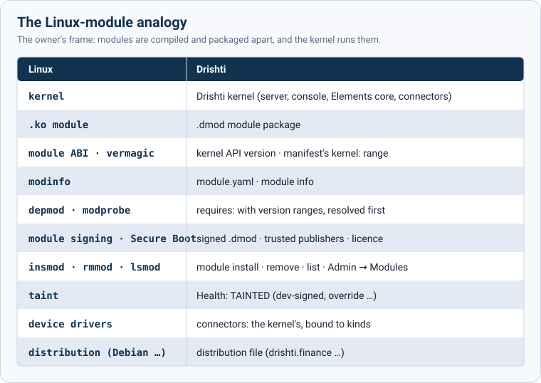

| Linux | Drishti |
|---|---|
| kernel | the Drishti Kernel (the Data & BI server with its connector plugins) |
| desktop environment over the kernel (one desktop, several machines over X or a remote session) | the Drishti Console: a separate process, in front of one or many kernels (section 10) |
| `.ko` module | `.dmod` module package |
| module ABI, `vermagic` | the versioned kernel API and the manifest's `kernel:` range |
| `modinfo` | `module.yaml` (and `drishti.py module info`) |
| `depmod` / `modprobe` dependency resolution | `requires:` with version ranges, resolved before loading |
| module signing, Secure Boot | signed `.dmod`, trusted publisher keys, licence through the registry |
| `insmod` / `rmmod` / `lsmod` | `drishti.py module install | remove | list`, Admin → Modules |
| taint | Health "unsupported module loaded" (development-signed, out-of-range, or overridden) |
| device drivers talk to hardware via the kernel's bus | modules read data via kernel **bindings**; connectors are the kernel's drivers |
| distribution (Debian, Fedora) | distribution file (`drishti.finance`, `drishti.genomics`) |

## 2. The kernel

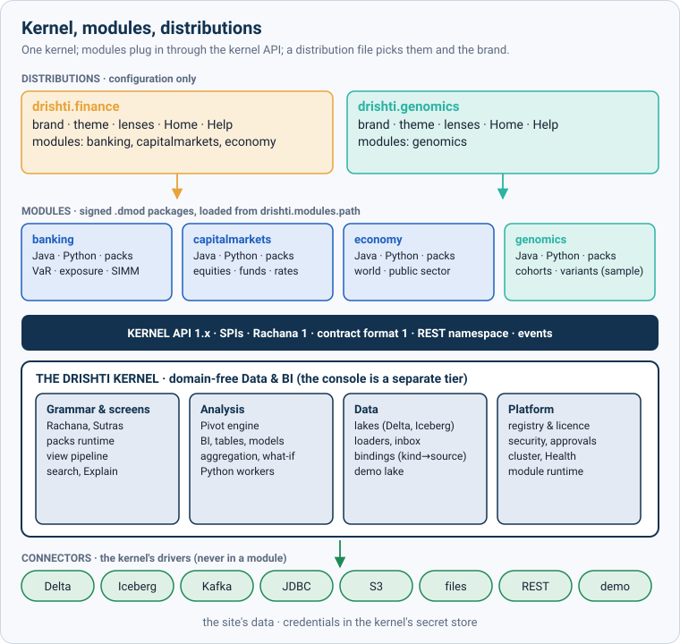

### 2.1 What is in it

| Area | Kernel (Maven modules, in the subject folders `kernel/`, `compute/`, `lake/`, `net/`, `plugins/`) |
|---|---|
| Foundations | `drishti-common`, `drishti-api` (data SPIs), `drishti-registry` (access registry, licence), `drishti-identity` |
| Grammar and screens | `drishti-rachana` (Rachana, Sutras), `drishti-engine` (view pipeline, inference, search, phrase, view augmenters, entity links), `drishti-packs` (pack loader and pack runtime) |
| Analysis | `drishti-bicompute` (pivot engine, Rachana functions, Explain, what-if), `drishti-tables` (virtual tables, models), `drishti-inference` |
| Data | `lake-io` (the lake core: the lake files and file access), `lake-load` (the loader, the inbox, the in-memory lake), `lake-delta`, `lake-iceberg`, `drishti-flight`; the disk cache and the message-queue state store in `drishti-common` |
| Connectors | `plugins/drishti-connectors` (the built-in light ones: file, rest, feed, news, demo, yfinance) and every `plugins/drishti-plugin-*` (delta, iceberg, iceberg-external, s3, jdbc, duckdb, kafka, rabbitmq, activemq, redis, mongodb, cassandra, aerospike); the connector files, credentials and **bindings** (section 5) |
| Compute | `drishti-compute` (generic: vector store, many-set sums, sharding, the Python pool and sandbox, the scheduler), `drishti-native` (BLAS/LAPACK with Java fallbacks) |
| Platform | `drishti-server` (REST, security, approvals, collaboration, alerts, cluster `drishti-net`, Health, audit, Admin), `drishti-ai` (LLM providers, MCP), `drishti-app` (the runnable kernel jar) |
| Module runtime | `drishti-module-runtime`: manifest reading, verification, class loader per module, live route table, unload and absence machinery; **shared with the Drishti Console** (section 10.4) |
| Content | the core pack (calendar and generic entities), GLEIF reference data, the compute-demo pack, the kernel's Help (generic guides and tutorials), the CIO and oversight lenses, the default theme |

**Not in it, because it is the Drishti Console** (a separate application, section 10): the shell, command line, Home, the Pivot, BI, Build,
Notebook and Admin screens, the Help centre, search, embed and phone pages, and **Drishti Elements** with the vendored libraries
(section 11). The kernel answers their questions over its REST API; it serves no page and no UI static file.

**Not in it, because they are modules:** `drishti-banking`, `drishti-compute-banking`, `drishti-console/plugins/{banking,economy}`, the drishti-risk library, the
packs (now in each module's own `packs/` folder), their lenses, lakes, BI content, feeds, guides and tutorials. Each of those is a
module (section 14.1 lists today's leaks).

### 2.2 The kernel API

The kernel API is a **published, versioned contract**: what a module may compile against and rely on. It is one version number for
the whole surface, `kernelApi: MAJOR.MINOR`, separate from the product version (the kernel API is at **1.0**).

| Surface | Form | Where |
|---|---|---|
| Java SPIs and services | `drishti-kernel-api-<v>.jar` (interfaces, records, annotations only; no implementation) | section 2.3 |
| Python compute API | `drishti_kernel` package (the compute SDK's item, frame and result types; the sandbox's rules) | section 4.6 |
| Rachana and Sutras | grammar version `rachana: 1.2` (already in every Sutra) | [RACHANA_REFERENCE.md](../guides/RACHANA_REFERENCE.md) |
| Data contracts | contract format `contract-format: 1` (the `*.contract.yaml` shape the packs use today) | section 5.2 |
| Elements core | `@drishti/elements-core` etc.: ES modules + `.d.ts`, the theme tokens | [ELEMENTS.md](https://github.com/drishti-platform/drishti-elements/blob/v3.3.2-ide3/docs/DESIGN.md) |
| Console API (the Drishti Console's half, versioned as `plugin-api`) | `plugin.yaml` format 2 (routes, words, menus, cards, slots, the API proxy list) and `drishti-console-api-<v>.jar` (the Java context-builder interface); replaces format 1 and the hooks of `core/plugins.py` | sections 4.7, 9, 10.4 |
| REST | the namespace a module is given (`/api/v1/<module api>/…`) and the kernel's public endpoints | section 2.5 |
| Events | the kernel event catalogue | section 2.6 |
| Manifest | `module.yaml` format 1 | section 3.3 |

**Versioning rules.**

- **Semver on the kernel API**, not on the product: a MINOR adds (a new SPI, a new optional method with a default, a new event); a MAJOR
  removes or changes. The product version and the kernel API version are both printed on About, Health and `drishti.py module list`.
- **Deprecation over one release** (the owner's rule): a deprecated element keeps working for one product release, logged once per start
  and listed on Admin → Modules against each module that still uses it ("banking 3.0.0 uses `HealthFigures.contribute(Map)`, deprecated,
  gone in the next release"); the next release removes it and bumps MAJOR.
- **Compatibility range**: the kernel declares `kernelApi: 1.4` and `serves: [1.3, 1.4]` (the current minor and the one before it within
  the major). A module declares `kernel: ">=1.3 <2.0"`. A module is loadable when its range contains the kernel's `kernelApi` and its
  lowest bound is not older than `serves`' lowest (the `vermagic` check, section 4.3).
- **The SDK jar is the contract**: anything not in `drishti-kernel-api` is not API, even if public in `drishti-server`. An architecture
  test fails a module class that imports anything else of `com.ash.drishti..` (section 4.4).
- **API diffs are generated** each release (`japicmp` on the API jar, a `.d.ts` diff, a manifest-schema diff) and a MAJOR change without a
  MAJOR bump fails the gate.

### 2.3 The SPIs

**Existing SPIs** (built for the domain split; the banking module fills them today). Each moves into `drishti-kernel-api` under
`com.ash.drishti.kernel.api.*`, keeping its shape; banking's use is in brackets.

Built in `drishti-kernel-api` (kernel API **0.1**; the jar is on the class path of the kernel modules, `ApiSurfaceTest` pins its surface):
`PivotProvider` and `PivotSourceProvider` with their value types (`kernel.api.pivot`), `ViewAugmenter`
(`kernel.api.view`), `Explainer`, `ExplainRequest`, `Explanation` (`kernel.api.explain`), `Principal` (`kernel.api.security`), `ShardedMeasure` and
`ShardGather` (`kernel.api.shard`), `CapacityFigures`, `HealthFigures`, `OfficialResults`, and the new `DomainVocabulary` (`kernel.api.vocabulary`).
Still at their old homes and to move with i2: `FunctionProvider` (its `EvalContext` carries the formats), `CacheGroup`/`CacheReport` (Caffeine and
`MemoryBudget` in their shape), `ApprovalSource`, `FlightForm` (Arrow types); `SourcePlugin`, `StorageProvider` and `ProviderFactory` stay kernel-only, off this jar.

| SPI (today's home) | What a module contributes | Banking |
|---|---|---|
| `ComputeEngine` (`drishti-api`, `com.ash.drishti.api.compute`: the one engine interface, its switch and the reactive computation) | a compute engine with its switch, words and health | VaR, exposure, FRTB-SA, SIMM, sensitivities, MR cube |
| `PivotProvider` (`drishti-bicompute` spi) | measures the pivot engine computes per cell (non-additive totals) | VaR, ES, PVaR by any grouping |
| `PivotSourceProvider` (`server.pivot`) | a source the pivot asks before the tabular provider | the VaR source of the MR lens |
| `FunctionProvider` (`drishti-rachana` el) | Rachana functions (`var()`, `pvar()`, `es()`) | VaR functions in BI and Sutras |
| `ViewAugmenter` (`drishti-engine`) | fields added to a kind's view as the page opens | `VAR_ENGINE.*` on a position, trade, book |
| `Explainer` (`server.explain`) | the Explain drawer's formula, inputs and lineage for its numbers | VaR, component VaR, EPE, FRTB charge |
| `CacheGroup` / `CacheReport.Owner` (`server.caches`) | caches the kernel reports and clears in order | VaR and exposure date caches |
| `ApprovalSource` (`kernel.api.approvals`, moved in i2) | items in the Approvals inbox | regulatory VaR sign-off, scope changes |
| `ShardedMeasure` (`server.shard`) | a measure computed across shards | VaR by hierarchy at scale |
| `FlightForm` (`server.flight`) | an Arrow Flight descriptor it serves | P&L vectors out |
| `CapacityFigures` (`server.capacity`) | its rows in the capacity planner | VaR memory and time per date |
| `HealthFigures` (`server.api`) | figures in Health | hierarchies skipped |
| `OfficialReaders.OfficialResults` (`drishti-packs`) | published results lakes it reads | `var-official`, `ccr-official` |
| `SourcePlugin` (`drishti-api`) | **kernel only from P1** (section 5.7): banking's `VarPositionsPlugin` and `VarPvStreamPlugin` become `KindProvider`s | — |
| `StorageProvider` (`lake-io`), `ProviderFactory` (`drishti-ai`) | **kernel only** (storage back-ends, LLM providers) | — |

**New SPIs** (P1 unless noted):

| SPI | Purpose | Banking |
|---|---|---|
| `DrishtiModule` | the module's entry point: `start(ModuleContext)`, `stop()`, `health()`; the context gives the kernel services below, its settings, its folders and its logger | `BankingModule` |
| `ModuleContext` services | `Kinds` (read and subscribe to bound kinds **as the person**), `KindWriter` (write produced kinds to their bound target), `Events`, `Scheduler`, `ComputePools` (incl. the Python pool), `Settings`, `Secrets` (**none**: modules get no secrets; section 13.4), `Audit`, `Registry` (ask, never read), `Caches`, `Clock` (business date) | VaR reads `scenario-pv`, `pnl-vector`, `var-limit` through `Kinds` |
| `KindProvider` | answers a kind the module **computes** (replaces modules' `SourcePlugin`s and the reactive-connector Java runners): fetch, search, subscribe; inputs read through `Kinds` | `position` (derived from trades), `var-result` (`VRES`), `exposure-result`, intraday scenario PVs |
| `ModuleSettings` | binds the module's `settings/schema.json` to a typed record; validated at start and on change | VaR windows, confidence, root names, hierarchies |
| `AiToolProvider` | tools the AI assistant may call, each tied to a function (off function = no tool) | "VaR of a scope", "why VaR moved" |
| `HomeTable`, `MeasureSource` | a module's own role-Home tables (served to the Homes it names) and measure source (figures and followed measures) | genomics: `genomics_gwas_top`, engine `genomics` |
| `RestModule` (annotation `@ModuleApi`) | marks the module's controllers; the kernel mounts them under the module's namespace (section 4.5) | `/api/v1/risk/**` |
| `ExportProvider` (P3) | named exports (workbook, regulatory files) | regulatory VaR files |
| `PlaygroundTemplates` (P3) | the generic workbook streamer's templates | VaR, FRTB-SA, SIMM, SA-CCR, FVA playgrounds |
| `ModuleMigration` (P4) | upgrade hooks between module versions for its own stored state (no database migrations: state files and caches only) | VaR date caches rebuilt on a format change |

The Java SPIs are discovered with `ServiceLoader` **inside the module's class loader** (`META-INF/services/…` in the module's jars) and,
for Spring beans, through the module's own child application context (section 4.4).

**The kernel's typed services** (`com.ash.drishti.kernel.api.services`, kernel API 0.5). A module reads what a client reads through one
bean, `Kernel`, in process: no HTTP call to its own server. `Kernel.person()` copies the person of the request in hand (user, display
name, administrator or not, roles, lens, date box and known-at, the scopes of a personal API token); the copy is usable from any thread,
and every service takes it explicitly (no thread local, nothing per person in a static or a shared cache; `Kernel.cache` keys on
`Person.key()`). A `Person` the kernel did not make is refused. Each service answers what the REST path it replaces answers for the same
person, **by the same body**: the controller and the typed service call one method, and a typed service never calls a controller.

| Service | Replaces | The body both call |
|---|---|---|
| `records().search(p, query)` | `GET /api/v1/search` | `Searches.search` (row rule joined, masks, the edition, the cluster's shards) |
| `records().raw(p, ref)` | `GET /api/v1/entities/{kind}/{id}/raw` (empty where the path answers `DRS-1001`) | `RecordReads.raw` |
| `history().series(p, ref, path, days, to)` | `GET /api/v1/history/{kind}/{id}/series` | `RecordReads.series` |
| `dates()` | `GET /api/v1/business-date` (`current`, `selected`, `live`) | the server's business dates (`drishti.business-date.*`, a fixed `today` included) |
| `settings().of(p)` | `GET /api/v1/me/settings` | `MySettings.of` |
| `live().query(p, query, limit)` | `GET /api/v1/rdp/searches` | `FormResults.answer` |
| `pivots().inline(p, request)`, `pivots().figures(…)` | `POST /api/v1/pivot/inline` | `PivotInline.inline` (the engine switch, the edition's `PIVOT`, the audit row) |
| `lenses().block(lens, block)` | a block of `config/lenses/<module>/<lens>.yaml` | `KernelLenses.whole` |
| `access()` | the entitlements a REST path applies (`requireOpen`, the masks) | `Entitlements` |
| `operations()` | one module asking another (below) | the provider's `@Operation` method; with `rest`, the method its REST path's controller calls |

What each door of a REST path does for a typed call:

| Door | Typed call |
|---|---|
| `TokenFilter` (identity, token scopes) | the identity is copied into `Person`; each service checks the scope of the path it replaces against the same table (`TokenScopes`), refusing `403 DRS-5002` with the filter's words |
| Entitlements, masks, row rules | inside the body, as the controller applies them |
| `AsOfResolver` (date box, known-at), the lens header | values of `Person` (the header, else the query parameter, as the REST paths read them) |
| A refusal | the status, code and words the REST path answers, from the one exception table (`ApiExceptionHandler.problem`) as `Kernel.Refused` |
| The access log (`AccessRecorder`) | a search, a raw record and a series are recorded as their REST reads are |
| Time | a read runs on its own (virtual) thread and is given 60 s, then refuses `503 DRS-5003` |
| `EngineGateFilter`, `ModuleGateFilter`, `PlacementGuardFilter` | the kernel's services run on every node and have no engine switch of their own; an operation passes all three (below) |
| `RequestsInFlight`, `RequestActivity` | not counted again: the request that made the typed call already holds its slot |
| `PathGuard`, `RequestSizeFilter` | not applicable: no path, no body |

**Operations: one module asks another.** A module serves an operation from a bean of its own child context (the module keeps its child
context): a method `@Operation(value = "var.scope", rest = "POST /api/v1/risk/var/scope")` of the shape `(Person, <request record>) ->
<answer record>`. When the module starts, the module runtime's wiring registers every such method of its context's own beans as
`<module>:<name>` (`OperationRegistry`), and withdraws them first when it unloads; two of one name in one module stop its start, both named.
A consumer declares an interface of its own, each method `@Operation("name")` on `(Person, <its request record>)`, and asks
`kernel.operations().of("banking", MyView.class)`: the request is converted to the provider's record and the answer back by field name
(the kernel's `ObjectMapper`), so neither module sees the other's classes. `available(module)` says whether the module is loaded, on and
serves operations here.

`rest` names the REST path the operation answers as; a call passes that path's doors, in the REST path's order, with its answers (one rule
each, shared with the filter):

| Door | An operation |
|---|---|
| `TokenFilter` (token scopes) | the scope of `rest` (`403 DRS-5002`); an operation without `rest` is checked as `POST /api/v1/net/modules/operation/{module}/{name}`, which no API token holds (`token-never`) |
| `ModuleGateFilter` | the module off (`404 DRS-1025`), its function waiting for data (`409 DRS-1035`), off (`404 DRS-1026`) or not the person's (`403 DRS-1027`), in the gate's words; without `rest`, the module's switch alone |
| `PlacementGuardFilter` | the part that answers `rest` (the module's `api` part without it): placed here, it runs here; placed on another node, it is asked there (`POST /api/v1/net/modules/operation/{module}/{name}`, signed with the cluster key, for the same person: identity from the on-behalf-of claims, lens, date box, known-at and token scopes in the body), once, and runs or is refused there; no placed node up, or the node does not answer: `503 DRS-1032` in the guard's words |
| `EngineGateFilter` | the engine whose `api:` prefix holds `rest`: running here, the call is counted while it runs (switching the engine off drains it); running on another node, the call is asked there; else `404 DRS-1020` (`502 DRS-5052` when that node does not answer) |
| A refusal, the time | as every typed call: the provider's exception mapped by `ApiExceptionHandler.problem` to `Kernel.Refused`, 60 s on its own thread (`503 DRS-5003`) |
| The access log | every call that runs, is forwarded or is refused here: action `operation`, the module, the name, the outcome, the date box |
| `RequestsInFlight` | not counted again: the request that asked holds its slot; a call asked on another node is a request there and counted there |

An operation nobody serves here refuses `404 DRS-1020`. `OperationsTest` holds the parity, typed against REST, row by row (a local call,
the module off, the engine off, a read-only API token on a write, the provider's own refusal, a name served twice, the module withdrawn);
`OperationsClusterTest` an operation placed on another node (the same answer as the REST path through this node, computed there only) and
that node down (the same `503 DRS-1032`).

`TypedCallParityTest` holds the parity: every call the landings make, typed and over REST, for an administrator, a masked role, a
row-ruled role, a role the kind is closed to, a lens, an earlier date box, another language, a read-only API token and a scoped one, several
people at once, and again with the business today fixed. The trading and market-data landings call these services: a module's Spring
context takes `Kernel` from the kernel's context (or asks `ModuleContext.kernel()`), the landing's controller asks for the person of the
request (`Kernel.person()`), and every read is a typed call of that person. No module calls its own server over HTTP (`NoLoopbackTest`);
the trading landings reach the banking module's VaR and exposure engines through six operations (`RiskFigures`, served by banking's `RiskOperations`).

### 2.4 What stays kernel-only, and why

| Kernel-only | Why |
|---|---|
| Connector plugins (`SourcePlugin`), storage providers, the lake formats | the site's data, credentials and network belong to the site's administrators; one place to secure and audit them (G4) |
| Identity, RBAC, the licence check, the registry's model | one trust point ([ACCESS_MODEL.md section 19.2](#192-one-registry-asked-by-every-layer)) |
| The Python runtime, its lock file and sandbox | one runtime ([ARCHITECTURE.md section 29.1](ARCHITECTURE.md#291-one-python-runtime)) |
| In the Drishti Console, never in a module: the shell, menus, Help centre, search, Drishti Elements and every vendored library | one look, one search, one Help, one controlled set of UI statics (section 11) |
| The database schema files | no migrations, two complete schema files; modules keep state in files under their data folder or in kinds |

A new connector type (say, a genomics VCF reader) is a **kernel extension**: a connector plugin jar shipped with the kernel or added to the
kernel's `plugins/` folder by the site, signed by the kernel's publisher key; never part of a `.dmod`. A module that needs such a format
says so in its data needs (`formats: [vcf]`), and Admin → Data bindings shows *no connector of type vcf is installed*.

### 2.5 REST namespaces

| Prefix | Owner |
|---|---|
| `/api/v1/{admin,bi,pivot,tables,packs,sutras,views,entities,search,explain,approvals,changes,export,flight,modules,functions,…}` | kernel (the about 100 prefixes of today) |
| `/api/v1/<api>/…` | a module, `<api>` declared in its manifest (`api.prefix: risk` for banking); unique across installed modules, refused when it clashes with the kernel's list or another module's |
| `/api/v1/admin/modules`, `/api/v1/admin/bindings` | kernel: module and binding administration (sections 5, 7) |
| `/m/<module>/static/<version>/…` | console: a module's static files (section 4.7) |
| `/m/<module>/…` pages | console: a module's pages (declared routes, section 9.8); a declared `alias:` keeps a current address (today's `/var`, `/exposure`), checked against the reserved names, refused on clash |
| `/m/<module>/api/…` | console: the console's API proxy to the owning kernel's `/api/v1/<api>/…`, declared endpoints only, as the person (section 9.5) |
| `/k/<kernel>/…` | console: a kernel page on a named kernel when the console fronts several (section 10.6); absent with one kernel |

### 2.6 Events

One kernel event bus (in process, gossiped over `drishti-net` where marked). Modules subscribe through `ModuleContext.events()`; a module
may publish only events under its own id (`banking.*`).

| Event | Payload | Typical module use |
|---|---|---|
| `data.loaded` | lake, table, kind, business date, batch id, rows | VaR rebuilds a date when `scenario-pv` or `pnl-vector` lands |
| `data.changed` | kind, ids or range, cause (correction, restatement) | exposure recomputes a netting set |
| `binding.changed` | kind, old and new source | VaR drops caches for that kind |
| `date.rolled` | new business date | hot file prepared |
| `module.started` / `module.stopped` / `module.refused` | id, version, reason | a dependent module reacts |
| `settings.changed` | module, keys | VaR reloads hierarchies |
| `approval.decided` | item, decision | regulatory sign-off |
| `cache.invalidated` | group | — |
| `function.switched` | word, on/off | AI tools refreshed |

### 2.7 How the kernel is versioned and shipped

- The kernel ships as `drishti-kernel-<product version>.jar` (the thin jar, P2) with its connector plugins and the kernel's content. The
  **Drishti Console ships separately** as `drishti-console-<product version>.jar` with Elements and the vendored libraries (section 10). Its `kernelApi` and `serves` are in `/public/about`.
- A **distribution build** (section 6.6) is the kernel, the console and the `.dmod` files the distribution names, in one archive; the modules stay
  separate files inside it.

## 3. The module package (`.dmod`)

### 3.1 File format

- A **zip** (ZIP64 allowed) named `<id>-<version>.dmod`, e.g. `banking-3.0.0.dmod`.
- Signed like a JAR, with a modern signature: `META-INF/DMOD.MF` lists every entry with its SHA-256; `META-INF/DMOD.SIG` is an
  **Ed25519** detached signature over `DMOD.MF`; `META-INF/publisher.pem` is the publisher's certificate, chained to a key the site trusts
  (section 13.1). An entry not listed, or listed with another hash, refuses the whole module.
- Uncompressed `module.yaml` first in the archive, so `module info` reads it without unpacking.
- No executable native binaries (`.exe`, `.so`, `.dll`, `.dylib`) at the top level of `python/` or `console/` (Windows QA rule: a module
  runs on Java and the kernel's Python only); native code a jar bundles (JavaCPP) is allowed and declared (`native: true`), and refused on a
  site that forbids it.
- Installed **unpacked** into `<modules.dir>/<id>/<version>/` (read-only to the server process), with the original `.dmod` kept beside it for
  verification at every start.

### 3.2 Folder layout

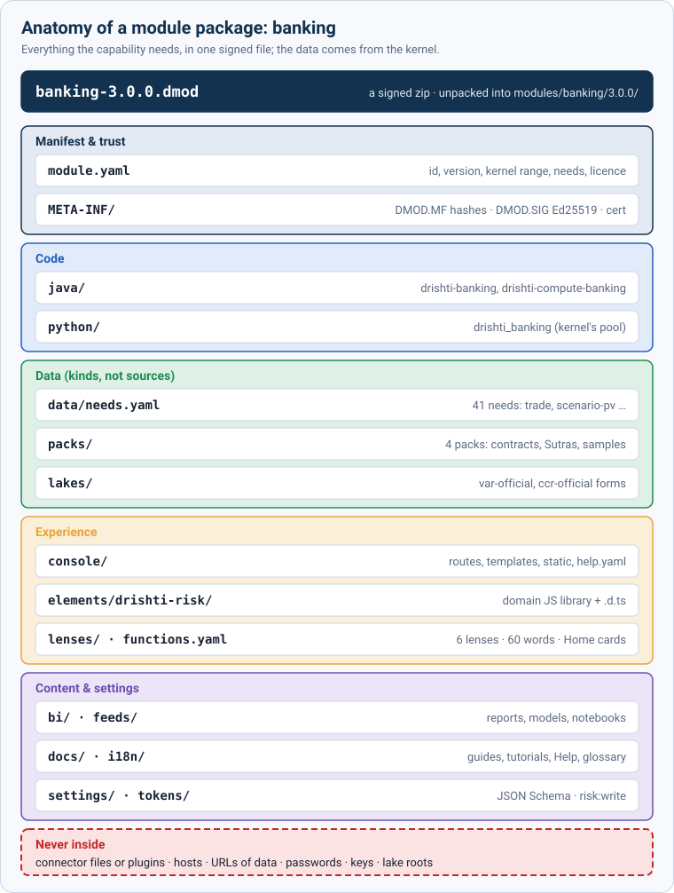

```
banking-3.0.0.dmod
├── module.yaml                     the manifest (section 3.3)
├── META-INF/                       DMOD.MF (hashes) · DMOD.SIG (Ed25519) · publisher.pem
├── java/                           the module's jars (own class loader) and their private third-party jars
├── python/                         its Python package(s) for the kernel's pool; requirements.txt (must be within the kernel's lock)
├── data/needs.yaml                 the kinds it needs and produces, with contract ranges (section 5)
├── packs/<pack>/                   its packs, exactly today's pack folders (pack.yaml, contracts/, sutras/, samples/, python/, guides/)
├── engines/                        engine catalogue entries and engine defaults
├── lakes/                          its published-results lake forms (var-official, ccr-official): tables only, no location
├── bi/                             reports, models, tables, notebooks, fragments, report definitions
├── lenses/                         lenses.yaml (registry lenses: modules, functions, cards, chips) and lens files (menus, Home, Help)
├── functions.yaml                  its command words and the APIs behind each
├── console/                        plugin.yaml, templates/, static/ (drishti_*.js, drishti_*.css), java/ (context builders), help.yaml
├── elements/<lib>/                 its domain Elements library (drishti-risk): ES modules, CSS on tokens, .d.ts, manifest
├── feeds/                          feed definitions and their refresh scripts (.py, with .sh and .ps1 launchers)
├── settings/                       schema.json (JSON Schema 2020-12) and defaults.yaml
├── tokens/token-scopes.yaml        its API token scopes
├── docs/                           guides/, tutorials/, img/, help pages (help.yaml groups), glossary.yaml, README.md
├── i18n/                           message bundles
├── tests/                          its conformance tests (run by `module verify --deep`; never loaded by the server)
└── NOTICES/                        LICENSE, THIRD-PARTY-NOTICES.md
```

The full tree for banking, every folder filled from today's files, is
[examples/banking/dmod-tree.txt](kernel-and-modules/examples/banking/dmod-tree.txt).

### 3.3 The manifest (`module.yaml`)

The manifest grows from today's `META-INF/drishti/module.yaml` (id, domain, title, feature, requires, contributes); it is still read only by
the registry (other kernel parts ask the registry). Every field:

| Field | Required | Meaning |
|---|---|---|
| `format` | yes | manifest format, `1` |
| `id` | yes | lower-case id, unique (`banking`); also the folder, the class-loader name, the events prefix |
| `version` | yes | semver of the module (`3.0.0`) |
| `title`, `about` | yes | words for Admin, About, Help |
| `domain` | yes | the domain it serves (`banking`, `economy`, `capitalmarkets`, `genomics`) |
| `publisher` | yes | `{name, id, contact}`; must match the signing certificate's subject |
| `licence.feature` | yes | the licence feature that unlocks it (`banking`); `licence.limits` it understands (`positions`, `nodes`) |
| `kernel` | yes | the kernel API range (`">=1.0 <2.0"`) |
| `rachana`, `contracts`, `plugin-api`, `elements` | yes | grammar, contract-format, console API and **Elements API** ranges it was built for (`elements: ">=2.4 <3"`, checked by the console: section 11.3) |
| `requires` | no | other modules with ranges, and `optional:` ones it uses when present (`capitalmarkets` optional for banking) |
| `conflicts` | no | modules it cannot run beside |
| `provides.kinds` | no | kinds it owns (defined in its packs), by pack |
| `java` | no | `jars:` (in `java/`), `entry:` the `DrishtiModule` class, `spring:` its auto-configuration, `exports:` packages other modules may *not* see (default none), `native:` true when a jar bundles native code |
| `compute` | no | its engines (ids, words, pools, switches) |
| `python` | no | `version:` (the least Python), `path:` (package folders, default `python`), `wheels:` (the vendored wheels folder, default `python/wheels`), `requires:` (each needs a pure-Python wheel in it), `engines:` (`module:Class` entry points), `pool:` (the module's pool settings). Built: section 4.6 |
| `packs` | no | its packs (folders under `packs/`) and which are on by default |
| `data` | no | `needs:` file (`data/needs.yaml`, section 5) |
| `api` | no | `prefix:` (its REST namespace), `tokens:` |
| `console` | no | `plugin:` (`console/plugin.yaml`, format 2: routes, aliases, words, menus; section 9), `handlers:` the context-builder jar under `console/java/` (Java, section 10.4), `elements:` libraries it ships |
| `functions` | no | `functions.yaml` (or inline): words, their APIs, their module |
| `lenses`, `home` | no | `lenses/lenses.yaml`; Home cards and chips per lens |
| `feeds` | no | its feed definitions (each fills one of its kinds) |
| `bi` | no | its BI folders |
| `docs` | no | Help sections and pages, guides, tutorials, glossary; `features:` rows for the docs register |
| `settings` | no | `schema:` and `defaults:` |
| `events` | no | events it publishes and subscribes to |
| `parts` | no | the parts the site places separately, each with its resource class (`light`, `heavy` with `memory-mb`, `feed`, `singleton`) and what it contains (section 4.11.2) |
| `resources` | no | expected memory and threads (the capacity planner and the loader's budget check) |
| `health` | no | its health checks' ids |
| `taint` | no | set by the kernel, never by the publisher |

**First-party modules, like in-tree Linux drivers** (product owner, 2026-11-10). The manifest's `origin:` says `first-party` (built and
shipped by the Drishti product, like a driver built in the kernel tree) or `third-party` (the default, like an out-of-tree driver). The
claim is **verified, never trusted**: until signing exists the kernel ships `first-party.yaml`, the ids and content hashes of its own
modules, and a `.dmod` is first-party only when its id and its `DMOD.MF` hash match; from j, when it carries the product's signature. Only
a verified first-party module may use a **declared allowance** of kernel internals (`kernel-internals:` in its manifest, the list that may
only shrink; banking's 44 packages in i2 + i3); conformance check C1 honours the allowance for it and refuses internals for every other
module. Health and `drishti.py module list` show the origin; a third-party module, or a first-party claim that does not verify, loads as
third-party and, where it needs more than the public API, is refused with the reason. `drishti.py module inspect` prints the origin and why.

**Exact kernel version for an allowance** (product owner, 2026-11-10). A first-party module that uses a `kernel-internals:` allowance is
built for **one exact kernel build** (its manifest's `kernel-build:`, the kernel's version and build id, like a Linux in-tree driver's
vermagic) and loads only on that build; on any other the kernel refuses it with "built for kernel X, this is Y: install the matching
module". First-party modules without an allowance, and every third-party module, keep the ordinary `kernel-api` version range. The product's
one build and release train builds banking with each kernel, so the two always ship together.

**As built.** One implementation, `FirstParty` in the module runtime, answers for the verifier (`ModuleCli`) and the kernel.
The build (`packaging/dist`, Maven with no Python) packs every one of the product's twelve modules with the one packer (`ModulePack` of the module runtime, run as `ModuleCli module pack` on the server classes), verifies the ones with a server part with `ModuleCli verify` and writes
`first-party.yaml` (id, version, SHA-256 of each `DMOD.MF`) from the packed files, in `packaging/dist/target/dmod`; at `package` it installs the packages and the list into the modules folder beside the server jar, which holds neither (`module install`: each through a `.part` file and one replace, an older version of the same module removed; `-Ddrishti.install.skip=true` installs nothing), and `packaging/drishti-app` installs the exec jar into `lib/` the same way (`module install-jar`). A package is stale (R2) when `module fresh` finds its module folder changed (by content, never by time) or its stamp is another jar's; `start server`, `start cluster` and a test session refuse it, naming the module and the command. A manifest
whose `kernel-internals:` names a file (banking's `java/kernel-internals.txt`) gets the list written in by the packer, and the packer stamps
`kernel-build:` with the build of the server jar the build runs for (`<version>+<build time>` from the server's `build-info.properties`, read from the jar or from its nested server jar in an exec jar, or `--kernel-build`).
Verification adds `origin: first-party (verified ...)` or `origin: third-party (why)` as the first Health note; an allowance on a module
that does not verify is refused (C1), one built for another kernel is refused (V3, the words above); the module's class loader asks the
kernel for exactly the allowed packages (not their sub-packages). The allowance file lists, besides the packages banking's sources reach,
the ones only its compiled classes reach (`# bytecode`) and the third-party libraries it shares with the kernel (`# library`: Caffeine,
the Kafka client, SnakeYAML), which must be the kernel's own classes so that objects cross unchanged.

**The full banking example:** [examples/banking/module.yaml](kernel-and-modules/examples/banking/module.yaml). It lists the two jars
(`drishti-banking`, `drishti-compute-banking`), the six engines, the Python package `drishti_banking` with its items, the five packs (with
`banking-reference`, decision Q1), the 30-odd data needs, the console plugin and `drishti-risk`, the six lenses, 60 functions, the
Home cards, the market-data feed (decision Q6), the seven guides and nine tutorials, the settings schema, the licence feature
`banking`, the optional `capitalmarkets` dependency and the kernel range.

Representative stub files with real-looking content:

| File | Shows |
|---|---|
| [data/needs.yaml](kernel-and-modules/examples/banking/data/needs.yaml) | banking's data needs (section 5.3) |
| [settings/schema.json](kernel-and-modules/examples/banking/settings/schema.json) | the settings schema (VaR windows, confidence, root names, hierarchies) |
| [packs/market-risk/sutras/var-desk.v1.sutra.yaml](kernel-and-modules/examples/banking/packs/market-risk/sutras/var-desk.v1.sutra.yaml) | one Sutra as the module ships it |
| `docs/help/var-in-five-minutes.md` | a Help page stub |
| [console/plugin.yaml](kernel-and-modules/examples/banking/console/plugin.yaml) | the console plugin as packaged (today's file, paths made module-relative) |

## 4. Loading

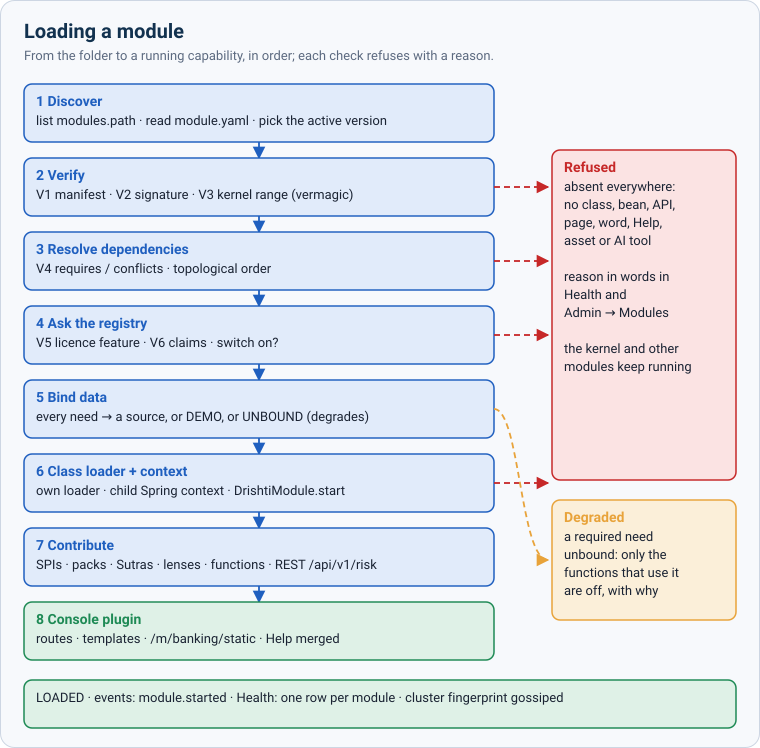

### 4.1 Module paths

| Setting | Default | Meaning |
|---|---|---|
| `drishti.modules.home` (`DRISHTI_MODULES_HOME`) | `<drishti.home>/modules` | the modules folder: one `<id>-<version>.dmod` file per module (files directly in it only); read by the module boot at start, read-only to the server |
| `drishti.modules.trust` | `config/trust/publishers/` | publisher certificates the site trusts |
| `drishti.modules.<id>.enabled` | `true` | the existing switch ([ACCESS_MODEL.md section 19.8](#198-as-built-the-backend-phase-1-of-the-split)) |
| `drishti.lib.path` | `${drishti.home}/lib/ext` | **the site's shared jars, Tomcat `lib/` style** (kept on an upgrade; `<home>/lib` holds Drishti's own jar): every jar there is loaded at start into one shared *lib* class loader (section 4.4); restart to pick up changes |
| `drishti.modules.dev` | `false` | **development only**: the module source folders of the modules folder are the modules, loaded unverified; Health marks each *development (unverified)*; refused in a cluster and in a production distribution |
| `drishti.modules.sources` | `false` | **the kernel's own tests of the shipped files**: the module source folders of the modules folder are the modules, read (manifests, packs, console parts, data needs) and not loaded as code, because the module's classes are already on the class path |

All folders live under the configurable data folder or the install folder (no root litter, visible names); the server never writes to a
module's folder.

**A module is a file and a restart.** Copy the `.dmod` into the modules folder and restart the server: the boot **verifies before it
unpacks** (section 4.3: hashes, the 15 checks, origin and exact kernel build), unpacks the package once into the cache (section 4.2.1)
and loads it. Replace the file to change the version, take it out to remove the module; each takes effect at the next start. Nothing is
deployed to a running server, nothing is copied from one node to another, and nothing unverified runs, except a development folder under
`drishti.modules.dev`.

### 4.2 Discovery

At start, before any bean: list every `<home>/modules/*.dmod` (section 4.2.1); parse each manifest against the manifest schema; build the
dependency graph. Nothing else of a module is touched yet.

#### 4.2.1 The module boot and its result

`ModuleBoot` (`drishti-module-runtime`) is the one class that answers *which modules, from which file, unpacked where*, before any
Spring context exists. It reads `<home>/modules/*.dmod` (files directly in that folder only), refuses in words a file not named
`<id>-<version>.dmod` after its manifest, two files of one id and a module built for another kernel API, and unpacks each package into
`<data>/cache/modules/<id>/<version>-<hash16>/` (the first 16 hex digits of the file's SHA-256) through a `.part-<pid>-<thread>` folder
and one atomic move: two boots racing on one cache use the folder of whichever moved first. A present cache folder is checked against
its `META-INF/DMOD.MF` and unpacked again when a file changed.

Each module carries two hashes. The **file hash** (SHA-256 of the `.dmod`) names the cache folder only. The **content hash** (SHA-256 of
the module's `META-INF/DMOD.MF`, the sorted `<sha-256>  <path>` list with no time in it) is the module's identity: two packages of the
same files have the same content hash whatever their zip bytes, file times or build machine. `first-party.yaml` lists it, and the
cluster digest compares it.

**The plain value.** The boot's result is projected into `com.ash.drishti.api.resolution.ModuleHomes` (`drishti-api`, below every
reader): id → *home* (`id`, `version`, `dir`, `contentHash`, `origin`: first-party, third-party or development). `ModuleBoot.remember`
publishes it once per process; readers ask `ModuleHomes.current()`. `Home.identity()` is `<id> <version> <content hash>` (`development`
without one), `fingerprint()` the SHA-256 of those lines in id order (equal on two processes exactly when they booted the same content),
and `dirProperties()` the `drishti.module.dir.<id>` properties a child process is given. `drishti-packs` depends on
`drishti-module-runtime`, so the launch can run the boot before any reader asks.

**Source mode.** `ModuleBoot.source(checkout, facts)` boots a checkout's module folders (`<checkout>/modules/<id>/` with a
`module.yaml`) through the development path: every module read where it lies, origin *development (unverified)*, no content hash,
nothing unpacked or swept. It is what the command-line tools and the tests mean by "the shipped files" of a checkout; servers under
test and the drill boot packages.

**The sweep and the in-use markers.** The server (only it) deletes cache folders no present `.dmod` owns. Nodes that share one data
folder through a rolling upgrade protect each other: a running server writes `<cache>/<id>/<version>-<hash16>.in-use-<node>` beside each
of its folders (`ModuleBoot.markInUse`, refreshed every 5 minutes, removed at stop by `releaseInUse`), and the sweep keeps a folder with
a marker younger than 15 minutes, saying so; an older marker is deleted.

**Who runs it, and who reads it.** `LaunchRoots` runs the boot right after the launch roots (`bootModules`; the server sweeps, a command
line such as `resolve --json` does not and keeps its overrides' views apart). The result is published for the process
(`ModuleHomes.current()`) and as settings first in the environment: `drishti.module.homes` (the whole value) and `drishti.module.dir.<id>`
(each folder, also for placeholders such as `${drishti.module.dir.banking:}`); the loader process is given both and never boots. Every
reader asks `ModuleHomes.resolve(property)`: the published value, else no module; none lists a modules folder or the cache (guard G9,
`NoModuleFolderReaderTest`, which has no exception). The readers: the resolver (`PackResolver`, `ConfigResolution`, `ResolveCli`), the
overrides, the access registry (`YamlAccessStore`), the distributions and module manifests, the module settings, the live tables
(Rachana's live tables), the loader process and banking's FRTB parameters. `tools/resolved.py` keys its cached answers on the fingerprint of the
modules folder (`ModuleHomes.fingerprint()` worked out without the jar), so a rebuilt module never serves an old answer. The module
host (`ModuleNode`) loads the boot's candidates into one `ModuleRuntime` at start; a module whose package was refused is absent.

**Leftover folders.** The folders of an earlier release's deployment store (`installed`, `store`, `shipped`, `staging`, `tombstones`
under `<data>/modules` or the modules folder, `<data>/overrides/installed`) and `<data>/modules/registry.json` are never read and never
deleted: each is named once as *not read: safe to delete*.

#### 4.2.2 The cluster digest and Admin → Modules

**What each node publishes.** Once its modules have loaded, each node puts what it booted into its Drishti\*net digest
(`GET /api/v1/net/digest`, pulled by every peer when the gossiped hash changes): `modules`, one entry per module of its boot and per
package the boot refused, and `modulesFingerprint`, the boot's `ModuleHomes.fingerprint()`. An entry (`Digest.ModuleEntry`, built by
`ModuleNode.identity()`) holds:

| Field | Meaning |
|---|---|
| `id`, `version` | the module (a refused file whose manifest could not be read: its file name, no version) |
| `contentHash` | SHA-256 of its `DMOD.MF` (section 4.2.1): what two nodes compare; null for a development folder or a refused package |
| `origin` | `first-party`, `third-party`, `development`; null when refused |
| `state` | `loaded`, `off` (switched off, or a module it requires is off), `not-placed`, `refused`, `stale` (built for another kernel) |
| `parts` | the parts of it placed on this node (`api`, `console`, `compute`, …) |
| `problems` | `{kind, severity, text}`: `stale`, `refused`, `need` (a required module missing, refused or off), `library` (it carries a library the kernel ships: the kernel's copy is used, section 4.4), `resource` (over the module budget), `development`; severity `problem` (it does not run) or `warning` (it runs) |

A node compares modules by content, never by file bytes: two nodes that each built a module from one commit agree. Per module, the nodes
are grouped by what they booted (the content hash; a refused package by its state; a node that reported and has no entry: *not
installed*) and the largest group is the **majority** (a tie: the asking node's group). A node whose group is not the majority
**differs**. A node that has not reported its modules (an older node, or one still starting) is left out, never counted as different.

**Where it shows.** The capability table's warnings (Admin → Net) carry one `modules` warning per module the nodes disagree on, and the
cluster's health (`GET /api/v1/admin/health` → `net.modules`) says it in the same words:

```json
{"agree": false, "nodes": ["drishti-b", "drishti-c", "drishti-main"],
 "disagree": [{"module": "trading", "majority": "5b0d77e8", "differing": ["drishti-c"],
   "text": "nodes disagree on module trading: drishti-b, drishti-main booted 5b0d77e8 (2.9.11.i7a) (the majority); drishti-c booted 9c13aa40 (2.9.11.i7a)"}]}
```

**The Admin → Modules answer (contract `admin-modules/1`).** `GET /api/v1/admin/modules` (administrators only, never a token) answers
one document for the page (mock-up C, [docs/lenses/mockups/admin-modules/C.html](../lenses/mockups/admin-modules/C.html)): the modules ×
nodes matrix, each module's detail, the nodes with their fingerprints, the problems and the install steps. In a cluster every node reads
every node, itself included, from the digests, so each node answers the same matrix; a single server has one column. `POST` on the same
path is the module switch (section 7). The recorded example, made by the server's code over the mock-up's three nodes and ten modules,
is `drishti-console/tests/answers/admin-modules.json` (`AdminModulesRecordTest`,
`-Ddrishti.record=true` writes it again); the console's page and its tests are built against it. The schema (JSON Schema, draft 2020-12;
fields not listed may be added within `admin-modules/1`, a removed or renamed field raises the number):

```json
{
  "$schema": "https://json-schema.org/draft/2020-12/schema",
  "$id": "admin-modules/1",
  "type": "object",
  "required": ["contract", "self", "kernel", "counts", "fingerprint", "nodes", "modules", "disagree", "problems", "install"],
  "properties": {
    "contract": {"const": "admin-modules/1"},
    "self": {"type": "string", "description": "the node that answered"},
    "kernel": {"type": "string", "description": "its kernel version"},
    "counts": {"type": "object", "required": ["modules", "on", "off", "nodes", "nodesAgree", "nodesDiffer", "problems", "warnings", "stale", "notLoaded"],
      "additionalProperties": {"type": "integer"}},
    "fingerprint": {"type": "object", "properties": {
      "majority": {"type": ["string", "null"], "description": "the fingerprint most nodes booted (64 hex)"},
      "short": {"type": ["string", "null"], "description": "its first 8 hex digits"},
      "nodes": {"type": "array", "items": {"type": "string"}, "description": "the nodes that have it"},
      "agree": {"type": "boolean"}}},
    "nodes": {"type": "array", "items": {"$ref": "#/$defs/node"}, "description": "this node first, then by id"},
    "modules": {"type": "array", "items": {"$ref": "#/$defs/module"}, "description": "by id"},
    "disagree": {"type": "array", "items": {"type": "object", "properties": {
      "module": {"type": "string"}, "majority": {"type": "string"},
      "differing": {"type": "array", "items": {"type": "string"}},
      "groups": {"type": "object", "additionalProperties": {"type": "array", "items": {"type": "string"}},
        "description": "short hash (or state, 'not installed') -> nodes, the majority first"},
      "text": {"type": "string"}}}},
    "problems": {"type": "array", "items": {"$ref": "#/$defs/problem"}, "description": "every module's, flattened"},
    "install": {"type": "object", "properties": {
      "modulesFolder": {"type": ["string", "null"]},
      "steps": {"type": "array", "items": {"type": "object", "properties": {"command": {"type": "string"}, "comment": {"type": "string"}}}},
      "text": {"type": "string", "description": "the steps as one block to copy; <file> stands for a row's file"},
      "note": {"type": "string"}}},
    "licence": {"type": "object"}, "lenses": {"type": "array"}, "store": {"type": "object"}, "warnings": {"type": "array"}
  },
  "$defs": {
    "node": {"type": "object", "required": ["id", "self", "up", "reported"], "properties": {
      "id": {"type": "string"}, "self": {"type": "boolean"}, "up": {"type": "boolean"},
      "reported": {"type": "boolean", "description": "false: an older node or one still starting; its cells are 'unknown'"},
      "fingerprint": {"type": ["string", "null"]}, "short": {"type": ["string", "null"]}, "agrees": {"type": ["boolean", "null"]}}},
    "cell": {"type": "object", "required": ["node", "state", "differs"], "properties": {
      "node": {"type": "string"},
      "state": {"enum": ["loaded", "off", "not-placed", "leaving", "refused", "stale", "on", "absent", "unknown"]},
      "version": {"type": ["string", "null"]}, "contentHash": {"type": ["string", "null"]}, "short": {"type": ["string", "null"]},
      "origin": {"type": ["string", "null"]}, "parts": {"type": "array", "items": {"type": "string"}},
      "differs": {"type": "boolean", "description": "this node booted other content than the majority"}}},
    "problem": {"type": "object", "required": ["module", "node", "kind", "severity", "text"], "properties": {
      "module": {"type": "string"}, "node": {"type": "string", "description": "one node, or the differing nodes joined by ', '"},
      "kind": {"enum": ["differs", "stale", "refused", "need", "library", "resource", "development"]},
      "severity": {"enum": ["problem", "warning"]}, "text": {"type": "string"}}},
    "module": {"type": "object", "required": ["id", "cells", "problems", "differs"], "properties": {
      "id": {"type": "string"}, "title": {"type": "string"}, "domain": {"type": "string"},
      "installed": {"type": "boolean", "description": "false: only a peer booted it"},
      "licensed": {"type": "boolean"}, "enabled": {"type": "boolean"}, "on": {"type": "boolean"}, "reason": {"type": "string"},
      "switchSource": {"type": "string"}, "loaded": {"type": "boolean"}, "restartNeeded": {"type": "boolean"},
      "brings": {"type": "object"}, "sourceSystems": {"type": "array"},
      "version": {"type": ["string", "null"]}, "origin": {"type": ["string", "null"]},
      "contentHash": {"type": ["string", "null"]}, "short": {"type": ["string", "null"]},
      "state": {"type": "string", "description": "this node's cell state (else the first node's)"},
      "file": {"type": ["string", "null"], "description": "<id>-<version>.dmod"},
      "parts": {"type": "object", "additionalProperties": {"type": "array", "items": {"type": "string"}}, "description": "node -> parts placed"},
      "majority": {"type": ["string", "null"]}, "differs": {"type": "boolean"},
      "cells": {"type": "array", "items": {"$ref": "#/$defs/cell"}, "description": "one per node, in the nodes' order"},
      "problems": {"type": "array", "items": {"$ref": "#/$defs/problem"}}}}
  }
}
```

An abridged answer (trading booted with other content on `drishti-c`; the recorded file has all ten modules):

```json
{"contract": "admin-modules/1", "self": "drishti-main", "kernel": "2.9.11.i7a",
 "counts": {"modules": 10, "on": 7, "off": 3, "nodes": 3, "nodesAgree": 2, "nodesDiffer": 1, "problems": 7, "warnings": 6, "stale": 1, "notLoaded": 1},
 "nodes": [{"id": "drishti-main", "self": true, "up": true, "reported": true, "fingerprint": "…", "short": "…", "agrees": true}, "…"],
 "modules": [{"id": "trading", "title": "Trading", "on": true, "version": "2.9.11.i7a", "origin": "first-party", "file": "trading-2.9.11.i7a.dmod",
   "differs": true, "cells": [{"node": "drishti-main", "state": "loaded", "short": "…", "differs": false}, "…",
     {"node": "drishti-c", "state": "loaded", "short": "…", "differs": true}],
   "problems": [{"module": "trading", "node": "drishti-c", "kind": "differs", "severity": "problem", "text": "nodes disagree on module trading: …"}]}, "…"],
 "install": {"modulesFolder": "/opt/drishti/modules", "steps": [{"command": "python3 tools/drishti.py module verify <file>",
   "comment": "the same verifier the server runs at start"}, "…"]}}
```

### 4.3 Verification, in order

Each step refuses with a reason code and words; a refused module is **absent everywhere** (section 4.9).

| # | Check | Refusal (example words) |
|---|---|---|
| V1 | manifest valid (schema, `format: 1`, id = folder) | *banking 3.0.0: module.yaml line 12: `kernel` missing* |
| V2 | signature: `DMOD.MF` hashes match the unpacked files and the `.dmod`; `DMOD.SIG` verifies; certificate chains to a trusted publisher; publisher id = manifest's | *signature does not verify (file java/drishti-banking-3.0.0.jar changed)* |
| V3 | kernel range (`vermagic`): `kernel`, `rachana`, `contracts`, `plugin-api`, `elements` ranges contain the kernel's | *built for kernel API >=2.0; this kernel is 1.4* |
| V4 | dependencies: every `requires` present, in range, and itself not refused; no cycle; no `conflicts` | *needs capitalmarkets >=1.2; 1.1 installed* |
| V5 | licence through the registry: the licence names the feature, is valid on this date, within limits | *the licence does not include banking* |
| V6 | claims: its API prefix, paths, functions, kinds and lens ids clash with no kernel or other module's | *function VAR is claimed by banking and riskx* |
| V7 | data needs: every `provides.kinds` contract parses; every `needs` contract range is satisfiable by some module or kernel kind | a missing *binding* does not refuse: it degrades (section 5.6) |
| V8 | resources: its declared memory fits the node's budget | *needs 6 GB; 3 GB free in the module budget* (warning, or refusal when `drishti.modules.strict-resources`) |
| V9 | enabled: the site switch | not a refusal: *off by the administrator* |

**Order:** topological by `requires` (a module after everything it requires), then by id for a stable order. A refusal propagates to
every module that requires it (*refused: requires banking, which is refused*).

### 4.4 Java: one class loader per module

```
            bootstrap / platform
                    │
        kernel class loader  (drishti-server and every jar of its BOOT-INF/lib: the kernel's libraries)
                    │
        site lib loader  (lib/ext, drishti.lib.path)
           ┌────────┴─────────┐
   module "banking" loader   module "genomics" loader     (parent-first: kernel → lib/ext → the module's own java/ and lib/)
```

**The rule: the kernel's libraries always win.** A module's class loader asks the kernel first for every class and every resource, then
the site's lib jars, and only then the module's own jars (`java/`, then `lib/`):

- **The kernel's libraries**: every jar the server jar ships (Spring, Jackson, SLF4J, Arrow, Kafka clients, Caffeine, SnakeYAML, Delta,
  Hipparchus, OpenBLAS ...) is the one a module gets. A module never replaces one; its own copy is **never used**.
- **A module's private libraries**: a library the kernel does not ship comes from the module's own jars (its `lib/`); two modules may carry
  different versions of one such library.
- **Site jars** (`lib/ext`, `drishti.lib.path`) sit on the kernel side: a site jar wins over a module's copy.
- **Kernel internals stay hidden**: a class of `com.ash.drishti.` outside the kernel API (`com.ash.drishti.kernel.api.`,
  `com.ash.drishti.api.`) is never the kernel's (`ClassNotFoundException` unless the module's own jars define it), except a verified
  first-party module's declared `kernel-internals:` allowance (section 3.3). The allowance lists kernel packages only: no library needs a
  line in it. The conformance check C1 fails a module class that imports anything else of `com.ash.drishti.`.
- **No module sees another module's classes**; modules talk through kinds, functions and events.
- **Resources** follow the same order: `getResources` lists the kernel's, then the site's, then the module's; a kernel `META-INF/services`
  file is listed only when every provider it names is a class the module may take from the kernel (a `ServiceLoader` with a module's loader
  also finds the providers of the kernel's libraries; the kernel's own collection of a module's providers takes only those of the module's loader).
- **The thread context class loader** is the module's loader on every call the runtime makes into the module (its configuration classes,
  its context's start, the unload steps) and is restored after.
- **Spring**: each module gets a **child `ApplicationContext`** with the module's class loader; its parent exposes only the kernel API
  beans (the `ModuleContext` services). SPI implementations are beans or `ServiceLoader` entries in that context; the kernel collects them
  through the registry of contributions, never by scanning a module's packages. **This is the one design**: there is no mode in which a
  module's beans join the kernel's context. Bean names of two modules never clash (each context has its own), a module's controller is
  mounted only under its own `/api/v1/<prefix>/` (or the paths its manifest declares), and a module's objects of a kernel extension type
  reach the kernel's lists only through the registration bridge, once each. Guards G11 and G12 (TEST_HARNESS.md) hold these.

**The library warning.** The build writes `META-INF/drishti/kernel-libraries.txt` into the server jar (`packaging/drishti-app`): one line
per jar of `BOOT-INF/lib`, `group:artifact:version`, the jar's name and its package prefixes, checked against `BOOT-INF/lib` after the
repackaging. `KernelLibraries` compares each jar of a module's `java/` and `lib/` with it: by its Maven coordinates
(`META-INF/maven/.../pom.properties`), else by its file name, else by the packages of its classes. Every overlap gives one sentence:

> genomics 0.1.0 carries jackson-databind 2.17.1 (jackson-databind-2.17.1.jar); the kernel's jackson-databind 2.21.4 is used instead.
> Remove the jar from the module and compile against the kernel's (scope provided).

It is a **warning, never a refusal**: logged (WARN) when the module loads, in the module's Health notes, and in `module verify`, which
prints `N library warnings (M kernel libraries compared)` (`--json`: `libraryWarnings`). The first-party modules carry none.

**Where every library comes from** (product owner, 2026-11-17):

| Library | Lives in | Loaded by | Seen by |
|---|---|---|---|
| The JDK, the kernel API and every library the kernel ships | the server jar (`BOOT-INF/lib`) | the kernel | every module, **first: never replaced**; a module's copy is warned of and unused |
| Site additions: JDBC drivers, connector plugins, a company's shared library | the server's **`lib/ext` folder** (`drishti.lib.path`) | one shared *lib* loader under the kernel | the kernel's connectors and every module, after the kernel, before a module's own; listed in Health with SHA-256 and marked *lib* |
| A module's own jars and its private libraries | the `.dmod`'s `java/` and **`lib/`** | that module's loader, after the kernel and the site | that module only |

- **Stop**: `DrishtiModule.stop()`, then the child context closes, the contributions are withdrawn, the class loader is dropped (P5 hot
  unload depends on this being leak-free; the runtime's tests load and unload a module many times and check that its loader is collected).

### 4.5 REST

The module's controllers (`@ModuleApi`) are mounted by the kernel under `/api/v1/<prefix>/`, behind the kernel's filters in this order:
TLS/identity → module gate (`DRS-1025` when off) → function gate (`DRS-1026`) → permission (`DRS-1027`) → audit → the module's
`DispatcherServlet` (one per module, bound to its child context). A module cannot register a filter, a servlet or a path outside its
prefix.

### 4.6 Python compute

- The module's `python/` packages are made importable **only in that module's runs**: a run submitted by `banking` gets
  `<module>/python` prepended to its sandbox's import path; another module's runs never see it. The kernel's `drishti_kernel` package and
  the locked libraries are shared.
- **Built: the module's Python runs in the kernel's compute pool.** On load the module's vendored wheels are unpacked into
  `<data>/compute/modules/<id>/site` and a pool `m-<id>` joins the compute service (`ComputeService.addModulePool`, the same `Pool` and
  workers as a site's pool: one implementation); its workers' path is the SDK, that folder and the module's `python:` `path:` folders, so
  modules cannot clash. The reactive connector and compute requests name the pool. On unload the pool is withdrawn (`PYTHON_ITEM`, step 4)
  and the folder removed (`PYTHON_PATH`, step 7). A module whose `compute` part is not placed on a node gets no pool there.
- **No network, no pip at install time.** A module vendors its dependencies as pure-Python wheels (`py3-none-any`) in its wheels folder and
  lists them in `python.requires`; the verifier (V2) and conformance check C9 refuse a requirement without its wheel, a native or
  compiled file in the Python folders or a wheel, and an entry point without its module and class.
- Every run goes through the kernel's one door (`PythonRuns`): same strict sandbox, limits, audit line, the person's row rules on every
  frame. The audit line gains `module`.
- A module's Python items are its `python.engines` entry points; BI python visuals and Python measures registered through `PythonRuns`
  stay design (shown in Build with the module's name).

### 4.7 The console part (loaded by the Drishti Console)

- **Where**: the console never reads the kernel's module folders: it receives the **console part** of each module (`console/`,
  `elements/`, `docs/` with the signed hash list) from the kernel once the kernel reports the module active. **In i2** today's Python
  console reads the part the kernel has verified and hosts it **declaratively** (section 14.2.1); **from i5** the Drishti Console on Spring
  Boot verifies it itself and loads it with the shared `drishti-module-runtime` (section 10.4).
- **`plugin.yaml` format 2**: everything the console shows for a module is declared (routes, the API proxy list, words, menus, Home
  cards, slots, settings page); format 1's `routers:` (FastAPI routers included at import) and the shared template loader go. Section 9
  is the design; format 1 is read for one release with a deprecation line, then refused.
- **Java context builders** (optional, small, **from i5**; none in i2): `console/java/<id>-console.jar`, in the console's class loader for the module, which sees only
  `drishti-console-api`; a builder returns plain values and registers nothing (section 10.4). No Python runs in the console.
- **Templates**: one sandboxed Jinjava instance per module, namespace `<id>:`, which sees only the kernel's public layouts and its own
  files; a kernel template never includes a module's (rule 1) and a module never overrides a kernel template (section 9.2, 9.3).
- **Static files**: served from `/m/<id>/static/<version>/…` with a year-long cache (the version busts it) and SRI, only to people for
  whom the module is on and their lens uses it (today's `_module_asset_refused`, unchanged). The `drishti_` prefix stays (section 9.7).
- **Elements**: the module's `elements/<lib>/` is added to the Elements manifest with `module: <id>`; the loader's existing refusal applies;
  the module's Elements API range is checked against the console's train, and copies of Elements or vendored libraries are refused (section 11).
- **Help merge**: `console/help.yaml` heads and pages (today's `help-sections:` / `sections:`) merge into Help; the guides and tutorials
  are read from the module's `docs/` folder; the docs register gains the module's `docs.features` rows, so the docs gates check a module's
  docs like the kernel's.
- **Sitemap and menus**: module menu entries carry `requires: module:<id>` as today; lens files from `lenses/` replace
  `config/lenses/<module>/`.

### 4.8 Order of start

1. Kernel core (settings, registry, licence, identity).
2. Discovery and verification of modules (4.2, 4.3).
3. **Data bindings resolved** for every need (section 5): before any module starts, so a module starts knowing which of its needs are bound.
4. Modules started in dependency order: class loader, child context, `DrishtiModule.start`, contributions registered.
5. Packs loaded (kernel packs, then modules' packs in module order), Sutras, lenses, functions.
6. Kernel services open (REST, console, scheduler, feeds); `module.started` events.

A module's start has a time budget (`drishti.modules.start-seconds`, 120); exceeded → refused (*did not start in 120 s*), the kernel goes on.

### 4.9 Failure: refused means absent

A refused module (any of V1–V8, a start failure or a crash in `start`) is treated exactly as *not installed*: no class loaded (its loader
is dropped), no bean, engine, job, API, pack, connector binding, route, menu, search hit, command, Help page, asset, AI tool, export or
embed. What remains:

- **Health**: one row per module: `LOADED`, `LOADED (degraded: 2 data needs unbound)`, `OFF (administrator)`, `REFUSED (reason)`, `TAINTED`.
- **Admin → Modules**: the same with the full reason, the check that failed, and what to do.
- **Words for people**: a typed function of a refused module answers *VAR is not available: the banking module is not running (signature
  does not verify). Ask your administrator.* (administrators see the reason; others see *not available*).
- **Kernel keeps running**; a refused module never stops the kernel. A refused *required-by-distribution* module (section 6.2, `required:
  true`) makes Health `DEGRADED` for the whole instance.

### 4.10 Restart versus hot load

| What | When a change counts |
|---|---|
| Packs, Sutras, lenses, Help, BI content inside a module | **hot** (the pack reloader) |
| Settings of a module | hot where the schema marks a key `hot: true`; else *restart needed* |
| Data bindings | hot (section 5.8) |
| A module's pages, menus, words, Help (declared in `plugin.yaml`) and its code (Java, Python package, console context builders), static assets | at the **next start**: a module is a file and a restart; a module switched off is off from the next start |

**The development build:** the SDK's harness and the developer's IDE run the kernel with the modules folder holding the module's source
folder (`drishti.modules.dev`), same loader, same checks except the hash list, a development mark in Health (section 8.5). There is no
"on the class path" second path.

### 4.11 Modules in a cluster

The owner's question: *what happens when a module is deployed on one node and not on another, and how does the console deal with it?*
The answer: **the deployer decides which nodes get a module, part by part**. There is no default "all nodes": a module runs only where it
is placed, heavy work never spreads by itself, every other node forwards, and the console never talks to a node's module, only to the
cluster's registry, and its API proxy calls go to the kernel. Consoles are nodes with the role `console` (section 10.5). Drishti\*net itself (membership, gossip, the capability digest, routing, roles and tags) is
[CLUSTER_GUIDE.md section 1](../guides/CLUSTER_GUIDE.md#1-several-servers-as-one-drishtinet); this section adds only what modules need.

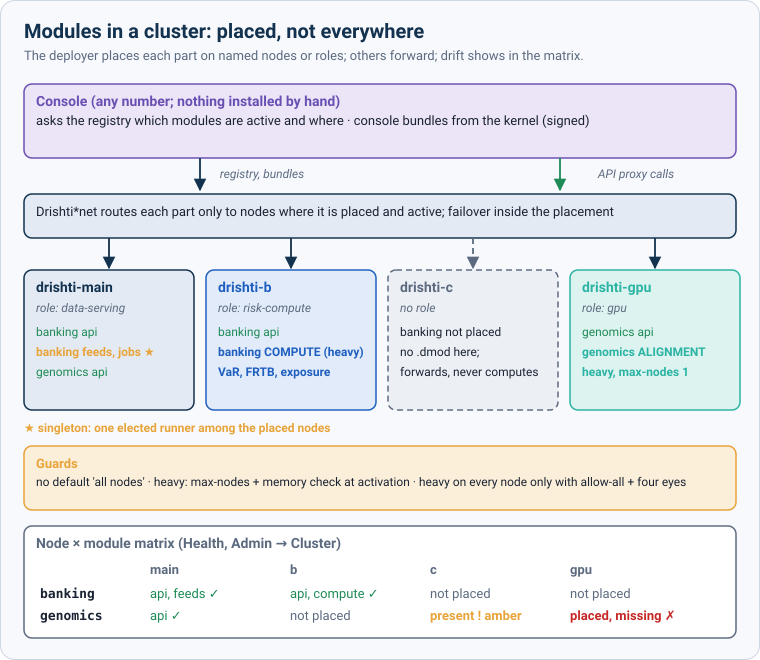

#### 4.11.1 Explicit placement, opt-in

- A module is installed on **the nodes the deployer names**, by **role** (a node tag, `role:risk-compute`, as in `config/net/node.yaml`)
  or by **node name** (`drishti-b`). **There is no default "all nodes"**: a module with no placement is installed nowhere and shows
  *not placed* in Admin → Modules.
- **One home**: `config/placement.yaml` (cluster configuration, four eyes to change, audited), edited by hand or in Admin → Modules →
  *Placement* (a node picker per part, showing each node's role, free memory and current modules). The example:
  [examples/site/placement.yaml](kernel-and-modules/examples/site/placement.yaml).
- The kernel **copies the `.dmod` only to nodes where at least one part is placed**; other nodes never hold it.

#### 4.11.2 Placement per part, with resource classes

The manifest declares the module's **parts** and each part's **resource class**; the deployer places each part separately, so heavy
parts go on fewer nodes than light ones.

```yaml
# module.yaml (the publisher declares the parts; never where they go)
parts:
  api:      { class: light,     contains: [rest, view-augmenters, explain, functions] }   # the façade
  compute:  { class: heavy,     contains: [engines: [var, frtb-sa, simm], kind-providers, python-items], memory-mb: 6144 }
  exposure: { class: heavy,     contains: [engines: [exposure]], memory-mb: 4096 }
  feeds:    { class: feed,      contains: [feeds] }                                         # always singleton
  jobs:     { class: singleton, contains: [scheduled-jobs, official-results-publish] }
  console:  { class: light,     contains: [console-bundle, help, glossary] }               # placed on console nodes (role console)
```

A module with a REST namespace (`api: {prefix: …}`) always has the `api` part: when its `parts:` do not name it, the part is `api`,
class `light` (a request to a path no other part declares belongs to it); a module that declares no parts has that one part.

| Class | Meaning | Guard |
|---|---|---|
| `light` | registry entries, the REST façade, Help, the console bundle | may be placed widely |
| `heavy` | compute engines, `KindProvider`s, Python items; declares `memory-mb` | a **max-nodes** limit set by the deployer; a **memory headroom check** on each placed node at activation (refused with the reason: *drishti-c: banking.compute needs 6,144 MB, 2,300 MB free in the module budget*); Admin warns before it goes wide |
| `feed`, `singleton` | feeds, schedulers, daily jobs, publishing official results | **exactly one runner**: leader election among the placed nodes (the lease mechanism the inbox and run leases already use); failover to another placed node only |

**Banking** (a 3-node site): `api` on `drishti-main` and `drishti-b`; `compute` and `exposure` on `drishti-b` only; `feeds` and `jobs` on
`drishti-main` (singleton); `console` on every console node (`role:console`); **nothing on `drishti-c`** (its `.dmod` is not even copied there). **Genomics**: `alignment` compute
(class heavy, `gpu: true`) on the one GPU-class node (`role:gpu`), its API on the same node and `drishti-main`.

#### 4.11.3 Guards against heavy work spreading

- **Singletons run once**, by election among their placed nodes, never on all.
- **Heavy parts** obey the deployer's `max-nodes` and the per-node memory check at activation.
- **A node never computes for a module part it is not placed for**: routing sends work only to placed, active nodes; an unplaced node that
  receives a module request (a client hit it) **forwards** it, never computes it.
- **Activation refuses a placement that puts a heavy part on every node** (*banking.compute on 3 of 3 nodes: confirm with allow-all*),
  unless the placement says `allow-all: true` and a second administrator approves it.
- **Health shows the effective placement**: per module and part, the nodes placed, active, leader (for singletons) and the memory used.

#### 4.11.4 Install on each node

- **One file, every node.** A module is installed by copying its `.dmod` into the modules folder of each node (on AWS with EFS, the one
  shared folder; the three nodes of the local stack share one checkout and so one folder) and restarting that node. No coordinator, no
  per-node deployment, no replication: a node never receives a module from another.
- **Every node verifies itself.** Each node's boot checks the hash list, the kernel range, the allowance and the licence (V1–V9) of its own
  files; a node never trusts another's verification. A module refused on one node is absent there and shown in its Health.
- **Placement decides who runs what.** A node boots every package of its folder and runs the parts placed on it (section 4.11.2); a node
  with no part of a module forwards the module's requests to a placed node that is up (section 4.11.5).
- **A late joiner** has its own modules folder: copy the packages it is placed for, start it, and it serves them from its start.

#### 4.11.5 Routing and availability

- Drishti\*net routes a module's API calls, compute and jobs **only to nodes where that part is placed and active** (each node's capability
  digest carries a `modules` part: id, version, content hash, origin, state, the parts placed here and the problems, section 4.2.2). **Failover stays inside the placement**: the
  next placed node, never an unplaced one.
- **No placed node up** for a part: the part is **unavailable**, not absent. People see *Banking's VaR is unavailable right now (no
  compute node is up); try again later*; pages that need only the façade still work; saved artefacts, schedules (paused) and data stay;
  nothing is marked. Absent (section 12) is only for an off or missing module.

#### 4.11.6 Drift

- Each node publishes its modules in its digest: per module the **content hash** (SHA-256 of `DMOD.MF`), origin, state, the parts placed
  there and its problems, with the boot's **fingerprint** (section 4.2.2). **Drift** is a node that booted other content than the
  majority, or that lacks a module the others booted.
- Admin → Modules shows the **nodes × modules matrix** (each cell the content hash a node booted, marked when it differs from the
  majority) and each node's fingerprint, agreeing or not; Admin → Health (`net.modules`) and Admin → Net's warnings say *nodes disagree
  on module trading*, naming the nodes. Nothing is re-sent between nodes: the fix is the right `.dmod` in that node's modules folder and a
  restart (section 4.11.4).
- Placement (section 4.11.2) still decides who runs a part: a node whose package was refused runs nothing of it, and requests go to a
  placed node that is up.

#### 4.11.7 How the console interacts

- **The console never talks to "a node's module".** It asks the **cluster registry** (through its entry node, `backend.urls` with discovery
  as today: [CLUSTER_GUIDE.md section 1.8](../guides/CLUSTER_GUIDE.md#18-the-console-and-several-servers)) which modules are active and
  where.
- **Consoles are placement nodes** (role `console`, section 10.5). The module's **console part is placed on console nodes** like any other
  light part; the deployment streams it to the placed consoles only (`GET /api/v1/modules/<id>/bundle/<version>`: the `console/`,
  `elements/` and `docs/` parts), each console checks it against the signed `DMOD.MF` itself, caches it under
  `console-cache/modules/<id>/<version>/` and serves from there. A console machine needs **no manual install**, placed consoles serve
  identical bytes, and **no compute node ever holds a console part**. Its pages exist on the placed consoles; **its API calls still route
  only to the nodes where the API part is placed**.
- **API calls** go through the console's API proxy (section 9.5) to the kernel's entry node, which routes by capability as in 4.11.5.
- **Several kernels**: a console in front of more than one kernel keeps one registry view and one route table per kernel (section 10.6).
- **The live route table follows the registry's events** (`module.activated`, `module.unavailable`, `module.available`,
  `module.removed`): unavailable parts show the notice above, removal shows the notices of section 12.4.

#### 4.11.8 Rolling restart

- A cluster takes a new version of a module node by node: replace the file on one node, restart it, check Health, go on. For the window
  of the roll two versions may run **across the nodes** when both are inside each other's compatibility range.
- Requests are **pinned per session** to one version: the proxy routes the session only to placed nodes with that version, and the console
  serves the matching bundle (`/m/<id>/static/<version>/` lets both coexist), so a page always talks to the API version it was built for.
  When the old version's last placed node is restarted, pinned sessions get the *updated: reload* notice.
- Rolling back is the same in reverse: the old file back, the node restarted. A mixed set after the roll is drift: the nodes' content
  hashes of a module differ, and Admin → Modules and Health say so (section 4.2.2).

#### 4.11.9 Tests

| Test | Proves |
|---|---|
| **Placement honoured** | on three nodes with banking placed on main and b: the `.dmod` exists only on main and b; c holds nothing of it; the matrix shows exactly that |
| **Heavy work stays put** | 1,000 VaR requests through each node (including c): every computation runs on b; c and main forward, never compute (engine counters, thread names `mod-banking-…`) |
| **Singleton once** | feeds and daily jobs run once per schedule; kill the leader: another placed node takes over; never an unplaced node |
| **Failover inside the placement** | stop b: VaR is *unavailable* with the notice (not absent, not computed on main or c); saved work intact; restart b: available again |
| **All-nodes heavy refused** | placing `compute` on 3 of 3 nodes is refused without `allow-all: true` and a second approval |
| **Memory check** | a heavy part placed on a node without headroom is refused at stage, and the activation aborts on all placed nodes |
| **Late joiner** | a fourth node with `role:risk-compute` receives only banking (placed by role), activates it, then serves; a fourth node without the role receives nothing |
| **Drift** | `ModuleDigestClusterTest`: on three nodes, c boots other trading content of the same version: every node's Admin → Modules marks c's trading cell and c's fingerprint as differing from the majority, Health (`net.modules`) and Admin → Net say *nodes disagree on module trading* naming c; c back on the majority's content: the cluster agrees |
| **Rolling upgrade** | 3.0.0 → 3.0.1 across the placed nodes under load: sessions stay pinned until reload, no request reaches a mismatched API, no failed request |
| **Console without install** | a separate console shows a newly placed module's pages from the kernel-served bundle; two consoles serve identical bytes; its API calls land only on placed nodes |

## 5. Data needs and connector binding

The heart of requirement 4: **a module says what data it needs; the kernel decides where that data comes from.**

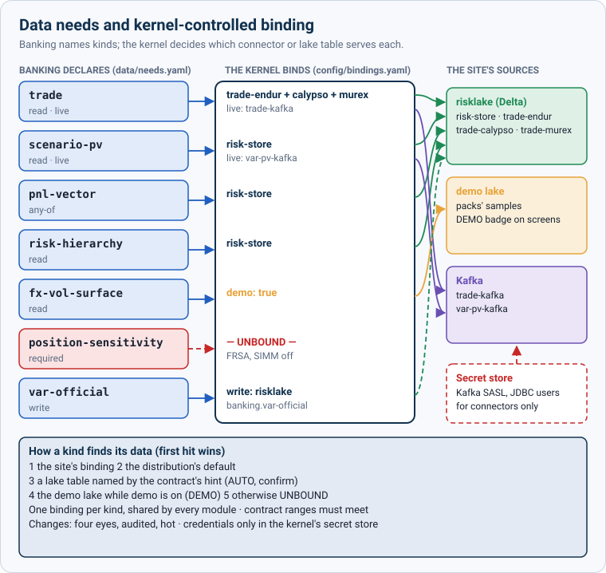

### 5.1 Who owns what

| Thing | Owner | Where |
|---|---|---|
| Connector **types** (plugins) | kernel | `plugins/drishti-plugin-*`, the kernel's plugin folder |
| Connector **configurations** (a Kafka cluster, a JDBC database, a Delta root on S3) | the site's data administrator | `config/connectors/<name>.yaml` (unchanged), credentials as references `${secret:…}` |
| **Credentials** | the site's security administrator | the kernel's secret store (environment, a secrets file outside `config/`, or an external vault) |
| Lakes and their tables | the site | `config/lakes/<lake>.yaml` (unchanged) |
| **Kinds and their contracts** | the module that defines them (`provides.kinds`), or the kernel (core kinds) | the module's packs (`packs/<pack>/contracts/*.contract.yaml`) |
| **Data needs** (which kinds a module reads or writes, which contract versions, required or optional) | the module | `data/needs.yaml` in the `.dmod` |
| **Bindings** (kind → which connectors / lake tables serve it, in what read order, live or not, and where produced kinds are written) | the site's data administrator, **through the kernel** | `config/bindings.yaml` (new) + Admin → Data bindings, four eyes |
| Default bindings for a product | the distribution | `bindings.defaults` in the distribution file (section 6) |

### 5.2 Contracts: the format the kernel owns

The contract format is today's `*.contract.yaml` (kind, mnemonic, pack, version, class, grain, key, dated-by, cadence, fields with type and
presence, vectors) with **one change**: the `storage:` block (which today names `connector: risk-store`, `plugin: delta`, `table:`) is
**removed from the contract** and replaced by a connector-free **hint**:

```yaml
binding-hint:                 # what a site usually binds; never a connector name, plugin or location
  lake-table: risk.scenario-pv          # the table name a lake file would use
  partition: [BUSINESS_DATE]            # the first partition is always the business date
  live: optional                        # a live source makes sense (intraday)
  demo: samples/scenario-pv.jsonl       # the demo lake's sample for this kind
```

The kernel reads `contract-format: 1`; a module declaring `contracts: ">=1 <2"` is checked at V3.

### 5.3 Data needs (`data/needs.yaml`)

Each need: the kind, the contract version range, `use` (`read`, `write`, `live`), `required` (true / false), `any-of` groups, the
functions and engines that depend on it, and its `demo` allowance. Banking's needs, abridged (the full file:
[examples/banking/data/needs.yaml](kernel-and-modules/examples/banking/data/needs.yaml)):

| Kind | Contract | Use | Required | Used by | Notes |
|---|---|---|---|---|---|
| `trade` | `>=1.0 <2` | read, live | yes | TRD, VAR (scope by trade), EXP, PREDEAL | a union of trade stores (Endur, Calypso, Murex) |
| `scenario-pv` | `>=1.1 <2` | read, live | any-of A | VAR, PVAR, SMAT | per trade, own currency; intraday stream |
| `pnl-vector` | `>=1.0 <2` | read | any-of A | VAR, PVAR, SMAT | instead of scenario PVs |
| `fx-scenario` | `>=1.0 <2` | read | with scenario-pv | VAR | converts scenario PVs to USD |
| `scenario-set` | `>=1.0 <2` | read | yes | VAR, SWIN | the 509-day and 250-day windows |
| `var-limit` | `>=1.0 <2` | read | no | VLIM, limit bars | the VaR limits of the hierarchies' nodes (the trees are built from the trades' promoted columns) |
| `desk-pnl` | `>=1.0 <2` | read | no | backtesting | actual and hypothetical P&L |
| `pnl-history` | `>=1.0 <2` | read | no | SWIN | stress window selection |
| `position-sensitivity` | `>=1.0 <2` | read | yes for FRSA, SIMM | FRSA, SIMM, SENS | |
| `risk-factor` | `>=1.0 <2` | read | yes for FRSA, SIMM | RFAC | |
| `netting-set`, `csa`, `agreement`, `collateral-balance` | `>=1.0 <2` | read | yes for EXP | EXP, PREDEAL, SIMM | |
| `credit-limit` | `>=1.0 <2` | read | no | limit use | computed use, stored limits |
| `ir-curve`, `fx-spot`, `fx-vol-surface`, … (market data) | `>=1.0 <2` | read | yes for EXP; no for VaR | EXP paths, TVAL | from capital markets when installed (Q6) |
| `counterparty`, `legal-entity`, `book`, `desk`, `trader` | `>=1.0 <2` | read | yes | every screen | `banking-reference` (Q1) |
| `calendar` | kernel `>=1.0` | read | yes | business dates | kernel kind |
| `var-official`, `ccr-official` | own | **write** | no | VOFF, XOFC, official results | written to a lake the site binds |
| `position`, `var-result`, `exposure-result` | own | **computed** | — | POS, VRES | `KindProvider`s; not bindable |

### 5.4 Bindings (`config/bindings.yaml`)

**Bindings are per kind, not per module.** A kind is one dataset at a site; every module that needs it reads the same binding. The file
([examples/site/bindings.yaml](kernel-and-modules/examples/site/bindings.yaml)) has three example sites in one:

```yaml
bindings:
  trade:
    read: [trade-endur, trade-calypso, trade-murex]   # connectors (config/connectors/<name>.yaml), in read order
    union: true                                        # one trade store across them
    live: trade-kafka                                  # live updates (a Kafka connector)
  scenario-pv:
    read: [risk-store]                                 # a Delta connector on risklake (lake: risklake)
    live: var-pv-kafka
  var-limit:
    read: [risk-store]
  var-official:
    write: { lake: risklake, table: banking.var-official }
  pnl-vector:
    demo: true                                         # explicitly the demo lake (a test site)
```

| Key | Meaning |
|---|---|
| `read` | connectors that serve the kind, in read order (today's `readOrder`: Redis for recent days, Delta behind it) |
| `union` | rows from all of them (today's `union: true` on the trade connectors) |
| `live` | a connector that pushes changes (Kafka, RabbitMQ, ActiveMQ); subscribers get them through `Kinds.subscribe` |
| `write` | where a produced kind is written: a lake and table (the kernel's writer; the module never names a path) |
| `demo` | `true` binds the demo lake's samples explicitly |
| `for:` (exception) | a per-module override, `for: {genomics-qc: [qc-store]}`; allowed only for kinds marked `shareable: per-module` in their contract (Q4) |

**Status:** connector files keep `plugin`, settings and `lake:` and name no kinds; `config/bindings.yaml` is the one home (a `kinds:` line from an earlier release is ignored, and the upgrade that wrote `bindings.yaml` from those lists is gone). The Pack designer proposes its binding to Admin → Data bindings (the file connector saved through the connectors API, each kind proposed for a second administrator's approval); there is no `site/` folder side path.

### 5.5 How a kind finds its data (resolution)

**The order a kind's connectors are decided in is section 18.6** ([Configuration resolution](#18-configuration-resolution-packs-connectors-bindings-and-inbox-rules)); this section and 5.4 and 5.6 follow it when it is built.

For each kind any loaded module needs, in this order, first hit wins:

1. **The site's binding** in `config/bindings.yaml` (as approved).
2. **The distribution's default** (`bindings.defaults`, section 6), e.g. `drishti.finance` binds banking's kinds to `risklake` tables by
   their hints when a lake file holds them. Today: the kind's route in its pack, then the connectors whose pack template names the kind
   (`kinds:` in the pack's `connectors:` templates, never in the written connector file), then the sources that name the kind themselves.
3. **The lake convention**: a configured lake (not demo) whose lake file has the contract's `binding-hint.lake-table` table, read by a
   connector of the lake's format → bound, marked `AUTO` (Admin shows *found by convention: confirm*).
4. **The demo lake**, only while `drishti.demo.enabled` and the need allows demo: marked `DEMO` (amber everywhere: "demo data").
5. Otherwise **UNBOUND**.

The router reads in the same order: a bound kind from its bound connectors (the `read` list, then `live`) and no other; a connector that
names no kind is asked for a kind only when one of these steps picks it, never merely because its plugin could read the kind.

Demo and real never mix ([DATA_LAKE_GUIDE.md](../guides/DATA_LAKE_GUIDE.md)): a kind is either demo or real; a pack whose kinds are bound
to more than one lake is `DEGRADED` (today's warning, moved from packs to bindings).

### 5.6 What a missing or bad binding does

| State | Meaning | Effect |
|---|---|---|
| `BOUND` | a source serves it; its schema satisfies the contract range | normal |
| `AUTO` | found by convention | normal; Admin asks to confirm |
| `DEMO` | demo samples | works; "DEMO DATA" badge on screens using it |
| `STALE` | bound, but no load within the contract's cadence | works; Health amber *scenario-pv last loaded 2026-11-04 (cadence daily)* |
| `MISMATCH` | the source's columns or types break the contract (a required field missing) | **treated as unbound for that need**; Health red with the columns |
| `UNBOUND`, required | nothing serves it | the module **loads but is degraded**: functions that depend on the need are off with the reason (*VAR needs scenario-pv or pnl-vector: no source is bound; ask your data administrator*); others work |
| `UNBOUND`, optional | nothing serves it | info only; dependent features hidden (e.g. backtesting without `desk-pnl`) |

A binding that names only connectors no file defines (their files removed, their pack not loaded) is set aside: Health lists it as a
problem and the kind resolves as if unbound by the site (the next steps of section 5.5). A need on a kind the site does not offer at all
(no loaded pack defines it and nothing binds it) switches nothing off: the pack switch decides those functions; Health still shows the
kind UNBOUND. The one-time upgrade writes `bindings.yaml` from the site's own connector files only: a file a pack's template generated
and nobody edited is the distribution's default (it resolves by step 2 or 3), a connector switched off by its file or the properties is
left out, and a connector defined only in properties is never written into the file.

`any-of` groups are satisfied by one bound member. Health lists `needs[]` per module; `GET /api/v1/admin/bindings` answers the same.

### 5.7 Computed kinds and the end of module connectors

Today banking ships connector plugins (`var-positions`, `var-pv-stream`) and reactive connectors (`var-engine`, `exposure-engine`). Under
G4 these are not connectors: they **compute** a kind from other kinds. They become `KindProvider`s in the module: `position` and
`var-result` are *computed kinds* (`provides.kinds[].computed: true`), never bindable, always the module's. The transport part of
`var-pv-stream` (reading Kafka) is the kernel's Kafka connector bound as `scenario-pv`'s `live:` source; banking subscribes to the kind.
Connector files written for the old names keep loading for one release (today's `moved-classes.properties` mechanism).

### 5.8 Changing a binding

Admin → Data bindings (mock-up b) or `drishti.py bindings set scenario-pv --read risk-store`: proposed, approved by a second
administrator (four eyes), audited, applied **hot**: the kernel validates the new source against the contract, swaps the route, publishes
`binding.changed`; modules drop their caches for that kind. A binding change never needs a module restart.

### 5.9 Two modules, one kind

- One binding per kind: banking and a hypothetical `collateral` module both read the one `trade` binding.
- **Contract ranges must intersect**: if banking needs `trade >=1.0 <2` and `collateral` needs `>=1.3 <2`, the bound source must satisfy
  1.3+; V7 refuses a module whose range cannot meet the kind owner's version (*collateral needs trade >=2.0; banking provides 1.4*).
- **One owner per kind**: the module that defines it in its packs; another module that needs it `requires` the owner (optionally) or uses
  a kernel kind. Two modules defining the same kind id → V6 refuses the second.
- Per-module views of a kind are row rules and masks (permissions), not separate bindings; the `for:` exception is Q4.

### 5.10 Credentials never inside a module

- A module's files contain no connector, plugin, host, URL of a data source, user name, password, key or token: the packager and V1 scan
  for connector keys (`plugin:`, `connector:`, `bootstrap-servers`, `jdbc:`, `password`, `secret`, `token`) and known secret patterns, and
  refuse. The one exception is the read-only **connector templates** (section 18.5): a pack's `connectors:` section and a source module's
  `connectors/` files travel with the module (an installed module serves its kinds as its source folder does) and name plugins, kinds and
  lakes, but every host, user and secret in them is a `${...}` placeholder the site fills; the site's override and secrets stay the site's.
- At run time a module has no API to read connector settings or secrets; `Kinds` returns rows, never the connection.
- Feeds a module ships (public sources such as the ECB rates) name a public URL and need no credentials; one that needs a key reads it
  from the kernel's secret store by a **name the site provides** in the feed's binding (`feeds.market-data.api-key: ${secret:ecb}`), not from
  the module.

### 5.11 Banking's example bindings, three sites

| Site | `trade` | `scenario-pv` / `pnl-vector` | `var-limit` | `var-official` |
|---|---|---|---|---|
| Laptop demo | `DEMO` | `DEMO` | `DEMO` | written to the demo lake |
| Bank on Delta (`risklake`) | `trade-endur` + `trade-calypso` + `trade-murex` (union) on risklake | `risk-store` (Delta, risklake) | `risk-store` | `risklake` table `banking.var-official` |
| Bank with live trades | the same + `live: trade-kafka` (Kafka, SASL credentials from the secret store) | `risk-store` + `live: var-pv-kafka` | `risk-store` | the same |

## 6. The distribution file (white label)

### 6.1 What it is

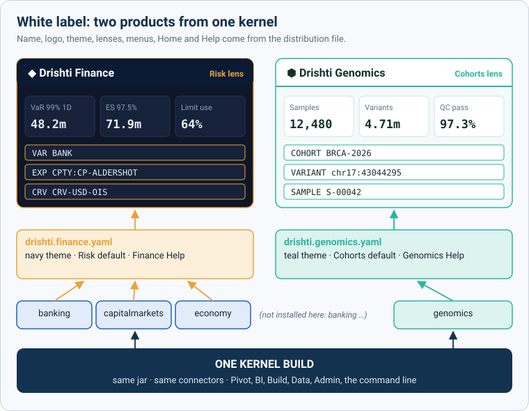

One YAML file, `config/distributions/drishti.<name>.yaml` (chosen by `--distribution <name|path>`, `DRISHTI_DISTRIBUTION` or
`drishti.distribution`; none: Drishti All), that turns the kernel into a product: which modules, which
brand and theme, which lenses and Home, which docs, which default bindings. It folds today's scattered product settings
(`drishti.edition`, `ui.product`, `ui.copyright`, `drishti.branding.*`, the lens files' `title`, the old default pack list) into
one place, **as the one way**: the old keys are read for one release, each named on Health as deprecated. Built:
[DISTRIBUTIONS.md section 20.10](#2010-how-it-works-as-built).

**Kernel and console.** The same file format serves both blocks. On a kernel it decides **what is loaded** (modules, default bindings); on
a Drishti Console it decides **the presentation** (brand, theme, lenses, Home, the modules shown, docs). A console in front of several
kernels shows the intersection of its distribution and the modules active on those kernels (section 10.6), so one estate can run
differently branded consoles over the same kernels. Brand and theme are always tokens, never module CSS (section 11.6).

### 6.2 Fields

| Field | Meaning |
|---|---|
| `distribution` | id (`drishti.finance`) |
| `version` | the distribution's own version |
| `kernel` | the kernel product version range it was tested with |
| `brand` | `product` (name in the top bar), `product_native`, `tagline`, `owner`, `copyright`, `logo` (light/dark files), `favicon`, `about` page text, `support` contact |
| `theme` | the theme token set (`finance-navy`), overrides of tokens (`--ac`, `--bg`…), default mode (dark/light/system), density |
| `modules` | each module id with `version` range, `required` (Health degraded if refused) and `enabled` default |
| `lenses` | which lenses are offered, the default lens, per-lens title overrides |
| `home` | the default landing per lens, cards and chips order, the welcome text |
| `menus` | top-level menu order; menu entries hidden for the whole product |
| `features` | presets of switches (today's `config/distributions/kernel.yaml `features:``) |
| `docs` | which Help sections and tutorials show, their order, the docs title ("Drishti Finance Help"), extra pages from the distribution's folder |
| `bindings.defaults` | default bindings for this product (section 5.5) |
| `demo` | whether the demo lake ships and is on |
| `glossary` | extra terms |
| `locale` | default language and formats |

### 6.3 Examples

The shipped distributions (Drishti Risk, Drishti Finance, Drishti Genomics, Drishti All), what each holds and how to start each:
[the distributions part](#20-drishti-distributions-drishti-risk-drishti-finance-drishti-genomics-drishti-all).

- [examples/distributions/drishti.finance.yaml](kernel-and-modules/examples/distributions/drishti.finance.yaml): banking + capital markets
  + economy; navy theme; Risk lens default; Help in the banking order; risklake defaults.
- [examples/distributions/drishti.genomics.yaml](kernel-and-modules/examples/distributions/drishti.genomics.yaml): a hypothetical
  `genomics` module + the kernel; teal theme; Cohorts lens; Help with the kernel's generic guides and the genomics module's; no banking
  word anywhere.

### 6.4 How Help and docs follow

Help is assembled at start from the kernel's pages plus each loaded module's pages, filtered by the distribution's `docs` (sections and
order), then by the person's lens and functions (as today). The product name in every page is the brand's (`{product}`), never a literal
(the branding rule: the 26-literal fix becomes a P3 gate). Exported PDFs, the About page and the console title use the brand. Docs built
for print (`docs build --distribution drishti.finance`) render the same selection.

### 6.5 What a distribution may not do

It cannot add code, connectors or credentials; it names modules, never contains them. It cannot widen a licence (the licence still
decides). It cannot rename functions (command words are the modules').

### 6.6 Distribution builds

`drishti.py dist build drishti.finance.yaml` (P3) makes `drishti-finance-<version>.zip`: the kernel jar, the console, the connector
plugins, the named `.dmod` files (unchanged, signed by their publishers), the distribution file and the brand's assets. Installing it is
unzipping it; the modules are the `.dmod` files of the distribution's modules folder, booted at the first start.

## 7. Lifecycle and tooling

### 7.1 The command line

A module is a file and a restart: the commands are file operations that need no running server.

| Command | Does |
|---|---|
| `drishti.py module new <id> --domain <d> [--template content|compute|full]` | a new module Maven project from the SDK archetype (section 8.3) |
| `drishti.py module build [--sign-with dev|<key>]` | builds the jars (Maven), runs the module's tests against the SDK harness, checks (no secrets, no kernel internals, docs gates, contracts), writes `target/dmod/<id>-<version>.dmod` |
| `drishti.py module sign <file> --key <publisher key>` | signs (or re-signs) a `.dmod` with a publisher key (an HSM or a key file; never stored in the repo) |
| `drishti.py module verify <file> [--conformance]` | V1–V9 through the server jar's own verifier; `--conformance` runs the checks C1–C14 |
| `drishti.py module list [--json]` | each `.dmod` of the modules folder: id, version, hash, origin; with `--server` also what the server loaded or refused and why |
| `drishti.py module install <file>` | verifies the file and puts it in the modules folder (the same module's older file kept as the previous one); says *restart the server* |
| `drishti.py module remove <id>` | takes the module's file out of the modules folder (kept as the previous one); says *restart the server* |
| `drishti.py module rollback <id>` | puts the previous file back |
| `drishti.py module run <file>` | the dev loop: the kernel + this module only on a free port (section 8.4) |
| `drishti.py bindings list | set | migrate | check` | section 5 |
| `drishti.py dist build | check <file>` | section 6 |

### 7.1a The runtime lifecycle

Modules, packs and connectors share one lifecycle (init, start, suspend, resume, shutdown), with health, stats and one dependency graph:
[LIFECYCLE.md](LIFECYCLE.md).

### 7.2 Admin → Modules

The screen shows what this server booted: each module with its version, origin (first-party, third-party, development), whether it is
loaded, on or off and why, the modules refused with the reason and the fix, the leftover folders of an earlier release named as safe to
delete, the extra libraries (marked *lib*), and the switch (a reason is required, audited, effective at the next start). It installs,
upgrades and removes nothing.

### 7.3 Who may install

Installing a module is a file operation on the server's modules folder, so it is the operating system's permissions and the site's own
change process that decide who may do it; the kernel verifies every file at every start and refuses what fails a check. Data bindings,
settings and the module switch stay **proposals** in the Approvals inbox (the kernel's one approvals engine): the proposer cannot approve.

### 7.4 Upgrade and rollback

- Upgrade: replace the file (one package per module id) and restart; `module.started` carries the new version; the module's
  `ModuleMigration` (P4) upgrades its own state files. A cluster restarts node by node (section 4.11.8).
- Rollback: put the previous file back (`module rollback`) and restart; state written by the newer version must be readable by the older
  or the module declares `rollback: false` for that pair (then rollback is refused with words).

### 7.5 Health and taint

**Taint** (Linux's word, the owner's frame) marks an instance that runs something unsupported; it does not stop anything:

| Taint | Cause |
|---|---|
| `D` development-signed | a module signed with the SDK's development key (allowed only when `drishti.modules.allow-dev: true`) |
| `O` override | an administrator forced a module past a soft check (resource budget) |
| `R` out-of-range | `drishti.modules.ignore-kernel-range: true` (development only) |
| `U` unknown publisher | a publisher added to trust by the site, not Drishti's chain |

Health shows *TAINTED (D: banking-dev 3.1.0-SNAPSHOT)*; support bundles carry it.

## 8. The Module SDK and the developer path

A module is **its own Maven project**, built, tested and signed apart from the kernel, by anyone who has the SDK: a Drishti team, a
partner or a customer's own developers. This section is the path from an empty folder to a signed module running at a customer, with the
command at every step.

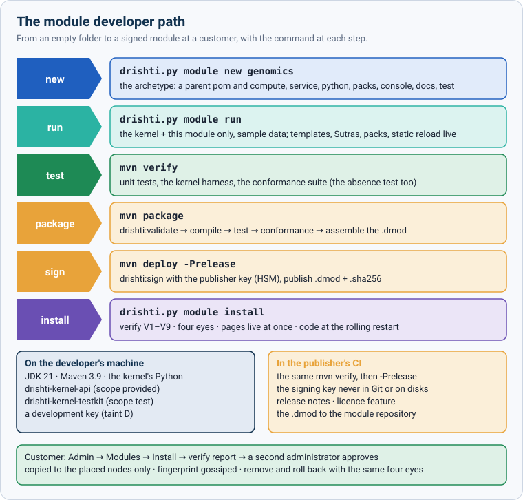

### 8.1 What the SDK contains

| Part | Contents |
|---|---|
| `drishti-kernel-api-<v>.jar` | the SPIs and service interfaces of section 2.3, Javadoc; Maven `com.ash.drishti.sdk:drishti-kernel-api`, always scope **`provided`** (the kernel supplies it at run time; never inside a `.dmod`) |
| `drishti-kernel-testkit-<v>.jar` | the harness (8.5), `ModuleConformanceSuite` (8.6) and `AbsenceSuite` (12.11); scope `test` |
| `drishti-module-parent` (pom) | the parent every module project inherits: Java 21, the versions of the kernel's libraries (section 4.4), the plugin's defaults, the licence-header check |
| `drishti-module-parent` executions | `exec-maven-plugin` runs `drishti.py module verify --manifest-only` (validate), `module pack` (package) and `module verify --conformance` (verify); signing and publishing are release j (8.2) |
| `drishti-module-archetype` | the Maven archetype `module new` wraps (8.3) |
| `@drishti/elements-*` `.d.ts` | the Elements core typings (from ELEMENTS.md's distribution channels), the plugin.yaml format 2 schema, the kernel templates' macro reference |
| `drishti-console-api-<v>.jar` (from i5) | the Drishti Console's half: the context-builder interface (`PageContext.Builder`), the page context and the `ModuleApi` client types; scope `provided` (section 10.4) |
| `drishti_kernel` Python | the compute SDK's types and a local sandbox runner for tests (Python runs only on the kernel's workers) |
| schemas | `module.schema.json`, `needs.schema.json`, `contract.schema.json`, `plugin.schema.json` (format 2), `distribution.schema.json` (editors validate as you type) |
| `drishti.py module …` | the command line of section 7.1 plus `new` and `run` (8.3, 8.4), for teams without Maven expertise |
| a sample | the `genomics` sample module (examples in `examples/genomics/`), used by the SDK's own tests and by `drishti.genomics` |

**As built: the SDK folder.** `python tools/drishti.py build sdk` writes `<home>/sdk/`: `repo/` (a Maven file repository with `drishti-kernel-api` and what it needs, the product's parent pom, `drishti-module-parent` and the archetype), `settings.xml` (that repository by absolute path, for `mvn -s`) and `drishti-module-parent/pom.xml` (for a `relativePath`). Maven runs `package`, never `install`. Nothing needs the kernel's sources: `tools/test_sdk_builds_genomics.py` builds the genomics sample from the SDK folder alone and packs and verifies it. The SDK folder also holds `drishti-testkit` in its repository (test scope in the parent's management), `kernel-libraries.txt` (read from `META-INF/drishti/kernel-libraries.txt` of the server jar in `<home>/lib`; the parent pom manages every library of it at the kernel's version, scope `provided`, so a module compiles against the copy the kernel runs with), `typings/` (the Elements and renderer `.d.ts` files of the newest vendored release) and `schemas/` (`contract.schema.json`; the other schemas of the table above are not written yet).

### 8.2 The module as a Maven project

**As built (i5): the one module layout of section 8.10.** The `.dmod` content is not a Maven sub-module: it sits at the module folder's
top, as inside the package, and only the code is Maven, one project per jar under `java/<project>/` (the archetype makes one,
`java/<artifactId>/`, whose parent is `drishti-module-parent`), aggregated by the `pom.xml` beside `java/`. The design below, one
sub-module per part, is kept for the parts not built yet (Python, the harness suites); its content sub-modules (`-packs`, `-console`,
`-docs`) are the top-level folders of section 8.10.

The design: one **multi-module Maven project** per module. The parent pom inherits `drishti-module-parent`, depends on `drishti-kernel-api` with scope
`provided`, lists the sub-modules and runs the parent's `exec-maven-plugin` executions (the server jar's packer and verifier, `java -jar … module pack|verify`) once, after them. Each sub-module maps to one part of the
`.dmod` (section 3.2):

| Sub-module | Holds | Into the `.dmod` | Needed when |
|---|---|---|---|
| `<id>-compute` | Java compute: engines, `KindProvider`s, pivot measures, functions | `java/` | the module computes in Java |
| `<id>-service` | the `DrishtiModule` entry point, `ModuleSettings`, `@ModuleApi` controllers, the other SPIs | `java/` | it has an API or any Java |
| `<id>-python` | Python compute items and packs' Python; `requirements.txt` inside the kernel's lock; pytest | `python/` | it has Python |
| `<id>-packs` | packs (kinds, contracts, Sutras, samples), `data/needs.yaml`, lenses, `functions.yaml`, BI, feeds | `packs/`, `data/`, `lenses/`, `bi/`, `feeds/` | always (a module without kinds or Sutras has nothing to show) |
| `<id>-console` | `plugin.yaml` (format 2), its own templates, static files, i18n, Java context builders (against `drishti-console-api`), the domain Elements library | `console/`, `elements/` | it has pages beyond Sutras (section 9) |
| `<id>-docs` | README, Help, the guide, the tutorial, glossary, the docs register rows, images | `docs/` | always (the docs rule: one guide + one tutorial per feature) |
| `<id>-test` | harness tests, the conformance and absence suites, two-people tests | never packed | always |

The content-only template (economy's shape) has only `-packs`, `-docs` and `-test`; Maven builds what exists.

**The plugin's goals**, bound to Maven's lifecycle so the ordinary commands do the work:

| Phase | Goal | Does |
|---|---|---|
| `validate` | `drishti:validate` | `module.yaml` against `module.schema.json`; id and version equal the pom's; `needs.yaml`, contracts, Sutras (Rachana 1), `plugin.yaml` format 2, settings schema parse; every route, word and menu id unique; no connector or secret keys (section 5.10) |
| `compile`, `test` | Maven's own | the jars; unit tests; pytest through the `-python` sub-module |
| `verify` | `drishti:conformance` | runs `<id>-test` against the kernel harness, then the conformance checks of 8.6 that need no kernel (lints, licence headers, CSP, SRI) |
| `package` | `drishti:assemble`, `drishti:sign` | lays the files into the `.dmod` layout, writes `DMOD.MF` (SHA-256 of every entry), signs with the configured key (`dev` by default: taint `D`), writes `target/dmod/<id>-<version>.dmod` and its `.sha256` |
| `deploy` (`-Prelease`) | `drishti:publish` | re-signs with the publisher key (PKCS#11 URI, an HSM in CI), publishes the `.dmod`, its `.sha256` and release notes to the module repository |

The complete example: [genomics/pom.xml](kernel-and-modules/examples/genomics/pom.xml) and its
[project tree](kernel-and-modules/examples/genomics/project-tree.txt).

### 8.3 Creating a module: the archetype and `module new`

Two doors, one result:

```
$ mvn archetype:generate -DarchetypeGroupId=com.ash.drishti.sdk -DarchetypeArtifactId=drishti-module-archetype \
      -DarchetypeVersion=1.0.0 -DgroupId=com.example.genomics -DartifactId=genomics -Dtemplate=full -Ddomain=genomics
$ python3 tools/drishti.py module new genomics --domain genomics --template full --publisher example-labs
```

`module new` **wraps the archetype** (it runs the bundled Maven wrapper `mvnw`, so a team without Maven on the path or Maven knowledge
still gets the same tree) and then asks the three things a team usually does not know: the publisher id, the licence feature, and the
first kind's name. Templates: `content` (packs, Sutras, lenses, docs), `compute` (+ Java compute and Python), `full` (+ console pages
and a domain Elements library). The generated project builds green on the first `mvn verify` (its sample kind, Sutra, page, guide,
tutorial and tests are complete, not stubs). The transcript: [module new](kernel-and-modules/examples/cli/module-new.txt).

### 8.4 The dev loop: `module run`

```
$ cd genomics && python3 tools/drishti.py module run            # or: mvn drishti:run
```

- Starts the **kernel thin jar and its console with this module only** (and its `requires`, fetched from the module repository), a data
  folder under `target/run/`, the demo lake built from the module's `samples/`, a development licence naming its feature, the development
  key (taint `D`), on free ports printed at start (never the usual 18480/17480).
- **Hot reload** while it runs: templates, `plugin.yaml` (the live route table, section 9.8), static files, i18n, Sutras, packs,
  contracts, lenses, Help and guides reload on save (the kernel's pack reloader plus a watcher on `target/run/modules/<id>/`, which is a
  link to the sub-modules' source folders). Java code (server parts and console context builders): `module run` recompiles and restarts the module's part only
  (a few seconds; the kernel stays up, the harness's hot unload of section 4.4 is used in development before P5 uses it in production).
- `--shots` takes the docs' screenshots of the module's pages into `<id>-docs/img/` (the same driver as `tools/docs/screenshots.py`).
- `--two-people` opens two sessions as two test people (the session-isolation check by eye).
- Nothing it writes leaves `target/`; Ctrl-C removes its temporary files.

### 8.5 The test harness (kernel + one module)

- `KernelHarness.with(module("target/dmod")).demoLake().start()` boots the **real kernel** (thin jar, in process) with only this module
  (and its `requires`, fetched from the module repository), a temporary data folder (`@TempDir`), the demo lake from the module's
  samples, a development licence and key (taint `D`).
- Gives: a REST client as a test person, the `Kinds` API with fixture bindings, a console client (pages, the route table, search, Help),
  a headless browser page (Playwright) for composed pages, a Python pool, the module-off and module-removed variants, and the suites of
  8.6 and 12.11.
- Python side: `pytest` plugin `drishti_kernel.testing` (the console harness with the module mounted).

**Kernel tests and module tests are separate projects.** The kernel's projects (`kernel/*`, `lake/*`, `compute/*`, `net/*`, `plugins/*`) run on fixtures with
`drishti.modules.home=none`: no kernel test opens the repository's `modules/` folder and no pom outside the modules' own names a module's artefact (guard G2,
`KernelNamesNoModuleTest`). The tests that need the real modules are in `testing/drishti-modules-it`, which runs servers on the built `.dmod` packages (never on module sources), and
holds guard G14 (`PackagedVarGoldenTest`): the VaR golden matrix asked of a server started on the exec jar and the packages. See `TEST_HARNESS.md` section 3.30.

### 8.6 The conformance suite

Every module passes it to be signed with a publisher key (`drishti:sign` refuses a release build that has not passed it); `module verify
--deep` runs it again at the customer.

| # | Check | How |
|---|---|---|
| C1 | **No kernel internals** | ArchUnit: no class imports `com.ash.drishti..` outside `kernel.api`; the jar's classes resolve against the API loader alone; the console jar's classes import only `drishti-console-api` and the module's own packages |
| C2 | **No bespoke UI** | templates use only `kernel/*` layouts and `kernel/elements.html` macros plus the module's own Elements library; no `<table>`, `<canvas>`, `<svg>` drawing or hand-made widgets outside Elements components; JS imports only `@drishti/elements-*` public entry points |
| C3 | **Theme tokens only** | CSS lint: colours, spacing, fonts and radii are `var(--…)` tokens; no hex, rgb or named colours; no `!important` over kernel classes |
| C4 | **`drishti_` asset prefix** | every file under `static/` and `elements/` is `drishti_<name>` (the static-asset rule); vendor libraries are not allowed in a module (they belong to the console's vendored set; the hash scan of section 11.5) |
| C5 | **CSP-clean** | no inline `<script>`, no `on*=` attributes, no `javascript:` URLs, no `eval`/`new Function`, no remote origins; SRI hashes for every static file written into the manifest |
| C6 | **Routes namespaced** | every route under `/m/<id>/`; aliases and words checked against the reserved names (9.9); no route registered by code (no controller or `@RequestMapping` in a console jar) |
| C7 | **Help, guide, tutorial present** | `docs/README.md` with front matter; a Help section; one guide and one tutorial per `docs.features` row; the docs gates (links, images, register) on the module's `docs/` |
| C8 | **Data contracts present** | every kind in `provides.kinds` has a contract (`contract-format: 1`) with `binding-hint:` and no `storage:`; every need names a contract range |
| C9 | **No secrets, no connectors, pure Python** | the secret patterns and connector keys of section 5.10 in every file, samples included; the connector templates (a pack's `connectors:` section, a source module's `connectors/` files, section 18.5) may name plugins and kinds, and every host, user and secret in them is a `${...}` placeholder; the module's Python (section 4.6): entry points exist, declared requirements vendored as pure-Python wheels, nothing compiled |
| C10 | **Licence headers** | the publisher's header on every source file (the parent pom's check) |
| C11 | **Functions answer** | every word in `functions.yaml` answers through the harness (a page, a view or an API) |
| C12 | **Two people at once** | the session-isolation test: two people, different row rules, concurrent requests, no crossed data in any page, API or cache |
| C13 | **Off means gone** | the module switched off: every surface refused (the existing guarantee, ACCESS_MODEL section 6) |
| C14 | **Absent everywhere** | the absence suite of section 12.11: install, record every surface, remove, assert each one gone and nothing left in the registry |

### 8.7 The release path

1. **Version**: semver in the pom and `module.yaml` (validated equal); release notes from the module's CHANGELOG.
2. **Build in CI**: `mvn -Prelease deploy` on the publisher's CI: `verify` (tests, harness, conformance), `package`, `sign` with the
   **publisher key** (an HSM through PKCS#11; the key never on disk or in Git), `publish` to the module repository with its `.sha256`.
3. **Certificate**: the publisher's certificate is issued under the Drishti module root (section 13.1, question Q7); a partner signs its
   own modules with its own certificate; Drishti signs banking, economy and capital markets.
4. **Deliver**: the customer receives the `.dmod` (download from the module repository, or a distribution build of section 6.6).
5. **Install at the customer**: Admin → Modules → *Install module…* or `module install` (section 7.1): verify report (V1–V9), four eyes,
   active on approval (pages at once for content and templates; code at the rolling restart in P2: section 9.8).
6. **Support**: `module info` and the support bundle carry the module's id, version, publisher, signature fingerprint and taint.

### 8.8 From start to delivery: the steps

| Step | Who | Command | Result |
|---|---|---|---|
| 1 Get the SDK | developer | `python tools/drishti.py build sdk`, then `mvn -s <home>/sdk/settings.xml ...` (the repository by absolute path) | `drishti-module-parent`, the API, the testkit, the archetype |
| 2 Create | developer | `drishti.py module new genomics --template full` (or `mvn archetype:generate …`) | a project that builds green |
| 3 Model the data | developer | edit `<id>-packs`: contracts, `needs.yaml`, samples | kinds the kernel can bind (section 5) |
| 4 Show it | developer | Sutras first; composed pages in `<id>-console` (section 9) | pages, words, menus, Home cards |
| 5 Compute | developer | Java in `<id>-compute`/`-service`, Python in `<id>-python` | engines, `KindProvider`s, APIs |
| 6 Run | developer | `drishti.py module run` | the kernel + this module, hot reload |
| 7 Document | developer | `<id>-docs`: guide, tutorial, Help, glossary; `module run --shots` | the docs gates pass |
| 8 Test | developer, CI | `mvn verify` | unit, harness, conformance (C1–C14), absence |
| 9 Package | CI | `mvn package` | `target/dmod/genomics-0.1.0.dmod` (development-signed) |
| 10 Sign and publish | publisher's CI | `mvn -Prelease deploy` | signed `.dmod` + `.sha256` in the module repository |
| 11 Install | customer administrators | `drishti.py module install genomics-0.1.0.dmod` + approval | verify report, four eyes, LOADED |
| 12 Bind data | customer data administrator | Admin → Data bindings (or `drishti.py bindings set …`) | needs `BOUND` (section 5) |
| 13 Upgrade or remove | customer administrators | replace or take out the file, `module rollback`, restart | section 7.4 and section 12 |

### 8.9 Worked example: the genomics sample module

The files, all in `examples/genomics/` (laid out as inside the `.dmod`; the project tree shows the source sub-modules):

| File | Shows |
|---|---|
| [project-tree.txt](kernel-and-modules/examples/genomics/project-tree.txt) | the module's folder as built (section 8.10) and where each folder lands in the `.dmod` |
| [pom.xml](kernel-and-modules/examples/genomics/pom.xml) | the parent pom: `provided` kernel API, seven sub-modules, the plugin's goals, the release profile |
| [module.yaml](kernel-and-modules/examples/genomics/module.yaml) | the manifest of a partner-published module with Java, Python, a computed kind and pages |
| [console/plugin.yaml](kernel-and-modules/examples/genomics/console/plugin.yaml) | format 2: routes, API proxy, words, menus, Home cards, slots, settings, search |
| [console/templates/variant_explorer.html](kernel-and-modules/examples/genomics/console/templates/variant_explorer.html) | a composed page (section 9.11) |
| [packs/genomics/sutras/variant-call.v1.sutra.yaml](kernel-and-modules/examples/genomics/packs/genomics/sutras/variant-call.v1.sutra.yaml) | a Sutra (tier 1) |

### 8.10 The one module layout

Every module in this repository, and every module the archetype makes, has **one folder layout** (i5). Its `.dmod` content sits at the
top of its folder, exactly as inside the package; its code, only when it has any, is one or more Maven projects under `java/`, with the
`pom.xml` beside `java/` aggregating them. There is no `dmod/` or `src/dmod/` folder anywhere.

```
modules/<module>/
├── module.yaml                     the manifest (section 3.3): always, at the top
├── content.yaml                    what the packer brings in from elsewhere in the repository (never packed itself), if any
├── dataload.yaml                   its inbox rules (a source-system module), if any
├── packs/ console/ data/ docs/     the .dmod content, as in the package (section 3.2) ...
├── connectors/ mappings/ blotters/ elements/
├── tools/                          its own generators (never packed), if any
├── java/<project>/                 ONLY when it has Java: each a Maven project (pom.xml, src/main/java, src/test/java)
└── pom.xml                         ONLY when it has Java: aggregates java/* (built by the root pom)
```

| Module | Its code |
|---|---|
| `banking` | `java/banking-compute` (the maths: VaR, exposure, FRTB-SA, SIMM, sensitivities), `java/banking-service` (services, storage, Spring wiring, API); `java/kernel-internals.txt`, the kernel packages it still reaches (`BankingReachTest`) |
| `genomics` | `java/genomics`, the SDK's sample project (its parent is `drishti-module-parent`; its parent's `module pack` execution packs the module folder, two up) |
| the content and source-system modules | none: no `java/`, no `pom.xml` |

The names a module's top may hold are ONE list, `module-layout.yaml` (`ModuleLayout` in the kernel's API; `tools/module_layout.py` reads
the same file): `content`, the `.dmod` content of section 3.2, and `build`, what only builds the module (`content.yaml`, `pom.xml`,
`target/`, `tools/`). The packer (`ModulePack`, `module pack` of the server jar: one for Maven, the command line and `packaging/dist`) stages only the
content names (in `java/`, only jars already there are kept) and names anything else at the top in words, left out (an old build folder
an older checkout keeps); a `content.yaml` `trim` or `copy` may leave out only what a module does not carry (a pack's `tests/`, `tools/`),
never what a pack serves (`samples/`, the records a read falls back to when no lake is built, `sutras/`, `config/`, `contracts/`,
`pack.yaml`): the packer refuses it, so an installed server answers what the source tree answers. The one exception is explicit: a `restricted:` list in `content.yaml` names single files the package may never carry, each with its `reason` (a licence; the economy module lists the four IMF-derived samples of world-economy, internal demos only; the packer ships the samples' catalogue without those kinds' entries); the packer refuses an entry with no reason or naming no file, and a test asserts the package holds exactly the other files; the module's own jar goes into the package's `java/` by the name its manifest gives. The overrides view
(section 18.10) copies the same content names. A folder under `modules/` without a `module.yaml` is not a module: the resolvers skip it
with a one-line note, and `drishti.py setup` lists such leftovers (it never deletes them). The resolver and every reader (the kernel's
`PackResolver` and `ModuleManifests`, the tools through `resolve --json` and `tools/resolved.py`) find a module by
`<modules>/<dir>/module.yaml` and nothing else. `tools/test_module_layout.py` keeps every `modules/<module>` to this layout, on what git tracks: only the
names of the list at the top, `java/` and `pom.xml` together or neither, the `pom.xml` listing exactly `java/*`, no `dmod/` folder.

Banking's tree and its former places: [banking/project-mapping.txt](kernel-and-modules/examples/banking/project-mapping.txt); the
format-2 plugin file: [banking/console/plugin.yaml](kernel-and-modules/examples/banking/console/plugin.yaml).

### 8.11 The developer guide (outline)

A new guide, `docs/guides/MODULE_DEVELOPER_GUIDE.md` (P2; one guide + one tutorial, per the docs rule):
1. What a module is; the kernel API and its versions. 2. The Maven project, `module new`, the archetype. 3. Data: kinds, contracts, needs;
testing with the demo lake; never connectors. 4. Java: `DrishtiModule`, the SPIs one by one with examples, REST under your prefix.
5. Python compute items. 6. Pages: Sutras first, composed pages from Elements, your domain library, CSS on tokens, routes and the API
proxy. 7. Lenses, functions, menus, Home cards. 8. Help, guides, tutorials, glossary. 9. Settings schema. 10. `module run`, the harness,
the conformance and absence suites. 11. Build, sign, publish, install. 12. Upgrades, deprecations, removal and what your users keep.
13. Security rules. 14. Worked examples: genomics, then banking. Tutorial: *Build the genomics sample module from scratch*.

## 9. Module UI and the developer's own pages

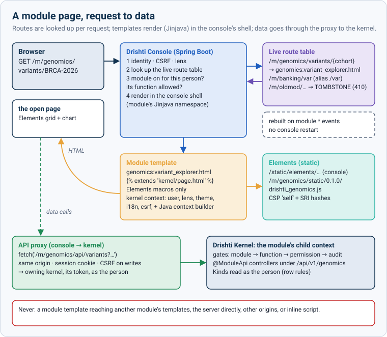

### 9.1 Three tiers, preferred first

| Tier | What the developer writes | Code | When |
|---|---|---|---|
| **1 Sutras** | YAML pages in Rachana (`packs/<pack>/sutras/*.sutra.yaml`): strips, tables, charts, linked entities, Explain, keys | none | **first choice**: an entity's page, a list, a dashboard of a kind; the kernel draws them, search and Help find them, the designer edits them |
| **2 Composed pages** | the module's **own templates** (Jinja syntax, rendered by Jinjava in the console), built only from Drishti Elements macros and components, rendered inside the console's shell; optional Java context builder | a template (+ a small handler) | a screen Sutras cannot express: a workflow, an explorer with linked filters, a playground |
| **3 A domain Elements library** | `elements/<lib>/`: ES modules and custom elements (`<drishti-genomics-variant-track>`) on the Elements core API, CSS on tokens, `.d.ts`, a manifest | JavaScript | a visual the general library lacks (a genome track, a VaR limit bar); used by tiers 1 and 2, never alone |

A tier-3 component is offered to Sutras as a panel type and to composed pages as a tag; the no-bespoke-UI rule holds at every tier
(conformance C2). Most modules need tier 1 only; banking uses all three.

### 9.2 Serving a module's own templates: the namespace and the loader

- **One namespace per module**: a module's templates are addressed `<id>:<path>` (`genomics:variant_explorer.html`). The console builds
  **one Jinjava instance per module** (autoescape forced on, Jinjava's restricted methods and properties, the console's filters and
  functions only) whose resource locator has exactly two prefixes: `kernel` → the console's **public** platform templates
  (`kernel/page.html`, `kernel/elements.html`, `kernel/partials/*`; the prefix keeps its name because it is the platform's published
  layout API), and `<id>` → the module's `console/templates/`. Nothing else is reachable: not the console's private templates
  (`terminal/*`, `admin/*`), not another module's namespace.
- The console's own pages keep their instance; it has **no** module locator at all, so a platform template cannot include a module's
  (principle 1, structurally rather than by review).
- Parsed-template cache per module instance (in memory, keyed by `<id>/<version>`); dropping the instance drops its cache.
- Today's `templates:` list (format 1) and the shared loader chain (`Jinja2Templates(directory=[web, plugin dirs…])`, where a module's
  file could shadow a kernel file of the same name) are **removed** with format 2.

### 9.3 Layouts, Elements macros and extension slots

- A composed page **extends `kernel/page.html`** (the shell: top bar, menus, command line, notices, the live channel, the theme) and fills
  its blocks: `title`, `assets`, `page`, optional `aside` and `keys`. `kernel/page.html` is part of the kernel API (`plugin-api`
  version; its blocks change only with a MAJOR).
- It uses only the macros of `kernel/elements.html` (page header, KPI strip, filter bar, grid, chart, map, tabs, panel, form fields,
  notices, Explain button, export) and tags of Elements libraries (kernel or its own). Each macro emits the markup of an Elements
  component with its data source; the JavaScript is the kernel's.
- **No override of kernel templates.** A module that ships `terminal/_base.html` or any `kernel/…` path is refused at V6 (*claims a
  kernel template*). The only ways into a kernel page are **declared extension slots**:

| Slot | Kernel page | Today's equivalent |
|---|---|---|
| `home.landing`, `home.cards` | Home, per lens | landings (`trading_landing`), lens cards |
| `pivot.top`, `pivot.below` | Pivot, by lens or kind | `screens.pivot` (the MR lens panes) |
| `entity.panels` | an entity's view, by kind | view augmenters' panels |
| `admin.tabs` | Admin, a tab | `/admin/scopes` |
| `help.section` | Help centre | `help.yaml` heads |
| `explain.drawer` | the Explain drawer, by measure | `Explainer` SPI's text |

  A slot template is in the module's namespace, gets the slot's context only, and is drawn in an isolated container
  (`<section data-module="banking">`) so its removal leaves the page whole.

### 9.4 The template context the console provides

| Name | What | Not included |
|---|---|---|
| `user` | id, display name, roles, locale | tokens, cookies, the session id, other people |
| `lens` | the person's current lens id and title | — |
| `theme` | mode (dark/light), density, token set name | raw colours (CSS uses tokens) |
| `t(key, **args)` | i18n: the module's bundle, then the kernel's | — |
| `csrf_token` | for forms posting through the proxy | — |
| `module` | `id`, `version`, `title`, `settings` (only keys listed in `settings.expose-to-pages`) | secrets (there are none), other settings |
| `route` | the route's id, typed params, title | the raw request |
| `url_for(route_id, **params)` | a link to the module's own route (canonical address) or `kernel:<page>` | another module's routes (use command words or `link()` to entities) |
| `api(path, **query)` | the proxied URL of one of its declared API endpoints (9.5) | the server's address |
| `asset(path)`, `elements(lib)` | versioned `<link>`/`<script type=module>` tags with SRI (9.7) | other modules' assets |
| `product`, `business_date`, `now` | the brand (distribution), the business date | — |
| the builder's map | whatever the module's optional context builder returns (plain values: strings, numbers, lists, maps, records) | objects with behaviour, callables |

From i5, a **context builder** (`handler: VariantExplorerContext` → `com.example.genomics.console.VariantExplorerContext`, a class in the module's
`console/java/` jar implementing `PageContext.Builder` from `drishti-console-api`) is given a read-only page context (the person, the typed
params, a `ModuleApi` client bound to the module's declared endpoints as that person) and returns a map of plain values. It cannot register
routes, read the raw request, set cookies or keep state (no mutable fields: an architecture test): per-person data lives only in the call
(session isolation). It replaces the Python handlers of earlier drafts (decision Q14, superseded: section 15). In i2 a module declares no `handler:` at all
(section 14.2.1).

### 9.5 How a page calls its module's API: the console's API proxy

- The browser calls **`/m/<id>/api/<path>`** on the console's own origin; the console's proxy forwards to the server's
  **`/api/v1/<prefix>/<path>`** on **the kernel that owns the module** **as the person** (the console's `KernelClient` for that kernel, with
  that kernel's token only: section 10.6), adds the request id and
  `Drishti-Module: <id>`, and streams the answer back (JSON, JSON Lines, Arrow, xlsx keep their media types).
- **Only declared endpoints** pass: `api.proxy` in `plugin.yaml` lists method + path patterns (+ an optional permission); anything else is
  404 at the console. Non-GET methods need the CSRF token. Timeouts and size limits come from `api.limits`.
- The server applies its gates in order (module → function → permission → audit, section 4.5); the proxy adds nothing it could bypass.
- The proxy keeps **no per-person state**: no cache unless keyed by person and module; it is the same code for every module
  (session-isolation rule).
- This replaces today's hand-written pass-throughs (banking's ~35 `/api/var/**`, `/api/exposure/**` … handlers); their old console paths are gone.
- Elements data sources (`source=api("/variants")`) and the module's own JS (`fetch(api.url("/variants"))` from the Elements data
  library) both use it; the JS never builds URLs to other paths (lint C5, CSP `connect-src 'self'`).

### 9.6 Template sandboxing: what is forbidden

| Forbidden | Enforced by |
|---|---|
| Inline `<script>`, `on*=` attributes, `javascript:` URLs, `eval` | CSP `script-src 'self'` (nonce only for the console's shell), conformance C5 |
| Raw HTML from data (the `safe` filter, `Markup`) | the module's Jinjava instance has no `safe` filter; autoescape forced; only Elements macros emit markup |
| Styles other than tokens; `style=` with colours | conformance C3; CSP `style-src 'self'` |
| Network calls to other origins; `<iframe>`, remote images, fonts or scripts | CSP `connect-src 'self'`, `frame-src 'none'`, `img-src 'self' data:`; lint C5 |
| `fetch` to anything but `/m/<id>/api/…` | lint C5 (CSP cannot restrict paths), proxy 404 for undeclared endpoints |
| Other modules' templates, assets, JS modules or globals | the per-module loader (9.2); the Elements loader refuses another module's library; lint C1 |
| Console internals: private templates, the request, the session, the `KernelClient`, Java methods on context values | the Jinjava sandbox (restricted methods and properties; the context holds plain maps and records only); the context of 9.4 is all there is |
| Forms posting outside the proxy | lint; the console's CSRF check (Spring Security) on every non-GET |

### 9.7 Static assets

- Served at **`/m/<id>/static/<version>/<path>`** from the module's `console/static/` (and `elements/<lib>/` at
  `/m/<id>/elements/<lib>/<version>/`), read-only, `Cache-Control: public, max-age=31536000, immutable`: the version in the path **busts the
  cache** on upgrade; rollback serves the older version's path again.
- **SRI**: the packer writes the SHA-384 of every static file into `console/assets.lock`; `asset()` emits `integrity=` from it; the
  console refuses to serve a file whose hash differs (tamper check at run time, besides V2 at load).
- **CSP**: `script-src 'self'` and `style-src 'self'`; no inline, no remote origins; the module cannot change the policy.
- **`drishti_` prefix** on every file (C4); vendor libraries are the kernel's only.
- Served only to people for whom the module is on and whose lens uses it (today's `_module_asset_refused`, unchanged); a removed module's
  paths answer 404 (section 12.10).

### 9.8 Routes: declared, namespaced, live

- **Declared, never registered by code.** Every page and every API pass-through is an entry of `plugin.yaml` (`routes:`, `api.proxy:`).
  No module code runs at import to add a route (format 1's `routers:` and FastAPI `include_router` are removed). A route names what draws
  it: `sutra:` (tier 1), `page:` (tier 2, with an optional `handler:`), or `moved:` (a 308 to another route for one release).
- **The namespace**: every route lives under **`/m/<id>/…`**; ids are unique in the module and are what links, menus, cards and words
  use (`route: variant-explorer`), never raw paths.
- **The live route table.** The console registers its own pages at start as today plus **one dispatcher** for `/m/{id}/{path}` and one
  fall-through for declared aliases (consulted only after the kernel's routes miss). The dispatcher looks the path up **per request** in an
  immutable **route table snapshot**; a new snapshot is built from the loaded modules' `plugin.yaml` files and swapped atomically when a
  `module.*` event or a cluster config version arrives (copy-on-write; no lock on the request path; nothing per person in it). Each entry
  carries the module, function, permission and state, so the dispatcher answers: render, *not available* (404 for an off module, as today),
  (404, section 12.10).
- **What needs no console restart in P2**: switching a module off or on; **removing** a module (every page, word, menu, asset gone at
  once); installing, upgrading or rolling back a module whose console part is **declarative** (Sutras, templates, static, menus, words,
  Help: no `handlers:`), once the server reports it loaded.
- **What still needs a restart in P2**: a module's **console context builders** (Java) newly installed or changed (the console loads a
  module's console jar only at start until P5, so no two versions of it ever share a console process; a rolling restart of the consoles
  applies it), and the server's Java and Python code
  (section 4.10). Until then the new routes are listed to administrators as *installed, restart pending* and absent for everyone else.
  P5 makes both hot (with the leak check).
- **Deep links and bookmarks.** The canonical address is `/m/<id>/<path>`; an alias answers the same page (200) with
  `<link rel="canonical">`; page state lives in the query string (Elements' URL state), so a link reproduces the view. A path that changes
  between versions is declared `moved:` (308 for one release). Upgrades keep route ids and paths unless a `moved:` says otherwise.
  After removal, a bookmark lands on the removed-module page (12.10), and Drishti's own bookmark list marks it *needs module X*.

### 9.9 Aliases, short words and reserved names

- A module may declare **short path aliases** (`alias: /variants`, banking's `/var`) and **command words**. Both are checked at V6 against
  the **reserved names**: the kernel's paths (`/t`, `/pivot`, `/bi`, `/build`, `/admin`, `/help`, `/data`, `/static`, `/m`, `/api`,
  `/embed`, `/public`, `/healthz`, `/readyz`, …), the kernel's words (`PIVOT`, `BI`, `FUNC`, `FORM`, `HELP`, `WHAT`, `DATAMAP`, `EXPORT`,
  …), the site's own list (`config/reserved-names.yaml`), and every name already claimed by an installed module.
- **Conflicts are refused at load with the reason**, never resolved by order: *genomics 0.1.0 refused: alias /variants is claimed by
  biobank 2.1.0 (route biobank:variants)*. The first-installed keeps it; the newcomer is refused whole (refused means absent).
- Path aliases outside `/m/` are allowed for **Drishti-signed modules**; partner modules get them only when the site grants
  `drishti.modules.<id>.allow-aliases: true` (four eyes) (question Q15). Command words are allowed for all, checked the same way.

### 9.10 Menus, functions, Home cards and search, declared

`plugin.yaml` declares the module's **menu entries** (merged into the sitemap's menus, tagged `domain: <id>`), its **words** (each to a
route, with its grammar), **Home cards and chips** per lens, **slots**, the **settings page** (generated from the settings schema), and extra
**search** entries. The kernel builds every door from these declarations plus the module's Sutras, functions and Help; nothing is drawn
from module code. That is what makes removal complete: withdrawing the declarations withdraws the doors (section 12.3).

### 9.11 Examples: a genomics variant explorer, banking's VaR explorer

**Genomics** ([plugin.yaml](kernel-and-modules/examples/genomics/console/plugin.yaml),
[variant_explorer.html](kernel-and-modules/examples/genomics/console/templates/variant_explorer.html)): the route

```yaml
- id: variant-explorer
  path: /variants/{cohort}
  page: variant_explorer.html          # genomics:variant_explorer.html
  function: VARX
  permission: genomics:read
  alias: /variants
```

draws a page that extends `kernel/page.html`, puts a KPI strip (a partial of its own), a filter bar, an **Elements grid** over
`api("/variants", cohort=…)` and an **Elements chart** (allele-frequency histogram fed by the grid) side by side, and the module's
tier-3 `<drishti-genomics-variant-track>` following the grid's selection. No script in the template; the JS is the kernel's Elements
plus `drishti_genomics-explorer.js`.

**Banking's VaR explorer** today is `terminal/var.html` included through the shared loader, `var_routes.py`'s FastAPI routes and ~10
pass-throughs, and the `drishti_var-*.js` files. As a composed page:

```yaml
- { id: var-explorer, path: "/var/{scope...}", page: var_explorer.html, function: VAR, alias: /var }
```

`banking:var_explorer.html` extends `kernel/page.html`; it has no handler (declarative, section 14.2.1): the scope words (`DESK RATES`)
go to the module's API as they are and are parsed there, on the kernel; the
page is a KPI strip (VaR, ES, limit use), an Elements grid of contributions over `api("/var/contributions", scope=…)`, an Elements chart
of the P&L distribution, and `drishti-risk`'s `<drishti-risk-limit-bar>` and `<drishti-risk-hierarchy>`; every number is computed on the
server (the server-computes-risk rule). `/var` stays as the alias, so bookmarks and typed `VAR …` keep working.

## 10. The Drishti Console on Spring Boot (a separate UI tier)

**Decided by the owner on 2026-11-08:** the console moves from Python (FastAPI and Jinja) to a **Spring Boot web application**, to gain
Java's multi-threading, and it **stays separate from the kernel**: UX work must never make the BI kernel unstable, and one UI must be able
to stand in front of several kernels. The move is **its own release, i5** (owner, 2026-11-08; section 14.2). Until then today's Python
console serves modules' declarative console parts (section 14.2.1), so that no module changes when i5 re-hosts them in Java. This section is the design; sections 9 (module UI) and 12
(unload) are written for the Java console.

**Decided by the owner on 2026-11-15:** i5 first makes the Python console **thin**: it asks the server for everything the server also
decides and reads no folder but its own ([THIN_CONSOLE_DESIGN.md](THIN_CONSOLE_DESIGN.md)). The move to Spring Boot described in this
section is decided after that, for i7, with i5's measurements; where this section says i5 for the Java console, read i7. The server
answers the thin console adds are the ones a Java console would ask too.

### 10.1 Why

**Why Java:**

- **One language for modules.** A module's console part becomes declarations, templates, static files and, when needed, small Java
  context builders. There is no Python in a module's console part, so one toolchain builds the module (section 8.2), and one conformance
  suite checks it.
- **Virtual threads for fan-out.** A page that asks the kernel five questions (a KPI strip, a grid, a chart, the menus and the person's
  stamps) asks them **at once** on Java 21 virtual threads, with no event loop to keep free of blocking calls. Today the Python console
  depends on `async` discipline: one blocking call in a handler stalls every person served by that worker.
- **One plugin model.** The kernel and the console load modules with the same library (`drishti-module-runtime`, 10.4) instead of a
  Java loader and a Python loader that must agree.
- **Fewer cross-person leak risks.** A drill found engine state in a module-level Python global shared by every person (the
  session-isolation rule). In the Java console, per-person state lives only in the request and the session. Singletons are stateless
  services checked by an architecture test, and the conformance suite runs two people at once (C9).
- **One security stack.** Spring Security handles sign-in, enterprise SSO (section 10.11), CSRF, headers and per-kernel tokens in the
  console, and the kernel already uses it. i5 brings SSO on it; trust and security (j) builds roles, licensing and hardening on the same
  stack, not on two.

**Why separate from the kernel:**

| Concern | In the kernel | Separate console (decided) |
|---|---|---|
| Isolation | a heavy page render, a template bug or the console's garbage collection shares the heap and CPU with VaR and pivot compute | UI load, GC pauses and crashes **never touch compute**; a console restart drops no computation |
| Scaling and restart | one unit: scaling the UI scales the compute, and restarting for a template change restarts the engines | consoles scale out on cheap machines and restart (rolling) on their own; kernels keep their caches warm |
| Attack surface | sign-in pages, uploads, templates and the static file server would live inside the data and compute process | the kernel exposes only its REST API to consoles and clients; the browser-facing surface lives in the console |
| Many kernels | a kernel's UI shows only that kernel | **one console in front of many kernels** (10.6): finance production and a genomics cluster side by side |

### 10.2 The tiers


- **Browser**: Drishti Elements, the Sutra renderer, Calc's Pyodide worker (Python in the browser, 10.7). It talks to its console's origin
  only (CSP `connect-src 'self'`).
- **Drishti Console**: one or more `drishti-console-web` processes. They hold no data and run no compute. They render pages, serve
  Elements and module static files, keep sessions, and proxy API calls to the right kernel as the person.
- **Drishti Kernel**: one or more kernels or clusters, each with its own modules, data and registry. Consoles reach them over HTTPS (later
  also Arrow Flight).
- **Python workers**: managed by the kernel on its compute nodes, sandboxed. They serve notebook cells, Python compute packs, BI Python
  items, transforms and feeds. **No Python runs in the console.**

### 10.3 The console application

| Part | Design |
|---|---|
| **Application** | `drishti-console-web`: Spring Boot 3, **Spring WebMVC** (servlet, not WebFlux) with `spring.threads.virtual.enabled: true`, so every request runs on a virtual thread and blocking code is the simple, correct style. A Maven module of its own, shipped as `drishti-console-<version>.jar` beside the kernel's jar, built on Java 21 (no JDK 25 feature). |
| **Templates** | **Jinjava** (HubSpot, Apache 2.0), a Jinja-compatible engine for Java, so the 148 templates (10,856 lines) and the 6 macro files port mostly mechanically. One Jinjava instance for the console's own templates and **one per module** (the namespaces of section 9.2). Autoescape is forced on, the sandbox restricts methods and properties, and the context holds only plain maps and records (10.3.1). |
| **Static files and Elements** | **unchanged**: the files under `web/static` (Elements libraries, the vendored libraries with `VENDOR.md`, CSS on tokens, images, Calc, the gallery) move as they are and are served by the console with immutable caching, SRI and CSP. Elements is governed as the one controlled set of UI statics (section 11). |
| **Sessions** | **Spring Session JDBC**. A single console uses **SQLite** (a file under its data folder). Several consoles use **PostgreSQL**, the site's one database. **No migrations**: the session tables are written into the two complete schema files (`schema-sqlite.sql`, `schema-postgres.sql`), `initialize-schema: never`, and the connection settings sit in `config/db/database.yaml`, not in `application.yaml` (the database rules). The session holds the console's state only: the person, their per-kernel server sessions and tokens (encrypted attributes), CSRF, the current kernel and lens. The kernel's session (`/api/v1/auth/sessions`) stays the authority on who the person is. |
| **Security** | **Spring Security**: today's sign-in (the console verifies a password through the identity kernel's `POST /api/v1/auth/login` with its service token and never sees a hash), the session cookie (`HttpOnly`, `Secure`, `SameSite=Lax`), CSRF on every non-GET, the same-origin check, the security headers and CSP from one filter chain. Per-request kernel tokens are minted per kernel (10.6). **Enterprise SSO** (OIDC first, SAML 2.0, optional LDAP and Kerberos) in the same chain: section 10.11. |
| **Talking to kernels** | `KernelClient`: one per kernel connection, on the JDK `HttpClient` (HTTP/2, a pool per kernel), with Spring's `RestClient` on top. Page handlers fan out on virtual threads (`Executors.newVirtualThreadPerTaskExecutor()`, structured as one task per question, with a deadline per page). Server answers stream through unchanged (JSON, JSON Lines, Arrow IPC, xlsx), and the console never converts JSON to Arrow (today's rule in `core/arrow_answer.py`). Sticky routing by selection token and the entry-node discovery of `backend.urls` move as they are (`core/backend.py`, `core/cluster.py`). **Later, Arrow Flight** for bulk reads ([INTEGRATION_GUIDE.md](../guides/INTEGRATION_GUIDE.md)): the client gains a Flight path behind the same interface. |
| **Live channel** | today's `/api/channel` (server-sent events relayed from the kernels) is served by the console on a virtual thread per connection, so thousands of open tabs cost no platform threads. A tab receives only events for its person, kernel and modules (session isolation). |
| **Configuration** | `config/console/application.yaml` (the console's own settings: listen address, the `kernels:` list, distribution, limits); database settings in `config/db/database.yaml`; secrets as `${secret:…}` references. Example: [examples/console/application.yaml](kernel-and-modules/examples/console/application.yaml). Every key goes into [CONFIGURATION.md](../admin/CONFIGURATION.md) (the one-config-document rule). |

#### 10.3.1 What does not port mechanically, and how it is replaced

| Today (Python, Jinja2) | Count in templates | In the Java console |
|---|---|---|
| Standard filters (`urlencode`, `length`, `join`, `replace`, `tojson`, `forceescape`, `round`, `lower`, `map`, `format`, `selectattr`, `default`, `sort`, `first`, `last`, …) | about 750 uses | Jinjava's built-in filters of the same names. A **render-equality test** renders every template with recorded contexts in both engines and diffs the HTML, so each difference is found by a test, not by a person. |
| Drishti's own filters (`product`, `half_up`, `the`, `live`, `connector`, `both`, `bi`) | about 20 uses | Jinjava `Filter` classes in Java with the same names and the same unit tests. |
| Python callables as globals (`admin_form`, `when_local`, `known_local`, `edition_of(request)`, `design_on`, `smat_on`, settings values) | per page | `ELFunctionDefinition`s or values in the template context. Nothing receives the raw request: `edition_of(request)` becomes a `lens` value in the context (section 9.4). |
| Python methods called on values (`.items()`, `.get(…)`, `.startswith(…)`, `.split(…)`, `%`-formatting) | a few hundred | Jinjava supports `.items()` and dictionary access. Python string methods become filters (`startswith`, `split`), found by a scan and rewritten by a script during the port. |
| ``, loop scoping, `` with arguments, `` blocks | a few | checked one by one in the week-1 spike. Where Jinjava differs, the template is rewritten to the plain form that both engines read the same way. |
| `safe` and `Markup` (7 uses) | 7 | allowed only in the console's own templates for markup that Elements macros build; module namespaces have no `safe` (section 9.6) |
| Route handlers that assemble context in Python (`routes/*.py`, 13,357 lines; `core/*.py`, 20,140 lines) | — | Java controllers per route group (10.8), and ports of `core/` helpers (menus, search, facts, designer forms, lakes, guides) as services. This is the bulk of the work. |

**Engine choice:** Jinjava is recommended over **Pebble** (faster and compiled, but Twig-like syntax, so every template is rewritten by
hand) and over **Thymeleaf** (a full rewrite in another model). Decision gate: if the week-1 spike measures a page render more than 20%
slower than today's Jinja2, or finds a gap that cannot be rewritten, Pebble is the fallback (open question O1).

### 10.4 One module runtime library, two hosts

The runtime is the glue drawn in section 1.1's picture.

- **`drishti-module-runtime`** (a Java library, a Maven module of the kernel's build, published with the SDK) is the **one
  implementation** of: reading `module.yaml` and `plugin.yaml`; the verification checks V1–V9 (signature, hashes, kernel and Elements
  ranges, claims, reserved names); the **class loader per module** with its export list; the **live route table** (immutable snapshots
  swapped on events, section 9.8); the **unload sequence's** generic steps and the inventory that the **absence suite** records
  (section 12).
- **Built** in `drishti-module-runtime` (package `com.ash.drishti.module.runtime`; [DEVELOPER_GUIDE.md section 1.5](../guides/DEVELOPER_GUIDE.md#15-the-module-runtime)):
  the `.dmod` packer, unpacker and hash list (`Dmod`; V2 verifies the hashes, an absent signature is a Health note until j), the manifest
  with every field of section 3.3 (`DmodManifest`), discovery (`ModuleDiscovery`), V1–V3 and V5–V8 (`ModuleVerifier`, `Claims`), V4 and the
  load order (`DependencyResolver`), the class loader per module (`ModuleClassLoader`, a Spring `SmartClassLoader` so no Spring cache keeps a
  module's classes), the child Spring context, the live route table (`RouteTable`), the registry of contributions with the unload order of
  section 12.2 (`Contributions`) and the leak check (`LeakCheck`), behind one facade (`ModuleRuntime`) and the host's hooks (`ModuleHost`).
  Its tests build a module at test time and load, route and unload it leak-free. The kernel's start calls it once banking is a module.
- **Two hosts.** The **kernel** uses it for a module's server parts: Java and its child Spring context, Python items, packs, REST. The
  **console** uses it for the `console/` part: declared routes, the per-module Jinjava namespace, static files and the domain Elements
  library, Help pages and **context builders**. Each host adds only its own kind of contribution. No check, loader or route table exists
  twice (no dual machinery).
- **Which part goes where.** A `.dmod` is one file. The kernel unpacks it and loads everything except `console/` and `elements/`. A
  console receives **only the console part**: `console/`, `elements/` and `docs/`, with `DMOD.MF` and `DMOD.SIG`, streamed by the kernel
  (`GET /api/v1/modules/<id>/bundle/<version>`). The console verifies the bundle against the signed hash list itself (V2 on every host) and
  loads it only when the kernel reports the module active.
- **Context builders are Java** (from i5). A composed page's optional handler is a small class implementing
  `PageContext.Builder` from **`drishti-console-api`** (the console's half of the SDK, scope `provided`). It is given the person, the
  route's typed parameters and a `ModuleApi` client bound to the module's endpoints *as that person*, and it returns a map of plain
  values. It cannot register routes, read the raw request, set cookies or keep state (the architecture test fails a static or instance
  field that is not final and immutable). It lives in `console/java/<module>-console.jar`, loaded in the console's class loader for the
  module. **This supersedes the Python handlers** of decision Q14 (section 15).
- **The API proxy is console → kernel.** `/m/<id>/api/<path>` on the console forwards to `/api/v1/<prefix>/<path>` on the kernel that owns
  the module, as the person, with that kernel's token (section 9.5).
- **Unload in the console** (section 12.2, step 6): the module's route-table entries become off, its Jinjava environment and
  template cache are dropped, its static and Elements mounts are withdrawn, and its context-builder class loader is released. At the
  console's next rolling restart in P2 the loader goes; in P5 it goes at once, under the same leak check as the kernel's.

### 10.5 The console as a placement role (i5)

- In the cluster design (section 4.11), **a console is a node with the role `console`**. It registers with the cluster as a light
  member: no data, no compute, no vote in leader elections, no lake. It receives the cluster configuration version, the registry's
  module events and the console bundles placed on it.
- A module's **`console` part** (class `light`) is placed **on console nodes** like any other part: `console: { roles: [console] }` for every
  console, or named consoles (`consoles: [console-research]`) for a module that only some consoles show. **No compute node holds or
  serves a console part**, and no console holds server parts.
- Placement (section 4.11.2) places console nodes like the others: the node × part matrix has a column per console, and each placed
  console takes the module's console part from its server (`GET /public/modules/console/<id>/<version>`).
- A console with a missing or other-version bundle serves the module's pages as *unavailable* until it has the server's.
- The example: [examples/site/placement.yaml](kernel-and-modules/examples/site/placement.yaml) (two consoles, one of them for
  research only).

### 10.6 One console, many kernels (i5)

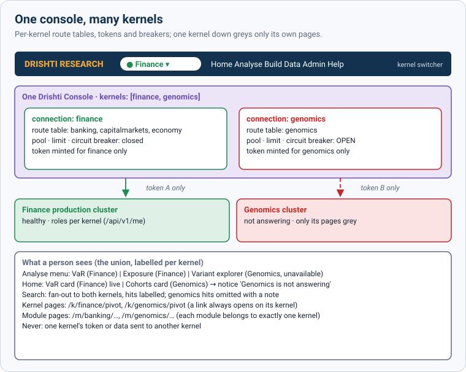

- **Configuration.** A console lists its kernels in `kernels:` (example:
  [examples/console/application.yaml](kernel-and-modules/examples/console/application.yaml)). Each entry has an id (`finance`, `genomics`), a
  label and colour for the header, the entry URLs (`backend.urls` with discovery, as today), its own token secret or OIDC audience, and
  limits (connections, timeouts). One kernel is the **identity kernel**, which verifies sign-in and maps identity to access (section 10.11).
- **Each connection has its own module set.** The console keeps a **route table per kernel** (from that kernel's registry). Menus, Home
  cards, Help, search and command words are the **union**, and each entry is **labelled with its kernel** when the console has more than
  one (*VaR · Finance*, *Variant explorer · Genomics*). A module id must be unique across the console's kernels. The same module on two
  kernels (production and UAT) is refused unless the second kernel's entry sets `prefix: uat`, which serves it at `/k/uat/m/<id>/…`.
- **The kernel switcher** in the header chooses the **current kernel** for kernel pages (Pivot, BI, Build, Data, Admin). With one kernel
  there is no switcher and today's addresses are unchanged. With several, kernel pages carry the kernel in the address (`/k/genomics/pivot`),
  so a link always opens on the right kernel. Module pages need no prefix, because their module belongs to exactly one kernel. Mock-ups:
  section 17 (f).
- **Routing per kernel.** Every request to a kernel names the kernel: module pages by the module's owner, kernel pages by the address,
  search and Home by fan-out to all kernels (virtual threads, a deadline per kernel), with the results merged and labelled.
- **Failure isolation per kernel.** Each kernel connection has its own HTTP pool, a concurrency limit (a semaphore on virtual threads) and a
  circuit breaker. A slow or down kernel **greys only its own pages**: its menus show *unavailable*, its pages show the kernel's notice
  (*Genomics is not answering; other areas work*), and its Home cards turn into notices. The other kernels' pages, and the console itself,
  are unaffected. Health shows one row per kernel.
- **Security: per-kernel tokens, never shared.** A person's call to kernel A carries a token minted for A only (a console-signed JWT with
  audience A, or an OAuth token exchanged for A's audience: section 10.11). The console never sends one kernel's token or data to another kernel. Roles are **per kernel**:
  the console asks each kernel `/api/v1/me` and shows only what that kernel allows. A page never mixes two kernels' data, except Home and
  search, where each card or hit is fetched from its own kernel as the person and labelled. Session isolation applies per person and per
  kernel.
- **White label per console.** The console's `distribution:` decides the **presentation**: brand, theme, the lenses offered, Home, which
  modules are shown and the docs. Each kernel's distribution decides **what is loaded** there. What a person sees is the intersection of
  the console's distribution and the modules active on its kernels, filtered by the person's roles on each kernel. So one estate can run
  a *Drishti Finance* console for the bank's desks in front of the finance kernel, and a *Drishti Research* console in front of finance
  and genomics, with different brands and the same kernels.

### 10.7 Python's future

Python stays **only where it is genuinely needed**: notebooks, the transform editor, Python compute packs and feeds scripts. These run as
**kernel-managed Python workers** (the kernel's sandboxed Python pool on compute nodes: strict sandbox, per-run import path, audit line,
the person's row rules), **never in the console**.

| Today | What it does (checked in the code) | Where it goes |
|---|---|---|
| `core/notebook.py` (304 lines), `routes/notebook_routes.py` (317) | the notebook's document (YAML cells), the masked extract and the SQL cell. The console already runs no code: SQL and Python cells run on the kernel | the document handling and pages move to the Java console (group G10). **Python cells stay on the kernel's Python workers.** SQL cells stay on the kernel. |
| `core/transform_editor.py` (202), `routes/transform_routes.py` (140) | turns a Transform spec into a Python item and a dataset, and **parses Python source back into steps with `ast`** | the page moves to the console. **The parse and generate steps move to a kernel Python worker** as a tooling call (`POST /api/v1/python/transform/parse` and `/render`), because they need a Python parser and the console has none. |
| `routes/python_routes.py` (72) | pages and proxies for Python items | Java controllers (G10). The items run where they run today, on the kernel. |
| `core/arrow_answer.py` | passes the kernel's Arrow bytes through unchanged; `decode` for tests and scripts | the Java console passes the bytes through the same way. `decode` stays only in the test helpers and the Python client. Arrow Flight later retires the hand-written writers ([INTEGRATION_GUIDE.md](../guides/INTEGRATION_GUIDE.md)). |
| `web/static/calc/*.py` with `drishti_calc-worker.js` | **Calc: Pyodide (CPython on WebAssembly) in a Web Worker of the person's browser**, reading data through the page with the person's session | **kept as it is**: it is client-side. The Java console serves `/pyodide/<version>/` and `/static/calc/` as vendored static files, and `routes/calc_routes.py` (109 lines, the reads as the person) becomes a Java controller. |
| Python compute packs, BI Python visuals and measures | already in the kernel's Python pool | unchanged (section 4.6) |
| Feeds and their refresh scripts | feed runs scheduled by the kernel; standalone `.py` scripts with `.sh` and `.ps1` launchers | feed runs on kernel Python workers placed with the module's `feeds` part; the standalone scripts stay tools for administrators |
| `tools/drishti.py` and the other command-line tools | clients of the kernel's API | unchanged: they are clients, not the console |

### 10.8 Migration: the strangler

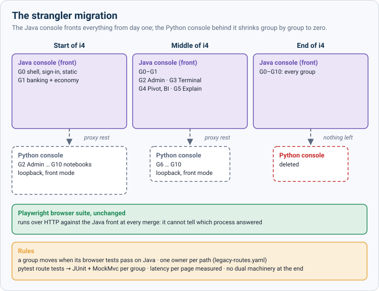

1. **The Java console fronts everything from the first day.** It takes the public port, owns sign-in and sessions, serves the static
   files and Elements, and serves every **migrated route group** itself. Every other path is **proxied to the Python console**, which then
   listens on loopback only (`127.0.0.1`).
2. **Identity for the proxied groups.** The Java console mints the per-request identity token that the Python console already accepts
   (today's HS256 token, which carries the user and their current roles) and sends it in a front header. The Python console runs in
   *front mode*: it accepts identity only from that header, refuses direct connections and runs no sign-in of its own. A person signs in
   once, on the Java console.
3. **One group at a time.** A group moves when **its Playwright browser tests pass against the Java console** with the rest still proxied.
   The group's entry in `config/console/legacy-routes.yaml` is deleted in the same merge (one owner per path at every moment).
4. **The Playwright browser tests stay unchanged.** About 32,000 lines in 148 files test over HTTP, so they cannot tell which process
   answered. They run against the Java front from the first merge, which proves the whole product at every step. This is the main
   safeguard against regressions.
5. **Unit tests are replaced per group.** The pytest unit tests that call Python routes or `core/` helpers (68 files) are replaced by
   **JUnit and MockMvc** tests for that group's controllers and services, and deleted with the Python code they tested.
6. **The Python console is deleted** when the last group moves: `drishti-console/` Python sources, `run_drishti_web.py`, the console's
   `requirements.txt` and its virtual environment for serving. The browser tests then move to the console's own test tree (still
   Playwright, the test runner's Python stays a test tool). No dual machinery remains.

**The route groups, in order** (sizes from the code on `970160f9f`: route-file lines and route count, templates; `core/` helpers, 20,140
lines, move with the groups that use them). The full table with the files of each group is
the route-group migration order (section 10).

| # | Group | Route files (lines · routes) | Templates | Why this place |
|---|---|---|---|---|
| G0 | **Shell and serving**: sign-in, sessions, static, Elements, live channel, the proxy, module page hosting | 4 files (521 · 15) + `core/app.py`, `auth.py`, `channel*.py`, `backend.py`, `cluster.py` | `base.html`, `_macros/` (6), `auth/` (2) | the front itself; nothing works without it |
| G1 | **Banking and economy pages**: the proving ground | `plugins/banking` (3,548 lines of Python, 65 routes) | 20 | the first module pages on the Java host, through the shared runtime, declared routes and the API proxy |
| G2 | **Admin** | 18 files (3,868 · 200) | `admin/` (44), `monitor/` (2), `servers.html` | large but plain forms over kernel APIs; administrators test it first |
| G3 | **Terminal, Home, data and search** | 8 files (1,750 · 50) | `terminal/` (26), `landing.html` | the daily screens; moves after the Admin group has proved the patterns |
| G4 | **Pivot and BI** | 9 files (1,715 · 98) | `bi/` (20), `workspace/` (2), reports (2) | heavy fan-out; the virtual-thread gain shows here |
| G5 | **Explain, approvals, alerts, collaboration** | 8 files (1,244 · 59) | 8 (`explain`, `approvals`, `alerts`, `inbox`, `subscribe`) | live-channel users |
| G6 | **Embed** | 4 files (1,185 · 44) | `embed/` (1) | token sign-in for embeds; after the security patterns are settled |
| G7 | **Designers, Build, Studio, forms** | 5 files (1,844 · 72) | `designer/` (4), `build/` (10), `studio/` (2), `_designer_kit.html` | the largest JavaScript-facing contracts |
| G8 | **Help** | 1 file (364 · 13) | `help/` (9) | the Help merge of modules (section 4.7) |
| G9 | **AI assistant** | 1 file (213 · 5) | — | small |
| G10 | **Notebooks, Python, transforms, Calc** | 4 files (638 · 24) | `bi/notebook.html` (counted in G4) | last: the transform parse moves to kernel Python workers first (10.7) |

### 10.9 Tests and the performance proof

| Test | Proves |
|---|---|
| **Browser suite, unchanged** | the full Playwright suite passes against the Java front at every merge, and at the end against the Java console alone |
| **Render equality** | each template rendered by Jinja2 and by Jinjava from recorded contexts gives the same HTML (whitespace normalised), until the group moves |
| **Latency per page** | for the 30 most used pages, p50 and p95 server time and time to first byte, Python console against Java console, on the benchmark machine with the demo lake. The budget is **no page slower**, and the fan-out pages (Home, Pivot, BI report, VaR explorer) **at least 30% faster** at 50 concurrent people. Recorded in [BENCHMARK.md](../admin/BENCHMARK.md). |
| **Two people at once** | every group's MockMvc tests run two people concurrently and fail on any shared per-person state (the session-isolation rule; architecture test on singletons) |
| **Kernel isolation** | with two kernels, stop one: its pages show the notice and the other kernel's pages and Home answer within budget; no token for one kernel ever reaches the other (a recording kernel stub) |
| **Windows** | the console runs on the Windows QA machine as a jar with Java only: no Python and no native binary for the UI |

### 10.10 Risks and mitigations

| Risk | Mitigation |
|---|---|
| **Jinjava compatibility gaps** (filters, scoping, `namespace`, `call` blocks) | a week-1 spike ports the 10 most complex templates. The render-equality test covers every template, and differences are rewritten to the common form. Pebble is the fallback (O1). |
| **Session migration** | sessions are not migrated: on the switch, people **sign in again once** (announced in the release notes). Saved work, tokens and preferences live on the kernel and are untouched. |
| **Performance not proved** | the latency-per-page benchmark (10.9) is a gate for every group, not only at the end. A group that is slower does not move until it is fixed. |
| **Windows QA** | a plus: the UI becomes a jar on Java, with no Python environment to install for the console. Native-binary rules are unchanged. |
| **Test-suite runtime** | the browser suite already runs on all 24 threads with per-worker fixtures. The Java console starts faster than the Python console with its plugins, and MockMvc unit tests run in seconds. The proxy hop during the migration is measured, and its cost is gone at the end. |
| **Two consoles during the migration** | it is a strangler, not dual machinery: each path has exactly one owner at every moment (`legacy-routes.yaml`), the Python console is loopback-only behind the Java front, and it is deleted at the end of i5. |
| **The bulk of `core/` logic** (menus, search, facts, designer forms) | ported service by service with its existing unit tests turned into JUnit tests first. Logic that belongs on the kernel (anything that computes a number) moves to the kernel instead (the server-computes-risk rule). |

### 10.11 Enterprise single sign-on (i5)

**Decided by the owner on 2026-11-08: i5 includes how Drishti integrates with enterprise single sign-on.** Authentication and SSO move from
j to i5, because the Spring Boot console's security chain is where they belong. j keeps roles, licensing, module signing, audit and
hardening (section 14.2). Roles, row rules and the access chain are [the access model](#19-the-access-model-licence-module-lens-function-permission); this section does not repeat them.

**What exists today, and stays true.** OpenID Connect sign-in is built: the Python console runs the browser redirect and the **server verifies
every ID token itself**, maps the provider's groups to roles (`drishti.security.oidc.role-map`), creates the user on first sign-in, and
re-checks the session every `auth.recheck_seconds`. A user disabled in Drishti stays out whatever the provider says, and one break-glass
administrator keeps a password ([ADMIN_GUIDE.md section 5](../guides/ADMIN_GUIDE.md#5-single-sign-on-openid-connect)). i5 keeps every one of
these rules and moves the browser side into Spring Security.


**Protocols**, all through Spring Security in the console:

| Protocol | Use | Spring Security |
|---|---|---|
| **OpenID Connect** (preferred) | every modern IdP: authorization code with **PKCE**, `state` and `nonce`; the client authenticates with `private_key_jwt` where the IdP supports it, else a client secret | `oauth2Login` with one `ClientRegistration` per provider |
| **SAML 2.0** (second) | IdPs or sites that only offer SAML (older ADFS farms, some Ping set-ups): SP-initiated, signed assertions, encrypted where the IdP supports it | `saml2Login` with a `RelyingPartyRegistration` from the IdP's metadata |
| LDAP / Active Directory bind (optional) | sites without an IdP: the person's password checked by a bind over LDAPS, never stored | `ldapAuthentication` (bind only, no password comparison) |
| Kerberos / SPNEGO (optional) | desktop SSO inside a Windows domain, no prompt at all | the Spring Security Kerberos extension, falling back to OIDC or SAML |

**Providers.** One block per provider in the console's configuration; full examples in
[examples/console/application.yaml](kernel-and-modules/examples/console/application.yaml):

| Provider | Protocol | Issuer or metadata | Groups claim |
|---|---|---|---|
| Microsoft Entra ID (Azure AD) | OIDC | `https://login.microsoftonline.com/<tenant>/v2.0` | `groups` (object ids) or app `roles`; more than 200 groups arrive as an overage claim, so **app roles are recommended** |
| Okta | OIDC | `https://<org>.okta.com/oauth2/<server>` | `groups` (a claim added on the authorization server) |
| Ping (PingFederate, PingOne) | OIDC or SAML | `https://<ping>/as` or the SAML metadata URL | `memberOf` or a mapped `groups` attribute |
| ADFS | OIDC (ADFS 2016+) or SAML | `https://<adfs>/adfs` | `group` or `role` claims from the claim rules |
| Keycloak | OIDC | `https://<host>/realms/<realm>` | `groups` mapper, or realm roles at `realm_access.roles` |
| Google Workspace | OIDC | `https://accounts.google.com` | none in the ID token: groups come from the Directory API by a service account, or the site maps by the `hd` domain and e-mail lists |

**Identity to Drishti access.** The identity kernel stays the authority (one registry, ACCESS_MODEL section 2):

- After the console has verified the ID token (or SAML assertion), it sends it to the **identity kernel**, which **verifies it again
  itself** (issuer, audience, signature from the IdP's JWKS, expiry, nonce), as it does today. The console is never the only check.
- The mapping from IdP groups and claims to **roles, lenses and module access** lives in **one file**, `config/security/identity-map.yaml`
  (it grows from today's `drishti.security.oidc.role-map` and replaces it, one way): claim names, `groups → roles`, `groups → lenses`,
  `groups → modules` (within what the licence allows), the default when nothing maps (refuse), and per-provider overrides. A change is a
  **four-eyes proposal** in the Approvals inbox, and it is audited. Example:
  [examples/site/identity-map.yaml](kernel-and-modules/examples/site/identity-map.yaml).
- **Just-in-time users**: the first sign-in creates the user, with no password. Later sign-ins update the name, e-mail and roles (when
  `roles-from-provider: true`). Every creation and refusal is audited (`user-provisioned`, `login-sso-refused`), as today.
- **SCIM 2.0** provisioning and de-provisioning (users and groups pushed by the IdP, so a leaver is disabled before they try to sign
  in) comes **later**, as an optional endpoint on the identity kernel (open question O9).

**Token propagation, console to kernels:**

- **The console never forwards the browser's IdP token.** Each call to a kernel carries a token **made for that kernel only**: audience =
  the kernel's id, a life of 2 minutes, the person's subject, their identity kernel's session id and the request id.
- **Recommended: a console-signed JWT** (ES256, the console's key pair, its public keys at `/.well-known/jwks.json`; each kernel lists the
  consoles it trusts by issuer and JWKS URL). This replaces today's shared HS256 secret, so no kernel holds a key that could mint tokens.
  **Option for sites that require IdP-issued tokens: OAuth 2.0 token exchange** (RFC 8693; Entra ID's on-behalf-of flow), one exchange
  per kernel audience, cached for the token's life (open question O8).
- **One console, many kernels**: one token per kernel, never shared (section 10.6). Roles are resolved by each kernel for itself.
- **The kernel validates** issuer, audience, expiry, signature (JWKS, with the key id), then applies the person's roles and row rules
  (ACCESS_MODEL), exactly as for any other caller.
- **Identity flows on**: the person's id is on every audit line, and on every Python worker run (the run's audit line and the row rules
  applied to its frames), so a notebook cell or a transform is attributed to the person who ran it.

**Non-browser access:**

| Who | How |
|---|---|
| People on the command line (`drishti.py`, deploy, `.ready` loaders run by hand) | **OAuth 2.0 device code**: `drishti.py login` prints a code and a URL, the person signs in at the IdP (MFA included), and the CLI keeps a short-lived token in the OS keyring |
| Schedulers, CI, ETL jobs, deploy pipelines | **OAuth 2.0 client credentials** (a service principal per job, mapped to a service account in `identity-map.yaml`), or today's **API tokens with scopes** for service accounts ([ADMIN_GUIDE.md section 6](../guides/ADMIN_GUIDE.md#6-api-tokens), a module's `tokens/token-scopes.yaml`) |
| Everyone | **no passwords on command lines** or in scripts: tokens from the environment (`DRISHTI_TOKEN`) or the keyring only |

**Sessions:**

- **Timeouts**: idle (30 minutes) and absolute (12 hours) on the console session, both configurable. Refresh tokens are used only to
  check that the person is still allowed, never handed to the browser.
- **MFA is delegated to the IdP**. The console can require it (`acr_values`, or an `amr` claim it checks) for Admin and for four-eyes
  approvals (step-up).
- **Single logout**: OIDC **back-channel logout** (the IdP calls the console, which ends every session of that IdP session) and
  front-channel logout as a fallback; **SAML SLO**. Sign-out in Drishti calls the IdP's end-session endpoint.
- **Revocation**: a person disabled in Drishti, or removed at the IdP, loses access **within `auth.recheck_seconds`** (10 s by default; the
  identity kernel's session check on every request, as today) or at once on a back-channel logout or a SCIM de-provision.

**Several consoles and key rotation:**

- Consoles behind a load balancer share the **session store** (Spring Session JDBC on the site's PostgreSQL, the database rules), so any
  console serves any person and a logout ends the session everywhere. No sticky sessions are needed.
- **IdP keys rotate** without a restart: JWKS and SAML metadata are fetched and cached, refreshed on an unknown key id and every
  `security.sso.metadata-refresh-minutes` (60). The console's own signing key rotates the same way (two keys in its JWKS during the
  overlap).

**Local development and demos:** today's built-in sign-in (users and passwords in the identity kernel) stays for laptops, demos and the
break-glass administrator. On a console where it is the only method, every page shows a **not for production** banner, and Health warns.

**Testing (Windows-safe, no containers):** the integration tests use an **in-process mock IdP**, a Java OIDC mock server started by the
test (for example `mock-oauth2-server` as a test dependency) and a SAML test IdP that signs fixed assertions with a test key, so the suite
runs on the Windows QA machine with Java only (no Keycloak container, no native binary). The tests cover code + PKCE, a bad `nonce`,
a wrong audience, an expired token, a rotated key, the group mapping, JIT creation, back-channel logout, and **a token for kernel A
refused by kernel B**. Real providers are checked at **site acceptance** with a checklist per provider in the SSO guide.

**Where secrets live:** client secrets, private keys for `private_key_jwt`, SAML signing keys and the console's JWT signing key are in the
site's **secret store** or the environment (`${secret:…}` references, `DRISHTI_*` variables), **never** in configuration committed to git and
**never in a module** (section 5.10).

**Documentation (an i5 deliverable).** The **SSO integration guide** is a rewrite of [ADMIN_GUIDE.md section 5](../guides/ADMIN_GUIDE.md#5-single-sign-on-openid-connect),
the existing home of sign-in for administrators (not a new document): step-by-step set-up for **Entra ID, Okta, Ping and ADFS, and
Keycloak**, claim-mapping examples, logout, the CLI's device code, and troubleshooting (clock skew, wrong audience, the groups overage,
the redirect URI). It is paired with one **SSO tutorial** (the two-docs rule) and with the per-provider site-acceptance checklists.
DEPLOYMENT_AND_QA_GUIDE links to it from its configuration step.

**If i5 were skipped**, SSO would fall back to j on the Python console: the same identity map, token per kernel and logout rules, built
on the Python console's OIDC code instead of Spring Security.

## 11. Drishti Elements: the controlled UI statics

**Decided by the owner on 2026-11-08:** Drishti Elements is **the one set of UI statics**, and it is tightly controlled. The libraries
themselves, their APIs and their packaging are [ELEMENTS.md](https://github.com/drishti-platform/drishti-elements/blob/v3.3.2-ide3/docs/DESIGN.md). This section says only who serves Elements, what a module may
and may not ship, and how that is enforced.

### 11.1 Who owns and serves Elements

- **The platform owns Elements**: the libraries (drishti-core, -inputs, -grid, -chart with maps, -data, -insight, -renderer and the
  generic additions) and **every vendored third-party library** (`static/vendor` with `VENDOR.md`).
- **Only the Drishti Console serves them** (today's console from i2, the Spring Boot console from i5), from its own **signed, versioned bundle**: one Elements release train per console
  (`elements.json`, [ELEMENTS.md section 8](https://github.com/drishti-platform/drishti-elements/blob/v3.3.2-ide3/docs/DESIGN.md)), served under
  `/static/elements/<library>/<version>/` with immutable caching, **SRI** on every tag and the console's **CSP** (`script-src 'self'`, no
  inline script, no remote origin). A console's About and Health show its Elements train version.
- The kernel serves no UI statics. A module's own statics (its pages' scripts, its domain library) are served by the console under
  `/m/<id>/…` (section 9.7), separate from Elements.

### 11.2 What a module may not ship

- **No copy of Elements**, in whole or in part, under any name.
- **No vendored library**: no second chart, grid, date picker, map or icon library, no framework (React, Vue, jQuery), and no copy of a
  library the platform already vendors.
- **Nothing from a CDN** or any other origin: no remote script, style, font or image.
- **No bespoke UI**: no hand-drawn tables, canvases or widgets outside Elements components (the no-bespoke-UI rule, conformance C2), no
  inline styles or colours (C3), no `eval` or inline scripts (C5).

### 11.3 Version ranges

- A module declares the **Elements API range** it was built for in its manifest: `elements: ">=2.4 <3"` (section 3.3). The range is checked
  against the console's Elements train version.
- **The console refuses a mismatch with a reason**, like the kernel's `vermagic` check: *genomics 0.1.0 refused on console-research: needs
  Elements >=1.4 <2, this console serves 2.0.0*. A refused console part means the module's pages are absent on that console (section 4.9),
  while its server parts are unaffected.
- Elements follows **semver** and the **deprecation over one release** rule. A deprecated component keeps working for one release and is
  listed in Admin → Modules against each module that still uses it.

### 11.4 Domain libraries

- A module's domain library (drishti-risk for banking, drishti-genomics for the sample) is **built on Elements core through the SDK**. It
  imports only the **published Elements API** (`@drishti/elements-*` entry points and their `.d.ts`), never a file path inside a library.
- It uses **theme tokens only** (no colours, fonts or spacing of its own), the **`drishti_` asset prefix** on every file (C4), and it is
  **versioned with its module**: it ships inside the `.dmod` (`elements/<lib>/`), is served by the console at
  `/m/<id>/elements/<lib>/<version>/`, and goes away with its module (section 12).
- It is licensed with its module (ELEMENTS.md section 8). An unlicensed or removed module's library is not served.

### 11.5 Enforcement

| Where | Check |
|---|---|
| **SDK conformance** (`drishti:conformance`, section 8.6) | a **hash scan** refuses known library files inside a `.dmod` (the SHA-256 of every vendored file of every supported Elements train, and of the popular libraries' published builds, in a list shipped with the SDK), plus a name-and-signature scan for minified bundles; no bespoke UI (C2); tokens only, no inline styles or colours (C3); `drishti_` prefix (C4); no CDN or remote origin, no `eval`, no inline scripts (C5); imports only of published Elements entry points |
| **Console load-time verification** (V6 for the console part, section 4.3) | the same scans run again on the bundle the console receives, before anything is served. A failure refuses the console part with the reason (*elements/drishti-genomics/vendor/chart.min.js matches chart.js 4.4.1: modules may not ship libraries*). |
| **Guard tests** | the existing guards (no-bespoke-UI, the static-asset prefix, vendor without CDN, the Elements loader's refusal of another module's library) **become part of the conformance suite**, so partners run the same tests as the kernel's own code |

### 11.6 Governance

- Changes to Elements go through **the platform team**: semver, deprecation over one release, and an **API diff gate** (the `.d.ts` diff
  generated each release, like the kernel API's `japicmp` gate in section 2.2). A breaking change without a major version fails the build.
- **A module that needs a new widget extends Elements**: it files a request to the platform, and the widget is added to the right library
  (or to the module's domain library on Elements core when it is truly domain-specific). It never draws its own. This is the
  no-bespoke-UI rule, **now enforced on partners too**.
- **White labelling** follows: brand and theme are **tokens** chosen by the distribution file (section 6), never module CSS. A module looks
  right under every brand because it has no colours of its own.

## 12. Taking a module away: everything disappears

The owner's rule: **when a module is switched off or its file is taken out, all its pages, and everything else it brought, are gone** at
the next start, on every node that restarted, and nothing a person saved and no data the site holds is lost.

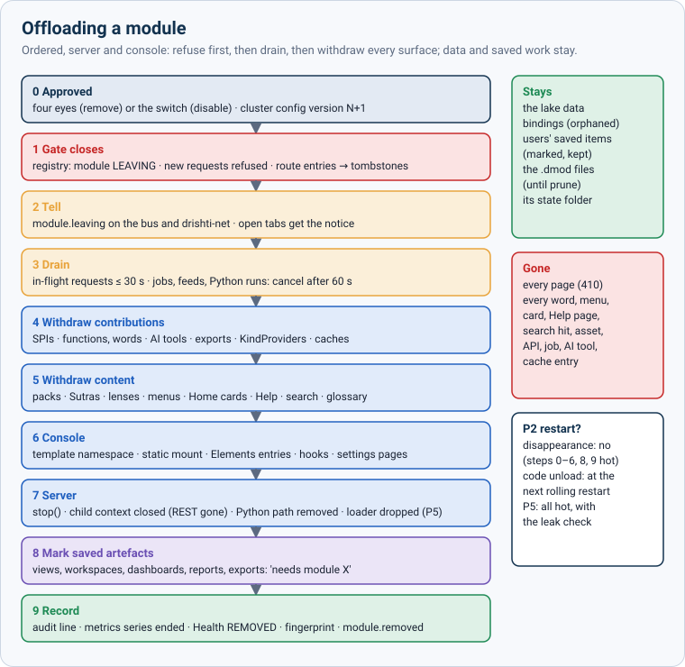

### 12.1 Two ways a module is not there

| | Switched off | File taken out |
|---|---|---|
| Trigger | `drishti.modules.<id>.enabled: false` or `config/modules/<id>.yaml`, then a restart | the `.dmod` removed from the modules folder, then a restart |
| Files | kept | the package is gone (a copy may be kept as the previous one by `module remove`); its cache folder is swept |
| Pages | **404** + notice *not available* | **404**: the module is unknown (nothing reveals what a site installed) |
| Every other surface | never registered (12.3) | never registered (12.3) |
| Open tabs | notice *switched off* once the console sees the module gone | the same |
| Saved work | marked *needs module X (off)* | kept as saved; marked *needs module X* where the server still knows the names |
| Schedules, alerts | paused | paused |
| Data, bindings | stay | stay (bindings orphaned) |
| Reverse | switch on, restart | put the file back, restart: everything marked works again |

Nothing unloads a module while the server runs: a switched-off or missing module is simply never started. The unload sequence below
is what a module's contributions go through when a server **stops** (and in the module runtime's own tests and the conformance check C14,
which unload a module and look for leaks).

### 12.2 The unload sequence

Ordered. Each step is idempotent and logged; a failing step does not stop later steps (it is shown in Health).

| # | Step | Server |
|---|---|---|
| 1 | **Gate closes** | the module's routes answer *not available*; the scheduler starts nothing of it |
| 2 | **Tell** | `module.leaving` on the bus |
| 4 | **Withdraw contributions** | every SPI registration in `ModuleContributions` (engines, `PivotProvider`s, `FunctionProvider`s, explainers, approval sources, Flight forms, health figures, AI tools, exports, playground templates); its `KindProvider`s; its `CacheGroup`s cleared |
| 5 | **Withdraw content** | packs, kinds, contracts, Sutras, lenses, functions, Home cards, BI content, report definitions, feeds; the search index's entries tagged `module:<id>`; Help pages, glossary terms; designer palette entries |
| 6 | **Console** | static and Elements mounts withdrawn; its settings page removed |
| 7 | **Server** | `DrishtiModule.stop()`; the child Spring context closed (its `@ModuleApi` mappings gone); the Python pool's import-path entry removed; the class loader dropped, with the leak check |
| 8 | **Record** | the module's metrics series ended; Health row `OFF`; `module.stopped` |

(The steps keep the numbers of the design's earlier sequence; there is no step 3 and no step 9: nothing is drained, and nothing is
written for saved work.)

### 12.3 The inventory: every surface and how it goes

| Surface | Contributed by | Removed by (step) | The absence test asserts |
|---|---|---|---|
| Routes and pages | `plugin.yaml` `routes:` | route table → off (1, 6) | every recorded URL answers 404 with the notice page |
| Menus | `plugin.yaml` `menus:` | sitemap entries tagged `domain:<id>` (5) | no menu, Admin tab or BI rail item links into the module, in every lens |
| Lens entries | `lenses/lenses.yaml` | registry lenses withdrawn (5); a person on that lens falls back to the default lens with a notice | the lens list has none of its lenses |
| Function / command words | `functions.yaml`, `plugin.yaml` `words:` | registry functions (5); console hooks (5) | each word answers *not available*; `FUNC` lists none |
| Home cards and chips | `plugin.yaml` `home:`, `module.yaml` `home:` | lens cards (5) | Home in every lens has none |
| Search index entries | Sutras, functions, Help, `search:` | entries tagged `module:<id>` (5) | a search for each of its words, titles and terms finds nothing |
| Help pages, guides, tutorials | `docs/`, `help.yaml` | Help centre sections, the docs register rows (5) | Help index, Help search, guides list and tutorials list have none; their URLs 404 |
| Glossary | `docs/glossary.yaml` | glossary terms (5) | none of its terms |
| Static assets | `console/static`, `elements/` | mounts withdrawn (6) | every recorded asset URL answers 404 |
| REST endpoints | `@ModuleApi` | child context closed (7); gate first (1) | every recorded endpoint answers 404 `DRS-1025` |
| SPI registrations | `ServiceLoader`, beans | `ModuleContributions` withdrawn (4) | the registry of contributions has no entry whose class loader is the module's |
| Scheduled jobs and feeds | `feeds/`, scheduler registrations | suspended, then removed (3, 5) | the scheduler lists none; no run starts after step 1 |
| Python compute | `python.items`, packages | items unregistered (4), import path removed (7) | Build lists none; a run naming one is refused |
| Caches (pivot, BI, Explain, its own) | `CacheGroup`, tagged entries | cleared (4) | cache reports have no group or entry tagged with it |
| AI tools | `AiToolProvider` | withdrawn (4) | the assistant's tool list has none |
| Settings pages | `settings/`, `plugin.yaml` `settings:` | page removed (6); stored values kept for reinstall | Admin → Modules has no settings tab for it |
| Sutras | `packs/*/sutras/` | pack withdrawn (5) | no kind matches one of its Sutras; its Sutra URLs 404 |
| Designer palettes | tier-3 panel types | palette entries (5) | the designer offers none |
| Exports | `ExportProvider`, export buttons | withdrawn (4) | the export list has none; scheduled exports paused |
| Audit | audit lines carry `module` | **kept** (audit is never removed) | the module's audit lines are still there |
| Metrics | meters named `<id>.*` | meters removed, series ended (9) | the metrics endpoint exposes none |
| Event subscriptions | `events.subscribes` | removed (4) | publishing `data.loaded` reaches no handler of it |
| Embeds and tokens | embed pages, `tokens/token-scopes.yaml` | scopes withdrawn (5); embed URLs 404 | its scopes are not grantable; embeds 404 |

### 12.4 Open browser tabs

- The console's shell asks every 15 seconds whether the page's module is still hosted (`GET /api/modules/hosted`); the shell (the console's
  JavaScript, not the module's) handles the answer.
- On a page **of** a module that is now off: the shell freezes the page's Elements (they stop polling and refuse input) and shows the
  kernel's notice *Genomics is switched off* with *Go to Home*. The page's own JS is not called again.
- On a kernel page **with** module parts (a slot, a menu entry, a card, a palette): the shell removes the slot containers
  (`[data-module=genomics]`), refreshes menus and cards from the next answer, and shows a quiet notice.
- A navigation to a page of a module that is off or unknown lands on the 404 notice page.
- Mock-up: section 17, (d).

### 12.5 In-flight requests and running jobs

A server that stops finishes the requests already inside within its shutdown grace period; jobs, feeds and Python runs get a cooperative
cancel at once and a hard cancel after `cancel-seconds` (60); partial results are discarded, never published (a produced kind is written
only on success). There is no drain of a module on a running server: a module is not unloaded while the server runs.

### 12.6 Users' saved artefacts

Saved views, workspaces, dashboards, bookmarks, BI reports, notebooks, scheduled exports, alerts and subscriptions that reference a
module's pages, words, kinds, Sutras or functions are **kept, marked and restored, never silently deleted**:

- **How the kernel knows**: the modules of this boot (their API prefix, console paths, words and kinds: `ModuleNode.needs`) are looked up
  in the artefact's stored text when it is listed or opened; a reference to a module that is off is reported as *needs module genomics*.
  No artefact is rewritten and **no database change is needed** (no migration; artefacts keep their stored form).
- **Shown**: in lists, the artefact keeps its place with a *needs genomics* chip and is not openable; a workspace or dashboard opens with
  the missing tiles replaced by a notice tile and everything else working; a BI report shows the visuals that depend on it as notices.
- **Schedules and alerts** pause with status *paused: needs module genomics*; the owner is notified once.
- **The module back**: references resolve again, chips disappear, paused items resume (same major version), or stay paused with the list of
  what is still missing (a new major that dropped something).
- **Deletion** only by the owner (or an administrator acting for them), with the usual confirmation.

### 12.7 The data in lakes

Data belongs to the site, bindings to the kernel (section 5): **nothing in a lake is touched**. The module's produced kinds
(`var-official`) stay where the site bound them; its kinds' bindings stay in `config/bindings.yaml` and show as *orphaned: no installed
module needs this kind* in Admin → Data bindings (never removed automatically); the data stays readable by Pivot, BI and `DATA` through the
kernel's connectors only if another module or the kernel defines the kind (otherwise the lake tables are still there for a reinstall).
The module's own state folder (`${drishti.data.dir}/module-state/<id>/`) is kept; `module purge-state <id>` (four eyes) deletes it.

### 12.8 Sessions

Session isolation makes removal clean: nothing module-scoped lives in shared state. Per-person caches keyed by person **and module**
are dropped on `module.leaving`; the person's session and cookie are untouched; a person whose current lens was the module's falls back
to the distribution's default lens at the next request, with a notice. The absence test (12.11) runs with two people signed in during the
removal and asserts neither sees the other's data or a broken page.

### 12.9 The cluster

- A module is off or absent **per node**: each node boots the packages of its own modules folder (section 4.11.4). A module taken out of
  one node's folder is absent there at that node's restart and its parts, if placed there, are unavailable on it (`503 DRS-1032`) while
  the placement still names it; change the placement to move the work.
- Every node's **module fingerprint** (section 4.11.6) changes with its modules; a node that starts with a `.dmod` the placement does not
  name shows **amber** (*present but not placed*) in the node × module matrix and serves nothing of it.
- Consoles are placement nodes (section 10.5): each console holding the console part follows the server's module list
  (`GET /public/modules/console`) and drops a module's cached console bundle when the server no longer lists it; a console in front of
  several kernels drops only that kernel's entries from its route table (section 10.6).

### 12.10 What people see: the not-available page, 404

- A module that is **switched off, refused or not installed**: **404**, with `Cache-Control: no-store`. Pages render the kernel's notice
  page (in the kernel shell, so menus and the command line still work): *Not available: the genomics module is switched off; ask your
  administrator* (off), or *There is no page at …* (unknown, so nothing reveals what other sites install), with *Go to Home* and *Search*.
  APIs answer an RFC 7807 problem: `DRS-1025`, *module off*, `module: genomics`.
- There is no 410: a module is not removed while the server runs, so there is no "gone" to tell apart from "off".

### 12.11 The "absent everywhere" guarantee, and how it is tested

**Guarantee**: after a module is removed (or switched off), no person, page, API, search, Help, job, cache, AI tool or registry anywhere
on any node can reach anything of it; what stays is the site's data, people's saved work (marked) and the audit.

**The absence suite** (`AbsenceSuite` in the testkit; the kernel runs it on the genomics sample and banking; every module runs it as
conformance C14):

1. **Install** the module in the harness (kernel + module, demo lake, two people signed in, one composed page open in a headless
   browser, one saved view, one workspace tile, one scheduled export).
2. **Record every surface** into an inventory: the console route table and every URL it can produce; the sitemap per lens; the function
   list and type-ahead for each word; a search for each title, word and glossary term; the Help index; the asset list; the server's mapped
   endpoints (OpenAPI); the scheduler; the Python items; `ModuleContributions` entries; AI tools; cache reports; metrics names; the
   designer palette; settings pages; exports; event subscribers.
3. **Switch it off** (the module switch with a test approver, and a restart of the harness's context).
4. **Assert each surface is gone**: every recorded URL 404 with the right page or problem; every list,
   index and registry without the module's entries; the kernel's own entries unchanged (the inventory diff is exactly the module's).
5. **Assert the open tab** shows the notice, logged **no JavaScript error**, and made no further request to the module's paths.
6. **Assert saved work** is marked, not changed or deleted; the export paused; the two people still isolated.
7. **No references left**: a reachability scan from every kernel registry (contributions, caches, scheduler, event bus, AI tools,
   route table, Jinjava instances) finds **no object whose class loader is the module's**, in the kernel **and in the console** (the
   console's context-builder loader included; in P5 the loader itself is collected there too).
8. **Class loader released** (P5 hot unload, and in the harness from P2): a `WeakReference` to the module's class loader is cleared
   after GC within a bounded number of cycles; repeated 50 times (install/remove) without growth in metaspace or threads named
   `mod-<id>-…`.
9. **Switch it on again** and assert everything recorded is back and saved work resolves again.

A failure names the surface and the leftover (*search still finds "Variant explorer" (index entry 41922, tag module:genomics)*).

## 13. Security

### 13.1 Signing

- Every `.dmod` is signed (Ed25519 over the hash list). Drishti's **module publisher root** signs publisher certificates (Drishti itself
  for banking, economy, capital markets; partners later). The site trusts the root by default (`config/trust/publishers/drishti-root.pem`)
  and may add its own publishers (taint `U`).
- Keys: private keys in an HSM or an offline key file, never in a repository; `module sign` takes a PKCS#11 URI or a file.
- Revocation: a revocation list file shipped with each kernel release and loadable by the site; a revoked certificate refuses its modules.
- The kernel jar and connector plugins are signed the same way (P4).

### 13.2 The licence

The signed licence of [ACCESS_MODEL.md section 19.7](#197-what-is-built-when) (built in i, after the security discussion)
names **features**; each module's `licence.feature` must be in it (V5). Limits (`positions`, `nodes`, `users`) are read by the registry and
offered to the module through `ModuleContext.licence()` (read-only, the module cannot change them). The licence check is the kernel's;
modules know nothing of it beyond the limits.

### 13.3 Sandboxing

| Part | Isolation |
|---|---|
| Java | own class loader, sees only the kernel API; no `System.exit`, no new threads outside the kernel's pools (an SDK architecture test; the kernel's thread factory names threads `mod-<id>-…` for attribution); file access only to its own data folder through `ModuleContext.folders()` (checked by the conformance suite; the JVM has no Security Manager any more, so this is a review and test rule, not a runtime wall: Q5) |
| Python | the kernel's strict sandbox (no network interface, Landlock, audit hook), per-run import path, the person's row rules on every frame |
| Console part | runs in the **Drishti Console, never in the kernel** (section 10); context builders in their own class loader that sees only `drishti-console-api`, with no mutable state (architecture test); templates in a per-module Jinjava sandbox (section 9.6); no Python in the console at all |
| JavaScript and CSS | served from `/m/<id>/static/<version>/`, under the console's CSP (`script-src 'self'` plus SRI hashes from the module's manifest; no inline script, no `eval`, no remote origins) |

### 13.4 Secrets

Never in a module (5.10). A module has no secret API. Its own sensitive settings (none for banking) would be references the site fills
(`${secret:name}`) and only the kernel resolves.

### 13.5 Session isolation

A module runs in a multi-user, concurrent server: the module conformance suite runs two people at once and fails on any per-person
state in statics, singletons or shared caches without the person's identity (the session-isolation rule; cross-person leaks are P1 and
release blockers). `Kinds` reads are always **as the person**.

### 13.6 Audit

Install, upgrade, rollback, remove, switch, binding change, refusal, taint, and every run of a module's API and Python items carry the
module id and version in the audit line.

## 14. Migration, with banking as the proving ground

### 14.1 Where we are (surveyed on `89f010df5`)

| Already modular (built in the e+f+g train) | Still leaking or not done |
|---|---|
| Java split: `drishti-banking`, `drishti-compute-banking`; cycles J1–J6 broken through SPIs; `ArchitectureRulesTest` | **39 kernel files with 77 banking strings** on the rule-4 allow list (`tools/domain_strings_allowed.yaml`): bicompute (Explain, functions, what-if, scale), the console's `core/edition.py` (14), `core/facts.py`, `drishti_pivot.js`, `EngineCatalogue`, `ModuleManifest`, `EmbeddedAccessRegistry`, `ErrorCode` |
| Manifests (`META-INF/drishti/module.yaml`, `lenses.yaml`, `engines.yaml`, `token-scopes.yaml`) in the jar; the registry decides | **The thin jar is built but not the default** (`drishti-kernel-app`, no modules; Health says so): banking is on the full jar's class path; "installed" = in the fat jar |
| `@ConditionalOnModule`, module switch, `DRS-1025` / `1026`; module off = gone everywhere (tests) | **Console plugins live inside the repo's console** (`drishti-console/plugins/{banking,economy}`), imported as `plugins.<id>` |
| Console plugin hooks C1–C7; static assets by module and lens; Elements loader refuses a module's library | **Modules depend on `drishti-server` internals** (banking: 44 packages listed in `modules/banking/java/kernel-internals.txt`, a list that only shrinks) |
| Packs, lakes, BI, tables, reports, lenses in module folders (`config/*/banking/`) | **Banking ships connector plugins** (`var-positions`, `var-pv-stream`) and reactive connectors; contracts name connectors (`storage.connector`) |
| **Editions folded into lenses: done** (`config/lenses/<module>/`) | **No signing, no module path, no distribution file**; branding split across `ui.*`, `drishti.branding.*` and lens titles |
| Packs name their domain; Help by module (`plugins/banking/help.yaml`) | Banking Python CLIs (`varcli.py`, …) and the guides/tutorials live in the repo's shared folders |

### 14.2 Phases

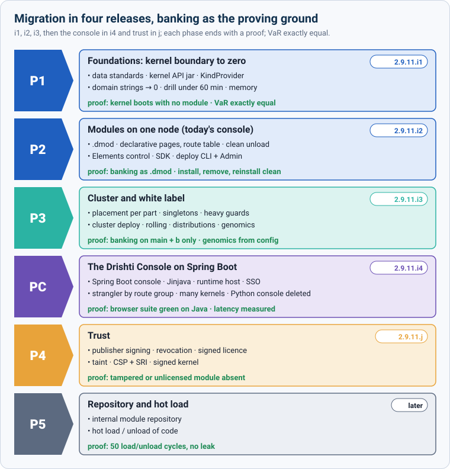

| Phase | Deliverables | Proof (gate) |
|---|---|---|
| **P1 · Kernel boundary to zero** (**i1**, with data standards and the drill under 60 minutes) | `drishti-kernel-api` jar (section 2.3: existing SPIs moved under `kernel.api`, new `DrishtiModule`, `ModuleContext`, `KindProvider`, `ModuleSettings`, `AiToolProvider`, `@ModuleApi`); banking compiled against it only; the 39-file allow list to **0**; `KindProvider` replaces banking's connector plugins; contracts' `storage:` → `binding-hint:`; `config/bindings.yaml` + `bindings migrate`; kernel API 1.0 frozen with `japicmp` baseline | kernel boots with **no modules** (economy and capital markets off too) and serves BI, Pivot, Build, Help, GLEIF; `domain_strings` empty; banking passes its suite; **VaR exactly equal** |
| **P2 · Modules on one node, on today's console** (**i2**) | the `.dmod` format and packager (`module build`, unsigned dev key), the modules folder, discovery and V1–V4, V6–V7 checks, **loading in the kernel through `drishti-module-runtime`** (section 10.4), class loader per module + child Spring context, REST mounting, Python per-module import path; **module pages served by the current (Python) console, declarative only** (section 14.2.1): plugin.yaml format 2, the live route table, per-module template namespaces, the API proxy (section 9), no console handlers in modules; **the unload sequence and the absence suite** (section 12); **Elements control** (served only by the console, an Elements API range per module, the hash scan and conformance: section 11); Help merge, **the thin jar**, `module list | info | install | remove | verify`, **installation as a file and a restart** (section 7.1), Admin → Modules (mock-up a), Admin → Data bindings (mock-up b), launchers/Docker/ECS/stack with the modules folder; the SDK (parent pom, archetype, `drishti-module-maven-plugin`, harness, `module new` / `run`); banking, economy and capital markets as `.dmod`s built as Maven projects; the developer guide + tutorial | **banking runs as a `.dmod`** and passes against the kernel alone (the harness: kernel thin jar + `banking.dmod`, nothing else); **install → remove → reinstall leaves nothing** (genomics and banking pass the absence suite); a `.dmod` carrying a copy of a vendored library is refused; the full drill on the thin jar + three modules; a drill with **no modules**; VaR exactly equal |
| **P3 · Cluster and white label** (**i3**) | **placement** per node or role and per part, singletons, the heavy-work guards, `config/placement.yaml`; **the cluster** (every node's own modules folder, late joiners, the node × module matrix, rolling restarts pinned per session: section 4.11); the distribution file and `dist build`; branding literals to 0 (the 26-literal fix and its guard); `drishti.finance` (banking + capital markets + economy) as the default product; the **`genomics-sample`** module and `drishti.genomics`; white-label mock-up (c) built; Help/docs by distribution | **`drishti.genomics` boots from configuration only** (same kernel build, a different file and module set): no banking word on any page, in search, Help or assets (a crawler test); `drishti.finance` equals today's product (screenshots); **banking placed on main and b only, nothing on c**; failover stays inside the placement |
| **PC · The Drishti Console on Spring Boot** (**i5**) | `drishti-console-web` (Spring Boot 3, WebMVC on virtual threads, Jinjava, Spring Session JDBC on the two schema files, Spring Security with today's sign-in); **the console host of `drishti-module-runtime`** (the same declarative module parts as i2, re-hosted without changing any module; optional Java context builders through `drishti-console-api`); **Elements served from the Java console**; the **strangler migration of every route group**, banking's pages first (G0–G10, section 10.8), with the browser tests unchanged and JUnit/MockMvc replacing the pytest route tests; **consoles as placement nodes** (role `console`, 10.5); **one console in front of many kernels** (the kernel switcher, routing, failure isolation and tokens per kernel, a distribution per console: 10.6); the transform parse onto kernel Python workers (Python only on kernel-managed workers, 10.7); **enterprise single sign-on** (OIDC first, SAML 2.0, optional LDAP and Kerberos; the identity map with four eyes; a token per kernel; device code and client credentials for non-browser use; single logout: 10.11) with **the SSO integration guide** (a rewrite of ADMIN_GUIDE section 5: Entra ID, Okta, Ping and ADFS, Keycloak, claim mapping, troubleshooting) and its tutorial; **the Python console deleted at the end** | **every browser test passes against the Java console** with no Python console process; **page latency measured against today** (no page slower, the fan-out pages at least 30% faster: 10.9); every i2 module's pages unchanged on the Java console (the same `.dmod` files); one console in front of a finance and a genomics kernel, one stopped: only its pages grey; **the Python console is gone**; SSO passes the in-process mock IdP suite (OIDC and SAML) and one real provider's site checklist |
| **P4 · Trust** (**j**, the security release; authentication and SSO are in i5) | signing with publisher keys, trust store, revocation, V5 with the signed licence, taint, `ModuleMigration`, CSP with SRI for module assets, signed kernel and connector plugins | tampered `.dmod` refused; unlicensed module absent; a revoked publisher's modules absent; rollback restores VaR exactly |
| **P5 · Repository and hot load** (later) | an internal module repository (search, fetch, dependency download), hot code load/unload with the leak test, module marketplace only if the owner wants one | 50 load/unload cycles without a class-loader leak; hot upgrade under load with no failed request |

**Four releases (decided by the owner, 2026-11-08; Q8 and Q24):** **2.9.11.i1 · Foundations** (data standards: Iceberg onto iceberg-core,
Python Delta reads through Delta Kernel, a critical review of the other connectors and sources; P1, with the kernel API at 0.x; the shared
module runtime is **not** here; the full drill under 60 minutes; memory and speed; **about 1.0 × g**), **2.9.11.i2 · Modules on one node**
(P2, on today's Python console; **about 1.2 × g**), **2.9.11.i3 · Cluster and white label** (P3; **about 1.0 × g**) and **2.9.11.i5 · The
Drishti Console on Spring Boot** (PC; **about 1.3 × g**: the skeleton, the runtime host, Elements and banking's pages about 0.4 × g, the
migration of groups G2–G10 about 0.7 × g, console nodes and several kernels per console about 0.2 × g). P4 is in **2.9.11.j** (trust and
security); then k (risk engines II), l (collateral), m (CVA), n (hardening); new
domains after the line. P5 later.

#### 14.2.1 Why i2's console hosting is declarative

In i2 the modules' pages are served by **today's Python console**, and in i5 by the Java console. To keep one way at every moment and
**not change any module in i5**, i2's console hosting is **minimal and declarative**: a module's console part is Sutras, templates (Jinja
syntax, which Jinjava reads too), static files, its domain Elements library, menus, words, Home cards, slots and Help, all declared in
`plugin.yaml` format 2. **No console handlers in modules in i2**: a page that needs more context gets it from its module's API through the
proxy (Elements data sources), and scope words are parsed by the module's REST API on the kernel. The kernel verifies every `.dmod` with
`drishti-module-runtime`; the Python console only reads the verified, declarative console part, runs no module code and holds no second
verifier. In i5 the Java console hosts **the same `.dmod` files** with the runtime itself, the Python reader is deleted with the Python
console, and Java context builders become available as an option for later module versions.

### 14.3 Banking step by step (P1–P2)

1. Survey again; freeze the boundary list (refresh [DOMAIN_MODULES.md section 21.2](#212-the-boundary-list)).
2. Create `drishti-kernel-api`; move the SPI interfaces (package rename `com.ash.drishti.kernel.api.*`; the old types deleted, not
   aliased: banking is the only implementer and moves in the same branch).
3. Banking's `pom.xml` depends on `drishti-kernel-api` (`provided`) and drops `drishti-server`; fix each compile error by a kernel API
   service or a new SPI; the architecture test *module imports only the kernel API* turns on.
4. Empty the allow list file by file: words to the module's manifest, engine knowledge to the engine catalogue, `edition.py`'s banking
   words to lens files, `drishti_pivot.js`'s MR bits to the plugin's `screens.pivot`.
5. `var-positions`, `var-pv-stream` → `KindProvider`; `var-engine`, `exposure-engine` reactive connectors → computed kinds; contracts'
   `storage:` → `binding-hint:`; `bindings migrate` on the demo and test sites.
6. The packager: lay banking's files into the Maven project of section 8.10 ([project-mapping.txt](kernel-and-modules/examples/banking/project-mapping.txt)) and the `.dmod` layout (a `git mv` of the plugin, packs, lenses, BI, lakes, docs into a
   `modules/banking/` source tree in the repo; the repo remains one repository, the module builds separately from it).
7. The thin jar; launchers gain the modules folder; the drill installs `banking.dmod`.
8. The VaR check, both drills.

### 14.4 Risks and mitigations

| Risk | Mitigation |
|---|---|
| VaR drifts during the moves | the exact-equality VaR check on every banking branch's pre-merge gate, not only at the drill |
| Spring child contexts break auto-configuration ordering or AOP across loaders | prototype in week 1 on `economy` (content-only) then on banking's smallest engine (SIMM); keep the shared library list small; a test per SPI crossing the boundary |
| Class-loader leaks (threads, caches, ThreadLocals) | kernel-owned thread pools only; the leak test in the harness from P2 even though hot unload is P5 |
| Size of i (2–3× g), larger with the console migration | **split into i1, i2, i3 and i5** (decided, Q8 and Q24): each with its own proof and drill; the console move is its own release (i5) |
| Packaging change across every launcher, Docker, ECS, stack and the drill (why the thin jar was deferred) | one branch for all launchers with a launch-matrix test; the drill's first run on the thin jar is a dry run without timing |
| Two ways during migration (in-jar and `.dmod`) | none: the branch that introduces the module path removes the in-jar path in the same merge; tests and harness use the `.dmod` |
| Python code paths across modules | per-run import path; a test that one module's run cannot import another's package |
| The console moves from Python to Java in i5 (Jinjava gaps, session switch, performance, test runtime) | section 10.10: render-equality tests, sign in again once, the latency-per-page gate per group, the browser suite unchanged, the strangler with one owner per path |
| Performance (an extra class-loader hop, per-module DispatcherServlet) | measured in the benchmark: VaR request latency and pivot throughput before/after, budget ≤ 2% |
| Windows QA (no .exe) | the packager and loader are Java + Python only; `.dmod` is a zip; signature checks in Java; tests run on Windows |
| Docs churn (guides move into modules) | guides keep their slugs; Help merges them; the docs gates read module docs |

## 15. Decisions

The owner accepted every recommendation on 2026-11-08; each row below is a decision. Q21–Q24 are the owner's own decisions of the same day
(the three blocks, the console on Spring Boot, Elements, the console migration as its own release i5); Q14 is superseded by Q22.

| # | Question | Decision (2026-11-08) |
|---|---|---|
| Q1 | The core pack's finance entities (`book`, `desk`, `trader`, `counterparty`, `legal-entity`, …): kernel or banking? (was D1) | move them to a **`banking-reference` pack in the banking module**; the kernel keeps `calendar` and generic entities (organisation, person, location); GLEIF stays kernel |
| Q2 | Bindings file vs connectors' `kinds:` lists | **`config/bindings.yaml` is the one home**; `kinds:` no longer read (done) |
| Q3 | Module static files at `/m/<id>/static/<version>/` (new addresses) or today's `/static/…` | **new addresses** (versioned cache, per-module CSP, clean unload); page addresses unchanged |
| Q4 | Per-module bindings of one kind (`for:`) | **not in i**: one binding per kind; per-person views are row rules; revisit with a real case |
| Q5 | Java isolation without a Security Manager: accept review + tests, or run untrusted modules out of process | **in process for Drishti-signed and partner modules**; out-of-process modules (a gRPC/Flight boundary) only if a third-party marketplace is wanted (P5+) |
| Q6 | The market-data pack and feed: banking or capital markets | **capital markets owns market data** (pack and feed); banking `requires: capitalmarkets` (optional today, required once its engines read it); closes DOMAIN_MODULES D6's interim |
| Q7 | Who signs: one Drishti key for everything, or publisher certificates under a Drishti root | **a root + publisher certificates** (Drishti, then partners), revocation list per release |
| Q8 | Split i | **three releases**: i1 foundations (data standards, P1, drill under 60 minutes, memory and speed); i2 modules on one node (P2); i3 cluster and white label (P3); P4 in j. **Extended by Q24**: a fourth release, i5, for the console |
| Q9 | Repository layout: banking's sources stay in this repository under `modules/banking/` or move to their own repository | **stay in this repository** (one drill, one history) but build separately into a `.dmod`; a separate repository when a partner module exists |
| Q10 | Default distribution of the repo's build | **`drishti.finance`** (today's product); `drishti.genomics` as a sample only, never shipped to customers |
| Q11 | The kernel API version's start | **1.0 at the end of P2** (P1's API is 0.x and may change freely) |
| Q12 | HTTP status for a missing module's pages and APIs: 410 Gone or 404 | **404** for off, refused, unlicensed or not installed (a module is never removed while the server runs, so there is no *gone* to tell apart; nothing reveals what a site installed); all `no-store` (section 12.10) |
| Q13 | Hot page install: P2 or P3 | **P2 for off, on and remove** (the guarantee needs it) **and for declarative console parts** (Sutras, templates, static, menus); console context builders (Java, from i5) and server code at the rolling restart until P5 (section 9.8) |
| Q14 | Console Python handlers in partner modules, or templates and Sutras only | **Superseded by Q22 (owner, 2026-11-08).** Was: *allowed, but optional and small: Python context builders only*. Now: there is **no Python in a module's console part**; in i2 modules have **no console handlers at all** (declarative hosting, section 14.2.1); from i5 a module's optional handlers are **small Java context builders** (`drishti-console-api`, no routes, no request, no state; section 10.4); a module with no builders installs fully hot |
| Q15 | Top-level path aliases (`/var`) for partners, or only Drishti-signed modules | **Drishti-signed only by default**; a site may grant one partner module aliases (`allow-aliases`, four eyes); command words for all, checked against the reserved names (section 9.9) |
| Q16 | How long the *needs module X* marks are kept | as long as the module is off or missing; saved work is never deleted automatically |
| Q17 | Where the SDK and modules are published | **an internal Maven repository** (the one the build already uses) for the SDK artefacts and `.dmod` files from P2; the P5 module repository adds search and dependency download on top of it |
| Q18 | Plugin format 1 (`routers:`) after P2 | **read for one release with a deprecation line in Health, then refused**: banking, economy and capital markets move to format 2 in the P2 branch itself (no dual machinery) |
| Q19 | Placement by role or by node name as the recommended default (section 4.11.1) | **by role** (`role:risk-compute`): a new node with the role is staged automatically, replacing a machine changes no placement, and roles already drive Drishti\*net access; **node names allowed** for one-off placements (a single GPU box) and shown as such in Admin |
| Q20 | Installing a module from scripts: the CLI only, or also a standalone script | **the CLI (`drishti.py module install`)**: a file operation, no server needed; no second implementation |
| Q21 | How is Drishti divided? | **Three building blocks** (owner, 2026-11-08): the **Drishti Kernel** (Data & BI Kernel: connectors, lakes, grammar, engines, registry, cluster, Python workers; hosts server parts), the **Drishti Console** (Data & BI Console: shell, Elements, BI and pivot screens, Admin; hosts console parts; in front of one or many kernels) and **Drishti modules**; glued by `drishti-module-runtime`, the distribution file, the SDK and placement (section 1.1) |
| Q22 | The console: keep Python, fold it into the kernel, or a separate Java application | **A separate Spring Boot web application** (owner, 2026-11-08): WebMVC on virtual threads, Jinjava, Spring Session and Security; **separate from the kernel** for isolation, independent scaling and restart, a smaller kernel attack surface and **one console in front of many kernels**; one module runtime shared with the kernel; Python only on kernel-managed workers (section 10) |
| Q23 | What UI statics may exist | **Drishti Elements is the one controlled set** (owner, 2026-11-08): owned by the platform, served only by the console from its signed, versioned train with SRI and CSP; modules ship no copy of Elements, no vendored library and nothing from a CDN; an Elements API range per module, refused with a reason on a mismatch; conformance and load-time hash scans; changes through the platform team with an API diff gate (section 11) |
| Q24 | When does the console move | **The console migration is i5: owner 2026-11-08.** Its own release after i3: the Spring Boot console, the console host of the runtime, Elements served from Java, the strangler migration of every route group (banking's pages first), one console in front of many kernels, consoles as placement nodes, Python only on kernel workers, **the Python console deleted at the end of i5**. i2 keeps modules on one node on today's console with **declarative** console hosting, so no module changes in i5 (section 14.2.1) |
| Q25 | Where enterprise single sign-on is built | **In i5** (owner, 2026-11-08), in the Spring Boot console's security chain: OIDC and SAML 2.0 with optional LDAP and Kerberos, the identity map with four eyes, a token per kernel, device code and client credentials, single logout, the SSO guide and tutorial (section 10.11). j keeps roles, licensing, module signing, audit and hardening; if i5 is skipped, SSO falls back to j on the Python console |

### 15.1 Open questions (with recommendations)

| # | Question | Recommendation |
|---|---|---|
| O1 | Template engine: Jinjava or Pebble | **Jinjava** (Jinja-compatible: the 148 templates port mostly mechanically; Apache 2.0). Gate in the week-1 spike: a page render more than 20% slower than Jinja2, or a gap that cannot be rewritten, switches to **Pebble** before G2 starts (section 10.3.1) |
| O2 | How many kernels per console | **Up to 4 supported, a hard cap of 8** (`kernels:` refuses more): menus, search and Home stay readable and the fan-out per page stays bounded; one is the default and keeps today's addresses |
| O3 | Session store | **Spring Session JDBC**: SQLite for one console, the site's PostgreSQL for several; the tables in the two complete schema files, no migrations; **not Redis** (one more server to run, against the database rules) |
| O4 | i5's start | **After i3's tag**, with the Jinjava spike (the 10 hardest templates, render equality and timing) front-loaded during i3 when a builder slot is free; the O1 engine choice is made before i5 starts |
| O5 | Where the Python console runs during the migration | **On the same machine as the Java console, loopback only**, in front mode (identity only from the Java console's header); never reachable from the network; gone at the end of i5 |
| O6 | Should the same module run on two kernels behind one console (production and UAT) | **Refused by default; allowed with a `prefix:` on the second kernel** (`/k/uat/m/banking/…`), labelled everywhere; a UAT console of its own is the cleaner setup and is what the deployment guide recommends |
| O7 | Which protocols first | **OIDC first** (every listed provider speaks it, and it is built today), **SAML 2.0 second** in the same release for sites that require it; LDAP bind and Kerberos as options, off by default |
| O8 | Token to the kernels: OAuth token exchange (RFC 8693) or a console-signed JWT | **A console-signed JWT** (ES256, audience per kernel, 2 minutes, the console's JWKS): it works with every IdP, adds no IdP round trip per kernel and removes today's shared HS256 secret. **Token exchange as an option** for sites whose policy requires IdP-issued tokens at every hop |
| O9 | SCIM provisioning | **Later** (after i5): JIT creation and the per-request session check cover joiners and leavers within seconds; SCIM is added when a site asks for pushed de-provisioning or group sync |

## 16. What moves from DOMAIN_MODULES.md

[the domain modules part](#21-domain-modules-the-boundary-between-the-core-and-banking) remains the record of the split as built (sections 1–5, 8) until P2 completes, then is deleted
(git keeps it) and its rules move into the developer guide. From today:

| DOMAIN_MODULES.md | Moves to |
|---|---|
| section 6 step 9 (the thin jar and the plugins folder) and section 8 *Phase 2, still to do* | this document, section 14 (P2) |
| section 7 D1 (core pack's finance entities), D6's interim (market-data pack) | section 15, Q1 and Q6 |
| section 4 rule 4 (strings) with its allow list | section 1.4 principle 1 and P1's gate (empty) |
| section 3 (the layout as built) | stays until P2, then replaced by section 3.2 here |

[the access model](#19-the-access-model-licence-module-lens-function-permission) stays the home of the access chain and the registry; this document adds the package, the loader and
binding, and only links back.

## 17. Mock-ups

Static, self-contained (no CDN), in Drishti's terminal look with light and dark; each file holds the alternatives as views of one page
(A the recommended default, per the A/B/C rule), with the trade-offs written under each.

| Screen | File | Alternatives | Recommendation |
|---|---|---|---|
| (a) Admin → Modules | [mockups/admin-modules.html](kernel-and-modules/mockups/admin-modules.html) | A table + detail drawer · B cards by state · C terminal `lsmod` | **A** (dense, sortable, the drawer carries the verify report and four eyes); C as the terminal layout |
| (b) Admin → Data bindings | [mockups/data-bindings.html](kernel-and-modules/mockups/data-bindings.html) | A needs matrix (kind × module, source per row) · B by module (needs list per module) · C data map (sources → kinds → modules) | **A** (one row per kind shows sharing and gaps at once); B as the module's own tab; C later as a read-only picture |
| (c) White label: Finance vs Genomics | [mockups/white-label.html](kernel-and-modules/mockups/white-label.html) | A side by side · B one console with a distribution switch · C the distribution file beside its result | **A** for the owner's review; C is the authoring view in Admin → Distribution (P3) |
| (d) Module removed: an open page and a saved view | [mockups/module-removed.html](kernel-and-modules/mockups/module-removed.html) | A in place: the page frozen under a notice bar, saved views kept in their list with a *needs genomics* chip · B replaced: the page swapped for a full notice card, saved views moved to an *Unavailable* group | **A** (people keep their bearings and their work stays where they left it; nothing jumps); B for phones |
| (e) Admin → Modules → Deploy | [mockups/module-deploy.html](kernel-and-modules/mockups/module-deploy.html) | A step wizard (choose, place, plan, approve, apply, result) · B one page, the plan matrix updating live as placement changes · C split view: placement on the left, the plan on the right | **C** (placement and its consequence side by side, the plan always visible before approval; it steps through approval and apply in the right pane); A for first-time administrators as a *guided* toggle; B gets crowded with more than five nodes |
| (f) The kernel switcher: one console, several kernels | [mockups/kernel-switcher.html](kernel-and-modules/mockups/kernel-switcher.html) | A a kernel chip in the header with a menu (current kernel, the others with their health), menus and Home labelled per kernel · B a kernel rail: one coloured tab per kernel across the top, each with its own menus | **A** (one header for any number of kernels, the current kernel always visible beside the brand, a down kernel greyed in the menu and on its cards; the union of menus stays one menu bar); B is clearer for two kernels but crowds at three or more and splits search |
| (g) Admin → Cluster: the node × module placement matrix | [mockups/admin-cluster.html](kernel-and-modules/mockups/admin-cluster.html) | A matrix (part × node) with a detail drawer · B node cards · C terminal `cluster modules --matrix` | **A** (where each part runs at a glance, drift in words with its fix); B as its *By node* tab and phone layout; C as the CLI output |
| (h) Module SDK: `drishti.py module run` | [mockups/module-run.html](kernel-and-modules/mockups/module-run.html) | A terminal and browser side by side, a developer bar on the page · B the browser with a developer drawer (checks, bindings, routes, log) · C a floating developer pill | **A** (the terminal stays the source of truth, the page stays as people will see it); C for `--shots` runs |

### 17.1 The recommended options

Screenshots of the static pages (dark theme; each page also has light). The other options are in the same pages (buttons A, B, C) and as
pictures beside them (`admin-modules-B.png` …).

**(a) Admin → Modules, option A** (table + detail drawer, the verify report, four-eyes items and *restart needed* on top):

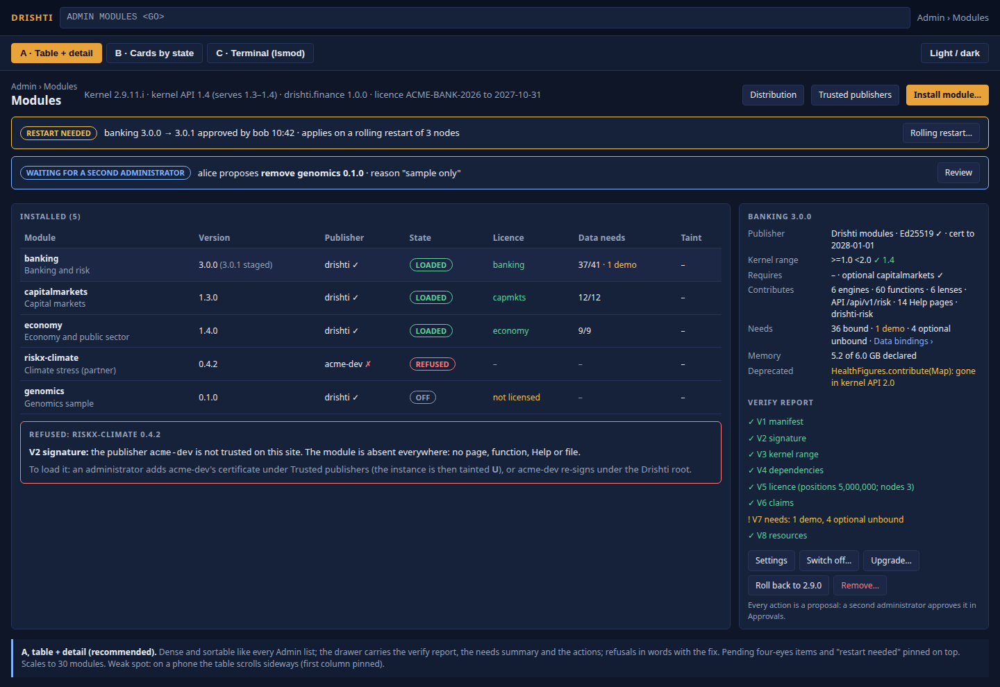

**(a) Admin → Modules, option C** (the terminal layout of the same page):

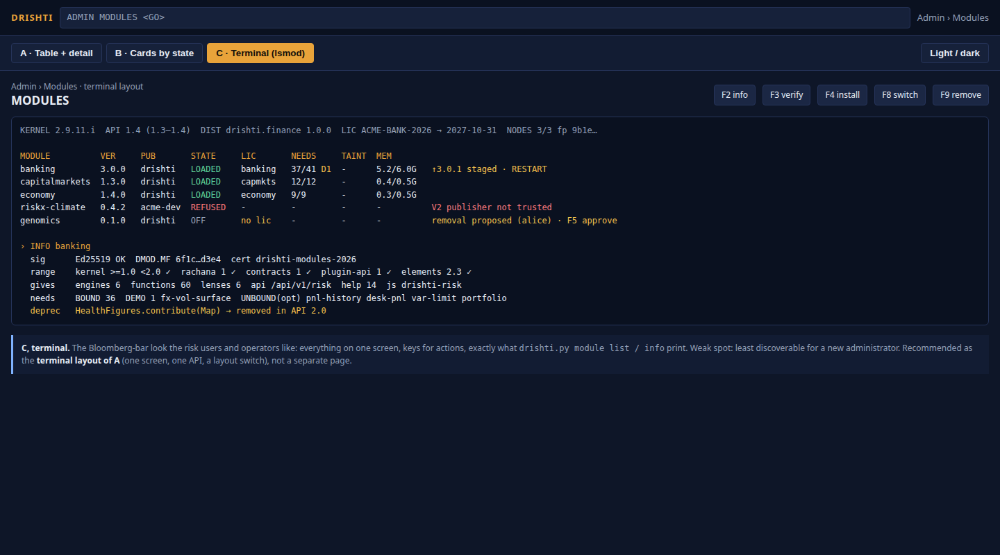

**(b) Admin → Data bindings, option A** (needs by kind, sharing, contract fit, freshness; the bind form checks before proposing):

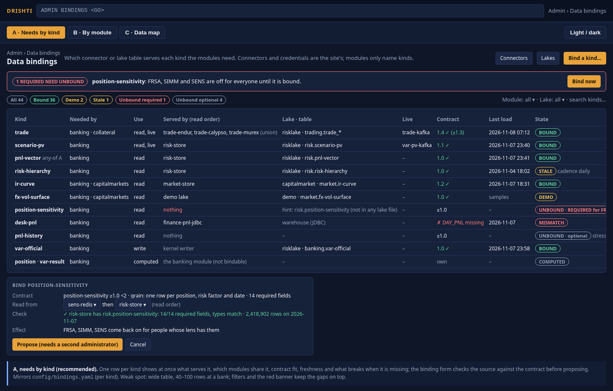

**(b) option B** (by module, the tab inside Admin → Modules → banking):

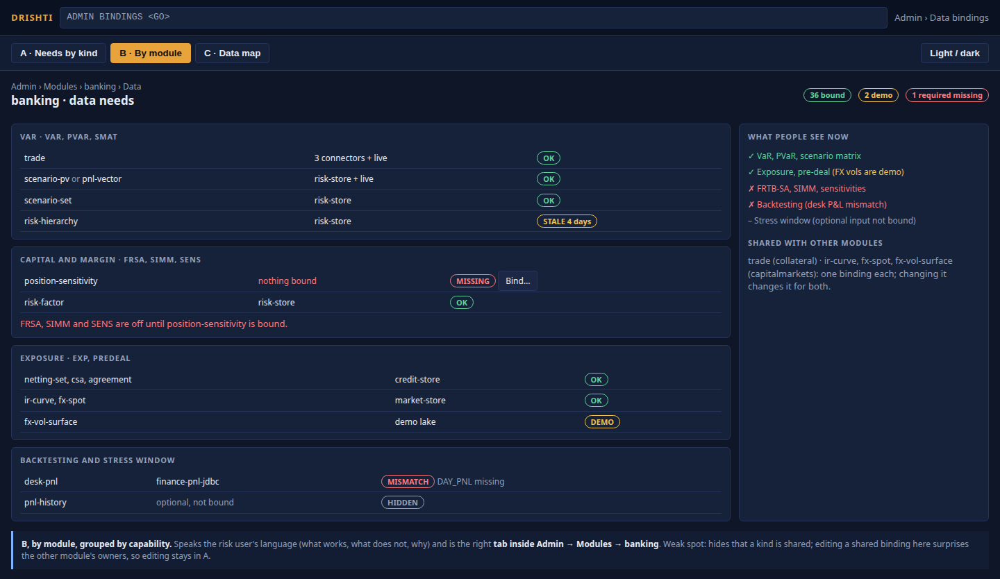

**(c) White label, option A** (Drishti Finance and Drishti Genomics side by side, one kernel):

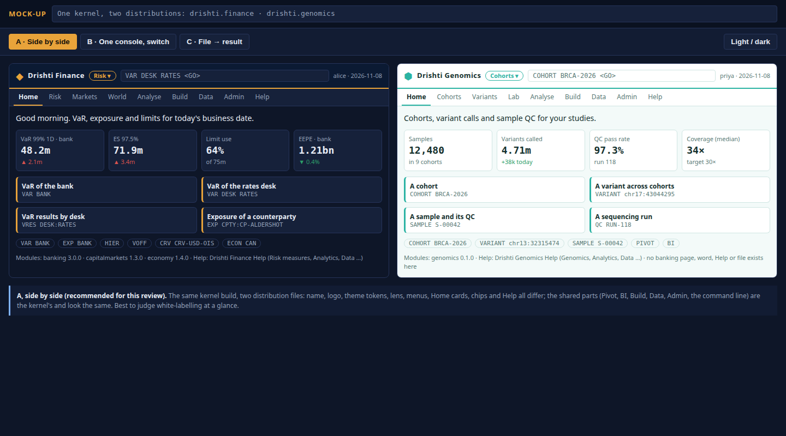

**(d) Module removed, option A** (the open variant explorer frozen under the kernel's notice, the administrator's reason line; saved views
with the *needs module genomics* chip, kept in place):

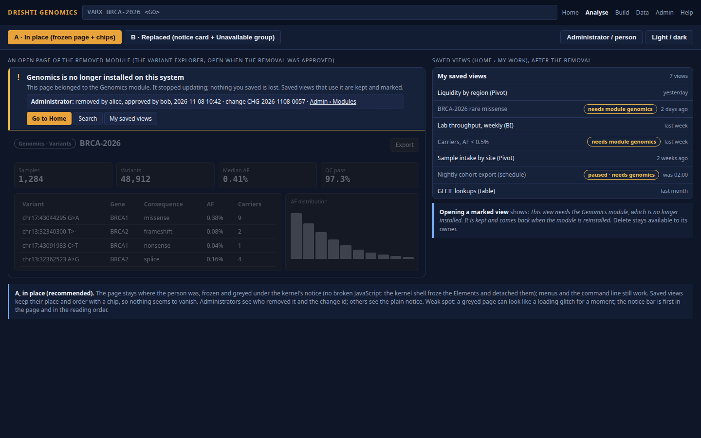

**(e) Admin → Modules → Deploy, option C** (placement per part on the left with the node picker; the plan matrix, headroom and
warnings on the right; then approval and live apply in the same pane):

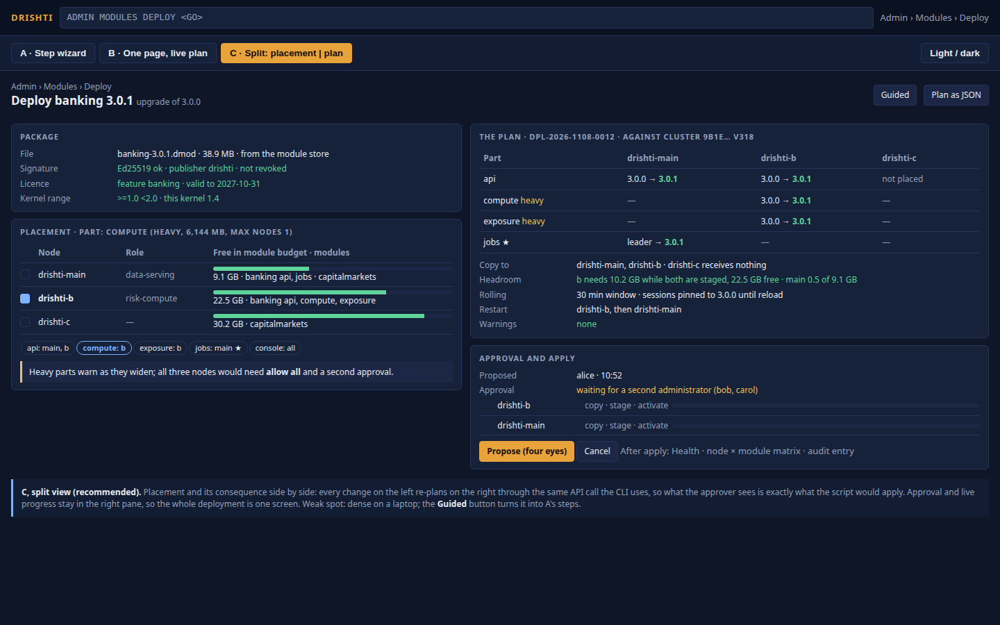

**(f) The kernel switcher, option A** (one console in front of the finance and genomics kernels: the kernel chip and its menu, labelled
menus and Home cards, the genomics kernel down and greyed):

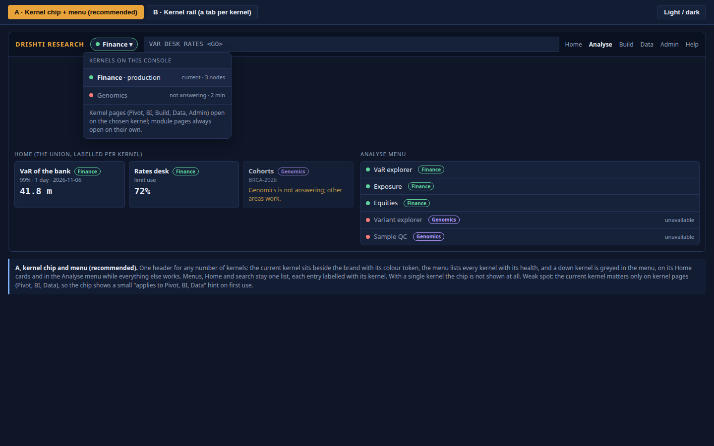

The same option in the light theme: [kernel-switcher-A-light.png](kernel-and-modules/mockups/kernel-switcher-A-light.png); option B:
[kernel-switcher-B.png](kernel-and-modules/mockups/kernel-switcher-B.png).

**(g) Admin → Cluster, option A** (the node × module placement matrix: banking's API on main and b, VaR compute and exposure on b with
max nodes 1, feeds and jobs as singletons on main, nothing placed on c; b's API drifted to 3.0.0 and c holds a leftover package):

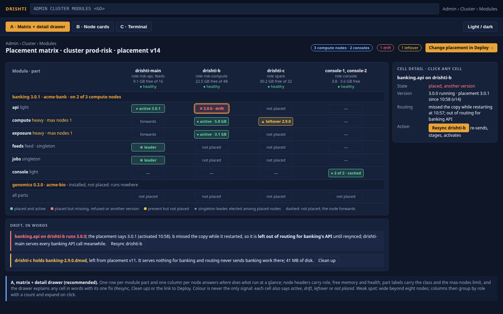

Recommendation: **A**. One row per module part and one column per node answers *where does what run* without reading every node; the node
headers carry role, free memory and health, the part labels carry the resource class and the max-nodes limit, singleton leaders are starred,
and every cell says its state in words as well as colour (green placed and active, red placed but missing or at another version, amber
present but not placed). Clicking a cell opens the drawer with the version, the routing consequence and the one fix (*Resync*, *Clean up*);
any change of placement goes to Deploy (e), so this screen only reads and repairs. B (node cards) becomes its *By node* tab and the phone
layout; C is what `drishti.py cluster modules --matrix` prints. The light theme: [admin-cluster-A-light.png](kernel-and-modules/mockups/admin-cluster-A-light.png).

**(h) Module SDK, `drishti.py module run`, option A** (the genomics module: the fast conformance set C1–C14, the kernel API range, data
bindings resolved against `samples/`, pages and routes with their URLs, hot-reload lines; beside it the module's page with the developer bar):

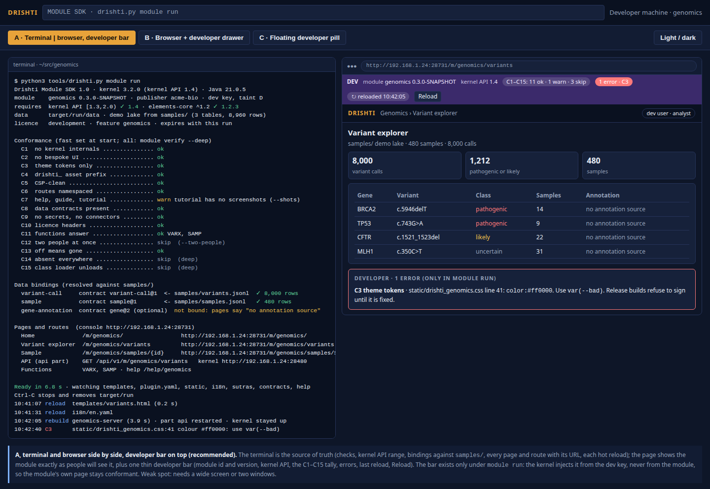

Recommendation: **A**. The terminal stays the one source of truth for checks, bindings, routes and reloads, and the browser shows the module
exactly as people will see it, plus one thin developer bar (module id and version, kernel API, the C1–C14 tally, errors, last reload,
*Reload*). The kernel injects the bar from the development key only under `module run`, never from the module, so the page itself stays
conformant and screenshots taken with `--shots` leave it out. B repeats the terminal in a drawer that covers the page being designed;
C hides errors in a corner and is kept only for `--shots` runs.

## 18. Configuration resolution: packs, connectors, bindings and inbox rules

**In plain words:**

1. Drishti reads configuration from three places, always in this order: **your site** (`config/`), **the modules that are on**, **the kernel**.
2. A module that is off contributes nothing, anywhere. A module that is on contributes everything its manifest lists, from wherever it is installed.
3. Your site adds to what is shipped, and changes it only where it says so: a pack by `replaces:`, a connector by an override file of the same name, a binding by an entry for the kind, and any other module file (a Sutra, a pack's YAML, a page's `plugin.yaml`) by a file at the same path in its override folder (section 18.10).
4. The server only reads. It never writes, moves, upgrades or retires a configuration file; only an administrator's own save does.
5. One resolver answers every reader (server, loader, console, tools), and Admin shows for each pack, connector, binding and inbox rule where it came from and why.

```
                     what is on?                          one resolver                          every reader
  distribution + licence + switches ──► modules ON ─┐
                                                    ▼
  1 SITE     config/packs/<pack>   config/connectors/<name>.yaml   config/bindings.yaml   config/dataload.yaml
  2 MODULES  <module>/packs/<pack> <module>/connectors/<name>.yaml (kinds: in templates)  <module>/dataload.yaml
  3 KERNEL   the kernel's packs (core, gleif, compute-demo)
                                                    │
                                                    ▼
             ConfigResolution (one immutable snapshot, a version, a digest)
               packs · connectors · bindings · inbox rules · problems · why
                                                    │
        server · lake loader · command line · console (Python twin) · tools · Admin "origin" columns
```

Packs and inbox rules are **found** top down (the first place that has it). Connectors are **layered** bottom up (the template, then
the site's changes over it). Bindings are **decided** top down (the site's entry, else what the templates declare).

### 18.1 The one source of "what is on"

The access registry ([the access model](#19-the-access-model-licence-module-lens-function-permission)) decides each module's state from the distribution, the licence, the
administrator's switch and the modules it requires. The resolver asks it and nothing else: no reader looks at a switch file, the
distribution or `drishti.packs.enabled` to decide whether a module's content counts. For each module the registry gives its id,
version, state, the reason when off, and **its folder**: the one the module boot gave it (section 4.2.1, `ModuleHomes`): the cache folder
of its package, or its source folder in source mode (the view of section 18.10 when the site overrides a file). The command line and the tools, which have no server, compute the same
from the distribution file and the switch files (licence not evaluated); the console takes the list from the server.

### 18.2 Settings: one per concept

| Setting (variable) | Default | What it is |
|---|---|---|
| `drishti.packs.site-dir` (`DRISHTI_PACKS_DIR`) | `./config/packs` | the site's own packs: `<dir>/<pack>/pack.yaml`, or one folder down (`<dir>/<group>/<pack>/`) |
| `drishti.packs.installed-dir` | `<data>/packs/installed` | packs an administrator deployed (Admin → Packs, a registry); part of the site |
| `drishti.modules.home` (`DRISHTI_MODULES_HOME`) | `<home>/modules` | the modules folder: the packages (`*.dmod`) the module boot reads (section 4.2.1); read by the boot alone, every other reader asks the boot's result. Under `drishti.modules.dev` or `drishti.modules.sources` its source folders are the modules |
| `drishti.module.dir.<id>`, `drishti.module.homes` | published at start | **not set by hand**: the boot's result as the launch publishes it (a module's folder; the whole value), for placeholders (`${drishti.module.dir.banking:}`) and child processes |
| `drishti.modules.dir` (`DRISHTI_MODULES_DIR`) | `./config/modules` | the administrator's module switches (unchanged: an existing setting keeps its meaning) |
| `drishti.kernel.packs-dir` | `./config/packs/core` | the kernel's own packs. It is inside the site's packs folder today and is **never read as site packs**; when the folder moves, only this default changes |
| `drishti.sources.connectors-dir` (`DRISHTI_CONNECTORS_DIR`) | `./config/connectors` | the site's connector files |
| `drishti.bindings.file` | `./config/bindings.yaml` | the site's bindings |
| `drishti.dataload.rules-file` | `./config/dataload.yaml` | the site's inbox rules |

No setting is derived from another folder's position, and no folder's name changes what is read. `drishti.packs.dir` is the former
name of `drishti.packs.site-dir` and is still read; setting both to different folders stops the start (DRS-1047).

### 18.3 The resolver

Plain Java in drishti-api (`com.ash.drishti.api.resolution`: the server, the loader process and the command line share it), held to
its fixture of file trees and expected answers. There is no second implementation: the console asks the server, and the Python tools
read the Java resolver's answer through the kernel jar (`java -jar <home>/lib/drishti-server-*-exec.jar resolve --json [--root DIR |
--site DIR] [--connectors DIR]`, read by `tools/resolved.py`, kept under the data folder by its inputs' modification times;
[THIN_CONSOLE_DESIGN.md](THIN_CONSOLE_DESIGN.md) step S5). **No other code lists or joins a pack, module, connector, bindings or rules
folder**; a guard test enforces it.

```java
ResolutionSettings s = ResolutionSettings.of(property);                    // section 18.2, nothing else
ConfigResolution r = ConfigResolution.build(s, modules, enabledPacks);     // immutable; modules = the registry's list (18.1)

r.packs().find("trading")            // Optional<ResolvedPack>: name, version, origin, module, folder, state, replaces, reason
r.packs().require("trading")         // or DRS-1041 / DRS-1043, in words
r.packs().loaded()  .all()  .ofOrigin(Origin.KERNEL)  .manifests()
r.connectors().find("trade-endur")   // Optional<Effective>: plugin, enabled, settings, kinds, writes, layer, templateFrom,
                                     //   origins (each key's layer), baseDirs (each relative file's folder)
r.connectors().all()  .unused()      // unused: files that are not read, each with its reason
r.bindings().read("trade")  .live("trade")  .write("trade", "ENDUR")       // Resolved: connectors, union, state, origin, reason
r.inboxRules()                       // List<Rule>, in match order, each with its origin
r.modules().on()  .all()
r.problems()                         // List<Problem>: code, message, the places it names
r.why("pack", "trading")             // every place looked in, in order, and what was found there
r.version()  r.digest()  r.watchRoots()
```

```python
import resolved                                          # tools/resolved.py: the Java resolver's answer, no rule of its own
r = resolved.repository()                               # the checkout with every module on; current() = this process's settings
r.packs.find(name); r.packs.dir(name); r.modules; r.connectors.find(name); r.connectors.templates; r.rules; r.problems
resolved.pack_dir(name); resolved.pack_dirs(); resolved.manifests()
```

`Origin` is `SITE`, `MODULE` or `KERNEL`. A pack's `state` is `LOADED`, `AVAILABLE` (found, not enabled), `MODULE_OFF` or `NOT_READ`.

### 18.4 Packs

**Where a pack is found**, first hit wins:

1. **Site**: `drishti.packs.installed-dir`, then `drishti.packs.site-dir` (the kernel packs folder excluded).
2. **Modules that are on**: for each, the packs its manifest lists (`packs: {folder, list}`), in `<module folder>/<folder>/<pack>/`.
   Only listed packs count: a folder the manifest does not list is reported, not read.
3. **Kernel**: `drishti.kernel.packs-dir`.

**Tie rules:**

| Case | What happens |
|---|---|
| A site pack has the name of a module's or the kernel's pack and its `pack.yaml` says `replaces: <that name>` | the site pack is read; the shipped one is shown as *replaced* |
| The same, without `replaces:` | **the shipped pack is read**; the site folder is `NOT_READ` and listed (DRS-1042), naming both folders |
| Two site folders hold the same name | neither site folder is read (DRS-1042); a shipped pack of that name still is |
| Two modules that are on list the same pack name | neither is read (DRS-1042); both modules are named |
| A deploy of a pack whose name is shipped | refused at the deploy unless the archive says `replaces:` |
| The kernel's `core` pack is missing | the server does not start (DRS-1040), naming the setting and the folder |

Only the last one stops a start. Every other case leaves the server running with the shipped pack and a red line in Health.

**Which packs load:** every pack of every module that is on, the kernel's `core`, and the kernel's other packs and the site's packs
when the distribution or the administrator enables them. `drishti.packs.enabled` (`DRISHTI_PACKS`) narrows that set when it names
packs; a name whose module is off is not loaded and says so (DRS-1043). The manifests' `packs.list` is the one list of what a module
brings.

**A site upgraded from the layout where shipped packs were under `config/packs/<domain>/`** needs no step: those folders are site
folders with shipped names and no `replaces:`, so the shipped packs in the modules are read and each old folder is listed once as
*not read: safe to delete* (never deleted). A site's own pack in such a folder has a name nothing ships and is read as before. A pack
deployed over a shipped one in an earlier release is treated the same way: the shipped pack is read and the deployed one is listed.

### 18.5 Connectors

**The effective connector** is computed in memory:

1. **Template** (read-only): an entry of a loaded pack's `connectors:`, or a file directly in an on module's connectors folder
   (`connectors: {folder}` in its manifest). The connector's name is the file's `name:` key, else the file's name. Files under
   `connectors/examples/` are examples to copy and are not templates. Two templates of one name: neither is used (DRS-1045).
2. **Site file** `config/connectors/<name>.yaml`, merged over the template key by key (a setting's dotted path is its key:
   `settings.set.SOURCE_SYSTEM`). **Any key may be changed, the plugin included, and every other key is still inherited**; a key set
   to `null` removes the inherited one. Over a template that names a lake, `settings.root` alone keeps the lake (its tables are read
   under that root); with `domain`, `table.<kind>` or `layout.<kind>` it is the older form and the lake keys are dropped. With no template of that name the file is a complete **site connector** and must name its
   plugin.
3. **Secrets**: `${VAR}` and `file:` references, resolved when the connector starts. A template never holds one.

A relative file in a setting (`map: mappings/endur-trade.yaml`) is read from the folder of the layer that set the key: a template's
from its module's folder (installed or development), a site file's from the connectors folder (`drishti.sources.connectors-dir`), both
absolute; never from the server's working folder. A map in neither refuses the connector (DRS-5034) naming the paths tried.

| A site file… | is… |
|---|---|
| has a template of its name | an **override**: its keys win, the rest is the template's |
| has no template, names a plugin, and has no `template:` key and no generated mark | a **site connector** |
| says `template: <owner>` (Admin and the tools always write it) and that template is not here (its module is off or removed) | **not used**; listed with the module and why it is off (DRS-1046) |
| was generated by an earlier release and never edited (its stamp or marker says so) | **superseded**: not read, the template is in force; listed *safe to delete* |
| was generated by an earlier release and edited | an override, like any other |
| was generated by an earlier release and its template is not here | **not used**; listed (DRS-1046). It is never run as a site connector |

**The server writes no connector file** at start, on reload or on deploy. Admin → Connectors saves only the keys that differ from the
template, with `template: <owner>`; *Reset* deletes the override. There is no generation, upgrade, retirement, `.history` or
`.migrated` step. Folders and markers an earlier release left (`.history`, `.generated`, `<data>/connectors/generated`, per-pack
connector overrides in `<data>/packs/settings`, connector edits in the content store) are read where they are needed to recognise a
generated file, listed in Health, and otherwise left alone: the content-store fold at start is removed, because every node that ran
the earlier release has already folded, and a start that writes files from an inference is the fault this section removes.

### 18.6 Bindings

**How a kind finds its connectors.** One resolution, used by Admin, Health, every read, the inbox and every write; first hit wins:

1. **The site's binding** for the kind in `config/bindings.yaml` (as approved). Names that no effective connector has are set aside
   and reported; the rest serve. If none is left the next step decides.
2. **What is shipped and declared**: every effective connector whose template or plugin names the kind (`kinds:` in a template, a
   pack's `routes:`), in the order: the pack's route first, then by name; `union: true` when the templates say so. This is how a
   source module enters: `source-endur` on brings `trade-endur` with `kinds: [trade]`, and `trade` reads it; off, it leaves. No site
   file lists the source systems.
3. **Demo samples** (state DEMO): for a kind the site binds with `demo: true`, and, while the demo is on, for a kind nothing above
   offers and every module that needs it allows demo data. With the demo off (`drishti.demo.enabled: false`) no kind is DEMO: one the
   samples alone would serve is UNBOUND and its pages say *no source serves kind '…'*, never an error.
4. Otherwise **UNBOUND** (section 5.6).

A connector is asked for a kind only when one of these steps names it; the router reads the packs' samples only for the kinds this
resolution puts in DEMO. The guess of earlier releases, *any lake connector whose lake holds the kind's table*, is gone. Every kind of
every shipped pack is named by a template or a route, so nothing shipped depended on it, and a kind the guess served on an upgraded site
is read from the connectors that declare it at once: the state `AUTO` (*found by convention: confirm*) is no longer produced, so an
upgrade needs no administrator's click (owner, 2026-11-14). A binding that names only a write path (`write: {connectors: …}`) leaves the
read to steps 2 to 4.

**Live**: the site binding's `live`, else the effective connectors that name the kind and can push.

**Write** (a correction from a blotter or a form), `write(kind, source system)`:

1. the connector the form names (`save.connector`);
2. the site's binding: `write: {connector: <name>}` or, by source system, `write: {connectors: {ENDUR: <name>, MUREX: <name>}}`;
3. what is shipped and declared: the effective connectors with `writes:` that name the kind; with a source system, the one of that
   system (its `set: SOURCE_SYSTEM`, else its name `<kind>-<system>…`); without, the only one.

The source system is the record's own: the system of the connector the record was read from, else its `SOURCE_SYSTEM`. A bound or
defined write connector of that system is a candidate even while it is not running (it must be running when the change is applied). Each
source module's live template (`trade-<system>-live`, Kafka) writes the blotter's one command, `amend-trade`, to its own system's topic.

None: DRS-9308, naming the kind, the system, and the connectors that could serve if enabled. More than one: DRS-9309, naming them.
The connector must be running with its `writes:` command switched on (Admin → Edits), as before. `write: {lake, table}`, for a kind
a module produces, keeps its meaning.

A site's `bindings.yaml` from an earlier release is read as it is. The demo's list of trade connectors is no longer copied into a
site; a site that holds that copy keeps reading exactly the systems it lists, and Admin shows any on module's connector that names
the kind and is *not in your binding*.

### 18.7 Inbox rules, and what happens when something changes

**Inbox rules**: the site's rules (`config/dataload.yaml`) first, then each on module's rules (`dataload:` in its manifest) in module
order; the first rule that matches a file wins. A rule that names no connector takes the kind's first read connector (18.6). A rules
file that cannot be read is a problem in Health (DRS-1048), never an empty list.

**One snapshot, replaced whole.** The server holds the current `ConfigResolution`. It is rebuilt when: a module is switched
on or off (`module.started`, `module.stopped`); a file under `watchRoots()` changes (the site's folders and the booted modules' folders); an administrator saves a connector, a binding or a pack switch; a pack is deployed.
The rebuild reads everything again, compares with the snapshot before, swaps, and publishes **one** event, `resolution.changed`
(version, packs added and removed, connectors added, removed and changed, kinds whose binding changed, rules changed):

| Consumer | On `resolution.changed` |
|---|---|
| Pack registry | loads the added packs, unloads the removed ones (section 12) |
| Connector manager | starts added connectors, stops removed ones, restarts changed ones |
| Binding service | hands the router the new read order per kind; publishes `binding.changed` per kind |
| Data inbox | uses the new rules from its next cycle; the loader process is given the same snapshot's inputs |
| Console | sees the new version on its next request and drops what it cached by the old one |

A rebuild that fails (a file half written) keeps the snapshot before and reports the problem. In a cluster every node resolves from
its own files; the digest is shown per node in Health and a difference is a problem (DRS-1049).

### 18.8 What Admin shows

- **Admin → Packs**: for each pack *Origin* (Site, Module `banking 2.9.11`, Kernel), its folder, *State* (loaded; available; module
  off, with the reason; not read, with the reason and both folders), *Replaces*. A *Why* link shows the places looked in, in order.
- **Admin → Connectors**: the layer of the connector (template, override, site) and of each setting, the template's owner, and the
  list *not used* (superseded, template not here), each *safe to delete* or with the module to switch on.
- **Admin → Data bindings**: each kind's origin (site, declared by `<module or pack>`, demo), read, live and write, and connectors
  that offer the kind but are not in the site's binding.
- **Admin → Data inbox**: each rule's origin, and a rule an earlier one always shadows.
- **Health**: every problem of the resolution, and the digest per node; the module files the site overrides, each with its source, and the
  refused ones (section 18.10).
- `GET /api/v1/admin/resolution` answers all of it; `drishti.py resolution show` and `resolution why <pack|connector|kind> <name>`
  print it without a server.

### 18.9 Messages

Each names the thing, both places, and what to do.

| Code | When | The message, by example |
|---|---|---|
| DRS-1040 | the kernel's packs are missing (start refused) | *The kernel's pack 'core' is not in config/packs/core (drishti.kernel.packs-dir). The server cannot start without it.* |
| DRS-1041 | a pack is not found | *No pack 'trding'. Looked in the site's packs (config/packs, data/packs/installed), the modules that are on (banking, market-data, economy) and the kernel's packs (config/packs/core). Did you mean 'trading' (module banking)?* |
| DRS-1042 | one name in two places | *Pack 'trading' is in config/packs/banking/trading and in module banking (modules/banking/packs/trading). The module's is read. To use yours instead, add `replaces: trading` to its pack.yaml; otherwise the folder is safe to delete.* |
| DRS-1043 | a pack's module is off | *Pack 'market-risk' belongs to module banking, which is off (switched off in config/modules/banking.yaml). Switch it on in Admin → Modules.* |
| DRS-1044 | a module in two places | *Module market-data is in modules/market-data (1.0.0) and installed as data/modules/installed/market-data/1.1.0. The folder is read. Remove one.* |
| DRS-1045 | two templates of one name | *Connector 'trade-endur' is declared by pack trading and by module source-endur. Neither is used. Remove one declaration.* |
| DRS-1046 | a site connector file is not used | *config/connectors/trade-murex.yaml overrides the template of module source-murex, which is off (not in distribution drishti.risk). It is not used.* |
| DRS-1047 | a setting names the wrong folder, or two names disagree (start refused) | *drishti.packs.site-dir is config/packs and drishti.packs.dir is site/packs: they name the same thing; keep one.* |
| DRS-1048 | rules or bindings cannot be read | *The inbox rules of module source-endur (modules/source-endur/dataload.yaml) cannot be read: line 12, … Its files will not be matched.* |
| DRS-1049 | two answers differ | *This console resolves pack 'trading' 2.9.10 from /opt/console/modules/…; the server serves 2.9.11 from /opt/drishti/modules/…* |
| DRS-9308 | no write path | *Kind 'trade' (source ENDUR) has no write path: no connector that serves it offers writes. Module source-endur has an example, connectors/examples/kafka.yaml; or bind one in Admin → Data bindings (write).* |
| DRS-9309 | more than one write path | *Kind 'trade' has two write paths, trade-endur-kafka and trade-murex-kafka, and the record names no source system. Name one in Admin → Data bindings (write).* |

### 18.10 Site overrides of module files

A site changes any file a module ships, without touching the module, by putting its own copy at **the same relative path** in an
**override folder**: `<override folder>/<module id>/<path inside the module>`. The first folder is the module's **id** (`id:` of its
`module.yaml`), the one key for a module of the modules folder and one installed from its `.dmod` alike: `capitalmarkets/packs/…`, never
the folder name `capital-markets/…` (refused, naming the id to use). One rule, applied once by the server at start
(`ModuleOverrides`, called by `LaunchRoots` before any reader):

| | |
|---|---|
| **Where** | `drishti.overrides.dir` in the settings file (`drishti.overrides.dir=/abs/overrides` under a label section such as `[roots]`), `-Ddrishti.overrides.dir`, or `DRISHTI_OVERRIDES_DIR`. A comma-separated list is allowed: the right-most folder wins a path. Paths are absolute (a relative one is taken under `drishti.home`, never the process folder) |
| **What** | any module file: every YAML (a pack's `pack.yaml`, contracts, `console/plugin.yaml`, `data/needs.yaml`, mappings, blotters, `docs/help.yaml`), every Sutra (`*.sutra.yaml`, `*.block.yaml`), pages and docs. A file the module does not ship is added |
| **Never** | `<module>/module.yaml` (the module's identity); `<module>/connectors/` (a connector is changed in `config/connectors/<name>.yaml`, merged over the template, section 18.5; connectors stay read-only); `pom.xml`, `target/`, `tools/` (they only build the module); **code**: `java/`, `lib/`, `python/`, `engines/`, any `.jar`, `.class`, `.py`, `.pyc`, `.pyd`, `.so`, `.dll`, `.dylib`, `.exe`, `.sh`, `.bat`, `.cmd`, `.ps1` file wherever it sits, and every symbolic link (never followed): an override changes what a module says, never what it runs. Each is refused in words, in the log and in Health, and not used |
| **How** | when at least one file overrides, a module the boot took from a package gets a **view** of its own, `<data>/overrides/modules/<id>/<version>-<hash16>/` (its cache folder copied, only what changed since the last start, then the overrides laid over it), and the boot's result names the view as the module's folder. With no package booted (until i7a's I8) the server brings the view `<data>/overrides/modules` of the modules folder as a whole up to date and the launch names it as the modules folder; the module's own folder is never written. Every reader (the pack resolver, Sutras, pages, blotters, data needs, Help) sees the overridden file and needs no rule of its own. A module installed from its `.dmod` (the module store, which the resolver reads before the folder's copy: the shipped banking, market-data, capital-markets and economy on a server that installs them) gets the same rule where the resolver picks its folder: `<data>/overrides/installed/<id>/<version>`, the installed folder with the overrides under `<id>/` laid over it. With no override the views are removed and the folders are read as they are |
| **Shown** | one report, keyed by the module id: the log's `module overrides:` block; **Admin → Health**, *module files overridden by the site* (each `<id>/<path>`, its source, *added* when the module has no such file, and the file it is applied to: in `<data>/overrides/modules/<folder>/` or in an installed module's view; the refused ones; the *waiting* ones, whose id names no module of the modules folder, until a module of that id is installed from its `.dmod`); `GET /api/v1/admin/health` → `moduleOverrides` (`dirs`, `view`, `modulesHome`, `files` with `applied`, `refused`, `waiting`); the view's own list, `overrides.yaml`, which the console's resolver reads to use the same view |
| **When** | at start: change an override, restart the server (and the console). Removing the file and restarting restores the module's |

**Example: change one Sutra and try it from outside.** The trading pack's Endur cash Sutra ships at
`modules/banking/packs/trading/sutras/endur/endur-cash.v1.sutra.yaml`. To try a change without touching the module:

```bash
mkdir -p /home/me/drishti-overrides/banking/packs/trading/sutras/endur
cp modules/banking/packs/trading/sutras/endur/endur-cash.v1.sutra.yaml /home/me/drishti-overrides/banking/packs/trading/sutras/endur/
# edit the copy (a title, a section, a field), then name the folder in your settings file:
#   drishti.overrides.dir=/home/me/drishti-overrides
python tools/drishti.py --settings /home/me/dev.ini stop server
python tools/drishti.py --settings /home/me/dev.ini start server
```

The start's log says `module overrides: 1 file(s) over /…/modules, read from the view /…/data/overrides/modules` with the line
`banking/packs/trading/sutras/endur/endur-cash.v1.sutra.yaml <- /home/me/drishti-overrides/…`; an Endur cash trade's page now shows
the edited Sutra, and Admin → Health lists the file. Delete the copy (or the setting) and restart: the module's Sutra is back and the
view is gone.

## 19. The access model: licence, module, lens, function, permission

*Internal design, decided with the product owner on 2026-11-07. Status: design; the mechanism is built with the domain-module split in
the e+f+g release train (v2.9.11.g); the signed licence, the permission rules and the database store come with trust, RBAC and security
(2.9.11.j), after the owner's security discussion.*

Drishti serves many industries and lines of business as **modules** (banking and risk first; public sector, AML and others later). A
customer runs only what it licenses, and a person sees only what their role allows. This document fixes how that is decided and enforced,
end to end: backend, data, screens, JavaScript, Help.

### 19.1 Four layers, one chain

| Layer | Question | Decided by |
|---|---|---|
| **Licence** | Which modules may this customer run, within which limits? | the customer's licence |
| **Module** | Does this capability exist here? | installed ∧ licensed ∧ enabled by an administrator |
| **Lens** | Which experience does a person work in? (Risk, Trading, Market, World, later Public sector, AML) | its definition; offered only when every module it needs is on |
| **Function** | Which functions (command words such as VAR, TRD, EQV, EXP) may be used? | each belongs to one module; lenses bundle functions; roles are granted or denied single functions on top (as Bloomberg entitles functions) |
| **Permission** | Which lenses may this person open, and what may they do inside? | their roles and attributes; row rules and masks inside |

```
licence  →  modules on  →  lenses offered  →  functions this person may use  →  actions, rows and columns inside
(customer)  (installation)  (needs its modules)  (lens bundles + grants/denials)  (role + row rules + masks)
```

A module sells; a lens serves. Permissions are granted per lens and action, never per screen.

### 19.2 One registry, asked by every layer

**drishti-registry** is its own backend component (a Maven module). Every layer asks it; nothing else reads the access model.

| Asked by | What it asks | What "no" means |
|---|---|---|
| The server at start | which modules to load | an unlicensed or disabled module's beans, engines, jobs and APIs are never registered |
| Every API call | module on? lens open to this person? action allowed? | 404 "module not licensed" for a module that is off; 403 with the reason for a person not entitled; audited |
| Data | which packs, connectors and lake tables to load | an off module's packs and connectors are not loaded |
| The console | routes, menus, the sitemap, the Build home, search, commands, Help | entries absent; direct links refused |
| The command line, type-ahead, keys, shared views | function allowed for this person? | the function is invisible; typed anyway, it answers "VRES is not available to you: ask your administrator", audited |
| JavaScript and assets | which libraries may be served (e.g. drishti-risk) | not served to an installation or person without the module |
| The AI assistant, exports, embeds, API tokens | the same questions | tools, exports and embeds absent; tokens never exceed their owner |

The console and the browser never ask the registry directly: they ask the server, which asks the registry. One trust point.

### 19.3 The model

| Entity | Holds |
|---|---|
| **Module** | id, domain, version, dependencies on other modules, what it contributes (compute, services, packs, screens, JavaScript libraries, Help, AI tools), the licence feature that unlocks it |
| **Licence** | customer, modules allowed, limits (users, nodes, data volume, per module or per installation), valid from and to |
| **Lens** | name, the modules it needs, the functions it bundles, its menus, home and Help |
| **Function** | the command word (VAR, TRD, EQV ...), its module, the APIs and screens behind it, its Help page; the administrator's on/off switch (the mnemonic switch, folded in) |
| **Role** | lenses it may open; single functions granted or denied on top of the lenses' bundles; actions inside (view, edit, approve, see raw rows, administer) |
| **Assignment** | a person or group → roles, plus the attributes row rules use (desk, legal entity, ...) |

### 19.4 Two stores behind one interface

| | Now (v2.9.11.g) | Later (2.9.11.j) |
|---|---|---|
| Store | **YAML**: each module's manifest in its jar (`META-INF/drishti/module.yaml`, `lenses.yaml`), the site's switch `config/modules/<module>.yaml`; `config/access/licence.yaml`, `lenses.yaml`, `roles.yaml`, `assignments.yaml` (section 8) | **the one database**: SQLite by default, PostgreSQL; the same tables in both complete schema files; no migrations; switched by configuration; a tool copies the YAML into it once |
| Interface | `AccessStore` (read, change, watch) → `YamlAccessStore` | the same interface → `DatabaseAccessStore` |
| Changes | proposed and approved through the Approvals queue (four eyes), audited | the same |

One test suite runs against both stores and must give the same answers.

### 19.5 Embedded now, a service later

| | Now | Later |
|---|---|---|
| Where it runs | inside drishti-server, in process | its own service: an encrypted REST server (TLS or mTLS, signed answers) every node and console asks |
| Interface | `AccessRegistry` → `EmbeddedAccessRegistry` | the same interface → `RemoteAccessRegistry` (HTTP client: mTLS, signature check, local cache, change notifications) |
| When unreachable | not applicable | a setting: fail closed, or a grace period on the last signed answer (defaults decided in 2.9.11.j) |

Every answer is cacheable and invalidated on change, so asking stays cheap when the registry is remote.

### 19.6 Guarantees, as tests

- **Module off = gone everywhere**, per module: no bean, engine, job, API, pack, connector, route, menu entry, search hit, command, Help
  page, JavaScript asset, AI tool, export or embed (the engine switches' existing "engine off everywhere" test, generalised).
- **A lens whose modules are off does not exist**: no menu, no home, no link.
- **Function off = gone everywhere**, per function: command line, type-ahead, search, menus, keys, the APIs behind it, its Help page, AI tools, links, embeds and tokens.
- **Only drishti-registry reads the access model** (an architecture test, as for the domain boundaries).
- **Both stores answer the same** (one suite, run against each).
- **Session isolation**: nothing per person in shared state.
- **A module's typed call passes the same doors as the REST path it replaces** (entitlements, masks, row rules, token scopes, the
  refusal's code and words, the access log): `TypedCallParityTest`; the table of doors is in
  [KERNEL_AND_MODULES.md section 2.3](#23-the-spis).

### 19.7 What is built when

| Release | Built |
|---|---|
| v2.9.11.g (the e+f+g train, with the domain-module split) | drishti-registry with the embedded registry and the YAML store; module manifests declaring their functions; lenses declaring their modules and function bundles; the mnemonic switches folded into the registry (installation-level function on/off); the administrator's module switch; editions folded into modules and lenses; the guarantees of section 6 |
| 2.9.11.j (after the security discussion) | the signed licence (offline verification, expiry and grace, limits, audit); permissions per lens, function (grants and denials) and action; data licensing; the database store; the standalone service when wanted |

### 19.8 As built: the backend (phase 1 of the split)

What exists now, on the server and in the console (the console's part since phase 2's first half: [the domain modules part](#21-domain-modules-the-boundary-between-the-core-and-banking) section 8).

| Part | As built |
|---|---|
| **drishti-registry** | A Maven module of its own, plain Java (Jackson only). `AccessRegistry` (the questions) with `EmbeddedAccessRegistry` (one immutable snapshot of decisions, recomputed when the model changes, listeners told); `AccessStore` (read, change, stamp, watch) with `YamlAccessStore`; `AccessRegistries.embedded(settings)` makes it from the server's settings. Nothing else reads the model: an architecture test fails a class outside the registry that names `YamlAccessStore` or `AccessModel`. |
| **Module manifests** | Each module's jar ships `META-INF/drishti/module.yaml`: id, domain, title, feature, requires, and what it contributes (Java packages, engines, packs, connectors, API prefixes, functions). Installed exactly when its `.dmod` is in the modules folder. The core server's jar ships two content-only modules (packs, lenses and functions, no code): **economy** (world-economy, news-and-markets and the public sector's world-development, central-banks, national-statistics, oecd, official-news and gdelt-events; the World and Public sector lenses: [WORLD_DATA_GUIDE.md](../guides/WORLD_DATA_GUIDE.md)) and **capitalmarkets** (us-equities, funds, and the market data's functions). GLEIF's legal entities are core reference data. The core is always on and is not a module file. |
| **The switch** | `config/modules/<module>.yaml` holds `enabled:` only (`POST /api/v1/admin/modules` writes it, with a reason, audited); `drishti.modules.<module>.enabled` (`DRISHTI_MODULES_<MODULE>_ENABLED`) wins over the file. A module is on when installed ∧ licensed ∧ enabled ∧ every module it requires is on. A change takes effect at the next start (Admin shows *restart needed*). |
| **Licence** | `config/access/licence.yaml` (customer, modules or `*`, limits, valid-from, valid-to) is read and decided, **unsigned**; without the file the installation runs the **development licence** (every module, no limits, no end), so nothing changes for an existing installation. Signature, grace and limits' enforcement: 2.9.11.j. |
| **Loading** | A module is loaded into its own child Spring context (the kernel's is its parent; the one design, KERNEL_AND_MODULES.md section 4.4) only when it is on: off, none of its beans, engines, scheduled jobs or controllers exist. Its engines show *not installed: the module 'banking' is off* on Admin → Engines; its API (new and old prefixes) answers `404 DRS-1025` in words; its packs (by the manifest's list, else by the pack's `domain:`) and its connectors do not load. |
| **Lenses** | Each jar ships `META-INF/drishti/lenses.yaml` (the banking module: risk, trading, market (it needs capitalmarkets and banking), cro, mr-cube, ccr-cube; the core: world, cio, oversight), each with the modules it needs and the functions it bundles; `config/access/lenses.yaml` adds or replaces lenses. A lens whose modules are off is not offered, and an edition opened as a lens (`drishti.lenses`) whose registry lens is not offered is dropped. |
| **Functions** | Each manifest lists its functions (the engines' words with the APIs behind them, and every command of its packs); a word no module declares is the core's. The mnemonic switches (Admin → Functions, kept in the switches ledger and gossiped) fold in: the ledger is the store of the installation-level switch, the registry decides (`functionOn` = its module on ∧ not switched off), and `CommandSwitches` asks the registry. A function that is off answers `404 DRS-1026` on its APIs. |
| **Per person** | `lensesFor(subject)`, `allowed(subject, lens, action)` and `functionAllowed(subject, word)` take the person already; with no `roles.yaml` every offered lens and every function that is on is open to everyone (403 `DRS-1027` is wired for 2.9.11.j's grants and denials). |
| **Module permissions** | The first action permission of a module, ahead of 2.9.11.j's model: a role carries `permissions`, a list of the names `RoleDefinition.PERMISSIONS` knows (today `var:system-baskets`: create, edit, retire and import the VaR engine's system baskets, [VAR_GUIDE.md section 5.7](../guides/VAR_GUIDE.md#57-system-baskets)). Configured roles and packs' roles list it (`permissions: [var:system-baskets]`); a role defined in Admin → Roles ticks it in its *Permissions* group (`PUT /api/v1/admin/role-definitions/{name}` `permissions`, kept as a row of `drishti_role_power` by its own name in both schema files: no schema change); every administrator holds every permission. `Entitlements.holds(person, permission)` asks; `requirePermission` answers `403` naming the permission. 2.9.11.j folds it into the per-lens action grants. |
| **API** | `GET /api/v1/admin/modules` (states, what each brings, licence, lenses, warnings), `POST /api/v1/admin/modules` (the switch), `GET /api/v1/modules` (as the caller: the modules loaded and `off` with why, the lenses open to them with their modules and functions, and `functions.off`: each function they may not use with its module, the reason and the words to say); `/public/about` lists the `modules` loaded at this start. |
| **The console** | Asks the server, never the model: the installation's `modules` (from the about answer, per console app) and the person's `/api/v1/modules` (cached per person, set per request). Every door asks one helper module (`core/modules.py`): routes and pages (404), words (the edition's `word_on`, `command_shown`, `typed_shown`), menus and the sitemap (`domain:` tags, `requires: module:<id>`), the Admin strip, search and the type-ahead, the command line (*VRES is not available to you: ask your administrator*), Help, the Build home and static files (a module's files are not served while it is off, nor to a person whose lens does not use it; the Elements loader refuses a library of a module the page does not list). What a module brings to the console is its `drishti-console/plugins/<module>/plugin.yaml`. |
| **Configuration by module** | A module's packs, lakes, BI files, tables, report definitions and lenses sit in a folder named after it (`config/packs/banking/`, `config/lakes/banking/`, `config/bi/reports/banking/`, `config/tables/banking/`, `config/reports/banking/`, `config/lenses/banking/`), read only while it is on; its token scopes come with its jar (`META-INF/drishti/token-scopes.yaml`) and its Help with its console plugin. Editions are lenses: `config/lenses/<module>/<lens>.yaml` carries a lens's packs by module, Home, menus, Help and branding ([the domain modules part](#21-domain-modules-the-boundary-between-the-core-and-banking) section 8). |
| **Guarantee tests** | `BankingModuleOffTest` (no bean of its code, no engine, no job, no API new or old, no pack of its domain, no connector of its own, no function), `CapitalMarketsModuleOffTest` (its packs, connectors and functions gone; banking and GLEIF unaffected), `EconomyModuleOffTest` and `PublicSectorLensTest` (the economy's eight packs, connectors, functions and both lenses gone, or the public sector's there; banking, capital markets and GLEIF unaffected), `BankingModuleOnTest` (loaded, the old paths answered as the new, a function off gone from its API), `AccessRegistryTest` (the decisions), the architecture rules.; in the console `test_modules_off.py` (banking off, capital markets off, single functions off, a lens without a module: every door; the server's `/api/v1/modules` and `/public/about` answers in `BankingModuleOffTest` and `BankingModuleOnTest`) and `test_module_boundaries.py` (the core imports, includes and names nothing of a module). |

### 19.9 Related

The domain boundaries and the move: [the domain modules part](#21-domain-modules-the-boundary-between-the-core-and-banking). The kernel, the module package, its loading and data binding, and distributions: [the kernel and modules document](#contents). The JavaScript libraries
modules contribute: `docs/architecture/ELEMENTS.md` (planned until the train merges). The one database: [DATA_ARCHITECTURE.md](DATA_ARCHITECTURE.md).

### 19.10 Row rules

A role may restrict **which records of a kind** its holders see, by the record's fields and the person's attributes. Row rules are declared
in the configured roles (`drishti.security.roles.<role>` in `config/application.yaml` or a pack's roles), beside `kinds` and `permissions`:

```yaml
drishti:
  security:
    roles:
      rates-trader:
        kinds: [trade, position]
        edit: true
        rows:
          trade: "ASSET_CLASS = 'RATES' and DESK in $user.desks"
      endur-support:
        kinds: [trade]
        edit: true
        rows:
          trade: "SOURCE_SYSTEM = 'ENDUR'"
        edit-systems: [ENDUR]           # write-back only to Endur's records
```

| Key | Meaning |
|---|---|
| `rows.<kind>` | A row predicate ([DATA_LAKE_GUIDE.md section 6.2](../guides/DATA_LAKE_GUIDE.md#62-several-source-systems-shared-or-separate-tables): `=`, `<>`, `in (...)`, `and`, `or`, `not`, `is null`; text quoted). `$user.<attribute>` is the person's attribute (`desks`, `desk`, `name`, `roles`, `email`, as the user directory gives them): a list after `in`, its one value otherwise; an attribute the person lacks matches nothing. |
| `edit-systems` | The trading systems (`SOURCE_SYSTEM`) whose records the role may change through write-back; absent or empty: every system. |

**Combining.** A person sees a record when any of their roles that opens the kind passes it; a role that opens the kind without a rule for
it opens every record of it; an administrator and a server with sign-in off see every record. A person may change a record of a system when
none of their roles lists `edit-systems`, or one of them lists that system.

**Where they apply.** Row rules restrict **record views**: the live tables behind lists and blotters (Rachana's live tables) (the person's reader, per request,
tested on every row and every live change; part of the audience, so two people with different rules never share a filled set), search (the
rule joins the search's condition), FORM and Raw JSON (a record outside the rule is not found). **Aggregates keep their own scope model**:
VaR, BI totals and other computed measures are not filtered by row rules (BI's dataset rules and VaR's scopes decide them).

**Tests.** `RowRulesTest` (two people on one canonical kind, a role without a rule, edit rights per `SOURCE_SYSTEM`, a rule that is not a
predicate), `LiveIsolationTest` (a reader's row scope on shared sets), `SourceRoutingTest` (write-back to the record's own system).

## 20. Drishti distributions: Drishti Risk, Drishti Finance, Drishti Genomics, Drishti All

**Status: built (white label; section 10 is how it works as built).** The distribution file of
[KERNEL_AND_MODULES.md section 6](#6-the-distribution-file-white-label). One kernel build, one console build; each
distribution is a distribution file plus the modules it picks. The owner demos and tests **Drishti Risk** and **Drishti Finance**;
**Drishti Genomics** is the sample that proves the kernel carries no finance.

A distribution loads only the modules it carries and requires: Drishti Genomics shows no trading menu, a page of a module the distribution lacks
(`/live/<id>` of the trading module's blotter) answers a plain "Not part of this distribution" page, and the Elements gallery asks only for the libraries
of modules that are on. The platform's own engines (FORM search, mnemonics, [live results](../guides/USER_GUIDE.md)) serve every distribution.

### 20.1 The three at a glance

| | **Drishti Risk** | **Drishti Finance** | **Drishti Genomics** (sample) |
|---|---|---|---|
| Id | `drishti.risk` | `drishti.finance` | `drishti.genomics` |
| For | traders, risk analysts, risk managers, middle office, model validation | investment and research analysts, economists, portfolio and fund analysts | research scientists, bioinformaticians (a demonstration) |
| Question it answers | "What is my risk, why did it move, am I within limits?" | "What are these companies, funds and economies doing, and what moves them?" | "What is in this cohort's data?" |
| Modules | `banking` (wave 2: one `.dmod`; later split into banking-core, var, exposure, frtb, simm), `market-data` | `capital-markets`, `economy`, `market-data` (no VaR or any risk number) | `genomics` (sample) |
| Lenses | **Risk** (default), Trading, Market | **Markets** (default), World | Research |
| Theme | navy, dark by default, terminal density | slate/teal, light by default, comfortable density | green, light |
| Data | trades, positions, scenario PVs, market data, limits, agreements (bank feeds, `.ready` files) | public data packs: US equities, funds, central banks, national statistics, OECD, World Bank, news, GDELT | a VCF connector (kernel extension) and sample cohorts |
| Engines on | VaR, sensitivities, FRTB-SA, SIMM, exposure, MR cube, OpenBLAS, pivot, data load | pivot, data load, memory lake (news), Flight | pivot, data load |

The kernel in every one: lakes and connectors, bindings, Rachana, Pivot and BI, Sutras, forms, data loads and the Inbox, Health,
Admin, Help, AI, Drishti Elements, the cluster.

### 20.2 Drishti Risk (traders and risk analysts)

**Functions (commands), all from the `banking` module:**

| Area | Commands |
|---|---|
| VaR and ES | VRES (VaR explorer, scoped tree, Why it moved, compare date), VTRD, VOFF, VLIM (limits), PORT (system and own baskets), POS, BANK, SCN, SSET, SPV, backtest, stressed VaR, parametric VaR, matured-items switch |
| P&L | PNL, PNLH, PNLV, PNLX, DPNL, FPNL, SSPNL, TCF |
| Sensitivities and market risk | SENS, RFAC, RTYP, RRAI, MRSK, MR cube, FXS, TVAL, STR |
| Regulatory capital | FRTB (SA: SBM, DRC, RRAO), DRCI, CAPI, regulatory reporting |
| Counterparty | EXP, XPATH, XRUN, XOFC, SACCR, SIMM, CCR, CVA, CSA, AGR, NSET, NSMTM, CPMTM, COLL, MC, CMP, LIM |
| Trading | TRD, CTRD, ITRD, LTRD, PTRD, TRDS, LEGS, SWAP, FUT, DEP, CSH, FLOWS, PAY, PAYM, EVT, EVTL, MAT, DLV, BAS, INV, PROD, IDX, DES |
| Market data (the shared `market-data` module, also in Finance) | MKT, CRV, IRV, SURF, FX, FXF, FXV, EQ, EQV, EQB, EQX, CMD, CMDC, CMDV, INF, INFC, BND, CDS, REPO, DIV, CORR, CORRC, CPV, FIX, OHLC |
| Playgrounds | PLAY VAR, PLAY FRTB, PLAY SIMM, exposure playground (k) |

**Screens:** Home "Risk today" (bank VaR and ES, limit board, biggest movers, breaches, data health); VaR explorer; Why it moved
(layout A); MR cube; P&L explain; FRTB, SIMM, SA-CCR, exposure and CCR screens; limits board; trade and position screens; market data
screens; playgrounds; Pivot and BI with the risk presets; Admin → Data loads, Upload (`.ready`), Data bindings, Engines, Cluster.

**Backend:** the `banking` module's compute (VaR, ES, Euler components, parametric, backtest, FRTB-SA, SIMM, SA-CCR, exposure, CVA),
its KindProviders (positions, system baskets), the VaR hierarchy from promoted columns, the scenario-PV intake at position grain; the
kernel's engines switched on as listed; cluster placement: VaR, FRTB and exposure compute on the heavy nodes, pages and API on all.

**Bindings:** trade, position, scenario-pv, scenario-set, fx-scenario, pnl-vector, var-limit, market data kinds, netting-set, csa,
agreement → the bank's lake (production) or the demo risk lake.

### 20.3 Drishti Finance (investment, research and economics)

**Functions (commands):**

| Area | Commands | Module |
|---|---|---|
| Companies | USEQ, USEQS, SIC, FACT, FILING, EDGAR, HLD, PXH, IDX, ETF | capital-markets |
| Funds | FUND, FUNDS, FND, HELD, TOP, TRACK, TRK, VIEW | capital-markets |
| Economies | WRLD, ECON, MACRO, FCST, FISC, LABR, ELEC, SOCI, REGN, REGE, JUR, OFFC, PARTY, ECG | economy |
| Central banks and statistics | CBANK, CBNK, CBSER, SER, NSTAT, STCAN, OECD, OECDS, OECDP, MEAS, WDI, WDIS, WDEV, IND | economy |
| News and events | NEWS, NWMK, QUOTE, TOPIC, CO, ONEWS, PRESS, PREL, LIST, GDELT, GDLT | economy |

**Screens:** Home "Markets and economy" (indices, movers, central-bank decisions, news); company and fund pages; the world map and
country pages; series charts; Pivot and BI over fundamentals and series; Admin → External data (the refresh scripts).

**Backend:** the `capital-markets` and `economy` modules (today packs and the economy console plugin; packaged as modules in wave 2
next to banking, mostly content: kinds, Sutras, pages), the public-data refresh scripts, the memory lake for news, Flight for data out.

**Cautions carried over:** IMF data and US equity prices stay internal-only (off by default in this distribution's `demo`), as today.

### 20.4 Drishti Genomics (sample)

A module built from the Module SDK alone: kinds `variant`, `gene`, `sample`, `cohort` read from the genomics lake through its pack's connector (the loader puts VCF files there);
commands VAR-free (`VARIANT`, `GENE`, `COHORT`); one page folder; synthetic data. Purpose: the release's proof that the kernel boots and
is useful with no finance at all. Not for the owner's demos.

**As built (wave 3).** `modules/genomics` (publisher Helix Lab, a sample third party) is made from the archetype and finished by hand
([DEVELOPER_GUIDE.md section 1.9](../guides/DEVELOPER_GUIDE.md#19-the-genomics-sample-step-by-step)): the screens read the lake
tables through the genomics pack's connector (the module opens no file; the genomics loader writes the lake); the cohorts are computed;
`GENE TP53` draws the module's own visual, `genomics.lollipop`, a kind of drishti-chart's registry. Its `.dmod` passes C1 to C14. The file
takes **none of the kernel's packs** (`kernel-packs: []`: no counterparty, book or desk) and offers one lens, **Research**
(`config/lenses/genomics/research.yaml`); the module's words are its commands. `GenomicsDistributionServerTest` boots it on the thin
kernel with the package dropped into the modules folder; `test_genomics_walk_browser.py` walks it in a browser on the one server jar over a modules folder that holds the genomics package only.

### 20.5 What is shared, and what is not

- **One kernel build and one console build.** A distribution never forks code: it is a file (brand, theme, lenses, Home, menus, docs,
  features, default bindings, demo) plus the modules it lists.
- **Help per distribution:** each shows only its modules' guides and tutorials, titled "Drishti Risk Help" etc.; kernel guides in all.
- **Commands not in a distribution's modules do not exist there** (not greyed out): they are not in the command bar, menus, Help or AI.
- **Both on one estate (the owner's demo):** one kernel cluster with all three finance modules placed, and **two consoles**:
  Drishti Risk on 17480 and Drishti Finance on 17481, each showing the intersection of its distribution and the kernels' modules
  (KERNEL_AND_MODULES 10.6). Or two separate stacks; the file decides.

### 20.6 Drishti All

`drishti.all`: **every module, every lens, every engine**, the neutral Drishti brand. It makes sense as:

- **the default when no distribution file is given**, so today's installs and everyone's habits keep working unchanged;
- **the developer and QA distribution**: the drill, the page walk and the tutorials run on it, so one run covers every module;
- **the demo switcher**: one stack where the lens picker moves between Risk, Markets and World.

It is not a product to sell (too broad for any one user community), so customer installs pick Risk or Finance. Genomics is packed and installed with the others (its server part answers the showcase pages); the
distribution files decide who sees it: Genomics shows it, Risk and Finance do not.

### 20.7 Starting a particular distribution

The distribution is chosen **at start, by one argument or one setting**; nothing else changes.

| How | Command |
|---|---|
| One node, Linux and macOS | `python tools/drishti.py start all --distribution risk` (or `finance`, `genomics`, `all`) |
| One node, Windows | `py -3.13 tools\drishti.py start all --distribution risk` |
| A cluster | `python tools/drishti.py start cluster --cluster deploy/stack/stack.yaml` with `distribution: risk` in the stack file (per console, so one cluster can serve a Risk console and a Finance console) |
| Any start, by setting | `DRISHTI_DISTRIBUTION=risk` or `drishti.distribution: risk` in `config/drishti.yaml`; a path instead of a name loads a custom distribution file |
| IntelliJ / PyCharm | the consoles `Drishti: run console (Risk)` and `(Finance)` pass the console's `--distribution`; one server of every module serves both |

`python tools/drishti.py status` and Admin → White label show the running distribution; Health says which modules it asked for and which loaded. A short
name maps to `config/distributions/drishti.<name>.yaml`; a site may add its own file there (its own brand) without touching the shipped ones.

**The owner's stack (recommended):** one 3-node cluster with every finance module placed; two consoles from one stack file:

```yaml
consoles:
  - { name: risk,    port: 17480, distribution: risk }
  - { name: finance, port: 17481, distribution: finance }
```

`python tools/drishti.py start cluster --cluster deploy/stack/stack.yaml` then starts both: Drishti Risk on http://<host>:17480 and Drishti Finance on
http://<host>:17481. The Deployment and QA guide gets a step-by-step section for each, Linux, macOS and Windows, with what you should see.

### 20.8 Build plan inside 2.9.11.i2 + i3

| Wave | Item |
|---|---|
| 2 | `banking` as a `.dmod` (built: `modules/banking`, first-party with its kernel-internals allowance, loaded as a module by the full distribution); **`market-data` split out of banking as its own module** (built: banking requires it); **`capital-markets` and `economy` packaged as modules** (built: `modules/<id>/`, each `.dmod` passing the fourteen checks) |
| 3 | the distribution file reader (kernel and console), `drishti.risk.yaml`, `drishti.finance.yaml`, `drishti.genomics.yaml`, `drishti.all.yaml` (the default); `--distribution` on every bin/ script and stack file consoles; Home, menus, Help and AI filtered by distribution; themes; Admin → White label (option A); the old product keys read once |
| 4 | proofs: each distribution boots from its file alone; the owner's stack runs Risk on 17480 and Finance on 17481 over one cluster; genomics boots with no finance |

### 20.9 Decisions (product owner, 2026-11-10)

1. **Drishti Finance shows no VaR** or any other risk number; every risk number stays in Drishti Risk.
2. **Market data screens are in both** Drishti Risk and Drishti Finance (curves, FX, quotes, surfaces): they move out of `banking` into
   a shared **`market-data` module** that both distributions list.
3. **The owner's demo: two consoles over one cluster** (Risk on 17480, Finance on 17481), from one stack file.
4. **Drishti All is the default** when no distribution is named.

### 20.10 How it works (as built)

**The files.** `config/distributions/drishti.all.yaml`, `drishti.risk.yaml`, `drishti.finance.yaml` and `drishti.genomics.yaml`, and
`config/distributions/kernel.yaml`, the kernel's own packs, words and menus. A site adds its own file beside them (or anywhere, named by
path). What each module holds is read from **its own manifest**, never from a hand list: every module's `modules/<id>/module.yaml`
(one layout for all, [KERNEL_AND_MODULES.md section 8.10](#810-the-one-module-layout)), the `.dmod` manifest (`packs.list`, `functions`,
`compute.engines`, `console.menus`, `docs.domains`, `requires`). The modules are the ones the server booted from its modules folder
(`drishti.modules.home`, `DRISHTI_MODULES_HOME`; default `./modules`). A listed module brings the modules it requires (banking brings
market-data); a listed module with no manifest stops the start unless the file says `required: false`. A module with code (banking,
genomics, trading, market-data) keeps its manifest at the same place, its Maven projects under `modules/<id>/java/`. The console reads
none of these files: it draws the server's installation answer (`GET /api/v1/console/bootstrap`, the compiled distribution and every
module with its menus), asked again when `/public/about`'s `stamps.installation` changes. A file may name the kernel's packs it takes
(`kernel-packs:`; Genomics takes none, and a distribution of no packs loads none, not the default list).

**The content modules.** Three `.dmod`s, each a folder in the `.dmod` layout (`module.yaml`, `console/plugin.yaml` with a Sutra page per
function under `/m/<id>/`, `docs/` with a README, Help section, guides and tutorial, `data/needs.yaml`) plus `content.yaml`, the
repository content the packer brings in when it packs (the packs without their connector templates, the lens, the tutorial), so
every file keeps one home. `python3 tools/drishti.py module pack modules/<id>` writes `<id>-1.0.0.dmod`; `module verify --conformance` passes C1 to C14.

| Module | Packs | Lens | In |
|---|---|---|---|
| `market-data` | market-data (MKT, CRV, REPO, IRV, CPV, FIX, INF, INFC, FX, FXF, FXV, CDS, BND, EQ, EQX, DIV, EQV, CMD, CMDC, CMDV, CORR, CORRC, EQB) | Market | Risk, Finance, All |
| `capital-markets` | us-equities, funds | **Markets** (Home's Markets cards: USEQ AAPL, FUND SPY, IDX SP500, CRV, FXV) | Finance, All |
| `economy` | world-economy, news-and-markets, world-development, central-banks, national-statistics, oecd, official-news, gdelt-events | World | Finance, All |

The IMF figures stay out of the economy package (world-economy's samples are left out); US equity prices stay internal-only and off.
The World landing (Home's World desk) is still drawn by the console's economy plugin: its two hand-drawn tables move onto the Elements
grid before the page can ship in the economy `.dmod` (conformance C2).

**Choosing one.** `--distribution <name|path>` (the server's `--distribution=` argument, the console's `--distribution=` setting, every
`bin/` start script), else `DRISHTI_DISTRIBUTION`, else `drishti.distribution` in the server's configuration (`distribution:` in the
console's). Nothing named: Drishti All, and a server with no `config/distributions` folder behaves as Drishti All too. A named
file that does not exist stops the start with the list of names. A console that names its own distribution (a Finance console over a
Drishti All cluster) asks the server for it (`GET /api/v1/console/bootstrap?distribution=finance`): the server compiles it from its own
files, and refuses (`409`) a name that is not one of its distributions; the console reads no distribution file.

**One reader.** The kernel (drishti-packs `Distributions`) reads the file and compiles it; the console draws what the server compiled
(the `distribution` of the installation's answer: the filter, the brand, the settings layers, each offered lens's arrangement):

| From the file | On the kernel | On the console |
|---|---|---|
| `brand` | `drishti.branding.*` (the About answer, messages) | `ui.product`, `ui.tagline`, `ui.copyright`, `ui.owner`, `ui.notice`, `ui.logo`, `ui.favicon` |
| `theme` | | the default theme (`tokens`), mode and density; each person's own choice still wins |
| `modules` | the packs to load (kernel's and its modules'); the engines of the modules it leaves out are *not installed* | the visibility filter below |
| `lenses` | `drishti.lenses` (the lenses a person may open; a lens changes nothing the server answers) | the same; `lenses.default` is everyone's starting workspace; a lens arranges, never hides |
| `features` | each feature's server keys, through `kernel.yaml`'s `features:` (an engine: off only) | each feature's console keys, the same way |
| `menus`, `home` | | the top menus, the command line's placeholder, Home's cards |
| `docs` | | Help's title ("Drishti Risk Help") |

**The three layers of switches.** The distribution says what exists; a module's switch whether it is on at this site
(`config/modules/<module>.yaml`, Admin → Modules); an engine's switch whether its compute runs on this server (`config/engines/<id>.yaml`).
A distribution's `features:` presets the settings `kernel.yaml`'s `features:` maps (the one list: the feature, its server keys, its
console keys); it presets an engine off when its module is not in it, never on (that engine does not exist there: it shows *not installed*). A **lens** (`config/lenses/<module>/<lens>.yaml`) is a
workspace: it arranges Home and the menus for a role and never hides anything.

**The visibility filter.** A distribution other than All is a filter: the commands of the kernel's packs (each pack's mnemonics and
code) and of its modules (each manifest's `functions:`, the one list), the command words of the modules it leaves out switched off (Finance: VAR, EXP, SMAT, PLAY, FRSA, SIMM,
MCUBE ...), its menus, and Help kept to the kernel's guides plus its modules' (by the guide's domain or engine; a pack's guide by its
pack). What it leaves out does not exist there: not on the command line, the type-ahead, FUNC, menus, Home, Help or the catalogue the AI
reads. A command of another module typed anyway answers `DRS-4023 VRES is not in Drishti Finance`; its pages answer 404.

**A console of its own.** A console started with `--distribution` keeps it whatever the server runs, so one Drishti All cluster serves a
Drishti Risk console on 17480 and a Drishti Finance console on 17481. A console started without one follows the server's (learned from
its about answer).

**Menus from the modules.** A module's top menus are in its manifest (`console.menus`, in the console sitemap's form; a menu of
another module's id adds its columns, as economy and capital-markets do to market-data's Markets); `drishti-console/config/sitemap.yaml`
keeps only the kernel's pages. A module's menu is in the top bar only while the module is active: in the running distribution, installed,
loaded and on at this site; it goes and comes back at the next page when that changes.

**The old keys, no longer read.** `drishti.edition` (`DRISHTI_EDITION`: a lens file is never an instance's filter), and a site's
`drishti.branding.*`, `DRISHTI_PRODUCT`, `ui.product`, `ui.tagline`, `ui.copyright`, `ui.owner`, `ui.notice` (the file's `brand:`
decides). Health names each one a site still sets.

**Health and Admin.** Admin → Health shows the console's and the server's distribution, which of its modules loaded ("loaded", "off",
"not installed": a listed module whose package is not deployed) and the deprecation notes; `GET /api/v1/health` carries the same under
`distribution`. Admin → White label shows every distribution file side by side (mock-up A): brand, theme, modules (loaded here or not),
lenses, menus, Home cards, Help title and how to start it, the running one first. It is read only: a distribution changes in its file
and takes effect at the next start.

**Starting.** `python tools/drishti.py start all --distribution risk`, `start server --distribution finance`,
`start console --distribution finance --port 17481 --name finance` (the same on Windows with `py -3.13 tools\drishti.py`); a stack file's `consoles:` list (section 7) starts one
console per entry, each `console-<name>` with its own pid file, log and temp folder; `drishti.py status` shows each process's distribution.
IDEs: `Drishti: run server (demo)` (every module) with PyCharm's `Drishti: run console (Risk)` (17480) and `(Finance)` (17481); a server of
one distribution is the settings line `drishti.distribution=risk` in a settings file of your own. The
Deployment and QA guide has the step-by-step for each on Linux, macOS and Windows.

**Banking as a module.** The server jar (drishti-app) is the kernel and holds no module. The first-party packages (`modules/banking-1.0.0.dmod`,
`market-data-`, `trading-`, `capital-markets-`, `economy-`, `genomics-`, the source-system modules) and `first-party.yaml` sit beside it in the
modules folder, made by `python tools/drishti.py build modules` (Maven's `packaging/dist` packs those with Java; banking is put through the
fourteen checks there, with market-data beside it). At start the server installs each one that is not installed or was rebuilt (`drishti.modules.shipped`, default true); one an administrator removed or switched
off stays so. The default placement for first-party modules puts every part on every node unless `config/placement.yaml` names the
module. The access registry reads these manifests (installed when its manifest is among the modules the server booted), so their packs and functions are the
modules'. Banking's code is no longer on the kernel's class path; its in-process wiring survives only as its own tests' harness.

**Not yet.** The packs still load from `config/packs` (the packages carry copies); logos and favicons beyond the eye are blank until a
distribution ships its own files.

## 21. Domain modules: the boundary between the core and banking

> **What comes next is [the kernel and modules document](#contents)** (design): the kernel, the signed module package, loading from
> module folders, kernel-controlled data binding and distributions. Section 6 step 9, section 7's D1 and D6 and section 8's *Phase 2, still to do*
> moved there (its section 12); this document stays the record of the split as built until that design's phase P2 completes.

**Status: phase 1 (the backend) built: the Java modules split, the cycles J1 to J6 broken, the API under `/api/v1/risk`, the
packs naming their domain, the rules as tests. Phase 2's first half built: the console asks the server for modules and functions on every
door, static assets by module and lens, the console cycles C1 to C7 broken in place, the console on `/api/v1/risk` (section 8). The moves
(screens into the plugin folder, packs into domain folders, the banking configuration in its folders, editions folded into lenses)
are built (phase 2's second half, section 8); the thin jar is designed, not built.** The survey of sections 1 and 2 was taken on develop `b3f2af7c2` on 2026-11-07. The principle is the product owner's
([the release notes](../../RELEASE_NOTES.md), the 2.9.11.e row and *Domains are modules*): the core knows no industry; each domain
is a set of modules owning its compute, services and API, console screens and assets, Help, tutorials and packs; what a person sees
follows role and lens; licences name modules. This document is the boundary list, the target layout, the dependency rules, the cycles
that exist today and the order of the move. The native libraries' module, which every domain shares, is [DRISHTI_NATIVE.md](ARCHITECTURE.md#25-drishti-native-native-maths-behind-abstractions-with-java-fallbacks).

### 21.1 The two sides

| Side | What belongs | How to tell |
|---|---|---|
| **Core** | everything generic: entities, packs and the pack loader, Sutras and Rachana, Pivot, BI, tables and models, lakes, loaders and the data inbox, connectors, search, Explain, approvals and changes, collaboration, security, the cluster, Flight, AI, the console shell, the generic compute (Python workers, the vector store, parallel and many-set sums, sharding, fan-out), `drishti-native` | it would serve a hospital, a utility or a ministry unchanged |
| **Banking** (the risk and banking domain) | VaR and ES (historical, parametric), the VaR playground content, backtesting, regulatory VaR reporting, the scenario matrix, stress windows, baskets; exposure and CCR (PFE, EEPE, what-if); FRTB-SA and sensitivities; ISDA SIMM; SA-CCR and CVA (planned); the MR and CCR cubes; the risk, trading, market and CRO lenses; the official risk results; equity analytics (beta, correlation); the trading, market-data, market-risk and counterparty-risk packs | it names a trade, a position, a risk factor, a desk or a regulation |
| **Economy** (no code of its own: a content module shipped with the core) | the world-economy and news-and-markets packs and the public sector's six (world-development, central-banks, national-statistics, oecd, official-news, gdelt-events), the World and Public sector lenses, the world landing, the IMF-based BI reports | public economic and public-sector data |
| **Capital markets** (no code of its own yet: a content module shipped with the core; the owner's choice, 2026-11-07) | the us-equities and funds packs; the market data's functions (curves, FX, vols, equities, bonds: `CRV` ... `EQV`); the market lens with banking | listed companies, funds, prices and market data |

### 21.2 The boundary list

Counts are files (or entries) as surveyed; "core" is everything not listed under banking or economy.

| Kind | Core | Banking | Economy |
|---|---|---|---|
| Java packages (main) | 194 | 10 (185 files, 55,261 lines) | 0 |
| Console route modules | 61 | 9 | 0 |
| Console core modules | 89 | 2 | 0 |
| Templates | 152 | 15 | 1 |
| JavaScript (`drishti_*.js`) | 191 | 22 | 0 |
| CSS (`drishti_*.css`) | 72 | 14 | 0 |
| Guides (`docs/guides`) | 25 | 7 | 0 |
| Tutorials | 29 | 9 | 1 |
| Lenses (`docs/lenses`) | 2 (CIO, oversight) | 6 | 1 (world) |
| Help pages (`help.yaml`) | 56 | 19 | 0 (pack guides) |
| Packs | 2 (core, compute-demo) | 7 | 2 |
| Engine files (`config/engines`) | 5 | 6 | 0 |
| Editions (`config/lenses`) | 1 (features) | 3 | 1 (world) |
| Configuration files (outside packs, connectors, engines, editions) | 28 | 51 | 6 |
| Data contracts (`docs/contracts`) | 12 | 87 (4 of them the core pack's finance entities: question D1) | 19 |
| API prefixes (server) | about 100 | 6 | 0 |

#### 21.2.1 Java

| Module today | Banking packages | Core packages |
|---|---|---|
| `drishti-compute` | `compute.var` (25), `compute.ccr` (7), `compute.frtb` (12), `compute.simm` (7), `compute.reactive.analytics` (2: beta, correlation) | `compute` (the supervisor), `approval`, `arrow`, `cluster`, `env`, `reactive` (the reactive-connector machinery), `reactive.samples`, `sched`, `shard`, `vector` (the vector store, `MultiSums`, `ParallelSums`, `OrdinalSet`: generic sums over rows of one width), `worker` |
| `drishti-server` | `server.var` (89), `server.exposure` (23), `server.frtb` (8), `server.simm` (8), `server.official` (4: the official end-of-day risk results sinks) | the other 73 packages, among them `bi.*`, `pivot`, `tables`, `api`, `security`, `net`, `edit`, `collab.*`, `engines`, `nativelib`, `caches`, `capacity`, `shard` (sharding for any measure), `playground` (the generic workbook streamer every metric's playground uses) |
| every other module | none | all (`drishti-api`, `-common`, `-rachana`, `-engine`, `-bicompute`, `-packs`, the lake modules, `-net`, `-flight`, `-ai`, `-native`, the plugins) |

`drishti-native`'s `nativ.linalg` (BLAS) is core: VaR is its first caller, not its owner.

#### 21.2.2 Console (`drishti-console`)

| Kind | Banking |
|---|---|
| Routes | `var_routes`, `var_regulatory_routes`, `exposure_routes`, `frtb_routes`, `simm_routes`, `smat_routes`, `play_routes` (the VaR, FRTB and SIMM playgrounds), `mcube_routes`, `trading_routes` |
| Core modules | `trading_landing`, `market_landing` |
| Templates | `terminal/var.html`, `var_backtesting.html`, `var_reports.html`, `var_statistics.html`, `exposure.html`, `frtb.html`, `simm.html`, `smat.html`, `play.html`, `stress_window.html`, `_mr_lens.html`, `_mr_panes.html`; `home/risk_landing.html`, `trading_landing.html`, `market_landing.html` |
| JavaScript | `drishti_var-*` (backtesting, basket, basket-sheet, charts, explain, explorer, layout, parametric, playground, reports), `drishti_exposure-charts`, `drishti_exposure-explorer`, `drishti_frtb-sa`, `drishti_simm`, `drishti_scenario-matrix`, `drishti_smat-link`, `drishti_play-link`, `drishti_stress-window`, `drishti_mr-lens`, `drishti_risk-landing`, `drishti_trading-landing`, `drishti_market-landing` |
| CSS | `drishti_var`, `drishti_var-basket`, `-layout`, `-parametric`, `-playground`, `-regulatory`, `drishti_exposure`, `drishti_frtb-sa`, `drishti_scenario-matrix`, `drishti_stress-window`, `drishti_mr-lens`, `drishti_risk-landing`, `drishti_trading-landing`, `drishti_market-landing` |
| Configuration | `config/engines.yaml` entries `var`, `exposure`, `sensitivities`, `frtb-sa`, `simm`, `mr-cube`; `pivot-presets.yaml` preset `mr`; the risk words in `menus.yaml`; `help.yaml` section `risk` |
| Economy | `home/world_landing.html` |

Everything else (the shell, BI, Pivot, Build, designer, admin, Help, embed, phone, alerts, monitor, workspace, data, history) is core.

#### 21.2.3 Documentation and Help

| Kind | Banking |
|---|---|
| Guides | `VAR_GUIDE`, `REGULATORY_VAR_REPORTING`, `EXPOSURE_GUIDE`, `FRTB_SA_GUIDE`, `SIMM_GUIDE`, `MR_CUBE_GUIDE`, `FUNDS_GUIDE` |
| Tutorials | 24 (correct a trade: a core feature on banking data; moves with banking until it has a neutral twin), 25, 26, 28, 29, 30, 32, 38, 43 |
| Lenses | `RISK_LENS`, `CRO_LENS`, `TRADING_LENS`, `MARKET_LENS`, `MR_CUBE_LENS`, `CCR_CUBE_LENS` |
| Architecture | `PARAMETRIC_VAR`, `SENSITIVITIES_AND_FRTB_SA`, `VAR_PLAYGROUND`, `DATA_ARCHITECTURE.md section 13` (its machinery is core: the document is split when it moves) |
| Help pages | the 19 listed under section `risk` and the banking pages of `analytics` (MR cube, funds) and `knowledge` (market risk, counterparty credit risk, trades and products, market data, companies, funds and ETFs) |
| Contracts | `CVA`, `FRTB`, `FRTB_DATA_STRUCTURES`, `PNL`, `SACCR`, `SIMM`, `TRADING_GROUPINGS`, `COLL`, `GRP`, `LIM`, `MC`, `NSET`, `STR`, `TVAL`, `WWR`, the banking packs' pages and samples |

`GROUPINGS_ANALYTICS_GUIDE` and tutorial 6 are mixed (generic groupings, equity beta and correlation): split when the analytics move.

#### 21.2.4 Packs, configuration, engines and API

| Kind | Banking | Economy |
|---|---|---|
| Packs (`config/packs`) | `trading`, `market-data` (its commands are capital markets' functions; the pack stays banking's while the engines read it), `market-risk`, `counterparty-risk` | economy: `world-economy`, `news-and-markets`; capital markets: `us-equities`, `funds`; public sector: `world-development`, `central-banks`, `national-statistics`, `oecd`, `official-news`, `gdelt-events` (each filled daily by its feed); core reference data: `gleif` (section 7, D6) |
| Engines (`config/engines`) | `var`, `exposure`, `frtb-sa`, `simm`, `mr-cube`, `sensitivities` (core: `dataload`, `flight`, `memory-lake`, `openblas`, `pivot`) | |
| Editions | `risk`, `trading`, `market` | `world` |
| Lakes | `config/lakes/banking/var-official.yaml`, `ccr-official.yaml` | |
| BI content | reports `counterparty-risk`, `desk-wall`, `live-exposure`, `live-trading-desk`, `market-risk-var`, `pnl-vs-exposure`, `python-desk-risk`, `trades-overview`, `cashflow-ladder`; their models and tables under `config/tables/bi/`; notebooks and Python items on P&amp;L; `reports/annual-report-var.yaml`, `var-backtesting-chart.yaml`; fragments `pnl-distribution`, `risk-links`, `curve-overview`, `curve-table`, `cashflow-ladder` | reports `world-economics`, `region-economics` and their models |
| Server API | `/api/v1/var/**` (explorer, explain, matrix, playground, regulatory, shards, basket, stress-window), `/api/v1/exposure/**`, `/api/v1/frtb/**`, `/api/v1/sensitivities`, `/api/v1/risk-factors`, `/api/v1/simm/**`, `/api/v1/pivot/mr` | |
| Console API | `/var`, `/exposure`, `/frtb`, `/simm`, `/smat`, `/play`, `/api/var/**`, `/api/exposure/**`, `/api/frtb/**`, `/api/simm/**`, `/api/smat/**`, `/api/play/**`, `/api/home/trading/**`, the `MCUBE` word | |
| Tools | `varcli.py`, `expcli.py`, `frtbcli.py`, `simmcli.py` (and their tests), `tools/ccr/`, `tools/bench/var_bench.py` | the public-data refresh scripts of the economy packs |

To decide with the product owner: whether the **core** pack keeps its finance-flavoured entities (`book`, `ccp`, `clearing-account`,
`issuer`, `legal-entity`, `counterparty`, `counterparty-group`, `desk`, `trader`), or they move into a `banking-reference` pack and the
core pack keeps only `calendar` and the generic entities; and whether the **market** lens and edition are banking (trading desks) or
economy (markets and news).

### 21.3 The layout (as built in phase 1)

| Module | Holds | Depends on |
|---|---|---|
| `drishti-registry` | the access registry ([the access model](#19-the-access-model-licence-module-lens-function-permission)): `AccessRegistry`, `EmbeddedAccessRegistry`, `AccessStore`, `YamlAccessStore`; plain Java | Jackson only |
| `drishti-compute` | the generic compute of section 2.1 | core modules |
| `drishti-compute-banking` | `com.ash.drishti.banking.compute.{var,ccr,frtb,simm,analytics}` (was `compute.{var,ccr,frtb,simm,reactive.analytics}`), with their tests (the hot-file soak runs here alone); pure maths, no Spring | `drishti-compute` |
| `drishti-server` | the core server: every generic package, the SPIs the domains fill (section 5), `server.modules` (the registry in the server, `@ConditionalOnModule`, the API aliases, the module gate, the module switch over REST, `/api/v1/admin/modules`), and the economy content module's manifest and the core lenses (`META-INF/drishti/`) | core modules, `drishti-registry` |
| `drishti-banking` | `com.ash.drishti.banking.{var,exposure,frtb,simm,official}` (was `server.{var,exposure,frtb,simm,official}`), with their tests; `BankingAutoConfiguration` (`META-INF/spring/…AutoConfiguration.imports`, `@ConditionalOnModule("banking")`, a component scan of `com.ash.drishti.banking`); its manifest and lenses (`META-INF/drishti/`); the banking playground templates (`playground/{var,var-explain,exposure,frtb-sa,simm,saccr,fva}`); its connector plugins and official-results provider (`META-INF/services`); the API under **`/api/v1/risk/{var,exposure,frtb,simm,sensitivities,risk-factors,mr}`** | `drishti-server`, `drishti-compute-banking` |
| `drishti-app` | no code: the runnable jar (the core with the domain modules this build ships), written as before to `kernel/drishti-server/target/drishti-server-<version>-exec.jar`, so every launcher, script, Docker file and guide is unchanged; `loader.properties` (the external library folder) moved here | `drishti-server`, `drishti-banking` |
| `config/packs/*/pack.yaml` | each pack names its `domain:` (core, banking, economy); ids and folders unchanged | |
| `docs/tutorials`, `docs/guides` | stay where they are; Help groups them by module in phase 2 | |

**Where the domain modules' files are now:** every module has the one folder layout of
[KERNEL_AND_MODULES.md section 8.10](#810-the-one-module-layout): `modules/<module>/` holds its `.dmod` content at the
top (`module.yaml`, `packs/`, `console/`, `data/`, `docs/` ...) and, only with code, its Maven projects under `java/` (banking's
`java/banking-compute` is `drishti-compute-banking` above, `java/banking-service` is `drishti-banking`) with the aggregating `pom.xml`.

The API is under `/api/v1/risk` (`/var`, `/exposure`, `/frtb`, `/simm`, `/sensitivities`, `/risk-factors`, `/mr`); the old prefixes are not answered.

### 21.4 The dependency rules

Rules 1 to 3 are enforced on the Java side by `ArchitectureRulesTest` (drishti-it: `coreNeverImportsADomain`, the two
`…DoesNotSeeAnotherDomain`, `domainComputeIsPlainJava`, `onlyTheRegistryReadsTheAccessModel`, `registryIsPlainJava`); the console import
guard and rule 4's string check come with phase 2:

1. **The core never imports a domain**: no class outside `com.ash.drishti.banking..` depends on one inside it; no console module outside
   `drishti-console/plugins/banking` imports one inside it; no core template includes a banking template.
2. **Domains never import each other**: `com.ash.drishti.banking..` and `com.ash.drishti.economy..` (and later `aml`) are disjoint.
3. **Domains reach the core only through its SPIs** (section 5) and public services; a domain may use anything public of the core.
4. **Strings count too**: the core names no banking word, engine id, source name or path in code (a static check over the core's
   sources for the banking words of section 2, with an allow list that starts empty).

### 21.5 The cycles today, and how each is broken

Core code that imported banking code (Java: imports and fully qualified names; console: Python imports and string knowledge). **J1 to J6
are broken (phase 1)**; C1 to C7 wait for the console plugin (phase 2):

| # | Where (core) | Uses (banking) | How to break it |
|---|---|---|---|
| J1 | `server.pivot.PivotConfiguration` | `VarPivotProvider`, `VarService`, `MrCubeExtras`, `MrCubeProperties`, `VarParametricProperties`, `FrtbService` | **built**: `server.pivot.PivotSourceProvider`; the pivot engine asks every one before the tabular provider; `MrCubeConfiguration` registers the VaR source with the MR lens |
| J2 | `server.caches.CachesConfiguration` | `VarCaches`, `ExposureCaches` | **built**: `server.caches.CacheGroup`, joined in `@Order` (VaR, then exposure, as before) |
| J3 | `server.capacity.CapacityController`, `CapacityLive` | `VarController` (its figures for "today against the plan") | **built**: `server.capacity.CapacityFigures` (its key, its figures and planner inputs, its rows); `VarCapacityFigures` |
| J4 | `server.api.HealthController` | `var.Hierarchies.warnings()` | **built**: `server.api.HealthFigures`; the banking module contributes `hierarchyWarnings` |
| J5 | `packs.edition.Edition.WORDS` | the words `VAR`, `EXP` | **built**: `Edition.WORDS` holds the core's words; a module declares its functions in its manifest; an edition reads every word it names |
| J6 | `packs.OfficialReaders` | the lake forms `var-official`, `ccr-official` | **built**: `OfficialReaders.OfficialResults`, found with the `ServiceLoader` (it runs before any bean); `BankingOfficialResults` (the `config/lakes/*-official.yaml` files themselves move in phase 2, step 8) |
| C1 | `core/app.py` | includes nine banking routers by name | **built**: `drishti-console/plugins/<module>/plugin.yaml` lists the module's routers (in order), the files that register its hooks and its other code; `core/plugins.py` `include(app)` includes them where the banking routers were; a module's routes answer 404 while it is off |
| C2 | `routes/terminal_routes.py` | `redirect_for` and `retired_link` of eight banking route modules | **built**: `plugins.command(fn, needs=words)` and `plugins.retired(fn)`, filled by each banking route module; the terminal asks `plugins.redirect` and `plugins.retired_link` |
| C3 | `core/search.py` (was `routes/api_routes.py`) | `smat_command`, `play_command`, `var_suggestions` | **built**: `plugins.type_ahead(pattern, fn, needs)` and `plugins.hints(...)`, filled by the SMAT, PLAY and VAR routes |
| C4 | `routes/admin_routes.py` | `play_routes._stream` (the workbook streamer) | **built**: `core/workbook_stream.py` `stream(...)`, used by the VaR, FRTB-SA and SIMM playgrounds, why VaR moved and the capacity planner; `_stream` deleted |
| C5 | `routes/pivot_routes.py` | `mcube_routes.parse` (a preset's word) | **built**: `plugins.preset("mr", parse)` by the MR cube's routes; the Pivot page draws the MR lens's style, script and panes from the plugin's `screens.pivot` (`screen_parts()`), naming none |
| C6 | `routes/edition_routes.py` | `core/trading_landing`, `core/market_landing` | **built**: `plugins.landing_rule(fn)` (the trading role's landing, by `plugins/banking/routes/trading_routes.py`); the market landing's figures (`/api/home/market/{part}`) moved to the banking routes |
| C7 | `core/backend.py` | the VaR, FRTB, SIMM and exposure client methods | **built**: the core client's one `engine(method, path, ...)` call; the typed calls are the module's (`drishti-console/plugins/banking/risk_api.py`: `var`, `exposure`, `risk`, `mr`, `path`) on `/api/v1/risk`; `core/facts.py` reads an engine step's API root from the engine catalogue |

No banking code imports another domain (there is no other domain's code yet), and no core module imports banking code: in Java
`ArchitectureRulesTest`, in the console `tests/test_module_boundaries.py` (no core module imports a module's code, no core template
includes a module's template or names its static files, no core script or style names a module's file). Admin → Saved VaR baskets
(`/admin/scopes`) moved from the core's Admin routes to the VaR routes for the same rule. The generic packages that only *mention* VaR in their documentation (`compute.vector`, `compute.shard`, `server.shard`,
`server.playground`) import nothing of banking; their comments are reworded when the documentation is rewritten.

### 21.6 The move, step by step (after 2.9.11.d merges)

Each step is one branch with its gate; the VaR check stays exactly equal throughout; old paths keep working for one release.

Steps 2 (Java), 3 (Java), 4, 5 and 7 (the `domain:` key) are **built in phase 1**; 1's refreshed counts, 2 and 3 for the console, 6, 7's
folders, 8, 9 and 10 are phase 2 (section 8).

1. **Freeze and survey again**: rerun this survey on develop after d; refresh section 2's counts.
2. **Break the cycles in place** (section 5): the SPIs J1 to J6 and the console hooks C1 to C7, no file moved; all suites green.
3. **Add the rules** (section 4) with an allow list holding exactly what has not yet moved; the list only shrinks.
4. **`drishti-compute-banking`**: `git mv` the five compute packages into the new module under `com.ash.drishti.banking.compute`, their
   tests with them; `drishti-compute`'s description loses VaR. The VaR check and the compute suites.
5. **`drishti-banking`**: `git mv` the five server packages under `com.ash.drishti.banking`; the auto-configuration; the API moved to
   `/api/v1/risk/…` with `308` redirects from the old prefixes (one controller listing them, deleted in the next release); the CLIs,
   the console client and the examples switched to the new paths. The server and integration suites, the drill.
6. **The banking console plugin**: `git mv` the routes, templates, JavaScript, CSS, landings and their tests into
   the console's plugins/banking folder (planned); static assets served from the plugin's folder behind the entitlement check; Help's `risk`
   section and the engine catalogue entries moved into the plugin's files.
7. **Packs by domain**: `git mv` into `config/packs/core/core|banking|economy|capitalmarkets/`; the pack loader reads one level of domain folders and each
   pack's `domain:`; Admin → Packs, Help and the Build home group by it; editions unchanged (they name pack ids).
8. **Banking configuration**: the official lakes, the banking BI reports, models and tables (after d's tables settled), fragments and
   notebooks into the banking folders the loader reads.
9. **The thin jar and the plugins folder**: the server's runnable jar without `drishti-banking`; the release ships both, and a
   site's `plugins/` holds the modules it runs.
10. **Documentation and drills**: this document's status to built; the guides' module notes; the CHANGELOG; two drills, one with the
    banking module absent (the core must start, serve BI, Pivot and the economy packs, and say "not installed" for a banking word).

### 21.7 Open questions

| # | Question | Proposal |
|---|---|---|
| D1 | The core pack's finance entities (section 2.4) | a `banking-reference` pack in banking; the core pack keeps the calendar and generic entities |
| D2 | The market lens and edition | banking (trading desks) |
| D3 | Package root for domains | **as built**: `com.ash.drishti.banking` (`.compute` for its maths); `com.ash.drishti.economy` when it has code |
| D4 | Tutorials' location | stay in `docs/tutorials/` with their numbers; Help lists them by module (no broken link) |
| D5 | Old API paths | **as built**: answered as the new paths for one release (a rewrite with `Deprecation` and `Link`, section 3), then deleted |
| D6 | The us-equities, gleif and funds packs | **decided (owner, 2026-11-07)**: us-equities and funds are the **capitalmarkets** module's (later also the market data's prices, curves and vols); **gleif** is core reference data (legal entities every domain uses); economy keeps world-economy, news-and-markets and the public-sector data. The market-data pack stays banking's while the banking engines read it (it moves when banking can require capital markets); its commands are capital markets' functions already. The editions' pack lists are unchanged in phase 1 (the World edition still opens us-equities and funds: their functions follow capital markets): they change with the console's lens work (phase 2) |

### 21.8 Phase 1 as built, and what phase 2 must do

**Built (backend; the CLIs, tools and documents on the new paths too):** the modules of section 3; J1 to J6; the API under `/api/v1/risk` with the old prefixes answered; module
registration through the registry (`@ConditionalOnModule`, `404 DRS-1025` for an off module's API, its engines *not installed* with the
reason, its packs and connectors not loaded); functions in the manifests, the mnemonic switches decided by the registry, a function off
answering `404 DRS-1026`; packs naming their `domain:`; the rules of section 4 (Java) as `ArchitectureRulesTest`; the backend guarantee
(`BankingModuleOffTest`, `BankingModuleOnTest`); connector files written before the move keep naming the old engine classes for a release
(`META-INF/drishti/moved-classes.properties`, read by the reactive connectors' Java runner).

**Tests that moved with banking:** the banking packages' own; `ConnectorUpgradeTest` and `HierarchyUpgradeWithoutLettersTest` (they build
the VaR and exposure lakes; package `com.ash.drishti.server.connectors` kept, in drishti-banking's tests, with their fixtures); a
`TokenScopeGuardTest` beside the server's, over the banking API. Banking tests start the whole server through `BankingTestServer`
(`@SpringBootConfiguration` importing `DrishtiApplication`), with the server's test helpers from its test jar.

**Phase 2, first half, as built (the console; additive, no screen moved):**

- **The console asks the server** and nothing else. The public about answer lists the `modules` loaded at the server's start (polled with
  the edition and the engines, kept per console app: `core/modules.py` `State`); `GET /api/v1/modules`, as the person, answers the modules
  loaded and not (with why), the lenses open to them (with the modules and functions each needs) and `functions.off`: every function they
  may not use (its module off, an administrator's switch, from 2.9.11.j not granted), each with its module and the words to say (*VRES is
  not available to you: ask your administrator*). The console caches it per person (`ui.user_cache_seconds`, dropped on a change seen by
  any worker) and sets it per request; an older server that says nothing hides nothing.
- **Every door asks** `core/modules.py`: the routes (`core/edition_gate.py`: a module's pages and APIs 404), the words
  (`Edition.word_on`, `command_shown`, `typed_shown`: menus' `word:` and `cmd:` requirements, the Build home's, the landings' chips),
  menus (Risk's engine pages included) and the Admin strip (sitemap `domain:` tags on a menu, column or item, the innermost wins; `requires:
  module:<id>`), search and the type-ahead (`modules.allowed`), the command line (`/go`: typed anyway, the refusal in words), Help (a
  guide's module is its engine's, else its section's `domain:`; the section too), the Build home (a type's `domain`), keys (a module's
  keys are registered only by its own pages, which are refused) and the static files.
- **Each module's console part** is `drishti-console/plugins/<module>/plugin.yaml`: `routers` (included in order, C1), `registers` (files
  that fill the hooks on import), `code` (its other Python modules), `engines` (their words, pages, menus, Help and tiles from the engine
  catalogue), `words`, `paths`, `templates`, `assets` (globs under `web/static`) and `screens` (what it adds to a core screen while it is
  on: the Pivot's MR lens). banking and economy have one; capitalmarkets has none (its functions are its packs' commands, which the
  server stops offering).
- **Static assets by module and lens**: a module's file is served only while the module is on for the person and, when they work in a
  lens or an edition, only when that lens uses the module (the World lens gets no banking file; `core/app.py`
  `_module_asset_refused`: only a module's file costs the session check). The Elements manifest carries each library's `module`
  (drishti-risk: banking) and the loader refuses a library of a module the page does not list (`<meta name="drishti-modules">`, from the
  person's modules and lens; `configure({modules})`; `refused(name)`), and every library that requires it.
- **C1 to C7 broken in place** (section 5), and the console on `/api/v1/risk` (its client, the workbook streams, the MR cube's extras);
  the old aliases stay one release for other clients.
- **Tests**: `test_modules_off.py` (banking off: pages, APIs, menus, the Admin strip, the command line, the type-ahead,
  search, Help, the Build home, the files and the page's module list; banking on draws them again; an older server hides nothing;
  capital markets off: its functions refused and not offered; single functions off (VRES, SMAT): their menu items, command, type-ahead and
  pages gone, VAR kept; a lens without the module gets none of its files), `test_module_boundaries.py` (static: the plugins name files
  that exist; the core imports no module's code; modules do not import each other; no core template includes a module template or names
  its files; no core script or style names a module file), the Elements loader's refusal (`tests/elements/core.test.mjs`), and on the
  server `BankingModuleOffTest` / `BankingModuleOnTest` (the console's answers: `/api/v1/modules` and `/public/about`).

**Phase 2, second half, as built so far:**

- **The console plugin's moves** (with `git mv`, so later merges follow): the banking routes (`drishti-console/plugins/banking/routes`: VaR, regulatory
  VaR, SMAT, FRTB-SA, SIMM, the playgrounds, exposure and the pre-deal check, the MR cube, the trading and market landings' figures), its
  landings' code and Build types (`trading_landing.py`, `market_landing.py`, `build_types.py`, `risk_api.py` in `drishti-console/plugins/banking`), its templates
  (`drishti-console/plugins/banking/templates`, the same names: the console searches each module's folder after `web/templates`) and its scripts and
  styles (`drishti-console/plugins/banking/static`, served at the same `/static/...` addresses after `web/static`, gated by module and lens); the World
  landing into the economy module's console part (`modules/economy/console`, hosted under `/m/economy/`, KERNEL_AND_MODULES.md section 4.7). drishti-risk stays an Elements library under `web/static/elements` (its manifest names its module).
- **The engine catalogue by module**: the banking engines' entries are drishti-banking's `META-INF/drishti/engines.yaml` (read before the
  core's `engines/catalogue.yaml`; absent when the module is not installed), their jar files `engines/<id>.yaml` are its own (imported
  `optional:` by `application.yaml`), and the console's copies are `plugins/banking/engines.yaml` and `config/engines.yaml` (the core's),
  byte for byte (`EngineCatalogueTest`, `BankingEngineCatalogueTest`). A core engine's soft use of a module's engine (the pivot uses VaR)
  counts only where the module is installed.
- **Rule 4 (strings)**: `tools/domain_strings.py` counts the banking names (command words, engine ids, connectors, API and console paths,
  packages) in the core's code (Java outside the banking modules; the console's core, routes, scripts, styles and templates) against
  `tools/domain_strings_allowed.yaml` (empty: a line that only looks like banking carries `domain-strings: generic`), which only shrinks (a quick file check, `tools/test_domain_strings.py`).

**Phase 2, second half, as built (the configuration):**

- **The banking token declarations** are the module's: `META-INF/drishti/token-scopes.yaml` in its jar (`module:`, `read-posts:`,
  `scopes:`, the shapes of `drishti.security.token-read-posts` and `token-scopes`), merged by the core's `ModuleTokenScopes` into the
  `TokenScopes` bean only while the module is on (Spring cannot split one list across files). `risk:write` is the banking module's; the
  core's `compute:write` keeps the sandboxes and cancellations. **Help's Risk measures section** is the plugin's
  (`drishti-console/plugins/banking/help.yaml`: `help-sections:` heads with `after:`, and `sections:` pages), merged by `core/modules.py` (`help_heads`,
  `help_pages`) into the sitemap's heads and `help.yaml`'s pages.
- **Where a pack is found** is specified in one place, [KERNEL_AND_MODULES.md section 18](#18-configuration-resolution-packs-connectors-bindings-and-inbox-rules) (the site, then the modules that are on, then the kernel); the bullet below is the layout as built before it.
- **Packs in domain folders** (step 7): `modules/<module>/packs/<pack>`: core (core, gleif, compute-demo), banking (trading, market-data,
  market-risk, counterparty-risk), economy (world-economy, news-and-markets), capitalmarkets (us-equities, funds). **One rule** says where a
  pack is: a packs root holds packs directly or one level down in domain folders (a folder with no `pack.yaml` of its own); in Java
  `com.ash.drishti.api.PackFolders` (`roots`, `all`, `list`, `of`: plain Java in drishti-api, so the pack loader, the reloader and its
  watchers, Admin -> Packs, deploy and roll back, the Sutra CLI and the lake files' pack tables share it), the Python
  tools read the Java resolver's answer (`tools/resolved.py`: `pack_dirs`, `pack_dir`, `manifests`, through the kernel jar's `resolve --json`;
  KERNEL_AND_MODULES.md section 18).
  A pack's `domain:` names its folder (`tools/test_pack_layout.py`). The default packs are the kernel's and every module's that is on, less a manifest's `packs.off-by-default`.
- **Banking configuration** (step 8): a content folder holds a domain's files one level down, and a folder named after a module is read
  only while the module is on (`server.modules.DomainFolders`): `config/lakes/banking/{var,ccr}-official.yaml` (`Lakes.files` and
  `Lakes.file` read a lake file in a domain folder; the jar copies are drishti-banking's, listed in its `drishti/lakes/shipped.txt`, so
  `Lakes.SHIPPED` is the core's demo lake plus the modules' on the class path), the regulatory report definitions
  `config/reports/banking/`, the BI files `config/bi/{reports,python,notebooks}/banking/` (`BiFolder`) and the tables and models
  `config/tables/banking/` (`Catalogue.load(root, store, domainOn)`; the banking tables are `banking.<name>`). With banking off, BI lists
  none of its reports, tables or models. The economy samples stay in `config/tables/bi/` and `config/bi/reports/`.
- **Editions folded into lenses** (step 5 of the list before): `config/editions/` is gone. A lens's file is
  `config/lenses/<module>/<lens>.yaml` (risk, trading, market: banking; world and public sector: economy), the feature presets
  `config/distributions/kernel.yaml `features:`` (the server's `drishti.lenses-dir`, default `<config>/lenses`; the console reads no lens file); a lens names its packs by module
  (`packs.enabled: {economy: [...], capitalmarkets: [...]}`), so World is economy with capital markets: while capitalmarkets is off its
  packs, functions, cards and the World landing's company, filing and fund parts are gone (`module_on` in the templates). The registry's lens
  carries its Home cards and chips (`cards:`, `chips:` in its module's `META-INF/drishti/lenses.yaml`, answered per person by
  `/api/v1/modules`; each shown only while its function is on), and the lens file its landing, menus, Help, Admin pages, BI lists and
  branding; `drishti.edition` (a lens for the
  whole instance) and `drishti.lenses` are unchanged ([LENSES.md](../guides/ADMIN_GUIDE.md#12-what-a-lens-is), *Editions are lenses of modules*).

**Phase 2, still to do** (carried into [the kernel and modules document](#contents) section 14, phases P1 and P2):

1. **The thin jar and the plugins folder** (step 9): `drishti-app` builds the core jar alone; the banking module (drishti-banking with
   drishti-compute-banking) is a module jar in a site's modules folder on the launcher's `loader.path`, and the registry's *installed*
   follows the jar. **Deferred out of this release** (a packaging change across every launcher: the scripts, Docker, ECS, the stack and
   the drill gain the modules folder in the same change, and the release ships both jars); until then a module is installed with the one
   jar and switched off with `config/modules/<module>.yaml`.
2. **Python worker code**: none of banking's is left in `compute/drishti-compute/src/main/python/drishti_compute`; the tools' banking scripts
   (`varcli.py`, `expcli.py`, `frtbcli.py`, `simmcli.py`, `tools/ccr/`) move with the module.
3. **The drills**: one with the banking module absent (the core starts, serves BI, Pivot and the economy packs, and says *not
   installed* for a banking word).

## 22. Kernel and modules: mock-ups

**Status:** design, not built.

Static, self-contained pages (no CDN) for the screens of [the kernel and modules document](#contents); the list, the
alternatives and the recommendation for each are in its [section 17](#17-mock-ups). Each page holds its
options as views: open it in a browser and use the A, B, C buttons, or address one directly with `?v=B` (or `#B` on the newer pages)
and `?theme=light`. The PNGs beside each page are those views in the dark theme.

The cluster and developer screens:

- [admin-cluster.html](kernel-and-modules/mockups/admin-cluster.html): Admin → Cluster, the node × module placement matrix (recommended A, the matrix with a
  detail drawer).
- [module-run.html](kernel-and-modules/mockups/module-run.html): the Module SDK's `drishti.py module run` for the genomics module (recommended A, terminal and
  browser side by side with a developer bar).
