<!--
  Project Drishti · Any data. Any domain. One grammar.

  Copyright (c) 2026 Ashutosh Sinha <ajsinha@gmail.com>.
  All rights reserved.

  PROPRIETARY AND CONFIDENTIAL.

  This file is the confidential and proprietary property of Ashutosh Sinha.
  Unauthorised copying, use, modification, distribution or disclosure of this
  file, via any medium, is strictly prohibited except with the express prior
  written permission of the copyright holder.

  See the LICENSE file in the root of this repository for the full terms.
-->
# Lenses: the product view of each lens (internal)

An **edition** turns a whole instance into a focused product (`drishti.edition`); a **lens** offers the same focus to one person on a
full instance (`drishti.lenses`, *Open Drishti Risk* in Views and Home); how both are set up, switched and customised is
[EDITIONS.md](../admin/EDITIONS.md) and is not repeated below. Each section is one lens's **product view**: who uses it, the questions
they ask by the day, month and year, what the lens answers today (each statement cites the guide or file it was read from), the gaps,
the proposals and the data each proposal needs. The proposals are candidates in the
[implementation plan](IMPLEMENTATION_PLAN.md#lens-product-candidates-not-started), not started. The four built lenses are on by default
(`drishti.lenses: risk,world,market,trading`). Oversight needs the VaR change explanation and the breach workflow first. The two risk
cubes are two lenses on one shared core ([section 6.4](#64-the-shared-cube-core-mr-and-ccr)): the pivot, provenance, explain and
scatter-gather machinery are the same, the data grain and the order of aggregation differ (position × scenario for market risk; trade ×
path × time step, netted and collateralised per netting set first, for counterparty risk), and sensitivities and the QLRisk pricing
bridge are shared ([section 6.4.13](#6413-mr-versus-ccr-two-cubes-on-one-core)). The CRO lens sits above them all: it owns no engine,
only the risk appetite catalogue, the statuses, the brief and the CRO's decisions, and is built after the cube proofs of concept
([section 8.11](#811-a-proof-of-concept-after-the-cube-pocs)). The CIO lens is its sibling for the platform and the risk data behind the
numbers: the CRO's "safe to quote" is its whole story, BCBS 239 its strongest angle ([section 9.9](#99-bcbs-239-principle-by-principle)).
Each section draws the line between its lens and the others (Risk against Oversight in
[section 1.7.1](#171-risk-and-oversight-the-split)).

| Lens | For | Status | Section |
|---|---|---|---|
| **Drishti Risk** | risk managers near the desks: VaR and exposure first, limits, the morning and the close | built, the first edition | [1](#1-drishti-risk-what-risk-managers-near-the-desks-need-what-the-lens-gives-them-today-and-what-comes-next) |
| **Drishti Trading** | traders and desk heads: my books, my P&L, my VaR and limits, whether a new trade fits | built | [2](#2-drishti-trading-what-traders-and-desk-heads-need-what-the-lens-gives-them-today-and-what-comes-next) |
| **Drishti Market** | the market-data team: curves, surfaces and fixings, and their quality | built | [3](#3-drishti-market-what-the-market-data-team-needs-what-the-lens-gives-it-today-and-what-comes-next) |
| **Drishti World** | macro, research and context users: economies, markets, companies and funds from public data | built | [4](#4-drishti-world-what-macro-research-and-context-users-need-what-the-lens-gives-them-today-and-what-comes-next) |
| **Drishti Oversight** | market risk oversight, the second line (the CRO's function): why VaR moved, breaches and escalation, limits of every kind | proposed, not built; mock-ups first | [5](#5-market-risk-oversight-what-the-second-line-needs-from-drishti-and-a-drishti-oversight-lens) |
| **MR Cube** | market risk managers, oversight, regulatory capital and traders: a pivot with correct non-additive VaR and ES totals, sensitivities and ladders, FRTB SA and IMA, explain, corrections, pre-deal; the shared cube core and every data contract | proposed, not built | [6](#6-the-mr-cube-a-market-risk-cube-lens-that-answers-what-fis-adaptivs-artiq-answers-and-shows-why) |
| **CCR Cube** | credit officers, the CVA desk, collateral operations and regulatory capital: counterparty × tenor against limits, allocated exposure, the GLEIF group roll-up, CVA and SA-CVA, SA-CCR, IMM, SIMM, wrong-way risk, pre-deal on paths | proposed, not built | [7](#7-the-ccr-cube-a-counterparty-credit-risk-cube-lens-that-answers-what-fis-adaptiv-answers-and-shows-why) |
| **CRO** | the Chief Risk Officer and their office: every board appetite metric against its limit, what changed overnight and why, the decisions waiting, the top 10, data health and "safe to quote", Ask, the board pack | proposed, not built (layouts decided) | [8](#8-the-cro-lens-is-the-bank-within-its-risk-appetite-what-changed-overnight-and-what-must-the-chief-risk-officer-act-on) |
| **CIO** | the Chief Information Officer, the data office and the security team: feeds against their service levels, data quality, a BCBS 239 scorecard, platform health, capacity, cost, security and usage; read-only, the evidence pack | proposed, not built (layouts decided) | [9](#9-the-cio-lens-is-the-risk-data-estate-healthy-trustworthy-on-time-secure-affordable-and-used) |

## Mock-ups

The product owner's mock-ups live in the repository under [`mockups/<lens>/`](mockups/), each `<name>.html` self-contained (system
fonts, everything inline, nothing from a CDN) with a `<name>.png` screenshot beside it (headless Chrome, 1600 px wide, the whole page).
Each lens section ends with its mock-ups: the screenshot, a link to the HTML, the variant chosen and a **build checklist**, one row per
panel (its exact contents, the data or API it reads, its interactions, the phase, and whether it is built, partly built or not built,
checked against the code). **That checklist is the source of truth at build time**: a panel is done when its row says built, and what a
mock-up showed but the build left out is listed under the checklist and is a row of the plan. A new mock-up is copied into
`mockups/<lens>/` with its screenshot (web fonts replaced by the system stack) and gets its checklist in the same change; a lens with no
mock-up yet (Oversight) says so, and its next step is mock-ups first, before any build. One mock-up is shared by the four built lenses:
their own subject menus in the bar ([`mockups/menus/`](mockups/menus/A.html), row LX1), its checklist in
[section 1.11.4](#1114-the-lens-menus-lx1-menusahtml). These conventions hold for every section below and are not repeated there.

## 1. Drishti Risk: what risk managers near the desks need, what the lens gives them today, and what comes next

Drishti Risk is the first edition and the oldest lens. Every "built" or "partly" statement cites the document or file it was read from
on 2026-10-31; sections 1.5 and 1.8 are proposals (rows of the plan's
[lens product candidates](IMPLEMENTATION_PLAN.md#lens-product-candidates-not-started), not started, unless the plan already names the
work). This part draws the line between Risk and the proposed Oversight lens (section 1.7.1); the risk cubes that would serve it as a
screen are sections 6 and 7. **Read with:** [EDITIONS.md sections 4 and 7](../admin/EDITIONS.md#4-what-drishti-risk-shows) (what the
lens shows, its landings, how to run it), [`config/editions/risk.yaml`](../../config/editions/risk.yaml),
[VAR_GUIDE.md](../guides/VAR_GUIDE.md), [EXPOSURE_GUIDE.md](../guides/EXPOSURE_GUIDE.md),
[COMPUTED_ATTRIBUTES.md](COMPUTED_ATTRIBUTES.md), [REGULATORY_VAR_REPORTING.md](../guides/REGULATORY_VAR_REPORTING.md) and the
contracts [STR.md](../contracts/STR.md) (stress), [FRTB.md](../contracts/FRTB.md) (sensitivities) and [LIM.md](../contracts/LIM.md)
(credit limits).

### 1.1 Who uses it

Drishti Risk is "a one-stop shop to manage risk. VaR and Exposure first; liquidity, climate and more join as more lines here"
([`config/editions/risk.yaml`](../../config/editions/risk.yaml), its header; [EDITIONS.md section 9](../admin/EDITIONS.md#9-decisions-product-owner),
decision 1). Its users sit **near the desks**: they know the books, talk to the traders every day and answer for the numbers.

| Persona | Accountable for | What they need from the lens |
|---|---|---|
| **Business-aligned market risk manager** (rates, FX, credit, equities, commodities) | The VaR of the businesses they cover: right, explained, within limits; challenging the desks' risk; the first explanation of a move or a breach to the head of market risk | VaR and ES of any scope, from the bank to a trade; why it moved; limit use by node; the scenarios that drive it; backtesting; intraday VaR after a large trade |
| **Counterparty credit risk officer** (credit risk, the exposure side) | Exposure to counterparties against their credit limits; pre-deal approval of trades that use credit; collateral and netting assumptions | EE, PFE, EPE per netting set, counterparty and group; the pre-deal check; the trades that drive a peak |
| **Risk analyst, risk reporting** | The daily numbers and their reproducibility; the official records; the reports | Official records, captures, BI over them |
| *Also served:* a **quant** or **model validator** reading the engines' answers | Methodology evidence | Scenario windows, confidences, decomposition, reproducibility |

**Who it is not for.** Traders and desk heads (section 2); the market-data team (section 3); the **second line's governance** (limit
framework, breach approval, RNIV, sign-offs), the proposed **Drishti Oversight** lens (section 1.7.1).

#### 1.1.1 A day, a month and a year

| When | Market risk manager | Counterparty credit risk officer |
|---|---|---|
| **The morning** (07:00 to 09:00) | The official run of yesterday: VaR by desk, limit use, breaches, the backtest exception if any; why the numbers moved; the morning meeting | Exposure by counterparty against credit limits; peaks that moved; collateral disputes |
| **Intraday** | A large trade's VaR impact; intraday VaR after updates; questions from desks ("what if we hedge with this?") | Pre-deal approvals; limit headroom for a counterparty |
| **The close** | The official run's completeness; restated inputs | The exposure run |
| **Month-end** | Backtesting review; limit utilisation; the VaR section of the committee pack; stress results | Exposure reviews of the largest counterparties; credit limit reviews |
| **Year** | Limit framework input; stress window review (`SWIN`); model validation support | Annual credit reviews |

---

### 1.2 Their questions: the morning, intraday, the close, month-end

#### 1.2.1 The morning

| Question | Drishti today | Gap |
|---|---|---|
| *What is the bank's and each desk's VaR, and are we within limits?* | **Built**: the Risk desk landing's tiles (VaR and ES of BANK, limits in breach) and **VaR by desk with limit use**; the Risk map's hierarchy with limit use per node and the limit-use heat map ([EDITIONS.md section 7](../admin/EDITIONS.md#7-drishti-risks-home-three-landings)); the official records' `LIMIT` and `LIMIT_USE` ([VAR.md section 5](../contracts/VAR.md#5-official-end-of-day-results)) | Stressed VaR; other limit types (RO3 of the oversight analysis) |
| *Why did VaR move?* | **Partly**: compare a capture with now: the change, members added and removed, the components that moved most ([VAR_GUIDE section 6](../guides/VAR_GUIDE.md#6-captures-and-compare)); component VaRs add up exactly ([VAR_GUIDE section 18.3](../guides/VAR_GUIDE.md#183-decomposition-of-a-scope-into-parts)); the scenario matrix across dates (**built**: `SMAT`, [VAR_GUIDE section 3.9](../guides/VAR_GUIDE.md#39-the-scenario-matrix-smat)) | The change **by cause** that adds up exactly: RO1 of the oversight analysis; on the Risk desk as RL4 (section 1.5.4) |
| *Which scenario drives it, and who loses on it?* | **Built**: the P&L path tab, the 25 worst scenarios, the contributors on a scenario day ([VAR_GUIDE section 3.4](../guides/VAR_GUIDE.md#34-the-tabs)) | — |
| *Did yesterday's P&L exceed VaR?* | **Partly**: the Risk desk's backtest tile and the official-mode history: Drishti's derived hypothetical P&L against the VaR before it, the Basel light, Kupiec and Christoffersen ([VAR_GUIDE section 7](../guides/VAR_GUIDE.md#7-history-and-backtesting)) | The bank's actual and hypothetical P&L (planned); section 1.5.3 |
| *Which counterparties are near their credit limits?* | **Built**: exposure EPE and peak PFE of the bank; exposure by counterparty against its credit limit (Risk desk) | The stored credit limits read very low use (sized on the retired stored profiles, [EXPOSURE_GUIDE section 28](../guides/EXPOSURE_GUIDE.md#28-open-items)); section 1.5.9 |
| *What happened overnight?* | **Built**: the Risk map's **Today** feed: intraday batches, official records, breaches | The official capture's time (left out: the feed names the date captured) |

#### 1.2.2 Intraday

| Question | Drishti today | Gap |
|---|---|---|
| *What does this large trade do to the desk's VaR?* | **Built**: intraday updates from files and Kafka ([VAR_GUIDE section 8.4](../guides/VAR_GUIDE.md#84-what-if-pricing-and-intraday-recomputes)); the pre-deal what-if under the basket's sheet ([VAR_GUIDE section 8.5](../guides/VAR_GUIDE.md#85-the-pre-deal-what-if-under-the-baskets-sheet)) | Pricing a new trade over the scenarios (QLRisk, parked) |
| *Can we approve this trade against the counterparty's limit?* | **Built**: the exposure pre-deal what-if ([EXPOSURE_GUIDE section 7](../guides/EXPOSURE_GUIDE.md#7-pre-deal-what-if)); `XWIF` | — |
| *What is the VaR of every short EUR position? Of this basket?* | **Built**: scope words by a trade's attribute, rule portfolios, `WHERE:`, baskets ([VAR_GUIDE section 5.5](../guides/VAR_GUIDE.md#55-scope-words-by-a-trades-attribute)) | — |
| *At 10 days? At 95%?* | **Built**: the horizon and confidence pickers ([VAR_GUIDE section 18.6](../guides/VAR_GUIDE.md#186-horizons-the-two-10-day-methods-and-the-confidence-chosen); plan row 2b) | The desk tiles and the map following the person's horizon and confidence (section 1.5.2) |
| *Tell me when a desk crosses its limit intraday* | **Partly**: alerts on numbers watch BI and view numbers, after a load ([USER_GUIDE.md](../guides/USER_GUIDE.md#alerts-on-numbers)) | An intraday limit check that notifies (RO2's notification side; section 1.5.11) |

#### 1.2.3 The close

| Question | Drishti today | Gap |
|---|---|---|
| *Is today's official run complete?* | **Partly**: load checks and rejected rows ([VAR.md section 6.3](../contracts/VAR.md#63-what-the-load-checks)); late loads ([DATA_GUIDE.md › Telling Drishti new data has landed, section 8](../guides/DATA_GUIDE.md#8-expectations-and-late-data)) | Completeness against trades booked; a data-trust card (RO13) |
| *Is every number reproducible?* | **Built**: official captures with inputs' versions, batch ids, membership; seven years ([VAR.md section 5](../contracts/VAR.md#5-official-end-of-day-results)); exposure's official tables ([EXP.md section 6](../contracts/EXP.md#6-official-end-of-day-results)) | — |

#### 1.2.4 Month-end and the year

| Task | Drishti today | Gap |
|---|---|---|
| Backtesting review | **Partly**: official backtest per node | Bank P&L, separate counts; exception commentary (RO14) |
| Limit utilisation review | **Partly**: `LIMIT_USE` per node and date in BI (`market-risk-var-official`) | Statistics per node (average, peak, days near) |
| Stress results | **Hidden** in the lens (product owner, 2026-10-30: `risk.yaml`'s comment); stored per desk and scenario, the bank's P&L per scenario derived ([VAR.md section 7.4](../contracts/VAR.md#74-the-banks-stress-pl-by-scenario-derived)) | Decision on showing them (section 1.5.7); the stress engine (STR.md, proposed; RO9) |
| Stressed VaR and its 12-week average | **Built** ([VAR_GUIDE section 18.8](../guides/VAR_GUIDE.md#188-stressed-var)) | — |
| The stress window review | **Built**: `SWIN` ([VAR_GUIDE section 18.9](../guides/VAR_GUIDE.md#189-choosing-the-stress-window)) | — |
| Exposure reviews | **Built**: explorer, captures and compare, official tables | Exposure on the VaR hierarchy (section 1.5.6) |

---

### 1.3 Needs by area, with status

#### 1.3.1 VaR

| Need | Status | Evidence or row |
|---|---|---|
| VaR 99% and ES 97.5%, 1-day, historical simulation, any scope | **Built** | [VAR_GUIDE sections 1, 2, 18](../guides/VAR_GUIDE.md#1-the-question-var-answers) |
| Component, incremental, marginal VaR, diversification | **Built** | [VAR_GUIDE section 18.3](../guides/VAR_GUIDE.md#183-decomposition-of-a-scope-into-parts) |
| Any window and confidence per request; the configured one official | **Built** | [VAR_GUIDE section 18.5](../guides/VAR_GUIDE.md#185-the-scenario-window-and-the-confidences) |
| 10-day (√10 and the 10-day sum), confidence picker, limit use only when comparable | **Built** (plan row 2b) | [VAR_GUIDE section 18.6](../guides/VAR_GUIDE.md#186-horizons-the-two-10-day-methods-and-the-confidence-chosen) |
| Stressed VaR, 1-day and 10-day, official `SVAR`, the 12-week average | **Planned** | |
| Several hierarchies (MGMT, LEGAL, limit letters `LL`, any configured) | **Built** | [VAR.md section 2.14](../contracts/VAR.md#214-hierarchies-from-the-rows-or-from-the-trades-columns) |
| Captures, compare, history, backtest (derived hypothetical P&L) | **Built** | [VAR_GUIDE sections 6, 7](../guides/VAR_GUIDE.md#6-captures-and-compare) |
| Backtesting against the bank's actual and hypothetical P&L, the multiplier | **Planned** | [REGULATORY_VAR_REPORTING section 8](../guides/REGULATORY_VAR_REPORTING.md#8-coverage-and-roadmap) |
| VaR change explanation by cause | **Not built**; designed as RO1 (section 5.4.1) | section 1.5.4 |
| The scenario matrix (a scope's scenarios across dates) | **Built** (`SMAT`, on in Drishti Risk) | [VAR_GUIDE section 3.9](../guides/VAR_GUIDE.md#39-the-scenario-matrix-smat) |
| Intraday VaR; what-if; the pre-deal basket | **Built** | [VAR_GUIDE section 8](../guides/VAR_GUIDE.md#8-what-if-and-var-as-a-kind) |
| VaR by risk type (IR, credit spread, equity, FX, commodity) | **Not built**, designed (G6) | planned with the regulatory reports |
| Sharded across a cluster, equal to the bit | **Built** | [VAR_GUIDE section 28](../guides/VAR_GUIDE.md#28-sharding-across-drishtinet) |

#### 1.3.2 Exposure

| Need | Status | Evidence or row |
|---|---|---|
| EE, ENE, EEE, PFE 95% and 99%, EPE, EEPE for any scope, after netting and collateral | **Built** | [EXPOSURE_GUIDE section 1](../guides/EXPOSURE_GUIDE.md#1-the-question-exposure-answers) |
| Scopes: `NSET:`, `CPTY:`, `GROUP:`, `LE:`, `DESK:` and `BOOK:` (partial), `TRD:`, `WHERE:` | **Built** | [EXPOSURE_GUIDE section 4](../guides/EXPOSURE_GUIDE.md#4-scopes) |
| Pre-deal what-if | **Built** | [EXPOSURE_GUIDE section 7](../guides/EXPOSURE_GUIDE.md#7-pre-deal-what-if) |
| Official records | **Built** | [EXP.md section 6](../contracts/EXP.md#6-official-end-of-day-results) |
| Credit limits and their use | **Built as read**; stored limits sized on the retired profiles (use reads 0.1% to a few percent); LIM engine parked | [EXPOSURE_GUIDE section 28](../guides/EXPOSURE_GUIDE.md#28-open-items); [LIM.md](../contracts/LIM.md) |
| EPE per node of a VaR hierarchy; credit-limit use per desk | **Not served** (left out of the Risk landings) | [EDITIONS.md section 7](../admin/EDITIONS.md#7-drishti-risks-home-three-landings); section 1.5.6 |
| CVA, SA-CCR, SIMM | **Hidden** (and CVA parked) | [EDITIONS.md section 4](../admin/EDITIONS.md#4-what-drishti-risk-shows) |
| Wrong-way risk | **Not built** (proposed) | [COMPUTED_ATTRIBUTES.md](COMPUTED_ATTRIBUTES.md) section 5.13 |

#### 1.3.3 Sensitivities

| Need | Status | Evidence or row |
|---|---|---|
| Per-trade DV01 | **Stored** on trade valuations; `TVAL` hidden in Risk | [COMPUTED_ATTRIBUTES.md section 4.1](COMPUTED_ATTRIBUTES.md#41-trade-valuation-tval) |
| Delta by risk factor and bucket (DV01 by currency × tenor, CS01, vega, FX delta, equity delta) for any scope | **Not built**: per-trade `sensitivity` table proposed (FRTB.md); FRTB sensitivities stored per book and bucket only | [COMPUTED_ATTRIBUTES.md section 4.9](COMPUTED_ATTRIBUTES.md#49-frtb-sensitivity-frtb); RO4 of the oversight analysis; section 1.5.5 |
| Sensitivity limits | **Not built** | RO3, RO4 |

#### 1.3.4 Stress

| Need | Status | Evidence or row |
|---|---|---|
| Scenario definitions | **Built**, stored (`stress-scenario`); **hidden** in Risk | [COMPUTED_ATTRIBUTES.md section 4.7](COMPUTED_ATTRIBUTES.md#47-stress-scenario-scn) |
| Stress P&L per desk and scenario; the bank's P&L per scenario | **Built** stored and derived; **hidden** in Risk | [VAR.md section 7.4](../contracts/VAR.md#74-the-banks-stress-pl-by-scenario-derived) |
| A stress engine for any scope | **Not built**, proposed | [STR.md](../contracts/STR.md); RO9 |

#### 1.3.5 Liquidity, climate and concentration

| Need | Status | Evidence or row |
|---|---|---|
| Liquidity (days to liquidate, bid-offer cost) | **Not built**; "join as more lines" (EDITIONS.md decision 1) | RO10 of the oversight analysis |
| Climate risk (transition and physical scenarios, financed emissions) | **Not built**; named as a future line only | section 1.5.8 |
| Concentration by issuer, sector, country, currency, tenor | **Not built** as a view | RO8 of the oversight analysis |

#### 1.3.6 Access and governance

| Need | Status | Evidence or row |
|---|---|---|
| Entitlements per scope and kind, masks, audit per answer | **Built** | [VAR_GUIDE section 9](../guides/VAR_GUIDE.md#9-who-sees-what-entitlements-and-audit) |
| A lens per person; edition per instance; RBAC later | **Built** (hides, does not secure); `lens.roles` not wired | [EDITIONS.md section 8](../admin/EDITIONS.md#8-lenses) |
| Breach records, commentary, approvals, RNIV, sign-off | **Not built**; proposed for the Oversight lens | RO2, RO7, RO11 |

---

### 1.4 The landings

One template, `home/risk_landing.html`, with `static/js/drishti_risk-landing.js` and `static/css/drishti_risk-landing.css`; every figure is the engines' own
answer through the console's `/api/var/...` and `/api/exposure/...` (`scope`, `scope/history`, `tree`, `intraday/streams`, `official`,
`baskets`). Not Sutras: a Sutra lays out one entity's view, and these pages span the engines with no entity; a "home" Sutra kind would be
needed (product owner may ask later). No new panel kind (the heat map is a CSS grid of links). One column on a phone. All three mock-ups
chosen by the product owner on 2026-10-29 ([EDITIONS.md section 7](../admin/EDITIONS.md#7-drishti-risks-home-three-landings)).

#### 1.4.1 A: Risk desk (`desk`, the default)

| Tile or card | What is real | Left out, and why |
|---|---|---|
| **VaR and ES of BANK** | `/api/var/scope?scope=BANK` | 10-day and other confidences: built (row 2b), not yet on this tile (RL2); stressed: not yet (row 2c) |
| **Backtest** | `/api/var/scope/history?scope=BANK`: official mode when official records exist (derived hypothetical P&L), else a replay labelled *not a regulatory backtest* | The bank's P&L |
| **Exposure EPE and peak PFE** | `/api/exposure/scope?scope=BANK` | — |
| **Limits in breach** | From the hierarchy tree's limit use | VaR limits only |
| **Counterparties and netting sets** | From the exposure tree | — |
| **VaR by desk with limit use** | The tree | — |
| **Exposure by counterparty** against its credit limit | `/api/exposure/tree` | The stored limits' low use (section 1.5.9) |
| **Quick cards** | `VAR BANK`, `VAR DESK RATES`, `VRES DESK:RATES`, `EXP CPTY:CP-ALDERSHOT` (`risk.yaml` `home.cards`) | — |

#### 1.4.2 B: Command first (`command`)

A big command line; the edition's chips (`VAR BANK`, `VAR DESK RATES`, `EXP BANK`, `EXP CPTY:CP-ALDERSHOT`, `VRES DESK:RATES`, `HIER`,
`VOFF`); a status strip; the person's VaR baskets (`/api/var/baskets`); their monitors; links to learn. **Left out:** the mock-up's
"recent" commands (the person's baskets and monitors instead); World and Market have a Recently opened card from the person's command
history that Risk could reuse (section 1.5.10).

#### 1.4.3 C: Risk map (`map`)

The hierarchy (`home.hierarchies: [MGMT]` to open, with a switch between every hierarchy the engine holds: MGMT, LEGAL, limit letters `LL`,
any configured) with VaR and limit use per node; a **limit-use heat map**; a **Today** feed of intraday batches, official records and
breaches. **Left out:** exposure (EPE) per node of a VaR hierarchy (the map shows VaR and limit use only); credit-limit use per desk (the
heat map shows each node's VaR limit use); the time of an official capture (the feed names the date captured).

---

### 1.5 Gaps, with design sketches

**The rules every lens design in this document follows** (said once here; the other parts link to it):
[COMPUTED_ATTRIBUTES.md section 1.2](COMPUTED_ATTRIBUTES.md#12-the-rule-for-deciding-which): fundamental inputs arrive under a **data
contract** as JSON Lines; measures are **computed on demand** from trade or position-grain inputs and **never stored**, except as an
immutable capture or an official end-of-day record; Drishti-owned records (a comment, an acknowledgement, a breach) are versioned in the
content store; **BI is the report layer**; a landing reads the engines' answers as the person and never widens access; the engines are
unchanged by a lens; a figure the data cannot give is left out or labelled, never invented. Sizes: **S** days, **M** one to three weeks,
**L** more than three weeks, one builder. RL ids are the Risk lens's gaps; RO ids are Oversight's (section 5.4).

| Id | Gap | Size | Depends on |
|---|---|---|---|
| RL1 | Stressed VaR on the Risk landings | S | stressed VaR |
| RL2 | Horizon and confidence on the landings, limit use like for like | S | 10-day VaR and confidence (built) |
| RL3 | Backtesting on the bank's P&L on the desk tile and the map | S | the bank's P&L feed and the backtesting engine (planned) |
| RL4 | Why it moved on the Risk desk | S | RO1 |
| RL5 | Sensitivities: per-trade input, aggregation, ladders | L (M if bucketed by the bank) | per-trade sensitivities; shares RO4 |
| RL6 | Exposure on the VaR hierarchy (EPE per node, credit-limit use per desk) | M | exposure allocation (shares TL2) |
| RL7 | Stress in Risk | S (show stored) or L (engine) | decision; RO9 |
| RL8 | Liquidity and climate lines | L each | data; RO10 |
| RL9 | Credit limits on computed PFE | M | the LIM engine (parked) |
| RL10 | World context on the counterparty page | S to M | World's data (internal only) |
| RL11 | Recently opened and the capture time | S | — |
| RL12 | Intraday limit alerts | S to M | intraday VaR (built), RO2 notification |
| RL13 | The scenario matrix in the lens | S | met: `SMAT` built and on in the Risk edition (`commands.words.SMAT: on`) |

#### 1.5.1 RL1: stressed VaR on the Risk landings

Plan row 2c builds VaR and ES on a stress scenario set per date (a second `SCENARIO_SET_ID` flagged as stress), 1-day and 10-day, any
confidence, a **Normal / Stressed** choice beside the pickers, official `SVAR`, the 12-week average, a synthetic demo stress set. The lens
part: the Risk desk gains a **Stressed VaR of BANK** tile (with the 12-week average and its date range); the Risk map's node label and the
heat map follow the person's Normal / Stressed choice; a date without a stress set says so, never zero (the row's own rule). **Size** S
after 2c. **Tests:** the tile equals `VAR BANK SVAR` on the demo; no stress set: the tile says so.

#### 1.5.2 RL2: horizon and confidence on the landings

The desk tiles and the map follow the person's horizon and confidence; **limit use is shown only when the
answer's horizon and confidence are the limit's own** (`limitComparable`, [VAR_GUIDE section 18.6](../guides/VAR_GUIDE.md#186-horizons-the-two-10-day-methods-and-the-confidence-chosen)), so the heat map greys a
cell with "not comparable" rather than colouring a 10-day VaR against a 1-day limit; the backtest tile stays 1-day (backtesting is 1-day).
**Size** S. **Tests:** heat map cells empty and labelled at 10 days; restored at 1-day 99%.

#### 1.5.3 RL3: backtesting on the bank's P&L

The planned P&L feed and backtesting engine bring actual and hypothetical P&L per desk and the backtest (exceptions over 250 days, the traffic light,
the multiplier, 99% and 97.5%). The lens part: the Risk desk's backtest tile shows **both** counts (actual, hypothetical) and the light;
the map's node opens its backtest; Drishti's own derived figure stays, named **risk-theoretical**. **Size** S after the P&L feed and the backtesting engine. **Tests:** the
counts equal the engine's; a desk without P&L shows "—".

#### 1.5.4 RL4: why it moved, on the Risk desk

The VaR change explanation itself is RO1 ([section 5.4.1](#541-ro1-var-change-explanation)). The Risk lens is where a business risk manager first needs it: a **Why VaR moved** card on the Risk desk (the
bank, with a switch to any desk; a waterfall, each bar opening its contributors) and a **Why it moved** action on every node of the Risk
map. The Oversight lens (when built) shows the same answer in its Appetite landing. **Size** S after RO1 (M for RO1 itself). **Tests:**
the waterfall's bars add to the change to the cent on every demo node.

#### 1.5.5 RL5: sensitivities

**The gap.** Risk managers near the desks talk in sensitivities as much as in VaR ("you are 2m DV01 long the 10-year"). Today the lens has
per-trade `DV01` only (hidden with `TVAL`), FRTB sensitivities per book and bucket (hidden with `FRTB`), and no engine that aggregates
them ([COMPUTED_ATTRIBUTES.md section 4.9](COMPUTED_ATTRIBUTES.md#49-frtb-sensitivity-frtb)).

**Design.** The input (per-trade sensitivities under a contract) and the aggregation (additive, summed by bucket for any scope with
entitlements) are RO4's ([section 5.4.4](#544-ro4-sensitivity-aggregation-and-sensitivity-limits)); the contract is D8
`position-sensitivity` ([section 6.7.9](#679-d8-position-sensitivity-sens-new)). What Risk adds:

- **Screens in Risk**: a **Sensitivities** tab on the VaR page for the scope on screen (ladders: DV01 by currency × tenor bucket, CS01 by
  curve × tenor, vega by underlying × expiry, FX delta by currency), every cell printing its value; a drill to the trades of a bucket; the
  map's node opens its ladder. Limits on buckets come with RO3 (the catalogue).
- **Commands**: a command form chosen at build (proposed `SENS <scope>`), added to the edition's allow-list.

**Data needs**: the bank's per-trade sensitivities (section 1.6). **Size** L; M when the bank delivers sensitivities bucketed to its limit
grid. **Tests:** the sum by bucket equals the sum of trades; netting long and short in a bucket; a node's ladder equals the sum of its
children's; sharded equals single-server.

#### 1.5.6 RL6: exposure on the VaR hierarchy

**Left out of the landings** (EDITIONS.md section 7): EPE per node of a VaR hierarchy, and credit-limit use per desk. **Why it is not a
sum:** exposure is netted and collateralised per netting set across desks, and PFE is not additive. **Design:** EE and EPE **allocated**
to trades (the CCR cube's CC2, [section 7.8.2](#782-allocated-exposure-cc2)), summed by the VaR hierarchy's nodes (desk, book, legal
entity); the map's node shows
"VaR 41.2m · EPE 118.0m"; the heat map gains an **EPE** column. Credit-limit use stays a counterparty measure; per desk, the map shows
the desk's **share** of each counterparty's limit use (allocated PFE at the counterparty's peak date ÷ its limit). The same allocation
serves the Trading lens's largest-counterparty tile (TL2, section 2.5.2). The standalone `DESK:` scope (partial, built) is not used for
this: it ignores netting with other desks. **Size** M. **Tests:** allocated EE of all desks equals the bank's EE; a desk alone in a set
gets the set.

#### 1.5.7 RL7: stress in Risk

**Today:** hidden by the product owner's decision (`risk.yaml`: "stress (SCN, STR, SSPNL) is left out (product owner, 2026-10-30)"). The
file records the decision, not its reason. The likely one, to confirm: the stress results are **stored** per desk and scenario (only the
bank's sum per scenario is derived, VAR.md section 7.4), not computed from the trades, while the
[computed-measures roadmap](IMPLEMENTATION_PLAN.md#the-computed-measures-roadmap-280-to-2120-product-owner-2026-10-25)
replaces stored measures with computed ones, and [STR.md](../contracts/STR.md) proposes the engine.

| Option | What Risk shows | Size |
|---|---|---|
| (a) Keep hidden until the engine (recommended) | Nothing; stressed VaR (RL1) covers the regulatory stress measure | — |
| (b) Show the stored and derived stress read-only | `SCN`, `STR`, `SSPNL`: the bank's P&L per scenario, desks' limit use (built, VAR.md section 7.4), labelled *stored results* | S |
| (c) The stress engine | STR.md as proposed: full revaluation from per-trade scenario P&L, sensitivity-based for any scenario, user scenarios, the stress matrix; RO9 | L |

#### 1.5.8 RL8: liquidity and climate

**Liquidity** follows RO10 of the oversight analysis (days to liquidate, bid-offer cost, share of volume, a liquidity ladder, VaR scaled
by liquidity horizons), with the bank's volume and bid-offer data; in Risk as a **Liquidity** tab on the VaR page and a column on the map.
**Climate** is named in `risk.yaml` and EDITIONS.md decision 1 only; a proposal for scoping: (1) **transition risk** as stress scenarios
(NGFS-style carbon-price and sector shocks) run through the stress engine (RO9) on the trades' sectors; (2) **physical risk** as
concentration by the location of the issuer or collateral (RO8's country and region dimension); (3) **financed emissions** (PCAF) needs
emissions data per issuer and is a balance-sheet measure more than a trading one. Each needs data the packs do not hold. **Size** L each;
design only until the product owner scopes them.

#### 1.5.9 RL9: credit limits on computed PFE

The stored `credit-limit` records were sized on the retired stored profiles (3 to 30 times the computed peaks), so the Risk desk's
*exposure by counterparty against its credit limit* reads 0.1% to a few percent ([EXPOSURE_GUIDE section 28](../guides/EXPOSURE_GUIDE.md#28-open-items)).
**Design:** regenerate the demo's credit limits from the computed PFE (a configured headroom distribution so some counterparties sit near
and a few above), as test data; the LIM engine (limit use computed, never stored, [LIM.md](../contracts/LIM.md)) when its work
resumes. **Size** S for the data, M for the engine. **Tests:** on the demo, a spread of uses from 20% to 110%.

#### 1.5.10 RL10, RL11: World context; recents and the capture time

- **RL10, World context on the counterparty page** (internal only): a read-only panel on the counterparty page in the full product and the
  Risk lens: its country's growth, inflation and debt (world-economy), its LEI group's ultimate parent (gleif), its latest filing
  (us-equities), when those packs are loaded; licensing as section 4.6. **S to M.**
- **RL11, Recently opened** on Command first (the person's own command history, Risk's commands only, as World and Market built) and the
  **official capture's time** in the Today feed (the engines' capture record carries it; the feed shows the date today). **S.**

#### 1.5.11 RL12: intraday limit alerts

Intraday VaR is live (VAR_GUIDE section 8.4) but nothing checks it against the limit and tells anyone. **Design:** after each intraday
batch the engine computes the limit use of every node whose members changed (cheap: the churn), and the alert machinery notifies the
node's subscribers at the near and breach levels, with hysteresis and a cooldown; the rules come from the limit catalogue (RO3) when it
exists, from `var-limit` until then. **Size** S to M. **Tests:** a crafted intraday batch pushing a desk over 100% notifies once.

#### 1.5.12 RL13: the scenario matrix in the lens

`SMAT` is merged ([VAR_GUIDE section 3.9](../guides/VAR_GUIDE.md#39-the-scenario-matrix-smat)): a reserved word answered by the console, on in the Risk edition
(`commands.words.SMAT: on`), linked from the trade, position, `PNLV`, `SPV` and VaR pages; what is left is to show it on the Risk
landings (the VaR explorer's header links to it). **Size** S (the edition's words and a chip). **Tests:**
`SMAT BANK` opens in the Risk lens; refused in Market and World.

---

### 1.6 Data needed

| Data | Grain and cadence | Needed by | Note |
|---|---|---|---|
| P&L vectors or scenario PVs, scenario sets, hierarchies, `var-limit` | per trade, per date | VaR (built) | [VAR.md](../contracts/VAR.md#1-the-contract-at-a-glance) |
| A **stress scenario set** (the 12-month stress window revalued) | per trade, per date, weekly at least | RL1 | the same contract, a second `SCENARIO_SET_ID` (row 2c) |
| Actual and hypothetical P&L | per desk (better per trade) per date | RL3 | the planned P&L contract |
| **Position sensitivities** by risk factor (delta, vega, gamma; DV01 by currency × tenor, CS01 by curve × tenor, vega by underlying × expiry, FX delta by currency) | per trade per date | RL5, sensitivity limits, P&L explain, FRTB SA | FRTB.md's `sensitivity` table (proposed); RO4 (section 5.4.4); the bank's risk engine |
| Exposure paths, simulation runs, CSAs, netting sets | per trade per path and date | exposure (built), RL6 | [EXP.md](../contracts/EXP.md#1-the-contract-at-a-glance) |
| Credit limits sized on today's methodology | per counterparty | RL9 | the bank's credit limit system |
| Stress scenarios with machine-readable shocks and per-trade scenario P&L | per scenario, per run | RL7 (c) | STR.md section 3 |
| Average daily volume and bid-offer | per instrument | RL8 liquidity | vendors; the us-equities prices are internal only and off: not a source |
| Climate data (sector, emissions, location of risk) | per issuer or position | RL8 climate | to be scoped |
| Limits of every type (catalogue) | per limit | RL12 (later), RO3 | the bank's limit system |

---

### 1.7 Relationship to the other lenses

#### 1.7.1 Risk and Oversight: the split

The oversight analysis recommends a **separate Drishti Oversight lens**, built after RO1 (why VaR moved) and RO2 (breaches and
escalation) exist (section 5.5.1). This document agrees and draws the line:

| | Drishti Risk (this lens) | Drishti Oversight (proposed) |
|---|---|---|
| **Persona** | Risk managers near the desks; credit risk officers | The second line's governance: the head of market risk, the CRO's team, limit framework, reporting |
| **Default page** | The engines' numbers (Risk desk, Command first, Risk map) | Appetite; Breaches and escalations; Explorer or Risk map |
| **Actions** | Read, compute, what-if, capture | Govern: explain, review, approve, escalate, close a breach; RNIV; sign-off |
| **Commands** | VaR, exposure, reference, trades; stress hidden | VaR read, stress, P&L explain, FRTB; no operational exposure or collateral commands |
| **Shared** | The VaR and exposure explorers, the official records, the map's heat map and Today feed, RL4's waterfall | the same, reused |
| **When to switch** | A Risk user who must review or approve a breach, or sign a report | An Oversight user who must challenge a number down to a trade (Oversight reuses the explorers, so rarely) |

**Why Risk does not simply grow governance.** A lens is one person's focus; Risk's users compute and explain, Oversight's users approve and
record. Putting both on one Home makes it neither (the same ground on which Trading was split from Risk). What Risk gains from the
oversight work is the **why it moved** answer (RL4) and, later, a read-only view of open breaches on its map.

#### 1.7.2 The other lenses

| Lens | Shares with Risk | Hidden from Risk users | When to switch |
|---|---|---|---|
| **Drishti Trading** ([section 2](#2-drishti-trading-what-traders-and-desk-heads-need-what-the-lens-gives-them-today-and-what-comes-next)) | The five packs and engines; VaR limits; the official records; the new-trade check uses the same what-ifs | Trading's "my" scoping; `TVAL`, `ITRD` and the market data a trader reads | To see a desk as its head sees it (View as is for administrators) |
| **Drishti Market** ([section 3](#3-drishti-market-what-the-market-data-team-needs-what-the-lens-gives-it-today-and-what-comes-next)) | The market-data pack is loaded in Risk; only `FX` is shown | The Quality checks; curves and surfaces | When a move looks like a data problem; ML1 will show VaR at stake there |
| **Drishti World** ([section 4](#4-drishti-world-what-macro-research-and-context-users-need-what-the-lens-gives-them-today-and-what-comes-next)) | Nothing loaded in common | Every public-data pack (allow-only) | For macro and entity context; RL10 brings some of it to the counterparty page |

---

### 1.8 A roadmap

The rows below are added to the plan's [Lens product candidates (not started)](IMPLEMENTATION_PLAN.md#lens-product-candidates-not-started)
section; where another plan row builds the engine, the RL row is only the lens's part. **Status** (product owner, 2026-10-31, the
same in every roadmap of this document): *planned* rows are next, *proposed* rows wait until their work starts, *unscheduled* rows wait
for the product owner.

| Order | Row | Why here | Size | Depends on | Status |
|---|---|---|---|---|---|
| 1 | **RL2** horizon and confidence on the landings; **RL13** `SMAT` in the lens | Follow the built features at once | S each | 2b and the scenario matrix: built | RL2 proposed; RL13 built |
| 2 | **RL1** stressed VaR on the landings | Follows stressed VaR | S | stressed VaR | proposed |
| 3 | **RL11** recents and the capture time | Small; closes the landings' left-outs | S | — | proposed |
| 4 | **RL9** credit limits on computed PFE (data) | The desk's exposure card reads near zero today | S | — | proposed |
| 5 | **RL4** why it moved | The morning meeting's first question | S | RO1 | proposed |
| 6 | **RL3** backtesting on the bank's P&L | Follows the P&L feed | S | the bank's P&L feed and the backtesting engine (planned) | proposed |
| 7 | **RL12** intraday limit alerts | Turns intraday VaR into a control | S to M | — | proposed |
| 8 | **RL6** exposure on the VaR hierarchy | The map's main left-out; shared with TL2 | M | exposure allocation | proposed |
| 9 | **RL10** World context on the counterparty page | Cheap context, internal only | S to M | World packs loaded | unscheduled |
| 10 | **RL5** sensitivities | The largest; needs the bank's data | L | per-trade sensitivities | proposed |
| 11 | **RL7** stress (by decision); **RL8** liquidity and climate | Engines and data first | S to L | RO9, RO10, data | RL7 closed: kept hidden (decided); RL8 proposed |
| 12 | **RL14** the landings' mock-up remainders; **RL15** the horizon picker as drawn; **LX1** subject menus | Close what the mock-ups showed and the build left out ([section 1.11](#111-mock-ups-the-screens-to-build)) | S each | — | RL14 proposed; RL15 proposed; LX1 built |

---

### 1.9 Decisions for the product owner

**Decided (product owner, 2026-10-31):** every recommendation accepted ("I am aligned with your recommendations"). The question, then
the decision; each row is proposed until its work starts.

| # | Question (options) | Decided |
|---|---|---|
| 1 | **The split.** Risk the engines' lens with governance in a separate Oversight lens after RO1 and RO2 (recommended), or a fourth Risk landing for oversight | Risk stays the engines' lens; governance goes to the separate Oversight lens after RO1 and RO2 |
| 2 | **Stress in Risk (RL7).** Hidden until the stress engine (recommended), the stored and derived results read-only, or the engine first | Hidden until the stress engine (RO9, unscheduled); RL7 closed by this decision |
| 3 | **Exposure on the VaR hierarchy (RL6).** Allocated EE and EPE (recommended: adds up), the standalone `DESK:` scope, or leave it out | Allocated EE and EPE (Euler allocation, adds up), with the CCR cube's allocated exposure (CC2), proposed |
| 4 | **Sensitivities first or VaR by risk type first.** RL5 (needs the bank's per-trade sensitivities) or G6 (planned with the regulatory reports, needs factor tags on the vectors) | G6 first, with the regulatory reports (proposed); position sensitivities later (proposed; RL5 with them) |
| 5 | **Credit limits on the demo (RL9).** Regenerate from the computed PFE now, or wait for the LIM engine | Regenerate from the computed PFE (as the cube POC decided), with the CCR cube (proposed) |
| 6 | **Climate (RL8).** Scope it (transition scenarios, physical concentration, financed emissions) or keep it a named future line | A named future line, out of scope as a computed measure; the CRO lens shows it only as an optional supplied-input tile, off by default (proposed) |
| 7 | **World context in Risk (RL10).** A context panel on the counterparty page, internal only (recommended), or none | The panel, internal only (unscheduled) |
| 8 | **One near-limit threshold.** The explorer's 75% and 90%, Trading's 80% and the catalogue's `WARNING_AT`: one per limit with a site default | One per limit (its own warning level), site default 80%, configurable, as Oversight's decision 8 (section 5.9) |

---

### 1.10 Glossary

The terms of the four built lenses (Trading adds its own in section 2.10). The measures (VaR, ES, component VaR, diversification,
stressed and 10-day VaR, backtesting and the traffic light) are defined with worked numbers in
[VAR_GUIDE section 2](../guides/VAR_GUIDE.md#2-the-measures-with-worked-numbers); EE, PFE, EPE and EEPE in
[EXPOSURE_GUIDE section 2](../guides/EXPOSURE_GUIDE.md#2-the-measures-with-worked-numbers).

| Term | In plain words |
|---|---|
| **Hierarchy** | A tree of the bank: management (desks, books), legal entities, limit letters |
| **Limit letter** | The document that delegates a limit from one level to the next |
| **Official record** | The end-of-day figure of a node, captured with its inputs and kept seven years |
| **Netting set** | Trades with one counterparty under one agreement, whose values offset |
| **CSA** | The agreement that says how much collateral each side posts |
| **Allocated exposure** | A counterparty's exposure shared out among the trades (and desks) that cause it, adding up to the whole |
| **Sensitivity** | How much a position's value changes for a small move in one market factor (DV01 for rates, CS01 for credit spreads, vega for volatility) |
| **Ladder** | Sensitivities split into buckets (currency × tenor) |
| **Stress test** | The loss under a defined severe scenario |
| **Liquidity risk** | The cost and time to get out of positions without moving the market |
| **First line, second line** | The desks that take risk; the risk function that oversees them independently |
| **Lens** | One person's focused view of Drishti, opened by a link; it hides, it does not secure |

---

### 1.11 Mock-ups: the screens to build

Under [`mockups/risk/`](mockups/risk) (the VaR layout's under [`mockups/var-layout/`](mockups/var-layout)); conventions and the rule
that the checklist is the source of truth at build time: [the introduction](#mock-ups). Statuses checked against the code on
2026-10-31 (`wip/drill-a`).

| Mock-up | Chosen | Built | Partly built | Not built |
|---|---|---:|---:|---:|
| [Risk landings](#1111-the-risk-landings-risk-landinghtml) (A Risk desk, B Command first, C Risk map) | all three, 2026-10-29; A the default | 14 | 6 | 1 |
| [Scenario matrix](#1112-the-scenario-matrix-scenario-matrix-bhtml) | option B (matrix with a chart of the selected scenario), 2026-10-31 | 14 | 0 | 0 |
| [VaR horizon picker](#1113-the-var-horizon-picker-var-horizon-pickerhtml) | the one design shown (its alternatives for small spaces considered), 2026-10-30 | 11 | 2 | 1 |
| [Lens menus (LX1)](#1114-the-lens-menus-lx1-menusahtml) (A subject menus in the bar, B a subject strip, C one lens menu) | A recommended, 2026-10-31 (chosen on the recommendation, product owner to review) | 3 | 0 | 0 |
| [VaR screen layout](#1115-the-var-screens-layout-var-layoutahtml-var-layouta-drawerhtml) (A, and A with How calculated open) | A, 2026-11-03 | 8 | 0 | 0 |
| **Total** | | **50** | **8** | **2** |

#### 1.11.1 The Risk landings (`risk-landing.html`)

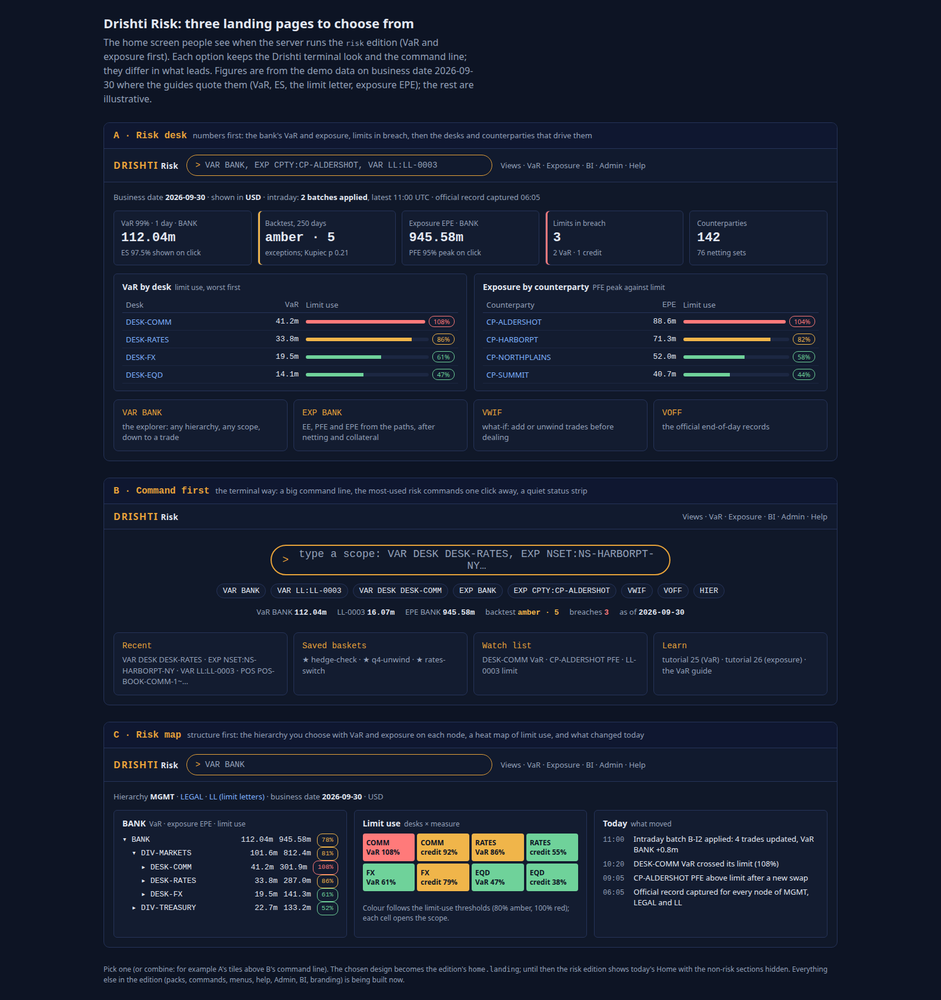

[Open the mock-up](mockups/risk/risk-landing.html). **Chosen:** all three, as the person's choice of Home (`home.landings: [desk, command,
map]`, `desk` the default) ([EDITIONS.md section 7](../admin/EDITIONS.md#7-drishti-risks-home-three-landings)). The mock-up's footer
proposed "pick one or combine"; the product owner kept all three. **Code:** [`risk_landing.html`](../../drishti-console/web/templates/home/risk_landing.html),
[`drishti_risk-landing.js`](../../drishti-console/web/static/js/drishti_risk-landing.js), [`drishti_risk-landing.css`](../../drishti-console/web/static/css/drishti_risk-landing.css),
[`risk.yaml`](../../config/editions/risk.yaml) `home`. Figures on the mock-up are the demo's on 2026-09-30 where the guides quote them
(VaR 112.04m, ES, the limit letter `LL-0003` 16.07m, EPE 945.58m); the rest are illustrative.

**Interactions on the mock-up, and as built.** Every desk, counterparty, node and heat cell is a link to its scope (`/var?scope=…`,
`/exposure?scope=…`): built. Every tile is a link (VaR and backtest to `/var?scope=BANK`, EPE and Counterparties to `/exposure`): built;
the mock-up's "ES shown on click" and "PFE peak on click" are shown in the tile's subline instead. The command line in the bar takes any
command and `<GO>`; the chips are links to `/go?q=<chip> <GO>`. The hierarchy switch (C) redraws the tree, the heat map and the desks
without a reload. A landing switch (Risk desk · Command first · Risk map) and the lens links sit above every landing; *The classic Home*
under it.

**States.** *Loading:* every figure shows `…` until its answer arrives; each panel is painted on its own answer. *Error:* a refused or
failed answer says `Not available: <reason>` in place of that panel (the others carry on); a tile shows `—` and the reason in its subline.
*Empty:* "No desks in MGMT", "No counterparty exposure on this date", "No limits set in MGMT", "Nothing yet today", "No baskets yet: build
one on the VaR page", "No monitors yet: make one"; a node without a limit says "no limit". **Phone** (600 px and below): one column, the
tiles two to a row, the big command line 46 px high ([`drishti_risk-landing.css`](../../drishti-console/web/static/css/drishti_risk-landing.css)); the
mock-up drew no phone form; on a phone the landing takes the phone tiers ([MOBILE_DISPLAY.md section 8](MOBILE_DISPLAY.md#8-beyond-sutra-pages)): the command line, the tiles and the first card in full, the other tables at a glance (five rows, *Show all*), charts, maps and the quick links under *More on this page*.

| # | Panel (option) | Contents on the mock-up | Data, API or contract | Interaction | Gap row | Status |
|---|---|---|---|---|---|---|
| R1 | Bar (A, B, C) | `DRISHTI Risk` in amber; a rounded amber command line with the placeholder *VAR BANK, EXP CPTY:CP-ALDERSHOT, VAR LL:LL-0003*; menus **Views · VaR · Exposure · BI · Admin · Help** | `risk.yaml` `menus` (`placeholder`), [`menus.yaml`](../../drishti-console/config/menus.yaml) | type a command, `<GO>`; open a menu | — | **Built**: brand, command line and placeholder; **VaR** and **Exposure** menus of their own ([section 1.11.4](#1114-the-lens-menus-lx1-menusahtml)) |
| R2 | Landing switch | (the footer: pick one or combine) | `home.landings`, `home.titles`; the person's choice in their settings ([`edition_routes.py`](../../drishti-console/routes/edition_routes.py)) | click a landing; lens links; *The classic Home* | — | **Built** |
| R3 | Meta line (A, C) | *Business date **2026-09-30** · shown in **USD** · intraday: **2 batches applied**, latest 11:00 UTC · official record captured 06:05* | `/api/var/scope?scope=BANK` (`businessDate`, `currency`, `intraday`), `/api/var/official` | — | — | **Partly built**: date, currency, the intraday note and the official record's **date**; missing the number of batches with the latest time, and the capture **time** (RL11) |
| R4 | Tile: VaR (A) | *VaR 99% · 1 day · BANK* **112.04m**; *ES 97.5% shown on click* | `/api/var/scope?scope=BANK` (`var`, `es`, `confidence`) ([VAR_GUIDE section 11](../guides/VAR_GUIDE.md#11-the-api)) | click: the VaR explorer at BANK | — | **Built** (ES in the subline: *ES … · 99% · 1 day*); horizon and confidence on the tile: RL2 |
| R5 | Tile: Backtest (A) | *Backtest, 250 days* **amber · 5**; *exceptions; Kupiec p 0.21*; amber edge | `/api/var/scope/history?scope=BANK` (`backtest.light`, `exceptions`, `days`, `kupiecPValue`) | click: the VaR explorer | — | **Built** (amber edge when the light is not green; a replay is labelled *not a regulatory backtest*) |
| R6 | Tile: Exposure EPE (A) | *Exposure EPE · BANK* **945.58m**; *PFE 95% peak on click* | `/api/exposure/scope?scope=BANK` (`epe`, `peakPfe`) ([EXPOSURE_GUIDE](../guides/EXPOSURE_GUIDE.md)) | click: the exposure explorer | — | **Built** (PFE peak in the subline) |
| R7 | Tile: Limits in breach (A) | **3**; *2 VaR · 1 credit*; red edge | VaR: `/api/var/tree` nodes with limit use ≥ 100%; credit: `/api/exposure/tree` counterparties with `limit.use` ≥ 1 | — | — | **Built** (red edge when any) |
| R8 | Tile: Counterparties (A) | **142**; *76 netting sets* | `/api/exposure/tree` (counterparties and their netting sets) | click: `/exposure` | — | **Built** |
| R9 | Card: VaR by desk (A) | *limit use, worst first*; columns Desk, VaR, Limit use (a bar and a pill): DESK-COMM 41.2m 108% red, DESK-RATES 33.8m 86% amber, DESK-FX 19.5m 61%, DESK-EQD 14.1m 47% green; amber from 80%, red from 100% | `/api/var/tree?hierarchy=MGMT` (`level: DESK`, `var`, `limitUse`) | click a desk: its VaR | — | **Built** (top 8; "no limit" when none) |
| R10 | Card: Exposure by counterparty (A) | *PFE peak against limit*; Counterparty, EPE, Limit use: CP-ALDERSHOT 88.6m 104%, CP-HARBORPT 71.3m 82%, CP-NORTHPLAINS 52.0m 58%, CP-SUMMIT 40.7m 44% | `/api/exposure/tree` (`epe`, `limit.use`) | click: its exposure | — | **Built** (top 8 by limit use; the demo's stored limits read low: RL9) |
| R11 | Quick commands (A) | four cards: `VAR BANK` (the explorer), `EXP BANK` (EE, PFE, EPE after netting and collateral), what-if (in the VaR explorer's basket's sheet), `VOFF` (official records) | `risk.yaml` `home.cards` | click: run the command | — | **Built** (configured: `VAR BANK`, `VAR DESK RATES`, `VRES DESK:RATES`, `EXP CPTY:CP-ALDERSHOT`; `VOFF` and `EXP BANK` are B's chips; the what-if is the explorer's) |
| R12 | Big command line and chips (B) | a 52 px amber command line, *type a scope: VAR DESK DESK-RATES, EXP NSET:NS-HARBORPT-NY…*; chips `VAR BANK`, `VAR LL:LL-0003`, `VAR DESK DESK-COMM`, `EXP BANK`, `EXP CPTY:CP-ALDERSHOT`, `VOFF`, `HIER` | `risk.yaml` `home.chips` | type and `<GO>`; click a chip | — | **Built** (chips configured: `VAR BANK`, `VAR DESK RATES`, `EXP BANK`, `EXP CPTY:CP-ALDERSHOT`, `VRES DESK:RATES`, `HIER`, `VOFF`) |
| R13 | Status strip (B) | *VaR BANK **112.04m** · LL-0003 **16.07m** · EPE BANK **945.58m** · backtest **amber · 5** · breaches **3** · as of **2026-09-30*** | as R4 to R7 | — | — | **Partly built**: VaR, EPE, backtest and breaches; the limit letter's figure (`LL-0003`) and "as of" (the date is on the meta line) are not on the strip (RL14) |
| R14 | Recent (B) | *VAR DESK DESK-RATES · EXP NSET:NS-HARBORPT-NY · VAR LL:LL-0003 · POS …* | the person's command history (as World's and Market's Recently opened) | click: run it | RL11 | **Not built**: the route passes `recents` to every landing; the Risk template does not draw them |
| R15 | Saved baskets (B) | *★ hedge-check · ★ q4-unwind · ★ rates-switch* | `/api/var/baskets` | click: the basket's VaR | — | **Built** (up to six) |
| R16 | Watch list (B) | *DESK-COMM VaR · CP-ALDERSHOT PFE · LL-0003 limit* | the person's monitors | click: the monitor; *make one* when none | — | **Built** (the person's monitors by name) |
| R17 | Learn (B) | *tutorial 25 (VaR) · tutorial 26 (exposure) · the VaR guide* | help links | click | — | **Partly built**: the VaR guide, the exposure guide and Knowledge; tutorials 25 and 26 are not linked (RL14) |
| R18 | Hierarchy switch (C) | *Hierarchy **MGMT** · LEGAL · LL (limit letters)* | `/api/var/tree` (`hierarchies`); `home.hierarchies: [MGMT]` | click: redraw the tree, heat map, desks | — | **Built** (every hierarchy the engine holds) |
| R19 | Card: BANK tree (C) | *VaR · exposure EPE · limit use* per node, expandable (▾ ▸): BANK 112.04m 945.58m 78%; DIV-MARKETS 101.6m 812.4m 81%; DESK-COMM 41.2m 301.9m 108%; DESK-RATES 33.8m 287.0m 86%; DESK-FX 19.5m 141.3m 61%; DIV-TREASURY 22.7m 133.2m 52% | `/api/var/tree` (`depth`, `var`, `limitUse`) | click a node: its VaR | — | **Partly built**: VaR and limit use per node to depth 2, as links; no **EPE** per node (RL6) and no expand or collapse (RL14) |
| R20 | Card: Limit use heat map (C) | *desks × measure*: COMM VaR 108% (red), COMM credit 92%, RATES VaR 86%, RATES credit 55%, FX VaR 61%, FX credit 79%, EQD VaR 47%, EQD credit 38%; *80% amber, 100% red; each cell opens the scope* | `/api/var/tree` (`limitUse`) | click a cell: its scope | — | **Partly built**: VaR limit use per node (up to 16, worst first); the **credit** cells per desk are not built (RL6) |
| R21 | Card: Today (C) | *11:00 Intraday batch B-I2 applied: 4 trades updated, VaR BANK +0.8m · 10:20 DESK-COMM VaR crossed its limit (108%) · 09:05 CP-ALDERSHOT PFE above limit after a new swap · 06:05 Official record captured for every node of MGMT, LEGAL and LL* | `/api/var/intraday/streams`, `/api/var/official`, `/api/exposure/official`, the tree's breaches | — | — | **Partly built**: each intraday stream's state and last message, the VaR and exposure official records (by date), the count of VaR limits at or over 100%; missing the batch's VaR change, the **time** a limit was crossed, credit-limit crossings and the capture time (RL11, RL12, RL14) |

**Gaps: on the mock-up, not in the product.**

1. **The meta line's batch count, latest batch time and the capture time** (R3; RL11 for the capture time, RL14 for the batches).
2. **The limit letter's figure on the status strip** (R13; RL14).
3. **Recent commands on Command first** (R14; RL11): the route already has them.
4. **Tutorials 25 and 26 in Learn** (R17; RL14).
5. **EPE per node, and expand and collapse in the tree** (R19; RL6 for EPE, RL14 for the tree).
6. **Credit-limit use per desk in the heat map** (R20; RL6).
7. **The Today feed's events**: the batch's VaR change, the time a limit was crossed, credit-limit crossings (R21; RL12 and RL14).

#### 1.11.2 The scenario matrix (`scenario-matrix-B.html`)

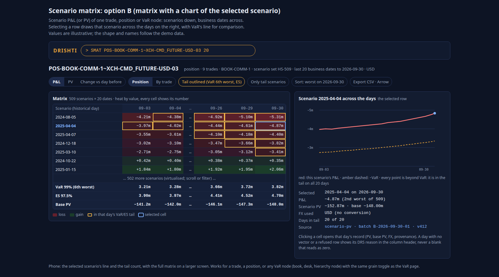

[Open the mock-up](mockups/risk/scenario-matrix-B.html). **Chosen:** option B, *matrix with a chart of the selected scenario* (product
owner, 2026-10-31); only option B was kept in the mock-ups folder. In Drishti Risk and Drishti Trading
(`commands.words.SMAT: on`); refused in Market and World. **Code:** [`smat.html`](../../drishti-console/web/templates/terminal/smat.html),
[`drishti_scenario-matrix.js`](../../drishti-console/web/static/js/drishti_scenario-matrix.js), [`drishti_scenario-matrix.css`](../../drishti-console/web/static/css/drishti_scenario-matrix.css),
[`smat_routes.py`](../../drishti-console/routes/smat_routes.py). **Guide:** [VAR_GUIDE section 3.9](../guides/VAR_GUIDE.md#39-the-scenario-matrix-smat).
On the Risk landings themselves `SMAT` is not yet a chip (RL13).

**Interactions.** `SMAT <id> [N] <GO>` (N business dates, 20 by default, at most 60) or `/smat?id=…&days=N`; a *Scenario matrix* link on
the trade, position, `PNLV`, `SPV` and VaR pages. Click a row, or move with the arrow keys, to select it; the chart and the details
follow. The segmented switches, the chips and the sort redraw in place; Export downloads CSV or Arrow. **States.** *Loading:* `loading…`
in the meta line. *Error and gaps:* a date with no values shows its DRS code in red in the column header, the reason in its tooltip, `—`
in its cells; a notice above the matrix counts them; never blank, never zero. *Empty:* with no id, a form asks for a trade, position or
VaR scope and the number of dates. **Phone** (640 px and below): the glance form: the chart (the selected date's scenarios, or the scenario across the dates), the tail
count, a scenario picker and the details; the matrix on a larger screen (the mock-up's footer asked exactly this).

| # | Panel | Contents on the mock-up | Data, API or contract | Interaction | Status |
|---|---|---|---|---|---|
| S1 | Command and header | `SMAT POS-BOOK-COMM-1~XCH-CMD_FUTURE-USD-03 20`; title the id; meta *position · 9 trades · BOOK-COMM-1 · scenario set HS-509 · last 20 business dates to 2026-09-30 · USD* | `/api/smat/matrix?id=…&days=N` (the console), `GET /api/v1/var/matrix` ([VAR_GUIDE section 11.1](../guides/VAR_GUIDE.md#111-the-endpoints)) | type the command; links from the trade, position, `PNLV`, `SPV`, VaR pages | **Built** |
| S2 | Values switch | **P&L** · PV · Change vs day before | P&L from the answer; PV = base PV + P&L; change = cell − the same scenario the date before | click | **Built** |
| S3 | Grain switch | **Position** · By trade | by trade: asks again with `by=trade` and the selected scenario | click; disabled with the reason for a trade, a node or a supplied position | **Built** |
| S4 | Tail chips | **Tail outlined (VaR 6th worst, ES)** (on, amber); Only tail scenarios | the answer's per-date VaR rank and ES tail | click: toggle | **Built** (markers **V** and **E** besides the outline, so not colour alone) |
| S5 | Sort | *Sort: worst on 2026-09-30* | computed in the page | select | **Built** (worst on the newest date, on any one date, by scenario day) |
| S6 | Export | *Export CSV · Arrow* | the whole matrix, every row and date, with the summary rows and each date's source and gap | click: download | **Built** |
| S7 | Matrix | *509 scenarios × 20 dates · heat by value, every cell shows its number*; rows a historical day (2024-08-05 −4.21m … −5.31m; 2025-04-04 the selected row; …); sticky header and first column; cells in the tail outlined amber; the selected cell outlined blue; "… 502 more scenarios (virtualised)" | the answer's rows (a scenario day each) and columns (a date each); Arrow above about 4,000 cells, JSON below | click a cell or row; arrow keys | **Built** (virtualised rows; `·` where the window does not hold the day) |
| S8 | Summary rows | *VaR 99% (6th worst)* 3.21m … 3.82m; *ES 97.5%* 3.90m … 4.70m; *Base PV* −141.2m … −148.0m | the answer's per-date `var`, `es`, `basePv` | — | **Built** (labels follow the confidences passed) |
| S9 | Legend | loss, gain, *in that day's VaR/ES tail*, selected cell | — | — | **Built** |
| S10 | Chart of the selected row | *Scenario 2025-04-04 across the days*: red line the scenario's P&L, amber dashed −VaR, a blue dot on the selected date; y axis −5m to −3m, x 09-03 to 09-30; *every point is beyond VaR: it is in the tail on all 20 days* | computed in the page from the answer | follows the selection | **Built** (points beyond VaR marked) |
| S11 | Details | *Selected 2025-04-04 on 2026-09-30 · P&L −4.87m (2nd worst of 509) · Scenario PV −152.87m, base −148.00m · FX used USD · Days in tail 20 of 20 · Source scenario-pv · batch B-2026-09-30-01 · v412* (a link) | the column's `source`, `batch`, `dataVersion`, `fx`, `link` | click Source: that day's record as of that date | **Built** (also *Tail that day* and *Input*) |
| S12 | Gaps | "a day with no vector or a refused row shows its DRS reason in the column header, never a blank that reads as zero" | `DRS-5203`, `DRS-1001`, `DRS-5201`, `DRS-5206`, `DRS-5207`, `DRS-5002` | hover: the reason | **Built** |
| S13 | Phone | "the selected scenario's line and the tail count, with the full matrix on a larger screen" | — | pick a scenario from a list | **Built** |
| S14 | Scope | "a trade, a position, or any VaR node (book, desk, hierarchy node) with the same grain toggle as the VaR page" | read as the person (`403 DRS-5002` for a scope seen only in aggregate) | — | **Built** |

**Gaps: on the mock-up, not in the product.** None. The one open item is the lens's: `SMAT` as a chip on the Risk landings (RL13).

#### 1.11.3 The VaR horizon picker (`var-horizon-picker.html`)

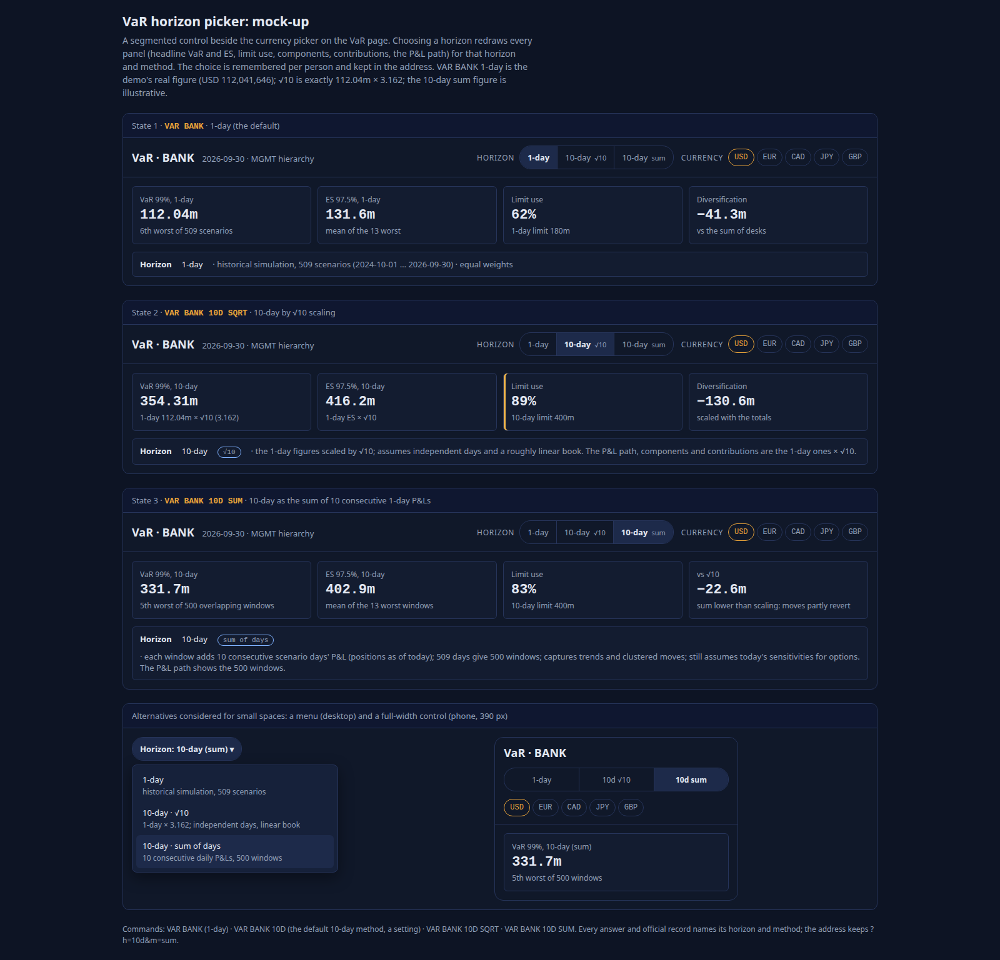

[Open the mock-up](mockups/risk/var-horizon-picker.html). **Chosen:** the design shown (three states of the VaR page header; its
alternatives for small spaces, a menu and a full-width phone control, were "considered"); approved for the 10-day VaR work, to which the product
owner added a **Confidence** picker (and ES's own) on 2026-10-30. **Code:** [`var.html`](../../drishti-console/web/templates/terminal/var.html)
(the header strip), [`drishti_var-explorer.js`](../../drishti-console/web/static/js/drishti_var-explorer.js) (tiles, the method strip, the lens),
[`drishti_var.css`](../../drishti-console/web/static/css/drishti_var.css). **Guide:** [VAR_GUIDE section 3.1](../guides/VAR_GUIDE.md#31-open-it) (*Horizon
and Confidence*) and [section 18.6](../guides/VAR_GUIDE.md#186-horizons-the-two-10-day-methods-and-the-confidence-chosen).
The mock-up's figures: 1-day 112.04m (the demo's), √10 354.31m (exact), the 10-day sum 331.7m (illustrative; the demo's is 274.5m).

**Interactions.** Choosing a horizon redraws every panel in place (tiles, limit use, components, contributions, the P&L path); the choice
goes into the address (`?h=10d&m=sum`, with `q` and `esq` for the confidences) and the person's settings (`varView`); the commands
`VAR BANK 10D`, `VAR BANK 10D SQRT`, `VAR BANK 10D SUM` open the same. **States.** While computing, the tiles are marked as computing; an
unconfigured confidence is refused in words (`400`); a limit at another horizon or confidence says *not comparable*; at 10 days the
backtest tile says *backtesting is 1-day*. **Phone:** the controls are full width (VAR_GUIDE section 3.1).

| # | Panel | Contents on the mock-up | Data, API or contract | Interaction | Gap row | Status |
|---|---|---|---|---|---|---|
| H1 | Horizon control | a **segmented control** labelled HORIZON: **1-day** · 10-day *√10* · 10-day *sum*, beside the currency | `horizon`, `method` on `/api/var/scope` and the other VaR endpoints | click a segment | — | **Partly built**: a drop-down (`data-vx-horizon`: 1-day, 10-day (√10), 10-day (sum)), not the segmented control (RL15) |
| H2 | Currency picker | chips USD (on, amber) · EUR · CAD · JPY · GBP | `/scope/currencies`; the scenario FX | click | — | **Built** (a drop-down, as before the mock-up) |
| H3 | Tile: VaR | *VaR 99%, 1-day* **112.04m** *6th worst of 509 scenarios*; at √10 **354.31m** *1-day 112.04m × √10 (3.162)*; at sum **331.7m** *5th worst of 500 overlapping windows* | the answer's `var`, `k`, `scenarios`, `lens` | — | — | **Built** |
| H4 | Tile: ES | *ES 97.5%, 1-day* **131.6m** *mean of the 13 worst*; √10: *1-day ES × √10*; sum: *mean of the 13 worst windows* | `es`, `esCount` | — | — | **Built** |
| H5 | Tile: Limit use | 1-day **62%** *1-day limit 180m*; 10-day **89%** (amber) *10-day limit 400m*; sum **83%** | `limitUse`, `limitComparable`; the `var-limit` row's `HORIZON` and `CONFIDENCE` ([VAR.md section 2.15](../contracts/VAR.md#215-var-limit-the-nodes-var-limits)) | — | — | **Built** (like for like: the demo's limits are 1-day, so at 10 days the tile says *limit is for 1-day 99%: not comparable*) |
| H6 | Tile: Diversification | **−41.3m** *vs the sum of desks*; at √10 **−130.6m** *scaled with the totals* | `diversification`, `sumStandalone` | — | — | **Built** (with a *Sum of standalone VaR* tile beside it) |
| H7 | Tile: vs √10 | at 10-day sum: **−22.6m** *sum lower than scaling: moves partly revert* | the sum's VaR less the √10 VaR (two answers) | — | RL15 | **Not built**: the sum shows no comparison with √10 |
| H8 | Method strip | *Horizon 1-day · historical simulation, 509 scenarios (2024-10-01 … 2026-09-30) · equal weights*; √10 with a pill and *the 1-day figures scaled by √10; assumes independent days and a roughly linear book …*; sum with a *sum of days* pill and *each window adds 10 consecutive scenario days' P&L …* | the answer's `lens` (`describe`) | — | — | **Built** (with the confidences) |
| H9 | Every panel follows | "redraws every panel (headline VaR and ES, limit use, components, contributions, the P&L path)" | every VaR endpoint takes `horizon`, `method`, `confidence`, `esConfidence` | — | — | **Built** (also the tree, the history and the captured results) |
| H10 | Remembered and in the address | "remembered per person and kept in the address"; `?h=10d&m=sum` | the person's settings (`varView`) | Back and a shared link | — | **Built** |
| H11 | Commands | `VAR BANK`, `VAR BANK 10D`, `VAR BANK 10D SQRT`, `VAR BANK 10D SUM` | the command grammar; `drishti.var.ten-day-method` | type and `<GO>` | — | **Built** (with confidences: `VAR BANK 95`, `VAR BANK 10D SUM 97.5`, `VAR BANK ES 95`) |
| H12 | Menu (desktop alternative) | *Horizon: 10-day (sum) ▾* opening three entries, each with a line: *historical simulation, 509 scenarios*; *1-day × 3.162; independent days, linear book*; *10 consecutive daily P&Ls, 500 windows* | — | click | — | **Partly built**: the drop-down is this form, without the per-entry lines (the label's tooltip carries them) (RL15) |
| H13 | Phone (390 px) | a full-width three-part control (*1-day · 10d √10 · 10d sum*), the currency chips under it, the VaR tile | — | tap | — | **Built** (full-width drop-downs) |
| H14 | Confidence and ES pickers | (not on the mock-up; added by the product owner, 2026-10-30) | `drishti.var.confidences`, `drishti.var.es-confidences` | select | — | **Built** |

**Gaps: on the mock-up, not in the product.**

1. **The segmented Horizon control** on a desktop (H1), and the menu's one line per entry (H12) (RL15).
2. **The "vs √10" tile** at the 10-day sum (H7) (RL15).

#### 1.11.4 The lens menus (LX1, `menus/A.html`)

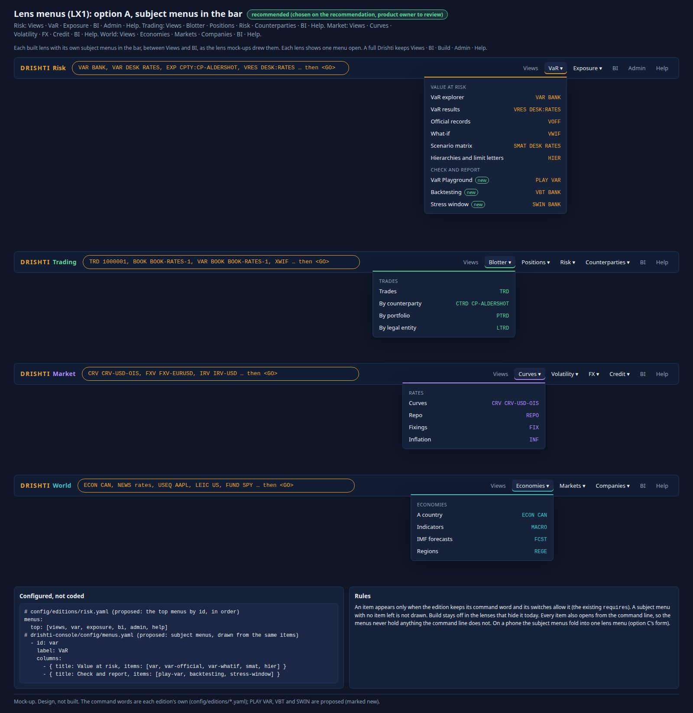

[Open the mock-up](mockups/menus/A.html) (options: [B](mockups/menus/B.html) a subject strip under the standard bar,
[C](mockups/menus/C.html) one lens menu with subject columns; the light theme: [A-light.png](mockups/menus/A-light.png)). One mock-up for the
four built lenses (Risk, Trading, Market, World), each lens with one menu open; this subsection is its home (the why, the phone form),
and each other built lens lists only its own rows. **Recommended:** option A, subject menus in the bar
(chosen on the recommendation, product owner to review); plan row LX1.

**Why A.** The lens mock-ups the product owner chose already drew their bars this way (Views, the lens's subjects, BI, Help), so A builds what was approved; each subject is one click from anywhere, as the five standard menus are. The strip of B costs a second row on every page; the single lens menu of C hides the subjects a click deeper and is better kept as the phone form of A. Subject menus are configured, not coded: the edition names its top menus in order, and a subject menu draws on the items of the menus file with the same switches (an item shows only when the edition keeps its command word).

| # | Panel | Contents on the mock-up | Data, API or contract | Interaction | Status |
|---|---|---|---|---|---|
| X1 | Bar | `DRISHTI Risk`; the command line; menus **Views · Engines · BI · Admin · Help** | the edition's top menus by id, in order (`menus.top`), [`menus.yaml`](../../drishti-console/config/menus.yaml) | open a menu | **Built**: `menus.top` in [`risk.yaml`](../../config/editions/risk.yaml), drawn by [`core/menus.py`](../../drishti-console/core/menus.py); Build is not named (off in the lens). The mock-up's VaR and Exposure menus are one **Engines** menu (mock-up [engines-menu/A](mockups/engines-menu/A.html)) |
| X2 | VaR column of the Engines menu | VaR explorer `VAR BANK`; Why it moved `VAR BANK EXPLAIN`; VaR Playground `PLAY VAR`; Scenario matrix `SMAT`; Regulatory reports; Backtesting `VAR BANK BACKTEST`; Stress window `SWIN BANK`; VaR results `VRES`; Official records `VOFF`; Hierarchies and limit letters `HIER` | the `engines` menu in [`menus.yaml`](../../drishti-console/config/menus.yaml), its `var` column; each item shown only when the edition keeps its command | click an item: its page or command | **Built**: the Playground, Regulatory reports and Backtesting items show once their screens are on the server (`route:`) |
| X3 | Exposure column of the Engines menu | Exposure explorer `EXP`; A counterparty `EXP CPTY …`; A netting set `EXP NSET …` (Pre-deal check `XWIF`: the Counterparties menu) | its `exposure` column | click an item: its page or command | **Built**: A counterparty and A netting set put `EXP CPTY` and `EXP NSET` in the command line for the id |
| X4 | Phone form | below 640 px the Engines menu's columns fold into a drawer, one engine open at a time | the bar's template and [`drishti_engines-menu.js`](../../drishti-console/web/static/js/drishti_engines-menu.js) | tap Engines, an engine, then an item | **Built** |

On a phone (below 640 px) the Engines menu opens as a drawer: a row per running engine with its command word, the first open, a tap on another opens it and closes the first; each item 44 px high with its command beside it. The items marked *new* on the mock-up: the Stress window
(`SWIN BANK`, [VAR_GUIDE section 18.9](../guides/VAR_GUIDE.md#189-choosing-the-stress-window)) is in the menu; the VaR Playground and Backtesting items show once their screens are on the server. Each item runs its command (shown beside its name) as if typed; an item that needs an id (*A counterparty*, *A country*) puts its words in the command line for the person to finish. With more than six menus in the bar they show as icons up to 1750 px wide, so the command line keeps its room. The configuration: [EDITIONS.md section 5.4](../admin/EDITIONS.md).

#### 1.11.5 The VaR screen's layout (`var-layout/A.html`, `var-layout/A-drawer.html`)

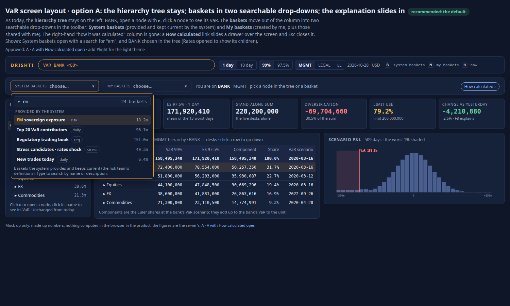


[Open the mock-up](mockups/var-layout/A.html) and [its second state](mockups/var-layout/A-drawer.html). **Chosen:** option A (the product
owner: "cleaner and better"); the earlier alternatives of the idea were not kept. Two changes to the VaR explorer and nothing else: the
baskets leave the left-hand column for two drop-downs, and the right-hand explanation column becomes a drawer. The mock-up's figures are
made up; the panels under the toolbar are the explorer's own, unchanged. **Code:** [`var.html`](../../drishti-console/web/templates/terminal/var.html)
(the toolbar, the drawer), [`drishti_var-layout.js`](../../drishti-console/web/static/js/drishti_var-layout.js) (the drop-downs, the keys, the drawer),
[`drishti_var-explorer.js`](../../drishti-console/web/static/js/drishti_var-explorer.js) (the rows and their actions), [`drishti_var-layout.css`](../../drishti-console/web/static/css/drishti_var-layout.css).
**Guide:** [VAR_GUIDE section 3.2](../guides/VAR_GUIDE.md#32-the-screen) and [section 3.6](../guides/VAR_GUIDE.md#36-how-this-number-was-built).
**Guard:** `drishti-console/tests/test_var_layout_keeps_everything.py` (every part of the screen as it was, still there).

| # | Panel | Contents on the mock-up | Data, API or contract | Interaction | Status |
|---|---|---|---|---|---|
| L1 | System baskets | a drop-down *System baskets · choose… ▾*; open: a search (*em*), the count, *Provided by the system*, each basket with a chip and a figure | the tree's `portfolios` (the market-risk pack's `portfolio` feed: id, name, type, owner) | **B**; type, ↑↓, Enter, Esc | **Built**, without a figure per row (a VaR per basket would be one computation each; the row shows its id, owner and type) |
| L2 | My baskets | a drop-down *My baskets · choose… ▾* | `GET /api/var/baskets` (mine, then shared with me) | **M**; the same keys; + basket, Edit, Edit a copy, Delete per row | **Built** |
| L3 | + New basket | (the brief: in the toolbar and at the foot of My baskets) | the basket's sheet (`drishti_var-basket.js`), collapsed on load | click, Alt+B; Save adds the basket to My baskets and collapses the sheet | **Built** |
| L4 | The hierarchy tree | *Hierarchy MGMT*, BANK, ▾ ▸ nodes with their VaR, unchanged | `/api/var/tree` | ▸ opens, a click shows the node's VaR | **Built** (as before) |
| L5 | Keys strip | **B** system baskets **M** my baskets **H** how | — | the keys | **Built** |
| L6 | How calculated › | a link at the toolbar's right | — | **H**, click | **Built** |
| L7 | The drawer | *How BANK's VaR was calculated*, *Esc ✕*, over the right of the screen | the scope's `provenance`, as before (the server's text) | Esc, ✕; the focus back on the link; `&how=1` in the link | **Built** (its title and lines are the column's: *How this number was built*) |
| L8 | Phone (`@media (max-width:700px)`) | the drop-downs full width, the drawer full width | — | tap | **Built** (390 px: full-width drop-downs, the drawer a bottom sheet, no sideways scroll) |

## 2. Drishti Trading: what traders and desk heads need, what the lens gives them today, and what comes next

The first line's lens. Every "built" or "partly" statement cites the document or file it was read from on 2026-10-31; sections 2.5
and 2.8 are proposals, rows of the plan's [lens product candidates](IMPLEMENTATION_PLAN.md#lens-product-candidates-not-started), not
started. **Read with:** [EDITIONS.md section 14](../admin/EDITIONS.md#14-drishti-trading) (the lens as built) and
[section 12](../admin/EDITIONS.md#12-drishti-trading) (how to run it), [`config/editions/trading.yaml`](../../config/editions/trading.yaml),
[VAR_GUIDE.md](../guides/VAR_GUIDE.md), [EXPOSURE_GUIDE.md](../guides/EXPOSURE_GUIDE.md), [COMPUTED_ATTRIBUTES.md](COMPUTED_ATTRIBUTES.md)
and the contracts [TVAL.md](../contracts/TVAL.md) (valuation totals) and [PNL.md](../contracts/PNL.md) (P&L explain).

### 2.1 Who uses it

The **first line of defence**: the people who take the risk and earn the P&L. Drishti Trading is for two of them
([`config/editions/trading.yaml`](../../config/editions/trading.yaml), its header: "for traders and desk heads: my books, my P&L, my VaR
and limits, my counterparties, and 'does this new trade fit?'").

| Persona | Accountable for | What they need from a system |
|---|---|---|
| **Trader** (a market maker or a risk taker on a desk; runs one or a few books) | The P&L of their books; staying inside their delegated limits (VaR, sensitivities, stop-loss, notional); pricing and booking client and hedge trades correctly; explaining their P&L to product control and their risk to market risk | *My* books on one page: P&L today, risk, limit use, today's trades; a fast pre-deal check; the counterparty's room under its credit limit |
| **Desk head** (head of a desk: rates, FX, credit, equities, commodities; several traders and books) | The desk's P&L and its budget; the desk's limits and any breach; the traders' use of the delegated limits; explaining a breach and asking for a temporary increase; the desk's concentrations and largest counterparties | The desk at a glance: P&L by book and trader, limit use over days, breaches and books near limit, P&L against VaR, the movers |
| *Also served*: the **business manager** or **desk risk analyst** (COO function of a business) | The desk's controls, limit paperwork, the daily P&L sign-off with product control | The same pages, often through **View as** |

**What the first line does not own** (and the lens does not try to show): the limit framework itself, the model, independent challenge and
breach approval (the second line: the Risk and proposed Oversight lenses, section 2.7); collateral operations and regulatory capital (left
out of the edition: `trading.yaml`'s comment "left out: regulatory (FRTB, SACCR, CVA, SIMM), stress (SCN, STR, SSPNL), collateral
operations (COLL, MC) …").

#### 2.1.1 A day, a month and a year

| When | Trader | Desk head |
|---|---|---|
| **Before the open** (06:30 to 08:00) | Yesterday's P&L as product control struck it; overnight moves on the books; today's VaR and limit headroom; expiries, fixings and settlements due today | The desk's P&L and VaR; any breach from yesterday's official run and its explanation to market risk; the morning meeting with risk |
| **Intraday** | Quote and price; "does this trade fit?"; hedge; watch P&L, risk and limit use as trades are booked | Approve large trades; watch the desk's limit use; react to a trader near a limit |
| **The close** (16:00 to 19:00) | Mark the book; check the booked trades (amendments, cancellations); the flash P&L | Sign the desk's flash P&L; note breaches |
| **Month-end** | Month-to-date P&L against budget and stop-loss | The desk's P&L, VaR and limit use over the month; the P&L-against-VaR exceptions and their explanations; limit review input |
| **Year** | — | The budget and the limit request for next year (the use statistics: average, peak, days near limit); the year's P&L and its explanation |

---

### 2.2 Their questions: the morning, intraday, the close, month-end

#### 2.2.1 The morning

| Question | Drishti today | Gap |
|---|---|---|
| *What did my books make yesterday?* | **Built**: **P&L today**, the MtM change of every trade valued on both the business date and the business day before, summed over my books; no valuations the day before: no number, said ([EDITIONS.md section 14](../admin/EDITIONS.md#14-drishti-trading), the Trader desk) | Product control's struck P&L (actual, with cash, fees and reserves) is not received: the figure is MtM change only. The bank's P&L feed is planned |
| *Why did it move?* | **Partly**: **Overnight movers** (the trades whose MtM moved most) on the Desk head landing; the trade events (new, amended, cancelled) on the Trader desk | A P&L explain (market by risk factor, time, new and amended trades, unexplained): the contract is proposed and parked ([PNL.md section 1](../contracts/PNL.md#1-summary)); section 2.5.4 |
| *What is my VaR and how close am I to my limit?* | **Built**: **My VaR** (the union of my books, `BOOK:A + BOOK:B`), labelled intraday when updates were applied; **Limit use**: the highest of my books' VaR ÷ its `var-limit` (EDITIONS.md section 14) | Limits other than VaR (DV01, CS01, vega, stop-loss, notional): not built (section 2.5.7); 10-day and other confidences (**built**: [VAR_GUIDE section 18.6](../guides/VAR_GUIDE.md#186-horizons-the-two-10-day-methods-and-the-confidence-chosen)) |
| *Did any of my books breach?* | **Built** for VaR limits: **Breaches** and **Near limit** tiles (Desk head; `trading.near-limit` 0.8); **Limit use by book** over 5 business dates from the official records | A breach as a record the desk explains (RO2 of the oversight analysis; section 2.5.6) |
| *Did yesterday's P&L exceed VaR?* | **Partly**: **P&L against VaR**, the desk's official history (hypothetical P&L against the VaR before it), last 60 days, exceptions circled; **left out** without official history (EDITIONS.md section 14) | The bank's actual and hypothetical P&L (planned); section 2.5.3 |
| *What did I book yesterday, and is it right?* | **Built**: **Trades today** (new, amended, cancelled) and **Today's blotter**; on the demo data "new" reads 0 (no trade is booked on its business date) | New trades on the demo data (section 2.5.1) |

#### 2.2.2 Intraday

| Question | Drishti today | Gap |
|---|---|---|
| *Does this new trade fit my VaR limit and the counterparty's credit limit?* | **Built**: **Check a new trade**, one VaR what-if on the book and one pre-deal check on the counterparty, each on a scaled copy of a booked trade of the product ([EDITIONS.md section 14, The new-trade check](../admin/EDITIONS.md#the-new-trade-check)) | A real price of the new trade (not a scaled copy): QLRisk pricing, parked until its API is stable ([VAR_GUIDE section 8.4](../guides/VAR_GUIDE.md#84-what-if-pricing-and-intraday-recomputes)); section 2.5.8 |
| *Where am I now, after this morning's trades?* | **Built** for VaR: intraday updates from files and Kafka change today's VaR (VAR_GUIDE section 8.4); the tile says **intraday** with the trades updated and the time | Intraday P&L (P&L today is end-of-day valuations only); section 2.5.9 |
| *Tell me when I get near my limit.* | **Partly**: alerts on numbers and monitors are on in the edition (`trading.yaml` `features: alerts: on, monitors: on`); each person sets their own ([USER_GUIDE.md](../guides/USER_GUIDE.md#alerts-on-numbers)) | A one-click "watch my books" from the landing; limit alerts from intraday VaR (section 2.5.10) |
| *What is the largest counterparty on my desk?* | **Partly**: **Largest counterparty** is its share of the desk's **positive MtM** over live trades, not exposure (EDITIONS.md section 14) | The desk's share of each counterparty's exposure (section 2.5.2) |
| *What is a curve or vol doing?* | **Built**: `CRV`, `FX`, `FXV`, `EQ`, `EQX`, `CMD`, `CMDC`, `BND`, `CDS` in the edition (`trading.yaml` `commands.allow`) | The Market lens's moves and quality checks are not on a Trading landing (section 2.7) |

#### 2.2.3 The close

| Question | Drishti today | Gap |
|---|---|---|
| *Is my blotter complete and right?* | **Partly**: Today's blotter newest first with each trade's notional from its valuation; `TRD`, `CTRD`, `PTRD`, `LTRD`, `ITRD` | A reconciliation against the booking system or the trades valued (a trade with no valuation, a valuation of a cancelled trade): the load checks count rejected rows but completeness against trades booked is not checked ([VAR.md section 6.3](../contracts/VAR.md#63-what-the-load-checks)) |
| *What is my flash P&L?* | **Partly**: P&L today recomputes when the date's valuations land (cached two minutes per person) | Flash P&L is the source's; Drishti shows MtM change. Not a gap Drishti should fill: Drishti does not price |
| *Will my end-of-day VaR breach?* | **Partly**: the intraday VaR and the limit use (Trader desk) | A projected official limit use with the trades of the day (it is the intraday figure; say so on the tile) |

#### 2.2.4 Month-end and the year

| Task | Drishti today | Gap |
|---|---|---|
| Month-to-date and year-to-date P&L against budget and stop-loss | **Not built**: no P&L series is stored or received; the valuations give daily MtM change only | The bank's P&L feed (planned), then a stop-loss check (RO5 of the oversight analysis); section 2.5.11 |
| The desk's limit use over the month (average, peak, days near) | **Partly**: the official records carry `LIMIT_USE` per node and date, read in BI (`market-risk-var-official` is in the edition's BI datasets, `trading.yaml` `bi.datasets`) | A use-statistics card on the Desk head landing (section 2.5.12) |
| P&L-against-VaR exceptions with their explanations | **Partly**: exceptions circled on the card | An exception commentary (one comment thread per exception, as for breaches) |
| Next year's limit request | **Partly**: BI over the official records | The statistics above, as a desk report |

---

### 2.3 Needs by area, with status

#### 2.3.1 P&L

| Need | Status | Evidence or row |
|---|---|---|
| Daily MtM change of my books | **Built** | P&L today ([EDITIONS.md section 14](../admin/EDITIONS.md#14-drishti-trading)) |
| Actual P&L (with cash, fees, reserves) | **Not built**; needs the bank's P&L feed | planned ([the implementation plan](IMPLEMENTATION_PLAN.md#298-market-risk-regulatory-foundation-and-debugging-planned)) |
| P&L explain (by risk factor, time, new and amended trades, unexplained) | **Not built**; contract proposed, parked. The stored explain is shown in the lens (`PNL`, Risk menu) with its waterfall **under construction** (`pnl-explain-waterfall` in the registry) | [PNL.md](../contracts/PNL.md); the stored `pnl-explain` (PNL) is a generator's, with known inconsistencies ([COMPUTED_ATTRIBUTES.md section 4.10](COMPUTED_ATTRIBUTES.md#410-pnl-explain-pnl)) |
| P&L by trader | **Built** from the valuations' `TRADER_ID`; masked for a role without raw, then said | EDITIONS.md section 14, Desk head |
| The pricing system's own `PNL_1D` | **Not used**: a different figure on the demo data | EDITIONS.md section 14; agrees with MtM change on 201 of 15,000 trades (F14, [COMPUTED_ATTRIBUTES.md section 4.1](COMPUTED_ATTRIBUTES.md#41-trade-valuation-tval)) |
| Month-to-date, year-to-date | **Not built** | section 2.5.11 |
| Intraday P&L | **Not built** | section 2.5.9 |

#### 2.3.2 Risk on my books

| Need | Status | Evidence or row |
|---|---|---|
| VaR of my books, desk, any union | **Built** | My VaR, Desk VaR (EDITIONS.md section 14); scopes ([VAR_GUIDE section 5](../guides/VAR_GUIDE.md#5-scopes-portfolios-and-baskets)) |
| Top positions by VaR contribution | **Built** | `/scope/contributions?by=position` (Trader desk) |
| VaR by trader (adds up to the desk) | **Built** in the server over every trade of the desk (`/scope/contributions?by=attribute:TRADER_ID`, [VAR_GUIDE section 11.3](../guides/VAR_GUIDE.md#113-path-and-contributions)); masked for a role without raw, then said | Desk head, By trader |
| 10-day VaR and the confidence chosen | **Built** (plan row 2b) | [VAR_GUIDE section 18.6](../guides/VAR_GUIDE.md#186-horizons-the-two-10-day-methods-and-the-confidence-chosen): √10 and the 10-day sum, a confidence picker, limit use only when comparable |
| Stressed VaR | **Planned** | |
| The scenario matrix (is this tail scenario new?) | **Built** | [VAR_GUIDE section 3.9](../guides/VAR_GUIDE.md#39-the-scenario-matrix-smat), `SMAT`; on in Drishti Trading (`commands.words.SMAT: on`; `SMAT BOOK BOOK-RATES-1 20`), which settles section 2.9, decision 5 |
| DV01 of my books | **Partly**: the sum of the live trades' `DV01` when any holds one; else the tile is left out | EDITIONS.md section 14 |
| DV01 by tenor and currency, CS01, vega, FX delta | **Not built**: per-trade `DV01` only, no bucketed sensitivities | [COMPUTED_ATTRIBUTES.md section 4.9](COMPUTED_ATTRIBUTES.md#49-frtb-sensitivity-frtb); RO4 of the oversight analysis; section 2.5.7 |
| Stress on my book | **Hidden** in the edition (stress commands left out) | `trading.yaml`; section 2.9, decision 4 |

#### 2.3.3 Limits and breaches

| Need | Status | Evidence or row |
|---|---|---|
| VaR limit use per book and desk | **Built** | `var-limit` ([VAR.md section 2.15](../contracts/VAR.md#215-var-limit-the-nodes-var-limits)); Limit use tile |
| Limit use history by book (official) | **Built**: 5 business dates; a missing record shows "—" | Desk head |
| Near-limit threshold | **Built**: `trading.near-limit` 0.8 | A different number from the VaR explorer's amber 75% and red 90% ([VAR_GUIDE section 3.2](../guides/VAR_GUIDE.md#32-the-screen)); section 2.9, decision 7 |
| Sensitivity, stop-loss, notional limits | **Not built** | RO3 to RO6 of the oversight analysis |
| A breach the desk explains | **Not built** | RO2 of the oversight analysis; section 2.5.6 |

#### 2.3.4 Trades and the blotter

| Need | Status | Evidence or row |
|---|---|---|
| Today's trades: new, amended, cancelled | **Built**, with a fallback from the two days' valuations when the search by `SOURCE_UPDATE_TIME` does not answer in time (`DRS-1004`) | EDITIONS.md section 14, Trades today |
| New trades on the demo data | **Not served**: every change of a day is an amendment or a cancellation | section 2.5.1 |
| Today's blotter, newest first | **Built** | |
| Trade pages: legs, cash flows, resets, events | **Built** (trading pack) | [trading pack README](../../config/packs/trading/README.md) |
| A trade's history over dates | **Built** (history queries, `TRD 1000015 30`) | [DATA_ARCHITECTURE.md](DATA_ARCHITECTURE.md#2-history-queries-an-entity-over-time) |

#### 2.3.5 Counterparties

| Need | Status | Evidence or row |
|---|---|---|
| A counterparty's trades, netting sets, MtM | **Built**: `CTRD`, `NSET`, `NSMTM`, `CPMTM` (netting-set and counterparty MtM derived) | [COMPUTED_ATTRIBUTES.md section 13.1](COMPUTED_ATTRIBUTES.md#131-the-derived-kinds-and-the-sutra-panels-q1-to-q4) |
| Pre-deal PFE against the credit limit | **Built**: exact `paths` method, or the engine's `addon` proxy labelled proxy | [EXPOSURE_GUIDE section 7](../guides/EXPOSURE_GUIDE.md#7-pre-deal-what-if); EDITIONS.md section 14 |
| The desk's largest counterparty by exposure | **Partly**: by positive MtM | section 2.5.2 |
| Credit limit use on the counterparty's page | **Built as read**; the stored limits read very low use (sized on the retired profiles) | [EXPOSURE_GUIDE section 28](../guides/EXPOSURE_GUIDE.md#28-open-items) |

#### 2.3.6 "My", people and access

| Need | Status | Evidence or row |
|---|---|---|
| Who is who: user → trader or desk | **Built**: `trading.people` (edition, then console), a matching trader record, then View as | [EDITIONS.md section 14, "My"](../admin/EDITIONS.md#my-who-a-person-is-configured) |
| The landing by trading role | **Built**: `trading.landing-by-role: {desk-head: desk, trader: trader}`, below the person's own choice | |
| Never widening access | **Built**, tested (`test_scoping_never_widens_access_every_read_is_the_persons_own`) | |
| "My" from the bank's directory (groups, claims) | **Not built** | section 2.5.13 |
| Who sees the lens link (`lens.roles`) | **Not wired** (a hook) | [EDITIONS.md section 8](../admin/EDITIONS.md#8-lenses) |

#### 2.3.7 The lens is configuration (product panel A19, 2026-11-06)

The Trading lens is **configuration, not a product of its own**: what a trader sees is the edition file
[`trading.yaml`](../../config/editions/trading.yaml) over the menus file [`menus.yaml`](../../drishti-console/config/menus.yaml); no code
draws a trading menu or hides a trading command. The panel's changes are made that way:

| Change | Status | Where |
|---|---|---|
| Unhide `PNL`, `DPNL`, `SENS` (risk on my book) and `FXF`, `IRV`, `CPV`, `FIX`, `REPO` (market data) | **Built** | `commands.allow`; `DPNL`, `PNL` and `SENS` in the Risk menu; the P&L explain's waterfall is **under construction** (a generator's stored steps that disagree with the bars, F19; `pnl-explain-waterfall` in [`config/under-construction.yaml`](../../config/under-construction.yaml)) |
| One **Markets** menu with every market-data screen | **Built** | `menus.markets` picks rates (`CRV`, `REPO`, `FIX`), vols (`IRV`, `CPV`, `FXV`), FX (`FX`, `FXF`), credit (`CDS`, `BND`), equities and commodities (`EQ`, `EQX`, `CMD`, `CMDC`) from the one Markets menu, which gathers the Curves, Volatility, FX and Credit menus' columns (`gather:`) |
| BI and Admin by command only | **Built** | `menus.top` names neither; `BI <GO>` opens BI, `ADMIN <GO>` the first Admin page the lens keeps and `ADMIN <page>` that page (administrators; anyone else is told it is for administrators) |
| Tests | **Built** | `test_lens_menus.py` (the menus, the commands, `ADMIN`), `test_lens_menus_browser.py` (the Markets menu opened and clicked), `test_phone.py` and `test_phone_browser.py` (the phone's lens menu), `EditionTradingServerTest` (the commands the server shows) |

---

### 2.4 The landings

One template, `home/trading_landing.html`, with `drishti_trading-landing.js` and `drishti_trading-landing.css`, a **green accent**; figures worked out by
`drishti-console/core/trading_landing.py` and served read-only by `drishti-console/routes/trading_routes.py`
(`/api/home/trading/{me,valuations,blotter,risk,limits,pnl-var,traders}` and `POST /api/home/trading/check`; `404 DRS-4023` unless the
person's edition or lens shows `TRD`), cached two minutes per person, date and scope ([EDITIONS.md section 14](../admin/EDITIONS.md#14-drishti-trading)).

#### 2.4.1 A: Trader desk (`trader`, the default)

| Tile or card | What is real | Left out, and why |
|---|---|---|
| **P&L today** | MtM change of every trade of my books valued on both days (`TVAL`), summed; the date box moves both days; when the lake's latest valuations are older than the business date, the page says "the latest valuations are of …" | No valuations the day before: no number. The valuations' own `PNL_1D` is not used (a different figure on the demo data) |
| **My VaR** | The VaR engine's figure for the union of my books; labelled **intraday** with the trades updated and the time | — |
| **Limit use** | The highest of my books' VaR ÷ its `var-limit`, the book and limit named | A limit at another horizon or confidence (comparable only like for like: [VAR_GUIDE section 18.6](../guides/VAR_GUIDE.md#186-horizons-the-two-10-day-methods-and-the-confidence-chosen)) |
| **DV01** | Σ live trades' `DV01` when any holds a number | Left out when none does |
| **Trades today** | New, amended, cancelled by `SOURCE_UPDATE_TIME` on the business date; on a large lake (`DRS-1004`) from the two days' valuations, with no time of day, said | "New" reads 0 on the demo data |
| **Check a new trade** | Product (from my live trades' products), side, notional (`250m`, `1.5bn`), counterparty, book → one VaR what-if and one pre-deal check (section 2.4.4) | A trade of a product I have never traded (no copy to scale) |
| **Today's blotter** | Newest first, each trade's notional from its valuation | — |
| **Top positions** | By VaR contribution: market value and component VaR | — |
| **Quick commands** | My trader, my book's VaR, my book, my most traded counterparty, then the file's cards | — |

#### 2.4.2 B: Desk head (`desk`)

| Tile or card | What is real | Left out, and why |
|---|---|---|
| **Desk P&L today** | As P&L today, over the desk, with the best book | As above |
| **Desk VaR** and limit use | `DESK:<id>` from the VaR engine | — |
| **Breaches**, **Near limit** | Books above 100% and at or above `trading.near-limit` | — |
| **Largest counterparty** | Its share of the desk's **positive MtM** over live trades (current exposure before netting and collateral) | Exposure: the engine accepts `DESK:` as a `partial` scope that cuts netting sets, recomputed in seconds per touched set ([EXPOSURE_GUIDE section 4](../guides/EXPOSURE_GUIDE.md#4-scopes)); what it lacks is a desk's **share of each counterparty's netted, collateralised exposure** and a one-call ranking. Section 5.2 |
| **Limit use by book** | Last `trading.limit-days` (5) business dates, each cell VaR ÷ limit from that date's **official record**, each cell printing its percentage | A date without a record: "—", named under the grid; a role that sees only some nodes: "not available" |
| **By trader** | Each trader's P&L and live trades from the valuations' `TRADER_ID`; VaR as the sum of their trades' component VaR in the desk | With `TRADER_ID` masked: "—", record counts with a star, the reason said; beyond `max-parts` the largest only |
| **P&L against VaR** | The desk's official history: each day's hypothetical P&L against the VaR before it, `trading.pnl-var-days` (60), exceptions circled | Left out when the history is a replay (scenario P&L, not a day's) |
| **Overnight movers** | Trades whose MtM moved most since the day before | Without valuations the day before |

#### 2.4.3 C: Explorer (`explorer`)

A big command line; the chips of `home.chips` (`TRD 1000001`, `BOOK BOOK-RATES-1`, `CTRD CP-ALDERSHOT`, `POS BOOK-RATES-1`,
`VAR DESK DESK-RATES`, `XWIF`, `CRV CRV-USD-OIS`); the commands grouped (blotter, books and positions, risk on my book, counterparties,
market data); Recently opened (the person's own history, Trading's commands only).

#### 2.4.4 The new-trade check

From [EDITIONS.md section 14, The new-trade check](../admin/EDITIONS.md#the-new-trade-check): the engines price a **copy of a booked
trade**, so the check picks one (a live trade of the product in my books: the counterparty's own first, then the chosen book's, then the
largest notional) and scales it (factor = notional ÷ its notional, negative when the side differs).

- **VaR**: `POST /api/v1/var/what-if` on `BOOK:<book>` with the copy and factor (the server's VaR engine) → VaR before and after, limit use
  before and after: **fits**, **near**, **breaches**; when the engine cannot answer (a book without vectors on the date) the half says why.
- **Counterparty**: `POST /api/v1/exposure/what-if` on `CPTY:<cp>` (method `paths`, the copy into the counterparty's largest netting set) →
  peak PFE before and after against the credit limit; the `addon` proxy, labelled, when `paths` cannot run (`DRS-5446`, or no netting set).

**What a trader should know about it.** A scaled copy is exact for a **linear** product with the same terms (a swap of the same tenor and
currency); for an option, a different strike or tenor, or a new currency pair, it is an approximation that the answer does not quantify.
Section 5.8 proposes saying so on the answer and, later, pricing the real trade.

#### 2.4.5 What the data does not give (as the builder reported)

From [EDITIONS.md section 14](../admin/EDITIONS.md#what-the-data-does-not-give-left-out-or-labelled-never-invented): the DV01 tile
without DV01s; P&L, by book, by trader and the movers without valuations the day before; the P&L-against-VaR card without official
history; by-trader figures for a masked role; a book's limit use on a date without an official record;
"new" trades on data that books none on the day; a time of day other than `SOURCE_UPDATE_TIME`; the largest counterparty's share of
**exposure**; a scope above `trading.max-rows` (20,000 valuations a date) is read in part and every figure says **partial**.

---

### 2.5 Gaps, with design sketches

The design rules and the sizes are [section 1.5](#15-gaps-with-design-sketches)'s. TL ids are the Trading lens's gaps; RO ids are
Oversight's (section 5.4).

| Id | Gap | Size | Depends on |
|---|---|---|---|
| TL1 | New trades on the demo data; `SOURCE_UPDATE_TIME` searchable | S | the test-data generators (seeds plan) |
| TL2 | The desk's share of each counterparty's exposure | M | exposure contributions by trade (built at small sizes) |
| TL3 | P&L against VaR from the bank's P&L | S | the bank's P&L feed and the backtesting engine (planned) |
| TL4 | P&L explain: TL4a by trade events (S), TL4b by risk factor (L) | S; L | TL4a none; TL4b per-trade sensitivities, market moves ([PNL.md](../contracts/PNL.md)) |
| TL5 | Stressed VaR, 10-day and confidence on the landings and the check | S | 10-day VaR and confidence (built); stressed VaR |
| TL6 | My breaches to explain | S | RO2 |
| TL7 | Sensitivity ladders and limits on my books | M after RO4 | RO3, RO4 |
| TL8 | The check on the real trade | S (labels) then L | QLRisk API stable (parked) |
| TL9 | Intraday P&L | M | the bank's intraday base PVs |
| TL10 | Watch my books (alerts from the landing) | S | alerts on numbers (built) |
| TL11 | Month-to-date and year-to-date P&L, stop-loss | S | the bank's P&L feed (planned); RO5 |
| TL12 | Limit use statistics on the Desk head | S | official records (built) |
| TL13 | "My" from the directory | M | single sign-on groups; RBAC later |

#### 2.5.1 TL1: new trades on the demo data, and a searchable update time

**Today.** "New" reads 0 on the demo data because no trade is booked on its business date; the search by `SOURCE_UPDATE_TIME` reads every
trade document because the field is not a store column, and on the product owner's stack it may not answer in time (`DRS-1004`), so the
events fall back to the two days' valuations ([EDITIONS.md section 14](../admin/EDITIONS.md#14-drishti-trading)).

**Design.**

- **Data.** The trading test-data generator books a share of each business date's trades **on** that date (a configurable rate, for
  example 0.5% of the live book a day, products weighted as the book), with `TRADE_ACTION` NEW, `TRADE_DATE` the date, a
  `SOURCE_UPDATE_TIME` within the trading day, and a valuation and P&L vector from that date on. Matured and cancelled trades leave the
  same way they do today. This fits the plan to regenerate test data from seeds (IMPLEMENTATION_PLAN.md); synthetic only, Endur-style
  names kept (house rule).
- **Store.** `SOURCE_UPDATE_TIME` (and `TRADE_ACTION`) as store columns of the trade lake table, so "the trades of these books updated
  today" is a pruned columnar read, not a document scan.
- **Contract.** The trading pack's `trade` contract already has the fields; the change is the generator and the store column list.

**Data needs.** None from the bank: a real bank's feed books trades on their date. **Size** S. **Tests:** on the regenerated demo, a
date's new trades are counted, carry a time and appear in Trades today and the blotter; the valuations fallback agrees with the search
on the same date; a book with no activity shows 0 with the reason.

#### 2.5.2 TL2: the desk's share of each counterparty's exposure

**The question.** *Which counterparty is my desk's largest credit exposure, and how much of its limit is my desk using?* Exposure is
netted and collateralised **per netting set**, across desks: a desk's trades are part of a set, not a set. Two honest answers exist:

| Answer | Method | What it means | Cost |
|---|---|---|---|
| **Standalone** (built, `partial`) | `EXP DESK:RATES & CPTY:CP-X`: the desk's trades in each touched set treated as if they were the set ([EXPOSURE_GUIDE section 4](../guides/EXPOSURE_GUIDE.md#4-scopes)) | The exposure the desk would have alone; ignores netting with other desks and splits collateral wrongly | seconds per touched set (a lake read) |
| **Allocated** (proposed) | the counterparty's exposure allocated to its trades and summed by desk (CC2, [section 7.8.2](#782-allocated-exposure-cc2)) | The desk's part of the bank's real exposure; desks add up to the counterparty | one pass over a set's trade paths (already read for contributions) |

**Design.** A `by=desk` grouping on the exposure engine's contributions (the engine already computes contributions by trade for a scope;
[EXPOSURE_GUIDE section 28](../guides/EXPOSURE_GUIDE.md#28-open-items) notes their cost at a large bank's size); a new answer
`GET /api/v1/exposure/scope/contributions?scope=DESK:<id>&by=counterparty&measure=EPE` (proposed) that returns, per counterparty, the
desk's allocated EPE and peak-PFE share, and the counterparty's credit-limit use. The **Largest counterparty** tile then reads "CP-X ·
desk's EPE 41.2m of 118.0m · limit use 62%" and keeps the positive-MtM figure as a second line, named.

**Data needs.** Held: `exposure-path` per trade, the CSAs, the netting sets. **Size** M. **Dependencies:** exposure contributions by
trade; pruning trade-path reads by netting set (planned, EXPOSURE_GUIDE section 28) for size. **Tests:** desks' allocated EE and EPE of a
counterparty add to its EE and EPE to the cent; a desk alone in a set gets the whole set; a desk whose trades all have negative value
gets zero; the standalone figure is shown beside it only when asked, labelled.

#### 2.5.3 TL3: P&L against VaR from the bank's P&L

**Today.** The card reads the official history: each day's hypothetical P&L (`HYPO_PNL`, the node's P&L under the newest scenario day of
its date's set, derived by Drishti) against the VaR before it ([VAR_GUIDE section 7](../guides/VAR_GUIDE.md#7-history-and-backtesting));
left out without official history.

**Design.** When the bank's daily P&L per desk arrives (the planned P&L feed: actual from finance, hypothetical from the front office), the card
shows **actual** and **hypothetical** against VaR, with Drishti's own derived figure named as **risk-theoretical**; exceptions counted
separately per series (the planned backtesting engine). The card's default series is a site setting (proposed); a desk without a P&L
row on a date shows "—" for the date, never zero. With no official history the card stays left out, as today: a replay is not a day's
P&L. **Size** S after the P&L feed. **Tests:** crafted P&L rows give the right exceptions per series; a missing day is a gap; the card never
mixes series.

#### 2.5.4 TL4: a P&L explain

**Today.** P&L today and the movers; the stored `pnl-explain` documents are a generator's and disagree with themselves (F19,
[COMPUTED_ATTRIBUTES.md section 4.10](COMPUTED_ATTRIBUTES.md#410-pnl-explain-pnl)); [PNL.md](../contracts/PNL.md) proposes
the engine.

**TL4a, by trade events (S, no new data).** From the two dates' valuations and the trade events the landing already reads: split P&L today
into **continuing trades** (MtM today − MtM yesterday), **new** (MtM today; upfront and fees when the trade carries them), **ended**
(− MtM yesterday, plus final cash when the `EVENTS[]` carry it), **amended** (a trade whose terms changed: its change separated). The parts
add up to P&L today exactly. The card reads "P&L +2.4m = continuing +1.9m · new +0.6m · ended −0.1m · amended 0.0m". This is PNL.md's
step 4 without the risk-based step 2; it is derived from inputs held, so it stays computed, never stored.

**TL4b, by risk factor (L).** PNL.md as proposed: per-trade sensitivities at T−1 (the FRTB.md `sensitivity` table), market moves per risk
factor (`market-move`), trade events (`pnl-event`); the explained and unexplained P&L and its tolerance as
[PNL.md](../contracts/PNL.md) defines them. The card shows the explain by risk class and the trades with the largest unexplained P&L; the Desk head shows it by
book. **Data needs:** sensitivities per trade (section 2.6); market moves can be **derived** from the market-data pack's history for the
factors it holds (the Market lens's day-over-day changes, section 3.5.5). **Size** L. **Tests:** PNL.md section 15's worked
example; continuing + new + ended + amended = actual to the cent; a trade without sensitivities counts as unexplained, said.

#### 2.5.5 TL5: stressed VaR, 10-day and confidence on the landings and the check

Once stressed VaR is built (row 2c), the Trader desk's and Desk head's VaR tiles follow the
person's **Horizon**, **Confidence** and **Normal / Stressed** choice from the VaR page (kept per person); **limit use is shown only when
the answer's horizon and confidence are the limit's own**, otherwise "not comparable" ([VAR_GUIDE section 18.6](../guides/VAR_GUIDE.md#186-horizons-the-two-10-day-methods-and-the-confidence-chosen)); the
new-trade check answers at the official horizon and confidence and says so; the P&L-against-VaR card stays 1-day (backtesting is 1-day).
**Size** S. **Tests:** the tile matches the VaR page for each choice; limit use empty when not comparable; the check unchanged.

#### 2.5.6 TL6: my breaches to explain

**Depends on** RO2 of the oversight analysis (a breach record per limit and date created by the official run, the desk's explanation,
review, approval, escalation). The Desk head's **Breaches** tile opens **my open breaches**: each with its limit, use, days open, status
and an **Explain** action (cause, action, expected duration, then free text) for a person with the power (proposed `breach.explain`);
the Trader desk shows a banner when one of my books has an open breach awaiting explanation. The Trading lens **explains**; the Oversight
lens **reviews and approves** (section 5.5.2). **Size** S after RO2. **Tests:** a crafted breach appears for
the desk's people and not others; the explanation is recorded with who and when; a person without the power sees it read-only.

#### 2.5.7 TL7: sensitivity ladders and limits on my books

**Depends on** per-trade sensitivities (the FRTB.md `sensitivity` table) and RO3 and RO4 of the oversight analysis (one limit catalogue;
sensitivities summed by bucket for any scope). On the Trader desk: a **DV01 ladder** (currency × tenor bucket) of my books, each bucket
against its limit, every cell printing its value; on the Desk head: the worst bucket use per book. The DV01 tile becomes the ladder's
total with a link. **Size** M after RO4 (the landing part). **Tests:** the ladder's total equals the DV01 tile; a crafted bucket limit
breached; two-sided limits.

#### 2.5.8 TL8: the check on the real trade

**Now (S).** Say what the check is: the answer names the trade copied, the factor, and a **fidelity** line: *exact for a linear product
with the same terms; approximate for options and different terms* (from the product group of the copy and the request; a request whose
tenor or strike the person typed differs from the copy's). Offer the product's tenor and maturity bucket as a choice so the copy picked is
the nearest.

**Later (L, parked).** Price the trade itself over the scenarios through QLRisk once its API is declared stable (VAR_GUIDE section 8.4's
V4: the reprice check and *Book via write-back…*), and over the exposure paths through the exposure engine's upstream what-if
(`upstreamRef`, not built, EXPOSURE_GUIDE section 28). **Tests:** the fidelity label per product group; a priced trade's VaR equals the
scaled copy's for a linear product of the same terms.

#### 2.5.9 TL9: intraday P&L

**Today** P&L today uses end-of-day valuations; intraday VaR is live from the PV topics (VAR_GUIDE section 8.4). **Design:** where the
bank's intraday stream carries each trade's **base PV** (the `scenario-pv` contract has `BASE_PV` per row,
[VAR.md section 2.9](../contracts/VAR.md#29-scenario-pv-scenario-pvs-per-trade-in-the-trades-currency)), the
intraday P&L of my books is Σ (intraday base PV − yesterday's close MtM) over the trades updated, plus the closing P&L of the others,
labelled **intraday estimate** with the time of the latest update. Where the stream carries P&L vectors only, the tile stays end-of-day.
**Size** M. **Data:** intraday base PVs per trade. **Tests:** a crafted intraday batch moves the tile by its base PV change; no base PV:
no intraday figure, said.

#### 2.5.10 TL10: watch my books

A **Watch** action on the Trader desk and Desk head that creates, for the person, alert rules on numbers for each of their books' VaR
limit use at `trading.near-limit` and at 100% (reusing the alert machinery: inbox, email, chat, hysteresis and cooldown,
[USER_GUIDE.md](../guides/USER_GUIDE.md#alerts-on-numbers)), on the official run and, when the engine supports it, on intraday updates.
One click, removable, visible in Alerts. **Size** S. **Tests:** the rules created match the books; a crafted use above the threshold
notifies once with cooldown.

#### 2.5.11 TL11: month-to-date and year-to-date P&L, stop-loss

From the bank's daily P&L per desk (the planned P&L feed; per book or trade when delivered, so any scope): month-to-date and year-to-date sums
(derived, a sum over dates), against the desk's **stop-loss** limit from the limit catalogue (RO3, RO5 of the oversight analysis). A tile
on the Desk head ("MTD −3.1m · stop-loss 10m · 31%") and a line on the Trader desk. **Size** S after the P&L feed and RO5.

#### 2.5.12 TL12: limit use statistics on the Desk head

Per book over the month and the year, from the official records (built): average, peak, days at or above `near-limit`, days in breach,
the date of the peak. A card under **Limit use by book**, and the same figures as a BI report for the limit review. Computed when asked
from the official table, never stored. **Size** S. **Tests:** the statistics over a crafted month; a missing record counted as missing,
never as zero.

#### 2.5.13 TL13: "my" from the directory

Today "my" is configuration, a matching trader record or View as. **Design:** a fourth source, first in order when configured: the single
sign-on token's groups or a claim (`trader_id`, `desk`), mapped by a rule (`trading.people-from: {claim: trader_id}` or
`{group-prefix: desk-}`, proposed); the trader record stays the fallback; View as stays for administrators. It still never widens access:
scoping chooses books, roles decide what is read. **Size** M (with the OIDC mapping tests). **Depends on** single sign-on in production;
the RBAC work that wires `lens.roles` later.

---

### 2.6 Data needed

| Data | Grain and cadence | Needed by | Source and note |
|---|---|---|---|
| Trade valuations (MtM, DV01, notional) on consecutive business dates | per trade per date | P&L today, movers, by trader (built) | the bank's valuation system; `NOTIONAL`'s unit is disputed (F10, [COMPUTED_ATTRIBUTES.md section 6](COMPUTED_ATTRIBUTES.md#6-findings-duplicates-and-inconsistencies)) |
| Trades booked on their date, with `SOURCE_UPDATE_TIME`, `TRADE_ACTION`, `TRADE_STATUS` | per trade, intraday or end of day | Trades today (built), TL1, TL4a | the booking systems; the demo needs TL1 |
| Actual and hypothetical P&L | per desk (better per book or trade) per date | TL3, TL11 | product control and finance; the planned P&L contract |
| **Position sensitivities** (delta by risk factor and bucket: DV01 by currency and tenor, CS01 by curve and tenor, vega by underlying and expiry, FX delta by currency; gamma where options matter) | per trade per date | TL4b, TL7 | the bank's risk engine; FRTB.md's per-trade `sensitivity` table (proposed); RO4 of the oversight analysis (section 5.4.4) designs the aggregation. Today only per-trade `DV01` and FRTB buckets per book are held |
| Market moves per risk factor | per factor per date | TL4b | derivable from the market-data pack's history for the factors it holds; the rest from the bank |
| Intraday base PVs | per trade per update | TL9 | the intraday PV stream (`scenario-pv`'s `BASE_PV`) |
| Limits beyond VaR (stop-loss, sensitivity buckets, notional) | per limit, on change | TL7, TL11 | the bank's limit system (RO3) |
| Who is who: user → trader or desk | per person, on change | "my" (built by configuration), TL13 | the directory (single sign-on groups or claims) |
| Exposure paths and CSAs | per trade per path and date | the check (built), TL2 | the exposure simulator (built contract) |

No public data is needed. None of this data leaves the bank.

---

### 2.7 Relationship to the other lenses

| Lens | What Trading shares with it | What Trading deliberately hides | When a Trading user should switch |
|---|---|---|---|
| **Drishti Risk** ([section 1](#1-drishti-risk-what-risk-managers-near-the-desks-need-what-the-lens-gives-them-today-and-what-comes-next)) | The same five packs and engines, the VaR and exposure explorers, `var-limit`, the official records | The scenario inputs (`SPV`, `FXS`, `SSET`, `VOFF`), exposure runs and paths (`XRUN`, `XPATH`, `XOFC`), collateral (`COLL`, `MC`), agreements, the data map, the bank-wide Risk map | To see the bank or another desk, the hierarchies, a node's official record, or exposure in depth |
| **Drishti Market** ([section 3](#3-drishti-market-what-the-market-data-team-needs-what-the-lens-gives-it-today-and-what-comes-next)) | The market data commands a trader reads (`CRV`, `FX`, `FXV`, `EQ`, `EQX`, `CMD`, `CMDC`, `BND`, `CDS`) | The Quality checks, fixings, vol cubes, correlations, the moves in σ | When a P&L move looks like a data problem: is the curve stale or jumping? |
| **Drishti World** ([section 4](#4-drishti-world-what-macro-research-and-context-users-need-what-the-lens-gives-them-today-and-what-comes-next)) | Nothing: no pack in common | Macro economics (left out by design, `trading.yaml`) | For context: an economy's data, a company's filings, a counterparty's legal-entity group |
| **Drishti Oversight** (proposed; section 5) | The limit use by book over N days, the P&L-against-VaR card, `near-limit`, "my" turned into **coverage** | Governance actions other than explaining a breach | Never for a trader; a desk head sees their breaches' review there |

"My" chooses scope and never widens access (Oversight reuses the rule as coverage); the other shared rules are section 1.5's and
[EDITIONS.md section 11](../admin/EDITIONS.md#11-later-editions).

---

### 2.8 A roadmap

The rows below are added to the plan's [Lens product candidates (not started)](IMPLEMENTATION_PLAN.md#lens-product-candidates-not-started)
section, ordered by value for the persona and by what they need first; the Status words as in section 1.8.

| Order | Row | Why here | Size | Depends on | Status |
|---|---|---|---|---|---|
| 1 | **TL1** new trades on the demo data; searchable update time | The lens's first tile reads 0 "new" on the demo and times out on a large lake | S | seeds plan | unscheduled (test data from seeds) |
| 2 | **TL4a** P&L by trade events | Explains most of a day's surprises with no new data | S | — | proposed |
| 3 | **TL5** horizons, confidence, stressed VaR on the landings | Follows 10-day VaR and stressed VaR at once | S | 10-day VaR, stressed VaR | proposed |
| 4 | **TL12** limit use statistics; **TL10** watch my books | Small, read only what is held | S each | — | TL12 proposed; TL10 proposed |
| 5 | **TL8** fidelity labels on the check (now) | The check's honesty for options | S | — | proposed (fidelity line); pricing later, with QLRisk |
| 6 | **TL2** the desk's share of counterparty exposure | Replaces the positive-MtM stand-in | M | exposure contributions | proposed |
| 7 | **TL3** P&L against VaR from the bank's P&L; **TL11** MTD, YTD, stop-loss | Need the bank's P&L feed | S each | the P&L feed and the backtesting engine; RO5 | TL3 proposed; TL11 unscheduled |
| 8 | **TL6** my breaches to explain | The first line's half of RO2 | S | RO2 | proposed |
| 9 | **TL13** "my" from the directory | For a real deployment | M | SSO groups | unscheduled (later, decided) |
| 10 | **TL9** intraday P&L | Needs the bank's intraday base PVs | M | data | unscheduled |
| 11 | **TL7** sensitivity ladders and limits | Needs per-trade sensitivities | M | RO3, RO4 | proposed |
| 12 | **TL4b** P&L explain by risk factor; **TL8** pricing the real trade | The largest; QLRisk parked | L each | sensitivities; QLRisk | TL4b unscheduled; TL8 proposed (fidelity line); pricing later, with QLRisk |
| 13 | **TL14** my VaR since the morning; **LX1** subject menus | Close what the mock-up showed and the build left out ([section 2.11](#211-mock-ups-the-screens-to-build)) | S each | — | TL14 proposed; LX1 built |

---

### 2.9 Decisions for the product owner

**Decided (product owner, 2026-10-31):** every recommendation accepted ("I am aligned with your recommendations"). The question, then
the decision; each row is proposed until its work starts.

| # | Question (options) | Decided |
|---|---|---|
| 1 | **New trades on the demo (TL1).** Regenerate the trading test data with trades booked on their date (in the seeds work), or leave "new" at 0 with its note | Regenerate, in the test-data-from-seeds work (unscheduled) |
| 2 | **The largest counterparty (TL2).** Allocated exposure (recommended: desks add up to the counterparty), the standalone `partial` scope, or positive MtM | Allocated exposure (proposed, with CC2) |
| 3 | **The P&L series on the P&L-against-VaR card (TL3).** Hypothetical by default (the regulators' first test), actual, or both | Hypothetical by default, actual selectable (proposed, after the bank's P&L feed) |
| 4 | **Stress in Trading.** Hidden (as for Drishti Risk, product owner 2026-10-30), or the desk's stored stress results (`STR`, `SSPNL`) read-only on the Desk head | Hidden, as in Drishti Risk |
| 5 | **The scenario matrix (`SMAT`) in Trading.** Add it to the edition's commands (recommended: "is this tail scenario new?" is a desk question), or leave it to Risk | Added (done) |
| 6 | **TL4a before PNL.md.** Ship the trade-events split now as "P&L by trade events", or wait for the full explain | Ship it now (TL4a, proposed); the full explain (TL4b) later |
| 7 | **One near-limit threshold.** Trading's 0.8, the explorer's 75% and 90%, the catalogue's `WARNING_AT` | The limit's own warning level, site default 80%, configurable (as section 1.9, decision 8) |
| 8 | **Fidelity of the check (TL8).** The fidelity line now (recommended), or wait for real pricing | The fidelity line now (proposed); real pricing with QLRisk (proposed) |
| 9 | **Explain a breach from Trading (TL6).** The desk explains in Trading and the second line approves in Oversight (recommended), or both in Oversight | The desk explains in Trading; the second line approves in Oversight |
| 10 | **"My" from the directory (TL13).** Claims, groups, or configuration only | Later (single sign-on claims, then groups); configuration and View as until then (unscheduled) |

---

### 2.10 Glossary

Trading's own terms; the shared ones (netting set, allocated exposure, ladder, lens) are in section 1.10, the measures in the guides it
links.

| Term | In plain words |
|---|---|
| **First line** | The desks that take risk and earn P&L |
| **Book** | A set of trades a trader manages and is measured on |
| **Desk** | A team of traders and their books under a desk head |
| **MtM** (mark to market) | What a trade is worth today at market prices |
| **P&L today** | In this lens: the change in MtM of my trades since the business day before |
| **Actual P&L** | The day's real P&L from finance, with cash, fees and reserves |
| **Hypothetical P&L** | The P&L of yesterday's positions at today's prices, with no new trades |
| **P&L explain** | Splitting a day's P&L into its causes: market moves by factor, time, new and changed trades, and what cannot be explained |
| **Limit use** | VaR divided by its limit; above 100% is a breach |
| **Near limit** | Use at or above a warning share of the limit (0.8 here) |
| **DV01** | The P&L for a one basis point fall in rates |
| **Stop-loss** | A limit on losses over a month or a year |
| **Pre-deal check** | Asking, before dealing, what a trade would do to a limit |
| **Blotter** | The list of trades booked, newest first |
| **View as** | Choosing whose books the landing shows; it never changes what you may read |

---

### 2.11 Mock-ups: the screens to build

Under [`mockups/trading/`](mockups/trading); conventions: [the introduction](#mock-ups). Statuses checked against the code on
2026-10-31 (`wip/drill-a`). The scenario matrix (`SMAT`, on in Trading too) and the VaR horizon picker are Risk's mock-ups:
[section 1.11](#111-mock-ups-the-screens-to-build).

| Mock-up | Chosen | Built | Partly built | Not built |
|---|---|---:|---:|---:|
| [Trading landings](#2111-the-trading-landings-trading-landinghtml) (A Trader desk, B Desk head, C Explorer) | all three, 2026-10-30: A for traders, B for desk heads, C behind a link | 24 | 2 | 0 |
| [Lens menus (LX1)](#2112-the-lens-menus-lx1-menusahtml) (A subject menus in the bar, B a subject strip, C one lens menu) | A recommended, 2026-10-31 (chosen on the recommendation, product owner to review); Markets and BI/Admin by command, product panel A19 (2026-11-06) | 7 | 0 | 0 |

#### 2.11.1 The Trading landings (`trading-landing.html`)

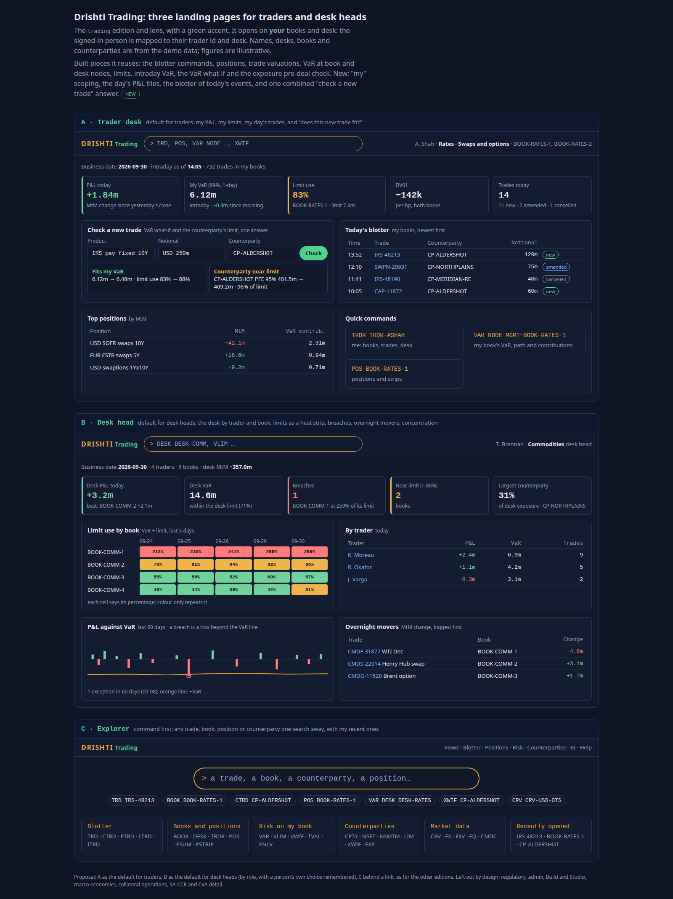

[Open the mock-up](mockups/trading/trading-landing.html). **Chosen:** the footer's proposal, adopted: A the default for traders, B for desk
heads (`trading.landing-by-role: {desk-head: desk, trader: trader}`, below the person's own choice), C behind the landing switch
([EDITIONS.md section 14](../admin/EDITIONS.md#14-drishti-trading)). A green accent on the terminal look.
**Code:** [`trading_landing.html`](../../drishti-console/web/templates/home/trading_landing.html),
[`drishti_trading-landing.js`](../../drishti-console/web/static/js/drishti_trading-landing.js), [`drishti_trading-landing.css`](../../drishti-console/web/static/css/drishti_trading-landing.css),
[`trading_landing.py`](../../drishti-console/core/trading_landing.py), [`trading_routes.py`](../../drishti-console/routes/trading_routes.py)
(`/api/home/trading/{me,valuations,blotter,risk,limits,pnl-var,traders}`, `POST /api/home/trading/check`), [`trading.yaml`](../../config/editions/trading.yaml).
The mock-up's names, desks, books and counterparties are the demo's; its figures are illustrative.

**Interactions.** Every trade id is a link (`TRD <id> <GO>`), every trader a link (`TRDR`), every chip and quick card runs its command.
*Check a new trade*: pick a product (from my live trades' products), a side, type a notional (`250m`, `1.5bn`), a counterparty (a list
from my trades) and a book, then **Check**: one VaR what-if and one pre-deal check, the two halves of the verdict filled when each answer
arrives. *View as* (a trader or a desk) for a person who may pick, remembered in their settings. A landing switch and the lens links sit
above every landing. **States.** *Loading:* `…` in every figure. *Error:* `Not available: <reason>` in the panel, `—` and the reason in a
tile. *Empty or not given by the data*, each said in place: "no valuations on <date>: no change to show", "MtM is masked for your role",
"no book above its limit", "No trade's MtM moved", "Nothing yet: type a command above"; the DV01 tile hidden when no trade holds a DV01; a
scope above `trading.max-rows` says **partial** ([section 2.4.5](#245-what-the-data-does-not-give-as-the-builder-reported)). **Phone**
(600 px and below): one column ([`drishti_trading-landing.css`](../../drishti-console/web/static/css/drishti_trading-landing.css)); the mock-up drew no
phone form; the phone tiers as for Risk (section 1.11.1).

| # | Panel (option) | Contents on the mock-up | Data, API or contract | Interaction | Gap row | Status |
|---|---|---|---|---|---|---|
| T1 | Bar and who (A, B) | `DRISHTI Trading` (amber, *Trading* green); a command line (*TRD, POS, VAR NODE …, XWIF*); *A. Shah · **Rates · Swaps and options** · BOOK-RATES-1, BOOK-RATES-2* (B: *T. Brennan · Commodities desk head*) | `/api/home/trading/me`; `trading.people`, a trader record, View as | View as | — | **Built** |
| T2 | Meta line (A) | *Business date **2026-09-30** · intraday as of **14:05** · 732 trades in my books* | `/api/home/trading/risk` (`intraday.lastAt`), valuations | — | — | **Built** |
| T3 | Tile: P&L today (A) | **+1.84m** green, *MtM change since yesterday's close*, green edge | `/api/home/trading/valuations` (`TVAL` on both dates) | — | — | **Built** |
| T4 | Tile: My VaR (A) | *My VaR (99%, 1-day)* **6.12m** *intraday · −0.3m since morning* | `/api/home/trading/risk` (the engine's VaR of my books' union) | — | — | **Partly built**: VaR and *intraday · N trades updated · hh:mm*; the change **since the morning** is not shown (TL14) |
| T5 | Tile: Limit use (A) | **83%** amber, *BOOK-RATES-1 · limit 7.4m* | the highest of my books' VaR ÷ `var-limit` | — | — | **Built** |
| T6 | Tile: DV01 (A) | **−142k** *per bp, both books* | Σ live trades' `DV01` | — | — | **Built** (hidden when no trade holds one) |
| T7 | Tile: Trades today (A) | **14** *11 new · 2 amended · 1 cancelled* | `/api/home/trading/blotter` (`SOURCE_UPDATE_TIME`) | — | — | **Built** ("new" reads 0 on the demo: TL1) |
| T8 | Card: Check a new trade (A) | *VaR what-if and the counterparty's limit, one answer*; Product *IRS pay fixed 10Y*, Notional *USD 250m*, Counterparty *CP-ALDERSHOT*, **Check** (green); verdict: **Fits my VaR** *6.12m → 6.48m · limit use 83% → 88%* and **Counterparty near limit** *CP-ALDERSHOT PFE 95% 401.5m → 409.2m · 96% of limit* | `POST /api/home/trading/check` → `POST /api/v1/var/what-if`, `POST /api/v1/exposure/what-if` ([section 2.4.4](#244-the-new-trade-check)) | fill, Check | — | **Built** (also Side and Book; fits, near, breaches; a fidelity line is TL8) |
| T9 | Card: Today's blotter (A) | *my books, newest first*; Time, Trade, Counterparty, Notional, a pill: 13:52 IRS-48213 CP-ALDERSHOT 120m **new**; 12:10 SWPN-20931 75m **amended**; 11:41 IRS-48190 40m **cancelled**; 10:05 CAP-11872 60m **new** | `/api/home/trading/blotter` | click a trade | — | **Built** |
| T10 | Card: Top positions (A) | *by MtM*; Position, MtM, VaR contrib.: USD SOFR swaps 10Y −42.1m 2.31m; EUR €STR swaps 5Y +18.6m 0.94m; USD swaptions 1Yx10Y +9.2m 0.71m | `/api/home/trading/risk` (component VaR, market value) | click a position | — | **Built** (ordered by VaR contribution, with market value) |
| T11 | Quick commands (A) | `TRDR TRDR-ASHAH` (me), `VAR NODE MGMT~BOOK-RATES-1` (my book's VaR), `POS BOOK-RATES-1` | the person's own, then `trading.yaml` `home.cards` | click | — | **Built** (my trader, my book's VaR, my book, my most traded counterparty, then the file's cards) |
| T12 | Meta line (B) | *Business date **2026-09-30** · 4 traders · 6 books · desk MtM **−357.0m*** | valuations, `me` | — | — | **Built** |
| T13 | Tile: Desk P&L today (B) | **+3.2m** *best: BOOK-COMM-2 +2.1m* | valuations by book | — | — | **Built** |
| T14 | Tile: Desk VaR (B) | **14.6m** *within the desk limit (71%)* | `DESK:<id>` from the VaR engine | — | — | **Built** |
| T15 | Tile: Breaches (B) | **1** red, *BOOK-COMM-1 at 259% of its limit* | books above 100% | — | — | **Built** |
| T16 | Tile: Near limit (B) | **2** amber *(> 80%) books* | `trading.near-limit` (0.8) | — | — | **Built** |
| T17 | Tile: Largest counterparty (B) | **31%** *of desk exposure · CP-NORTHPLAINS* | the share of the desk's positive MtM | — | — | **Partly built**: a share of **positive MtM**, not of exposure (TL2) |
| T18 | Card: Limit use by book (B) | *VaR ÷ limit, last 5 days*: a grid books × dates (09-24 … 09-30), BOOK-COMM-1 212% … 259% red, BOOK-COMM-2 78% … 86% amber, BOOK-COMM-3 green, BOOK-COMM-4 40% … 81%; *each cell says its percentage; colour only repeats it* | `/api/home/trading/limits` (each date's official record; `trading.limit-days`) | — | — | **Built** ("—" for a date without a record, named) |
| T19 | Card: By trader (B) | Trader, P&L, VaR, Trades: K. Moreau +2.4m 6.9m 9; R. Okafor +1.1m 4.2m 5; J. Varga −0.3m 3.1m 2 | `/api/home/trading/traders` (`TRADER_ID`; component VaR) | click a trader | — | **Built** (masked: "—" and the reason) |
| T20 | Card: P&L against VaR (B) | *last 60 days · a breach is a loss beyond the VaR line*: green and red daily bars around zero, an orange −VaR line, the exception circled; *1 exception in 60 days (09-08)* | `/api/home/trading/pnl-var` (the desk's official history; `trading.pnl-var-days`) | — | — | **Built** (hypothetical P&L; the bank's actual P&L is TL3; left out when the history is a replay) |
| T21 | Card: Overnight movers (B) | Trade, Book, Change: CMDF-31877 WTI Dec BOOK-COMM-1 −4.8m; CMDS-22014 Henry Hub swap +3.1m; CMDO-11520 Brent option +1.7m | valuations on both dates | click a trade | — | **Built** |
| T22 | Menu bar (C) | **Views · Blotter · Positions · Risk · Counterparties · BI · Help** | [`menus.yaml`](../../drishti-console/config/menus.yaml) | open a menu | LX1 | **Built**: Markets, Blotter, Positions, Risk and Counterparties menus of their own; BI by command (A19; [section 2.11.2](#2112-the-lens-menus-lx1-menusahtml), [section 2.3.7](#237-the-lens-is-configuration-product-panel-a19-2026-11-06)) |
| T23 | Big command line and chips (C) | *a trade, a book, a counterparty, a position…*; chips `TRD IRS-48213`, `BOOK BOOK-RATES-1`, `CTRD CP-ALDERSHOT`, `POS BOOK-RATES-1`, `VAR DESK DESK-RATES`, `XWIF CP-ALDERSHOT`, `CRV CRV-USD-OIS` | `trading.yaml` `home.chips` | type, `<GO>`; click a chip | — | **Built** |
| T24 | Command groups (C) | Blotter (`TRD`, `CTRD`, `PTRD`, `LTRD`, `ITRD`); Books and positions (`BOOK`, `DESK`, `TRDR`, `POS`, `PSUM`, `PSTRIP`); Risk on my book (`VAR`, `VLIM`, `TVAL`, `PNLV`); Counterparties (`CPTY`, `NSET`, `NSMTM`, `LIM`, `XWIF`, `EXP`); Market data (`CRV`, `FX`, `FXV`, `EQ`, `CMDC`) | the template's groups | click a command | — | **Built** (more commands per group; `PSUM` and `PSTRIP` left out by design: the compute-demo sample pack's, not a trading pack's) |
| T25 | Recently opened (C) | *IRS-48213 · BOOK-RATES-1 · CP-ALDERSHOT* | the person's command history (Trading's commands only) | click | — | **Built** |
| T26 | Default by role (footer) | "A as the default for traders, B as the default for desk heads (by role, with a person's own choice remembered), C behind a link" | `trading.landing-by-role`, the person's settings | the landing switch | — | **Built** |

**Gaps: on the mock-up, not in the product.**

1. **My VaR's change since the morning** (T4): the intraday VaR against the day's first (official or opening) figure (TL14).
2. **The largest counterparty's share of desk exposure**, not of positive MtM (T17; TL2).

#### 2.11.2 The lens menus (LX1, `menus/A.html`)


The shared mock-up, its options, the why of option A and the phone form: [section 1.11.4](#1114-the-lens-menus-lx1-menusahtml).
Trading's rows:

| # | Panel | Contents on the mock-up | Data, API or contract | Interaction | Status |
|---|---|---|---|---|---|
| X1 | Bar | `DRISHTI Trading`; the command line; menus **Views · Blotter · Positions · Risk · Counterparties · BI · Help** | the edition's top menus by id, in order (`menus.top`), [`menus.yaml`](../../drishti-console/config/menus.yaml) | open a menu | **Built**: `menus.top` in [`trading.yaml`](../../config/editions/trading.yaml), drawn by [`core/menus.py`](../../drishti-console/core/menus.py): Views, Engines, Markets, Blotter, Positions, Risk, Counterparties, Help; Build is not named (off in the lens), BI and Admin by command (A19) (replaces the menus part of T22) |
| X2 | Blotter menu | Trades `TRD`; By counterparty `CTRD`; By portfolio `PTRD`; By legal entity `LTRD` | a subject menu in [`menus.yaml`](../../drishti-console/config/menus.yaml), each item shown only when the edition keeps its command | click an item: its page or command | **Built** |
| X3 | Positions menu | Books `BOOK`; Desks `DESK`; Traders `TRDR`; Positions `POS` | a subject menu in [`menus.yaml`](../../drishti-console/config/menus.yaml), each item shown only when the edition keeps its command | click an item: its page or command | **Built** |
| X4 | Risk menu | My VaR `VAR`; VaR limits `VLIM`; Trade valuations `TVAL`; P&L vectors `PNLV` (and, by A19, Desk P&L `DPNL`, P&L explain `PNL`, Sensitivities `SENS`) | a subject menu in [`menus.yaml`](../../drishti-console/config/menus.yaml), each item shown only when the edition keeps its command | click an item: its page or command | **Built** |
| X5 | Counterparties menu | Counterparties `CPTY`; Netting sets `NSET`; Credit limits `LIM`; Pre-deal check `XWIF`; Exposure `EXP` | a subject menu in [`menus.yaml`](../../drishti-console/config/menus.yaml), each item shown only when the edition keeps its command | click an item: its page or command | **Built** |
| X6 | Phone form | below 640 px the subject menus fold into one **Trading** menu, a column per subject (option C) | [`core/menus.py`](../../drishti-console/core/menus.py) `lens_menu`; the bar's template and [`drishti_phone.js`](../../drishti-console/web/static/js/drishti_phone.js) put it in below 640 px | tap the lens menu, then an item | **Built** |
| X7 | Markets menu (A19) | not on the mock-up: the product panel's one Markets menu | Rates `CRV`, `REPO`, `FIX`; Volatility surfaces `IRV`, `CPV`, `FXV`; Foreign exchange `FX`, `FXF`; Credit `CDS`, `BND`; Equities and commodities `EQ`, `EQX`, `CMD`, `CMDC`: the one Markets menu (`gather:` of Curves, Volatility, FX and Credit, then its own columns), the items by `menus.markets`, three columns to a row | click an item: its command | **Built** |

On a phone (below 640 px) the subject menus fold into one menu named after the lens, first in the bar (option C's form, [menus/C](mockups/menus/C.html)), a column per subject; a wider screen keeps the subject menus in the bar. The configuration: [EDITIONS.md section 5.4](../admin/EDITIONS.md).

## 3. Drishti Market: what the market-data team needs, what the lens gives it today, and what comes next

**Status:** built parts as built (each statement cites its source, read on 2026-10-31); sections 3.5 and 3.8 are proposals, candidates
in the [implementation plan](IMPLEMENTATION_PLAN.md#lens-product-candidates-not-started), except where the plan already names the work.
**Read with:** [EDITIONS.md section 13](../admin/EDITIONS.md#13-drishti-market) (the lens as built),
[section 11](../admin/EDITIONS.md#11-drishti-market) (how to run it), [`config/editions/market.yaml`](../../config/editions/market.yaml),
the [market-data pack README](../../config/packs/market-data/README.md) (every kind and field),
[DATA_ARCHITECTURE.md](DATA_ARCHITECTURE.md#2-history-queries-an-entity-over-time) (an item over time), [VAR_GUIDE.md](../guides/VAR_GUIDE.md)
(how market data reaches VaR: through the upstream P&L vectors) and the plan's
[market-data rows](IMPLEMENTATION_PLAN.md#2914-oversight-proposed) (VaR at stake and the quality checks).

### 3.1 Who uses it

Drishti Market is "the bank's own market data in one product: curves, fixings, FX, volatility surfaces and cubes, credit curves, equities,
inflation, commodities, bonds and correlations, the inputs that feed risk and valuations. No trades and no VaR"
([`config/editions/market.yaml`](../../config/editions/market.yaml), its header).

| Persona | Accountable for | What they need from a system |
|---|---|---|
| **Market data analyst** (the market-data team; in many banks inside risk technology or a "market data management" function) | The end-of-day market data set that the valuation and risk batches use: complete, on time, consistent, correct; curve and surface construction inputs; fixings; corrections and their audit | Every item's latest value and history; checks that catch stale, missing, inconsistent and jumping data before the batch; who uses each item |
| **Valuation control** (product control's independent price verification, IPV) | That the marks the desks use agree with independent sources within tolerance; the month-end IPV report and reserves | Two sources side by side, the differences against tolerance, the trades affected |
| **Market risk methodology / time series** | The historical moves that become VaR's 509 scenario days: clean, complete, proxies documented | Long histories, jumps and gaps flagged, the proxies listed, the impact of a bad day on VaR |
| *Also served*: a **quant** or **structurer** reading a curve or a surface | Pricing inputs | The pages, the forms, the history |

**What they do not own:** the trades, the VaR and the limits (the Risk and Trading lenses); the vendor contracts (procurement), though
licensing shapes what they may show (section 3.6).

#### 3.1.1 A day, a month and a year

| When | What the team does |
|---|---|
| **Before the batch** (end of day, 17:00 to 20:00) | The official close snap arrives from vendors and internal sources; curves and surfaces are built; the team checks completeness, staleness, arbitrage and jumps; corrects or proxies; releases the set to the valuation and VaR batches |
| **The morning** | Reviews overnight exceptions; answers the desks' and risk's questions ("why did my P&L move: is the curve right?"); re-releases a corrected item when needed |
| **Intraday** | Monitors live sources (for intraday risk and pricing); onboards new instruments and curves |
| **Month-end** | IPV: compares desk marks to independent sources; computes reserves; reviews proxies and long-stale items; reports data quality statistics |
| **Year** | Vendor review (coverage, cost, licences); the VaR history review with methodology (gaps, proxies, the stress window's data) |

### 3.2 Their questions: the morning, intraday, the close, month-end

#### 3.2.1 The close (the batch window)

| Question | Drishti today | Gap |
|---|---|---|
| *Did everything arrive?* | **Partly**: **Stale** check per curve and surface (`AS_OF` older than the business date by more than `quality.stale-days`, 2 business days) and per other kind by its latest load ([EDITIONS.md section 13](../admin/EDITIONS.md#13-drishti-market), Quality); late loads by expectation ([DATA_GUIDE.md section 8](../guides/DATA_GUIDE.md#8-expectations-and-late-data)) | Completeness against an **expected list** of ids per date (a new curve that never arrived is not stale, it is missing): ML8 |
| *Is anything internally inconsistent?* | **Built**: **Gaps** (a curve missing a tenor every other curve of its type has), **Discount factors and forwards** (a DF that does not fall with maturity or is outside (0, 1]: critical; a negative forward: warning), **Vol surfaces** (a vol at or below zero; ATM total variance falling with expiry on FX and equity surfaces) | Calendar and smile checks on the commodity, cap and swaption grids (planned): ML4 |
| *Did anything jump?* | **Partly**: the desk's **Biggest moves** ranks the latest move in σ of each item's own daily moves (a "jump" at 3σ or more), but only as a ranking on the desk, not as a Quality check | σ-jump as a check (planned): ML2 |
| *Do two sources disagree?* | **Not built**: the lake holds one source per kind | ML3 (planned) |
| *If this is wrong, what does it cost?* | **Not built**: the tile reads *Impact on VaR and valuations comes in a later release* | VaR at stake (planned): ML1 |

#### 3.2.2 The morning

| Question | Drishti today | Gap |
|---|---|---|
| *What moved overnight, and is it real?* | **Built**: **Biggest moves** over 21 business days in σ (10 or more moves held), else largest moves against the day before, else "no history" ([EDITIONS.md section 13](../admin/EDITIONS.md#13-drishti-market)); a day-over-day change on tiles only when both days hold real data | Moves per pillar (the desk checks `TEN_Y`, `SPREAD_5Y`, `MID`, `FRONT`, `LEVEL`); a curve's shift, twist and butterfly (ML5) |
| *A desk says its P&L is wrong because of a curve: which trades use it?* | **Not built**: no link from an item to the trades and VaR inputs that use it | ML1, "Used by" |
| *What did we correct, when and why?* | **Partly**: an item's history over dates ([DATA_ARCHITECTURE.md](DATA_ARCHITECTURE.md#2-history-queries-an-entity-over-time)); the load's provenance | Corrections as records with a reason (ML7) |

#### 3.2.3 Intraday

| Question | Drishti today | Gap |
|---|---|---|
| *What is the live level?* | **Partly**: the lake holds end-of-day documents; live connectors exist in the platform but the market-data pack is served from the demo lake (`market-store`) | Live market data is the bank's systems' job; Drishti shows what is loaded. Not a gap to fill in the lens |
| *Watch this curve for me* | **Built**: monitors and alerts on numbers are on (`market.yaml` `features`) | — |

#### 3.2.4 Month-end and the year

| Task | Drishti today | Gap |
|---|---|---|
| IPV: marks against independent sources | **Not built** (one source) | ML3 with a tolerance table and a report |
| Proxy review: which instruments have no data of their own | **Partly**: each P&L vector and scenario-PV row says `ok`, `proxied` or `failed` ([VAR.md section 2.2](../contracts/VAR.md#22-pnl-vector-one-pl-vector-per-trade)), but in the Risk packs, not the Market lens | A proxy list in the Market lens (ML9) |
| Data quality statistics over the month | **Not built**: the checks run when the Quality landing opens; nothing keeps their results | ML7 |
| Market data in BI | **Not built**: the pack ships no BI dataset; BI offers its themes only (`market.yaml` `bi`) | ML6 |
| The VaR history review | **Partly**: an item's history; the moves in σ | Jumps across the whole history; the VaR at stake of a bad historical day (ML10) |

### 3.3 Needs by area, with status

#### 3.3.1 Coverage: what the lens shows

| Need | Status | Evidence |
|---|---|---|
| Rates: IR curves, repo, swaption and cap vols, fixings, inflation | **Built**: `CRV`, `REPO`, `IRV`, `CPV`, `FIX`, `INF`, `INFC` | `market.yaml` `commands.allow`; [market-data README](../../config/packs/market-data/README.md) |
| FX: spot, forwards, vol surfaces | **Built**: `FX`, `FXF`, `FXV` | |
| Credit and bonds | **Built**: `CDS`, `BND` | |
| Equities and commodities, their curves and vols, dividends | **Built**: `EQ`, `EQX`, `DIV`, `EQV`, `CMD`, `CMDC`, `CMDV` | |
| Correlations, computed on request from history | **Built**: `CORR`, `CORRC`, `EQB` | |
| Issuers and holiday calendars | **Loaded, hidden**: core's commands (`CAL`, `ISS`) are not in the allow-list; calendars are used by the checks (business days) | [EDITIONS.md section 13](../admin/EDITIONS.md#13-drishti-market); section 3.9, decision 6 |
| Query by form | **Built** (`forms: on`) | |
| History of an item | **Built** for dated kinds; the pack's `history:` block shapes equities, indexes, FX spots, IR and credit curves, commodities, bonds, inflation | `config/packs/market-data/pack.yaml` (`history:`) |

#### 3.3.2 Quality checks

| Check | Status | Evidence or row |
|---|---|---|
| Stale (`quality.stale-days`) | **Built** | EDITIONS.md section 13, check 1 |
| Gaps (missing tenor against the type) | **Built** for types of three or more | check 2 |
| Discount factors monotone and in (0, 1]; negative forwards | **Built** | check 3 |
| Vol surfaces: non-positive vols; ATM total variance falling with expiry (FX, equity) | **Built** | check 4 |
| Calendar checks on commodity, cap and swaption grids; smile (butterfly) checks | **Planned** | ML4 |
| Jumps over n σ as a check | **Planned** | ML2 |
| Two sources disagreeing | **Planned**, needs a second source per kind | ML3 |
| Completeness against an expected list | **Not built** | ML8 |
| Quality results kept, with acknowledgements | **Not built** | ML7 |

#### 3.3.3 Impact and lineage

| Need | Status | Evidence or row |
|---|---|---|
| Who uses each item (trades, books, VaR inputs) | **Not built**; trades carry `LEGS[].INDEX` (a benchmark name) and `DISCOUNT_INDEX`, not market-data ids ([trading pack README](../../config/packs/trading/README.md)); IR curves carry an `INDEX` field ([market-data README](../../config/packs/market-data/README.md)) | ML1 |
| VaR at stake of a flagged item | **Planned** | ML1 |
| Valuations at stake | **Planned** | ML1 |
| The market-data line of a data-trust card | **Proposed** as RO13 of the oversight analysis (reusing the Quality checks) | [section 5.4.6](#546-the-data-trust-card-ro13-and-model-performance-ro14) |

#### 3.3.4 Analytics

| Need | Status | Evidence or row |
|---|---|---|
| Moves in σ of their own history | **Built** (desk ranking) | EDITIONS.md section 13 |
| A curve today against a week ago | **Built** when the history holds that day | USD curves card |
| Shift, twist, butterfly of a curve's move | **Not built** | ML5 |
| Correlations and betas | **Built** (`CORR`, `EQB`) | |
| Market data BI | **Not built** (no dataset) | ML6 |

### 3.4 The landings

One template, `home/market_landing.html`, with `drishti_market-landing.js` and `drishti_market-landing.css`, a **violet accent**. The figures are worked out
by `drishti-console/core/market_landing.py` from the pack's own answers (search, raw documents, the business date, one field's history
through `/api/v1/history/{kind}/{id}/series`), read as the person, cached two minutes per person, and served by `/api/home/market/desk`,
`/api/home/market/moves` and `/api/home/market/quality` (`404 DRS-4023` unless the edition or lens shows `CRV`)
([EDITIONS.md section 13](../admin/EDITIONS.md#13-drishti-market)). Panel by panel, with what each leaves out: the checklist in
[section 3.11.1](#3111-the-market-landings-market-landinghtml).

#### 3.4.1 A: Market desk (`desk`, the default)

Tiles **USD OIS 10Y** (`CRV-USD-OIS` `TEN_Y`), **USD 2s10s** (`CRV-USD-PROJ` `SLOPE_2S_10S`), **EUR/USD 1M ATM vol** (`FXV-EURUSD`
`ATM_1M`), **CDS 5Y, median** (every credit curve's `SPREAD_5Y`), each with a change only when the history holds real data for the latest
day and the business day before; **Data exceptions** (the Quality checks' count; opens C). Cards: **USD curves** (OIS zero rates today
against five business days before when held, else OIS against projection), **Biggest moves** (each curve's `TEN_Y`, credit's
`SPREAD_5Y`, FX's `MID`, commodity's `FRONT`, index's `LEVEL` over 21 business days, in σ when ten or more moves are held, "jump" at 3σ;
less history: largest moves against the day before; none: says so) and the **Quick cards** `CRV CRV-USD-OIS`, `FXV FXV-EURUSD`,
`IRV IRV-USD`, `FIX FIX-SOFR`.

#### 3.4.2 B: Explorer (`explorer`)

A big command line; the chips of `home.chips` (`CRV CRV-USD-OIS`, `CRV CRV-CAD-GOVT`, `FXF FXF-EURUSD`, `FXV FXV-USDJPY`, `IRV IRV-USD`,
`CDS CDS-SOLARIS`, `INFC INFC-USCPI`, `CMDC CMDC-WTI`, `CORR CORR-G10FX`, `DATAMAP`); counts by asset class (each command's `matched`); the
commands grouped by asset class with their counts; Recently opened (Market's commands only), Knowledge, Data map, Learn.

#### 3.4.3 C: Quality (`quality`)

The checks the data supports, by severity, worst first, each item opening its command (section 3.3.2's built rows). Tiles: **Critical**,
**Warnings**, **Clean** (the share of items checked with no exception) and, in place of the mock-up's **VaR at stake**, the note *Impact
on VaR and valuations comes in a later release*. A **Checks run** card gives each check's items and flags.

**On the committed demo data every check is clean**: the market data is consistent and its dates move with the lake's business dates
(EDITIONS.md section 13). The checks are proved on crafted bad data in `test_market_landing.py` (stale, gap, discount factor, forward and
surface problems). Left out: VaR at stake and the Impact card (ML1), jumps as a check (ML2), two sources (ML3: one source per kind in the
lake), calendar spreads on commodity, cap and swaption grids (a different underlying per row, so the FX and equity rule does not apply:
ML4), and market-data BI (the pack ships no dataset; the edition keeps BI to `market-data-*` names so it never offers VaR or exposure
items, `market.yaml` `bi`: ML6).

### 3.5 Gaps, with design sketches

Market data is **fundamental** (the pack's contracts, JSON Lines into the lake); every check, move, impact and link is **computed on
demand**; an acknowledgement or a correction note is a **Drishti-owned** record, versioned; BI is the report layer
([COMPUTED_ATTRIBUTES.md section 1.2](COMPUTED_ATTRIBUTES.md#12-the-rule-for-deciding-which)). Sizes: **S** days, **M** one to three
weeks, **L** more than three weeks.

| Id | Gap | Size | Depends on |
|---|---|---|---|
| ML1 | Usage map, "Used by", and VaR and valuations at stake | M (map, used by), then S (at stake) | a usage rule set; VaR contributions (built) |
| ML2 | σ-jump check | S | history (built) |
| ML3 | Two sources and tolerance (and IPV) | M | a second source per kind |
| ML4 | Grid calendar and smile checks | M | — |
| ML5 | Curve move decomposition (shift, twist, butterfly) and pillar moves | S | history (built) |
| ML6 | A market-data BI dataset | S | — |
| ML7 | Quality results kept, acknowledged and corrected, with statistics | M | content store (built) |
| ML8 | Completeness against an expected list | S | expectations (built for loads) |
| ML9 | The proxy list in the Market lens | S | P&L vector status (built) |
| ML10 | A historical-day check for the VaR window | M | ML2, ML1 |

#### 3.5.1 ML1: who uses each item, and what is at stake

**Why it is not trivial.** Drishti's VaR does **not** read market data: an upstream risk batch revalues each trade under 509 historical
scenarios with the bank's market data and sends a P&L vector or scenario PVs per trade
([VAR_GUIDE section 1](../guides/VAR_GUIDE.md#1-the-question-var-answers)). So "VaR at stake" is not a recomputation with a corrected
curve; it is a measure of **how much of VaR and MtM rides on the trades that use the flagged item**, computed, never invented.

**Step 1: the usage map (M).** A computed kind `market-data-usage` (proposed), keyed by market-data id and date, built from the trades
by **rules** (configuration), or from the bank's pricing configuration when it can supply one (fundamental, preferred):

| Market data | Used by a trade when (rule, illustrative) | Evidence the rule can use |
|---|---|---|
| IR projection curve `CRV-*` | a leg's `INDEX.NAME` equals the curve's `INDEX` | trades' `LEGS[].INDEX` ([trading pack README](../../config/packs/trading/README.md)); curves' `INDEX` ([market-data README](../../config/packs/market-data/README.md)) |
| IR discount curve | a leg's `DISCOUNT_INDEX`, else the leg currency's OIS curve (a site rule `CRV-<CCY>-OIS`) | `LEGS[].DISCOUNT_INDEX`, `LEGS[].CURRENCY` |
| Rate fixing `FIX-*` | a floating leg's index with a reset in the window | `LEGS[].CASH_FLOWS[].RESETS[]` |
| FX spot, forward curve, vol surface | the trade's currency pair (legs in two currencies, or an FX product) | legs' currencies; the FX kinds' `FX_SPOT`, `FX_FORWARD_CURVE`, `FX_VOL_SURFACE` links |
| Equity, dividend curve, equity vol | the trade's underlying equity or index | the equity kinds' `DIVIDEND_CURVE`, `EQUITY_VOL_SURFACE` links |
| Commodity curve and vol | the leg's index or commodity | `COMMODITY_CURVE`, `COMMODITY_VOL_SURFACE` |
| Credit curve | the reference entity or issuer | `ISSUER` |

The map answers per item: the trades, books and desks that use it, their count and **MtM** (from the valuations), the **pillars** a trade
is sensitive to (by maturity bucket, when sensitivities arrive). A **Used by** panel on each market-data page (CRV, FXV, CDS …) and a
column on the Quality list. Unmapped trades are counted as *unknown usage*, never dropped.

**Step 2: what is at stake (S after step 1).** **MtM at stake**, **component VaR at stake** (the users' component VaR in `BANK`, adding
up to the bank's VaR), **incremental VaR** (on request; an upper bound of the error's reach) and, when per-trade sensitivities exist,
**sensitivity at stake** (Σ sensitivity to the flagged pillar × the suspected error: the stale gap, or the jump less a normal move, a
first-order P&L of the error). The rules are in [section 3.5.11](#3511-var-at-stake-jumps-and-two-sources-the-build-design).

**A bad historical day** (ML10): when the flagged point is in the **history** (a past day's move), the question is whether that scenario
day is in today's tail. If the day is the VaR scenario, VaR at stake is VaR less the VaR without that scenario (the next rank of the same
sorted vector, [VAR_GUIDE section 18.1](../guides/VAR_GUIDE.md#181-var)); if it is in the ES tail, the same for ES. This assumes the
upstream batch builds its scenarios from the same history the lake holds: the answer says so.

**Data needs.** The trades and valuations (held); a usage rule set or the bank's pricing configuration (section 3.6); sensitivities by
pillar for the last figure. **Tests:** crafted trades using a crafted curve appear under Used by; the component VaR at stake of a curve
used by every trade equals the bank's VaR; removing the scenario day that is the VaR scenario gives the next rank; an unmapped trade is
counted as unknown.

#### 3.5.2 ML2: the σ-jump check

The desk already measures the latest move in σ of the item's own daily moves over 21 business days when ten or more are held
(`drishti-console/core/market_landing.py`, `moves`). The check runs that for every item and **every pillar** (a curve's
`POINTS[].ZERO_RATE`, a surface's grid, not only the headline field), warning at 4σ and critical at 6σ (configurable), names a spike
that reverts as a **suspected bad print**, and counts items with fewer than ten moves as *not checked*; the exact rules and settings are in
[section 3.5.11](#3511-var-at-stake-jumps-and-two-sources-the-build-design). **Size** S. **Tests:** a crafted spike at 5σ is a warning, at
7σ critical; a spike-and-revert pair is named; an item with nine moves is "not checked".

#### 3.5.3 ML3: two sources, tolerance and IPV

**Data.** Each kind may carry a second source: the same id and date with a `SOURCE` (for example `INTERNAL`, `VENDOR-A`), delivered as a
second load of the same contract (a source column in the lake table) rather than a second kind. The IR curve already lists the quote
sources it was built from (`SOURCES`, [market-data README](../../config/packs/market-data/README.md)): the lake today holds one built curve
per id.

**The check.** Per field and pillar, the difference against a **tolerance table** by asset class and tenor (configuration: 0.5 bp for G10
OIS pillars, 2 bp for credit spreads, 0.25 vol points for liquid FX vols, 0.1% for equity closes …); the rule and its states are in
[section 3.5.11](#3511-var-at-stake-jumps-and-two-sources-the-build-design), the source the batch used marked. **IPV** at month-end: the
same comparison of the desk's marks (the official close) against the independent source, aggregated by desk with ML1's **MtM at stake**,
as a BI report signed off through the report sign-off framework. **Size** M. **Depends on** a second source per kind (data). **Tests:**
crafted pairs inside and outside tolerance; a missing second source is "single source", never "agreed".

#### 3.5.4 ML4: grid calendar and smile checks

| Grid | Calendar check | Smile check |
|---|---|---|
| **FX, equity surfaces** | Built: ATM total variance rising with expiry; extend to every delta or strike column | Call prices convex and decreasing in strike (no butterfly or call-spread arbitrage), computed with Black from each expiry's vols (FX surfaces converted from delta to strike first) |
| **Commodity vol surface** | Per contract (row), total variance rising with option expiry where a row has several expiries; never across rows (different underlyings) | As FX and equity, per row |
| **Cap vol surface** | Caplet (forward) variance positive after stripping the flat cap vols by maturity: σ²(T₂)·T₂ ≥ σ²(T₁)·T₁ as a first test, the stripped caplet vols ≥ 0 as the full one | Convexity in strike per maturity |
| **Swaption cube** | Along a **co-terminal** line (expiry + tenor fixed), total variance rising with expiry; not along a fixed tenor (a different underlying) | Convexity in strike per expiry and tenor |

Each finding names the cell and its neighbours. **Size** M. **Tests:** a crafted arbitrage per grid type; a clean demo stays clean.

#### 3.5.5 ML5: curve moves decomposed, and moves per pillar

For a curve and two dates: the move per pillar in basis points; **shift** (the mean move), **twist** (2s10s or a slope regression),
**butterfly** (the belly against the wings), with the share of the move each explains; for a surface, the ATM level move and the skew
move. A card on the Market desk under Biggest moves, and a tab on the curve page. Derived from two dated documents; **S**. Also the input
section 2.5.4 needs for a P&L explain (market moves per factor).

#### 3.5.6 ML6: a market-data BI dataset

Datasets `market-data-curves` (curve × pillar × date: zero rate, DF, forward), `market-data-surfaces` (surface × expiry × strike or
delta × date), `market-data-quality` (item × check × date, from ML7's records) and a model `market-data`; the edition already keeps BI to
these names (`market.yaml` `bi`). **Size** S. **Tests:** the dataset's rows equal the documents' pillars; the edition offers only these.

#### 3.5.7 ML7: quality results kept, acknowledged and corrected

**Today** the checks run when the Quality landing opens; nothing is kept. **Design:** the official end-of-day run of the checks (after the
market data load, beside the VaR official run) writes **one immutable record per date** of every exception (check, item, pillar, value,
threshold) and the counts per check; a **Drishti-owned acknowledgement** per exception (accepted as correct with a reason, corrected with
the new load's batch id, proxied), versioned, four eyes optional; statistics over the month (exceptions per check and per source, time
to resolve) in BI (ML6). The record points at the load's batch id; it never copies a corrected value as truth. **Size** M. **Tests:** an
exception acknowledged stays acknowledged on reopen; a corrected load clears it and links the batch; the month statistics.

#### 3.5.8 ML8: completeness against an expected list

An **expected list** per date: the ids each kind should have (configuration or derived: every id loaded on most of the last N business
days, or used by a live trade through ML1). Missing ids are a **critical** "missing" exception (distinct from stale). Reuses the load
expectations ([DATA_GUIDE.md section 8](../guides/DATA_GUIDE.md#8-expectations-and-late-data)) one level down: from "the kind loaded" to
"each id loaded". **Size** S.

#### 3.5.9 ML9: the proxy list

The P&L vector and scenario-PV rows say `ok`, `proxied` or `failed` per trade ([VAR.md section 2.2](../contracts/VAR.md#22-pnl-vector-one-pl-vector-per-trade)).
With ML1's usage map, the Market lens lists the **market data behind the proxies**: which items are missing so that trades are proxied,
the trades, their MtM and component VaR. Reading the VaR engine's status needs the market-risk pack's read access, not its commands: the
Market lens hides VaR, so the list is a read-only card (section 3.9, decision 3). **Size** S.

#### 3.5.10 ML10: the historical-day check for the VaR window

The VaR window is the last 509 business days of moves. Run ML2 over the **whole window** of every item the VaR uses (by ML1), not only
the latest day; list suspected bad days with their **VaR at stake** (section 3.5.1: the scenario's rank today and the VaR without it). A
monthly task for methodology, a BI report, and the evidence for the stress window review (the stress window tool chooses the window; this
checks its data). **Size** M.

#### 3.5.11 VaR at stake, jumps and two sources: the build design

ML1's at-stake step, ML2 and ML3, with ML7's kept records for *Since* (ML11), as one build on the Quality landing (C). Mock-ups:
[section 3.11.3](#3113-quality-with-var-at-stake-jumps-and-two-sources-market-checks).

**What it shows.** On the Quality landing: the tiles **Critical**, **Warnings**, **Clean**, **VaR at stake** (in place of today's note)
and **Two sources** (items compared and agreeing); the exceptions worst first with **Since**, **Used by** (trades and desks),
**MtM at stake** and **Component VaR at stake**; the opened exception's evidence (the moves against σ for a jump, the pillars of both
sources for a disagreement), who uses it by desk, and what is at stake. A **Used by** panel on each market-data page (`CRV`, `FXV`,
`CDS` …). Market shows the figures read-only; trade lists stay in Risk (decision 2).

**One screen, three views.** The Quality landing has a view switch, **Exceptions · Impact · Checks**, over the same records and the
same API:

| View | Mock-up | What it draws |
|---|---|---|
| **Exceptions** (the default) | A | the tiles, the exceptions worst first with Since, Used by and the at-stake figures, and the opened exception's evidence, users and two sources |
| **Impact** | B | every flagged item's component VaR at stake to scale, signed, and the usage matrix by desk; the evidence a click away |
| **Checks** | C | a tab per check (jumps, two sources, stale, gaps, arbitrage), each with its own list and chart |

The chosen view is kept in the address (`view=exceptions|impact|checks`) and remembered in the person's settings, beside the landing
choice of the Market Home ([EDITIONS.md section 13](../admin/EDITIONS.md#13-drishti-market)); the date and the check filters are shared
by the three. The phone draws its own tiers (below) whatever view is chosen.

**How it is built: Sutra panels on the Quality landing.** The landing keeps its bar, meta line and landing switch; its body becomes a
Sutra-drawn view of a page kind, `market-quality`, whose id is the business date (`MDQ 2026-09-30` opens the same page), painted in place
by the one renderer of every screen ([CLIENT_RENDERER.md](CLIENT_RENDERER.md)). Each view is one Sutra of that kind
(`market-quality`, `market-quality-impact`, `market-quality-checks`), selected by the switch as `?sutra=` selects a Sutra
([RACHANA_REFERENCE, events, sources and children](../guides/RACHANA_REFERENCE.md#events-sources-and-children-sutra-next)), so a bank
tailors the panels, columns and thresholds shown in YAML. The opened exception is a Sutra Next child of the exceptions table. **VaR at
stake is read from the engine by a panel:** a computed kind, `market-data-at-stake` (id the item, `params: { incremental }`), served by a
reactive connector whose engine is Drishti's own Java engine calling the VaR engine's decomposition of `BANK`
([REACTIVE_CONNECTOR.md](../connectors/REACTIVE_CONNECTOR.md#reading-a-computed-kind)); the At stake panel reads it with `source:` and
shows *computing*, *ready* or *refused* as every computed panel does, and the incremental VaR is the same read with `incremental: true`
on request. The acknowledgements (Accept as correct, Corrected, Proxied) are Sutra Next forms with write-back to the `owned` target
(`save: { kind: market-data-quality, target: owned, reason: required }`, [WRITE_BACK.md section 4a](../guides/WRITE_BACK.md#4a-submitting-a-change-write-back)).

| Part | Kind or fragment |
|---|---|
| Tiles (K2) | `metric` (the kit's `key-figure@1`) |
| Exceptions (K3) | `row-picker@1` (a `table` that emits `open`) |
| Jump evidence (K4) | `line` over the moves, with ±4σ and ±6σ as reference lines |
| Used by (K5) | `ranked-bars@1` (`hbar`) by desk, `kv` for the counts and *unknown usage*, `links` to Risk |
| At stake (K6) | `kv` and `metric` over the computed kind `market-data-at-stake` |
| Two sources by pillar (K7) | `table` (both sources, the difference, the tolerance, the state, toned) |
| Record actions (K8) | `kv` with the forms above |
| Impact view (K9) | `hbar` (signed, toned) and `pivot` (item by desk, `heat`) |
| Checks view (K10) | `tabs` over the checks, each a `table` and an `hbar` of the moves in σ |
| Used by on item pages (K12) | the kit fragment `ranked-bars@1` added to the `CRV`, `FXV`, `CDS` … Sutras, reading `market-data-usage` with `source:` |

No new panel kind is needed. One small addition is: **reference lines on `line` and `area`** (`markers:`, as `histogram` has), for
±4σ and ±6σ on the jump evidence; until it exists, the thresholds are said under the chart. The new pack fragment is
`quality-exception@1` (the opened exception's panels, used by the three views).

**How each figure is computed.**

| Figure | Rule |
|---|---|
| Move | m_t = x_t − x_{t−1} between consecutive business days that both hold real data, per item and **per pillar** (a curve's points, a surface's grid cells), in the natural unit: basis points for rates and spreads, log return for prices and levels, vol points for vols |
| σ | the population standard deviation of the item's previous moves in the window (21 business days, today excluded), as the Market desk ranks moves; fewer than ten moves: *not checked*, counted as such |
| Jump | z = \|m_t\| / σ; warning at z ≥ 4, critical at z ≥ 6 (decision 5); the item takes its worst pillar |
| Suspected bad print | yesterday's pillar was a jump and today's move reverses it (opposite sign, \|m_t + m_{t−1}\| ≤ 25% of \|m_{t−1}\|): named on today's exception |
| Two sources | d = a − b per pillar between the primary source (the one the batch used, `INTERNAL` by default) and the second, in the natural unit (relative for prices); agree when \|d\| ≤ τ, warning when τ < \|d\| ≤ 3τ, critical above, τ from the tolerance table by asset class and tenor; no second row: *single source*, never *agree*; a second row of an older date: *second source stale* |
| Used by | the usage map (section 3.5.1): the trades whose rules match the item, rolled to their positions (a position's trades share an instrument and so their market data); unmatched trades counted as *unknown usage* |
| MtM at stake | Σ \|MtM\| of the users (`trade-valuation`) |
| Component VaR at stake | Σ of the users' positions' component VaR in `BANK` from one decomposition of the bank by position (cached with the VaR page's answers; the decomposition: [VAR_GUIDE section 18.3](../guides/VAR_GUIDE.md#183-decomposition-of-a-scope-into-parts)); signed: a negative sum means the users hedge the bank's tail; also as a share of VaR BANK |
| VaR at stake tile | the largest component VaR at stake among **critical** items, with the item named (decision 1) |
| Incremental VaR | on request only: VaR BANK − VaR of BANK without those positions (one more scope, exact) |
| Since | the first date of the unbroken run of daily quality records holding the same exception (ML7) |

A discount curve that every trade uses carries a large component VaR at stake whatever its error: the figure says how much of today's VaR
rides on the item, not the size of the error, and the tile's note says so.

**Data used.** The market-data contracts as they are (`ir-curve`, `credit-curve`, `fx-vol-surface`, `commodity-curve`,
`inflation-curve` and the rest of the pack) and their history; `trade` (legs' `INDEX`, `DISCOUNT_INDEX`, currencies, underlyings),
`trade-valuation`, `position`, `pnl-vector` and `scenario-pv` (the bank's decomposition), `var-official`; `calendar` (business days).
Three additions, described here and created with the build:

- **A `SOURCE` field on every market-data contract** (text, optional; absent reads as the primary source), added to the lake key so a
  second load of the same contract can sit beside the first. Existing data stays valid unchanged.
- **`market-data-usage`** (proposed mnemonic `MDU`, computed, never stored as truth): one row per item, date and position: `ITEM_KIND`,
  `ITEM_ID`, `BUSINESS_DATE`, `POSITION_ID`, `TRADE_IDS`, `DESK`, `BOOK`, `RULE` (the rule that matched, or `BANK-MAP` when the bank's
  pricing configuration supplied it), `PILLARS` (when sensitivities say which), `MTM`. The rules live in a pack configuration file
  (proposed `usage-rules.yaml` of the market-data pack), one rule per kind as the table of section 3.5.1.
- **`market-data-quality`** (proposed mnemonic `MDQ`, Drishti-owned, ML7): one immutable record per date and exception: `BUSINESS_DATE`,
  `CHECK`, `ITEM_KIND`, `ITEM_ID`, `PILLAR`, `VALUE`, `REFERENCE` (σ, or the second source's value), `MEASURE` (z, or the difference),
  `THRESHOLD`, `SEVERITY`, `FIRST_SEEN`, `BATCH_ID`; and a versioned acknowledgement: `ACK` (`ACCEPTED`, `CORRECTED`, `PROXIED`), `REASON`,
  `CORRECTED_BY_BATCH`, `ACK_BY`, `ACK_AT`.

The two new kinds get their contract files (status *planned*) once the contract schema accepts that status; until then this section is
their description. On the demo, the decided synthetic second source is a second load with `SOURCE: VENDOR-B` and small, labelled
differences, a few of them crafted beyond tolerance so the check shows something (decision 8).

**Settings (proposed, in the edition's `quality:` block beside `stale-days`).**

| Key | Default | Meaning |
|---|---|---|
| `quality.jump.warn-sigma` | `4` | a jump at or above this many σ is a warning |
| `quality.jump.critical-sigma` | `6` | … critical |
| `quality.jump.window-days` | `21` | business days of moves behind σ |
| `quality.jump.min-moves` | `10` | fewer moves: not checked |
| `quality.jump.revert-share` | `0.25` | how close to a full reversal counts as spike and revert |
| `quality.two-source.primary` | `INTERNAL` | the source the batch used |
| `quality.two-source.critical-multiple` | `3` | a difference above this many tolerances is critical |
| `quality.two-source.tolerances` | a table by asset class and tenor (0.5 bp G10 OIS, 2 bp credit, 0.25 vol FX liquid, 0.1% equity closes …) | valuation control's policy |
| `quality.at-stake.scope` | `BANK` | the scope whose components are summed |

**Command, CLI and API (proposed; no existing word is reused).**

- `MDQ [date]` lists the kept quality records with their acknowledgements; `<command> <id> USED` (for example `CRV CRV-CAD-GOVT USED`)
  opens an item's Used by panel.
- `drishti.py quality run --pack market-data --date` runs the checks and writes the day's records; `drishti.py quality at-stake <kind>
  <id> [--incremental]` prints the at-stake figures.
- `/api/home/market/quality` gains `jumps`, `twoSource`, `atStake` and `since`; `GET /api/home/market/usage/{kind}/{id}` answers Used
  by (counts, desks, MtM, component VaR; never trade lists in Market); `POST /api/home/market/at-stake/{kind}/{id}/incremental` computes
  the incremental VaR on request.

**Phone.** The four tiles are **must**; the top five exceptions with severity and VaR at stake are **glance**; the evidence and Used by
are **more**; acknowledging an exception is **desk** (it needs a reason and a batch).

**Open questions for the product owner.**

1. **Mock-up choice:** A (the Quality landing with Used by and VaR at stake, recommended), B (impact first) or C (a tab per check).
   **Decided (product owner, 2026-11-01):** one screen; A is the default view, B and C are views on the same screen (the view switch
   above), built as Sutra panels on the Quality landing.
2. **Who sees VaR at stake in Market:** everyone in the lens (the figure is an aggregate, recommended), or only people whose role reads
   VaR results elsewhere.
3. **Pillars checked:** every pillar (recommended), or the headline fields only until ML7's records are in.
4. **The demo's crafted disagreements:** a handful, each labelled in the second source's rows (recommended), or none beyond tolerance.

### 3.6 Data needed

| Data | Grain and cadence | Needed by | Source and licensing note |
|---|---|---|---|
| End-of-day market data, every kind of the pack | per id per business date | everything (built) | the bank's market data system and vendors. **Vendor licences** decide who may see vendor data in another application: a display licence for the users, sometimes a per-user count; derived data (a built curve) is usually freer than raw quotes. The bank's market-data team owns this; the Market lens should show source and licence per item (as the public-data packs' `PROVENANCE` does) |
| History of at least 21 business days (10 for σ) and the 509-day window for ML10 | per id per date | moves, ML2, ML10 | the same; the demo lake moves with its business dates |
| A second source per kind | per id per date | ML3 | a second vendor or the internal mark |
| A usage map (pricing configuration: which curves, surfaces and fixings each product or trade uses) | per trade or per product rule | ML1, ML9, ML10 | the bank's pricing system; otherwise Drishti's rules (section 3.5.1) |
| **Position sensitivities by pillar** (DV01 by curve and tenor, vega by surface point) | per trade per date | ML1's sensitivity at stake | the bank's risk engine; the `position-sensitivity` contract ([section 5.7](#57-sensitivities-data)); RO4 ([section 5.4.4](#544-ro4-sensitivity-aggregation-and-sensitivity-limits)) |
| An expected list of ids | per kind, on change | ML8 | configuration or derived |
| Tolerances by asset class and tenor | configuration | ML3 | valuation control's policy |

### 3.7 Relationship to the other lenses

| Lens | What Market shares with it | What Market deliberately hides | When a Market user should switch |
|---|---|---|---|
| **Drishti Risk** ([section 1](#1-drishti-risk-what-risk-managers-near-the-desks-need-what-the-lens-gives-them-today-and-what-comes-next)) | The market-data pack (Risk loads it; its commands are hidden in Risk except `FX`) | Trades, VaR, exposure, limits | To see the VaR a flagged curve touches, until ML1 brings the figure into Market |
| **Drishti Trading** ([section 2](#2-drishti-trading-what-traders-and-desk-heads-need-what-the-lens-gives-them-today-and-what-comes-next)) | The market data a trader reads (`CRV`, `FX`, `FXV`, `EQ`, `EQX`, `CMD`, `CMDC`, `BND`, `CDS`) | Fixings, cubes, correlations, the Quality checks | When a desk asks "is my P&L a data problem?": the desk opens Market to see the item's checks |
| **Drishti World** ([section 4](#4-drishti-world-what-macro-research-and-context-users-need-what-the-lens-gives-them-today-and-what-comes-next)) | Nothing: no pack in common; the World lens's quotes are a public snapshot, not the bank's marks | — | For macro context of a move (an economy, a central bank's news topic) |
| **Drishti Oversight** (proposed) | The Quality checks become the market-data line of its data-trust card (RO13) | — | — |

**The boundary.** Market never shows trades or VaR (`market.yaml`: "No trades and no VaR"). ML1's figures are computed by the engines
and **shown** in Market as numbers attached to market data (MtM at stake, VaR at stake); the trades behind them open in Risk or Trading
(section 3.9, decision 2).

### 3.8 A roadmap

Rows of the plan's [Lens product candidates (not started)](IMPLEMENTATION_PLAN.md#lens-product-candidates-not-started); ML1 (with ML2 to
ML4) is the plan's market-data rows (VaR at stake and the quality checks) broken into buildable steps. **Status (product owner,
2026-10-31):** *planned* rows are next, *proposed* rows wait until their work starts, *unscheduled* rows wait for the product owner.

| Order | Row | Why here | Size | Depends on | Status |
|---|---|---|---|---|---|
| 1 | **ML2** σ-jump check | Small; the desk computes it already | S | — | proposed |
| 2 | **ML1** usage map and Used by; then at stake | The lens's empty tile; the most asked question ("who uses this?") | M then S | usage rules; VaR at stake (planned) | proposed |
| 3 | **ML8** completeness against an expected list | Missing is worse than stale | S | — | unscheduled |
| 4 | **ML4** grid calendar and smile checks | Part of the planned quality checks | M | — | proposed |
| 5 | **ML7** quality results kept and acknowledged | Turns checks into a control with an audit trail | M | — | proposed |
| 6 | **ML6** market-data BI; **ML5** curve moves decomposed | Reports and the P&L explain's input | S each | ML7 for the quality dataset | ML6 unscheduled; ML5 unscheduled |
| 7 | **ML9** the proxy list | Needs ML1 | S | ML1 | unscheduled |
| 8 | **ML3** two sources and IPV | Needs a second source | M | data | proposed |
| 9 | **ML10** the historical-day check | Methodology's monthly review; feeds the stress window work | M | ML1, ML2 | unscheduled |
| 10 | **ML11** since when each exception has stood; **LX1** subject menus | Close what the mock-up showed and the build left out ([section 3.11](#311-mock-ups-the-screens-to-build)) | S each | ML7 | ML11 proposed; LX1 built |

### 3.9 Decisions for the product owner

**Decided (product owner, 2026-10-31):** every recommendation accepted ("I am aligned with your recommendations"). Each row is proposed
until its work starts.

1. **VaR at stake: which figure leads the tile** (component VaR at stake, incremental VaR or MtM at stake). **Decided:** the component VaR
   at stake (adds up, cheap).
2. **VaR figures inside Market** (show ML1's at-stake numbers, or link to Risk only). **Decided:** Market shows ML1's VaR at stake
   read-only while trades and VaR stay hidden (proposed).
3. **The proxy list (ML9)** (in Market or in Risk with a link). **Decided:** in Market, as a read-only card (ML9, unscheduled).
4. **Usage rules (ML1)** (Drishti's rules now, or wait for the bank's map). **Decided:** Drishti's configured rules now, the bank's pricing
   configuration when available.
5. **Jump thresholds** (4σ and 6σ, or the desk's 3σ). **Decided:** 4σ warning and 6σ critical by default, configurable.
6. **Core's `CAL` and `ISS` in Market.** **Decided:** show the holiday calendars and issuers in Market (the checks use calendars).
7. **Quality records (ML7)** (an official record per date, or checks on open only). **Decided:** an official end-of-day quality record per
   date (ML7, proposed).
8. **A second source for the demo (ML3)** (synthetic, or none until a bank provides one). **Decided:** a synthetic second source with
   small, labelled differences on the demo, so the two-source check shows something (proposed).
9. **Source and licence per item.** **Decided:** show each item's source and licence on its page, as the public-data packs do.

### 3.10 Glossary

| Term | In plain words |
|---|---|
| **Curve** | Rates (or spreads, or prices) by maturity, built from market quotes |
| **Pillar** | One maturity point of a curve (the 10-year rate) |
| **Discount factor** | What 1 paid at a future date is worth today; must fall with maturity and stay between 0 and 1 |
| **Total variance** | Volatility squared times time; must rise with expiry for the same underlying |
| **Smile, butterfly** | How vol changes with strike; a butterfly check makes sure option prices are consistent across strikes |
| **Co-terminal** | Swaptions whose underlying swaps end on the same date |
| **σ (sigma)** | The usual size of a day's move, from the item's own history; a 4σ move is very unusual |
| **Bad print** | A wrong value from a source, often a spike that reverts the next day |
| **IPV** | Independent price verification: checking the desks' marks against independent sources |
| **Tolerance** | How far two sources may differ before it counts as a disagreement |
| **Proxy** | A stand-in price or history used for an instrument without its own |
| **Usage map** | Which trades use which market data |
| **VaR at stake** | How much of today's VaR rides on trades that use a doubtful item |

### 3.11 Mock-ups: the screens to build

Under [`mockups/market/`](mockups/market) (the landings) and [`mockups/market-checks/`](mockups/market-checks/A.html) (the Quality
landing completed); conventions in [the introduction](#mock-ups). Statuses checked against the code on 2026-10-31.

| Mock-up | Chosen | Built | Partly built | Not built |
|---|---|---:|---:|---:|
| [Market landings](#3111-the-market-landings-market-landinghtml) (A Market desk, B Explorer, C Quality) | all three, 2026-10-29: A the default, B and C behind the landing switch; C with the checks the data supports | 16 | 3 | 2 |
| [Lens menus (LX1)](#3112-the-lens-menus-lx1-menusahtml) (A subject menus in the bar, B a subject strip, C one lens menu) | A recommended, 2026-10-31 (chosen on the recommendation, product owner to review) | 5 | 0 | 0 |
| [Quality with VaR at stake, jumps and two sources](#3113-quality-with-var-at-stake-jumps-and-two-sources-market-checks) (A the Quality landing completed, B impact first, C a tab per check; a phone variant) | one screen, 2026-11-01: A the default view, B and C views on the same screen | 0 | 2 | 11 |

#### 3.11.1 The Market landings (`market-landing.html`)


[Open the mock-up](mockups/market/market-landing.html). **Chosen:** the footer's proposal, adopted: A the default, B and C behind links;
C built with the quality checks the data supports (its *PROPOSED* badge on the mock-up) ([EDITIONS.md section 13](../admin/EDITIONS.md#13-drishti-market)).
A violet accent on the terminal look. **Code:** [`market_landing.html`](../../drishti-console/web/templates/home/market_landing.html),
[`drishti_market-landing.js`](../../drishti-console/web/static/js/drishti_market-landing.js), [`drishti_market-landing.css`](../../drishti-console/web/static/css/drishti_market-landing.css),
[`market_landing.py`](../../drishti-console/core/market_landing.py), [`market.yaml`](../../config/editions/market.yaml). Curve names and
shapes are the demo's; other figures illustrative.

**Interactions.** Every tile, item and exception opens its command (`CRV CRV-USD-OIS <GO>` and so on); the Data exceptions tile opens C;
chips and quick cards run their commands; hovering a move shows its dates and the number of daily changes behind its σ. **States.**
*Loading:* `…`. *Error:* `Not available: <reason>` in the panel. *Not given by the data*, said in place: a change only when both days hold
real data; fewer than ten moves ranks by the day's move (the σ column then reads *since*); no history: says so and ranks nothing; on the
demo every quality check is clean ("no exceptions"). **Phone:** one column below 600 px; the mock-up drew no phone form, so the landing
takes the phone tiers ([MOBILE_DISPLAY.md section 8](MOBILE_DISPLAY.md#8-beyond-sutra-pages)).

| # | Panel (option) | Contents on the mock-up | Data, API or contract | Interaction | Gap row | Status |
|---|---|---|---|---|---|---|
| M1 | Bar (A, B, C) | `DRISHTI Market` (*Market* violet); a command line (*CRV CRV-USD-OIS, FXV EURUSD, CDS …*); menus **Views · Curves · Volatility · FX · Credit · BI · Help** | `market.yaml` `menus` (`placeholder`), [`menus.yaml`](../../drishti-console/config/menus.yaml) | type, `<GO>`; open a menu | — | **Built**: brand, command line, and Curves, Volatility, FX and Credit menus ([section 3.11.2](#3112-the-lens-menus-lx1-menusahtml)) |
| M2 | Meta line (A) | *As of **2026-09-30** · 28 IR curves · 20 market-data kinds · official close* | `/api/home/market/desk` | — | — | **Built** (with the lake's lag when behind) |
| M3 | Tile: USD OIS 10Y (A) | **3.92%** *−4bp* red; *CRV CRV-USD-OIS* | `CRV-USD-OIS` `TEN_Y`; history `/api/v1/history/{kind}/{id}/series` | click: the curve | — | **Built** (a change only when both days hold real data) |
| M4 | Tile: USD 2s10s (A) | **+46bp** *+2*; *slope, CRV-USD-PROJ* | `CRV-USD-PROJ` `SLOPE_2S_10S` | click | — | **Built** |
| M5 | Tile: EUR/USD 1M ATM vol (A) | **7.8%** *+0.3*; *FXV EURUSD* | `FXV-EURUSD` `ATM_1M` | click | — | **Built** |
| M6 | Tile: IG CDS 5Y, median (A) | **68bp** *+3*; *CDS · 40 names* | the median of every credit curve's `SPREAD_5Y` | click: `CDS` by spread | — | **Built** (every credit curve, no investment-grade filter: the demo holds no rating to filter on) |
| M7 | Tile: Data exceptions (A) | **5** amber *2 stale · 2 jumps · 1 gap* | `/api/home/market/quality` | click: C | — | **Partly built**: the count of the built checks; **jumps** are not a check (ML2) |
| M8 | Card: USD curves (A) | *zero rates, today against a week ago*: OIS solid violet today, dashed a week ago; projection amber; x 1M, 2Y, 10Y, 30Y; y 3.5 to 4.5 | the curves' points; five business days before when held | — | — | **Built** (without that history: OIS against projection, said) |
| M9 | Card: Biggest moves today (A) | *by standard deviations of their own history*; Item, Move, σ, a pill: CRV-CAD-GOVT 5Y +11bp 3.4 **jump**; CMDC WTI Dec −2.8% 2.9; FXV USDJPY 3M +0.9 vol 2.6; CDS CP-ALDERSHOT 5Y +14bp 2.4 | `/api/home/market/moves` (21 business days; `TEN_Y`, `SPREAD_5Y`, `MID`, `FRONT`, `LEVEL`) | click an item; hover: its dates | — | **Built** (*jump* at 3σ; fewer than ten moves: against the day before) |
| M10 | Quick commands (A) | `CRV CRV-USD-OIS` (a curve: points, zero rates, discount factors, forwards, history), `FXV EURUSD`, `IRV USD`, `FIX SOFR` | `market.yaml` `home.cards` | click | — | **Built** (the demo's ids: `FXV FXV-EURUSD`, `IRV IRV-USD`, `FIX FIX-SOFR`) |
| M11 | Big command line and chips (B) | *a curve, a surface, a currency pair, a fixing, a bond…*; chips `CRV CRV-USD-OIS`, `CRV CRV-CAD-GOVT`, `FXF EURUSD`, `FXV USDJPY`, `IRV USD`, `CDS …`, `INFC USCPI`, `CMDC WTI`, `CORR` | `market.yaml` `home.chips` | type, `<GO>`; click | — | **Built** (the demo's ids, and `DATAMAP`) |
| M12 | Strip (B) | *IR curves **28** · Vol surfaces **FX · EQ · CMD · caps** · Credit curves **CDS** · Fixings **FIX** · Bonds **BND*** | each command's `matched` count | — | — | **Built** (counts by asset class) |
| M13 | Command groups (B) | Rates (`CRV`, `REPO`, `IRV`, `CPV`, `FIX`, `INF`, `INFC`); FX (`FX`, `FXF`, `FXV`); Credit and bonds (`CDS`, `BND`); Equity and commodities (`EQ`, `EQX`, `DIV`, `EQV`, `CMD`, `CMDC`, `CMDV`, `CORR`) | the template's groups | click | — | **Built** (each with its count; plus Recently opened, Knowledge, Data map, Learn) |
| M14 | Meta line: the checks (C) | *Checks on **2026-09-30**: stale (no update in 2 business days), jumps (over 3σ), gaps (missing tenors), arbitrage (negative forwards, calendar spreads), two sources disagreeing* | `quality.stale-days` | — | — | **Partly built**: stale, gaps, discount factors and negative forwards, vol surfaces (negative vols, total variance falling with expiry); **jumps** (ML2) and **two sources** (ML3) are not run, and the card says so |
| M15 | Tile: Critical (C) | **1** red *arbitrage on FXV USDTRY* | `/api/home/market/quality` | — | — | **Built** |
| M16 | Tile: Warnings (C) | **4** amber *2 stale · 2 jumps* | as M15 | — | — | **Built** (the built checks' warnings) |
| M17 | Tile: Clean (C) | **96%** *of 260 items checked* | as M15 | — | — | **Built** |
| M18 | Tile: VaR at stake (C) | **0.4m** *if the flagged points are wrong* | the usage map and VaR contributions | — | ML1 | **Not built**: the tile says *Impact on VaR and valuations comes in a later release* |
| M19 | Card: Exceptions (C) | *worst first*; Item, Check, **Since**, a severity pill: FXV USDTRY 6M calendar spread today **critical**; CRV-CAD-GOVT 5Y jump 3.4σ today warn; INFC GBRPI stale 2 days; CDS 3 names stale 2 days; CRV-AUD-PROJ gap: 15Y missing today | `/api/home/market/quality` | click: its command | — | **Partly built**: Item, Check, **Detail** and the pill; no **Since** column (how long an exception has stood needs the kept quality records, ML7; ML11) |
| M20 | Card: Impact (C) | *who uses the flagged data*: Flagged item, Used by, VaR at stake: CRV-CAD-GOVT *VaR scenarios · TVAL of 412 trades* 0.31m; FXV USDTRY *valuations of 6 options* 0.06m; INFC GBRPI *3 inflation swaps* 0.02m | the usage map; component and incremental VaR | — | ML1 | **Not built**: a *Checks run* card stands in its place |
| M21 | Landing switch | (the footer: A the default, B and C behind links) | `home.landings`, the person's settings | click | — | **Built** |

**Gaps: on the mock-up, not in the product.** (1) Jumps as a check (M7, M14, M16; ML2). (2) Two sources disagreeing (M14; ML3). (3) VaR
at stake and the Impact card (M18, M20; ML1). (4) Since: how long each exception has stood (M19; ML11, after ML7).

#### 3.11.2 The lens menus (LX1, `menus/A.html`)

The shared mock-up of the four built lenses and why option A was chosen are in [section 1.11.4](#1114-the-lens-menus-lx1-menusahtml).
Market's rows:

| # | Panel | Contents on the mock-up | Data, API or contract | Interaction | Status |
|---|---|---|---|---|---|
| X1 | Bar | `DRISHTI Market`; the command line; menus **Views · Curves · Volatility · FX · Credit · BI · Help** | the edition's top menus by id, in order (`menus.top`), [`menus.yaml`](../../drishti-console/config/menus.yaml) | open a menu | **Built**: `menus.top` in [`market.yaml`](../../config/editions/market.yaml), drawn by [`core/menus.py`](../../drishti-console/core/menus.py); Build is not named (off in the lens) (replaces the menus part of M1) |
| X2 | Curves menu | Curves `CRV`; Repo `REPO`; Fixings `FIX`; Inflation `INF` | a subject menu in `menus.yaml`, each item shown only when the edition keeps its command | click an item: its page or command | **Built** |
| X3 | Volatility menu | Swaption volatility `IRV`; Cap volatility `CPV`; FX volatility `FXV`; Equity volatility `EQV`; Commodity volatility `CMDV` | as X2 | as X2 | **Built** |
| X4 | FX menu | Spot `FX`; Forwards `FXF` (FX volatility `FXV`: the Volatility menu) | as X2 | as X2 | **Built** |
| X5 | Credit menu | CDS curves `CDS`; Bonds `BND` | as X2 | as X2 | **Built** |
| X6 | Phone form | below 640 px the subject menus fold into one **Market** menu, a column per subject (option C) | [`core/menus.py`](../../drishti-console/core/menus.py) `lens_menu`; the bar's template and [`drishti_phone.js`](../../drishti-console/web/static/js/drishti_phone.js) put it in below 640 px | tap the lens menu, then an item | **Built** |

On a phone the folded menu is first in the bar (option C's form, [menus/C](mockups/menus/C.html)), each item 44 px high with its command
beside it; a wider screen keeps the subject menus and does not draw it. Each item runs its command as if typed; an item that needs an id
puts its words in the command line for the person to finish. With more than six menus in the bar they show as icons up to 1750 px wide.
The configuration: [EDITIONS.md section 5.4](../admin/EDITIONS.md).

#### 3.11.3 Quality with VaR at stake, jumps and two sources (`market-checks`)

[Open option A](mockups/market-checks/A.html) (options: [B](mockups/market-checks/B.html) impact first,
[C](mockups/market-checks/C.html) a tab per check; the [phone](mockups/market-checks/phone.html)); dark by default and light with
`#light`; the screenshot is taken when the option is picked. The ids are the demo's market data and VaR BANK is the guides' figure; the
exceptions are crafted (the committed demo is clean), as the footer says. **Decided (product owner, 2026-11-01):** one screen; option A is
the default view, B and C are views on the same screen (**Exceptions · Impact · Checks**). Design in
[section 3.5.11](#3511-var-at-stake-jumps-and-two-sources-the-build-design).

**Why A opens first.** It completes the Quality landing that was chosen and built (C), filling its two empty places (the VaR at stake
tile and the Impact card) and adding the two checks to the same list, so the market-data team keeps one place that answers *what needs me
now and what does it cost*. B (the **Impact** view) answers the cost first for the reader who ranks by it; C (the **Checks** view) is
thorough per check, its Jumps tab the drill-down of a jump.

| # | Panel | Contents on the mock-up | Data, API or contract | Interaction | Status |
|---|---|---|---|---|---|
| K1 | Bar and header | `DRISHTI Market` with the subject menus (LX1); *Market data · quality*, `MDQ 2026-09-30`; the checks run with their thresholds; the landing switch; check filters; the second source named *synthetic, labelled* | the edition's `quality:` block | switch landing, filter | not built |
| K1a | View switch | **Exceptions · Impact · Checks**; Exceptions the default | `view=` in the address, a Sutra per view of `market-quality`; the person's settings | switch: the same date and filters | not built |
| K2 | Tiles | Critical 3, Warnings 5, Clean 96.9% of 260, **VaR at stake 2.94m** (CMDC-WTI, 2.6% of bank VaR), Two sources 211 / 214 | `/api/home/market/quality` (`atStake`, `twoSource`) | click: filter | not built (Critical, Warnings, Clean are built) |
| K3 | Exceptions | item, pillar, check, detail, **Since**, severity, **Used by**, desks, **MtM at stake**, **Component VaR at stake**; the note on what the figure means | the checks; `market-data-quality` (Since); `market-data-usage` | click: its command | partly: item, check, detail and severity are built |
| K4 | Jump evidence | the 21 moves and today's as bars against ±4σ and ±6σ; σ and z said; the spike-and-revert rule | history (`/api/v1/history/{kind}/{id}/series`) | hover a bar | not built |
| K5 | Used by | trades and MtM by desk, component VaR in BANK; *unknown usage*; the link to Risk | `GET /api/home/market/usage/{kind}/{id}` | open in Drishti Risk | not built |
| K6 | At stake | MtM, component VaR (leads), incremental VaR (Compute, on request), sensitivity at stake (needs sensitivities) | the engines; `POST …/at-stake/{kind}/{id}/incremental` | Compute | not built |
| K7 | Two sources by pillar | both sources, the difference, the tolerance and the state per pillar; *the item takes its worst pillar* | the market-data contracts with `SOURCE`; the tolerance table | — | not built |
| K8 | Record actions | Accept as correct…, Corrected: link the batch…, Proxied… | `market-data-quality` acknowledgements | each opens a form with a reason | not built (ML7) |
| K9 | Impact view (option B) | every flagged item's component VaR at stake to scale, signed; the usage matrix by desk | the same | click a cell: Risk at that desk | not built |
| K10 | Checks view (option C) | a tab per check; the Jumps tab: every pillar's move in σ against 4σ and 6σ, those over, spike and revert | the same | — | not built |
| K11 | Phone | the four tiles (must), top five exceptions (glance), evidence and Used by (more), acknowledging (desk) | the same API, compact | tap an exception | not built |
| K12 | Used by on item pages | the Used by panel on `CRV`, `FXV`, `CDS` … pages, opened by `<command> <id> USED` | the usage API | — | not built |

## 4. Drishti World: what macro, research and context users need, what the lens gives them today, and what comes next

**Status:** built parts as built (each statement cites its source, read on 2026-10-31); sections 4.5 and 4.8 are proposals, candidates
in the [implementation plan](IMPLEMENTATION_PLAN.md#lens-product-candidates-not-started), not started.

**Licensing first.** The IMF figures and the Yahoo prices (and the Google News headlines) in these packs are **internal only**: shown
inside the bank by the product owner's decision of 2026-10-29; any showing outside it needs a decision first
([EDITIONS.md section 12](../admin/EDITIONS.md#12-drishti-world); [EXTERNAL_DATA.md, The internal-only
rule](../guides/EXTERNAL_DATA.md#the-internal-only-rule)). Section 4.6 lists every source and its terms.

**Read with:** [EDITIONS.md section 12](../admin/EDITIONS.md#12-drishti-world) (the lens as built),
[section 10](../admin/EDITIONS.md#10-drishti-world) (how to run it), [`config/editions/world.yaml`](../../config/editions/world.yaml),
[EXTERNAL_DATA.md](../guides/EXTERNAL_DATA.md) (every external source, its licence and its refresh script) and the packs' READMEs:
[world-economy](../../config/packs/world-economy/README.md), [news-and-markets](../../config/packs/news-and-markets/README.md),
[us-equities](../../config/packs/us-equities/README.md), [gleif](../../config/packs/gleif/README.md), [funds](../../config/packs/funds/README.md).

### 4.1 Who uses it

Drishti World is "the public-data packs in one product: economies and regions, news and quotes, US companies and filings, legal entities
(GLEIF), funds and ETFs" ([`config/editions/world.yaml`](../../config/editions/world.yaml), its header). None of its packs links into the
bank's own data (core, market-data): it is **context**, not the bank's book.

| Persona | Accountable for | What they need from the lens |
|---|---|---|
| **Economist, macro strategist** (research) | The house view on growth, inflation, rates and fiscal positions; notes for clients and the bank's committees | Economies and groups side by side; forecasts and their vintages; what changed since the last release |
| **Country and sovereign risk analyst** (credit risk) | Country ratings, country limits, the bank's country-risk view | Debt, deficits, growth, governance and elections per country; groups (G7, G20, regions, income groups) |
| **Credit analyst, relationship manager, coverage banker** | A client's or counterparty's profile: financials, filings, ownership, who holds its shares | Company financials and filings (SEC), LEI group and parents (GLEIF), funds that hold it |
| **KYC, onboarding, reference data** | Legal entity identity, parents and ultimate parent, renewals | GLEIF records, relationships, mappings (BIC, ISIN), late renewals |
| **Sales, traders, risk managers wanting context** | Their own markets; World is a side window | Today's news by topic, the market snapshot, an economy's page |

**What they do not get here:** the bank's trades, positions, VaR or exposure (the Risk and Trading lenses); the bank's market data (the
Market lens). World's quotes are a **public snapshot** (internal only), not the bank's marks.

#### 4.1.1 A day, a month and a year

| When | Economist, country analyst | Credit analyst, RM, KYC |
|---|---|---|
| **The morning** | News by topic; overnight market moves; data released since yesterday | Filings since yesterday for covered companies; news on clients |
| **Intraday** | A country page for a call or a note | A company or LEI group for a meeting or an onboarding |
| **Month-end** | Monthly data releases; the country dashboard for the risk committee | Periodic reviews of clients: financials, ownership changes, renewals |
| **Twice a year** | The IMF World Economic Outlook vintages (April, October): what was revised | — |
| **Year** | Country rating reviews; the elections calendar | Annual reviews; 10-K and 20-F season |

### 4.2 Their questions: the morning, intraday, the close, month-end

#### 4.2.1 The morning

| Question | Drishti today | Gap |
|---|---|---|
| *What is the news on my topics?* | **Built**: **Today's news** by topic, each of `home.topics`' latest stories, newest first ([EDITIONS.md section 12](../admin/EDITIONS.md#12-drishti-world)); Google News headlines, internal only | Relevance to the bank's clients and holdings (WL9) |
| *How did markets do?* | **Partly**: quotes up and down in the **market snapshot** (twenty equity quotes) and the **biggest mover** | **Index levels and FX are not in the snapshot**: the S&P 500 level and USD/CAD were replaced by breadth and the biggest mover (WL1) |
| *What changed since yesterday?* | **Partly**: **What changed** shows the latest of each source (the IMF vintage, the filings on the feed's latest day, the latest annual report, the market snapshot, GLEIF on file) | **No change feed**, so no "since yesterday" deltas (WL4, WL5) |
| *Any new filings from my companies?* | **Built**: new SEC filings on the feed's latest day (a tile); `EDGAR`, `FILING` | Filtered to *my* coverage list (WL10) |

#### 4.2.2 Intraday

| Question | Drishti today | Gap |
|---|---|---|
| *Show me this economy* | **Built**: `ECON`, `MACRO`, `FCST`, `LABR`, `FISC`, `SOCI`, `JUR`, `PARTY`, `OFFC`, `ELEC`; forms on | — |
| *Compare the G7 (or G20, or emerging markets)* | **Partly**: the World map shows G7 and G20 as **member lists** (hard-coded in `drishti-console/web/static/js/drishti_world-landing.js`); the pack's groups are World Bank regions, income groups and the World; the income groups stand for emerging markets | G7 and G20 as country groups with GDP-weighted figures like the others (WL2) |
| *Which elections are coming up?* | **Not served**: an election's next date is free text (`NEXT_ELECTION`, "by December 2028", [world-economy README](../../config/packs/world-economy/README.md)); the tile was replaced by funds and ETFs | A parsed date window (WL3) |
| *Who owns this company? Who is its ultimate parent?* | **Built**: `LEI`, `LEIG`, `LEIR`, `LEIC`, `LEIM`; a company and its LEI record link both ways when us-equities is on ([gleif README](../../config/packs/gleif/README.md)) | Parent changes over time (WL6) |
| *Which funds hold this company? Which ETFs track this index?* | **Built**: `HELD`, `TRACK`, `FUND` (the 200 largest US funds and ETFs, newest N-PORT) | Holdings changes between quarters (WL7) |
| *What are its financials?* | **Built**: `USEQ`, `FACT`, `FILING`: ten fiscal years from XBRL | — |
| *What is its share price?* | **Partly**: `PXH` read live by an off-by-default connector, internal only; the snapshot's twenty quotes | No prices shipped ([us-equities README](../../config/packs/us-equities/README.md)); licensing (section 4.6) |

#### 4.2.3 The close and month-end

| Task | Drishti today | Gap |
|---|---|---|
| A country dashboard for a committee | **Partly**: BI datasets `world-economics-economies`, `region-economics-regions` and their reports (`world.yaml` `bi`) | Companies, funds and LEI datasets in BI (WL8) |
| Periodic client review: what changed in the profile | **Partly**: the latest of everything | A diff since the last review (WL4) |
| The IMF vintage: what was revised | **Partly**: the vintage named (`VINTAGE`); the count of revised economies was replaced by the vintage | Compare two vintages (WL6) |
| Refresh the public data | **Built**: one standalone script per pack (`tools/publicdata/*.py` with `.sh` and `.ps1`), `status`, `refresh --dry-run`, `refresh` ([EXTERNAL_DATA.md](../guides/EXTERNAL_DATA.md#the-scripts)) | A schedule and a freshness card (WL11) |

### 4.3 Needs by area, with status

#### 4.3.1 Economies and governments (world-economy)

| Need | Status | Evidence |
|---|---|---|
| About 200 economies: output, growth, prices, jobs, debt, external balance | **Built** (World Bank, IMF, CIA World Factbook) | [world-economy README](../../config/packs/world-economy/README.md) |
| IMF forecasts with their vintage | **Built**, **internal only** (`FCST`, `VINTAGE`) | README `economic-forecast`; sources block `internal-only: true` |
| Country groups (World Bank regions, income groups, the World), GDP-weighted | **Built** (`ECG`, read live by `macro-groupings`) | README `country-group` |
| G7, G20 as groups | **Partly** (member lists in the landing's script) | WL2 |
| Regional economies | **Built** but **illustrative** ("Illustrative, not for reporting", `REGE`) | README `region-economy` |
| Governments, parties, office holders, elections | **Built** (Factbook; elections' next date as text) | README `election` |
| Social and governance indicators | **Built** (UNDP HDI, World Bank WGI) | |
| A change feed, revisions between vintages | **Not built** | WL4, WL6 |

#### 4.3.2 News and markets (news-and-markets)

| Need | Status | Evidence |
|---|---|---|
| Fifteen news topics and twenty listed companies with headlines | **Built**, Google News, **internal only** | [news-and-markets README](../../config/packs/news-and-markets/README.md) |
| Live quotes | **Built**, Yahoo (yfinance connector), **internal only**, off until enabled; offline, a captured snapshot (the owner's choice for the offline demo machine) | same |
| Index levels, FX | **Not in the snapshot** | WL1 |

#### 4.3.3 US companies (us-equities)

| Need | Status | Evidence |
|---|---|---|
| S&P 500, Nasdaq-100, Dow 30 and the US, Canadian and UK banks that file with the SEC: filings, ten years of XBRL financials, LEI, SIC sector, index membership | **Built** | [us-equities README](../../config/packs/us-equities/README.md) |
| Index weights or levels, GICS | **Not shipped** | same |
| Prices | **Live only**, off by default, **internal only** (`PXH`) | same |
| Sector changes over time | **Not served** (replaced on the landing) | WL6 |

#### 4.3.4 Legal entities (gleif)

| Need | Status | Evidence |
|---|---|---|
| LEI records, groups (ultimate parent and up to 50 consolidated entities), relationships, countries, mappings (BIC, ISIN) | **Built**, CC0 | [gleif README](../../config/packs/gleif/README.md) |
| Late renewals flagged | **Built** | same |
| New entities and parent changes since yesterday | **Not served** (the counts on file instead) | WL6 |

#### 4.3.5 Funds and ETFs (funds)

| Need | Status | Evidence |
|---|---|---|
| The 200 largest US funds and ETFs: holdings (CUSIP, ISIN, LEI), derivatives and counterparties, flows, monthly returns, N-CEN facts, prospectus figures | **Built**, public domain | [funds README](../../config/packs/funds/README.md) |
| Who holds a company; which funds track an index | **Built** (`HELD`, `TRACK`) | same |
| Prices or NAV history | **Not shipped** | same |
| Holdings changes between quarters | **Not built** | WL7 |

#### 4.3.6 The lens itself

| Need | Status | Evidence |
|---|---|---|
| One product for the five public-data packs, its own landings, BI and help | **Built** | [EDITIONS.md section 12](../admin/EDITIONS.md#12-drishti-world) |
| A lens beside the others on a full instance | **Built** (`drishti.lenses: risk,world,market,trading`) | [EDITIONS.md section 8](../admin/EDITIONS.md#8-lenses) |
| Hiding internal-only sources for an external showing | **Not built** | WL12 |

### 4.4 The landings

One template, `home/world_landing.html`, with `drishti_world-landing.js` and `drishti_world-landing.css`, a **teal accent** (deeper on light themes). Every
figure is the packs' own answer through one thin read-only route, `/api/home/search` (`drishti-console/routes/edition_routes.py`: the
server's own search grammar, refused with `404 DRS-4023` for a command the person's edition or lens does not show), and `/api/raw` for
entities; each panel paints when its answer arrives ([EDITIONS.md section 12](../admin/EDITIONS.md#12-drishti-world)). Panel by panel:
the checklist in [section 4.11.1](#4111-the-world-landings-world-landinghtml); the gaps are the WL rows of section 4.5.

#### 4.4.1 A: World desk (`desk`, the default)

| Tile or card | What is real | Replaced or left out, and why |
|---|---|---|
| **World GDP growth** | the World country group's growth (`ECG-WLD`), GDP-weighted by the pack | — |
| **Quotes up and down**, **biggest mover** | the market snapshot (`QUOTE where PRICE > 0 …`) | In place of the **S&P 500 level** and **USD/CAD**: the snapshot holds twenty equity quotes, no index and no FX |
| **New SEC filings** | the filings on the feed's latest day | "Since yesterday" for my companies: no change feed, no coverage list |
| **Funds and ETFs** (with the largest) | `FUND where NET_ASSETS > 0 …` | In place of **elections in the next 90 days**: the next date is free text |
| **Economies that moved** | the twelve largest economies, this year's growth against the year before, from each one's growth path, largest move first | — |
| **Today's news** | each of `home.topics`' latest stories (`TOPIC-RATES`, `TOPIC-INFLATION`, `TOPIC-OIL`, `TOPIC-FED`, `TOPIC-ECB`, `TOPIC-AI`) | — |
| **Quick cards** | `ECON`, `USEQ`, `LEIG`, `FUND` | — |

#### 4.4.2 B: Explorer (`explorer`)

A big command line; the chips of `home.chips` (`ECON USA`, `ECG ECG-WLD`, `REGE REGE-US-NY`, `USEQ MSFT`, `SIC 3674`, `IDX SP500`,
`LEIC US`, `FUND QQQ`, `TOPIC RATES`, `NEWS rates`, `DATAMAP`); a counts strip (economies, US companies, legal entities, funds and ETFs,
filings, news topics); Recently opened (World's commands only), Knowledge, Data map, Learn.

#### 4.4.3 C: World map (`map`)

| Card | What is real | Replaced or left out, and why |
|---|---|---|
| **The world by group** | by **region**, **income group**, **G7** or **G20**; by **growth**, **inflation** or **debt to GDP**; each group's figures GDP-weighted from its economies' own (`ECON`); the leader marked; each tile opens its group or economy | G7 and G20 are **member lists** in the script (the EU and the African Union, G20 members, are not economies of the pack); "emerging markets" is stood in for by the income groups; a debt aggregate per group is computed, GDP-weighted, from the members' `DEBT_TO_GDP` |
| **US sectors** | the companies' revenue by SIC division | "3 companies changed sector": not served |
| **Largest funds** | net assets, the index each tracks (`TRACK`), holdings | — |
| **What changed** | the IMF outlook's vintage, the filings on the feed's latest day, the latest annual report, the market snapshot, GLEIF on file | New GLEIF entities and parent changes, the IMF's count of revised economies: not served (no change feed) |

### 4.5 Gaps, with design sketches

Public data follows the same rules as the bank's ([COMPUTED_ATTRIBUTES.md section 1.2](COMPUTED_ATTRIBUTES.md#12-the-rule-for-deciding-which)):
each source arrives through **one standalone refresh script per pack** (with `.sh` and `.ps1`), as **JSON Lines** under the test-data
folder, built into the lake; every document carries `PROVENANCE` (source, licence, retrieval date); **group figures, changes and deltas
are computed on demand**, never stored as copies; BI is the report layer. Sizes: **S** days, **M** one to three weeks, **L** more than
three weeks.

| Id | Gap | Size | Depends on |
|---|---|---|---|
| WL1 | FX (official reference rates) and index levels | S | licensing (decision) |
| WL2 | G7 and G20 (and EMDE) as country groups | S | — |
| WL3 | Elections as date windows | S | — |
| WL4 | A change feed from the lake's table versions | M | Delta or Iceberg versions (built) |
| WL5 | "Since yesterday" on the tiles | S | WL4 |
| WL6 | GLEIF new entities and parent changes, sector changes, IMF revisions | S | WL4 |
| WL7 | Fund holdings over quarters | M | WL4; the funds refresh keeping quarters |
| WL8 | BI datasets for companies, funds and entities | S | — |
| WL9 | News relevance to companies, economies and LEIs | S to M | — |
| WL10 | A coverage list ("my companies, my countries") | S | — |
| WL11 | Freshness card and a refresh schedule | S | — |
| WL12 | An external-showing switch | S | decision |

#### 4.5.1 WL1: FX and index levels

**FX.** Openly licensed official rates exist and Drishti already captures them for the market-data pack:
`tools/publicdata/official_market_data.py` writes the **ECB euro reference rates** (twelve pairs including `USDCAD` as a cross through EUR,
with daily history), the US Treasury par curve, SOFR and €STR, "free reuse with the source acknowledged"
([EXTERNAL_DATA.md, market-data](../guides/EXTERNAL_DATA.md#market-data)). World's packs are allow-only and do not include market-data. The
design: a small World kind (proposed `reference-rate`, in news-and-markets or world-economy, mnemonic to be chosen) filled by the same
parser into World's own lake folder, so the World desk tile reads **USD/CAD 1.3712 (ECB reference, 2026-09-30)**, with the source named,
and the market-data pack stays the bank's. **Size** S.

**Index levels.** No openly licensed daily level exists for the S&P 500 or the S&P/TSX: the index owners license them (vendors and
FRED's S&P series carry the owner's terms). Options: (a) add the index tickers (`^GSPC`, `^GSPTSE`) to the Yahoo snapshot, **internal
only** like its quotes (the snapshot is the owner's choice for the offline demo, [news-and-markets README](../../config/packs/news-and-markets/README.md));
(b) show the tracking ETF's quote (SPY) as "S&P 500 via SPY", also Yahoo, internal only; (c) leave levels out (today). Chosen: (a),
labelled internal only, and nothing outside the bank (decision 1). **Size** S. **Tests:** the tile names its source and date; with the
snapshot lacking the ticker, the tile falls back to breadth, as today.

#### 4.5.2 WL2: G7 and G20 as country groups

**Today** the World map holds two lists in its script. **Design:** membership as reference data of the world-economy pack (a small JSONL
under its test data: `GROUP_ID`, `NAME`, `MEMBERS[]` ISO3, `SOURCE`, `AS_OF`; G7 and G20 are public facts), served by the
`macro-groupings` connector as `ECG-G7` and `ECG-G20` with the same GDP-weighted figures as the World Bank groups; the G20's **EU and
African Union** members recorded as non-economy members (named, not summed). **Emerging markets**: the IMF's "emerging market and
developing economies" list is IMF data (internal only); the World Bank income groups (CC BY) stay the public stand-in. The landing's
lists are removed and the map reads the groups. **Size** S. **Tests:** `ECG ECG-G7` lists seven economies and its GDP-weighted growth
equals the landing's figure today; the EU is named, not counted.

#### 4.5.3 WL3: elections as date windows

`NEXT_ELECTION` is text as the Factbook publishes it ("by December 2028", "2027", "November 2026"). **Design:** the world-economy refresh
script parses it into `NEXT_FROM`, `NEXT_TO` and `NEXT_PRECISION` (`day`, `month`, `year`, `by-month`, `unknown`), keeps the text, and
records the parse in `PROVENANCE`; the tile **Elections in the next 90 days** lists elections whose window overlaps the next 90 days,
sorted by `NEXT_FROM`, each showing the published text, and counts the `unknown` ones separately. A derived field, not a guess: an
unparseable text is never placed in a window. **Size** S. **Tests:** a table of Factbook phrasings and their windows; "unknown" never
appears in the 90-day list.

#### 4.5.4 WL4: a change feed from the lake's table versions

**The insight.** Every refresh writes a new **table version** of each kind (Delta and Iceberg both keep versions and time travel). A change
feed needs no new storage: compare the latest version with an earlier one.

**Design.** A computed answer (proposed `GET /api/v1/changes?kind=&since=`, and a command form chosen at build) that, per kind, diffs two
versions by key: **added**, **removed**, **changed** (field, old, new), with each version's commit time and the refresh's `RETRIEVED_AT`;
`since` is a date (the newest version at or before it) or `last-refresh`. Field-level rules per kind decide what counts as a change worth
showing (a GLEIF `PARENT` change, a us-equities `SIC`, a forecast figure; not a re-fetched timestamp). Retention follows the lake's
version retention (vacuum and snapshot expiry settings): the feed says how far back it can see. **Size** M. **Tests:** two crafted versions
give exact adds, removes and changes; a field excluded by the rules never appears; asking before the oldest kept version says so.

#### 4.5.5 WL5: "since yesterday" on the tiles

From WL4, each tile gains a change line **only where the source refreshes at that cadence**: filings (daily), GLEIF (daily), news
(continuous), the snapshot (each capture); macro sources (World Bank monthly at best, IMF twice a year, Factbook irregular) show "since the
last release" with its date, never a fake daily change. **Size** S after WL4.

#### 4.5.6 WL6: GLEIF, sectors and IMF revisions

All from WL4's diffs, as cards on **What changed**: GLEIF **new entities** and **parent changes** in covered groups; us-equities **sector
changes** (`SIC`) and index joins and leaves; the IMF outlook: **economies revised** between the two latest vintages (growth, inflation,
debt), with the size of each revision, internal only. **Size** S after WL4.

#### 4.5.7 WL7: fund holdings over quarters

The funds pack keeps the **newest** N-PORT per fund. **Design:** keep each quarter's holdings as a table version (WL4) or a dated partition
(`REPORT_DATE`); a computed answer per company: the funds that **bought**, **sold**, **entered** or **exited** it between two quarters,
with shares and value; per fund, its largest changes. Public domain data; the downloads are large (about 450 MB a quarter, EXTERNAL_DATA.md
funds section): kept in the data folder. **Size** M.

#### 4.5.8 WL8: BI beyond economies

World's BI offers two datasets today (`world.yaml` `bi`). **Design:** datasets for US companies (financial facts by year), funds (holdings
by fund and issuer), GLEIF (entities by country and parent) and their models, added to the edition's lists. **Size** S.

#### 4.5.9 WL9: news relevance

Topics exist for fifteen themes and twenty companies. **Design:** a topic per covered company or economy generated from the coverage list
(WL10) and the us-equities and GLEIF names (search terms from the legal name and ticker); a **News on my companies** card. Google News stays
internal only. **Size** S to M.

#### 4.5.10 WL10: a coverage list

A person's list of companies, economies and LEI groups (a workspace-scoped setting, like `tradingView` in the Trading lens), used to filter
the desk's filings, news and changes. It never widens access. **Size** S.

#### 4.5.11 WL11: freshness and a refresh schedule

A **Freshness** card listing each source, its last refresh (the scripts' `status`), its cadence and its licence; the refresh scripts run on
a schedule on the server (operations configuration, one job per pack, never one combined script), each run recorded. **Size** S.

#### 4.5.12 WL12: an external-showing switch

**Today** an external showing needs a decision, and the documented way is to rebuild without the internal-only sources
(`world_economy.py refresh --no-imf`, [EXTERNAL_DATA.md](../guides/EXTERNAL_DATA.md#the-internal-only-rule)). **Design:** a site setting
(proposed `world.external: true`) that hides every document and field whose source is `internal-only: true` in the pack's README front
matter (the IMF forecasts and fiscal paths, Yahoo quotes and prices, Google News), shows a banner, and refuses the hidden commands with
their reason; the landing's tiles fall back to the public figures. A switch never replaces the legal decision. **Size** S. **Tests:** with
the switch, no IMF, Yahoo or Google field reaches any answer; the tiles still paint.

### 4.6 Data needed, and licensing

| Source | Pack | Licence | Internal only | Used for | Cadence |
|---|---|---|---|---|---|
| World Bank WDI and WGI | world-economy | CC BY 4.0 | no | economies, indicators, labour, regions, governance | monthly to yearly |
| **IMF World Economic Outlook** | world-economy | reuse with attribution; **commercial use needs the IMF's permission** | **yes** | forecasts; debt and net lending of fiscal positions | twice a year (April, October) |
| CIA World Factbook | world-economy | public domain | no | governments, office holders, elections, parties | irregular |
| UNDP HDI | world-economy | CC BY 3.0 IGO | no | social indicators | yearly |
| **Google News RSS** | news-and-markets | headlines belong to their publishers; no redistribution | **yes** | news | continuous |
| **Yahoo Finance** | news-and-markets, us-equities | unofficial endpoint; terms forbid redistribution | **yes** | quotes, the snapshot, price history | live; the snapshot by capture |
| SEC EDGAR, N-PORT, N-CEN, prospectus data | us-equities, funds | public domain; EDGAR fair access | no | filings, XBRL facts, funds | daily (filings); quarterly (N-PORT) |
| Wikidata, Nasdaq Trader | us-equities, funds | CC0; public directory | no | company facts, tickers | on refresh |
| GLEIF | gleif, us-equities, funds | CC0 | no | LEIs, relationships, mappings | daily |
| ECB reference FX rates (WL1) | proposed for World | free reuse with the source acknowledged | no | FX | daily |
| Index levels (WL1) | Yahoo snapshot, if chosen | the index owner's terms | **yes** | index levels | by capture |
| G7, G20 membership (WL2) | world-economy | public fact | no | groups | on change |

From [EXTERNAL_DATA.md, every external source at a glance](../guides/EXTERNAL_DATA.md#every-external-source-at-a-glance) and the packs'
README front matter (`sources:`). **No position sensitivities or bank data** are needed by World: it is public context. Its link to the
bank's book (a counterparty's economy, a counterparty's LEI group) lives in the bank's packs and lenses (section 4.7).

**Licensing notes for the product owner.** (1) The committed IMF forecasts and the committed Yahoo and Google snapshot were the owner's
choice for internal demos; before any external or client use, rebuild without them or get permission (EXTERNAL_DATA.md). (2) Nothing World
shows from Yahoo may be redistributed, including screenshots in external decks. (3) SEC data is public, but EDGAR's fair access policy
limits request rates: the refresh scripts honour it.

### 4.7 Relationship to the other lenses

| Lens | What World shares with it | What World deliberately hides | When a World user should switch |
|---|---|---|---|
| **Drishti Risk** ([section 1](#1-drishti-risk-what-risk-managers-near-the-desks-need-what-the-lens-gives-them-today-and-what-comes-next)) | Nothing loaded in common; a core counterparty links to its country's economy in the full product ([world-economy README](../../config/packs/world-economy/README.md)) | `VAR`, `EXP` and every risk command (`world.yaml`) | For the bank's exposure to a country or a group, once country concentration exists (RO8) |
| **Drishti Trading** ([section 2](#2-drishti-trading-what-traders-and-desk-heads-need-what-the-lens-gives-them-today-and-what-comes-next)) | Nothing | Trades and books | For a trader, World is a side window; Trading leaves macro out by design |
| **Drishti Market** ([section 3](#3-drishti-market-what-the-market-data-team-needs-what-the-lens-gives-it-today-and-what-comes-next)) | Nothing loaded in common; the official public FX and rates captured for market-data (WL1 reuses the parser) | The bank's market data | When a public FX or rate differs from the bank's mark: the bank's is in Market |

**Context into the bank's lenses (a proposal, not a World row).** The highest value of World's data inside the bank is **next to the
book**: a counterparty's page in Risk showing its economy's growth and debt, its LEI group's parent and its latest filing. That is a
read-only context panel on the counterparty page of the full product, not a World landing, and it respects World's licensing (internal
only). It belongs to the Risk lens's roadmap (RL10).

**Embedding.** An entity page (`ECON CAN`, `LEIG …`) can be shown on an intranet page by the client renderer, with the optional sign-in
window for a page without a backend (plan row 2a; [CLIENT_RENDERER.md section 10.1](CLIENT_RENDERER.md#101-signing-in-on-another-site-the-token-exchange-and-an-optional-sign-in-window));
the World landings themselves are not Sutras and cannot be embedded until a "home" Sutra kind exists
([EDITIONS.md section 7](../admin/EDITIONS.md#7-drishti-risks-home-three-landings)). Internal-only data stays internal on any host.

### 4.8 A roadmap

Rows of the plan's [Lens product candidates (not started)](IMPLEMENTATION_PLAN.md#lens-product-candidates-not-started). **Status
(product owner, 2026-10-31):** *planned* rows are next, *proposed* rows wait until their work starts, *unscheduled* rows wait for the
product owner.

| Order | Row | Why here | Size | Depends on | Status |
|---|---|---|---|---|---|
| 1 | **WL2** G7 and G20 as groups | Removes lists from a script; a clean data fix | S | — | unscheduled |
| 2 | **WL3** elections as date windows | Restores the mock-up's tile honestly | S | — | unscheduled |
| 3 | **WL1** FX (ECB) and index levels | The two tiles the mock-up wanted | S | decision 1 | unscheduled |
| 4 | **WL4** the change feed | Unlocks WL5, WL6, WL7 | M | — | unscheduled |
| 5 | **WL5**, **WL6** since yesterday; GLEIF, sectors, IMF revisions | The "what changed" questions | S each | WL4 | WL5 unscheduled; WL6 unscheduled |
| 6 | **WL12** external-showing switch | Before any external demo | S | decision 2 | proposed |
| 7 | **WL10** coverage list; **WL9** news relevance | Personalises the desk | S; S to M | — | WL10 unscheduled; WL9 unscheduled |
| 8 | **WL8** BI datasets; **WL11** freshness and schedule | Reports and operations | S each | — | WL8 unscheduled; WL11 unscheduled |
| 9 | **WL7** fund holdings over quarters | Large downloads | M | WL4 | unscheduled |
| 10 | **LX1** subject menus | Close what the mock-up showed and the build left out ([section 4.11](#411-mock-ups-the-screens-to-build)); its other gaps are WL1 to WL4 and WL6 | S | — | built |

### 4.9 Decisions for the product owner

**Decided (product owner, 2026-10-31):** every recommendation accepted ("I am aligned with your recommendations"). Each row is proposed
until its work starts.

1. **Index levels (WL1)** (Yahoo tickers, SPY as a stand-in, or none). **Decided:** add index tickers to the Yahoo snapshot, internal only.
2. **External showing (WL12)** (a switch, or a separate build with `--no-imf`). **Decided:** the external-showing switch that hides
   internal-only sources (WL12, proposed); the legal decision still comes first.
3. **Where official FX lives (WL1)** (a small World kind, or read the market-data pack's public documents). **Decided:** a small World
   kind fed by the same parser; World stays independent of the bank's market data.
4. **Emerging markets (WL2)** (World Bank income groups, or the IMF's list, internal only). **Decided:** the World Bank income groups as
   the public stand-in.
5. **Change-feed retention (WL4).** **Decided:** retention follows the lake's own version retention (vacuum and snapshot expiry, section
   4.5.4); the feed says how far back it can see.
6. **Context in the bank's lenses** (a World panel on the counterparty page in Risk, or keep World separate). **Decided:** a World context
   panel on the counterparty page in Risk, internal only (RL10, unscheduled).
7. **Fund quarters (WL7)** (each quarter's N-PORT, about 450 MB a quarter, or newest only). **Decided:** keep each quarter's N-PORT as a
   table version or dated partition (section 4.5.7's design).

### 4.10 Glossary

| Term | In plain words |
|---|---|
| **Internal only** | May be shown inside the bank, not to clients or the public, because its terms forbid redistribution or commercial use |
| **Vintage** | One edition of a forecast (the IMF's April or October World Economic Outlook) |
| **Country group** | A set of economies with figures computed for the whole (a region, an income group, the G7) |
| **GDP-weighted** | An average in which bigger economies count more, in proportion to their output |
| **G7, G20** | Forums of the largest advanced economies (7) and of major economies (19 countries, the EU and the African Union) |
| **Emerging markets** | Economies between low and high income; here stood in for by the World Bank income groups |
| **LEI** | A Legal Entity Identifier: a 20-character code for a legal entity, from GLEIF |
| **SIC** | Standard Industrial Classification: the SEC's sector codes |
| **XBRL** | The machine-readable format of financial statements in SEC filings |
| **N-PORT** | A US fund's monthly portfolio report to the SEC, published quarterly |
| **Snapshot** | A captured copy of live data (quotes, headlines) kept for an offline demo |
| **Table version, change feed** | Each change to a lake table is a new version (time travel); the change feed lists what was added, removed or changed between two |

### 4.11 Mock-ups: the screens to build

One mock-up file belongs to this lens, the three World landings, under [`mockups/world/`](mockups/world); conventions in
[the introduction](#mock-ups). Statuses checked against the code on 2026-10-31.

| Mock-up | Chosen | Built | Partly built | Not built |
|---|---|---:|---:|---:|
| [World landings](#4111-the-world-landings-world-landinghtml) (A World desk, B Explorer, C World map) | all three, 2026-10-29: A the default, B and C behind the landing switch | 13 | 3 | 3 |
| [Lens menus (LX1)](#4112-the-lens-menus-lx1-menusahtml) (A subject menus in the bar, B a subject strip, C one lens menu) | A recommended, 2026-10-31 (chosen on the recommendation, product owner to review) | 4 | 0 | 0 |

#### 4.11.1 The World landings (`world-landing.html`)

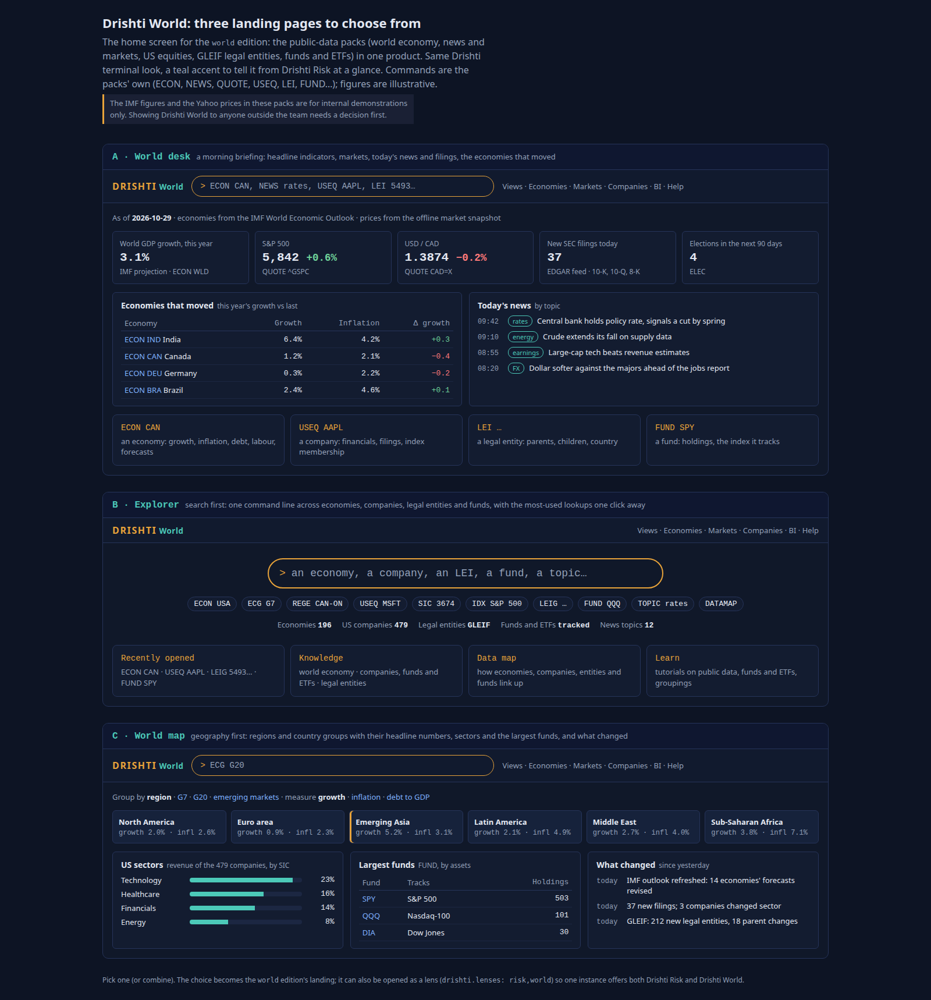

[Open the mock-up](mockups/world/world-landing.html). **Chosen:** all three, A the default ([EDITIONS.md section 12](../admin/EDITIONS.md#12-drishti-world)).
A teal accent on the terminal look. **Code:** [`world_landing.html`](../../drishti-console/web/templates/home/world_landing.html),
[`drishti_world-landing.js`](../../drishti-console/web/static/js/drishti_world-landing.js), [`drishti_world-landing.css`](../../drishti-console/web/static/css/drishti_world-landing.css),
[`edition_routes.py`](../../drishti-console/routes/edition_routes.py), [`world.yaml`](../../config/editions/world.yaml). The mock-up's
figures are illustrative. Its warning, *IMF figures and Yahoo prices are for internal demonstrations only*, is a decision, not a panel:
shown inside the bank (product owner, 2026-10-29); an external showing needs a decision and the switch of WL12.

**Interactions.** Every tile opens its command (World GDP growth: `ECG ECG-WLD`; quotes: `QUOTE` by change; filings: `EDGAR 8-K`; funds:
`FUND` by net assets); every economy, topic, fund and region tile is a link; the Group by and Measure toggles (C) redraw the regions in
place; chips and quick cards run their commands. **States.** *Loading:* `…`. *Error:* `Not available: <reason>` in the panel (each panel
on its own answer). *Empty:* "Nothing yet: type a command above" (Recently opened). **Phone:** one column below 600 px; the mock-up drew
no phone form, so the landing takes the phone tiers ([MOBILE_DISPLAY.md section 8](MOBILE_DISPLAY.md#8-beyond-sutra-pages)).

| # | Panel (option) | Contents on the mock-up | Data, API or contract | Interaction | Gap row | Status |
|---|---|---|---|---|---|---|
| W1 | Bar (A, B, C) | `DRISHTI World` (*World* teal); a command line (*ECON CAN, NEWS rates, USEQ AAPL, LEI 5493…*); menus **Views · Economies · Markets · Companies · BI · Help** | `world.yaml` `menus` (`placeholder`), [`menus.yaml`](../../drishti-console/config/menus.yaml) | type, `<GO>`; open a menu | — | **Built**: brand, command line, and Economies, Markets and Companies menus ([section 4.11.2](#4112-the-lens-menus-lx1-menusahtml)) |
| W2 | Meta line (A, C) | *As of **2026-10-29** · economies from the IMF World Economic Outlook · prices from the offline market snapshot* | `FCST` (the outlook's vintage), `QUOTE` (the snapshot's time) | — | — | **Built** (the vintage and the snapshot named) |
| W3 | Tile: World GDP growth (A) | *this year* **3.1%** *IMF projection · ECON WLD* | `ECG-WLD` | click | — | **Built** |
| W4 | Tile: S&P 500 (A) | **5,842** *+0.6%* *QUOTE ^GSPC* | an index level | — | WL1 | **Not built**: the snapshot holds no index; a *Quotes up · down* tile stands in its place |
| W5 | Tile: USD / CAD (A) | **1.3874** *−0.2%* *QUOTE CAD=X* | an FX rate | — | WL1 | **Not built**: the snapshot holds no FX; a *Biggest mover* tile stands in its place |
| W6 | Tile: New SEC filings today (A) | **37** *EDGAR feed · 10-K, 10-Q, 8-K* | `FILING` on the feed's latest day | click: `EDGAR 8-K` | — | **Built** ("since yesterday" for my companies: WL5, WL10) |
| W7 | Tile: Elections in the next 90 days (A) | **4** *ELEC* | a date window per economy | — | WL3 | **Not built**: the next election is free text; a *Funds and ETFs* tile stands in its place |
| W8 | Card: Economies that moved (A) | *this year's growth vs last*; Economy, Growth, Inflation, Δ growth: ECON IND India 6.4% 4.2% +0.3; ECON CAN Canada 1.2% 2.1% −0.4; ECON DEU 0.3% 2.2% −0.2; ECON BRA 2.4% 4.6% +0.1 | `ECON` (the twelve largest), each one's growth path | click: `ECON <iso3>` | — | **Built** |
| W9 | Card: Today's news (A) | *by topic*; time, a topic tag, the headline: 09:42 rates; 09:10 energy; 08:55 earnings; 08:20 FX | `TOPIC`, `NEWS` (`home.topics`) | click a topic | — | **Built** (each topic's latest stories; relevance to my coverage: WL9) |
| W10 | Quick commands (A) | `ECON CAN` (an economy), `USEQ AAPL` (a company), `LEI …` (a legal entity), `FUND SPY` (a fund) | `world.yaml` `home.cards` | click | — | **Built** (`LEIG` for the legal entity group) |
| W11 | Big command line and chips (B) | *an economy, a company, an LEI, a fund, a topic…*; chips `ECON USA`, `ECG G7`, `REGE CAN-ON`, `USEQ MSFT`, `SIC 3674`, `IDX S&P 500`, `LEIG …`, `FUND QQQ`, `TOPIC rates`, `DATAMAP` | `world.yaml` `home.chips` | type, `<GO>`; click | — | **Partly built**: chips configured with the demo's ids (`ECG ECG-WLD`, `REGE REGE-US-NY`, `IDX SP500`, `LEIC US`, …); no G7 group to chip (WL2) |
| W12 | Counts strip (B) | *Economies **196** · US companies **479** · Legal entities **GLEIF** · Funds and ETFs **tracked** · News topics **12*** | each command's `matched` | — | — | **Built** (plus Filings) |
| W13 | Recently opened, Knowledge, Data map, Learn (B) | *ECON CAN · USEQ AAPL · LEIG 5493… · FUND SPY*; *world economy · companies, funds and ETFs · legal entities*; *how economies, companies, entities and funds link up*; *tutorials on public data, funds and ETFs, groupings* | the person's history; help pages; `/datamap` | click | — | **Built** |
| W14 | Group by and Measure (C) | *Group by **region** · G7 · G20 · emerging markets · measure **growth** · inflation · debt to GDP* | `ECG` groups; `ECON` figures GDP-weighted | click: redraw | — | **Partly built**: region, income group, G7, G20; growth, inflation, debt to GDP; G7 and G20 are member lists in the script and *emerging markets* is stood in for by the income groups (WL2) |
| W15 | Region tiles (C) | North America *growth 2.0% · infl 2.6%*; Euro area 0.9% · 2.3%; **Emerging Asia** (highlighted) 5.2% · 3.1%; Latin America 2.1% · 4.9%; Middle East 2.7% · 4.0%; Sub-Saharan Africa 3.8% · 7.1% | as W14 | click: the group or economy | — | **Built** (the leader marked) |
| W16 | Card: US sectors (C) | *revenue of the 479 companies, by SIC*: bars Technology 23%, Healthcare 16%, Financials 14%, Energy 8% | `USEQ` by SIC division | — | — | **Built** |
| W17 | Card: Largest funds (C) | *FUND, by assets*; Fund, Tracks, Holdings: SPY S&P 500 503; QQQ Nasdaq-100 101; DIA Dow Jones 30 | `FUND` (`NET_ASSETS`, `TRACK`, holdings) | click a fund | — | **Built** (with an Assets column) |
| W18 | Card: What changed (C) | *since yesterday*: *IMF outlook refreshed: 14 economies' forecasts revised · 37 new filings; 3 companies changed sector · GLEIF: 212 new legal entities, 18 parent changes* | the sources' latest dates | — | — | **Partly built**: each source's latest (the outlook's vintage, the filings, the latest annual report, the snapshot, GLEIF on file); the counts of revised economies, sector changes, new entities and parent changes need a change feed (WL4, WL6) |
| W19 | Landing switch | (the footer: pick one or combine; also a lens beside Risk) | `home.landings`; `drishti.lenses` | click | — | **Built** |

**Gaps: on the mock-up, not in the product.** (1) The S&P 500 and USD/CAD tiles (W4, W5; WL1). (2) Elections in the next 90 days (W7;
WL3). (3) G7, G20 and emerging markets as groups, and the `ECG G7` chip (W11, W14; WL2). (4) What changed, counted: revised forecasts,
sector changes, new entities, parent changes (W18; WL4, WL6).

#### 4.11.2 The lens menus (LX1, `menus/A.html`)

The shared mock-up of the four built lenses and why option A was chosen are in [section 1.11.4](#1114-the-lens-menus-lx1-menusahtml); the
phone form (X5) is the one of [section 3.11.2](#3112-the-lens-menus-lx1-menusahtml). World's rows:

| # | Panel | Contents on the mock-up | Data, API or contract | Interaction | Status |
|---|---|---|---|---|---|
| X1 | Bar | `DRISHTI World`; the command line; menus **Views · Economies · Markets · Companies · BI · Help** | the edition's top menus by id, in order (`menus.top`), [`menus.yaml`](../../drishti-console/config/menus.yaml) | open a menu | **Built**: `menus.top` in [`world.yaml`](../../config/editions/world.yaml), drawn by [`core/menus.py`](../../drishti-console/core/menus.py); Build is not named (off in the lens) (replaces the menus part of W1) |
| X2 | Economies menu | A country `ECON`; Indicators `MACRO`; IMF forecasts `FCST`; Regions `REGE` | a subject menu in `menus.yaml`, each item shown only when the edition keeps its command | click an item: its page or command | **Built** |
| X3 | Markets menu | News `NEWS`; Quotes `QUOTE`; Indices `IDX` | as X2 | as X2 | **Built** |
| X4 | Companies menu | US equities `USEQ`; Filings `EDGAR`; Legal entities `LEIC`; Funds and ETFs `FUND` | as X2 | as X2 | **Built** |
| X5 | Phone form | below 640 px the subject menus fold into one **World** menu, a column per subject (option C) | [`core/menus.py`](../../drishti-console/core/menus.py) `lens_menu`; [`drishti_phone.js`](../../drishti-console/web/static/js/drishti_phone.js) | tap the lens menu, then an item | **Built** |

## 5. Market risk oversight: what the second line needs from Drishti, and a Drishti Oversight lens

**Status: design.** An analysis and a proposal: of its rows only RO1 (the VaR change explanation) is built, and the position
sensitivities RO15 needs are loaded; the rest are candidates in the
[implementation plan](IMPLEMENTATION_PLAN.md#risk-oversight-candidates-not-started), not started. Every "built" or "partly" statement
cites the document and section it was read from; where the plan names a row, the row is cited.

**The request (product owner, 2026-10-31):** "please write detailed document"; "do you think a lens for risk oversight will be a good
idea?" The short answer is in [section 5.5.1](#551-the-answer-yes-a-separate-lens-built-after-two-features-exist): **yes, a separate lens**,
built after the two features that give it something of its own to show (the VaR change explanation and the breach workflow).

**Read with:** [VAR_GUIDE.md](../guides/VAR_GUIDE.md) (the VaR engine as built), [REGULATORY_VAR_REPORTING.md](../guides/REGULATORY_VAR_REPORTING.md)
(backtesting, the P&L feed and the report framework with sign-off; the report packs), [COMPUTED_ATTRIBUTES.md](COMPUTED_ATTRIBUTES.md) (compute, do not store), [EXPOSURE_GUIDE.md](../guides/EXPOSURE_GUIDE.md),
and the contracts [STR.md](../contracts/STR.md) (stress and the proposed limit table), [FRTB.md](../contracts/FRTB.md) (sensitivities) and
[PNL.md](../contracts/PNL.md) (P&L explain). The proposed risk cubes, which adopt section 5.7's `position-sensitivity` contract and
would serve this lens as its pivot screen: see [section 6](#6-the-mr-cube-a-market-risk-cube-lens-that-answers-what-fis-adaptivs-artiq-answers-and-shows-why) and [section 7](#7-the-ccr-cube-a-counterparty-credit-risk-cube-lens-that-answers-what-fis-adaptiv-answers-and-shows-why).

### 5.1 Who market risk oversight is

The **second line of defence** for market risk: the market risk management function, reporting to the **chief risk officer (CRO)**,
independent of the trading desks (the first line) and audited by internal audit (the third line). In a large bank it is a team of risk
managers, each covering a business (rates, credit, FX, equities, commodities), with a central team for the limit framework,
methodology, reporting and the regulators.

| Accountable for | What it means day to day | What they need from a system |
|---|---|---|
| **Risk appetite** | The board approves an appetite statement (for example: bank-wide VaR, stressed VaR and stress loss below set amounts); the CRO cascades it | The bank's measures against the appetite, every day, with the trend |
| **Limits** | A limit framework cascades the appetite: board → CRO → business heads → desks → books, through **limit letters** (the delegation instruments); VaR limits, sensitivity limits, stress limits, stop-loss, position and notional limits | Every limit of every type, its use, history and near breaches; who approved it and until when |
| **Independent challenge** | They do not take the first line's word: they recompute, decompose and question large or unexplained moves, new trades and concentrations | Drill-down from the bank to a trade; "why did it move?"; the ability to ask any set of trades |
| **Model and data trust** | VaR is a model; they own the evidence that it works (backtesting, P&L attribution), that its inputs are complete and right, and they register what it misses (risks not in VaR) | Backtests, data completeness and quality, proxies, a register of risks not in VaR |
| **Escalation** | A breach must be detected, notified, explained by the desk, approved or remedied (temporary increase, reduction), and recorded | A breach queue with commentary, approval and an audit trail |
| **Committee and board reporting** | A daily risk report; a monthly market risk committee pack; a quarterly board risk committee pack | Reproducible, signed-off reports from the numbers of record |
| **Regulators** | Supervisors (OSFI in Canada; the Federal Reserve, OCC and FDIC in the US) examine the framework, the backtests, the limit breaches and the Volcker metrics | Official records, retained, reproducible, with lineage |

**Different from the first line.** A trader or desk head asks *what does this trade do to my VaR?*; that is Drishti Trading
([EDITIONS.md section 14](../admin/EDITIONS.md#14-drishti-trading)). The second line asks *are we within appetite, is this
number right, and who has approved what?* The questions overlap; the defaults, the duties and the actions do not.

---

### 5.2 Their questions: a day, a month and a year

#### 5.2.1 The morning meeting (07:30 to 09:00)

The overnight batch is in; the official end-of-day figures of yesterday are captured. The head of market risk runs a meeting with the
business risk managers.

| Question | Drishti today | Gap |
|---|---|---|
| *Are we within appetite?* Bank VaR and ES against the bank limit | **Built**: the Risk lens's desk landing tiles (VaR and ES of BANK, the backtest, limits in breach) ([EDITIONS.md section 7](../admin/EDITIONS.md#7-drishti-risks-home-three-landings)); the official record's `LIMIT` and `LIMIT_USE` per node ([VAR.md section 5](../contracts/VAR.md#5-official-end-of-day-results)) | Appetite measures other than VaR (stress loss is stored per desk, not computed) |
| *What breached?* | **Partly**: VaR limits only: the Risk map landing's "Today" feed and the limit-use heat map ([EDITIONS.md section 7](../admin/EDITIONS.md#7-drishti-risks-home-three-landings)); the Trading desk-head landing's Breaches and Near limit tiles ([EDITIONS.md section 14](../admin/EDITIONS.md#14-drishti-trading)); stress limit use per desk (derived, [VAR.md section 7.4](../contracts/VAR.md#74-the-banks-stress-pl-by-scenario-derived)) | Sensitivity, stop-loss, position and notional limits; a breach as a record with status and commentary |
| *Why did VaR move?* | **Built**: *Why it moved*, the change in causes that add up exactly (RO1, [VAR_GUIDE section 3.11](../guides/VAR_GUIDE.md#311-why-it-moved-the-var-change-explained)); captures compare with now ([VAR_GUIDE section 6](../guides/VAR_GUIDE.md#6-captures-and-compare)); the scenario matrix `SMAT` ([VAR_GUIDE section 3.9](../guides/VAR_GUIDE.md#39-the-scenario-matrix-smat)) | The factor-level overlay ([section 5.4.1](#541-ro1-var-change-explanation)) |
| *Which scenario drives it?* | **Built**: the P&L path tab, the 25 worst scenarios, the contributors on a scenario day ([VAR_GUIDE section 3.4](../guides/VAR_GUIDE.md#34-the-tabs)) | — |
| *Is the number trustworthy today?* | **Partly**: load checks and rejections in the provenance ([VAR.md section 6.3](../contracts/VAR.md#63-what-the-load-checks)); late loads ([DATA_GUIDE.md › Telling Drishti new data has landed, section 8](../guides/DATA_GUIDE.md#8-expectations-and-late-data)); market data checks (the Market lens's Quality landing, [EDITIONS.md section 13](../admin/EDITIONS.md#13-drishti-market)) | One trust card: completeness against the trades booked, proxies, failed rows, market data exceptions and their impact on VaR (planned) |
| *Did yesterday's P&L exceed VaR?* | **Partly**: the official-mode backtest with the derived hypothetical P&L ([VAR_GUIDE section 7](../guides/VAR_GUIDE.md#7-history-and-backtesting)) | Actual and hypothetical P&L from the bank (planned) |

#### 5.2.2 Intraday

| Question | Drishti today | Gap |
|---|---|---|
| *Has a big trade moved us close to a limit?* | **Built**: intraday updates from files and Kafka change today's VaR during the day ([VAR_GUIDE section 8.4](../guides/VAR_GUIDE.md#84-what-if-pricing-and-intraday-recomputes)); the pre-deal what-if ([VAR_GUIDE section 8.5](../guides/VAR_GUIDE.md#85-the-pre-deal-what-if-under-the-baskets-sheet)) | An intraday limit check that notifies (alerts on numbers watch BI and view numbers, [USER_GUIDE.md](../guides/USER_GUIDE.md#alerts-on-numbers), not the VaR engine's intraday answer) |
| *Can I see what the desk sees?* | **Built**: the same explorer, entitlements as configured ([VAR_GUIDE section 9](../guides/VAR_GUIDE.md#9-who-sees-what-entitlements-and-audit)) | — |
| *A desk asks for a temporary limit increase* | **Not built** | The request, its approval and its expiry ([section 5.4.2](#542-ro2-breaches-and-escalation)) |

#### 5.2.3 Month-end

| Task | Drishti today | Gap |
|---|---|---|
| **Backtesting review**: exceptions in the month, their causes, the traffic light | **Partly**: the official backtest per node, Kupiec and Christoffersen ([VAR_GUIDE section 7](../guides/VAR_GUIDE.md#7-history-and-backtesting)) | Actual and hypothetical P&L, separate counts, the multiplier (planned); an exception commentary |
| **Limit utilisation review**: which limits are never used (too loose) and which always near full | **Partly**: the official records carry `LIMIT_USE` per node and date, read in BI ([VAR.md section 5](../contracts/VAR.md#5-official-end-of-day-results)) | Other limit types; a utilisation-statistics report (average, peak, days above the threshold) |
| **RNIV**: quantify and review the risks not in VaR | **Not built** | A register ([section 5.4.7](#547-ro7-the-rniv-register)) |
| **Stress testing**: the monthly stress run against stress limits | **Partly**: stored stress results per desk and scenario, the bank's P&L per scenario derived ([VAR.md section 7.4](../contracts/VAR.md#74-the-banks-stress-pl-by-scenario-derived)) | The stress engine for any scope ([STR.md](../contracts/STR.md), proposed) |
| **The committee pack** | **Partly**: the BI report *Market risk: VaR* over the official table ([VAR.md section 5](../contracts/VAR.md#5-official-end-of-day-results)) | The report framework with sign-off (planned) and the board pack (planned) |

#### 5.2.4 Annual

| Task | Drishti today | Gap |
|---|---|---|
| **Limit framework renewal**: re-size every limit to the appetite and the use | **Partly**: utilisation history of VaR limits | A limit catalogue of every type with approvals and validity ([section 5.4.3](#543-ro3-one-limit-catalogue-and-its-utilisation)) |
| **Stress window review**: is the stressed-VaR window still the worst for today's portfolio? | **Built**: the stress window selection, `SWIN` ([VAR_GUIDE section 18.9](../guides/VAR_GUIDE.md#189-choosing-the-stress-window)): every 250-day window of the long history, the alert, freeze and propose with maker-checker | The approval inside the report sign-off framework (REGULATORY_VAR_REPORTING section 8.1) |
| **Model validation support**: evidence for the validators and the regulator | **Partly**: every official figure reproducible from its inputs, kept seven years ([VAR.md section 5](../contracts/VAR.md#5-official-end-of-day-results)); VaR at another window or confidence per request ([VAR_GUIDE section 18.5](../guides/VAR_GUIDE.md#185-the-scenario-window-and-the-confidences)) | Backtests on bank P&L; a P&L attribution test (REGULATORY_VAR_REPORTING G12, later); an evidence pack frozen with sign-off |
| **Risk appetite recalibration** | **Partly**: history of every official figure | Period statistics (planned) |

---

### 5.3 What they need, area by area, and Drishti's status

#### 5.3.1 Risk measures

| Need | Status | Evidence or row |
|---|---|---|
| VaR 99% 1-day, historical simulation, any scope | **Built** | [VAR_GUIDE sections 1, 2, 18](../guides/VAR_GUIDE.md#2-the-measures-with-worked-numbers) |
| ES 97.5% 1-day, component ES adding up | **Built** | [VAR_GUIDE section 18.3](../guides/VAR_GUIDE.md#183-decomposition-of-a-scope-into-parts) |
| Component, incremental, marginal VaR; diversification | **Built** | [VAR_GUIDE section 18.3](../guides/VAR_GUIDE.md#183-decomposition-of-a-scope-into-parts) |
| Any confidence and window per request; the configured one official | **Built** | [VAR_GUIDE section 18.5](../guides/VAR_GUIDE.md#185-the-scenario-window-and-the-confidences) |
| Confidence chosen on screen (a picker, 99% default) | **Built** | [VAR_GUIDE section 18.6](../guides/VAR_GUIDE.md#186-horizons-the-two-10-day-methods-and-the-confidence-chosen) |
| 10-day VaR (√10 and the 10-day sum) | **Built** | [VAR_GUIDE section 18.6](../guides/VAR_GUIDE.md#186-horizons-the-two-10-day-methods-and-the-confidence-chosen) |
| Stressed VaR, 1-day and 10-day, official `SVAR` | **Built** | [VAR_GUIDE section 18.8](../guides/VAR_GUIDE.md#188-stressed-var) |
| VaR by risk type (IR, credit spread, equity, FX, commodity) | **Not built**, designed | REGULATORY_VAR_REPORTING G6, planned with the regulatory reports |
| FRTB standardised and internal models | **Not built**; FRTB SA contract proposed | [FRTB.md](../contracts/FRTB.md); REGULATORY_VAR_REPORTING G9 to G14 |
| Several hierarchies (management, legal entity, limit letters, any configured) | **Built** | [VAR.md section 2.14](../contracts/VAR.md#214-hierarchies-from-the-rows-or-from-the-trades-columns) |
| Exposure (EPE, PFE) for counterparty limits | **Built** (credit risk's measure; oversight of market risk reads it for concentration) | [EXPOSURE_GUIDE.md](../guides/EXPOSURE_GUIDE.md) |

#### 5.3.2 Limits and appetite

| Need | Status | Evidence or row |
|---|---|---|
| VaR limits per node, with currency; limit use on every answer and official record | **Built** | `var-limit` ([VAR.md section 2.15](../contracts/VAR.md#215-var-limit-the-nodes-var-limits)); `LIMIT`, `LIMIT_USE` ([VAR.md section 5](../contracts/VAR.md#5-official-end-of-day-results)) |
| VaR limits on stored portfolios | **Built** (hierarchy `PORTFOLIO` in `var-limit`) | [VAR.md section 2.15](../contracts/VAR.md#215-var-limit-the-nodes-var-limits) |
| Limit letters as a hierarchy | **Built** (`LL`: `LIMIT_LETTER > DESK`) | [VAR.md section 2.14](../contracts/VAR.md#214-hierarchies-from-the-rows-or-from-the-trades-columns) |
| Limit use only when comparable (horizon and confidence the limit's own) | **Planned** | |
| Sensitivity limits: DV01 by tenor and currency, CS01 by rating and tenor, vega by underlying and expiry, FX delta by currency | **Not built**. Position sensitivities are loaded and summed by factor, bucket or grid (`SENS`, [section 5.7](#57-sensitivities-data)); no limit is checked against them | [SENSITIVITIES_AND_FRTB_SA.md section 2](SENSITIVITIES_AND_FRTB_SA.md#2-position-sensitivities-the-input) |
| Stop-loss (cumulative P&L, month-to-date, year-to-date) | **Not built**; needs the bank's P&L (planned) | |
| Position and notional limits | **Not built**; positions are derived with quantity and market value | [VAR_GUIDE section 4](../guides/VAR_GUIDE.md#4-positions-derived-never-delivered) |
| Stress limits | **Partly**: the stored stress result carries a positive `LIMIT` per desk; the derived per-scenario view shows each desk's limit use and breaches; the proposed `risk-limit` table | [VAR.md section 7.4](../contracts/VAR.md#74-the-banks-stress-pl-by-scenario-derived); [STR.md section 3.5](../contracts/STR.md#35-risk-limit-limits-by-measure-and-scope-fundamental) |
| One catalogue of every limit (id, type, upper and lower, approver, validity) | **Not built**; proposed for stress in STR.md, needed by Volcker | [STR.md section 3.5](../contracts/STR.md#35-risk-limit-limits-by-measure-and-scope-fundamental); REGULATORY_VAR_REPORTING G8 |
| Utilisation history | **Partly**: VaR only, from the official records; the Trading desk-head landing's five-day grid by book | [VAR.md section 5](../contracts/VAR.md#5-official-end-of-day-results); [EDITIONS.md section 14](../admin/EDITIONS.md#14-drishti-trading) |
| Near-breach thresholds | **Partly**, three different numbers: the explorer's bar amber at 75%, red at 90% ([VAR_GUIDE section 3.2](../guides/VAR_GUIDE.md#32-the-screen)); `trading.near-limit` 80% ([EDITIONS.md section 14](../admin/EDITIONS.md#14-drishti-trading)); `WARNING_AT` 0.8 per limit, proposed ([STR.md section 3.5](../contracts/STR.md#35-risk-limit-limits-by-measure-and-scope-fundamental)) | One threshold per limit, from the catalogue |
| Credit limits on counterparties | **Built** as read (stored `credit-limit`, PFE against it); the LIM engine is parked | [EXPOSURE_GUIDE.md](../guides/EXPOSURE_GUIDE.md); [LIM.md](../contracts/LIM.md) |

#### 5.3.3 Breaches and escalation

| Need | Status | Evidence or row |
|---|---|---|
| Detect a VaR breach (end of day) | **Built**: `LIMIT_USE` above 1 on the official record; shown on the Risk and Trading landings | [VAR.md section 5](../contracts/VAR.md#5-official-end-of-day-results); [EDITIONS.md sections 7, 14](../admin/EDITIONS.md#7-drishti-risks-home-three-landings) |
| Detect intraday | **Partly**: intraday VaR is live; nothing checks it against the limit and tells anyone | [VAR_GUIDE section 8.4](../guides/VAR_GUIDE.md#84-what-if-pricing-and-intraday-recomputes) |
| Notify (inbox, email, chat) | **Partly**: alert rules on one entity and alerts on numbers, after a load, with hysteresis and a cooldown ([USER_GUIDE.md](../guides/USER_GUIDE.md#alerts)); a person sets each one up | A breach rule per limit, set by the framework, not by each person |
| Commentary: the desk's explanation | **Partly**: comment threads anchored to the data are built ([COLLABORATION.md](COLLABORATION.md)) | Anchored to a breach (limit, date), with a required structure (cause, action, expected duration) |
| Approval, temporary limit increases | **Not built**. The pattern exists: write-back approval with four eyes and no self-approval ([WRITE_BACK.md section 10](../guides/WRITE_BACK.md#10-approval)); the planned maker-checker sign-off is designed ([REGULATORY_VAR_REPORTING section 6](../guides/REGULATORY_VAR_REPORTING.md#6-controls-definitions-checks-frozen-runs-and-sign-off)) | |
| The audit trail | **Partly**: the audit log records changes; captures and official records are immutable | Every breach state change as one record chain |

#### 5.3.4 Trust in the numbers

| Need | Status | Evidence or row |
|---|---|---|
| Backtesting against actual and hypothetical P&L | **Partly** (derived hypothetical P&L only); **planned** with the bank's P&L feed and the backtesting engine | [VAR_GUIDE section 7](../guides/VAR_GUIDE.md#7-history-and-backtesting); [REGULATORY_VAR_REPORTING section 8.2.4](../guides/REGULATORY_VAR_REPORTING.md#46-backtesting) |
| P&L attribution (explain) | **Not built**; contract proposed, parked | [PNL.md](../contracts/PNL.md) |
| P&L attribution test (FRTB PLA) | **Not built** | REGULATORY_VAR_REPORTING G12 |
| Market data quality | **Built** in the Market lens (stale, gaps, discount factors and forwards, vol surfaces); impact on VaR **planned** | [EDITIONS.md section 13](../admin/EDITIONS.md#13-drishti-market) |
| Data completeness | **Partly**: late loads by expectation ([DATA_GUIDE.md › Telling Drishti new data has landed, section 8](../guides/DATA_GUIDE.md#8-expectations-and-late-data)); rejected and failed rows counted ([VAR.md section 6.3](../contracts/VAR.md#63-what-the-load-checks)); completeness against the trades booked **not checked** (the same section) | |
| Proxies | **Partly**: each P&L vector and scenario-PV row says `ok`, `proxied` or `failed` ([VAR.md section 2.2](../contracts/VAR.md#22-pnl-vector-one-pl-vector-per-trade)) | A proxy report: the share of VaR from proxied trades, by desk, over time |
| RNIV register | **Not built** | [section 5.4.7](#547-ro7-the-rniv-register) |
| Model performance over time | **Partly**: exceptions, the light, Kupiec and Christoffersen per node | ES backtests, PLA, a dashboard |
| Reproducibility | **Built**: official captures with inputs' versions, batch ids, position rules, membership, result versions; seven years | [VAR.md section 5](../contracts/VAR.md#5-official-end-of-day-results) |

#### 5.3.5 Why it moved: VaR change explanation, day over day

The most-asked question of the morning meeting, and the one where Drishti's design (trade-grain vectors, two dates in the engine,
immutable official captures with membership) gives an exact answer cheaply.

**Built** (RO1): the change **by cause** (restatement, hierarchy and rules, trades out, the window roll, the market, trades in), adding up
exactly, with who drove each cause ([VAR_GUIDE section 3.11](../guides/VAR_GUIDE.md#311-why-it-moved-the-var-change-explained)); the
design record and what remains (Shapley, the risk-factor overlay) are in [section 5.4.1](#541-ro1-var-change-explanation).

#### 5.3.6 Scenario drivers

| Need | Status | Evidence or row |
|---|---|---|
| The worst scenarios, the VaR scenario, who lost what on it | **Built** | [VAR_GUIDE section 3.4](../guides/VAR_GUIDE.md#34-the-tabs) |
| A scope's scenarios across its last N dates (is this tail scenario new? did the window roll?) | **Built**: the scenario matrix `SMAT` ([VAR_GUIDE section 3.9](../guides/VAR_GUIDE.md#39-the-scenario-matrix-smat)) | |
| The stress matrix (every scenario of a set against a scope's children) | **Not built**, proposed | [STR.md section 6.5](../contracts/STR.md#65-the-matrix-and-limits) |
| The stressed window inside the date's set | **Partly**: the what-if's stressed VaR (the worst run of 250 scenario days) | [VAR_GUIDE section 8.2](../guides/VAR_GUIDE.md#82-the-what-if-the-java-engine) |

#### 5.3.7 Concentration and liquidity

| Need | Status | Evidence or row |
|---|---|---|
| VaR of any slice (currency, product, direction, any trade column) | **Built**: scope words by a trade's attribute, rule portfolios, `WHERE:` | [VAR_GUIDE sections 5.4, 5.5](../guides/VAR_GUIDE.md#55-scope-words-by-a-trades-attribute) |
| Concentration tables: market value, notional and VaR by issuer, sector, country, currency, tenor bucket, with the top N and the share of the total | **Not built** as a view; positions carry market value, trades their attributes; issuer, sector and country need reference data on every position | [section 5.4.8](#548-ro8-concentration) |
| Counterparty concentration | **Built** for exposure (PFE by counterparty against its credit limit) | [EXPOSURE_GUIDE.md](../guides/EXPOSURE_GUIDE.md) |
| Liquidity: days to liquidate, bid-offer cost, share of market volume | **Not built**; no volume or bid-offer data in the packs | [section 5.4.10](#5410-ro10-liquidity) |

#### 5.3.8 Stress testing

| Need | Status | Evidence or row |
|---|---|---|
| Historical and hypothetical scenarios, defined | **Built** as stored definitions (`stress-scenario`), shocks without units | [COMPUTED_ATTRIBUTES.md section 4.7](COMPUTED_ATTRIBUTES.md#47-stress-scenario-scn) |
| Stress P&L per desk and scenario | **Built** as stored results; the bank's P&L per scenario derived | [VAR.md section 7.4](../contracts/VAR.md#74-the-banks-stress-pl-by-scenario-derived) |
| Stress P&L of any scope, full revaluation and sensitivity-based; user scenarios | **Not built**, proposed | [STR.md](../contracts/STR.md), [STR.md section 3.4](../contracts/STR.md#34-user-scenarios-drishti-owned) |
| Stressed VaR | **Planned** | |
| Reverse stress (which moves lose a given amount) | **Not built** | [section 5.4.9](#549-ro9-stress-testing-the-engine-limits-and-reverse-stress) |
| Firm-wide exercises (a scenario run frozen, reviewed, signed off) | **Not built**; the planned report framework fits | [REGULATORY_VAR_REPORTING section 6](../guides/REGULATORY_VAR_REPORTING.md#6-controls-definitions-checks-frozen-runs-and-sign-off) |

#### 5.3.9 Governance and reporting

| Need | Status | Evidence or row |
|---|---|---|
| Official records of every node, append-only, result versions, seven years | **Built** | [VAR.md section 5](../contracts/VAR.md#5-official-end-of-day-results) |
| BI over the official table; exports, subscriptions, paginated reports | **Built** | [VAR.md section 5](../contracts/VAR.md#5-official-end-of-day-results); [REGULATORY_VAR_REPORTING section 1](../guides/REGULATORY_VAR_REPORTING.md#1-what-drishti-produces-today) |
| Certified reports (a steward vouches for a report) | **Built** | [BI_GUIDE.md › Publishing and governance: versions, review, certification, lineage, impact, environments, section 4](../guides/BI_GUIDE.md#4-certification-and-endorsement) |
| A daily risk report | **Partly**: the sample report *Market risk: VaR* | A defined daily report: appetite, limits of every type, breaches with commentary, VaR change explained, backtest, data trust |
| Report definitions, checks, freeze, lineage, maker-checker sign-off | **Planned** | [REGULATORY_VAR_REPORTING section 6](../guides/REGULATORY_VAR_REPORTING.md#6-controls-definitions-checks-frozen-runs-and-sign-off) |
| Board and risk-committee pack (PDF, house style) | **Planned** | |
| Regulatory reports (BCAR, Pillar 3, FFIEC 102, Volcker) | **Proposed** | [REGULATORY_VAR_REPORTING section 8](../guides/REGULATORY_VAR_REPORTING.md#8-coverage-and-roadmap) |
| Who saw and did what | **Built**: entitlements, audit entries per answer and capture | [VAR_GUIDE section 9](../guides/VAR_GUIDE.md#9-who-sees-what-entitlements-and-audit) |

---

### 5.4 Design sketches for the gaps

Every design follows Drishti's rules ([COMPUTED_ATTRIBUTES.md section 1.2](COMPUTED_ATTRIBUTES.md#12-the-rule-for-deciding-which)):

- **Fundamental inputs** (limits, sensitivities, P&L, volumes, RNIV amounts a quant supplies) arrive under a data contract as JSON Lines into
  the lake, one kind each.
- **Measures are computed on demand** from trade or position-grain inputs and never stored, except as an immutable capture or an official
  end-of-day record.
- **Governance records** (a breach's commentary and approval, an RNIV entry, a sign-off) are **Drishti-owned**: kept in the content store
  with versions, never edited in place, every step an audit entry. They point at numbers (a capture id, a limit id, a date); they never
  copy a number as the truth.
- **BI is the report layer**; the planned report framework (definition, checks, freeze, lineage, maker-checker sign-off) is reused for every
  report and every approval chain.

Sizes: **S** days, **M** one to three weeks, **L** more than three weeks, for one builder. The ids RO1 to
RO15 are this part's (risk oversight); the regulatory gaps keep their G ids.

| Id | Gap | Size | Depends on |
|---|---|---|---|
| RO1 | VaR change explanation | M | **built**; Shapley and the overlay remain |
| RO2 | Breaches and escalation | M | RO3 for limits other than VaR; the planned sign-off record |
| RO3 | One limit catalogue and its utilisation | M | the limit system's extract |
| RO15 | Position sensitivities: data contract, loader, ladders ([section 5.7](#57-sensitivities-data)) | M | the bank's pricing system sending sensitivities per position (contract, loader and sums built) |
| RO4 | Sensitivity aggregation and sensitivity limits | M once RO15 is in (L without it) | RO15; RO3 |
| RO5 | Stop-loss and P&L limits | S | the planned P&L feed; RO3 |
| RO6 | Position and notional limits | S | RO3 |
| RO7 | The RNIV register | S to M | the planned sign-off record |
| RO8 | Concentration | M | RO15 (issuer, sector, curve and tenor from the factors); reference data on positions for market value by issuer, sector, country |
| RO9 | Stress testing: the engine, limits and reverse stress | L | STR.md's inputs; RO3 |
| RO10 | Liquidity | M to L | volume and bid-offer data |
| RO11 | The daily risk report and the committee pack | M | the planned report framework; RO1, RO2 |
| RO12 | The Oversight lens and its landings | M | mock-ups; RO1, RO2 |
| RO13 | One data-trust card | S to M | the planned market-data impact for the market-data impact |
| RO14 | Model performance | S | the planned P&L feed, backtesting and period statistics |

#### 5.4.1 RO1: VaR change explanation

**Built.** VaR moved from V(t−1) to V(t) for a scope; the change is split into causes that **add up exactly** to it, each naming who
drove it. The method (a fixed, configured sequence of states S0 to S7, each a full VaR, so the steps telescope to the change: restatement,
hierarchy and rules, trades out, oldest scenario dropped, market, newest scenario added, trades in, amendments split when the feed marks
them), the drivers of each step, the order-free view by child, the limit-use line, the worked example, the demo's figures, the settings
(`drishti.var.explain.*`), the command (`VAR EXPLAIN <scope>`), the CLI (`drishti.py var explain`), the API
(`GET /api/v1/var/explain`, `/explain/matrix`, `/explain.xlsx`) and the workbook of formulas are in
[VAR_GUIDE section 3.11](../guides/VAR_GUIDE.md#311-why-it-moved-the-var-change-explained). This section keeps the design record and
what is still to build.

**Why a sequence.** VaR is a quantile, not a sum: the effect of new trades depends on which scenarios are in the tail, which the market
move also changes, so any split depends on the order the causes are applied in. The order is therefore explicit, a setting, and stated on
the screen; the default (restatement first, because it corrects yesterday; trades last, because the desk decides them) is the product
owner's decision 3 ([section 5.9](#59-decisions-for-the-product-owner)).

**Cost.** Only the **churn** is summed (the trades out, in, moved and amended against millions held), then eight quantiles of the
scenario days: for all 131 official nodes well under a second on the demo; at 2.3M positions bounded by the churn, not the book.

**Never stored.** Computed when asked. The daily report's frozen run (the planned report framework) keeps the explanation it showed, with
its inputs' versions, as every frozen cell does.

**Still to build.**

| Item | Design | Status |
|---|---|---|
| **Shapley variant** | each cause's effect averaged over every order of the causes present: φ_j = (1/n!) Σ over the orders of [V(before j, with j) − V(before j)]; at most six causes (720 orders), four on a usual day (24); order-free, exact in sum, dearer; per request (`method=shapley`, setting `drishti.var.explain.shapley`: `on-request` or `off`), never official | planned (the API answers 400 in words) |
| **Risk-factor overlay** | beside the exact market step (S5 − S4): Σ sensitivity(t−1) × the factor's move from t−1 to t, by curve and tenor, issuer, currency pair, surface (the position sensitivities of [section 5.7](#57-sensitivities-data), the factor moves of the proposed `market-move` kind, [PNL.md section 3.2](../contracts/PNL.md#32-market-move-the-move-of-each-risk-factor)), for example "USD SOFR 10Y +12 bp: −3.1m"; a first-order approximation of the P&L, not of the VaR change, drawn as an overlay with its residual, never as one of the exact steps | not built (mock-up row E10) |
| **A computed kind** | `var-explain` (id the scope, `params: { from, to, method }`), served by a reactive connector over the VaR engine, so any Sutra panel can draw it (RO2's *why it moved since detection*, a lens card) with `source:` ([REACTIVE_CONNECTOR.md](../connectors/REACTIVE_CONNECTOR.md#reading-a-computed-kind)) | planned |
| **An AI tool** | over the same API, so *"why is Rates VaR up?"* answers with these figures (the CRO lens's Ask) | planned |
| **Where else it shows** | the Risk desk card RL4, the CRO's *What changed*, the breach page of RO2, the Oversight lens's Appetite landing ([section 5.5.4](#554-three-landings-to-mock-up-later)), the daily risk report and the board pack (page 3); `to = now` (intraday since the morning's official figure) and any two dates (a month for the committee) | as each consumer is built |

**Data used.** All held today: the official capture with its vector and membership (`var-official`, [VAR.md section 5](../contracts/VAR.md#5-official-end-of-day-results)),
both dates' `pnl-vector` and `scenario-pv` (with `TRADE_STATUS`, `TRADE_ACTION` for the amendment split and `RESTATEMENT` for S1),
`scenario-set`, `risk-hierarchy` and `portfolio` (membership by date), `var-limit` (the limit-use line), `position`. Nothing new from the
bank; the overlay needs `position-sensitivity` ([section 5.7.3](#573-a-proposed-data-contract-position-sensitivity)).

**Tests (the design's).** Crafted vectors where each cause alone moves VaR by a known amount: each step equals it and the others are
zero; the steps sum to the change to the cent on the demo for every node; the Shapley variant sums to the same total; sharded equals
single-server to the bit; a date with no official capture for yesterday says so, never a zero.

##### 5.4.1.1 RO1: the build design

**One screen, three views** (decided, product owner, 2026-11-01): a **Why it moved** tab of the VaR page's workbench, with a view switch
**Waterfall · Matrix · Sentences** (mock-ups A, B, C, [section 5.11.1](#5111-ro1-var-change-explanation)) over one answer of the same API;
the view kept in the address (`view=`) and remembered in the person's settings as the Home landings are
([EDITIONS.md section 4](../admin/EDITIONS.md#4-choose-the-home-landing)); a switch redraws from the answer already fetched. It is drawn
not by the VaR page's own charts but as a ViewModel of the existing panel kinds ([RACHANA_REFERENCE, panel kinds](../guides/RACHANA_REFERENCE.md#panel-kinds))
painted by the one renderer ([CLIENT_RENDERER.md](CLIENT_RENDERER.md)): `waterfall` (`colors: theme`: a rise in VaR is not a gain),
`metric`, `table` (with `total` columns where rows add up), `pivot` for the Matrix (node by step, `heat`), `markdown` for the Sentences;
no new panel kind. **Horizon and confidence** follow the VaR page's pickers
([VAR_GUIDE section 18.6](../guides/VAR_GUIDE.md#186-horizons-the-two-10-day-methods-and-the-confidence-chosen)); the official explanation
(the one reports freeze) is at the official lens, 1-day 99%. **Phone** ([MOBILE_DISPLAY.md section 3](MOBILE_DISPLAY.md#3-phone-tiers-must-glance-more-desk)):
the answer in a paragraph is **must**, the steps as horizontal bars **glance**, each step's contributors **more**, the states, the bridge of
every node and the Shapley comparison **desk**. The build checklist is [section 5.11.1](#5111-ro1-var-change-explanation).

**Open questions for the product owner.**

1. **Mock-up choice:** A (the waterfall with contributors, recommended), B (the bridge of every node) or C (the answer in sentences
   with Shapley beside the sequence).

   **Decided (product owner, 2026-11-01):** one screen; A is the default view, B and C are views on the same screen (the view switch
   above).
2. **Window lines:** two lines by default (recommended: a dropped tail day and an added one read differently), or one.
3. **Amendments:** their own step (recommended where the feed marks them), or folded into trades in.
4. **How far back:** any two dates (recommended, both captures must exist), or capped (for example 13 months) to bound the work.

#### 5.4.2 RO2: breaches and escalation

**Records (Drishti-owned, content store, versioned).** A **breach** is created by the engine, not by a person, when an official run finds
a limit's use above 1 (or, intraday, when a configured check does): id `BR-<year>-<sequence>` (the `limit-breach` contract,
[section 8.7.10](#8710-limit-breach-brch-a-breach-as-a-record-new-drishti-owned)), one record per limit and episode; it holds the limit
id, the measure, the scope, the capture or answer id that showed it, the use at detection, and a **status**: `open` → `explained` →
`approved` (or `remediated`) → `closed`, with `escalated` at any point. Each change of status is a new version with who, when and a
comment. The number is never copied as the truth: the breach points at the official capture, which holds it.

| Action | Who | What it records |
|---|---|---|
| Explain | the desk (first line) | cause, action, expected duration; required fields, then free text |
| Review | the business risk manager | accept, ask for more, escalate |
| Approve a temporary limit increase | the limit owner named in the catalogue (RO3) | new amount, valid until; four eyes; nobody approves their own request |
| Escalate | automatically after a configured number of days, or by hand | to the next level of the limit's chain (desk → business → CRO) |
| Close | the risk manager, once use is below the limit or the temporary limit holds | — |

**Temporary limits.** Limits are fundamental (the bank's limit system owns them). The choice was (a) Drishti records the request and
approval and the bank's limit system is updated by its own process, Drishti reading the new limit the next day (simpler, one source of
truth), or (b) an approved temporary limit as a Drishti-owned **overlay** on the catalogue, used for limit use until it expires (answers
the same day). **Decided: (a)** (decision 4, [section 5.9](#59-decisions-for-the-product-owner)); how it works is in
[section 5.4.2.1](#5421-ro2-the-build-design), as are the notifications (rules from the catalogue, not set by each person), the thread
(comment threads anchored to the breach record, under the same retention and legal hold) and the approvals (write-back's approval policy,
decision 7).

**Data needed.** The limit catalogue (RO3) with owners and the escalation chain; the official records (built). **Size** M. **Tests:**
a crafted breach goes through every status, refuses self-approval, escalates after N days, closes; a restated date that removes the
breach marks it `withdrawn`, never deletes it; the audit trail lists every step; a person without the power sees the queue read-only.

##### 5.4.2.1 RO2: the build design

**What it shows.** A **Breaches and escalation** screen (the queue of every open breach and near limit, worst first, *my coverage* by
default; the opened breach beside it with its escalation chain, its use over 20 business days, why it moved since detection (RO1), the
desk's explanation and actions, a temporary increase awaiting decision, and the thread), the closed and withdrawn breaches of the week,
and the same records on the CRO's decision queue and in the board pack. VaR limits first (`var-limit`), every measure once `risk-limit`
exists (decision 5). Mock-ups: [section 5.11.2](#5112-ro2-breaches-and-escalation).

**One screen, three views.** A view switch, **Queue · Board · Timeline**, over the same records:

| View | Mock-up | What it draws |
|---|---|---|
| **Queue** (the default) | A | the queue worst first with deadlines, and the opened breach beside it with everything needed to act |
| **Board** | B | the breaches as cards in their status columns, the opened one in a drawer; near limits in a strip |
| **Timeline** | C | every VaR limit by use, the breaches' statuses over 20 business days, the escalation clock |

The chosen view is kept in the address (`view=queue|board|timeline`) and remembered in the person's settings; the filters (coverage,
status, period, limit type, business, hierarchy) are shared by the three, and so is the opened breach. The phone draws its own tiers
(below) whatever view is chosen.

**How it is built: Sutras over Drishti-owned records, actions through write-back.** RO2 is configuration on the generic screen path
([ARCHITECTURE.md section 7a](ARCHITECTURE.md#7a-how-a-screen-is-made-generic-not-bespoke)), not a bespoke page, so a bank
tailors the screens, the forms and the rules in YAML:

- **The records** are three Drishti-owned kinds of the market-risk pack: `limit-breach` (BRCH, created and versioned by the breach
  service after the official run), `breach-action` (BACT) and `limit-request` (LREQ), written by people through write-back.
- **The views are Sutras.** The screen is a page kind, `breach-queue`, whose id is the coverage (`MINE`, `ALL` or a node such as
  `MGMT~DESK-RATES`): its document lists the coverage's breach records, the near limits without a record and the week's closed and withdrawn
  breaches, read from the records and the official run as the trading pack's derived pages are. Each view is one Sutra of that kind
  (`breach-queue`, `breach-board`, `breach-timeline`); the view switch opens the page with the chosen one, as `?sutra=` does
  ([RACHANA_REFERENCE, events, sources and children](../guides/RACHANA_REFERENCE.md#events-sources-and-children-sutra-next)). A breach
  opened from any view is a Sutra Next child (`place: detail-right` in the Queue, a drawer in the Board) reading the record with
  `source: { kind: limit-breach, id: "@queue.open.id" }`; `BRCH <id>` opens the same record on its own page with the same panels, shared as a
  pack fragment (`breach-detail@1`).
- **The actions are Sutra Next forms with write-back** ([WRITE_BACK.md section 4a](../guides/WRITE_BACK.md#4a-submitting-a-change-write-back)).
  Each action is a form with `new: drawer` whose `save:` writes a new record to the `owned` target, so the edit log keeps who, when and
  the reason, and the site's approval policy applies (decision 7):

| Action | Form | `save:` | Approval |
|---|---|---|---|
| Explain | cause (`enum`), action, expected by (`date`), comment (`textarea`) | `{ kind: breach-action, target: owned, reason: required }` | none |
| Review | accept or ask for more (`enum`), comment | the same | none |
| Escalate | to whom (the next level of the chain, read-only), comment | the same | none |
| Request a temporary increase | amount (`money` in the limit's currency), valid until (`date`, `min: today`), reason; a hint: the use at the requested amount | `{ kind: limit-request, target: owned, approval: one, reason: required }` | four eyes: the approver the chain names, never the requester (`self-approval: false`) |
| Close | closing comment; shown only while use is at or below the limit (`when:`), refused again by the server above it | `{ kind: breach-action, target: owned, reason: required }` | none |

When an action is applied, the breach service reads the `edit.applied` event of the new record
  ([WRITE_BACK.md section 18.3](../guides/WRITE_BACK.md#183-the-applied-event-and-triggers)) and writes the breach's next version (status,
  `ESCALATED`, who, when), which the live channel pushes to every viewer. The export of approved increases for the bank's limit system is
  the API below, or a `source` write when the bank's limit system has a connector with `writes:`.
- **The thread** is the record's Discussion ([COLLABORATION.md](COLLABORATION.md)), anchored to the breach: no panel to build.

**Panel kinds and fragments.** Every panel is an existing kind or Drishti UI kit fragment:

| Part | Kind or fragment |
|---|---|
| Tiles (Q2) | `metric` (the kit's `key-figure@1`); the filters are the screen's controls |
| Queue, closed and withdrawn (Q3, Q4) | `row-picker@1` (a `table` that emits `open`); use as a toned percentage |
| Header, the chain (Q5) | `status`; `event-timeline@1` (`timeline`) for the chain and the record's versions |
| Use over 20 business days (Q6) | `area` with `limit` (the limit) |
| Why it moved since detection (Q7) | `waterfall` reading RO1's answer as a computed kind (`source: { kind: var-explain, id, params: { from, to } }`, a reactive connector over the VaR engine, [REACTIVE_CONNECTOR.md](../connectors/REACTIVE_CONNECTOR.md#reading-a-computed-kind)) |
| Explanation, the increase (Q8, Q9) | `kv` with the forms above |
| Board (Q11) | `tabs` with `layout: columns`, one column per status, each a compact `table` |
| Limits and timeline (Q12) | `hbar` (limits by use, toned), `timeline` (statuses over 20 days), `ladder` (the escalation clock, the next deadline lit) |

Three small additions are needed, none of them a new panel kind: **reference lines on `line` and `area`** (`markers:`, as `histogram`
has: the near level beside the limit on Q6); **a new record's field defaulting from the record the page shows** (a form `default:` reads
the form's own fields today; an action's record needs the breach id, `default: "$.BREACH_ID"`); and **the pending request's decision in
place** (Approve, Approve with conditions, Reject on Q9: the same decision as Review → Changes, with the same four-eyes checks, drawn on
the record's screen; until it exists, Q9 links to Review → Changes). The new pack fragment is `breach-detail@1` (the opened breach's
panels, used by the Queue, the Board's drawer and the record's own page).

**How each figure is computed.**

| Figure | Rule |
|---|---|
| Use | use = V_L / L, where L is the limit amount and V_L the scope's VaR **at the limit's own lens**: its `HORIZON` (1D or 10D, the 10-day figure by the configured ten-day method) and `CONFIDENCE` (`var-limit`; `risk-limit` adds `MEASURE`, so a stressed VaR limit is compared with stressed VaR). The official run computes V_L for every limit whatever lens a screen shows |
| Breach | use > 1 on an official run (a strict inequality; exactly at the limit is within) |
| Near | use ≥ w, w the limit's own warning level (`WARNING_AT`), else the site default 0.8 (decision 8); a near limit notifies, it creates no record |
| Comparable on a screen | the screen's horizon and confidence equal the limit's; otherwise the use cell reads *limit is for 1-day 99%: not comparable* ([VAR_GUIDE section 18.6](../guides/VAR_GUIDE.md#186-horizons-the-two-10-day-methods-and-the-confidence-chosen)) and the screen never shows a breach the official run did not record |
| Episode | one record from the first official date with use > 1 while later official dates stay above; `USE_LATEST` follows each run; a new breach within `reopen-within-days` of the last close reopens the same record (no flapping) |
| Back within | the first official date with use ≤ 1 marks *back within since*; the record stays open until a risk manager closes it (or `auto-close-after-days` business days pass, when the site sets it) |
| Age | business days since detection on the bank's calendar (`calendar`) |
| Restatement | a restated date is re-evaluated; an episode with no date above 1 after restatement becomes `WITHDRAWN`, kept with the reason |
| Missing figure | no official capture for a date: *not evaluated*, never a close, never a new breach |
| Base use at expiry | for a temporary increase, V_L / the base limit on the latest date, shown before it lapses |

**States and who is told.** The states are those of section 5.4.2 (`OPEN`, `EXPLAINED`, `APPROVED`, `REMEDIATED`, `CLOSED`, `WITHDRAWN`, with
`ESCALATED` as a flag); each change is a version with who, when and a comment. The chain comes from the limit (`OWNER`,
`ESCALATION_CHAIN` of `risk-limit`); a `var-limit` row, which carries neither, takes the site's default chain for VaR limits by the
node's level (desk head, business risk manager, head of market risk, CRO).

| Event | Who is told | When |
|---|---|---|
| Breach detected | the limit's owner (first line) and the business risk manager | after the official run |
| Explanation due | the owner | `explain-within-days` before the deadline, and on it |
| Explained | the business risk manager | at once |
| Escalated (by the clock or by hand) | the next level of the chain, with the record and its thread | after `escalate-after-days` at each level, or on the action |
| Temporary increase requested | the approver the chain names (never the requester) | at once |
| Increase approved, conditioned or rejected | the requester, the risk manager and the limit's owner | at once |
| Approved increase not applied | the risk manager | when the next `var-limit` does not carry it |
| Back within, closed, withdrawn | everyone who acted on the record | at once |
| Near (no record) | the owner | once on crossing, again only after falling below and crossing again (hysteresis) |

Notifications go through the existing alert machinery (inbox, bell, email, chat bridges, cooldown) with rules from the catalogue, not set
by each person ([USER_GUIDE.md](../guides/USER_GUIDE.md#alerts-on-numbers)). Intraday (RL12): each intraday batch recomputes the use of
the changed nodes and notifies on crossing, with hysteresis (re-armed below `intraday-rearm`); it creates a record only when the site sets
`intraday-records`.

**Temporary limits (decision 4: recorded here, applied by the bank's limit system).** A `limit-request` (TLI) is entered through
write-back with four eyes ([WRITE_BACK.md section 10](../guides/WRITE_BACK.md#10-approval), decision 7); once approved it is exported
(the API below, a CSV or JSON Lines file) for the bank's limit system; Drishti checks that the next business date's `var-limit` carries
the approved amount and marks the request *not applied* if it does not. An increase always ends (`VALID_TO`); expiring requests show the
base use at expiry.

**Data used.** `var-limit` (with `HORIZON` and `CONFIDENCE`), `var-official`, `calendar`; the proposed Drishti-owned kinds `limit-breach`
(BRCH), `breach-action` (BACT) and `limit-request` (LREQ) of [section 8.7.10](#8710-limit-breach-brch-a-breach-as-a-record-new-drishti-owned);
`risk-limit` once it exists ([section 6.7.7](#677-d6-risk-limit-new-one-limit-table-for-every-measure)); comment
threads ([COLLABORATION.md](COLLABORATION.md)). Nothing new is asked of the bank for VaR limits; owners and chains come
with `risk-limit`.

**Settings (proposed).**

| Key | Default | Meaning |
|---|---|---|
| `drishti.breach.enabled` | `false` | breach records from the official run |
| `drishti.limits.warning-at` | `0.8` | the site's near level when a limit has no `WARNING_AT` (one threshold, decision 8; the Trading landing's `near-limit` and the explorer's bands read it) |
| `drishti.breach.explain-within-days` | `1` | business days for the first line's explanation |
| `drishti.breach.review-within-days` | `2` | business days for the risk manager's review |
| `drishti.breach.escalate-after-days` | `[3, 10]` | business days open at which the breach moves up each level of the chain |
| `drishti.breach.reopen-within-days` | `5` | a new breach this soon after a close reopens the record |
| `drishti.breach.auto-close-after-days` | `0` | `0`: a person closes; otherwise business days back within before an automatic close |
| `drishti.breach.default-chain.var` | `[desk-head, business-risk, head-market-risk, cro]` | the chain for limits that carry none |
| `drishti.breach.intraday-records` | `false` | intraday crossings notify only |
| `drishti.breach.intraday-rearm` | `0.97` | an intraday alert re-arms below this use |

**Command, CLI and API (proposed; the words are the proposed kinds' mnemonics).**

- `BRCH` lists the queue (my coverage), `BRCH <id>` opens a breach; `LREQ`, `LREQ <id>` the temporary increases.
- `drishti.py breach list [--status --scope --mine]`, `breach show <id>`, `breach explain <id> --cause --action --by`, `breach review <id>
  --accept|--more`, `breach escalate <id>`, `breach close <id> --comment`; `drishti.py breach request <limit> --amount --to --reason`,
  `breach decide <request> --approve|--reject [--amount --conditions]`.
- `GET /api/v1/breaches?status=&scope=&mine=`, `GET /api/v1/breaches/{id}` (with its versions and actions), `GET
  /api/v1/limit-requests/export?date=` (approved requests for the limit system); the screens read the records as any kind
  (`GET /api/v1/views/breach-queue/MINE`, `GET /api/v1/views/limit-breach/{id}`). Every action is a write-back change request
  (`POST /api/v1/changes`, `drishti.py change propose`; the `breach` subcommands above submit the same requests): each needs the edit
  power and its form's roles; the approver is never the requester.

**Phone.** Open breaches are **must** (status and breaches, MOBILE_DISPLAY section 3); the decision waiting for this person is
**glance** with full-width Approve and Reject, as on the CRO phone; the use chart, why it moved and the thread are **more**; the limits
table and the timeline are **desk**.

**Open questions for the product owner.**

1. **Mock-up choice:** A (the queue with the opened breach beside it, recommended), B (a board of the statuses) or C (limits first with
   a timeline; a candidate for the Oversight lens's Explorer landing).

   **Decided (product owner, 2026-11-01):** one screen; A is the default view, B and C are views on the same screen (the view switch
   above), built as Sutras with write-back for the actions.
2. **Closing:** a person closes (recommended: a closing comment is the evidence), or automatically after N business days back within.
3. **Escalation clock:** escalate after 3 and 10 business days open (recommended defaults), or after missed deadlines only.
4. **Intraday:** notify only (recommended), or create records from intraday crossings.
5. **Default chain for `var-limit` rows** until `risk-limit` carries owners: by the node's level (recommended), or one chain for all.

#### 5.4.3 RO3: one limit catalogue and its utilisation

**Input kind** `risk-limit` (fundamental), generalising [STR.md section 3.5](../contracts/STR.md#35-risk-limit-limits-by-measure-and-scope-fundamental)
to every market-risk measure: `LIMIT_ID`, `MEASURE` (`VAR`, `SVAR`, `ES`, `STR`, `DV01`, `CS01`, `VEGA`, `FX_DELTA`, `NOTIONAL`,
`POSITION`, `STOP_LOSS`, …), `SCOPE` (a scope text: a node, a portfolio, a rule), `BUCKET` (tenor, currency, curve, rating, underlying,
expiry: the measure's own grid; empty for VaR), `HORIZON` and `CONFIDENCE` (VaR and ES), `LOWER`, `UPPER` (a sensitivity limit has
both), `WARNING_AT`, `HARD_OR_SOFT`, `OWNER`, `ESCALATION` (the chain), `APPROVED_BY`, `VALID_FROM`, `VALID_TO`, `LIMIT_LETTER`,
`CURRENCY`, `BUSINESS_DATE`. `var-limit` stays as it is and is read as the `VAR` rows (open question 4 of STR.md, decided by the product
owner, [section 5.9](#59-decisions-for-the-product-owner)).

**Utilisation** is computed, never stored: per limit and date, the measure of the limit's scope and bucket from its engine (VaR from
the VaR engine, sensitivities from RO4, stress from RO9, P&L from RO5), `use = measure ÷ limit` (for two-sided limits, the side
approached), the status `ok`, `warning`, `breach`. One endpoint answers every limit of a date; the official run records the use of each
limit beside the VaR record (the same append-only table pattern), which feeds the utilisation history, the statistics (average, peak,
days above warning) and the annual limit review.

**Size** M (the catalogue, the engine-independent utilisation, the official rows; each measure arrives with its engine). **Tests:**
crafted limits of each type, both sides, the warning level, validity dates; a limit naming no node is reported, never silently unused
(as `DRS-5212` does for `var-limit`).

#### 5.4.4 RO4: sensitivity aggregation and sensitivity limits

**Input.** Position sensitivities at risk-factor granularity, the `position-sensitivity` kind of [section 5.7](#57-sensitivities-data)
(RO15).

**Computation.** Sensitivities are **additive**: a scope's DV01 by tenor and currency is the sum of its positions' rows, summed per
arbitrary scope with entitlements by the server's summing engine (`SENS <scope>`, by factor, bucket or grid,
[SENSITIVITIES_AND_FRTB_SA.md section 4](SENSITIVITIES_AND_FRTB_SA.md#4-the-aggregation-every-method-shares)). What RO4 adds is the limit:
each limit's bucket matched against its grid (DV01 by currency × tenor bucket, CS01 by rating × tenor, vega by underlying × expiry, FX delta
by currency, equity delta by index or name) and its use against both sides.

**Screens.** A **ladder** per scope (the grid with each bucket's use against its limit, coloured, every cell printing its value) and a
drill to the trades of a bucket.

**Size** M. **Tests:** the sum by bucket equals the sum of trades; a bucket limit breached by a crafted trade; netting long and short
within a bucket; two-sided limits.

#### 5.4.5 RO5 and RO6: stop-loss, position and notional limits

- **Stop-loss** (RO5): cumulative P&L of a scope over the month and the year against a loss limit, from the bank's daily P&L (`desk-pnl`,
  the planned P&L feed; per trade when delivered, so any scope). Derived (a sum over dates) when at desk grain; computed when at trade grain for
  arbitrary scopes. **S** after the P&L feed.
- **Position and notional limits** (RO6): a position's quantity or market value, a scope's gross or net notional, from the derived
  positions ([VAR_GUIDE section 4](../guides/VAR_GUIDE.md#4-positions-derived-never-delivered)) and `trade-valuation.NOTIONAL` (its unit
  disputed, F10 in [COMPUTED_ATTRIBUTES.md](COMPUTED_ATTRIBUTES.md#6-findings-duplicates-and-inconsistencies), which must be fixed first). **S**.

#### 5.4.6 The data-trust card (RO13) and model performance (RO14)

- **RO13, one data-trust card** per date and scope: loads on time ([DATA_GUIDE.md › Telling Drishti new data has landed, section 8](../guides/DATA_GUIDE.md#8-expectations-and-late-data));
  rejected and failed rows; **completeness against the trades booked** (live trades without a vector, now not checked,
  [VAR.md section 6.3](../contracts/VAR.md#63-what-the-load-checks)); the **share of VaR from proxied trades** (the
  scope's VaR with and without the `proxied` rows: an incremental VaR, exact); the market data exceptions (the Market lens's checks) and,
  from the planned market-data impact, their VaR at stake. Computed from what the loads and the engine already record. **S to M.**
- **RO14, model performance**: the planned backtests (actual and hypothetical, 99% and 97.5%) per desk with exceptions annotated (a
  commentary record per exception, as for breaches), the traffic light and the multiplier over time, Kupiec and Christoffersen, the share
  of proxied VaR, and later the PLA test (G12). **S** after the backtesting engine.

#### 5.4.7 RO7: the RNIV register

**What it is.** A list, kept by market risk, of the risks the VaR model does not capture (a basis not modelled, a proxied curve, a
missing risk factor, a liquidity gap, a correlation assumed), each quantified and reviewed, whose total is held as capital or a reserve.

**Record (Drishti-owned, versioned).** `RNIV_ID`, title, description, risk type, the desks or scope affected (a scope text, so it opens in
the VaR page), the method of quantification, the **amount** and its as-of date, the evidence (a link to a capture, a stress result, a
document), owner, status (`proposed`, `approved`, `retired`), next review date, approvals.

**The amount.** Supplied by the quant who quantified it (fundamental: Drishti cannot work it out), **or**, where the method is one
Drishti can run (a stress P&L of a scope under a scenario; a VaR of a scope on a set of proxy vectors), **computed** on demand and frozen
at approval by the sign-off record (the same rule as a report cell). A register entry never stores a number Drishti could recompute
without saying where it came from.

**Screens and reports.** The register (filter by desk, status, due review), the total by desk and bank against the VaR, the monthly
review with sign-off (the planned sign-off record), a committee-pack section. **Size** S to M. **Tests:** an entry through its statuses with four
eyes; a computed amount frozen at approval and unchanged after a restatement; the overdue review alert.

#### 5.4.8 RO8: concentration

**Views.** For a scope and date: market value, gross and net notional, and VaR (standalone and component in the scope) **by issuer,
sector, country, currency, tenor bucket**; the top N and their share of the total; a Herfindahl index per dimension; against
concentration limits when the catalogue has them (`MEASURE` `NOTIONAL` or `POSITION` with a scope rule).

**Computation.** The sums are additive over positions; the VaR columns come from the engine's contributions by a grouping
(`by=` a column, [VAR_GUIDE section 18.3](../guides/VAR_GUIDE.md#183-decomposition-of-a-scope-into-parts) already groups by desk, book,
position, trade). The missing pieces are the dimension on every position (the issuer of the instrument, core's issuer kind; its sector and country of
risk; a tenor bucket from the maturity) and, for concentration of **risk** rather than of value, the position sensitivities of
[section 5.7](#57-sensitivities-data): CS01 by issuer and sector, DV01 by curve and tenor, equity delta by issuer, FX delta by currency.
**Data:** reference data from the bank's security master; RO15. **Size** M. **Tests:**
shares add to 100%; component VaR by dimension adds up to the scope's VaR; a position without the attribute is counted as *unknown*,
never dropped.

#### 5.4.9 RO9: stress testing, the engine, limits and reverse stress

- **The engine** is [STR.md](../contracts/STR.md) as proposed: full revaluation from per-trade scenario P&L, sensitivity-based for any
  scenario, user scenarios, the stress matrix, stress limits from the catalogue (RO3). **L.**
- **Stress limits and appetite**: the bank's worst stress loss against the appetite; per desk against its limit; breaches into RO2.
- **Reverse stress** (later, **M** after the engine): with sensitivities, the smallest shock (in the scenario's own volatility units)
  that loses a target amount has a closed form for the linear part (along the direction of the sensitivities weighted by the factors'
  covariance), refined with the second-order terms; with the historical scenario vectors, the scenarios and their scaled multiples that
  reach the target, ranked by plausibility. Always shown with its assumptions; never official.
- **Firm-wide exercises**: a named scenario set run on a date, frozen with its inputs and signed off through the planned report framework, then
  compared year on year.

#### 5.4.10 RO10: liquidity

**Measures.** Per position: **days to liquidate** = |quantity| ÷ (participation rate × average daily volume), the participation rate a
setting (10% to 25% is usual); **bid-offer cost** = ½ × spread × |quantity| (or × |market value| with a spread in percent);
**share of market volume**. Per scope: the market value or VaR that can be liquidated within 1, 5, 10, 20 days (a liquidity ladder),
and the VaR scaled by each position's liquidity horizon as a check against the 10-day VaR.

**Data the bank supplies.** Average daily volume per instrument (exchange or vendor), bid-offer per instrument or per product and
tenor bucket (a grid is enough for OTC), the instrument link on every position. The us-equities pack's prices are internal-only and
off by default, so its data is not a source for this. **Size** M to L. **Tests:** crafted positions with known volume and spread; a
position without volume is *unknown*, never zero days.

#### 5.4.11 RO11: the daily risk report and the committee pack

**The daily report** is a report definition on the planned report framework: the appetite measures and their limits; every limit at warning or in
breach with its status and commentary (RO2); VaR change explained for the bank and each business (RO1); the backtest and yesterday's
exception if any (RO14); the data-trust card (RO13); the top concentrations (RO8). Generated after the official run, checked (a missing
explanation for a breach blocks sign-off), frozen, signed off by the head of market risk, distributed through subscriptions.

**The committee pack** (monthly) and the **board pack** (quarterly, the planned board pack) add: utilisation statistics, breaches of the period, the
backtesting chart, the RNIV register's total and changes, stress results against appetite, the limit changes approved. **Size** M on the
framework. **Tests:** as the report framework's (every cell traced to its official capture; a failing check blocks sign-off; a frozen run unchanged after a
restatement).

##### 5.4.11.1 The board pack: the build design

**What it shows.** A PDF for the board risk committee (quarterly) and, with a shorter page list, the executive risk committee (monthly),
in the bank's house style. The default layout (mock-up A, `layout: pages`) is six A4 portrait pages, one subject a page:

| Page | Contents |
|---|---|
| 1. The answer | the meeting, the period and the data date; the answer in a paragraph (the CRO lens's Brief as the first page, CRO11); six headline tiles (VaR against the board limit, stressed VaR with its 12-week average, 10-day VaR, ES, the backtesting zone, breaches in the period); for decision and for noting; contents |
| 2. VaR over the period | the daily official VaR with the limit and the warning level; period end, average, high and low (with dates) of VaR and stressed VaR; VaR by risk type with diversification |
| 3. What changed since the last board | RO1 from the last board's data date to this one: the waterfall, the order-free view by desk, one sentence of cause |
| 4. Limits and breaches | each VaR limit's use at period end, highest use, days at or above the warning level and days in breach; the breaches of the period (RO2) with status and commentary |
| 5. Backtesting | the 250-day chart against actual P&amp;L, the zone, both counts, the multiplier, the exceptions and the desks that drove them |
| 6. Sign-off and lineage | maker, checker and approver with times; the checks; every figure's official records, data versions, the definition and the house style revisions, the run |

Stress results against appetite and the RNIV register join as pages when RO9 and RO7 exist. Mock-ups: [section 5.11.3](#5113-the-board-pack).

**One definition, three layouts.** The board pack is not a screen: it is a report definition, and the mock-ups are three **layouts** of
the same pages and figures, chosen by the definition's `layout:` key. The run, its checks, its sign-off and its lineage are the same
whatever the layout; only the PDF changes.

| `layout:` | Mock-up | The PDF |
|---|---|---|
| `pages` (the default) | A | A4 or Letter portrait, the answer first, one subject a page, every chart's figures printed beside it |
| `landscape` | B | landscape pages like a board deck: one message a page, large tiles, three takeaways; the commentary in an appendix |
| `register` | C | a dense committee register: every measure against the last board, the breach register, the temporary increases; tables only |

A bank that wants two layouts (the board's pages and the committee's register) keeps two definitions over the same pages list.

**How each figure is computed.** Nothing is recomputed: every cell reads the stored official runs, as the report framework requires
([REGULATORY_VAR_REPORTING section 8.2.6](../guides/REGULATORY_VAR_REPORTING.md#6-controls-definitions-checks-frozen-runs-and-sign-off)).

| Figure | Source and rule |
|---|---|
| Period end, average, high, low | period statistics (G5) over the official records of the period: average = mean of the daily official VaR; high and low with their dates; stressed VaR's 12-week average as the capital rule uses it |
| VaR by risk type | the definition's rows (filters on `RISK_TYPE`), diversification = total − Σ rows; high and low not computed for diversification (*n/m*) |
| Change since the last board | RO1 with `from` = the last meeting's `DATA_AS_OF` (`governance-calendar`) and `to` = this pack's data date; steps add up exactly |
| Limit use statistics | per limit over the period's official dates: use at period end, max use, the count of dates with use ≥ the warning level, the count with use > 1; at each limit's own horizon and confidence |
| Breaches of the period | `limit-breach` records whose episode overlaps the period: counts by status at the data date, highest use, the latest commentary from `breach-action` |
| Backtesting | the backtesting engine (G4) at the data date: actual and hypothetical counts over 250 days, the zone and the multiplier from the configured table |

**Checks before sign-off** (from the definition; a failed check blocks sign-off, never generation): every figure from an official
record; period end equals the VaR page for the data date; the change's steps add up to VaR(to) − VaR(from); every open breach is
explained or inside its explanation deadline; the backtesting counts equal the backtesting report's; no official record missing in the
period; a movement over the definition's threshold has a note.

**A definition in the report framework.** The pack is one file of the report-definition framework
([REGULATORY_VAR_REPORTING section 8.2.6](../guides/REGULATORY_VAR_REPORTING.md#6-controls-definitions-checks-frozen-runs-and-sign-off)): the same
directory (`config/reports/`), the same validation at start (a wrong field names the file and the field), the same generator reading the
stored official records, the same declarative checks, frozen runs with each cell's lineage, maker-checker-approver sign-off (one person a
step, send back to the maker) and files released after the last approval. It extends the framework in one place: a third `type`,
`pack`, beside `var-table` and `backtesting-chart`, whose `pages:` list names the bands of each page, with a `layout:` and a `style:`
(illustrative):

```yaml
# config/reports/board-pack.yaml (illustrative)
report: board-pack
title: Market risk report to the board risk committee
type: pack                                  # pages of bands; var-table and backtesting-chart as before
period: fiscal-quarter                      # the data date and "since" come from governance-calendar's meetings
measure: var
layout: pages                               # pages (A, the default) | landscape (B) | register (C)
style: bank-default                         # config/reports/styles/<style>.yaml
pages:
  - { page: answer,              bands: [brief, headline-tiles, for-decision, contents] }
  - { page: var-over-period,     bands: [var-series, period-statistics, var-by-risk-type] }
  - { page: what-changed,        bands: [explain-waterfall, explain-by-desk, explain-sentence] }
  - { page: limits-and-breaches, bands: [limit-use-statistics, breaches-of-period] }
  - { page: backtesting,         bands: [backtest-chart, backtest-zone, backtest-exceptions] }
  - { page: sign-off,            bands: [signatures, checks, lineage] }
checks:
  - total-equals-official
  - no-missing-records
  - explain-adds-up                         # new: the change's steps add up to VaR(to) - VaR(from)
  - breaches-explained                      # new: every open breach explained or inside its deadline
  - same-backtest-as                        # new: the counts equal the backtesting report's
  - { check: movement-needs-note, threshold: 0.10 }
outputs: [pdf, xlsx]
sign-off: [maker, checker, approver]
step-titles: { approver: Chief Risk Officer }
```

The bands are the framework's cells grouped for print: tiles, a paragraph with facts (pre-filled, edited by the maker as the narrative
is), a table, a chart. The register layout draws the same bands as tables only. The house style is configuration of its own, one file
per style, named by the definition (illustrative):

```yaml
# config/reports/styles/bank-default.yaml (illustrative)
style: bank-default
paper: { size: A4, orientation: portrait, margins-mm: [18, 16, 16, 16] }   # Letter for a US bank
logo: { file: logo.png, height-mm: 10, position: left }                   # the bank's file, beside the style
colours: { heading: "#0f3d6e", rule: "#0f3d6e", breach: "#b42323", near: "#8a6100" }
font: Helvetica                                                           # the standard PDF fonts; nothing downloaded
header: "{title} · {confidentiality}"
footer: "Data as at {data-date} · run v{run} · from the official records · page {page} of {pages}"
confidentiality: "Confidential · board use only"
sign-off: { roles: [maker, checker, approver], show: [name, role, time] }
```

**Rendering.** The server's own PDF writer of BI statements (page-exact, standard fonts, no library and nothing downloaded,
[BI_GUIDE section 24](../guides/BI_GUIDE.md#24-statements-paginated-reports-page-exact-one-per-reader)) is extended with two bands: a
**chart band** (lines, bars and the waterfall drawn as PDF vector paths, every value also printed in a table on the same page) and an
**image band** for the logo (PNG or JPEG). The same pages render as the on-screen preview, so the preview and the file agree.

**Generation and distribution.** On request, or scheduled a configured number of business days before each meeting of
`governance-calendar`; the run is frozen (a later restatement makes a new version that needs a new sign-off); maker, checker and the
approver the definition names sign through the framework's record; the signed PDF goes to a subscription list (no bursting: every
reader gets the same pack) and is kept with the run. The CRO phone's *Board pack PDF* button opens the latest signed run.

**Data used.** `var-official` (with period statistics over it), `var-limit`, `limit-breach`, `breach-action` and `limit-request`
(proposed, RO2), the planned `desk-pnl` and `var-backtest` (backtesting), the proposed `governance-calendar` (meetings and their data
dates, [section 8.7.13](#8713-governance-calendar-gcal-board-and-committee-dates-new-fundamental)). The calendar is the
one input the pack adds; it is a small fundamental kind the bank or the risk office maintains.

**Settings (proposed).** `drishti.reports.board-pack.lead-days` (business days before a meeting to generate, default 5),
`drishti.reports.board-pack.style` (the default style, `bank-default`), `drishti.reports.pdf.charts` (`vector`), and the definition's
own `pages:`, `layout:` and `style:`.

**Command, CLI and API (the framework's).** `VAR REPORT board-pack 2026-Q3` opens the run on the framework's review and sign-off
screen; `drishti.py var report run board-pack 2026-Q3` generates it; `GET /api/v1/var/reports/board-pack/runs/2026-Q3/file?format=pdf`
downloads a signed run (before the last approval, a draft titled *DRAFT, not signed off*).

**Phone.** Generating, reviewing and signing are **desk**; the signed PDF opens in the phone's own viewer from the CRO phone's button,
so the pack has no phone layout of its own.

**Open questions for the product owner.**

1. **Mock-up choice:** A (the answer first, one subject a page, recommended), B (landscape pages like a board deck) or C (a dense
   committee register).

   **Decided (product owner, 2026-11-01):** A is the default PDF layout; B and C are layout choices of the report definition
   (`layout: landscape`, `layout: register`), not screens.
2. **Paper:** A4 portrait by default (recommended for a Canadian bank; Letter for a US one, set in the style).
3. **Fonts:** the standard PDF fonts only (recommended: nothing to download or license), or the bank's own font embedded (a font file
   the bank supplies, larger files).
4. **The monthly committee pack:** the same definition with fewer pages (recommended), or a separate one.
5. **PDF/A** for the archive: needed by the bank's records policy, or plain PDF.

---

### 5.5 The Drishti Oversight lens: recommendation and design

#### 5.5.1 The answer: yes, a separate lens, built after two features exist

**Yes, a lens for risk oversight is a good idea, and it should be its own lens (a fifth edition file), not a landing inside Drishti
Risk.** It should be built **after** the VaR change explanation (RO1) and the breach workflow (RO2) exist; before that it would be Drishti
Risk with a different first page.

| | For a separate lens | Against (and the answer) |
|---|---|---|
| **Persona** | The second line is a different person from the Risk lens's user: independent challenge, governance, read-only on the trading data. Trading was split from Risk on the same ground ([EDITIONS.md section 14](../admin/EDITIONS.md#14-drishti-trading)) | Risk already serves "risk managers" (VAR_GUIDE section 1). *Answer:* Risk is the engines' lens (VaR and exposure of any scope); Oversight is the governance lens over them |
| **Defaults** | Bank-wide first; **limits first** (every type), then breaches, then why it moved; every hierarchy, including the limit letters | A landing inside Risk could set these defaults. *Answer:* only the landing, not the menus, words, help or BI |
| **Commands** | Oversight needs stress (`STR`, `SCN`, `SSPNL`), P&L explain (`PNL`), FRTB, valuations (`TVAL`), which Risk hides ([EDITIONS.md section 4](../admin/EDITIONS.md#4-what-drishti-risk-shows)); and fewer operational ones (scenario inputs, collateral operations) | Adding them to Risk would blur Risk. *Answer:* a separate allow-list is one file |
| **Governance actions** | Breach commentary and approval, temporary limits, the RNIV register, sign-offs: actions Risk (Build, Studio and write-back off) has no place for | They could be features of the full product. *Answer:* they will be (any lens may show a breach); the Oversight lens is where they are the default page |
| **RBAC later** | One lens maps cleanly to roles: `lens.roles` starts the CRO's team in it, `landing-by-role` opens Appetite for the head and Breaches for a business risk manager ([EDITIONS.md sections 7, 8](../admin/EDITIONS.md#8-lenses)) | `lens.roles` is not wired yet. *Answer:* the lens works without it, as the other four do |
| **Cost** | One file, its landings and read-only routes, no engine change: the mechanism was built for this ([EDITIONS.md section 11](../admin/EDITIONS.md#11-later-editions)) | Five lenses crowd the Switch-to menu. *Answer:* `drishti.lenses` is per site; a bank offers the ones it uses |
| **Drift** | | Two files listing similar commands may drift. *Answer:* the edition test checks each lens's surfaces; a shared list could later be an `extends:` in the edition file (a small change, [section 5.9](#59-decisions-for-the-product-owner)) |
| **Read-only** | | A lens hides, it does not secure ([EDITIONS.md section 8](../admin/EDITIONS.md#8-lenses)). *Answer:* read-only comes from the oversight **role** (no write-back powers; governance powers only), not from the lens |

**Why not a landing inside Drishti Risk.** A landing changes one page; the second line's difference is also in the menus (Breaches,
Limits, RNIV, Reports in front), the commands (stress, P&L explain), the help (governance guides), the BI datasets (limit utilisation,
breaches, backtests) and the role. An edition file carries all of that; a landing does not.

**Why not now.** Today the lens's three landings could show VaR against VaR limits, the Risk map's breaches and the Market quality
checks: all already in other lenses. With RO1 and RO2 it has its own two reasons to exist (*why did it move* and *what are we doing about
the breach*), and RO3 makes its limits page more than VaR.

#### 5.5.2 The edition file, in outline

A proposed `oversight.yaml` beside the other four in the editions folder (illustrative; names to be confirmed at the build):

```yaml
edition: oversight
title: Drishti Oversight
packs:
  enabled: [core, market-data, trading, market-risk, counterparty-risk]   # counterparty-risk read for concentration (decision 6)
  allow-only: true
commands:
  allow: [VAR's and Risk's read commands: VRES, VOFF, VLIM, HIER, PORT, POS, TVAL, PNLV,
          stress: STR, SCN, SSPNL, P&L explain: PNL, FRTB,
          reference: CPTY, GRP, LE, BOOK, DESK, TRDR, ISS, trades: TRD, CTRD, PTRD, LTRD,
          exposure read: EXP, XOFC, LIM, market data: CRV, FX, FXV, EQ, CMD, CDS, BND,
          the scenario matrix: SMAT; the proposed oversight commands]
  words: { BI: on, FUNC: on, WHAT: on, DATAMAP: on, VAR: on, EXP: on, FORM: off, RUPAKA: off }
features: { bi: edition, var: on, exposure: on, reports: on, alerts: on, monitors: on, workspaces: on, layouts: on,
            collaboration: on, governance: on,            # governance: the new feature (breaches, RNIV, sign-offs)
            build: off, designer: off, forms: off, calc: off, python: off, ai: off, embed: off }
bi:
  datasets: [market-risk-var-latest, market-risk-var-official, and the proposed: limit utilisation, breaches, backtests, RNIV]
menus:
  views: [terminal, search, functions, datamap, var, oversight-breaches, oversight-limits, oversight-rniv, reports, monitors, alerts]
  placeholder: "VAR BANK, VAR BANK EXPLAIN, STR BANK, VOFF … then <GO>"
home:
  landing: appetite
  landings: [appetite, breaches, explorer]
  landing-by-role: {}                  # e.g. {cro: appetite, market-risk-manager: breaches} once roles are wired
help: { categories: [knowledge, start, use, data, operate], knowledge: [market-risk, counterparty-risk, core, trading, market-data] }
admin: { pages: [as Drishti Risk] }
branding: { product: Drishti Oversight, tagline: "Appetite, limits and breaches: independent oversight of market risk" }
oversight:
  coverage: {}                         # person → businesses they cover (as trading.people), never widening access
  near-limit: 0.8                      # used only where a limit has no WARNING_AT of its own
```

**Read-only by default; governance actions on.** Build, Studio, the designer, forms and write-back are off. The only actions are the
governance records of section 5.4 (explain, review, approve, escalate, close a breach; propose, approve, retire an RNIV entry; sign off a
report), each behind its own power (proposed: `breach.explain`, `breach.approve`, `limit.temporary`, `rniv.edit`, `rniv.approve`,
`report.sign`), four eyes where the policy says so, no self-approval. A desk user who explains a breach does so from wherever they are
(the Trading lens shows *their* open breaches); the Oversight lens is where the second line reviews and approves.

#### 5.5.3 Menus

| Menu | Items |
|---|---|
| Views | Terminal, Search, Functions, Data map, VaR, **Breaches**, **Limits** (every limit, its use and history), **RNIV register**, **Stress** (once RO9), Reports, Monitors, Alerts |
| BI | the edition's datasets and reports: VaR official, limit utilisation, breaches, backtests, RNIV, the daily report and the committee pack |
| Help | Knowledge (market risk, counterparty risk, trades, entities, market data), Start, Use, Data, Operate; this part's user-facing successor |
| Admin | as Drishti Risk |

#### 5.5.4 Three landings to mock up later

Mock-ups first, the product owner picks, then the build (the house rule); none exists yet (section 5.11). The outlines:

**A. "Appetite"** (the default; the head of market risk, the morning meeting):

- **Tiles:** bank VaR and ES against the bank limit (and stressed VaR once 2c); the worst stress loss against appetite (once RO9); limits in
  breach and near breach, of every type; open breaches past their deadline; the backtest light and exceptions in 250 days; the data-trust
  state (green, amber, red).
- **Why VaR moved** (RO1): the bank's waterfall (restatement, hierarchy, trades out, window roll, market, trades in), each bar opening its
  contributors; a switch to any business.
- **Limits heat map:** businesses down, limit types across (VaR, stressed VaR, DV01, CS01, vega, FX delta, stress, stop-loss), each cell its
  worst use, printed; from the Risk map landing's heat map, extended to every type.
- **Backtesting:** the bank's P&L against VaR over 250 days with exceptions marked (the Trading desk-head card, bank-wide).
- **Data trust:** loads on time, completeness, proxied share, market data exceptions and their VaR at stake.

**B. "Breaches and escalations"** (the business risk managers; the workflow queue):

- The queue: every open breach and near breach, worst first, with limit, scope, use, days open, status, owner, the desk's explanation (or
  *awaiting explanation*), the deadline; filters by business, limit type, status; *my coverage* by default.
- A breach opened: the limit and its history, the use over 20 days, why it moved (RO1) for that scope, the comment thread, the actions
  (review, approve a temporary increase, escalate, close) with the sign-off trail.
- Below: temporary limits expiring this week; RNIV entries due for review; reports awaiting sign-off.

**C. "Explorer" or "Risk map"** (independent challenge):

- The bank's hierarchy with VaR, ES and the worst limit use per node, a switch between the hierarchies (management, legal, limit letters),
  as the Risk map landing; plus concentration (RO8) by the dimension chosen, the stress matrix for a chosen scenario set (RO9), and a big
  command line with the edition's chips. Which of *Explorer* and *Risk map* is the third is for the mock-ups.

#### 5.5.5 What it reuses

| From | Reused |
|---|---|
| **Drishti Risk** | the VaR and exposure explorers unchanged; the desk landing's tiles; the map landing's hierarchy switch, limit-use heat map and "Today" feed ([EDITIONS.md section 7](../admin/EDITIONS.md#7-drishti-risks-home-three-landings)); the BI datasets over the official records |
| **Drishti Market** | the Quality checks (stale, gaps, discount factors and forwards, vol surfaces) as the market-data line of the data-trust card ([EDITIONS.md section 13](../admin/EDITIONS.md#13-drishti-market)); the moves in σ of their own history |
| **Drishti Trading** | the limit use by book over N days from the official records, the P&L-against-VaR card, `near-limit`, the "my" mapping turned into **coverage** (which businesses a risk manager covers), and its rule that scoping never widens access ([EDITIONS.md section 14](../admin/EDITIONS.md#14-drishti-trading)) |
| **The mechanism** | one edition file, `home.landings`, `home.template`, `home.landing-by-role`, `lens.roles` (when wired), `X-Drishti-Lens`, edition gates (`DRS-4023` for a hidden command) |

---

### 5.6 A roadmap

Ordered by value and dependency (product owner, 2026-10-31); each row is **proposed** until its work starts, and a row without a status is unscheduled.

| Order | Rows | Why here | Status |
|---|---|---|---|
| 1 | **RO1** VaR change explanation | The most-asked question; needs nothing new from the bank; cheap | **built** (with memory, scale and mobile; decided, 2026-10-31) |
| 2 | **RO2** breaches and escalation (VaR limits first) | Turns "what breached" into a record; reuses the planned sign-off record | proposed (oversight, 2.9.14), on the sign-off record of 2.9.8 (decided, 2026-10-31) |
| 3 | **RO13** data trust, **RO14** model performance | Mostly reads of what the planned backtesting and market-data impact produce | RO13 proposed (regulatory reporting, 2.9.15, with the first CIO rows, the data-trust feeds); RO14 unscheduled |
| 4 | **RO11** the daily report and committee pack | On the planned report framework; the board pack is the planned board pack | the board pack proposed (oversight, 2.9.14); the daily report and the committee pack proposed (regulatory reporting, 2.9.15) |
| 5 | **RO15** position sensitivities (contract, loader, ladders), **RO3** the limit catalogue, then **RO4** sensitivity limits, **RO5** stop-loss, **RO6** position and notional | RO15 and the catalogue first: RO4 and RO8 need the sensitivities | RO15: the contract, loader, factor dictionary and sums built, the ladders proposed (sensitivities and capital, 2.9.11); RO3 proposed (regulatory reporting, 2.9.15: the CRO decision queue needs it); RO4 proposed (sensitivities and capital, 2.9.11); RO5, RO6 unscheduled |
| 6 | **RO7** the RNIV register | Small; uses the sign-off record | unscheduled |
| 7 | **RO12** the Oversight lens: **mock-ups first, before any build** (none exists yet: section 5.11) | Once RO1 and RO2 exist | unscheduled (after RO1 and RO2; a separate lens, decided) |
| 8 | **RO8** concentration | Needs RO15 and reference data on positions | unscheduled (after RO15) |
| 9 | **RO9** the stress engine and limits, then reverse stress | The largest; STR.md's inputs | unscheduled |
| 10 | **RO10** liquidity | Needs volume and bid-offer data | proposed (liquidity, capital and climate) |

The rows are in the plan's [Risk oversight (candidates)](IMPLEMENTATION_PLAN.md#risk-oversight-candidates-not-started) section, marked not
started.

---

### 5.7 Sensitivities data

Sensitivity limits (RO4), risk ladders, concentration of risk (RO8) and the factor-level reading of a VaR change (RO1) all need one
input: **sensitivities per position (or trade), at risk-factor granularity**. The roadmap row is **RO15**
([section 5.6](#56-a-roadmap)), the prerequisite of RO4 and RO8. The input, its factor dictionary, naming standard, grids and load checks
are now documented in one place, [SENSITIVITIES_AND_FRTB_SA.md sections 2 and 3](SENSITIVITIES_AND_FRTB_SA.md#2-position-sensitivities-the-input),
and its fields in the [market-risk contracts](../contracts/packs/market-risk.md#sens-position-sensitivities-position-sensitivity); this
section keeps oversight's needs and decisions.

#### 5.7.1 What the lake holds today

| Kind | What it is | For oversight |
|---|---|---|
| `position-sensitivity` (`SENS`) | one record per position (or trade), date and batch, a sparse list of factors and measures; summed by factor, bucket or grid for any scope (`SENS <scope>`) | the input of RO4, RO8 and the RO1 overlay |
| `risk-factor` (`RFAC`) | the factor dictionary with its FRTB and SIMM buckets ([section 6.7.10](#6710-d9-the-factor-dictionary-risk-factor-and-the-bucket-mapping-sensitivity-bucketsyaml-new)) | the parts every sum groups by |
| `frtb-sensitivity` (`FRTB`) | book grain, stored FRTB charges and a few regulatory buckets, demo data only ([COMPUTED_ATTRIBUTES.md section 4.9](COMPUTED_ATTRIBUTES.md#49-frtb-sensitivity-frtb), finding F18) | not enough (no position, factor, curve, tenor or issuer); it retires (decision 9) |
| `trade-valuation.DV01` (`TVAL`) | one total DV01 per trade and date ([COMPUTED_ATTRIBUTES.md section 4.1](COMPUTED_ATTRIBUTES.md#41-trade-valuation-tval)) | a parallel shift only |

#### 5.7.2 What oversight needs

Sensitivities **per position (or trade), at risk-factor granularity**, from the bank's pricing and risk system: the **same system and run
that produce the scenario PVs** ([VAR.md section 2.9](../contracts/VAR.md#29-scenario-pv-scenario-pvs-per-trade-in-the-trades-currency)),
so the two agree on the trades, the market and the model.

| Risk type | Sensitivity | Granularity |
|---|---|---|
| Interest rates | DV01 (PV01) | curve (OIS, projection, government …) × tenor bucket × currency |
| Credit | CS01 | issuer or name × tenor (plus rating and sector, from reference data) |
| FX | delta | currency pair, in the reporting currency |
| Equity | delta (plus beta) | issuer or index |
| Commodity | delta | underlying × delivery tenor |
| Volatility | vega | surface × expiry (× strike or moneyness where limits need it) |
| Non-linear | gamma, curvature | where tracked |
| Inflation | IE01 | index × tenor |

#### 5.7.3 A proposed data contract: `position-sensitivity`

**Recommendation: a new kind, `position-sensitivity`, not an extension of `frtb-sensitivity`** (decision 9,
[section 5.9](#59-decisions-for-the-product-owner)). Reasons: `frtb-sensitivity` is book grain with stored charges, and FRTB.md retires it;
its key (`RESULT_ID` per book) cannot carry positions or intraday batches; widening it would mix a computed regulatory result with a
fundamental input, which the rules forbid ([COMPUTED_ATTRIBUTES.md section 1.2](COMPUTED_ATTRIBUTES.md#12-the-rule-for-deciding-which)).
The new kind takes FRTB.md's factor fields and **becomes the per-trade `sensitivity` input FRTB.md proposes**, so FRTB SA, SIMM, P&L
explain, stress by sensitivities and oversight read one table.

**As decided and now built** (the contract
[`position-sensitivity.contract.yaml`](../../config/packs/market-risk/contracts/position-sensitivity.contract.yaml); the MR Cube's D8,
[section 6.7.9](#679-d8-position-sensitivity-sens-new), which adds the FRTB and SIMM bucket fields and the curvature inputs): the grain
and ids of the VaR inputs (one record per position or trade, date and batch, `RUN_KIND` `FULL` or `INTRADAY`, `STATUS` `ok`, `proxied`,
`failed`, the placement columns); a sparse `SENSITIVITIES[]` of the non-zero factors only, each `VALUE` the P&L for the measure's standard
move; **Drishti's risk-factor naming standard** with a mapping from the bank's names, an unmapped name refused, never guessed (decision
10, [SENSITIVITIES_AND_FRTB_SA.md section 3.1](SENSITIVITIES_AND_FRTB_SA.md#31-the-naming-standard)); **configurable grids**, the FRTB
buckets and the bank's own limit grids side by side, each limit naming its grid, a factor in exactly one bucket of each grid (decision 11,
[section 3.3](SENSITIVITIES_AND_FRTB_SA.md#33-the-grids-frtb-simm-and-the-banks-own)); intraday batches carrying only the changed
positions, a record replacing that position's record whole, as scenario PVs do; and the load's refusals and warnings, counted per source,
with a completeness warning by desk (vectors without sensitivities, or the reverse) on the data-trust card (RO13)
([section 2.4](SENSITIVITIES_AND_FRTB_SA.md#24-load-and-checks)).

#### 5.7.4 Volume

Sparse: a vanilla swap has 10 to 20 non-zero curve points, a bond its curve points and one issuer's spreads, an option adds vega points;
**10 to 50 non-zero factors a position** is the working range.

| At 2.3M positions | 10 factors a position | 50 factors a position |
|---|---|---|
| Elements a day | 23 million | 115 million |
| JSON a day (about 110 bytes an element, 400 a record's header) | about 3.5 GB (0.4 GB gzipped) | about 13.6 GB (1.5 GB gzipped) |
| Lake a day (Parquet: factor names dictionary-encoded, one double a value; about 10 to 15 bytes an element) | about 0.3 GB | about 1.7 GB |
| Lake over 7 years (about 1,764 business days, one full run a day) | about 0.5 TB | about 3 TB |
| Load with the parallel Java loader (32 vCPU, local NVMe) | about 1 minute | about 2 to 3 minutes |

These are **estimates, not measurements**¹. For comparison, the scenario PVs of the same positions are 20 GB or more of JSON a day
([DATA_ARCHITECTURE.md section 11.11](DATA_ARCHITECTURE.md#1111-measured-and-the-23m-estimate)).

¹ Element and record sizes from the contract's example record; Parquet sizes from dictionary encoding of a few hundred thousand distinct
factor names plus a double per element; the load time scaled by bytes from the parallel loader's 2.3M scenario-PV estimate (about 92 µs of
CPU per 5.4 KB position, itself extrapolated from 10K). To be measured on the 10K test data and on the product owner's server.

#### 5.7.5 What is computed from it (on demand, never stored)

| Computation | How | For | Status |
|---|---|---|---|
| **Sums** by desk, book, any scope, and by bucket of any grid | additive, as the person asking (`SENS <scope>`) | every row below | built |
| **Utilisation against sensitivity limits** | each limit's scope and bucket summed, against its two sides | RO4 | proposed |
| **Ladders** | a scope's grid (DV01 by currency × tenor, CS01 by rating × tenor, vega by expiry …), each cell against its limit, drilling to the positions | RO4, the Limits page | proposed (the MR Cube's ladders, [section 6.6.7](#667-mock-ups-the-screens-to-build)) |
| **Concentration of risk** | CS01 by issuer and sector, DV01 by curve, delta by issuer and currency: top N, shares, Herfindahl | RO8 | proposed |
| **The "why" overlay of the VaR change** | Σ sensitivity(t−1) × factor move(t−1 → t) by factor, beside the exact steps, labelled approximate, with its residual | RO1 ([section 5.4.1](#541-ro1-var-change-explanation)) | proposed |
| **Hedge suggestions** (later) | for a breached bucket, the notional of a standard hedge instrument that brings it back, and that hedge's VaR effect through the what-if | the what-if, after RO4 | proposed |
| **FRTB standardised (SBM)** | [FRTB_SA_GUIDE.md](../guides/FRTB_SA_GUIDE.md) | regulatory step 6 ([REGULATORY_VAR_REPORTING section 8.2](../guides/REGULATORY_VAR_REPORTING.md#82-the-order-to-build-in)) | built |
| **Stress by sensitivities** | Σ sensitivity × shock for any scenario | RO9, [STR.md](../contracts/STR.md) | proposed |

**RO15, the roadmap row: "Position sensitivities (data contract, loader, ladders)".** The same row as MC1 of the risk cubes
([section 6.7.9](#679-d8-position-sensitivity-sens-new)). Its parts: the contract and its generated documents; synthetic demo data
consistent with the demo's scenario PVs; the loader and its checks; the factor naming standard and the grids; the summing engine (all
built, [SENSITIVITIES_AND_FRTB_SA.md section 2](SENSITIVITIES_AND_FRTB_SA.md#2-position-sensitivities-the-input)); and a first ladder (DV01
by currency and tenor). Size **M**. **Tests:** sums by bucket equal the sum of positions; a position under two hierarchies sums once per
node; an intraday batch replaces a position whole; each refusal; the proxied share; overlapping buckets in a grid refused at start.

---

### 5.8 Data the bank must supply

| Data | Grain and cadence | Needed by | Note |
|---|---|---|---|
| Limits of every type, with owners, escalation chain, warning level, validity, approver, limit letter | Per limit, daily or on change, from the limit system | RO2, RO3 and every limit | VaR limits already arrive as `var-limit` |
| Sensitivities by risk factor: DV01 by curve and tenor, CS01 by issuer and tenor, FX delta, equity delta and beta, commodity delta, vega, gamma, IE01 ([section 5.7.2](#572-what-oversight-needs)) | Per position (or trade) per date, intraday changes like scenario PVs, from the pricing system that produces the scenario PVs | RO15, RO4, RO8, RO1's overlay, RO9 (sensitivity stress), FRTB SA | the proposed `position-sensitivity` kind ([section 5.7.3](#573-a-proposed-data-contract-position-sensitivity)); a risk-factor naming standard and the bank's limit buckets |
| Actual and hypothetical P&L | Per desk (better per trade) per date, from product control | RO5, RO14, backtesting | The same feed as the planned P&L feed |
| Average daily volume and bid-offer | Per instrument (or product and tenor bucket) per date, from vendors or exchanges | RO10 | Licensing is the bank's |
| Security master attributes: issuer, sector, country of risk | Per instrument | RO8 | Often already in the trade or position feeds |
| RNIV entries and their quantification | Per entry, monthly | RO7 | Entered in Drishti or loaded from the bank's register |
| Stress scenarios with machine-readable shocks (with units) and per-trade scenario P&L | Per scenario; per trade per run | RO9 | STR.md section 3 |
| Trade lifecycle markers (new, amended, cancelled) | Per trade per date | RO1's amendment split | `TRADE_ACTION`, `TRADE_STATUS` already on trades |
| The coverage map (which risk manager covers which business) | Per person, on change | RO2, RO12 | Configuration or the directory's groups |

---

### 5.9 Decisions for the product owner

**Decided (product owner, 2026-10-31):** every recommendation accepted ("I am aligned with your recommendations"); each choice is under its question.

1. **The lens.** A separate Drishti Oversight lens (recommended), built after RO1 and RO2; or a fourth landing inside Drishti Risk now.

   **Decided (product owner, 2026-10-31):** a separate Drishti Oversight lens, built after RO1 and RO2.
2. **First build.** RO1 (VaR change explanation) and RO2 (breaches, VaR limits first) as the next candidates beside the board pack; or later.

   **Decided (product owner, 2026-10-31):** RO1 and RO2 in the oversight and mobile phase, beside the board pack; placed by the themed plan (2026-11-01): RO1 first (now built), RO2 with the board pack in the oversight phase (2.9.14).
3. **The explanation's order.** The default sequence of section 5.4.1 (restatement, hierarchy, trades out, window roll, market, trades in);
   the Shapley variant on request only.

   **Decided (product owner, 2026-10-31):** the default sequence of section 5.4.1; the Shapley variant on request only.
4. **Temporary limits.** (a) recorded in Drishti, applied by the bank's limit system; or (b) a Drishti-owned overlay used the same day.

   **Decided (product owner, 2026-10-31):** (a): recorded in Drishti, applied by the bank's limit system.
5. **One limit table.** `risk-limit` for every measure with `var-limit` read as its VaR rows (STR.md open question 4); or `var-limit`
   kept separate.

   **Decided (product owner, 2026-10-31):** one `risk-limit` table for every measure, `var-limit` read as its VaR rows.
6. **Counterparty risk in the lens.** Read exposure for concentration (recommended), or leave counterparty risk to a credit-risk lens.

   **Decided (product owner, 2026-10-31):** counterparty exposure read-only in the lens (for concentration).
7. **The governance feature.** A new feature flag and powers (`breach.*`, `limit.temporary`, `rniv.*`, `report.sign`) on the planned sign-off
   record; or reuse write-back's approval policy.

   **Decided (product owner, 2026-10-31):** reuse write-back's approval policy.
8. **One near-limit threshold.** Unify the explorer's 75%/90%, Trading's 80% and the catalogue's `WARNING_AT` into the limit's own
   warning level with a site default.

   **Decided (product owner, 2026-10-31):** one near-limit threshold: the limit's own warning level, site default 80%, configurable.
9. **Sensitivities contract** ([section 5.7.3](#573-a-proposed-data-contract-position-sensitivity)). A new `position-sensitivity` kind
   (recommended), which also becomes FRTB.md's proposed per-trade `sensitivity` input and lets `frtb-sensitivity` retire; or extend
   `frtb-sensitivity`.

   **Decided (product owner, 2026-10-31):** a new `position-sensitivity` kind (it becomes FRTB.md's per-trade `sensitivity` input; `frtb-sensitivity` retires).
10. **The risk-factor naming standard.** Drishti's (FRTB.md's factor fields, recommended) with a mapping from the bank's names; or the
    bank's names as delivered, mapped at load.

   **Decided (product owner, 2026-10-31):** Drishti's factor naming standard with a mapping from the bank's names.
11. **Whose buckets.** The bank's own limit buckets as configuration beside the FRTB buckets (recommended: both, each limit naming its
    grid); or FRTB buckets only.

   **Decided (product owner, 2026-10-31):** both: the FRTB buckets and the bank's own limit grids, each limit naming its grid.
12. **Shared command lists.** Allow an edition file to extend another (`extends: risk`) to stop lists drifting; or keep each file whole.

   **Decided (product owner, 2026-10-31):** yes: an edition file may extend another (`extends:`).
13. **Mock-ups.** Two or three variants of the Appetite, Breaches and Explorer or Risk map landings when the lens is scheduled.

   **Decided (product owner, 2026-10-31):** two or three variants of each landing when the lens is scheduled, before any build.
14. **The RO1, RO2 and board pack mock-ups** ([section 5.11](#511-mock-ups-the-screens-to-build)). Pick one option each, or keep the others.

   **Decided (product owner, 2026-11-01):** one screen per item: A is the default view, B and C are views on the same screen (a view
   switch, kept in the address and remembered per person, one API). RO1 is a tab of the VaR page drawn with the standard panel kinds;
   RO2 is Sutras with write-back for its actions; the board pack is a report definition whose `layout:` is A by default, B or C by choice.

---

### 5.10 Glossary

| Term | In plain words |
|---|---|
| **First, second, third line** | The desks that take risk; the risk function that oversees them independently; internal audit that checks both |
| **CRO** | Chief risk officer: heads the second line |
| **Risk appetite** | How much risk the board is willing to take, written as limits on a few bank-wide measures |
| **Limit letter** | The document that delegates a limit from one level to the next (CRO to a business head to a desk) |
| **Utilisation, limit use** | The measure divided by its limit; above 100% is a breach |
| **Near breach** | Use above the limit's warning level (often 80%) but not above 100% |
| **Temporary limit increase** | A limit raised for a set period, approved, after or before a breach |
| **Stop-loss** | A limit on cumulative losses over a month or year |
| **DV01, CS01, vega, FX delta** | The P&L for a 1 basis point move in rates, a 1 basis point move in credit spreads, a 1 point move in volatility, a 1% move in an exchange rate |
| **Risk factor** | One market variable a position is sensitive to: a curve point (USD SOFR 10Y), an issuer's spread at a tenor, an exchange rate, a vol surface point |
| **IE01** | The P&L for a 1 basis point move in an inflation rate |
| **Bucket** | One cell of a limit grid (the 5-year USD rate; BBB credit spreads at 2 to 5 years) |
| **Backtesting** | Checking how often the day's actual loss exceeded the VaR forecast for it; about 2.5 times in 250 days at 99% |
| **Actual, hypothetical P&L** | The day's real P&L (cleaned of fees and so on); the P&L of yesterday's positions at today's prices |
| **P&L attribution** | Explaining a day's P&L by its causes (market moves by factor, new trades, time) |
| **RNIV** | Risks not in VaR: risks the model misses, listed, quantified and held as capital or reserves |
| **Proxy** | A stand-in price or history used for an instrument without its own |
| **Window roll** | Each day the oldest historical scenario leaves the VaR window and yesterday's move enters |
| **Restatement** | Yesterday's inputs corrected after the official run; a new result version |
| **Waterfall** | A chart of a change split into steps that add up to it |
| **Shapley** | A way to split a change among causes by averaging over every order of applying them |
| **Concentration** | Too much of the risk in one issuer, sector, country, currency or tenor |
| **Days to liquidate** | How many days it would take to sell a position without moving the market, at a share of the daily volume |
| **Reverse stress** | Starting from a loss that would hurt, finding the market moves that would cause it |
| **Maker-checker** | One person prepares, another approves; nobody approves their own work |

---

### 5.11 Mock-ups: the screens to build

**The lens's three landings have no mock-up yet.** Section 5.5.4 outlines them (Appetite; Breaches and escalations; Explorer or Risk map)
in words only; they are mocked up when the lens (RO12) is scheduled, two or three of each, into `mockups/oversight/` (the conventions are
[the introduction's](#mock-ups)).

**The three features built before the lens have their mock-ups**: RO1's screen, RO2's screen and the board pack, three options each, a
phone variant where the screen is on a phone tier, under [`mockups/`](mockups/ro1-var-change/A.html), dark by default and light with
`#light` at the end of the address. One screen per item, A the default view and B and C views on it (decision 14,
[section 5.9](#59-decisions-for-the-product-owner)). Screenshots are taken when each view is built. Figures are the demo's on 2026-09-30 where the guides quote them; the
rest are illustrative and each footer says which.

| Screen | Options | Phone | Views |
|---|---|---|---|
| RO1 VaR change explanation | [A](mockups/ro1-var-change/A.html) the waterfall with each step's contributors · [B](mockups/ro1-var-change/B.html) the bridge of every node · [C](mockups/ro1-var-change/C.html) the answer in sentences, Shapley beside the sequence | [phone](mockups/ro1-var-change/phone.html) | A is the default view; B and C are views on the same screen (**Waterfall · Matrix · Sentences**) |
| RO2 breaches and escalation | [A](mockups/ro2-breaches/A.html) the queue with the opened breach beside it · [B](mockups/ro2-breaches/B.html) a board of the statuses · [C](mockups/ro2-breaches/C.html) limits first with a timeline | [phone](mockups/ro2-breaches/phone.html) | A is the default view; B and C are views on the same screen (**Queue · Board · Timeline**) |
| The board pack | [A](mockups/board-pack/A.html) the answer first, one subject a page · [B](mockups/board-pack/B.html) landscape pages like a board deck · [C](mockups/board-pack/C.html) a dense committee register | desk tier: none | A is the default PDF layout; B and C are layout choices of the report definition (`layout: pages · landscape · register`) |

#### 5.11.1 RO1: VaR change explanation

[Open option A](mockups/ro1-var-change/A.html). A (Waterfall) is the default view; B (Matrix, the second line's sweep across the
hierarchy) and C (Sentences, the phone's and the brief's form) are views on the same tab. Design in
[section 5.4.1.1](#5411-ro1-the-build-design).

| # | Panel | Contents on the mock-up | Data, API or contract | Interaction | Status |
|---|---|---|---|---|---|
| E1 | Header and pickers | *VaR · why it moved*, `VAR EXPLAIN BANK`; From (yesterday, month-end, last board, a date), To (official, now), Sequence or Shapley, horizon, confidence, hierarchy; Export xlsx, Copy link | `GET /api/v1/var/explain` | change a picker: every panel redraws | built: From, To, Download the working (.xlsx), the view switch; the order is the setting; Shapley planned; 1-day at the configured confidence (`confidence` on the API) |
| E2 | Tiles | VaR 2026-09-29, VaR 2026-09-30 (112,041,646), the change (−0.60m, *the steps add up exactly*), limit use 75.1% → 74.7%, the VaR scenario's date before and after | the explanation's states and limit line | — | built |
| E3 | Tab | *Why it moved* beside the VaR page's tabs, drawn with the standard panel kinds | the VaR page | — | built |
| E3a | View switch | **Waterfall · Matrix · Sentences** above the panels; Waterfall the default | `view=` in the address; the person's settings | switch: redraw from the same answer | built |
| E4 | Waterfall | VaR 09-29, restatement, hierarchy and rules, trades out, oldest day dropped, market, newest day added, trades in, amendments, VaR 09-30; up orange, down blue; the order and window setting said under it | the steps | click a bar: its contributors (E6 to E8) | built (a step opens its drivers from the Steps table beside the chart) |
| E5 | States | S0 to S7 (and S7′ for amendments): what changed, trades, vectors, scenario days, hierarchy, VaR, VaR scenario, step effect; Σ = the change | the states | — | built |
| E6 | Market contributors | each desk's component VaR change S4 → S5, share; Σ = the step | component VaR in both states | click a desk: its books, then positions | built (each child or book; the drill to positions is the page's own) |
| E7 | Trades out | count by reason (matured, cancelled, closed); top 5 by incremental VaR; *the others and the interaction*; Σ = the step | `pnl-vector` / `scenario-pv` status, incremental VaR | click a trade: its page in Risk | built (each trade's reason: no vector on the later date, or cancelled) |
| E8 | Window | the day dropped and the day added with their ranks and effects | the scenario sets | — | built |
| E9 | Order-free view | each desk's component VaR today less yesterday; Σ = the change | component VaR on both dates | — | built |
| E10 | Risk-factor overlay | the note that it needs position sensitivities; when loaded, Σ sensitivity × move by factor with its residual | `position-sensitivity` (proposed) | — | not built: needs `position-sensitivity` (planned); the screen says so |
| E11 | Matrix view (option B) | the hierarchy down, the steps across, VaR before and after, the change and limit use; a selected cell's contributors and a generated sentence | the explanation per node | sort; click a cell | built (a table, the hierarchy down, the steps across; a row opens its sentence and its steps) |
| E12 | Sentences view (option C) | the answer in sentences; sequence and Shapley side by side by cause, the difference; both sum to the change | the same answer; `method=shapley` | the Sequence / Shapley switch | built (the Shapley column says planned) |
| E13 | Phone | the answer (must), the steps as bars (glance), contributors (more), *Open on desktop* (desk) | the same API, compact | tap a step | built |

#### 5.11.2 RO2: breaches and escalation

[Open option A](mockups/ro2-breaches/A.html). A (Queue: the queue worst first and the opened breach with everything needed to act) is
the default view; B (Board, the workflow's shape) and C (Timeline, independent challenge) are views on the same screen. Design in
[section 5.4.2.1](#5421-ro2-the-build-design).

| # | Panel | Contents on the mock-up | Data, API or contract | Interaction | Status |
|---|---|---|---|---|---|
| Q1 | Header and filters | *Breaches and escalation*, `BRCH`; my coverage or all; open, near, this week, period; limit type, business, hierarchy; *each limit is compared at its own horizon and confidence* | `GET /api/v1/breaches` | filter | not built |
| Q1a | View switch | **Queue · Board · Timeline**; Queue the default | `view=` in the address, a Sutra per view of `breach-queue`; the person's settings | switch: the same filters and opened breach | not built |
| Q2 | Tiles | open (3, 1 escalated), awaiting explanation, awaiting review, temporary increases, near (≥ 80%), closed or withdrawn this week | the same | click: filter the queue | not built |
| Q3 | Queue | id, limit and scope (with the limit id), use bar, VaR and limit, business days, status, with whom, explanation, next deadline; then near limits without a record (BOOK-RATES-2 93.6%, DESK-STRUCT 90.8%, LE-NY 80.1%) | `limit-breach`, `var-limit`, `var-official` | click: open the breach | not built |
| Q4 | Closed and withdrawn | this week's, with the reason (a withdrawn breach is kept) | `limit-breach` versions | open | not built |
| Q5 | Breach header and chain | id, status, limit, lens, the chain with the step now; use, VaR and limit; detection date and use; owner; age | `limit-breach`, the chain | — | not built |
| Q6 | Use over 20 business days | the use line with the limit and the near level, the detection date marked | `var-official` history | hover a day | not built |
| Q7 | Why it moved since detection | RO1 for the scope from the detection date to today | RO1's API | open the full explanation | not built |
| Q8 | Explanation and actions | cause, action, expected by, progress; Explain, Review (accept, ask for more), Escalate now, Close (off while above the limit) | `breach-action`, `POST /api/v1/breaches/{id}/actions` | each action opens its form with a required comment | not built |
| Q9 | Temporary increase | TLI amounts, dates, requester, recommendation, approver, use if it lapsed; a comment; Approve, Approve with conditions…, Reject; the *not applied* rule | `limit-request`, write-back approval | approve or reject (four eyes) | not built |
| Q10 | Thread | comments anchored to the breach | comment threads | reply | not built |
| Q11 | Board view (option B) | status columns with cards and a drawer | the same | open a card | not built |
| Q12 | Timeline view (option C) | every VaR limit by use; breaches' statuses over 20 days; the escalation clock | the same | click a bar | not built |
| Q13 | Phone | open breaches (must), the decision waiting with full-width buttons (glance), near limits (glance), chart, why and thread (more), *Open on desktop* (desk) | the same API, compact | approve, reject | not built |

#### 5.11.3 The board pack

[Open option A](mockups/board-pack/A.html). A (`layout: pages`, the answer on page 1) is the default PDF layout; B (`landscape`) and C
(`register`) are layout choices of the report definition, not screens. Design in
[section 5.4.11.1](#54111-the-board-pack-the-build-design).

| # | Panel | Contents on the mock-up | Data, API or contract | Interaction | Status |
|---|---|---|---|---|---|
| P1 | Run header | `VAR REPORT board-pack 2026-Q3`, the run and its freeze time, the style, the page count, the signatures; meeting, data date, since, style; *Open review and sign-off*, *Download PDF* | the report framework's run | download (after the last approval) | not built |
| P2 | Page header and footer | the bank's logo, the title, the confidentiality line; the data date, run, *from the official records*, page n of N | the house style | — | not built |
| P3 | Page 1, the answer | meeting and period; the answer; six tiles; for decision and for noting; contents | the definition's facts | — | not built |
| P4 | Page 2, VaR over the period | the daily VaR against the limit and 80%; period statistics of VaR and stressed VaR; VaR by risk type | `var-official`, period statistics | — | not built |
| P5 | Page 3, what changed | RO1 from the last board's data date; the order-free view by desk; one sentence | RO1, `governance-calendar` | — | not built |
| P6 | Page 4, limits and breaches | each VaR limit's use, highest, days near, days in breach; the period's breaches with commentary | `var-limit`, `limit-breach`, `breach-action` | — | not built |
| P7 | Page 5, backtesting | the 250-day chart; zone, counts, multiplier; the exceptions with drivers | the backtesting engine | — | not built |
| P8 | Page 6, sign-off and lineage | maker, checker, approver; the checks; official records, data versions, definition and style revisions, the run | the framework's sign-off and lineage | — | not built |
| P8a | Layout choice | `layout: pages` (the default), `landscape`, `register` in the definition; the same run, checks and sign-off | the report definition | — | not built |
| P9 | `layout: landscape` (option B) | one message a page, big tiles, three takeaways | the same | — | not built |
| P10 | `layout: register` (option C) | every measure against the last board; the breach register; temporary increases | the same | — | not built |

## 6. The MR Cube: a market risk cube lens that answers what FIS Adaptiv's artiQ answers, and shows why

**Status: analysis and product description; the MR cube is building on the pivot engine** (branch `wip/mr-cube-2`: the pivot,
non-additive totals from vectors, components, limits, the lens, landing A with tabs B and C, explain, the ladder, the heat map and the
what-if; [MR_CUBE_GUIDE.md](../guides/MR_CUBE_GUIDE.md)). Nothing else in this part is built unless a row of
[section 6.5](#65-what-drishti-has-today) says so and cites its source. Every phase named here is a **proposal**. The rows are candidates
in the [implementation plan](IMPLEMENTATION_PLAN.md#risk-cubes-candidates-not-started) (MC1 to MC13; the proof-of-concept rows MCP1 to
MCP6, section 6.12), not started.

**The request (product owner, 2026-10-31):** what it takes to build something like FIS Adaptiv's risk cube (artiQ) in Drishti, "even
better"; separate designs for market risk (this part) and counterparty credit risk ([section 7](#7-the-ccr-cube-a-counterparty-credit-risk-cube-lens-that-answers-what-fis-adaptiv-answers-and-shows-why)),
each a lens, with an exhaustive data and contracts chapter, written from the angle of beating FIS, SunGard and Adaptiv in capability and
in visualisation.

**Read with:** [VAR_GUIDE.md](../guides/VAR_GUIDE.md) (the VaR engine), [FRTB_SA_GUIDE.md](../guides/FRTB_SA_GUIDE.md),
[COMPUTED_ATTRIBUTES.md](COMPUTED_ATTRIBUTES.md) (compute, never store; the modelling defaults of its section 10, confirmed by the
product owner on 2026-10-31), [REGULATORY_VAR_REPORTING.md](../guides/REGULATORY_VAR_REPORTING.md), [CLUSTER_DEPLOYMENT.md](CLUSTER_DEPLOYMENT.md)
(sharding), and the contracts [FRTB.md](../contracts/FRTB.md), [STR.md](../contracts/STR.md) and [PNL.md](../contracts/PNL.md).

### 6.1 Purpose: what a risk cube is, and what FIS offers

A **risk cube** is a multidimensional store of risk numbers at the lowest grain the bank produces (a trade, a position, a scenario, a
risk factor), with **dimensions** (desk, book, legal entity, currency, product, issuer, tenor, scenario day, any attribute) that a user
puts on rows and columns, and **measures** that the cube aggregates for every cell on demand. What makes a *risk* cube harder than a
business-intelligence cube is that its most important measures are **not additive**: the VaR of two desks is not the sum of their VaRs,
and a regulatory charge is a square root of correlated sums. A correct cube therefore keeps the **vectors** (scenario P&L, sensitivities
per factor) and re-aggregates them for each cell; it never sums the cells' figures.

**What FIS claims in public** (marketing and award material, not technical documentation; no independent benchmark exists):

| Claim | Where FIS or the press says it |
|---|---|
| An in-memory aggregation cube that aggregates risk across all risk types, firm-wide results down to granular factors | [Risk.net, Market risk management product of the year: FIS](https://www.risk.net/awards/7676746/market-risk-management-product-of-the-year-fis) |
| Streaming aggregation in real time; incremental and what-if impacts on a real-time basis | the same article |
| "Mixed mode": the system values deals itself for risk, and accepts front-office valuations as inputs | the same article |
| Data first written to a detail pre-aggregation store; cubes "hydrated" from it; several dates, per-user offline cubes, recovery | [FIS, FRTB Risk Aggregation: An IT Perspective (white paper)](https://www.fisglobal.com/-/media/fisglobal/files/PDF/white-paper/FRTB-Risk-Aggregation-An-IT-Perspective-White-Paper.pdf?sc_lang=en) |
| Multi-server cube distribution so users see one cube | the same white paper |
| Non-additive VaR and ES over billions of scenario P&L values; FRTB SA and IMA; on-the-fly stress; users correct erroneous data in the cube; limit governance; Excel, Tableau and XLCubed front ends; Kafka streaming | FIS product pages and brochures, as summarised in the request (not independently verified here) |
| The wider suite: XVA, SA-CCR, SIMM, SA-CVA | FIS product pages (the counterparty side is [section 7](#7-the-ccr-cube-a-counterparty-credit-risk-cube-lens-that-answers-what-fis-adaptiv-answers-and-shows-why)) |

**Caveat.** These are vendor claims. FIS publishes no detail on how the cube shards, how it fails over, or how fast it is at a stated
size. An older SunGard "Adaptiv risk cube" was built on Microsoft SQL Server Analysis Services; nothing suggests artiQ's figures resemble
it, and this part does not use them. Where it says "beats", it means a claim we can **show** in a demo on Drishti's own
data (the *proof* column of [section 6.11](#611-how-this-beats-fis-adaptiv--artiq)), not a claim about FIS's internals.

**What Drishti's answer is, in one paragraph.** Drishti already holds the hard part of a market risk cube: every position's 509-scenario
P&L vector in memory, any scope's VaR and ES re-aggregated from the vectors, components that add up exactly, intraday updates from files
and Kafka, what-if, official records and sharding equal to the bit. The **MR Cube** adds the parts a cube needs on top of that: a
**pivot** over any attributes with correct non-additive totals, **sensitivities** in the lake, **FRTB SA and IMA** computed from the
trade grain, **pre-deal pricing**, and a **visual language** (in-cell sparklines and limit bars, waterfalls, tail histograms, factor heat
maps, ladders, a time-travel slider, provenance on every cell) that a vendor cube with an Excel front end cannot offer.

---

### 6.2 Who uses it

| Person | What they do with the cube | Lens today |
|---|---|---|
| **Market risk manager near the desks** | morning VaR by desk × risk class, the tail scenarios, sensitivity ladders against limits, what changed | Drishti Risk ([section 1](#1-drishti-risk-what-risk-managers-near-the-desks-need-what-the-lens-gives-them-today-and-what-comes-next)) |
| **Second-line oversight** | bank-wide pivots, limit utilisation of every kind, why VaR moved, data trust | the proposed Oversight lens ([section 5](#5-market-risk-oversight-what-the-second-line-needs-from-drishti-and-a-drishti-oversight-lens)) |
| **Desk head and trader** | my books by product and currency, my VaR contribution, "what does this trade do" | Drishti Trading ([section 2](#2-drishti-trading-what-traders-and-desk-heads-need-what-the-lens-gives-them-today-and-what-comes-next)) |
| **Regulatory capital team** | FRTB SA by risk class and correlation scenario, IMA ES by liquidity horizon, PLA and backtesting by desk | FRTB SA is built ([FRTB_SA_GUIDE.md](../guides/FRTB_SA_GUIDE.md): the FRSA screen, PLAY FRTB); the reporting chain and then IMA are planned in that order |
| **Product control** | hypothetical and actual P&L against the risk-theoretical P&L, restatements, corrections | none today |
| **Model validation** | the scenario set, proxies, NMRF, PLA statistics, the provenance of every number | none today |

The MR Cube is a lens (`Open Drishti MR Cube`) and a cube **screen** (`MCUBE <GO>`, the command word the product owner chose on
2026-10-31) inside Drishti Risk, Trading and Oversight; its design is [section 6.12.1](#6121-the-lens).

---

### 6.3 Their questions: the morning, intraday, the close, the quarter

| When | Question | The cube's answer |
|---|---|---|
| Morning (07:30) | Where is the bank's VaR, by division × risk class, against limits? | a pivot, rows the MGMT hierarchy, columns risk class, cells VaR with a limit bar; totals re-aggregated |
| Morning | Which scenario days drive the tail, and are they new? | the tail histogram with V and E markers; SMAT one click away |
| Morning | Why did the credit desk's VaR rise 18 m overnight? | the "explain the move" panel (RO1's exact steps, then the factor overlay) |
| Intraday | What does the 10:40 batch from Murex do to the rates desk? | the cell flashes, the sparkline extends, the provenance popover names the batch |
| Intraday | What if we unwind these three swaps? Price this new one. | the what-if side by side: before, after, incremental, per cell |
| Close | Am I within my DV01 limits by currency × tenor? | the sensitivity ladder with two-sided bars |
| Close | Which issuers concentrate CS01? | the factor heat map, top N, Herfindahl |
| Month-end | FRTB SA by risk class, the binding correlation scenario | the SBM pivot with the three scenarios side by side |
| Quarter | IMA: ES by liquidity horizon, NMRF capital, PLA zones per desk | the IMA pivot and the desk zone board |
| Any time | Where did this number come from? | the provenance popover: data version, batch, scenario set, inputs, method, as-of |
| Any time | Show me last Tuesday as it was at 11:00 | the time-travel slider over data versions |

---

### 6.4 The shared cube core (MR and CCR)

This section is the **core** both cubes share; the CCR Cube ([section 7](#7-the-ccr-cube-a-counterparty-credit-risk-cube-lens-that-answers-what-fis-adaptiv-answers-and-shows-why)) refers to it and does not repeat it.

#### 6.4.1 The pivot model

A **cube view** is a scope, a set of **dimensions** on rows and columns, a set of **measures**, filters, a business date (or two for a
change) and a lens (horizon, confidence, reporting currency).

- **Dimensions** come from any attribute the inputs carry (`LEGAL_ENTITY`, `DIVISION`, `DESK`, `TT_BOOK`, `LIMIT_LETTER`,
  `PRODUCT_GROUP`, `PRODUCT_TYPE`, `CURRENCY`, `COUNTERPARTY`, `TAGS`, `SOURCE_SYSTEM`), from any **hierarchy** the engine holds
  ([VAR.md section 2.14](../contracts/VAR.md#214-hierarchies-from-the-rows-or-from-the-trades-columns): MGMT, LEGAL,
  limit letters, any configured), from the **risk-factor** parts of the sensitivity contract (risk class, curve, tenor, issuer, bucket of
  any grid), from **reference data** joined by id (an issuer's sector and rating, a counterparty's country), and, for scenario measures,
  from the **scenario day**.
- **Measures** fall in three classes, and the class decides how a total is made:

| Class | Examples | How a cell and a total are made |
|---|---|---|
| **Additive** | PV, notional, DV01 by bucket, CS01, delta, vega, stress P&L of one scenario, EE (CCR) | the sum of the members; a total is the sum of its cells |
| **Vector-based, non-additive** | VaR, ES, stressed VaR, component VaR, ES by liquidity horizon, PFE (CCR) | the members' **vectors** summed element by element (float64, a fixed order), then the statistic (a rank, a tail mean); a total re-aggregates the vectors of all its members |
| **Formula, non-additive** | FRTB SBM (square roots of correlated sums), DRC, SIMM (CCR), SA-CCR add-ons (CCR) | the members' **inputs** summed to the formula's own grain (net weighted sensitivity per factor, bucket), then the formula; a total re-runs the formula on the union |

#### 6.4.2 Correct totals for non-additive measures

**The rule: a cell or a total is always computed from the vectors or inputs of its members, never from other cells.** A pivot of desks ×
risk classes shows, in the bottom-right cell, the VaR of the union of every member of every visible cell (the bank, or the filtered
part), computed once from its own summed vector, not the sum of the row totals. Row and column totals and the grand total are each one
more scope. The cube shows the **diversification** of a row or column beside its total (Σ cells − total), so the reader sees why the
total is smaller.

This is how the VaR engine works today: any scope's vector is summed from the position rows in a fixed order, and node aggregates
equal the same sum to the bit ([VAR_GUIDE section 18.6](../guides/VAR_GUIDE.md#186-horizons-the-two-10-day-methods-and-the-confidence-chosen),
"sums for any scope come first"). A pivot of R × C cells is R × C + R + C + 1 scopes; each is a planner request over the date's rows.

#### 6.4.3 Drill-through, saved views and sharing

- **Drill-through**: any cell opens its members (a desk's books, a book's positions, a position's trades, a factor's positions) with the
  same measures; the last level opens the trade (`TRD`), the position, the P&L vector (`PNLV`), or the scenario matrix (`SMAT`). The
  breadcrumb and Back work as in the VaR explorer ([VAR_GUIDE section 3.3](../guides/VAR_GUIDE.md#33-drill-down-bank-desk-book-position-trade)).
- **Saved views**: a view (its scope, dimensions, measures, filters, lens, sort, column widths, visual choices) is saved under a name,
  private or shared with a group, and opened by a link or a command (`MCUBE @asha/morning`). A shared view opens with **the reader's**
  entitlements; it is never a copy of the numbers.
- **Sharing**: the existing share with a note and comment threads ([COLLABORATION.md](COLLABORATION.md)) work on a cube view; a
  comment anchors to a cell (dimension values and measure), so it survives a re-sort or a new date.

#### 6.4.4 Provenance per cell

Every cell carries its provenance, opened by hovering (desktop) or long-pressing (phone): the business date, the **lake data version**
(Delta version or Iceberg snapshot of each input table), the batches included (full and intraday, in order), the scenario set and its
window, the method (historical simulation, equal weights, rank k, 1-day or 10-day and its method), the reporting currency and FX source,
the members counted, the **proxied share**, any refused or failed members by reason, the shards and who answered, and the time taken.
Today the VaR headline already returns most of this ([VAR_GUIDE section 11.2](../guides/VAR_GUIDE.md#112-the-headline-get-scope-and-its-provenance));
the cube returns it per cell, compactly (a provenance id per answer, details on demand).

#### 6.4.5 Explain

Beside the figures, never on another screen:

- **Why it moved** (day over day, or between any two versions): RO1's fixed sequence of exact steps (restatement, hierarchy, trades out,
  window roll, market, trades in) whose differences add up to the change, each with its top contributors
  ([section 5.4.1](#541-ro1-var-change-explanation)), then the approximate **factor overlay** from
  sensitivities (Σ sensitivity × factor move, with its residual).
- **What drives it**: components (Euler, adding up exactly), incremental and marginal VaR
  ([VAR_GUIDE section 18.3](../guides/VAR_GUIDE.md#183-decomposition-of-a-scope-into-parts)).
- **How it was computed**: the formula with this cell's numbers in it (for SBM: the weighted sensitivities, the bucket K_b, the
  correlation scenario that binds).

#### 6.4.6 Data correction: write-back with approvals and audit

FIS says users correct erroneous data inside the cube. Drishti does it through **write-back** ([WRITE_BACK.md](../guides/WRITE_BACK.md),
built: a change request, approval by a second person, an edit log, audit): a user marks a member (a P&L vector, a sensitivity
record, a trade attribute) as wrong, proposes a correction (a proxy vector, an excluded record with a reason, a corrected attribute),
and an approver applies it. The correction is **an overlay record** in the lake with its author, approver, reason and expiry; the
original stays; every cell that uses it shows a **corrected** marker and its provenance names the correction. The official run either
includes approved corrections or not, by a setting; the choice is recorded with the run. Nothing is edited in place.

#### 6.4.7 Streaming updates

The cube subscribes to the engine's intraday updates (files appended to the lake, or the Kafka PV stream: VAR_GUIDE section 8.4, built:
`VarPvStream`). A visible cell whose members changed is recomputed and **patched in place** through the live channel (the
same machinery as live views), flashing for a second with its old value on hover; a cell more than one batch behind says so. Throttle:
a view recomputes at most once per batch, coalescing bursts.

#### 6.4.8 Export

| Format | How | Today |
|---|---|---|
| xlsx | the view as a formatted workbook (one sheet per measure, totals, provenance sheet) | BI already exports statements as xlsx ([BI_GUIDE.md](../guides/BI_GUIDE.md)); the cube reuses it |
| csv | the cells, unformatted, one row per cell | the VaR explorer exports CSV |
| Power Query | a REST endpoint per saved view, with the token in the header | the pattern exists for search ([API_GUIDE.md](../guides/API_GUIDE.md)) |
| Arrow | `Accept: application/vnd.apache.arrow.stream` on the view's answer | built for two answers ([API_GUIDE.md, answers as Arrow](../guides/API_GUIDE.md#answers-as-arrow-the-accept-header)) |
| Tableau, Power BI, XLCubed | through the REST and Arrow endpoints (Tableau's Web Data Connector, Power BI's web connector); no MDX/XMLA server | not built; decision 6 |

#### 6.4.9 Embed and phone views (tiers)

- **Embedding**: a cube view is a ViewModel screen, so the client renderer draws it in any web page
  ([CLIENT_RENDERER.md](CLIENT_RENDERER.md), built): `render(el, {kind: 'cube-view', id: 'asha/morning'})`.
- **Phone tiers** ([MOBILE_DISPLAY.md section 3](MOBILE_DISPLAY.md#3-phone-tiers-must-glance-more-desk), design): the
  headline strip and the top-left 5 × 3 of the pivot are **must**; sparklines and the tail histogram **glance**; drill, explain and
  provenance **more**; the full pivot editor **desk** (open on desktop).

#### 6.4.10 Lenses and permissions

The cube reads as the person: entitlements per scope and kind, masks and audit per answer, exactly as the VaR explorer
([VAR_GUIDE section 9](../guides/VAR_GUIDE.md#9-who-sees-what-entitlements-and-audit)). A cell whose members the reader may see only in
aggregate shows the aggregate and refuses drill-through with the reason. A lens hides; it does not secure.

#### 6.4.11 Cluster execution: scatter and gather of vectors, bit-equal results

A cube view is many scopes. On a sharded cluster ([VAR_GUIDE section 28](../guides/VAR_GUIDE.md#28-sharding-across-drishtinet),
built) the coordinator splits each scope's rows by shard; each owner returns **one partial per scope**: its summed vector (for
vector measures) or its summed inputs per factor (for formula measures); the coordinator adds the partials **in shard order** and takes
the statistic once. A pivot request is batched: one call per owner carrying all the view's scopes, not one per cell. Bit-equality is the
existing invariant (partials are always the 1-day vectors, never statistics); for sensitivities the partial is a sparse map factor →
sum, also added in shard order. **No live owner of a needed shard: the cell says so (`DRS-5215`), never a partial figure.**

#### 6.4.12 Caching and memory budgets

- **Cell cache**: keyed by (date, data version, batch list, scope text, measure, lens); invalidated by a batch touching any member
  (the existing VaR caches, `VarCaches`, extended to cube scopes).
- **Vector budget**: a pivot of 40 × 12 cells is about 500 scopes; each scope's 509-value float64 vector is 4 KB, so 2 MB a view; at
  1,518 values (normal + stressed + spare) 6 MB. Views over a configurable cell count (proposed default 5,000) are refused with the
  count, not truncated.
- **Sensitivity budget**: per date a factor dictionary (a few hundred thousand names) and per-position sparse rows in the hot file
  (proposed section `SENS`); about 0.3 to 1.7 GB a day at 2.3M positions ([section 6.7.9](#679-d8-position-sensitivity-sens-new)).

#### 6.4.13 MR versus CCR: two cubes on one core

| | MR Cube (this part) | CCR Cube ([section 7](#7-the-ccr-cube-a-counterparty-credit-risk-cube-lens-that-answers-what-fis-adaptiv-answers-and-shows-why)) |
|---|---|---|
| Core (sections 6.4.1 to 6.4.12) | shared | shared |
| Data grain | position (or trade) × scenario; position × risk factor | trade × path × time step |
| Aggregation order | sum vectors over any members, then the statistic | **first** net per netting set and apply collateral per path (non-linear), **then** sum across netting sets, then the statistic |
| Additive across the pivot | PV, sensitivities, one scenario's P&L | EE, EPE, CE, CVA contributions |
| Non-additive | VaR, ES, SBM charges | PFE quantiles, peaks, EEPE, SA-CCR, SIMM |
| Shard key | `LEGAL_ENTITY`, `DESK` (a desk never split) | `COUNTERPARTY`, `NETTING_SET` (a netting set never split) |
| Shared inputs | **sensitivities** (`position-sensitivity`: FRTB here, SIMM and SA-CVA there) and the **QLRisk pricing bridge** (scenario P&L here, path MtMs there) | the same |

Two cubes, because the **grain and the order of aggregation differ**; one core, because the pivot, totals, provenance, explain,
corrections, streaming, export, embedding, permissions, scatter-gather and caching are the same machinery.

---

### 6.5 What Drishti has today

| Capability | Status | Evidence |
|---|---|---|
| VaR 99% and ES 97.5%, historical simulation, any scope, re-aggregated from vectors | **Built** | [VAR_GUIDE sections 1, 2](../guides/VAR_GUIDE.md#1-the-question-var-answers) |
| Component, incremental, marginal VaR; diversification; components adding up exactly | **Built** | [VAR_GUIDE section 18.3](../guides/VAR_GUIDE.md#183-decomposition-of-a-scope-into-parts) |
| Any confidence and window; 1-day and 10-day (√10 and the 10-day sum) | **Built** | [VAR_GUIDE section 18.6](../guides/VAR_GUIDE.md#186-horizons-the-two-10-day-methods-and-the-confidence-chosen) |
| Scopes: hierarchies, positions, trades, rules, baskets, `+ - &` | **Built** | [VAR_GUIDE section 5](../guides/VAR_GUIDE.md#5-scopes-portfolios-and-baskets) |
| Several hierarchies (MGMT, LEGAL, limit letters, configured) | **Built** | [VAR.md section 2.14](../contracts/VAR.md#214-hierarchies-from-the-rows-or-from-the-trades-columns) |
| Scenario matrix (a scope's scenarios across dates) | **Built** (`SMAT`) | [VAR_GUIDE section 3.9](../guides/VAR_GUIDE.md#39-the-scenario-matrix-smat) |
| Intraday updates from files and Kafka | **Built** | [VAR_GUIDE section 8.4](../guides/VAR_GUIDE.md#84-what-if-pricing-and-intraday-recomputes); `VarPvStream.java` |
| What-if: copies of booked trades scaled, in a basket | **Built** | [VAR_GUIDE section 8.5](../guides/VAR_GUIDE.md#85-the-pre-deal-what-if-under-the-baskets-sheet); `VarWhatIf.java` |
| Pricing a new trade over the scenarios (QLRisk) | **Not built** (parked until QLRisk's API is stable) | [VAR_GUIDE section 8.4](../guides/VAR_GUIDE.md#84-what-if-pricing-and-intraday-recomputes) |
| Mixed mode: Drishti never prices; it takes the bank's P&L vectors or scenario PVs | **Built** (by design) | [VAR.md section 2.9](../contracts/VAR.md#29-scenario-pv-scenario-pvs-per-trade-in-the-trades-currency) |
| Official records, captures, compare, history, backtest on derived hypothetical P&L | **Built** | [VaR guide sections 6, 7](../guides/VAR_GUIDE.md#6-captures-and-compare), [VAR.md section 5](../contracts/VAR.md#5-official-end-of-day-results) |
| VaR limits per node, limit letters | **Built** | [VAR.md section 2.15](../contracts/VAR.md#215-var-limit-the-nodes-var-limits) |
| Sharding across Drishti\*net, equal to the bit | **Built** | [VAR_GUIDE section 28](../guides/VAR_GUIDE.md#28-sharding-across-drishtinet) |
| Delta and Iceberg inputs and results | **Built** | [VAR_GUIDE](../guides/VAR_GUIDE.md) |
| Arrow answers (contributions) | **Built** | [API_GUIDE.md](../guides/API_GUIDE.md#answers-as-arrow-the-accept-header) |
| Pivot over any fields with server totals (BI "Slice", matrix visual) | **Built for BI datasets**, additive measures only | [BI_GUIDE.md](../guides/BI_GUIDE.md) |
| Pivot with non-additive VaR totals over the engine | **Not built** | MC2 |
| Stressed VaR (a stress scenario set, 1-day and 10-day, `SVAR`) | **Planned**; the what-if already reports a "stressed window" figure | [VAR_GUIDE section 8.2](../guides/VAR_GUIDE.md#82-the-what-if-the-java-engine) |
| Sensitivities per position and factor | **Built**: position sensitivities per factor, the input of FRTB-SA and SIMM | [FRTB_SA_GUIDE section 3](../guides/FRTB_SA_GUIDE.md#3-the-inputs-and-their-data-contract); [section 6.7.9](#679-d8-position-sensitivity-sens-new) |
| FRTB SA computed | **Built**: computed from position sensitivities, any scope ([FRTB_SA_GUIDE.md](../guides/FRTB_SA_GUIDE.md)) | [COMPUTED_ATTRIBUTES.md section 4.9](COMPUTED_ATTRIBUTES.md#49-frtb-sensitivity-frtb); [FRTB.md](../contracts/FRTB.md) |
| FRTB IMA | **Not built**, not planned | MC8 to MC10 |
| Stress P&L by desk and scenario; the bank's P&L per scenario | **Built** stored and derived | [VAR.md section 7.4](../contracts/VAR.md#74-the-banks-stress-pl-by-scenario-derived) |
| Actual and hypothetical P&L feed; backtesting engine with the multiplier | **Planned** | [REGULATORY_VAR_REPORTING.md section 8](../guides/REGULATORY_VAR_REPORTING.md#82-the-order-to-build-in) |
| VaR change explanation | **Not built**, designed (RO1) | [section 5.4.1](#541-ro1-var-change-explanation) |
| Write-back with approval and audit | **Built**, on entity forms; not on engine inputs | [WRITE_BACK.md](../guides/WRITE_BACK.md) |
| Client renderer, embedding | **Built** | [CLIENT_RENDERER.md](CLIENT_RENDERER.md) |
| Phone tiers | **Design** | [MOBILE_DISPLAY.md](MOBILE_DISPLAY.md) |

**In code:** the VaR engine is `drishti-server/src/main/java/com/ash/drishti/server/var/` (`VarService`, `VarWhatIf`, `VarPvStream`,
`VarShardBooks`, `VarSharding`, `VarMatrix`, `VarOfficial`, `VarCaches`); FRTB SA is `.../server/frtb/`; there is no IMA calculator.

---

### 6.6 Screens and visualisation

The cube's screens follow the house rules: keyboard first, every number printed (a chart never replaces a figure), losses in the
theme's loss colour **and** with a sign or marker (never colour alone), dark terminal theme by default, every panel a ViewModel panel so
it embeds and stacks on a phone. The mock-ups and the build checklist are [section 6.6.7](#667-mock-ups-the-screens-to-build).

#### 6.6.1 Three layouts (mock-ups, the product owner picks)

| Option | Layout | Best for | Mock-up |
|---|---|---|---|
| **A: Pivot first** | the pivot grid fills the screen (rows MGMT desk, columns risk class), each cell its VaR, a 20-day sparkline and a limit bar; a right rail with the selected cell's tail histogram, explain and provenance | the risk manager's morning; the Oversight lens | [mr-cube/A.html](mockups/mr-cube/A.html) |
| **B: Tail and attribution** | a narrower pivot on the left; on the right the VaR attribution waterfall (components by the column dimension), the scenario P&L histogram with V and E markers, and the factor heat map below | "what drives it"; the regulatory capital team | [mr-cube/B.html](mockups/mr-cube/B.html) |
| **C: Sensitivities and what-if** | the sensitivity ladder (DV01 currency × tenor) with two-sided limit bars; a what-if side by side (before, after, incremental per cell); the time-travel slider across the top | traders, pre-deal, intraday | [mr-cube/C.html](mockups/mr-cube/C.html) |

**Decided (product owner, 2026-10-31):** A is the landing, B and C tabs of the same view (one data request; switching re-uses the cell answers).

#### 6.6.2 The visual catalogue

| Visual | What it shows | Interactions | Built today? |
|---|---|---|---|
| **Pivot grid with in-cell sparklines and limit bars** | each cell: the measure, a 20-business-day sparkline of the same cell (from official captures, intraday points dotted), a horizontal limit bar (use %, amber from the limit's warning level, red over 100%, a marker at the warning level); totals rows and columns with diversification | click a cell: select and fill the right rail; double-click: drill; hover: provenance popover; drag a dimension chip between Rows, Columns and Filters; shift-click: multi-select cells to compare | pivot: BI only (additive); sparklines and limit bars: not built |
| **VaR attribution waterfall** | a scope's VaR split into the column dimension's components (Euler, adding up exactly), sorted by size, hedges as negative bars, the total as the last bar | click a bar: drill into that part; toggle component VaR / component ES / incremental | components built; the waterfall not built |
| **Scenario P&L histogram with tail markers** | the scope's 509 scenario P&Ls in bins, the VaR scenario marked **V**, the ES tail shaded and marked **E**, the mean and today's P&L; a second series for the comparison date | hover a bin: its scenario days; click: open those days in SMAT; **drag a scenario** marker onto another scope's histogram to compare that day | the P&L path chart built; histogram not built |
| **Factor heat map** | sensitivities (or component VaR by factor group) on two factor dimensions: currency × tenor, issuer × tenor, underlying × expiry; colour by signed value, every cell printed | click: drill to positions; hover: the factor's move yesterday and its VaR-scenario move | not built |
| **Sensitivity ladder by tenor** | per currency (or curve) DV01 by tenor bucket as two-sided bars against the bucket's long and short limits; net and gross; the bucket grid chosen (FRTB, the bank's limit grid) | click a bucket: its positions; **brush** a tenor range to sum it; switch grid | not built |
| **What-if side by side** | for the same view: before, after and incremental per cell; the hypothetical trades in a tray with their standalone and incremental VaR; changed cells outlined | add a trade (copy and scale a booked one, or price new terms), remove one, toggle "show only changed" | the basket what-if built (one scope); per-cell side by side not built |
| **Time-travel slider over data versions** | a slider across the top: business dates and, within a date, each batch and correction (lake data versions); the view redraws as of that version; a second handle sets the comparison | drag the handle; **brush** a range for the sparkline window; keyboard `[` and `]` step a version | history of official captures built; per-version slider not built |
| **Provenance popover per cell** | data versions, batches, scenario set and window, method and lens, members, proxied share, refusals, shards, time; links to SMAT, the inputs and the corrections | hover (desktop), long-press (phone), `P` on the selected cell | VaR headline provenance built; per cell not built |
| **"Explain the move" panel** | RO1's waterfall of exact steps between two versions (restatement, hierarchy, trades out, window roll, market, trades in), each with its top 5 contributors; the factor overlay below with its residual | click a step: highlight the cells it moved; click a contributor: open it | designed (RO1); not built |

#### 6.6.3 Response-time targets

| Interaction | Target (p95, warm, one date open) | Note |
|---|---|---|
| Open a saved view of 40 × 12 cells with totals (about 500 scopes) | 400 ms¹ | one batched planner request per owner |
| Re-pivot (drag a dimension) | 400 ms¹ | the same |
| Select a cell: histogram, components, provenance | 60 ms¹ | the cell's vector is already summed |
| Drill one level | 150 ms¹ | |
| Hover provenance | 20 ms¹ | the provenance id is in the answer; details cached |
| An intraday batch: visible cells patched | 1 s after the batch is applied¹ | coalesced per batch |
| What-if with three copied trades, per cell | 800 ms¹ | the server's VaR engine; pricing a new trade adds QLRisk's time |
| Time-travel to another version of an open date | 1.5 s¹ | the version's batch rows replayed onto the date |
| SBM capital of the bank, three correlation scenarios | 2 s¹ | sums per factor are additive and cached per node |

¹ Estimates, not measurements: scaled from the VaR engine's measured node answers (under 1 ms from aggregates, VAR_GUIDE section 27)
and ad-hoc scope sums (VAR_GUIDE section 27.3), times the number of scopes in a view. To be measured with MC2 on the 10K test data and
on the product owner's server at 2.3M.

#### 6.6.4 Keyboard first

`MCUBE <view> <GO>` opens a view; arrows move the selection; `Enter` drills; `Backspace` goes back; `R`, `C`, `F` move the focused
dimension chip to Rows, Columns, Filters; `M` picks measures; `H` toggles 1-day / 10-day; `[` `]` step data versions; `E` opens explain;
`P` provenance; `W` the what-if tray; `S` save; `X` export; `?` help. The command line accepts the scope grammar: `MCUBE DESK:RATES BY
BOOK,CCY MEASURE VAR,ES,DV01 <GO>`.

#### 6.6.5 Phone tiers

**must**: the headline strip (VaR, ES, limit use) and the pivot's first five rows by the first measure, totals pinned; **glance**: the
sparkline column and the tail histogram as a strip; **more**: explain, provenance, the waterfall; **desk**: the pivot editor, the factor
heat map wider than 640 px, what-if. A phone user opens a saved view, never designs one.

#### 6.6.6 Embedding

As [section 6.4.9](#649-embed-and-phone-views-tiers); the host page receives `drishti:navigate` events on drill and may keep the drill in
place. A dashboard tile (a cell with its sparkline and limit bar) is a ViewModel panel too.

#### 6.6.7 Mock-ups: the screens to build

**Decided (product owner, 2026-10-31): layout A is the landing page; B and C are tabs of the same page.** Mock-ups
[A.html](mockups/mr-cube/A.html), [B.html](mockups/mr-cube/B.html), [C.html](mockups/mr-cube/C.html) (conventions and how the checklist is
used: [Mock-ups](#mock-ups)); their numbers are synthetic, shaped on the demo (the bank's 1-day 99% VaR 112,041,646). The phase column is
POC or later ([section 6.12](#612-lens-design-and-proof-of-concept-poc)).

**States every panel has** (unless its row says otherwise): **loading**: a skeleton of the panel's shape, never a spinner over old
numbers; **empty**: one sentence saying why (no vectors for the scope on the date; no sensitivities delivered; no official capture for a
past date), never zeros; **error**: the `DRS` code and its sentence in words, with *Retry*; **refused**: a scope or cell the person may
see only in aggregate shows the aggregate and says drill is not allowed; **stale**: a cell more than one batch behind carries a marker.

##### A: the landing (pivot first)

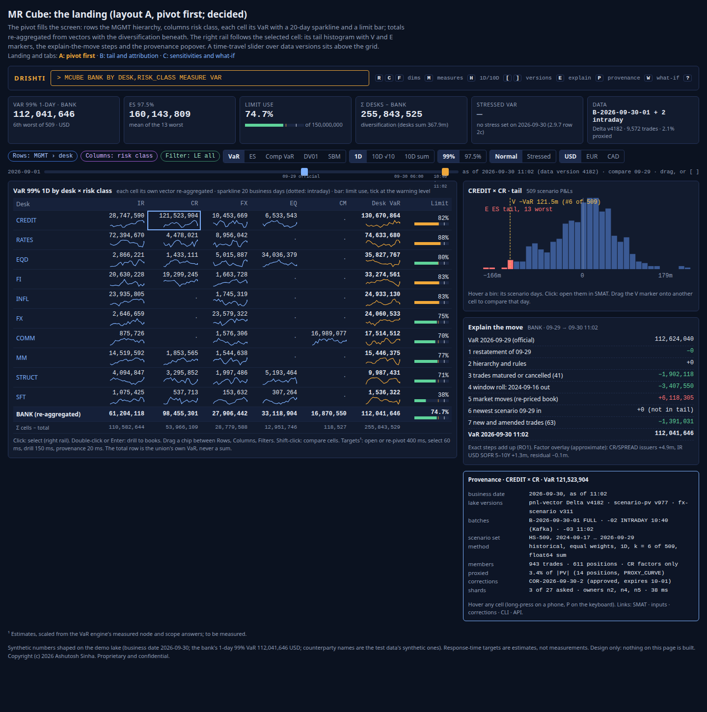

| # | Panel | Exact contents | Data | Interactions | Phase | Phone | Done? |
|---|---|---|---|---|---|---|---|
| A1 | Command line and key strip | `DRISHTI` mark; the command field (amber border, mono) showing the view as text: `MCUBE BANK BY DESK,RISK_CLASS MEASURE VAR <GO>`; the key strip **R C F** dims, **M** measures, **H** 1D/10D, **[ ]** versions, **E** explain, **P** provenance, **W** what-if, **?** | the view (`POST /api/v1/cube/mr/query`'s request) | type a view and `<GO>`; type-ahead of dimensions and measures; every key in [section 6.6.4](#664-keyboard-first) | POC | must (command field), keys hidden | [ ] |
| A2 | Headline strip (six tiles) | **VaR 99% 1-day · bank** 112,041,646 "6th worst of 509 · USD"; **ES 97.5%** 160,143,809 "mean of the 13 worst"; **Limit use** 74.7% with a bar (green under the warning level, amber from it, red over 100%, a tick at the warning level) "of 150,000,000"; **Σ desks − bank** 255,843,525 "diversification (desks sum 367.9m)"; **Stressed VaR** "—" with the reason ("no stress set on 2026-09-30", stressed VaR); **Data**: the batch and intraday count, the Delta version, trade count, proxied share | `/api/v1/var/scope` of the view's scope; `var-limit` ([§6.7.6](#676-d5-risk-hierarchy-and-var-limit-existing)); the scope's provenance | click a tile: the matching measure in the pivot; hover: provenance | POC (stressed tile after 2c) | must (VaR, ES, limit use), glance (the rest) | [ ] |
| A3 | Lens controls | chips **Rows: MGMT › desk** (blue), **Columns: risk class** (purple), **Filter: LE all** (green); segmented: measure **VaR · ES · Comp VaR · DV01 · SBM**; horizon **1D · 10D √10 · 10D sum**; confidence **99% · 97.5%**; set **Normal · Stressed**; currency **USD · EUR · CAD** | the view; currencies from `/api/v1/var/currencies` | drag a chip between Rows, Columns and Filters; click a segment; `R`, `C`, `F`, `M`, `H` | POC (SBM and Stressed greyed until MC5 and 2c) | desk (a phone opens saved views only) | [ ] |
| A4 | Time-travel slider | a track from the first date with an official capture to now; ticks at the official runs and each batch (`09-29 official`, `09-30 06:00`, `10:40`, `11:02`); the amber handle "as of", the blue handle "compare"; the text "as of 2026-09-30 11:02 (data version 4182) · compare 09-29" | `GET /api/v1/cube/mr/versions` (dates with captures, each date's batches) | drag either handle; `[` and `]` step the as-of; **brush** a range for the sparkline window | POC (dates and batches; raw lake versions later, decision P3) | more | [ ] |
| A5 | Pivot grid | rows: the ten desks (CREDIT, RATES, EQD, FI, INFL, FX, COMM, MM, STRUCT, SFT) as links; columns IR, CR, FX, EQ, CM, **Desk VaR**, **Limit**; each cell: the VaR (mono, thousands separators), under it a 70 × 16 px sparkline of 20 business days (blue; the desk column amber; dotted for intraday points); the Limit cell: use % and a 70 × 6 px bar (green, amber at the warning level, red over 100%, white tick at 100%); a dot `·` where the desk has no factor of the class; the selected cell outlined blue; **total row** "BANK (re-aggregated)" with each column's own VaR (IR 61,204,118 … bank 112,041,646) and 74.7%; **Σ cells − total** row in muted text | `POST /api/v1/cube/mr/query` (cells, totals, diversification, provenance ids); sparklines from official captures; per-class vectors ([§6.7.4](#674-d3-pnl-vector-scenario-pv-fx-scenario-existing-extended)); limits ([§6.7.6](#676-d5-risk-hierarchy-and-var-limit-existing)) | click: select (fills the right rail); double-click or `Enter`: drill to books, positions, trades; `Backspace`: back; hover: the provenance popover (A8); shift-click: compare cells; arrows move the selection; the column header sorts | POC | must: the first five rows by the first measure, totals pinned; glance: the sparkline column | [ ] |
| A6 | Tail histogram (right rail) | title "<row> × <column> · tail · 509 scenario P&Ls"; 34 bins; the ES tail bins red and marked **E** "ES tail, 13 worst"; the VaR bin amber with a dashed line and **V** "−VaR 121.5m (#6 of 509)"; a zero line; the x axis from the worst to the best P&L (m) | `/api/v1/var/scope/distribution` for the cell's scope; `GET /api/v1/cube/mr/cell` | hover a bin: its scenario days; click: open them in `SMAT`; **drag** the V marker onto another cell: compare that scenario day there | POC | glance (a strip) | [ ] |
| A7 | Explain the move (right rail) | "BANK · 09-29 → 09-30 11:02"; lines: VaR 09-29 (official) 112,624,040; the steps with signed amounts (decreases green, increases red); the result 112,041,646 in bold; a note that the exact steps add up and the factor overlay is approximate | `GET /api/v1/cube/mr/explain` (POC: trades out, re-priced book, trades in); RO1's full steps and the overlay later | click a step: highlight the cells it moved; click a contributor: open it; `E` | POC (three steps); RO1's seven steps built; the factor overlay, MC12, in sensitivities and capital (2.9.11) | more | [ ] |
| A8 | Provenance popover | "Provenance · <cell> · VaR <value>"; business date and as-of; lake versions per input table; batches in order with their kind (FULL, INTRADAY, Kafka or files); scenario set and window; method (historical, equal weights, horizon, k of N, float64 sum); members (trades, positions, factors); proxied share with reason; corrections; shards asked and owners, time; links SMAT, inputs, corrections, CLI, API | `GET /api/v1/cube/provenance/{id}` | hover (desktop), long-press (phone), `P` | POC (corrections later) | more | [ ] |

##### B: tail and attribution (tab)

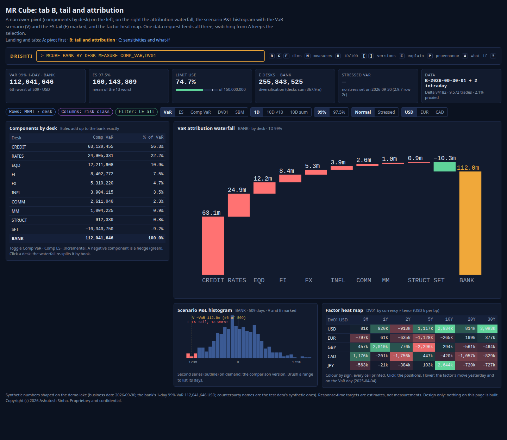

| # | Panel | Exact contents | Data | Interactions | Phase | Phone | Done? |
|---|---|---|---|---|---|---|---|
| B1 | Components by desk | columns Desk, Comp VaR, % of VaR; rows sorted by component; a negative component (SFT −10,340,750, −9.2%) is a hedge; total BANK 112,041,646, 100.0% | `/api/v1/var/scope/contributions` (`by` the column dimension; Arrow on request) | toggle Comp VaR · Comp ES · Incremental; click a desk: the waterfall re-splits it by book | POC | glance (top five) | [ ] |
| B2 | VaR attribution waterfall | one bar per part, sorted by size, red for a positive component, green for a hedge, each labelled (63.1m … −10.3m); the total bar amber "112.0m"; x axis the parts, y axis USD | as B1 | click a bar: drill into that part; hover: standalone, component, incremental, marginal | POC | more | [ ] |
| B3 | Scenario P&L histogram | as A6 for the scope; an outline series for the compare version | `/api/v1/var/scope/distribution` | **brush** a range: list its days; hover, click as A6 | POC | glance | [ ] |
| B4 | Factor heat map | DV01 in USD thousands per bp, rows currencies (USD, EUR, GBP, CAD, JPY), columns tenors (3M, 1Y, 2Y, 5Y, 10Y, 20Y, 30Y); each cell printed, green for long and red for short, intensity by size (full at 2.5m) | `GET /api/v1/cube/mr/sensitivities?by=QUALIFIER,TENOR` from `position-sensitivity` ([§6.7.9](#679-d8-position-sensitivity-sens-new)) and `risk-factor` ([§6.7.10](#6710-d9-the-factor-dictionary-risk-factor-and-the-bucket-mapping-sensitivity-bucketsyaml-new)) | click a cell: its positions; hover: the factor's move yesterday and on the VaR day; switch the two factor parts (issuer × tenor for CS01, underlying × expiry for vega) | POC (synthetic DV01); CS01 and vega with MC3 | desk | [ ] |

##### C: sensitivities and what-if (tab)

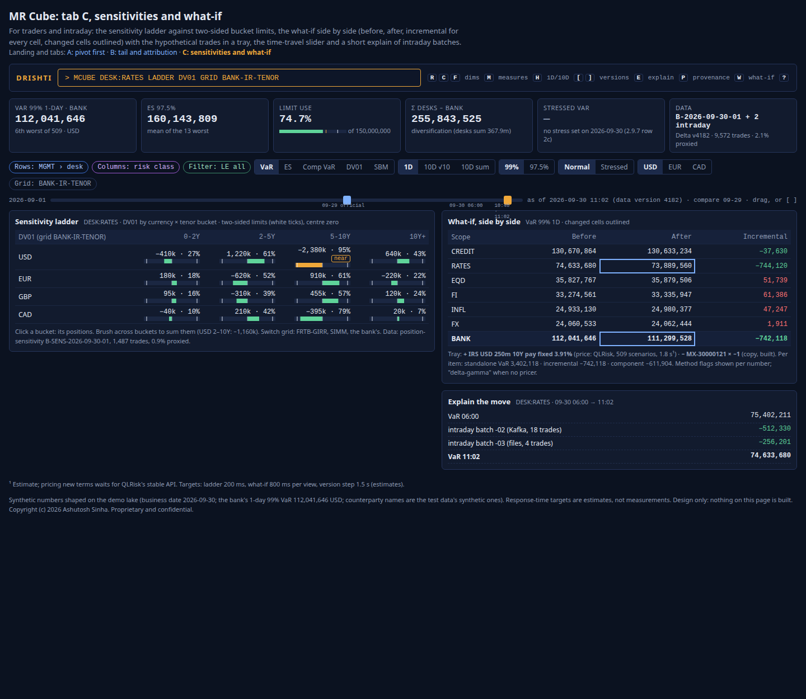

| # | Panel | Exact contents | Data | Interactions | Phase | Phone | Done? |
|---|---|---|---|---|---|---|---|
| C1 | Grid chip | **Grid: BANK-IR-TENOR** beside the lens controls | `sensitivity-buckets.yaml` ([§6.7.10](#6710-d9-the-factor-dictionary-risk-factor-and-the-bucket-mapping-sensitivity-bucketsyaml-new)) | click: choose FRTB-GIRR, SIMM or the bank's grids | POC (the bank's grid); FRTB grids with MC5 | desk | [ ] |
| C2 | Sensitivity ladder | rows USD, EUR, GBP, CAD; columns 0-2Y, 2-5Y, 5-10Y, 10Y+; each cell "<DV01>k · <use>%" with a 100 × 8 px centre-zero bar (long right, short left), white ticks at both limits, green under the warning level, amber from it, red over; a **near** badge (amber) at the warning level, **breach** (red) over 100% | `GET /api/v1/cube/mr/sensitivities?grid=…` from `position-sensitivity` ([§6.7.9](#679-d8-position-sensitivity-sens-new)); limits from `risk-limit` ([§6.7.7](#677-d6-risk-limit-new-one-limit-table-for-every-measure)) | click a bucket: its positions; **brush** across buckets to sum them ("USD 2–10Y: −1,160k"); switch grid | POC (synthetic DV01 and DV01 limits) | must (the scope's worst three buckets), more (the ladder) | [ ] |
| C3 | What-if side by side | columns Scope, Before, After, Incremental (decrease green, increase red); rows the visible desks and BANK; a cell whose change is material outlined blue; the tray under it listing each hypothetical trade with its method (copy, price) and its standalone, incremental and component VaR | `POST /api/v1/var/what-if` per visible scope (built); pricing of new terms later ([§6.7.16](#6716-d15-predeal-request-and-predeal-result-new)) | `W` or **+ What-if trade**: copy and scale a booked trade; remove one; "show only changed" | POC (copy method); advanced market risk (QLRisk pricing, delta-gamma) | desk | [ ] |
| C4 | Explain the move (intraday) | "DESK:RATES · 09-30 06:00 → 11:02": the morning VaR, one line per intraday batch with its source (Kafka, files) and trade count, the current VaR | `GET /api/v1/cube/mr/explain?from=<batch>&to=<batch>` | click a batch: highlight its trades | POC | more | [ ] |
| C5 | Time-travel slider | as A4 | as A4 | as A4 | POC | more | [ ] |

**Not on the mock-ups but in the design, to build with them:** saved views (`S`), export (`X`: CSV and Arrow in the POC; xlsx and Power
Query later), the embed of a saved view, the phone layout of section 6.6.5, the SBM pivot (MC5), corrections' markers (MC11).

---

### 6.7 Data and contracts

#### Data needed: the complete list

**Every dataset the MR Cube reads, in one table.** A row is needed from the phase in its *Phase* column onward. POC is the proof of
concept of [section 6.12](#612-lens-design-and-proof-of-concept-poc); the regulatory foundation (2.9.8), sensitivities and capital (2.9.11) and advanced market risk (2.9.18, proposed) are the phases of
[section 6.13](#613-phases-proposed); *unscheduled* rows wait for the product owner. *State*: **existing** (a contract and demo data today), **extended** (existing, with optional fields
added), **new**. *Demo or POC* says how the demo gets the data: an existing demo dataset; a **new generator** (a script under
`tools/packgen/` following the repository's data pattern: JSON Lines in `data/testdata/<domain>/<kind>/`, loaded into Delta by
`tools/build_demo_lakes.py`, tested with the demo off); shipped **configuration** from a public text; or **bank only**.

| # | Dataset | What it is; needed by | Phase | Typical source in a bank | Grain, frequency | State | Demo or POC gets it from | § |
|---|---|---|---|---|---|---|---|---|
| 1 | Trades (`trade`) | booking attributes as dimensions, drill to the trade; `FRTB_DESK`, `RRAO_CLASS` later | POC | Endur, Murex, Calypso | trade × date; daily, intraday amendments | existing; extended (sensitivities and capital) | existing demo (`tools/packgen/trades/make_trades.py`, `data/testdata/trades`) | [6.7.2](#672-d1-trade-trd-existing-read-as-dimensions) |
| 2 | Positions (`position`) | the position grain, market value for marginal VaR | POC | derived by Drishti | position × date, at load | existing | derived from the vectors | [6.7.3](#673-d2-position-pos-existing-derived-by-drishti) |
| 3 | Scenario P&L vectors (`pnl-vector`, `scenario-pv`, `fx-scenario`) | VaR, ES, components, histogram, explain, time travel | POC | the risk engine of the booking system or the bank's pricing grid | trade or position × date × set; daily, intraday files or Kafka | existing; extended (`RISK_CLASS_VECTORS`; regulatory reporting, G6, 2.9.15) | existing demo (`tools/packgen/var/make_var_data.py`); the POC adds per-class vectors from the same factor model | [6.7.4](#674-d3-pnl-vector-scenario-pv-fx-scenario-existing-extended) |
| 4 | Scenario sets (`scenario-set`), the stress set included | the scenario days; the Normal / Stressed lens | POC (normal); sensitivities and capital (stressed, from stressed VaR) | the risk engine | set × date; daily, the stress set weekly | existing; extended (`PURPOSE`) | existing demo; the stress set from stressed VaR's generator | [6.7.5](#675-d4-scenario-set-sset-existing-extended) |
| 5 | Hierarchies (`risk-hierarchy`) and VaR limits (`var-limit`) | rows of the pivot (MGMT, LEGAL, limit letters), limit bars | POC | the bank's hierarchy and limit systems | node × date; daily | existing | existing demo | [6.7.6](#676-d5-risk-hierarchy-and-var-limit-existing) |
| 6 | Limits of every measure (`risk-limit`) | ladder limits (DV01, CS01, vega), stress, ES and capital limits | POC (DV01 only); sensitivities and capital (all) | the limit system | limit × date; daily, on change | new | **new generator** `tools/packgen/var/make_risk_limits.py` → `data/testdata/market-risk/risk-limit/` | [6.7.7](#677-d6-risk-limit-new-one-limit-table-for-every-measure) |
| 7 | Market data: rate, credit, inflation, FX forward, equity and commodity curves; vol surfaces and cubes | factor moves for explain's overlay; QLRisk pricing | Sensitivities and capital (explain overlay); advanced market risk (pricing) | the market-data system (Bloomberg, Refinitiv, Markit through an in-house builder) | curve × date; end of day | existing | existing demo (`data/testdata/market-data/`) | [6.7.8](#678-d7-market-data-existing-read-for-explain-and-pricing) |
| 8 | FX rates (`fx-spot`, `fx-scenario`) | the reporting currency; sensitivities summed in USD | POC | market data; the risk engine for scenario FX | currency × date | existing | existing demo | [6.7.4](#674-d3-pnl-vector-scenario-pv-fx-scenario-existing-extended) |
| 9 | Position sensitivities (`position-sensitivity`) | ladders, heat map, SBM, explain overlay, SIMM (CCR cube) | POC (synthetic); sensitivities and capital | the same engine and run as the scenario PVs | position × date × batch; daily, intraday | existing | existing demo (`tools/packgen/sensitivity/make_sensitivity_data.py`) | [6.7.9](#679-d8-position-sensitivity-sens-new) |
| 10 | Factor dictionary (`risk-factor`) and bucket grids (`sensitivity-buckets.yaml`) | factor parts and bucket grids for ladders and SBM; liquidity horizons and modellability for IMA | POC (names, grids); advanced market risk (IMA attributes) | the FRTB engine or the market-data system | factor, slowly changing | existing (`risk-factor`); new (the grids) | existing demo (`tools/packgen/sensitivity/factor_dictionary.py`); the grids as pack configuration | [6.7.10](#6710-d9-the-factor-dictionary-risk-factor-and-the-bucket-mapping-sensitivity-bucketsyaml-new) |
| 11 | FRTB parameters: risk weights, correlations (ρ, γ), curvature shocks, DRC and RRAO weights | SBM, DRC, RRAO | Sensitivities and capital | the Basel text (MAR21 to MAR23) and the jurisdiction's rule | parameter set, per regulatory change | existing | **configuration** shipped from the public text (`config/packs/market-risk/capital/frtb-sa-sbm.yaml`, `frtb-sa-drc-rrao.yaml`, BCBS first) | [6.8.3](#683-frtb-standardised-approach-mc5-to-mc7) |
| 12 | Issuers and ratings (`issuer`, `credit-curve`, the counterparty's `RATING`) | heat map by issuer, DRC credit quality, concentration | Sensitivities and capital | the security master and the credit system | issuer × date | existing | existing demo (`data/testdata/core/issuer`, `data/testdata/market-data/credit-curve`) | [6.7.8](#678-d7-market-data-existing-read-for-explain-and-pricing) |
| 13 | Calendars (`calendar`) | business days for the time-travel slider, the 10-day windows, backtesting's 250 days | POC | the bank's calendar service | calendar, yearly | existing | existing demo (`data/testdata/core/calendar`) | — |
| 14 | IMA P&L vectors (`ima-pnl-vector`) | ES by liquidity horizon, stressed calibration, IMCC | Advanced market risk | the FRTB IMA engine | position × date × subset; daily, stressed weekly | new | **new generator** `tools/packgen/var/ima_vectors.py` (the factor model with factor groups switched off per subset) | [6.7.11](#6711-d10-ima-pnl-vector-new-pl-vectors-per-risk-class-and-liquidity-horizon) |
| 15 | Actual, hypothetical and risk-theoretical P&L (`desk-pnl`) | backtesting, PLA, desk zones | Regulatory foundation (backtesting, its row 3); advanced market risk (PLA) | product control and the front office | desk (or trade) × date; T+1 | existing (actual and hypothetical by desk); extended (RTPL, trade grain) | existing demo (`tools/packgen/var/desk_pnl.py`) | [6.7.12](#6712-d11-desk-pnl-new-actual-hypothetical-and-risk-theoretical-pl) |
| 16 | Stress scenarios and stress P&L (`stress-scenario`, `scenario-pnl`) | stress P&L per cell, the worst scenario | unscheduled (the stress engine, RO9) | the stress engine | scenario × date; trade × scenario × date | existing (extended); `scenario-pnl` new | existing `stress-scenario`; **new generator** `tools/packgen/var/scenario_pnl.py` (shocks × the factor loadings) | [6.7.13](#6713-d12-stress-scenario-extended-and-scenario-pnl-new) |
| 17 | DRC and RRAO inputs (`default-risk`, `residual-risk`) | DRC, RRAO | Sensitivities and capital | the FRTB engine; the booking system's classification | trade × obligor × date | contract planned, no data | **new generator** `tools/packgen/var/frtb_inputs.py` (from the credit and equity trades and the issuer master) | [6.7.14](#6714-d13-default-risk-and-residual-risk-new-frtbmd-proposals) |
| 18 | Corrections (`cube-correction`) | data corrections inside the cube | unscheduled (MC11) | Drishti (write-back) | correction | new (Drishti-owned) | made in the demo through write-back (the demo script seeds one) | [6.7.15](#6715-d14-cube-correction-new-data-corrections-drishti-owned) |
| 19 | Pre-deal requests and results | what-if per cell; pricing of new terms | POC (copy method, built); advanced market risk (pricing) | Drishti, per request | request | new (Drishti-owned, computed) | made at run time | [6.7.16](#6716-d15-predeal-request-and-predeal-result-new) |
| 20 | Official captures and the intraday batch list (`var-official`, the batches on the vectors) | sparklines, explain between dates, the time-travel slider | POC | Drishti (official runs); the risk engine (batches) | node × date; batch | existing | existing demo (the demo's official captures and intraday batches) | [VAR.md section 5](../contracts/VAR.md#5-official-end-of-day-results) |

**Count by the first phase each row is needed in:** POC **12** (rows 1 to 6, 8 to 10, 13, 19, 20); regulatory foundation **1** (row 15);
sensitivities and capital **4** (rows 7, 11, 12, 17; rows 4 and 6 widen there to stressed sets and the full limit table); advanced
market risk **1** (row 14); unscheduled **2** (rows 16 and 18). **Generators still to write: 5**, under `tools/packgen/var/`:
`make_risk_limits.py`, `ima_vectors.py`, `scenario_pnl.py`, `frtb_inputs.py`, and per-class vectors added to `make_var_data.py`.
**In production every input is the bank's**: Drishti never invents a bank's number, and the demo's synthetic data is labelled as such.

#### Minimum data for a first answer

The smallest set that lights up the landing (layout A, the pivot) is **five datasets, all in the demo today**: the scenario P&L vectors
(or scenario PVs with their FX scenarios), the scenario set, the trades (for the dimensions), the risk hierarchy and the VaR limits. With
them the pivot shows VaR, ES and components for any two dimensions with recomputed totals, the tail histogram, drill to the trade, the
provenance popover and limit bars. The official captures of earlier dates add the sparklines and explain between dates; **synthetic
sensitivities** (row 9) light up tab C's ladder and the heat map.

#### Data readiness checklist (MR Cube, for a bank's onboarding)

- [ ] One full scenario P&L run per date and source, every live trade or position, with `STATUS` and `BATCH_ID`; failed rows counted.
- [ ] The scenario set of that run (dates oldest first) and, for scenario PVs, the FX scenarios of every currency.
- [ ] The trades (or the placement columns on the vectors) with legal entity, desk, book, product, currency, counterparty.
- [ ] The management hierarchy, the legal hierarchy, the limit letters, and the VaR limits with horizon and confidence.
- [ ] Intraday: the file drop or Kafka topic agreed, with batch ids.
- [ ] Sensitivities from the same run as the vectors, in the factor naming standard or with a factor mapping; the bucket grids the
      limits use.
- [ ] A limit catalogue for sensitivities (two sides, warning level, owner).
- [ ] For explain's overlay: the curve points behind each factor (market data references).
- [ ] For FRTB SA: the jurisdiction's parameters chosen; DRC and RRAO inputs; `FRTB_DESK` on trades.
- [ ] For backtesting and PLA: actual, hypothetical and risk-theoretical P&L by regulatory desk.
- [ ] For IMA: the IMA P&L subsets, the factors' liquidity horizons and modellability, the approved stress period.
- [ ] Retention, entitlements (who sees which scopes) and the reporting currencies agreed.

#### The contracts in detail

**This is the heart of the cube.** Every contract below follows the repository's conventions ([docs/contracts/README.md](../contracts/README.md)):
one contract YAML per kind in `config/packs/<pack>/contracts/<kind>.contract.yaml` with `kind`, `mnemonic`, `class` (`fundamental`,
`input`, `drishti-owned`, `computed`), `grain`, `key`, `dated-by`, `cadence`, `storage` (Delta or Iceberg table, `vectors`) and `fields`
(name, type, presence, unit, description, example); data delivered as **JSON Lines, gzipped**, in `data/testdata/<domain>/<kind>/*.jsonl.gz`
for the demo, loaded by `lake build` or the parallel loader into Delta (or Iceberg), partitioned by `business_date`; trade fields in
Endur-style UPPER_SNAKE names. Sizes are at **2.3M positions** (about 10M trades, the reference bank of
[CLUSTER_DEPLOYMENT.md](CLUSTER_DEPLOYMENT.md)), estimates footnoted.

#### 6.7.1 The contract map

| # | Contract (kind) | Class | State | Read by the MR Cube for | Section |
|---|---|---|---|---|---|
| D1 | `trade` (TRD) | fundamental | existing | trade attributes as dimensions; FRTB classification inputs | 6.7.2 |
| D2 | `position` (POS) | drishti-owned | existing | the position grain; market value, notional | 6.7.3 |
| D3 | `pnl-vector` (PNLV), `scenario-pv` (SPV), `fx-scenario` (FXS) | input | existing; **extended** | scenario P&L; the vector measures | 6.7.4 |
| D4 | `scenario-set` (SSET) | input | existing; **extended** | scenario days, stress set flag | 6.7.5 |
| D5 | `risk-hierarchy` (HIER), `var-limit` (VLIM) | input | existing | dimensions; VaR limits | 6.7.6 |
| D6 | `risk-limit` | fundamental | **new** (STR.md proposal, RO3) | sensitivity, stress, ES, capital limits | 6.7.7 |
| D7 | market data (`ir-curve`, `credit-curve`, `fx-spot`, vol surfaces …) | fundamental | existing | factor moves for explain; QLRisk pricing | 6.7.8 |
| D8 | `position-sensitivity` (SENS) | input | existing | sensitivities, ladders, SBM, explain overlay, SIMM (CCR) | 6.7.9 |
| D9 | `risk-factor` (the factor dictionary) and `sensitivity-buckets.yaml` | fundamental + configuration | existing (`risk-factor`); **new** (the grids) | factor parts, liquidity horizons, modellability, bucket grids | 6.7.10 |
| D10 | `ima-pnl-vector` | input | **new** | ES by liquidity horizon, reduced set, stressed calibration, by risk class | 6.7.11 |
| D11 | `desk-pnl` (actual, hypothetical, risk-theoretical) | input | existing; **extended** | backtesting, PLA | 6.7.12 |
| D12 | `stress-scenario` (SCN) and `scenario-pnl` | fundamental, input | existing; **extended**; `scenario-pnl` **new** (STR.md) | stress P&L | 6.7.13 |
| D13 | `default-risk` and `residual-risk` | input | contract planned | DRC and RRAO | 6.7.14 |
| D14 | `cube-correction` | drishti-owned | **new** | data corrections inside the cube | 6.7.15 |
| D15 | `predeal-request` and `predeal-result` | drishti-owned, computed | **new** | pre-deal what-if | 6.7.16 |

#### 6.7.2 D1 `trade` (TRD): existing, read as dimensions

Contract: [trade.contract.yaml](../../config/packs/trading/contracts/trade.contract.yaml). One row per trade per business date, Delta under
`<root>/trading/trade_<system>/`; sources Endur, Murex, Calypso (the demo's three booking systems); daily snapshot, intraday amendments.
**Size at 2.3M positions:** about 10M trades, about 3 KB a trade as JSON with legs and events (30 GB a day of JSON, about 3 GB in
Parquet)². **How the cube reads it:** the identity and version fields name the member and the version the vector priced; status,
action and the dates are the one live rule (COMPUTED_ATTRIBUTES section 10, confirmed 2026-10-31) and DRC's maturity scaling; product,
legal entity, portfolio, book, trader, counterparty and currency fields are dimensions (and the CCR cube's link); quantity, price,
direction, option terms and `LEGS[]`/`EVENTS[]` are the what-if and pre-deal terms QLRisk prices.

**What the MR Cube adds (extended, optional fields, proposed):** `FRTB_DESK` (the regulatory trading desk, for IMA approval and PLA:
often not the management desk), `RRAO_CLASS` (`EXOTIC`, `OTHER_RESIDUAL`, empty), `IMA_ELIGIBLE` (boolean, the desk's model approval
applies), `HEDGE_DESIGNATION` (for what-if hedge suggestions). **Validation:** an unknown `FRTB_DESK` is a warning per source; a
`RRAO_CLASS` outside the list is refused.

#### 6.7.3 D2 `position` (POS): existing, derived by Drishti

Contract: [position.contract.yaml](../../config/packs/market-risk/contracts/position.contract.yaml): one position per business date, derived when
the date's vectors load (never stored). **The cube adds nothing to the contract**; it reads `MARKET_VALUE` for marginal VaR and as an
additive measure. **Size:** 2.3M rows, about 0.8 KB a position skeleton (CLUSTER_DEPLOYMENT section 6.7).

#### 6.7.4 D3 `pnl-vector`, `scenario-pv`, `fx-scenario`: existing, extended

One row per trade or position, business date and scenario set, sorted by book. **Sources:** the bank's risk engine
(Murex MLC, Calypso risk, Endur's risk server, or an in-house pricing grid) on the same run as the trades. **Frequency:** a full run
after the close (06:00 in the demo), intraday batches (`RUN_KIND INTRADAY`) from files or Kafka. **Size:** 2.3M × 509 × 8 bytes of
JSON-decimal text ≈ 20 GB of JSON a day; float32 in the hot file 4.7 GB; at 1,518 values (normal 509, stressed 250, spare) 14 GB in the
hot tier across shards (27 shards of 0.52 GB at `target-shard-mb: 512`, CLUSTER_DEPLOYMENT decision PO-C2).

Contracts: [pnl-vector](../../config/packs/market-risk/contracts/pnl-vector.contract.yaml),
[scenario-pv](../../config/packs/market-risk/contracts/scenario-pv.contract.yaml) and
[fx-scenario](../../config/packs/market-risk/contracts/fx-scenario.contract.yaml) (one row per currency, date and set, so scenario PVs in any
currency turn into USD P&L); every field is read. Validation as built ([VAR.md section 6.3](../contracts/VAR.md#63-what-the-load-checks)):
wrong vector length, NaN, a failed row counted never zero, one full run per date and source, one form and grain per source and date.

**Extended (proposed, optional):**

| New field | Type | Unit | Req. | Meaning |
|---|---|---|---|---|
| `RISK_CLASS_VECTORS` | record list | USD | optional | the same vector split by FRTB risk class (`RISK_CLASS`, `PNL`), when the source runs partial revaluations; enables "VaR by risk type" (G6, planned) without a second table; the split need not add up to `PNL` (cross effects), the residual is reported |
| `FRTB_DESK` | id | | optional | the regulatory desk (as on the trade) |
| `PROXY_REASON` | text | | optional | why `STATUS` is `proxied` (`NO_HISTORY`, `PROXY_CURVE`, `STALE_DATA`); counted per reason on the data-trust card |

```json
{"VECTOR_ID":"PNL-MX-20000274-HS-509","VALUE_TYPE":"PNL","GRAIN":"TRADE","TRADE_ID":"MX-20000274","SOURCE_SYSTEM":"MUREX",
 "BUSINESS_DATE":"2026-09-30","SCENARIO_SET_ID":"HS-509","CURRENCY":"USD","LEGAL_ENTITY":"LE-LDN","DIVISION":"DIV-MARKETS",
 "DESK":"DESK-EQD","TT_BOOK":"BOOK-EQD-2","PORTFOLIO":"BOOK-EQD-2","PRODUCT_GROUP":"Equity","PRODUCT_TYPE":"WARRANT",
 "DIRECTION":"SHORT","QUANTITY":-179000000.0,"TRADE_STATUS":"AMENDED","MATURITY_DATE":"2027-05-26","PV":3143714,
 "PNL":[-1204.5,882.1,"… 509 values …"],"STATUS":"ok","PRICER":"demo-factor-model","MODEL_VERSION":"demo-2",
 "COMPUTED_AT":"2026-09-30T06:00:00Z","BATCH_ID":"B-2026-09-30-01","RESTATEMENT":0,"RUN_KIND":"FULL",
 "RISK_CLASS_VECTORS":[{"RISK_CLASS":"EQ","PNL":["… 509 values …"]},{"RISK_CLASS":"FX","PNL":["… 509 values …"]}]}
```


#### 6.7.5 D4 `scenario-set` (SSET): existing, extended

Contract: [scenario-set.contract.yaml](../../config/packs/market-risk/contracts/scenario-set.contract.yaml) (one row per set per
business date). **Extended (proposed):** `PURPOSE` (`NORMAL`, `STRESSED`, `IMA_CURRENT`, `IMA_STRESSED`, `STRESS_SELECTION`), `APPROVED_BY`
and `APPROVAL_ID` (the stress window's sign-off, the planned stress window tool), `REDUCED_FACTOR_SET` (boolean: the vectors priced with the reduced set of
MAR33's stressed calibration). Stressed VaR introduces a second set per date (`HS-STRESS-…`); the cube treats every set
as a **lens** (Normal / Stressed beside the confidence picker). **Validation:** one `NORMAL` set per date; a `STRESSED` set's window
inside the approved stress period.

#### 6.7.6 D5 `risk-hierarchy` and `var-limit`: existing

Contracts: [risk-hierarchy](../../config/packs/market-risk/contracts/risk-hierarchy.contract.yaml) (HIER, one row per node per date, or built
from the vectors' columns) and [var-limit](../../config/packs/market-risk/contracts/var-limit.contract.yaml) (VLIM, with horizon and confidence).
**The cube adds nothing**; it draws the limit bar of a VaR cell from `var-limit` when the cell is exactly a node and the lens matches the
limit's horizon and confidence (otherwise no bar, said in the provenance: "limit not comparable").

#### 6.7.7 D6 `risk-limit`: new (one limit table for every measure)

Proposed in [STR.md section 3.5](../contracts/STR.md#35-risk-limit-limits-by-measure-and-scope-fundamental) and RO3; the cube adopts and
extends it. **Grain:** one row per limit per business date. **Key:** `LIMIT_ID`. **Storage:** Delta, `<root>/risk/risk-limit/`.
**Sources:** the bank's limit system (often in-house; Murex and Calypso limit modules). **Frequency:** daily with the morning inputs,
and on change. **Size:** 10,000 to 100,000 limits, under 50 MB a day.

| Field | Type | Unit | Req. | Meaning |
|---|---|---|---|---|
| `LIMIT_ID` | id | | required | `LIM-<measure>-<scope>-<bucket>` |
| `MEASURE` | text | | required | `VAR`, `SVAR`, `ES`, `STR`, `DV01`, `CS01`, `VEGA`, `FX_DELTA`, `EQ_DELTA`, `CM_DELTA`, `NOTIONAL`, `STOP_LOSS`, `FRTB_SA`, `IMA_ES` |
| `SCOPE` | text | | required | a scope text (`DESK:DESK-RATES`, `LL~LL-0003/DESK-RATES`) |
| `GRID`, `BUCKET` | text | | optional | the bucket grid of `sensitivity-buckets.yaml` and the bucket (`BANK-IR-TENOR`, `5-10Y`) |
| `HORIZON`, `CONFIDENCE`, `SCENARIO_ID` | text, rate, id | | optional | the lens the limit is set for; a stress limit's scenario (empty: the worst) |
| `LIMIT_LONG`, `LIMIT_SHORT` | amount | `CURRENCY` | required (one of) | two sides for sensitivities; a VaR limit uses `LIMIT_LONG` only |
| `CURRENCY` | text | | required | ISO 4217 |
| `WARNING_AT` | rate | fraction | optional | early warning (site default 0.8, [section 5.9](#59-decisions-for-the-product-owner) decision 8) |
| `OWNER`, `ESCALATION_CHAIN`, `APPROVED_BY`, `LIMIT_LETTER` | text, list | | optional | governance |
| `TEMPORARY`, `VALID_FROM`, `VALID_TO`, `BUSINESS_DATE` | boolean, date | | required/optional | temporary increases have an end |

```json
{"LIMIT_ID":"LIM-DV01-DESK-RATES-USD-5-10Y","MEASURE":"DV01","SCOPE":"DESK:DESK-RATES","GRID":"BANK-IR-TENOR","BUCKET":"USD/5-10Y",
 "LIMIT_LONG":2500000,"LIMIT_SHORT":2500000,"CURRENCY":"USD","WARNING_AT":0.8,"OWNER":"rates-risk","APPROVED_BY":"Market Risk Committee",
 "LIMIT_LETTER":"LL-0003","TEMPORARY":false,"VALID_FROM":"2026-01-02","BUSINESS_DATE":"2026-09-30"}
```

**Validation:** a scope that does not parse is refused; a `GRID` or `BUCKET` not in the configuration is refused; overlapping limits on
the same measure, scope and bucket refused unless one is `TEMPORARY`; `var-limit` rows are read as `MEASURE VAR` (section 5.9 decision 5).

#### 6.7.8 D7 Market data: existing, read for explain and pricing

The market-data pack's contracts ([`config/packs/market-data/contracts/`](../../config/packs/market-data/contracts/)): the rate, credit, FX,
inflation, equity, dividend, commodity and repo curves and the vol surfaces and cubes. **Sources:** the bank's market-data system
(Bloomberg, Refinitiv, Markit through an in-house curve builder). **Frequency:** end of day, intraday snapshots on demand. **What the
cube adds:** nothing to the contracts; a **factor mapping** from curve points to the factor dictionary (`IR/CURVE/USD/SOFR/10Y` ↔
`CRV-USD-SOFR` point `10Y`), so the explain overlay reads each factor's move T−1 → T, and QLRisk reads the same curves for pre-deal.

#### 6.7.9 D8 `position-sensitivity` (SENS): new

Adopted from [section 5.7.3](#573-a-proposed-data-contract-position-sensitivity) (decision 9 there: a new kind that **becomes** FRTB.md's
per-trade `sensitivity` input, so FRTB SA, SIMM, P&L explain, sensitivity stress and the cube read one table), with the FRTB and SIMM
bucket fields per element, the curvature inputs and the regulatory desk. **The contract is built:**
[position-sensitivity.contract.yaml](../../config/packs/market-risk/contracts/position-sensitivity.contract.yaml) holds the grain, key,
storage, every field, the refusals and warnings and the vega and curvature decisions; demo data from
`tools/packgen/sensitivity/make_sensitivity_data.py`; its use by FRTB SA is
[FRTB_SA_GUIDE section 3](../guides/FRTB_SA_GUIDE.md#3-the-inputs-and-their-data-contract).

What the cube adds on top of the contract: **storage order** sorted by `TT_BOOK` then id, as the vectors, so a scope's sensitivities
and vectors are read in one pass; **size** at 2.3M positions: 23 to 115 million elements a day (10 to 50 non-zero factors a position),
0.4 to 1.5 GB gzipped JSON, 0.3 to 1.7 GB of Parquet a day, 0.5 to 3 TB over seven years³; a **`proxied` share** shown beside every
sum; a factor outside every bucket of a grid a limit uses is a warning. **Consistency check (proposed):** for a sample of positions,
the first-order P&L Σ sensitivity × factor move of each scenario against the vector's P&L (a correlation per desk on the data-trust
card): it catches vectors and sensitivities from different runs.

#### 6.7.10 D9 The factor dictionary (`risk-factor`) and the bucket mapping (`sensitivity-buckets.yaml`): new

**The factor naming standard** (section 5.9 decision 10): one text name per factor, slash-separated: `IR/CURVE/<ccy>/<curve>/<tenor>`,
`INF/<index>/<tenor>`, `CR/SPREAD/<issuer, LEI preferred>/<BOND or CDS>/<tenor>`, `FX/SPOT/<ccy>`, `EQ/SPOT/<ISIN or index>`,
`EQ/REPO/<ISIN>`, `CM/PRICE/<underlying>/<location>/<tenor>`, `VOL/<class>/<qualifier>/<curve or underlying>/<expiry>[/<underlying
tenor>][/<strike>]`.

**`risk-factor` (fundamental, built):** the dictionary of every factor the bank uses:
[risk-factor.contract.yaml](../../config/packs/market-risk/contracts/risk-factor.contract.yaml) (the parts, the FRTB and SIMM buckets,
`LIQUIDITY_HORIZON`, `MODELLABLE`, `PROXY_OF`, `MARKET_DATA_REF`, the source names mapped to the standard); demo data from
`tools/packgen/sensitivity/factor_dictionary.py`. A few hundred thousand rows at a bank, under 100 MB. **IMA adds (proposed):**
`RFET_OBSERVATIONS_12M` and `RFET_MAX_GAP_DAYS` (the eligibility evidence: 24 real prices a year and no 90-day window with fewer than
4, MAR31) and `IN_REDUCED_SET` (in the reduced set of the stressed calibration, MAR33); `LIQUIDITY_HORIZON` (10 to 120 days, MAR33.12)
and `MODELLABLE` become required for IMA.

**`sensitivity-buckets.yaml` (configuration, in the market-risk pack):** named **grids**, each mapping factors to buckets by rules on the
parts: the FRTB grids (MAR21's bucket tables, with risk weights and correlations as parameters), the SIMM grid (licensed parameters: see
section 6.14) and the bank's own limit grids. Each limit names its grid; a factor falls in exactly one bucket of each grid (checked at
start, overlaps refused). A **bank's factor mapping** (its names → the standard) is configuration too; an unmapped name is refused,
never guessed.

```yaml
# config/packs/market-risk/sensitivity-buckets.yaml (proposed, illustrative)
grids:
  BANK-IR-TENOR:
    applies-to: {RISK_CLASS: GIRR, MEASURE: DV01}
    by: [QUALIFIER, TENOR]
    tenor-bands: {0-2Y: [2W, 1M, 3M, 6M, 1Y, 2Y], 2-5Y: [3Y, 5Y], 5-10Y: [10Y], 10Y+: [15Y, 20Y, 30Y]}
  FRTB-GIRR:
    applies-to: {RISK_CLASS: GIRR}
    bucket: QUALIFIER            # MAR21.39: one bucket per currency
    parameters: frtb/girr.yaml   # risk weights MAR21.42, correlations MAR21.45-50
```

#### 6.7.11 D10 `ima-pnl-vector`: new (P&L vectors per risk class and liquidity horizon)

FRTB-IMA's expected shortfall needs, per desk and date, the P&L of the portfolio under **different subsets of risk factors**: all factors
and each liquidity-horizon cascade level, the full and the reduced set, the current and the stressed period, unconstrained and per risk
class (MAR33). Drishti cannot make these from one vector: the subsets require the pricer to move only some factors.

**Grain:** one row per position (or trade), business date, scenario set, **factor subset**. **Key:** `IMA_VECTOR_ID` =
`IMA-<POSITION_ID or TRADE_ID>-<SCENARIO_SET_ID>-<SUBSET>`. **Storage:** `<root>/risk/ima-pnl-vector/`, partitioned by `business_date`
and `SCENARIO_SET_ID`, vector column `PNL`. **Sources:** the bank's FRTB IMA engine (Murex FRTB, Calypso, an in-house grid, or the FIS
engine itself). **Frequency:** daily for the current period; the stressed set at least weekly (MAR33). **Size:** with 3 calibrations
(full current, reduced current, reduced stressed) × 5 liquidity-horizon levels × (1 unconstrained + 5 risk classes) = **90 vectors a
position** at most; sparse in practice (a position touches one or two classes and its factors' horizons), about **10 to 20 vectors a
position** of 250 values: 2.3M × 15 × 250 × 4 bytes ≈ **35 GB** a date in float32 (up to 207 GB dense); only for IMA-approved desks⁴.

| Field | Type | Unit | Req. | Meaning |
|---|---|---|---|---|
| `IMA_VECTOR_ID` | id | | required | the key |
| `GRAIN`, `TRADE_ID`, `POSITION_ID`, `FRTB_DESK` | text, id | | required | the member and its regulatory desk |
| `BUSINESS_DATE`, `SCENARIO_SET_ID`, `BATCH_ID`, `COMPUTED_AT`, `RESTATEMENT`, `RUN_KIND` | | | required | as the vectors |
| `CALIBRATION` | text | | required | `FULL_CURRENT`, `REDUCED_CURRENT`, `REDUCED_STRESSED` |
| `LH_LEVEL` | integer | days | required | 10, 20, 40, 60, 120: only factors with liquidity horizon ≥ this level move (level 10 is all factors) |
| `RISK_CLASS` | text | | required | `ALL` or `GIRR`, `CSR`, `EQ`, `COMM`, `FX` (only that class's factors move) |
| `PNL` | vector | USD | required | 250 values (or the set's length), gain positive |
| `STATUS`, `PROXY_REASON` | text | | required, optional | |

```json
{"IMA_VECTOR_ID":"IMA-POS-BOOK-RATES-1~MX-30000951-IMA-CUR-250-FULL_CURRENT-L20-GIRR","GRAIN":"POSITION",
 "POSITION_ID":"POS-BOOK-RATES-1~MX-30000951","FRTB_DESK":"FD-USD-RATES","BUSINESS_DATE":"2026-09-30","SCENARIO_SET_ID":"IMA-CUR-250",
 "CALIBRATION":"FULL_CURRENT","LH_LEVEL":20,"RISK_CLASS":"GIRR","PNL":[-1820.4,"… 250 values …"],"STATUS":"ok",
 "BATCH_ID":"B-IMA-2026-09-30-01","COMPUTED_AT":"2026-09-30T07:30:00Z","RESTATEMENT":0,"RUN_KIND":"FULL"}
```

**Validation:** every (calibration, level, class) the desk's factors need present or the desk's ES is refused with the missing subsets
named; level 10 `ALL` of `FULL_CURRENT` should equal the position's normal vector over the same 250 days (checked to 0.01%, a warning);
vectors only for desks with `IMA_ELIGIBLE` positions. **Alternative (decision 4):** the source delivers desk-level vectors only (a bank
whose engine aggregates), far smaller (thousands of rows), losing position drill-through for IMA.

#### 6.7.12 D11 `desk-pnl`: new (actual, hypothetical and risk-theoretical P&L)

The P&L feed of backtesting is built:
[desk-pnl.contract.yaml](../../config/packs/market-risk/contracts/desk-pnl.contract.yaml) (DPNL: actual and hypothetical P&L and the
fees per desk and business date; demo data from `tools/packgen/var/desk_pnl.py`;
[REGULATORY_VAR_REPORTING section 7.1](../guides/REGULATORY_VAR_REPORTING.md#71-inputs-that-exist)). **What PLA and the cube add
(proposed, optional fields):** `RTPL` (risk-theoretical P&L from the IMA model's factors; when absent Drishti uses its own from the
vectors, named as such), `FRTB_DESK` (the regulatory desk), a `GRAIN` of `TRADE` as well as `DESK` (10M rows a day, about 1 GB, for
drill-through), `EXCLUDED_ITEMS` (the parts removed from actual by type: fees, commissions, reserves, net interest income, MAR32), and
`BATCH_ID` and `RESTATEMENT` (a restatement supersedes). **Sources:** product control (actual, from the general ledger and the front
office's P&L), the front office (hypothetical: yesterday's positions at today's prices), the risk engine (RTPL). **Validation:** one row
per desk and date per source; HPL and RTPL both present for PLA.

#### 6.7.13 D12 `stress-scenario` (extended) and `scenario-pnl` (new)

`stress-scenario` (SCN, existing): key `SCENARIO_ID`, `NAME`, `TYPE` (historical, hypothetical), `SEVERITY`, `SHOCKS[]` (`FACTOR`,
`SHOCK`), `HORIZON` in words. **Extended (STR.md section 3.3):** `VERSION`, machine-readable shocks on the factor dictionary
(`RISK_FACTOR`, `SHOCK`, `SHOCK_UNIT` bp, %, vol points, absolute), `IN_PROGRAMME`, `STRESS_CADENCE`, `APPROVED_BY`. **`scenario-pnl`
(new, STR.md section 3.2):** one row per trade, scenario and date, key `<TRADE_ID>~<SCENARIO_ID>`, `PNL` (USD, gain positive, full
revaluation), `BASE_MTM`, `SCENARIO_VERSION`, `STATUS` (`ok`, `proxied`, `sensitivity`, `failed`), `BATCH_ID`; 1M trades × 50 scenarios =
50M rows a date, about 600 MB compressed; at 10M trades about 6 GB (estimate from STR.md). The cube's stress P&L is additive (one scenario)
and its "worst scenario" per cell is a maximum over scenarios computed per cell. Sensitivity stress (Σ sensitivity × shock) needs only
D8 and the extended shocks.

```json
{"SCENARIO_PNL_KEY":"MX-20000209~SCN-COVID2020","BUSINESS_DATE":"2026-09-30","TRADE_ID":"MX-20000209","SCENARIO_ID":"SCN-COVID2020",
 "SCENARIO_VERSION":3,"PNL":-182340.0,"BASE_MTM":4121280.0,"STATUS":"ok","BATCH_ID":"B-STR-2026-09-30-01"}
```

#### 6.7.14 D13 `default-risk` and `residual-risk`: new (FRTB.md proposals)

From [FRTB.md sections 3.3 and 3.4](../contracts/FRTB.md#33-default-risk-the-drc-inputs-optional); both contracts are written (status
planned, no demo data yet): [default-risk.contract.yaml](../../config/packs/market-risk/contracts/default-risk.contract.yaml) (DRCI: one
row per position or trade, obligor and date; obligor bucket, seniority, credit quality, bond-equivalent notional, market value,
maturity) and [residual-risk.contract.yaml](../../config/packs/market-risk/contracts/residual-risk.contract.yaml) (RRAI: one row per
trade, `RRAO_CLASS` `EXOTIC` or `OTHER_RESIDUAL`, gross notional, the reason). How FRTB SA reads them:
[FRTB_SA_GUIDE sections 5 and 6](../guides/FRTB_SA_GUIDE.md#5-the-default-risk-charge). Sources: the FRTB engine or the trade's
classification in the booking system; rows only for credit and equity positions and residual-risk trades. Validation: an obligor without
a rating band refused (no default band guessed); an LGD, where one is supplied, outside (0, 1] refused.

#### 6.7.15 D14 `cube-correction`: new (data corrections, Drishti-owned)

**Grain:** one row per correction. **Key:** `CORRECTION_ID`. **Storage:** Drishti's own lake area (`<root>/drishti/cube-correction/`),
written only by write-back on approval. **Size:** small.

| Field | Type | Req. | Meaning |
|---|---|---|---|
| `CORRECTION_ID` | id | required | `COR-<date>-<n>` |
| `TARGET_KIND`, `TARGET_ID` | text, id | required | the record corrected (`pnl-vector` `PNL-MX-20000274-HS-509`; `position-sensitivity` …) |
| `ACTION` | text | required | `EXCLUDE`, `REPLACE_VECTOR`, `PROXY_FROM` (another member's vector scaled), `SET_ATTRIBUTE` |
| `PAYLOAD` | record | optional | the replacement (vector, attribute and value, proxy id and factor) |
| `REASON`, `AUTHOR`, `APPROVER`, `APPROVED_AT`, `EXPIRES` | text, timestamp, date | required | governance; expiry defaults to the next business date |
| `BUSINESS_DATE`, `APPLIES_TO_OFFICIAL` | date, boolean | required | whether the official run takes it |

#### 6.7.16 D15 `predeal-request` and `predeal-result`: new

**`predeal-request`** (Drishti-owned, private to the requester, deleted with the sandbox): `REQUEST_ID`, `SCOPES` (the view's scopes or
one), `ITEMS[]` each either `{COPY_OF, FACTOR}` (built today), or `{TERMS}` (a trade in the `trade` contract's fields and legs, priced by
QLRisk), or `{SENSITIVITIES}` (a sparse list as D8, for the delta-gamma estimate), `METHOD` (`copy`, `price`, `delta-gamma`, `auto`),
`LENS`. **`predeal-result`** (computed, never stored beyond the session): per scope `BEFORE`, `AFTER`, `CHANGE` (`VAR`, `ES`, `SVAR`,
`DV01` by bucket, `FRTB_SA`), per item `STANDALONE_VAR`, `INCREMENTAL_VAR`, `COMPONENT_VAR`, `METHOD_USED`, `PRICING_STATUS`, `FLAGS`
(`proxy`, `delta-gamma`), `PROVENANCE`.

```json
{"REQUEST_ID":"PD-2026-09-30-asha-0007","SCOPES":["DESK:DESK-RATES","BANK"],"METHOD":"auto","LENS":{"HORIZON":"1D","CONFIDENCE":0.99},
 "ITEMS":[{"TERMS":{"PRODUCT_TYPE":"IRS","CURRENCY":"USD","QUANTITY":250000000,"BUY_SELL_CODE":"B","START_DATE":"2026-10-02",
  "MATURITY_DATE":"2036-10-02","LEGS":[{"LEG_TYPE":"FIXED","RATE":0.0391},{"LEG_TYPE":"FLOAT","INDEX":"SOFR"}]}}]}
```

#### 6.7.17 Proposed contract YAMLs (not created yet)

| File | Kind | Mnemonic (proposed) | Class | Pack | New or extended |
|---|---|---|---|---|---|
| `config/packs/market-risk/contracts/ima-pnl-vector.contract.yaml` | `ima-pnl-vector` | `IMAV` | input | market-risk | new |
| `config/packs/market-risk/contracts/risk-limit.contract.yaml` | `risk-limit` | `RLIM` | fundamental | market-risk | new (RO3) |
| `config/packs/market-risk/contracts/scenario-pnl.contract.yaml` | `scenario-pnl` | `SPNL` | input | market-risk | new (STR.md) |
| `config/packs/market-risk/contracts/cube-correction.contract.yaml` | `cube-correction` | `CCOR` | drishti-owned | market-risk | new |
| `config/packs/market-risk/contracts/frtb-sa-result.contract.yaml` | `frtb-sa-result` | `FRSA` | computed | market-risk | new (replaces stored `frtb-sensitivity`) |
| `config/packs/market-risk/contracts/ima-result.contract.yaml` | `ima-result` | `IMAR` | computed | market-risk | new |
| `pnl-vector`, `scenario-pv`, `scenario-set`, `stress-scenario`, `trade` | existing | | | | extended (optional fields above) |
| `config/packs/market-risk/sensitivity-buckets.yaml` | configuration | | | market-risk | new |

Already written, so not in the table: `position-sensitivity` (SENS), `risk-factor` (RFAC), `desk-pnl` (DPNL), and `default-risk`
(DRCI) and `residual-risk` (RRAI) as planned contracts. The mnemonics above are placeholders, each checked against every pack's at
build. The CCR cube's list is in [section 7.7](#77-data-and-contracts).

² Trade size from the demo's trade records (legs and events included); Parquet ratio about 10:1 from the demo lakes.
³ From section 5.7.4 (about 110 bytes an element in JSON, 10 to 15 in Parquet; 1,764 business days in seven years).
⁴ 4 bytes a float32 value; the sparse count assumes a position in one risk class with factors in two liquidity-horizon levels across three
calibrations and the unconstrained set (3 × 2 × 2 + a few); to be measured on a bank's real factor mapping.

---

### 6.8 Measures

#### 6.8.1 VaR, ES and their decomposition (built; served per cell)

The engine's measures as built, computed from each cell's summed vector ([section 6.4.2](#642-correct-totals-for-non-additive-measures)):
VaR, ES, component, incremental and marginal VaR are defined in [VAR_GUIDE section 18](../guides/VAR_GUIDE.md#181-var) (VaR 18.1, ES
18.2, decomposition [18.3](../guides/VAR_GUIDE.md#183-decomposition-of-a-scope-into-parts), stressed VaR
[18.8](../guides/VAR_GUIDE.md#188-stressed-var)), with worked numbers in [its section 2](../guides/VAR_GUIDE.md#2-the-measures-with-worked-numbers).
On the demo: **the bank's 1-day 99% VaR is 112,041,646 USD**, ES 160,143,809, the ten desks' VaRs sum to 367.9 m (diversification
shown in the pivot's total row).

#### 6.8.2 Sensitivities and ladders (MC1, MC3)

Additive: a cell's sensitivity to factor *f* is `Σ_{positions in cell} s_f`, converted at today's FX. Ladders sum by bucket of a grid.
Net and gross (Σ|s|) shown; utilisation against two-sided limits `use = max(net/LIMIT_LONG, −net/LIMIT_SHORT)`.

#### 6.8.3 FRTB standardised approach (MC5 to MC7)

Built as the FRTB-SA engine; the method, its formulas and parameters are [FRTB_SA_GUIDE](../guides/FRTB_SA_GUIDE.md): the
sensitivities-based method ([section 4](../guides/FRTB_SA_GUIDE.md#4-the-sensitivities-based-method): delta, vega, curvature, the three
correlation scenarios, the alternative specification), the default risk charge ([section 5](../guides/FRTB_SA_GUIDE.md#5-the-default-risk-charge))
and the residual risk add-on ([section 6](../guides/FRTB_SA_GUIDE.md#6-the-residual-risk-add-on)). **What the cube adds:** the three
correlation scenarios side by side with the binding one marked, and the formula shown with the cell's own numbers (WS, K_b, ρ) on a
click.

**Total SA** = SBM + DRC + RRAO. Non-additive across desks (square roots and maxima): every cell re-runs the formula on its members' net
weighted sensitivities, which are additive per factor (so a cell's inputs are a sparse sum, cheap to combine across shards).

#### 6.8.4 FRTB internal models approach (MC8 to MC10)

**ES with liquidity horizons (MAR33):** with *T* = 10 days and the cascade levels LH_j ∈ {10, 20, 40, 60, 120},

```
ES = sqrt( ES_T(P)² + Σ_{j≥2} ( ES_T(P, j) · sqrt( (LH_j − LH_{j−1}) / T ) )² )
```

where `ES_T(P, j)` is the 97.5% ES of the 10-day P&L with only the factors of horizon ≥ LH_j moving (the `ima-pnl-vector` subsets, 10-day
P&L from 1-day vectors by the overlapping sum or as delivered: decision 3). **Stressed calibration:**
`ES = ES_{R,S} · max(ES_{F,C} / ES_{R,C}, 1)`. **IMCC:** `ρ · ES_unconstrained + (1 − ρ) · Σ_classes ES_class`, ρ = 0.5. **SES for
non-modellable factors:** a stress scenario per NMRF, aggregated with ρ = 0.6 for idiosyncratic credit and equity and summed for the rest
(MAR33). **DRC (IMA):** a two-factor default simulation at 99.9% over one year (MAR33): **not computed by Drishti**: a bank input
(decision 5). **Capital:** `max( IMCC_{t−1} + SES_{t−1} ; m_c · avg_60(IMCC) + avg_60(SES) ) + DRC`, `m_c = 1.5` plus the backtesting
add-on.

**Backtesting and PLA (MAR32):** per desk, exceptions of 99% and 97.5% VaR against APL and HPL over 250 days (desk thresholds 12 and 30);
PLA compares HPL with RTPL over 250 days: Spearman correlation and the Kolmogorov–Smirnov statistic; green (ρ ≥ 0.80 and KS ≤ 0.09), red
(ρ < 0.70 or KS > 0.12), amber otherwise; a red desk falls back to SA. The cube shows the desk zone board, each desk's two statistics with
their 250-day sparklines, and its exceptions.

#### 6.8.5 Stress P&L (built stored; computed: RO9)

A cell's P&L under a scenario is additive; the worst scenario per cell is a maximum over scenarios (not additive: each cell may pick a
different scenario, said in the cell). From `scenario-pnl` (full revaluation) or Σ sensitivity × shock (labelled approximate).

---

### 6.9 Pre-deal what-if

| Method | When | How | Status |
|---|---|---|---|
| **copy** | the new trade resembles a booked one | a booked trade's vector scaled (1, −1, 0.5) added to the scope | **Built** ([VAR_GUIDE section 8.5](../guides/VAR_GUIDE.md#85-the-pre-deal-what-if-under-the-baskets-sheet)) |
| **price** (full revaluation) | new terms | QLRisk prices the trade on the base market and under each of the 509 scenario moves (`MarketRiskEngine.scenario_pnl`); the vector joins the scope like any other; sensitivities from the same pricing feed the ladder and SBM | **Not built** (QLRisk design only until its API is stable; [ARCHITECTURE.md section 24.9.2](ARCHITECTURE.md#2492-qlrisk-default-python)) |
| **delta-gamma** (fallback) | no pricer for the product, or a quick answer | from the trade's sensitivities (supplied, or from a similar booked trade): `P&L_s ≈ Σ_f s_f · Δx_{f,s} + ½ Σ_f Γ_f · Δx_{f,s}²` with Δx the factor moves of scenario *s* (from the factor dictionary's market-data references); flagged `delta-gamma`, its error shown as the gap on the same product's booked trades (the method: [VAR_GUIDE section 18.12](../guides/VAR_GUIDE.md#1812-delta-gamma-vega-var-on-request-design-not-built-parked)) | **Not built** |

**The QLRisk bridge is shared with the CCR cube**: the same request prices a trade's scenario P&L here and its path MtMs there; the same
market data assembly (the server's business-date snapshot) and caching by trade terms and date. **Response target:** 2 s for a vanilla
swap's 509 scenarios on one worker (estimate⁵); the what-if per cell of a 40 × 12 view adds 0.8 s (section 6.6.3).

⁵ QLRisk's own timing for a vanilla swap reprice is about a millisecond; 509 scenarios plus curve rebuilding per scenario dominate. To be
measured when its API is declared stable.

---

### 6.10 Performance and scale targets

| Item | Target | Basis |
|---|---|---|
| Positions | 2.3M (10M trades) on the reference cluster; 10M positions with `target-shard-mb: 1024` | CLUSTER_DEPLOYMENT section 15, decision PO-C2 |
| Scenario values held | 1,518 a position (normal 509, stressed 250, spare), float32: 14 GB a date across 6 owners | CLUSTER_DEPLOYMENT section 5 |
| Sensitivity elements | 23M to 115M a day, about 0.4 to 2 GB in the hot tier⁶ | section 6.7.9 |
| IMA vectors | about 35 GB a date for every desk approved (sparse), held only for open dates | section 6.7.11 |
| A view of 500 scopes | 400 ms p95 warm | section 6.6.3 |
| SBM bank capital, three scenarios | 2 s; a desk 200 ms⁶ | additive sums per factor per node, formulas on a few hundred thousand factors |
| IMA ES of the bank, every subset | 5 s⁶ | 90 subset vectors summed per node, 250 values each |
| Intraday batch to patched cells | 1 s after the batch applies | section 6.4.7 |
| Load of the sensitivities | 1 to 3 minutes a day on 32 vCPU | section 5.7.4 |

⁶ Estimates: the sparse float32 element plus a 4-byte factor index is 8 bytes (23M × 8 = 0.2 GB; 115M × 8 = 0.9 GB) with dictionaries
and node aggregates doubling it; SBM and IMA times scaled from the VaR engine's measured summing rate (VAR_GUIDE section 27). Every
figure is to be measured on the 10K test data, then the product owner's server, before it is quoted outside.

---

### 6.11 How this beats FIS Adaptiv / artiQ

| FIS's public claim | Drishti's answer | Why Drishti's is better | The proof in a demo |
|---|---|---|---|
| In-memory aggregation across risk types, firm-wide down to granular factors | the VaR engine's in-memory vectors (built) plus sensitivities by factor (MC1) in the same cube; drill to the trade, the P&L vector and the scenario matrix | the drill does not stop at the cube's lowest grain: it reaches the trade's page, its booking history, its counterparty's exposure and the market data it was priced on | `MCUBE BANK BY DESK,RISK_CLASS` → the credit desk → a position → `SMAT` → the trade → its counterparty's PFE, in under ten clicks |
| Non-additive VaR and ES over billions of scenario P&L values | every cell and total re-aggregated from vectors in a fixed order, components adding up exactly (built); 2.3M × 1,518 values sharded | **equal to the bit** on one server or a cluster, tested (`VarShardClusterTest`); FIS publishes no such evidence | the same view on one node and on three members, every cell identical; the diversification of each total shown beside it |
| What-if and on-the-fly stress | the basket what-if (built); per-cell what-if side by side; QLRisk pricing of new terms; sensitivity stress for any shock | the what-if is per cell of the whole view, not a separate report; the hypothetical trade's own standalone, incremental and component VaR are shown; every result carries its method flag | add an unwind and a new swap, watch 480 cells update side by side with changed cells outlined |
| FRTB SA and IMA | SBM with the three scenarios, DRC, RRAO computed from trade-grain sensitivities (MC5 to MC7); IMA ES by liquidity horizon, SES, PLA and backtesting by desk (MC8 to MC10) | the formula is shown **with this cell's numbers in it**; the binding correlation scenario is marked; capital pivots by any dimension, not only the regulatory desk | click a bucket: the WS, K_b, ρ and the scenario that binds, then drill to the positions behind the largest WS |
| Streaming via Kafka | intraday batches from files or Kafka (built), patched in place in the view | each patched cell names its batch; the time-travel slider replays any batch; nothing is silently overwritten | publish a batch on the demo topic; the cell flashes; its popover names the batch; slide back to before it |
| Mixed mode: prices trades itself or accepts front-office PVs | accepts P&L vectors and scenario PVs in any currency and grain (built); prices only for pre-deal (QLRisk); delta-gamma fallback | bring your own valuations: no second pricing library to validate for the daily numbers; the front office's model is the risk model, reconciled by construction | Endur's scenario PVs in EUR beside Murex's USD vectors in one total, the FX provenance per cell |
| Users correct erroneous data inside the cube | write-back corrections as approved overlays with expiry (MC11) | four eyes, a reason, an expiry and a marker on every affected cell; the original stays; the official run says which corrections it took | propose a proxy for a failed vector, approve it as a second user, see the corrected marker and the provenance |
| Limit governance | VaR limits per node (built); one limit catalogue for every measure (RO3), breaches and escalation (RO2) | limits are drawn in the cell (bars), on the ladder and on the sparkline; a breach opens its workflow in place | a DV01 bucket at 104%, red bar, click: the breach record and its escalation chain |
| Excel, Tableau and XLCubed | xlsx and csv export; Power Query and Arrow over REST per saved view; embedding in any web page | the browser **is** the front end, with Bloomberg-grade keyboard UX; Excel refreshes the same saved view the risk manager sees, with their entitlements | refresh a Power Query of the morning view; embed the same view in an intranet page |
| Distribution across several servers | sharding with owners, replicas, handover and drain (built), documented with sizes and failure timings | **documented**: shard key, sizes, failure behaviour and the equality evidence are public in CLUSTER_DEPLOYMENT; FIS publishes none | kill an owner during a pivot: the replica answers, the cell's provenance shows who answered |
| (no claim) provenance | every cell's data versions, batches, scenario set, method, members, proxied share | an auditor or a regulator can reproduce any number | hover any cell |
| (no claim) explanations | why it moved (exact steps) and what drives it (components, factors) next to the figure | the morning question answered on the same screen | the 18 m overnight move of the credit desk explained in six steps |
| (no claim) open storage | Delta or Iceberg, published contracts, JSON Lines in | the bank owns its data; any tool reads the lake | open the same table in Spark or DuckDB |
| (no claim) one platform | Market, World, entity pages, BI and the CCR cube beside the MR cube | context without leaving the screen: the curve that moved, the issuer's news | from a CS01 concentration to the issuer's page, its news and its GLEIF parents |
| (no claim) phone and lenses | phone tiers, lenses per person | a head of risk reads the morning view on a phone | the morning view at 390 px |

---

### 6.12 Lens design and proof of concept (POC)

**Status: designed, POC not started.** The product owner asked for the MR Cube lens to be designed and then proved in a POC; the POC
rows are MCP1 to MCP6 in the plan. The CCR Cube's POC ([section 7.12](#712-lens-design-and-proof-of-concept-poc))
shares the cube core built here.

#### 6.12.1 The lens

How a lens works is [EDITIONS.md section 8](../admin/EDITIONS.md#8-lenses).

| Item | MR Cube lens |
|---|---|
| Lens id and file | `mrcube`, `config/editions/mrcube.yaml` (new) |
| Title, link | **Drishti MR Cube**; **Open Drishti MR Cube** in Views and on Home |
| Home | **decided: layout A (pivot first) is the landing; B (tail and attribution) and C (sensitivities and what-if) are tabs of the same page**, one data request feeding the three |
| Mnemonics on | `MCUBE` (the cube), `VAR`, `SMAT`, `EXP` and `CCUBE` (to cross to the counterparty cube), `FUNC`, `WHAT`, `BI` |
| Kinds allowed | trades and books (`TRD`, `BOOK`, `DESK`, `POS`), VaR (`VRES`, `VOFF`, `VLIM`, `PNLV`, `SPV`, `HIER`, `PORT`), sensitivities (`SENS`, `RFAC` when built), counterparties read for drill (`CPTY`, `NSET`), the market data explain reads (`CRV`, `FX`, `CDS`, `EQ`) |
| Hidden | Build, Studio, the designer, Calc, Python, forms, the data map, World and Market packs' menus, Admin pages but users, packs, health, audit |
| Switches | the edition's `words:` map, as `SMAT: on` today: `{MCUBE: on, CCUBE: on, VAR: on, EXP: on, SMAT: on, BI: on, FUNC: on, WHAT: on, FORM: off, DATAMAP: off, RUPAKA: off}`; a new feature preset **`cube`** in `config/editions/features.yaml` (`server: [drishti.cube.enabled]`, `console: [features.cube]`, proposed) |
| Relation to other lenses | **Risk**: `MCUBE` and `CCUBE` switched on as screens (a chip on the Command-first landing); **Trading**: `MCUBE` on, opening on the person's own desk scope; **Oversight** (proposed): the MR Cube is its explorer landing; the MR Cube lens is for people who live in the cube (the regulatory capital team, risk analysts) |

```yaml
# config/editions/mrcube.yaml (proposed sketch, not created)
edition: mrcube
title: Drishti MR Cube
description: Market risk as a cube: any rows and columns, correct totals, the tail, sensitivities and why it moved
packs:
  enabled: [core, market-data, trading, market-risk, counterparty-risk]
  allow-only: true
commands:
  allow: [MCUBE, CCUBE, TRD, BOOK, DESK, POS, VRES, VOFF, VLIM, PNLV, SPV, HIER, PORT, SENS, RFAC, CPTY, NSET, CRV, FX, CDS, EQ]
  words: { MCUBE: on, CCUBE: on, VAR: on, EXP: on, SMAT: on, BI: on, FUNC: on, WHAT: on, FORM: off, DATAMAP: off, RUPAKA: off }
features: { cube: on, var: on, exposure: on, bi: edition, embed: on, layouts: on, workspaces: on, alerts: on,
            calc: off, python: off, designer: off, build: off, forms: off, datamap: off, ai: off }
menus:
  views: [terminal, search, functions, mcube, ccube, var, exposure, reports, workspaces]
  placeholder: "MCUBE BANK BY DESK,RISK_CLASS, MCUBE DESK:RATES LADDER DV01, VAR BANK, SMAT BANK …  then <GO>"
home:
  landing: cube                          # decided: layout A is the landing; B and C are tabs of the same page
  landings: [cube]
  template: home/mcube_landing.html      # names mcube.js and mcube.css
  titles: { cube: MR Cube }
  tabs: [pivot, tail, sensitivities]     # A, B, C
  default-view: { scope: BANK, rows: [MGMT.desk], columns: [RISK_CLASS], measures: [VAR], lens: { horizon: 1D, confidence: 0.99 } }
  chips: [MCUBE BANK BY DESK,RISK_CLASS, MCUBE DESK:RATES LADDER DV01, SMAT BANK, CCUBE BANK]
help: { categories: [knowledge, start, use, bi, operate], knowledge: [market-risk, counterparty-risk, trading, core, market-data] }
branding: { product: Drishti MR Cube, tagline: "Any rows, any columns, the right totals, and why it moved" }
```

#### 6.12.2 POC scope: the thinnest slice that beats FIS in a demo

Every panel the POC builds is a row marked POC in [section 6.7](#667-mock-ups-the-screens-to-build)'s build checklist; the POC is
done when every such row is ticked.

| In the POC (over the existing VaR vectors) | How |
|---|---|
| The pivot: any two dimensions (attributes or hierarchy levels), VaR, ES, component VaR, PV; totals recomputed as the union's own VaR, diversification shown | each cell a scope of the existing planner; a batched request |
| Component VaR and the attribution waterfall (tab B) | the existing contributions (`/scope/contributions`) by the column dimension |
| Drill to the trade | cell → its members → position → trade (`TRD`), the P&L vector (`PNLV`), `SMAT` |
| The tail histogram with V and E | the existing `/scope/distribution` |
| The provenance popover per cell | the scope answer's provenance, compacted per cell |
| Explain the move (POC form) | three **exact** steps between two dates or two batches: trades out (yesterday's vectors without the trades no longer live), re-priced book (survivors' new vectors: market and window roll together), trades in; the full RO1 split (window roll apart, restatements, hierarchy) is MC12 |
| The time-travel slider | over business dates (official captures and the engine's open dates) and, within a date, its batches (full and intraday, in order); not arbitrary Delta versions (decision P3) |
| Sparklines and limit bars | official captures of the last 20 dates; `var-limit` |
| **Synthetic sensitivities**: the DV01 ladder (tab C) and the factor heat map (tab B) | `position-sensitivity` demo data from the new generator; sums by bucket; DV01 limits from the new `risk-limit` demo data |
| What-if side by side (tab C) | the existing basket what-if (copy and scale) per visible cell |
| Phone and embedding | the landing's must and glance tiers; the view embeds through the client renderer |

**Out of the POC:** FRTB SA (SBM, DRC, RRAO), IMA, PLA and backtesting by desk, stressed VaR in the cube (until stressed VaR is in),
corrections through write-back, QLRisk pricing of new terms and the delta-gamma estimate, SIMM, saved views shared with groups (saved
private views are in), Excel Power Query and xlsx export (CSV and Arrow are in), Tableau and XLCubed.

#### 6.12.3 POC data

| Dataset | Generator | Demo size | 2.3M scale test (on the product owner's server only, never on a workstation) |
|---|---|---|---|
| Vectors, scenario PVs, scenario set, FX, trades, hierarchies, VaR limits, official captures | existing (`make_var_data.py`, `make_trades.py`, the official capture the demo writes) | 9,572 trades in 7,993 positions; the bank's 1-day 99% VaR **112,041,646** (unchanged: the POC must not move a demo figure) | the existing 2.3M benchmark data (VAR_GUIDE section 27) |
| Per-class vectors for "VaR by risk class" columns | `make_var_data.py` extended: the same factor model with one factor group at a time | 5 more vectors a position: about 40,000 rows of 509 values, about 60 MB gzipped | 11.5M vectors, about 47 GB float32 (estimate) |
| `position-sensitivity` | existing `tools/packgen/sensitivity/make_sensitivity_data.py`; for the POC consistent with the vectors (decision P2): each position's loadings on the demo's forty-odd factors × its scale, split onto curve points (DV01 per tenor, CS01 per issuer, FX and equity delta, vega for options) so Σ s × move matches the vector's P&L to first order | about 20 factors a position: 160,000 elements, about 3 MB gzipped | 46M elements, about 0.6 GB of Parquet (section 5.7.4's range) |
| `risk-factor` | existing `tools/packgen/sensitivity/factor_dictionary.py` | about 400 factors (the demo's curves and points) | a few hundred thousand |
| `risk-limit` (DV01 by currency × tenor bucket for the ten desks) | new `tools/packgen/var/make_risk_limits.py`, sized so a few buckets are near or over (for the demo's red bars) | about 200 limits | tens of thousands |
| Intraday batches for the time-travel slider | the existing intraday demo batches (files and the Kafka demo topic) | two batches on 2026-09-30 | as the benchmark |

Each new generator writes JSON Lines to `data/testdata/market-risk/<kind>/*.jsonl.gz`, is deterministic from a seed, has a test beside it
(as `test_var_data.py`), is loaded by `tools/build_demo_lakes.py`, and its kind has a contract YAML, a README entry and a sample page.

#### 6.12.4 POC architecture

**Reused server endpoints** (`/api/v1/var`, built): `/scope`, `/scope/contributions` (also as Arrow), `/scope/distribution`,
`/scope/history`, `/scope/path`, `/tree`, `/matrix`, `/compare`, `/captures`, `/official`, `/what-if`, `/partial` (the members' signed
channel on a sharded cluster), `/status`.

**New server endpoints** (proposed package `com.ash.drishti.server.cube`, the shared core, and `cube.mr`):

| Endpoint | What |
|---|---|
| `POST /api/v1/cube/mr/query` | a view (scope, rows, columns, measures, filters, lens, date, batch) → cells, row and column totals, the grand total, diversification, a provenance id per cell; batched per shard owner; a cell budget (`DRS-` code chosen at build) |
| `GET /api/v1/cube/mr/cell?view=…&cell=…` | one cell's members (drill), its vector's histogram bins and tail |
| `GET /api/v1/cube/provenance/{id}` | the cell's full provenance (shared with the CCR cube) |
| `GET /api/v1/cube/mr/explain?scope=…&from=…&to=…` | the POC's three exact steps with their top contributors |
| `GET /api/v1/cube/mr/versions?date=…` | the time-travel slider's stops: dates with official captures, each date's batches |
| `GET /api/v1/cube/mr/sensitivities?scope=…&grid=…&by=…` | sums by bucket (ladder) or by two factor parts (heat map), with limits |
| `GET`/`POST /api/v1/cube/views` | private saved views (shared with the CCR cube) |

**Console:** routes `/mcube` (the page) and `/api/mcube/...` (the same-origin proxy, as the person); templates
`home/mcube_landing.html` (the lens's Home) and `terminal/mcube.html` (the `MCUBE <GO>` screen) sharing `static/js/cube-core.js` (pivot
grid, sparklines, limit bars, popover, slider, keyboard) with `mcube.js` (tabs A, B, C) and `mcube.css`; every chart drawn with the
vendored ECharts or inline SVG, nothing from a CDN. **Client renderer:** the cube view as a ViewModel screen kind (`cube-view`), so
`render(el, {kind: 'cube-view', id: 'asha/morning'})` embeds it; Elements gets `<drishti-screen kind="cube-view">` for free. **Phone
tiers:** as [section 6.6.5](#665-phone-tiers).

#### 6.12.5 POC success criteria

| Criterion | Target |
|---|---|
| Open the landing (10 desks × 5 risk classes with totals, about 66 scopes) | 300 ms p95 warm on the demo¹ |
| Re-pivot, select a cell, time-travel | the targets of [section 6.6.3](#663-response-time-targets) |
| Explain between two dates | 1 s¹ |
| Ladder or heat map from sensitivities | 200 ms¹ |
| **Totals equal to the bit** | every cell and total of the landing equal on one server and on three members (Delta and Iceberg); the grand total equals `VAR BANK` (112,041,646) exactly |
| **Totals are never sums** | a test proving the bank total differs from the sum of the desks' VaR (367.9m) and equals the union's own VaR |
| **Sensitivities consistent** | the synthetic first-order P&L correlates with the vectors (above 0.9 per desk on the demo) |

¹ Estimates from the engine's measured scope answers; measured on the demo first, then on the server at 2.3M.

**The 10-minute FIS beat (the demo script).**

1. `Open Drishti MR Cube`: the landing pivot, desks × risk classes; read the headline (VaR 112.0m, 74.7% of the limit). *Point: totals
   recomputed, the diversification row under the totals.*
2. Click CREDIT × CR: the tail histogram with V and E; hover the popover: data versions, batches, shards. *Point: provenance per cell;
   FIS publishes nothing like it.*
3. Drag `LEGAL_ENTITY` onto columns: re-pivot in under half a second.
4. Double-click CREDIT: books; again: positions; again: a trade; `SMAT` from there. *Point: the drill reaches the trade's own page.*
5. Tab B: the waterfall of components adding up to 112,041,646 to the dollar; SFT's negative component is a hedge.
6. The heat map of DV01 by currency × tenor (synthetic sensitivities); click USD 10Y: the positions.
7. Tab C: the DV01 ladder with a red bucket; then add an unwind in the what-if tray: every cell before and after, side by side.
8. Drag the time-travel slider to the morning batch, then to yesterday's official run; open **Explain**: three steps that add up exactly.
9. Publish an intraday batch on the demo Kafka topic: the touched cells flash and their popover names the batch.
10. The same view embedded in a plain web page and on a phone (390 px). Close on the comparison table (section 6.11).

**Tests.** Java: the cube planner (cells, totals and diversification on hand-made vectors), totals never summed, the batch per owner,
the cell budget, explain's steps adding up, sensitivities summed by grid with overlapping buckets refused, `CubeShardEqualityTest` (as
`VarShardClusterTest`, the landing on 1 and 3 members, Delta and Iceberg). Console (pytest): the routes, the proxy as the person, the
edition file (lens id, words, menus), the help page, `DRS` codes documented. Browser: the landing, a re-pivot, drill to a trade, the
popover, the slider, tabs B and C, keyboard only, the phone at 390 px, an embed. **The drill:** one full drill for the POC branch
the new suites in it.

#### 6.12.6 POC effort and builder plan

| # | Builder | Weight | Work | Size² | After |
|---|---|---|---|---|---|
| 1 | Cube core (server) | heavy | `cube` package: the view model, the planner over VaR scopes, totals, batching per owner, provenance ids, versions, saved views; MR query, cell, explain, sensitivities endpoints | L (2 to 3 weeks) | — |
| 2 | Synthetic data | light | `make_risk_limits.py`, per-class vectors, the sensitivity generator checked against the vectors; contracts, READMEs, samples; `build_demo_lakes` | M (1 week) | — (parallel with 1) |
| 3 | MR console | heavy | `/mcube`, the landing with tabs A, B, C, `cube-core.js`, the lens file, help, phone tiers, the renderer kind | L (2 weeks) | 1's API frozen (week 1) |
| 4 | Docs and screenshots | light | the guide's cube chapter, a tutorial, CONFIGURATION, screenshots | S | 3 |

At most two heavy builders at a time (1 and 3 overlap once the API is frozen), the third light. **Recommendation: one branch,
`risk-cube-poc`, with the shared core first**, then the MR console, then the CCR POC on the same branch (its builders follow these), one
drill at the end of each cube (or one for both, if the product owner prefers fewer drills). Separate `mr-cube-poc` and `ccr-cube-poc`
branches would build the core twice or merge it across branches.

² Rough sizes from comparable work (the scenario matrix, the Trading lens); not commitments.

#### 6.12.7 Decisions for the POC

**Decided (product owner, 2026-10-31): every recommendation below is accepted.**

| # | Decision | Recommendation |
|---|---|---|
| P1 | One branch `risk-cube-poc` (core first, MR, then CCR) or two branches | one branch, core first |
| P2 | Synthetic sensitivities derived from the VaR factor model (consistent with the vectors) or drawn independently | derived from the factor model |
| P3 | Time travel over dates and batches, or over every Delta and Iceberg version | dates and batches (what a risk manager means); raw versions later |
| P4 | Explain in three exact steps for the POC, the full RO1 sequence later (MC12) | yes |
| P5 | The lenses `mrcube` and `ccrcube` off by default, on in the demo stack | off by default, on in the demo profile until the POC is accepted |
| P6 | `MCUBE` and `CCUBE` on in the Risk and Trading lenses during the POC | on in Risk; on in Trading for `MCUBE` only |
| P7 | The cell budget for a view | 5,000 cells (section 6.4.12), refused with the count above it |

---

### 6.13 Phases (proposed)

The phases follow the plan's themed releases (product owner, 2026-10-31; reordered 2026-11-01); each release named in the table is
**proposed** until it starts, and a row without one is unscheduled. The rows are in the plan's "Risk cubes" section. The shared core
(MC2) is built first, with its first user, the MR cube pivot, in the sensitivities and capital phase (2.9.11); the CCR cube follows on it
in the counterparty engines phase (2.9.12), on the same branch (decision P1).

| Phase | Rows | Status | Depends on |
|---|---|---|---|
| 1. Sensitivities in the lake (2.9.11) | MC1 (= RO15, the contract, loader, factor dictionary, buckets, sums), first in its phase | **built** (the contract, the factor dictionary, `SENS`) | none; RO15's design |
| 1. The shared core (2.9.11) | MC2 (the cube core: pivot with non-additive totals, drill, saved views, provenance per cell, export), built with its first user, the MR pivot; the CCR cube builds on it in 2.9.12 | building (branch `wip/mr-cube-2`) | the VaR engine (built) |
| 1. The MR pivot (2.9.11) | MC3 (ladders and heat map), MC4 (sparklines, limit bars, waterfall, histogram), MC12 (explain the move: RO1 plus the factor overlay) | building (branch `wip/mr-cube-2`) | MC1 for sensitivity measures; MC2; RO1 |
| 1. FRTB SA (2.9.11) | MC5 (SBM delta, vega, curvature, three scenarios), MC6 (DRC), MC7 (RRAO), each with its playground | **built** ([FRTB_SA_GUIDE](../guides/FRTB_SA_GUIDE.md), `PLAY FRTB`); the cube's SBM pivot not yet | MC1; `default-risk`, `residual-risk` |
| 2. FRTB IMA (2.9.18) | MC8 (ES by liquidity horizon, stressed calibration), MC9 (SES and NMRF), MC10 (PLA and desk zones), each with its playground | proposed | the planned P&L feed and backtesting; stressed VaR; `ima-pnl-vector` from the bank |
| 2. Pre-deal pricing (2.9.18) | MC13 (QLRisk pricing and delta-gamma, shared with CC12) | proposed | QLRisk's API declared stable |
| Unscheduled | MC11 (corrections in the cube) | unscheduled | write-back (built) |

---

### 6.14 Risks and data dependencies

| Risk | Effect | Mitigation |
|---|---|---|
| **IMA vectors are the bank's to produce** | without `ima-pnl-vector` subsets no ES by liquidity horizon, no stressed calibration | accept desk-level vectors (decision 4); ship the computation on synthetic subsets in the demo; say "no subsets delivered" per desk, never compute a substitute |
| **SIMM parameters are licensed by ISDA** | the shared sensitivity contract feeds SIMM (CCR cube); Drishti cannot ship the real risk weights | a client uses its own ISDA licence and loads the parameters as configuration; the demo uses made-up parameters, labelled so |
| **FRTB parameters differ by jurisdiction** (OSFI, US proposal, EU) | different risk weights, correlations, floors | parameters per jurisdiction as configuration; BCBS first (as SA-CCR, COMPUTED_ATTRIBUTES section 10) |
| Sensitivities and vectors from different runs | explain overlays and SBM disagree with VaR | the consistency check of section 6.7.9; same `BATCH_ID` family required |
| Pivot views of thousands of scopes | heavy requests on owners | a cell budget (section 6.4.12), batched requests, admission queue (CD6) |
| Regulatory desks differ from management desks | IMA by the wrong grouping | `FRTB_DESK` on trades and vectors; the FRTB hierarchy as a configured hierarchy |
| QLRisk API not stable | no pricing of new terms | copy and delta-gamma methods first; pricing behind a flag |
| Corrections misused to hide losses | governance failure | four eyes, reasons, expiry, markers on every cell, the official run's list; RO2 breaches unaffected by corrections unless approved |
| Vendor comparison claims | over-claiming against FIS | only claims shown in the demo (section 6.11); FIS's are marketing, said so |

---

### 6.15 Decisions for the product owner

1. **Two lenses, one core.** The MR Cube and CCR Cube as two lenses sharing one cube core (recommended), or one "Risk Cube"
   lens with an MR and a CCR tab.
2. **The default layout.** **Decided (product owner, 2026-10-31): A (pivot first) is the landing, B and C its tabs.** Options were: A as
   the landing with B and C as tabs (recommended), or one of B or C first; after the mock-ups.
3. **10-day P&L for IMA.** From the bank's 10-day vectors (recommended where the engine provides them), or Drishti's overlapping sum of
   1-day vectors (built for VaR, section 18.6 of VAR_GUIDE) labelled.
4. **IMA grain.** Position-level `ima-pnl-vector` subsets for drill-through (recommended for banks that can produce them), or desk-level
   only (smaller, no drill).
5. **IMA DRC.** A bank input (recommended), or a Drishti two-factor default simulation later.
6. **Front ends.** REST, Arrow, Power Query and embedding (recommended), or also an XMLA/MDX endpoint for Excel pivot tables and XLCubed
   (large; a product of its own).
7. **Corrections in the official run.** Approved corrections included by default with the list on the run (recommended), or excluded
   unless the run is restated.
8. **Phase placement.** **Decided (product owner, 2026-10-31), by the themed plan:** sensitivities first, then the shared core with its
   first user, the MR pivot, and FRTB SA in the sensitivities and capital phase (2.9.11); the CCR cube on that core in the counterparty
   engines phase (2.9.12); IMA and pre-deal pricing in the advanced market risk phase (2.9.18) (section 6.13).
9. **Command word.** **Decided (product owner, 2026-10-31): `MCUBE`** (the CCR cube is `CCUBE`); checked against every pack's mnemonics at build.
10. **The `position-sensitivity` contract.** Adopt section 5.9 decision 9 as this cube's input (recommended), retiring
    `frtb-sensitivity` when MC5 lands.

---

### 6.16 Glossary

| Term | In plain words |
|---|---|
| **Cube** | Risk numbers at the lowest grain, aggregated for any rows and columns the user picks |
| **Non-additive measure** | One whose total is not the sum of its parts (VaR, ES, capital); computed again for every total |
| **Vector** | A trade's or position's P&L under every scenario, in a fixed order, so vectors add element by element |
| **SBM** | FRTB's sensitivities-based method: risk weights, correlations within and across buckets, three correlation scenarios |
| **DRC, RRAO** | Default risk charge; residual risk add-on |
| **IMA, ES, LH** | The internal models approach; expected shortfall at 97.5%; liquidity horizon (10 to 120 days) |
| **NMRF, SES** | A non-modellable risk factor (too few real prices) and its stressed capital add-on |
| **PLA** | P&L attribution test: is the risk model's P&L close to the front office's hypothetical P&L |
| **APL, HPL, RTPL** | Actual, hypothetical and risk-theoretical P&L |
| **Provenance** | Where a number came from: data versions, batches, method, inputs |
| **Time travel** | Showing the cube as it was at an earlier data version |
| **Delta-gamma** | A quick P&L estimate from first and second derivatives instead of full repricing |
| **Mixed mode** | FIS's term for pricing some trades itself and accepting others' valuations |

## 7. The CCR Cube: a counterparty credit risk cube lens that answers what FIS Adaptiv answers, and shows why

**Status: design, not built.** Nothing here is built unless a row of [section 7.5](#75-what-drishti-has-today) says so and cites its
source (checked 2026-10-31); every phase is a **proposal**. The rows are candidates in the
[implementation plan](IMPLEMENTATION_PLAN.md#risk-cubes-candidates-not-started) (CC1 to CC14; the proof-of-concept rows CCP1 to CCP6,
[section 7.12](#712-lens-design-and-proof-of-concept-poc)), not started. **The request (product owner, 2026-10-31):** separate cube designs
for market risk ([section 6](#6-the-mr-cube-a-market-risk-cube-lens-that-answers-what-fis-adaptivs-artiq-answers-and-shows-why)) and
counterparty credit risk, with an exhaustive data and contracts chapter, written to beat FIS, SunGard and Adaptiv in capability and
visualisation.

The pivot, totals, drill, saved views, provenance, explain, corrections, streaming, export, embedding, permissions, scatter-gather and
caching are the shared core of [section 6.4](#64-the-shared-cube-core-mr-and-ccr), not repeated here. The exposure engine is
[EXPOSURE_GUIDE.md](../guides/EXPOSURE_GUIDE.md); the CCR kinds and the modelling defaults (confirmed 2026-10-31) are
[COMPUTED_ATTRIBUTES.md](COMPUTED_ATTRIBUTES.md) section 10; exposure sharding (decision PO-C3) is
[CLUSTER_DEPLOYMENT.md section 6](CLUSTER_DEPLOYMENT.md#6-exposure-sharding-in-depth-planned); the contracts are
[SACCR.md](../contracts/SACCR.md), [SIMM.md](../contracts/SIMM.md), [CVA.md](../contracts/CVA.md), [WWR.md](../contracts/WWR.md),
[LIM.md](../contracts/LIM.md), [GRP.md](../contracts/GRP.md), [NSET.md](../contracts/NSET.md), [COLL.md](../contracts/COLL.md) and
[MC.md](../contracts/MC.md).

### 7.1 Purpose: a counterparty cube, and what FIS offers

A counterparty credit risk cube answers *how much could each counterparty, group or legal entity owe us if it defaulted at a future
date, after netting and collateral; what does that cost (CVA), what capital does it need (SA-CCR, IMM, CVA capital), what margin do we
call (SIMM), and does a new trade fit the limit?*, for any rows and columns: counterparty × tenor, rating × sector, desk × legal
entity, group × netting set.

FIS's public claims are in [section 6.1](#61-purpose-what-a-risk-cube-is-and-what-fis-offers). On the counterparty side the Adaptiv
suite is known for exposure simulation (Adaptiv Analytics feeding the cube), XVA, SA-CCR, SIMM and SA-CVA; FIS publishes no technical
detail on sharding, high availability or benchmarks
([Risk.net, 2020](https://www.risk.net/awards/7676746/market-risk-management-product-of-the-year-fis);
[FIS FRTB white paper](https://www.fisglobal.com/-/media/fisglobal/files/PDF/white-paper/FRTB-Risk-Aggregation-An-IT-Perspective-White-Paper.pdf?sc_lang=en)).

**Drishti's answer.** Drishti already computes exposure for any scope from the bank's simulated paths, after netting and lagged
collateral per path, with EE contributions that add up exactly, a pre-deal what-if and official records. The **CCR Cube** adds the
pivot (by the shared core), **allocated exposure** so desks and books add up to the counterparty, a **counterparty hierarchy** with GLEIF
legal parents beside the desk hierarchy, **limits by tenor bucket with headroom on the profile**, **CVA and the XVA family**, **SA-CCR,
IMM EEPE, SIMM, BA-CVA and SA-CVA** computed from the trade grain, **wrong-way risk**, **collateral and margin-call views**, **stressed
EEPE and CVA**, and exposure shards so that a netting set never splits across nodes.

### 7.2 Who uses it

| Person | What they do with the cube | Lens today |
|---|---|---|
| **Credit risk officer** | counterparty and group exposure against limits by tenor, headroom, excesses, annual reviews | Drishti Risk (exposure explorer) |
| **CVA desk (XVA)** | CVA and its sensitivities by counterparty, hedges, the P&L of CVA, pre-deal CVA charge | none |
| **Collateral and margin operations** | margin calls, disputes, IM posted and held, SIMM against the counterparty's number | none (the stored `margin-call` and `simm` kinds) |
| **Regulatory capital** | SA-CCR EAD by netting set and asset class, IMM EEPE and alpha, BA-CVA or SA-CVA capital | none |
| **Trader, sales** | does this trade fit the counterparty's limit; what does it cost in CVA and capital | Drishti Trading (largest counterparty, TL2) |
| **Second line** | concentration by group, sector, country; wrong-way risk; stressed exposure | the proposed Oversight lens |

The CCR Cube is a lens (`Open Drishti CCR Cube`), and a cube screen (`CCUBE`, decision 9) inside Risk, Trading and Oversight.

### 7.3 Their questions

| When | Question | The cube's answer |
|---|---|---|
| Morning | Which counterparties are over or near their limit at any tenor? | the board: counterparty × tenor bucket, peak PFE against the bucket limit, headroom shaded |
| Morning | Which groups concentrate exposure, by rating and sector? | the treemap: area by EPE, colour by rating, grouped by GLEIF ultimate parent |
| Intraday | Does this new swap with CP-ALDERSHOT fit? | the pre-deal overlay: the profile before and after, incremental PFE per tenor, the limit line |
| Intraday | Why is NS-ALDERSHOT-LDN's exposure above its uncollateralised exposure? | the netting-set drill: posted collateral at risk over the MPOR, the collateral waterfall |
| Close | What is each desk's share of counterparty exposure? | allocated EE and EPE by desk, adding up to the bank |
| Month-end | CVA by counterparty and its sensitivity to spreads; SA-CVA capital | the CVA term-structure bars and the SA-CVA pivot |
| Quarter | SA-CCR EAD by asset class and hedging set; IMM EEPE and stressed EEPE | the SA-CCR pivot; the IMM tiles |
| Any time | Where is wrong-way risk? | the WWR scatter and the specific-WWR list |

### 7.4 What makes CCR different: the grain and the order of aggregation

#### 7.4.1 The grain: paths × time steps × trade

The input is every live OTC trade's MtM on every simulated path (P = 200 in the demo, 2,000 to 5,000 at a bank) at every grid date
(13 primary tenors in the demo, 50 to 100 at a bank), from the bank's exposure simulator (`exposure-path`,
[EXP.md section 2.3](../contracts/EXP.md#23-exposure-path-every-trades-mtm-on-every-path-the-large-input)). A trade is P × G numbers,
not a vector of scenarios.

#### 7.4.2 The order: per netting set first, then across netting sets

Net per netting set per path, apply collateral lagged by the MPOR, floor at zero per set, only then sum across sets, and take the
statistics (EE, PFE, EPE, EEPE) last: the computation is [EXPOSURE_GUIDE section 18](../guides/EXPOSURE_GUIDE.md#18-the-computation).
This is why the CCR cube cannot sum trades across netting sets the way the MR cube sums positions: the threshold, minimum transfer
amount, independent amount, rounding and lag apply to the set's value, and the floor makes exposures of different sets add but never net.

#### 7.4.3 What adds up across the pivot

| Measure | Across netting sets | Across trades inside a set | How a pivot cell is made |
|---|---|---|---|
| E per path, EE, ENE, CE | **additive** | additive only through allocation (Euler) | sum of the sets' path matrices (or EE rows) |
| EPE | additive when the horizons agree | via allocation | from the cell's EE |
| CVA (unilateral) | **additive across counterparties** (EE per counterparty × its own PD) | via allocated EE | Σ of counterparties' CVA |
| PFE_q, peak PFE, EEPE, EEE | **not additive** | not additive | the cell's summed matrix, then the statistic |
| SA-CCR EAD | additive across netting sets | not (hedging sets, square roots, the multiplier) | per set, then summed |
| SIMM | not additive across risk classes or netting sets of different CSAs | not | per netting set and regime; a cell sums sets |
| Group limit use | not additive | | the group's PFE (members summed per path) over the group's own limit |

A cell such as **desk × counterparty** is a cut netting set, with two readings (decision 3): **allocated** (the desk's Euler share of
the set's collateralised exposure: adds up to the counterparty) and **standalone** (`DESK:` partial, built: does not add up).

#### 7.4.4 Two hierarchies

| Hierarchy | Levels | Source |
|---|---|---|
| **Counterparty (legal)** | GLEIF ultimate parent → direct parent → counterparty (legal entity) → agreement → netting set → trade | `counterparty`, `counterparty-group` (kept members), GLEIF `lei-entity` and `lei-relationship` (the gleif pack, built) |
| **Desk (management)** | bank → division → desk → book → trade, and the legal-entity and limit-letter hierarchies | the VaR hierarchies ([VAR.md section 2.14](../contracts/VAR.md#214-hierarchies-from-the-rows-or-from-the-trades-columns)) |

A group roll-up uses `connected(G) = kept(G) ∪ gleif(G) − excluded` (GRP.md section 6.1). Exposure up the legal hierarchy is exact
(sets sum per path); up the desk hierarchy it is allocated.

#### 7.4.5 Shards: by counterparty and netting set (decision PO-C3)

Shard key `[COUNTERPARTY, NETTING_SET]` (no group prefix): **a netting set is never split** and a counterparty's sets sit together, so
netting, collateral and the floor ([section 7.4.2](#742-the-order-per-netting-set-first-then-across-netting-sets)) run on one owner;
the owner returns each scope's **summed positive-exposure path matrix** (800 KB at P 2,000 × G 50); the coordinator adds partials in
shard order and takes quantiles **after** the combine (CLUSTER_DEPLOYMENT section 6.3). Allocation needs a second round for PFE (the
quantile paths), as contributions do today.

#### 7.4.6 MR versus CCR: two cubes on one core

See [section 6.4.13](#6413-mr-versus-ccr-two-cubes-on-one-core).

### 7.5 What Drishti has today

| Capability | Status | Evidence |
|---|---|---|
| EE, ENE, EEE, PFE 95% and 99%, EPE, EEPE, CE, EAD (IMM, informational) for any scope after netting and lagged collateral | **Built** | [EXPOSURE_GUIDE sections 1, 2, 18](../guides/EXPOSURE_GUIDE.md#1-the-question-exposure-answers) |
| Scopes `NSET:`, `CPTY:`, `GROUP:`, `LE:`, `DESK:` and `BOOK:` (partial), `TRD:`, `WHERE:`, `+ - &` | **Built** | [EXPOSURE_GUIDE section 4](../guides/EXPOSURE_GUIDE.md#4-scopes) |
| Collateral models `lagged`, `current`, `none`; MPOR from the run's look-back; haircuts contractual (after haircut) | **Built** | [EXPOSURE_GUIDE section 18.3](../guides/EXPOSURE_GUIDE.md#183-collateral-on-each-path-margined-netting-sets) |
| EE and EPE contributions per trade within a set (Euler); PFE contributions by window; incremental PFE | **Built** | [EXPOSURE_GUIDE section 18.6](../guides/EXPOSURE_GUIDE.md#186-contributions-decomposition) |
| Allocated exposure by desk across netting sets, served on the VaR hierarchy | **Not built**, designed (RL6, TL2) | [section 1.5.6](#156-rl6-exposure-on-the-var-hierarchy) |
| Pre-deal: exact paths (Python) or the add-on proxy (Java) | **Built** | [EXPOSURE_GUIDE section 7](../guides/EXPOSURE_GUIDE.md#7-pre-deal-what-if); `ExposureWhatIf.java`, `ExposureWhatIfPaths.java` |
| Pricing a new trade's path MtMs (QLRisk) | **Not built** | [section 7.9](#79-pre-deal-incremental-pfe-cva-and-sa-ccr) |
| Official end-of-day records, captures and compare | **Built** | [EXP.md section 6](../contracts/EXP.md#6-official-end-of-day-results) |
| Credit limits read as stored, with tenor buckets; utilisation on the computed peak | **Built as read**; stored limits sized on stored profiles; LIM engine parked | [EXPOSURE_GUIDE section 28](../guides/EXPOSURE_GUIDE.md#28-open-items) |
| Counterparty groups with GLEIF members | **Partly**: kept members stored; GLEIF pack built; `connected(G)` proposed | [COMPUTED_ATTRIBUTES.md section 5.12](COMPUTED_ATTRIBUTES.md#512-core-counterparty-group-grp-figures) |
| CVA, DVA, FVA, KVA | **Stored, parked**; formulas proposed | [COMPUTED_ATTRIBUTES.md section 5.9](COMPUTED_ATTRIBUTES.md#59-cva-cva) |
| SA-CCR | **Stored, retiring**; computation designed | [COMPUTED_ATTRIBUTES.md section 5.7](COMPUTED_ATTRIBUTES.md#57-sa-ccr-saccr); [SACCR.md](../contracts/SACCR.md) |
| SIMM | **Stored, retiring**; computation designed on the shared sensitivity table | [COMPUTED_ATTRIBUTES.md section 5.8](COMPUTED_ATTRIBUTES.md#58-simm-simm); [SIMM.md](../contracts/SIMM.md) |
| Wrong-way risk | **Not built**, proposed | [COMPUTED_ATTRIBUTES.md section 5.13](COMPUTED_ATTRIBUTES.md#513-wrong-way-risk-wwr-new) |
| Stressed runs (`STRESSED` calibration, `EAD_IMM_STRESSED`) | **Not built** (several runs on one date) | [EXPOSURE_GUIDE section 28](../guides/EXPOSURE_GUIDE.md#28-open-items) |
| Margin calls, collateral balances | **Stored** (`margin-call`, `collateral-balance`) | [MC.md](../contracts/MC.md), [COLL.md](../contracts/COLL.md) |
| Exposure sharding | **Planned** (CD10), designed | [CLUSTER_DEPLOYMENT section 6](CLUSTER_DEPLOYMENT.md#6-exposure-sharding-in-depth-planned) |
| Explorer with tree, tiles, profile, path fan, collateral, trades, pre-deal tabs; phone layout | **Built** | [EXPOSURE_GUIDE section 3](../guides/EXPOSURE_GUIDE.md#3-the-explorer-screen-by-screen) |

**In code (checked 2026-10-31):** `drishti-server/src/main/java/com/ash/drishti/server/exposure/` holds `ExposureService`,
`ExposureWhatIf`, `ExposureWhatIfPaths`, `ExposureExplorer`, `ExposureOfficial`, `ExposureLoader`, `ExposureTier`; no CVA, SA-CCR,
SIMM, WWR or sharding class (fan-out across nodes is planned, EXPOSURE_GUIDE section 18.8).

**On the demo** (2026-09-30, `--as-of data`): the bank's peak PFE 95% is **2,897,620,439** USD at 2W (EPE 947,202,991); CP-ALDERSHOT's
peak PFE 401,456,820 against the sum of its four sets' peaks 534.4 m (PFE is not additive).

### 7.6 Screens and visualisation

The house rules of [section 6.6](#66-screens-and-visualisation) apply (keyboard first, every number printed, never colour alone); the
build checklist is [section 7.6.7](#767-mock-ups-the-screens-to-build).

#### 7.6.1 Three layouts (mock-ups, the product owner picks)

| Option | Layout | Best for |
|---|---|---|
| **A: Limit board** | the pivot counterparty × tenor bucket (peak PFE in bucket, limit, use bar), a counterparty treemap above it, the selected counterparty's PFE and EE fan with the limit line and headroom shading in the right rail | the credit officer's morning |
| **B: Netting-set drill** | a netting set's trades, its collateral waterfall at the peak tenor, the CSA's terms, the MPOR effect (lagged against current collateral), margin calls and disputes | collateral, the "why is exposure above uncollateralised" question |
| **C: Pre-deal and XVA** | the pre-deal overlay on the profile (before, after, limit), incremental PFE, CVA, SA-CCR EAD of the trade; the group roll-up on the GLEIF tree; CVA term-structure bars; the WWR scatter | traders, sales, the CVA desk |

The choice is decided in [section 7.6.7](#767-mock-ups-the-screens-to-build).

#### 7.6.2 The visual catalogue

Each visual's contents and interactions are its panel row in [section 7.6.7](#767-mock-ups-the-screens-to-build); what exists today:

| Visual | Panels | Built today? |
|---|---|---|
| **PFE and EE profile fan chart with the limit line and headroom shading** (5–95% and 25–75% path bands; brush a time range for EPE over it) | A6, C2 | the profile and fan built (netting set); limit line by bucket and headroom shading not built |
| **Counterparty treemap by exposure and rating** | A4 | not built |
| **Netting-set drill** (a CSA term clicked re-runs with the term changed: a what-if) | B1, B3, B4, B6 | trades, collateral and CSA tabs built; term what-if not built |
| **Collateral waterfall** (`lagged` / `current` shows the MPOR effect as its own bar) | B2 | the "collateral effect" tile built; waterfall not built |
| **Wrong-way risk scatter** (also, for one counterparty, E against hazard per path at a tenor) | C5 | not built |
| **CVA term-structure bar chart** (DVA mirrored below when bilateral) | C4 | not built |
| **Pre-deal overlay** | C1, C2 | incremental profile built (table); overlay chart not built |
| **Group roll-up on the GLEIF tree** | C3 | GLEIF pack built; roll-up not built |

#### 7.6.3 Response-time targets

| Interaction | Target (p95, warm) | Note |
|---|---|---|
| The board, 25 counterparties × 6 tenor buckets with totals | 500 ms¹ | per-counterparty statistics cached at date load |
| Treemap of 2,000 counterparties | 400 ms¹ | EPE is additive, from per-set rows |
| A group of 200 sets at P 5,000 × G 100 | 150 ms¹ | the target of EXPOSURE_GUIDE section 27.1, open (0.3 s measured single-threaded) |
| Netting-set drill with trades | 300 ms¹ (the trade paths read for the set only, after pruning by netting set) | |
| Pre-deal by exact paths, one set | 1 s¹; by QLRisk pricing a vanilla swap on 2,000 × 50 points: 30 s or more¹ | the pricing cost dominates ([section 7.9](#79-pre-deal-incremental-pfe-cva-and-sa-ccr)) |
| CVA of a counterparty | 50 ms¹ | EE row × DF × ΔPD, G terms |
| SA-CCR of the bank (1M derivatives) | 3 s¹ | additive per hedging set, cached per set |

¹ Estimates, not measurements, scaled from the exposure benchmark (EXPOSURE_GUIDE section 27.4) and the VaR engine's summing rate; to be
measured on the demo and on the product owner's server.

#### 7.6.4 Keyboard, phone, embedding

As the MR cube ([section 6.6.4](#664-keyboard-first), [section 6.4.9](#649-embed-and-phone-views-tiers)), plus `Q` (PFE confidence),
`K` (collateral model), `L` (limit line), `G` (group tree). Phone tiers: **must** the counterparty's tiles (peak PFE, limit use, EPE, CE)
and the profile; **glance** the top-five board rows; **more** the netting sets, collateral waterfall, CVA; **desk** the treemap and the
pivot editor.

#### 7.6.7 Mock-ups: the screens to build

**Decided (product owner, 2026-10-31): layout A is the landing page; B and C are tabs of the same page** (a netting set clicked on A
opens B in place). Mock-ups ([conventions](#mock-ups)): [A.html](mockups/ccr-cube/A.html), [B.html](mockups/ccr-cube/B.html),
[C.html](mockups/ccr-cube/C.html). Their exposure figures are the demo's (the bank's peak PFE 95% 2,897,620,439; CP-ALDERSHOT
401,456,820; NS-ALDERSHOT-LDN's profile); limits, the legal tree, CVA, wrong-way risk and the waterfall's split are illustrative. Phases
are those of [section 7.12](#712-lens-design-and-proof-of-concept-poc) and [section 7.13](#713-phases-proposed).

**States every panel has:** **loading** (a skeleton of the panel's shape); **empty** in words: a counterparty or netting set without paths
says "no exposure paths for <id> on <date>" (CP-NORTHPLAINS in the demo), never an old figure; a counterparty without a limit says so
instead of a bar; **error** (the `DRS` code and its sentence, *Retry*; `503 DRS-5446` for a pre-deal by paths when the Python engine is
off); **refused** (a counterparty the person sees only in aggregate: no trades, no drill, said so); **proxy** (the add-on method flagged on
every number it touched).

##### A: the landing (limit board)

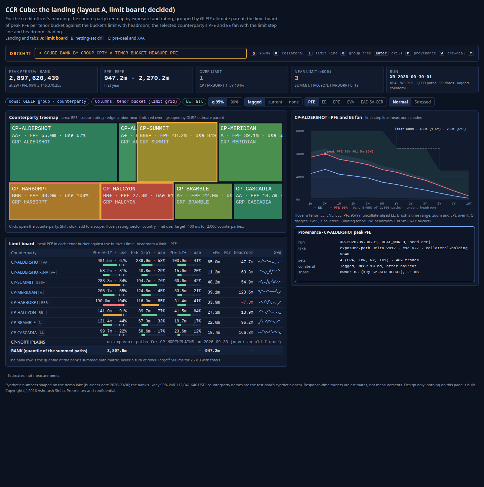

| # | Panel | Exact contents | Data | Interactions | Phase | Phone | Done? |
|---|---|---|---|---|---|---|---|
| A1 | Command line and key strip | `CCUBE BANK BY GROUP,CPTY × TENOR_BUCKET MEASURE PFE <GO>`; keys **Q** 95/99, **K** collateral, **L** limit line, **G** group tree, **Enter** drill, **P** provenance, **W** pre-deal, **?** | the view (`POST /api/v1/cube/ccr/query`) | type and `<GO>`; type-ahead; the keys | POC | must (field) | [ ] |
| A2 | Headline strip (five tiles) | **Peak PFE 95% · bank** 2,897,620,439 "at 2W · PFE 99% 3,146,370,255"; **EPE · EEPE** 947.2m · 2,270.2m "first year"; **Over limit** count in red with the first name and bucket ("CP-HARBORPT 1–5Y 104%"); **Near limit (≥80%)** count in amber with names; **Run** `XR-2026-09-30-01` "REAL_WORLD · paths · dates · lagged collateral" | `/api/v1/exposure/scope?scope=BANK`; `GET /api/v1/cube/ccr/limits` | click Over or Near: filter the board to them; hover: provenance | POC | must (peak PFE, over, near), glance (rest) | [ ] |
| A3 | Lens controls | chips **Rows: GLEIF group › counterparty**, **Columns: tenor bucket (limit grid)**, **LE: all**; segmented **q 95% · 99%**; **lagged · current · none**; measure **PFE · EE · EPE · CVA · EAD SA-CCR**; **Normal · Stressed** | the view | drag chips; click segments; `Q`, `K` | POC (EAD SA-CCR shows once the counterparty engines release, 2.9.12, computes it (CC7); CVA greyed until CC5, 2.9.17; Stressed greyed until CC10, unscheduled) | desk | [ ] |
| A4 | Counterparty treemap | rectangles by EPE (switchable to peak PFE, CE), nested by group (GLEIF ultimate parent) and counterparty; fill by rating band (AA dark green through BBB amber-brown to BB+ red-brown); edge amber when any bucket is at or above the warning level, red when over; labels: name, "rating · EPE · use", group | `/api/v1/cube/ccr/query` (rows group, counterparty; measure EPE); ratings from `counterparty` ([§7.9](#779-c8-the-legal-hierarchy-counterparty-counterparty-group-gleif)); limits ([§7.10](#7710-c9-credit-limit-lim-existing-extended)) | click: open the counterparty (fan in A6); shift-click: add to a scope; hover: rating, sector, country, limit use | POC | desk | [ ] |
| A5 | Limit board | columns Counterparty (with a rating badge), **PFE 0–1Y · use**, **PFE 1–5Y · use**, **PFE 5Y+ · use** (each the peak PFE inside the bucket, "401.5m · 67%", with a 70 × 6 px limit bar: green, amber at the warning level, red over), **EPE**, **Min headroom** (red when negative), **20d** sparkline of peak PFE; a counterparty without paths in one muted row in words; the total row "BANK (quantile of the summed paths)" 2,897.6m, 947.2m | `GET /api/v1/cube/ccr/limits`; sparklines from exposure captures ([EXP.md section 6](../contracts/EXP.md#6-official-end-of-day-results)) | click a row: the fan (A6); double-click: the counterparty's netting sets; sort by any column; arrows and `Enter` | POC | must (the top five by use), glance | [ ] |
| A6 | PFE and EE fan with the limit line | x axis the primary tenors (1W … 10Y), y axis USD (0 to the limit's top); EE line blue; PFE 95% line red; the 5–95% path band light blue; the limit as a white dashed step line by bucket (600m, 450m 1–5Y, 250m 5Y+); the gap between PFE and the limit shaded green (headroom), red where PFE is above; the peak marked "peak PFE 95% 401.5m (2W)"; a legend; under it: "Binding tenor: 2W, headroom 198.5m" | `/api/v1/exposure/scope/profile` and `/scope/distribution?bands=true` (built); the limit's buckets ([§7.10](#7710-c9-credit-limit-lim-existing-extended)) | hover a tenor: EE, ENE, EEE, PFE 95 and 99, uncollateralised EE; **brush** a time range: zoom and EPE over it; `Q`, `K`, `L` | POC | must (the profile with the limit line) | [ ] |
| A7 | Provenance popover | run and its calibration and seed; lake versions (exposure-path, csa, collateral); sets and trades; collateral model, MPOR, haircut basis; the owner and time | `GET /api/v1/cube/provenance/{id}` | hover, long-press, `P` | POC | more | [ ] |

##### B: the netting-set drill (tab)

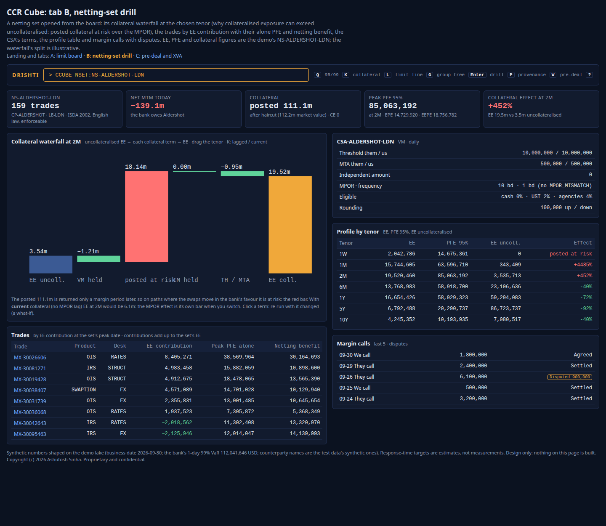

| # | Panel | Exact contents | Data | Interactions | Phase | Phone | Done? |
|---|---|---|---|---|---|---|---|
| B1 | Netting-set tiles | **NS-ALDERSHOT-LDN** "159 trades" with counterparty, legal entity, agreement and law, enforceability; **Net MtM today** −139.1m in red "the bank owes Aldershot"; **Collateral** "posted 111.1m" after haircut (market value 112.2m) and CE 0; **Peak PFE 95%** 85,063,192 "at 2M · EPE · EEPE"; **Collateral effect at 2M** +452% in red "EE 19.5m vs 3.5m uncollateralised" | `/api/v1/exposure/scope?scope=NSET:…` (built); `netting-set`, `agreement`, `collateral-balance` ([§7.5](#775-c4-netting-set-and-agreement-existing), [§7.7](#777-c6-collateral-balance-and-collateral-holding)) | click Collateral: B2; hover: provenance | POC | must | [ ] |
| B2 | Collateral waterfall at a tenor | bars: **EE uncoll.** (blue) 3.54m; **VM held** (green, lowers) −1.21m; **posted at risk** (red, raises) 18.14m; **IM held** 0.00m; **TH / MTA** −0.95m; **EE coll.** (amber) 19.52m; each bar labelled in m with two decimals; a note on posted collateral at risk over the MPOR | `GET /api/v1/cube/ccr/waterfall?nset=…&tenor=…` from the set's paths, CSA and balance ([§7.6](#776-c5-csa-existing)) | **drag** the tenor; `K`: `lagged` against `current` adds the **MPOR effect** bar; click a CSA term: re-run with it changed (a what-if) | POC (the waterfall, MPOR effect); the term what-if later | more | [ ] |
| B3 | Trades | columns Trade (link), Product, Desk, **EE contribution** (negative green: a hedge), **Peak PFE alone**, **Netting benefit**; sorted by contribution at the set's peak date; 25 a page | `/api/v1/exposure/scope/contributions?by=trade` (built) | click a trade: its exposure alone and in the set; its id opens `TRD`; sort | POC | more | [ ] |
| B4 | CSA terms | Threshold them / us 10,000,000 / 10,000,000; MTA them / us 500,000 / 500,000; Independent amount 0; MPOR · frequency "10 bd · 1 bd (no MPOR_MISMATCH)"; Eligible "cash 0% · UST 2% · agencies 4%"; Rounding "100,000 up / down" | `csa` ([§7.6](#776-c5-csa-existing)); rounding is an extended field | click a term: B2's what-if (later) | POC (read); later (what-if) | more | [ ] |
| B5 | Profile by tenor | columns Tenor, EE, PFE 95%, EE uncoll., **Effect** (+ red when collateral raises exposure, − green when it lowers; "posted at risk" where uncollateralised EE is 0) | `/api/v1/exposure/scope/profile` (built) | click a tenor: B2 at that tenor; CSV | POC | more | [ ] |
| B6 | Margin calls | the last five: date and direction ("We call", "They call"), amount, status (Agreed, Settled), disputes as an amber badge "Disputed 900,000" | `margin-call` ([§7.8](#778-c7-margin-call-existing-and-im-history-new)) | click: the call's events | unscheduled (CC11); shown read-only in the POC if cheap | more | [ ] |

##### C: pre-deal and XVA (tab)

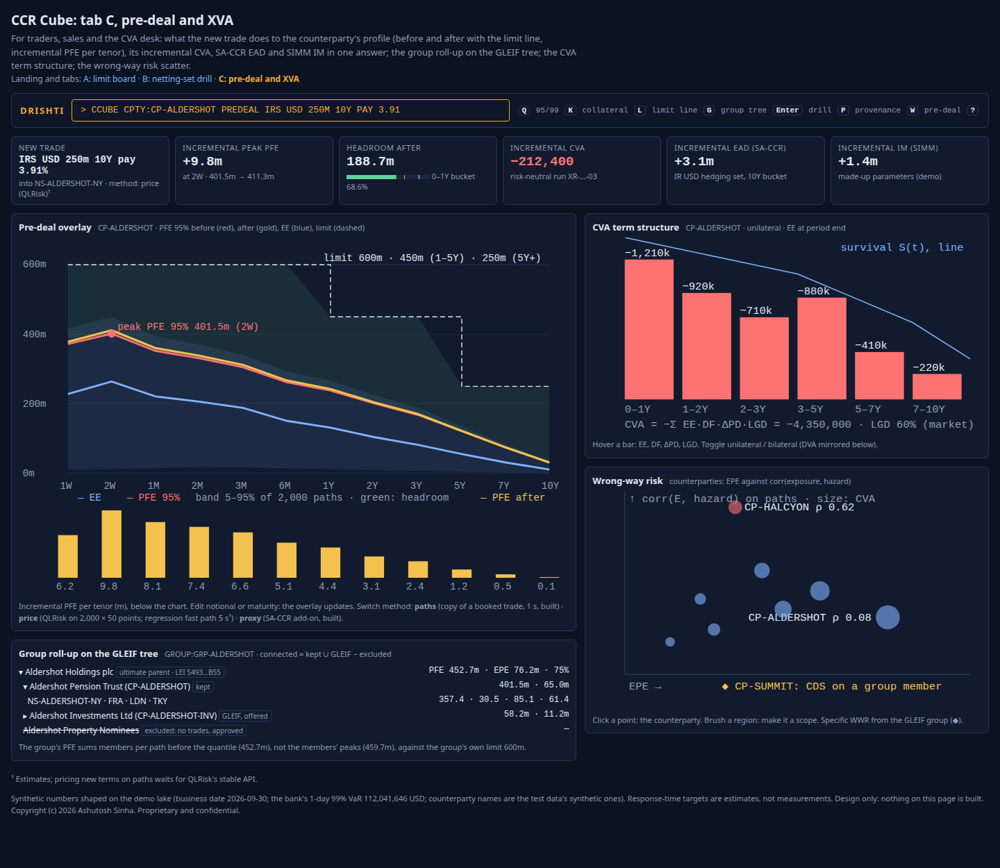

| # | Panel | Exact contents | Data | Interactions | Phase | Phone | Done? |
|---|---|---|---|---|---|---|---|
| C1 | Pre-deal tiles | **New trade** "IRS USD 250m 10Y pay 3.91%" into a netting set, with its method; **Incremental peak PFE** +9.8m "at 2W · 401.5m → 411.3m"; **Headroom after** 188.7m with a bar "0–1Y bucket 68.6%"; **Incremental CVA** −212,400 (red); **Incremental EAD (SA-CCR)** +3.1m; **Incremental IM (SIMM)** +1.4m "made-up parameters (demo)" | `POST /api/v1/exposure/what-if` (built: `addon`, `paths`) ([§7.16](#7716-c16-exposure-predeal-existing-api-extended)) | edit the trade's terms; choose the netting set | POC (PFE and headroom by add-on or copied paths); CVA, EAD, IM tiles later (CC5, CC7, CC8) | must | [ ] |
| C2 | Pre-deal overlay | the A6 chart with the after-PFE line in gold over the before-PFE in red, the EE in blue, the limit step line and headroom; under it the **incremental PFE per tenor** as gold bars labelled in m | as C1 | edit notional or maturity: the overlay updates; switch method **paths** (copy of a booked trade, built), **price** (QLRisk, later), **proxy** (add-on, built) | POC (paths, proxy); advanced market risk (price, regression) | must (overlay), more (bars) | [ ] |
| C3 | Group roll-up on the legal tree | an indented tree: ultimate parent (badge "ultimate parent · LEI …") with PFE, EPE and use; the kept counterparty with its sets' peak PFEs; a GLEIF member "offered" (badge); an excluded entity struck through with its reason; a note that the group's PFE sums members per path before the quantile (452.7m), below the members' peaks (459.7m), against the group's own limit | `GET /api/v1/cube/ccr/group-tree` over `counterparty-group` and the legal tree ([§7.9](#779-c8-the-legal-hierarchy-counterparty-counterparty-group-gleif)) | expand, collapse; click a node: its scope; toggle `kept` / `connected`; `G` | POC (synthetic legal tree) | more | [ ] |
| C4 | CVA term structure | bars per tenor bucket (0–1Y … 7–10Y) of EE·DF·ΔPD·LGD in red, labelled "−1,210k"; the survival curve S(t) as a blue line; the formula line "CVA = −Σ EE·DF·ΔPD·LGD = −4,350,000 · LGD 60% (market) · USD OIS" | CVA (CC5) from the risk-neutral run, `credit-curve`, `ir-curve` ([§7.11](#7711-c10-cva-inputs-credit-curve-ir-curve-cva-proxy-map)) | hover a bar: the four factors; toggle unilateral / bilateral (DVA below) | XVA and wrong-way risk (CC5) | more | [ ] |
| C5 | Wrong-way risk scatter | x EPE, y corr(E, hazard) on the paths; size CVA; red above a threshold (0.45) and labelled with ρ; a diamond marks specific WWR ("CP-SUMMIT: CDS on a group member") | `credit-path`, `wwr-flag` ([§7.12](#7712-c11-credit-path-and-c12-wwr-flag-new)) | click a point: the counterparty; **brush** a region: make it a scope | XVA and wrong-way risk (CC9) | desk | [ ] |

**Not on the mock-ups but in the design, to build with them:** allocation by desk (rows `DESK` on A's pivot: the POC's Euler allocation,
[section 7.8.2](#782-allocated-exposure-cc2)), saved views, export, the embed, the phone layout of section 6.4, SA-CCR and SIMM pivots
(CC7, CC8).

### 7.7 Data and contracts

#### Data needed: the complete list

**Every dataset the CCR Cube reads, in one table.** Columns as in [section 6's list](#data-needed-the-complete-list): *Phase* is the
first phase that needs the row (the POC of [section 7.12](#712-lens-design-and-proof-of-concept-poc), then the phases of
[section 7.13](#713-phases-proposed), product owner 2026-10-31); a **new generator** is a script under `tools/packgen/ccr/` writing JSON
Lines to `data/testdata/<domain>/<kind>/*.jsonl.gz`, loaded by `tools/build_demo_lakes.py` into Delta.

| # | Dataset | What it is; needed by | Phase | Typical source in a bank | Grain, frequency | State | Demo or POC gets it from | §7 |
|---|---|---|---|---|---|---|---|---|
| 1 | Trades and valuations (`trade`, `trade-valuation`) | membership, MtM today, CE, dimensions, desk for allocation | POC | Endur, Murex, Calypso | trade × date; daily | existing | existing demo | [7.2](#772-c1-trade-and-trade-valuation-existing) |
| 2 | Simulation run (`simulation-run`) | the grid, paths, calibration; the run in provenance | POC | the exposure simulator (Adaptiv Analytics, Murex, Calypso, Numerix, in-house) | run × date; nightly | existing; extended (`PURPOSE`; XVA and wrong-way risk) | existing demo (`tools/packgen/ccr/make_ccr_data.py`) | [7.3](#773-c2-simulation-run-xrun-existing-extended) |
| 3 | Exposure paths (`exposure-path`) | every exposure figure, the fan, allocation, pre-deal by paths | POC | the exposure simulator | trade × grid date × run; nightly | existing | existing demo: run `XR-2026-09-30-01`, 200 paths, 13 primary tenors, 74 of 76 netting sets | [7.4](#774-c3-exposure-path-xpath-existing-extended) |
| 4 | Netting sets and agreements (`netting-set`, `agreement`) | the sets, enforceability | POC | the legal agreements system | set × date | existing | existing demo (76 sets) | [7.5](#775-c4-netting-set-and-agreement-existing) |
| 5 | CSA terms (`csa`): thresholds, MTA, IA, MPOR, frequency, eligibility and haircuts | collateral on paths, the netting-set drill | POC; extended in sensitivities and capital (rounding, SIMM version, regimes) | the collateral or legal system | CSA × date | existing; extended | existing demo | [7.6](#776-c5-csa-existing) |
| 6 | Collateral balances and holdings (`collateral-balance`, `collateral-holding`) | collateral today; the waterfall by asset; posted at risk | POC (balances); unscheduled (holdings, CC11) | the collateral system | account (× asset) × date | existing; `collateral-holding` new | existing balances; **new generator** `tools/packgen/ccr/collateral_holdings.py` | [7.7](#777-c6-collateral-balance-and-collateral-holding) |
| 7 | Margin calls and IM history (`margin-call`, `im-history`) | calls and disputes; IM trend; SIMM backtesting | Sensitivities and capital | the margin system | call; set × regime × date | existing; `im-history` new | existing calls; **new generator** `tools/packgen/ccr/im_history.py` | [7.8](#778-c7-margin-call-existing-and-im-history-new) |
| 8 | Counterparties and groups (`counterparty`, `counterparty-group`) | rows, ratings, sectors, countries, the group's own limit | POC | the client master and the credit system | counterparty × date | existing; extended (membership rule) | existing demo (24 counterparties, 23 groups) | [7.9](#779-c8-the-legal-hierarchy-counterparty-counterparty-group-gleif) |
| 9 | Legal hierarchy: GLEIF parents | the group roll-up, specific wrong-way risk | POC | GLEIF's golden copy (public), the bank's client master | relationship; static, monthly | existing (the gleif pack); a synthetic tree for the demo | the demo counterparties' LEIs are synthetic, so a **new generator** `tools/packgen/ccr/legal_tree.py` writes their parent tree to `data/testdata/counterparty-risk/legal-parent/`, kept apart from the real GLEIF data (decision P3) | [7.9](#779-c8-the-legal-hierarchy-counterparty-counterparty-group-gleif) |
| 10 | Credit limits by tenor bucket (`credit-limit`) | the limit board, the limit line, headroom | POC | the credit system | limit × date | existing; extended (scope, confidence, buckets) | **new generator** `tools/packgen/ccr/credit_limits.py`: limits re-sized on the computed PFE (the stored ones read 0.1% to a few percent, EXPOSURE_GUIDE section 28), a few near or over for the demo | [7.10](#7710-c9-credit-limit-lim-existing-extended) |
| 11 | Desk hierarchy (the VaR hierarchies) | allocation by desk, book, legal entity, limit letter | POC | the hierarchy system | node × date | existing | existing demo (MGMT, LEGAL, LL) | [section 7.4.4](#744-two-hierarchies) |
| 12 | FX rates (`fx-spot`) | sums in USD, CSA currencies | POC | market data | currency × date | existing | existing demo | — |
| 13 | Ratings | the treemap's colour, BA-CVA weights, proxies | POC | the credit system (counterparty `RATING`) | counterparty × date | existing | existing demo | [7.9](#779-c8-the-legal-hierarchy-counterparty-counterparty-group-gleif) |
| 14 | Calendars (`calendar`) | business days, MPOR in business days | POC | the calendar service | yearly | existing | existing demo | — |
| 15 | Pre-deal requests (`POST /api/v1/exposure/what-if`) | incremental PFE by paths (copied) or the add-on proxy | POC | Drishti, per request | request | existing API; extended (advanced market risk) | made at run time | [7.16](#7716-c16-exposure-predeal-existing-api-extended) |
| 16 | Official exposure captures | sparklines on the board, compare | POC | Drishti | scope × date | existing | the demo's captures | [EXP.md section 6](../contracts/EXP.md#6-official-end-of-day-results) |
| 17 | Credit curves and recovery (`credit-curve`) | CVA: PD, LGD = 1 − recovery | XVA and wrong-way risk | market data (Markit CDS) | curve × date | existing | existing demo | [7.11](#7711-c10-cva-inputs-credit-curve-ir-curve-cva-proxy-map) |
| 18 | The USD OIS discount curve (`ir-curve`) | CVA discounting | XVA and wrong-way risk | market data | curve × date | existing | existing demo | [7.11](#7711-c10-cva-inputs-credit-curve-ir-curve-cva-proxy-map) |
| 19 | CVA proxy map (`cva-proxy-map`) | a curve for every counterparty without one | XVA and wrong-way risk | the CVA desk | rating × sector × region | new | **configuration** plus the demo's sector curves | [7.11](#7711-c10-cva-inputs-credit-curve-ir-curve-cva-proxy-map) |
| 20 | A risk-neutral run | CVA's EE | XVA and wrong-way risk | the exposure simulator | run × date | extended (`PURPOSE`) | `make_ccr_data.py` extended to write a second, risk-neutral run | [7.3](#773-c2-simulation-run-xrun-existing-extended) |
| 21 | SA-CCR trade attributes (`saccr-trade`) | SA-CCR | Counterparty engines | the booking systems' regulatory classification, or Drishti's rules | trade × driver × date | new | **new generator** `tools/packgen/ccr/saccr_trades.py` (from the demo trades) | [7.13](#7713-c13-saccr-trade-new-saccrmd) |
| 22 | SA-CCR supervisory parameters (factors, correlations, option volatilities, α, the multiplier floor) | SA-CCR | Counterparty engines | the Basel text CRE52 and the jurisdiction's rule | parameter set | new | **configuration** shipped from the public text (BCBS first; OSFI and US overlays later) | [8.5](#785-sa-ccr-cc7) |
| 23 | Haircut schedules: the CSA's contractual haircuts and the supervisory haircuts (CRE22) | collateral after haircut; SA-CCR's C | POC (contractual, in the CSA); counterparty engines (supervisory) | the CSA; the Basel text | schedule | existing (CSA `ELIGIBLE`); supervisory new | existing demo; **configuration** from CRE22 | [7.6](#776-c5-csa-existing) |
| 24 | Sensitivities as CRIF (`position-sensitivity`, shared with the MR cube) | SIMM, SA-CVA hedges | Sensitivities and capital | the same engine as the scenario PVs | trade × factor × date | new (shared) | the MR cube's generator `tools/packgen/var/sensitivities.py`, at trade grain for the netting sets' trades | [7.14](#7714-c14-simm-inputs-the-shared-sensitivities-as-crif-simm-addon-crif-external) |
| 25 | SIMM parameters (risk weights, correlations, concentration thresholds) | SIMM | Sensitivities and capital | **ISDA, licensed**: a client loads its own licensed file | version | new | **bank only**; the demo uses **made-up parameters**, labelled as such | [8.7](#787-simm-initial-margin-cc8) |
| 26 | SIMM add-ons and the counterparty's CRIF (`simm-addon`, `crif-external`) | add-ons; dispute reconciliation | Sensitivities and capital | the margin system; the counterparty or a vendor | trade; set × date | new | **new generator** `tools/packgen/ccr/simm_inputs.py` | [7.14](#7714-c14-simm-inputs-the-shared-sensitivities-as-crif-simm-addon-crif-external) |
| 27 | BA-CVA and SA-CVA parameters (MAR50 risk weights, correlations, R, m_CVA) | CVA capital | XVA and wrong-way risk (BA-CVA and SA-CVA) | the Basel text MAR50 | parameter set | new | **configuration** from the public text | [8.4](#784-cva-and-the-xva-family-cc5-cc6) |
| 28 | CVA sensitivities (`cva-sensitivity`) | SA-CVA | XVA and wrong-way risk | the XVA engine | counterparty × factor × date | new | **new generator** `tools/packgen/ccr/cva_sensitivity.py` (bumps on the risk-neutral run) | [7.15](#7715-c15-cva-sensitivity-new-for-sa-cva) |
| 29 | A stressed run | stressed EEPE and CVA | unscheduled (CC10) | the exposure simulator | run × date; weekly | extended | `make_ccr_data.py` extended (a stressed calibration) | [7.3](#773-c2-simulation-run-xrun-existing-extended) |
| 30 | Credit paths (`credit-path`) | general wrong-way risk | XVA and wrong-way risk | the exposure simulator, jointly with the market | name × grid date × run | new | `make_ccr_data.py` extended (`CREDIT_PATHS` true) | [7.12](#7712-c11-credit-path-and-c12-wwr-flag-new) |
| 31 | Wrong-way risk flags (`wwr-flag`) | specific WWR | XVA and wrong-way risk | Drishti's rules over `saccr-trade` and the legal tree; manual flags | trade | new | **new generator** `tools/packgen/ccr/wwr_flags.py` (two demo CDS trades on group members) | [7.12](#7712-c11-credit-path-and-c12-wwr-flag-new) |

**Count by the first phase each row is needed in:** POC **16** (rows 1 to 6, 8 to 16, and 23 for the contractual haircuts; CC1 to CC4
in the counterparty engines phase read the POC's data); sensitivities and capital **4** (rows 7, 24 to 26; row 5 widens); counterparty
engines **2** (rows 21, 22; 23 widens to the supervisory haircuts); XVA and wrong-way risk **8** (rows 17 to 20, 27, 28, 30, 31; row 2
gains `PURPOSE`); unscheduled **1** (row 29; row 6's holdings widen with CC11). **New generators: 8** under `tools/packgen/ccr/`
(`legal_tree.py`, `credit_limits.py`, `collateral_holdings.py`, `im_history.py`, `saccr_trades.py`, `simm_inputs.py`,
`cva_sensitivity.py`, `wwr_flags.py`) plus `make_ccr_data.py` extended three times (risk-neutral, stressed, credit paths); the shared
`sensitivities.py` comes from the MR cube. **Bank only:** every input in production, and the SIMM parameters always (ISDA's licence).

#### Minimum data for a first answer

The landing (layout A, the limit board) lights up from **seven datasets, six in the demo today**: the simulation run and its exposure
paths, the netting sets, the CSAs, the collateral balances, the counterparties with their ratings and groups, and **credit limits by
tenor bucket**, the one to regenerate (row 10), because today's stored limits were sized on stored profiles and read near zero. With
them: the treemap, the board by tenor with headroom, the fan chart with the limit line, the netting-set drill and the add-on pre-deal.
Allocation by desk adds the desk hierarchy (in the demo); the group roll-up adds the legal tree (row 9).

#### Data readiness checklist (CCR Cube, for a bank's onboarding)

- [ ] One complete exposure run per date (real-world for PFE), every live OTC trade and SFT, the run's grid with look-back points, P and
      the seed; failed rows counted.
- [ ] Netting-set membership agreed with the simulator's (the membership wins); enforceability per agreement.
- [ ] CSAs with thresholds, MTAs, IA, MPOR, frequency, rounding and eligible collateral with haircuts; one CSA per agreement and legal entity.
- [ ] Collateral balances after haircut, today; holdings by asset when the waterfall by asset is wanted.
- [ ] Counterparties with LEI, rating, sector, country; groups with their own approved limits; the legal tree (GLEIF plus the bank's
      overrides and exclusions).
- [ ] Credit limits by scope, confidence and tenor bucket, sized on the bank's own PFE measure.
- [ ] The desk hierarchy the allocation should roll up.
- [ ] For CVA: a risk-neutral run, credit curves or the proxy map, the discount curve, the LGD choice.
- [ ] For SA-CCR: the trade attributes (asset class, hedging set, supervisory delta inputs, dates), the jurisdiction.
- [ ] For SIMM: the ISDA licence and parameter file, sensitivities at trade grain, the regimes per CSA, the counterparty's CRIF for disputes.
- [ ] For SA-CVA, stress and wrong-way risk: CVA sensitivities, a stressed run, credit paths or a hazard model.
- [ ] Retention (the paths are 0.4 to 2 TB a date), entitlements by counterparty, group or legal entity.

#### The contracts in detail

The conventions of [section 6.7](#67-data-and-contracts) apply; the demo's files are
`data/testdata/counterparty-risk/<kind>/*.jsonl.gz`. An existing kind's fields are in its contract document (linked per row); below
are only what the cube **adds** and the new kinds. Sizes at the reference bank: **2.3M positions, about 10M trades of which about 1M live
OTC derivatives and SFTs in about 100,000 netting sets with 20,000 counterparties** (assumptions of EXPOSURE_GUIDE section 27 and
CLUSTER_DEPLOYMENT section 6.4)².

#### 7.7.1 The contract map

| # | Contract (kind) | Class | State | Read by the CCR Cube for | Section |
|---|---|---|---|---|---|
| C1 | `trade` (TRD), `trade-valuation` (TVAL) | fundamental | existing | membership, MtM today, CE, dimensions | 7.7.2 |
| C2 | `simulation-run` (XRUN) | input | existing; **extended** | the run's grid, calibration, stressed runs | 7.7.3 |
| C3 | `exposure-path` (XPATH) | input | existing; **extended** | path MtMs | 7.7.4 |
| C4 | `netting-set` (NSET), `agreement` (AGR) | fundamental | existing (stored figures retiring) | sets, enforceability | 7.7.5 |
| C5 | `csa` (CSA) | fundamental | existing | thresholds, MTA, IA, MPOR, eligibility, haircuts | 7.7.6 |
| C6 | `collateral-balance` (COLL), `collateral-holding` | fundamental | existing; `collateral-holding` **new** (COLL.md) | collateral today, by asset | 7.7.7 |
| C7 | `margin-call` (MC), `im-history` | fundamental, input | existing; `im-history` **new** | calls, disputes, IM over time | 7.7.8 |
| C8 | `counterparty`, `counterparty-group`, GLEIF `lei-entity`, `lei-relationship` | fundamental | existing; group **extended** | the legal hierarchy | 7.7.9 |
| C9 | `credit-limit` (LIM) | fundamental | existing; **extended** | limits by tenor bucket and measure | 7.7.10 |
| C10 | `credit-curve`, `ir-curve` and `cva-proxy-map` | fundamental, configuration | existing; `cva-proxy-map` **new** | CVA: PD, LGD, DF, proxies | 7.7.11 |
| C11 | `credit-path` | input | **new** (WWR.md, optional) | general WWR on the paths | 7.7.12 |
| C12 | `wwr-flag` | fundamental | **new** | specific WWR | 7.7.12 |
| C13 | `saccr-trade` | input | **new** (SACCR.md) | SA-CCR | 7.7.13 |
| C14 | `position-sensitivity` read as CRIF; `simm-addon`, `crif-external` | input | **new** (shared with the MR cube; SIMM.md) | SIMM, SA-CVA hedges | 7.7.14 |
| C15 | `cva-sensitivity` | input (optional) or computed | **new** | SA-CVA | 7.7.15 |
| C16 | `exposure-predeal` request and result | drishti-owned, computed | existing API; **extended** | pre-deal | 7.7.16 |

#### 7.7.2 C1 `trade` and `trade-valuation`: existing

`trade` as in [section 6.7.2](#672-d1-trade-trd-existing-read-as-dimensions); `trade-valuation` as in [TVAL.md](../contracts/TVAL.md)
(one row per trade per date; the exposure engine reads members and MtM from it). **The cube adds** (optional, proposed):
`CSA_DISCOUNTED_MTM` (when the source values on the CSA discount curve), `XVA_EXCLUDED` (a reason). **Size:** 10M rows, about 0.5 KB
each: 5 GB JSON, 0.5 GB Parquet a day.

#### 7.7.3 C2 `simulation-run` (XRUN): existing, extended

Existing fields: [EXP.md section 2.2](../contracts/EXP.md#22-simulation-run-the-runs-identity-and-grid-reference-row) (one row per run
and date; `CALIBRATION` `REAL_WORLD`, `RISK_NEUTRAL`, `STRESSED`). **Sources:** the bank's exposure simulator (Adaptiv Analytics, Murex
MX.3 credit, Calypso, Numerix, in-house); nightly (04:00 to 07:00 typical), a stressed run weekly or monthly.

**Extended (proposed):** `PURPOSE` (`PFE`, `CVA`, `IMM`, `STRESSED_IMM`, `STRESSED_CVA`): several runs a date, each read for its
purpose (EXPOSURE_GUIDE open question 4); `STRESS_PERIOD_START`, `STRESS_PERIOD_END` for a stressed calibration; `PARENT_RUN_ID` when a
run re-uses another's paths. **Validation:** one complete run per purpose and date; `CVA` runs must be `RISK_NEUTRAL`; a cube cell names
the run in its provenance.

#### 7.7.4 C3 `exposure-path` (XPATH): existing, extended

Existing fields, storage and validation: [EXP.md section 2.3](../contracts/EXP.md#23-exposure-path-every-trades-mtm-on-every-path-the-large-input)
(one row per trade, grid date and run; vector `MTM` of P values; sorted by `NETTING_SET` so a set's rows are contiguous and files can be
skipped by netting-set statistics). **Size:** 1M trades × G × P × 4 bytes: **0.4 TB** (G 50, P 2,000) to **2 TB** (G 100, P 5,000) a
date, the largest input of Drishti.

**Extended (proposed):** `CASHFLOW` (vector, optional: cash paid between grid dates, for the cash-flow spike issue,
EXPOSURE_GUIDE open question 6), `FRTB_DESK` (for CVA desk hedges), `TRADE_VERSION` (the version simulated, for corrections).

#### 7.7.5 C4 `netting-set` and `agreement`: existing

As in [NSET.md section 3](../contracts/NSET.md#3-inputs-from-upstream-engines); the stored figures retire with the NSET engine
(COMPUTED_ATTRIBUTES section 13.5). **Sources:** the legal agreements system (in-house, Calypso's collateral module, Murex Collateral,
Acadia); daily, changes rare; 100,000 sets, 30,000 agreements, under 100 MB. **The cube adds:** nothing; a set with
`NETTING_ENFORCEABLE` false makes each trade its own set.

#### 7.7.6 C5 `csa`: existing

As in [NSET.md section 3.5](../contracts/NSET.md#35-csa-credit-support-annex-terms-kept-moved-made-numeric). **The cube adds**
(proposed, optional): `ROUNDING` (amount and direction), `SIMM_VERSION` (the agreed version: the modelling default "SIMM per the CSA"),
`IM_REGIMES` (collect and post regulations), `DISPUTE_THRESHOLD`. Validation: MPOR + frequency − 1 against the run's look-back flagged
`MPOR_MISMATCH`.

#### 7.7.7 C6 `collateral-balance` and `collateral-holding`

`collateral-balance` (existing) and `collateral-holding` (new, one row per account, asset, direction, margin type and settlement status)
are defined in [COLL.md section 3.2](../contracts/COLL.md#32-collateral-balance-the-account-kept) and
[section 3.3](../contracts/COLL.md#33-collateral-holding-what-is-held-and-posted-kept-new). **Sources:** the collateral system
(Calypso Collateral, Murex Collateral, Cloudmargin, Acadia, in-house); a few hundred thousand rows a day, under 200 MB. The cube's
collateral waterfall and "posted at risk" read them.

#### 7.7.8 C7 `margin-call` (existing) and `im-history` (new)

`margin-call` as in [MC.md section 3.2](../contracts/MC.md#32-margin-call-the-actual-calls-kept). **`im-history` (new):** the initial
margin required and held per netting set, regime and date, for the IM trend and SIMM backtesting. **Grain:** one row per netting set,
regime and date. **Key:** `IMH-<NETTING_SET>-<REGIME>-<date>`.

| Field | Type | Unit | Req. | Meaning |
|---|---|---|---|---|
| `IM_HISTORY_ID` | id | | required | the key |
| `NETTING_SET`, `CSA`, `COUNTERPARTY` | id | | required | |
| `REGIME`, `DIRECTION` | text | | required | `USPR`, `CFTC`, `EMIR`, `OSFI`…; `COLLECT` or `POST` |
| `IM_REQUIRED_BANK` | amount | USD | required | the bank's SIMM (or schedule) number |
| `IM_REQUIRED_CPTY` | amount | USD | optional | the counterparty's number (for disputes) |
| `IM_HELD`, `IM_POSTED` | amount | USD | required | settled amounts |
| `MODEL` | text | | required | `SIMM` with its version, or `SCHEDULE` |
| `BUSINESS_DATE`, `BATCH_ID` | date, id | | required | |

Sources: the margin system; daily; 100,000 sets × 2 directions × 250 days a year: 50M rows a year, about 2 GB. Validation: one row per
key; a model version different from the CSA's flagged.

#### 7.7.9 C8 The legal hierarchy: `counterparty`, `counterparty-group`, GLEIF

`counterparty` (CPTY, with `LEI`, `RATING`, `SECTOR`, `COUNTRY`, `GROUP`, `CREDIT_CURVE`, `KYC.PD_1Y`), `counterparty-group`
([GRP.md section 3.2](../contracts/GRP.md#32-counterparty-group-the-kept-members): `LIMIT` is the group's own approved limit, decision 7;
`UTILISATION` becomes computed) and GLEIF `lei-entity` and `lei-relationship` (`config/packs/gleif/contracts/`) as they are.
**Sources:** the bank's client master (UEN), the credit system (ratings, limits), GLEIF's golden copy (public). **The cube adds to
`counterparty-group`** (proposed): `MEMBERSHIP_RULE` (`kept`, `connected`), `EXCLUDED[]` (LEIs excluded with a reason and approver), and
the computed `connected(G)`. Validation: a counterparty whose LEI is lapsed or retired is flagged; a GLEIF parent outside the kept group
is offered, never added silently.

#### 7.7.10 C9 `credit-limit` (LIM): existing, extended

Existing fields: [LIM.md section 3.2](../contracts/LIM.md#32-credit-limit-the-approved-limits-kept) (`BUCKETS[]` with limit and use;
`USED`, `UTILISATION` and `STATUS` become computed). **Extended (proposed):**

| Field | Type | Unit | Req. | Meaning |
|---|---|---|---|---|
| `SCOPE` | text | | required | `CPTY:CP-ALDERSHOT`, `GROUP:GRP-ALDERSHOT`, `NSET:…`, `LE:… & CPTY:…` |
| `CONFIDENCE` | rate | fraction | required | 0.95 by default (the modelling default: limits at 95%) |
| `BUCKETS[].FROM_TENOR`, `TO_TENOR`, `LIMIT` | text, amount | USD | required | the step line of the limit profile |
| `SUB_LIMITS[]` | record list | | optional | by product (`SETTLEMENT`, `PRE_SETTLEMENT`, `REPO`) or legal entity |
| `WARNING_AT`, `TEMPORARY`, `VALID_FROM`, `VALID_TO` | rate, boolean, date | | optional | as `risk-limit` |

Headroom per tenor and the binding tenor: [section 7.8.3](#783-limits-and-headroom-cc4). Sources: the credit system; daily; tens of
thousands of rows.

```json
{"LIMIT_ID":"LIM-ALDERSHOT","SCOPE":"CPTY:CP-ALDERSHOT","COUNTERPARTY":"CP-ALDERSHOT","MEASURE":"PFE","CONFIDENCE":0.95,"CURRENCY":"USD",
 "LIMIT":600000000,"BUCKETS":[{"FROM_TENOR":"0D","TO_TENOR":"1Y","LIMIT":600000000},{"FROM_TENOR":"1Y","TO_TENOR":"5Y","LIMIT":450000000},
 {"FROM_TENOR":"5Y","TO_TENOR":"30Y","LIMIT":250000000}],"WARNING_AT":0.8,"APPROVED_BY":"Credit Risk Committee","REVIEW_DUE":"2027-03-19",
 "BUSINESS_DATE":"2026-09-30"}
```

#### 7.7.11 C10 CVA inputs: `credit-curve`, `ir-curve`, `cva-proxy-map`

`credit-curve` (existing, market-data pack: points with spread, hazard and survival, `RECOVERY`, `PD_1Y`) and `ir-curve` (the USD OIS
curve for discounting) as they are; LGD = 1 − `RECOVERY` (modelling default, [CVA.md section 6.2](../contracts/CVA.md#62-default-probabilities-and-discount-factors)).
**`cva-proxy-map` (new, configuration plus a table):** a counterparty without its own curve gets a proxy by rating × sector × region
(modelling default; [CVA.md section 6.5](../contracts/CVA.md#65-proxy-credit-curves)).

| Field | Type | Req. | Meaning |
|---|---|---|---|
| `PROXY_ID` | id | required | `PXY-<rating>-<sector>-<region>` |
| `RATING_BAND`, `SECTOR`, `REGION` | text | required | the cell |
| `CURVE_ID` | id | required | the proxy curve (a CDS index tranche or a bank-built sector curve) |
| `SPREAD_MULTIPLIER` | rate | optional | a scaling of the proxy |
| `APPROVED_BY`, `VALID_FROM`, `BUSINESS_DATE` | | required | |

Sources: market data (Markit CDS), the bank's CVA desk for proxies; daily; small. Validation: every counterparty with exposure resolves to
a curve or a proxy, else its CVA is refused and named (never zero).

#### 7.7.12 C11 `credit-path` and C12 `wwr-flag`: new

`credit-path` is defined in [WWR.md section 3.2](../contracts/WWR.md#32-credit-path-counterparty-credit-on-the-exposure-paths-optional-shared)
(hazard per credit name on every path, drawn jointly with the market paths; about **40 GB** a date at 20,000 names × G 100 × P 5,000 in
float32). **`wwr-flag`** (new, fundamental): specific wrong-way risk, one row per trade flagged.

| Field | Type | Req. | Meaning |
|---|---|---|---|
| `WWR_FLAG_ID` | id | required | `WWR-<TRADE_ID>` |
| `TRADE_ID`, `NETTING_SET`, `COUNTERPARTY` | id | required | |
| `WWR_TYPE` | text | required | `SPECIFIC_SELF` (the reference is the counterparty), `SPECIFIC_GROUP` (a group member), `GENERAL_SECTOR`, `GENERAL_COUNTRY` |
| `REFERENCE_LEI` | text | optional | the reference entity |
| `SOURCE` | text | required | `RULE` (derived by Drishti from `saccr-trade.REFERENCE` against the GLEIF group) or `MANUAL` |
| `APPROVED_BY`, `BUSINESS_DATE` | | required for `MANUAL` | |

Specific WWR trades are, per CRE53, treated as their own netting set with jump-to-default exposure; the cube shows them apart.

#### 7.7.13 C13 `saccr-trade`: new (SACCR.md)

Defined in [SACCR.md section 3.3](../contracts/SACCR.md#33-saccr-trade-the-classification-and-terms): one row per trade and risk driver
per date, the classification and terms only; the supervisory duration, delta, maturity factor, add-ons, RC, multiplier and EAD are
**never delivered** (the guard test refuses them). Sources: the booking systems' regulatory classification or Drishti's rules from the
trade; daily; about 1M rows, 0.3 GB.

#### 7.7.14 C14 SIMM inputs: the shared sensitivities as CRIF, `simm-addon`, `crif-external`

SIMM reads **the same `position-sensitivity` records as the MR cube** ([section 6.7.9](#679-d8-position-sensitivity-sens-new)), at
trade grain for the netting set's trades, mapped to ISDA's CRIF by [SIMM.md section 3.2](../contracts/SIMM.md#32-the-crif-mapping-drishti-columns-and-isda-crif)
(SIMM-only vertices come in the same records with the `SIMM` grid; `CollectRegulations` and `PostRegulations` from the CSA).
`simm-addon` (SIMM.md section 3.3) and `crif-external` (SIMM.md section 3.4: the counterparty's or custodian's CRIF and IM per netting
set, compared, never computed from) as defined there. **ISDA licensing:** the risk weights and correlations are ISDA's licensed
parameters ([SIMM_GUIDE section 4](../guides/SIMM_GUIDE.md#4-the-licensed-parameter-file)): a client loads its own; the demo ships
made-up parameters, labelled.

#### 7.7.15 C15 `cva-sensitivity`: new (for SA-CVA)

SA-CVA (MAR50) needs CVA's sensitivities to counterparty credit spreads and to market factors (IR, FX, reference credit, equity,
commodity), delta and vega. Counterparty-spread sensitivities Drishti can compute (bump the credit curve); market sensitivities need
**re-simulated exposure** under bumped markets, which only the simulator can produce ([CVA.md section 6.4](../contracts/CVA.md#64-sensitivities)).
So: **an input** for market-factor sensitivities, **computed** for counterparty spreads.

| Field | Type | Unit | Req. | Meaning |
|---|---|---|---|---|
| `CVA_SENS_ID` | id | | required | `CVAS-<COUNTERPARTY>-<RISK_FACTOR>-<MEASURE>-<date>` |
| `COUNTERPARTY`, `NETTING_SET` | id | | required (set optional) | |
| `RISK_FACTOR` | text | | required | the factor dictionary's name ([section 6.7.10](#6710-d9-the-factor-dictionary-risk-factor-and-the-bucket-mapping-sensitivity-bucketsyaml-new)) |
| `MEASURE` | text | | required | `DELTA`, `VEGA` |
| `VALUE` | amount | USD | required | ΔCVA for the MAR50 shift (1 bp; 1% relative for others) |
| `HEDGE` | boolean | | required | true for an eligible CVA hedge's own sensitivity (from `position-sensitivity` of the CVA desk's hedges) |
| `RUN_ID`, `BUSINESS_DATE`, `BATCH_ID` | | | required | the risk-neutral run |

Sources: the XVA engine (Adaptiv, Murex XVA, Quantifi, in-house); daily or monthly; 20,000 counterparties × 50 factors = 1M rows, small.

#### 7.7.16 C16 `exposure-predeal`: existing API, extended

Today `POST /api/v1/exposure/what-if` (built, [EXPOSURE_GUIDE section 7](../guides/EXPOSURE_GUIDE.md#7-pre-deal-what-if)): candidates
by `paths` or `addon`; the answer `base`, `with`, `incremental`. **Extended (proposed):** a candidate `{terms}` in the `trade`
contract's fields, priced on the run's paths by QLRisk (`method: price`); the answer adds `cva` (before, after, incremental), `saccrEad`
(incremental, from the candidate's `saccr-trade` row derived by rules), `simmIm` (incremental, from its sensitivities), `limit`
(headroom per tenor after), and `allocated` (the candidate's EE share).

```json
{"scope":"CPTY:CP-ALDERSHOT","q":0.95,"collateral":"lagged","method":"price",
 "items":[{"nettingSet":"NS-ALDERSHOT-NY","terms":{"PRODUCT_TYPE":"IRS","CURRENCY":"USD","QUANTITY":250000000,"BUY_SELL_CODE":"B",
  "START_DATE":"2026-10-02","MATURITY_DATE":"2036-10-02","LEGS":[{"LEG_TYPE":"FIXED","RATE":0.0391},{"LEG_TYPE":"FLOAT","INDEX":"SOFR"}]}}]}
```

#### 7.7.17 Proposed contract YAMLs (not created yet)

All under `config/packs/counterparty-risk/contracts/`:

| File | Kind | Mnemonic (proposed) | Class | New or extended |
|---|---|---|---|---|
| `saccr-trade.contract.yaml` | `saccr-trade` | `SACT` | input | new (SACCR.md) |
| `collateral-holding.contract.yaml` | `collateral-holding` | `CHLD` | fundamental | new (COLL.md) |
| `im-history.contract.yaml` | `im-history` | `IMH` | input | new |
| `credit-path.contract.yaml` | `credit-path` | `XCRP` | input | new (WWR.md) |
| `wwr-flag.contract.yaml` | `wwr-flag` | `WWRF` | fundamental | new |
| `cva-proxy-map.contract.yaml` | `cva-proxy-map` | `CPXY` | fundamental | new |
| `cva-sensitivity.contract.yaml` | `cva-sensitivity` | `CVAS` | input | new |
| `simm-addon.contract.yaml` | `simm-addon` | `SIMA` | input | new (SIMM.md) |
| `crif-external.contract.yaml` | `crif-external` | `CRIF` | input | new (SIMM.md) |
| `exposure-allocation.contract.yaml` | `exposure-allocation` | `XALC` | computed | new (allocated EE, EPE, PFE share by trade, desk, book) |
| `saccr-result.contract.yaml` | `saccr-result` | `SACR` | computed | new (replaces stored `sa-ccr`) |
| `simm-result.contract.yaml` | `simm-result` | `SIMR` | computed | new (replaces stored `simm`) |
| `cva-result.contract.yaml` | `cva-result` | `CVAR` | computed | new (replaces stored `cva`) |
| `simulation-run`, `exposure-path`, `csa`, `credit-limit`, `counterparty-group`, `trade-valuation` | existing | | | extended (optional fields above) |
| `position-sensitivity` | shared with the MR cube | `SENS` | input | new ([section 6.7.17](#6717-proposed-contract-yamls-not-created-yet)) |

The mnemonics are placeholders, to be checked against every pack's mnemonics at build.

² 1M live derivatives and SFTs of 10M trades, 10 trades a set, 5 sets a counterparty: the exposure benchmark's shape
(`trades-per-set=10`, `sets-per-cpty=20` scaled); a bank's real shape changes every size here.

### 7.8 Measures

Each measure's maths has one home; this section names it and keeps only what the cube adds.

#### 7.8.1 Exposure profile (built)

E, EE, ENE, EEE, PFE_q, peak PFE, EPE, EEPE, CE: [EXPOSURE_GUIDE section 18.4](../guides/EXPOSURE_GUIDE.md#184-statistics-of-a-scope).

#### 7.8.2 Allocated exposure (CC2)

Euler allocation of a netting set's collateralised exposure to its trades, per path and time step (inside a set; the built contributions
are [EXPOSURE_GUIDE section 18.6](../guides/EXPOSURE_GUIDE.md#186-contributions-decomposition)), extended across sets:

```
a_i(p,k) = ( MTM_i(p,k) − w_i(p,k) · (C_n(p,k) + IM_n) ) · 1{E_n(p,k) > 0},   w_i = MTM_i / V_n   (0 when V_n = 0)
Σ_{i∈n} a_i(p,k) = E_n(p,k)                                                   exactly, on every path
EE_desk(k) = Σ_n Σ_{i ∈ n ∩ desk} EE_i^alloc(k)                                adds up to the bank's EE
PFE share of a part j = mean of Σ_{i∈j} a_i over the contribution window of paths ranked around the quantile of the scope at its peak date, scaled to the peak
```

The cube serves `exposure-allocation` per trade and sums it up any hierarchy (desk, book, legal entity, limit letter), closing
RL6 and TL2. Tests: desks' allocated EE equals the bank's EE at every date; a desk alone in a set gets the set.

#### 7.8.3 Limits and headroom (CC4)

`use(t) = PFE_q(t) / LIMIT(bucket(t))`; `headroom(t) = LIMIT(bucket(t)) − PFE_q(t)`; the counterparty's binding tenor is
`argmin_t headroom(t)`; the board shows the minimum headroom and its tenor. Group: the members' exposure **summed per path** before the
quantile, against the group's own limit (GRP.md section 6.3, never the sum of members' peaks).

#### 7.8.4 CVA and the XVA family (CC5, CC6)

CVA, DVA and FVA (EE and ENE from the risk-neutral run, discounted once from USD OIS; LGD = 1 − market recovery; S_C from the
counterparty's curve or its proxy) are [CVA.md section 6.3](../contracts/CVA.md#63-cva-dva-fva); BA-CVA (reduced, MAR50) is
[CVA.md section 6.6](../contracts/CVA.md#66-ba-cva-reduced-version-mar50). FVA ships in the counterparty engines release (2.9.12) with its
playground; **KVA** (`−Σ K(t_k) · hurdle · Δt_k · DF(t_k)`, indicative; K is not discounted, so KVA carries its own DF) and **MVA** (the
cost of funding IM over the life, from the IM profile) in the XVA and wrong-way risk release (2.9.17). CVA is additive across
counterparties.

**SA-CVA (MAR50)**, not in CVA.md (it needs `cva-sensitivity`, C15): weighted sensitivities `WS_k = RW_k · s_k^CVA`, net of eligible
hedges; within a bucket `K_b = sqrt( (Σ_k WS_k)² + Σ_{k≠l} ρ_kl WS_k WS_l + R · Σ_k (WS_k^hdg)² )` with `WS_k = WS_k^CVA + WS_k^hdg` and
R = 0.01; across buckets `K = m_CVA · sqrt( Σ_b K_b² + Σ_{b≠c} γ_bc S_b S_c )` with `S_b = max(min(Σ WS_k, K_b), −K_b)` and m_CVA = 1
unless the supervisor sets more; per risk class, delta and vega, summed.

#### 7.8.5 SA-CCR (CC7)

The computation (CRE52: replacement cost, maturity factor, supervisory delta, hedging-set aggregation, multiplier, EAD with α = 1.4) is
[SACCR.md section 6](../contracts/SACCR.md#6-the-computation). BCBS first; OSFI and US overlays later (modelling default, confirmed). Per
netting set; the cube sums sets and pivots by asset class and hedging set.

#### 7.8.6 IMM EEPE and alpha (built informational; CC10 stressed)

`EAD_IMM = α · EEPE`, α = 1.4 (CRE53; [EXPOSURE_GUIDE section 18.5](../guides/EXPOSURE_GUIDE.md#185-regulatory-figures-informational));
with a stressed run `EAD = α · max(EEPE, EEPE_stressed)`; informational unless the bank has IMM approval.

#### 7.8.7 SIMM initial margin (CC8)

Per netting set and regime: [SIMM_GUIDE section 5](../guides/SIMM_GUIDE.md#5-the-method); version per the CSA (modelling default). The
cube shows the bank's number beside the counterparty's (`crif-external`), the difference by risk class, and the IM trend from
`im-history`.

#### 7.8.8 Wrong-way risk (CC9)

Specific: `wwr-flag` trades shown apart with jump-to-default exposure. General: the correlation of exposure and hazard on the paths and
the WWR-adjusted CVA with its ratio to the independent CVA, from credit paths or, without them, a hazard model calibrated to the survival
curve: [WWR.md section 6.3](../contracts/WWR.md#63-general-wrong-way-risk-on-paths).

#### 7.8.9 Stress for CCR (CC10)

Stressed EEPE from a `STRESSED` run; stressed CVA from the stressed run's EE with stressed spreads (`credit-curve` shocked by a
`stress-scenario`); the cube's Normal / Stressed lens switches the run, as the MR cube switches the scenario set.

#### 7.8.10 Collateral and margin-call views (CC11)

Calls by status and age, disputes by size and counterparty, IM held against required (`im-history`), collateral by asset type, issuer and
haircut, posted collateral at risk over the MPOR (from the lagged model). All additive except the "at risk" figure (path-wise).

### 7.9 Pre-deal: incremental PFE, CVA and SA-CCR

| Method | When | How | Status |
|---|---|---|---|
| **paths** (exact) | the candidate's path MtMs on the same run (copied, scaled, or delivered) | added to its set's V, collateral and E recomputed, the scope's figures; incremental = with − without | **Built** (Python, `ExposureWhatIfPaths`) |
| **addon** (proxy) | no paths | an SA-CCR-style add-on as its own set, flagged `proxy` ([EXPOSURE_GUIDE section 18.7](../guides/EXPOSURE_GUIDE.md#187-pre-deal-incremental-exposure)) | **Built** (Java, `ExposureWhatIf`) |
| **price** (QLRisk) | new terms | QLRisk prices the trade on each path's market state at each grid date (P × G valuations: 100,000 at P 2,000 × G 50); the result joins as `paths` | **Not built**; the QLRisk bridge is shared with the MR cube ([section 6.9](#69-pre-deal-what-if)) |
| **regression** (fast pricing) | price too slow | a pricing function fitted per product on the run's state variables (least squares on a few hundred priced points), evaluated on every path | **Not built**, candidate (decision 5) |

The new trade's **incremental CVA** (from its EE change), **incremental SA-CCR EAD** (its `saccr-trade` row by rules), **incremental SIMM**
(its sensitivities, from QLRisk or delta-gamma: shared with the MR cube) and **limit headroom per tenor** come with the answer.
Target: 1 s by paths; 5 s by regression; tens of seconds by full pricing (estimates, [section 7.6.3](#763-response-time-targets)).

### 7.10 Performance and scale targets

| Item | Target | Basis |
|---|---|---|
| Netting sets, trades | 100,000 sets, 1M OTC trades; 250,000 sets at P 5,000 × G 100 | CLUSTER_DEPLOYMENT section 6.4 (assumption) |
| Hot data a date | 80 GB (P 2,000, G 50) to 1 TB (P 5,000, G 100) of set matrices, across owners with two replicas | the same |
| Partial per scope | 0.8 to 2 MB | the same |
| Board, treemap, SA-CCR of the bank | as [section 7.6.3](#763-response-time-targets) | |
| Allocation by desk for the bank | 30 s at date load, then cached (a pass over trade paths per set)³ | trade-path reads pruned by netting set |
| CVA all counterparties | 1 s (20,000 × G terms)³ | |
| SIMM per set | 50 ms; bank 10 s³ | sensitivity sums per factor per set |

³ Estimates: allocation reads each set's trades' paths once (0.4 to 2 TB at the full bank), so it must run per owner at load and be
stored as a computed cache for the date, not on request; CVA and SIMM are small formulas on summed inputs. To be measured.

### 7.11 How this beats FIS Adaptiv / artiQ

| FIS's public claim (or the suite's) | Drishti's answer | Why Drishti's is better | The proof in a demo |
|---|---|---|---|
| Aggregation across risk types top of house to trade | exposure for any scope (built); allocation so desks add up to the bank (CC2); the GLEIF legal tree beside the desk tree (CC3) | both hierarchies, exact on the legal side and Euler-exact on the desk side, with the reading said in each cell | the bank's EE split by desk adding up to the dollar; then by GLEIF ultimate parent |
| Non-additive measures (PFE) over billions of path values | quantiles only after summing path matrices (built); sharded by counterparty and netting set (CD10) | the set never splits; equality with one server is a test, not a hope; FIS publishes no sharding detail | the same group on one node and across owners, identical |
| What-if, incremental impacts | exact paths and proxy (built); pricing of new terms and regression (CC12) with CVA, SA-CCR, SIMM and headroom in one answer | one answer for every cost of the trade; the method is a flag on the number | an IRS with CP-ALDERSHOT: the overlay, incremental PFE at 2W, CVA, EAD, IM, headroom |
| XVA | CVA, DVA computed from the bank's own EE (CC5, 2.9.17); FVA with its playground in the counterparty engines release (2.9.12); MVA and KVA in the XVA and wrong-way risk release (2.9.17) | the CVA term structure is shown factor by factor (EE, DF, ΔPD, LGD); every input's provenance | the CVA bars of a counterparty, then its spread bumped |
| SA-CCR | computed from `saccr-trade` per CRE52 (CC7) | the formula with the set's numbers in it; reconciled to the stored figure with the difference split | an IR hedging set's EN, SF and add-on, then the multiplier |
| SIMM | computed from the shared sensitivities through the CRIF mapping (CC8); the counterparty's CRIF compared | MR and CCR read **one** sensitivity table: the SIMM and the FRTB numbers can never come from different runs | a dispute: the bank's and the counterparty's IM by risk class, the largest gap's factors |
| SA-CVA | hedges netted with R, bucket and class aggregation (CC6) | the CVA desk's hedges come from the same position sensitivities as the MR cube | the SA-CVA charge with and without the CDS hedges |
| Limit governance | limits by tenor bucket with headroom shaded on the profile (CC4); group limits on the group's own PFE | a credit officer sees **where in time** the limit binds, not just a peak | CP-ALDERSHOT's 1–5Y bucket at 92%, its headroom band narrowing at 2Y |
| Mixed mode | Drishti never simulates the daily run: it reads the bank's paths (built); prices only pre-deal | one exposure model for the bank, the simulator it already validated; no second model risk | the simulator's run id in every cell's provenance |
| Streaming | exposure has no intraday paths today (a new run reloads); pre-deal answers in seconds | honest: the cube says the run's time; intraday PFE is a pre-deal question | the provenance names the run at 03:40 |
| Several servers | CD10 with replicas, handover and drains, documented | documented sizes and failure behaviour | kill an owner: the replica answers |
| (no claim) wrong-way risk | specific flags from the GLEIF group, general from credit paths (CC9) | the GLEIF tree finds specific WWR the booking system misses | a CDS on a group member of the counterparty flagged |
| (no claim) collateral explained | the collateral waterfall, posted-at-risk over the MPOR (CC11) | the question "why is collateralised EE above uncollateralised" answered on screen | NS-ALDERSHOT-LDN: 111.1 m posted at risk in the first months |
| (no claim) one platform | the MR cube, entity pages, GLEIF, news, BI beside it | the counterparty's news and filings beside its exposure | from the treemap to the counterparty's page and its news |

### 7.12 Lens design and proof of concept (POC)

**Status: designed, POC not started.** The POC **reuses the MR Cube POC's shared core**
([section 6.12](#612-lens-design-and-proof-of-concept-poc)): the view model, the planner pattern, provenance ids, saved views,
`cube-core.js`. The POC rows are CCP1 to CCP6 in the plan.

#### 7.12.1 The lens

| Item | CCR Cube lens |
|---|---|
| Lens id and file | `ccrcube`, `config/editions/ccrcube.yaml` (new), offered by `drishti.lenses` like the four built lenses |
| Title, link | **Drishti CCR Cube**; **Open Drishti CCR Cube** in Views and on Home |
| Home | **decided: layout A (limit board) is the landing; B (netting-set drill) and C (pre-deal and XVA) are tabs**; a netting set clicked on A opens B in place |
| Mnemonics on | `CCUBE`, `EXP`, `XWIF` (the pre-deal), `MCUBE` and `VAR` (to cross to the market risk cube), `FUNC`, `WHAT`, `BI` |
| Kinds allowed | counterparties and groups (`CPTY`, `GRP`), netting sets and their MtM (`NSET`, `NSMTM`, `CPMTM`), credit limits (`LIM`), CSAs and collateral (`CSA`, `COLL`, `MC`, `AGR`), the exposure engine's kinds (`EXP`, `XRUN`, `XOFC`), trades (`TRD`, `CTRD`), GLEIF entities (`LEI`), credit curves (`CDS`) |
| Hidden | as the MR Cube lens; each regulatory kind shows once its engine computes it: `SACCR` with the counterparty engines release (2.9.12, CC7), `SIMM` with sensitivities and capital (2.9.11, CC8), `CVA` with XVA and wrong-way risk (2.9.17, CC5); the stored versions stay hidden |
| Switches | as the YAML below; the feature preset `cube` (proposed, [section 6.12.1](#6121-the-lens)) |
| Relation to other lenses | **Risk**: `CCUBE` on as a screen, a chip beside `EXP BANK`; **Trading**: off (Trading's largest-counterparty tile reads allocated exposure through the same endpoint); **Oversight** (proposed): the concentration view (its decision 6) reads the CCR Cube |

```yaml
# config/editions/ccrcube.yaml (proposed sketch, not created)
edition: ccrcube
title: Drishti CCR Cube
description: Counterparty exposure as a cube: limits by tenor with headroom, groups on the legal tree, allocation by desk, pre-deal
packs:
  enabled: [core, market-data, trading, counterparty-risk, market-risk, gleif]
  allow-only: true
commands:
  allow: [CCUBE, MCUBE, EXP, XWIF, XRUN, XOFC, CPTY, GRP, NSET, NSMTM, CPMTM, LIM, CSA, COLL, MC, AGR, TRD, CTRD, LEI, CDS]
  words: { CCUBE: on, MCUBE: on, EXP: on, VAR: on, SMAT: off, BI: on, FUNC: on, WHAT: on, FORM: off, DATAMAP: off, RUPAKA: off }
features: { cube: on, exposure: on, var: on, bi: edition, embed: on, layouts: on, workspaces: on, alerts: on,
            calc: off, python: off, designer: off, build: off, forms: off, datamap: off, ai: off }
menus:
  views: [terminal, search, functions, ccube, mcube, exposure, var, reports, workspaces]
  placeholder: "CCUBE BANK, CCUBE GROUP:GRP-ALDERSHOT, CCUBE NSET:NS-ALDERSHOT-LDN, EXP CPTY:CP-ALDERSHOT …  then <GO>"
home:
  landing: cube                          # decided: layout A is the landing; B and C are tabs of the same page
  landings: [cube]
  template: home/ccube_landing.html      # names ccube.js and ccube.css; shares cube-core.js with the MR cube
  titles: { cube: CCR Cube }
  tabs: [board, netting-set, predeal]    # A, B, C
  default-view: { scope: BANK, rows: [GROUP, CPTY], columns: [TENOR_BUCKET], measures: [PFE], q: 0.95, collateral: lagged }
  chips: [CCUBE BANK, CCUBE GROUP:GRP-ALDERSHOT, CCUBE NSET:NS-ALDERSHOT-LDN, MCUBE BANK]
help: { categories: [knowledge, start, use, bi, operate], knowledge: [counterparty-risk, gleif, trading, core] }
branding: { product: Drishti CCR Cube, tagline: "Where in time the limit binds, and who causes it" }
```

#### 7.12.2 POC scope

The POC is done when every row marked POC in the build checklist of [section 7.6.7](#767-mock-ups-the-screens-to-build) is ticked.

| In the POC (over the existing exposure paths and netting sets) | How |
|---|---|
| **The treemap** by EPE (or peak PFE, CE), colour by rating, grouped by group | per-counterparty statistics the engine already computes at date load; EPE is additive |
| **The limit board by tenor** | per counterparty the peak PFE inside each limit bucket against the regenerated bucket limits; minimum headroom and its tenor |
| **The PFE fan chart with the limit line and headroom shading** | the existing profile and `distribution?bands=true`, with the limit's step line |
| **The netting-set drill** (tab B) | the existing Collateral and Trades tabs' data, plus the collateral waterfall at a tenor (uncollateralised EE, the collateral terms' effects, EE) and the MPOR effect (`lagged` against `current`, both built) |
| **Euler allocation per desk** | `a_i(p,k)` per trade inside each set ([section 7.8.2](#782-allocated-exposure-cc2); built for EE contributions inside a set), summed by desk, book and legal entity across every set; computed once per date at load and cached; the desks add up to the bank's EE exactly |
| **The group roll-up over GLEIF** | `connected(G)` over the demo's synthetic legal tree: a group's members' exposures summed per path, the quantile last, against the group's own limit |
| **Pre-deal, with a simple approximation** | the built add-on proxy (`method: addon`) and copied paths (`method: paths`, `{copyOf, factor}`), drawn as the overlay on the profile with the limit line; incremental PFE per tenor |
| Phone and embedding | must: the counterparty's tiles and profile; glance: the board's top five; the views embed through the client renderer |

**Out of the POC:** CVA, DVA and the XVA family, BA-CVA and SA-CVA, SA-CCR, IMM beyond the built informational EAD, SIMM, wrong-way risk,
stressed runs, QLRisk pricing on paths and regression pricing, collateral holdings by asset, margin-call and IM views, exposure sharding
(CD10: the POC runs on one exposure server, as today), corrections.

#### 7.12.3 POC data

| Dataset | Generator | Demo size | 2.3M scale test (the product owner's server only) |
|---|---|---|---|
| Runs, paths, netting sets, CSAs, balances, trades, counterparties, groups | existing (`make_ccr_data.py`, `make_trades.py`) | 24 counterparties, 76 netting sets (74 with paths), 8,022 live trades, 200 paths, 13 primary tenors; the bank's peak PFE 95% **2,897,620,439**, CP-ALDERSHOT 401,456,820 (unchanged) | the exposure benchmark's shape (EXPOSURE_GUIDE section 27.4: 100,000 trades in memory on a workstation is the limit; the full size only on the server) |
| Credit limits by tenor bucket | new `tools/packgen/ccr/credit_limits.py`: three buckets (0–1Y, 1–5Y, 5Y+) per counterparty and group, sized from the reference profiles so most read 30% to 70%, three near the warning level and one over | 24 counterparty and 23 group limits, about 50 KB | 20,000 counterparties, a few MB |
| Synthetic legal tree | new `tools/packgen/ccr/legal_tree.py`: for each demo group an ultimate parent and one or two intermediate parents, with synthetic LEIs, in `data/testdata/counterparty-risk/legal-parent/` (never mixed into the real GLEIF data) | about 60 relationships | tens of thousands |
| Allocation | none: computed from the paths | per trade × 13 tenors: 8,022 × 13 rows cached | 1M trades × 50 dates: 50M rows a date, computed per owner at load |

#### 7.12.4 POC architecture

**Reused** (`/api/v1/exposure`, built): `/scope`, `/scope/profile`, `/scope/distribution` (the fan's bands), `/scope/contributions`
(EE contributions inside a set), `/tree`, `/compare`, `/captures`, `/official`, `/what-if` (`addon` and `paths`), `/status`.

**New** (package `com.ash.drishti.server.cube.ccr` on the shared core of [section 6.12.4](#6124-poc-architecture)):

| Endpoint | What |
|---|---|
| `POST /api/v1/cube/ccr/query` | a view (scope, rows: group, counterparty, legal entity, desk, rating, sector, country; columns: tenor bucket or measure; measures EE, EPE, PFE, CE, limit use, headroom) → cells and totals, each total the quantile of its own summed matrix |
| `GET /api/v1/cube/ccr/limits?scope=…` | the board: peak PFE per bucket, limit, use, minimum headroom and tenor |
| `GET /api/v1/cube/ccr/allocation?scope=…&by=desk` | allocated EE and EPE (and the PFE share at the scope's peak) by desk, book, legal entity or trade; the date's cache |
| `GET /api/v1/cube/ccr/group-tree?group=…&membership=connected` | the legal tree with each node's PFE, EPE and limit use |
| `GET /api/v1/cube/ccr/waterfall?nset=…&tenor=…` | the collateral waterfall at a tenor |
| `GET /api/v1/cube/provenance/{id}`, `GET`/`POST /api/v1/cube/views` | shared with the MR cube |

**Console:** routes `/ccube` and `/api/ccube/...`; templates `home/ccube_landing.html` and `terminal/ccube.html`, `ccube.js` and
`ccube.css` on `cube-core.js`; the treemap, fan and waterfall in the vendored ECharts or inline SVG; the same `cube-view` kind for the
client renderer; phone tiers as [section 7.6.4](#764-keyboard-phone-embedding).

#### 7.12.5 POC success criteria

| Criterion | Target |
|---|---|
| Open the landing (treemap, board of 24 × 3 with totals, the fan of the top counterparty) | 500 ms p95 warm on the demo¹ |
| Re-pivot (group × rating, desk × legal entity …) | 400 ms¹ |
| Netting-set drill with the waterfall | 300 ms¹ |
| Allocation by desk for the bank, at date load | 2 s on the demo¹; cached after |
| Pre-deal overlay (add-on or copied paths) | 300 ms (add-on), 1 s (paths)¹ |
| **Allocation adds up** | the desks' allocated EE equals the bank's EE at every tenor to the cent; a desk alone in a set gets the set |
| **Totals are quantiles of summed paths** | the bank's peak PFE equals `EXP BANK` (2,897,620,439) exactly; a group's PFE differs from the sum of its members' peaks |
| **Bit-equal across shards** | not in the POC (one exposure server, CD10 planned); the equality suite of CLUSTER_DEPLOYMENT section 6.5 when CD10 lands |

¹ Estimates scaled from the exposure engine's measured answers; measured on the demo first.

**The 10-minute FIS beat (CCR).**

1. `Open Drishti CCR Cube`: the treemap and the board; one counterparty over its 1–5Y limit in red, three near.
2. Click CP-ALDERSHOT: the fan with the limit step line; headroom shading narrows at 2W; the binding tenor named. *Point: where in time
   the limit binds.*
3. Hover the peak: provenance (run, paths, collateral model, MPOR, owner).
4. Rows to `GROUP` over the legal tree: GRP-ALDERSHOT's PFE as a quantile of summed paths, below the sum of members' peaks.
5. Click NS-ALDERSHOT-LDN (tab B): the collateral waterfall shows the 111.1m posted at risk over the MPOR; toggle `current`: the MPOR
   effect appears as its own bar.
6. Rows to `DESK`: allocated EE by desk adding up to the bank's EE; RATES' share of CP-ALDERSHOT's limit use.
7. Tab C: a new trade into NS-ALDERSHOT-NY by the add-on proxy, then as a copy of a booked swap: the overlay before and after, incremental
   PFE per tenor, headroom after.
8. `MCUBE` from the same command line: the market risk cube, then back. The same view on a phone and embedded.

**Tests.** Java: the board's buckets and headroom, the group tree's sums per path, allocation adding up (property test on random paths),
the waterfall's bars adding up to EE, the query totals as quantiles. Console (pytest): routes, the proxy as the person, the lens file,
help. Browser: the landing, treemap click, fan hover, drill to tab B, allocation by desk, pre-deal overlay, keyboard, phone, embed. One
drill for the POC branch.

#### 7.12.6 POC effort and builder plan

On the recommended single branch `risk-cube-poc` ([section 6.12.6](#6126-poc-effort-and-builder-plan)), after the shared core:

| # | Builder | Weight | Work | Size² | After |
|---|---|---|---|---|---|
| 5 | Synthetic data (CCR) | light | `credit_limits.py`, `legal_tree.py`, contracts and READMEs | S (3 to 5 days) | — (can start with the MR builders) |
| 6 | CCR server | heavy | `cube.ccr`: query, limits, allocation at load, group tree, waterfall | M to L (2 weeks) | the core (builder 1) |
| 7 | CCR console | heavy | `/ccube`, the landing with tabs A, B, C, the treemap, fan, waterfall, overlay, the lens file | M (1.5 weeks) | 6's API frozen |
| 8 | Docs and screenshots | light | the exposure guide's cube chapter, a tutorial, screenshots | S | 7 |

Two heavy builders at a time at most: 6 and 7 overlap once 6's API is frozen, while the MR console finishes. The whole POC (MR and CCR) is
about six to eight weeks elapsed².

² Rough sizes from comparable work; not commitments.

#### 7.12.7 Decisions for the POC

**Decided (product owner, 2026-10-31): every recommendation below is accepted.**

| # | Decision | Recommendation |
|---|---|---|
| P1 | Build the CCR POC on the MR POC's branch and core | yes (`risk-cube-poc`, core first) |
| P2 | Regenerate the demo's credit limits by tenor bucket on the computed PFE | yes; the stored limits read near zero today |
| P3 | A synthetic legal tree for the demo counterparties, kept apart from the real GLEIF data | yes, in `data/testdata/counterparty-risk/legal-parent/` |
| P4 | Allocation computed at date load and cached, or on request | at load ([section 7.15](#715-decisions-for-the-product-owner), decision 8) |
| P5 | Pre-deal in the POC by the built add-on and copied paths only | yes; pricing waits for QLRisk |
| P6 | The POC on one exposure server (no CD10) | yes; the shard equality suite joins with CD10 |
| P7 | The lens `ccrcube` off by default, on in the demo profile | yes |

### 7.13 Phases (proposed)

The phases follow the plan's themed releases (product owner, 2026-10-31; reordered 2026-11-01), each **proposed** until it starts; a
row without one is unscheduled. Every metric ships with its playground in the same phase
([VAR_PLAYGROUND.md section 13](VAR_PLAYGROUND.md#13-the-playground-family-and-the-rule)).

| Phase | Rows | Status | Depends on |
|---|---|---|---|
| 1. Sensitivities and market-risk capital (2.9.11) | MC2 (the shared core, built first with its first user, the MR cube pivot); CC8 (SIMM computed on the shared sensitivities, with its playground) | proposed | the VaR engine (built); MC1 (sensitivities, first in the release); ISDA parameters (client's licence) |
| 2. Counterparty engines (2.9.12) | CC1 (the CCR pivot on the shared core of 2.9.11: counterparty × tenor, treemap, fan with limit line), CC2 (allocated exposure), CC3 (GLEIF group roll-up), CC4 (limits by tenor bucket, headroom); CC7 (SA-CCR computed, with its playground); the Exposure playground (one netting set); FVA with its playground | proposed | MC2; the exposure engine (built); `saccr-trade`; LIM's engine for CC4 |
| 3. XVA and wrong-way risk (2.9.17) | CC5 (CVA, DVA, BA-CVA), CC6 (SA-CVA), CC13 (CVA proxies), CC9 (WWR), MVA and KVA, each measure with its playground | proposed | a risk-neutral run; credit curves; `cva-sensitivity`; MC1; `credit-path`; projected IM and capital |
| 4. Advanced market risk (2.9.18) | CC12 (QLRisk pricing and regression for path MtMs; incremental CVA, EAD, IM, shared with MC13) | proposed | QLRisk's API stable |
| Unscheduled | CC10 (stressed EEPE and CVA; several runs a date), CC11 (collateral and margin views) | unscheduled | stressed runs; `collateral-holding`, `im-history` |
| Scale | CC14 = CD10 (exposure sharding) | unscheduled, with the cluster candidates | CLUSTER_DEPLOYMENT section 6 |

### 7.14 Risks and data dependencies

| Risk | Effect | Mitigation |
|---|---|---|
| **The exposure paths are the largest input** (0.4 to 2 TB a date) | load time, storage, allocation cost | set-at-a-time load (CD10), pruning by netting set, allocation at load per owner, retention as decided (EXPOSURE_GUIDE section 27.3) |
| **SIMM parameters are licensed by ISDA** | Drishti cannot ship real parameters | the client's licence and parameter file; made-up parameters in the demo, labelled |
| **Market sensitivities of CVA need re-simulation** | SA-CVA without the simulator's bumped runs is incomplete | `cva-sensitivity` as an input; counterparty-spread sensitivities computed; say what is missing per risk class |
| Pricing new trades on paths is expensive | slow pre-deal | regression pricing; the proxy and copy methods first |
| A single real-world run serves PFE; CVA needs risk-neutral | wrong CVA on real-world paths | `PURPOSE` on the run; CVA refuses a non-risk-neutral run (flag in the demo) |
| Stored limits sized on stored profiles | utilisation reads near zero | the LIM engine (parked) resizes limits on computed PFE (EXPOSURE_GUIDE section 28) |
| GLEIF and kept groups disagree | wrong group exposure | `connected(G)` with exclusions approved, both readings available |
| Allocation choices disputed by desks | Euler is one convention | document it; offer standalone as the second reading |
| Over-claiming against FIS | credibility | demo-proved claims only ([section 7.11](#711-how-this-beats-fis-adaptiv--artiq)) |

### 7.15 Decisions for the product owner

1. **Shared core.** The CCR Cube on section 6.4's core (recommended), not a second cube engine.
2. **The default layout.** **Decided (product owner, 2026-10-31): A (limit board) is the landing, B (a netting set) and C (pre-deal and
   XVA) its tabs.**
3. **Desk cells.** Allocated (Euler, adds up; recommended as the default) or standalone (`DESK:` partial, built) as the default reading
   of a desk × counterparty cell; both available.
4. **Group membership.** `connected(G)` (kept plus GLEIF minus approved exclusions, recommended) or kept only.
5. **Pre-deal pricing.** Regression pricing on the run's state variables as the fast path, full QLRisk path pricing on request
   (recommended), or full pricing only.
6. **SA-CVA or BA-CVA first.** BA-CVA first (inputs exist once SA-CCR is computed; recommended), SA-CVA when `cva-sensitivity` arrives.
7. **Several runs a date.** `PURPOSE` on `simulation-run` and the cube's run lens (recommended), or separate dates.
8. **Allocation cost.** **Decided (product owner, 2026-10-31, with the POC decisions): computed at date load per owner and cached for
   the date.**
9. **Command word.** **Decided (product owner, 2026-10-31): `CCUBE`** (the MR cube is `MCUBE`); checked against every pack's mnemonics at build.
10. **Phase placement.** **Decided (product owner, 2026-10-31), by the themed plan:** the shared core (MC2) and SIMM in the sensitivities
    and capital phase (2.9.11), the core built with the MR cube pivot; CC1 to CC4 on that core, SA-CCR, the Exposure playground and FVA
    in the counterparty engines phase (2.9.12); CVA, BA-CVA, SA-CVA, the proxies, WWR, MVA and KVA in the XVA and wrong-way risk phase
    (2.9.17); pre-deal pricing in the advanced market risk phase (2.9.18); stressed runs and the collateral views unscheduled
    ([section 7.13](#713-phases-proposed)).

### 7.16 Glossary

| Term | In plain words |
|---|---|
| **Netting set** | Trades under one agreement that net to one amount on default |
| **CSA, TH, MTA, IA** | The collateral annex; threshold; minimum transfer amount; independent amount |
| **MPOR** | Margin period of risk: the days between the last collateral received and the close-out |
| **EE, PFE, EPE, EEPE** | Expected exposure; potential future exposure at a confidence; their time averages, effective (non-decreasing) |
| **Allocated exposure** | A netting set's exposure shared out among its trades (and so desks), adding up to the whole |
| **Headroom** | The limit minus the PFE at a tenor |
| **CVA, DVA, FVA, MVA, KVA** | Valuation adjustments for the counterparty's default, our default, funding, initial margin funding, capital |
| **SA-CCR** | The standardised approach for counterparty exposure (CRE52) |
| **IMM, alpha** | The internal model method; the 1.4 multiplier on EEPE |
| **SIMM, CRIF** | ISDA's standard initial margin model; its sensitivity file format |
| **BA-CVA, SA-CVA** | Basic and standardised approaches for CVA capital (MAR50) |
| **Wrong-way risk** | Exposure that grows as the counterparty's credit worsens |
| **GLEIF** | The Global Legal Entity Identifier Foundation: LEIs and parent relationships |

## 8. The CRO lens: is the bank within its risk appetite, what changed overnight, and what must the Chief Risk Officer act on

**Status: design, not built.** Nothing here is built unless a row of [section 8.4](#84-what-drishti-has-today) says so (checked
2026-10-31); every phase is a proposal. The rows are candidates in the
[implementation plan](IMPLEMENTATION_PLAN.md#cro-lens-candidates-not-started) (CRO1 to CRO13), not started.

**The request (product owner, 2026-10-31):** the executive, top-of-house, cross-risk-type view that answers *"Is the bank within its
risk appetite, what changed overnight, and what do I need to act on or tell the board?"* It summarises; drilling opens the other lenses
(`MCUBE`, `CCUBE`, Oversight, Market, World). The product owner liked all four mock-ups ("CRO Lens mockup looks amazing") and aligned
with the recommendation of [section 8.5.1](#851-the-layouts-decided). Its two largest dependencies are Oversight's RO1 VaR change
explanation and RO2 breach workflow ([section 5](#5-market-risk-oversight-what-the-second-line-needs-from-drishti-and-a-drishti-oversight-lens));
the people beneath the CRO are described in [section 5.1](#51-who-market-risk-oversight-is).

### 8.1 Purpose: what a CRO lens is

The Chief Risk Officer owns the bank's **risk appetite framework**: a statement the board approves each year that says how much risk the
bank will take, expressed as a short list of **appetite metrics** (market risk, counterparty and concentration, liquidity, capital,
climate), each with a **board limit**, an early-warning level and an owner. The CRO's job each morning is not to run any one of those
measures (the second line, the treasurer and finance do that) but to know **at once** whether the bank is inside every one of them,
what moved, who is dealing with each breach and what needs the CRO's own decision; and, before each board or risk committee, to say
the same thing in writing.

Every risk system has the numbers. What the CRO lacks is **one place** where they meet, at one as-of time, with the reason for each move
beside it and the decisions in reach. Today the morning answer is assembled by hand from the market risk report, the credit report, the
treasurer's liquidity sheet and finance's capital estimate, each from a different system at a different cut-off; the board pack is a
deck rebuilt each quarter.

**What Drishti's answer is, in one paragraph.** Drishti already computes, from the bank's own trade-grain data, the two hardest
families of the appetite (market risk: VaR at any scope, 1-day and 10-day, official records and captures; counterparty risk: PFE by
counterparty and connected group against limits), keeps every official result with its inputs' versions, and has the World and Market
lenses for context. The **CRO lens** adds: an **appetite catalogue** (the board's metrics, limits, warning levels and owners), a
**status for every metric** computed from the engines and from the bank's liquidity, capital and climate inputs, **what changed
overnight with the reason**, the **CRO's decision queue** (breaches, temporary limit increases to approve, those expiring), **Ask** with
answers that link to the numbers, **time travel** to the last board date, and a **board pack** generated from the same figures. It
summarises; every figure opens the lens that owns it.

---

### 8.2 Who uses it

| Person | What they do with the lens | Lens today |
|---|---|---|
| **Chief Risk Officer** | the morning glance (B), the brief before the executive committee (C), approve or reject temporary limit increases, read the board pack | none |
| **CRO's chief of staff, enterprise risk** | prepare the risk committee and board packs; check every figure's source; chase the owners of near-limit metrics | none |
| **Heads of market, credit, liquidity and climate risk** (the metric owners) | see their own metrics as the CRO sees them; write the explanation of a move or a breach before the CRO asks | Drishti Risk ([section 1](#1-drishti-risk-what-risk-managers-near-the-desks-need-what-the-lens-gives-them-today-and-what-comes-next)); the proposed Oversight lens ([section 5](#5-market-risk-oversight-what-the-second-line-needs-from-drishti-and-a-drishti-oversight-lens)) |
| **Treasurer, CFO's capital team** | supply and confirm the liquidity and capital figures; see them beside the risk metrics | none |
| **CEO, board risk committee members** | read the brief or the board pack; on a phone, the tiles and the one-paragraph answer | none (read-only, a later role) |
| **Internal audit, supervisors** | reproduce what the CRO saw on a given date (time travel), the approvals and their trail | none |

It **reads**; its only actions are governance actions (approve, reject, comment, escalate), for people with the power to take them
([section 8.10](#810-the-lens-design)).

---

### 8.3 Their questions: the morning, the week, the board, the year

| When | Question | The lens's answer |
|---|---|---|
| Morning (07:00, before the executive meeting) | Are we within appetite? | the 12 appetite tiles, breaches red and near limits amber, with the count line "1 breached · 5 near · 6 within" |
| Morning | What changed overnight, and why? | the largest moves across every metric and the top 10, each with a one-line reason and a link to the explaining lens |
| Morning | What needs me? | the decision queue: open breaches with age and action, temporary limit increases awaiting approval, increases expiring this week |
| Morning | Can I quote these numbers? | the "safe to quote" badge with its caveats (a late feed, a figure from an older date) |
| Morning | Why is Rates VaR up? | Ask: an answer in sentences with every figure linked (the VaR change explanation, the trades, the request) |
| Intraday | Has anything crossed since this morning? | the tiles patched by intraday batches; an alert on a new breach (the alert machinery, rules from the catalogue) |
| Weekly risk committee | Which metrics are trending towards their limits? | the 30-day sparklines against the limit and the 80% line; "compare: since last committee" |
| Board week | What has changed since the last board, and what do I tell them? | time travel "as at last board"; the brief (C) as the first page of the board pack; the board pack PDF |
| Quarter | Concentration, capital and liquidity at quarter-end | the quarter-end as-at; RWA and CET1 trend; top-10 concentration |
| Annual | Re-calibrate the appetite: are the limits right for how the bank actually used them? | each metric's use history over the year; the number of near and breached days; the approvals granted |
| Any time | Where did this number come from? | every figure opens the lens that owns it, with its provenance (the official record, the batch, the data version) |

---

### 8.4 What Drishti has today

| Capability | Status | Evidence |
|---|---|---|
| Bank and desk VaR 1-day 99%, ES, any scope, from the bank's vectors | **Built** | [VAR_GUIDE sections 1, 2](../guides/VAR_GUIDE.md#1-the-question-var-answers) |
| 10-day VaR by √10 and by the overlapping 10-day sum | **Built** | [VAR_GUIDE section 18.6](../guides/VAR_GUIDE.md#186-horizons-the-two-10-day-methods-and-the-confidence-chosen) |
| VaR limits per node and limit use in the official record (`LIMIT`, `LIMIT_USE`) | **Built** | [VAR.md section 2.15](../contracts/VAR.md#215-var-limit-the-nodes-var-limits); [VAR.md section 5](../contracts/VAR.md#5-official-end-of-day-results) |
| Stressed VaR (a stress scenario set, 1-day and 10-day) | **Built** | [VAR_GUIDE section 18.8](../guides/VAR_GUIDE.md#188-stressed-var) |
| Worst stress loss | **Partly**: stress P&L stored per desk and scenario with a desk `LIMIT`; the bank's P&L per scenario derived; not computed from trades (RO9) | [VAR.md section 7.4](../contracts/VAR.md#74-the-banks-stress-pl-by-scenario-derived) |
| Peak PFE by counterparty, connected group (`GROUP:`), legal entity, against the stored credit limit | **Built**; group limits on the group's own PFE and limits by tenor are CC4 | [EXPOSURE_GUIDE sections 3.3, 4](../guides/EXPOSURE_GUIDE.md#4-scopes); [section 7.7.10](#7710-c9-credit-limit-lim-existing-extended) |
| Official end-of-day exposure results | **Built** | [EXP.md section 6](../contracts/EXP.md#6-official-end-of-day-results) |
| Top-10 concentration (share of bank EPE in the ten largest) | **Partly**: EPE per counterparty is served (the `tree` answer); the share and its limit are not a measure | [EXPOSURE_GUIDE](../guides/EXPOSURE_GUIDE.md); [section 5.3.7](#537-concentration-and-liquidity) |
| A within / near / breach state against a limit | **Built** on the Trading landing: `breach` above 1, `near` at or above `trading.near-limit` (0.8), `ok` below (`drishti-console/core/trading_landing.py`); the Risk landing's limits in breach | [EDITIONS.md sections 7, 14](../admin/EDITIONS.md#7-drishti-risks-home-three-landings) |
| Headline tiles of VaR, ES, backtest, EPE, peak PFE and limits in breach | **Built** (Drishti Risk's desk landing) | [EDITIONS.md section 7](../admin/EDITIONS.md#7-drishti-risks-home-three-landings) |
| Compare with an earlier capture; component VaR that adds up | **Built** | [VAR_GUIDE sections 6, 18.3](../guides/VAR_GUIDE.md#6-captures-and-compare) |
| VaR change explanation by cause (window roll, market, trades in and out) | **Not built**, designed (RO1, MC12) | [section 5.4.1](#541-ro1-var-change-explanation) |
| A breach as a record (status, age, action, escalation) | **Not built**, designed (RO2) | [section 5.4.2](#542-ro2-breaches-and-escalation) |
| Temporary limit increases with four eyes | **Not built**; the pattern exists: write-back approval with four eyes and no self-approval | [WRITE_BACK.md section 10](../guides/WRITE_BACK.md#10-approval) |
| One catalogue of every limit | **Not built**, designed (RO3, the `risk-limit` contract) | [section 6.7.7](#677-d6-risk-limit-new-one-limit-table-for-every-measure) |
| Comment threads anchored to data | **Built** | [COLLABORATION.md](COLLABORATION.md) |
| Alerts on numbers (inbox, bell, email, chat; hysteresis, cooldown) | **Built**; set up per person, not from a catalogue | [USER_GUIDE.md › Alerts on numbers](../guides/USER_GUIDE.md#alerts-on-numbers) |
| LCR, NSFR, survival horizon | **Not built**. Example records exist (`examples/packs/liquidity-risk`, camelCase, not loaded); liquidity is a measure of the balance-sheet roadmap | [IMPLEMENTATION_PLAN, balance sheet and regulatory](IMPLEMENTATION_PLAN.md#2110-balance-sheet-and-regulatory); [section 5.4.10](#5410-ro10-liquidity) |
| CET1 ratio, RWA | **Not built**; nothing in the packs (stored `sa-ccr` and `frtb-sensitivity` charges are partial RWA inputs only) | — |
| Financed emissions | **Not built**. Example records (`examples/packs/climate-risk`, `financed-emissions`); **climate risk is out of scope as a computed measure** (product owner, 2026-10-25) | [IMPLEMENTATION_PLAN, balance sheet and regulatory](IMPLEMENTATION_PLAN.md#2110-balance-sheet-and-regulatory) |
| News and market moves | **Built** (news-and-markets pack; the World lens's desk) | [EDITIONS.md section 12](../admin/EDITIONS.md#12-drishti-world) |
| News relevance to the book ("headlines touching the book") | **Not built** (WL9) | [section 4.5.9](#459-wl9-news-relevance) |
| VaR at stake of a market move or a bad data point | **Proposed** | [section 3.5.1](#351-ml1-who-uses-each-item-and-what-is-at-stake) |
| Macro signals (economies, forecasts) | **Built** (world-economy pack; IMF data internal demos only) | [section 4](#4-drishti-world-what-macro-research-and-context-users-need-what-the-lens-gives-them-today-and-what-comes-next) |
| Data health: late loads by expectation, rejected rows, market-data quality | **Partly**: late loads ([DATA_GUIDE section 8](../guides/DATA_GUIDE.md#8-expectations-and-late-data)); quality in the Market lens; the data-trust card RO13 and a "safe to quote" rule **not built** | [section 5.4.6](#546-the-data-trust-card-ro13-and-model-performance-ro14) |
| Ask: questions in words | **Partly**: *Ask about this page* and BI's *ask the data* on the AI layer ([AI.md section 7](../admin/AI.md#7-ask-on-the-ai-layer); [BI_GUIDE section 29](../guides/BI_GUIDE.md#29-ai-in-bi-report-from-words-ask-the-data-explain-this-number)); an answer across the engines with linked figures **not built**; AI is off in every edition today | |
| Time travel: an earlier date's official figures | **Partly**: official records and history per date ([VAR_GUIDE section 7](../guides/VAR_GUIDE.md#7-history-and-backtesting)); "as at the last board" across every metric **not built** | |
| Board pack PDF | **Proposed** | [section 5.4.11](#5411-ro11-the-daily-risk-report-and-the-committee-pack) |
| Lenses and editions (a file per edition, a lens per person) | **Built** | [EDITIONS.md section 8](../admin/EDITIONS.md#8-lenses) |
| Phone tiers | **Design** | [MOBILE_DISPLAY.md](MOBILE_DISPLAY.md) |

**Verified in code (2026-10-31):** no class in `drishti-server/src/main`, `drishti-compute/src/main` or the console's `core` and
`routes` folders names a risk appetite, an LCR, an NSFR, a CET1 ratio, financed emissions or a limit request; the only "breach" logic is
the Trading landing's state function (`drishti-console/core/trading_landing.py`) and the alert logic of
`drishti-server/src/main/java/com/ash/drishti/server/alerts/measure/`. The demo's connected group `GRP-NORTHBRIDGE` (Northbridge
Capital Holdings, `data/testdata/core/counterparty-group`) has one member, `CP-NORTHBRIDGE`, and a stored group limit; the mock-ups'
second member and their group limit are illustrative ([section 8.6.6](#866-what-the-mock-ups-do-not-show-exactly)).

---

### 8.5 Screens and interactions

The house rules, shared with the CIO lens: keyboard first, every number printed (a chart never replaces a figure), a problem in the
theme's loss colour **and** with a word or sign (`BREACH`, `NEAR`, a minus), dark terminal theme by default, every panel a ViewModel
panel so it embeds and stacks on a phone. Every panel carries one of the **four badges** (built, partly, planned, proposed) until the
whole lens is built, so nobody mistakes a design for a figure.

#### 8.5.1 The layouts (decided)

**Decided (product owner, 2026-10-31):** **B (appetite first) is the landing page; C (morning brief) is its "Brief" tab; A (terminal
grid) is its "Detail" tab; the phone view is its own layout.** The three tabs share one data request (the same figures, three
arrangements), so switching tabs costs no new computation.

| Tab | Layout | Best for | Mock-up |
|---|---|---|---|
| **Appetite** (landing) | **B**: twelve big status tiles in four families, then the decision queue, what changed, Ask, the top 10, the world and data health | the morning glance: "are we within appetite?" | [cro/B.html](mockups/cro/B.html) |
| **Brief** | **C**: a narrative brief, the answer first in sentences, then what changed and why, then the evidence; decisions, Ask and data health in a right rail | the executive meeting; the first page of the board pack | [cro/C.html](mockups/cro/C.html) |
| **Detail** | **A**: one dense terminal screen: the appetite table, the top 10, what changed, the breach desk, Ask, the world, data health | the chief of staff and the metric owners | [cro/A.html](mockups/cro/A.html) |
| **Phone** | one 390 px column: the answer, the tiles two-up, decisions with big buttons, breaches, what is expiring, what changed, Ask | the CRO away from the desk | [cro/phone.html](mockups/cro/phone.html) |

#### 8.5.2 The visual catalogue

Each panel's exact contents and interactions are in the checklists of [section 8.6](#86-mock-ups-the-screens-to-build).

| Visual | What it shows | Built today? |
|---|---|---|
| **Appetite tile** | the metric's name, value, board limit, status word (`WITHIN`, `NEAR`, `BREACH`), a 30-day sparkline against a dashed limit line and a dotted 80% line, a use bar (ceilings) or the headroom above the floor (floors), the owner, the badge | a VaR tile with limit use exists on the Risk landing; sparkline, floor headroom and catalogue not built |
| **Status count line** | "1 breached · 5 near (≥80%) · 6 within", the open breaches, approvals waiting, increases expiring | not built |
| **Appetite table** (Detail) | one row per metric: value, limit, use bar, status, sparkline, owner | not built |
| **What changed** | the largest moves since the comparison point (overnight by default), each with before → after, the change, a one-line reason and a link | compare built for VaR; reasons not built (RO1) |
| **Decision queue** | open breaches (id, what, use of limit, age, action taken); temporary limit increases awaiting the CRO (old → new, until, who asked, the second line's recommendation) with **Approve**, **Reject**, **Approve with conditions…** and **Comment**; increases expiring this week with "renew" and "let lapse" and what the use of the base limit would be | not built (RO2; CRO4) |
| **Top 10** | counterparties and groups by peak PFE with limit use; desks by VaR with limit use; risk factors by component VaR with the overnight change | PFE and desk VaR built; factor component VaR needs MC1 |
| **The world** | market moves with the VaR at stake and the desks touched; headlines touching the book; macro signals | moves and news built; VaR at stake proposed; relevance not built (WL9) |
| **Data health** | each feed for the as-at: complete, late or periodic, with its time and count; the **safe to quote** badge and its caveats | late loads built; the safe-to-quote rule not built (CRO9) |
| **Ask** | a question box; the answer in sentences with every figure a link; suggested questions | not built across engines (CRO10) |
| **As-at strip** | the as-at time and presets (now, the last official, the last board, quarter-end, pick a date); the comparison; the currency; the scope (BANK, a legal entity) | not built (CRO11) |
| **Board pack PDF** | a button that generates the board pack from the as-at figures | proposed |
| **Panel badges and drill links** | the badge of every panel; links to MCUBE, CCUBE, Oversight, Market, World | not built |

#### 8.5.3 Keyboard and the command line

`CRO <GO>` opens the landing (the Appetite tab); `CRO BRIEF <GO>` and `CRO DETAIL <GO>` open the other tabs; `CRO LE:LE-NY <GO>` scopes
it to a legal entity; `CRO ASOF:BOARD <GO>` opens it as at the last board date (all proposed, CRO2 and CRO11). On the page: `A`
appetite, `B` breaches and decisions, `N` what changed (overnight), `T` top 10, `W` world, `/` Ask, `[` `]` step the as-at, `Enter`
drill, `?` help. The command word and its arguments are checked against every pack's mnemonics at build.

#### 8.5.4 Approve and reject

A temporary limit increase is a Drishti-owned request ([section 8.7.12](#8712-limit-request-lreq-temporary-limit-increases-new-drishti-owned))
raised by a desk or a metric owner; the limit's owner (for board limits, the CRO) approves. **Approve** asks for a comment and,
optionally, a cap and an earlier end date ("Approve with conditions…"); **Reject** requires a reason; both are recorded with who, when
and the comment, and notify the requester. **Renew** opens a new request. The approver must not be the requester (four eyes, as write-back approval). Whether an
approved increase changes the limit in Drishti the same day or waits for the bank's limit system is Oversight's decision on RO2's
temporary limits, adopted here as decision 6 ([section 8.14](#814-decisions-for-the-product-owner)).

#### 8.5.5 Response-time targets

| Interaction | Target (p95, warm, the date open) | Note |
|---|---|---|
| Open the landing (12 tiles, the queue, what changed, top 10) | 600 ms¹ | the official figures and the overnight comparison precomputed with the official run ([section 8.8.4](#884-what-changed)) |
| Switch tab (Brief, Detail) | 100 ms¹ | the same answer, re-arranged |
| As at the last board | 1.5 s¹ | the official records of that date; nothing recomputed |
| An intraday batch: tiles patched | 1 s after the batch is applied¹ | VaR and exposure only; liquidity, capital and climate are daily or slower inputs |
| Ask, first token | 2 s¹ | the AI layer's model; the figures are fetched first, never invented |
| Board pack PDF | 20 s¹ | the planned board pack's generator |

¹ Estimates, not measurements, scaled from the engines' measured node answers; to be measured with the POC.

#### 8.5.6 Phone

**must**: the one-paragraph answer, the status counts, the breached and near tiles; **glance**: the other tiles, the decision queue
with full-width Approve and Reject; **more**: open breaches, expiring increases, what changed, Ask; **desk**: the top 10, the world,
data health, the Detail tab. The phone shows the decided phone layout, not a shrunken landing; the tier mechanism is
[MOBILE_DISPLAY.md](MOBILE_DISPLAY.md)'s.

---

### 8.6 Mock-ups: the screens to build

The four mock-ups (conventions in [the introduction](#mock-ups)) are under `mockups/cro/`; the layout chosen for each is in
[section 8.5.1](#851-the-layouts-decided). **Their numbers are synthetic** and consistent across the four pages and with the cube
mock-ups: business date 2026-09-30; the bank's
1-day 99% VaR 112,041,646 and its 10-day √10 354,306,794; desk VaRs as in the MR cube mock-up (CREDIT 130,670,864, RATES 74,633,680);
CP-ALDERSHOT's peak PFE 401,456,820; the group Northbridge Capital Holdings over its group limit at 512.3m against 500m. The names are
the test data's synthetic ones (CP-ALDERSHOT, CP-NORTHBRIDGE, CP-SUMMIT, CP-HARBORPT, CP-HALCYON …), plus some invented for the
mock-ups only (the member CP-NORTHBRIDGE-SEC, the desks CMDTY, XVA, TREASURY and EM-MACRO, the headlines, every liquidity, capital and
climate figure); **never a client's name**.

**The checklists.** One table per mock-up, one row per panel; numbers in brackets are subsections of this part (the data in
[section 8.7](#87-data-needed-the-complete-list), the rules in [section 8.8](#88-measures-and-rules)); *Phase* is the **POC** of
[section 8.11](#811-a-proof-of-concept-after-the-cube-pocs) or the CRO row that brings it. The states shared by every panel are in
[section 8.6.5](#865-empty-loading-and-error-states).

#### 8.6.1 B: Appetite (the landing)

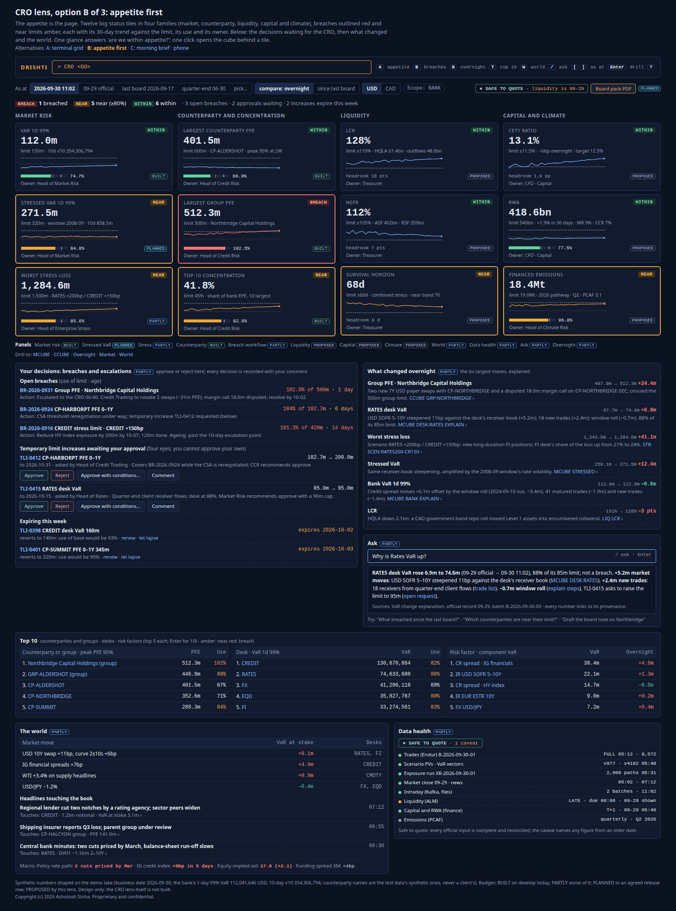

[Open B.html](mockups/cro/B.html)

| Panel | Contents (exact) | Data and contract | Interaction | Phase | Done? |
|---|---|---|---|---|---|
| Command bar | `DRISHTI`, the command line with `CRO <GO>`, the key legend (`A` `B` `N` `T` `W` `/` `[` `]` `Enter` `?`) | the lens file's placeholder | type a command; keys | POC | no |
| As-at strip | as at `2026-09-30 11:02`, presets *09-29 official*, *last board 2026-09-17*, *quarter-end 06-30*, *pick…*; compare *overnight* / *since last board*; currency USD / CAD; scope chip `BANK`; the **SAFE TO QUOTE** badge with its caveat (*liquidity is 09-29*); **Board pack PDF** with its PLANNED badge | `governance-calendar` (8.7.13) for the board and committee dates; the official records' dates; the safe-to-quote rule (8.8.3) | preset click; `[` `]`; badge click lists the caveats | POC: now and 09-29 official only; CRO11 the rest; PDF the planned board pack | no |
| Status count line | `BREACH 1 breached`, `NEAR 5 near (≥80%)`, `WITHIN 6 within`; *3 open breaches · 2 approvals waiting · 2 increases expire this week* | `appetite-status` (8.7.4); `limit-breach`, `limit-request` (8.7.10, 8.7.12) | click a count: filter the tiles | POC (counts); CRO4 (queue counts) | no |
| Family headings | MARKET RISK · COUNTERPARTY AND CONCENTRATION · LIQUIDITY · CAPITAL AND CLIMATE | `risk-appetite-metric.FAMILY` (8.7.3) | none | POC | no |
| Tile: VaR 1d 99% | `112.0m`, *limit 150m · 10d √10 354,306,794*, sparkline 30 days with the dashed limit and dotted 80% line, use bar 74.7%, `WITHIN`, BUILT, *Owner: Head of Market Risk* | `var-official` (bank node), `var-limit`; `risk-appetite-metric` VAR-1D-99 | click: `MCUBE BANK`; hover: provenance | POC | no |
| Tile: Stressed VaR 1d 99% | `271.5m`, *limit 320m · window 2008-09 · 10d 858.5m*, 84.8% `NEAR`, PLANNED | the stress scenario set | click: `MCUBE` Normal / Stressed | with stressed VaR | no |
| Tile: Worst stress loss | `1,284.6m`, *limit 1,500m · RATES +200bp / CREDIT +150bp*, 85.6% `NEAR`, PARTLY | `stress-result` (stored per desk) and the derived bank P&L per scenario; RO9 for computed | click: `STR` on the worst scenario | POC (stored) | no |
| Tile: Largest counterparty PFE | `401.5m`, *limit 600m · CP-ALDERSHOT · peak 95% at 2W*, 66.9% `WITHIN`, BUILT | `exposure-official-cpty`, `credit-limit` | click: `CCUBE CPTY:CP-ALDERSHOT` (until CCUBE: `EXP CPTY:CP-ALDERSHOT`) | POC | no |
| Tile: Largest group PFE | `512.3m`, *limit 500m · Northbridge Capital Holdings*, 102.5% `BREACH`, red outline, BUILT | the exposure engine at `GROUP:` scope; `counterparty-group`; group limit (CC4) | click: `CCUBE GRP:NORTHBRIDGE` | POC (stored group limit); CC4 for the group's own limit | no |
| Tile: Top-10 concentration | `41.8%`, *limit 45% · share of bank EPE, 10 largest*, 92.9% `NEAR`, BUILT (badge to read PARTLY until CRO1 computes the share) | the exposure `tree` answer (EPE per counterparty) | click: the top-10 list | POC | no |
| Tile: LCR | `128%`, *limit ≥110% · HQLA 61.4bn · outflows 48.0bn*, *headroom 18 pts*, `WITHIN`, PROPOSED, *Owner: Treasurer* | `liquidity-metric` (8.7.5) | click: the liquidity page (CRO5) | CRO5 | no |
| Tile: NSFR | `112%`, *limit ≥105% · ASF 402bn · RSF 359bn*, *headroom 7 pts*, `WITHIN`, PROPOSED | `liquidity-metric` | as LCR | CRO5 | no |
| Tile: Survival horizon | `68d`, *limit ≥60d · combined stress · near band 70*, *headroom 8 d*, `NEAR`, PROPOSED | `liquidity-metric` (SURVIVAL_DAYS) | as LCR | CRO5 | no |
| Tile: CET1 ratio | `13.1%`, *limit ≥11.5% · −6bp overnight · target 12.5%*, *headroom 1.6 pp*, `WITHIN`, PROPOSED, *Owner: CFO · Capital* | `capital-position` (8.7.6) | click: the capital page (CRO6) | CRO6 | no |
| Tile: RWA | `418.6bn`, *limit 540bn · +1.9% in 30 days · MR 9% · CCR 7%*, 77.5% `WITHIN`, PROPOSED | `capital-position` | as CET1 | CRO6 | no |
| Tile: Financed emissions | `18.4Mt`, *limit 19.0Mt · 2026 pathway · Q2 · PCAF 3.1*, 96.8% `NEAR`, PROPOSED, *Owner: Head of Climate Risk* | `financed-emissions` (8.7.7) | click: the climate page (CRO7) | CRO7 (decision 4) | no |
| Panels and drill line | the badge of each panel (Market risk BUILT, Stressed VaR PLANNED, Stress PARTLY, Counterparty BUILT, Breach workflow PARTLY, Liquidity, Capital, Climate PROPOSED, World, Data health, Ask, Overnight PARTLY); *Drill to: MCUBE · CCUBE · Oversight · Market · World* | the lens file (badges are configuration until built) | click a link: open that lens | POC | no |
| Your decisions | **Open breaches**: BR-2026-0931 *Group PFE · Northbridge Capital Holdings* 102.5% of 500m · 1 day, action; BR-2026-0924 *CP-HARBORPT PFE 0–1Y* 104% of 182.7m · 6 days; BR-2026-0916 *CREDIT stress limit · CREDIT +150bp* 101.3% of 420m · 14 days (age amber past the escalation point). **Awaiting your approval**: TLI-0412 *CP-HARBORPT PFE 0–1Y* 182.7m → 200.0m to 2026-10-31; TLI-0415 *RATES desk VaR* 85.0m → 95.0m to 2026-10-15; each with Approve, Reject, Approve with conditions…, Comment. **Expiring this week**: TLI-0398 *CREDIT desk VaR 160m* expires 2026-10-02, *reverts to 140m: use of base would be 93%*; TLI-0401 *CP-SUMMIT PFE 0–1Y 345m* expires 2026-10-03 | `limit-breach` (8.7.10), `breach-action` (8.7.11), `limit-request` (8.7.12), `risk-limit` / `credit-limit` | approve, reject (section 8.5.4); renew; let lapse; click an id: the record and its thread | POC: read-only breaches from `LIMIT_USE` above 1; CRO4 the queue and approvals | no |
| What changed overnight | six moves: *Group PFE · Northbridge* 487.9m → 512.3m +24.4m; *RATES desk VaR* 67.7m → 74.6m +6.9m; *Worst stress loss* +41.1m; *Stressed VaR* +12.4m; *Bank VaR* 112.6m → 112.0m −0.6m; *LCR* 131% → 128% −3 pts; each with its one-line reason and link (`CCUBE GRP:NORTHBRIDGE`, `MCUBE DESK:RATES EXPLAIN`, …) | `appetite-status` of both dates (8.8.4); RO1 / MC12 for VaR reasons; exposure compare for PFE | click: the explaining lens | POC: moves without reasons for non-VaR; CRO3 reasons | no |
| Ask | the box *Why is Rates VaR up?*; the answer: *RATES desk VaR rose 6.9m to 74.6m … +5.2m market moves … +2.4m new trades … −0.7m window roll … TLI-0415 asks to raise the limit to 95m*, every figure a link; *Sources: VaR change explanation, official record 09-29, batch B-2026-09-30-03*; three suggested questions | the AI layer; the engines' answers as tools (section 8.8.6) | `/`, `Enter`; click a link | CRO10 | no |
| Top 10 | three lists of five (Enter for ten): counterparties and groups by peak PFE with use (Northbridge group 512.3m 102%, GRP-ALDERSHOT 446.9m 89%, CP-ALDERSHOT 401.5m 67%, CP-NORTHBRIDGE 352.6m 71%, CP-SUMMIT 288.3m 84%); desks by VaR with use (CREDIT 82%, RATES 88%, FX 69%, EQD 80%, FI 83%); risk factors by component VaR with the overnight change; amber near, red breach | exposure `tree`; `var-official` by desk; factor component VaR (MC1) | click: CCUBE, MCUBE | POC (counterparties, desks); factors after MC1 | no |
| The world | market moves with VaR at stake and desks (*USD 10Y swap +11bp … +6.1m RATES, FI*); three headlines touching the book with time and what they touch; the macro line | news-and-markets `news`, `quote`; market data; world-economy; VaR at stake (planned); relevance (WL9) | click: World, Market | CRO8 | no |
| Data health | **SAFE TO QUOTE · 1 caveat**; eight feeds with a dot (green complete, amber late, grey periodic) and their time and count (*Trades (Endur) B-2026-09-30-01 FULL 05:12 · 9,572*; *Liquidity (ALM) LATE · due 06:00 · 09-29 shown*; …); the rule in one line | load events and expectations (DATA_GUIDE section 8); official records; the safe-to-quote rule (8.8.3) | click a feed: Admin → Loads | POC (feeds); CRO9 (the rule) | no |
| Footer | the synthetic-data note and the badge meanings; copyright from branding | branding configuration | none | POC | no |

#### 8.6.2 C: Brief

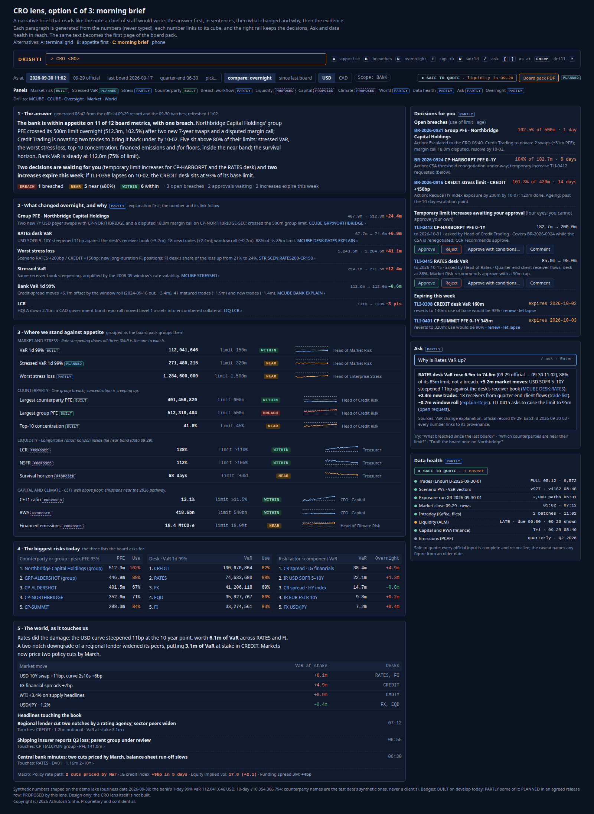

[Open C.html](mockups/cro/C.html)

| Panel | Contents (exact) | Data and contract | Interaction | Phase | Done? |
|---|---|---|---|---|---|
| Command bar, as-at strip, panel line | as B | as B | as B | POC | no |
| 1 · The answer | *generated 06:42 from the official 09-29 record and the 09-30 batches; refreshed 11:02*; two paragraphs: *The bank is within appetite on 11 of 12 board metrics, with one breach. Northbridge …* and *Two decisions are waiting for you …*; the status count line | `appetite-status`, `limit-breach`, `limit-request`; text from a **template** filled with the figures (section 8.8.5), never typed, optionally polished by the AI layer with the figures fixed | click a figure: its lens | CRO2 (template); CRO10 (AI polish) | no |
| 2 · What changed overnight, and why | the six moves, explanation first, the number and the link after | as B's what changed | as B | CRO3 | no |
| 3 · Where we stand against appetite | four groups (market and stress, counterparty, liquidity, capital and climate), each with a one-line verdict in italics (*Rate steepening drives all three; SVaR is the one to watch.*) and three rows: metric with badge, value, limit, status, sparkline, owner | `appetite-status`; the verdict from rules (the largest mover, the closest to its limit) | click a row: its lens | CRO2 | no |
| 4 · The biggest risks today | the three top-10 lists (five each) side by side | as B's top 10 | as B | POC | no |
| 5 · The world, as it touches us | a paragraph (*Rates did the damage: … 6.1m of VaR …*), the market-move table, the headlines, the macro line | as B's world | as B | CRO8 | no |
| Right rail: Decisions for you | as B's decision queue | as B | as B | CRO4 | no |
| Right rail: Ask, Data health | as B | as B | as B | CRO10, CRO9 | no |

#### 8.6.3 A: Detail

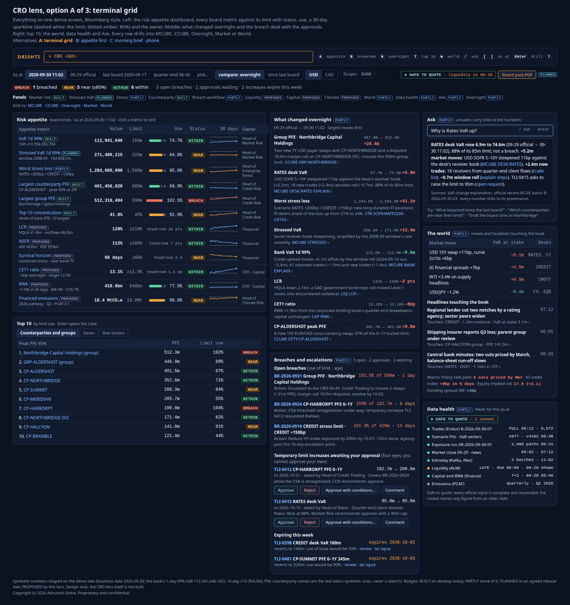

[Open A.html](mockups/cro/A.html)

| Panel | Contents (exact) | Data and contract | Interaction | Phase | Done? |
|---|---|---|---|---|---|
| Command bar, as-at strip, status line, panel line | as B | as B | as B | POC | no |
| Risk appetite table | columns *Appetite metric* (name, badge, a sub-line), *Value* (full figure: 112,041,646), *Limit* (150m, ≥110%), *Use* (bar and %; floors: *headroom 18 pts*), *Status*, *30 days* (sparkline 80 × 24 with the limit and 80% lines), *Owner*; twelve rows in the catalogue's order | `appetite-status`, `risk-appetite-metric` | click a row: its lens; sort any column | POC (built metrics); CRO5 to CRO7 the rest | no |
| Top 10 (tabs) | tabs *Counterparties and groups* · *Desks* · *Risk factors*; ten rows with value, limit use and status word | as B's top 10 | tab click; `T` | POC | no |
| What changed overnight | eight moves (B's six plus *CET1 ratio 13.16% → 13.10% −6bp* and *CP-ALDERSHOT peak PFE 391.7m → 401.5m +9.8m*) | as B | as B | CRO3 | no |
| Breaches and escalations | as B's decision queue, in a narrower column | as B | as B | CRO4 | no |
| Ask, The world, Data health | as B, stacked in the right column | as B | as B | CRO8 to CRO10 | no |

#### 8.6.4 Phone

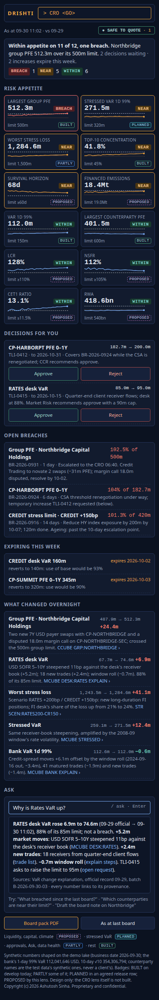

[Open phone.html](mockups/cro/phone.html)

| Panel | Contents (exact) | Data and contract | Interaction | Phone tier | Phase | Done? |
|---|---|---|---|---|---|---|
| Command bar | `DRISHTI` and `CRO <GO>` | as B | type | must | CRO12 | no |
| As-at and badge | *As at 09-30 11:02 · vs 09-29*, **SAFE TO QUOTE · 1** | as B | tap the badge: caveats | must | CRO12 | no |
| The answer | *Within appetite on 11 of 12, one breach. Northbridge group PFE 512.3m over its 500m limit. 2 decisions waiting · 2 increases expire this week.*; BREACH 1 · NEAR 5 · WITHIN 6 | as C's answer | tap: the Brief | must | CRO12 | no |
| Risk appetite tiles | twelve tiles two-up, **breached first, then near, then within** (Largest group PFE, Stressed VaR, Worst stress loss, Top-10, Survival horizon, Financed emissions, VaR, Largest counterparty, LCR, NSFR, CET1, RWA): name, short value, status, sparkline 150 × 20, limit, badge | as B's tiles | tap: the owning lens's phone view | must (breached, near); glance (within) | CRO12 | no |
| Decisions for you | TLI-0412 and TLI-0415 with full-width **Approve** and **Reject** | `limit-request` | approve, reject (a comment sheet opens) | glance | CRO12 after CRO4 | no |
| Open breaches, expiring this week | as B, one line of action each | `limit-breach`, `limit-request` | tap: the record | more | CRO12 | no |
| What changed overnight | five moves with reasons | as B | tap: link | more | CRO12 | no |
| Ask | the box and the answer | as B | type, tap links | more | CRO12 after CRO10 | no |
| Buttons | **Board pack PDF**, **As at last board** | as B | tap | more | CRO12 | no |
| Badge line | *Liquidity, capital, climate PROPOSED · stressed VaR PLANNED · approvals, Ask, data health PARTLY · rest BUILT* | the lens file | none | more | CRO12 | no |

#### 8.6.5 Empty, loading and error states

| State | Every panel | Tiles specifically | Decision queue | Ask |
|---|---|---|---|---|
| **Loading** | the panel's frame with a thin progress line; figures never shown half-loaded | the tile frame, name and limit from the catalogue, value `…` | "Loading decisions…" | the box disabled with "Fetching the figures…" |
| **Empty** | a sentence saying why (never a blank panel) | a metric with no figure on the date: *"No LCR for 2026-09-30 (the liquidity feed has not arrived; due 06:00)"*, grey, no status word, never yesterday's figure shown as today's | "No open breaches. No requests waiting. Nothing expires this week." | suggested questions only |
| **Stale** | the figure with its own date in amber (*09-29*) and a caveat on the safe-to-quote badge | the tile shows its as-of date under the value | — | the answer names any figure from an older date |
| **Error** | *"Could not load the exposure figures (DRS code). The other panels are current."* with Retry; the rest of the page unaffected | the tile in the error style, with the owning engine named | "Decisions could not be loaded; approvals are disabled until they are" | *"Ask is off on this instance"* (AI off) or the model's error, never a guessed answer |
| **No access** | the panel says the person's roles do not cover it, and whom to ask | the tile hidden by the lens file or shown as "no access" (decision 8) | read-only queue for a person without `limit.approve` | — |
| **Not built** (until each row lands) | the panel with its badge (PLANNED or PROPOSED) and one line of what it will show | as the mock-ups | as the mock-ups | as the mock-ups |

#### 8.6.6 What the mock-ups do not show exactly

The mock-ups' Northbridge group has two members and a 500m limit; the demo's `GRP-NORTHBRIDGE` has one member and a stored group limit
of 5.51bn. The POC shows the demo's real figures; CRO1's synthetic appetite catalogue sets a 500m group appetite limit so the breach
story can be shown, and whether to add a second synthetic member to the generator is decision 10.

---

### 8.7 Data needed: the complete list

Every contract follows the repository's conventions ([docs/contracts/README.md](../contracts/README.md)): one contract YAML per kind in
`config/packs/<pack>/contracts/<kind>.contract.yaml` with `kind`, `mnemonic`, `class` (`fundamental`, `input`, `drishti-owned`,
`computed`), `grain`, `key`, `dated-by`, `cadence`, `storage` and `fields`; data delivered as **JSON Lines, gzipped**, in
`data/testdata/<domain>/<kind>/*.jsonl.gz` for the demo, loaded into Delta (or Iceberg) partitioned by `business_date`; field names in
Endur-style UPPER_SNAKE. The CRO lens is small in data volume (hundreds of rows a day) and wide in sources.

#### 8.7.1 The data map

**Columns:** *Phase*: POC, or the CRO row. *State*: existing (a contract and demo data exist), extended (exists; fields added), new.
*Demo*: how the demo gets it: an existing demo dataset; a **new synthetic generator** writing JSONL to
`data/testdata/<domain>/<kind>/*.jsonl.gz`; or **bank only** (no synthetic stand-in makes sense).

| # | Dataset (kind) | Panel | Phase | Source system (at a bank) | Grain | Frequency | State | Demo |
|---|---|---|---|---|---|---|---|---|
| 1 | `var-official` (VOFF), `var-result` | VaR tile, desks, what changed | POC | Drishti (computed from the bank's vectors) | node × date | daily; intraday | existing | existing (computed from the demo `pnl-vector`, `scenario-pv`) |
| 2 | `var-limit` (VLIM) | VaR use, desks | POC | the bank's limit system | node × date | daily, on change | existing | existing `data/testdata/market-risk/var-limit` |
| 3 | `scenario-set` with the stress set | Stressed VaR | with stressed VaR | the bank's VaR engine | set × date | daily or weekly | extended (2c) | 2c's synthetic stress set |
| 4 | `stress-result`, `stress-scenario-pnl` | Worst stress loss | POC | the bank's stress engine | desk × scenario × date | daily | existing | existing `data/testdata/market-risk/stress-result` |
| 5 | `simulation-run`, `exposure-path` | PFE tiles, top 10 | POC | the bank's exposure simulator | trade × path × time step | daily | existing | existing `data/testdata/counterparty-risk/` |
| 6 | `exposure-official-cpty` | PFE, concentration | POC | Drishti (computed) | counterparty × date | daily | existing | computed from 5 |
| 7 | `credit-limit` (LIM) | PFE use; group limit | POC; CC4 | the bank's limit system | limit × date | daily | existing; extended by CC4 (tenor buckets, group limits) | existing `data/testdata/counterparty-risk/credit-limit` |
| 8 | `counterparty`, `counterparty-group` (CPTY, GRP) | group roll-up, names | POC | the bank's reference data; GLEIF | counterparty | on change | existing | existing `data/testdata/core/` |
| 9 | `risk-limit` (RO3) | desk and stress limits beyond VaR | CRO4 | the bank's limit system | limit × date | daily | new (section 6.7.7) | the MR cube's generator (MC1/RO3) |
| 10 | **`risk-appetite-metric`** (section 8.7.3) | every tile: limit, warning, owner, family, order | POC | the risk appetite framework (GRC system or the CRO office's spreadsheet) | metric × version | annual, on change | **new** | **new synthetic generator**: `data/testdata/governance/risk-appetite-metric/` (twelve metrics) |
| 11 | **`appetite-status`** (section 8.7.4) | tiles, counts, sparklines, what changed, time travel | POC | Drishti (computed with the official runs; captured) | metric × date (× intraday time) | daily; intraday for VaR and PFE | **new** (computed capture) | computed from 1 to 10 and 12 to 14 |
| 12 | **`liquidity-metric`** (section 8.7.5) | LCR, NSFR, survival horizon | CRO5 | treasury / ALM system (QRM, Moody's, in-house), the LCR return | legal entity × metric × date | LCR daily; NSFR monthly (daily estimate); survival weekly | **new** (the retired example kinds `lcr`, `nsfr`, `liquidity-stress` are its prototype) | **new synthetic generator** from `tools/packgen/liquidity/make.py`: `data/testdata/liquidity/liquidity-metric/` |
| 13 | **`capital-position`** (section 8.7.6) | CET1, RWA trend | CRO6 | finance / regulatory reporting (the capital engine, the BCAR or FFIEC 101 return) | legal entity × component × date | monthly official; daily estimate | **new** | **new synthetic generator**: `data/testdata/capital/capital-position/` |
| 14 | **`financed-emissions`** (section 8.7.7) | financed emissions | CRO7 | the climate team's PCAF calculation or a data vendor | book or sector × quarter | quarterly | **extended** (the retired example kind of the same name, camelCase, renamed to UPPER_SNAKE, with a pathway) | **new synthetic generator** from `tools/packgen/climate/make.py`: `data/testdata/climate/financed-emissions/` |
| 15 | **`limit-breach`** (section 8.7.10) | open breaches, ages | POC (derived, read-only); CRO4 (records) | Drishti (created by the official run, RO2) | limit × date | daily | **new** (RO2) | created by the official run on the demo; plus a **new synthetic generator** for a history of older breaches: `data/testdata/governance/limit-breach/` |
| 16 | **`breach-action`** (section 8.7.11) | action taken, commentary, escalation | CRO4 | Drishti (people, through write-back) | action | on event | **new** | seeded by the same generator: `data/testdata/governance/breach-action/` |
| 17 | **`limit-request`** (section 8.7.12) | approvals, expiring increases | CRO4 | Drishti (people, through write-back); exported to the bank's limit system | request | on event | **new** | **new synthetic generator**: `data/testdata/governance/limit-request/` |
| 18 | **`governance-calendar`** (section 8.7.13) | "as at last board", "since last committee" | CRO11 | the corporate secretary's calendar | meeting | yearly, on change | **new** | **new synthetic generator**: `data/testdata/governance/governance-calendar/` |
| 19 | `news`, `quote` (news-and-markets) | headlines, moves | CRO8 | news and market feeds | story; quote | intraday | existing | existing `data/testdata/news-and-markets/` (the offline snapshot) |
| 20 | News relevance to the book (WL9) | "headlines touching the book" | CRO8 | Drishti (computed: story → issuer, counterparty, sector, country) | story × entity | intraday | new (section 4.5.9) | computed from 19 and 8 |
| 21 | Market data (`ir-curve`, `fx-spot`, …) and VaR at stake (planned) | market moves with VaR at stake | CRO8 | market data system | point × date | daily | existing; VaR at stake planned | existing `data/testdata/market-data/` |
| 22 | world-economy (economies, forecasts) | macro signals | CRO8 | IMF and other public data | economy × indicator | monthly | existing | existing (**internal demos only**: the IMF data rule) |
| 23 | Position sensitivities (`position-sensitivity`, MC1) | top 10 risk factors | after MC1 | the bank's risk engine | position × factor × date | daily | new (section 6.7.9) | MC1's generator |
| 24 | VaR change explanation (RO1 / MC12) | what changed reasons; Ask | CRO3 | Drishti (computed) | node × step × date pair | on demand | new (computed) | computed |
| 25 | Load events and expectations | data health, safe to quote | POC | Drishti (load audit) | load | per load | existing (DATA_GUIDE section 8) | existing |
| 26 | Official exposure, VaR and stress records of earlier dates | time travel | POC (earlier official dates); CRO11 | Drishti | as 1, 6 | daily | existing | existing |
| 27 | AI audit of Ask | Ask | CRO10 | Drishti (`ai-audit`) | question | per question | existing (AI.md) | existing |

**Not needed from the bank for the POC:** rows 10 to 18 have synthetic generators; rows 1 to 8 are the demo's existing data. A bank
supplies rows 2 to 5, 7, 8, 10, 12 to 14 and 18 from its own systems; Drishti produces the rest.

#### 8.7.2 Contract notes common to the new kinds

- **Legal entity:** every bank-supplied figure carries `LEGAL_ENTITY` (the core `legal-entity` ids; `BANK` for the consolidated
  figure); the lens's scope chip filters on it.
- **Reporting currency:** amounts carry `CURRENCY`; the lens converts at the official run's FX (as VaR does), never at a live rate.
- **Versions:** bank inputs may be restated; each row carries `VERSION` and `AS_OF` (the producer's time); the lens shows the latest
  version for the date and its provenance names the version.
- **Proposed packs:** a `risk-appetite` pack (risk-appetite-metric, appetite-status, limit-breach, breach-action, limit-request,
  governance-calendar), a `liquidity` pack (liquidity-metric), a `capital` pack (capital-position), a `climate` pack (financed-emissions);
  or all in one `enterprise-risk` pack (decision 9).
- **Mnemonics** are placeholders, checked against every pack's at build (the liquidity example's `FUND` already clashes with the
  funds pack's `FUND`).

#### 8.7.3 `risk-appetite-metric` (RAPM): the risk appetite framework table (new, fundamental)

**Grain:** one row per appetite metric per framework version. **Key:** `METRIC_ID`, `FRAMEWORK_VERSION`. **Dated by:** `VALID_FROM` /
`VALID_TO` (not by business date: the framework changes yearly or on a board resolution). **Source:** the risk appetite statement
approved by the board, held in a GRC system or the CRO office's spreadsheet. **Frequency:** annual, and on change. **Size:** 10 to 60
metrics; under 1 MB. **Storage:** Delta, `<root>/governance/risk-appetite-metric/`.

| Field | Type | Unit | Req. | Meaning |
|---|---|---|---|---|
| `METRIC_ID` | id | | required | `RAM-<FAMILY>-<NAME>`, for example `RAM-MKT-VAR-1D-99` |
| `FRAMEWORK_VERSION` | text | | required | the appetite statement's version, `RAF-2026` |
| `NAME` | text | | required | as shown on the tile: *VaR 1d 99%* |
| `FAMILY` | text | | required | `MARKET`, `COUNTERPARTY`, `LIQUIDITY`, `CAPITAL`, `CLIMATE` (the tile groups) |
| `ORDER` | integer | | required | position on the landing |
| `MEASURE` | text | | required | how the value is read: `VAR`, `SVAR`, `STRESS_WORST`, `PFE_PEAK_CPTY_MAX`, `PFE_PEAK_GROUP_MAX`, `CONC_TOP10_EPE`, `LCR`, `NSFR`, `SURVIVAL_DAYS`, `CET1_RATIO`, `RWA`, `FIN_EMISSIONS` |
| `SCOPE` | text | | required | a scope text: `BANK`, `LE:LE-NY` |
| `PARAMETERS` | object | | optional | the measure's lens: `{"HORIZON":"1D","CONFIDENCE":0.99}`, `{"SCENARIO_SET":"HS-STRESS"}`, `{"QUANTILE":0.95}` |
| `DIRECTION` | text | | required | `CEILING` (stay below) or `FLOOR` (stay above) |
| `LIMIT` | amount or rate | `UNIT` | required | the board limit |
| `WARNING_AT` | rate | fraction | optional | for ceilings: the use at which the metric is near (default 0.8) |
| `WARNING_BAND` | amount or rate | `UNIT` | optional | for floors: the headroom above the floor below which the metric is near (board-set; decision 3) |
| `TARGET` | amount or rate | `UNIT` | optional | a management target inside the limit (CET1 target 12.5%) |
| `UNIT` | text | | required | `USD`, `PCT`, `DAYS`, `TCO2E`, `RATIO` |
| `OWNER`, `OWNER_ROLE` | text | | required | the person and role accountable (*Head of Market Risk*) |
| `ESCALATION_CHAIN` | list | | optional | roles notified on near and breach, in order |
| `APPROVED_BY`, `APPROVED_ON` | text, date | | required | the board or committee and the date of the resolution |
| `VALID_FROM`, `VALID_TO` | date | | required / optional | the version's validity |
| `CASCADED_TO` | list | | optional | `risk-limit` or `credit-limit` ids that cascade this metric (desk limits under the bank VaR) |

```json
{"METRIC_ID":"RAM-MKT-VAR-1D-99","FRAMEWORK_VERSION":"RAF-2026","NAME":"VaR 1d 99%","FAMILY":"MARKET","ORDER":1,"MEASURE":"VAR",
 "SCOPE":"BANK","PARAMETERS":{"HORIZON":"1D","CONFIDENCE":0.99},"DIRECTION":"CEILING","LIMIT":150000000,"WARNING_AT":0.8,"UNIT":"USD",
 "OWNER":"Head of Market Risk","OWNER_ROLE":"market-risk-head","ESCALATION_CHAIN":["market-risk-head","cro","board-risk-committee"],
 "APPROVED_BY":"Board Risk Committee","APPROVED_ON":"2026-01-22","VALID_FROM":"2026-02-01"}
{"METRIC_ID":"RAM-LIQ-LCR","FRAMEWORK_VERSION":"RAF-2026","NAME":"LCR","FAMILY":"LIQUIDITY","ORDER":7,"MEASURE":"LCR","SCOPE":"BANK",
 "DIRECTION":"FLOOR","LIMIT":1.10,"WARNING_BAND":0.05,"UNIT":"RATIO","OWNER":"Treasurer","OWNER_ROLE":"treasurer",
 "APPROVED_BY":"Board Risk Committee","APPROVED_ON":"2026-01-22","VALID_FROM":"2026-02-01"}
```

**Validation:** a `MEASURE` the lens cannot read is refused with the list; a `SCOPE` that does not parse is refused; `DIRECTION FLOOR`
with `WARNING_AT` (instead of `WARNING_BAND`) refused; two versions valid on the same day for one metric refused; a board limit that a
cascaded desk limit exceeds is a warning, not a refusal.

#### 8.7.4 `appetite-status` (RAPS): every metric's value and status, per date (new, computed, captured)

**Grain:** one row per metric per business date, plus intraday rows for metrics that update intraday. **Key:** `METRIC_ID`,
`BUSINESS_DATE`, `AS_OF`. **Class:** computed; **captured** with the official runs (like the official VaR and exposure records), so time
travel reads it and never recomputes a past date. **Size:** about 20 rows a day. **Storage:** Delta,
`<root>/governance/appetite-status/`.

| Field | Type | Unit | Req. | Meaning |
|---|---|---|---|---|
| `METRIC_ID`, `FRAMEWORK_VERSION` | id, text | | required | the catalogue row used |
| `BUSINESS_DATE`, `AS_OF` | date, timestamp | | required | the date and the time of the figure |
| `VALUE` | amount or rate | `UNIT` | required (or empty with `MISSING_REASON`) | the metric |
| `LIMIT`, `UNIT`, `DIRECTION` | | | required | copied from the catalogue for the date (so a later framework change does not rewrite history) |
| `USE` | rate | fraction | ceilings | `VALUE / LIMIT` |
| `HEADROOM` | amount or rate | `UNIT` | floors | `VALUE − LIMIT` |
| `STATUS` | text | | required | `WITHIN`, `NEAR`, `BREACH`, `MISSING` (section 8.8.1) |
| `DETAIL` | text | | optional | the tile's sub-line: the counterparty, the scenario, the window |
| `SOURCE_REF` | text | | required | the official record, capture or input row and version it came from |
| `INPUT_AS_OF` | date | | required | the date of the input (09-29 for a late liquidity feed) |
| `SAFE_TO_QUOTE` | boolean | | required | section 8.8.3 |
| `MISSING_REASON` | text | | optional | *liquidity feed not arrived* |

#### 8.7.5 `liquidity-metric` (LIQM): LCR, NSFR and the survival horizon (new, input)

**Grain:** one row per legal entity per metric per business date. **Key:** `LEGAL_ENTITY`, `METRIC`, `BUSINESS_DATE`, `VERSION`.
**Source:** the treasury or ALM system, reconciled with the LCR and NSFR returns. **Frequency:** LCR daily; NSFR monthly with a daily
estimate; the survival horizon weekly (the internal liquidity stress). **Size:** under 100 rows a day. **Storage:** Delta,
`<root>/liquidity/liquidity-metric/`. **Prototype:** the retired example kinds `lcr`, `nsfr` and `liquidity-stress`
(`examples/packs/liquidity-risk/samples/`), whose camelCase fields map one to one.

| Field | Type | Unit | Req. | Meaning |
|---|---|---|---|---|
| `LEGAL_ENTITY` | id | | required | `BANK` for the consolidated figure |
| `METRIC` | text | | required | `LCR`, `NSFR`, `SURVIVAL_DAYS` |
| `VALUE` | rate or integer | | required | 1.28; 1.12; 68 |
| `NUMERATOR`, `DENOMINATOR` | amount | `CURRENCY` | LCR, NSFR | HQLA and net outflows; ASF and RSF |
| `COMPONENTS` | list | | optional | HQLA by level, outflows by category, ASF and RSF by category (as the example records) |
| `REGULATORY_MINIMUM` | rate or integer | | required | 1.0 for LCR and NSFR; the regulator's survival minimum if any |
| `SCENARIO` | text | | survival | *Combined idiosyncratic and market-wide* |
| `STATUS_OF_FIGURE` | text | | required | `OFFICIAL`, `ESTIMATE` |
| `CURRENCY`, `BUSINESS_DATE`, `VERSION`, `AS_OF` | | | required | as section 8.7.2 |

```json
{"LEGAL_ENTITY":"BANK","METRIC":"LCR","VALUE":1.28,"NUMERATOR":61400000000,"DENOMINATOR":48000000000,"REGULATORY_MINIMUM":1.0,
 "STATUS_OF_FIGURE":"OFFICIAL","CURRENCY":"USD","BUSINESS_DATE":"2026-09-29","VERSION":1,"AS_OF":"2026-09-30T05:55:00Z"}
```

**Validation:** `VALUE` equal to `NUMERATOR / DENOMINATOR` within 0.0005 for LCR and NSFR; a missing date is shown as missing (never
yesterday's figure as today's); an `ESTIMATE` row never overwrites an `OFFICIAL` one.

#### 8.7.6 `capital-position` (CAPP): CET1 and RWA (new, input)

**Grain:** one row per legal entity per component per business date. **Key:** `LEGAL_ENTITY`, `COMPONENT`, `BUSINESS_DATE`, `VERSION`.
**Source:** finance and regulatory reporting (the capital engine behind the BCAR return in Canada, FFIEC 101 and FR Y-9C in the US).
**Frequency:** monthly official, daily estimate. **Size:** under 100 rows a day. **Storage:** Delta, `<root>/capital/capital-position/`.

| Field | Type | Unit | Req. | Meaning |
|---|---|---|---|---|
| `LEGAL_ENTITY` | id | | required | `BANK` for the consolidated figure |
| `COMPONENT` | text | | required | `CET1_CAPITAL`, `TIER1_CAPITAL`, `TOTAL_CAPITAL`, `RWA_TOTAL`, `RWA_CREDIT`, `RWA_CCR`, `RWA_MARKET`, `RWA_CVA`, `RWA_OPERATIONAL`, `CET1_RATIO`, `LEVERAGE_RATIO` |
| `VALUE` | amount or rate | | required | |
| `APPROACH` | text | | optional | `STANDARDISED`, `IRB`, `IMA`, `SA_CCR` |
| `STATUS_OF_FIGURE` | text | | required | `OFFICIAL`, `ESTIMATE` |
| `CURRENCY`, `BUSINESS_DATE`, `VERSION`, `AS_OF` | | | required | |

**Validation:** `CET1_RATIO` equal to `CET1_CAPITAL / RWA_TOTAL` within 0.00005; the RWA components sum to `RWA_TOTAL` within 0.1%;
Drishti's own computed SA-CCR and FRTB (CC7, MC5) shown **beside** the bank's `RWA_CCR` and `RWA_MARKET`, never replacing them.

#### 8.7.7 `financed-emissions` (FEMS): financed emissions against the pathway (extended, input)

**Grain:** one row per book or sector per quarter, plus a `BANK` total. **Key:** `SCOPE_ID`, `PERIOD`, `VERSION`. **Source:** the
climate team's PCAF calculation or a data vendor. **Frequency:** quarterly. **Storage:** Delta, `<root>/climate/financed-emissions/`.
**Extends** the retired example kind `financed-emissions` (`examples/packs/climate-risk/samples/financed-emissions.jsonl`: `financed`,
`exposure`, `intensity`, `dataQuality`, `byCounterparty`) with UPPER_SNAKE names and the pathway. **Scope (decision 4):** an input
shown as supplied; Drishti computes nothing climate-related (climate is out of scope as a computed measure, product owner 2026-10-25).

| Field | Type | Unit | Req. | Meaning |
|---|---|---|---|---|
| `SCOPE_ID` | text | | required | `BANK`, a book, a sector code |
| `PERIOD` | text | | required | `2026-Q2` |
| `FINANCED_EMISSIONS` | amount | tCO2e | required | attributed emissions |
| `EXPOSURE` | amount | `CURRENCY` | required | the exposure the attribution is on |
| `INTENSITY` | rate | tCO2e per million | optional | |
| `PCAF_SCORE` | rate | 1 to 5 | required | data quality (lower is better) |
| `PATHWAY_LIMIT` | amount | tCO2e | optional | the year's pathway ceiling (the board metric's limit, when the board sets one) |
| `BY_COUNTERPARTY` | list | | optional | counterparty id, exposure, attribution, financed, score |
| `CURRENCY`, `VERSION`, `AS_OF` | | | required | |

#### 8.7.8 Existing contracts read as they are

`var-official`, `var-limit`, `stress-result`, `stress-scenario-pnl`, `simulation-run`, `exposure-path`, `exposure-official-cpty`,
`credit-limit`, `counterparty`, `counterparty-group`, `news`, `quote`, the market-data and world-economy kinds: read as their contracts
say; the lens adds no field. `credit-limit` gains the CCR cube's tenor buckets and group limits (CC4) and `scenario-set` the stress
flag (planned) through their own rows.

#### 8.7.9 `risk-limit` (RO3)

The one limit catalogue for every measure below the appetite (desk VaR, stress, sensitivities), as [section 6.7.7](#677-d6-risk-limit-new-one-limit-table-for-every-measure)
defines it; the CRO lens reads it for desk-level breaches and for `CASCADED_TO`. Not redefined here.

#### 8.7.10 `limit-breach` (BRCH): a breach as a record (new, Drishti-owned)

RO2's breach record ([section 5.4.2](#542-ro2-breaches-and-escalation)), made a contract. **Created** by
the official run (or a configured intraday check) when a limit's or an appetite metric's use passes 1 (a floor: the value below the
floor). **Grain:** one row per breach per status change (versioned). **Key:** `BREACH_ID`, `VERSION`. **Storage:** the Drishti content
store, exported to Delta `<root>/governance/limit-breach/` daily.

| Field | Type | Req. | Meaning |
|---|---|---|---|
| `BREACH_ID` | id | required | `BR-<year>-<sequence>` (shown as BR-2026-0931) |
| `LIMIT_REF` | text | required | a `risk-limit`, `credit-limit`, `var-limit` id or a `risk-appetite-metric` id |
| `LEVEL` | text | required | `BOARD` (appetite), `CRO`, `BUSINESS`, `DESK`: whose limit |
| `SCOPE`, `MEASURE` | text | required | |
| `DETECTED_ON`, `DETECTED_BY` | date, text | required | the business date and the official record or check that found it |
| `USE_AT_DETECTION`, `USE_LATEST` | rate | required | |
| `STATUS` | text | required | `OPEN`, `EXPLAINED`, `APPROVED`, `REMEDIATED`, `CLOSED`, `WITHDRAWN` (a restatement removed it), with `ESCALATED` as a flag |
| `ESCALATED_TO` | text | optional | the role it sits with now |
| `AGE_DAYS` | integer | computed | business days since detection |
| `OWNER` | text | required | from the limit |
| `CHANGED_BY`, `CHANGED_AT`, `COMMENT` | text, timestamp, text | required per version | |

#### 8.7.11 `breach-action` (BACT): the explanation and the actions (new, Drishti-owned)

**Grain:** one row per action on a breach. **Key:** `ACTION_ID`. Entered through write-back forms; commentary as a comment thread
anchored to the breach.

| Field | Type | Req. | Meaning |
|---|---|---|---|
| `ACTION_ID`, `BREACH_ID` | id | required | |
| `TYPE` | text | required | `EXPLAIN`, `REMEDIATE`, `ESCALATE`, `REVIEW`, `CLOSE` |
| `CAUSE` | text | EXPLAIN | required structure: cause |
| `ACTION`, `EXPECTED_BY` | text, date | REMEDIATE | *Novate 2 swaps (−31m PFE)*, 2026-10-02 |
| `PROGRESS` | rate | optional | 0.6 for "120m of 200m done" |
| `BY`, `AT` | text, timestamp | required | |

#### 8.7.12 `limit-request` (LREQ): temporary limit increases (new, Drishti-owned)

**Grain:** one row per request per status change (versioned). **Key:** `REQUEST_ID`, `VERSION`. Entered and approved through
write-back with four eyes ([WRITE_BACK.md section 10](../guides/WRITE_BACK.md#10-approval)); exported for the bank's limit system.

| Field | Type | Req. | Meaning |
|---|---|---|---|
| `REQUEST_ID` | id | required | `TLI-<sequence>` (TLI-0412) |
| `LIMIT_REF` | text | required | the limit to raise |
| `CURRENT_LIMIT`, `REQUESTED_LIMIT`, `APPROVED_LIMIT` | amount | required / required / on approval | 182.7m, 200.0m, 195.0m |
| `VALID_FROM`, `VALID_TO` | date | required | a temporary increase always ends |
| `REASON` | text | required | |
| `COVERS_BREACH` | id | optional | BR-2026-0924 |
| `REQUESTED_BY`, `RECOMMENDED_BY`, `RECOMMENDATION` | text | required / optional / optional | *Head of Credit Trading*; *CCR*; *approve* |
| `APPROVER_ROLE` | text | required | from the limit's level: board limits → `cro` |
| `STATUS` | text | required | `REQUESTED`, `RECOMMENDED`, `APPROVED`, `APPROVED_WITH_CONDITIONS`, `REJECTED`, `EXPIRED`, `WITHDRAWN` |
| `DECIDED_BY`, `DECIDED_AT`, `DECISION_COMMENT`, `CONDITIONS` | | on decision | the approver is never `REQUESTED_BY` |
| `BASE_USE_AT_EXPIRY` | rate | computed | the use of the base limit if it lapsed today (93%) |

```json
{"REQUEST_ID":"TLI-0412","VERSION":2,"LIMIT_REF":"LIM-HARBORPT-0-1Y","CURRENT_LIMIT":182700000,"REQUESTED_LIMIT":200000000,
 "VALID_FROM":"2026-09-30","VALID_TO":"2026-10-31","REASON":"CSA threshold renegotiation","COVERS_BREACH":"BR-2026-0924",
 "REQUESTED_BY":"head-credit-trading","RECOMMENDED_BY":"ccr-risk","RECOMMENDATION":"approve","APPROVER_ROLE":"cro","STATUS":"RECOMMENDED"}
```

**Validation:** `VALID_TO` required and after `VALID_FROM`; `REQUESTED_LIMIT` above `CURRENT_LIMIT`; the decider differs from the
requester; an expired request becomes `EXPIRED` by itself, never silently extended.

#### 8.7.13 `governance-calendar` (GCAL): board and committee dates (new, fundamental)

**Grain:** one row per meeting. **Key:** `MEETING_ID`. **Fields:** `MEETING_ID`, `BODY` (`BOARD`, `BOARD_RISK_COMMITTEE`,
`EXECUTIVE_RISK_COMMITTEE`, `ALCO`), `MEETING_DATE`, `DATA_AS_OF` (the business date whose official figures the pack used), `PACK_REF`
(the board pack produced, when the planned board pack exists). Feeds the "as at last board" preset and "compare: since last board".

#### 8.7.14 Proposed contract YAMLs (not created yet)

| File | Kind | Mnemonic (placeholder) | Class | Pack (decision 9) | New or extended |
|---|---|---|---|---|---|
| `config/packs/risk-appetite/contracts/risk-appetite-metric.contract.yaml` | `risk-appetite-metric` | `RAPM` | fundamental | risk-appetite | new |
| `config/packs/risk-appetite/contracts/appetite-status.contract.yaml` | `appetite-status` | `RAPS` | computed | risk-appetite | new |
| `config/packs/risk-appetite/contracts/limit-breach.contract.yaml` | `limit-breach` | `BRCH` | drishti-owned | risk-appetite | new (RO2) |
| `config/packs/risk-appetite/contracts/breach-action.contract.yaml` | `breach-action` | `BACT` | drishti-owned | risk-appetite | new |
| `config/packs/risk-appetite/contracts/limit-request.contract.yaml` | `limit-request` | `LREQ` | drishti-owned | risk-appetite | new |
| `config/packs/risk-appetite/contracts/governance-calendar.contract.yaml` | `governance-calendar` | `GCAL` | fundamental | risk-appetite | new |
| `config/packs/liquidity/contracts/liquidity-metric.contract.yaml` | `liquidity-metric` | `LIQM` | input | liquidity | new |
| `config/packs/capital/contracts/capital-position.contract.yaml` | `capital-position` | `CAPP` | input | capital | new |
| `config/packs/climate/contracts/financed-emissions.contract.yaml` | `financed-emissions` | `FEMS` | input | climate | extended from the retired example |

Every pack gets its `README.md` with front matter and data structures (the README standard), a standalone refresh or generator script
per pack, and its synthetic data through the generators of section 8.7.1, loaded by `lake build` into Delta and read by the delta
connector, tested with the demo off.

---

### 8.8 Measures and rules

#### 8.8.1 The status of a metric

- **Ceilings** (VaR, stressed VaR, stress loss, PFE, concentration, RWA, emissions): `USE = VALUE / LIMIT`; `BREACH` when `USE > 1`;
  `NEAR` when `USE ≥ WARNING_AT` (default 0.8, the same default as `trading.near-limit`); `WITHIN` below.
- **Floors** (LCR, NSFR, survival horizon, CET1): **decided (product owner, 2026-10-31): shown as headroom above the floor with a
  board-set warning band.** `HEADROOM = VALUE − LIMIT`; `BREACH` when `HEADROOM < 0`; `NEAR` when `HEADROOM < WARNING_BAND`; `WITHIN`
  otherwise. The tile prints the headroom in the metric's own unit (*18 pts*, *8 d*, *1.6 pp*), never a percentage of the floor, because
  an LCR of 128% against 110% is not "86% used".
- **Missing:** no figure for the date: `MISSING`, grey, the reason; never the previous figure shown as today's.
- Each status is computed with the official run and captured in `appetite-status`; the intraday tiles recompute only VaR and PFE.

#### 8.8.2 The top-10 concentration

The share of the bank's EPE (from the official exposure run) held by the ten largest counterparties or connected groups (the catalogue
says which), computed from the exposure engine's per-counterparty EPE ([EXPOSURE_GUIDE section 2](../guides/EXPOSURE_GUIDE.md#2-the-measures-with-worked-numbers)); the group view uses the group's own scope (`GROUP:`), never a sum
of members' PFE quantiles.

#### 8.8.3 "Safe to quote"

A figure is **safe to quote** when its input is the official one for the as-of date, every feed it depends on completed (load
expectations met, no failed rows above the threshold), and no unapproved correction applies. The page badge is green when every tile is
safe; otherwise it says how many caveats and lists them (*liquidity is 09-29*). **Design, not built** (CRO9); it reuses the late-load
expectations (built) and the data-trust card's checks (RO13); the feed states, the 7am forecast and the checks it reads are the
CIO lens's records ([section 9.7](#97-data-needed-the-complete-list)).

#### 8.8.4 What changed

For every metric and every top-10 entry: the difference between the as-of figure and the comparison figure (overnight: the previous
official record; since the last committee or board: that meeting's `DATA_AS_OF`). Ranked by the change as a share of the limit (so a
24.4m move on a 500m limit outranks a 41.1m move on a 1,500m one). The **reason** line comes from the owning engine: the VaR change
explanation (RO1 / MC12) for VaR and stressed VaR, the exposure compare (new and matured trades, collateral) for PFE, the input's own
commentary field for liquidity and capital. **Design, not built** (CRO3); without RO1, the POC shows the move and "explanation not
available yet".

#### 8.8.5 The brief's text

The Brief tab's paragraphs come from a **template** filled with the figures ("The bank is within appetite on {within+near} of {n} board
metrics, with {breached} breach…"), so every word is reproducible from the data; optionally the AI layer rephrases it with the figures
held fixed and checked after (any number in the output that is not in the input is refused). **Design, not built** (CRO2, CRO10).

#### 8.8.6 Ask

The question goes to the AI layer with **tools** that call the engines (VaR and its explanation, exposure, the appetite status, the
breach queue), never with rows; the answer cites each figure's source and links it; the policy, masks and audit of the AI layer apply
([AI.md section 7](../admin/AI.md#7-ask-on-the-ai-layer)). An answer with a figure that no tool returned is refused. AI is off in every
edition today; the CRO lens turns it on only when the site has a provider (decision 7). **Design, not built** (CRO10).

---

### 8.9 How this beats FIS / SunGard / Adaptiv

FIS's public material (as cited in [section 6.1](#61-purpose-what-a-risk-cube-is-and-what-fis-offers)) describes
aggregation cubes, limit governance and Excel, Tableau and XLCubed front ends; it publishes no CRO-level view of its own, so the
comparison below is against what a bank assembles on top of such a suite (a BI dashboard over the vendor's results plus the
treasurer's and finance's spreadsheets). Only claims we can **show** in a demo are made.

| What a vendor-based setup gives the CRO | Drishti's CRO lens | Why it is better | The proof in a demo |
|---|---|---|---|
| A dashboard refreshed from each system's extract, each at its own cut-off | one as-of for every metric, each tile naming its input's date; the safe-to-quote badge | the CRO knows which number is stale before quoting it | the late liquidity feed: one amber caveat, the tile's own date |
| Figures without reasons; the "why" is an email chain | what changed with a reason per move, from exact explanations (RO1) | the morning question answered on the landing | Rates VaR +6.9m: market +5.2m, trades +2.4m, window −0.7m |
| Limit breaches in a separate workflow tool | breaches, ages, actions and the CRO's approvals on the same page as the figures | decide with the number in front of you; four eyes enforced | approve TLI-0412 with a cap; the requester cannot approve their own |
| Drill stops at the report | every tile opens the cube that computed it: MCUBE to the trade and scenario, CCUBE to the netting set and path | from board metric to trade in a few clicks | Northbridge group → its netting sets → the two new swaps |
| A quarterly board deck rebuilt by hand | the Brief tab as the board pack's first page, generated from the same figures; time travel to the last board | the pack and the screen never disagree; audit reproduces any date | "as at last board" and the pack for that date, figure for figure |
| Market and news context in another terminal | the moves and headlines that touch the book, with VaR at stake | context without leaving the screen | the downgrade headline → CREDIT's VaR at stake |
| A desktop dashboard | a decided phone layout with approvals | the CRO decides from anywhere | approve on a 390 px phone |
| Ask a person | Ask, answered from the engines with every figure linked, refused when unsupported | no invented numbers | "Why is Rates VaR up?" with links |
| Vendor-held data | the bank's own lake (Delta or Iceberg), published contracts | any tool reads the same figures | open `appetite-status` in Spark or DuckDB |

---

### 8.10 The lens design

#### 8.10.1 Identity

| Item | Value (proposed) |
|---|---|
| Lens id | `cro` (`drishti.lenses: risk,world,market,trading,cro`; the link **Open Drishti CRO**) |
| Edition file | `config/editions/cro.yaml` (an edition and a lens from one file, as the others) |
| Mnemonic | `CRO` (the landing); `CRO BRIEF`, `CRO DETAIL`; checked against every pack's mnemonics |
| Landing | `appetite` (B); tabs `brief` (C) and `detail` (A); the phone layout (decided) |
| Links out | MCUBE, CCUBE, Oversight, Market, World (each opens in that lens, back returns) |
| Read-only? | yes, except the governance actions: approve, reject, comment, escalate, renew |
| Powers (proposed) | `appetite.read` (the lens), `limit.approve` (decisions), `breach.escalate`, `appetite.edit` (the catalogue, for the CRO office) |

#### 8.10.2 The edition file, in outline

```yaml
edition: cro
title: Drishti CRO
description: Risk appetite, what changed overnight and the decisions for the Chief Risk Officer
packs:
  enabled: [core, market-data, trading, market-risk, counterparty-risk, news-and-markets, world-economy, gleif,
            risk-appetite, liquidity, capital, climate]          # the last four proposed (decision 9)
  allow-only: true
commands:
  allow: [CRO, VOFF, VLIM, VRES, HIER, STR, SCN, SSPNL, EXP, XOFC, LIM, CPTY, GRP, LE, DESK, BOOK, NEWS, TOPIC, QUOTE, ECON, MACRO,
          RAPM, RAPS, BRCH, LREQ, GCAL, LIQM, CAPP, FEMS]        # the proposed kinds' commands
  words: { BI: on, FUNC: on, WHAT: on, DATAMAP: off, VAR: on, EXP: on, SMAT: on, MCUBE: on, CCUBE: on, FORM: off, RUPAKA: off }
features: { bi: edition, var: on, exposure: on, reports: on, alerts: on, monitors: on, workspaces: on, layouts: on,
            collaboration: on, governance: on, ai: site,          # Ask only when the site has a provider (decision 7)
            build: off, designer: off, forms: off, calc: off, python: off, embed: on }
bi:
  datasets: [market-risk-var-official, counterparty-exposure-counterparties, and the proposed appetite-status, limit-breach, limit-request]
menus:
  views: [terminal, search, cro-appetite, cro-brief, cro-detail, oversight-breaches, reports, monitors, alerts]
  placeholder: "CRO, CRO BRIEF, CRO ASOF:BOARD, MCUBE BANK … then <GO>"
home:
  landing: appetite
  landings: [appetite, brief, detail]
  titles: { appetite: Appetite, brief: Brief, detail: Detail }
  template: home/cro_landing.html
  landing-by-role: {}                  # e.g. {cro: appetite, board: brief} once roles are wired
help: { categories: [knowledge, start, use, data, operate], knowledge: [market-risk, counterparty-risk, core] }
branding: { product: Drishti CRO, tagline: "Within appetite? What changed? What needs you?" }
cro:
  near-limit: 0.8                      # default WARNING_AT for ceilings without their own
  badges: { liquidity: proposed, capital: proposed, climate: proposed, stressed-var: planned }   # until each is built
```

Illustrative: keys like `features.governance`, `features.ai: site`, `cro:` and the proposed commands are names to confirm at the build
(Oversight's file proposes the same `governance` feature).

#### 8.10.3 Relationship to the other lenses

| Lens | What the CRO lens takes from it | Where it sends the CRO |
|---|---|---|
| **Oversight** | the breach workflow (RO2), the limit catalogue (RO3), the VaR change explanation (RO1) | Breaches, Limits |
| **MR Cube** | VaR, stressed VaR, explain, desk and factor figures | `MCUBE BANK`, `MCUBE DESK:RATES EXPLAIN` |
| **CCR Cube** | PFE by counterparty and group, limits by tenor | `CCUBE GRP:NORTHBRIDGE` |
| **Risk, Trading** | the landings' limit states (built) | Risk's desk landing |
| **Market, World** | moves, quality, news, macro | the World desk, a curve |

The CRO lens owns **no engine**: only the appetite catalogue, the statuses, the brief and the decisions.

---

### 8.11 A proof of concept (after the cube POCs)

Built **after** the MR and CCR cube POCs, because its drill targets are the cubes; a demo the product owner can show in one sitting.

| In the POC | Out of the POC |
|---|---|
| The B landing and the phone layout on the demo lake, with the eight metrics the engines can serve today: VaR 1d 99% (and 10d √10 in the sub-line), worst stress loss (stored), largest counterparty PFE, largest group PFE, top-10 concentration; liquidity, capital and climate tiles drawn from their synthetic generators with the PROPOSED badge | the C and A tabs (CRO2) |
| `risk-appetite-metric` with its generator (twelve metrics, RAF-2026), and the status rule of section 8.8.1 including floors | stressed VaR until stressed VaR lands |
| `appetite-status` computed on open (captured from CRO1 on) | reasons for every move (RO1 / CRO3): the POC shows moves only |
| Read-only breaches derived from `LIMIT_USE` above 1 and the appetite statuses | the breach records and approvals (CRO4); approve and reject drawn disabled with "comes with CRO4" |
| Data health from the load events; the safe-to-quote badge from late loads only | Ask (CRO10), the world's VaR at stake and relevance (CRO8), time travel beyond the previous official date (CRO11), the board pack PDF |
| `CRO <GO>` and the lens link; drill to MCUBE and CCUBE (or VAR and EXP where the cube POCs are not merged) | the edition file as a standalone product (CRO13) |

**Done when:** the landing opens in under a second on the 10K demo; each tile's figure equals the owning engine's answer for the same
scope and date (a test per tile); a floor metric shows headroom and turns NEAR inside its band; a missing liquidity file shows MISSING,
never yesterday's figure; the phone view stacks the breached and near tiles first; the browser suite at 390 and 1280 px is green.
**Size:** M (two to three weeks), after the cube POCs.

---

### 8.12 Phases (proposed)

The phases follow the plan's themed releases (product owner, 2026-10-31; reordered 2026-11-01): oversight 2.9.14, regulatory
reporting 2.9.15, executive 2.9.19, each proposed until it starts; the rows are in the plan's "CRO lens" section. The proof of concept
of [section 8.11](#811-a-proof-of-concept-after-the-cube-pocs) becomes the first part of the lens build in the executive phase.

| Phase | Rows | Status | Depends on |
|---|---|---|---|
| 1. Decisions (regulatory reporting, 2.9.15) | CRO4 (breach queue, approvals, expiring increases), with RO3 (the limit catalogue) | proposed | RO2, RO3; write-back approvals (built) |
| 2. The lens build (executive, 2.9.19) | CRO1 (catalogue, statuses), CRO2 (B, C, A), CRO3 (what changed with reasons), CRO9 (data health), CRO12 (phone), CRO13 (the lens file) | proposed | the cubes (sensitivities and capital phase); RO1 / MC12 for reasons; the phone display |
| 3. The rest of the appetite (executive, 2.9.19) | CRO5 (liquidity), CRO6 (capital), CRO7 (climate: an optional supplied-input tile, off by default) | proposed | the bank's feeds; the roadmap's liquidity measures if Drishti computes LCR |
| 4. Context and words (executive, 2.9.19) | CRO8 (world: VaR at stake, relevance), CRO10 (Ask), CRO11 (time travel, board pack) | proposed | the planned market-data impact and board pack; WL9; the AI layer |

---

### 8.13 Risks and data dependencies

| Risk | Effect | Mitigation |
|---|---|---|
| **Liquidity, capital and climate figures belong to other functions** | the lens shows numbers it cannot check | inputs shown as supplied with their source, version and `OFFICIAL` / `ESTIMATE`; Drishti never computes a substitute; validation of the identities (LCR = HQLA / outflows) only |
| **Climate is out of scope** (product owner, 2026-10-25) | a climate tile could read as a Drishti measure | an input only, badge PROPOSED, the source named; or leave it out (decision 4) |
| **The appetite catalogue does not exist in machine-readable form** at many banks | no limits to compare against | a spreadsheet import into `risk-appetite-metric` (one row a metric); the CRO office owns it |
| **Breach workflow overlap** with the bank's existing GRC tool | two records of one breach | read-only mode reading the bank's records (decision 6); or Drishti's records exported |
| **A wrong number in front of the board** | reputational | the safe-to-quote rule, the per-tile date, provenance on every figure, the brief from a template with figures checked |
| **AI inventing a figure** | a false answer to the CRO | tools only, figures checked after, refused when unsupported, audit; AI off unless the site turns it on |
| **The mock-ups' Northbridge story differs from the demo data** | a demo that does not match the mock-up | section 8.6.6; decision 10 |
| **Too many proposed panels** | a landing full of PROPOSED badges | the POC shows the built ones first; the badges per panel are configuration (`cro.badges`) |

---

### 8.14 Decisions for the product owner

1. **The layouts. Decided (product owner, 2026-10-31):** B landing, C Brief tab, A Detail tab, the phone its own layout
   ([section 8.5.1](#851-the-layouts-decided)).
2. **Badge levels. Decided (product owner, 2026-10-31):** four levels on every panel (built, partly, planned, proposed), and the build
   checklist uses the same levels. PLANNED has its own colour (cyan) on the mock-ups, apart from PARTLY's blue (product owner,
   2026-10-31, with the CIO lens).
3. **Floor metrics. Decided (product owner, 2026-10-31):** headroom above the floor with a board-set warning band, not a percentage
   used ([section 8.8.1](#881-the-status-of-a-metric)).
4. **Climate.** **Decided (product owner, 2026-10-31): an optional tile, off by default, showing financed emissions as a supplied input; Drishti computes nothing, so "climate out of scope" (2026-10-25) stands.** The alternative was to leave the climate tile out.
5. **The appetite catalogue's home.** A Drishti-owned table edited by the CRO office through write-back (recommended for banks without a
   GRC tool), or read from the bank's GRC system as a fundamental input.
6. **Temporary limit increases.** **Decided (product owner, 2026-10-31), with OVERSIGHT decision 4: option a.** Record and approve in Drishti, and the bank's limit system takes the approved limit by its own process (one
   source of truth), rather than a Drishti overlay effective the same day (option b).
7. **Ask.** On in the CRO lens when the site has a model provider (recommended), with tools only; or off until the lens build.
8. **Board members.** A read-only `board` role that sees the Brief and the phone layout only (recommended, later), or no board access.
9. **Packs.** Four small packs (risk-appetite, liquidity, capital, climate; recommended: each with its own README and refresh script,
   switchable), or one `enterprise-risk` pack.
10. **Demo data for the Northbridge story.** **Decided (product owner, 2026-10-31): add the second synthetic member and the 500m group appetite limit through the generators**, so the demo matches the mock-up (the alternative was changing the mock-up's figures).
11. **Phase placement.** **Decided (product owner, 2026-10-31), by the themed plan:** the decision queue (CRO4, with RO3) with
    regulatory reporting (2.9.15), after RO2 (oversight, 2.9.14); the CRO lens build (CRO1 to CRO3, CRO9, CRO12, CRO13) with liquidity,
    capital, the optional climate tile (off by default), Ask and time travel in the executive phase (2.9.19) ([section 8.12](#812-phases-proposed)).

---

### 8.15 Glossary

| Term | In plain words |
|---|---|
| **CRO** | Chief Risk Officer: owns the risk appetite and the second line |
| **Risk appetite framework (RAF)** | the board-approved statement of how much risk the bank will take, as metrics with limits |
| **Appetite metric** | one line of the RAF: a measure, a scope, a limit, a warning level and an owner |
| **Ceiling, floor** | a limit to stay below (VaR) or above (LCR) |
| **Near, warning band** | use at or above 80% of a ceiling; headroom inside the board's band above a floor |
| **Breach** | a metric or limit beyond its limit; a record with a status, an owner and actions |
| **Temporary limit increase** | a time-limited raise of a limit, requested, recommended and approved by someone else |
| **LCR, HQLA** | liquidity coverage ratio: high-quality liquid assets over 30-day stressed net outflows |
| **NSFR, ASF, RSF** | net stable funding ratio: available over required stable funding |
| **Survival horizon** | days the bank stays liquid under its internal combined stress |
| **CET1, RWA** | common equity tier 1 capital; risk-weighted assets; the CET1 ratio is one over the other |
| **Financed emissions, PCAF** | greenhouse gases attributed to the bank's lending and investing; the accounting standard and its 1 to 5 data-quality score |
| **PFE, EPE** | potential future exposure and expected positive exposure, as defined in [EXPOSURE_GUIDE section 2](../guides/EXPOSURE_GUIDE.md#2-the-measures-with-worked-numbers) |
| **Safe to quote** | every input official, complete and current for the as-of date |
| **Time travel** | showing the lens as it was on an earlier date from the captured records |
| **Board pack** | the document the board risk committee receives each meeting |

## 9. The CIO lens: is the risk data estate healthy, trustworthy, on time, secure, affordable, and used

**Status: design, not built.** Nothing here is built unless a row of [section 9.4](#94-what-drishti-has-today) says so (checked
2026-10-31); every phase is a proposal. The rows are candidates in the
[implementation plan](IMPLEMENTATION_PLAN.md#cio-lens-candidates-not-started) (CIO1 to CIO14), not started.

**The request (product owner, 2026-10-31):** a **CIO lens** for the Chief Information Officer: the executive view of **the platform and
the risk data behind the numbers**. It answers *"Is the risk data estate healthy, trustworthy, on time, secure, affordable, and are
people using it?"* Its strongest angle is **BCBS 239** (the Basel Committee's principles for risk data aggregation and risk reporting): a
live scorecard with its evidence (contracts, lineage, data versions, completeness, timeliness). The admin pages are for operators fixing
things; the CIO lens is a **read-only executive summary with trends and evidence**. It pairs with the CRO lens: the CRO's "safe to quote"
([section 8.8.3](#883-safe-to-quote)) is the CIO lens's whole story, and Oversight's data-trust card RO13 reads the same checks. The
product owner liked the mock-ups ("i like it and i am aligned with your recommendations"); the recommendations are recorded as decided
in [section 9.15](#915-decisions-for-the-product-owner). The platform facts it summarises are in
[CLUSTER_DEPLOYMENT.md](CLUSTER_DEPLOYMENT.md), [RESOURCES_AND_SCALE.md](RESOURCES_AND_SCALE.md),
[DATA_GUIDE.md sections 8 and 9](../guides/DATA_GUIDE.md#8-expectations-and-late-data),
[OPERATIONS.md section 13](../admin/OPERATIONS.md#132-admin--health), [USER_MANAGEMENT.md](../admin/USER_MANAGEMENT.md) and
[docs/contracts/README.md](../contracts/README.md).

### 9.1 Purpose: what a CIO lens is

The Chief Information Officer answers for the systems that produce the bank's risk numbers: that the data arrives on time, is complete
and correct, that the platform is up and fast, that access is controlled, that it costs what was budgeted and that the investment is
used. Since 2013 supervisors have asked large banks to show this against **BCBS 239**, the eleven bank-side principles of risk data
aggregation and risk reporting (governance and infrastructure; accuracy, completeness, timeliness and adaptability of aggregation;
accuracy, comprehensiveness, clarity, frequency and distribution of reporting). Most banks still answer it with a yearly self-assessment
spreadsheet, screenshots and a binder of evidence assembled by hand.

**What Drishti's answer is, in one paragraph.** Drishti already records, as a side effect of running, most of the evidence a CIO and a
supervisor need: every load with its rows and rejected rows, every expectation met or missed, a data contract for every kind with its
validation and rejects, a data version and provenance on every answer, the configuration in one generated document, an audit log of
every administrative change and sign-in, an access log of every answered read, a cluster with gossip and shards, and disk and cache
budgets. What it lacks is **one executive page** that turns those records into trends and a verdict. The **CIO lens** adds: the feeds
against their service levels with a **7am-ready forecast**; data quality per dataset with an owner and a history; a **BCBS 239
scorecard** whose every score links to the records behind it; platform health, capacity and (later) cost with trends; usage and adoption;
security and access; change and incidents; Ask over all of it; and an **evidence pack** for a supervisor or an audit. It is read-only:
every row opens the admin page or the record behind it, where operators act.

---

### 9.2 Who uses it

| Person | What they do with the lens | Lens today |
|---|---|---|
| **Chief Information Officer** (or the CTO for risk) | the morning glance (B); the monthly platform brief (C) for the executive committee; the evidence pack for the supervisor | none |
| **Chief Data Officer, the data office** | own the BCBS 239 self-assessment: confirm the proposed scores each quarter, chase dataset owners, publish the evidence pack | none |
| **Head of risk technology, head of platform** | read Detail (A) each morning: feeds, quality, nodes, alerts; open the admin page behind a row | Admin → Health, Data loads, Net (operators' pages) |
| **CISO, the security team** | access per lens and mnemonic, sign-ins and failures, secret ages, internal-only sources and where they show | Admin → Audit log, Access, Roles, Tokens |
| **FinOps, the CIO's chief of staff** | capacity against the next scale step, cost per day and per desk (later), adoption against licences | none |
| **CRO and the CRO's office** | the safe-to-quote panel reads this lens's records; "why was the 7am risk late?" | the CRO lens (proposed) |
| **Internal audit, supervisors** | reproduce the scorecard and the evidence of a quarter (time travel), read the evidence pack | none |

It **reads**; it has no action of its own beyond opening the page that owns a row, confirming a BCBS 239 score (the data office) and
generating the evidence pack ([section 9.5.4](#954-read-only-and-where-each-row-goes)).

---

### 9.3 Their questions: the morning, the month, the audit, the year

| When | Question | The lens's answer |
|---|---|---|
| Morning (06:30, before the risk numbers go out) | Will the 7am risk be ready? | the **7AM RISK READY** badge (or the forecast time) and the twelve feeds against their expected times, late and missing first |
| Morning | Can people trust today's numbers? | contract checks passed per dataset, rejected rows, the open issues with their owners; the CRO's safe-to-quote reads the same |
| Morning | Is the platform healthy? | nodes alive, shards and replicas, p95 response against target, errors, open alerts, the last failover |
| Morning | Why was the 7am risk late yesterday? | Ask: the answer in sentences with every link (the load, the expectation, the dependency, the incident, the fix) |
| Weekly | Which feeds are late most often, and whose? | the feed history: on-time rate per feed and owner over 30 days |
| Monthly (executive committee) | Capacity, cost and adoption | positions and lake size against the next scale step; cost per day (later per desk); active users by lens and desk, top screens, AI questions |
| Monthly | Is it secure? | sign-ins and failures, locked accounts, admin changes, tokens unused, secrets past their rotation policy, internal-only sources and where they show |
| Quarterly (data office) | Where do we stand on BCBS 239? | the scorecard: eleven principles, a proposed score each from automated evidence, confirmed by the data office, the trend over four quarters |
| Audit, supervisor visit | Show me the evidence for the quarter | the **evidence pack PDF**: the brief, the scorecard, every check and refusal, the load and expectation record, the configuration in force and its changes, the access list; time travel to any date |
| Annual | Are we investing in the right places? | the BCBS 239 trend, the timeliness record, capacity headroom, cost and adoption over the year |
| Any time | Where did this number come from? | every figure opens its record (the load, the check, the audit row, the metric) |

---

### 9.4 What Drishti has today

| Capability | Status | Evidence |
|---|---|---|
| Load announcements with rows, rejected rows, batch, source, verification, steps and alerts fired | **Built** | [DATA_GUIDE section 9](../guides/DATA_GUIDE.md#9-the-data-loads-page); `LoadRecord` (`rows`, `rejected`, `verified`, `steps`) in `drishti-server/src/main/java/com/ash/drishti/server/loads/LoadRecord.java` |
| Expectations per pack and kind (expected by, zone, calendar) with the states `pending`, `on-time`, `landed-late`, `late`, `missing`, `failed`; a notice once; Health turns `DEGRADED` | **Built** | [DATA_GUIDE section 8](../guides/DATA_GUIDE.md#8-expectations-and-late-data); `ExpectationService` in `drishti-server/src/main/java/com/ash/drishti/server/loads/ExpectationService.java`; `dataLate` in `HealthController` |
| A history of expectations beyond the look-back window, a dependency chain, a "ready by" forecast | **Not built**: states are worked out for today and `lookback-days` (3) business days; the load history keeps `keep` (2000) loads per pack | [CONFIGURATION, `drishti.loads`](../reference/CONFIGURATION.md#drishtiloads--data-loads-a-batch-landed) |
| Data contracts: one per kind, with `validation` (required, unique, enum, pattern, link, range, vector length) and rejects to the load's reject file | **Built** (106 contract files under `config/packs/*/contracts/`) | [contracts README sections 10, 15](../contracts/README.md#10-validation-and-rejects) |
| Content checks beyond the contract: live trades past maturity, unmapped risk factors, stale prices, counterparties without an LEI match | **Not built** as checks; the Market lens shows market-data quality | [section 3](#3-drishti-market-what-the-market-data-team-needs-what-the-lens-gives-it-today-and-what-comes-next) |
| Data versions, the inputs' digest and provenance on every answer | **Built** | [RESOURCES_AND_SCALE section 4.2](RESOURCES_AND_SCALE.md#42-data-versions-the-inputs-digest-and-provenance-today); `drishti-api/src/main/java/com/ash/drishti/api/Provenance.java` |
| Lineage and impact of BI datasets and reports | **Built** | [BI_GUIDE section 32](../guides/BI_GUIDE.md#32-publishing-and-governance-versions-review-certification-lineage-impact-environments) |
| Official records of VaR and exposure, reproducible for any past date | **Built** | [VAR.md section 5](../contracts/VAR.md#5-official-end-of-day-results) |
| The configuration in one generated document, in the UI with the value in force and its origin | **Built** (C1 to C3) | [CONFIGURATION.md](../reference/CONFIGURATION.md#every-setting); `tools/settings_catalogue.py` |
| The audit log: sign-ins (`login`, `login-failed`, `locked`, `login-sso`), users, roles, tokens, packs, connectors, load settings (`data-load-config-changed`), cache purges, embed applications (`embed-app-secret-rotated`), Drishti\*net files | **Built** | [USER_MANAGEMENT.md](../admin/USER_MANAGEMENT.md#step-6-read-the-audit-log); `AuditLog` and `UserService` in `drishti-identity/src/main/java/com/ash/drishti/identity/` |
| Write-back audit and four-eyes approval | **Built** | [WRITE_BACK section 14](../guides/WRITE_BACK.md#14-audit-and-retention) |
| The access log: every answered read (view, raw document, history, search, export, embedded view as `embed:<application>`, Ask questions) with person, time, entity and business date, 90 days | **Built** | [USER_MANAGEMENT, the access log](../admin/USER_MANAGEMENT.md#who-looked-at-what-the-access-log); [OPERATIONS section 9b](../admin/OPERATIONS.md#9b-the-access-log); `AccessLog` in `drishti-identity` |
| Usage analytics: active users by lens and desk, top screens, adoption against entitlement | **Not built**; the access log is the raw material, the lens and screen of a read are not recorded | — |
| Roles and powers per pack; a command turned off by an administrator (Admin → Commands) | **Built** | [USER_MANAGEMENT section 2](../admin/USER_MANAGEMENT.md#2-roles) |
| An entitlement report: who may open which lens and mnemonic, as of a date | **Not built** | — |
| Secrets: read from the environment or files; embed application secrets rotated and audited; the pack registry key's rotation described | **Partly**: no inventory of secrets with their age and a rotation policy | [OPERATIONS section 9c](../admin/OPERATIONS.md#9c-pack-registry-keys) |
| The internal-only rule for public sources (IMF data, the Yahoo snapshot) | **Built** as a rule and a pack switch; **not built**: a report of where each is shown | [EXTERNAL_DATA, the internal-only rule](../guides/EXTERNAL_DATA.md#the-internal-only-rule) |
| Admin → Health: overall status, connectors, packs, the views' p50, p95 and p99 per kind (last ten minutes), activity (requests a minute and response time, last 30 minutes), disk, Drishti\*net, data that is late | **Built** | [OPERATIONS section 13.2](../admin/OPERATIONS.md#132-admin--health); `drishti-console/web/templates/admin/_health_body.html` |
| Prometheus metrics, a Grafana dashboard, suggested alert rules | **Built** (`/actuator/prometheus`, `deploy/grafana/drishti-dashboard.json`) | [OPERATIONS sections 13.4, 13.5](../admin/OPERATIONS.md#134-prometheus-and-grafana) |
| Platform metrics and alerts: caches, memory budget, disk, sources' freshness, feeds, loads, open alerts as named gauges; alert rules each server evaluates itself, told to administrators, listed on Health and at `GET /api/v1/admin/alerts`; the same rules for Prometheus | **Built** (`server/metrics`, `config/alerts/platform-alerts.yaml`, `deploy/prometheus/drishti-alerts.yaml`) | [OPERATIONS section 13.6](../admin/OPERATIONS.md#136-platform-metrics-and-alerts) |
| Drishti's own history of those metrics (days, months) | **Not built** (CIO4, `platform-metric`, section 9.7.7) | [RESOURCES_AND_SCALE section 8.3](RESOURCES_AND_SCALE.md#83-metrics-to-export) |
| Cluster membership by gossip, VaR sharding with replicas and zones, handover | **Built** | [CLUSTER_DEPLOYMENT sections 4.1, 4.4](CLUSTER_DEPLOYMENT.md#41-membership-by-gossip-swim-over-http) |
| Disk caps with a free-space guard, one cache budget, Admin → Health → Disk | **Built** | [RESOURCES_AND_SCALE section 14](RESOURCES_AND_SCALE.md#14-built) |
| Readiness gated on dates and shards, drain on stop, the rolling upgrade runner, N and N−1 | **Built** for readiness, drain and the runner (CD1 to CD3); the N and N−1 rule **planned** (CD4) | [CLUSTER_DEPLOYMENT section 18](CLUSTER_DEPLOYMENT.md#18-built-against-planned) |
| A record of releases and upgrades per node (what ran, when, by whom, failed requests) | **Partly**: each server reports its version (`/actuator/info`, Health); no history | [OPERATIONS section 15](../admin/OPERATIONS.md#15-upgrades-and-rollback) |
| Incidents | **Not built** (the bank's ITSM tool owns them) | — |
| Cloud cost | **Not built**; a later phase (decided) | — |
| A BCBS 239 scorecard | **Not built**; nothing in the repository mentions BCBS 239 before this document | — |
| Ask | **Partly**: *Ask about this page* and BI's *ask the data* on the AI layer, off by default; an answer across loads, checks, audit and incidents **not built** | [AI.md section 7](../admin/AI.md#7-ask-on-the-ai-layer) |
| Lenses and editions | **Built** | [EDITIONS.md section 8](../admin/EDITIONS.md#8-lenses) |
| Phone tiers | **Design**; the phone display is proposed | [MOBILE_DISPLAY.md](MOBILE_DISPLAY.md#3-phone-tiers-must-glance-more-desk) |

**Verified in code (2026-10-31):** `ExpectationService` (`drishti-server/src/main/java/com/ash/drishti/server/loads/`) defines the six
states and the one-time notice; `LoadRecord` carries `rows` and `rejected`; `HealthController` puts `dataLate` in the health answer and
turns the status `DEGRADED`; `UserService` records `login-failed` and `locked` through `AuditLog`; `AccessLog` writes `drishti_access`.
No class in `drishti-server/src/main`, `drishti-identity/src/main` or the console's `core` and `routes` folders names BCBS 239, a feed
dependency, a forecast, a data-quality history, a cloud cost, an incident or a secret inventory. The demo lake holds 9,572 trades; the
mock-ups use the **2.3M-position scale estate** for feeds, capacity and cost (decision 6), labelled as such.

---

### 9.5 Screens and interactions

The house rules and the four badges are the CRO lens's ([section 8.5](#85-screens-and-interactions)); the CIO's status words are
`LATE`, `MISSING`, `ACT` and `WATCH`.

#### 9.5.1 The layouts (decided)

**Decided (product owner, 2026-10-31):** **B (status first) is the landing page; C (the platform brief) is its "Brief" tab and is also
the Evidence pack PDF; A (terminal grid) is its "Detail" tab; the phone view is its own layout** (phone tiers per panel; the phone
display is proposed). The three tabs share one data request.

| Tab | Layout | Best for | Mock-up |
|---|---|---|---|
| **Status** (landing) | **B**: twelve status tiles in four families (data, governance, platform, economics and use), then the BCBS 239 principle cards, this morning's feeds on a timeline against the 7am line, Ask, data quality, the platform, cost, usage, security and change | the morning glance: "can the bank trust today's risk numbers?" | [cio/B.html](mockups/cio/B.html) |
| **Brief** | **C**: a written brief in eight sections, each with the table or chart that proves it; a right rail with the verdict, Ask, the evidence pack, time travel and incidents. The same text, for a period, **is** the evidence pack PDF | the executive committee; the supervisor; the audit | [cio/C.html](mockups/cio/C.html) |
| **Detail** | **A**: one dense terminal screen: eight numbers, the feeds table, the BCBS 239 table, data quality, the nodes, capacity, cost, usage, security, change, incidents, internal-only sources, Ask | the head of risk technology and the data office | [cio/A.html](mockups/cio/A.html) |
| **Phone** | one 390 px column: the verdict, eight tiles two-up, the feeds needing attention, BCBS 239, open quality issues, nodes, Ask | the CIO away from the desk | [cio/phone.html](mockups/cio/phone.html) |

#### 9.5.2 The visual catalogue

Each panel's exact contents and interactions are in the checklists of [section 9.6](#96-mock-ups-the-screens-to-build).

| Visual | What it shows | Built today? |
|---|---|---|
| **Status tile** | name, value, status word (`OK`, `WATCH`, `ACT`), a sub-line, a 30-day sparkline against its target (dashed), the target, the badge, the owner | Health shows a status; tiles, targets and trends not built |
| **Status count line** | "ACT 1 · WATCH 5 · OK 6", open incidents, secrets past policy, the next release | not built |
| **7am-ready badge** | `7AM RISK READY 06:04 · 56 min to spare`, or `FORECAST 07:18 · LATE` before it is ready, with the feed holding it up | not built (CIO1) |
| **Feed table** (Detail) | per feed: name, batch, expected, arrived, rows, status word, owner, note | the same facts per pack on Data loads (built); one table across packs not built |
| **Feed timeline** (Status) | expected (white tick) against arrived (dot), red dashes for not landed, the 7am line and the ready time | not built |
| **Ready-time chart** (Brief) | the ready time per business day for 21 days, bars red above 07:00 | not built (CIO1) |
| **Data-quality table** | per dataset: checks passed of total, rejected rows, the open issue, a 30-day issue trend, the owner | contract checks and rejects built; the table, content checks and history not built (CIO2) |
| **BCBS 239 scorecard** | eleven principles in three groups, score 1 to 4 as four squares and a number, the last four quarters, the evidence today and the open items, each a link | not built (CIO3) |
| **Nodes table** | node, address, roles, version, state, shards primary and replica, heap, cache budget, p50 and p95, uptime | the facts on Net and Health (built); one table across members partly |
| **Latency chart** | p50 and p95 over 48 hours with the target and the failover marked | Health's last 30 minutes built; the history planned |
| **Capacity chart** | positions monthly with a dotted forecast and the next scale step (a fourth owner at about 3.4M) | not built (CIO5) |
| **Cost bars** | cost a day per desk, a 30-day trend against budget | not built; later phase (CIO14) |
| **Usage bars** | active users by lens and by desk; top screens; embeds; AI questions | access log built; the view not built (CIO6) |
| **Secrets table** | secret, age, policy, a meter | not built (CIO7) |
| **Change list** | the last rolling upgrade, configuration changes with who and when, the next release | audit built; upgrade record not built (CIO8) |
| **Incidents table** | id, priority, what, state | not built (CIO8) |
| **Ask** | a question box; the answer in sentences with every figure a link; suggested questions | not built across these records (CIO10) |
| **As-at strip** | as at now, yesterday, the last audit date, pick; compare 30 days, quarter, year; the estate chip; Read-only | not built (CIO11) |
| **Evidence pack PDF** | a button generating the Brief for a period with the scorecard and the evidence | not built (CIO11) |

#### 9.5.3 Keyboard and the command line

`CIO <GO>` opens the landing (Status); `CIO BRIEF <GO>` and `CIO DETAIL <GO>` open the other tabs; `CIO BCBS <GO>` opens the scorecard;
`CIO ASOF:2026-06-30 <GO>` opens it as at a date (all proposed, CIO9 and CIO11). On the page: `F` feeds, `Q` quality, `B` BCBS 239, `P`
platform, `C` capacity, `U` usage, `S` security, `R` releases, `/` Ask, `[` `]` step the as-at, `Enter` drill, `?` help. The command word
and its arguments are checked against every pack's mnemonics at build.

#### 9.5.4 Read-only, and where each row goes

The lens never changes the platform. A row opens the page that owns it, where the people with the power act: a feed opens the pack's
**Data loads** page; a check opens the dataset's rejects; a node opens **Admin → Net** or **Health**; an audit line opens **Admin → Audit
log**; a secret opens its runbook; an incident opens the bank's ticket. Two actions exist in the lens and both write records, never
settings: the data office **confirms** a BCBS 239 score (with a comment; [section 9.8.4](#984-the-bcbs-239-score)), and anyone with the power **generates** the
evidence pack.

#### 9.5.5 Response-time targets

| Interaction | Target (p95, warm) | Note |
|---|---|---|
| Open the landing (12 tiles, BCBS cards, the feed timeline, quality, nodes) | 600 ms¹ | the daily summaries are precomputed ([section 9.7](#97-data-needed-the-complete-list)); the live part (nodes, today's feeds) is a few small calls |
| Switch tab | 100 ms¹ | the same answer, rearranged |
| As at a past date | 1.5 s¹ | the captured summaries of that date; nothing recomputed |
| Ask, first token | 2 s¹ | the AI layer's model; the records fetched first |
| Evidence pack PDF for a quarter | 30 s¹ | the Brief for the period, with the scorecard and evidence tables |

¹ Estimates, not measurements; to be measured with the POC.

#### 9.5.6 Phone

**must**: the verdict paragraph, the status counts, the 7am badge, the ACT and WATCH tiles; **glance**: the other tiles, the feeds
needing attention; **more**: BCBS 239, open quality issues, the nodes, Ask, the two buttons; **desk**: the feed table, cost, usage,
security detail, change, the Detail tab; the tier mechanism is [MOBILE_DISPLAY.md](MOBILE_DISPLAY.md#4-where-the-tier-is-set-five-layers-one-rule)'s.

---

### 9.6 Mock-ups: the screens to build

The four mock-ups (conventions in [the introduction](#mock-ups)) are under `mockups/cio/`; the layout chosen for each is in
[section 9.5.1](#951-the-layouts-decided). **Their numbers are synthetic** and consistent with the CRO and cube mock-ups: business
date 2026-09-30, as at 11:02; the batch `B-2026-09-30-01`, scenario PVs `v977`, VaR vectors `v4182`, exposure run `XR-2026-09-30-01` and
the late liquidity (ALM) feed as in the CRO mock-ups. Feeds, capacity and cost use the **2.3M-position scale estate** (the benchmark book
on the demo three-node cluster; Endur 1,842,316 plus Murex 457,684 positions), not the demo lake's 9,572 trades, and say so in their
footers. Node addresses (`10.0.4.11` to `.13`), people (`ops-admin`, `rkapoor`), tickets (`INC-0409`, `CHG-2231`), every cost, usage and
security figure and the BCBS 239 scores are invented for the mock-ups; **never a client's name or figure**.

**Version numbers.** This part writes the running version as N and the next as N+1. The mock-up pictures draw example version
numbers; **nothing deck-bound** (a slide, a screenshot in a deck, a client handout) may show them: a deck uses these pictures only after
the version cells read "current" and "next".

**The checklists** read as the CRO lens's ([section 8.6](#86-mock-ups-the-screens-to-build)), with a *Phone tier* column; numbers in
brackets are subsections of this part, and *Phase* is the **POC** of [section 9.12](#912-a-proof-of-concept) or the CIO row that brings
it.

#### 9.6.1 B: Status (the landing)

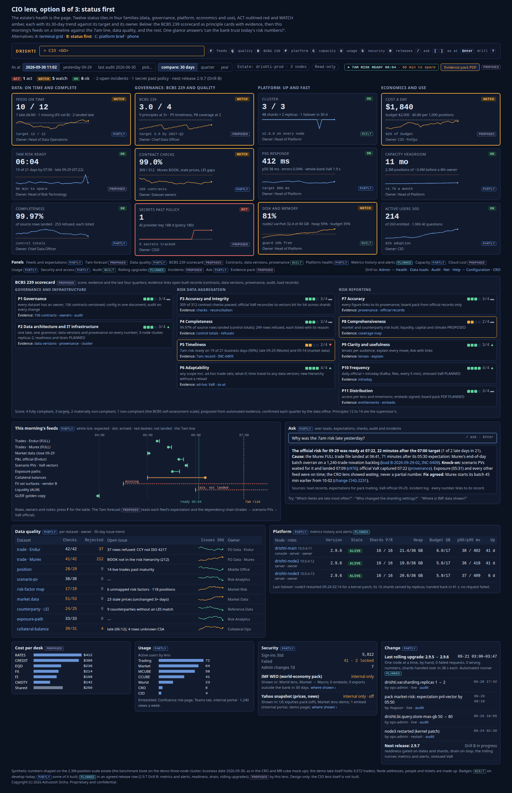

[Open B.html](mockups/cio/B.html)

| Panel | Contents (exact) | Data and contract | Interaction | Phase | Phone tier | Done? |
|---|---|---|---|---|---|---|
| Command bar | `DRISHTI`, the command line with `CIO <GO>`, the key legend (`F` `Q` `B` `P` `C` `U` `S` `R` `/` `[` `]` `Enter` `?`) | the lens file's placeholder | type a command; keys | POC | must | no |
| As-at strip | as at `2026-09-30 11:02`, presets *yesterday 09-29*, *last audit 2026-06-30*, *pick…*; compare *30 days* / *quarter* / *year*; chip *Estate: drishti-prod · 3 nodes*; chip *Read-only*; **7AM RISK READY 06:04 · 56 min to spare**; **Evidence pack PDF** with PROPOSED | `feed-status` (9.7.4) and `feed-dependency` (9.7.5) for the badge; the captured summaries for past dates | preset click; `[` `]`; the badge opens the feed timeline | POC: now and yesterday; CIO11 the rest | must (badge) | no |
| Status count line | `ACT 1 act`, `WATCH 5 watch`, `OK 6 ok`; *2 open incidents · 1 secret past policy · next release N+1* | the tiles' statuses (9.8.5); `incident` (9.7.11); `secret-inventory` (9.7.10); `change-record` (9.7.12) | click a count: filter the tiles | POC (counts) | must | no |
| Family headings | DATA: ON TIME AND COMPLETE · GOVERNANCE: BCBS 239 AND QUALITY · PLATFORM: UP AND FAST · ECONOMICS AND USE | the lens file | none | POC | must | no |
| Tile: Feeds on time | `10 / 12`, *1 late (ALM) · 1 missing (FX vol B) · 2 landed late*, sparkline against *target 12 / 12*, `WATCH`, PARTLY, *Owner: Head of Data Operations* | `feed-status` (9.7.4); today's states from `ExpectationService` (built) | click: the feed timeline (`F`) | POC | must | no |
| Tile: 7am risk ready | `06:04`, *19 of 21 days by 07:00 · late 09-29 (07:22)*, sparkline against the 07:00 line, *56 min to spare*, `OK`, PROPOSED, *Owner: Head of Risk Technology* | `feed-status` and `feed-dependency`; the official capture time of VaR and exposure | click: the ready-time chart | CIO1 | must | no |
| Tile: Completeness | `99.97%`, *of source rows landed · 253 refused, each listed*, sparkline against 99.9%, *control totals*, `OK`, PARTLY, *Owner: Chief Data Officer* | `LoadRecord.rows`, `rejected` (built); control totals from `feed-sla` (9.7.3) | click: the refused rows | POC (rows, rejected); CIO1 (control totals) | glance | no |
| Tile: BCBS 239 | `3.0 / 4`, *9 principles at 3+ · P5 timeliness, P8 coverage at 2*, sparkline against *target 3.5 by 2027-Q2*, `WATCH`, PROPOSED, *Owner: Chief Data Officer* | `bcbs239-assessment` (9.7.13) | click: the scorecard (`B`) | CIO3 | must | no |
| Tile: Contract checks | `99.0%`, *309 / 312 · Murex BOOK, stale prices, LEI gaps*, sparkline against 99.5%, *106 contracts*, `WATCH`, PARTLY, *Owner: Dataset owners* | `dq-result` (9.7.6); the contracts' validation (built) | click: data quality (`Q`) | POC (contract checks from rejects); CIO2 (content checks) | glance | no |
| Tile: Secrets past policy | `1`, *AI provider key 188 d (policy 180)*, *5 secrets tracked*, `ACT`, red outline, PROPOSED, *Owner: CISO* | `secret-inventory` (9.7.10) | click: the secrets table | CIO7 (decision 5) | must | no |
| Tile: Cluster | `3 / 3`, *48 shards × 2 replicas · 1 failover in 30 d*, *vN on every node*, `OK`, BUILT, *Owner: Head of Platform* | Drishti\*net membership and the shard map (built); `platform-metric` (9.7.7) for the trend | click: the nodes table (`P`) | POC | glance | no |
| Tile: p95 response | `412 ms`, *p50 38 ms · errors 0.04% · whole-bank VaR 1.9 s*, sparkline against *target 800 ms*, `OK`, PARTLY | Health's views p95 (built, ten minutes); `platform-metric` for the 30 days (planned) | click: the latency chart | POC (now); CIO4 (trend) | glance | no |
| Tile: Disk and memory | `81%`, *node2 var/hot 32.4 of 40 GB · heap 59% · budget 35%*, *guard 10% free*, `WATCH`, BUILT | Health → Disk and the cache budget (built) | click: Admin → Health → Disk | POC | glance | no |
| Tile: Cost a day | `$1,840`, *budget $2,000 · $0.80 per 1,000 positions*, *92% of budget*, `WATCH`, PROPOSED, *Owner: CIO · FinOps* | `cloud-cost` (9.7.8) | click: cost per desk | CIO14 (later phase, decision 4) | more | no |
| Tile: Capacity headroom | `11 mo`, *2.3M positions of ~3.4M before a 4th owner*, *+3.7% a month*, `OK`, PARTLY | `platform-metric` (positions, lake size); the scale step from CLUSTER_DEPLOYMENT section 3 | click: the capacity chart | CIO5 | more | no |
| Tile: Active users 30d | `214`, *of 260 entitled · 1,906 AI questions*, *82% adoption*, `OK`, PARTLY | `usage-event` (9.7.9) over the access log (built); `entitlement` (9.7.10) for "entitled" | click: usage (`U`) | CIO6 | more | no |
| Panels and drill line | each panel's badge (Feeds and expectations PARTLY, 7am forecast PROPOSED, Data quality PARTLY, BCBS 239 scorecard PROPOSED, Contracts, data versions, provenance BUILT, Platform health PARTLY, Metrics history and alerts PLANNED, Capacity PARTLY, Cloud cost PROPOSED, Usage PARTLY, Security and access PARTLY, Audit BUILT, Rolling upgrades PLANNED, Incidents PROPOSED, Ask PARTLY, Evidence pack PROPOSED); *Drill to: Admin → Health · Data loads · Audit · Net · Help → Configuration · CRO* | the lens file (badges are configuration until built) | click a link | POC | more | no |
| BCBS 239 scorecard | three columns (governance and infrastructure; risk data aggregation; risk reporting), eleven cards: *P1 Governance 3/4* … *P11 Distribution 3/4*, each with its score squares, trend arrow, one line of evidence and *Evidence:* links; P5 and P8 outlined amber at 2/4; the scale note | `bcbs239-assessment` (9.7.13) and the evidence it links (section 9.9) | click a link: the record; confirm (data office) | CIO3 | more | no |
| This morning's feeds | the timeline 03:30 to 07:30 for the eleven timed feeds, the 07:00 line and *ready 06:04*; *missing* (FX vol vendor B) and *late, not landed* (ALM) in red dashes; the note on the forecast | `feed-status`, `feed-sla`, `feed-dependency` | hover: the load; click: Data loads | POC (today's states); CIO1 (dependency) | glance | no |
| Ask | the box *Why was the 7am risk late yesterday?*; the answer: *ready at 07:22 … Murex FULL trade file landed at 06:41 … scenario PVs waited … official VaR captured 07:22 … Fix agreed: Murex starts its batch 45 min earlier (CHG-2231)*, every figure a link; *Sources: load records, expectations for pack trading, VaR official 09-29, incident log*; three suggested questions | the AI layer with tools over the records of section 9.7 (9.8.10) | `/`, `Enter`; click a link | CIO10 | more | no |
| Data quality | nine datasets: *trade · Endur 42/42, 37 rejected, CCY not ISO 4217*; *trade · Murex 41/42, 212, BOOK not in the risk hierarchy*; *position 28/29, 14 live trades past maturity*; *scenario-pv 38/38*; *risk-factor map 17/18, 6 unmapped · 118 positions*; *market data 51/53, 23 stale prices*; *counterparty · LEI 24/25, 9 without an LEI match*; *exposure-path 33/33*; *collateral-balance 30/31, late; 4 rows unknown CSA*; a 30-day issue sparkline; the owner | `dq-result` (9.7.6) | click a dataset: its checks and rejects | POC (contract checks, rejects); CIO2 (content checks, trend) | more | no |
| Platform | the nodes table (`drishti-main` 10.0.4.11 console · server · owner, `drishti-node2`, `drishti-node3`: N, `ALIVE`, 16 / 16, heap, budget, p50 / p95, up); *Last failover: node3 restarted 09-24 02:14 … handed back in 41 s; no request failed* | Drishti\*net members and their digests (built); `platform-metric`; `change-record` for the failover | click: Admin → Net | POC (now); CIO4 (history) | more | no |
| Cost per desk | RATES $412, CREDIT $388, EQD $236, FX $214, FI $198, CMDTY $142, Shared $250 | `cloud-cost` and `cost-allocation` (9.7.8) | click: the allocation rules | CIO14 (later) | desk | no |
| Usage | active users by lens (Trading 72, Market 64, MCUBE 58, CCUBE 41, World 23, CRO 6, CIO 4); *Embedded: Confluence risk page, Teams tab, internal portal · 1,240 views a week* | `usage-event` (9.7.9) | click: Admin → Access filtered | CIO6 | desk | no |
| Security | *Sign-ins 30d 5,812 · Failed 41 · 2 locked · Admin changes 7d 7*; internal-only sources: *IMF WEO (world-economy pack) shown in World lens, Market → Macro; 0 embeds; 0 exports*, *Yahoo snapshot … off; 1 embed (demo page)* | the audit log (built); `entitlement` (9.7.10); the internal-only map (9.8.8) | click: Admin → Audit log, Access | POC (sign-ins from audit); CIO7 | desk | no |
| Change | *Last rolling upgrade N−1 → N, 09-21 03:00–03:47, one node at a time, by hand; 0 failed requests … Automated runner PLANNED*; four configuration changes with who, when and *live* or *restart*, each with an audit link; *Next release: N+1 … testing in progress* | `change-record` (9.7.12); the audit log (built) | click: the audit row | POC (configuration changes from audit); CIO8 | desk | no |
| Footer | the scale-estate note, the badge meanings, *Design only*; copyright from branding | branding configuration | none | POC | more | no |

#### 9.6.2 C: Brief (and the Evidence pack PDF)


[Open C.html](mockups/cio/C.html)

| Panel | Contents (exact) | Data and contract | Interaction | Phase | Phone tier | Done? |
|---|---|---|---|---|---|---|
| Command bar, as-at strip | as B | as B | as B | CIO9 | must | no |
| Headline | *PLATFORM BRIEF · 2026-09-30 · written 06:10, updated 11:02 · drishti-prod*; *The risk numbers were ready at 06:04 and are safe to use; one feed is late and one secret is overdue.* | the tiles' statuses; text from a **template** (9.8.9) | click a figure: its record | CIO9 | must | no |
| 1. Will the numbers be on time? | the paragraph (ten of twelve on time; ALM late, INC-0412; FX vol B missing, fallback; 06:04; 19 of 21; the two misses) and the ready-time chart (21 days, 07:00 line) | `feed-status`, `feed-dependency` | click a bar: that day | CIO1 | glance | no |
| 2. Can we trust them? | the paragraph (309 of 312; 253 refused; three owner actions; 14 past maturity) and the data-quality table without the trend column | `dq-result` | as B | CIO2 | more | no |
| 3. BCBS 239 | the paragraph (3.0 of 4, up from 2.7; strong on P6, P10; P5 and P8 at 2; confirmation due 10-15) and the scorecard table (score, four quarters, open items) | `bcbs239-assessment` | as B | CIO3 | more | no |
| 4. Is the platform healthy? | the paragraph (three nodes on N; 48 shards × 2; p95 412 ms; one failover; node2 at 81%; history PLANNED) and the nodes table | as B's platform | as B | POC (now); CIO4 | more | no |
| 5. Capacity and cost | the paragraph (2.3M, +3.7% a month, ~3.4M in ~11 months, 4.8 TB, $1,840 a day) and the capacity chart with the cost bars | `platform-metric`; `cloud-cost` | hover | CIO5; CIO14 | desk | no |
| 6. Are people using it? | the paragraph (214 of 260; top lens and screen; embeds; 1,906 AI questions, 87% with links, 31 unhelpful) | `usage-event`, `entitlement` | click *read them* | CIO6 | desk | no |
| 7. Is it secure? | the paragraph (sign-ins, failures, locks, admin changes; the AI provider key past policy; internal-only data) | audit log; `secret-inventory`; the internal-only map | click *rotate*: the runbook | CIO7 | desk | no |
| 8. What changed? | the paragraph (the upgrade 09-21; four configuration changes; next release; two P3 incidents) | `change-record`, `incident` | click: the record | CIO8 | desk | no |
| Right rail: Verdict | *Numbers on time YES 06:04 · Safe to use YES · Feeds 10 / 12 · BCBS 239 3.0 / 4 · Platform 3 / 3 · Security 1 OVERDUE · Cost 92%* | the tiles | click: the section | CIO9 | must | no |
| Right rail: Ask | as B | as B | as B | CIO10 | more | no |
| Right rail: Evidence pack | the description; **Evidence pack PDF**, *Period: 2026-Q3*, *Sign-off block* | the brief for a period (9.8.9) and the scorecard; the planned board pack's PDF house style | click: generate | CIO11 | more | no |
| Right rail: Time travel | *data versions and provenance are built; the platform history needs the metrics store (PLANNED)*; presets *today*, *09-29*, *quarter-end 06-30*, *pick…* | the captured summaries | preset click | CIO11 | desk | no |
| Right rail: Open incidents | *INC-0412 P3 Liquidity (ALM) file late, open 06:05*; *INC-0410 P3 FX vol vendor B missing 09-29*; *INC-0409 P2 7am risk late 09-29 (Murex 06:41), closed 09-29 09:40* | `incident` (9.7.11) | click: the ticket | CIO8 | more | no |

#### 9.6.3 A: Detail

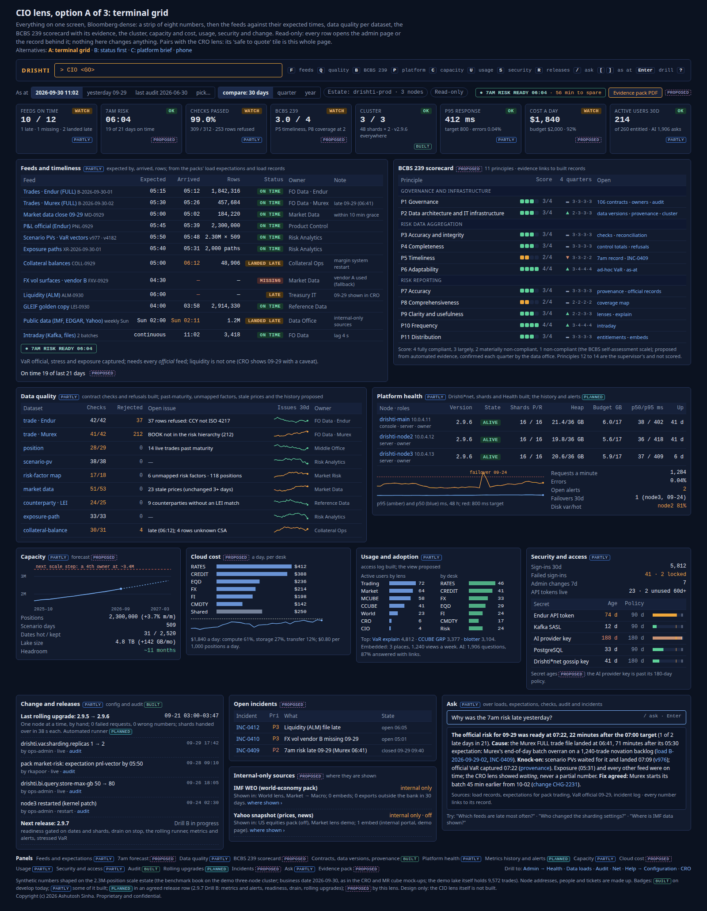

[Open A.html](mockups/cio/A.html)

| Panel | Contents (exact) | Data and contract | Interaction | Phase | Phone tier | Done? |
|---|---|---|---|---|---|---|
| Command bar, as-at strip | as B | as B | as B | CIO9 | must | no |
| Eight numbers | *Feeds on time 10 / 12 WATCH*, *7am risk 06:04 OK*, *Checks passed 99.0% WATCH*, *BCBS 239 3.0 / 4 WATCH*, *Cluster 3 / 3 OK*, *p95 response 412 ms OK*, *Cost a day $1,840 WATCH*, *Active users 30d 214 OK*, each with its sub-line and badge | as B's tiles | click: the panel | as B's tiles | must | no |
| Feeds and timeliness | the table of twelve feeds: name and batch, *Expected*, *Arrived* (amber when late, red dash when absent), *Rows*, the status word (`ON TIME`, `LANDED LATE`, `MISSING`, `LATE`), *Owner*, *Note* (*late 09-29 (06:41)*, *within 10 min grace*, *margin system restart*, *vendor A used (fallback)*, *09-29 shown in CRO*, *internal-only sources*, *lag 4 s*); the 7am badge and its rule; *On time 19 of last 21 days* | `feed-status`, `feed-sla`; `LoadRecord` (built) | sort; click: Data loads | POC (today); CIO1 | desk | no |
| BCBS 239 scorecard | the table: principle, score squares and *n/4*, the last four quarters (*3·3·3·3*), the open links; groups as rows; the scale note | `bcbs239-assessment` | click a link | CIO3 | more | no |
| Data quality | as B, with the trend column | `dq-result` | as B | POC; CIO2 | more | no |
| Platform health | the nodes table, the 48-hour p50 and p95 chart with the 800 ms target and *failover 09-24*, and *Requests a minute 1,284 · Errors 0.04% · Open alerts 2 · Failovers 30d 1 (node3, 09-24) · Disk var/hot node2 81%* | Health (built); `platform-metric` (planned, CIO4) | click: Health, Net | POC; CIO4 | more | no |
| Capacity | the chart (12 months and 6 forecast, the 3.4M step) and *Positions 2,300,000 (+3.7% m/m) · Scenario days 509 · Dates hot / kept 31 / 2,520 · Lake size 4.8 TB (+142 GB/mo) · Headroom ~11 months* | `platform-metric` | hover | CIO5 | desk | no |
| Cloud cost | cost per desk bars, the 30-day trend against $2,000, *compute 61%, storage 27%, transfer 12%; $0.80 per 1,000 positions a day* | `cloud-cost`, `cost-allocation` | click | CIO14 (later) | desk | no |
| Usage and adoption | active users by lens and by desk; *Top: VaR explain 4,812 · CCUBE GRP 3,377 · blotter 3,104. Embedded: 3 places … AI: 1,906 questions, 87% answered with links* | `usage-event` | click: Access | CIO6 | desk | no |
| Security and access | *Sign-ins 30d 5,812 · Failed sign-ins 41 · 2 locked · Admin changes 7d 7 · API tokens live 23 · 2 unused 60d+*; the secrets table (Endur API token 74 d / 90, Kafka SASL 12 / 90, AI provider key 188 / 180 red, PostgreSQL 33 / 90, Drishti\*net gossip key 41 / 180) | audit log, tokens (built); `secret-inventory` | click: Audit, Tokens | POC (sign-ins, tokens); CIO7 | desk | no |
| Change and releases | as B's change list | as B | as B | POC; CIO8 | desk | no |
| Open incidents | as C's rail | `incident` | as C | CIO8 | more | no |
| Internal-only sources | IMF WEO and the Yahoo snapshot with where each is shown, embeds and exports | the pack switches (built); `usage-event` with the source of each read (9.8.8) | click: *where shown* | CIO7 | desk | no |
| Ask | as B | as B | as B | CIO10 | more | no |
| Panels line, footer | as B | as B | as B | POC | more | no |

#### 9.6.4 Phone


[Open phone.html](mockups/cio/phone.html)

| Panel | Contents (exact) | Data and contract | Interaction | Phone tier | Phase | Done? |
|---|---|---|---|---|---|---|
| Command bar | `DRISHTI` and `CIO <GO>` | as B | type | must | CIO12 | no |
| As-at and badge | *As at 09-30 11:02 · 30 days*, **7AM READY 06:04** | as B | tap the badge: the feeds | must | CIO12 | no |
| The verdict | *Risk numbers on time and safe to use. One feed late (ALM), one missing (FX vol B, fallback used); the AI provider key is past its rotation policy.*; ACT 1 · WATCH 5 · OK 6 | as C's headline | tap: the Brief | must | CIO12 | no |
| Status tiles | eight tiles two-up: Feeds on time, 7am ready, Checks passed, BCBS 239, Cluster, p95 response, Secrets overdue, Cost a day; value, status, sparkline 150 × 20, badge; ACT and WATCH first in the built lens | as B's tiles | tap: the panel's phone view | must (ACT, WATCH); glance (OK) | CIO12 | no |
| Feeds needing attention | the four not on time (Collateral balances landed late; FX vol surfaces vendor B missing; Liquidity (ALM) late; Public data landed late) with due, arrival and owner; *8 more on time · all feeds ›* | `feed-status` | tap: the feed | glance | CIO12 | no |
| BCBS 239 | the eleven principles with score squares and trend | `bcbs239-assessment` | tap: the card | more | CIO12 after CIO3 | no |
| Data quality: open issues | seven datasets with an open issue, checks and owner | `dq-result` | tap: the dataset | more | CIO12 | no |
| Platform | three nodes with version, shards, heap, p95, uptime | as B | tap: the node | more | CIO12 | no |
| Ask | the box and the answer | as B | type, tap links | more | CIO12 after CIO10 | no |
| Buttons | **Evidence pack PDF**, **As at yesterday** | as B | tap | more | CIO12 | no |
| Badge line, footer | *BCBS 239, cost, 7am forecast PROPOSED · metrics history, rolling upgrades PLANNED · feeds, quality, usage, security, Ask PARTLY · cluster, contracts, audit BUILT* | the lens file | none | more | CIO12 | no |

#### 9.6.5 Empty, loading and error states

Every panel behaves as in [section 8.6.5](#865-empty-loading-and-error-states) (frame and progress line, a sentence instead of a blank,
its own date in amber when stale, Retry on error with the rest of the page unaffected, its badge until built; Ask off or the model's
error, never a guessed answer). What is particular to the CIO lens:

| State | Tiles | Feeds | BCBS 239 | Ask |
|---|---|---|---|---|
| **Loading** | the frame, name and target from the lens file, value `…` | "Reading today's loads…" | "Reading the assessment…" | "Fetching the records…" |
| **Empty** | *"No cost for 2026-09-30 (the billing export arrives at 10:00)"*, grey, no status word | *"No pack expects data today (a holiday on every calendar)"* | *"No assessment yet for 2026-Q3: the proposed scores are below; the data office confirms them by 10-15"* | suggested questions only |
| **Stale** | the tile shows its as-of date under the value | a feed whose state is older than `check-interval` × 3 says *"state from 10:58"* | a principle not confirmed this quarter says *"proposed, not confirmed"* | the answer names any record from an older date |
| **Error** | the tile in the error style, with the source named | *"Data loads could not be read on drishti-node2"* (a member down: the others still answer) | as every panel | as every panel |
| **No access** | security tiles hidden for people without `cio.security` (decision 5) | — | — | Ask's tools see only what the person may |

#### 9.6.6 What the mock-ups do not show exactly

- **Scale estate, not the demo lake.** The feed rows (1,842,316 Endur, 457,684 Murex), the 2.3M positions, the lake size and the cost are
  the scale estate's (decision 6). The POC on the demo lake shows the demo's own rows (9,572 trades) with the same panels.
- **Feeds the demo does not have.** Murex as a separate FULL file, collateral balances from a margin system, FX vol surfaces from two
  vendors and the liquidity (ALM) feed are illustrative; the demo's packs expect what their `loads:` sections say. CIO1's synthetic
  history generator writes the mock-ups' twelve feeds.
- **Version numbers** appear on the mock-up pictures: never in anything deck-bound ([section 9.6](#96-mock-ups-the-screens-to-build)).
- **A failover and an upgrade record** are drawn as if recorded; today neither is kept as history (CIO4, CIO8).

---

### 9.7 Data needed: the complete list

The contract conventions are those of [section 8.7](#87-data-needed-the-complete-list). Most of the CIO lens's data is **Drishti's own records captured daily** (loads, expectations, checks, metrics,
the access and audit logs) so that time travel and trends read a table, never a log that has been pruned.

#### 9.7.1 The data map

**Columns:** *Phase*: POC, or the CIO row. *State*: existing (a contract or record exists), extended (exists; fields or history added),
new. *Demo*: how the demo gets it: existing records; a **new synthetic generator** writing JSONL to `data/testdata/platform/<kind>/`; or
**bank only**.

| # | Dataset (kind) | Panel | Phase | Source (at a bank) | Grain | Frequency | State | Demo |
|---|---|---|---|---|---|---|---|---|
| 1 | Load records (`LoadRecord`) | feeds, completeness, rejected rows | POC | Drishti (`data landed`, `POST /packs/{pack}/loads`) | load | per load | existing (`data/loads/<pack>.json`, 2000 a pack) | existing |
| 2 | Pack expectations (`loads: expect:`) | feeds, expected time | POC | the pack and the administrator's override | pack × kind | on change | existing | existing |
| 3 | **`feed-sla`** (9.7.3) | expected, grace, control totals, owner, official or not | CIO1 | the data office (extends 2) | feed | on change | **extended** (2 plus owner, grace, control totals, official flag) | **new generator** for the twelve feeds |
| 4 | **`feed-status`** (9.7.4) | feeds history, on-time rate, 7am record, time travel | CIO1 | Drishti (captured from `ExpectationService` daily and on each change) | feed × business date | daily, on change | **new** (captured) | **new generator**: 90 days of history |
| 5 | **`feed-dependency`** (9.7.5) | 7am forecast, Ask "why late" | CIO1 | the data office (what each official output needs) | output × input | on change | **new** | **new generator** (VaR official ← scenario PVs ← trades, …) |
| 6 | **`dq-result`** (9.7.6) | data quality, completeness, BCBS P3 and P4 | POC (contract checks); CIO2 | Drishti (contract validation at load; content checks after load) | dataset × check × business date | per load | **new** (captured; the rejects exist) | computed on the demo; **new generator** for 90 days |
| 7 | **`platform-metric`** (9.7.7) | nodes, latency, errors, capacity, failovers | CIO4 (after the planned metrics) | Drishti (daily and hourly roll-ups of its own metrics) | member × metric × hour | hourly, daily | **new** | **new generator** for 12 months |
| 8 | **`cloud-cost`**, **`cost-allocation`** (9.7.8) | cost a day, per desk | CIO14 (later phase) | the cloud billing export (AWS CUR, Azure Cost Management) and FinOps's allocation rules | resource × day; rule | daily; on change | **new** | **new generator** |
| 9 | **`usage-event`** (9.7.9) | usage and adoption, internal-only map | CIO6 | Drishti (extends the access log with lens, screen, embed, source) | event | per event | **extended** (the access log) | from demo use; **new generator** for 90 days |
| 10 | **`entitlement`** (9.7.10) | access per lens and mnemonic, "entitled" | CIO7 | Drishti (an export of roles, powers, packs, commands, lenses, per person, per date) | person × grant × date | daily snapshot | **new** (exported) | computed on the demo |
| 11 | **`secret-inventory`** (9.7.10) | secrets and their age | CIO7 (decision 5) | the bank's vault (HashiCorp Vault, AWS Secrets Manager) or Drishti's own rotation records | secret | daily | **new** | **new generator** (five secrets) |
| 12 | The audit log (`drishti_audit`) | sign-ins, failures, admin and configuration changes | POC | Drishti | action | per action | existing | existing |
| 13 | **`incident`** (9.7.11) | open incidents, Ask | CIO8 | the bank's ITSM (ServiceNow, Jira Service Management) | incident × version | on event | **new** (input) | **new generator** |
| 14 | **`change-record`** (9.7.12) | releases, upgrades, failovers, configuration changes | CIO8 | Drishti (members' version changes, drains, restarts; the audit's configuration actions) and the bank's change tickets | change | per event | **new** (captured) | **new generator** |
| 15 | **`bcbs239-assessment`** (9.7.13) | the scorecard | CIO3 | Drishti (proposed from evidence) and the data office (confirmed) | principle × quarter | daily proposal; quarterly confirmation | **new** | **new generator** for four quarters |
| 16 | Contracts (`config/packs/*/contracts/`) | BCBS P1, P2 evidence | POC | the repository | kind | on change | existing (106) | existing |
| 17 | Data versions and provenance | BCBS P2, P3, P7 evidence; time travel | POC | Drishti | answer | per answer | existing | existing |
| 18 | Official VaR and exposure records and their capture times | 7am record, BCBS P5, P7 | POC | Drishti | node × date | daily | existing | existing |
| 19 | The configuration in force (`GET /api/v1/admin/settings`) | BCBS P1, the evidence pack | POC | Drishti | key | on change | existing | existing |
| 20 | Health and Drishti\*net state (now) | nodes, shards, disk | POC | Drishti | member | live | existing | existing |
| 21 | AI audit of Ask | AI questions, Ask | CIO10 | Drishti (`ai-audit`, the access log's `ask`) | question | per question | existing | existing |

**Not needed from the bank for the POC:** rows 1, 2, 6 (contract checks), 12 and 16 to 20 exist; rows 3 to 5, 7, 9 to 11, 13 to 15 have
synthetic generators. A bank supplies rows 3 and 5 (its data office's service levels and dependencies), 8 (billing), 11 (from its vault)
and 13 (from its ITSM); Drishti produces the rest.

#### 9.7.2 Contract notes common to the new kinds

- **One pack:** a `platform` pack holds every kind of this section (decision 9), with its `README.md` (the README standard), a
  standalone generator per kind and its synthetic data under `data/testdata/platform/`, loaded by `lake build` into Delta and read by the
  delta connector, tested with the demo off.
- **Captured, not logged:** kinds 4, 6, 7, 9, 10 and 14 are written by Drishti once a day (and on change) to the lake, so a quarter's
  evidence survives the pruning of the access log (`drishti.access-log.keep-days`, 90) and the load history (`keep`, 2000 a pack).
- **Members:** Drishti-produced rows carry `MEMBER` (the Drishti\*net member name) so a cluster's rows are told apart and summed.
- **People:** user names are carried as in the audit log; the lens shows counts to everyone and names only to people with
  `cio.security` (decision 5); masking follows the contract's `masks` as everywhere.
- **Versions and mnemonics** as in [section 8.7.2](#872-contract-notes-common-to-the-new-kinds) (none of the mnemonics below is taken
  today).

#### 9.7.3 `feed-sla` (FSLA): each feed's service level (extended, fundamental)

**Extends** the pack expectations (`loads: expect: {kind: {by, zone, calendar}}`, [DATA_GUIDE section 4.3](../guides/DATA_GUIDE.md#43-the-expectation-settings-administrators-never-open-to-a-token))
with what a CIO needs and a pack does not say (decided: an extension of `ExpectationService`, not a new feature). **Grain:** one row per
feed (a pack and kind, optionally a source within it). **Key:** `FEED_ID`, `VERSION`. **Dated by:** `VALID_FROM` / `VALID_TO`. **Size:**
tens of rows. **Storage:** Delta, `<root>/platform/feed-sla/`; the expectation fields stay in the pack's `loads:` section (one truth) and
are copied into the row at capture.

| Field | Type | Unit | Req. | Meaning |
|---|---|---|---|---|
| `FEED_ID` | id | | required | `FEED-TRADING-TRADE-MUREX` |
| `PACK`, `KIND` | text | | required | the expectation it extends |
| `SOURCE` | text | | optional | `MUREX`, when one kind has several sources (multi-source trades stay separate) |
| `NAME` | text | | required | as shown: *Trades · Murex (FULL)* |
| `EXPECTED_BY`, `ZONE`, `CALENDAR` | time, text, text | | required | copied from the pack's expectation |
| `GRACE_MINUTES` | integer | minutes | optional | arrival within the grace is on time (*within 10 min grace*) |
| `OFFICIAL` | boolean | | required | true when an official output (the 7am risk) depends on it; the CRO's safe-to-quote reads it |
| `CONTROL_TOTAL_SOURCE` | text | | optional | where the source's own row count comes from (a trailer record, a manifest, the announcement's `rows`) |
| `OWNER`, `OWNER_ROLE` | text | | required | *FO Data · Murex*, `fo-data` |
| `ESCALATION` | list | | optional | roles told when late, in order (the pack's notify list stays the first) |
| `TARGET_ON_TIME` | rate | fraction | optional | the service level: 0.98 of business days |
| `VERSION`, `VALID_FROM`, `VALID_TO` | | | required | |

```json
{"FEED_ID":"FEED-TRADING-TRADE-MUREX","PACK":"trading","KIND":"trade","SOURCE":"MUREX","NAME":"Trades · Murex (FULL)",
 "EXPECTED_BY":"05:30","ZONE":"America/New_York","CALENDAR":"US","GRACE_MINUTES":10,"OFFICIAL":true,"CONTROL_TOTAL_SOURCE":"manifest",
 "OWNER":"FO Data · Murex","OWNER_ROLE":"fo-data","TARGET_ON_TIME":0.98,"VERSION":1,"VALID_FROM":"2026-10-01"}
```

**Validation:** `PACK` and `KIND` must name a loaded pack's kind with an expectation (else refused with the list); `EXPECTED_BY` equal to
the pack's (a difference is a warning naming both; the pack wins); `TARGET_ON_TIME` in (0, 1].

#### 9.7.4 `feed-status` (FSTS): each feed's state per business date (new, computed, captured)

**Grain:** one row per feed per business date (the latest state; earlier states as versions). **Key:** `FEED_ID`, `BUSINESS_DATE`,
`VERSION`. **Class:** computed; **captured** by `ExpectationService` at each state change and at end of day, so the history outlives
`lookback-days`. **Size:** about 20 rows a day. **Storage:** Delta, `<root>/platform/feed-status/`.

| Field | Type | Unit | Req. | Meaning |
|---|---|---|---|---|
| `FEED_ID`, `PACK`, `KIND`, `SOURCE` | | | required | |
| `BUSINESS_DATE` | date | | required | |
| `STATE` | text | | required | the six states of `ExpectationService` (`pending`, `on-time`, `landed-late`, `late`, `missing`, `failed`) |
| `DEADLINE`, `LANDED_AT` | timestamp | | required / optional | |
| `MINUTES_LATE` | integer | minutes | optional | `LANDED_AT − DEADLINE` beyond the grace |
| `LOAD_ID`, `BATCH_ID` | id | | optional | the `LoadRecord` that satisfied it |
| `ROWS`, `REJECTED` | integer | | optional | from the load |
| `CONTROL_TOTAL` | integer | | optional | the source's own count; `ROWS + REJECTED` should equal it (9.8.3) |
| `FALLBACK` | text | | optional | *vendor A used* |
| `INCIDENT_ID` | id | | optional | the ticket opened for it |
| `MEMBER` | text | | required | the member that recorded it |
| `VERSION`, `AS_OF` | | | required | |

#### 9.7.5 `feed-dependency` (FDEP): what each official output needs (new, fundamental)

**Grain:** one row per output per input. **Key:** `OUTPUT`, `INPUT`. **Source:** the data office, checked against what the engines read
(VaR reads `pnl-vector`, `risk-hierarchy`, `scenario-set`, `scenario-pv`; exposure reads `simulation-run`, `exposure-path`). **Size:**
tens of rows.

| Field | Type | Req. | Meaning |
|---|---|---|---|
| `OUTPUT` | text | required | `VAR-OFFICIAL`, `EXPOSURE-OFFICIAL`, `STRESS`, or a feed (`FEED-SCENARIO-PV`) for chains |
| `INPUT` | text | required | a `FEED_ID` or another output |
| `READY_BY` | time | output rows | the target the output must meet (`07:00`) |
| `TYPICAL_MINUTES` | integer | optional | the usual time from the last input to the output (learned from `feed-status` and the capture times; editable) |
| `REQUIRED` | boolean | required | false for an input the output can do without (a fallback exists) |

**Validation:** no cycles; every `INPUT` a known feed or output; an output with no input is refused.

#### 9.7.6 `dq-result` (DQR): data-quality checks per dataset per date (new, computed, captured)

**Grain:** one row per dataset per check per business date (per load when a date has several). **Key:** `DATASET`, `CHECK_ID`,
`BUSINESS_DATE`, `LOAD_ID`. **Class:** computed. Two families: **contract checks** (the contract's `validation` rules at load, built:
required, unique, enum, pattern, link, range, vector length; their rejects are today's reject file) and **content checks** (new, run after
the load as a pack's `checks:`: live trades past maturity, risk factors with no mapping, prices unchanged for N days, counterparties
without an LEI match, a book not in the risk hierarchy). **Storage:** Delta, `<root>/platform/dq-result/`.

| Field | Type | Unit | Req. | Meaning |
|---|---|---|---|---|
| `DATASET` | text | | required | pack and kind, with the source: `trading/trade/MUREX` |
| `CHECK_ID` | text | | required | `contract.required.BOOK`, `content.past-maturity`, `content.unmapped-risk-factor`, `content.stale-price` |
| `FAMILY` | text | | required | `CONTRACT`, `CONTENT` |
| `BUSINESS_DATE`, `LOAD_ID` | | | required | |
| `RESULT` | text | | required | `PASS`, `FAIL`, `WARN`, `SKIPPED` |
| `ROWS_CHECKED`, `ROWS_FAILED` | integer | | required | |
| `IMPACT` | text | | optional | *118 positions out of VaR* |
| `SAMPLE_IDS` | list | | optional | up to 20 failing ids, for the drill |
| `OWNER` | text | | required | from `feed-sla` or the pack |
| `ISSUE_STATE` | text | | optional | `OPEN`, `ACKNOWLEDGED`, `FIXED` (the owner's answer, through write-back) |

**Validation:** `ROWS_FAILED ≤ ROWS_CHECKED`; a `FAIL` names at least one sample id or says why not.

#### 9.7.7 `platform-metric` (PMET): the platform's own history (new, computed, captured)

**Grain:** one row per member per metric per hour, rolled up to a day. **Key:** `MEMBER`, `METRIC`, `PERIOD_START`, `GRAIN`. **Source:**
the server's own Micrometer metrics (**available**: [OPERATIONS section 13.6](../admin/OPERATIONS.md#136-platform-metrics-and-alerts), the
names of [RESOURCES_AND_SCALE section 8.3](RESOURCES_AND_SCALE.md#83-metrics-to-export)), sampled by Drishti itself so the
lens works without Prometheus; a site with Prometheus may instead point the lens at it (decision 8). **Size:** about 30 metrics × 3 members × 24
hours a day; kept 2 years at the daily grain. **Storage:** Delta, `<root>/platform/platform-metric/`.

| Field | Type | Unit | Req. | Meaning |
|---|---|---|---|---|
| `MEMBER`, `ROLES`, `VERSION` | text | | required | `drishti-node2`, `server owner`, the server's version |
| `METRIC` | text | | required | `requests`, `errors`, `view_p50_ms`, `view_p95_ms`, `heap_used_bytes`, `cache_budget_used_bytes`, `disk_folder_bytes{var/hot}`, `shards_primary`, `shards_replica`, `alive`, `positions`, `dates_hot`, `lake_bytes`, `alerts_open` |
| `GRAIN` | text | | required | `HOUR`, `DAY` |
| `PERIOD_START` | timestamp | | required | |
| `VALUE`, `LIMIT` | number | per metric | required / optional | the limit for budgets and caps |
| `SAMPLES` | integer | | required | |

Where each `METRIC` comes from (Micrometer name; Prometheus writes dots as underscores); each is **available** unless marked:

| `METRIC` | Read from | State |
|---|---|---|
| `requests`, `errors` | `http.server.requests` count; with `outcome=SERVER_ERROR` | available |
| `view_p50_ms`, `view_p95_ms` | `drishti.view.percentile{phi=0.5}`, `{phi=0.95}` (seconds) | available |
| `heap_used_bytes` | `jvm.memory.used{area=heap}`; after a collection `jvm.gc.live.data.size` | available |
| `cache_budget_used_bytes` | `drishti.memory.budget.used.bytes{pool=all}` against `drishti.memory.budget.bytes{pool=all}` (the `LIMIT`) | available |
| `disk_folder_bytes{var/hot}` | `drishti.disk.folder.bytes{folder}` against `drishti.disk.folder.limit.bytes`; `drishti.disk.free.bytes`, `drishti.disk.guard.bytes` | available |
| `shards_primary`, `shards_replica` | `drishti.cache.entries{cache=var.shard-books}` is the shard books held; by role: **not available** | partly |
| `alive` | `drishti.net.members{state}` | available |
| `dates_hot` | `drishti.cache.entries{cache=var.dates}` (`exposure.dates` for exposure) | available |
| `positions`, `lake_bytes` | **not available** as metrics | not built |
| `alerts_open` | `drishti.alerts.open{severity}` | available |
| feeds and sources (sections 9.7.3, 9.7.4) | `drishti.feeds.attention{state}`, `drishti.loads.last.ready.age.seconds{pack}`, `drishti.source.up`, `drishti.source.stale`, `drishti.source.update.age.seconds` | available |

#### 9.7.8 `cloud-cost` (CCST) and `cost-allocation` (CALC): cost a day and per desk (new, input; later phase)

**Decided (product owner, 2026-10-31): a later phase**, because it needs the billing export and allocation rules. **`cloud-cost`
grain:** one row per cloud resource per day from the billing export (AWS Cost and Usage Report, Azure Cost Management export), filtered by
the tags of the Drishti estate. **Key:** `RESOURCE_ID`, `USAGE_DATE`. **`cost-allocation`:** the FinOps rules that split shared cost to
desks (by positions, by VaR requests, by storage). **Storage:** Delta, `<root>/platform/cloud-cost/`, `<root>/platform/cost-allocation/`.

| Field (`cloud-cost`) | Type | Unit | Req. | Meaning |
|---|---|---|---|---|
| `RESOURCE_ID`, `SERVICE` | text | | required | `i-0abc…`, `EC2`, `EFS`, `S3`, `RDS`, data transfer |
| `USAGE_DATE` | date | | required | |
| `COST`, `CURRENCY` | amount | | required | amortised cost |
| `CATEGORY` | text | | required | `COMPUTE`, `STORAGE`, `TRANSFER`, `DATABASE` |
| `TAGS` | object | | required | `{"estate":"drishti-prod","member":"drishti-node2","role":"owner"}` |
| `DESK` | text | | optional | when the resource is the desk's own; else allocated |

| Field (`cost-allocation`) | Type | Req. | Meaning |
|---|---|---|---|
| `RULE_ID`, `VALID_FROM` | | required | |
| `CATEGORY` | text | required | which cost it splits |
| `DRIVER` | text | required | `POSITIONS`, `VAR_REQUESTS`, `STORAGE_BYTES`, `USERS`, `EVEN` |
| `DESKS` | list | optional | the desks it applies to (all by default) |

#### 9.7.9 `usage-event` (USEV): who used what, through which lens (extended from the access log)

**Extends** the access log (`drishti_access`: every answered read with person, time, action, kind, id and business date, built) with
the fields a usage view needs, captured daily to the lake. **Grain:** one row per event. **Key:** `EVENT_ID`. **Size:** about 60,000 rows
a day for 200 people (OPERATIONS section 9b's sizing); a daily summary (`usage-daily`, person × lens × screen × day) keeps the trend
after the events age out.

| Field | Type | Req. | Meaning |
|---|---|---|---|
| `EVENT_ID`, `AT`, `USER` | | required | as the access log |
| `ACTION` | text | required | `view`, `raw`, `history`, `search`, `export`, `share`, `ask`, and new: `landing`, `report`, `bi` |
| `LENS` | text | required | `risk`, `trading`, `market`, `world`, `cro`, `cio`, `full` (new) |
| `SCREEN` | text | required | the route or Sutra (`var-explain`, `ccube-grp`, `blotter`) (new) |
| `KIND`, `ENTITY_ID`, `BUSINESS_DATE` | | optional | as the access log |
| `EMBED_APP` | text | optional | the embedding application, today the detail `embed:<application>` |
| `SOURCES` | list | optional | the packs whose data the answer showed (for the internal-only map, 9.8.8) (new) |
| `DESK` | text | optional | the person's desk, from their profile or role (new) |
| `ANSWERED_WITH_LINKS`, `FEEDBACK` | boolean, text | `ask` | did the answer carry links; `helpful` / `unhelpful` |

#### 9.7.10 `entitlement` (ENTL) and `secret-inventory` (SECI): access and secrets (new; decision 5)

**`entitlement`** is an **export** of what each person may do, as of a date: roles (built-in and defined), their powers, packs, the
commands turned off for the site (Admin → Commands), the lenses offered. **Grain:** person × grant × date. **Key:** `USER`, `GRANT`,
`AS_OF_DATE`. Fields: `USER`, `ROLE`, `GRANT_TYPE` (`POWER`, `PACK`, `COMMAND`, `LENS`), `GRANT`, `SOURCE` (`configuration`, `admin`,
`sso-group`), `GRANTED_BY`, `GRANTED_AT`, `LAST_USED_AT` (from the access log). The evidence pack's access list is this table for the
period's last day.

**`secret-inventory`** names each secret Drishti uses, never its value. **Grain:** one row per secret per day. **Key:** `SECRET_ID`,
`AS_OF_DATE`. Fields: `SECRET_ID`, `NAME` (*AI provider key*), `KIND` (`API_KEY`, `PASSWORD`, `TOKEN_SIGNING`, `TLS_KEY`, `GOSSIP_KEY`),
`WHERE` (the environment variable or file reference, e.g. `DRISHTI_ASK_KEY`), `LAST_ROTATED` (from the vault's metadata or Drishti's
rotation audit), `AGE_DAYS`, `POLICY_DAYS`, `OWNER`, `STATE` (`OK`, `DUE`, `OVERDUE`). **Validation:** a secret without a policy is
refused; `AGE_DAYS` is computed, never supplied.

#### 9.7.11 `incident` (INCD): incidents from the bank's ITSM (new, input)

**Grain:** one row per incident per status change. **Key:** `INCIDENT_ID`, `VERSION`. **Source:** the bank's ITSM tool, by export or its
API; Drishti never owns incidents. Fields: `INCIDENT_ID`, `PRIORITY` (`P1` to `P4`), `TITLE`, `STATE` (`OPEN`, `RESOLVED`, `CLOSED`),
`OPENED_AT`, `RESOLVED_AT`, `CLOSED_AT`, `OWNER_GROUP`, `AFFECTS` (feed ids, members, outputs), `ROOT_CAUSE`, `FIX` (a change id),
`URL` (the ticket). **Validation:** `AFFECTS` names known feeds or members or is empty with a warning.

#### 9.7.12 `change-record` (CHGR): releases, upgrades, failovers and configuration changes (new, captured)

**Grain:** one row per change. **Key:** `CHANGE_ID`. **Source:** Drishti records what it sees (a member's version changes, a drain and
its return, a restart, a shard handover; the audit's configuration actions such as `data-load-config-changed`, `connector-saved`,
`net-file-saved`, `role-updated`, `cache-purged`) and imports the bank's change tickets. Fields: `CHANGE_ID`, `TYPE` (`RELEASE`,
`UPGRADE_STEP`, `RESTART`, `FAILOVER`, `CONFIG`, `TICKET`), `MEMBER`, `FROM_VERSION`, `TO_VERSION`, `STARTED_AT`, `ENDED_AT`, `BY`,
`DETAIL` (the setting and its old and new value, from the audit), `RESTART_NEEDED`, `FAILED_REQUESTS` (during the window, from
`platform-metric`), `TICKET` (the bank's change id), `AUDIT_REF`.

#### 9.7.13 `bcbs239-assessment` (BCBS): the scorecard (new, Drishti-owned)

**Grain:** one row per principle per quarter (per version: the daily proposal, then the confirmation). **Key:** `PRINCIPLE`, `PERIOD`,
`VERSION`. **Storage:** the Drishti content store, exported to Delta `<root>/platform/bcbs239-assessment/` daily.

| Field | Type | Req. | Meaning |
|---|---|---|---|
| `PRINCIPLE` | integer | required | 1 to 11 (12 to 14 are the supervisor's and not scored: decided) |
| `GROUP` | text | required | `GOVERNANCE_INFRASTRUCTURE`, `AGGREGATION`, `REPORTING` |
| `PERIOD` | text | required | `2026-Q3` |
| `PROPOSED_SCORE` | integer | required | 1 to 4 from the rules of section 9.8.4 |
| `CONFIRMED_SCORE` | integer | optional | the data office's score (may differ, with a reason) |
| `EVIDENCE` | list | required | each item: a check id, its value, its threshold, a link (a contract count, the on-time rate, the completeness rate, a document) |
| `GAPS` | list | optional | the open items (*liquidity, capital and climate not in Drishti*), each with its plan row |
| `CONFIRMED_BY`, `CONFIRMED_AT`, `COMMENT` | | on confirmation | four eyes: the confirmer is not the person who last edited the rules |

#### 9.7.14 Existing records read as they are

The load records and expectations, the contracts, data versions and provenance, the official VaR and exposure records, the configuration
in force, the audit log, the access log, Health and Drishti\*net: read as they are; the lens adds no field to them. The captures of
sections 9.7.4, 9.7.6, 9.7.7, 9.7.9, 9.7.10 and 9.7.12 are new tables written beside them.

#### 9.7.15 Proposed contract YAMLs (not created yet)

| File | Kind | Mnemonic (placeholder) | Class | New or extended |
|---|---|---|---|---|
| `config/packs/platform/contracts/feed-sla.contract.yaml` | `feed-sla` | `FSLA` | fundamental | extended from the pack expectations |
| `config/packs/platform/contracts/feed-status.contract.yaml` | `feed-status` | `FSTS` | computed | new (captured) |
| `config/packs/platform/contracts/feed-dependency.contract.yaml` | `feed-dependency` | `FDEP` | fundamental | new |
| `config/packs/platform/contracts/dq-result.contract.yaml` | `dq-result` | `DQR` | computed | new (captured) |
| `config/packs/platform/contracts/platform-metric.contract.yaml` | `platform-metric` | `PMET` | computed | new (captured) |
| `config/packs/platform/contracts/cloud-cost.contract.yaml` | `cloud-cost` | `CCST` | input | new (later phase) |
| `config/packs/platform/contracts/cost-allocation.contract.yaml` | `cost-allocation` | `CALC` | fundamental | new (later phase) |
| `config/packs/platform/contracts/usage-event.contract.yaml` | `usage-event` | `USEV` | computed | extended from the access log |
| `config/packs/platform/contracts/entitlement.contract.yaml` | `entitlement` | `ENTL` | computed | new (exported) |
| `config/packs/platform/contracts/secret-inventory.contract.yaml` | `secret-inventory` | `SECI` | input | new |
| `config/packs/platform/contracts/incident.contract.yaml` | `incident` | `INCD` | input | new |
| `config/packs/platform/contracts/change-record.contract.yaml` | `change-record` | `CHGR` | computed | new (captured) |
| `config/packs/platform/contracts/bcbs239-assessment.contract.yaml` | `bcbs239-assessment` | `BCBS` | drishti-owned | new |

---

### 9.8 Measures and rules

#### 9.8.1 A feed's state and its service level

Today's state is `ExpectationService`'s (built). The lens adds: **on time** includes arrival within `GRACE_MINUTES`; the **on-time rate**
of a feed is on-time days over expected days in the window (holidays have no expectation); the **service level** is met when the rate is
at least `TARGET_ON_TIME`. A feed is listed late or missing first, then landed late, then on time.

#### 9.8.2 The 7am-ready forecast

For each official output (`feed-dependency` rows with `READY_BY`): if every required input has landed, the forecast is the latest input's
landing plus `TYPICAL_MINUTES` of each step on the chain; if a required input has not landed, the forecast is `now + TYPICAL_MINUTES` of
the chain after it, and the badge says **FORECAST hh:mm · LATE** with the feed holding it up when that passes `READY_BY`. When the output
is captured, the badge shows the **actual** time. `TYPICAL_MINUTES` is the median of the last 20 days, editable. The record (19 of 21 days)
is the share of business days the actual time met `READY_BY`. **Design, not built** (CIO1).

#### 9.8.3 Completeness and the checks

- **Completeness** of a load is `(ROWS + REJECTED) / CONTROL_TOTAL` when a control total exists, else `ROWS / (ROWS + REJECTED)`; the
  estate's figure is the row-weighted mean over official feeds.
- **Checks passed** is `PASS` results over all results for the date; a `WARN` counts as passed and is listed.
- **Content checks** are declared per pack (`checks:` beside `loads:`) with a threshold; the first four are past maturity
  (`MATURITY_DATE < BUSINESS_DATE` and live), unmapped risk factor (a position whose factor has no mapping in the scenario set), stale price
  (unchanged for `N` business days, default 3) and no LEI match (a counterparty without an LEI or a GLEIF match).

#### 9.8.4 The BCBS 239 score

**Decided (product owner, 2026-10-31):** the BCBS self-assessment scale, **4 fully compliant, 3 largely compliant, 2 materially
non-compliant, 1 non-compliant**; scores are **proposed from automated evidence** each day and **confirmed quarterly by the data office**;
principles 12 to 14 (supervisory review, remedial action, home and host cooperation) are the supervisor's and are left out. Each
principle's proposal is the **lowest** score its evidence rules allow (section 9.9 lists them), so a single failing rule caps it; the card
names the rule that capped it. A confirmed score may differ from the proposal only with a comment, and both are kept.

#### 9.8.5 A tile's status

`ACT` when a hard threshold is passed (a secret past its policy, a feed missing for an official output, a node down without a replica,
the 7am forecast late); `WATCH` when a soft threshold is passed (a measure under its target: on-time 10 of 12, checks under 99.5%, BCBS
under its target, a disk folder over 80%, cost over 90% of budget); `OK` otherwise. Thresholds are the lens file's (`cio.thresholds`),
each tile naming its own. The count line counts tiles, not problems.

#### 9.8.6 Capacity and the next scale step

The forecast is a linear fit of the last 6 months of daily positions (from `platform-metric`), shown 6 months ahead. The **next scale
step** is the position count at which an owner's page cache or heap would pass its budget at today's member count, from the sizing of
[CLUSTER_DEPLOYMENT section 3](CLUSTER_DEPLOYMENT.md#34-disk-and-cache-budgets-per-role) (about 3.4M for three owners in
the mock-up); **headroom** is the time until the forecast meets it.

#### 9.8.7 Cost (later phase)

Cost a day is the sum of `cloud-cost` for the estate's tags; a desk's cost is its own resources plus its share of each shared category by
the rule's driver; the unallocated rest is shown as *Shared*, never spread silently. Cost per 1,000 positions is cost a day over positions.

#### 9.8.8 Adoption and the internal-only map

**Active users** are distinct people with a `usage-event` in the window; **entitled** are distinct people with an `entitlement` to at
least one lens or pack; adoption is one over the other. The **internal-only map** lists, per internal-only source (IMF WEO in the
world-economy pack, the Yahoo snapshot), the screens, embeds and exports whose `usage-event.SOURCES` included it; any embed or export
outside the bank is `ACT`.

#### 9.8.9 The brief's text and the evidence pack

The Brief's paragraphs come from a **template** filled with the figures (*"Ten of twelve feeds landed on time"*), so every word is
reproducible from the records; the AI layer may rephrase with the figures held fixed and checked after (as [section 8.8.5](#885-the-briefs-text)).
The **evidence pack** is the Brief for a period (a quarter by default) followed by the scorecard with its evidence tables, every check and
refusal, the feed record, the configuration in force and its change log, and the access list, as a PDF in the house style of the planned board pack,
with a sign-off block for the data office.

#### 9.8.10 Ask

As the CRO lens's Ask ([section 8.8.6](#886-ask)), with tools over the records of [section 9.7](#97-data-needed-the-complete-list)
(feed status and dependencies, checks, audit, changes, incidents, metrics), each record cited and linked. **Design, not built** (CIO10).

---

### 9.9 BCBS 239, principle by principle

What each principle asks (paraphrased from BCBS 239, January 2013), the evidence Drishti produces today, the rule that proposes a score,
and what is missing. **Evidence today** cites built features; **Rule** is how CIO3 proposes the score (section 9.8.4).

| # | Principle | What it asks | Evidence today | Rule for the proposed score | Gap and row |
|---|---|---|---|---|---|
| 1 | **Governance** | a governance framework for risk data, owned by the board and senior management, with independent validation | every kind has a contract (106) naming its fields and rules; the configuration in one generated document; the audit log of every administrative change; four-eyes on write-back | 4 if every official dataset has an owner in `feed-sla` and a contract, and the scorecard was confirmed last quarter; 3 if owners are missing on non-official feeds; 2 if any official dataset has no owner | owners per feed (CIO1); the confirmation itself (CIO3) |
| 2 | **Data architecture and IT infrastructure** | integrated data taxonomies and architecture; resilient infrastructure in normal times and stress | one lake and one grammar for every kind; data versions and provenance on every answer; a cluster with gossip, shard replicas and zones; disk and cache budgets | 4 if every official output has replicas and readiness is gated (CD1) and drain exists (CD2); 3 with replicas only; 2 without | readiness, drain, the rolling runner (CD1 to CD3, planned) |
| 3 | **Accuracy and integrity** | accurate and reliable data, largely automated, reconciled | contract validation with rejects; official VaR equal to the bit across shards; provenance | 4 if checks passed ≥ 99.5% and every official output reconciles; 3 at ≥ 99%; 2 below | content checks (CIO2); reconciliation to source control totals (CIO1) |
| 4 | **Completeness** | all material risk data captured across the group | rows and rejected per load, each reject listed | 4 if completeness ≥ 99.9% on official feeds with control totals on all; 3 without control totals on some; 2 below 99.5% | control totals (CIO1) |
| 5 | **Timeliness** | aggregated risk data in a timely manner, also in stress | expectations and late states (built); official capture times | 4 if the 7am record ≥ 98% over the quarter; 3 at ≥ 95%; 2 at ≥ 85%; 1 below | the record and forecast (CIO1); the mock-up shows 90%, so 2 |
| 6 | **Adaptability** | ad-hoc and stress requests, new scopes, quickly | VaR at any scope including ad-hoc trade sets; what-if; time travel to any data version; new hierarchies without a reload | 4 if ad-hoc scopes, what-if and as-at are on for the official measures; else 3 | — |
| 7 | **Accuracy (reporting)** | reports that reflect the aggregated data accurately, reconciled and validated | every figure links to its provenance; official records reproducible; the CRO board pack from official records only (planned) | 4 if every reported figure carries provenance and comes from an official record; 3 if some reports are from non-official runs | the board pack (planned) |
| 8 | **Comprehensiveness** | reports cover all material risk areas | market risk (VaR, ES, stress) and counterparty risk (exposure) computed; liquidity, capital and climate not in Drishti | the share of the CRO's appetite families with data: 4 at all, 3 at most, 2 at about half | liquidity, capital, climate (CRO5 to CRO7) |
| 9 | **Clarity and usefulness** | clear, concise, tailored to the audience | a lens per audience; explain on every move; Ask with links | 4 if each executive audience has a lens built (Risk, Trading, CRO, CIO); 3 with some | the CRO and CIO lenses themselves |
| 10 | **Frequency** | as often as needed, more in stress | daily official runs; intraday batches (files and Kafka) | 4 if intraday is on for the official measures; 3 with daily only | stressed VaR (planned) for stress |
| 11 | **Distribution** | to the right people, securely, on time | roles and powers; signed embeds; the access log | 4 if entitlements are reviewed each quarter (`entitlement` export confirmed) and no internal-only source left the bank; 3 otherwise | the entitlement export (CIO7); the board pack PDF |

The scorecard never claims compliance: it **proposes** a score from these rules and shows the evidence; the bank's data office confirms
it, and the bank's own BCBS 239 programme decides what the score means.

---

### 9.10 How this beats FIS / SunGard / Adaptiv

As in [section 8.9](#89-how-this-beats-fis--sungard--adaptiv): FIS publishes no CIO-level view of the risk data estate, and BCBS 239
is answered by the bank around such a suite with a GRC tool, a data-quality tool, an APM tool and spreadsheets; the comparison is against
that assembly, with only claims we can **show** in a demo.

| What a vendor-based setup gives the CIO | Drishti's CIO lens | Why it is better | The proof in a demo |
|---|---|---|---|
| A BCBS 239 self-assessment in a spreadsheet, once a year | a scorecard proposed daily from the platform's own records, confirmed each quarter | the evidence is the system's own record, not screenshots | click P5 → the 7am record → the late day's load |
| Feed monitoring in a scheduler, data quality in another tool, results in the risk engine | feeds, checks and the official outputs on one page with the dependency between them | "will the 7am risk be ready?" answered before 07:00 | the forecast turning amber while Murex is late |
| An APM dashboard that knows servers, not risk data | nodes, shards and response times beside the data they serve | the CIO sees the platform and the data together | node3's failover and the shards its replicas served |
| Access reviews from the identity system's export | the entitlement export and the access log of what was actually read, per lens and source | the review shows use, not only rights | IMF data: where it was shown, to whom, no export outside |
| An audit binder assembled by hand | the evidence pack PDF for any period, generated from the same records | an audit request answered in minutes, reproducible | the 2026-Q3 pack and the as-at view of 06-30 |
| Usage guessed from licences | active users by lens and desk, top screens, embeds, AI questions | the investment's use is measured | the adoption tile and the top screens |
| Vendor-held data and metrics | the bank's own lake, published contracts for every record | any tool reads the same evidence | open `feed-status` in Spark or DuckDB |
| A desktop dashboard | a decided phone layout | the CIO's morning answer anywhere | the verdict at 390 px |

---

### 9.11 The lens design

#### 9.11.1 Identity

| Item | Value (proposed) |
|---|---|
| Lens id | `cio` (`drishti.lenses: risk,world,market,trading,cio`; the link **Open Drishti CIO**) |
| Edition file | `config/editions/cio.yaml` (an edition and a lens from one file, as the others) |
| Mnemonic | `CIO` (the landing); `CIO BRIEF`, `CIO DETAIL`, `CIO BCBS`; checked against every pack's mnemonics |
| Landing | `status` (B); tabs `brief` (C) and `detail` (A); the phone layout (decided) |
| Links out | Admin → Health, Data loads, Net, Audit log, Access; Help → Configuration; the CRO lens |
| Read-only? | yes, except confirming a BCBS 239 score and generating the evidence pack |
| Powers (proposed) | `cio.read` (the lens), `cio.security` (the security panels and names; decision 5), `bcbs.confirm` (the data office), `evidence.generate` |

#### 9.11.2 The edition file, in outline

```yaml
edition: cio
title: Drishti CIO
description: The risk data estate for the Chief Information Officer: feeds, quality, BCBS 239, platform, capacity, usage and security
packs:
  enabled: [core, platform]                 # platform proposed (section 9.7.2); reads the other packs' load records, not their data
  allow-only: true
commands:
  allow: [CIO, FSLA, FSTS, FDEP, DQR, PMET, USEV, ENTL, SECI, INCD, CHGR, BCBS]   # the proposed kinds' commands
  words: { BI: on, FUNC: off, WHAT: on, DATAMAP: on, VAR: off, EXP: off, SMAT: off, MCUBE: off, CCUBE: off, FORM: off, RUPAKA: off }
features: { bi: edition, reports: on, alerts: on, monitors: on, workspaces: on, collaboration: on, ai: site,
            build: off, designer: off, forms: off, calc: off, python: off, embed: on }
menus:
  views: [terminal, search, cio-status, cio-brief, cio-detail, reports, monitors, alerts]
  placeholder: "CIO, CIO BRIEF, CIO BCBS, CIO ASOF:2026-06-30 … then <GO>"
home:
  landing: status
  landings: [status, brief, detail]
  titles: { status: Status, brief: Brief, detail: Detail }
  template: home/cio_landing.html
help: { categories: [start, use, data, operate], knowledge: [core] }
branding: { product: Drishti CIO, tagline: "On time? Trustworthy? Secure? Used?" }
cio:
  ready-by: "07:00"
  thresholds: { feeds-on-time: 1.0, checks-passed: 0.995, disk-folder: 0.8, cost-budget: 0.9, bcbs-target: 3.5 }
  badges: { bcbs239: proposed, cost: proposed, metrics-history: planned, rolling-upgrades: planned }   # until each is built
```

Illustrative: keys like `cio:`, `features.ai: site` and the proposed commands are names to confirm at the build.

#### 9.11.3 Relationship to the other lenses

| Lens | What the CIO lens gives it | What it takes |
|---|---|---|
| **CRO** | the feed states, the 7am forecast and the checks behind "safe to quote" ([section 8.8.3](#883-safe-to-quote)); CRO9 reads `feed-status` and `dq-result` | nothing |
| **Oversight** | the data-trust card RO13 reads the same checks | nothing |
| **Market** | the market-data checks (stale prices) are the Market lens's quality, summarised | its quality figures |
| **Risk, Trading** | nothing | the official capture times |

The CIO lens owns **no engine**: only the captures of section 9.7, the scorecard, the brief and the evidence pack.

---

### 9.12 A proof of concept

Built after the CRO lens's POC (or beside it: it shares no engine with the cubes), on the demo lake and the demo three-node cluster; a
demo the product owner can show in one sitting.

| In the POC | Out of the POC |
|---|---|
| The B landing and the phone layout with the tiles the records serve today: feeds on time (today's expectation states), completeness from rows and rejected, contract checks from rejects, cluster, p95 now, disk and memory, sign-ins and failures from the audit; the other tiles drawn with their badge | the C and A tabs (CIO9) |
| `feed-status` captured (CIO1's first half) so the 30-day sparkline is real, with a generator for 90 days of history | the dependency chain and forecast (CIO1's second half) |
| The BCBS 239 cards drawn from the rules of section 9.9 for P2, P3, P4, P5 and P6 (the ones today's records feed), the rest PROPOSED | confirmation, the quarterly record, the evidence pack (CIO3, CIO11) |
| `CIO <GO>` and the lens link; drill to Admin → Health, Data loads, Net, Audit log | cost (later phase), usage (CIO6), secrets (CIO7), incidents (CIO8), Ask (CIO10) |

**Done when:** the landing opens in under a second on the demo; each tile's figure equals the admin page's for the same moment (a test
per tile); a feed made late by the test clock shows `LATE` on the tile and the timeline within one `check-interval`; a member stopped in
the three-node test shows `2 / 3` and `ACT`; the phone view stacks ACT and WATCH first; the browser suite at 390 and 1280 px is green.
**Size:** M (two to three weeks).

---

### 9.13 Phases (proposed)

The phases follow the plan's themed releases (product owner, 2026-10-31; reordered 2026-11-01): regulatory reporting 2.9.15,
executive 2.9.19, each proposed until it starts; the rows are in the plan's "CIO lens" section. The proof of concept becomes the first
part of the lens build in the executive phase.

| Phase | Rows | Status | Depends on |
|---|---|---|---|
| 1. Data trust (the first CIO rows; regulatory reporting, 2.9.15) | CIO1 (SLA, dependency, forecast), CIO2 (content checks, history), CIO3 (BCBS 239 scorecard) | proposed | Data loads and expectations (built); the data office's owners and service levels |
| 2. The lens build (executive, 2.9.19) | CIO9 (landing B, C and A tabs), CIO12 (phone), CIO13 (the lens file) | proposed | CIO1; the phone display |
| 3. Platform (executive, 2.9.19) | CIO4 (metrics history), CIO5 (capacity), CIO8 (change and incidents) | proposed | the platform metrics and alerts (built, OPERATIONS section 13.6), readiness, drain and runner (CD1 to CD3) |
| 4. People (executive, 2.9.19) | CIO6 (usage), CIO7 (security; decision 5) | proposed | the security team's agreement |
| 5. Words and evidence (executive, 2.9.19) | CIO10 (Ask), CIO11 (evidence pack, time travel) | proposed | the planned board pack's PDF house style; the AI layer |
| Later | CIO14 (cloud cost per desk) | unscheduled (after the lens build) | the billing export and allocation rules (decision 4) |

---

### 9.14 Risks and data dependencies

| Risk | Effect | Mitigation |
|---|---|---|
| **A BCBS 239 score read as a compliance claim** | a supervisor or client takes a proposed score as an attestation | always "proposed" until the data office confirms it; the rule and evidence on every card; the bank's programme decides |
| **Service levels and owners do not exist in writing** at many banks | no targets to measure against | `feed-sla` starts from the packs' expectations; the data office adds owners and targets; unowned feeds are listed |
| **Security panels expose sensitive facts** (failed sign-ins, secret ages, who read what) | a security concern in an executive view | subject to the security team (decision 5); names only with `cio.security`; counts for others; secrets never by value |
| **Logs pruned before the quarter ends** | the evidence pack cannot cover the quarter | daily captures to the lake (section 9.7.2) independent of `keep-days` and `keep` |
| **Cost allocation disputes** | desks contest their share | later phase; the rules are FinOps's table, shown; the unallocated rest stays *Shared* |
| **Metrics without the planned history** | trends missing in the POC | the POC shows now-values from the platform metrics (built) with the PLANNED badge on the trends until CIO4 keeps their history |
| **Release numbers in a deck** | breaks the deck rule | nothing deck-bound shows release numbers ([section 9.6](#96-mock-ups-the-screens-to-build)) |
| **Scale-estate figures taken for the demo's** | a demo that does not match | every mock-up footer says "2.3M-position scale estate"; the POC uses the demo's own figures |
| **AI inventing a cause** | a wrong "why was it late?" | tools only, records cited, refused when unsupported; AI off unless the site turns it on |

---

### 9.15 Decisions for the product owner

1. **The layouts. Decided (product owner, 2026-10-31):** B landing, C Brief tab and evidence pack, A Detail tab, the phone its own
   layout ([section 9.5.1](#951-the-layouts-decided)).
2. **Feed service levels. Decided (product owner, 2026-10-31):** an extension of the existing `ExpectationService` (a captured history, a
   dependency chain, the 7am-ready forecast), not a new feature ([section 9.7.3](#973-feed-sla-fsla-each-feeds-service-level-extended-fundamental) to 9.7.5).
3. **BCBS 239 scoring. Decided (product owner, 2026-10-31):** the self-assessment scale 4 to 1, proposed from evidence, confirmed
   quarterly by the data office, principles 12 to 14 left out ([section 9.8.4](#984-the-bcbs-239-score)).
4. **Cloud cost. Decided (product owner, 2026-10-31):** cost per desk is a later phase, because it needs the billing export and
   allocation rules (CIO14).
5. **Security tiles. Decided (product owner, 2026-10-31):** included, subject to the security team's agreement (CIO7; names only with
   `cio.security`).
6. **Scale estate. Decided (product owner, 2026-10-31):** capacity, feeds and cost use the 2.3M-position scale estate, labelled as such.
7. **The PLANNED colour. Decided (product owner, 2026-10-31):** PLANNED has its own colour (cyan), here and in the CRO mock-ups (applied in
   the same change).
8. **Platform metrics store.** Drishti samples its own metrics into `platform-metric` (recommended: works without Prometheus, and time
   travel reads the lake), or the lens reads a site's Prometheus.
9. **Packs.** One `platform` pack for every kind of section 9.7 (recommended: switchable, with its README and generators), or the kinds
   split between a `governance` and an `operations` pack.
10. **Incidents.** Read from the bank's ITSM (recommended; Drishti never owns incidents), or a small Drishti-owned record for sites without
    one.
11. **Phase placement.** **Decided (product owner, 2026-10-31), by the themed plan:** data trust (CIO1 to CIO3, the first CIO
    rows) with regulatory reporting (2.9.15); the lens build, platform, people, words and evidence in the executive phase (2.9.19); cost per
    desk unscheduled ([section 9.13](#913-phases-proposed)).

---

### 9.16 Glossary

| Term | In plain words |
|---|---|
| **CIO** | Chief Information Officer: answers for the systems and data behind the bank's numbers |
| **BCBS 239** | the Basel Committee's 2013 principles for risk data aggregation and risk reporting: eleven for banks, three for supervisors |
| **Self-assessment scale** | 4 fully compliant, 3 largely compliant, 2 materially non-compliant, 1 non-compliant |
| **Feed** | one source's delivery of one kind for a business date (Endur trades, Murex trades, market data …) |
| **Expectation, service level** | when a feed should land (the pack's `expect`), and the share of days it must (the target) |
| **Landed late, late, missing** | arrived after the deadline; not arrived and past the deadline today; never arrived for an earlier day |
| **Dependency chain** | which feeds an official output needs, in order (trades → scenario PVs → official VaR) |
| **7am risk** | the official VaR, stress and exposure figures the bank sends out each morning |
| **Control total** | the source's own count of what it sent, to prove nothing was lost |
| **Contract check, content check** | a rule of the kind's contract at load (a required field); a rule on the content after load (a trade past maturity) |
| **Data version, provenance** | the stamp of the data an answer was computed from; the record of where it came from |
| **Scale estate** | the 2.3M-position benchmark book on the demo three-node cluster, used for the mock-ups' feeds, capacity and cost |
| **Shard, replica** | a slice of the VaR book held by one member; a copy on another member |
| **Rolling upgrade** | upgrading one member at a time so the service never stops |
| **Entitlement** | what a person may open or do (roles, powers, packs, commands, lenses) |
| **Evidence pack** | the PDF for a supervisor or audit: the brief, the scorecard and the records behind it for a period |
| **FinOps** | the practice of measuring and allocating cloud cost |
| **ITSM** | IT service management: the bank's incident and change ticket system |

---

*Copyright (c) 2026 Ashutosh Sinha <ajsinha@gmail.com>. All rights reserved.
Proprietary and confidential. Unauthorised copying, use or distribution is prohibited.*
