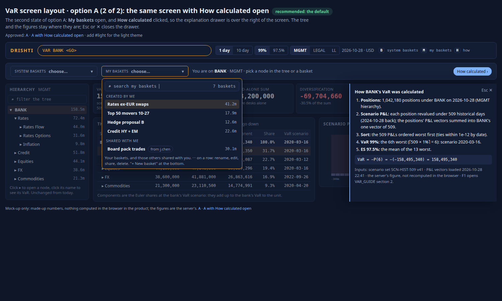
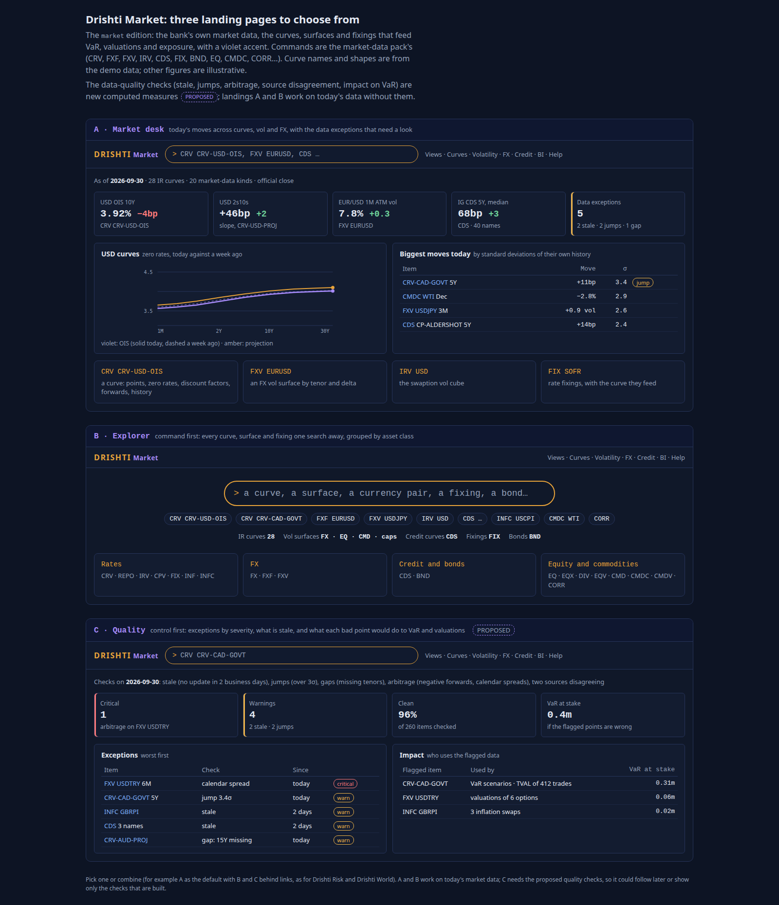
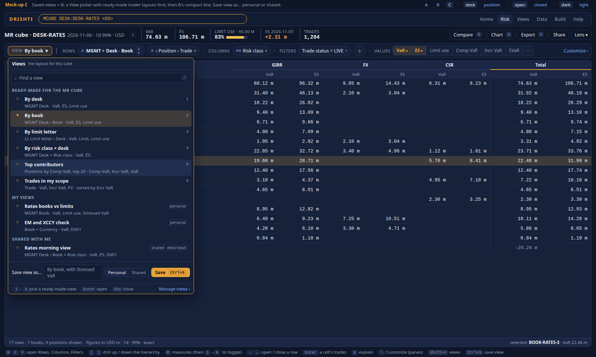
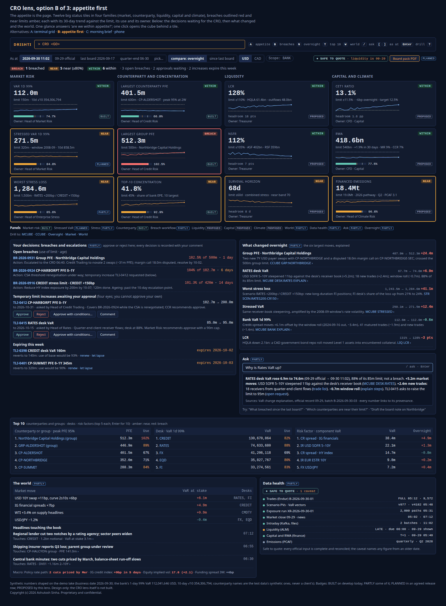
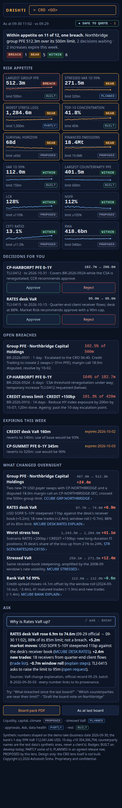
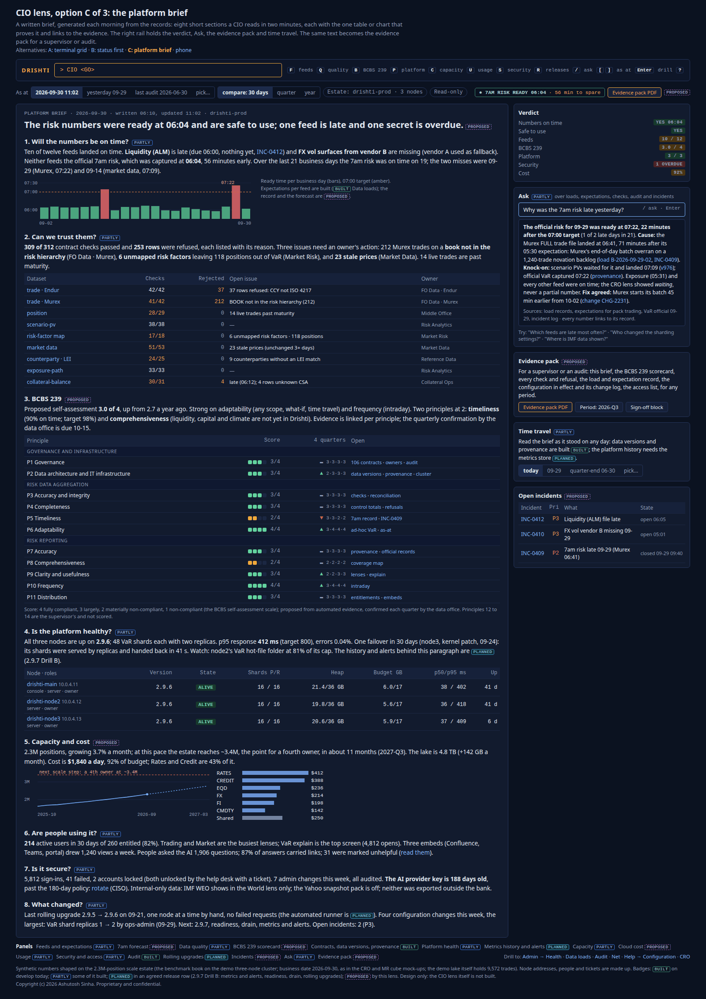
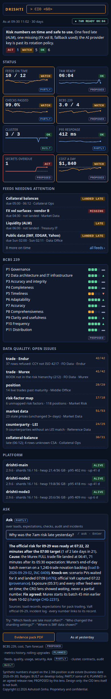

<!--
  Project Drishti · Any data. Any domain. One grammar.

  Copyright (c) 2026 Ashutosh Sinha <ajsinha@gmail.com>.
  All rights reserved.

  PROPRIETARY AND CONFIDENTIAL.

  This file is the confidential and proprietary property of Ashutosh Sinha.
  Unauthorised copying, use, modification, distribution or disclosure of this
  file, via any medium, is strictly prohibited except with the express prior
  written permission of the copyright holder.

  See the LICENSE file in the root of this repository for the full terms.
-->
# Lenses: the product view of every lens

Status: analysis and product description

This is the internal product document of Drishti's lenses, for the people who plan and build them. A **lens** offers one person a focused
Drishti on a full instance (`drishti.lenses`, *Open Drishti Risk* in Views and Home); run as `drishti.edition`, the same lens turns a whole
instance into a focused product. How an administrator sets lenses up, switches, customises and white-labels them is
[ADMIN_GUIDE.md section 12 onwards](../guides/ADMIN_GUIDE.md#12-what-a-lens-is) and is not repeated here. This document holds, per lens:
who uses it and the questions they ask, what it answers today (linking the guide that describes it), the gaps and proposals with the data
each needs, and its mock-ups with their build checklists; then the design of the lens mechanism itself ([section 10](#10-the-lens-mechanism-the-design)).
Built parts are described as built; everything else is a proposal, a candidate in the
[implementation plan](IMPLEMENTATION_PLAN.md#lens-product-candidates-not-started) until its work starts.

## Contents

- [Mock-ups](#mock-ups)
- [1. Risk lens](#1-risk-lens)
- [2. Trading lens](#2-trading-lens)
- [3. Market lens](#3-market-lens)
- [4. World lens](#4-world-lens)
- [5. Oversight lens](#5-oversight-lens)
- [6. MR cube lens](#6-mr-cube-lens)
- [7. CCR cube lens](#7-ccr-cube-lens)
- [8. CRO lens](#8-cro-lens)
- [9. CIO lens](#9-cio-lens)
- [10. The lens mechanism: the design](#10-the-lens-mechanism-the-design)

| Lens | For | Status | Section |
|---|---|---|---|
| **Drishti Risk** | risk managers near the desks: VaR and exposure first, limits, the morning and the close | built, the first lens | [1](#1-risk-lens) |
| **Drishti Trading** | traders and desk heads: my books, my P&L, my VaR and limits, whether a new trade fits | built | [2](#2-trading-lens) |
| **Drishti Market** | the market-data team: curves, surfaces and fixings, and their quality | built | [3](#3-market-lens) |
| **Drishti World** | macro, research and context users: economies, markets, companies and funds from public data | built | [4](#4-world-lens) |
| **Drishti Oversight** | market risk oversight, the second line: why VaR moved, breaches and escalation, limits of every kind | proposed; its foundations partly built | [5](#5-oversight-lens) |
| **MR cube** | market risk, oversight, regulatory capital and traders: a pivot over any dimensions with correct non-additive VaR and ES totals | built as a Pivot preset (`MCUBE`); further proposals open | [6](#6-mr-cube-lens) |
| **CCR cube** | credit officers, the CVA desk, collateral operations, regulatory capital: counterparty × tenor against limits, allocated exposure, CVA, SA-CCR, SIMM | proposed, on the MR cube's core | [7](#7-ccr-cube-lens) |
| **CRO** | the Chief Risk Officer and their office: within risk appetite, what changed and why, the decisions waiting, the board pack | proposed (layouts decided) | [8](#8-cro-lens) |
| **CIO** | the Chief Information Officer, the data office and security: is the risk data estate on time, trustworthy (BCBS 239), healthy, affordable, secure | proposed (layouts decided) | [9](#9-cio-lens) |

The four built lenses are on by default (`drishti.lenses: risk,world,market,trading`). The two risk cubes are two lenses on one shared
cube core, because the data grain and the order of aggregation differ (position × scenario for market risk; trade × path × time step,
netted and collateralised per netting set first, for counterparty risk) while the pivot, provenance, explain and scatter-gather machinery
are the same ([section 6.5](#65-the-shared-cube-core-mr-and-ccr)). The CRO lens sits above them all: it owns no engine, only the risk
appetite catalogue, the statuses, the brief and the CRO's decisions ([section 8](#8-cro-lens)). The CIO lens is its sibling for the
platform and the risk data behind the numbers: the CRO's "safe to quote" is the CIO lens's whole story, and BCBS 239 its strongest angle
([section 9](#9-cio-lens)). Shared material is written once and referenced: the lens menus in section 1, the oversight designs in
section 5, the cube core and the cube data contracts in section 6. A field list is written here only for a contract that has no file
under [docs/contracts/](../contracts/README.md) yet; otherwise the contract file is linked.

## Mock-ups

The product owner's mock-ups live in the repository under [`docs/lenses/mockups/<lens>/`](../lenses/mockups/menus/A.html) (and a few shared
screens under [`docs/architecture/mockups/`](mockups/ro1-var-change/A.html)), each `<name>.html` self-contained (system fonts, everything
inline, nothing from a CDN) with a `<name>.png` screenshot beside it (headless Chrome, 1600 px wide, the whole page). Each lens section
ends its numbered part with **Mock-ups and build checklist**: the screenshot, a link to the HTML, the variant chosen and a **build
checklist**, one row per panel (its contents, the data or API it reads, and whether it is built, partly built or not built, checked
against the code). **That checklist is the source of truth at build time**: a panel is done when its row says built, and what a mock-up
showed but the build left out is listed under the checklist and is a row of the plan. A new mock-up is copied into
`docs/lenses/mockups/<lens>/` with its screenshot (web fonts replaced by the system stack) and gets its checklist in the same change; a
lens with no mock-up yet says so, and its next step is mock-ups first, before any build. One mock-up is shared by the four built lenses:
their subject menus in the bar ([`mockups/menus/`](../lenses/mockups/menus/A.html), row LX1), with its checklist once, in
[section 1.4.4](#144-the-lens-menus-lx1).

## 1. Risk lens

**Built**, the first lens: "a one-stop shop to manage risk. VaR and Exposure first; liquidity, climate and more join as more lines
here" ([`config/lenses/banking/risk.yaml`](../../config/lenses/banking/risk.yaml)). What it shows and its three landings are in
[ADMIN_GUIDE.md section 16.1](../guides/ADMIN_GUIDE.md#161-drishti-risk); the engines behind it in [VAR_GUIDE.md](../guides/VAR_GUIDE.md) and
[EXPOSURE_GUIDE.md](../guides/EXPOSURE_GUIDE.md). Risk is the engines' lens (read, compute, what-if, capture); governance (approve,
escalate, sign off) is the Oversight lens ([section 5](#5-oversight-lens)).

### 1.1 Who uses it and their questions

Its users sit **near the desks**: they know the books, talk to the traders every day and answer for the numbers.

| Persona | Accountable for | What they need from the lens |
|---|---|---|
| **Business-aligned market risk manager** (rates, FX, credit, equities, commodities) | The VaR of the businesses they cover: right, explained, within limits; the first explanation of a move or a breach | VaR and ES of any scope, bank to trade; why it moved; limit use by node; the driving scenarios; backtesting; intraday VaR after a large trade |
| **Counterparty credit risk officer** | Exposure against credit limits; pre-deal approval; collateral and netting assumptions | EE, PFE, EPE per netting set, counterparty and group; the pre-deal check; the trades that drive a peak |
| **Risk analyst, risk reporting** | The daily numbers, their reproducibility, the official records, the reports | Official records, captures, BI over them |
| *Also:* a **quant** or **model validator** | Methodology evidence | Scenario windows, confidences, decomposition, reproducibility |

Not for: traders and desk heads ([section 2](#2-trading-lens)), the market-data team ([section 3](#3-market-lens)), the second line's
governance ([section 5](#5-oversight-lens)).

| When | Market risk manager | Counterparty credit risk officer |
|---|---|---|
| **Morning** (07:00 to 09:00) | Yesterday's official run: VaR by desk, limit use, breaches, a backtest exception; why the numbers moved; the morning meeting | Exposure by counterparty against credit limits; peaks that moved; collateral disputes |
| **Intraday** | A large trade's VaR impact; intraday VaR; "what if we hedge with this?" | Pre-deal approvals; a counterparty's headroom |
| **Close** | The official run's completeness; restated inputs | The exposure run |
| **Month-end** | Backtesting review; limit utilisation; the VaR section of the committee pack; stress results | Exposure reviews of the largest counterparties; credit limit reviews |
| **Year** | Limit framework input; stress window review (`SWIN`); model validation support | Annual credit reviews |

### 1.2 What it answers today

| Question or need | Status | Where it is described |
|---|---|---|
| The bank's and each desk's VaR and ES, within limits? | **Built**: the Risk desk's tiles and VaR by desk with limit use; the Risk map's hierarchy and limit-use heat map; official `LIMIT` and `LIMIT_USE` | [ADMIN_GUIDE.md section 16.1](../guides/ADMIN_GUIDE.md#161-drishti-risk); [VAR_GUIDE section 19](../guides/VAR_GUIDE.md#19-official-end-of-day-results) |
| VaR and ES of any scope; component, incremental, marginal VaR; any window and confidence | **Built** | [VAR_GUIDE section 18](../guides/VAR_GUIDE.md#18-the-computation) |
| 10-day VaR (√10 and the 10-day sum), the confidence pickers, limit use only when comparable | **Built** | [VAR_GUIDE section 18.6](../guides/VAR_GUIDE.md#186-horizons-the-two-10-day-methods-and-the-confidence-chosen) |
| Stressed VaR and its 12-week average; the stress window review (`SWIN`) | **Built** in the engine; not yet on the landings (RL1) | [VAR_GUIDE sections 18.8](../guides/VAR_GUIDE.md#188-stressed-var), [18.9](../guides/VAR_GUIDE.md#189-choosing-the-stress-window) |
| Why did VaR move? | **Built** as the VaR figure's Explain (*Why it moved*, causes that add up exactly); not yet a card on the landings (RL4) | [VAR_GUIDE section 3.11](../guides/VAR_GUIDE.md#311-why-it-moved-the-var-change-explained) |
| Which scenario drives it and who loses on it; the scenario matrix (`SMAT`) | **Built** | [VAR_GUIDE sections 3.4](../guides/VAR_GUIDE.md#34-the-tabs), [3.9](../guides/VAR_GUIDE.md#39-the-scenario-matrix-smat) |
| Several hierarchies (MGMT, LEGAL, limit letters `LL`, any configured) | **Built** | [VAR_GUIDE section 15.14](../guides/VAR_GUIDE.md#1514-hierarchies-from-promoted-columns) |
| Captures, compare, history, backtest on Drishti's derived hypothetical P&L | **Built**; the bank's actual and hypothetical P&L not yet (RL3) | [VAR_GUIDE sections 6](../guides/VAR_GUIDE.md#6-captures-and-compare), [7](../guides/VAR_GUIDE.md#7-history-and-backtesting) |
| A large trade's effect; intraday VaR from files and Kafka; the pre-deal basket | **Built** | [VAR_GUIDE section 8](../guides/VAR_GUIDE.md#8-what-if-and-var-as-a-kind) |
| The VaR of every short EUR position, of a basket | **Built**: scope words, rule portfolios, `WHERE:`, baskets | [VAR_GUIDE section 3.5](../guides/VAR_GUIDE.md#35-construct-your-basket) |
| Every number reproducible; seven years | **Built**: official captures with inputs' versions | [VAR_GUIDE section 19](../guides/VAR_GUIDE.md#19-official-end-of-day-results); [EXPOSURE_GUIDE section 20](../guides/EXPOSURE_GUIDE.md#20-official-end-of-day-results) |
| Sharded across a cluster, equal to the bit | **Built** | [VAR_GUIDE section 28](../guides/VAR_GUIDE.md#28-sharding-across-drishtinet) |
| EE, ENE, PFE, EPE, EEPE for any scope after netting and collateral; the pre-deal check | **Built** | [EXPOSURE_GUIDE sections 1](../guides/EXPOSURE_GUIDE.md#1-the-question-exposure-answers), [4](../guides/EXPOSURE_GUIDE.md#4-scopes), [7](../guides/EXPOSURE_GUIDE.md#7-pre-deal-what-if) |
| Counterparties near their credit limits | **Built as read**; the demo's stored limits read very low use (RL9) | [EXPOSURE_GUIDE section 28](../guides/EXPOSURE_GUIDE.md#28-open-items) |
| Is today's official run complete? | **Partly**: load checks, rejected rows, late loads; no completeness against trades booked | [VAR_GUIDE section 20.3](../guides/VAR_GUIDE.md#203-what-the-load-checks) |
| Tell me when a desk crosses its limit intraday | **Partly**: alerts on BI and view numbers after a load (RL12) | [USER_GUIDE.md](../guides/USER_GUIDE.md#alerts-on-numbers) |
| Entitlements per scope and kind, masks, audit per answer | **Built** | [VAR_GUIDE section 9](../guides/VAR_GUIDE.md#9-who-sees-what-entitlements-and-audit) |
| Stress results (`SCN`, `STR`, `SSPNL`) | **Hidden** in the lens by decision (RL7) | [VAR_GUIDE section 21.4](../guides/VAR_GUIDE.md#214-the-banks-stress-pl-by-scenario-derived) |
| CVA, SA-CCR, SIMM | **Hidden** in the lens | [ADMIN_GUIDE.md section 16.1](../guides/ADMIN_GUIDE.md#161-drishti-risk) |
| Sensitivities by factor and bucket, sensitivity limits; VaR by risk type; liquidity, climate, concentration | **Not built** (RL5, RL8; RO4, RO8, RO10 in [section 5.3](#53-gaps-and-proposals); the MR cube in [section 6](#6-mr-cube-lens)) | — |

**The landings.** One template, [`risk_landing.html`](../../drishti-console/plugins/banking/templates/home/risk_landing.html), with
[`drishti_risk-landing.js`](../../drishti-console/plugins/banking/static/js/drishti_risk-landing.js); every figure is the engines' own
answer through `/api/var/...` and `/api/exposure/...` (`scope`, `scope/history`, `tree`, `intraday/streams`, `official`, `baskets`). Not
Sutras (a Sutra lays out one entity's view; these span the engines). **A: Risk desk** (`desk`, the default): tiles and two ranked cards;
**B: Command first** (`command`): a big command line, the lens's chips, a status strip, the person's baskets and monitors; **C: Risk map**
(`map`): the hierarchy with VaR and limit use per node, a limit-use heat map, a **Today** feed. Panel by panel in
[section 1.4.1](#141-the-risk-landings-risk-landinghtml).

### 1.3 Gaps and proposals

The rules every proposal follows ([DATA_ARCHITECTURE.md section 12](DATA_ARCHITECTURE.md#121-three-classes-and-the-rule-for-deciding-which)):
fundamental inputs under a **data contract** as JSON Lines; measures **computed on demand** from trade or position-grain inputs and
**never stored**, except as an immutable capture or an official end-of-day record; governance records Drishti-owned and versioned; **BI
is the report layer**; the engines are unchanged by a lens. Sizes: **S** days, **M** one to three weeks, **L** more than three weeks.
The same rules apply to every lens section below.

| Id | Gap | Size | Depends on | Status |
|---|---|---|---|---|
| RL1 | Stressed VaR on the landings | S | stressed VaR (built) | proposed |
| RL2 | Horizon and confidence on the landings, limit use like for like | S | 10-day VaR and confidence (built) | proposed |
| RL3 | Backtesting on the bank's P&L | S | the bank's P&L feed and the backtesting engine | proposed |
| RL4 | Why it moved on the Risk desk and the map | S | the VaR change explanation (built) | proposed |
| RL5 | Sensitivities: per-trade input, aggregation, ladders | L (M if bucketed by the bank) | per-trade sensitivities (the MR cube's D8) | proposed; after VaR by risk type (decided) |
| RL6 | Exposure on the VaR hierarchy | M | allocated exposure (the CCR cube's CC2) | proposed |
| RL7 | Stress in Risk | — | — | **decided**: kept hidden until the stress engine (RO9) |
| RL8 | Liquidity and climate lines | L each | data; RO10 | proposed (climate stays a named future line) |
| RL9 | Credit limits on computed PFE | S data, M engine | the LIM engine | proposed, with the CCR cube |
| RL10 | World context on the counterparty page | S to M | World packs loaded (internal only) | unscheduled |
| RL11 | Recently opened and the capture time | S | — | proposed |
| RL12 | Intraday limit alerts | S to M | intraday VaR (built), RO2 notification | proposed |
| RL13 | The scenario matrix in the lens | S | `SMAT` (built, on in the lens) | built; a chip on the landings remains |
| RL14 | The landings' mock-up remainders | S | — | proposed |
| RL15 | The horizon picker as drawn | S | — | proposed |

#### 1.3.1 RL1, RL2, RL3: stressed VaR, horizon and confidence, the bank's P&L on the landings

- **RL1.** The Risk desk gains a **Stressed VaR of BANK** tile (with the 12-week average and its date range); the map's node label and
  the heat map follow the person's Normal / Stressed choice; a date without a stress set says so, never zero. Tests: the tile equals
  `VAR BANK SVAR`; with no stress set the tile says so.
- **RL2.** The desk tiles and the map follow the person's horizon and confidence; **limit use is shown only when the answer's horizon
  and confidence are the limit's own** (`limitComparable`), so the heat map greys a cell with "not comparable"; the backtest tile stays
  1-day.
- **RL3.** With the bank's actual and hypothetical P&L per desk and the backtesting engine (exceptions over 250 days, the traffic light,
  the multiplier, 99% and 97.5%): the backtest tile shows **both** counts and the light; the map's node opens its backtest; Drishti's
  derived figure stays, named **risk-theoretical**. **Data:** actual and hypothetical P&L per desk (better per trade) per date (the planned
  P&L contract; [REGULATORY_VAR_REPORTING section 8](../guides/REGULATORY_VAR_REPORTING.md#8-coverage-and-roadmap)).

#### 1.3.2 RL4: why it moved, on the Risk desk

The VaR change explanation (RO1, [section 5.3.1](#531-ro1-var-change-explanation)) is built as the VaR figure's Explain
([VAR_GUIDE section 3.11](../guides/VAR_GUIDE.md#311-why-it-moved-the-var-change-explained)). The Risk lens is where a business risk
manager first needs it: a **Why VaR moved** card on the Risk desk (the bank, with a switch to any desk; a waterfall, each bar opening its
contributors) and a **Why it moved** action on every node of the Risk map. Test: the bars add to the change to the cent on every demo node.

#### 1.3.3 RL5: sensitivities

Risk managers near the desks talk in sensitivities as much as in VaR ("you are 2m DV01 long the 10-year"). Today the lens has per-trade
`DV01` only (on trade valuations, hidden with `TVAL`) and FRTB sensitivities per book and bucket (hidden with `FRTB`). The design is the
MR cube's: the per-trade position-sensitivity contract (D8, [section 6.6](#66-data-and-contracts)) aggregated additively by factor and
bucket, ladders (DV01 by currency × tenor, CS01 by curve × tenor, vega by underlying × expiry, FX delta by currency), a drill to a
bucket's trades, the map's node opening its ladder; limits on buckets with the limit catalogue (RO3). **Decided:** VaR by risk type first,
with the regulatory reports; position sensitivities (and RL5) after. Tests: a bucket's sum equals the sum of its trades; a node's ladder
equals its children's; sharded equals single-server.

#### 1.3.4 RL6: exposure on the VaR hierarchy

EPE per node of a VaR hierarchy and credit-limit use per desk are left out of the landings because exposure is netted and collateralised
per netting set across desks, and PFE is not additive. **Decided:** **allocated** EE and EPE (Euler allocation: on each path and date the
set's collateralised exposure shared among its trades; it then adds across sets and up any hierarchy), the CCR cube's CC2
([section 7.3](#73-gaps-and-proposals)). The map's node shows "VaR 41.2m · EPE 118.0m"; the heat map gains an **EPE** column; per desk the
map shows the desk's **share** of each counterparty's limit use. The standalone `DESK:` scope is not used (it ignores netting with other
desks). The same allocation serves the Trading lens's largest-counterparty tile (TL2). Tests: allocated EE of all desks equals the bank's.

#### 1.3.5 RL7, RL8: stress, liquidity and climate

- **RL7, decided:** stress (`SCN`, `STR`, `SSPNL`) stays hidden in Risk until the stress engine (RO9): the stored results are per desk
  and scenario, not computed from the trades, and stressed VaR covers the regulatory stress measure.
- **RL8.** **Liquidity** follows RO10 (days to liquidate, bid-offer cost, share of volume, a ladder, VaR scaled by liquidity horizons), in
  Risk as a **Liquidity** tab on the VaR page and a column on the map; **data:** average daily volume and bid-offer per instrument from
  vendors (the us-equities prices are internal only and off: not a source). **Climate**, decided: a named future line, out of scope as a
  computed measure; the CRO lens shows it only as an optional supplied-input tile, off by default ([section 8](#8-cro-lens)).

#### 1.3.6 RL9: credit limits on computed PFE

The demo's `credit-limit` records were sized on retired stored profiles (3 to 30 times the computed peaks), so exposure against the
credit limit reads 0.1% to a few percent ([EXPOSURE_GUIDE section 28](../guides/EXPOSURE_GUIDE.md#28-open-items)). **Decided:**
regenerate the demo's credit limits from the computed PFE (a headroom distribution so some counterparties sit near and a few above), with
the CCR cube; the LIM engine (limit use computed, never stored, [LIM.md](../contracts/LIM.md)) when its work resumes. Test: on the demo,
uses spread from 20% to 110%.

#### 1.3.7 RL10, RL11, RL12: World context, recents and the capture time, intraday limit alerts

- **RL10, decided:** a read-only, internal-only panel on the counterparty page: its country's growth, inflation and debt
  (world-economy), its LEI group's ultimate parent (gleif), its latest filing (us-equities), when those packs are loaded; licensing as the
  World lens ([section 4](#4-world-lens)).
- **RL11.** **Recently opened** on Command first (the person's command history, Risk's commands only, as World and Market have it; the
  route already passes `recents`) and the **official capture's time** in the Today feed.
- **RL12.** After each intraday batch the engine computes the limit use of every node whose members changed, and the alert machinery
  notifies the node's subscribers at the near and breach levels, with hysteresis and a cooldown; the rules come from the limit catalogue
  (RO3) when it exists, from `var-limit` until then. One near-limit threshold per limit (its warning level), site default 80%. Test: a
  crafted batch pushing a desk over 100% notifies once.

### 1.4 Mock-ups and build checklist

Under [`mockups/risk/`](../lenses/mockups/risk/risk-landing.html), the VaR layout under [`mockups/var-layout/`](../lenses/mockups/var-layout/A.html), and the
lens menus shared by the four built lenses under [`mockups/menus/`](../lenses/mockups/menus/A.html). Rules: [Mock-ups](#mock-ups).

| Mock-up | Chosen | Built | Partly built | Not built |
|---|---|---:|---:|---:|
| [Risk landings](#141-the-risk-landings-risk-landinghtml) (A Risk desk, B Command first, C Risk map) | all three; A the default | 14 | 6 | 1 |
| [Scenario matrix](#142-the-scenario-matrix-scenario-matrix-bhtml) | option B (matrix with a chart of the selected scenario) | 14 | 0 | 0 |
| [VaR horizon picker](#143-the-var-horizon-picker-var-horizon-pickerhtml) | the one design shown | 11 | 2 | 1 |
| [Lens menus (LX1)](#144-the-lens-menus-lx1) | A, subject menus in the bar | 4 | 0 | 0 |
| [VaR screen layout](#145-the-var-screens-layout-var-layoutahtml) | A | 6 | 0 | 0 (2 folded) |
| [VaR page and Why it moved](#146-the-var-page-and-why-it-moved-varvar-pagehtml-varwhy-it-movedhtml) | the one design; Why it moved layout A | 13 | 1 | 0 |

#### 1.4.1 The Risk landings (`risk-landing.html`)


[Open the mock-up](../lenses/mockups/risk/risk-landing.html). **Chosen:** all three, as the person's choice of Home (`home.landings: [desk, command,
map]`, `desk` the default). **Code:** [`risk_landing.html`](../../drishti-console/plugins/banking/templates/home/risk_landing.html),
[`drishti_risk-landing.js`](../../drishti-console/plugins/banking/static/js/drishti_risk-landing.js),
[`drishti_risk-landing.css`](../../drishti-console/plugins/banking/static/css/drishti_risk-landing.css), `risk.yaml` `home`.

**Interactions.** Every desk, counterparty, node and heat cell links to its scope (`/var?scope=…`, `/exposure?scope=…`); every tile is a
link (ES and the PFE peak are in the tile's subline); the chips are links to `/go?q=<chip> <GO>`; the hierarchy switch (C) redraws the
tree, heat map and desks without a reload; a landing switch and the lens links sit above every landing. **States.** *Loading:* `…` until
each panel's answer; *error:* `Not available: <reason>` in place of that panel only; *empty:* "No desks in MGMT", "No counterparty exposure
on this date", "Nothing yet today", "No baskets yet", "No monitors yet"; a node without a limit says "no limit". **Phone** (600 px and
below): one column, tiles two to a row; the command line, the tiles and the first card in full, the other tables at a glance (five rows,
*Show all*).

| # | Panel (option) | Contents on the mock-up | Data, API or contract | Gap row | Status |
|---|---|---|---|---|---|
| R1 | Bar (A, B, C) | `DRISHTI Risk`; command line with placeholder; the lens's menus | `risk.yaml` `menus`, [`sitemap.yaml`](../../drishti-console/config/sitemap.yaml) | — | **Built** (menus per [1.4.4](#144-the-lens-menus-lx1)) |
| R2 | Landing switch | pick one or combine | `home.landings`, `home.titles`; the person's choice ([`edition_routes.py`](../../drishti-console/routes/edition_routes.py)) | — | **Built** |
| R3 | Meta line (A, C) | business date, currency, intraday batches and the latest time, official record captured at a time | `/api/var/scope?scope=BANK` (`businessDate`, `currency`, `intraday`), `/api/var/official` | RL11, RL14 | **Partly built**: no batch count with the latest time, no capture **time** |
| R4 | Tile: VaR (A) | VaR 99% 1-day BANK; ES on click | `/api/var/scope?scope=BANK` | RL2 | **Built** (ES in the subline) |
| R5 | Tile: Backtest (A) | 250 days, light, exceptions, Kupiec p | `/api/var/scope/history?scope=BANK` | — | **Built** (a replay is labelled *not a regulatory backtest*) |
| R6 | Tile: Exposure EPE (A) | EPE BANK; PFE peak on click | `/api/exposure/scope?scope=BANK` | — | **Built** (PFE peak in the subline) |
| R7 | Tile: Limits in breach (A) | count, split VaR and credit | `/api/var/tree` limit use ≥ 100%; `/api/exposure/tree` `limit.use` ≥ 1 | — | **Built** |
| R8 | Tile: Counterparties (A) | counterparties, netting sets | `/api/exposure/tree` | — | **Built** |
| R9 | Card: VaR by desk (A) | desk, VaR, limit use bar and pill, worst first; amber from 80%, red from 100% | `/api/var/tree?hierarchy=MGMT` | — | **Built** (top 8) |
| R10 | Card: Exposure by counterparty (A) | counterparty, EPE, limit use | `/api/exposure/tree` | RL9 | **Built** (top 8 by limit use) |
| R11 | Quick commands (A) | four command cards | `risk.yaml` `home.cards` | — | **Built** (configured cards) |
| R12 | Big command line and chips (B) | 52 px command line; chips | `risk.yaml` `home.chips` | RL13 | **Built** |
| R13 | Status strip (B) | VaR, limit letter `LL-0003`, EPE, backtest, breaches, as of | as R4 to R7 | RL14 | **Partly built**: no limit-letter figure, no "as of" |
| R14 | Recent (B) | the person's recent commands | the person's command history | RL11 | **Not built** (the route passes `recents`; the template does not draw them) |
| R15 | Saved baskets (B) | the person's baskets | `/api/var/baskets` | — | **Built** (up to six) |
| R16 | Watch list (B) | the person's monitors | the person's monitors | — | **Built** |
| R17 | Learn (B) | tutorials, the VaR guide | help links | RL14 | **Partly built**: guides linked, the VaR and exposure tutorials not |
| R18 | Hierarchy switch (C) | MGMT · LEGAL · LL | `/api/var/tree` (`hierarchies`) | — | **Built** |
| R19 | Card: BANK tree (C) | VaR, EPE, limit use per node, expandable | `/api/var/tree` (`depth`, `var`, `limitUse`) | RL6, RL14 | **Partly built**: VaR and limit use to depth 2; no EPE per node, no expand or collapse |
| R20 | Card: Limit use heat map (C) | desks × VaR and credit limit use | `/api/var/tree` (`limitUse`) | RL6 | **Partly built**: VaR limit use only (up to 16, worst first) |
| R21 | Card: Today (C) | intraday batches with VaR change, limit crossings with time, credit crossings, capture time | `/api/var/intraday/streams`, `/api/var/official`, `/api/exposure/official`, the tree's breaches | RL11, RL12, RL14 | **Partly built**: stream states, official records by date, the count of VaR limits at or over 100% |

**Gaps on the mock-up, not in the product:** the meta line's batches and capture time (R3); the limit-letter figure (R13); recent
commands (R14); the tutorials in Learn (R17); EPE per node and expand/collapse (R19); credit-limit use per desk in the heat map (R20); the
Today feed's events (R21).

#### 1.4.2 The scenario matrix (`scenario-matrix-B.html`)


[Open the mock-up](../lenses/mockups/risk/scenario-matrix-B.html). **Chosen:** option B. On in the Risk and Trading lenses
(`commands.words.SMAT: on`); refused in Market and World. **Code:** [`smat.html`](../../drishti-console/plugins/banking/templates/terminal/smat.html),
[`drishti_scenario-matrix.js`](../../drishti-console/plugins/banking/static/js/drishti_scenario-matrix.js),
[`smat_routes.py`](../../drishti-console/plugins/banking/routes/smat_routes.py). **Guide:**
[VAR_GUIDE section 3.9](../guides/VAR_GUIDE.md#39-the-scenario-matrix-smat) (interactions, states and the phone form are described there).

| # | Panel | Data, API or contract | Status |
|---|---|---|---|
| S1 | Command and header (`SMAT <id> [N]`; id, grain, book, scenario set, dates, currency) | `/api/smat/matrix?id=…&days=N`; `GET /api/v1/risk/var/matrix` ([VAR_GUIDE section 11.1](../guides/VAR_GUIDE.md#111-the-endpoints)) | **Built** |
| S2 | Values switch: P&L · PV · Change vs day before | the answer; PV = base PV + P&L | **Built** |
| S3 | Grain switch: Position · By trade | `by=trade` | **Built** |
| S4 | Tail chips: tail outlined (VaR, ES); only tail scenarios | per-date VaR rank and ES tail | **Built** (markers **V** and **E**, not colour alone) |
| S5 | Sort: worst on a date, by scenario day | computed in the page | **Built** |
| S6 | Export CSV · Arrow | the whole matrix with summary rows, sources and gaps | **Built** |
| S7 | Matrix: scenarios × dates, heat, sticky header and column | rows a scenario day, columns a date; Arrow above about 4,000 cells | **Built** (virtualised) |
| S8 | Summary rows: VaR, ES, base PV per date | `var`, `es`, `basePv` | **Built** |
| S9 | Legend | — | **Built** |
| S10 | Chart of the selected row against −VaR | computed in the page | **Built** |
| S11 | Details: P&L and rank, PVs, FX, days in tail, source, batch, version | `source`, `batch`, `dataVersion`, `fx`, `link` | **Built** |
| S12 | Gaps: a DRS code in the column header, never a blank that reads as zero | `DRS-5203`, `DRS-1001`, `DRS-5201`, `DRS-5206`, `DRS-5207`, `DRS-5002` | **Built** |
| S13 | Phone: the selected scenario's line and the tail count | — | **Built** |
| S14 | Scope: a trade, a position or any VaR node | read as the person | **Built** |

**Gaps on the mock-up, not in the product:** none; `SMAT` as a chip on the Risk landings remains (RL13).

#### 1.4.3 The VaR horizon picker (`var-horizon-picker.html`)


[Open the mock-up](../lenses/mockups/risk/var-horizon-picker.html). **Chosen:** the design shown, with a **Confidence** picker (and ES's own)
added. **Code:** [`var.html`](../../drishti-console/plugins/banking/templates/terminal/var.html),
[`drishti_var-explorer.js`](../../drishti-console/plugins/banking/static/js/drishti_var-explorer.js). **Guide:**
[VAR_GUIDE section 3.1](../guides/VAR_GUIDE.md#31-open-it) and
[section 18.6](../guides/VAR_GUIDE.md#186-horizons-the-two-10-day-methods-and-the-confidence-chosen) (interactions and states).

| # | Panel | Data, API or contract | Gap row | Status |
|---|---|---|---|---|
| H1 | Horizon control: segmented 1-day · 10-day √10 · 10-day sum | `horizon`, `method` on every VaR endpoint | RL15 | **Partly built**: a drop-down, not the segmented control |
| H2 | Currency picker | `/scope/currencies` | — | **Built** (a drop-down) |
| H3 | Tile: VaR with its rank and method line | `var`, `k`, `scenarios`, `lens` | — | **Built** |
| H4 | Tile: ES | `es`, `esCount` | — | **Built** |
| H5 | Tile: Limit use, like for like | `limitUse`, `limitComparable`; `var-limit` `HORIZON`, `CONFIDENCE` ([VAR_GUIDE section 15.15](../guides/VAR_GUIDE.md#1515-var-limit-the-nodes-var-limits)) | — | **Built** |
| H6 | Tile: Diversification | `diversification`, `sumStandalone` | — | **Built** |
| H7 | Tile: vs √10 at the 10-day sum | two answers | RL15 | **Not built** |
| H8 | Method strip | the answer's `lens` | — | **Built** |
| H9 | Every panel follows the horizon | `horizon`, `method`, `confidence`, `esConfidence` on every endpoint | — | **Built** |
| H10 | Remembered and in the address (`?h=10d&m=sum`) | the person's settings (`varView`) | — | **Built** |
| H11 | Commands `VAR BANK 10D [SQRT|SUM]` | the command grammar; `drishti.var.ten-day-method` | — | **Built** (with confidences: `VAR BANK 95`, `VAR BANK ES 95`) |
| H12 | Menu (desktop alternative) with one line per entry | — | RL15 | **Partly built**: the drop-down without the per-entry lines (in the tooltip) |
| H13 | Phone: full-width control | — | — | **Built** |
| H14 | Confidence and ES pickers | `drishti.var.confidences`, `drishti.var.es-confidences` | — | **Built** |

**Gaps on the mock-up, not in the product:** the segmented control and the menu's per-entry lines (H1, H12); the "vs √10" tile (H7).

#### 1.4.4 The lens menus (LX1)


[Open the mock-up](../lenses/mockups/menus/A.html) (options: [B](../lenses/mockups/menus/B.html) a subject strip under the standard bar,
[C](../lenses/mockups/menus/C.html) one lens menu with subject columns; light theme: [A-light.png](../lenses/mockups/menus/A-light.png)). **One mock-up for
the four built lenses** (Risk, Trading, Market, World), each with one menu open; the Trading, Market and World sections reference this
checklist. **Chosen:** option A, subject menus in the bar: the chosen landing mock-ups already drew their bars this way; each subject is
one click from anywhere; B costs a second row on every page; C hides the subjects a click deeper and is kept as A's phone form. Subject
menus are configured, not coded: the lens names its top menus in order (`menus.top`), and a subject menu draws on the items of the menus
file with the same switches (an item shows only when the lens keeps its command word). The configuration: [ADMIN_GUIDE.md](../guides/ADMIN_GUIDE.md#12-what-a-lens-is).

| # | Panel | Data, API or contract | Status |
|---|---|---|---|
| X1 | Bar: Views · Risk · Counterparties · BI · Admin · Help | the lens's `menus.top`, [`sitemap.yaml`](../../drishti-console/config/sitemap.yaml), drawn by [`core/menus.py`](../../drishti-console/core/menus.py) | **Built** |
| X2 | Risk menu's VaR column: VaR explorer, Why it moved, VaR Playground, Scenario matrix, Regulatory reports, Backtesting, Stress window, VaR results, Official records | the `risk` menu's items with `requires: engine:var`, picked by `menus.risk` | **Built** |
| X3 | Exposure column: Exposure explorer, a counterparty, a netting set | its `exposure` column | **Built** (`EXP CPTY`, `EXP NSET` put in the command line for the id) |
| X4 | Phone form: Risk and Counterparties fold into the lens menu, 44 px items | the bar's template (the lens menu) | **Replaced by the five-menu bar (Domains)** |

#### 1.4.5 The VaR screen's layout (`var-layout/A.html`)




[Open the mock-up](../lenses/mockups/var-layout/A.html) and [its second state](../lenses/mockups/var-layout/A-drawer.html). **Chosen:** A. Two changes to
the VaR explorer: the baskets leave the left-hand column for two drop-downs, and the explanation column becomes a drawer. **Code:**
[`drishti_var-layout.js`](../../drishti-console/plugins/banking/static/js/drishti_var-layout.js),
[`var.html`](../../drishti-console/plugins/banking/templates/terminal/var.html). **Guide:**
[VAR_GUIDE sections 3.2](../guides/VAR_GUIDE.md#32-the-screen) and [3.6](../guides/VAR_GUIDE.md#36-how-this-number-was-built). **Guard:**
`drishti-console/tests/test_var_layout_keeps_everything.py`.

| # | Panel | Data, API or contract | Interaction | Status |
|---|---|---|---|---|
| L1 | System baskets drop-down with search | the tree's `portfolios` (the basket store's system baskets) | **B**; type, ↑↓, Enter, Esc | **Built**, without a VaR figure per row (one computation each) |
| L2 | My baskets drop-down | `GET /api/var/baskets` | **M**; edit, copy, delete per row | **Built** |
| L3 | + New basket | the basket's sheet (`drishti_var-basket.js`) | Alt+B | **Built** |
| L4 | The hierarchy tree | `/api/var/tree` | ▸ opens, click shows the node's VaR | **Built** |
| L5 | Keys strip | — | the keys | **Built** |
| L6 | How calculated › | — | **H** | **Folded** into the one **Explain ›**, key **E** ([SHARED_SCREENS.md](SHARED_SCREENS.md)) |
| L7 | The drawer | the scope's `provenance` | Esc, ✕ | **Folded** into the Explain drawer, tab Inputs & lineage |
| L8 | Phone (700 px and below) | — | tap | **Built** (full-width drop-downs, the drawer a bottom sheet) |

#### 1.4.6 The VaR page and Why it moved (`var/var-page.html`, `var/why-it-moved.html`)

[Open the VaR page mock-up](../lenses/mockups/var/var-page.html) (three states: the whole bank, a desk, a basket) and
[Why it moved](../lenses/mockups/var/why-it-moved.html). **Chosen:** the VaR page as drawn; Why it moved **layout A** (picture first, one
page; layout B not built). **Code:** [`drishti_var-explorer.js`](../../drishti-console/plugins/banking/static/js/drishti_var-explorer.js),
[`var.html`](../../drishti-console/plugins/banking/templates/terminal/var.html), `VarViews.treeWithin` (Java),
[`drishti_insight-why.js`](../../drishti-console/web/static/elements/drishti-insight/src/drishti_insight-why.js) and `Explain.link`
(drishti-insight). **Guide:** [VAR_GUIDE sections 3.2](../guides/VAR_GUIDE.md#32-the-screen) and
[3.11](../guides/VAR_GUIDE.md#311-why-it-moved-the-var-change-explained). **Tests:** `test_var_page_scope_browser.py`,
`test_var_explain_everywhere.py` (guard), `VarApiTest.aBasketsTreeIsItsOwnPositionsByTheChosenHierarchy`.

| # | Item | Data, API or contract | Status |
|---|---|---|---|
| V1 | Whole bank chosen: the whole tree | `/api/var/tree` | **Built** |
| V2 | A node chosen: it and below, a breadcrumb up | the tree's rows (parent links) | **Built** |
| V3 | A basket chosen: its positions by the chosen hierarchy, **All of the bank** | `/api/var/tree?within=` (Java computes each part) | **Built** |
| V4 | The tree fills the column; no Explain panel under it | drishti-grid: no empty pane without a hook | **Built** |
| V5 | Explain › on every row (hover, chosen row) and in the toolbar | `Drishti.Explain.link` | **Built** |
| V6 | One toolbar row: baskets, matured, Backtest, MR cube, What-if, Explain | — | **Built** (wraps on a phone) |
| V7 | Data versions behind ⓘ | the headline's provenance | **Built** |
| V8 | The matured switch keeps the tree and its band | `tree?matured=` | **Built** |
| W1 | Compare date: Previous day, 1 week, Month end, Pick a date | `GET /api/v1/explain?…&from=` | **Built** |
| W2 | Four figures: VaR on each date, change, tail scenario | `why.answer` | **Built** |
| W3 | The waterfall first and wide; a step's contributors and words on the right | `why.panels` (drivers), `steps[].reads` | **Built** |
| W4 | Formula, Inputs & lineage, Checks folded below | the answer's parts | **Built** |
| W5 | Explain › everywhere VaR/ES is shown, with a guard | `test_var_explain_everywhere.py` | **Built**: explorer, reports, Home tile, Sutra pages, MR cube, pivots; **partly** for BI (a visual of one VaR or ES row) |
| W6 | `VAR <scope> EXPLAIN vs <date>` | `var_routes.explain_command` | **Built** |

### 1.5 Relationship to the other lenses

The Risk lens beside the Oversight lens ([section 5](#5-oversight-lens)):

| | Risk | Oversight |
|---|---|---|
| **Persona** | Risk managers near the desks; credit risk officers | The second line's governance: head of market risk, the CRO's team, limit framework, reporting |
| **Actions** | Read, compute, what-if, capture | Govern: explain, review, approve, escalate, close a breach; RNIV; sign-off |
| **Commands** | VaR, exposure, reference, trades; stress hidden | VaR read, stress, P&L explain, FRTB; no operational exposure or collateral commands |
| **Shared** | The VaR and exposure explorers, the official records, the map's heat map and Today feed, why it moved | the same, reused |

**Decided:** Risk stays the engines' lens; governance goes to the separate Oversight lens. A lens is one person's focus: Risk's users
compute and explain, Oversight's users approve and record (the same ground on which Trading was split from Risk). Risk shares the packs,
engines, VaR limits and what-ifs with **Trading** ([section 2](#2-trading-lens)), but not Trading's "my" scoping; the market-data pack with
**Market** ([section 3](#3-market-lens)), showing only `FX` (switch when a move looks like a data problem); nothing with **World**
([section 4](#4-world-lens)) beyond RL10.

## 2. Trading lens

**Built.** The first line of defence's lens: "for traders and desk heads: my books, my P&L, my VaR and limits, my counterparties, and
'does this new trade fit?'" ([`config/lenses/banking/trading.yaml`](../../config/lenses/banking/trading.yaml)). Three landings (Trader
desk, Desk head, Explorer) on a green accent; how to set it up and run it: [ADMIN_GUIDE.md section 16.2](../guides/ADMIN_GUIDE.md#162-drishti-trading).
The proposals below (TL1 to TL14) are candidates in the plan's
[Lens product candidates](IMPLEMENTATION_PLAN.md#lens-product-candidates-not-started).

### 2.1 Who uses it and their questions

| Persona | Accountable for | Needs from the lens |
|---|---|---|
| **Trader** (market maker or risk taker; one or a few books) | The books' P&L; staying inside delegated limits (VaR, sensitivities, stop-loss, notional); booking correctly; explaining P&L to product control and risk to market risk | *My* books on one page: P&L today, risk, limit use, today's trades; a fast pre-deal check; the counterparty's room under its credit limit |
| **Desk head** (rates, FX, credit, equities, commodities) | The desk's P&L and budget; its limits and breaches; the traders' use of delegated limits; the desk's concentrations and largest counterparties | The desk at a glance: P&L by book and trader, limit use over days, breaches and books near limit, P&L against VaR, the movers |
| *Also served*: business manager, desk risk analyst | Controls, limit paperwork, the daily P&L sign-off with product control | The same pages, often through **View as** |

**The questions, through the day and the year.**

| When | Trader | Desk head |
|---|---|---|
| Before the open | What did my books make yesterday, and why? My VaR and headroom; expiries, fixings, settlements due | The desk's P&L and VaR; yesterday's breaches and their explanation to market risk |
| Intraday | Does this trade fit my VaR limit and the counterparty's credit limit? Where am I after this morning's trades? Tell me when I get near my limit | Approve large trades; watch the desk's limit use; react to a trader near a limit |
| The close | Is my blotter complete? My flash P&L; will my end-of-day VaR breach? | Sign the desk's flash P&L; note breaches |
| Month-end, year | Month-to-date P&L against budget and stop-loss | Limit use over the month (average, peak, days near); P&L-against-VaR exceptions and their explanations; next year's limit request |

**Not the first line's** (and not shown): the limit framework, the model, independent challenge and breach approval (the second line:
the [Risk lens](#1-risk-lens) and the [Oversight lens](#5-oversight-lens)); regulatory measures (FRTB, SACCR, CVA, SIMM), stress (SCN,
STR, SSPNL) and collateral operations (COLL, MC), left out by the lens file. **Decided:** stress stays hidden in Trading, as in Risk.

### 2.2 What it answers today

| Need | Status | Where it is described |
|---|---|---|
| P&L today: MtM change of every trade valued on both the business date and the day before, by book, by trader, overnight movers | **Built** (MtM change only; the bank's struck P&L is not received; the pricing system's `PNL_1D` is not used) | [ADMIN_GUIDE.md, How the figures are made](../guides/ADMIN_GUIDE.md#162-drishti-trading) |
| My VaR, Desk VaR (any union of books), top positions and VaR by trader from the server's contributions; labelled intraday after updates | **Built** | [VAR_GUIDE section 5](../guides/VAR_GUIDE.md#5-scopes-system-baskets-and-baskets), [section 11.3](../guides/VAR_GUIDE.md#113-path-and-contributions), [section 8.4](../guides/VAR_GUIDE.md#84-what-if-pricing-and-intraday-recomputes) |
| 10-day VaR and the confidence chosen | **Built** on the VaR page; on the landings: TL5 | [VAR_GUIDE section 18.6](../guides/VAR_GUIDE.md#186-horizons-the-two-10-day-methods-and-the-confidence-chosen) |
| The scenario matrix (`SMAT`, "is this tail scenario new?") | **Built**, on in the lens (`SMAT BOOK BOOK-RATES-1 20`) | [VAR_GUIDE section 3.9](../guides/VAR_GUIDE.md#39-the-scenario-matrix-smat) |
| VaR limit use per book and desk; limit use by book over 5 official dates; breaches and near limit | **Built** (`var-limit`; the server's `limitStatus` with `drishti.risk.limit-near` 0.8) | [VAR_GUIDE section 15.15](../guides/VAR_GUIDE.md#1515-var-limit-the-nodes-var-limits) |
| P&L against VaR: hypothetical P&L against the VaR before it, 60 days, exceptions circled | **Partly built**: Drishti's derived hypothetical P&L only (TL3); left out without official history | [VAR_GUIDE section 7](../guides/VAR_GUIDE.md#7-history-and-backtesting) |
| DV01 of my books | **Partly built**: Σ live trades' `DV01`; no bucketed sensitivities (TL7) | [IMPLEMENTATION_PLAN.md "Computed and derived attributes: open steps"](IMPLEMENTATION_PLAN.md#computed-and-derived-attributes-open-steps) |
| Trades today (new, amended, cancelled), today's blotter, trade pages and history | **Built** ("new" reads 0 on the demo: TL1) | [trading pack README](../../modules/banking/dmod/packs/trading/README.md), [DATA_ARCHITECTURE.md](DATA_ARCHITECTURE.md#2-history-queries-an-entity-over-time) |
| Counterparties: `CTRD`, `NSET`, `NSMTM`, `CPMTM`; pre-deal PFE against the credit limit | **Built** | [EXPOSURE_GUIDE section 7](../guides/EXPOSURE_GUIDE.md#7-pre-deal-what-if) |
| The desk's largest counterparty | **Partly built**: by share of positive MtM, not exposure (TL2) | [EXPOSURE_GUIDE section 4](../guides/EXPOSURE_GUIDE.md#4-scopes) |
| Alerts on numbers and monitors | **Built**, each person sets their own (one-click watch: TL10) | [USER_GUIDE.md, Alerts on numbers](../guides/USER_GUIDE.md#alerts-on-numbers) |
| The bank's market data a trader reads (`CRV`, `FX`, `FXV`, `EQ`, `EQX`, `CMD`, `CMDC`, `BND`, `CDS`, `FXF`, `IRV`, `CPV`, `FIX`, `REPO`) | **Built**, in one Markets menu | [section 2.2.3](#223-the-lens-is-configuration) |
| "My": user → trader or desk (lens file, console, a matching trader record, then View as); landing by trading role; never widening access (tested) | **Built**; from the directory: TL13; `lens.roles` not wired | [ADMIN_GUIDE.md, "My": who a person is, configured](../guides/ADMIN_GUIDE.md#162-drishti-trading) |
| P&L explain (`PNL`) | **Partly built**: the stored explain is shown, its waterfall *under construction* (a generator's steps disagree with the bars); the engine is TL4 | [IMPLEMENTATION_PLAN.md "Computed and derived attributes: open steps"](IMPLEMENTATION_PLAN.md#computed-and-derived-attributes-open-steps), [PNL.md](../contracts/PNL.md) |
| Actual P&L, month-to-date and year-to-date, intraday P&L, stop-loss, sensitivity and notional limits, breach records | **Not built**: TL3, TL9, TL11, TL7, TL6 | section 2.3 |

What the data does not give is left out or labelled, never invented: [ADMIN_GUIDE.md, What the data does not give](../guides/ADMIN_GUIDE.md#162-drishti-trading).

#### 2.2.1 The landings

One template (`home/trading_landing.html`), figures worked out by `trading_landing.py` and served read-only by `trading_routes.py`
(`/api/home/trading/{me,valuations,blotter,risk,limits,pnl-var,traders}`, `POST /api/home/trading/check`; `404 DRS-4023` unless the
person's lens shows `TRD`), cached two minutes per person, date and scope. **A Trader desk** (the default): P&L today, My VaR, Limit use,
DV01, Trades today, Check a new trade, Today's blotter, Top positions, Quick commands. **B Desk head**: Desk P&L today, Desk VaR and limit
use, Breaches, Near limit, Largest counterparty, Limit use by book, By trader, P&L against VaR, Overnight movers. **C Explorer**: a big
command line, the `home.chips`, the commands grouped, Recently opened. Panel by panel in [section 2.4.1](#241-the-trading-landings-trading-landinghtml).

#### 2.2.2 The new-trade check

The engines price a **copy of a booked trade**: the check picks a live trade of the product in my books (the counterparty's own first,
then the chosen book's, then the largest notional) and scales it (factor = notional ÷ its notional, negative when the side differs).

- **VaR**: `POST /api/v1/risk/var/what-if` on `BOOK:<book>` → VaR and limit use before and after: **fits**, **near**, **breaches**; when
  the engine cannot answer (no vectors on the date) the half says why.
- **Counterparty**: `POST /api/v1/risk/exposure/what-if` on `CPTY:<cp>` (method `paths`, the copy into the counterparty's largest netting
  set) → peak PFE before and after against the credit limit; the `addon` proxy, labelled, when `paths` cannot run.

A scaled copy is exact for a **linear** product with the same terms; for an option, a different strike or tenor, or a new currency pair
it is an approximation the answer does not yet quantify (TL8). Set-up: [ADMIN_GUIDE.md, The new-trade check](../guides/ADMIN_GUIDE.md#162-drishti-trading).

#### 2.2.3 The lens is configuration

What a trader sees is the lens file [`trading.yaml`](../../config/lenses/banking/trading.yaml) over the menus file
[`sitemap.yaml`](../../drishti-console/config/sitemap.yaml); no code draws a trading menu or hides a trading command.

| Change | Status | Where |
|---|---|---|
| `PNL`, `DPNL`, `SENS` in the Risk menu; `FXF`, `IRV`, `CPV`, `FIX`, `REPO` unhidden | **Built** | `commands.allow`; the P&L explain waterfall stays *under construction* ([`config/under-construction.yaml`](../../config/under-construction.yaml), `pnl-explain-waterfall`) |
| One **Markets** menu with every market-data screen: rates (`CRV`, `REPO`, `FIX`), vols (`IRV`, `CPV`, `FXV`), FX (`FX`, `FXF`), credit (`CDS`, `BND`), equities and commodities (`EQ`, `EQX`, `CMD`, `CMDC`) | **Built** | `menus.markets`; `gather:` of the Curves, Volatility, FX and Credit menus |
| BI and Admin by command only (`BI <GO>`, `ADMIN <GO>`, `ADMIN <page>`, administrators only) | **Built** | `menus.top` names neither |
| Tests | **Built** | `test_lens_menus.py`, `test_lens_menus_browser.py`, `test_phone.py`, `test_phone_browser.py`, `EditionTradingServerTest` |

### 2.3 Gaps and proposals

The design rules and sizes of [section 1.3](#13-gaps-and-proposals) apply; a landing reads the engines' answers as the person, never widening access. RO ids are
the [Oversight lens's](#53-gaps-and-proposals).

| Id | Gap | Size | Depends on | Status |
|---|---|---|---|---|
| TL1 | New trades on the demo data; `SOURCE_UPDATE_TIME` searchable | S | test data from seeds | proposed (unscheduled) |
| TL2 | The desk's share of each counterparty's exposure | M | exposure contributions by trade | proposed |
| TL3 | P&L against VaR from the bank's P&L | S | the bank's P&L feed; the backtesting engine | proposed |
| TL4 | P&L explain: TL4a by trade events, TL4b by risk factor | S; L | TL4a none; TL4b per-trade sensitivities, market moves | TL4a proposed; TL4b proposed (unscheduled) |
| TL5 | Stressed VaR, 10-day and confidence on the landings and the check | S | stressed VaR | proposed |
| TL6 | My breaches to explain | S | RO2 | proposed |
| TL7 | Sensitivity ladders and limits on my books | M | RO3, RO4 | proposed |
| TL8 | The check on the real trade | S (labels), then L | QLRisk API stable | proposed (fidelity line); pricing later |
| TL9 | Intraday P&L | M | the bank's intraday base PVs | proposed (unscheduled) |
| TL10 | Watch my books | S | alerts on numbers (built) | proposed |
| TL11 | Month-to-date and year-to-date P&L, stop-loss | S | the bank's P&L feed; RO5 | proposed (unscheduled) |
| TL12 | Limit use statistics on the Desk head | S | official records (built) | proposed |
| TL13 | "My" from the directory | M | single sign-on groups; RBAC | proposed (unscheduled, later) |
| TL14 | My VaR's change since the morning | S | — | proposed |

**Decided: one near-limit threshold.** Trading's 0.8, the VaR explorer's amber 75% and red 90%
([VAR_GUIDE section 3.2](../guides/VAR_GUIDE.md#32-the-screen)) and the limit catalogue's `WARNING_AT` unify on the limit's own warning
level, with a site default of 80%, configurable.

#### 2.3.1 TL1: new trades on the demo data, and a searchable update time

"New" reads 0 on the demo (no trade is booked on its business date), and the search by `SOURCE_UPDATE_TIME` scans every trade document,
so on a large lake it falls back to the two days' valuations (`DRS-1004`). **Design:** the trading test-data generator books a
configurable share of each date's trades on that date (for example 0.5% of the live book, products weighted as the book) with
`TRADE_ACTION` NEW, `TRADE_DATE` the date, a `SOURCE_UPDATE_TIME` in the trading day, and a valuation and P&L vector from then on;
synthetic only, Endur-style names. `SOURCE_UPDATE_TIME` and `TRADE_ACTION` become store columns of the trade table, so "my books' trades
updated today" is a pruned columnar read. The `trade` contract already has the fields. **Decided:** regenerate the trading test data with
trades booked on their date, in the test-data-from-seeds work. **Tests:** a date's new trades counted, timed, in Trades today and the
blotter; the fallback agrees with the search; a quiet book shows 0 with the reason.

#### 2.3.2 TL2: the desk's share of each counterparty's exposure

Exposure is netted and collateralised per netting set, across desks. Two honest answers:

| Answer | Method | Meaning |
|---|---|---|
| **Standalone** (built, `partial`) | `EXP DESK:RATES & CPTY:CP-X`: the desk's trades in each touched set treated as the set ([EXPOSURE_GUIDE section 4](../guides/EXPOSURE_GUIDE.md#4-scopes)) | the exposure the desk would have alone; ignores netting with other desks |
| **Allocated** (proposed) | on each path and date the set's netted collateralised exposure shared among its trades in proportion to their positive value (Euler-style for EE and EPE; PFE at the PFE path and date), summed by desk | the desk's part of the bank's real exposure; desks add up to the counterparty |

**Design:** a `by=desk` grouping on the exposure engine's contributions and
`GET /api/v1/risk/exposure/scope/contributions?scope=DESK:<id>&by=counterparty&measure=EPE` (proposed): per counterparty the desk's
allocated EPE, peak-PFE share and the counterparty's credit-limit use. The tile reads "CP-X · desk's EPE 41.2m of 118.0m · limit use 62%",
positive MtM kept as a named second line. **Data:** held (`exposure-path`, CSAs, netting sets); pruning trade-path reads by netting set for
size. **Decided:** allocated exposure, built with CC2 ([section 7.3](#73-gaps-and-proposals)). **Tests:** desks' allocated EE and EPE add
to the counterparty's to the cent; a desk alone in a set gets the set; a desk with only negative values gets zero.

#### 2.3.3 TL3: P&L against VaR from the bank's P&L

When the bank's daily P&L per desk arrives (actual from finance, hypothetical from the front office), the card shows **actual** and
**hypothetical** against VaR, Drishti's own derived figure named **risk-theoretical**; exceptions counted per series by the backtesting
engine. A desk without a P&L row on a date shows "—", never zero; without official history the card stays left out (a replay is not a
day's P&L). **Decided:** hypothetical P&L by default, actual selectable. **Tests:** crafted rows give the right exceptions per series;
a missing day is a gap; series never mixed.

#### 2.3.4 TL4: a P&L explain

**TL4a, by trade events (S, no new data).** From the two dates' valuations and the trade events: P&L today = **continuing** (MtM today −
MtM yesterday) + **new** (MtM today, with upfront and fees when carried) + **ended** (− MtM yesterday, plus final cash when `EVENTS[]`
carry it) + **amended** (the change separated), exact to the cent: "P&L +2.4m = continuing +1.9m · new +0.6m · ended −0.1m · amended 0.0m".
[PNL.md](../contracts/PNL.md)'s step 4 without the risk-based step; computed, never stored. **Decided:** ship it now as "P&L by trade events".

**TL4b, by risk factor (L).** [PNL.md](../contracts/PNL.md) as proposed: per-trade sensitivities at T−1 (the `sensitivity` table of
[FRTB.md](../contracts/FRTB.md)), market moves per risk factor (`market-move`, derivable from the market-data history: ML5,
[section 3.3](#33-gaps-and-proposals)), trade events (`pnl-event`); explained = Σ delta × move + ½ gamma × move² + vega × vol move + theta;
unexplained against its tolerance. The card by risk class with the largest unexplained trades; the Desk head by book. **Tests:** PNL.md's
worked example; a trade without sensitivities counts as unexplained, said.

#### 2.3.5 TL5: stressed VaR, 10-day and confidence on the landings and the check

The VaR tiles follow the person's **Horizon**, **Confidence** and **Normal / Stressed** choice from the VaR page (kept per person); limit
use only when the answer's horizon and confidence are the limit's own, otherwise "not comparable"; the new-trade check answers at the
official horizon and confidence and says so; P&L against VaR stays 1-day. **Tests:** the tile matches the VaR page for each choice.

#### 2.3.6 TL6: my breaches to explain

On RO2's breach record ([section 5.3](#53-gaps-and-proposals)): the Desk head's **Breaches** tile opens *my open breaches* (limit, use,
days open, status) with an **Explain** action (cause, action, expected duration, free text) for a person with the power (proposed
`breach.explain`); the Trader desk shows a banner when one of my books awaits an explanation. **Decided:** the desk explains in Trading;
the second line reviews and approves in Oversight. **Tests:** a crafted breach reaches the desk's people only; who and when recorded;
read-only without the power.

#### 2.3.7 TL7: sensitivity ladders and limits on my books

On per-trade sensitivities and RO3, RO4 (one limit catalogue; sensitivities summed by bucket for any scope): a **DV01 ladder** (currency ×
tenor) of my books on the Trader desk, each bucket against its limit, each cell printing its value; the worst bucket use per book on the
Desk head; the DV01 tile becomes the ladder's total. **Tests:** ladder total = DV01 tile; a crafted bucket breach; two-sided limits.

#### 2.3.8 TL8: the check on the real trade

**Now (S):** the answer names the trade copied, the factor, and a **fidelity** line (*exact for a linear product with the same terms;
approximate for options and different terms*), from the product group and the terms typed; the product's tenor bucket offered so the
nearest copy is picked. **Later (L):** price the trade itself over the scenarios through QLRisk once its API is stable (the reprice
check and *Book via write-back…*), and over the exposure paths through the exposure engine's upstream what-if (`upstreamRef`).
**Decided:** the fidelity line now; real pricing with QLRisk. **Tests:** the label per product group; a priced linear trade's VaR equals the scaled copy's.

#### 2.3.9 TL9: intraday P&L

Where the intraday stream carries each trade's **base PV** (`BASE_PV` of `scenario-pv`,
[VAR_GUIDE section 15.9](../guides/VAR_GUIDE.md#159-scenario-pv-scenario-pvs-per-trade-in-the-trades-currency)): Σ (intraday base PV −
yesterday's close MtM) over the trades updated, plus the closing P&L of the rest, labelled **intraday estimate** with the time. P&L
vectors only: the tile stays end-of-day. **Tests:** a crafted batch moves the tile by its base-PV change; no base PV, no figure, said.

#### 2.3.10 TL10: watch my books

A **Watch** action on both landings creates the person's alert rules on each of their books' VaR limit use at the near-limit level and at
100% (inbox, email, chat, hysteresis, cooldown: [USER_GUIDE.md](../guides/USER_GUIDE.md#alerts-on-numbers)), on the official run and,
when supported, intraday. One click, removable, listed in Alerts. **Tests:** rules match the books; one notification with cooldown.

#### 2.3.11 TL11: month-to-date and year-to-date P&L, stop-loss

From the bank's daily P&L (per desk; per book or trade when delivered): MTD and YTD sums, derived, against the desk's **stop-loss** from
the limit catalogue (RO3, RO5). A Desk head tile ("MTD −3.1m · stop-loss 10m · 31%") and a Trader desk line.

#### 2.3.12 TL12: limit use statistics on the Desk head

Per book over the month and the year, from the official records: average, peak and its date, days at or above near-limit, days in breach.
A card under Limit use by book and the same figures as a BI report for the limit review; computed when asked, never stored. **Tests:** a
crafted month; a missing record counted as missing, never zero.

#### 2.3.13 TL13: "my" from the directory

A fourth source of "my", first when configured: the single sign-on token's claim or groups, mapped by a rule (proposed
`trading.people-from: {claim: trader_id}` or `{group-prefix: desk-}`); the trader record stays the fallback, View as stays for
administrators; scoping chooses books, roles decide what is read. **Decided:** later (claims, then groups); configuration and View as
until then. Depends on single sign-on in production and the RBAC work that wires `lens.roles`.

#### 2.3.14 TL14: my VaR's change since the morning

The My VaR tile shows "−0.3m since morning": the intraday VaR against the day's first (official or opening) figure. From the mock-up
(T4); no new data.

#### 2.3.15 Data needed

| Data | Grain | Needed by | Source |
|---|---|---|---|
| Trade valuations (MtM, DV01, notional) on consecutive dates | trade × date | built tiles | the valuation system (`NOTIONAL`'s unit is disputed: [IMPLEMENTATION_PLAN.md "Computed and derived attributes: open steps"](IMPLEMENTATION_PLAN.md#computed-and-derived-attributes-open-steps)) |
| Trades booked on their date with `SOURCE_UPDATE_TIME`, `TRADE_ACTION`, `TRADE_STATUS` | trade | Trades today, TL1, TL4a | booking systems |
| Actual and hypothetical P&L | desk (better book or trade) × date | TL3, TL11 | product control and finance |
| Position sensitivities (DV01 by currency and tenor, CS01, vega, FX delta, gamma) | trade × date | TL4b, TL7 | the bank's risk engine; aggregation per RO4 |
| Market moves per risk factor | factor × date | TL4b | derived from market-data history; the rest from the bank |
| Intraday base PVs | trade × update | TL9 | the intraday PV stream |
| Limits beyond VaR (stop-loss, sensitivity buckets, notional) | limit | TL7, TL11 | the bank's limit system (RO3) |
| User → trader or desk | person | TL13 | the directory |
| Exposure paths and CSAs | trade × path × date | the check, TL2 | the exposure simulator |

No public data is needed; none of this data leaves the bank.

### 2.4 Mock-ups and build checklist

The mock-ups follow [the mock-up rules](#mock-ups). The scenario matrix (on in Trading too) and the VaR horizon picker are the Risk lens's
([section 1.4](#14-mock-ups-and-build-checklist)); the lens menus mock-up (LX1) is described once in
[section 1.4.4](#144-the-lens-menus-lx1).

| Mock-up | Chosen | Built | Partly built | Not built |
|---|---|---:|---:|---:|
| [Trading landings](#241-the-trading-landings-trading-landinghtml) (A Trader desk, B Desk head, C Explorer) | all three: A for traders, B for desk heads, C behind a link | 24 | 2 | 0 |
| [Lens menus (LX1)](#242-the-lens-menus-in-trading-lx1) | A, subject menus in the bar; Markets, BI and Admin by command | 7 | 0 | 0 |

#### 2.4.1 The Trading landings (`trading-landing.html`)


[Open the mock-up](../lenses/mockups/trading/trading-landing.html). **Chosen:** A the default for traders, B for desk heads
(`trading.landing-by-role: {desk-head: desk, trader: trader}`, below the person's own choice), C behind the landing switch.
**Code:** [`trading_landing.html`](../../drishti-console/plugins/banking/templates/home/trading_landing.html),
[`drishti_trading-landing.js`](../../drishti-console/plugins/banking/static/js/drishti_trading-landing.js),
[`drishti_trading-landing.css`](../../drishti-console/plugins/banking/static/css/drishti_trading-landing.css),
[`trading_landing.py`](../../drishti-console/plugins/banking/trading_landing.py),
[`trading_routes.py`](../../drishti-console/plugins/banking/routes/trading_routes.py). Names are the demo's; figures illustrative.

**Interactions.** Every trade id opens `TRD <id>`, every trader `TRDR`, every chip and quick card its command; *Check a new trade*
(product from my live trades, side, notional `250m` or `1.5bn`, counterparty, book, **Check**) fills each half of the verdict as its
answer arrives; *View as* for a person who may pick, remembered. **States:** `…` loading; `Not available: <reason>` in a panel, `—` and
the reason in a tile; empty or not given by the data said in place ("no valuations on <date>", "MtM is masked for your role", "no book
above its limit"); DV01 hidden when no trade holds one; a scope above `trading.max-rows` says **partial**. **Phone** (600 px and below):
one column; the command line, tiles and first card in full, other tables at a glance (five rows, *Show all*), the rest under *More on this page*.

| # | Panel (option) | Contents on the mock-up | Data, API or contract | Gap row | Status |
|---|---|---|---|---|---|
| T1 | Bar and who (A, B) | `DRISHTI Trading`; command line; *A. Shah · Rates · Swaps and options · BOOK-RATES-1, BOOK-RATES-2* | `/api/home/trading/me`; `trading.people`, a trader record, View as | — | **Built** |
| T2 | Meta line (A) | business date · intraday as of 14:05 · 732 trades | `/api/home/trading/risk` (`intraday.lastAt`), valuations | — | **Built** |
| T3 | Tile: P&L today (A) | **+1.84m**, MtM change since yesterday's close | `/api/home/trading/valuations` (`TVAL` both dates) | — | **Built** |
| T4 | Tile: My VaR (A) | *(99%, 1-day)* **6.12m** *intraday · −0.3m since morning* | `/api/home/trading/risk` | TL14 | **Partly built**: no change since the morning |
| T5 | Tile: Limit use (A) | **83%** *BOOK-RATES-1 · limit 7.4m* | highest of my books' VaR ÷ `var-limit` | — | **Built** |
| T6 | Tile: DV01 (A) | **−142k** per bp | Σ live trades' `DV01` | — | **Built** (hidden when none) |
| T7 | Tile: Trades today (A) | **14** *11 new · 2 amended · 1 cancelled* | `/api/home/trading/blotter` (`SOURCE_UPDATE_TIME`) | TL1 | **Built** ("new" 0 on the demo) |
| T8 | Card: Check a new trade (A) | product, notional, counterparty, **Check**; verdict *Fits my VaR* and *Counterparty near limit* | `POST /api/home/trading/check` → VaR and exposure what-if ([section 2.2.2](#222-the-new-trade-check)) | TL8 | **Built** (with side and book; fidelity line: TL8) |
| T9 | Card: Today's blotter (A) | time, trade, counterparty, notional, new/amended/cancelled pill | `/api/home/trading/blotter` | — | **Built** |
| T10 | Card: Top positions (A) | position, MtM, VaR contribution | `/api/home/trading/risk` | — | **Built** (by VaR contribution) |
| T11 | Quick commands (A) | `TRDR`, `VAR NODE MGMT~BOOK-RATES-1`, `POS BOOK-RATES-1` | the person's own, then `home.cards` | — | **Built** |
| T12 | Meta line (B) | business date · 4 traders · 6 books · desk MtM | valuations, `me` | — | **Built** |
| T13 | Tile: Desk P&L today (B) | **+3.2m** *best: BOOK-COMM-2* | valuations by book | — | **Built** |
| T14 | Tile: Desk VaR (B) | **14.6m** *within the desk limit (71%)* | `DESK:<id>` | — | **Built** |
| T15 | Tile: Breaches (B) | **1** *BOOK-COMM-1 at 259%* | books above 100% | TL6 | **Built** |
| T16 | Tile: Near limit (B) | **2** books (> 80%) | `limitStatus` (`drishti.risk.limit-near`) | — | **Built** |
| T17 | Tile: Largest counterparty (B) | **31%** *of desk exposure · CP-NORTHPLAINS* | share of positive MtM | TL2 | **Partly built**: positive MtM, not exposure |
| T18 | Card: Limit use by book (B) | books × last 5 dates, each cell its percentage | `/api/home/trading/limits` (official records; `trading.limit-days`) | TL12 | **Built** ("—" without a record) |
| T19 | Card: By trader (B) | trader, P&L, VaR, trades | `/api/home/trading/traders` (`TRADER_ID`; component VaR) | — | **Built** (masked: "—" and the reason) |
| T20 | Card: P&L against VaR (B) | 60 daily bars, −VaR line, exception circled | `/api/home/trading/pnl-var` (`trading.pnl-var-days`) | TL3 | **Built** (hypothetical P&L; left out on a replay) |
| T21 | Card: Overnight movers (B) | trade, book, change | valuations on both dates | — | **Built** |
| T22 | Menu bar (C) | Views · Blotter · Positions · Risk · Counterparties · BI · Help | [`sitemap.yaml`](../../drishti-console/config/sitemap.yaml) | LX1 | **Built**: subject menus ([section 2.4.2](#242-the-lens-menus-in-trading-lx1)); BI by command |
| T23 | Big command line and chips (C) | `TRD`, `BOOK`, `CTRD`, `POS`, `VAR DESK`, `EXP CPTY:`, `CRV` chips | `home.chips` | — | **Built** |
| T24 | Command groups (C) | Blotter; Books and positions; Risk on my book; Counterparties; Market data | the template's groups | — | **Built** (`PSUM`, `PSTRIP` left out by design: the compute-demo sample pack's) |
| T25 | Recently opened (C) | recent ids | the person's history (Trading's commands) | — | **Built** |
| T26 | Default by role (footer) | A for traders, B for desk heads, C behind a link | `trading.landing-by-role`, the person's settings | — | **Built** |

**Gaps: on the mock-up, not in the product.** (1) My VaR's change since the morning (T4; TL14). (2) The largest counterparty's share of
desk exposure, not of positive MtM (T17; TL2).

#### 2.4.2 The lens menus in Trading (LX1)

The mock-up, the choice of option A, its reasons and the phone form are in [section 1.4.4](#144-the-lens-menus-lx1). Trading's rows,
all drawn from `menus.top` in [`trading.yaml`](../../config/lenses/banking/trading.yaml) by [`core/menus.py`](../../drishti-console/core/menus.py),
each item shown only when the lens keeps its command:

| # | Panel | Contents | Status |
|---|---|---|---|
| X1 | Bar | Views, Engines, Markets, Blotter, Positions, Risk, Counterparties, Help; Build not named (off); BI and Admin by command | **Built** (replaces the menus part of T22) |
| X2 | Blotter menu | `TRD`, `CTRD`, `PTRD`, `LTRD` | **Built** |
| X3 | Positions menu | `BOOK`, `DESK`, `TRDR`, `POS` | **Built** |
| X4 | Risk menu | `VAR`, `VLIM`, `TVAL`, `PNLV`, `DPNL`, `PNL`, `SENS` | **Built** |
| X5 | Counterparties menu | `CPTY`, `NSET`, `LIM`, `PREDEAL` (the server's pre-deal service; its screen under construction until the Elements libraries land), `EXP` | **Built** |
| X6 | Phone form | below 640 px one **Trading** menu, a column per subject ([`drishti_phone.js`](../../drishti-console/web/static/js/drishti_phone.js)) | **Built** |
| X7 | Markets menu (not on the mock-up) | Rates, Volatility surfaces, Foreign exchange, Credit, Equities and commodities, by `menus.markets`, three columns to a row | **Built** |

### 2.5 Next to the other lenses

| Lens | Shared with Trading | Hidden in Trading | When a trader switches |
|---|---|---|---|
| [Risk](#1-risk-lens) | the packs and engines, the VaR and exposure explorers, `var-limit`, official records | scenario inputs (`SPV`, `FXS`, `SSET`, `VOFF`), exposure runs and paths, collateral, agreements, the data map, the bank-wide map | to see the bank or another desk, hierarchies, a node's official record, exposure in depth |
| [Market](#3-market-lens) | the market data a trader reads | the Quality checks, cubes, correlations, moves in σ | when a P&L move looks like a data problem |
| [World](#4-world-lens) | nothing (macro left out by design) | — | for context: an economy, filings, an LEI group |
| [Oversight](#5-oversight-lens) | limit use over days, P&L against VaR, the near-limit level, "my" as coverage | governance beyond explaining a breach | a desk head sees their breaches' review there |

## 3. Market lens

**Built.** "The bank's own market data in one product: curves, fixings, FX, volatility surfaces and cubes, credit curves, equities,
inflation, commodities, bonds and correlations, the inputs that feed risk and valuations. No trades and no VaR"
([`config/lenses/banking/market.yaml`](../../config/lenses/banking/market.yaml)). Three landings (Market desk, Explorer, Quality) on a
violet accent; set-up and running: [ADMIN_GUIDE.md section 16.3](../guides/ADMIN_GUIDE.md#163-drishti-market); every kind and field: the
[market-data pack README](../../modules/market-data/packs/market-data/README.md). Proposals ML1 to ML11 are candidates in the plan's
[Lens product candidates](IMPLEMENTATION_PLAN.md#lens-product-candidates-not-started).

### 3.1 Who uses it and their questions

| Persona | Accountable for | Needs from the lens |
|---|---|---|
| **Market data analyst** (the market-data team) | The end-of-day set the valuation and risk batches use: complete, on time, consistent, correct; curve and surface inputs; fixings; corrections and their audit | Every item's latest value and history; checks that catch stale, missing, inconsistent and jumping data before the batch; who uses each item |
| **Valuation control** (independent price verification, IPV) | Desk marks agreeing with independent sources within tolerance; the month-end IPV report and reserves | Two sources side by side, the differences against tolerance, the trades affected |
| **Market risk methodology / time series** | The historical moves that become VaR's 509 scenario days: clean, complete, proxies documented | Long histories, jumps and gaps flagged, proxies listed, the impact of a bad day on VaR |
| *Also served*: a quant or structurer | Pricing inputs | The pages, the forms, the history |

**The questions, through the day and the year.**

| When | The team's questions |
|---|---|
| Before the batch (17:00 to 20:00) | Did everything arrive? Is anything inconsistent (discount factors, forwards, surfaces)? Did anything jump? Do two sources disagree? If this is wrong, what does it cost? |
| The morning | What moved overnight, and is it real? A desk blames a curve: which trades use it? What did we correct, when and why? |
| Intraday | The live level (the bank's systems' job; Drishti shows what is loaded); watch this curve for me |
| Month-end | IPV against independent sources; the proxy review; data quality statistics; market data in BI |
| Year | Vendor review (coverage, cost, licences); the VaR history review with methodology |

**Not theirs:** the trades, VaR and limits (the [Risk](#1-risk-lens) and [Trading](#2-trading-lens) lenses); vendor contracts, though
licensing shapes what may be shown.

### 3.2 What it answers today

| Need | Status | Where |
|---|---|---|
| Rates (`CRV`, `REPO`, `IRV`, `CPV`, `FIX`, `INF`, `INFC`); FX (`FX`, `FXF`, `FXV`); credit and bonds (`CDS`, `BND`); equities and commodities (`EQ`, `EQX`, `DIV`, `EQV`, `CMD`, `CMDC`, `CMDV`); correlations computed from history (`CORR`, `CORRC`, `EQB`) | **Built** | `market.yaml` `commands.allow`; [market-data README](../../modules/market-data/packs/market-data/README.md) |
| Holiday calendars and issuers (`CAL`, `ISS`) | **Loaded, hidden** (the checks use calendars). **Decided:** show them in Market | [ADMIN_GUIDE.md section 16.3](../guides/ADMIN_GUIDE.md#163-drishti-market) |
| An item's history; query by form | **Built** (the pack's `history:` block) | [DATA_ARCHITECTURE.md](DATA_ARCHITECTURE.md#2-history-queries-an-entity-over-time) |
| Biggest moves in σ of each item's own history; a curve against a week ago | **Built** (desk ranking only; per pillar and decomposed: ML5) | section 3.2.1 |
| Quality checks: stale, gaps, discount factors and forwards, vol surfaces | **Built** (jumps, two sources, grids, completeness: ML2, ML3, ML4, ML8) | section 3.2.2 |
| Late loads by expectation | **Built** for loads (per id: ML8) | [DATA_GUIDE.md section 8](../guides/DATA_GUIDE.md#8-expectations-and-late-data) |
| Monitors and alerts on numbers | **Built** (`market.yaml` `features`) | [USER_GUIDE.md](../guides/USER_GUIDE.md#alerts-on-numbers) |
| Proxy status of each P&L vector (`ok`, `proxied`, `failed`) | **Partly built**: in the Risk packs, not in Market (ML9) | [VAR_GUIDE section 15.2](../guides/VAR_GUIDE.md#152-pnl-vector-one-pl-vector-per-trade) |
| Who uses each item; VaR and valuations at stake | **Not built**: trades carry `LEGS[].INDEX` (a benchmark name) and `DISCOUNT_INDEX`, not market-data ids (ML1) | [trading pack README](../../modules/banking/dmod/packs/trading/README.md) |
| Two sources and IPV; kept quality records; market-data BI | **Not built** (ML3, ML7, ML6); the lens keeps BI to `market-data-*` names so it never offers VaR or exposure | — |
| The market-data line of a data-trust card | **Proposed** as RO13 ([section 5.3](#53-gaps-and-proposals)), reusing the Quality checks | — |

#### 3.2.1 The landings

One template (`home/market_landing.html`); figures worked out by `market_landing.py` from the pack's own answers (search, raw documents,
the business date, one field's history through `/api/v1/history/{kind}/{id}/series`), read as the person, cached two minutes, served by
`/api/home/market/desk`, `/moves` and `/quality` (`404 DRS-4023` unless the lens shows `CRV`).

- **A Market desk** (the default): tiles USD OIS 10Y (`TEN_Y`), USD 2s10s (`SLOPE_2S_10S`), EUR/USD 1M ATM vol (`ATM_1M`), CDS 5Y median
  (every credit curve's `SPREAD_5Y`), Data exceptions (opens C); a change only when the latest day and the day before both hold real data.
  **USD curves** (OIS today against five business days before when held). **Biggest moves** over 21 business days: each curve's `TEN_Y`,
  credit's `SPREAD_5Y`, FX's `MID`, commodity's `FRONT`, index's `LEVEL`, in σ when ten or more moves are held ("jump" at 3σ); fewer: the
  move against the day before; none: says so.
- **B Explorer**: command line and `home.chips`, counts by asset class, the commands grouped with their counts, Recently opened, Knowledge,
  Data map, Learn.
- **C Quality**: the checks worst first, tiles Critical, Warnings, Clean; the VaR at stake tile reads *Impact on VaR and valuations comes
  in a later release*; a Checks run card.

Panel by panel in [section 3.4.1](#341-the-market-landings-market-landinghtml).

#### 3.2.2 The quality checks

| Check | Rule | Status |
|---|---|---|
| Stale | `AS_OF` older than the business date by more than `quality.stale-days` (2 business days); other kinds by their latest load | **Built** |
| Gaps | a curve missing a tenor every other curve of its type has (types of three or more) | **Built** |
| Discount factors and forwards | a DF not falling with maturity or outside (0, 1]: critical; a negative forward: warning | **Built** |
| Vol surfaces | a vol at or below zero; ATM total variance falling with expiry (FX, equity) | **Built** |
| Jumps over n σ | — | **Not built** (ML2) |
| Two sources disagreeing | — | **Not built** (ML3) |
| Calendar and smile checks on commodity, cap and swaption grids | — | **Not built** (ML4) |
| Completeness against an expected list | — | **Not built** (ML8) |

On the committed demo every check is clean; the checks are proved on crafted bad data in `test_market_landing.py`.

### 3.3 Gaps and proposals

The design rules and sizes of [section 1.3](#13-gaps-and-proposals) apply: market data is fundamental; every check, move, impact and link is computed on demand;
an acknowledgement or correction note is a versioned Drishti-owned record.

| Id | Gap | Size | Depends on | Status |
|---|---|---|---|---|
| ML1 | Usage map, "Used by", VaR and valuations at stake | M, then S | usage rules; VaR contributions (built) | proposed |
| ML2 | σ-jump check | S | history (built) | proposed |
| ML3 | Two sources, tolerance and IPV | M | a second source per kind | proposed |
| ML4 | Grid calendar and smile checks | M | — | proposed |
| ML5 | Curve moves decomposed; moves per pillar | S | history (built) | proposed (unscheduled) |
| ML6 | A market-data BI dataset | S | ML7 for the quality dataset | proposed (unscheduled) |
| ML7 | Quality results kept, acknowledged and corrected | M | content store (built) | proposed |
| ML8 | Completeness against an expected list | S | load expectations (built) | proposed (unscheduled) |
| ML9 | The proxy list in Market | S | ML1 | proposed (unscheduled) |
| ML10 | A historical-day check for the VaR window | M | ML1, ML2 | proposed (unscheduled) |
| ML11 | Since when each exception has stood | S | ML7 | proposed |

**Decided, across the proposals:** the component VaR at stake leads the tile (adds up, cheap); Market shows ML1's at-stake figures
read-only while trades and VaR stay hidden (the trades behind them open in Risk or Trading); usage from Drishti's configured rules now,
the bank's pricing configuration when available; jumps at 4σ warning and 6σ critical, configurable; an official end-of-day quality record
per date; a synthetic second source on the demo with small, labelled differences; each item's source and licence on its page, as the
public-data packs show `PROVENANCE`.

#### 3.3.1 ML1: who uses each item, and what is at stake

Drishti's VaR does **not** read market data: an upstream batch revalues each trade under 509 historical scenarios and sends a P&L vector
or scenario PVs per trade ([VAR_GUIDE section 1](../guides/VAR_GUIDE.md#1-the-question-var-answers)). So "VaR at stake" is not a
recomputation with a corrected curve; it measures **how much of VaR and MtM rides on the trades that use the flagged item**.

**Step 1, the usage map (M).** A computed kind `market-data-usage` (proposed), keyed by item and date, built from the trades by
**rules** (configuration), or from the bank's pricing configuration when supplied (preferred):

| Market data | Used by a trade when (illustrative rule) | Evidence |
|---|---|---|
| IR projection curve `CRV-*` | a leg's `INDEX.NAME` equals the curve's `INDEX` | `LEGS[].INDEX`; curves' `INDEX` |
| IR discount curve | a leg's `DISCOUNT_INDEX`, else the leg currency's OIS curve (site rule `CRV-<CCY>-OIS`) | `LEGS[].DISCOUNT_INDEX`, `LEGS[].CURRENCY` |
| Rate fixing `FIX-*` | a floating leg's index with a reset in the window | `LEGS[].CASH_FLOWS[].RESETS[]` |
| FX spot, forward curve, vol surface | the trade's currency pair | legs' currencies; `FX_SPOT`, `FX_FORWARD_CURVE`, `FX_VOL_SURFACE` |
| Equity, dividend curve, equity vol | the underlying equity or index | `DIVIDEND_CURVE`, `EQUITY_VOL_SURFACE` |
| Commodity curve and vol | the leg's index or commodity | `COMMODITY_CURVE`, `COMMODITY_VOL_SURFACE` |
| Credit curve | the reference entity or issuer | `ISSUER` |

Per item: the trades, books and desks that use it, their count and MtM, the pillars a trade is sensitive to (when sensitivities arrive).
A **Used by** panel on each market-data page and a column on the Quality list; unmapped trades counted as *unknown usage*, never dropped.

**Step 2, what is at stake (S).**

| Figure | How | Meaning |
|---|---|---|
| **MtM at stake** | Σ \|MtM\| of the users | valuations exposed to an error |
| **Component VaR at stake** | Σ of the users' component VaR in `BANK` ([VAR_GUIDE section 18.3](../guides/VAR_GUIDE.md#183-decomposition-of-a-scope-into-parts)) | how much of today's VaR rides on them |
| **Incremental VaR** | `VAR BANK` − `VAR BANK - TRD:<those trades>` | an upper bound of the error's reach |
| **Sensitivity at stake** (with per-trade sensitivities) | Σ sensitivity to the flagged pillar × the suspected error | a first-order P&L of the error |

**A bad historical day** (ML10): if the flagged day is the VaR scenario (rank k), VaR at stake is VaR − the next rank (exact); the same for
ES in the ES tail; assumes the upstream batch uses the history the lake holds, and says so. **Tests:** crafted trades on a crafted curve
appear under Used by; a curve every trade uses has component VaR at stake equal to the bank's VaR; an unmapped trade counted as unknown.

#### 3.3.2 ML2: the σ-jump check

For every item and **every pillar** (a curve's `POINTS[].ZERO_RATE`, a surface's grid), flag |move| ≥ `quality.jump.warn-sigma` σ
(4, warning) and `critical-sigma` (6), in the natural unit (bp for rates and spreads, log return for prices, vol points for vols); fewer
than ten moves: *not checked*, counted. Two jumps of opposite sign on consecutive days: a **suspected bad print**. **Tests:** 5σ warning,
7σ critical; a spike-and-revert named; nine moves "not checked".

#### 3.3.3 ML3: two sources, tolerance and IPV

**Data:** a second source as a second load of the same contract with a `SOURCE` field (for example `INTERNAL`, `VENDOR-A`), not a second
kind. **Check:** per field and pillar, |a − b| against a tolerance table by asset class and tenor (0.5 bp G10 OIS, 2 bp credit spreads,
0.25 vol points liquid FX vols, 0.1% equity closes …); above tolerance a warning, above a multiple critical; the source the batch used
marked. **IPV** at month-end: desk marks against the independent source, by desk with ML1's MtM at stake, a BI report signed off through
the report sign-off framework. **Tests:** pairs inside and outside tolerance; a missing second source is "single source", never "agreed".

#### 3.3.4 ML4: grid calendar and smile checks

| Grid | Calendar check | Smile check |
|---|---|---|
| FX, equity surfaces | total variance rising with expiry, extended to every delta or strike column | call prices convex and decreasing in strike (Black from each expiry's vols; FX converted from delta to strike) |
| Commodity vol surface | per contract row, total variance rising with expiry; never across rows | as FX and equity, per row |
| Cap vol surface | σ²(T₂)·T₂ ≥ σ²(T₁)·T₁ first; stripped caplet vols ≥ 0 in full | convexity in strike per maturity |
| Swaption cube | along a **co-terminal** line, total variance rising with expiry | convexity in strike per expiry and tenor |

Each finding names the cell and its neighbours. **Tests:** a crafted arbitrage per grid type; the clean demo stays clean.

#### 3.3.5 ML5: curve moves decomposed, and moves per pillar

For a curve and two dates: the move per pillar in bp; **shift** (mean move), **twist** (2s10s or a slope regression), **butterfly** (belly
against wings) with the share each explains; for a surface, the ATM level and skew moves. A card under Biggest moves and a tab on the
curve page; derived from two dated documents. Also the market-move input of the Trading lens's P&L explain (TL4b,
[section 2.3.4](#234-tl4-a-pl-explain)).

#### 3.3.6 ML6: a market-data BI dataset

Datasets `market-data-curves` (curve × pillar × date: zero rate, DF, forward), `market-data-surfaces` (surface × expiry × strike or delta ×
date), `market-data-quality` (item × check × date, from ML7) and a model `market-data`; the lens already keeps BI to these names.

#### 3.3.7 ML7: quality results kept, acknowledged and corrected

The official end-of-day run of the checks (after the load, beside the VaR official run) writes **one immutable record per date** of every
exception and the counts per check; a versioned **acknowledgement** per exception (accepted with a reason, corrected with the new load's
batch id, proxied; four eyes optional); month statistics (per check and source, time to resolve) in BI. The record points at the batch id;
it never copies a corrected value as truth. **Tests:** an acknowledgement survives reopening; a corrected load clears and links the batch.

#### 3.3.8 ML8: completeness against an expected list

An expected list of ids per kind and date (configuration, or derived: ids loaded on most of the last N business days, or used by a live
trade through ML1). A missing id is a **critical** "missing" exception, distinct from stale: the load expectations one level down.

#### 3.3.9 ML9: the proxy list

With ML1's usage map, a read-only card of the **market data behind the proxies**: the items missing so that trades are proxied, the trades'
count, MtM and component VaR. It reads the VaR engine's status with the market-risk pack's read access, not its commands. **Decided:** in
Market, as a read-only card.

#### 3.3.10 ML10: the historical-day check for the VaR window

ML2 over the **whole 509-day window** of every item VaR uses (by ML1); suspected bad days listed with their VaR at stake (the scenario's
rank today and the VaR without it). A monthly methodology task and BI report; the data evidence for the stress-window review.

#### 3.3.11 ML11: since when each exception has stood

The **Since** column of the mock-up: the first date of the unbroken run of daily quality records holding the same exception (after ML7).

#### 3.3.12 VaR at stake, jumps and two sources: the build design

ML1's at-stake step, ML2, ML3 and ML11 as one build on the Quality landing. Mock-ups: [section 3.4.3](#343-quality-with-var-at-stake-jumps-and-two-sources-market-checks).

**What it shows.** Tiles **Critical**, **Warnings**, **Clean**, **VaR at stake** (in place of today's note) and **Two sources**; the
exceptions worst first with **Since**, **Used by**, **MtM at stake** and **Component VaR at stake**; the opened exception's evidence (moves
against σ for a jump, both sources' pillars for a disagreement), its users by desk and what is at stake; a **Used by** panel on each
market-data page. Trade lists stay in Risk.

**Decided: one screen, three views** over the same records and API, kept in the address (`view=exceptions|impact|checks`) and the person's
settings; date and filters shared:

| View | Mock-up | What it draws |
|---|---|---|
| **Exceptions** (default) | A | tiles, exceptions with Since, Used by and at-stake figures, the opened exception |
| **Impact** | B | every flagged item's component VaR at stake to scale, signed; the usage matrix by desk |
| **Checks** | C | a tab per check (jumps, two sources, stale, gaps, arbitrage), each with its list and chart |

**Built as Sutra panels.** The landing keeps its bar, meta line and switch; its body becomes a Sutra-drawn view of a page kind
`market-quality` whose id is the business date (`MDQ 2026-09-30` opens the same page), painted by the one renderer
([EMBED_GUIDE.md](../guides/EMBED_GUIDE.md)). Each view is one Sutra of that kind (`market-quality`,
`market-quality-impact`, `market-quality-checks`), selected as `?sutra=` selects a Sutra
([RACHANA_REFERENCE](../guides/RACHANA_REFERENCE.md#events-sources-and-children-sutra-next)); the opened exception is a Sutra Next child of
the exceptions table. **VaR at stake** is a computed kind `market-data-at-stake` (id the item, `params: { incremental }`) served by the
reactive connector, whose engine is Drishti's Java engine calling the VaR engine's decomposition of `BANK`; the panel reads it with
`source:` and shows *computing*, *ready* or *refused*. Acknowledgements are Sutra Next forms with write-back to the `owned` target
(`save: { kind: market-data-quality, target: owned, reason: required }`, [APPROVALS_GUIDE.md section 4a](../guides/APPROVALS_GUIDE.md#4-submitting-a-change)).

| Part | Kind or fragment |
|---|---|
| Tiles (K2) | `metric` (`key-figure@1`) |
| Exceptions (K3) | `row-picker@1` |
| Jump evidence (K4) | `line` with ±4σ and ±6σ reference lines |
| Used by (K5) | `ranked-bars@1` by desk, `kv` for counts and *unknown usage*, `links` to Risk |
| At stake (K6) | `kv` and `metric` over `market-data-at-stake` |
| Two sources by pillar (K7) | `table`, toned |
| Record actions (K8) | `kv` with the forms |
| Impact view (K9) | `hbar` (signed) and `pivot` (item × desk, `heat`) |
| Checks view (K10) | `tabs`, each a `table` and an `hbar` of moves in σ |
| Used by on item pages (K12) | `ranked-bars@1` on the `CRV`, `FXV`, `CDS` … Sutras over `market-data-usage` |

No new panel kind; one addition: **reference lines on `line` and `area`** (`markers:`, as `histogram` has); until then the thresholds are
said under the chart. New pack fragment: `quality-exception@1`.

**How each figure is computed.**

| Figure | Rule |
|---|---|
| Move | m_t = x_t − x_{t−1} between consecutive business days that both hold real data, per item and pillar, in the natural unit |
| σ | population standard deviation of the previous moves in the window (21 business days, today excluded); fewer than ten: *not checked* |
| Jump | z = \|m_t\| / σ; warning at z ≥ 4, critical at z ≥ 6; the item takes its worst pillar |
| Suspected bad print | yesterday's pillar jumped and today's move reverses it (\|m_t + m_{t−1}\| ≤ 25% of \|m_{t−1}\|) |
| Two sources | d = a − b per pillar between the primary (`INTERNAL` by default) and the second (relative for prices); agree \|d\| ≤ τ, warning to 3τ, critical above; no second row: *single source*; an older second row: *second source stale* |
| Used by | the usage map's trades rolled to their positions; unmatched: *unknown usage* |
| MtM at stake | Σ \|MtM\| of the users (`trade-valuation`) |
| Component VaR at stake | Σ of the users' positions' component VaR in `BANK` from one decomposition by position (cached with the VaR page); signed (negative: the users hedge the tail); also as a share of VaR BANK |
| VaR at stake tile | the largest component VaR at stake among **critical** items, the item named |
| Incremental VaR | on request: VaR BANK − VaR of BANK without those positions |
| Since | first date of the unbroken run of daily records holding the exception |

A discount curve every trade uses carries a large component VaR at stake whatever its error: the figure says how much VaR rides on the
item, not the size of the error, and the tile's note says so.

**Data.** The market-data contracts as they are and their history; `trade`, `trade-valuation`, `position`, `pnl-vector`, `scenario-pv`,
`var-official`, `calendar`. Three additions, created with the build:

- **`SOURCE`** on every market-data contract (optional; absent = primary), in the lake key so a second load sits beside the first.
- **`market-data-usage`** (proposed `MDU`, computed): `ITEM_KIND`, `ITEM_ID`, `BUSINESS_DATE`, `POSITION_ID`, `TRADE_IDS`, `DESK`, `BOOK`,
  `RULE` (or `BANK-MAP`), `PILLARS`, `MTM`; rules in the pack's proposed `usage-rules.yaml`, one per kind as in ML1.
- **`market-data-quality`** (proposed `MDQ`, Drishti-owned): `BUSINESS_DATE`, `CHECK`, `ITEM_KIND`, `ITEM_ID`, `PILLAR`, `VALUE`,
  `REFERENCE`, `MEASURE`, `THRESHOLD`, `SEVERITY`, `FIRST_SEEN`, `BATCH_ID`; acknowledgement `ACK` (`ACCEPTED`, `CORRECTED`, `PROXIED`),
  `REASON`, `CORRECTED_BY_BATCH`, `ACK_BY`, `ACK_AT`.

Their contract files are written (status *planned*) once the contract schema accepts that status. The demo's second source is a load
with `SOURCE: VENDOR-B`, small labelled differences, a few crafted beyond tolerance.

**Settings** (proposed, the lens's `quality:` block): `quality.jump.warn-sigma` 4, `critical-sigma` 6, `window-days` 21, `min-moves` 10,
`revert-share` 0.25; `quality.two-source.primary` `INTERNAL`, `critical-multiple` 3, `tolerances` (by asset class and tenor, valuation
control's policy); `quality.at-stake.scope` `BANK`.

**Command, CLI and API** (proposed; no existing word reused): `MDQ [date]`; `<command> <id> USED` (for example `CRV CRV-CAD-GOVT USED`);
`drishti.py quality run --pack market-data --date`, `drishti.py quality at-stake <kind> <id> [--incremental]`;
`/api/home/market/quality` gains `jumps`, `twoSource`, `atStake`, `since`; `GET /api/home/market/usage/{kind}/{id}` (counts, desks, MtM,
component VaR; never trade lists); `POST /api/home/market/at-stake/{kind}/{id}/incremental`.

**Phone.** Tiles **must**; top five exceptions **glance**; evidence and Used by **more**; acknowledging **desk** (it needs a reason and a batch).

**Open questions.** Who sees VaR at stake in Market: everyone in the lens (recommended: an aggregate) or only people whose role reads VaR
results elsewhere. Pillars checked: every pillar (recommended) or headline fields until ML7's records are in.

#### 3.3.13 Data needed

| Data | Grain | Needed by | Source |
|---|---|---|---|
| End-of-day market data, every kind | item × business date | everything (built) | the bank's market data system and vendors; **vendor licences** decide who may see vendor data (display licences, per-user counts; derived data usually freer than raw quotes); the lens shows source and licence per item |
| History: 21 business days (10 for σ); the 509-day window | item × date | moves, ML2, ML10 | the same |
| A second source per kind | item × date | ML3 | a second vendor or the internal mark |
| Usage map (which curves, surfaces, fixings each product or trade uses) | trade or product rule | ML1, ML9, ML10 | the bank's pricing system; else Drishti's rules |
| Position sensitivities by pillar | trade × date | ML1 sensitivity at stake | the bank's risk engine; aggregation per RO4 |
| An expected list of ids | kind | ML8 | configuration or derived |
| Tolerances by asset class and tenor | configuration | ML3 | valuation control's policy |

### 3.4 Mock-ups and build checklist

The mock-ups follow [the mock-up rules](#mock-ups); the lens menus mock-up (LX1) is described once in [section 1.4.4](#144-the-lens-menus-lx1).

| Mock-up | Chosen | Built | Partly built | Not built |
|---|---|---:|---:|---:|
| [Market landings](#341-the-market-landings-market-landinghtml) (A Market desk, B Explorer, C Quality) | all three: A the default, B and C behind the landing switch; C with the checks the data supports | 16 | 3 | 2 |
| [Lens menus (LX1)](#342-the-lens-menus-in-market-lx1) | A, subject menus in the bar | 6 | 0 | 0 |
| [Quality with VaR at stake, jumps and two sources](#343-quality-with-var-at-stake-jumps-and-two-sources-market-checks) | one screen: A the default view, B and C views on it | 0 | 2 | 11 |

#### 3.4.1 The Market landings (`market-landing.html`)



[Open the mock-up](../lenses/mockups/market/market-landing.html). **Chosen:** A the default, B and C behind links; C built with the checks the data
supports. **Code:** [`market_landing.html`](../../drishti-console/plugins/banking/templates/home/market_landing.html),
[`drishti_market-landing.js`](../../drishti-console/plugins/banking/static/js/drishti_market-landing.js),
[`drishti_market-landing.css`](../../drishti-console/plugins/banking/static/css/drishti_market-landing.css),
[`market_landing.py`](../../drishti-console/plugins/banking/market_landing.py), [`market.yaml`](../../config/lenses/banking/market.yaml).
Curve names and shapes are the demo's; other figures illustrative.

**Interactions.** Every tile, item and exception opens its command; Data exceptions opens C; hovering a move shows its dates and the
number of changes behind σ. **States:** `…`; `Not available: <reason>`; a change only when both days hold real data; fewer than ten moves
ranks by the day's move (σ column reads *since*); no history: says so; a clean demo: "no exceptions". **Phone** (600 px and below): one
column; command line, tiles and first card in full, other tables at a glance, the rest under *More on this page*.

| # | Panel (option) | Contents on the mock-up | Data, API or contract | Gap row | Status |
|---|---|---|---|---|---|
| M1 | Bar (A, B, C) | `DRISHTI Market`; command line; Views · Curves · Volatility · FX · Credit · BI · Help | `market.yaml` `menus`, [`sitemap.yaml`](../../drishti-console/config/sitemap.yaml) | — | **Built** ([section 3.4.2](#342-the-lens-menus-in-market-lx1)) |
| M2 | Meta line (A) | as of · 28 IR curves · 20 kinds · official close | `/api/home/market/desk` | — | **Built** (with the lake's lag when behind) |
| M3 | Tile: USD OIS 10Y (A) | **3.92%** −4bp | `CRV-USD-OIS` `TEN_Y`; history series | — | **Built** |
| M4 | Tile: USD 2s10s (A) | **+46bp** | `CRV-USD-PROJ` `SLOPE_2S_10S` | — | **Built** |
| M5 | Tile: EUR/USD 1M ATM vol (A) | **7.8%** | `FXV-EURUSD` `ATM_1M` | — | **Built** |
| M6 | Tile: IG CDS 5Y, median (A) | **68bp** · 40 names | median of every credit curve's `SPREAD_5Y` | — | **Built** (no rating to filter IG on) |
| M7 | Tile: Data exceptions (A) | **5** *2 stale · 2 jumps · 1 gap* | `/api/home/market/quality` | ML2 | **Partly built**: jumps are not a check |
| M8 | Card: USD curves (A) | OIS today vs a week ago (dashed), projection | the curves' points | — | **Built** (without history: OIS vs projection, said) |
| M9 | Card: Biggest moves today (A) | item, move, σ, *jump* pill | `/api/home/market/moves` | ML5 | **Built** (jump at 3σ) |
| M10 | Quick commands (A) | `CRV CRV-USD-OIS`, `FXV`, `IRV`, `FIX` | `home.cards` | — | **Built** (the demo's ids) |
| M11 | Big command line and chips (B) | `CRV`, `FXF`, `FXV`, `IRV`, `CDS`, `INFC`, `CMDC`, `CORR` chips | `home.chips` | — | **Built** (and `DATAMAP`) |
| M12 | Strip (B) | IR curves 28 · vol surfaces · credit · fixings · bonds | each command's `matched` | — | **Built** |
| M13 | Command groups (B) | Rates; FX; Credit and bonds; Equity and commodities | the template's groups | — | **Built** (with counts; Recently opened, Knowledge, Data map, Learn) |
| M14 | Meta line: the checks (C) | stale, jumps (3σ), gaps, arbitrage, two sources | `quality.stale-days` | ML2, ML3 | **Partly built**: jumps and two sources not run, said |
| M15 | Tile: Critical (C) | **1** *arbitrage on FXV USDTRY* | `/api/home/market/quality` | — | **Built** |
| M16 | Tile: Warnings (C) | **4** *2 stale · 2 jumps* | as M15 | — | **Built** (the built checks) |
| M17 | Tile: Clean (C) | **96%** of 260 items | as M15 | — | **Built** |
| M18 | Tile: VaR at stake (C) | **0.4m** *if the flagged points are wrong* | usage map, VaR contributions | ML1 | **Not built**: a note stands in |
| M19 | Card: Exceptions (C) | item, check, **Since**, severity | `/api/home/market/quality` | ML11 | **Partly built**: item, check, detail, pill; no Since |
| M20 | Card: Impact (C) | flagged item, used by, VaR at stake | usage map; component and incremental VaR | ML1 | **Not built**: a Checks run card stands in |
| M21 | Landing switch | A default, B and C behind links | `home.landings`, the person's settings | — | **Built** |

**Gaps: on the mock-up, not in the product.** (1) Jumps as a check (M7, M14, M16; ML2). (2) Two sources (M14; ML3). (3) VaR at stake and
the Impact card (M18, M20; ML1). (4) Since (M19; ML11 after ML7).

#### 3.4.2 The lens menus in Market (LX1)

The mock-up, its choice and the phone form: [section 1.4.4](#144-the-lens-menus-lx1). Market's rows, drawn from `menus.top` in
[`market.yaml`](../../config/lenses/banking/market.yaml) by [`core/menus.py`](../../drishti-console/core/menus.py), each item shown only
when the lens keeps its command:

| # | Panel | Contents | Status |
|---|---|---|---|
| X1 | Bar | Views · Curves · Volatility · FX · Credit · BI · Help; Build not named (off) | **Built** (replaces the menus part of M1) |
| X2 | Curves menu | `CRV`, `REPO`, `FIX`, `INF` | **Built** |
| X3 | Volatility menu | `IRV`, `CPV`, `FXV`, `EQV`, `CMDV` | **Built** |
| X4 | FX menu | `FX`, `FXF` (`FXV` under Volatility) | **Built** |
| X5 | Credit menu | `CDS`, `BND` | **Built** |
| X6 | Phone form | below 640 px one **Market** menu, a column per subject ([`drishti_phone.js`](../../drishti-console/web/static/js/drishti_phone.js)) | **Built** |

#### 3.4.3 Quality with VaR at stake, jumps and two sources (`market-checks`)

[Open option A](mockups/market-checks/A.html) (options: [B](mockups/market-checks/B.html) impact first,
[C](mockups/market-checks/C.html) a tab per check; the [phone](mockups/market-checks/phone.html)).
Self-contained HTML, dark by default, light with `#light`; the screenshot is taken when built. The ids are the demo's and VaR BANK is the
guides' figure; the exceptions are crafted (the demo is clean). **Decided:** one screen, A the default view, B and C views on it
(**Exceptions · Impact · Checks**). A completes the Quality landing already chosen and built, filling its two empty places and adding the
two checks to the same list: one place that answers *what needs me now and what does it cost*. Design:
[section 3.3.12](#3312-var-at-stake-jumps-and-two-sources-the-build-design).

| # | Panel | Contents on the mock-up | Data, API or contract | Status |
|---|---|---|---|---|
| K1 | Bar and header | `DRISHTI Market` with LX1 menus; *Market data · quality*, `MDQ 2026-09-30`; checks and thresholds; switch; filters; second source *synthetic, labelled* | the lens's `quality:` block | **Not built** |
| K1a | View switch | Exceptions · Impact · Checks | `view=`, a Sutra per view of `market-quality`; the person's settings | **Not built** |
| K2 | Tiles | Critical 3, Warnings 5, Clean 96.9%, **VaR at stake 2.94m** (CMDC-WTI, 2.6% of bank VaR), Two sources 211 / 214 | `/api/home/market/quality` (`atStake`, `twoSource`) | **Partly built**: Critical, Warnings, Clean |
| K3 | Exceptions | item, pillar, check, detail, **Since**, severity, **Used by**, desks, MtM and component VaR at stake | the checks; `market-data-quality`; `market-data-usage` | **Partly built**: item, check, detail, severity |
| K4 | Jump evidence | 21 moves and today's against ±4σ and ±6σ; σ and z | history series | **Not built** |
| K5 | Used by | trades and MtM by desk, component VaR; *unknown usage*; link to Risk | `GET /api/home/market/usage/{kind}/{id}` | **Not built** |
| K6 | At stake | MtM, component VaR (leads), incremental VaR (Compute), sensitivity at stake | the engines; `POST …/at-stake/{kind}/{id}/incremental` | **Not built** |
| K7 | Two sources by pillar | both sources, difference, tolerance, state | contracts with `SOURCE`; tolerance table | **Not built** |
| K8 | Record actions | Accept as correct…, Corrected: link the batch…, Proxied… | `market-data-quality` acknowledgements | **Not built** (ML7) |
| K9 | Impact view (B) | component VaR at stake to scale, signed; usage by desk | the same | **Not built** |
| K10 | Checks view (C) | a tab per check; Jumps tab: every pillar in σ | the same | **Not built** |
| K11 | Phone | tiles (must), top five (glance), evidence and Used by (more), acknowledging (desk) | the same API, compact | **Not built** |
| K12 | Used by on item pages | on `CRV`, `FXV`, `CDS` …, `<command> <id> USED` | the usage API | **Not built** |

### 3.5 Next to the other lenses

| Lens | Shared with Market | Hidden in Market | When a Market user switches |
|---|---|---|---|
| [Risk](#1-risk-lens) | the market-data pack (Risk loads it, its commands hidden there except `FX`) | trades, VaR, exposure, limits | to see the VaR a flagged curve touches, until ML1 brings the figure in |
| [Trading](#2-trading-lens) | the market data a trader reads | fixings, cubes, correlations, Quality | when a desk asks "is my P&L a data problem?" |
| [World](#4-world-lens) | nothing: World's quotes are a public snapshot, not the bank's marks | — | for macro context of a move |
| [Oversight](#5-oversight-lens) | the Quality checks as the market-data line of its data-trust card (RO13) | — | — |

## 4. World lens

**Built.** "The public-data packs in one product: economies and regions, news and quotes, US companies and filings, legal entities
(GLEIF), funds and ETFs" ([`config/lenses/economy/world.yaml`](../../config/lenses/economy/world.yaml)). It is **context**, not the bank's
book: none of its packs links into the bank's own data. Three landings (World desk, Explorer, World map) on a teal accent; set-up:
[ADMIN_GUIDE.md section 16.4](../guides/ADMIN_GUIDE.md#164-drishti-world). **Licensing first:** the IMF figures, Yahoo prices and Google News headlines
are **internal only**, shown inside the bank; any showing outside needs a decision first
([EXTERNAL_DATA.md section 9](../guides/EXTERNAL_DATA.md#9-licences-and-internal-only-data)). Proposals WL1 to WL12 are candidates in
the plan's [Lens product candidates](IMPLEMENTATION_PLAN.md#lens-product-candidates-not-started).

### 4.1 Who uses it and their questions

| Persona | Accountable for | Needs from the lens |
|---|---|---|
| **Economist, macro strategist** | The house view on growth, inflation, rates and fiscal positions | Economies and groups side by side; forecasts and their vintages; what changed since the last release |
| **Country and sovereign risk analyst** | Country ratings and limits, the country-risk view | Debt, deficits, growth, governance and elections per country; groups (G7, G20, regions, income groups) |
| **Credit analyst, relationship manager, coverage banker** | A client's or counterparty's profile | Financials and filings (SEC), LEI group and parents (GLEIF), funds that hold it |
| **KYC, onboarding, reference data** | Legal entity identity, parents, renewals | GLEIF records, relationships, mappings (BIC, ISIN), late renewals |
| *Also served*: sales, traders, risk managers | Their own markets; World is a side window | News by topic, the market snapshot, an economy's page |

**The questions, through the day and the year.**

| When | Economist, country analyst | Credit analyst, RM, KYC |
|---|---|---|
| The morning | The news on my topics; how markets did; data released since yesterday | New filings from my companies; news on clients |
| Intraday | This economy; compare the G7, G20 or emerging markets; elections coming up | Who owns this company, its ultimate parent; which funds hold it; its financials and share price |
| Month-end | Monthly releases; the country dashboard for the risk committee | Periodic client reviews: what changed in the profile |
| Twice a year | The IMF World Economic Outlook vintages (April, October): what was revised | — |
| Year | Country rating reviews; the elections calendar | Annual reviews; 10-K and 20-F season |

**Not here:** the bank's trades, positions, VaR or exposure ([Risk](#1-risk-lens), [Trading](#2-trading-lens)); the bank's market data
([Market](#3-market-lens)). World's quotes are a public snapshot, not the bank's marks.

### 4.2 What it answers today

| Need | Status | Where |
|---|---|---|
| About 200 economies (output, growth, prices, jobs, debt, external balance); governments, parties, office holders, elections; social and governance indicators (`ECON`, `MACRO`, `FCST`, `LABR`, `FISC`, `SOCI`, `JUR`, `PARTY`, `OFFC`, `ELEC`) | **Built** (World Bank, IMF, CIA World Factbook, UNDP, WGI); elections' next date is free text (WL3) | [world-economy README](../../modules/economy/packs/world-economy/README.md) |
| IMF forecasts with their vintage (`FCST`, `VINTAGE`) | **Built**, internal only; revisions between vintages: WL6 | same |
| Country groups (World Bank regions, income groups, the World), GDP-weighted (`ECG`, `macro-groupings`) | **Built**; G7 and G20 are member lists in the landing's script (WL2) | same |
| Regional economies (`REGE`) | **Built**, illustrative ("not for reporting") | same |
| Fifteen news topics and twenty companies with headlines; live quotes (offline: a captured snapshot) | **Built**, Google News and Yahoo, internal only, quotes off until enabled; index levels and FX not in the snapshot (WL1) | [news-and-markets README](../../modules/economy/packs/news-and-markets/README.md) |
| S&P 500, Nasdaq-100, Dow 30 and the US, Canadian and UK banks filing with the SEC: filings, ten years of XBRL financials, LEI, SIC, index membership (`USEQ`, `FACT`, `FILING`, `EDGAR`) | **Built**; index weights, levels and GICS not shipped; prices live only (`PXH`, off by default, internal only) | [us-equities README](../../modules/capital-markets/packs/us-equities/README.md) |
| LEI records, groups (ultimate parent and up to 50 consolidated entities), relationships, mappings, late renewals (`LEI`, `LEIG`, `LEIR`, `LEIC`, `LEIM`); company and LEI linked both ways | **Built**, CC0; changes over time: WL6 | [gleif README](../../config/packs/core/gleif/README.md) |
| The 200 largest US funds and ETFs: holdings, derivatives and counterparties, flows, returns, N-CEN facts; who holds a company, what tracks an index (`FUND`, `HELD`, `TRACK`) | **Built**, public domain; newest N-PORT only (WL7); no NAV history | [funds README](../../modules/capital-markets/packs/funds/README.md) |
| BI: `world-economics-economies`, `region-economics-regions` and their reports | **Partly built** (companies, funds, entities: WL8) | `world.yaml` `bi` |
| One standalone refresh script per pack (`status`, `refresh --dry-run`, `refresh`) | **Built**; a freshness card and schedule: WL11 | [EXTERNAL_DATA.md section 2](../guides/EXTERNAL_DATA.md#2-the-feeds) |
| A lens beside the others on a full instance (`drishti.lenses: risk,world,market,trading`) | **Built** | [ADMIN_GUIDE.md section 14](../guides/ADMIN_GUIDE.md#14-offer-lenses-to-people) |
| A change feed ("since yesterday"); news relevance; a coverage list; hiding internal-only sources | **Not built** (WL4, WL5, WL9, WL10, WL12) | section 4.3 |

#### 4.2.1 The landings

One template (`home/world_landing.html`); every figure is the packs' own answer through one thin read-only route, `/api/home/search`
([`edition_routes.py`](../../drishti-console/routes/edition_routes.py): the server's search grammar, refused with `404 DRS-4023` for a
command the lens does not show), and `/api/raw` for entities; each panel paints when its answer arrives.

- **A World desk** (the default): World GDP growth (`ECG-WLD`); **Quotes up and down** and **Biggest mover** from the snapshot (in place of
  the S&P 500 level and USD/CAD: the snapshot holds twenty equity quotes, no index and no FX); New SEC filings (the feed's latest day);
  **Funds and ETFs** (in place of elections in the next 90 days: the next date is free text); Economies that moved (the twelve largest,
  this year's growth against last); Today's news (`home.topics`: rates, inflation, oil, Fed, ECB, AI); quick cards `ECON`, `USEQ`, `LEIG`,
  `FUND`.
- **B Explorer**: command line and `home.chips`, a counts strip (economies, US companies, legal entities, funds, filings, news topics),
  Recently opened, Knowledge, Data map, Learn.
- **C World map**: the world by region, income group, G7 or G20 and by growth, inflation or debt to GDP, each group GDP-weighted from its
  economies (the EU and the African Union are not economies of the pack; income groups stand in for emerging markets); US sectors (revenue
  by SIC division); Largest funds; What changed (each source's latest: the IMF vintage, the filings, the latest annual report, the
  snapshot, GLEIF on file; counts of changes need WL4).

Panel by panel in [section 4.4.1](#441-the-world-landings-world-landinghtml).

#### 4.2.2 Sources and licensing

| Source | Pack | Licence | Internal only | Used for | Cadence |
|---|---|---|---|---|---|
| World Bank WDI and WGI | world-economy | CC BY 4.0 | no | economies, indicators, labour, regions, governance | monthly to yearly |
| **IMF World Economic Outlook** | world-economy | reuse with attribution; commercial use needs the IMF's permission | **yes** | forecasts; fiscal debt and net lending | April, October |
| CIA World Factbook | world-economy | public domain | no | governments, office holders, elections, parties | irregular |
| UNDP HDI | world-economy | CC BY 3.0 IGO | no | social indicators | yearly |
| **Google News RSS** | news-and-markets | headlines belong to their publishers; no redistribution | **yes** | news | continuous |
| **Yahoo Finance** | news-and-markets, us-equities | unofficial endpoint; terms forbid redistribution | **yes** | quotes, the snapshot, price history | live; the snapshot by capture |
| SEC EDGAR, N-PORT, N-CEN, prospectus data | us-equities, funds | public domain; EDGAR fair access (the scripts honour its rate limits) | no | filings, XBRL facts, funds | daily; quarterly |
| Wikidata, Nasdaq Trader | us-equities, funds | CC0; public directory | no | company facts, tickers | on refresh |
| GLEIF | gleif, us-equities, funds | CC0 | no | LEIs, relationships, mappings | daily |
| ECB reference FX rates (WL1) | proposed for World | free reuse, source acknowledged | no | FX | daily |
| Index levels (WL1) | the Yahoo snapshot | the index owner's terms | **yes** | index levels | by capture |
| G7, G20 membership (WL2) | world-economy | public fact | no | groups | on change |

Every source at a glance: [EXTERNAL_DATA.md section 11](../guides/EXTERNAL_DATA.md#11-every-external-source-at-a-glance). The committed
IMF forecasts and the Yahoo and Google snapshot are for internal demos; before any external or client use, rebuild without them or get
permission. Nothing World shows from Yahoo may be redistributed, screenshots in external decks included. World needs no bank data.

### 4.3 Gaps and proposals

The design rules and sizes of [section 1.3](#13-gaps-and-proposals) apply. Each source arrives through **one standalone refresh script per pack** (with `.sh` and
`.ps1`) as JSON Lines, built into the lake; every document carries `PROVENANCE` (source, licence, retrieval date).

| Id | Gap | Size | Depends on | Status |
|---|---|---|---|---|
| WL1 | FX (official reference rates) and index levels | S | — | proposed (unscheduled) |
| WL2 | G7 and G20 (and EMDE) as country groups | S | — | proposed (unscheduled) |
| WL3 | Elections as date windows | S | — | proposed (unscheduled) |
| WL4 | A change feed from the lake's table versions | M | Delta or Iceberg versions (built) | proposed (unscheduled) |
| WL5 | "Since yesterday" on the tiles | S | WL4 | proposed (unscheduled) |
| WL6 | GLEIF new entities and parent changes, sector changes, IMF revisions | S | WL4 | proposed (unscheduled) |
| WL7 | Fund holdings over quarters | M | WL4; the funds refresh keeping quarters | proposed (unscheduled) |
| WL8 | BI datasets for companies, funds and entities | S | — | proposed (unscheduled) |
| WL9 | News relevance to companies, economies and LEIs | S to M | WL10 | proposed (unscheduled) |
| WL10 | A coverage list ("my companies, my countries") | S | — | proposed (unscheduled) |
| WL11 | Freshness card and a refresh schedule | S | — | proposed (unscheduled) |
| WL12 | An external-showing switch | S | the legal decision | proposed |

#### 4.3.1 WL1: FX and index levels

**FX.** `drishti.py feed run market-data` already captures the **ECB euro reference rates** (twelve pairs, `USDCAD` as a cross through
EUR, daily history; free reuse with the source acknowledged, [EXTERNAL_DATA.md, market-data](../guides/EXTERNAL_DATA.md#market-data)).
**Decided:** a small World kind (proposed `reference-rate`, in news-and-markets or world-economy) filled by the same parser into World's
own lake folder, so World stays independent of the bank's market data; the tile reads **USD/CAD 1.3712 (ECB reference, 2026-09-30)**.

**Index levels.** No openly licensed daily level exists for the S&P 500 or the S&P/TSX. **Decided:** add the index tickers (`^GSPC`,
`^GSPTSE`) to the Yahoo snapshot, labelled internal only, nothing outside the bank. **Tests:** the tile names its source and date; without
the ticker it falls back to breadth.

#### 4.3.2 WL2: G7 and G20 as country groups

Membership as reference data of the world-economy pack (a small JSONL: `GROUP_ID`, `NAME`, `MEMBERS[]` ISO3, `SOURCE`, `AS_OF`), served by
`macro-groupings` as `ECG-G7` and `ECG-G20` with the same GDP-weighted figures as the World Bank groups; the G20's EU and African Union
named as non-economy members, not summed. The landing's lists are removed. **Decided:** the World Bank income groups (CC BY) stay the
public stand-in for emerging markets (the IMF's EMDE list is internal only). **Tests:** `ECG ECG-G7` lists seven economies with the
landing's growth figure; the EU named, not counted.

#### 4.3.3 WL3: elections as date windows

The world-economy refresh parses `NEXT_ELECTION` ("by December 2028", "2027", "November 2026") into `NEXT_FROM`, `NEXT_TO` and
`NEXT_PRECISION` (`day`, `month`, `year`, `by-month`, `unknown`), keeps the text and records the parse in `PROVENANCE`. The tile
**Elections in the next 90 days** lists windows overlapping the next 90 days, sorted, each with the published text; `unknown` counted
apart, never placed in a window. **Tests:** a table of Factbook phrasings and their windows.

#### 4.3.4 WL4: a change feed from the lake's table versions

Every refresh writes a new table version (Delta and Iceberg both keep versions); a change feed needs no new storage. A computed answer
(proposed `GET /api/v1/changes?kind=&since=`, a command at build) diffs two versions by key: **added**, **removed**, **changed** (field,
old, new), with each version's commit time and `RETRIEVED_AT`; `since` is a date or `last-refresh`. Field rules per kind decide what counts
(a GLEIF `PARENT`, a `SIC`, a forecast figure; not a re-fetched timestamp). **Decided:** retention follows the lake's own version retention
(vacuum and snapshot expiry); the feed says how far back it can see. **Tests:** exact adds, removes, changes on two crafted versions; an
excluded field never appears; asking before the oldest version says so.

#### 4.3.5 WL5: "since yesterday" on the tiles

From WL4, a change line only where the source refreshes at that cadence (filings and GLEIF daily, news continuous, the snapshot per
capture); macro sources show "since the last release" with its date, never a fake daily change.

#### 4.3.6 WL6: GLEIF, sectors and IMF revisions

From WL4's diffs, as cards on **What changed**: GLEIF new entities and parent changes in covered groups; us-equities `SIC` changes and
index joins and leaves; the economies the IMF revised between the two latest vintages (growth, inflation, debt) with each revision's
size, internal only.

#### 4.3.7 WL7: fund holdings over quarters

**Decided:** keep each quarter's N-PORT holdings as a table version or a dated partition (`REPORT_DATE`), about 450 MB a quarter, in the
data folder ([EXTERNAL_DATA.md, funds](../guides/EXTERNAL_DATA.md#funds)). A computed answer per company: the funds that **bought**,
**sold**, **entered** or **exited** between two quarters, with shares and value; per fund, its largest changes.

#### 4.3.8 WL8: BI beyond economies

Datasets and models for US companies (financial facts by year), funds (holdings by fund and issuer) and GLEIF (entities by country and
parent), added to the lens's BI lists.

#### 4.3.9 WL9: news relevance

A topic per covered company or economy generated from the coverage list (WL10) and the us-equities and GLEIF names (search terms from the
legal name and ticker); a **News on my companies** card. Google News stays internal only.

#### 4.3.10 WL10: a coverage list

A person's list of companies, economies and LEI groups (a workspace-scoped setting), filtering the desk's filings, news and changes. It
never widens access.

#### 4.3.11 WL11: freshness and a refresh schedule

A **Freshness** card listing each source, its last refresh (the scripts' `status`), cadence and licence; the scripts run on a schedule on
the server, one job per pack (never one combined script), each run recorded. Schedules: [EXTERNAL_DATA.md section 5](../guides/EXTERNAL_DATA.md#5-run-it-every-day).

#### 4.3.12 WL12: an external-showing switch

A site setting (proposed `world.external: true`) that hides every document and field whose source is `internal-only: true` in the pack's
README front matter (IMF forecasts and fiscal paths, Yahoo quotes and prices, Google News), shows a banner, refuses the hidden commands
with their reason, and lets the tiles fall back to public figures. The documented way today is a rebuild without them
(`world_economy.py refresh --no-imf`). **Decided:** build the switch; the legal decision still comes first. **Tests:** with the switch no
IMF, Yahoo or Google field reaches any answer; the tiles still paint.

### 4.4 Mock-ups and build checklist

The mock-ups follow [the mock-up rules](#mock-ups); the lens menus mock-up (LX1) is described once in [section 1.4.4](#144-the-lens-menus-lx1).

| Mock-up | Chosen | Built | Partly built | Not built |
|---|---|---:|---:|---:|
| [World landings](#441-the-world-landings-world-landinghtml) (A World desk, B Explorer, C World map) | all three: A the default, B and C behind the landing switch | 13 | 3 | 3 |
| [Lens menus (LX1)](#442-the-lens-menus-in-world-lx1) | A, subject menus in the bar | 5 | 0 | 0 |

#### 4.4.1 The World landings (`world-landing.html`)


[Open the mock-up](../lenses/mockups/world/world-landing.html). **Chosen:** all three, A the default. **Code:**
[`world_landing.html`](../../modules/economy/console/templates/world_landing.html),
[`drishti_world-landing.js`](../../modules/economy/console/static/js/drishti_world-landing.js),
[`drishti_world-landing.css`](../../modules/economy/console/static/css/drishti_world-landing.css),
[`world.yaml`](../../config/lenses/economy/world.yaml). Figures illustrative. The mock-up's warning (*IMF figures and Yahoo prices are for
internal demonstrations only*) is a decision, not a panel: shown inside the bank; an external showing needs a decision and WL12.

**Interactions.** Every tile opens its command (`ECG ECG-WLD`, `QUOTE` by change, `EDGAR 8-K`, `FUND` by net assets); every economy,
topic, fund and region tile is a link; Group by and Measure (C) redraw in place. **States:** `…`; `Not available: <reason>` per panel;
"Nothing yet: type a command above". **Phone** (600 px and below): one column; command line, tiles and first card in full, other tables
at a glance, the rest under *More on this page*.

| # | Panel (option) | Contents on the mock-up | Data, API or contract | Gap row | Status |
|---|---|---|---|---|---|
| W1 | Bar (A, B, C) | `DRISHTI World`; command line; Views · Economies · Markets · Companies · BI · Help | `world.yaml` `menus`, [`sitemap.yaml`](../../drishti-console/config/sitemap.yaml) | — | **Built** ([section 4.4.2](#442-the-lens-menus-in-world-lx1)) |
| W2 | Meta line (A, C) | as of · IMF outlook · offline market snapshot | `FCST` vintage, `QUOTE` snapshot time | — | **Built** |
| W3 | Tile: World GDP growth (A) | **3.1%** IMF projection | `ECG-WLD` | — | **Built** |
| W4 | Tile: S&P 500 (A) | **5,842** +0.6% | an index level | WL1 | **Not built**: *Quotes up · down* stands in |
| W5 | Tile: USD / CAD (A) | **1.3874** −0.2% | an FX rate | WL1 | **Not built**: *Biggest mover* stands in |
| W6 | Tile: New SEC filings today (A) | **37** 10-K, 10-Q, 8-K | `FILING` on the feed's latest day | WL5, WL10 | **Built** |
| W7 | Tile: Elections in the next 90 days (A) | **4** | a date window per economy | WL3 | **Not built**: *Funds and ETFs* stands in |
| W8 | Card: Economies that moved (A) | economy, growth, inflation, Δ growth | `ECON` (twelve largest), growth paths | — | **Built** |
| W9 | Card: Today's news (A) | time, topic tag, headline | `TOPIC`, `NEWS` (`home.topics`) | WL9 | **Built** |
| W10 | Quick commands (A) | `ECON CAN`, `USEQ AAPL`, `LEI …`, `FUND SPY` | `home.cards` | — | **Built** (`LEIG` for the group) |
| W11 | Big command line and chips (B) | `ECON USA`, `ECG G7`, `REGE`, `USEQ`, `SIC`, `IDX`, `LEIG`, `FUND`, `TOPIC`, `DATAMAP` | `home.chips` | WL2 | **Partly built**: the demo's ids; no G7 group to chip |
| W12 | Counts strip (B) | economies 196 · US companies 479 · GLEIF · funds · topics | each command's `matched` | — | **Built** (plus Filings) |
| W13 | Recently opened, Knowledge, Data map, Learn (B) | recent ids; help pages; links | the person's history; `/datamap` | — | **Built** |
| W14 | Group by and Measure (C) | region · G7 · G20 · emerging markets; growth · inflation · debt to GDP | `ECG`; `ECON` GDP-weighted | WL2 | **Partly built**: G7, G20 member lists in the script; income groups for emerging markets |
| W15 | Region tiles (C) | growth and inflation per region, the leader highlighted | as W14 | — | **Built** |
| W16 | Card: US sectors (C) | revenue of the 479 companies by SIC | `USEQ` by SIC division | — | **Built** |
| W17 | Card: Largest funds (C) | fund, tracks, holdings | `FUND` (`NET_ASSETS`, `TRACK`) | — | **Built** (with Assets) |
| W18 | Card: What changed (C) | revised forecasts, new filings, sector changes, new entities, parent changes | the sources' latest dates | WL4, WL6 | **Partly built**: each source's latest; the counts need the change feed |
| W19 | Landing switch | pick one or combine; also a lens beside Risk | `home.landings`; `drishti.lenses` | — | **Built** |

**Gaps: on the mock-up, not in the product.** (1) The S&P 500 and USD/CAD tiles (W4, W5; WL1). (2) Elections in the next 90 days (W7;
WL3). (3) G7, G20 and emerging markets as groups, and the `ECG G7` chip (W11, W14; WL2). (4) What changed, counted (W18; WL4, WL6).

#### 4.4.2 The lens menus in World (LX1)

The mock-up, its choice and the phone form: [section 1.4.4](#144-the-lens-menus-lx1). World's rows, drawn from `menus.top` in
[`world.yaml`](../../config/lenses/economy/world.yaml) by [`core/menus.py`](../../drishti-console/core/menus.py), each item shown only
when the lens keeps its command:

| # | Panel | Contents | Status |
|---|---|---|---|
| X1 | Bar | Views · Economies · Markets · Companies · BI · Help; Build not named (off) | **Built** (replaces the menus part of W1) |
| X2 | Economies menu | `ECON`, `MACRO`, `FCST`, `REGE` | **Built** |
| X3 | Markets menu | `NEWS`, `QUOTE`, `IDX` | **Built** |
| X4 | Companies menu | `USEQ`, `EDGAR`, `LEIC`, `FUND` | **Built** |
| X5 | Phone form | below 640 px one **World** menu, a column per subject ([`drishti_phone.js`](../../drishti-console/web/static/js/drishti_phone.js)) | **Built** |

### 4.5 Next to the other lenses

| Lens | Shared with World | Hidden in World | When a World user switches |
|---|---|---|---|
| [Risk](#1-risk-lens) | nothing loaded in common; a core counterparty links to its country's economy in the full product | `VAR`, `EXP` and every risk command | for the bank's exposure to a country or group, once country concentration exists (RO8, [section 5.3](#53-gaps-and-proposals)) |
| [Trading](#2-trading-lens) | nothing | trades and books | World is a trader's side window |
| [Market](#3-market-lens) | nothing loaded; WL1 reuses the parser of the official FX and rates captured for market-data | the bank's market data | when a public rate differs from the bank's mark |

**Context inside the bank's lenses.** **Decided:** a read-only World context panel on the counterparty page in Risk (its economy's growth
and debt, its LEI group's parent, its latest filing), internal only: the Risk lens's RL10 ([section 1.3](#13-gaps-and-proposals)), not a
World row.

**Embedding.** An entity page (`ECON CAN`, `LEIG …`) can be shown on an intranet page by the client renderer, with the optional sign-in
window ([EMBED_GUIDE.md section 10.1](../guides/EMBED_GUIDE.md#42-a-page-without-a-backend-the-sign-in-window));
the World landings are not Sutras and cannot be embedded until a "home" Sutra kind exists. Internal-only data stays internal on any host.

## 5. Oversight lens

**Status: proposed; no lens file yet.** Drishti Oversight is the lens of the **second line of defence** for market risk: the market risk
management function under the CRO, independent of the desks. It answers *are we within appetite, is this number right, and who has
approved what?* Decided: a separate lens (not a landing inside Drishti Risk), built after its two own features exist: the VaR change
explanation (RO1, **built**) and the breach workflow (RO2, proposed). How a lens is set up: [ADMIN_GUIDE.md](../guides/ADMIN_GUIDE.md#12-what-a-lens-is).

### 5.1 Who uses it and their questions

| Who | Accountable for | What they need from a system |
|---|---|---|
| **Head of market risk** (reports to the CRO) | Risk appetite: the board's bank-wide limits (VaR, stressed VaR, stress loss), cascaded by the CRO | The bank's measures against appetite every day, with the trend; the daily report and the committee pack |
| **Business risk managers** (one per business: rates, credit, FX, equities, commodities) | Limits cascaded board → CRO → business → desk → book through **limit letters**; independent challenge; escalation | Every limit of every type, its use and history; drill from the bank to a trade; a breach queue with commentary, approval and an audit trail |
| **Central team** (limit framework, methodology, reporting) | Model and data trust: backtesting, P&L attribution, completeness, the register of risks not in VaR (RNIV) | Backtests, data completeness and proxies, an RNIV register, reproducible signed-off reports |
| **Regulators and internal audit** (OSFI; the Federal Reserve, OCC, FDIC) | Examine the framework, backtests, breaches, Volcker metrics | Official records, retained, reproducible, with lineage |

Different from the first line: a trader asks *what does this trade do to my VaR?* (the [Trading lens](#2-trading-lens)); the second line
asks whether the bank is within appetite and whether the number can be trusted. The questions overlap; defaults, duties and actions do not.

**Their questions, across the day, the month and the year:**

| When | Question | Today | Gap |
|---|---|---|---|
| Morning meeting | *Are we within appetite?* | **Built** for VaR and ES against the bank limit | appetite measures other than VaR (stress loss is stored per desk, not computed) |
| Morning meeting | *What breached?* | **Partly**: VaR limits only (limit use on every node), stress limit use per desk | sensitivity, stop-loss, position and notional limits; a breach as a record (RO2, RO3) |
| Morning meeting | *Why did VaR move?* | **Built** (RO1) | the Shapley variant; the risk-factor overlay |
| Morning meeting | *Which scenario drives it? Is this tail day new?* | **Built**: worst scenarios, the scenario matrix `SMAT` | — |
| Morning meeting | *Is the number trustworthy today?* | **Partly**: load checks, late loads, market-data checks, each in its own place | one data-trust card (RO13) |
| Morning meeting | *Did yesterday's P&L exceed VaR?* | **Built, needs the bank's data** (`desk-pnl`) | — |
| Intraday | *Has a big trade moved us close to a limit?* | **Partly**: intraday VaR and the pre-deal what-if | a limit check that notifies (RL12, in the [Risk lens](#1-risk-lens); RO2's notifications) |
| Intraday | *A desk asks for a temporary limit increase* | **Not built** | RO2 |
| Month-end | Backtesting review, limit utilisation review, RNIV, stress run, committee pack | **Partly** (backtest, VaR limit use, stored stress, the report framework) | exception commentary, utilisation statistics of every limit type, RNIV (RO7), stress engine (RO9), the packs (RO11) |
| Annual | Limit framework renewal, stress-window review, model validation evidence, appetite recalibration | **Partly** (VaR limit history, `SWIN`, reproducible official records, period statistics) | a catalogue of every limit type with approvals and validity (RO3); PLA test |

### 5.2 What it answers today

Everything below is built in the engines and lenses the Oversight lens would reuse; the guides are the reference.

| Need | Status | Where |
|---|---|---|
| VaR 99% and ES 97.5% of any scope; component, incremental, marginal VaR; any confidence and window per request | **Built** | [VAR_GUIDE section 18.3](../guides/VAR_GUIDE.md#183-decomposition-of-a-scope-into-parts), [18.5](../guides/VAR_GUIDE.md#185-the-scenario-window-and-the-confidences) |
| 10-day VaR (√10 and overlapping sum); stressed VaR; the stress-window selection `SWIN` | **Built** | [VAR_GUIDE section 18.6](../guides/VAR_GUIDE.md#186-horizons-the-two-10-day-methods-and-the-confidence-chosen), [18.8](../guides/VAR_GUIDE.md#188-stressed-var), [18.9](../guides/VAR_GUIDE.md#189-choosing-the-stress-window) |
| Several hierarchies (management, legal entity, limit letters `LL`) | **Built** | [VAR_GUIDE section 15.14](../guides/VAR_GUIDE.md#1514-hierarchies-from-promoted-columns) |
| VaR limits per node and system basket; `LIMIT_USE` on every answer and official record; near from `drishti.risk.limit-near` (0.8) | **Built** | [VAR_GUIDE section 15.15](../guides/VAR_GUIDE.md#1515-var-limit-the-nodes-var-limits), [3.2](../guides/VAR_GUIDE.md#32-the-screen), [19](../guides/VAR_GUIDE.md#19-official-end-of-day-results) |
| Why VaR moved (RO1) | **Built** | [VAR_GUIDE section 3.11](../guides/VAR_GUIDE.md#311-why-it-moved-the-var-change-explained); [5.3.1](#531-ro1-var-change-explanation) |
| Worst scenarios and who lost on them; the scenario matrix `SMAT` | **Built** | [VAR_GUIDE section 3.4](../guides/VAR_GUIDE.md#34-the-tabs), [3.9](../guides/VAR_GUIDE.md#39-the-scenario-matrix-smat) |
| Captures and compare; official end-of-day records, append-only, seven years, reproducible | **Built** | [VAR_GUIDE section 6](../guides/VAR_GUIDE.md#6-captures-and-compare), [19](../guides/VAR_GUIDE.md#19-official-end-of-day-results) |
| Backtesting (actual and hypothetical P&L, zone, multiplier, Kupiec, Christoffersen) | **Built, needs the bank's data** (`desk-pnl`) | [REGULATORY_VAR_REPORTING section 4.6](../guides/REGULATORY_VAR_REPORTING.md#46-backtesting), [VAR_GUIDE section 7](../guides/VAR_GUIDE.md#7-history-and-backtesting) |
| Period statistics; VaR by risk type (by hierarchy) | **Built** (risk types need the bank's hierarchy) | [REGULATORY_VAR_REPORTING sections 4.4, 4.5](../guides/REGULATORY_VAR_REPORTING.md#44-period-statistics) |
| Report definitions, checks, frozen runs with lineage, maker-checker-approver sign-off | **Built** (the pilot pack) | [REGULATORY_VAR_REPORTING section 6](../guides/REGULATORY_VAR_REPORTING.md#6-controls-definitions-checks-frozen-runs-and-sign-off) |
| Position sensitivities by risk factor (`SENS`), the factor dictionary; FRTB standardised approach | **Built, needs the bank's data** | [PIVOT_GUIDE section 27.9](../guides/PIVOT_GUIDE.md#278-position-sensitivity-the-sensitivities), [FRTB_SA_GUIDE section 3](../guides/FRTB_SA_GUIDE.md#3-the-inputs-and-their-data-contract) |
| DV01 ladder by currency and tenor bucket against configured two-sided bucket limits | **Built** (MR cube tab C) | [PIVOT_GUIDE section 29.6](../guides/PIVOT_GUIDE.md#296-tail-attribution-sensitivities-and-what-if) |
| Intraday VaR from files and Kafka; the pre-deal what-if | **Built** | [VAR_GUIDE section 8.4](../guides/VAR_GUIDE.md#84-what-if-pricing-and-intraday-recomputes), [8.5](../guides/VAR_GUIDE.md#85-the-pre-deal-what-if-under-the-baskets-sheet) |
| Data trust: load checks and rejections, late loads, proxied/failed vector status, market-data quality | **Partly** (each in its own place; completeness against the trades booked not checked) | [VAR_GUIDE section 20.3](../guides/VAR_GUIDE.md#203-what-the-load-checks), [DATA_GUIDE section 8](../guides/DATA_GUIDE.md#8-expectations-and-late-data), the [Market lens](#3-market-lens) |
| Stress: stored definitions and results per desk; the bank's P&L per scenario and each desk's stress limit use (derived) | **Partly** (no stress engine for any scope) | [VAR_GUIDE section 21.4](../guides/VAR_GUIDE.md#214-the-banks-stress-pl-by-scenario-derived), [STR.md](../contracts/STR.md) |
| Concentration: VaR of any slice | **Partly**: scope words, rules and `WHERE:`; no concentration view | [VAR_GUIDE section 5.5](../guides/VAR_GUIDE.md#55-scope-words-by-a-trades-attribute) |
| Counterparty exposure and credit limits (read for concentration) | **Built** | [EXPOSURE_GUIDE.md](../guides/EXPOSURE_GUIDE.md) |
| Alerts on numbers; comment threads anchored to the data; write-back approval with four eyes | **Built** (a person sets each alert) | [USER_GUIDE, Alerts](../guides/USER_GUIDE.md#alerts), [ARCHITECTURE.md §31](../guides/USER_GUIDE.md#discussion), [APPROVALS_GUIDE section 10](../guides/APPROVALS_GUIDE.md#6-the-approvals-queue) |
| Certified BI reports; entitlements and audit per answer | **Built** | [REPORTS_GUIDE, certification](../guides/REPORTS_GUIDE.md#174-certification-and-endorsement), [VAR_GUIDE section 9](../guides/VAR_GUIDE.md#9-who-sees-what-entitlements-and-audit) |
| P&L explain by cause; PLA test; FRTB internal models | **Not built** (P&L explain stored per desk as read, `PNL`) | [PNL.md](../contracts/PNL.md), [REGULATORY_VAR_REPORTING section 8.1](../guides/REGULATORY_VAR_REPORTING.md#81-coverage-report-by-report) |

### 5.3 Gaps and proposals

The design rules and sizes of [section 1.3](#13-gaps-and-proposals) apply. **Governance records** (a breach's commentary and approval, an RNIV entry, a sign-off)
are Drishti-owned, versioned, never edited in place, every step an audit entry, and point at numbers (a capture id, a limit id, a
date) rather than copying them; the report framework's sign-off is the one approval chain.

| Id | Gap | Size | Depends on | Status |
|---|---|---|---|---|
| RO1 | VaR change explanation | M | official captures, two dates open (built) | **Built**; Shapley, overlay, computed kind proposed |
| RO2 | Breaches and escalation | M | RO3 for non-VaR limits; the sign-off record (built) | proposed (VaR limits first) |
| RO3 | One limit catalogue and its utilisation | M | the bank's limit system extract | proposed |
| RO4 | Sensitivity aggregation and sensitivity limits | M | RO15 (built); RO3 | **Partly built** (sums, DV01 ladder) |
| RO5 | Stop-loss and P&L limits | S | `desk-pnl` (built); RO3 | proposed |
| RO6 | Position and notional limits | S | RO3 | proposed |
| RO7 | The RNIV register | S to M | the sign-off record | proposed |
| RO8 | Concentration | M | RO15; reference data on positions | proposed |
| RO9 | Stress testing: engine, limits, reverse stress | L | STR.md's inputs; RO3 | proposed |
| RO10 | Liquidity | M to L | volume and bid-offer data | proposed |
| RO11 | The daily risk report, committee pack and board pack | M | the report framework (built); RO1, RO2 | proposed |
| RO12 | The Oversight lens and its landings | M | mock-ups first; RO1, RO2 | proposed ([5.5](#55-the-oversight-lens-design)) |
| RO13 | One data-trust card | S to M | the market-data impact | proposed |
| RO14 | Model performance | S | backtesting (built) | proposed |
| RO15 | Position sensitivities: contract, loader, ladders | M | the bank's pricing system | **Built** |

Order of value and dependency: RO1, then RO2 with the board pack, then RO13 and RO14, RO11, RO3 with RO4 to RO6, RO7, RO12 (mock-ups
before any build), RO8, RO9, RO10.

#### 5.3.1 RO1: VaR change explanation

**Built.** The VaR change of any scope between two dates, split into causes that **add up exactly**: a fixed, configured sequence of
states, each a full VaR; each step is the difference of two consecutive states, so the steps telescope to V(to) − V(from). Default order
(`drishti.var.explain.order`): restatement, hierarchy and rules, trades out, oldest scenario dropped, market, newest scenario added, trades
in (amendments split out when the feed marks them). Each step names its drivers (incremental VaR of trades, component VaR change by child
for the market, the scenario days that left and entered with their rank), the VaR scenario's date is said in words when it changes, and
an order-free view (each child's component change) and a limit-use line sit beside it. Only the churn is summed, so the cost is bounded by
the trades that moved, not the book. Any two dates (a month for the committee, a quarter for the board) and `to = now` (intraday).

The guide is the reference for the states, the steps, the drivers, the three views (**Waterfall · Matrix · Sentences**, kept in the
address as `view=` and in the person's settings), the panel kinds, the workbook, the settings, the API (`GET
/api/v1/explain?kind=var&part=why`), the CLI (`drishti.py var explain`) and the command `VAR EXPLAIN <scope>`:
[VAR_GUIDE section 3.11](../guides/VAR_GUIDE.md#311-why-it-moved-the-var-change-explained). Mock-ups and checklist:
[5.4.1](#541-ro1-var-change-explanation-checklist).

**Decided:** one screen, Waterfall the default view, Matrix and Sentences as views of the same answer; the default sequence above; the
Shapley variant on request only, never official; two window lines by default; amendments as their own step where the feed marks them; any
two dates for which both captures exist.

**Proposed, not built:**

- **Shapley variant** (`method=shapley`, today answered 400 in words): each cause's effect averaged over every order of the causes present
  (at most six, 720 orders; usually four, 24), order-free, exact in sum, never official.
- **Risk-factor overlay** beside the exact market step: Σ sensitivity(t−1) × the factor's move(t−1 → t) by curve and tenor, issuer,
  currency pair, surface, with its residual, labelled approximate (a first-order P&L, not the VaR change). Sensitivities are loaded
  (RO15); it waits for each factor's move by date (the `market-move` kind, [PNL.md section 3.2](../contracts/PNL.md#32-market-move-the-move-of-each-risk-factor)).
- **A computed kind** `var-explain` (id the scope, `params: { from, to, method }`) served over the VaR engine, so any Sutra panel (RO2's
  *why it moved since detection*, a lens card, the board pack) can draw it with `source:`; and an **AI tool** over the same API (*"why is
  Rates VaR up?"*).

**Never stored**: computed when asked; a frozen report run keeps the explanation it showed with its inputs' versions. **Tests** (in
`VarExplainMathTest` and `VarExplainApiTest`): crafted vectors where each cause alone moves VaR by a known amount, each step equals it and
the others are zero; the steps sum to the change to the cent on the demo for every node; the workbook recalculates to the engine's
figures; a date with no official capture says so, never a zero.

#### 5.3.2 RO2: breaches and escalation

**Proposed.** A **breach** is created by the engine, not a person, when an official run finds a limit's use above 1 (intraday only if the
site sets it): a Drishti-owned record `limit-breach` (BRCH, id `BR-<year>-<sequence>`, one per limit and episode) holding the limit, the
measure, the scope, the capture that showed it, the use at detection and a status. People act through two more Drishti-owned kinds,
`breach-action` (BACT) and `limit-request` (LREQ, a temporary increase); the three contracts are in the [CRO lens](#8-cro-lens). VaR
limits first (`var-limit`), every measure once `risk-limit` exists.

**States:** `OPEN` → `EXPLAINED` → `APPROVED` or `REMEDIATED` → `CLOSED`, with `ESCALATED` as a flag and `WITHDRAWN` when a restatement
removes the breach (kept with the reason, never deleted). Each change is a new version with who, when and a comment; the number stays in
the official capture.

**One screen, three views** (decided): **Queue · Board · Timeline** over the same records, the view kept in the address (`view=`) and
the person's settings, filters (coverage, status, period, limit type, business, hierarchy) and the opened breach shared.

| View | Mock-up | What it draws |
|---|---|---|
| **Queue** (default) | A | the queue worst first with deadlines; the opened breach beside it: chain, use over 20 business days, why it moved since detection (RO1), the explanation, an increase awaiting decision, the thread |
| **Board** | B | the breaches as cards in status columns, the opened one in a drawer; near limits in a strip |
| **Timeline** | C | every VaR limit by use, the breaches' statuses over 20 business days, the escalation clock |

**How it is built: Sutras over Drishti-owned records, actions through write-back** (the generic screen path,
[ARCHITECTURE.md section 7a](ARCHITECTURE.md#7a-how-a-screen-is-made-generic-not-bespoke)), so a bank tailors screens,
forms and rules in YAML. The screen is a page kind `breach-queue` whose id is the coverage (`MINE`, `ALL` or a node such as
`MGMT~DESK-RATES`); each view is one Sutra of it (`breach-queue`, `breach-board`, `breach-timeline`), chosen as `?sutra=` does
([RACHANA_REFERENCE, Sutra Next](../guides/RACHANA_REFERENCE.md#events-sources-and-children-sutra-next)). An opened breach is a Sutra Next
child reading `source: { kind: limit-breach, id: "@queue.open.id" }`; `BRCH <id>` opens the same panels on its own page through the pack
fragment `breach-detail@1`. Each action is a Sutra Next form (`new: drawer`) whose `save:` writes a new record to the `owned` target
([APPROVALS_GUIDE section 4a](../guides/APPROVALS_GUIDE.md#4-submitting-a-change)); the breach service hears the record's `edit.applied`
event ([ARCHITECTURE section 18.3](../architecture/ARCHITECTURE.md#317-the-applied-event-triggers-and-viewers)) and writes the breach's next version, pushed
live to every viewer. The thread is the record's Discussion ([ARCHITECTURE.md §31](../guides/USER_GUIDE.md#discussion)).

| Action | Who | Form | `save:` | Approval |
|---|---|---|---|---|
| Explain | the desk (first line) | cause (`enum`), action, expected by (`date`), comment | `{ kind: breach-action, target: owned, reason: required }` | none |
| Review | business risk manager | accept or ask for more, comment | the same | none |
| Escalate | by the clock or by hand | to whom (the chain's next level, read-only), comment | the same | none |
| Request a temporary increase | the desk | amount (`money`), valid until (`date`, `min: today`), reason; hint: use at the requested amount | `{ kind: limit-request, target: owned, approval: one, reason: required }` | four eyes: the approver the chain names, never the requester |
| Close | risk manager | closing comment; offered only while use ≤ limit (`when:`), refused by the server above it | `{ kind: breach-action, target: owned, reason: required }` | none |

**Panels**, all existing kinds or kit fragments: tiles `metric` (`key-figure@1`); queue and closed lists `row-picker@1`; header `status`
with `event-timeline@1` for the chain and versions; use over 20 days `area` with the limit; why it moved `waterfall` reading RO1's
computed kind; explanation and increase `kv` with the forms; the Board `tabs` with `layout: columns`; the Timeline `hbar`, `timeline` and
`ladder` (the escalation clock). Three small additions, no new panel kind: **reference lines** on `line` and `area` (`markers:`, the near
level beside the limit); a form field **defaulting from the record the page shows** (`default: "$.BREACH_ID"`); and the pending
request's **decision in place** (Approve, Approve with conditions, Reject, with the Approvals queue's four-eyes checks; until then, a link
to the Approvals queue).

**How each figure is computed.**

| Figure | Rule |
|---|---|
| Use | V_L / L, with V_L the scope's VaR **at the limit's own** `HORIZON` and `CONFIDENCE` (`risk-limit` adds `MEASURE`, so a stressed VaR limit compares with stressed VaR); the official run computes V_L for every limit whatever a screen shows |
| Breach | use > 1 on an official run (exactly at the limit is within) |
| Near | use ≥ the limit's `WARNING_AT`, else the site default 0.8; notifies, creates no record |
| Comparable on a screen | only when the screen's horizon and confidence equal the limit's; otherwise *limit is for 1-day 99%: not comparable*; a screen never shows a breach the official run did not record |
| Episode | from the first official date with use > 1 while later dates stay above; a new breach within `reopen-within-days` of a close reopens the record (no flapping) |
| Back within | the first official date with use ≤ 1; the record stays open until closed (or `auto-close-after-days`) |
| Age | business days since detection on the bank's `calendar` |
| Restatement | a restated date is re-evaluated; no date above 1 → `WITHDRAWN` |
| Missing figure | no official capture: *not evaluated*, never a close or a new breach |
| Base use at expiry | for a temporary increase, V_L / the base limit, shown before it lapses |

**Who is told** (the existing alert machinery: inbox, bell, email, chat bridges, cooldown, [USER_GUIDE](../guides/USER_GUIDE.md#alerts-on-numbers);
rules from the limit's chain, not set by each person). The chain is the limit's `OWNER` and `ESCALATION_CHAIN` (`risk-limit`); a
`var-limit` row takes the site's default chain by the node's level (desk head, business risk manager, head of market risk, CRO).

| Event | Who | When |
|---|---|---|
| Breach detected | the limit's owner and the business risk manager | after the official run |
| Explanation due | the owner | before the deadline and on it |
| Explained; increase requested | the risk manager; the approver the chain names | at once |
| Escalated | the next level, with the record and thread | after `escalate-after-days` at each level, or by hand |
| Increase approved, conditioned or rejected | requester, risk manager, limit owner | at once |
| Approved increase not applied | the risk manager | when the next `var-limit` does not carry it |
| Back within, closed, withdrawn | everyone who acted | at once |
| Near (no record) | the owner | once on crossing (hysteresis) |
| Intraday crossing (RL12) | the owner | each intraday batch recomputes the changed nodes' use; re-armed below `intraday-rearm`; a record only with `intraday-records` |

**Temporary limits. Decided:** recorded in Drishti, applied by the bank's limit system. An approved `limit-request` is exported (API,
CSV or JSON Lines); Drishti checks the next business date's `var-limit` carries it and marks the request *not applied* otherwise. An
increase always ends (`VALID_TO`).

**Settings (proposed).** `drishti.breach.enabled` (`false`), `drishti.limits.warning-at` (`0.8`, the one near level, which
`drishti.risk.limit-near` reads), `drishti.breach.explain-within-days` (`1`), `review-within-days` (`2`), `escalate-after-days`
(`[3, 10]`), `reopen-within-days` (`5`), `auto-close-after-days` (`0`: a person closes), `default-chain.var`
(`[desk-head, business-risk, head-market-risk, cro]`), `intraday-records` (`false`), `intraday-rearm` (`0.97`).

**Command, CLI and API (proposed).** `BRCH`, `BRCH <id>`, `LREQ`, `LREQ <id>`; `drishti.py breach list|show|explain|review|escalate|close`,
`breach request <limit> --amount --to --reason`, `breach decide <request> --approve|--reject`; `GET /api/v1/breaches?status=&scope=&mine=`,
`GET /api/v1/breaches/{id}`, `GET /api/v1/limit-requests/export?date=`, the views as any kind (`GET /api/v1/views/breach-queue/MINE`).
Every action is a write-back change request (`POST /api/v1/changes`) needing the edit power and the form's roles.

**Phone.** Open breaches *must*; the decision waiting for this person *glance*, with full-width Approve and Reject; the use chart, why it
moved and the thread *more*; the limits table and timeline *desk*.

**Decided:** one screen, Queue the default, Board and Timeline as views; built as Sutras with write-back; approvals reuse write-back's
approval policy; one near threshold (the limit's own warning level, site default 80%); a person closes; escalate after 3 and 10 business
days open; intraday notifies only; `var-limit` rows take a default chain by the node's level. **Tests:** a crafted breach through every
status; self-approval refused; escalation after N days; a restatement withdraws, never deletes; the audit trail lists every step; a
person without the power sees the queue read-only. Mock-ups and checklist: [5.4.2](#542-ro2-breaches-and-escalation-checklist).

#### 5.3.3 RO3: one limit catalogue and its utilisation

**Proposed.** One fundamental kind `risk-limit` for every measure (**decided**; `var-limit` is read as its `VAR` rows), generalising
[STR.md section 3.5](../contracts/STR.md#35-risk-limit-limits-by-measure-and-scope-fundamental) with the measures, buckets, lens,
two sides and governance fields every limit type needs; its fields are written once, in D6
([section 6.6.8](#668-d6-risk-limit-new-one-limit-table-for-every-measure)).

**Utilisation** is computed, never stored: per limit and date, the measure of its scope and bucket from its engine (VaR, RO4
sensitivities, RO9 stress, RO5 P&L), `use = measure ÷ limit` (two-sided: the side approached), status `ok`, `warning`, `breach`. One
endpoint answers every limit of a date; the official run records each limit's use beside the VaR record (append-only), feeding the
history, the statistics (average, peak, days above warning) and the annual review. Volcker's limit metrics need it too
([REGULATORY_VAR_REPORTING section 3.11](../guides/REGULATORY_VAR_REPORTING.md#311-volcker-metrics-us)). **Tests:** each limit type, both
sides, the warning level, validity dates; a limit naming no node is reported, never silently unused (as `DRS-5212` does for `var-limit`).

#### 5.3.4 RO4: sensitivity aggregation and sensitivity limits

**Partly built.** Sensitivities are additive: a scope's DV01 by tenor and currency is the sum of its positions' rows, summed in Java per
arbitrary scope with entitlements. Built: `SENS <scope>` sums `position-sensitivity` by factor or bucket; the MR cube's tab C draws the
**DV01 ladder** by currency and bucket grid (`drishti.cube.mr.grids`: `BANK-IR-TENOR`, `FRTB-GIRR`) against two-sided bucket limits set in
configuration (`ladder-limits`; `use = max(net / limit, −net / limit)`, near from 80%, breach over 100%)
([PIVOT_GUIDE section 29.6](../guides/PIVOT_GUIDE.md#296-tail-attribution-sensitivities-and-what-if)). **Missing:** limits
from the catalogue (RO3) instead of configuration; ladders for CS01 by rating × tenor, vega by underlying × expiry, FX delta by currency,
equity delta by name; ladder breaches into RO2; a drill from a bucket to its trades. **Tests:** bucket sums equal trade sums; a bucket
limit breached by a crafted trade; long and short netting within a bucket; two-sided limits.

#### 5.3.5 RO5 and RO6: stop-loss, position and notional limits

- **Stop-loss (RO5), proposed, S:** cumulative P&L of a scope over the month and the year against a loss limit, from `desk-pnl` (built;
  per trade when delivered, so any scope). A sum over dates at desk grain; computed at trade grain for arbitrary scopes.
- **Position and notional limits (RO6), proposed, S:** a position's quantity or market value, a scope's gross or net notional, from the
  derived positions ([VAR_GUIDE section 4](../guides/VAR_GUIDE.md#4-positions-derived-never-delivered)) and `trade-valuation.NOTIONAL`,
  whose unit must be settled first (F10, [IMPLEMENTATION_PLAN.md "Computed and derived attributes: open steps"](IMPLEMENTATION_PLAN.md#computed-and-derived-attributes-open-steps)).

#### 5.3.6 RO7: the RNIV register

**Proposed, S to M.** The list of risks the VaR model does not capture (an unmodelled basis, a proxied curve, a missing factor, a
liquidity gap, an assumed correlation), each quantified and reviewed, whose total is held as capital or a reserve. A Drishti-owned,
versioned record: `RNIV_ID`, title, description, risk type, scope affected (a scope text, so it opens in the VaR page), method, **amount**
and as-of date, evidence (a capture, a stress result, a document), owner, status (`proposed`, `approved`, `retired`), next review,
approvals. The amount is supplied by the quant, **or**, where the method is one Drishti can run (a scope's stress P&L; a VaR on proxy
vectors), computed on demand and frozen at approval by the sign-off record. Screens: the register (by desk, status, review due), the total
against VaR, the monthly review with sign-off, a committee-pack section. **Tests:** an entry through its statuses with four eyes; a
computed amount frozen at approval and unchanged after a restatement; the overdue-review alert.

#### 5.3.7 RO8: concentration

**Proposed, M.** For a scope and date: market value, gross and net notional and VaR (standalone and component) **by issuer, sector,
country, currency, tenor bucket**; the top N and their shares; a Herfindahl index per dimension; against concentration limits from the
catalogue. Sums are additive over positions; the VaR columns are the engine's contributions by a grouping
([VAR_GUIDE section 18.3](../guides/VAR_GUIDE.md#183-decomposition-of-a-scope-into-parts)). Missing: the dimension on every position
(issuer, sector, country of risk from the security master; a tenor bucket from the maturity) and, for concentration of **risk**, the
sensitivities by factor (RO15, built): CS01 by issuer and sector, DV01 by curve and tenor, delta by issuer and currency. Counterparty
exposure is read for concentration (**decided**). **Tests:** shares add to 100%; component VaR by dimension adds to the scope's VaR; a
position without the attribute is *unknown*, never dropped.

#### 5.3.8 RO9: stress testing, the engine, limits and reverse stress

**Proposed, L.** The engine of [STR.md](../contracts/STR.md): full revaluation from per-trade scenario P&L, sensitivity-based for any
scenario (Σ sensitivity × shock), user scenarios, the stress matrix ([STR.md section 6.5](../contracts/STR.md#65-the-matrix-and-limits)),
stress limits from the catalogue, the worst stress loss against appetite, breaches into RO2. **Reverse stress** (later, M): with
sensitivities, the smallest shock in the scenario's volatility units that loses a target amount (closed form for the linear part along
the covariance-weighted sensitivity direction, refined with second-order terms); with historical vectors, the scenarios and scaled
multiples that reach the target, ranked by plausibility; always with its assumptions, never official. **Firm-wide exercises**: a named
scenario set run on a date, frozen and signed off on the report framework, compared year on year.

#### 5.3.9 RO10: liquidity

**Proposed, M to L.** Per position: **days to liquidate** = |quantity| ÷ (participation rate × average daily volume), the rate a setting
(10% to 25% usual); **bid-offer cost** = ½ × spread × |quantity| (or × |market value| with a spread in percent); **share of market volume**.
Per scope: the market value or VaR liquidated within 1, 5, 10, 20 days (a ladder), and VaR scaled by each position's liquidity horizon as a
check on the 10-day VaR. The bank supplies average daily volume and bid-offer per instrument (or a product × tenor grid for OTC) and the
instrument link on every position; the us-equities pack's prices are internal-only and not a source. **Tests:** crafted volumes and
spreads; a position without volume is *unknown*, never zero days.

#### 5.3.10 RO11: the daily risk report and the committee pack

**Proposed, M.** Report definitions on the built report framework
([REGULATORY_VAR_REPORTING section 6](../guides/REGULATORY_VAR_REPORTING.md#6-controls-definitions-checks-frozen-runs-and-sign-off)).
**The daily report:** appetite measures and their limits; every limit at warning or in breach with status and commentary (RO2); VaR change
explained for the bank and each business (RO1); the backtest and yesterday's exception (RO14); the data-trust card (RO13); the top
concentrations (RO8). Generated after the official run, checked (a missing explanation for a breach blocks sign-off), frozen, signed off
by the head of market risk, distributed through subscriptions. **The committee pack** (monthly) and the **board pack** (quarterly) add
utilisation statistics, the period's breaches, the backtesting chart, the RNIV total and changes, stress against appetite and the limit
changes approved. **Decided:** the monthly committee pack is the board pack's definition with fewer pages.

#### 5.3.11 The board pack: the build design

**Proposed.** A PDF for the board risk committee (quarterly) and, with fewer pages, the executive risk committee (monthly), in the bank's
house style. It is **a report definition, not a screen**; the three mock-ups are three **layouts** of the same pages, chosen by the
definition's `layout:` (decided: `pages`, mock-up A, the default; `landscape` B and `register` C by choice). The run, checks, sign-off and
lineage are the same whatever the layout.

| Page (`layout: pages`, A4 portrait) | Contents | Source and rule |
|---|---|---|
| 1. The answer | meeting, period, data date; the answer in a paragraph (the CRO lens's Brief); six tiles (VaR against the board limit, stressed VaR and its 12-week average, 10-day VaR, ES, backtesting zone, breaches in the period); for decision and for noting; contents | the definition's facts |
| 2. VaR over the period | daily official VaR with limit and warning level; period end, average, high and low (with dates) of VaR and stressed VaR; VaR by risk type with diversification | period statistics over `var-official`; diversification = total − Σ rows (*n/m* for high and low) |
| 3. What changed since the last board | RO1's waterfall, the order-free view by desk, one sentence | RO1 with `from` = the last meeting's `DATA_AS_OF` (`governance-calendar`), `to` = the data date |
| 4. Limits and breaches | each limit's use at period end, highest, days ≥ warning, days > 1; the period's breaches with status and commentary | official dates of the period, each limit at its own horizon and confidence; `limit-breach` episodes overlapping the period, latest `breach-action` |
| 5. Backtesting | the 250-day chart against actual P&L, zone, both counts, multiplier, exceptions and the desks that drove them | the backtesting engine at the data date |
| 6. Sign-off and lineage | maker, checker, approver with times; checks; every figure's records, data versions, definition and style revisions, the run | the framework's sign-off and lineage |

Stress against appetite and the RNIV register join as pages when RO9 and RO7 exist. Nothing is recomputed: every cell reads stored
official runs. **Checks** (a failure blocks sign-off, never generation): every figure from an official record; period end equals the VaR
page; the change's steps add up (`explain-adds-up`); every open breach explained or inside its deadline (`breaches-explained`); the counts
equal the backtesting report's (`same-backtest-as`); no missing record; a movement over the threshold has a note.

**The framework extension** is one new `type`, `pack` (beside `var-table` and `backtesting-chart`), whose `pages:` list names each page's
bands, with `layout:` and `style:` (illustrative):

```yaml
# config/reports/banking/board-pack.yaml (illustrative)
report: board-pack
title: Market risk report to the board risk committee
type: pack
period: fiscal-quarter                      # data date and "since" from governance-calendar
measure: var
layout: pages                               # pages (A) | landscape (B) | register (C)
style: bank-default                         # config/reports/banking/styles/<style>.yaml
pages:
  - { page: answer,              bands: [brief, headline-tiles, for-decision, contents] }
  - { page: var-over-period,     bands: [var-series, period-statistics, var-by-risk-type] }
  - { page: what-changed,        bands: [explain-waterfall, explain-by-desk, explain-sentence] }
  - { page: limits-and-breaches, bands: [limit-use-statistics, breaches-of-period] }
  - { page: backtesting,         bands: [backtest-chart, backtest-zone, backtest-exceptions] }
  - { page: sign-off,            bands: [signatures, checks, lineage] }
checks: [total-equals-official, no-missing-records, explain-adds-up, breaches-explained, same-backtest-as,
         { check: movement-needs-note, threshold: 0.10 }]
outputs: [pdf, xlsx]
sign-off: [maker, checker, approver]
step-titles: { approver: Chief Risk Officer }
```

The **house style** is its own file per style (`config/reports/banking/styles/<style>.yaml`): `paper` (A4 portrait by default, Letter for
a US bank; margins), `logo` (the bank's PNG or JPEG beside the style), `colours` (heading, rule, breach, near), `font` (the standard PDF
fonts; nothing downloaded), `header`, `footer` (*Data as at {data-date} · run v{run} · from the official records · page {page} of
{pages}*), `confidentiality`, `sign-off` (roles and what is shown). **Rendering** extends the server's own page-exact PDF writer of BI
statements ([REPORTS_GUIDE section 24](../guides/REPORTS_GUIDE.md#12-statements-paginated-reports-page-exact-one-per-reader)) with a **chart band**
(lines, bars and the waterfall as PDF vector paths, every value also printed in a table) and an **image band** for the logo; the preview
and the file are drawn from the same pages.

**Generation and distribution.** On request, or scheduled `drishti.reports.board-pack.lead-days` (5) business days before each meeting of
`governance-calendar` (the one new input: a small fundamental kind of board and committee dates, in the [CRO lens](#8-cro-lens)); the run
is frozen (a restatement makes a new version needing a new sign-off); the signed PDF goes to a subscription list (no bursting) and is kept
with the run; the CRO phone's *Board pack PDF* opens the latest signed run. Settings: `drishti.reports.board-pack.lead-days`,
`drishti.reports.board-pack.style` (`bank-default`), `drishti.reports.pdf.charts` (`vector`). Command, CLI and API are the framework's:
`VAR REPORT board-pack 2026-Q3`, `drishti.py var report run board-pack 2026-Q3`,
`GET /api/v1/risk/var/reports/board-pack/runs/2026-Q3/file?format=pdf` (before the last approval, a draft titled *DRAFT, not signed off*).
Generating and signing are desk work; the phone opens the signed PDF in its own viewer. **Open:** the bank's own font embedded or the
standard fonts only; PDF/A for the archive if the records policy needs it. Mock-ups and checklist:
[5.4.3](#543-the-board-pack-checklist).

#### 5.3.12 RO13 data trust and RO14 model performance

- **RO13, one data-trust card, proposed, S to M:** per date and scope, loads on time, rejected and failed rows, **completeness against the
  trades booked** (live trades without a vector, not checked today), the **share of VaR from proxied trades** (the scope's VaR with and
  without the `proxied` rows, an exact incremental VaR), positions with scenario PVs but no sensitivities (or the reverse), and the market
  data exceptions with their VaR at stake. Computed from what the loads and the engine already record. The estate-wide view of the same
  facts is the [CIO lens](#9-cio-lens).
- **RO14, model performance, proposed, S:** the backtests (actual and hypothetical, 99% and 97.5%) per desk with each exception annotated
  (a commentary record, as for breaches), the traffic light and multiplier over time, Kupiec and Christoffersen, the proxied share, later
  the PLA test (G12).

#### 5.3.13 RO15: position sensitivities

**Built.** Sensitivity limits (RO4), ladders, concentration of risk (RO8), stress by sensitivities (RO9), FRTB SA and RO1's overlay all read
one input: sensitivities **per position (or trade), at risk-factor granularity**, from the same pricing system and run as the scenario
PVs. **Decided** and built: a new kind `position-sensitivity` (`SENS`; not an extension of the book-grain `frtb-sensitivity`, which
retires) at the grain and with the ids of the VaR inputs and a sparse list of factor sensitivities (its fields:
[FRTB.md section 3.2](../contracts/FRTB.md#32-the-shared-sensitivity-table-position-sensitivity-sens)); Drishti's slash-separated **risk-factor naming standard** with a mapping from the bank's names (an unmapped name
refused, never guessed) and the factor dictionary `risk-factor`; **both** the FRTB buckets and the bank's own limit grids, each limit
naming its grid; an intraday record replaces a position's record whole. The contract and its load checks:
[PIVOT_GUIDE section 27.9](../guides/PIVOT_GUIDE.md#278-position-sensitivity-the-sensitivities) and
[14.8](../guides/PIVOT_GUIDE.md#279-risk-factor-the-factor-dictionary), [FRTB.md section 3.2](../contracts/FRTB.md#32-the-shared-sensitivity-table-position-sensitivity-sens);
the data-contract design (D8, D9) is in the [MR cube lens](#6-mr-cube-lens).

| Risk type | Measure | Granularity oversight needs |
|---|---|---|
| Rates | DV01 | curve × tenor × currency |
| Credit | CS01 | issuer × tenor (rating and sector from reference data) |
| FX | delta | currency, in the reporting currency |
| Equity | delta, beta | issuer or index |
| Commodity | delta | underlying × delivery tenor |
| Volatility | vega | surface × expiry (× strike or moneyness where limits need it) |
| Non-linear; inflation | gamma, curvature; IE01 | where tracked; index × tenor |

**Volume (estimates, to be measured on the bank's server):** 10 to 50 non-zero factors a position; at 2.3M positions, 23 to 115 million
elements a day, about 0.4 to 1.5 GB of gzipped JSON, 0.3 to 1.7 GB of Parquet a day, 0.5 to 3 TB over seven years; a few minutes to load
with the parallel Java loader. Scenario PVs of the same positions are 20 GB or more of JSON a day.

**Computed from it** (on demand, never stored): sums by any scope and bucket; utilisation against sensitivity limits and ladders (RO4);
concentration of risk (RO8); RO1's factor overlay; hedge suggestions for a breached bucket through the what-if (later); FRTB SA
([FRTB_SA_GUIDE.md](../guides/FRTB_SA_GUIDE.md)); stress by sensitivities (RO9).

### 5.4 Mock-ups and build checklist

**The lens's own landings have no mock-up yet.** Decided: two or three variants each of Appetite, Breaches and Explorer or Risk map
([5.5](#55-the-oversight-lens-design)) when the lens is scheduled, before any build, copied into `mockups/oversight/` with their
screenshots and checklists ([Mock-ups](#mock-ups)).

**The three features built before the lens have their mock-ups**, three options each and a phone variant where the screen has a phone
tier: self-contained HTML (dark by default, light with `#light` at the end of the address). **Decided:** one screen per item, A the default
view, B and C views of the same data behind a view switch (kept in the address and remembered per person, one API); for the board pack, A
is the default PDF layout and B and C are layout choices. Figures are the demo's on 2026-09-30 where the guides quote them; the rest are
illustrative and each footer says which.

| Screen | Options | Phone | Views |
|---|---|---|---|
| RO1 VaR change explanation | [A](mockups/ro1-var-change/A.html) waterfall with each step's contributors · [B](mockups/ro1-var-change/B.html) the bridge of every node · [C](mockups/ro1-var-change/C.html) the answer in sentences, Shapley beside the sequence | [phone](mockups/ro1-var-change/phone.html) | **Waterfall · Matrix · Sentences** |
| RO2 breaches and escalation | [A](mockups/ro2-breaches/A.html) the queue with the opened breach beside it · [B](mockups/ro2-breaches/B.html) a board of the statuses · [C](mockups/ro2-breaches/C.html) limits first with a timeline | [phone](mockups/ro2-breaches/phone.html) | **Queue · Board · Timeline** |
| The board pack | [A](mockups/board-pack/A.html) the answer first, one subject a page · [B](mockups/board-pack/B.html) landscape pages like a board deck · [C](mockups/board-pack/C.html) a dense committee register | none (desk) | `layout: pages · landscape · register` |

#### 5.4.1 RO1: VaR change explanation (checklist)

[Open option A](mockups/ro1-var-change/A.html). The waterfall answers *why did this number move* in one look, so it opens
first; B's bridge is the sweep across the hierarchy; C's sentences are the phone's and the brief's form. Design:
[5.3.1](#531-ro1-var-change-explanation).

| # | Panel | Contents on the mock-up | Data or API | Status |
|---|---|---|---|---|
| E1 | Header and pickers | *VaR · why it moved*, `VAR EXPLAIN BANK`; From, To (official, now), Sequence or Shapley, horizon, confidence, hierarchy; Export xlsx, Copy link | `GET /api/v1/explain?kind=var&part=why` | **Partly built**: From, To, Download the working (.xlsx), the view switch; the order is the setting; 1-day at the configured confidence (`confidence` on the API); missing Shapley, horizon and hierarchy pickers |
| E2 | Tiles | VaR on each date (112,041,646 on 09-30), the change (−0.60m, *the steps add up exactly*), limit use 75.1% → 74.7%, the VaR scenario's date | the states and the limit line | **Built** |
| E3 | Tab | *Why it moved* beside the VaR page's tabs, standard panel kinds | the VaR page | **Built** |
| E3a | View switch | **Waterfall · Matrix · Sentences**, Waterfall the default | `view=`; the person's settings | **Built** |
| E4 | Waterfall | VaR 09-29, the steps, VaR 09-30; up orange, down blue; the order said under it; a bar opens its contributors | the steps | **Built** (a step opens its drivers from the Steps table) |
| E5 | States | S0 to S7 (S7′ for amendments) with trades, vectors, days, hierarchy, VaR, VaR scenario, step; Σ = the change | the states | **Built** |
| E6 | Market contributors | each desk's component VaR change S4 → S5, share; Σ = the step | component VaR in both states | **Built** (each child or book; the drill to positions is the page's own) |
| E7 | Trades out | count by reason; top 5 by incremental VaR; *the others and the interaction* | `pnl-vector` / `scenario-pv` status | **Built** |
| E8 | Window | the day dropped and the day added with ranks and effects | the scenario sets | **Built** |
| E9 | Order-free view | each desk's component today less yesterday; Σ = the change | component VaR on both dates | **Built** |
| E10 | Risk-factor overlay | Σ sensitivity × move by factor with its residual | `position-sensitivity`, `market-move` | **Not built**: needs each factor's move by date ([5.3.1](#531-ro1-var-change-explanation)); the screen says so |
| E11 | Matrix view (B) | hierarchy down, steps across, VaR before and after, change, limit use; a cell's contributors and sentence | the explanation per node | **Built** (a row opens its sentence and its steps) |
| E12 | Sentences view (C) | the answer in sentences; sequence and Shapley side by side | `method=shapley` | **Partly built**: the Shapley column says planned |
| E13 | Phone | the answer (must), steps as bars (glance), contributors (more), *Open on desktop* | the same API | **Built** |

#### 5.4.2 RO2: breaches and escalation (checklist)

[Open option A](mockups/ro2-breaches/A.html). The business risk manager works a queue one item at a time; A keeps the
queue and the opened breach with everything needed to act on one screen. Design: [5.3.2](#532-ro2-breaches-and-escalation).

| # | Panel | Contents on the mock-up | Data or API | Status |
|---|---|---|---|---|
| Q1 | Header and filters | *Breaches and escalation*, `BRCH`; my coverage or all; open, near, this week, period; limit type, business, hierarchy; *each limit is compared at its own horizon and confidence* | `GET /api/v1/breaches` | **Not built** (RO2) |
| Q1a | View switch | **Queue · Board · Timeline**, Queue the default | `view=`, a Sutra per view of `breach-queue` | **Not built** (RO2) |
| Q2 | Tiles | open (3, 1 escalated), awaiting explanation, awaiting review, temporary increases, near (≥ 80%), closed or withdrawn this week; click filters | the same | **Not built** (RO2) |
| Q3 | Queue | id, limit and scope, use bar, VaR and limit, business days, status, with whom, explanation, next deadline; near limits without a record (BOOK-RATES-2 93.6%, DESK-STRUCT 90.8%, LE-NY 80.1%) | `limit-breach`, `var-limit`, `var-official` | **Not built** (RO2) |
| Q4 | Closed and withdrawn | this week's, with the reason | `limit-breach` versions | **Not built** (RO2) |
| Q5 | Breach header and chain | id, status, limit, the chain with the step now; use, VaR, limit; detection date and use; owner; age | `limit-breach`, the chain | **Not built** (RO2) |
| Q6 | Use over 20 business days | use line with limit and near level, detection marked | `var-official` history | **Not built** (RO2; needs `markers:` on `area`) |
| Q7 | Why it moved since detection | RO1 for the scope from detection to today | RO1 (`var-explain` computed kind) | **Not built** (RO2; RO1 itself built) |
| Q8 | Explanation and actions | cause, action, expected by, progress; Explain, Review, Escalate now, Close (off above the limit) | `breach-action`, write-back | **Not built** (RO2) |
| Q9 | Temporary increase | TLI amounts, dates, requester, recommendation, approver, use if it lapsed; Approve, Approve with conditions, Reject; *not applied* rule | `limit-request`, write-back approval | **Not built** (RO2; decision in place, else the Approvals queue) |
| Q10 | Thread | comments anchored to the breach | comment threads | **Not built** (RO2; threads themselves built) |
| Q11 | Board view (B) | status columns with cards and a drawer | the same | **Not built** (RO2) |
| Q12 | Timeline view (C) | every VaR limit by use; statuses over 20 days; the escalation clock | the same | **Not built** (RO2) |
| Q13 | Phone | open breaches (must), the decision with full-width buttons and near limits (glance), chart, why, thread (more), *Open on desktop* | the same API | **Not built** (RO2) |

#### 5.4.3 The board pack (checklist)

[Open option A](mockups/board-pack/A.html). A board member reads the first page and perhaps one more: A puts the answer,
the headline figures and the decisions on page 1, then one subject a page with figures beside every chart, ending with the sign-off and
lineage an auditor asks for. Design: [5.3.11](#5311-the-board-pack-the-build-design).

| # | Panel | Contents on the mock-up | Data or API | Status |
|---|---|---|---|---|
| P1 | Run header | `VAR REPORT board-pack 2026-Q3`, run and freeze time, style, page count, signatures; *Open review and sign-off*, *Download PDF* | the report framework's run | **Not built** (the framework built; the `pack` type not) |
| P2 | Page header and footer | logo, title, confidentiality; data date, run, *from the official records*, page n of N | the house style | **Not built** |
| P3 | Page 1, the answer | meeting and period; the answer; six tiles; for decision and noting; contents | the definition's facts | **Not built** |
| P4 | Page 2, VaR over the period | daily VaR against limit and 80%; period statistics of VaR and stressed VaR; VaR by risk type | `var-official`, period statistics | **Not built** (the statistics built) |
| P5 | Page 3, what changed | RO1 from the last board's data date; order-free view by desk; one sentence | RO1, `governance-calendar` | **Not built** (RO1 built; the calendar not) |
| P6 | Page 4, limits and breaches | each limit's use, highest, days near, days in breach; the period's breaches with commentary | `var-limit`, `limit-breach`, `breach-action` | **Not built** (needs RO2) |
| P7 | Page 5, backtesting | the 250-day chart; zone, counts, multiplier; exceptions with drivers | the backtesting engine | **Not built** (the engine built) |
| P8 | Page 6, sign-off and lineage | maker, checker, approver; checks; records, data versions, definition and style revisions | the framework's sign-off and lineage | **Not built** (the framework's built) |
| P8a | Layout choice | `layout: pages` (default), `landscape`, `register`; the same run, checks, sign-off | the report definition | **Not built** |
| P9 | `layout: landscape` (B) | one message a page, big tiles, three takeaways | the same | **Not built** |
| P10 | `layout: register` (C) | every measure against the last board; the breach register; temporary increases | the same | **Not built** |

### 5.5 The Oversight lens design

**Decided: a separate lens, built after RO1 and RO2.** Before them it would be Drishti Risk with a different first page; with them it
has its own two reasons to exist (*why did it move* and *what are we doing about the breach*), and RO3 makes its limits page more than VaR.

| | Why a lens, not a landing inside Drishti Risk |
|---|---|
| **Persona** | The second line differs from the Risk lens's user (independent challenge, governance, read-only on trading data), as Trading was split from Risk. Risk is the engines' lens; Oversight is the governance lens over them |
| **Defaults** | Bank-wide first; limits first (every type), then breaches, then why it moved; every hierarchy including limit letters |
| **Commands** | Oversight needs stress (`STR`, `SCN`, `SSPNL`), P&L explain (`PNL`), `FRTB`, `TVAL`, which Risk hides, and fewer operational ones |
| **Governance actions** | Breach commentary and approval, temporary limits, the RNIV register, sign-offs: any lens may show a breach; Oversight is where they are the default page |
| **Roles** | `lens.roles` starts the CRO's team in it; `landing-by-role` opens Appetite for the head and Breaches for a business risk manager ([ADMIN_GUIDE.md section 14](../guides/ADMIN_GUIDE.md#14-offer-lenses-to-people)) |
| **Cost** | One lens file, its landings and read-only routes, no engine change; a site offers only the lenses it uses (`drishti.lenses`) |
| **Read-only** | A lens hides, it does not secure: read-only comes from the oversight **role** (no write-back powers; governance powers only) |
| **Drift** | **Decided:** a lens file may extend another (`extends: risk`) so shared command lists do not drift |

**The lens file, in outline** (`oversight.yaml` in `config/lenses/banking/`; names confirmed at the build):

```yaml
edition: oversight
title: Drishti Oversight
packs: { enabled: [core, market-data, trading, market-risk, counterparty-risk], allow-only: true }  # counterparty read for concentration
commands:
  allow: [VRES, VOFF, VLIM, PORT, POS, TVAL, PNLV, STR, SCN, SSPNL, PNL, FRTB, SENS, SMAT,
          CPTY, GRP, LE, BOOK, DESK, TRDR, ISS, TRD, CTRD, PTRD, LTRD, EXP, XOFC, LIM,
          CRV, FX, FXV, EQ, CMD, CDS, BND, BRCH, LREQ]
  words: { BI: on, FUNC: on, WHAT: on, DATAMAP: on, VAR: on, EXP: on, FORM: off, RUPAKA: off }
features: { bi: edition, var: on, exposure: on, reports: on, alerts: on, monitors: on, workspaces: on, layouts: on,
            collaboration: on, governance: on, build: off, designer: off, forms: off, calc: off, python: off, ai: off, embed: off }
bi: { datasets: [market-risk-var-latest, market-risk-var-official, limit-utilisation, breaches, backtests, rniv] }
menus:
  views: [terminal, search, functions, datamap, var, oversight-breaches, oversight-limits, oversight-rniv, reports, monitors, alerts]
  placeholder: "VAR BANK, VAR BANK EXPLAIN, STR BANK, VOFF … then <GO>"
home: { landing: appetite, landings: [appetite, breaches, explorer], landing-by-role: {} }
help: { knowledge: [market-risk, counterparty-risk, core, trading, market-data] }
branding: { product: Drishti Oversight, tagline: "Appetite, limits and breaches: independent oversight of market risk" }
oversight: { coverage: {} }            # person → businesses they cover; never widens access
```

**Read-only by default; governance actions on.** Build, Studio, the designer, forms and general write-back are off; the only actions
are the governance records (explain, review, approve, escalate, close a breach; propose, approve, retire an RNIV entry; sign a report),
each behind its own power on **write-back's approval policy** (decided), four eyes where the policy says so, no self-approval. A desk user
explains a breach from wherever they are (the Trading lens shows *their* open breaches); Oversight is where the second line reviews and
approves.

**Menus.** Views: Terminal, Search, Functions, Data map, VaR, **Breaches**, **Limits** (every limit, its use and history), **RNIV
register**, **Stress** (once RO9), Reports, Monitors, Alerts. BI: VaR official, limit utilisation, breaches, backtests, RNIV, the daily
report and the committee pack. Help: Knowledge (market risk, counterparty risk, trades, entities, market data), Start, Use, Data, Operate.
Admin: as Drishti Risk.

**Three landings (to mock up; [5.4](#54-mock-ups-and-build-checklist)):**

- **A. Appetite** (default; the head of market risk at the morning meeting): tiles (bank VaR, ES and stressed VaR against the bank limit;
  the worst stress loss against appetite once RO9; limits in breach and near of every type; breaches past deadline; the backtest light and
  exceptions in 250 days; the data-trust state); **why VaR moved** (RO1's bank waterfall, each bar opening its contributors, a switch to any
  business); a **limits heat map** (businesses down, limit types across, each cell its worst use, printed; the Risk map's heat map
  extended to every type); **backtesting** (the bank's P&L against VaR over 250 days); **data trust** (RO13).
- **B. Breaches and escalations** (business risk managers): RO2's queue, *my coverage* by default; below it temporary limits expiring this
  week, RNIV entries due for review and reports awaiting sign-off.
- **C. Explorer or Risk map** (independent challenge): the hierarchy with VaR, ES and worst limit use per node and a hierarchy switch (as
  the Risk map landing), plus concentration (RO8) by a chosen dimension, the stress matrix (RO9) and a command line with the lens's
  chips. Which of the two names is for the mock-ups.

**What it reuses.** From the [Risk lens](#1-risk-lens): the VaR and exposure explorers, the desk landing's tiles, the map landing's
hierarchy switch, limit-use heat map and *Today* feed, the BI datasets over the official records. From the [Market lens](#3-market-lens):
the quality checks as the market-data line of the data-trust card. From the [Trading lens](#2-trading-lens): limit use by book over N
days, the P&L-against-VaR card, `drishti.risk.limit-near`, and the "my" mapping turned into **coverage** (which businesses a risk manager
covers) with its rule that scoping never widens access. From the mechanism: one lens file, `home.landings`, `home.landing-by-role`,
`lens.roles`, `X-Drishti-Lens`, the gate on a hidden command (`DRS-4023`) ([section 10](#10-the-lens-mechanism-the-design)).

### 5.6 Data the bank must supply

| Data | Grain and cadence | Needed by | Note |
|---|---|---|---|
| Limits of every type with owners, escalation chain, warning level, validity, approver, limit letter | per limit, daily or on change, from the limit system | RO2, RO3, every limit | VaR limits already arrive as `var-limit` |
| Sensitivities by risk factor | per position (or trade) per date; intraday like scenario PVs | RO4, RO8, RO9, RO1's overlay, FRTB SA | `position-sensitivity` (built, [5.3.13](#5313-ro15-position-sensitivities)) |
| Each risk factor's move by date | per factor per date | RO1's overlay, P&L explain | `market-move` ([PNL.md section 3.2](../contracts/PNL.md#32-market-move-the-move-of-each-risk-factor)) |
| Actual and hypothetical P&L | per desk (better per trade) per date, from product control | RO5, RO14, backtesting | `desk-pnl` (built) |
| Average daily volume and bid-offer | per instrument (or product × tenor) per date | RO10 | licensing is the bank's |
| Security master: issuer, sector, country of risk | per instrument | RO8 | often already on the trade or position feeds |
| RNIV entries and their quantification | per entry, monthly | RO7 | entered in Drishti or loaded from the bank's register |
| Stress scenarios with machine-readable shocks and per-trade scenario P&L | per scenario; per trade per run | RO9 | [STR.md section 3](../contracts/STR.md#3-inputs-from-upstream-engines) |
| Board and committee dates (`governance-calendar`) | per meeting | the board pack, RO1 *since the last board* | maintained by the risk office |
| Trade lifecycle markers (new, amended, cancelled) | per trade per date | RO1's amendment split | `TRADE_ACTION`, `TRADE_STATUS` already on trades |
| Coverage map (which risk manager covers which business) | per person, on change | RO2, RO12 | configuration or the directory's groups |

## 6. MR cube lens

**Built, as a Pivot preset.** The MR cube is the Pivot's preset `mr` (`MCUBE <GO>`, `/pivot?preset=mr`): the pivot engine on the VaR
source with the MR lens around it (headline strip, time-travel slider, tabs B and C). It puts market risk on any rows and columns with
**correct non-additive totals**: every cell, subtotal and total is the VaR (or ES, SBM …) of its own set of trades, re-aggregated from their
scenario P&L vectors, never a sum of other cells. How to use it: [PIVOT_GUIDE.md section 29](../guides/PIVOT_GUIDE.md#29-the-mr-cube-preset) and
[PIVOT_GUIDE.md › Presets](../guides/PIVOT_GUIDE.md#28-presets-the-risk-cubes); the tutorial is
[tutorial 7, Part C](../tutorials/07-pivot-cubes-and-explain.md#part-c--the-mr-cube-desks-by-risk-class-with-the-right-totals). This section keeps the product view: who it serves, what is still
open, the build checklist, and the **shared cube core** and **data contracts** that the CCR cube ([section 7](#7-ccr-cube-lens)) reuses.

### 6.1 Who uses it and their questions

| Person | What they do with the cube | Where today |
|---|---|---|
| **Market risk manager near the desks** | morning VaR by desk × risk class, the tail scenarios, DV01 ladders against limits, what changed | `MCUBE` in the Risk lens ([section 1](#1-risk-lens)) |
| **Second-line oversight** | bank-wide pivots, limit use of every kind, why VaR moved, data trust | the cube is the explorer of the proposed Oversight lens ([section 5](#5-oversight-lens)) |
| **Desk head and trader** | my books by product and currency, my VaR contribution, what a trade does | `MCUBE` on the desk's scope ([section 2](#2-trading-lens)) |
| **Regulatory capital team** | FRTB SA by risk class and correlation scenario; IMA ES by liquidity horizon, PLA and backtesting by desk | `sbm()` in the cube and the FRSA screen ([FRTB_SA_GUIDE.md](../guides/FRTB_SA_GUIDE.md)); IMA proposed (MC8 to MC10) |
| **Product control** | actual and hypothetical P&L against the risk-theoretical P&L | `desk-pnl` loaded ([REGULATORY_VAR_REPORTING.md](../guides/REGULATORY_VAR_REPORTING.md)); PLA proposed (MC10) |
| **Model validation** | the scenario set, proxies, NMRF, PLA statistics, the provenance of every number | provenance per cell built; NMRF and PLA proposed |

| When | Question | The cube's answer | Status |
|---|---|---|---|
| Morning | Where is the bank's VaR, by division × risk class, against limits? | the pivot: rows the MGMT hierarchy, columns risk class, totals re-aggregated, `limit_use()` and the headline's limit bar | **Built** (limit bars in each cell not built) |
| Morning | Which scenario days drive the tail? | the cell's tail histogram, V and E marked | **Built** |
| Morning | Why did the credit desk's VaR rise 18m overnight? | explain the move: the VaR engine's exact steps on the cell's scope | **Built** (factor overlay proposed, MC12) |
| Intraday | What does the 10:40 batch do to the rates desk? | the cell recomputed on the batch, flashing, its provenance naming the batch | **Partly built**: the slider lists a date's batches; live patching proposed ([6.3.5](#635-streaming-patches-of-visible-cells)) |
| Intraday | What if we unwind these three swaps? Price this new one. | the what-if side by side per row; pricing new terms | copy method **built**; pricing proposed (MC13) |
| Close | Am I within my DV01 limits by currency × tenor? | the sensitivity ladder with two-sided bars | **Built** (limits from configuration) |
| Close | Which issuers concentrate CS01? | the factor heat map by issuer × tenor | **Partly built**: the heat map shows GIRR delta (DV01) only |
| Month-end | FRTB SA by risk class, the binding correlation scenario | `sbm()` per cell; the FRSA screen shows the three scenarios | **Built** |
| Quarter | IMA ES by liquidity horizon, NMRF capital, PLA zones per desk | the IMA pivot and the desk zone board | proposed (MC8 to MC10) |
| Any time | Where did this number come from? | the cell's provenance | **Built** (on click) |
| Any time | Show me last Tuesday as it was | the time-travel slider over dates | **Built** over dates; batches within a date as stops proposed |

### 6.2 What it answers today

| Need | Status | Where it is described |
|---|---|---|
| Any rows and columns over the VaR book (hierarchy levels, position and trade columns, the derived `RISK_CLASS`, members) | **Built** | [PIVOT_GUIDE.md section 29.4](../guides/PIVOT_GUIDE.md#294-the-view-dimensions-options-cells-and-totals) |
| VaR, ES, PV, trades, component VaR and ES, incremental VaR, limit and limit use, stressed VaR, DV01, CS01, SBM per cell | **Built** | [PIVOT_GUIDE.md section 29.2](../guides/PIVOT_GUIDE.md#292-the-measures) |
| Totals as the union's own figure, diversification beside each total | **Built** | [PIVOT_GUIDE.md section 29.4](../guides/PIVOT_GUIDE.md#294-the-view-dimensions-options-cells-and-totals) |
| The landing (layout A): headline, lens controls, slider, pivot, rail | **Built** | [PIVOT_GUIDE.md section 29.5](../guides/PIVOT_GUIDE.md#295-the-landing) |
| Tab B (components, waterfall, histogram, DV01 heat map); tab C (DV01 ladder, what-if side by side, explain) | **Built** | [PIVOT_GUIDE.md section 29.6](../guides/PIVOT_GUIDE.md#296-tail-attribution-sensitivities-and-what-if) |
| Explain the move, time travel, provenance per cell | **Built** (factor overlay not built) | [PIVOT_GUIDE.md section 29.7](../guides/PIVOT_GUIDE.md#297-explain-the-move-time-travel-and-provenance) |
| Saved and shared views, export (Excel with outline and formulas, CSV, Arrow, JSON Lines, YAML) | **Built** | [PIVOT_GUIDE.md section 29.8](../guides/PIVOT_GUIDE.md#298-saved-views-sharing-and-export), [PIVOT_GUIDE.md section 10](../guides/PIVOT_GUIDE.md#10-export) |
| The engine switch, cell budgets, refusals | **Built** | [PIVOT_GUIDE.md sections 29.9 and 29.11](../guides/PIVOT_GUIDE.md#299-settings-and-switching-the-cube-off) |
| Sharded dates: one batched call per shard owner, equal to the bit | **Built** | [PIVOT_GUIDE.md section 29.12](../guides/PIVOT_GUIDE.md#2912-how-it-is-computed), [6.5.11](#6511-cluster-execution-sharded-cube-views-bit-equal) |
| What the guide lists as not built | open | [PIVOT_GUIDE.md section 29.13](../guides/PIVOT_GUIDE.md#2913-not-built-yet), and [6.3](#63-gaps-and-proposals) below |

#### 6.2.1 The lens: a Pivot preset, not a lens file

The MR cube is **a preset of the one Pivot** (one grid, several doors; [PIVOT_GUIDE.md › Presets](../guides/PIVOT_GUIDE.md#28-presets-the-risk-cubes)),
not a lens file of its own with its own endpoints:

- **Doors:** `MCUBE <GO>` (with `<scope> BY rows,columns MEASURE … DATE … SORT desc`, or `@owner/name` for a saved view); **VaR → MR cube**;
  the VaR explorer's **MR cube ›** link (its scope and date); `/mcube`.
- **The grid** is the pivot engine's (`POST /api/v1/pivot/query`, source `var`); the **MR lens** adds `POST /api/v1/risk/mr/headline`,
  `/detail`, `/history`, `GET /versions`, `/sensitivities`, `POST /what-if` (`MrCubeExtras`, `MrSensitivities`, `VarPivotProvider` in
  `drishti-banking`; `drishti_mr-lens.js`, `templates/terminal/_mr_lens.html` and `_mr_panes.html` in the console's banking plugin).
- **The switch** is the compute engine `mr-cube` (`config/engines/mr-cube.yaml`; off: `DRS-1020`, the word, menu entry and help gone).
- **Lenses:** the cube is a screen in the Risk lens (and Trading on the person's desk scope); a separate `mrcube` lens file
  ([ADMIN_GUIDE.md section 14](../guides/ADMIN_GUIDE.md#14-offer-lenses-to-people)) is **not built** and not needed while the preset carries the doors.

The proof-of-concept decisions stand as the design: **Decided:** one shared core first, then MR, then CCR (P1); synthetic sensitivities
derived from the VaR factor model, consistent with the vectors (P2); time travel over dates and batches, not raw lake versions (P3); explain
in exact steps first, the full RO1 sequence and the overlay later (P4); the cube on in Risk, and on in Trading for `MCUBE` only (P6); a
cell budget refusing a view with its count, never truncating (P7, now the pivot engine's `max-holistic-cells`).

#### 6.2.2 The proof of concept, as built

| Row | What | Status |
|---|---|---|
| MCP1 | The core: view model, planner, totals as the union's figure, batching per shard owner, provenance, saved views, cell budget | **Built** as the pivot engine plus the VaR provider ([PIVOT_GUIDE.md section 18](../guides/PIVOT_GUIDE.md#18-how-it-is-built)) |
| MCP2 | MR endpoints: query, cell, explain, versions, sensitivities | **Built** under `/api/v1/pivot` and `/api/v1/risk/mr` ([PIVOT_GUIDE.md section 29.10](../guides/PIVOT_GUIDE.md#2910-api-and-command-line)); explain is the one Explain |
| MCP3 | Synthetic data: sensitivities from the factor model, factor dictionary, limits, per-class vectors | **Partly built**: `position-sensitivity` and `risk-factor` demo data built; ladder limits are configuration; per-class vectors not built |
| MCP4 | Console and lens: landing A with tabs B and C, phone tiers, renderer kind, help | **Partly built**: landing and tabs built; phone tiers beyond the pivot's narrow layout and a `cube-view` renderer kind not built |
| MCP5 | Tests: totals never summed, explain adds up, shard equality | **Built**: `VarMrCubeShardTest`, `test_mcube.py`, `test_cube_presets.py`, `test_mr_cube_browser.py` |
| MCP6 | Docs and the demo script | **Built**: the guide and tutorial 12, Part C |

**Success criteria** (all hold as built): the grand total equals `VAR BANK` (112,041,646 on the demo) exactly; the bank's total differs
from the sum of the desks' VaR (367.9m) and equals the union's own VaR; every cell and total is equal on one server and on a sharded date.
The response targets (landing 300 ms, re-pivot 400 ms, a cell 60 ms, explain 1 s, ladder 200 ms, p95 warm) are to be measured at the
reference size ([6.3.10](#6310-performance-and-scale-targets)).

**The demo script** (ten minutes): open the cube on the bank (VaR 112.0m, the diversification row); click CREDIT × CR for the tail and the
provenance; drag `LEGAL_ENTITY` onto columns; drill CREDIT to books, positions, a trade; tab B, the waterfall adding to 112,041,646 with
SFT's hedge; the DV01 heat map; tab C, the ladder and an unwind in the what-if; the slider to yesterday and **Explain**; close on the
comparison of [6.3.11](#6311-the-fis-comparison).

### 6.3 Gaps and proposals

| Row | What | Status |
|---|---|---|
| MC1 | Position sensitivities in the lake: contract, loader, factor dictionary, bucket grids, sums | **Built** ([FRTB_SA_GUIDE.md section 3](../guides/FRTB_SA_GUIDE.md#3-the-inputs-and-their-data-contract)); bucket grids are the cube's configuration (`drishti.cube.mr.grids`), not a separate `sensitivity-buckets.yaml` |
| MC2 | The cube core | **Built** as the pivot engine and the VaR provider; streaming patches, corrections and the Power Query endpoint open ([6.5](#65-the-shared-cube-core-mr-and-ccr)) |
| MC3 | Ladders and the factor heat map | **Partly built**: the DV01 ladder (two grids) and the DV01 heat map; CS01 and vega heat maps, concentration, limits from the limit table open ([6.3.3](#633-mc3-and-mc4-the-remaining-visuals)) |
| MC4 | Cube visuals | **Partly built**: sparklines, waterfall, histograms, slider, provenance; in-cell limit bars, hover popover, histogram interactions open |
| MC5 to MC7 | FRTB SA: SBM, DRC, RRAO | **Built** in the FRTB-SA engine ([FRTB_SA_GUIDE.md](../guides/FRTB_SA_GUIDE.md)); the cube offers `sbm()` per cell; DRC and RRAO per cell not offered |
| MC8 to MC10 | FRTB IMA: ES by liquidity horizon, NMRF and SES, PLA and backtesting by desk | proposed ([6.3.8](#638-mc8-to-mc10-frtb-ima)) |
| MC11 | Corrections in the cube | proposed, unscheduled ([6.3.6](#636-mc11-corrections-in-the-cube)) |
| MC12 | Explain the move | **Partly built**: exact steps built; the factor overlay proposed ([6.3.4](#634-mc12-the-factor-overlay-of-explain)) |
| MC13 | Pre-deal pricing (shared with CC12) | proposed ([6.3.7](#637-mc13-pre-deal-pricing-of-new-terms)) |
| — | Per-class vectors | proposed ([6.3.2](#632-per-class-vectors-var-by-risk-class)) |
| — | The cube's playground and formula workbook | proposed (the VaR statistic of a cell opens in `PLAY VAR <scope>` today) |

#### 6.3.1 Measure classes still to serve in the cube

The cube's measures follow the three classes of [6.5.1](#651-the-pivot-model-and-the-three-measure-classes). Built: the additive and
vector classes for VaR, and SBM from the formula class. Still to add per cell: DRC and RRAO (from `default-risk` and `residual-risk`, the
FRTB-SA engine's own inputs), stress P&L of a scenario and the worst scenario per cell (additive per scenario; the worst a maximum that may
pick a different scenario per cell, said in the cell; from `stress-scenario-pnl` or Σ sensitivity × shock, labelled approximate).

#### 6.3.2 Per-class vectors (VaR by risk class)

**What:** the risk-class columns as each position's own split, not its primary class. **Design:** an optional `RISK_CLASS_VECTORS` list on
`pnl-vector` and `scenario-pv` (`RISK_CLASS`, `PNL`), from a source that runs partial revaluations; the split need not add up to `PNL`
(cross effects), the residual is reported. Until then a position's class is its primary class by configuration
(`drishti.cube.mr.risk-classes`). **Data:** [D3](#665-d3-pnl-vector-scenario-pv-fx-scenario-existing-extended); the demo generator
extended with one factor group at a time (5 more vectors a position, about 60 MB gzipped on the demo; 47 GB float32 at 2.3M positions).
**Size:** M.

#### 6.3.3 MC3 and MC4: the remaining visuals

- **In-cell limit bars** (use %, amber from `drishti.risk.limit-near`, red over 100%) and the in-cell 20-day sparkline beside each figure;
  today `limit_use()` is a number and the headline carries the bar.
- **Heat maps for CS01 (issuer × tenor) and vega (underlying × expiry)**; concentration (top N, Herfindahl) by issuer.
- **Ladder limits from the limit table** ([D6](#668-d6-risk-limit-new-one-limit-table-for-every-measure)) instead of
  `drishti.cube.mr.ladder-limits`; the **brush** across buckets to sum them.
- **Provenance on hover** (desktop) and long-press (phone), and the key `P`; today a click shows it.
- **Histogram interactions:** hover a bin for its scenario days, click to open them in `SMAT`, drag the V marker onto another cell to
  compare that scenario day there.
- **Keys** `R`, `C`, `F` (move a dimension chip), `M` (measures), `E` (explain), `S` (save), `?` beside the built `H`, `[`, `]`, `W`.

**Size:** M.

#### 6.3.4 MC12: the factor overlay of explain

**What:** under the exact steps, the approximate overlay Σ sensitivity × the factor's move between the two dates, with its residual.
**Data:** each factor's level by date: a **factor mapping** from market-data curve points to the factor dictionary
(`IR/CURVE/USD/SOFR/10Y` ↔ `CRV-USD-SOFR` point `10Y`, the dictionary's `MARKET_DATA_REF`), read from the market-data pack
([D7](#669-d7-market-data-existing-read-for-explain-and-pricing)). **Size:** M.

#### 6.3.5 Streaming patches of visible cells

**What:** on an intraday batch (files or the Kafka PV stream), a visible cell whose members changed is recomputed and patched in place
through the live channel, flashing with its old value on hover; a cell more than one batch behind says so; at most one recompute a batch.
**Design:** the Pivot's live views ([PIVOT_GUIDE.md section 25](../guides/PIVOT_GUIDE.md#25-live-pivots)) applied to the VaR source's
intraday stamps. Within-date batches as stops of the slider come with it. **Size:** M.

#### 6.3.6 MC11: corrections in the cube

**What:** a user marks a member wrong (a P&L vector, a sensitivity record, a trade attribute) and proposes a correction (exclude with a
reason, a replacement or proxy vector, a corrected attribute); a second person approves through write-back
([APPROVALS_GUIDE.md](../guides/APPROVALS_GUIDE.md)). The correction is an overlay record with author, approver, reason and expiry; the original
stays; every cell using it shows a **corrected** marker and its provenance names it. **Open decision** (recommended): approved corrections
are included in the official run by default, with the list on the run. **Data:** [D14](#6616-d14-cube-correction-new-drishti-owned).
**Size:** M; unscheduled.

#### 6.3.7 MC13: pre-deal pricing of new terms

| Method | When | How | Status |
|---|---|---|---|
| **copy** | the new trade resembles a booked one | a booked trade's vector scaled (1, −1, 0.5) | **Built** ([VAR_GUIDE section 8.5](../guides/VAR_GUIDE.md#85-the-pre-deal-what-if-under-the-baskets-sheet); side by side per row in tab C) |
| **price** | new terms | QLRisk prices the trade on the base market and under each scenario move; its vector joins the scope; its sensitivities feed the ladder and SBM | proposed (QLRisk design only until its API is stable; [NOTEBOOK_GUIDE.md section 9.2](../architecture/ARCHITECTURE.md#298-pricing-engines-planned)) |
| **delta-gamma** | no pricer, or a quick answer | `P&L_s ≈ Σ_f s_f Δx_{f,s} + ½ Σ_f Γ_f Δx_{f,s}²` from the trade's sensitivities and each scenario's factor moves; flagged, its error shown as the gap on the same product's booked trades | proposed |

The QLRisk bridge is **shared with the CCR cube** (scenario P&L here, path MtMs there; CC12 in [7.3](#73-gaps-and-proposals)): one market
data assembly per business date, caching by trade terms and date. Target: 2 s for a vanilla swap's scenarios on one worker (estimate).
**Data:** [D15](#6617-d15-predeal-request-and-predeal-result-new). **Size:** L.

#### 6.3.8 MC8 to MC10: FRTB IMA

**ES with liquidity horizons (MAR33):** with T = 10 days and cascade levels LH_j ∈ {10, 20, 40, 60, 120},

```
ES = sqrt( ES_T(P)² + Σ_{j≥2} ( ES_T(P, j) · sqrt( (LH_j − LH_{j−1}) / T ) )² )
```

where `ES_T(P, j)` is the 97.5% ES of the 10-day P&L with only the factors of horizon ≥ LH_j moving (the `ima-pnl-vector` subsets).
**Stressed calibration:** `ES = ES_{R,S} · max(ES_{F,C} / ES_{R,C}, 1)`. **IMCC:** `ρ · ES_unconstrained + (1 − ρ) · Σ_classes ES_class`,
ρ = 0.5. **SES** for non-modellable factors: a stress scenario per NMRF, ρ = 0.6 for idiosyncratic credit and equity, summed for the rest.
**Capital:** `max( IMCC_{t−1} + SES_{t−1} ; m_c · avg_60(IMCC) + avg_60(SES) ) + DRC`, m_c = 1.5 plus the backtesting add-on.
**Backtesting and PLA (MAR32):** per desk, exceptions of 99% and 97.5% VaR against APL and HPL over 250 days (thresholds 12 and 30); PLA
compares HPL with RTPL: Spearman ρ and the Kolmogorov–Smirnov statistic, green (ρ ≥ 0.80 and KS ≤ 0.09), red (ρ < 0.70 or KS > 0.12),
amber otherwise; a red desk falls back to SA. The cube shows the desk zone board with each desk's two statistics and their 250-day
sparklines.

**Open decisions** (recommended first): 10-day P&L from the bank's 10-day vectors where delivered, else the overlapping sum of 1-day
vectors, labelled; position-level IMA subsets for drill-through, or desk-level only (smaller, no drill); the IMA DRC (a two-factor default
simulation at 99.9%) a bank input, not computed. **Data:** [D10](#6612-d10-ima-pnl-vector-new),
[D11](#6613-d11-desk-pnl-existing-actual-hypothetical-and-risk-theoretical-pl), the factor dictionary's liquidity horizons and
modellability ([D9](#6611-d9-the-factor-dictionary-risk-factor-and-the-bucket-grids)). **Size:** L, M, M.

#### 6.3.9 Front ends, embedding and phone

- **Power Query:** a REST endpoint per saved view with the token in the header (the pattern exists for search). Tableau and Power BI
  through REST and Arrow. **Open decision** (recommended): no XMLA/MDX endpoint for Excel pivot tables and XLCubed (a product of its own).
- **Embedding:** a `cube-view` screen kind of the client renderer ([EMBED_GUIDE.md](../guides/EMBED_GUIDE.md)), so
  `render(el, {kind: 'cube-view', id: 'asha/morning'})` draws a saved view; the host receives `drishti:navigate` on drill. Not built.
- **Phone tiers:** **must** the headline (VaR, ES, limit use) and the pivot's first five rows by the first measure, totals pinned;
  **glance** the sparkline column and the histogram as a strip; **more** explain, provenance, the waterfall; **desk** the pivot editor,
  the heat map, what-if. A phone user opens a saved view, never designs one. Partly built (the pivot screen's narrow layout).

#### 6.3.10 Performance and scale targets

| Item | Target | Basis |
|---|---|---|
| Positions | 2.3M (10M trades) on the reference cluster | [CLUSTER_GUIDE.md](../guides/CLUSTER_GUIDE.md) |
| Scenario values held | 1,518 a position (normal 509, stressed 250, spare), float32: 14 GB a date across owners | the same |
| A view of about 500 scopes (40 × 12 with totals) | 400 ms p95 warm; a cell selected 60 ms; drill 150 ms | scaled from the VaR engine's scope answers |
| Intraday batch to patched cells | 1 s after the batch applies | [6.3.5](#635-streaming-patches-of-visible-cells) |
| SBM of the bank, three scenarios | 2 s; a desk 200 ms | additive sums per factor per node |
| Sensitivity elements | 23M to 115M a day, 0.4 to 2 GB hot | [D8](#6610-d8-position-sensitivity-sens-existing) |
| IMA vectors | about 35 GB a date (sparse) for approved desks, open dates only | [D10](#6612-d10-ima-pnl-vector-new) |

Every figure is an estimate until measured on the test data and then the reference server ([BENCHMARK.md](../admin/BENCHMARK.md)).

#### 6.3.11 The FIS comparison

A **risk cube** keeps risk at the lowest grain (trade, position, scenario, factor) and aggregates any rows and columns on demand; its hard
measures (VaR, ES, capital) are **not additive**, so a correct cube keeps the vectors and re-aggregates them per cell. FIS Adaptiv's artiQ
is the benchmark. Its public claims are marketing and award material, not technical documentation, and no independent benchmark exists
([Risk.net award article](https://www.risk.net/awards/7676746/market-risk-management-product-of-the-year-fis);
[FIS FRTB aggregation white paper](https://www.fisglobal.com/-/media/fisglobal/files/PDF/white-paper/FRTB-Risk-Aggregation-An-IT-Perspective-White-Paper.pdf?sc_lang=en)).
"Beats" here means a claim shown in a demo on Drishti's own data.

| FIS's public claim | Drishti's answer | The proof in a demo |
|---|---|---|
| In-memory aggregation across risk types, firm-wide to factors | vectors and sensitivities in one cube; the drill reaches the trade, its P&L vector, `SMAT` and its counterparty's exposure | `MCUBE BANK BY DESK,RISK_CLASS` → a desk → a position → `SMAT` → the trade |
| Non-additive VaR and ES over billions of values | every cell and total from vectors in a fixed order, **equal to the bit** on one server or sharded (tested) | the same view on one node and three, identical; diversification beside each total |
| What-if and on-the-fly stress | per-row what-if side by side (built); pricing and sensitivity stress (proposed) | an unwind: every row before and after |
| FRTB SA and IMA | SBM, DRC, RRAO computed (built), the formula shown with the cell's numbers; IMA proposed | a bucket's WS, K_b, ρ and the binding scenario |
| Streaming via Kafka | intraday batches (built); patched cells proposed | a batch on the demo topic; the slider |
| Mixed mode | Drishti never prices the daily numbers: it takes the bank's vectors or scenario PVs in any currency | Endur's EUR scenario PVs beside Murex's USD vectors in one total |
| Users correct data in the cube | four-eyes overlays with expiry and markers (proposed) | a proxy for a failed vector, approved, marked |
| Limit governance | VaR and DV01 limits per cell and node (built); one limit catalogue (RO3, [section 5.3](#53-gaps-and-proposals)) | a DV01 bucket at 104% |
| Excel, Tableau, XLCubed | Excel with formulas, CSV, Arrow (built); Power Query (proposed) | refresh a saved view in Excel |
| Several servers | sharding with owners, replicas and drains, documented with sizes | kill an owner during a pivot |
| (no claim) provenance, explanations, open storage, one platform | every cell's data, method and members; why it moved next to the figure; Delta or Iceberg with published contracts | hover any cell; open the same table in Spark |

#### 6.3.12 Risks and open decisions

| Risk | Mitigation |
|---|---|
| IMA vectors are the bank's to produce | accept desk-level vectors; synthetic subsets in the demo; "no subsets delivered" per desk, never a substitute |
| SIMM parameters are licensed by ISDA | the client loads its own licensed file; none shipped ([SIMM_GUIDE.md section 4](../guides/SIMM_GUIDE.md#4-the-licensed-parameter-file)) |
| FRTB parameters differ by jurisdiction | parameters as configuration, BCBS first ([FRTB_SA_GUIDE.md section 12](../guides/FRTB_SA_GUIDE.md#12-parameters-as-configuration)) |
| Sensitivities and vectors from different runs | the consistency check of [D8](#6610-d8-position-sensitivity-sens-existing); the same `BATCH_ID` family |
| Views of thousands of scopes | the cell budget, batched requests, busy protection |
| Regulatory desks differ from management desks | `FRTB_DESK` on trades and vectors; the regulatory hierarchy configured |
| Corrections misused to hide losses | four eyes, reasons, expiry, markers, the official run's list; breaches unaffected unless approved |
| Over-claiming against FIS | only claims shown in the demo |

**Decided:** two cubes sharing one core ([6.5.13](#6513-mr-versus-ccr-two-cubes-on-one-core)); layout A the landing, B and C its tabs; the
command words `MCUBE` and `CCUBE`; the shared `position-sensitivity` contract as the cube's input, retiring the stored `frtb-sensitivity`
charges.

### 6.4 Mock-ups and build checklist

**Decided: layout A (pivot first) is the landing; B (tail and attribution) and C (sensitivities and what-if) are tabs of the same
page.** The mock-ups are self-contained HTML with a screenshot each: [A.html](../lenses/mockups/mr-cube/A.html), [B.html](../lenses/mockups/mr-cube/B.html),
[C.html](../lenses/mockups/mr-cube/C.html); numbers synthetic, shaped on the demo (the bank's 1-day 99% VaR 112,041,646). House rules: keyboard first,
every number printed (a chart never replaces a figure), a loss marked by sign as well as colour, every panel embeddable.

**States every panel has:** **loading** (a skeleton of the panel's shape, never a spinner over old numbers); **empty** (one sentence
why: no vectors, no sensitivities, no official capture; never zeros); **error** (the `DRS` code in words, *Retry*); **refused** (a scope
seen only in aggregate shows the aggregate and says drill is not allowed); **stale** (a cell more than one batch behind is marked).

#### 6.4.1 A: the landing (pivot first)


| # | Panel | Contents | Data | Phone | Status |
|---|---|---|---|---|---|
| A1 | Command line and key strip | `MCUBE BANK BY DESK,RISK_CLASS MEASURE VAR <GO>`; keys R C F, M, H, [ ], E, P, W, ? | the view | must (field) | **Partly built**: the `MCUBE` form and keys H, [ ], W, E (expand), Enter; R C F M P S ? not built |
| A2 | Headline strip (six tiles) | VaR (rank of N), ES, limit use with its bar, Σ desks − bank, stressed VaR or its reason, the data (batches, intraday, data version, trades) | `POST /api/v1/risk/mr/headline` | must (VaR, ES, limit use), glance | **Built** |
| A3 | Lens controls | rows, columns and filter zones; measure VaR · ES · Comp VaR · DV01 · SBM; horizon 1D · 10D √10 · 10D sum; confidence; Normal · Stressed; currency | the view's options | desk | **Built** (the zones are the pivot's compact line, [6.4.4](#644-pivot-fields-the-view-picker-the-compact-line-and-the-panes)) |
| A4 | Time-travel slider | dates with official runs and batches; as-of and compare handles; `[` `]` step; brush a sparkline window | `GET /api/v1/risk/mr/versions` | more | **Partly built**: dates as stops, shift-click compare, `[` `]`; batches as stops and the brush not built |
| A5 | Pivot grid | desks × risk classes, each cell its figure and a 20-day sparkline, the Limit column with use and bar, total row re-aggregated, Σ cells − total | `POST /api/v1/pivot/query`, `/api/v1/risk/mr/history` | must (first five rows, totals pinned), glance (sparklines) | **Partly built**: grid, drill, totals, diversification, sparklines; in-cell limit bars and shift-click compare not built ([6.3.3](#633-mc3-and-mc4-the-remaining-visuals)) |
| A6 | Tail histogram (rail) | the cell's scenario P&Ls in bins, ES tail marked **E**, VaR bin **V** | `POST /api/v1/risk/mr/detail` | glance | **Built**; bin hover, click to `SMAT` and drag-to-compare not built |
| A7 | Explain the move (rail) | the cell's VaR between two dates, the exact steps adding up | the one Explain (kind `var`) | more | **Built**; the factor overlay proposed (MC12) |
| A8 | Provenance popover | dates, data versions, batches, scenario set, method, members, proxied share, shards, time | `GET /api/v1/pivot/provenance/{id}`; the headline's provenance | more | **Partly built**: on click; hover, long-press and corrections not built |

#### 6.4.2 B: tail and attribution (tab)


| # | Panel | Contents | Data | Phone | Status |
|---|---|---|---|---|---|
| B1 | Components | component VaR and share by the first row dimension, a negative component a hedge, total 100% | `comp_var()` | glance (top five) | **Built** (toggle to Comp ES and incremental through the measure) |
| B2 | Attribution waterfall | one bar a part, sorted, hedges green, the total last | as B1 | more | **Built**; click-to-drill on a bar not built |
| B3 | Scenario P&L histogram | the view's total, a compare series | `POST /api/v1/risk/mr/detail` | glance | **Built**; the brush and compare series not built |
| B4 | Factor heat map | DV01 by currency × tenor, every cell printed, long and short marked | `GET /api/v1/risk/mr/sensitivities?by=QUALIFIER,TENOR` from [D8](#6610-d8-position-sensitivity-sens-existing) and [D9](#6611-d9-the-factor-dictionary-risk-factor-and-the-bucket-grids) | desk | **Built** for DV01; CS01 and vega pairs not built |

#### 6.4.3 C: sensitivities and what-if (tab)


| # | Panel | Contents | Data | Phone | Status |
|---|---|---|---|---|---|
| C1 | Grid chip | the bucket grid of the ladder | `drishti.cube.mr.grids` | desk | **Built** (`BANK-IR-TENOR`, `FRTB-GIRR`); a SIMM grid not offered |
| C2 | Sensitivity ladder | currencies × buckets, net DV01 and use, centre-zero bar, near and breach badges | `GET /api/v1/risk/mr/sensitivities?grid=…`; limits `drishti.cube.mr.ladder-limits` | must (worst three buckets), more | **Built**; limits from the limit table ([D6](#668-d6-risk-limit-new-one-limit-table-for-every-measure)) and the brush not built |
| C3 | What-if side by side | each row and the total before, after, change; a materially changed row outlined; the tray of copied trades | `POST /api/v1/risk/mr/what-if` | desk | **Built** (copy method); per-trade standalone and component VaR in the tray, pricing of new terms not built (MC13) |
| C4 | Explain the move (intraday) | between two batches of a date, each batch with its source and trade count | the one Explain | more | **Partly built**: between dates; batch to batch not built |
| C5 | Time-travel slider | as A4 | as A4 | more | as A4 |

**In the design, not on the mock-ups:** saved views and export (**built**); the embed of a saved view and the phone tiers
([6.3.9](#639-front-ends-embedding-and-phone)); the SBM pivot (**built** as `sbm()`); corrections' markers (MC11).

#### 6.4.4 Pivot fields: the View picker, the compact line and the panes

The MR cube's field list (about 45 chips in four rows: every hierarchy level and every column it is built from) left the grid a quarter of
the screen. Three mock-ups ([README](../lenses/mockups/pivot-fields/README.md)): [A · Power BI panes](../lenses/mockups/pivot-fields/A-powerbi-panes.html),
[B · trader view first](../lenses/mockups/pivot-fields/B-trader-view.html), [C · saved views + B](../lenses/mockups/pivot-fields/C-saved-views.html).
**Decided (owner, 2026-11-08): C + B is the default** (the View picker in front of B's compact line) **everywhere a pivot opens; A is behind
Customize ›** (`\`); the BI designer, an authoring tool, keeps its panes. A preset names the view it opens with; any number of rows and
columns; every value's function chosen in plain words from those valid for its field, show-as where the engine computes it. The guide is
[PIVOT_GUIDE.md section 2](../guides/PIVOT_GUIDE.md#2-the-screen); the component is drishti-grid's wells (one model, three arrangements).



| Panel | Contents | Data | Interaction | Status |
|---|---|---|---|---|
| Header line | short title (scope, date, lens, currency), **i** (the scan estimate, how computed, the figures' unit), the lens's headline figures on the same line, tools | the lens's headline, the scan estimate | click **i** | **Built** (the MR lens's tiles move onto the title's line; the change since the previous date stays in its tile) |
| View picker (C) | ready-made (the preset's `views:`), My views, Shared with me, Save view as… Personal or Shared, the changed-layout dot and Revert | `pivot-presets.yaml` `views:`, the saved views (`/api/v1/pivot/views`) | `Shift+V`, `1`–`9`, `Enter`, `Ctrl+S` | **Built** |
| Compact line (B) | the hierarchy chip with its stepper, other row fields, Columns, Filters (with value filters), the Values toggle strip with ▾, ⋯, Customize › | WellsModel | `R C V F`, `Alt+↑ ↓` (the mock-up's `[` `]` stay the MR lens's dates), `\` | **Built** |
| Field picker (B) | search, Hierarchies with level check-boxes, the fields by folder, the measures by folder (Values), More fields collapsed, Customize › | the catalogue's metadata | `/ ↑↓ → Space Enter Esc` | **Built** ("above the scope" greying of a level not built: the scope is a lens option the picker does not read) |
| Value menu | the functions valid for the field in plain words, off ones with the reason, Weighted average… and Percentile… arguments, Custom ƒ… (Rachana editor, checked by the server), the custom functions, Show value as, another value of the field; a per-cell measure's note and VaR options | the catalogue's `functions`, `showAs`, `/api/v1/pivot/functions` | ▾ on a value | **Built** |
| Panes (A) | Build (the wells as lists, the switches, Close), Fields (search, Hierarchies, folders, More fields), a rail | WellsModel + catalogue | drag, check, `\`, `»` | **Built** (filter scopes *on this view / on every view of the cube* not built: one filter scope) |
| Grid | full labels (width to fit, path tooltip), indent, (Blank) with ?, diversification only where it means something, one number format per column, blank cells | the pivot answer | `→ ← 1–9 Enter E` | **Built** (the diversification is on the node's line, not a row of its own; the mock-up's drill arrows on the grid's corner are the stepper and `1`–`9`) |
| Catalogue metadata | group, folder, hidden, a hierarchy's levels and columns, the functions valid per field, show-as | `GET /api/v1/pivot/catalogue` | none | **Built** |

### 6.5 The shared cube core (MR and CCR)

The machinery both cubes share; the CCR cube ([section 7](#7-ccr-cube-lens)) refers here and does not repeat it. As built it is the
**pivot engine** ([PIVOT_GUIDE.md](../guides/PIVOT_GUIDE.md); design in [ARCHITECTURE.md section 26](ARCHITECTURE.md#26-the-pivot-engine)) with one
provider per source: the VaR vector provider (built), the FRTB-SA and SIMM formula providers (built), the CCR provider (to come with the
CCR cube, [ARCHITECTURE.md section 26.4](ARCHITECTURE.md#264-the-providers)).

#### 6.5.1 The pivot model and the three measure classes

A **cube view** is a scope, dimensions on rows and columns, measures, filters, a business date (or two for a change) and a lens (horizon,
confidence, reporting currency). **Dimensions** come from any attribute the inputs carry, any hierarchy the engine holds
([VAR_GUIDE section 15.14](../guides/VAR_GUIDE.md#1514-hierarchies-from-promoted-columns)), the risk-factor parts
of the sensitivities, reference data joined by id (an issuer's sector, a counterparty's country), and the scenario day.

| Class | Examples | How a cell and a total are made |
|---|---|---|
| **Additive** | PV, notional, DV01 by bucket, CS01, one scenario's stress P&L, EE (CCR) | the sum of the members; a total is the sum of its cells |
| **Vector-based, non-additive** | VaR, ES, stressed VaR, component VaR, ES by liquidity horizon, PFE (CCR) | the members' vectors summed element by element (float64, a fixed order), then the statistic; a total re-aggregates the vectors of all its members |
| **Formula, non-additive** | FRTB SBM, DRC, SIMM, SA-CCR add-ons (CCR) | the members' inputs summed to the formula's grain (net weighted sensitivity per factor and bucket), then the formula; a total re-runs it on the union |

#### 6.5.2 Correct totals for non-additive measures

**A cell or a total is always computed from the vectors or inputs of its members, never from other cells.** Row, column and grand totals
are each one more scope; the cube shows the **diversification** (Σ cells − total) beside each total. A pivot of R × C cells is
R × C + R + C + 1 scopes. As built: [PIVOT_GUIDE.md section 29.4](../guides/PIVOT_GUIDE.md#294-the-view-dimensions-options-cells-and-totals),
[PIVOT_GUIDE.md section 4](../guides/PIVOT_GUIDE.md#4-measures-and-how-each-total-is-made).

#### 6.5.3 Drill-through, saved views and sharing

Any cell opens its members with the same measures, down to the trade (`TRD`), the P&L vector (`PNLV`) or the scenario matrix (`SMAT`).
A saved view (scope, dimensions, measures, filters, lens, sort, visual choices) opens by a link or a command (`MCUBE @asha/morning`) **with
the reader's entitlements**, never as a copy of the numbers. Comments anchor to a cell by its dimension values and measure, so they survive
a re-sort or a new date. As built: [PIVOT_GUIDE.md sections 11](../guides/PIVOT_GUIDE.md#11-saved-and-shared-views-compare) and
[26](../guides/PIVOT_GUIDE.md#26-cell-comments).

#### 6.5.4 Provenance per cell

Every cell carries its business date, the lake data version of each input, the batches included, the scenario set and window, the method
and lens, the reporting currency and FX source, the members, the proxied share, refused members by reason, the shards that answered and the
time taken; compact in the answer (a provenance id), details on demand. As built:
[PIVOT_GUIDE.md section 7](../guides/PIVOT_GUIDE.md#7-provenance-rows-and-cell-references) and the MR headline's provenance.

#### 6.5.5 Explain

Beside the figures, never on another screen: **why it moved** (the exact steps between two versions, each with its top contributors:
RO1, [section 5.3](#53-gaps-and-proposals); then the approximate factor overlay, [6.3.4](#634-mc12-the-factor-overlay-of-explain)),
**what drives it** (components adding up exactly, incremental and marginal), and **how it was computed** (the formula with this cell's
numbers). As built: the one Explain ([USER_GUIDE.md](../guides/USER_GUIDE.md#explain-one-for-every-number)), and
[PIVOT_GUIDE.md section 20](../guides/PIVOT_GUIDE.md#20-why-did-it-move-explain-the-difference).

#### 6.5.6 Data correction: write-back with approvals

Corrections are overlay records approved by a second person, never edits in place; proposed as MC11 ([6.3.6](#636-mc11-corrections-in-the-cube)).

#### 6.5.7 Streaming updates

A visible cell whose members changed is recomputed and patched in place, at most once a batch; proposed ([6.3.5](#635-streaming-patches-of-visible-cells)).

#### 6.5.8 Export

Excel (outline levels, `SUM` formulas only where a total is the plain sum, a Provenance sheet), CSV, Arrow, JSON Lines and YAML are built
([PIVOT_GUIDE.md section 10](../guides/PIVOT_GUIDE.md#10-export)); Power Query, Tableau and Power BI through REST and Arrow are proposed
([6.3.9](#639-front-ends-embedding-and-phone)).

#### 6.5.9 Embed and phone views

A cube view as a ViewModel screen kind for the client renderer, and the phone tiers: proposed ([6.3.9](#639-front-ends-embedding-and-phone)).

#### 6.5.10 Lenses and permissions

The cube reads as the person: entitlements per scope and kind, masks and audit per answer, as the VaR explorer
([VAR_GUIDE section 9](../guides/VAR_GUIDE.md#9-who-sees-what-entitlements-and-audit)). A cell whose members the reader may see only in
aggregate shows the aggregate and refuses drill with the reason. A lens hides; it does not secure.

#### 6.5.11 Cluster execution: sharded cube views, bit-equal

A cube view is many scopes. On a sharded cluster ([VAR_GUIDE section 28](../guides/VAR_GUIDE.md#28-sharding-across-drishtinet)) the
coordinator splits each scope's rows by shard; each owner returns **one partial per scope**: its summed vector (vector measures) or its
summed inputs per factor (formula measures, a sparse map factor → sum); the coordinator adds the partials **in shard order** and takes the
statistic once. A view is **batched**: one call per owner carrying all its scopes, never one per cell. Partials are always the 1-day
vectors, never statistics, so every cell is equal to the bit to one server. **No live owner of a needed shard: the view is refused
(`DRS-5215`), never answered from a partial.** Built for the VaR source (`VarBook.vectors`, `ShardedVectors.sumSets`, tested by
`VarMrCubeShardTest`); the CCR form keeps a netting set on one owner ([7.5.2](#752-shards-by-counterparty-and-netting-set)).

#### 6.5.12 Caching and memory budgets

- **Cell cache:** the pivot engine's partial-state cache, keyed by date, data version and intraday stamp, the viewer's rights, the scope
  and the lens; a re-pivot computes only cells it has not seen.
- **Vector budget:** a 40 × 12 view is about 500 scopes; 509 float64 values a scope is 4 KB, 2 MB a view (6 MB at 1,518 values). Views
  over the budget (`drishti.pivot.max-holistic-cells`) are refused with the count (`DRS-5702`), never truncated.
- **Sensitivity budget:** per date the factor dictionary and per-position sparse rows, about 0.3 to 1.7 GB a day at 2.3M positions.

#### 6.5.13 MR versus CCR: two cubes on one core

The MR cube beside the CCR cube ([section 7](#7-ccr-cube-lens)):

| | MR cube | CCR cube |
|---|---|---|
| Core ([6.5.1](#651-the-pivot-model-and-the-three-measure-classes) to [6.5.12](#6512-caching-and-memory-budgets)) | shared | shared |
| Data grain | position (or trade) × scenario; position × risk factor | trade × path × time step |
| Aggregation order | sum vectors over any members, then the statistic | **first** net per netting set and apply collateral per path (non-linear), **then** sum across netting sets, then the statistic |
| Additive across the pivot | PV, sensitivities, one scenario's P&L | EE, EPE, CE, CVA contributions |
| Non-additive | VaR, ES, SBM | PFE quantiles, peaks, EEPE, SA-CCR, SIMM |
| Shard key | `LEGAL_ENTITY`, `DESK` (a desk never split) | `COUNTERPARTY`, `NETTING_SET` (a netting set never split) |
| Shared inputs | `position-sensitivity` (FRTB) and the QLRisk bridge (scenario P&L) | `position-sensitivity` (SIMM, SA-CVA hedges) and the QLRisk bridge (path MtMs) |

Two cubes, because the **grain and the order of aggregation differ**; one core, because the pivot, totals, provenance, explain,
corrections, streaming, export, embedding, permissions, scatter-gather and caching are the same machinery.

### 6.6 Data and contracts

**Conventions** ([docs/contracts/README.md](../contracts/README.md)): one contract YAML per kind in
`modules/<module>/packs/<pack>/contracts/<kind>.contract.yaml` (kind, mnemonic, class, grain, key, dated-by, cadence, storage, fields);
data as gzipped JSON Lines in `data/testdata/<domain>/<kind>/` for the demo, loaded into Delta or Iceberg partitioned by `business_date`;
trade fields in Endur-style UPPER_SNAKE names. The built contracts are documented field by field in
[docs/contracts/packs/market-risk.md](../contracts/packs/market-risk.md) and in each engine guide's data chapter
([PIVOT_GUIDE.md section 27](../guides/PIVOT_GUIDE.md#27-pivot-data-the-sources-of-the-examples)); below are only what each contract
means to the cube and the **proposed** extensions. Sizes are at 2.3M positions (about 10M trades), estimates. **In production every
input is the bank's**; the demo's synthetic data is labelled as such.

#### 6.6.1 Data needed: the complete list

| # | Dataset | Needed by | Contract | Status |
|---|---|---|---|---|
| 1 | Trades | dimensions, drill to the trade; `FRTB_DESK`, `RRAO_CLASS` | [D1](#663-d1-trade-trd-existing-read-as-dimensions) | existing; extension proposed |
| 2 | Positions | the position grain; market value | [D2](#664-d2-position-pos-existing-derived-by-drishti) | existing |
| 3 | Scenario P&L vectors, scenario PVs, FX scenarios | VaR, ES, components, histogram, explain | [D3](#665-d3-pnl-vector-scenario-pv-fx-scenario-existing-extended) | existing; per-class vectors proposed |
| 4 | Scenario sets, the stress set | scenario days; Normal / Stressed | [D4](#666-d4-scenario-set-sset-existing-extended) | existing; `PURPOSE` proposed |
| 5 | Hierarchies and VaR limits | rows; `limit()` | [D5](#667-d5-the-hierarchies-and-var-limit-existing) | existing |
| 6 | Limits of every measure | ladder, stress, ES, capital limits | [D6](#668-d6-risk-limit-new-one-limit-table-for-every-measure) | proposed (DV01 limits are configuration today) |
| 7 | Market data curves and surfaces | explain's overlay; QLRisk pricing | [D7](#669-d7-market-data-existing-read-for-explain-and-pricing) | existing; factor mapping proposed |
| 8 | FX rates | the reporting currency | [D3](#665-d3-pnl-vector-scenario-pv-fx-scenario-existing-extended) | existing |
| 9 | Position sensitivities | ladder, heat map, SBM, overlay, SIMM | [D8](#6610-d8-position-sensitivity-sens-existing) | existing |
| 10 | Factor dictionary and bucket grids | factor parts, grids, liquidity horizons | [D9](#6611-d9-the-factor-dictionary-risk-factor-and-the-bucket-grids) | existing; RFET fields proposed |
| 11 | FRTB parameters | SBM, DRC, RRAO | configuration ([FRTB_SA_GUIDE.md section 12](../guides/FRTB_SA_GUIDE.md#12-parameters-as-configuration)) | existing |
| 12 | Issuers and ratings | heat map by issuer, DRC credit quality | existing core and market-data kinds | existing |
| 13 | Calendars | business days for the slider and windows | `calendar` | existing |
| 14 | IMA P&L vectors | ES by liquidity horizon | [D10](#6612-d10-ima-pnl-vector-new) | proposed |
| 15 | Actual, hypothetical, risk-theoretical P&L | backtesting, PLA | [D11](#6613-d11-desk-pnl-existing-actual-hypothetical-and-risk-theoretical-pl) | existing (`desk-pnl`); RTPL proposed |
| 16 | Stress scenarios and stress P&L | stress P&L per cell | [D12](#6614-d12-stress-scenario-and-stress-scenario-pnl) | existing |
| 17 | DRC and RRAO inputs | DRC, RRAO | [D13](#6615-d13-default-risk-and-residual-risk-existing) | existing |
| 18 | Corrections | data corrections in the cube | [D14](#6616-d14-cube-correction-new-drishti-owned) | proposed |
| 19 | Pre-deal requests and results | what-if per row; pricing | [D15](#6617-d15-predeal-request-and-predeal-result-new) | copy built; pricing proposed |
| 20 | Official captures and the intraday batch list | sparklines, explain between dates, the slider | [VAR_GUIDE section 19](../guides/VAR_GUIDE.md#19-official-end-of-day-results) | existing |

**Minimum data for a first answer** (all in the demo): the scenario P&L vectors (or scenario PVs with FX scenarios), the scenario set, the
trades or the vectors' placement columns, the risk hierarchy and the VaR limits light up landing A; official captures of earlier dates add
the sparklines and explain; the sensitivities and factor dictionary light up tab C and the heat map.

#### 6.6.2 The contract map

| # | Contract (kind) | Class | State | Read by the MR cube for |
|---|---|---|---|---|
| D1 | `trade` (TRD) | fundamental | existing | dimensions; FRTB classification |
| D2 | `position` (POS) | drishti-owned | existing | the position grain; market value |
| D3 | `pnl-vector` (PNLV), `scenario-pv` (SPV), `fx-scenario` (FXS) | input | existing; extension proposed | the vector measures |
| D4 | `scenario-set` (SSET) | input | existing; extension proposed | scenario days, the stress set |
| D5 | the hierarchies (from the trades' columns), `var-limit` (VLIM) | input | existing | dimensions; VaR limits |
| D6 | `risk-limit` | fundamental | proposed (RO3) | sensitivity, stress, ES, capital limits |
| D7 | market data (`ir-curve`, `credit-curve`, `fx-spot`, vol surfaces …) | fundamental | existing | factor moves; pricing |
| D8 | `position-sensitivity` (SENS) | input | existing | sensitivities, ladders, SBM, SIMM (CCR) |
| D9 | `risk-factor` (RFAC) and the bucket grids | fundamental, configuration | existing | factor parts, liquidity horizons, grids |
| D10 | `ima-pnl-vector` | input | proposed | IMA ES |
| D11 | `desk-pnl` (DPNL) | input | existing | backtesting, PLA |
| D12 | `stress-scenario` (SCN), `stress-scenario-pnl` (SSPNL) | fundamental, computed | existing | stress P&L |
| D13 | `default-risk` (DRCI), `residual-risk` (RRAI) | input | existing | DRC, RRAO |
| D14 | `cube-correction` | drishti-owned | proposed | corrections |
| D15 | `predeal-request`, `predeal-result` | drishti-owned, computed | proposed | pre-deal pricing |

#### 6.6.3 D1 `trade` (TRD): existing, read as dimensions

One row per trade per date, key `TRADE_ID` ([contract](../contracts/packs/trading.md#trd-trade-trade)); about 10M trades, 3 KB each as
JSON with legs and events (3 GB of Parquet a day). The cube reads identity and version, status (the one live rule), product fields,
placement (`LEGAL_ENTITY`, `PORTFOLIO`, `TT_BOOK`, `TRADER_ID`), `COUNTERPARTY` (the CCR cube's link), terms for what-if, dates and legs.
**Proposed optional fields:** `FRTB_DESK` (the regulatory desk, often not the management desk; unknown is a warning per source),
`RRAO_CLASS` (`EXOTIC`, `OTHER_RESIDUAL`; outside the list refused), `IMA_ELIGIBLE`, `HEDGE_DESIGNATION`.

#### 6.6.4 D2 `position` (POS): existing, derived by Drishti

Derived when the date's vectors load, `POS-<TT_BOOK>~<security or trade>`; the cube reads `MARKET_VALUE` (marginal VaR, an additive
measure) and the placement columns. A dimension that is a position column puts a whole position in one value. Nothing to add.

#### 6.6.5 D3 `pnl-vector`, `scenario-pv`, `fx-scenario`: existing, extended

One row per trade or position, date and scenario set; vector column `PNL` (USD, gain positive, oldest scenario first) or `SCENARIO_PV` with
`fx-scenario` turning PVs into USD ([contract](../contracts/packs/market-risk.md#pnlv-pl-vector-509-scenarios-pnl-vector); load checks
[VAR_GUIDE section 20.3](../guides/VAR_GUIDE.md#203-what-the-load-checks)). About 20 GB of JSON a day at 2.3M; 4.7 GB float32 hot, 14 GB at
1,518 values across 27 shards of 0.52 GB.

| Proposed field | Type | Meaning |
|---|---|---|
| `RISK_CLASS_VECTORS` | record list (`RISK_CLASS`, `PNL`) | the vector split by FRTB risk class from partial revaluations; residual reported ([6.3.2](#632-per-class-vectors-var-by-risk-class)) |
| `FRTB_DESK` | id | the regulatory desk |
| `PROXY_REASON` | text | why `STATUS` is `proxied` (`NO_HISTORY`, `PROXY_CURVE`, `STALE_DATA`); counted on the data-trust card |

#### 6.6.6 D4 `scenario-set` (SSET): existing, extended

One row per set per date (`SCENARIO_DATES` oldest first, count, window, horizon, revaluation, weights). **Proposed:** `PURPOSE`
(`NORMAL`, `STRESSED`, `IMA_CURRENT`, `IMA_STRESSED`, `STRESS_SELECTION`), `APPROVED_BY` and `APPROVAL_ID` (the stress window's sign-off),
`REDUCED_FACTOR_SET`. Every set is a lens (Normal / Stressed). Validation: one `NORMAL` set per date; a `STRESSED` window inside the
approved stress period.

#### 6.6.7 D5 the hierarchies and `var-limit`: existing

Nodes per date (`NODE_ID` `LEGAL~LE-NY`, hierarchy, level, parent), built by the engine from the vectors' promoted columns; VaR limits
per node with horizon and confidence. The cube draws a cell's limit only when the cell is exactly a node and the lens matches the limit's horizon and
confidence; otherwise no limit, with the reason in the cell's notes.

#### 6.6.8 D6 `risk-limit`: new (one limit table for every measure)

Proposed in [STR.md section 3.5](../contracts/STR.md#35-risk-limit-limits-by-measure-and-scope-fundamental) and RO3 (one limit catalogue,
[section 5.3](#53-gaps-and-proposals)); the cube adopts it for ladder, stress, ES and capital limits, replacing
`drishti.cube.mr.ladder-limits`. One row per limit per date, key `LIMIT_ID` (`LIM-<measure>-<scope>-<bucket>`); 10,000 to 100,000 limits,
under 50 MB a day.

The base columns (`LIMIT_ID`, `MEASURE`, `SCOPE`, `SCENARIO_ID`, `LIMIT`, `WARNING_AT`, `APPROVED_BY`, `VALID_FROM`, `VALID_TO`) are
[STR.md section 3.5](../contracts/STR.md#35-risk-limit-limits-by-measure-and-scope-fundamental)'s; credit limits join the same table as
[LIM.md section 3.2](../contracts/LIM.md#32-credit-limit-the-approved-limits-kept) proposes. What every measure adds (no contract file yet):

| Field | Meaning |
|---|---|
| `MEASURE` (values) | `VAR`, `SVAR`, `ES`, `STR`, `DV01`, `CS01`, `VEGA`, `FX_DELTA`, `EQ_DELTA`, `CM_DELTA`, `NOTIONAL`, `POSITION`, `STOP_LOSS`, `FRTB_SA`, `IMA_ES` |
| `GRID`, `BUCKET` | the bucket grid and bucket (`BANK-IR-TENOR`, `USD/5-10Y`) |
| `HORIZON`, `CONFIDENCE` | the lens the limit is set for |
| `LIMIT_LONG`, `LIMIT_SHORT`, `CURRENCY` | two sides for sensitivities (`LOWER`, `UPPER`); a VaR limit uses `LIMIT_LONG` |
| `HARD_OR_SOFT` | a breach declines or refers |
| `OWNER`, `ESCALATION_CHAIN`, `LIMIT_LETTER`, `TEMPORARY`, `BUSINESS_DATE` | governance; temporary increases have an end |

Validation: an unparsable scope, a grid or bucket not configured, or overlapping limits on the same measure, scope and bucket (unless one is
temporary) are refused; `var-limit` rows are read as `MEASURE VAR`.

#### 6.6.9 D7 Market data: existing, read for explain and pricing

The market-data pack's curves (`ir-curve`, `credit-curve`, `fx-spot`, `fx-forward-curve`, `inflation-curve`, `equity`, `dividend-curve`,
`commodity-curve`, `repo-curve`) and vol surfaces. **Proposed:** the factor mapping from curve points to the factor dictionary (the
dictionary's `MARKET_DATA_REF`), so the overlay reads each factor's move and QLRisk reads the same curves for pre-deal.

#### 6.6.10 D8 `position-sensitivity` (SENS): existing

**Built** ([contract](../contracts/packs/market-risk.md#sens-position-sensitivities-position-sensitivity),
[FRTB_SA_GUIDE.md section 3](../guides/FRTB_SA_GUIDE.md#3-the-inputs-and-their-data-contract)): one record per position or trade, date
and batch, key `SENSITIVITY_ID`, the run fields as the vectors, placement (with `FRTB_DESK`) and a sparse `SENSITIVITIES[]` list
([FRTB.md section 3.2](../contracts/FRTB.md#32-the-shared-sensitivity-table-position-sensitivity-sens)). One table feeds FRTB SA, SIMM, the cube and sensitivity
stress. Sizes: 23M to 115M elements a day (10 to 50 factors a position), 0.3 to 1.7 GB of Parquet a day, 0.5 to 3 TB over seven years.
**Proposed:** the **consistency check**: for a sample of positions, the first-order P&L Σ sensitivity × factor move of each scenario
against the vector's P&L, a correlation per desk on the data-trust card (catches vectors and sensitivities from different runs; above 0.9
per desk on the demo); a completeness warning by desk for positions with vectors and no sensitivities, or the reverse.

#### 6.6.11 D9 The factor dictionary (`risk-factor`) and the bucket grids

**Built** ([contract](../contracts/packs/market-risk.md#rfac-risk-factor-dictionary-risk-factor)): one row per factor (a slowly changing
table) with its standard name, parts, FRTB and SIMM mappings, `LIQUIDITY_HORIZON`, `MODELLABLE`, `PROXY_OF`, `MARKET_DATA_REF` and the
source systems' names. **The naming standard:** slash-separated, `IR/CURVE/<ccy>/<curve>/<tenor>`, `INF/<index>/<tenor>`,
`CR/SPREAD/<issuer, LEI preferred>/<BOND or CDS>/<tenor>`, `FX/SPOT/<ccy>`, `EQ/SPOT/<ISIN or index>`, `EQ/REPO/<ISIN>`,
`CM/PRICE/<underlying>/<location>/<tenor>`, `VOL/<class>/<qualifier>/<curve or underlying>/<expiry>[/<underlying tenor>][/<strike>]`; an
unmapped source name is refused, never guessed. **Bucket grids** are configuration (`drishti.cube.mr.grids`: each bucket `label: from-to`
in years, a gap or overlap refused). **Proposed for IMA:** `RFET_OBSERVATIONS_12M` and `RFET_MAX_GAP_DAYS` (the eligibility evidence:
24 real prices a year, no 90-day window with fewer than 4, MAR31), `IN_REDUCED_SET` (the stressed calibration's reduced set, MAR33).

#### 6.6.12 D10 `ima-pnl-vector`: new

IMA's ES needs each desk's P&L under **subsets of risk factors** (each liquidity-horizon level, full and reduced set, current and
stressed period, unconstrained and per risk class), which only the pricer can produce. One row per position (or trade), date, scenario set
and subset, key `IMA-<POSITION_ID or TRADE_ID>-<SCENARIO_SET_ID>-<SUBSET>`; fields `FRTB_DESK`, `CALIBRATION` (`FULL_CURRENT`,
`REDUCED_CURRENT`, `REDUCED_STRESSED`), `LH_LEVEL` (10 to 120), `RISK_CLASS` (`ALL` or one class), `PNL` (250 values), status and run
fields. At most 90 vectors a position, about 10 to 20 in practice: about **35 GB** a date in float32, only for IMA-approved desks.
Validation: every subset the desk needs present or its ES refused with the missing subsets named; level 10 `ALL` of `FULL_CURRENT` checked
against the normal vector (0.01%, a warning). The alternative: desk-level vectors only (thousands of rows, no drill).

#### 6.6.13 D11 `desk-pnl`: existing (actual, hypothetical and risk-theoretical P&L)

**Built** ([contract](../contracts/packs/market-risk.md#dpnl-desk-pl-actual-and-hypothetical-daily-desk-pnl);
[REGULATORY_VAR_REPORTING.md section 7.1](../guides/REGULATORY_VAR_REPORTING.md#71-inputs-that-exist)): actual and hypothetical P&L per
desk and date, read by backtesting. **Proposed for PLA:** `RTPL` (risk-theoretical P&L; when absent Drishti uses its own from the vectors,
named as such), `EXCLUDED_ITEMS` (fees, commissions, reserves removed from actual, MAR32), and trade grain (10M rows a day, about 1 GB).

#### 6.6.14 D12 `stress-scenario` and `stress-scenario-pnl`

`stress-scenario` (SCN): scenarios with their shocks. **Proposed** ([STR.md section 3.3](../contracts/STR.md)): machine-readable shocks on
the factor dictionary (`RISK_FACTOR`, `SHOCK`, `SHOCK_UNIT`), `VERSION`, `IN_PROGRAMME`, `STRESS_CADENCE`, `APPROVED_BY`, so sensitivity
stress (Σ sensitivity × shock) needs only D8. Stress P&L across desks is the computed `stress-scenario-pnl` (SSPNL); trade-grain full
revaluation P&L per scenario (1M trades × 50 scenarios: 50M rows, about 600 MB a date) is the bank's.

#### 6.6.15 D13 `default-risk` and `residual-risk`: existing

**Built** as inputs of the FRTB-SA engine ([contract](../contracts/packs/market-risk.md#drci-default-risk-inputs-the-drc-per-position-and-obligor-default-risk);
[FRTB.md section 3.3](../contracts/FRTB.md#33-default-risk-the-drc-inputs-optional);
[FRTB_SA_GUIDE.md sections 5 and 6](../guides/FRTB_SA_GUIDE.md#5-the-default-risk-charge)). The cube will read them for DRC and RRAO per
cell ([6.3.1](#631-measure-classes-still-to-serve-in-the-cube)).

#### 6.6.16 D14 `cube-correction`: new, Drishti-owned

One row per correction, key `CORRECTION_ID` (`COR-<date>-<n>`), written only by write-back on approval, in Drishti's own lake area.

| Field | Meaning |
|---|---|
| `TARGET_KIND`, `TARGET_ID` | the record corrected (a `pnl-vector`, a `position-sensitivity` …) |
| `ACTION` | `EXCLUDE`, `REPLACE_VECTOR`, `PROXY_FROM` (another member's vector scaled), `SET_ATTRIBUTE` |
| `PAYLOAD` | the replacement |
| `REASON`, `AUTHOR`, `APPROVER`, `APPROVED_AT`, `EXPIRES` | governance; expiry defaults to the next business date |
| `BUSINESS_DATE`, `APPLIES_TO_OFFICIAL` | whether the official run takes it |

#### 6.6.17 D15 `predeal-request` and `predeal-result`: new

**`predeal-request`** (private to the requester, deleted with the sandbox): `REQUEST_ID`, `SCOPES`, `ITEMS[]` each `{COPY_OF, FACTOR}`
(built), `{TERMS}` (a trade in the `trade` contract's fields and legs, priced by QLRisk) or `{SENSITIVITIES}` (delta-gamma), `METHOD`
(`copy`, `price`, `delta-gamma`, `auto`), `LENS`. **`predeal-result`** (computed, never stored beyond the session): per scope before,
after and change of VaR, ES, stressed VaR, DV01 by bucket, FRTB SA; per item standalone, incremental and component VaR, the method used,
pricing status, flags (`proxy`, `delta-gamma`), provenance.

#### 6.6.18 Proposed contract YAMLs and the data readiness checklist

Not created yet (mnemonics are placeholders, checked against every pack's at build): `risk-limit` (RLIM), `ima-pnl-vector` (IMAV),
`cube-correction` (CCOR), `frtb-sa-result` (FRSA, computed), `ima-result` (IMAR, computed), and the optional fields above on `trade`,
`pnl-vector`, `scenario-pv`, `scenario-set`, `stress-scenario`, `risk-factor` and `desk-pnl`. The CCR cube's list is in
[7.6](#76-ccr-data-and-contracts).

**A bank's onboarding:** one full scenario P&L run per date and source, every live trade or position, with `STATUS` and `BATCH_ID`
(failed rows counted); the scenario set and, for scenario PVs, the FX scenarios; placement columns; the management and legal hierarchies,
limit letters and VaR limits; the intraday file drop or Kafka topic with batch ids; sensitivities from the same run, in the naming
standard or with a mapping; a limit catalogue for sensitivities; for the overlay, the curve points behind each factor; for FRTB SA the
jurisdiction's parameters, DRC and RRAO inputs and `FRTB_DESK`; for backtesting and PLA, the P&L by regulatory desk; for IMA the subsets,
liquidity horizons, modellability and the approved stress period; retention, entitlements and reporting currencies agreed.

## 7. CCR cube lens

**Under construction: the preset exists, its source does not yet.** The CCR cube is the Pivot's preset `ccr` (`CCUBE <GO>`,
**Counterparties → CCR cube**, `/pivot?preset=ccr`), landing on the **limit board** with the netting-set drill; its page says *Under
construction* until the CCR provider is built ([PIVOT_GUIDE.md › Presets](../guides/PIVOT_GUIDE.md#28-presets-the-risk-cubes),
[UNDER_CONSTRUCTION.md](../admin/UNDER_CONSTRUCTION.md), item `ccr-cube-preset`). Its purpose: how much could each counterparty, group or
legal entity owe us at a future date after netting and collateral, against which limit at which tenor, at what cost (CVA), capital
(SA-CCR, IMM, CVA capital) and margin (SIMM), for any rows and columns. It runs on the **shared cube core** of
[section 6.5](#65-the-shared-cube-core-mr-and-ccr) and reuses the MR cube's contracts ([section 6.6](#66-data-and-contracts)); this
section holds only what is specific to counterparty risk. Meanwhile every counterparty's computed exposure is the Exposure explorer
([EXPOSURE_GUIDE.md](../guides/EXPOSURE_GUIDE.md), `EXP`).

### 7.1 Who uses it and their questions

| Person | What they do with the cube | Where today |
|---|---|---|
| **Credit risk officer** | counterparty and group exposure against limits by tenor, headroom, excesses, annual reviews | the Exposure explorer in the Risk lens ([section 1](#1-risk-lens)) |
| **CVA desk (XVA)** | CVA and its sensitivities by counterparty, hedges, CVA P&L, the pre-deal CVA charge | none (CVA stored, parked) |
| **Collateral and margin operations** | margin calls, disputes, IM posted and held, SIMM against the counterparty's number | the SIMM screen ([SIMM_GUIDE.md](../guides/SIMM_GUIDE.md)); calls stored |
| **Regulatory capital** | SA-CCR EAD by netting set and asset class, IMM EEPE and alpha, BA-CVA or SA-CVA | IMM EAD informational; SA-CCR stored |
| **Trader, sales** | does this trade fit the counterparty's limit, what does it cost | the pre-deal check (`PREDEAL`, [section 2](#2-trading-lens)) |
| **Second line** | concentration by group, sector, country; wrong-way risk; stressed exposure | the proposed Oversight lens ([section 5](#5-oversight-lens)) |

| When | Question | The cube's answer | Status |
|---|---|---|---|
| Morning | Which counterparties are over or near their limit at any tenor? | the limit board: counterparty × tenor bucket, peak PFE against the bucket limit, headroom | **Partly built**: bucket limits held per counterparty in the pre-deal check; the board proposed (CC1, CC4) |
| Morning | Which groups concentrate exposure, by rating and sector? | the treemap by EPE, colour by rating, grouped by GLEIF ultimate parent | proposed (CC1, CC3) |
| Intraday | Does this new swap with CP-ALDERSHOT fit? | the pre-deal overlay: profile before and after, incremental PFE per tenor, the limit line | **Built** as the pre-deal check (approve, refer, decline, bucket by bucket); the overlay chart proposed |
| Intraday | Why is NS-ALDERSHOT-LDN's exposure above its uncollateralised exposure? | the netting-set drill: posted collateral at risk over the MPOR, the collateral waterfall | **Partly built**: the explorer's collateral effect; the waterfall proposed |
| Close | What is each desk's share of counterparty exposure? | allocated EE and EPE by desk, adding up to the bank | proposed (CC2) |
| Month-end | CVA by counterparty, its spread sensitivity; SA-CVA capital | CVA term-structure bars, the SA-CVA pivot | proposed (CC5, CC6) |
| Quarter | SA-CCR EAD by asset class and hedging set; IMM and stressed EEPE | the SA-CCR pivot; the IMM tiles | proposed (CC7, CC10) |
| Any time | Where is wrong-way risk? | the WWR scatter and the specific-WWR list | proposed (CC9) |

### 7.2 What it answers today

| Need | Status | Where it is described |
|---|---|---|
| EE, ENE, EEE, PFE 95% and 99%, EPE, EEPE, CE, IMM EAD (informational) for any scope after netting and lagged collateral | **Built** | [EXPOSURE_GUIDE sections 2 and 18.4](../guides/EXPOSURE_GUIDE.md#184-statistics-of-a-scope) |
| Scopes `NSET:`, `CPTY:`, `GROUP:`, `LE:`, `DESK:` and `BOOK:` (partial), `TRD:`, `WHERE:`, `+ - &` | **Built** | [EXPOSURE_GUIDE section 4](../guides/EXPOSURE_GUIDE.md#4-scopes) |
| Collateral models `lagged`, `current`, `none`; MPOR from the run's look-back | **Built** | [EXPOSURE_GUIDE section 18.3](../guides/EXPOSURE_GUIDE.md#183-collateral-on-each-path-margined-netting-sets) |
| EE and EPE contributions per trade inside a set (Euler), PFE contributions, incremental PFE | **Built** | [EXPOSURE_GUIDE section 18.6](../guides/EXPOSURE_GUIDE.md#186-contributions-decomposition) |
| Pre-deal what-if (exact paths, add-on proxy) and the pre-deal check against the credit limit and its tenor buckets | **Built** | [EXPOSURE_GUIDE sections 7 and 18.9](../guides/EXPOSURE_GUIDE.md#189-the-pre-deal-check) |
| Official records, captures, compare | **Built** | [EXPOSURE_GUIDE section 20](../guides/EXPOSURE_GUIDE.md#20-official-end-of-day-results) |
| The explorer: tree, tiles, profile, path fan, collateral, trades, pre-deal; phone layout | **Built** | [EXPOSURE_GUIDE section 3](../guides/EXPOSURE_GUIDE.md#3-the-explorer-screen-by-screen) |
| SIMM computed per netting set and regime from the shared sensitivities | **Built** (CC8) | [SIMM_GUIDE.md](../guides/SIMM_GUIDE.md) |
| The CCR cube preset, its word and its door | **Built**, under construction | [PIVOT_GUIDE.md section 28](../guides/PIVOT_GUIDE.md#28-presets-the-risk-cubes) |
| Open items of the exposure engine (large-bank load, stored limits sized low, several runs a date, sharding) | open | [EXPOSURE_GUIDE section 28](../guides/EXPOSURE_GUIDE.md#28-open-items) |

**On the demo** (2026-09-30): the bank's peak PFE 95% is **2,897,620,439** USD at 2W (EPE 947,202,991); CP-ALDERSHOT's peak PFE
401,456,820 against the sum of its four sets' peaks 534.4m (PFE is not additive).

#### 7.2.1 The preset and the proof of concept

As the MR cube ([6.2.1](#621-the-lens-a-pivot-preset-not-a-lens-file)), the CCR cube is a **Pivot preset**, not a lens file: the
proposed `ccrcube` lens file is not built; its doors are the preset's (`CCUBE`, **Counterparties → CCR cube**), its landing
`limit-board`, its help `ccr-cube`. The grid will be the pivot engine's answer over a **CCR provider** (state per netting set: the path
matrix netted and collateralised first; finish: EE, EPE, PFE, EEPE; [ARCHITECTURE.md section 26.4](ARCHITECTURE.md#264-the-providers)),
plus CCR lens endpoints for the board, the allocation, the group tree and the waterfall.

**Decided** (the proof-of-concept decisions, kept as the design): build on the MR cube's core (P1); regenerate the demo's credit limits by
tenor bucket on the computed PFE, because the stored ones read near zero (P2); a synthetic legal tree for the demo counterparties, kept
apart from the real GLEIF data in `data/testdata/counterparty-risk/legal-parent/` (P3); allocation computed at date load per owner and
cached for the date (P4); pre-deal in the first cut by the built add-on and copied paths only, pricing waiting for QLRisk (P5); one
exposure server first, the shard equality suite joining with CC14 (P6).

| Row | What | Status |
|---|---|---|
| CCP1 | CCR endpoints: query, limits, allocation at load, group tree, waterfall | not built |
| CCP2 | Synthetic data: credit limits by tenor bucket on the computed PFE (`tools/packgen/ccr/credit_limits.py`), the legal tree (`legal_tree.py`) | not built |
| CCP3 | Console: the landing (A) with tabs B and C, treemap, fan with limit line and headroom, waterfall, overlay | **Partly built**: the preset, word and door, *Under construction* page |
| CCP4 | Pre-deal overlay on the profile with limit and headroom | **Partly built**: the pre-deal check's numbers; the overlay chart not built |
| CCP5 | Tests: allocation adds up (property test), group sums per path, board buckets, browser | not built (`test_cube_presets.py` covers the preset) |
| CCP6 | Docs and the demo script | not built |

**Success criteria:** the desks' allocated EE equals the bank's EE at every tenor to the cent, and a desk alone in a set gets the set; the
bank's peak PFE equals `EXP BANK` (2,897,620,439) exactly; a group's PFE differs from the sum of its members' peaks. Targets (estimates,
p95 warm): landing 500 ms, re-pivot 400 ms, netting-set drill 300 ms, allocation by desk at load 2 s on the demo, pre-deal overlay 300 ms
(add-on) or 1 s (paths). **The demo script:** the treemap and the board with one counterparty over its 1–5Y limit; CP-ALDERSHOT's fan with
the limit step line and headroom narrowing at 2W; rows to `GROUP` over the legal tree; NS-ALDERSHOT-LDN's waterfall (111.1m posted at
risk over the MPOR, then the MPOR effect as its own bar); rows to `DESK` with allocated EE adding to the bank; a new trade by add-on, then
as a copy of a booked swap; `MCUBE` from the same command line.

### 7.3 Gaps and proposals

| Row | What | Status |
|---|---|---|
| CC1 | The CCR pivot on the core: counterparty × tenor board, treemap, fan with limit line | **Partly built**: the preset; the CCR provider and the screens proposed |
| CC2 | Allocated exposure by desk, book, legal entity across netting sets | proposed (closes RL6 and TL2, [sections 1.3](#13-gaps-and-proposals) and [2.3](#23-gaps-and-proposals)) |
| CC3 | GLEIF group roll-up | proposed (the gleif pack built) |
| CC4 | Limits by tenor and headroom | **Partly built**: bucket limits held in the pre-deal check; board, headroom on the profile, group limits proposed |
| CC5 | CVA, DVA, BA-CVA | proposed (stored CVA parked) |
| CC6 | SA-CVA | proposed |
| CC7 | SA-CCR computed | proposed (stored `sa-ccr` retiring; the pre-deal check marks its incremental EAD under construction) |
| CC8 | SIMM computed | **Built** in the SIMM engine; SIMM pivots in the cube proposed |
| CC9 | Wrong-way risk | proposed |
| CC10 | Stressed EEPE and CVA | proposed, unscheduled |
| CC11 | Collateral and margin views | proposed, unscheduled |
| CC12 | Pre-deal pricing on paths (shared with MC13) | proposed |
| CC13 | CVA proxies | proposed |
| CC14 | Exposure sharding (the cluster row CD10) | proposed, unscheduled |

#### 7.3.1 CC1: the CCR pivot on the core

**What:** the board, the treemap and the fan over the CCR provider; rows group, counterparty, legal entity, desk, rating, sector,
country; columns tenor bucket or measure; measures EE, EPE, PFE, CE, limit use, headroom; each total the quantile of its own summed
matrix. Visuals: the **PFE and EE fan** (EE, PFE at q, the 5–95% and 25–75% path bands, the limit as a step line by tenor bucket, headroom
shaded green, excess red, the peak marked; brush a time range for EPE over it); the **counterparty treemap** (area by EPE, peak PFE or CE,
nested by group and counterparty, colour by rating band, a red edge over limit). Keys as the MR cube with `Q` (PFE confidence), `K`
(collateral model), `L` (limit line), `G` (group tree). **Size:** M.

#### 7.3.2 CC2: allocated exposure

Euler allocation of a netting set's collateralised exposure to its trades, per path and time step, summed up any hierarchy:

```
a_i(p,k) = ( MTM_i(p,k) − w_i(p,k) · (C_n(p,k) + IM_n) ) · 1{E_n(p,k) > 0},   w_i = MTM_i / V_n   (0 when V_n = 0)
Σ_{i∈n} a_i(p,k) = E_n(p,k)                                                   exactly, on every path
EE_i^alloc(k) = (1/P) Σ_p a_i(p,k);  EPE_i^alloc = Σ_k EE_i^alloc(k) Δt_k / T
EE_desk(k) = Σ_n Σ_{i ∈ n ∩ desk} EE_i^alloc(k)                                adds up to the bank's EE
PFE share of a part = mean of Σ_{i∈part} a_i over the paths ranked around the scope's quantile at its peak date, scaled to the peak
```

The trade-level share is built inside a set ([EXPOSURE_GUIDE section 18.6](../guides/EXPOSURE_GUIDE.md#186-contributions-decomposition));
the proposal serves `exposure-allocation` (computed) per trade, desk, book, legal entity and limit letter, **computed at date load per
owner and cached** (it reads each set's trades' paths once: 0.4 to 2 TB at the full bank, so never on request; about 30 s at load at the
bank, 2 s on the demo). A desk × counterparty cell has two readings: **allocated** (Euler, adds up; the default, open decision recommended)
and **standalone** (`DESK:` partial, built: the desk's trades as if they were the set; does not add up). Euler is one convention; the
standalone reading is the second. **Size:** M.

#### 7.3.3 CC3: GLEIF group roll-up

**What:** the legal hierarchy (GLEIF ultimate parent → direct parent → counterparty → agreement → netting set → trade) beside the desk
hierarchy; a group's members' exposures **summed per path** before the quantile, against the group's own limit. Membership
`connected(G) = kept(G) ∪ gleif(G) − excluded` ([GRP.md](../contracts/GRP.md)); open decision, recommended: `connected` with approved
exclusions, `kept` as the second reading. Exposure up the legal hierarchy is exact; up the desk hierarchy it is allocated (CC2). The
**group tree** shows each node's peak PFE, EPE and limit use, GLEIF members marked apart from kept ones, excluded entities struck through
with their reason; a GLEIF parent outside the kept group is offered, never added silently. **Data:**
[C8](#7611-c8-the-legal-hierarchy-counterparty-counterparty-group-gleif). **Size:** M.

#### 7.3.4 CC4: limits by tenor and headroom

`use(t) = PFE_q(t) / LIMIT(bucket(t))`; `headroom(t) = LIMIT(bucket(t)) − PFE_q(t)`; the binding tenor is `argmin_t headroom(t)`. A group
is held against its own limit on its own PFE (members summed per path), never the sum of members' peaks
([LIM.md](../contracts/LIM.md)). Built today: the pre-deal check holds the limit and each tenor bucket, before and after a trade, with
`drishti.risk.limit-near` ([EXPOSURE_GUIDE section 18.9](../guides/EXPOSURE_GUIDE.md#189-the-pre-deal-check)). Proposed: the board,
headroom shaded on the profile, group limits, limits re-sized on the computed PFE (the LIM engine). **Data:**
[C9](#7612-c9-credit-limit-lim-existing-extended). **Size:** M.

#### 7.3.5 CC5: CVA, DVA, BA-CVA and the XVA family

```
EE*(t_k) = EE(t_k) · DF(t_k)      ENE*(t_k) = ENE(t_k) · DF(t_k)              discounted once (DF from USD OIS)
CVA  = −LGD_C · Σ_k EE*(t_k) · ( S_C(t_{k−1}) − S_C(t_k) )                    unilateral, EE* at the period end
DVA  = +LGD_B · Σ_k |ENE*(t_k)| · ( S_B(t_{k−1}) − S_B(t_k) )
FVA  = −Σ_k EE*(t_k)·s_F(t_k)·Δt_k + Σ_k |ENE*(t_k)|·s_F(t_k)·Δt_k
KVA  = −Σ K(t_k) · hurdle · Δt_k · DF(t_k)                                    indicative; K(t_k) not discounted
BA-CVA (reduced): SCVA_c = (1/α) · RW_c · Σ_NS M_NS · EAD_NS · DF_NS, α = 1.4;
                  K_reduced = sqrt( (ρ Σ_c SCVA_c)² + (1 − ρ²) Σ_c SCVA_c² ), ρ = 0.5;  K_BA-CVA = 0.65 · K_reduced
```

EE and ENE from a **risk-neutral** run (CVA refuses a real-world run); LGD = 1 − market recovery; S_C from the counterparty's credit curve
or its proxy (CC13) ([CVA.md section 6.2](../contracts/CVA.md#62-default-probabilities-and-discount-factors)). MVA (funding IM over the
life, from the IM profile) comes with KVA. CVA is additive across counterparties. The **CVA term-structure bars** show EE·DF·ΔPD·LGD per
tenor bucket adding up to CVA, the survival curve as a line, DVA mirrored below. Open decision, recommended: BA-CVA first (its inputs exist
once SA-CCR is computed), SA-CVA when `cva-sensitivity` arrives. **Data:** [C2](#765-c2-simulation-run-xrun-existing-extended)
(`PURPOSE`), [C10](#7613-c10-cva-inputs-credit-curve-ir-curve-cva-proxy-map). **Size:** M.

#### 7.3.6 CC6: SA-CVA

Weighted sensitivities `WS_k = RW_k · s_k^CVA`, net of eligible hedges; within a bucket
`K_b = sqrt( (Σ_k WS_k)² + Σ_{k≠l} ρ_kl WS_k WS_l + R · Σ_k (WS_k^hdg)² )`, R = 0.01; across buckets
`K = m_CVA · sqrt( Σ_b K_b² + Σ_{b≠c} γ_bc S_b S_c )`, `S_b = max(min(Σ WS_k, K_b), −K_b)`, m_CVA = 1 unless the supervisor sets more; per
risk class, delta and vega, summed (MAR50). The CVA desk's hedges come from the same `position-sensitivity` records as the MR cube.
Counterparty-spread sensitivities are computed (bump the credit curve); market-factor sensitivities need re-simulated exposure, so they are
an input. **Data:** [C15](#7617-c15-cva-sensitivity-new-for-sa-cva). **Size:** M.

#### 7.3.7 CC7: SA-CCR computed

Per CRE52, per netting set; the cube sums sets and pivots by asset class and hedging set:

```
RC (unmargined) = max(V − C, 0);  RC (margined) = max(V − C, TH + MTA − NICA, 0)
d_i  = notional_i × SD_i,  SD_i = ( e^{−0.05 S_i} − e^{−0.05 E_i} ) / 0.05            IR and credit
MF_i = sqrt( min(max(M_i, 10 bd), 1y) / 1y ) unmargined;  1.5 · sqrt( MPOR_i / 1y ) margined
δ_i  = ±1 linear;  options ±Φ( ±( ln((P+λ)/(K+λ)) + 0.5 σ² T ) / (σ √T) )
IR hedging set: EN = sqrt( D1² + D2² + D3² + 1.4 D1D2 + 1.4 D2D3 + 0.6 D1D3 ),  AddOn = SF · EN
FX: SF · |Σ D|;  credit, equity: sqrt( (Σ ρ_k AddOn_k)² + Σ (1 − ρ_k²) AddOn_k² );  commodity ρ = 0.4
multiplier = min( 1, f + (1 − f) · exp( (V − C) / (2 (1 − f) AddOn_agg) ) ),  f = 5%
EAD = α · ( RC + multiplier · AddOn_agg ),  α = 1.4;  margined EAD capped at the unmargined EAD
```

BCBS first; OSFI and US overlays later. Supervisory parameters and haircuts (CRE22) are configuration from the public text. The derived
figures (supervisory duration, delta, maturity factor, add-ons, RC, multiplier, EAD) are never delivered. Replaces the stored `sa-ccr`.
**Data:** [C13](#7615-c13-saccr-trade-new). **Size:** M.

#### 7.3.8 CC8: SIMM in the cube

**Built** in the SIMM engine ([SIMM_GUIDE.md](../guides/SIMM_GUIDE.md)): per netting set and regime from the shared sensitivities, ISDA's
licensed parameters loaded by the bank (none shipped), the playground, the comparison with the counterparty's number by risk class.
**Proposed in the cube:** SIMM pivots by risk class and product class across netting sets (each cell sums sets, never risk classes of
different CSAs), the IM trend from `im-history`, the dispute view. What the engine still lacks (incremental IM, CRIF export, line-level
comparison) is in [SIMM_GUIDE.md section 12](../guides/SIMM_GUIDE.md#12-what-is-not-built-yet).

#### 7.3.9 CC9: wrong-way risk

**Specific:** `wwr-flag` trades (a CDS on the counterparty or a member of its group, found from `saccr-trade.REFERENCE` against the GLEIF
group) shown apart as their own netting set with jump-to-default exposure (CRE53). **General:** per counterparty and tenor
`ρ(k) = corr_p( E(p,k), λ(p,k) )`; `CVA_WWR = −LGD · Σ_k DF(t_k) · (1/P) Σ_p E(p,k) · ΔPD_p(k)`; `WWR_RATIO = CVA_WWR / CVA_independent`
([WWR.md](../contracts/WWR.md)); without credit paths, a Hull–White `λ = exp(a(k) + b·E)` calibrated to the survival curve. The **WWR
scatter**: EPE against the correlation, size by CVA, specific names marked; brush a region to make a scope. **Data:**
[C11, C12](#7614-c11-credit-path-and-c12-wwr-flag-new). **Size:** M.

#### 7.3.10 CC10: stressed EEPE and CVA

`EAD_IMM = α · max(EEPE, EEPE_stressed)` from a `STRESSED` run; stressed CVA from the stressed run's EE with spreads shocked by a
`stress-scenario`. The cube's Normal / Stressed lens switches the run, as the MR cube switches the scenario set. Needs several runs a date
(`PURPOSE` on `simulation-run`; open decision, recommended over separate dates). **Size:** M; unscheduled.

#### 7.3.11 CC11: collateral and margin views

The **collateral waterfall** at a chosen tenor: uncollateralised EE → − VM held on the lagged paths → + posted collateral at risk → − IM
held → threshold and MTA effect → EE, each bar printed; toggling `lagged` / `current` adds the **MPOR effect** bar. Calls by status and
age, disputes by size, IM held against required (`im-history`), collateral by asset type, issuer and haircut, posted collateral at risk
over the MPOR. All additive except "at risk" (path-wise). **Data:** [C6, C7](#769-c6-collateral-balance-and-collateral-holding). **Size:**
M; unscheduled.

#### 7.3.12 CC12: pre-deal pricing on paths

| Method | How | Status |
|---|---|---|
| **paths** (exact) | the candidate's path MtMs (copied, scaled, or delivered) added to its set; collateral and E recomputed | **Built** |
| **addon** (proxy) | `max(MTM,0) + z_q · SF · d · |δ| · sqrt(min(t_k, M))` as its own set, flagged; a proxy refers, never approves | **Built** |
| **price** | QLRisk prices the trade on each path's market state at each grid date (P × G valuations); the result joins as `paths` | proposed; the bridge is shared with MC13 ([6.3.7](#637-mc13-pre-deal-pricing-of-new-terms)) |
| **regression** | a pricing function fitted per product on the run's state variables, evaluated on every path | proposed (open decision, recommended as the fast path, full pricing on request) |

The answer adds incremental CVA, incremental SA-CCR EAD (the candidate's `saccr-trade` row by rules), incremental SIMM and headroom per
tenor. Targets (estimates): 1 s by paths, 5 s by regression, tens of seconds by full pricing. **Data:**
[C16](#7618-c16-exposure-predeal-existing-api-extended). **Size:** L.

#### 7.3.13 CC13: CVA proxies

A counterparty without its own credit curve gets a proxy by rating × sector × region (`cva-proxy-map`); every counterparty with exposure
resolves to a curve or a proxy, else its CVA is refused and named, never zero. **Size:** S.

#### 7.3.14 CC14: exposure sharding

Exposure shards with key `[COUNTERPARTY, NETTING_SET]` ([7.5.2](#752-shards-by-counterparty-and-netting-set)); the cluster design is
[CLUSTER_GUIDE.md section 6](ARCHITECTURE.md#3211-exposure-sharding-design-not-built). **Size:** L; unscheduled.

#### 7.3.15 Scale, the FIS comparison, risks and decisions

| Item | Target (estimates) |
|---|---|
| Netting sets, trades | 100,000 sets, 1M OTC trades; 250,000 sets at P 5,000 × G 100 |
| Hot data a date | 80 GB (P 2,000, G 50) to 1 TB (P 5,000, G 100) of set matrices, two replicas |
| Board, treemap | 400 to 500 ms; a group of 200 sets at P 5,000 × G 100: 150 ms (0.3 s measured single-threaded) |
| SA-CCR of the bank | 3 s; CVA of all counterparties 1 s; SIMM per set 50 ms, the bank 10 s |

| FIS's claim | Drishti's answer and its proof |
|---|---|
| Aggregation top of house to trade | exposure for any scope (built); allocation so desks add up (CC2); the legal tree beside the desk tree (CC3): the bank's EE by desk adding to the dollar |
| Non-additive PFE over billions of path values | quantiles only after summing path matrices (built); the set never splits (CC14): the same group on one node and across owners |
| What-if | exact paths and proxy (built) with the limit decision; pricing, CVA, EAD, IM and headroom in one answer (CC12) |
| XVA, SA-CCR, SIMM, SA-CVA | each formula shown with the set's numbers (CC5 to CC8); MR and CCR read **one** sensitivity table, so SIMM and FRTB never come from different runs |
| Limit governance | where in time the limit binds, not just a peak (CC4) |
| Mixed mode | Drishti reads the bank's simulated paths; prices only pre-deal; the run id in every cell's provenance |
| (no claim) wrong-way risk, collateral explained | the GLEIF tree finds specific WWR the booking system misses; posted collateral at risk on screen |

| Risk | Mitigation |
|---|---|
| The exposure paths are the largest input (0.4 to 2 TB a date) | set-at-a-time load, pruning by netting set, allocation at load per owner |
| SIMM parameters licensed by ISDA | the client's own file; none shipped |
| CVA's market sensitivities need re-simulation | `cva-sensitivity` as an input; spread sensitivities computed; what is missing said per risk class |
| CVA on a real-world run | `PURPOSE` on the run; CVA refuses a non-risk-neutral run |
| Stored limits sized on stored profiles | limits re-sized on computed PFE (P2 for the demo; the LIM engine) |
| GLEIF and kept groups disagree | `connected(G)` with approved exclusions, both readings available |

**Decided:** the CCR cube on the shared core, not a second cube engine; layout A (limit board) the landing, B (a netting set) and C
(pre-deal and XVA) its tabs; the word `CCUBE`; allocation computed at date load and cached.

### 7.4 Mock-ups and build checklist

**Decided: layout A is the landing; B and C are tabs of the same page** (a netting set clicked on A opens B in place). The mock-ups:
[A.html](../lenses/mockups/ccr-cube/A.html), [B.html](../lenses/mockups/ccr-cube/B.html), [C.html](../lenses/mockups/ccr-cube/C.html). Exposure figures are the demo's
(peak PFE 2,897,620,439; CP-ALDERSHOT 401,456,820; NS-ALDERSHOT-LDN's profile); limits, the legal tree, CVA, wrong-way risk and the
waterfall's split are illustrative. House rules and keys as [6.4](#64-mock-ups-and-build-checklist).

**States every panel has:** **loading** (a skeleton); **empty** in words ("no exposure paths for <id> on <date>", CP-NORTHPLAINS in the
demo; "no limit" instead of a bar); **error** (the `DRS` code in words, *Retry*; `400 DRS-5440` for a pre-deal into a netting set the scope
does not cover whole); **refused** (a counterparty seen only in aggregate: no trades, no drill, said so); **proxy** (the add-on method
flagged on every number it touched).

#### 7.4.1 A: the landing (limit board)


| # | Panel | Contents | Data | Phone | Status |
|---|---|---|---|---|---|
| A1 | Command line and key strip | `CCUBE BANK BY GROUP,CPTY × TENOR_BUCKET MEASURE PFE <GO>`; keys Q, K, L, G, Enter, P, W, ? | the view | must (field) | **Partly built**: the word opens the preset; the view grammar and keys not built |
| A2 | Headline strip (five tiles) | peak PFE 95% (and 99%) of the bank at its tenor; EPE · EEPE; over-limit count with the first name and bucket; near-limit count; the run | `/api/v1/risk/exposure/scope`; the board's limits | must (peak PFE, over, near), glance | **Not built** (the explorer's tiles carry the figures) |
| A3 | Lens controls | rows group › counterparty, columns tenor bucket, LE filter; q 95 · 99; lagged · current · none; PFE · EE · EPE · CVA · EAD SA-CCR; Normal · Stressed | the view | desk | **Not built** (CVA with CC5, EAD with CC7, Stressed with CC10) |
| A4 | Counterparty treemap | area by EPE (or peak PFE, CE), nested by group and counterparty, fill by rating band, amber or red edge by limit status | the CCR query; [C8](#7611-c8-the-legal-hierarchy-counterparty-counterparty-group-gleif), [C9](#7612-c9-credit-limit-lim-existing-extended) | desk | **Not built** |
| A5 | Limit board | counterparty with rating; peak PFE and use per bucket (0–1Y, 1–5Y, 5Y+) with a limit bar; EPE; minimum headroom; 20-day sparkline; a counterparty without paths in words; the total "BANK (quantile of the summed paths)" | the board endpoint; exposure captures | must (top five by use), glance | **Not built** |
| A6 | PFE and EE fan with the limit line | EE, PFE 95%, the 5–95% band, the limit step line by bucket, headroom and excess shaded, the peak and the binding tenor | `/api/v1/risk/exposure/scope/profile`, `/scope/distribution?bands=true` (built); the limit's buckets | must | **Partly built**: profile and fan in the explorer; limit line and headroom shading not built |
| A7 | Provenance popover | run, calibration, seed; lake versions; sets and trades; collateral model, MPOR; owner and time | the core's provenance | more | **Not built** |

#### 7.4.2 B: the netting-set drill (tab)


| # | Panel | Contents | Data | Phone | Status |
|---|---|---|---|---|---|
| B1 | Netting-set tiles | the set with counterparty, entity, agreement, law, enforceability; net MtM; collateral posted after haircut, CE; peak PFE 95%; the collateral effect at the peak | `/api/v1/risk/exposure/scope?scope=NSET:…` (built); [C4](#767-c4-netting-set-and-agreement-existing), [C6](#769-c6-collateral-balance-and-collateral-holding) | must | **Partly built**: the explorer's netting-set tiles |
| B2 | Collateral waterfall at a tenor | EE uncoll. → VM held → posted at risk → IM held → TH / MTA → EE coll.; drag the tenor; `K` adds the MPOR effect; click a CSA term to re-run it changed | the waterfall endpoint from the set's paths, CSA, balance | more | **Not built** (CC11; the term what-if later) |
| B3 | Trades | trade, product, desk, EE contribution (a hedge negative), peak PFE alone, netting benefit; sorted at the set's peak | `/api/v1/risk/exposure/scope/contributions?by=trade` | more | **Built** in the explorer's Trades tab |
| B4 | CSA terms | thresholds, MTAs, IA, MPOR and frequency (with `MPOR_MISMATCH`), eligibility and haircuts, rounding | [C5](#768-c5-csa-existing) | more | **Partly built**: read in the explorer's Collateral tab; rounding and the term what-if not built |
| B5 | Profile by tenor | tenor, EE, PFE 95%, EE uncoll., the collateral effect | `/api/v1/risk/exposure/scope/profile` | more | **Built** in the explorer |
| B6 | Margin calls | the last five calls with direction, amount, status, disputes | `margin-call` ([C7](#7610-c7-margin-call-existing-and-im-history-new)) | more | **Not built** (CC11) |

#### 7.4.3 C: pre-deal and XVA (tab)


| # | Panel | Contents | Data | Phone | Status |
|---|---|---|---|---|---|
| C1 | Pre-deal tiles | the new trade and method; incremental peak PFE; headroom after with its bucket; incremental CVA, SA-CCR EAD, SIMM IM | `POST /api/v1/risk/exposure/predeal` and `/what-if` (built) | must | **Partly built**: PFE, limit and bucket headroom and the decision in the pre-deal check; CVA, EAD, IM tiles not built (CC5, CC7, CC8) |
| C2 | Pre-deal overlay | the fan with the after-PFE over the before, the limit line, incremental PFE per tenor as bars; switch method paths · price · proxy | as C1 | must (overlay), more | **Partly built**: paths and proxy numbers; the overlay chart and pricing not built |
| C3 | Group roll-up on the legal tree | ultimate parent, kept counterparty, a GLEIF member offered, an excluded entity struck through; the group's PFE summed per path below the members' peaks | the group-tree endpoint ([C8](#7611-c8-the-legal-hierarchy-counterparty-counterparty-group-gleif)) | more | **Not built** (CC3) |
| C4 | CVA term structure | bars per tenor bucket of EE·DF·ΔPD·LGD, the survival curve, the formula line | CVA (CC5), [C10](#7613-c10-cva-inputs-credit-curve-ir-curve-cva-proxy-map) | more | **Not built** (CC5) |
| C5 | Wrong-way risk scatter | EPE against corr(E, hazard), size CVA, specific WWR marked | [C11, C12](#7614-c11-credit-path-and-c12-wwr-flag-new) | desk | **Not built** (CC9) |

**In the design, not on the mock-ups:** allocation by desk (rows `DESK` on A's pivot, CC2), saved views, export, the embed, the phone
tiers (must: a counterparty's tiles and profile with the limit line; glance: the board's top five; more: netting sets, waterfall, CVA;
desk: treemap and pivot editor), SA-CCR and SIMM pivots (CC7, CC8).

### 7.5 What makes CCR different

The core is shared ([6.5](#65-the-shared-cube-core-mr-and-ccr); the comparison table is
[6.5.13](#6513-mr-versus-ccr-two-cubes-on-one-core)); the grain and the order of aggregation are not.

#### 7.5.1 The grain and the order of aggregation

The input is every live OTC trade's MtM on every simulated path *p* (200 in the demo, 2,000 to 5,000 at a bank) at every grid date *k*
(13 primary tenors in the demo, 50 to 100 at a bank): P × G numbers a trade
([EXPOSURE_GUIDE section 15.3](../guides/EXPOSURE_GUIDE.md#153-exposure-path-every-trades-mtm-on-every-path-the-large-input)). The order,
as built ([EXPOSURE_GUIDE section 18](../guides/EXPOSURE_GUIDE.md#18-the-computation)):

```
1. V_n(p,k) = Σ_{i∈n} MTM_i(p,k)                       net per netting set (linear)
2. C_n(p,k) = R( target(V_n(p, ℓ(k))) )                 collateral per path, lagged by the MPOR (non-linear: TH, MTA, IA, rounding)
3. E_n(p,k) = max(V_n − C_n − IM_n, 0)                  floored per netting set (non-linear)
4. E_S(p,k) = Σ_{n∈S} E_n(p,k)                          only now summed across netting sets (linear)
5. EE, PFE_q, EEE, EPE, EEPE of S                       statistics last
```

Steps 2 and 3 are why trades cannot be summed across netting sets: exposures of different sets add but never net.

| Measure | Across netting sets | Inside a set | A pivot cell |
|---|---|---|---|
| E per path, EE, ENE, CE | additive | through allocation (CC2) | sum of the sets' path matrices or EE rows |
| EPE | additive when horizons agree | through allocation | from the cell's EE |
| CVA (unilateral) | additive across counterparties | through allocated EE | Σ of counterparties' CVA |
| PFE_q, peak PFE, EEPE, EEE | not additive | not additive | the cell's summed matrix, then the statistic |
| SA-CCR EAD | additive across netting sets | not | per set, then summed |
| SIMM | not across risk classes or different CSAs | not | per netting set and regime; a cell sums sets |
| Group limit use | not additive | | the group's PFE over the group's own limit |

**Two hierarchies:** the legal one (GLEIF ultimate parent → … → netting set → trade; exact, sets summed per path) and the desk one
(bank → division → desk → book → trade, and the legal-entity and limit-letter hierarchies,
[VAR_GUIDE section 15.14](../guides/VAR_GUIDE.md#1514-hierarchies-from-promoted-columns); allocated).

#### 7.5.2 Shards by counterparty and netting set

Exposure shards with key `[COUNTERPARTY, NETTING_SET]` (no group prefix): **a netting set is never split** and a counterparty's sets sit
together, so steps 1 to 3 run on one owner; the owner returns the **summed positive-exposure path matrix** of each scope's sets it holds
(800 KB at P 2,000 × G 50, 0.8 to 2 MB a partial); the coordinator adds partials in shard order and takes quantiles **after** the combine
(as [6.5.11](#6511-cluster-execution-sharded-cube-views-bit-equal)). A group across owners is summed by the coordinator. Allocation needs a
second round for PFE (the quantile paths), as contributions do today. Planned with CC14 = CD10.

### 7.6 CCR data and contracts

The conventions and the shared contracts are [section 6.6](#66-data-and-contracts): `trade` ([D1](#663-d1-trade-trd-existing-read-as-dimensions)),
the risk hierarchies ([D5](#667-d5-the-hierarchies-and-var-limit-existing)) for allocation by desk, and `position-sensitivity`
([D8](#6610-d8-position-sensitivity-sens-existing)) read as CRIF for SIMM and SA-CVA hedges. CCR demo data lives in
`data/testdata/counterparty-risk/<kind>/`; the built contracts are documented in
[docs/contracts/packs/counterparty-risk.md](../contracts/packs/counterparty-risk.md) and
[EXPOSURE_GUIDE section 29](../guides/EXPOSURE_GUIDE.md#29-exposure-data-every-dataset-the-engine-reads). Sizes at the reference bank:
about 1M live OTC derivatives and SFTs of 10M trades, in about 100,000 netting sets with 20,000 counterparties (estimates).

#### 7.6.1 Data needed: the CCR-specific list

| Dataset | Needed by | Contract | Status |
|---|---|---|---|
| Trades and valuations | membership, MtM, CE, desk for allocation | [C1](#764-c1-trade-and-trade-valuation-existing) | existing |
| Simulation run; exposure paths | every exposure figure, the fan, allocation, pre-deal | [C2](#765-c2-simulation-run-xrun-existing-extended), [C3](#766-c3-exposure-path-xpath-existing-extended) | existing; `PURPOSE`, risk-neutral and stressed runs proposed |
| Netting sets, agreements, CSAs | sets, enforceability, collateral on paths | [C4](#767-c4-netting-set-and-agreement-existing), [C5](#768-c5-csa-existing) | existing; CSA extension proposed |
| Collateral balances and holdings; margin calls and IM history | collateral today; waterfall by asset; calls; IM trend | [C6](#769-c6-collateral-balance-and-collateral-holding), [C7](#7610-c7-margin-call-existing-and-im-history-new) | balances and calls existing; holdings and IM history proposed |
| Counterparties, groups, GLEIF parents; ratings | rows, colour, the group roll-up | [C8](#7611-c8-the-legal-hierarchy-counterparty-counterparty-group-gleif) | existing; membership rule and the demo's synthetic legal tree proposed |
| Credit limits by tenor bucket | the board, the limit line, headroom | [C9](#7612-c9-credit-limit-lim-existing-extended) | existing; extension and re-sized demo limits proposed |
| Credit curves, the USD OIS curve, the CVA proxy map | CVA | [C10](#7613-c10-cva-inputs-credit-curve-ir-curve-cva-proxy-map) | curves existing; proxy map proposed |
| Credit paths, WWR flags | wrong-way risk | [C11, C12](#7614-c11-credit-path-and-c12-wwr-flag-new) | proposed |
| SA-CCR trade attributes; supervisory parameters and haircuts | SA-CCR | [C13](#7615-c13-saccr-trade-new) | proposed; parameters as configuration |
| Sensitivities as CRIF; SIMM add-ons and the counterparty's CRIF; SIMM parameters | SIMM, SA-CVA hedges | [C14](#7616-c14-simm-inputs-the-shared-sensitivities-as-crif) | **built** in the SIMM engine (parameters the bank's licence) |
| BA-CVA and SA-CVA parameters; CVA sensitivities | CVA capital | [C15](#7617-c15-cva-sensitivity-new-for-sa-cva) | proposed |
| Pre-deal requests | incremental PFE, the limit decision | [C16](#7618-c16-exposure-predeal-existing-api-extended) | existing; extension proposed |
| Official exposure captures, calendars, FX | sparklines, compare, MPOR in business days | existing | existing |

**Minimum data for a first answer** (landing A): the simulation run and its paths, netting sets, CSAs, collateral balances,
counterparties with ratings and groups, and credit limits by tenor bucket, the one to regenerate. Allocation adds the desk hierarchy;
the group roll-up adds the legal tree. **New demo generators** under `tools/packgen/ccr/`: `legal_tree.py`, `credit_limits.py`,
`collateral_holdings.py`, `im_history.py`, `saccr_trades.py`, `cva_sensitivity.py`, `wwr_flags.py`; `make_ccr_data.py` extended for a
risk-neutral run, a stressed run and credit paths.

#### 7.6.2 The contract map

| # | Contract (kind) | Class | State | Read for |
|---|---|---|---|---|
| C1 | `trade` (TRD), `trade-valuation` (TVAL) | fundamental | existing | membership, MtM, CE, dimensions |
| C2 | `simulation-run` (XRUN) | input | existing; extension proposed | grid, calibration, purpose |
| C3 | `exposure-path` (XPATH) | input | existing; extension proposed | path MtMs |
| C4 | `netting-set` (NSET), `agreement` (AGR) | fundamental | existing | sets, enforceability |
| C5 | `csa` (CSA) | fundamental | existing; extension proposed | thresholds, MTA, IA, MPOR, haircuts |
| C6 | `collateral-balance` (COLL), `collateral-holding` | fundamental | balance existing; holding proposed | collateral today, by asset |
| C7 | `margin-call` (MC), `im-history` | fundamental, input | calls existing; IM history proposed | calls, disputes, IM over time |
| C8 | `counterparty`, `counterparty-group`, GLEIF `lei-entity`, `lei-relationship` | fundamental | existing; group extension proposed | the legal hierarchy |
| C9 | `credit-limit` (LIM) | fundamental | existing; extension proposed | limits by tenor bucket and measure |
| C10 | `credit-curve`, `ir-curve`, `cva-proxy-map` | fundamental, configuration | curves existing; proxy map proposed | CVA |
| C11 | `credit-path` | input | proposed | general WWR |
| C12 | `wwr-flag` | fundamental | proposed | specific WWR |
| C13 | `saccr-trade` | input | proposed | SA-CCR |
| C14 | `position-sensitivity` as CRIF; `simm-addon`, `crif-external` | input | built (SIMM engine) | SIMM, SA-CVA hedges |
| C15 | `cva-sensitivity` | input or computed | proposed | SA-CVA |
| C16 | `exposure-predeal` request and result | drishti-owned, computed | existing API; extension proposed | pre-deal |

#### 7.6.3 Contracts the CCR cube adds

Proposed contract YAMLs in `modules/banking/dmod/packs/counterparty-risk/contracts/` (mnemonics placeholders): `saccr-trade` (SACT),
`collateral-holding` (CHLD), `im-history` (IMH), `credit-path` (XCRP), `wwr-flag` (WWRF), `cva-proxy-map` (CPXY), `cva-sensitivity` (CVAS),
`exposure-allocation` (XALC, computed), `saccr-result` (SACR, computed, replacing the stored `sa-ccr`), `cva-result` (CVAR, computed,
replacing the stored `cva`); `simm-result` (SIMR) is the SIMM engine's planned official capture.

#### 7.6.4 C1 `trade` and `trade-valuation`: existing

`trade` as [D1](#663-d1-trade-trd-existing-read-as-dimensions). `trade-valuation` ([TVAL.md](../contracts/TVAL.md)): one row per trade per
date with `NETTING_SET`, `COUNTERPARTY`, `MTM` (USD, dirty, the bank's side); the engine reads members and MtM from it. **Proposed:**
`CSA_DISCOUNTED_MTM`, `XVA_EXCLUDED` (a reason). 10M rows, 0.5 GB Parquet a day.

#### 7.6.5 C2 `simulation-run` (XRUN): existing, extended

One row per run and date (model, calibration `REAL_WORLD`, `RISK_NEUTRAL`, `STRESSED`, paths, seed, grid with look-back points).
**Proposed:** `PURPOSE` (`PFE`, `CVA`, `IMM`, `STRESSED_IMM`, `STRESSED_CVA`) so several runs a date are each read for their purpose;
`STRESS_PERIOD_START`, `STRESS_PERIOD_END`; `PARENT_RUN_ID`. Validation: one complete run per purpose and date; `CVA` runs must be
`RISK_NEUTRAL`; a cell names its run in its provenance.

#### 7.6.6 C3 `exposure-path` (XPATH): existing, extended

One row per trade, grid date and run, vector `MTM` (P values), sorted by `NETTING_SET` so files can be skipped by set; **0.4 TB** (G 50, P
2,000) to **2 TB** (G 100, P 5,000) a date, the largest input of Drishti. **Proposed:** `CASHFLOW` (cash paid between grid dates),
`FRTB_DESK` (CVA desk hedges), `TRADE_VERSION`.

#### 7.6.7 C4 `netting-set` and `agreement`: existing

Sets with counterparty, agreement, CSA, legal entity, `NETTING_ENFORCEABLE` (false: each trade its own set), trade ids; agreements with
type, governing law, close-out netting ([NSET.md](../contracts/NSET.md)). The stored figures retire with the NSET engine. Nothing to add.

#### 7.6.8 C5 `csa`: existing

Thresholds and MTAs both ways, IA, frequency, `MPOR_DAYS`, `ELIGIBLE[]` with haircuts. **Proposed:** `ROUNDING` (amount and direction),
`SIMM_VERSION`, `IM_REGIMES` (collect and post regulations; today read when the records carry them), `DISPUTE_THRESHOLD`. Validation: MPOR
+ frequency − 1 against the run's look-back flagged `MPOR_MISMATCH`.

#### 7.6.9 C6 `collateral-balance` and `collateral-holding`

`collateral-balance` (existing): held, posted, net after haircut. **`collateral-holding`** (proposed; its fields are
[COLL.md section 3.3](../contracts/COLL.md#33-collateral-holding-what-is-held-and-posted-kept-new)): one row per account, asset,
direction, margin type and settlement status; a few hundred thousand rows a day. The waterfall and "posted at risk" read it.

#### 7.6.10 C7 `margin-call` (existing) and `im-history` (new)

`margin-call` ([MC.md](../contracts/MC.md)): calls with status and dispute amount. **`im-history`** (proposed): one row per netting set,
regime and date, key `IMH-<NETTING_SET>-<REGIME>-<date>`: `REGIME` (USPR, CFTC, EMIR, OSFI …), `DIRECTION` (collect, post),
`IM_REQUIRED_BANK`, `IM_REQUIRED_CPTY` (for disputes), `IM_HELD`, `IM_POSTED`, `MODEL` (SIMM with its version, or schedule); 50M rows,
about 2 GB a year. A model version different from the CSA's is flagged.

#### 7.6.11 C8 The legal hierarchy: `counterparty`, `counterparty-group`, GLEIF

`counterparty` (LEI, rating, sector, country, group) and `counterparty-group` (the group's own approved limit, members)
([core contracts](../contracts/packs/core.md#grp-counterparty-group-counterparty-group)); GLEIF `lei-entity` and `lei-relationship`
([gleif contracts](../contracts/packs/gleif.md)). **Proposed on `counterparty-group`:** `MEMBERSHIP_RULE` (`kept`, `connected`),
`EXCLUDED[]` (LEIs excluded with reason and approver), the computed `connected(G)`. A lapsed or retired LEI is flagged. The demo's LEIs
are synthetic, so the demo gets a synthetic parent tree kept apart from the real GLEIF data.

#### 7.6.12 C9 `credit-limit` (LIM): existing, extended

Existing ([contract](../contracts/packs/counterparty-risk.md#lim-credit-limit-credit-limit)); the proposed columns (`SCOPE`, `CONFIDENCE`,
tenor `BUCKETS[]`, `WARNING_AT`, `LIMIT_TYPE`, temporary excess, validity) are
[LIM.md section 3.2](../contracts/LIM.md#32-credit-limit-the-approved-limits-kept)'s, with `USED`, `UTILISATION` and `STATUS` computed.
The pre-deal check reads it today. The cube adds one field: `SUB_LIMITS[]`, by product (`SETTLEMENT`, `PRE_SETTLEMENT`, `REPO`) or
legal entity.

Headroom per tenor `H(t) = LIMIT(bucket(t)) − PFE_q(t)`; the board shows the minimum headroom and its tenor. Tens of thousands of rows
a day.

#### 7.6.13 C10 CVA inputs: `credit-curve`, `ir-curve`, `cva-proxy-map`

`credit-curve` (existing, market-data pack: points, spread, hazard, survival, recovery); `ir-curve` (the USD OIS curve for discounting).
LGD = 1 − the curve's recovery. **`cva-proxy-map`** (proposed): `PROXY_ID` (`PXY-<rating>-<sector>-<region>`), `RATING_BAND`, `SECTOR`,
`REGION`, `CURVE_ID` (a CDS index or a sector curve), `SPREAD_MULTIPLIER`, `APPROVED_BY`; small. Every counterparty with exposure resolves
to a curve or a proxy, else its CVA is refused and named. BA-CVA and SA-CVA risk weights, correlations, R and m_CVA are configuration
from MAR50, BCBS first ([CVA.md](../contracts/CVA.md)).

#### 7.6.14 C11 `credit-path` and C12 `wwr-flag`: new

`credit-path` ([WWR.md section 3.2](../contracts/WWR.md#32-credit-path-counterparty-credit-on-the-exposure-paths-optional-shared)): one row
per credit name and grid date per run, `HAZARD` (P values) drawn jointly with the market paths; about 40 GB a date at 20,000 names × G 100
× P 5,000. **`wwr-flag`**: one row per flagged trade, `WWR_TYPE` (`SPECIFIC_SELF`, `SPECIFIC_GROUP`, `GENERAL_SECTOR`, `GENERAL_COUNTRY`),
`REFERENCE_LEI`, `SOURCE` (`RULE` from `saccr-trade.REFERENCE` against the GLEIF group, or `MANUAL` with approver).

#### 7.6.15 C13 `saccr-trade`: new

[SACCR.md section 3.3](../contracts/SACCR.md#33-saccr-trade-the-classification-and-terms) holds the fields: one row per trade and risk
driver per date, key `<TRADE_ID>~<DRIVER>`, with the classification and terms SA-CCR needs and `DERIVED_BY` (`upstream` or `rules`).
The derived figures are never delivered (a guard test refuses them). About 1M rows, 0.3 GB a day.

#### 7.6.16 C14 SIMM inputs: the shared sensitivities as CRIF

**Built** ([SIMM_GUIDE.md section 3](../guides/SIMM_GUIDE.md#3-the-inputs-and-their-data-contract);
[SIMM.md section 3.2](../contracts/SIMM.md#32-the-crif-mapping-drishti-columns-and-isda-crif)): the same `position-sensitivity` records
as the MR cube, at trade grain for the netting set's trades, mapped to ISDA's CRIF through the factor dictionary (risk type, qualifier,
bucket, labels); `simm-addon` and `crif-external` (the counterparty's CRIF and IM, compared, never computed from). The SIMM risk weights and
correlations are ISDA's licensed parameters: the bank loads its own.

#### 7.6.17 C15 `cva-sensitivity`: new, for SA-CVA

`CVA_SENS_ID` (`CVAS-<COUNTERPARTY>-<RISK_FACTOR>-<MEASURE>-<date>`), `COUNTERPARTY`, `NETTING_SET`, `RISK_FACTOR` (the factor
dictionary's name), `MEASURE` (`DELTA`, `VEGA`), `VALUE` (ΔCVA for the MAR50 shift), `HEDGE` (an eligible CVA hedge's own sensitivity),
the risk-neutral run. From the XVA engine; 20,000 counterparties × 50 factors, about 1M rows. Spread sensitivities computed by Drishti;
market-factor ones an input.

#### 7.6.18 C16 `exposure-predeal`: existing API, extended

Built: `POST /api/v1/risk/exposure/what-if` (candidates by `paths` or `addon`; base, with, incremental profile) and
`POST /api/v1/risk/exposure/predeal` (the `PREDEAL` grammar, the limit and its buckets, the decision). **Proposed:** a candidate `{terms}`
in the `trade` contract's fields, priced on the run's paths by QLRisk (`method: price`); the answer adds `cva` (before, after,
incremental), `saccrEad`, `simmIm`, `limit` headroom per tenor after, and `allocated` (the candidate's EE share).

**A bank's onboarding** adds to the MR cube's ([6.6.18](#6618-proposed-contract-yamls-and-the-data-readiness-checklist)): one complete
exposure run per date with its grid, P and seed; membership agreed with the simulator's; CSAs with every term; the legal tree with
overrides; credit limits by scope, confidence and tenor bucket on the bank's own PFE; for CVA, SA-CCR, SIMM, SA-CVA, stress and WWR the
inputs above; retention (0.4 to 2 TB a date) and entitlements by counterparty, group or legal entity.

## 8. CRO lens

**Status: proposed (design, not built).** The lens id `cro` has a registry entry in the banking module
(`modules/banking/banking-service/src/main/resources/META-INF/drishti/lenses.yaml`); there is no lens file, landing or pack yet. Purpose: the
executive, cross-risk-type view that answers *"Is the bank within its risk appetite, what changed overnight, and what do I need to act
on or tell the board?"* It summarises and owns no engine; every figure opens the lens that computed it (MCUBE, CCUBE, Oversight,
Market, World). Its rows are the plan's candidates CRO1 to CRO13
([IMPLEMENTATION_PLAN, CRO lens](IMPLEMENTATION_PLAN.md#cro-lens-candidates-not-started)).

The Chief Risk Officer owns the **risk appetite framework**: a board-approved list of appetite metrics (market, counterparty and
concentration, liquidity, capital, climate), each with a board limit, a warning level and an owner. Drishti already computes the two
hardest families from trade-grain data (VaR at any scope; PFE by counterparty and connected group against limits). The lens adds an
**appetite catalogue**, a **status per metric**, **what changed overnight with the reason**, the **CRO's decision queue**, **Ask**,
**time travel** to the last board date and a **board pack** from the same figures.

### 8.1 Who uses it and their questions

| Person | What they do with the lens |
|---|---|
| **Chief Risk Officer** | the morning glance (Appetite), the brief before the executive committee (Brief); approve or reject temporary limit increases; read the board pack |
| **CRO's chief of staff, enterprise risk** | prepare committee and board packs; check each figure's source; chase owners of near-limit metrics |
| **Heads of market, credit, liquidity and climate risk** (metric owners) | see their metrics as the CRO does; write the explanation of a move or breach first (today: the Risk lens; [section 5](#5-oversight-lens)) |
| **Treasurer, CFO's capital team** | supply and confirm the liquidity and capital figures |
| **CEO, board risk committee** | the Brief or the board pack; on a phone, the tiles and the one-paragraph answer (a later read-only `board` role) |
| **Internal audit, supervisors** | reproduce what the CRO saw on a date (time travel), the approvals and their trail |

| When | Question | The lens's answer |
|---|---|---|
| Morning | Are we within appetite? | twelve appetite tiles; the count line "1 breached · 5 near · 6 within" |
| Morning | What changed overnight, and why? | the largest moves across every metric and the top 10, each with a one-line reason and a link |
| Morning | What needs me? | the decision queue: open breaches with age and action, increases awaiting approval, increases expiring |
| Morning | Can I quote these numbers? | the **safe to quote** badge and its caveats ([8.3.3](#833-safe-to-quote)) |
| Morning | Why is Rates VaR up? | Ask: sentences with every figure linked |
| Intraday | Has anything crossed since this morning? | tiles patched by intraday batches; an alert on a new breach |
| Weekly committee | Which metrics trend towards their limits? | 30-day sparklines against the limit and the 80% line; compare "since last committee" |
| Board week, quarter | What has changed since the last board? | time travel "as at last board"; the Brief as the board pack's first page; quarter-end RWA, CET1, concentration |
| Annual | Are the limits right for how the bank used them? | each metric's use history, near and breached days, approvals granted |
| Any time | Where did this number come from? | every figure opens its owning lens with its provenance |

### 8.2 What it answers today

| Need | Status | Where |
|---|---|---|
| Bank and desk VaR, ES at any scope; 10-day by √10 and overlapping sum | **Built** | [VAR_GUIDE 1](../guides/VAR_GUIDE.md#1-the-question-var-answers), [18.6](../guides/VAR_GUIDE.md#186-horizons-the-two-10-day-methods-and-the-confidence-chosen) |
| VaR limits and limit use in the official record (`LIMIT`, `LIMIT_USE`) | **Built** | [VAR_GUIDE 15.15](../guides/VAR_GUIDE.md#1515-var-limit-the-nodes-var-limits), [19](../guides/VAR_GUIDE.md#19-official-end-of-day-results) |
| Stressed VaR | **Built** | [VAR_GUIDE 18.8](../guides/VAR_GUIDE.md#188-stressed-var) |
| Worst stress loss | **Partly**: stored per desk and scenario, the bank's P&L derived; not computed from trades (RO9, [section 5.3](#53-gaps-and-proposals)) | [VAR_GUIDE 21.4](../guides/VAR_GUIDE.md#214-the-banks-stress-pl-by-scenario-derived) |
| Peak PFE by counterparty, connected group, legal entity against the credit limit | **Built**; group and tenor limits are CC4 ([section 7.3](#73-gaps-and-proposals)) | [EXPOSURE_GUIDE 4](../guides/EXPOSURE_GUIDE.md#4-scopes), [20](../guides/EXPOSURE_GUIDE.md#20-official-end-of-day-results) |
| Top-10 concentration (share of bank EPE) | **Partly**: EPE per counterparty served; the share and its limit are not a measure | [EXPOSURE_GUIDE](../guides/EXPOSURE_GUIDE.md) |
| Within / near / breach against a limit | **Built**: one server rule (`drishti.risk.limit-near`, 0.8) on every limit the banking module holds; shown on the Risk and Trading landings | [ADMIN_GUIDE 16.1](../guides/ADMIN_GUIDE.md#161-drishti-risk) |
| Compare with an earlier capture; component VaR | **Built** | [VAR_GUIDE 6](../guides/VAR_GUIDE.md#6-captures-and-compare) |
| VaR change explanation by cause (RO1) | **Built** for VaR; exposure, liquidity and capital reasons not built | [VAR_GUIDE 3.11](../guides/VAR_GUIDE.md#311-why-it-moved-the-var-change-explained) |
| A breach as a record; one limit catalogue (RO2, RO3) | **Not built**, designed ([section 5.3](#53-gaps-and-proposals)) | — |
| Temporary limit increases with four eyes | **Not built**; the pattern exists in write-back approval | [APPROVALS_GUIDE 10](../guides/APPROVALS_GUIDE.md#6-the-approvals-queue) |
| Comments anchored to data; alerts on numbers | **Built**; alerts are set per person, not from a catalogue | [ARCHITECTURE](../architecture/ARCHITECTURE.md#31-collaboration-write-back-and-approvals), [USER_GUIDE, alerts](../guides/USER_GUIDE.md#alerts-on-numbers) |
| LCR, NSFR, survival horizon; CET1, RWA | **Not built** (balance-sheet roadmap; stored SA-CCR and FRTB charges are partial RWA inputs only) | [IMPLEMENTATION_PLAN 21.10](../architecture/IMPLEMENTATION_PLAN.md#2110-balance-sheet-and-regulatory) |
| Financed emissions | **Not built**; climate stays out of scope as a computed measure | — |
| News, market moves, macro signals | **Built** (World and Market lenses; IMF data internal only) | [ADMIN_GUIDE 16.4](../guides/ADMIN_GUIDE.md#164-drishti-world) |
| News relevance to the book; VaR at stake of a move | **Not built** (WL9, [section 4.3](#43-gaps-and-proposals); ML1, [section 3.3](#33-gaps-and-proposals)) | — |
| Data health: late loads by expectation | **Partly**: late loads built; the safe-to-quote rule not built | [DATA_GUIDE 8](../guides/DATA_GUIDE.md#8-expectations-and-late-data) |
| Ask in words | **Partly**: *Ask about this page* and BI's *ask the data*; an answer across engines not built; AI off in every lens today | [AI 7](../guides/AI_GUIDE.md#7-ask-on-the-ai-layer) |
| Time travel | **Partly**: official records per date; "as at the last board" across every metric not built | [VAR_GUIDE 7](../guides/VAR_GUIDE.md#7-history-and-backtesting) |

The demo's connected group `GRP-NORTHBRIDGE` has one member and a stored group limit; nothing in the code names a risk appetite, an
LCR, an NSFR, a CET1 ratio, financed emissions or a limit request.

### 8.3 Gaps and proposals

| Row | What | Design essentials | Data | Status |
|---|---|---|---|---|
| CRO1 | Appetite catalogue and statuses | `risk-appetite-metric` with a generator (twelve metrics); `appetite-status` captured with the official runs; the status rule of [8.3.1](#831-the-status-of-a-metric) | RAPM, RAPS | proposed |
| CRO2 | The three tabs | B landing, C Brief (template text, [8.3.5](#835-the-briefs-text-and-ask)), A Detail; one data request | RAPS | proposed |
| CRO3 | What changed, with reasons | [8.3.4](#834-what-changed) | RAPS of two dates; RO1 | proposed |
| CRO4 | Decision queue | breaches, approvals, expiring increases; with RO3 ([8.3.6](#836-approve-and-reject)) | BRCH, BACT, LREQ, `risk-limit` | proposed |
| CRO5 | Liquidity tiles | LCR, NSFR, survival horizon as supplied inputs, floors | LIQM | proposed |
| CRO6 | Capital tiles | CET1 ratio, RWA trend as supplied inputs | CAPP | proposed |
| CRO7 | Climate tile | Decided: optional, off by default, financed emissions as a supplied input; Drishti computes nothing | FEMS | proposed |
| CRO8 | The world | market moves with VaR at stake (ML1), headlines touching the book (WL9), macro | news, quote, market data | proposed |
| CRO9 | Data health and safe to quote | [8.3.3](#833-safe-to-quote) | load events; CIO records | proposed |
| CRO10 | Ask | [8.3.5](#835-the-briefs-text-and-ask) | AI layer tools | proposed |
| CRO11 | Time travel and board pack | presets now, last official, last board, quarter-end; the board pack PDF ([section 5.3](#53-gaps-and-proposals)) | GCAL, captured RAPS | proposed |
| CRO12 | Phone layout | [8.4.4](#844-phone) | as the tabs | proposed |
| CRO13 | The lens file | [8.6.1](#861-the-lens-design) | — | proposed |

**Order.** Decided: the decision queue (CRO4, with RO3) comes after RO2; the lens build (CRO1 to CRO3, CRO9, CRO12, CRO13) and the
rest (CRO5 to CRO8, CRO10, CRO11) come in the executive theme, after the cube proofs of concept.

#### 8.3.1 The status of a metric

- **Ceilings** (VaR, stressed VaR, stress loss, PFE, concentration, RWA, emissions): `USE = VALUE / LIMIT`; `BREACH` when `USE > 1`;
  `NEAR` when `USE ≥ WARNING_AT` (default 0.8, as `drishti.risk.limit-near`); `WITHIN` below.
- **Floors** (LCR, NSFR, survival horizon, CET1). Decided: **headroom above the floor with a board-set warning band**.
  `HEADROOM = VALUE − LIMIT`; `BREACH` when below 0; `NEAR` when below `WARNING_BAND`. The tile prints the headroom in the metric's own
  unit (*18 pts*, *8 d*, *1.6 pp*), never a percentage of the floor.
- **Missing:** no figure for the date: `MISSING`, grey, with the reason; never the previous figure shown as today's.
- Computed with the official run and captured in `appetite-status`; intraday only VaR and PFE recompute.
- **Top-10 concentration:** the share of the bank's EPE held by the ten largest counterparties or connected groups; the group view uses
  the group's own scope (`GROUP:`), never a sum of members' PFE quantiles.

#### 8.3.2 Badges

Decided: every panel carries one of four badges until the lens is built: **BUILT** (green), **PARTLY** (blue), **PLANNED** (cyan, its own
colour), **PROPOSED** (purple, dashed); the build checklists use the same levels. Badges are configuration (`cro.badges`) so the POC can
show the built panels first.

#### 8.3.3 Safe to quote

A figure is **safe to quote** when its input is the official one for the as-of date, every feed it depends on completed (load
expectations met, failed rows under the threshold) and no unapproved correction applies. The page badge is green when every tile is
safe; otherwise it says how many caveats and lists them (*liquidity is 09-29*). It reuses the late-load expectations (built) and the
data-trust card's checks (RO13); the feed states, the 7am forecast and the checks are the CIO lens's records
([9.5](#95-data-needed-the-complete-list)). Not built (CRO9).

#### 8.3.4 What changed

For every metric and top-10 entry: as-of figure minus the comparison figure (overnight: the previous official record; since the last
committee or board: that meeting's `DATA_AS_OF`), ranked by the change as a share of the limit (24.4m on a 500m limit outranks 41.1m on
1,500m). The reason comes from the owning engine: the VaR change explanation for VaR and stressed VaR; the exposure compare (new and
matured trades, collateral) for PFE; the input's own commentary for liquidity and capital. Where no explanation exists the line says
"explanation not available yet".

#### 8.3.5 The brief's text and Ask

The Brief's paragraphs come from a **template** filled with the figures (*"The bank is within appetite on {within+near} of {n} board
metrics, with {breached} breach…"*), so every word is reproducible; the AI layer may rephrase with the figures fixed and checked after
(a number not in the input is refused). **Ask** sends the question to the AI layer with **tools** that call the engines (VaR and its
explanation, exposure, appetite status, the breach queue), never rows; each figure is cited and linked; an answer with a figure no tool
returned is refused; the AI layer's policy, masks and audit apply ([AI 7](../guides/AI_GUIDE.md#7-ask-on-the-ai-layer)). On only when the
site has a model provider.

#### 8.3.6 Approve and reject

A temporary limit increase is a Drishti-owned request (`limit-request`) raised by a desk or metric owner; the limit's owner (for board
limits, the CRO) decides. **Approve** asks for a comment and optionally a cap and an earlier end date (*Approve with conditions…*);
**Reject** requires a reason; both record who, when and the comment and notify the requester; the approver is never the requester (four
eyes, as write-back approval). Decided (with Oversight's RO2): the request is recorded and approved in Drishti and the bank's limit
system takes the approved limit by its own process (one source of truth), not a same-day overlay.

#### 8.3.7 Response-time targets (estimates, to be measured with the POC)

Open the landing 600 ms (official figures and the overnight comparison precomputed with the official run); switch tab 100 ms; as at
the last board 1.5 s (that date's records, nothing recomputed); intraday tiles patched 1 s after a batch; Ask first token 2 s; board
pack PDF 20 s.

### 8.4 Mock-ups and build checklist

Decided: **B (appetite first) is the landing; C (morning brief) its Brief tab; A (terminal grid) its Detail tab; the phone view its own
layout.** The three tabs share one data request. The mock-ups are self-contained HTML with a screenshot each (see [mock-ups](#mock-ups)).
Their numbers are synthetic and consistent with the cube mock-ups: business date 2026-09-30; bank 1-day 99% VaR 112,041,646 (10-day √10
354,306,794); CP-ALDERSHOT peak PFE 401,456,820; the group Northbridge Capital Holdings at 512.3m against a 500m limit. Names are the test
data's synthetic ones plus some invented for the mock-ups (CP-NORTHBRIDGE-SEC, the desks CMDTY, XVA, TREASURY, EM-MACRO, the headlines,
every liquidity, capital and climate figure); never a client's name. Keys on the page: `A` appetite, `B` breaches and decisions, `N`
what changed, `T` top 10, `W` world, `/` Ask, `[` `]` step the as-at, `Enter` drill, `?` help; commands `CRO`, `CRO BRIEF`,
`CRO DETAIL`, `CRO LE:LE-NY`, `CRO ASOF:BOARD` (checked against every pack's mnemonics at build).

Every panel below is **Not built**; the cell names the row that brings it (POC is [8.6.3](#863-a-proof-of-concept)).

#### 8.4.1 B: Appetite (the landing)



[Open B.html](../lenses/mockups/cro/B.html)

| Panel | Contents (short) | Data and contract | Interaction | Status |
|---|---|---|---|---|
| Command bar | `CRO <GO>`, the key legend | lens file placeholder | type; keys | Not built (POC) |
| As-at strip | as at 2026-09-30 11:02; presets 09-29 official, last board 2026-09-17, quarter-end, pick; compare overnight / since last board; currency; scope `BANK`; SAFE TO QUOTE badge; Board pack PDF | GCAL; official record dates; safe-to-quote rule | preset; `[` `]`; badge lists caveats | Not built (POC: now and 09-29; CRO11 the rest) |
| Status count line | 1 breached · 5 near · 6 within; 3 open breaches · 2 approvals · 2 expiring | RAPS; BRCH, LREQ | click a count: filter | Not built (POC counts; CRO4 queue counts) |
| Family headings | market risk · counterparty and concentration · liquidity · capital and climate | RAPM `FAMILY` | — | Not built (POC) |
| Tile: VaR 1d 99% | 112.0m, limit 150m, 10d √10 in the sub-line, sparkline with limit and 80% lines, 74.7% `WITHIN`, owner | `var-official`, `var-limit`; RAPM | click `MCUBE BANK`; hover provenance | Not built (POC) |
| Tile: Stressed VaR | 271.5m, limit 320m, 84.8% `NEAR` (the engine is built; the mock-up's badge says PLANNED) | stressed VaR | click `MCUBE` stressed | Not built |
| Tile: Worst stress loss | 1,284.6m, limit 1,500m, RATES +200bp / CREDIT +150bp, 85.6% `NEAR` | `stress-result`, derived bank P&L; RO9 | click `STR` | Not built (POC stored) |
| Tile: Largest counterparty PFE | 401.5m, limit 600m, CP-ALDERSHOT, 66.9% `WITHIN` | `exposure-official-cpty`, `credit-limit` | click `CCUBE CPTY:` (until CCUBE: `EXP`) | Not built (POC) |
| Tile: Largest group PFE | 512.3m, limit 500m, Northbridge, 102.5% `BREACH`, red outline | exposure at `GROUP:`; `counterparty-group`; CC4 group limit | click `CCUBE GRP:NORTHBRIDGE` | Not built (POC; CC4) |
| Tile: Top-10 concentration | 41.8%, limit 45%, 92.9% `NEAR` | exposure `tree` (EPE per counterparty) | click: the list | Not built (POC) |
| Tiles: LCR, NSFR, survival horizon | 128% ≥110% headroom 18 pts; 112% ≥105% 7 pts; 68d ≥60d 8 d `NEAR`; owner Treasurer | LIQM | click: liquidity page | Not built (CRO5) |
| Tiles: CET1, RWA | 13.1% ≥11.5% headroom 1.6 pp; 418.6bn of 540bn 77.5% | CAPP | click: capital page | Not built (CRO6) |
| Tile: Financed emissions | 18.4Mt of 19.0Mt pathway, PCAF 3.1, 96.8% `NEAR` | FEMS | click: climate page | Not built (CRO7, off by default) |
| Panels and drill line | each panel's badge; Drill to: MCUBE · CCUBE · Oversight · Market · World | lens file | click a link | Not built (POC) |
| Your decisions | open breaches (BR-2026-0931 group PFE 102.5%, 1 day; BR-2026-0924 CP-HARBORPT 0–1Y 104%, 6 days; BR-2026-0916 CREDIT stress 101.3%, 14 days, amber age); awaiting approval TLI-0412, TLI-0415 with Approve, Reject, Approve with conditions…, Comment; expiring TLI-0398 (reverts, base use 93%), TLI-0401 | BRCH, BACT, LREQ, `risk-limit`, `credit-limit` | approve, reject, renew, let lapse; click an id | Not built (POC read-only from `LIMIT_USE` > 1; CRO4) |
| What changed overnight | six moves (group PFE +24.4m, RATES VaR +6.9m, stress +41.1m, SVaR +12.4m, bank VaR −0.6m, LCR −3 pts), each with reason and link | RAPS of two dates; VaR change explanation; exposure compare | click: explaining lens | Not built (POC moves; CRO3 reasons) |
| Ask | *Why is Rates VaR up?*; answer with +5.2m market, +2.4m new trades, −0.7m window roll and TLI-0415, every figure linked; sources; suggestions | AI layer with engine tools | `/`, `Enter` | Not built (CRO10) |
| Top 10 | counterparties and groups by peak PFE with use; desks by VaR with use; risk factors by component VaR (five each, `Enter` for ten) | exposure `tree`; `var-official` by desk; factor VaR (MC1) | click: CCUBE, MCUBE | Not built (POC; factors after MC1) |
| The world | moves with VaR at stake and desks; three headlines touching the book; macro line | news, quote, market data, world economy; ML1; WL9 | click: World, Market | Not built (CRO8) |
| Data health | SAFE TO QUOTE · 1 caveat; eight feeds with state, time and count; the rule in one line | load events and expectations; official records | click a feed: Admin → Loads | Not built (POC feeds; CRO9 rule) |
| Footer | synthetic-data note, badge meanings, copyright from branding | branding | — | Not built (POC) |

#### 8.4.2 C: Brief


[Open C.html](../lenses/mockups/cro/C.html)

| Panel | Contents (short) | Data and contract | Interaction | Status |
|---|---|---|---|---|
| Command bar, as-at strip, panel line | as B | as B | as B | Not built (POC) |
| 1 · The answer | *within appetite on 11 of 12, one breach…*; *two decisions waiting…*; the count line; generated and refreshed times | RAPS, BRCH, LREQ; template text | click a figure | Not built (CRO2; CRO10 AI polish) |
| 2 · What changed overnight, and why | the six moves, explanation first | as B | as B | Not built (CRO3) |
| 3 · Where we stand against appetite | four groups, each a one-line verdict and three rows (metric, value, limit, status, sparkline, owner) | RAPS; verdict from rules | click a row | Not built (CRO2) |
| 4 · The biggest risks today | the three top-10 lists side by side | as B | as B | Not built (POC) |
| 5 · The world, as it touches us | a paragraph, the market-move table, headlines, macro line | as B | as B | Not built (CRO8) |
| Right rail: decisions, Ask, data health | as B | as B | as B | Not built (CRO4, CRO10, CRO9) |

#### 8.4.3 A: Detail


[Open A.html](../lenses/mockups/cro/A.html)

| Panel | Contents (short) | Data and contract | Interaction | Status |
|---|---|---|---|---|
| Command bar, as-at strip, status line, panel line | as B | as B | as B | Not built (POC) |
| Risk appetite table | metric with badge, full value, limit, use bar (floors: headroom), status, 30-day sparkline, owner; twelve rows in catalogue order | RAPS, RAPM | click a row; sort | Not built (POC built metrics; CRO5 to CRO7) |
| Top 10 (tabs) | counterparties and groups · desks · risk factors; ten rows | as B | tab; `T` | Not built (POC) |
| What changed overnight | eight moves (B's six plus CET1 −6bp and CP-ALDERSHOT +9.8m) | as B | as B | Not built (CRO3) |
| Breaches and escalations | as B's decision queue | as B | as B | Not built (CRO4) |
| Ask, the world, data health | as B, stacked right | as B | as B | Not built (CRO8 to CRO10) |

#### 8.4.4 Phone



[Open phone.html](../lenses/mockups/cro/phone.html)

Phone tiers: **must** the answer, the counts, breached and near tiles; **glance** the other tiles and the decision queue with
full-width Approve and Reject; **more** breaches, expiring increases, what changed, Ask; **desk** the top 10, the world, data health, the
Detail tab. The tier mechanism is the lens file's `phone` key ([ADMIN_GUIDE 18](../guides/ADMIN_GUIDE.md#18-make-your-own-lens)).

| Panel | Contents (short) | Data and contract | Tier | Status |
|---|---|---|---|---|
| Command bar | `CRO <GO>` | as B | must | Not built (CRO12) |
| As-at and badge | as at 09-30 11:02 vs 09-29; SAFE TO QUOTE · 1 | as B | must | Not built (CRO12) |
| The answer | one paragraph and BREACH 1 · NEAR 5 · WITHIN 6 | as C | must | Not built (CRO12) |
| Risk appetite tiles | twelve two-up, breached first, then near, then within | as B | must / glance | Not built (CRO12) |
| Decisions for you | TLI-0412, TLI-0415 with full-width Approve and Reject (a comment sheet opens) | LREQ | glance | Not built (CRO12 after CRO4) |
| Open breaches, expiring | one line of action each | BRCH, LREQ | more | Not built (CRO12) |
| What changed overnight | five moves with reasons | as B | more | Not built (CRO12) |
| Ask | box and answer | as B | more | Not built (CRO12 after CRO10) |
| Buttons | Board pack PDF, As at last board | as B | more | Not built (CRO12) |
| Badge line | which panels are proposed, planned, partly, built | lens file | more | Not built (CRO12) |

#### 8.4.5 Empty, loading and error states

- **Loading:** the frame with a thin progress line; a tile shows name and limit from the catalogue and value `…`; never half-loaded figures.
- **Empty:** a sentence saying why (*"No LCR for 2026-09-30 (the liquidity feed has not arrived; due 06:00)"*), grey, no status word;
  the queue says *"No open breaches. No requests waiting. Nothing expires this week."*
- **Stale:** the figure with its own date in amber and a caveat on the safe-to-quote badge; Ask names any figure from an older date.
- **Error:** *"Could not load the exposure figures (DRS code). The other panels are current."* with Retry; approvals disabled while
  decisions cannot load; Ask says *"Ask is off on this instance"* or the model's error, never a guessed answer.
- **No access:** the panel says which roles cover it and whom to ask; a read-only queue without `limit.approve`.
- **Not built:** the panel with its badge and one line of what it will show.

**Gaps: on the mock-up, not in the product.** Everything above, and: the mock-ups' Northbridge group has two members and a 500m limit;
the demo's `GRP-NORTHBRIDGE` has one member and a stored group limit of 5.51bn. Decided: the generators add the second synthetic member
and a 500m group appetite limit so the demo matches the mock-up.

### 8.5 Data needed: the complete list

Contract conventions as the MR cube's ([section 6.6](#66-data-and-contracts)). Hundreds of rows a day, from many sources.

| # | Dataset (kind) | Panel | Row | State | Demo |
|---|---|---|---|---|---|
| 1 | `var-official`, `var-result` | VaR tile, desks, what changed | POC | existing | computed from the demo vectors |
| 2 | `var-limit` (VLIM) | VaR use | POC | existing | existing |
| 3 | stressed VaR scenario set | stressed VaR | — | existing | existing |
| 4 | `stress-result`, `stress-scenario-pnl` | worst stress loss | POC | existing | existing |
| 5 | `simulation-run`, `exposure-path` | PFE, top 10 | POC | existing | existing |
| 6 | `exposure-official-cpty` | PFE, concentration | POC | existing | computed |
| 7 | `credit-limit` (LIM) | PFE use, group limit | POC; CC4 | existing; extended by CC4 (tenor, group) | existing |
| 8 | `counterparty`, `counterparty-group` | group roll-up | POC | existing | existing (core) |
| 9 | `risk-limit` (RO3) | desk and stress limits beyond VaR | CRO4 | new ([section 6](#6-mr-cube-lens)) | the MR cube's generator |
| 10 | **`risk-appetite-metric`** (RAPM) | every tile's limit, warning, owner | POC | **new** | new generator: twelve metrics |
| 11 | **`appetite-status`** (RAPS) | tiles, counts, sparklines, what changed, time travel | POC | **new** (computed, captured) | computed |
| 12 | **`liquidity-metric`** (LIQM) | LCR, NSFR, survival | CRO5 | **new** | new generator |
| 13 | **`capital-position`** (CAPP) | CET1, RWA | CRO6 | **new** | new generator |
| 14 | **`financed-emissions`** (FEMS) | financed emissions | CRO7 | **extended** from the retired example | new generator |
| 15 | **`limit-breach`** (BRCH) | open breaches | POC read-only; CRO4 | **new** (RO2) | created by the official run; generator for history |
| 16 | **`breach-action`** (BACT) | actions, escalation | CRO4 | **new** | same generator |
| 17 | **`limit-request`** (LREQ) | approvals, expiring | CRO4 | **new** | new generator |
| 18 | **`governance-calendar`** (GCAL) | as at last board, since last committee | CRO11 | **new** | new generator |
| 19 | `news`, `quote` | headlines, moves | CRO8 | existing | the offline snapshot |
| 20 | News relevance (WL9) | headlines touching the book | CRO8 | new (computed) | computed |
| 21 | Market data and VaR at stake | moves with VaR at stake | CRO8 | existing; VaR at stake new | existing |
| 22 | World economy | macro | CRO8 | existing (IMF internal only) | existing |
| 23 | `position-sensitivity` (MC1) | top risk factors | after MC1 | new ([section 6](#6-mr-cube-lens)) | MC1's generator |
| 24 | VaR change explanation | reasons, Ask | CRO3 | built for VaR | computed |
| 25 | Load events and expectations | data health | POC | existing | existing |
| 26 | Earlier official records | time travel | POC; CRO11 | existing | existing |
| 27 | AI audit | Ask | CRO10 | existing | existing |

A bank supplies rows 2 to 5, 7, 8, 10, 12 to 14 and 18; Drishti produces the rest; the POC needs nothing from a bank.

**Common to the new kinds.** Every bank-supplied figure carries `LEGAL_ENTITY` (`BANK` for the consolidated figure) and `CURRENCY`
(converted at the official run's FX); inputs may be restated, so each row carries `VERSION` and `AS_OF` and provenance names the
version. Mnemonics are placeholders checked against every pack at build. Packs (recommended): four small packs `risk-appetite`,
`liquidity`, `capital`, `climate` in `config/packs/banking/`, each with its README, generator and data, tested with the demo off; or one
`enterprise-risk` pack. Existing kinds (rows 1 to 8, 19, 21, 22) are read as their contracts say; the lens adds no field.

#### 8.5.1 RAPM: risk-appetite-metric, the risk appetite framework table

New, fundamental. One row per metric per framework version; key `METRIC_ID`, `FRAMEWORK_VERSION`; dated by `VALID_FROM` / `VALID_TO`
(the framework changes yearly or by board resolution). Source: the board-approved statement in a GRC system or the CRO office's
spreadsheet. 10 to 60 metrics. Delta `<root>/governance/risk-appetite-metric/`.

| Field | Req. | Meaning |
|---|---|---|
| `METRIC_ID`, `FRAMEWORK_VERSION` | required | `RAM-MKT-VAR-1D-99`; `RAF-2026` |
| `NAME`, `FAMILY`, `ORDER` | required | the tile's label; `MARKET`, `COUNTERPARTY`, `LIQUIDITY`, `CAPITAL`, `CLIMATE`; position |
| `MEASURE` | required | `VAR`, `SVAR`, `STRESS_WORST`, `PFE_PEAK_CPTY_MAX`, `PFE_PEAK_GROUP_MAX`, `CONC_TOP10_EPE`, `LCR`, `NSFR`, `SURVIVAL_DAYS`, `CET1_RATIO`, `RWA`, `FIN_EMISSIONS` |
| `SCOPE`, `PARAMETERS` | required / optional | `BANK`, `LE:LE-NY`; `{"HORIZON":"1D","CONFIDENCE":0.99}` |
| `DIRECTION`, `LIMIT`, `UNIT` | required | `CEILING` or `FLOOR`; the board limit; `USD`, `PCT`, `DAYS`, `TCO2E`, `RATIO` |
| `WARNING_AT` / `WARNING_BAND` | optional | ceilings: the near use (default 0.8); floors: the board-set headroom band |
| `TARGET` | optional | a management target inside the limit (CET1 12.5%) |
| `OWNER`, `OWNER_ROLE`, `ESCALATION_CHAIN` | required / required / optional | accountable person and role; roles told on near and breach |
| `APPROVED_BY`, `APPROVED_ON`, `VALID_FROM`, `VALID_TO` | required (`VALID_TO` optional) | the resolution and validity |
| `CASCADED_TO` | optional | `risk-limit` or `credit-limit` ids under this metric |

```json
{"METRIC_ID":"RAM-MKT-VAR-1D-99","FRAMEWORK_VERSION":"RAF-2026","NAME":"VaR 1d 99%","FAMILY":"MARKET","ORDER":1,"MEASURE":"VAR",
 "SCOPE":"BANK","PARAMETERS":{"HORIZON":"1D","CONFIDENCE":0.99},"DIRECTION":"CEILING","LIMIT":150000000,"WARNING_AT":0.8,"UNIT":"USD",
 "OWNER":"Head of Market Risk","OWNER_ROLE":"market-risk-head","ESCALATION_CHAIN":["market-risk-head","cro","board-risk-committee"],
 "APPROVED_BY":"Board Risk Committee","APPROVED_ON":"2026-01-22","VALID_FROM":"2026-02-01"}
```

Validation: an unknown `MEASURE` or unparsable `SCOPE` refused; a floor with `WARNING_AT` refused; two versions valid on one day
refused; a cascaded desk limit above the board limit is a warning.

#### 8.5.2 RAPS: appetite-status, every metric's value and status per date

New, computed and **captured** with the official runs, so time travel never recomputes a past date. Key `METRIC_ID`, `BUSINESS_DATE`,
`AS_OF` (intraday rows for VaR and PFE). About 20 rows a day. Fields: `METRIC_ID`, `FRAMEWORK_VERSION`, `BUSINESS_DATE`, `AS_OF`,
`VALUE` (or empty with `MISSING_REASON`), `LIMIT`, `UNIT`, `DIRECTION` (copied from the catalogue so a later framework change does not
rewrite history), `USE` (ceilings), `HEADROOM` (floors), `STATUS` (`WITHIN`, `NEAR`, `BREACH`, `MISSING`), `DETAIL` (the tile's
sub-line), `SOURCE_REF` (record and version), `INPUT_AS_OF`, `SAFE_TO_QUOTE`.

#### 8.5.3 LIQM: liquidity-metric

New, input from the treasury or ALM system, reconciled with the returns. Key `LEGAL_ENTITY`, `METRIC` (`LCR`, `NSFR`, `SURVIVAL_DAYS`),
`BUSINESS_DATE`, `VERSION`. LCR daily; NSFR monthly with a daily estimate; survival weekly. Fields add `VALUE`, `NUMERATOR` /
`DENOMINATOR` (HQLA and outflows; ASF and RSF), `COMPONENTS`, `REGULATORY_MINIMUM`, `SCENARIO`, `STATUS_OF_FIGURE` (`OFFICIAL`,
`ESTIMATE`). Validation: `VALUE` equals the ratio within 0.0005; a missing date shows missing; an estimate never overwrites an official
row. The retired example kinds `lcr`, `nsfr`, `liquidity-stress` map one to one.

#### 8.5.4 CAPP: capital-position

New, input from finance and regulatory reporting (the capital engine behind BCAR, FFIEC 101, FR Y-9C). Key `LEGAL_ENTITY`, `COMPONENT`
(`CET1_CAPITAL`, `TIER1_CAPITAL`, `TOTAL_CAPITAL`, `RWA_TOTAL`, `RWA_CREDIT`, `RWA_CCR`, `RWA_MARKET`, `RWA_CVA`, `RWA_OPERATIONAL`,
`CET1_RATIO`, `LEVERAGE_RATIO`), `BUSINESS_DATE`, `VERSION`; plus `VALUE`, `APPROACH`, `STATUS_OF_FIGURE`. Monthly official, daily
estimate. Validation: CET1 ratio equals capital over RWA within 0.00005; components sum to the total within 0.1%; Drishti's own SA-CCR
and FRTB are shown **beside** the bank's `RWA_CCR` and `RWA_MARKET`, never replacing them.

#### 8.5.5 FEMS: financed-emissions

Extended from the retired example kind, renamed to UPPER_SNAKE with a pathway; an input shown as supplied, Drishti computes nothing
climate-related. Key `SCOPE_ID` (`BANK`, a book, a sector), `PERIOD` (`2026-Q2`), `VERSION`; fields `FINANCED_EMISSIONS` (tCO2e),
`EXPOSURE`, `INTENSITY`, `PCAF_SCORE` (1 to 5), `PATHWAY_LIMIT`, `BY_COUNTERPARTY`. Quarterly.

#### 8.5.6 BRCH: limit-breach, a breach as a record

New, Drishti-owned: RO2's breach record ([section 5.3](#53-gaps-and-proposals)) as a contract. Created by the official run (or a
configured intraday check) when a limit's or appetite metric's use passes 1 (a floor: the value below it). One row per breach per status
change; key `BREACH_ID`, `VERSION`; the content store, exported daily to Delta `<root>/governance/limit-breach/`.

| Field | Req. | Meaning |
|---|---|---|
| `BREACH_ID` | required | `BR-<year>-<sequence>` |
| `LIMIT_REF` | required | a `risk-limit`, `credit-limit`, `var-limit` or `risk-appetite-metric` id |
| `LEVEL` | required | `BOARD`, `CRO`, `BUSINESS`, `DESK`: whose limit |
| `SCOPE`, `MEASURE`, `OWNER` | required | |
| `DETECTED_ON`, `DETECTED_BY` | required | business date; the record or check that found it |
| `USE_AT_DETECTION`, `USE_LATEST` | required | |
| `STATUS` | required | `OPEN`, `EXPLAINED`, `APPROVED`, `REMEDIATED`, `CLOSED`, `WITHDRAWN` (a restatement removed it); `ESCALATED` a flag, `ESCALATED_TO` the role |
| `AGE_DAYS` | computed | business days since detection |
| `CHANGED_BY`, `CHANGED_AT`, `COMMENT` | per version | |

**BACT: breach-action** (new, Drishti-owned, entered through write-back; commentary as a comment thread on the breach): `ACTION_ID`,
`BREACH_ID`, `TYPE` (`EXPLAIN`, `REMEDIATE`, `ESCALATE`, `REVIEW`, `CLOSE`), `CAUSE`, `ACTION` and `EXPECTED_BY` (*Novate 2 swaps (−31m
PFE)*), `PROGRESS`, `BY`, `AT`.

#### 8.5.7 LREQ: limit-request, temporary limit increases

New, Drishti-owned, entered and approved through write-back with four eyes ([APPROVALS_GUIDE 10](../guides/APPROVALS_GUIDE.md#6-the-approvals-queue));
exported for the bank's limit system. One row per request per status change; key `REQUEST_ID` (`TLI-0412`), `VERSION`. Fields:
`LIMIT_REF`, `CURRENT_LIMIT`, `REQUESTED_LIMIT`, `APPROVED_LIMIT`, `VALID_FROM`, `VALID_TO` (always ends), `REASON`, `COVERS_BREACH`,
`REQUESTED_BY`, `RECOMMENDED_BY`, `RECOMMENDATION`, `APPROVER_ROLE` (board limits → `cro`), `STATUS` (`REQUESTED`, `RECOMMENDED`,
`APPROVED`, `APPROVED_WITH_CONDITIONS`, `REJECTED`, `EXPIRED`, `WITHDRAWN`), `DECIDED_BY`, `DECIDED_AT`, `DECISION_COMMENT`, `CONDITIONS`,
`BASE_USE_AT_EXPIRY` (computed).

```json
{"REQUEST_ID":"TLI-0412","VERSION":2,"LIMIT_REF":"LIM-HARBORPT-0-1Y","CURRENT_LIMIT":182700000,"REQUESTED_LIMIT":200000000,
 "VALID_FROM":"2026-09-30","VALID_TO":"2026-10-31","REASON":"CSA threshold renegotiation","COVERS_BREACH":"BR-2026-0924",
 "REQUESTED_BY":"head-credit-trading","RECOMMENDED_BY":"ccr-risk","RECOMMENDATION":"approve","APPROVER_ROLE":"cro","STATUS":"RECOMMENDED"}
```

Validation: `VALID_TO` after `VALID_FROM`; requested above current; the decider differs from the requester; an expired request becomes
`EXPIRED` by itself, never silently extended.

#### 8.5.8 GCAL: governance-calendar, board and committee dates

New, fundamental, from the corporate secretary's calendar. One row per meeting: `MEETING_ID`, `BODY` (`BOARD`, `BOARD_RISK_COMMITTEE`,
`EXECUTIVE_RISK_COMMITTEE`, `ALCO`), `MEETING_DATE`, `DATA_AS_OF` (the business date whose official figures the pack used), `PACK_REF`.
Feeds "as at last board" and "compare: since last board".

**Proposed contract files** (not created; mnemonics placeholders): `risk-appetite/contracts/` holds `risk-appetite-metric` (RAPM,
fundamental), `appetite-status` (RAPS, computed), `limit-breach` (BRCH), `breach-action` (BACT), `limit-request` (LREQ) (Drishti-owned)
and `governance-calendar` (GCAL, fundamental); `liquidity/contracts/liquidity-metric` (LIQM), `capital/contracts/capital-position`
(CAPP), `climate/contracts/financed-emissions` (FEMS), all inputs; each under `config/packs/banking/`.

### 8.6 The lens design and proof of concept

#### 8.6.1 The lens design

| Item | Value (proposed) |
|---|---|
| Lens id | `cro` (registry entry exists: modules `banking`, functions VAR, PVAR, EXP, FRSA, SIMM, MCUBE, VRES, VOFF, LIM, VLIM) |
| Lens file | `config/lenses/banking/cro.yaml` ([ADMIN_GUIDE 18](../guides/ADMIN_GUIDE.md#18-make-your-own-lens)) |
| Command word | `CRO`; `CRO BRIEF`, `CRO DETAIL` |
| Landing | `appetite` (B); tabs `brief` (C) and `detail` (A); the phone layout |
| Links out | MCUBE, CCUBE, Oversight, Market, World (each opens in that lens; back returns) |
| Read-only? | yes, except governance actions: approve, reject, comment, escalate, renew |
| Powers | `appetite.read`, `limit.approve`, `breach.escalate`, `appetite.edit` (the catalogue, for the CRO office) |

```yaml
edition: cro
title: Drishti CRO
description: Risk appetite, what changed overnight and the decisions for the Chief Risk Officer
packs:
  enabled:
    core: [core, gleif]
    banking: [market-data, trading, market-risk, counterparty-risk, risk-appetite, liquidity, capital, climate]  # last four proposed
    economy: [news-and-markets, world-economy]
  allow-only: true
commands:
  allow: [CRO, VOFF, VLIM, VRES, STR, SCN, SSPNL, EXP, XOFC, LIM, CPTY, GRP, LE, DESK, BOOK, NEWS, TOPIC, QUOTE, ECON, MACRO,
          RAPM, RAPS, BRCH, LREQ, GCAL, LIQM, CAPP, FEMS]
  words: { BI: on, FUNC: on, WHAT: on, DATAMAP: off, VAR: on, EXP: on, SMAT: on, FORM: off, RUPAKA: off }
home: { landing: appetite, landings: [appetite, brief, detail], template: home/cro_landing.html }
branding: { product: Drishti CRO, tagline: "Within appetite? What changed? What needs you?" }
cro:
  near-limit: 0.8
  badges: { liquidity: proposed, capital: proposed, climate: proposed }
```

Illustrative: the `cro:` keys, a governance feature switch and the proposed commands are names to confirm at the build. How lens files
work is [ADMIN_GUIDE.md](../guides/ADMIN_GUIDE.md#12-what-a-lens-is).

| Lens | What the CRO lens takes | Where it sends the CRO |
|---|---|---|
| Oversight ([section 5](#5-oversight-lens)) | breach workflow (RO2), limit catalogue (RO3), VaR change explanation (RO1) | breaches, limits |
| MR cube ([section 6](#6-mr-cube-lens)) | VaR, stressed VaR, explain, desk and factor figures | `MCUBE BANK`, `MCUBE DESK:RATES EXPLAIN` |
| CCR cube ([section 7](#7-ccr-cube-lens)) | PFE by counterparty and group, limits by tenor | `CCUBE GRP:NORTHBRIDGE` |
| Risk, Trading | the landings' limit states | Risk's desk landing |
| Market, World | moves, quality, news, macro | the World desk, a curve |
| CIO ([section 9](#9-cio-lens)) | feed states, 7am forecast and checks behind safe to quote | — |

#### 8.6.2 Against a vendor-based setup

FIS (SunGard, Adaptiv) publishes no CRO-level view; a bank assembles one from a BI dashboard over the vendor's results and the
treasurer's and finance's spreadsheets. What the lens shows instead, each provable in a demo: one as-of for every metric with the
safe-to-quote badge (the late liquidity feed as one caveat); a reason per move (Rates VaR +6.9m: market +5.2m, trades +2.4m, window
−0.7m); breaches and approvals beside the figures with four eyes enforced; drill from a board metric to the trade (Northbridge group →
netting sets → two new swaps); the Brief as the board pack's first page with time travel to the last board; the moves and headlines
touching the book; approvals from a 390 px phone; Ask with linked figures; and the bank's own lake (`appetite-status` readable in Spark
or DuckDB).

#### 8.6.3 A proof of concept

After the MR and CCR cube POCs (its drill targets); a demo shown in one sitting. **Size:** M (two to three weeks).

| In | Out |
|---|---|
| B landing and phone layout on the demo lake with the metrics the engines serve: VaR 1d (10d √10 in the sub-line), worst stress loss (stored), largest counterparty and group PFE, top-10 concentration; liquidity, capital and climate tiles from their generators, badged PROPOSED | the C and A tabs (CRO2) |
| `risk-appetite-metric` with its generator (twelve metrics, RAF-2026); the status rule including floors | reasons for non-VaR moves (CRO3) |
| `appetite-status` computed on open (captured from CRO1 on) | breach records and approvals (CRO4): Approve and Reject drawn disabled |
| read-only breaches from `LIMIT_USE` > 1 and the appetite statuses | Ask (CRO10), the world's VaR at stake and relevance (CRO8), time travel beyond the previous official date and the board pack (CRO11) |
| data health from load events; safe to quote from late loads only | the lens file as a standalone product (CRO13) |
| `CRO <GO>`; drill to MCUBE and CCUBE (or VAR and EXP) | |

**Done when:** the landing opens in under a second on the 10K demo; each tile equals the owning engine's answer for the same scope and
date (a test per tile); a floor metric shows headroom and turns NEAR inside its band; a missing liquidity file shows MISSING, never
yesterday's figure; the phone view stacks breached and near tiles first; the browser suite at 390 and 1280 px is green.

#### 8.6.4 Risks and open decisions

| Risk | Mitigation |
|---|---|
| Liquidity, capital and climate figures belong to other functions | shown as supplied with source, version and `OFFICIAL` / `ESTIMATE`; only the identities validated; never a Drishti substitute |
| A climate tile read as a Drishti measure | optional, off by default, the source named |
| No machine-readable appetite catalogue at many banks | a spreadsheet import into `risk-appetite-metric`, owned by the CRO office |
| Breach workflow overlaps the bank's GRC tool | read the bank's records, or export Drishti's |
| A wrong number in front of the board | safe to quote, the per-tile date, provenance, the template brief with figures checked |
| AI inventing a figure | tools only, figures checked, refused when unsupported, audited; off unless the site turns it on |
| A landing full of PROPOSED badges | the POC shows built panels first; badges are configuration |

**Open (recommendations):** the appetite catalogue edited in Drishti through write-back for banks without a GRC tool, or read from the
GRC system; Ask on when the site has a provider; a later read-only `board` role seeing the Brief and phone layout only; four small packs
rather than one.

## 9. CIO lens

**Status: proposed (design, not built).** The lens id `cio` has a registry entry in the server
(`kernel/drishti-server/src/main/resources/META-INF/drishti/lenses.yaml`, no module); there is no lens file, landing or pack yet. Purpose: the
executive view of **the platform and the risk data behind the numbers**: *"Is the risk data estate healthy, trustworthy, on time,
secure, affordable, and are people using it?"* Its strongest angle is a live **BCBS 239** scorecard with its evidence. Admin pages are
for operators fixing things; the CIO lens is a **read-only executive summary with trends and evidence**, and every row opens the admin
page or record behind it. It pairs with the CRO lens: the CRO's safe-to-quote panel ([8.3.3](#833-safe-to-quote)) reads this lens's
records. Its rows are the plan's candidates CIO1 to CIO14
([IMPLEMENTATION_PLAN, CIO lens](IMPLEMENTATION_PLAN.md#cio-lens-candidates-not-started)).

Drishti already records most of the evidence a CIO and a supervisor need as a side effect of running: every load with its rows and
rejects, expectations met or missed, a contract per kind with validation, a data version and provenance on every answer, the
configuration in one generated document, the audit and access logs, a cluster with gossip and shards, disk and cache budgets. The lens
adds one executive page that turns them into trends and a verdict: feeds against service levels with a **7am-ready forecast**, data
quality per dataset with owners and history, the **BCBS 239 scorecard**, platform health and capacity (cost later), usage, security,
change and incidents, Ask, and an **evidence pack** for a supervisor or audit.

### 9.1 Who uses it and their questions

| Person | What they do with the lens |
|---|---|
| **Chief Information Officer** (or CTO for risk) | the morning glance (Status); the monthly platform brief (Brief); the evidence pack for the supervisor |
| **Chief Data Officer, the data office** | own the BCBS 239 self-assessment: confirm the proposed scores each quarter, chase dataset owners, publish the evidence pack |
| **Head of risk technology, head of platform** | read Detail each morning; open the admin page behind a row (today: Admin → Health, Data loads, Net) |
| **CISO, security team** | access per lens and mnemonic, sign-ins and failures, secret ages, internal-only sources and where they show (today: Admin → Audit log, Access, Roles, Tokens) |
| **FinOps, the CIO's chief of staff** | capacity against the next scale step, cost per day and desk (later), adoption against licences |
| **CRO's office** | safe to quote reads these records; "why was the 7am risk late?" |
| **Internal audit, supervisors** | reproduce a quarter's scorecard and evidence (time travel); read the evidence pack |

| When | Question | The lens's answer |
|---|---|---|
| Morning (06:30) | Will the 7am risk be ready? | the **7AM RISK READY** badge (or the forecast) and the feeds against their expected times, late and missing first |
| Morning | Can people trust today's numbers? | contract checks per dataset, rejected rows, open issues with owners |
| Morning | Is the platform healthy? | nodes, shards and replicas, p95 against target, errors, open alerts, the last failover |
| Morning | Why was the 7am risk late yesterday? | Ask, with every link (load, expectation, dependency, incident, fix) |
| Weekly | Which feeds are late most often, and whose? | the on-time rate per feed and owner over 30 days |
| Monthly | Capacity, cost, adoption; is it secure? | positions and lake size against the next scale step; cost a day; active users by lens and desk; sign-ins, failures, admin changes, unused tokens, secrets past policy, internal-only sources |
| Quarterly | Where do we stand on BCBS 239? | eleven principles, a proposed score each from automated evidence, confirmed by the data office, four quarters of trend |
| Audit, supervisor visit | Show me the evidence for the quarter | the **evidence pack PDF**; time travel to any date |
| Annual | Are we investing in the right places? | BCBS 239 trend, timeliness record, capacity headroom, cost and adoption over the year |

### 9.2 What it answers today

| Need | Status | Where |
|---|---|---|
| Load records with rows, rejected rows, batch, source, steps | **Built** | [DATA_GUIDE 9](../guides/DATA_GUIDE.md#9-the-data-loads-page) |
| Expectations per pack and kind with six states (`pending`, `on-time`, `landed-late`, `late`, `missing`, `failed`); Health turns `DEGRADED` | **Built** | [DATA_GUIDE 8](../guides/DATA_GUIDE.md#8-expectations-and-late-data) |
| A history beyond the look-back window, a dependency chain, a ready-by forecast | **Not built**: states cover today and `lookback-days`; the load history keeps `keep` loads a pack | [CONFIGURATION, `drishti.loads`](../admin/CONFIGURATION.md#drishtiloads--data-loads-a-batch-landed) |
| A contract per kind with validation and rejects | **Built** | [contracts README 10](../contracts/README.md#10-validation-and-rejects) |
| Content checks (past maturity, unmapped factors, stale prices, no LEI match) | **Not built** as checks; the Market lens shows market-data quality | [section 3](#3-market-lens) |
| Data versions and provenance on every answer | **Built** | [RESOURCES_AND_SCALE 4.2](../guides/CLUSTER_GUIDE.md#84-data-loads-configuration-and-maintenance-without-downtime) |
| BI lineage and impact; official VaR and exposure records for any past date | **Built** | [REPORTS_GUIDE 32](../guides/REPORTS_GUIDE.md#17-publishing-and-governance-versions-review-certification-lineage-impact-environments), [VAR_GUIDE 19](../guides/VAR_GUIDE.md#19-official-end-of-day-results) |
| The configuration in one generated document, in the UI with value and origin | **Built** | [CONFIGURATION](../admin/CONFIGURATION.md#every-setting) |
| Audit log (sign-ins, failures, locks, users, roles, tokens, packs, connectors, load settings, cache purges, secret rotations) | **Built** | [USER_MANAGEMENT, audit](../guides/ADMIN_GUIDE.md#26-read-the-audit-log) |
| Write-back audit and four-eyes approval | **Built** | [APPROVALS_GUIDE 10](../guides/APPROVALS_GUIDE.md#6-the-approvals-queue) |
| Access log of every answered read, 90 days | **Built** | [USER_MANAGEMENT, access log](../guides/ADMIN_GUIDE.md#8-who-looked-at-what-the-access-log), [OPERATIONS 9b](../guides/OPERATIONS_GUIDE.md#114-what-leaves-the-server-ask-the-access-log-and-ai) |
| Usage analytics by lens, screen and desk; an entitlement report as of a date | **Not built**; the access log does not record lens or screen | — |
| Roles and powers; commands turned off by an administrator | **Built** | [ADMIN_GUIDE 3](../guides/ADMIN_GUIDE.md#3-roles) |
| Secrets inventory with ages and a rotation policy | **Partly**: secrets from environment or files, embed secrets rotated and audited; no inventory | [OPERATIONS 9c](../guides/OPERATIONS_GUIDE.md#811-permissions-ownership-and-registry-keys) |
| Internal-only rule for public sources | **Built** as a rule and switch; a report of where each is shown not built | [EXTERNAL_DATA 9](../guides/EXTERNAL_DATA.md#9-licences-and-internal-only-data) |
| Admin → Health; Prometheus, Grafana, suggested alerts; platform metrics and alerts | **Built** | [OPERATIONS 13.2](../guides/OPERATIONS_GUIDE.md#132-admin--health), [13.4](../guides/OPERATIONS_GUIDE.md#134-prometheus-grafana-and-the-suggested-alerts), [13.6](../guides/OPERATIONS_GUIDE.md#135-platform-metrics-and-alert-rules) |
| Drishti's own history of those metrics | **Not built** (CIO4) | [RESOURCES_AND_SCALE 8.3](../guides/CLUSTER_GUIDE.md#159-seeing-it-admin--caches-health--disk-metrics-and-alerts) |
| Cluster gossip, VaR sharding with replicas and zones; disk caps and the cache budget | **Built** | [CLUSTER_DEPLOYMENT 4.1](ARCHITECTURE.md#321-membership-by-gossip-swim-over-http), [RESOURCES_AND_SCALE 14](ARCHITECTURE.md#3212-bounded-resources-inside-one-server) |
| Readiness, drain, the rolling upgrade runner; the N and N−1 rule | **Built**; N and N−1 planned (CD4) | [CLUSTER_DEPLOYMENT 18](../guides/CLUSTER_GUIDE.md) |
| A history of releases and upgrades per node | **Partly**: each server reports its version; no history | [OPERATIONS 15](../guides/OPERATIONS_GUIDE.md#18-upgrades-and-rollback) |
| Incidents; cloud cost; a BCBS 239 scorecard | **Not built** | — |
| Ask | **Partly**: *Ask about this page* and BI's *ask the data*, off by default; across loads, checks, audit and incidents not built | [AI 7](../guides/AI_GUIDE.md#7-ask-on-the-ai-layer) |

### 9.3 Gaps and proposals

| Row | What | Design essentials | Data | Status |
|---|---|---|---|---|
| CIO1 | Feed service levels, dependency, forecast | Decided: an extension of `ExpectationService`, not a new feature: a captured history, owners and grace, control totals, the dependency chain and the 7am forecast ([9.3.1](#931-feeds-the-service-level-and-the-7am-forecast)) | FSLA, FSTS, FDEP | proposed |
| CIO2 | Content checks and quality history | `checks:` beside `loads:` in a pack ([9.3.2](#932-completeness-and-the-checks)) | DQR | proposed |
| CIO3 | BCBS 239 scorecard | proposed daily, confirmed quarterly ([9.6](#96-bcbs-239-principle-by-principle)) | BCBS | proposed |
| CIO4 | Platform metrics history | Drishti samples its own metrics into the lake (recommended: works without Prometheus, time travel reads the lake), or reads a site's Prometheus | PMET | proposed |
| CIO5 | Capacity | [9.3.4](#934-capacity-cost-and-adoption) | PMET | proposed |
| CIO6 | Usage and adoption | the access log extended with lens, screen, desk, sources | USEV | proposed |
| CIO7 | Security and access | Decided: included, subject to the security team; names only with `cio.security` | ENTL, SECI, audit log | proposed |
| CIO8 | Change and incidents | Drishti's own change records; incidents read from the bank's ITSM (recommended: Drishti never owns incidents) | CHGR, INCD | proposed |
| CIO9 | The three tabs | B landing, C Brief (also the evidence pack), A Detail; one data request | all | proposed |
| CIO10 | Ask | tools over the records, never raw rows ([9.3.5](#935-tile-status-the-brief-the-evidence-pack-and-ask)) | AI layer | proposed |
| CIO11 | Evidence pack and time travel | [9.3.5](#935-tile-status-the-brief-the-evidence-pack-and-ask) | captures | proposed |
| CIO12 | Phone layout | [9.4.4](#944-phone) | as the tabs | proposed |
| CIO13 | The lens file | [9.7.1](#971-the-lens-design) | — | proposed |
| CIO14 | Cloud cost per desk | Decided: a later phase (needs the billing export and allocation rules) | CCST, CALC | proposed, unscheduled |

**Order.** Decided: data trust (CIO1 to CIO3) first, with regulatory reporting; the lens build, platform, people, words and evidence in
the executive theme; cost per desk after the lens build.

#### 9.3.1 Feeds, the service level and the 7am forecast

Today's state is `ExpectationService`'s. **On time** includes arrival within `GRACE_MINUTES`; a feed's **on-time rate** is on-time days
over expected days in the window (holidays have no expectation); the service level is met at `TARGET_ON_TIME`. Late or missing feeds
list first, then landed late, then on time. **Forecast:** for each official output with `READY_BY`, if every required input has landed,
the latest landing plus `TYPICAL_MINUTES` of each step on the chain; otherwise `now` plus the chain after the missing input, and the badge
says **FORECAST hh:mm · LATE** with the feed holding it up once that passes `READY_BY`. Once the output is captured the badge shows the
actual time. `TYPICAL_MINUTES` is the median of the last 20 days, editable; the record (19 of 21 days) is the share of business days that
met `READY_BY`.

#### 9.3.2 Completeness and the checks

- **Completeness** of a load is `(ROWS + REJECTED) / CONTROL_TOTAL` when a control total exists, else `ROWS / (ROWS + REJECTED)`; the
  estate figure is the row-weighted mean over official feeds.
- **Checks passed** is `PASS` over all results for the date; `WARN` counts as passed and is listed.
- **Content checks** are declared per pack (`checks:` beside `loads:`) with a threshold: past maturity (live and `MATURITY_DATE <
  BUSINESS_DATE`), unmapped risk factor, stale price (unchanged for N business days, default 3), no LEI or GLEIF match, a book not in the
  risk hierarchy.

#### 9.3.3 The BCBS 239 score

Decided: the BCBS self-assessment scale, **4 fully compliant, 3 largely compliant, 2 materially non-compliant, 1 non-compliant**; scores
**proposed from automated evidence** each day and **confirmed quarterly by the data office**; principles 12 to 14 (the supervisor's) are
left out. Each principle's proposal is the **lowest** score its rules allow, so one failing rule caps it, and the card names that rule. A
confirmed score may differ only with a comment; both are kept. The scorecard never claims compliance; the bank's own programme decides
what a score means.

#### 9.3.4 Capacity, cost and adoption

- **Capacity:** a linear fit of six months of daily positions, shown six months ahead; the **next scale step** is the position count at
  which an owner's page cache or heap would pass its budget at today's member count ([CLUSTER_DEPLOYMENT 3.4](../guides/CLUSTER_GUIDE.md#45-disk-and-cache-budgets-per-role);
  about 3.4M for three owners in the mock-up); **headroom** is the time until the forecast meets it.
- **Cost (later):** the sum of `cloud-cost` for the estate's tags; a desk's cost is its own resources plus its share of each shared
  category by the rule's driver; the unallocated rest shows as *Shared*, never spread silently; cost per 1,000 positions.
- **Adoption:** distinct people with a usage event in the window over distinct people with an entitlement. The **internal-only map**
  lists, per internal-only source (IMF WEO, the Yahoo snapshot), the screens, embeds and exports that showed it; an embed or export
  outside the bank is `ACT`.

#### 9.3.5 Tile status, the brief, the evidence pack and Ask

- **Tile status:** `ACT` past a hard threshold (a secret past policy, a feed missing for an official output, a node down without a
  replica, the 7am forecast late); `WATCH` past a soft one (on-time 10 of 12, checks under 99.5%, BCBS under target, a disk folder over
  80%, cost over 90% of budget); `OK` otherwise. Thresholds are the lens file's (`cio.thresholds`); the count line counts tiles.
- **Brief:** paragraphs from a **template** filled with the figures (*"Ten of twelve feeds landed on time"*); the AI layer may rephrase
  with the figures fixed and checked, as the CRO lens ([8.3.5](#835-the-briefs-text-and-ask)).
- **Evidence pack:** the Brief for a period (a quarter by default) followed by the scorecard with its evidence, every check and refusal,
  the feed record, the configuration in force and its change log, and the access list, as a PDF in the board pack's house style
  ([section 5.3](#53-gaps-and-proposals)), with a sign-off block for the data office.
- **Ask:** tools over the records of [9.5](#95-data-needed-the-complete-list), never raw rows; each record cited and linked; an answer
  with a figure no tool returned is refused; on only when the site has a model provider.
- **Read-only:** a row opens its owning page (a feed its Data loads page, a check its rejects, a node Admin → Cluster or Health, an audit line
  Admin → Audit log, a secret its procedure in [OPERATIONS](../guides/OPERATIONS_GUIDE.md), an incident the bank's ticket). The only two actions
  write records, never settings: the data office **confirms** a BCBS 239 score; anyone with the power **generates** the evidence pack.
- **Response-time targets** (estimates, to be measured with the POC): landing 600 ms, tab 100 ms, a past date 1.5 s, Ask first token
  2 s, a quarter's evidence pack 30 s.

### 9.4 Mock-ups and build checklist

Decided: **B (status first) is the landing; C (the platform brief) its Brief tab and also the evidence pack PDF; A (terminal grid) its
Detail tab; the phone view its own layout.** The three tabs share one data request; badges as the CRO lens ([8.3.2](#832-badges)). See
[mock-ups](#mock-ups). Numbers are synthetic and consistent with the CRO and cube mock-ups (business date 2026-09-30, as at 11:02; batch
`B-2026-09-30-01`; the late liquidity (ALM) feed). Decided: feeds, capacity and cost use the **2.3M-position scale estate** (Endur
1,842,316 plus Murex 457,684 positions on the three-node cluster), labelled as such in every footer; the POC shows the demo's own 9,572
trades. Node addresses, people, tickets, cost, usage, security figures and BCBS scores are invented; never a client's name or figure.
The pictures draw example version numbers; **nothing deck-bound shows them** (the document writes N and N+1). Keys: `F` feeds, `Q`
quality, `B` BCBS 239, `P` platform, `C` capacity, `U` usage, `S` security, `R` releases, `/` Ask, `[` `]` as-at, `Enter` drill, `?`
help; commands `CIO`, `CIO BRIEF`, `CIO DETAIL`, `CIO BCBS`, `CIO ASOF:2026-06-30`.

Every panel below is **Not built**; the cell names the row that brings it (POC is [9.7.3](#973-a-proof-of-concept)).

#### 9.4.1 B: Status (the landing)


[Open B.html](../lenses/mockups/cio/B.html)

| Panel | Contents (short) | Data and contract | Tier | Status |
|---|---|---|---|---|
| Command bar | `CIO <GO>`, the key legend | lens file | must | Not built (POC) |
| As-at strip | as at 2026-09-30 11:02; presets yesterday, last audit, pick; compare 30 days / quarter / year; estate chip; Read-only; 7AM RISK READY 06:04 · 56 min to spare; Evidence pack PDF | FSTS, FDEP; captured summaries | must | Not built (POC now and yesterday; CIO11) |
| Status count line | ACT 1 · WATCH 5 · OK 6; 2 open incidents · 1 secret past policy · next release N+1 | tile statuses; INCD, SECI, CHGR | must | Not built (POC counts) |
| Family headings | data: on time and complete · governance: BCBS 239 and quality · platform: up and fast · economics and use | lens file | must | Not built (POC) |
| Tile: Feeds on time | 10 / 12, 1 late (ALM), 1 missing (FX vol B), 2 landed late; target 12 / 12; `WATCH` | FSTS; `ExpectationService` | must | Not built (POC) |
| Tile: 7am risk ready | 06:04, 19 of 21 days by 07:00; `OK` | FSTS, FDEP; official capture times | must | Not built (CIO1) |
| Tile: Completeness | 99.97% of source rows, 253 refused; target 99.9%; `OK` | `LoadRecord` rows and rejected; FSLA control totals | glance | Not built (POC; CIO1 control totals) |
| Tile: BCBS 239 | 3.0 / 4, nine principles at 3+, P5 and P8 at 2; target 3.5; `WATCH` | BCBS | must | Not built (CIO3) |
| Tile: Contract checks | 99.0%, 309 / 312; `WATCH` | DQR; contract validation | glance | Not built (POC; CIO2 content checks) |
| Tile: Secrets past policy | 1, AI provider key 188 d (policy 180); `ACT`, red outline | SECI | must | Not built (CIO7) |
| Tile: Cluster | 3 / 3, 48 shards × 2 replicas, 1 failover in 30 d; `OK` | membership and shard map; PMET trend | glance | Not built (POC) |
| Tile: p95 response | 412 ms, p50 38 ms, errors 0.04%; target 800 ms; `OK` | Health p95 now; PMET for 30 days | glance | Not built (POC; CIO4 trend) |
| Tile: Disk and memory | 81%, node2 var/hot 32.4 of 40 GB; `WATCH` | Health → Disk, cache budget | glance | Not built (POC) |
| Tile: Cost a day | $1,840 of $2,000 budget, 92%; `WATCH` | CCST | more | Not built (CIO14) |
| Tile: Capacity headroom | 11 months, 2.3M of ~3.4M positions; `OK` | PMET | more | Not built (CIO5) |
| Tile: Active users 30d | 214 of 260 entitled, 1,906 AI questions; `OK` | USEV, ENTL | more | Not built (CIO6) |
| Panels and drill line | each panel's badge; Drill to: Admin → Health · Data loads · Audit · Net · Help → Configuration · CRO | lens file | more | Not built (POC) |
| BCBS 239 scorecard | three columns, eleven cards with score squares, trend, one line of evidence and links; P5, P8 amber at 2 | BCBS and its evidence | more | Not built (CIO3) |
| This morning's feeds | timeline 03:30 to 07:30 for eleven timed feeds, the 07:00 line, ready 06:04; missing and late in red dashes | FSTS, FSLA, FDEP | glance | Not built (POC states; CIO1 dependency) |
| Ask | *Why was the 7am risk late yesterday?*; answer (Murex FULL file at 06:41, scenario PVs waited, VaR captured 07:22, fix CHG-2231) with links and sources | AI layer tools | more | Not built (CIO10) |
| Data quality | nine datasets with checks passed, rejects and the open issue (Endur CCY not ISO 4217; Murex BOOK not in hierarchy; 14 past maturity; 6 unmapped factors; 23 stale prices; 9 without LEI; 4 unknown CSA), trend, owner | DQR | more | Not built (POC contract checks; CIO2) |
| Platform | nodes table (member, address, roles, version, state, shards, heap, budget, p50 / p95, uptime); the last failover in 41 s, no failed request | members and digests; PMET; CHGR | more | Not built (POC now; CIO4) |
| Cost per desk | RATES $412 … Shared $250 | CCST, CALC | desk | Not built (CIO14) |
| Usage | active users by lens; embeds and views a week | USEV | desk | Not built (CIO6) |
| Security | sign-ins 5,812, failed 41, 2 locked, admin changes 7; internal-only sources with where shown, embeds, exports | audit log; ENTL; internal-only map | desk | Not built (POC sign-ins; CIO7) |
| Change | last rolling upgrade N−1 → N, 0 failed requests; four configuration changes with who, when, live or restart; next release | CHGR; audit log | desk | Not built (POC config changes; CIO8) |
| Footer | scale-estate note, badge meanings, copyright from branding | branding | more | Not built (POC) |

#### 9.4.2 C: Brief (and the evidence pack PDF)



[Open C.html](../lenses/mockups/cio/C.html)

| Panel | Contents (short) | Data and contract | Tier | Status |
|---|---|---|---|---|
| Command bar, as-at strip | as B | as B | must | Not built (CIO9) |
| Headline | *The risk numbers were ready at 06:04 and are safe to use; one feed is late and one secret is overdue.* | tile statuses; template | must | Not built (CIO9) |
| 1. Will the numbers be on time? | paragraph and the 21-day ready-time chart against 07:00 | FSTS, FDEP | glance | Not built (CIO1) |
| 2. Can we trust them? | paragraph and the data-quality table | DQR | more | Not built (CIO2) |
| 3. BCBS 239 | paragraph (3.0, up from 2.7; P5, P8 at 2; confirmation due) and the scorecard table | BCBS | more | Not built (CIO3) |
| 4. Is the platform healthy? | paragraph and the nodes table | as B | more | Not built (POC now; CIO4) |
| 5. Capacity and cost | paragraph, capacity chart, cost bars | PMET; CCST | desk | Not built (CIO5; CIO14) |
| 6. Are people using it? | paragraph (214 of 260; embeds; AI questions with links, unhelpful ones) | USEV, ENTL | desk | Not built (CIO6) |
| 7. Is it secure? | paragraph (sign-ins, key past policy, internal-only data) | audit log; SECI; internal-only map | desk | Not built (CIO7) |
| 8. What changed? | paragraph (upgrade, configuration changes, next release, two P3 incidents) | CHGR, INCD | desk | Not built (CIO8) |
| Right rail: Verdict | on time, safe to use, feeds, BCBS, platform, security, cost | the tiles | must | Not built (CIO9) |
| Right rail: Ask | as B | as B | more | Not built (CIO10) |
| Right rail: Evidence pack | Evidence pack PDF, period 2026-Q3, sign-off block | the brief for a period; scorecard | more | Not built (CIO11) |
| Right rail: Time travel | presets today, 09-29, quarter-end, pick | captured summaries | desk | Not built (CIO11) |
| Right rail: Open incidents | INC-0412 P3 ALM late; INC-0410 P3 FX vol B missing; INC-0409 P2 7am late (closed) | INCD | more | Not built (CIO8) |

#### 9.4.3 A: Detail


[Open A.html](../lenses/mockups/cio/A.html)

| Panel | Contents (short) | Data and contract | Tier | Status |
|---|---|---|---|---|
| Command bar, as-at strip | as B | as B | must | Not built (CIO9) |
| Eight numbers | feeds, 7am, checks, BCBS, cluster, p95, cost, active users, each with sub-line and badge | as B's tiles | must | Not built (as B's tiles) |
| Feeds and timeliness | twelve feeds: name and batch, expected, arrived, rows, state word, owner, note; the 7am badge; on time 19 of 21 | FSTS, FSLA; `LoadRecord` | desk | Not built (POC today; CIO1) |
| BCBS 239 scorecard | principle, score, four quarters, open links; groups as rows | BCBS | more | Not built (CIO3) |
| Data quality | as B with the trend column | DQR | more | Not built (POC; CIO2) |
| Platform health | nodes, 48-hour p50 / p95 with target and failover; requests, errors, alerts, failovers, disk | Health; PMET | more | Not built (POC; CIO4) |
| Capacity | 12 months and 6 forecast with the 3.4M step; positions, scenario days, dates hot and kept, lake size, headroom | PMET | desk | Not built (CIO5) |
| Cloud cost | per desk, 30-day trend, compute / storage / transfer split, per 1,000 positions | CCST, CALC | desk | Not built (CIO14) |
| Usage and adoption | by lens and desk; top screens; embeds; AI questions | USEV | desk | Not built (CIO6) |
| Security and access | sign-ins, failures, locks, admin changes, tokens live and unused; the secrets table with age against policy | audit log, tokens; SECI | desk | Not built (POC sign-ins, tokens; CIO7) |
| Change and releases | as B | as B | desk | Not built (POC; CIO8) |
| Open incidents | as C's rail | INCD | more | Not built (CIO8) |
| Internal-only sources | IMF WEO and the Yahoo snapshot: where shown, embeds, exports | pack switches; USEV sources | desk | Not built (CIO7) |
| Ask; panels line, footer | as B | as B | more | Not built (CIO10; POC) |

#### 9.4.4 Phone



[Open phone.html](../lenses/mockups/cio/phone.html)

Phone tiers: **must** the verdict, counts, 7am badge, ACT and WATCH tiles; **glance** the other tiles and the feeds needing attention;
**more** BCBS 239, open quality issues, nodes, Ask, the two buttons; **desk** the feed table, cost, usage, security detail, change, the
Detail tab. The tier mechanism is the lens file's `phone` key ([ADMIN_GUIDE 18](../guides/ADMIN_GUIDE.md#18-make-your-own-lens)).

| Panel | Contents (short) | Data and contract | Tier | Status |
|---|---|---|---|---|
| Command bar | `CIO <GO>` | as B | must | Not built (CIO12) |
| As-at and badge | as at 09-30 11:02 · 30 days; 7AM READY 06:04 | as B | must | Not built (CIO12) |
| The verdict | one paragraph and ACT 1 · WATCH 5 · OK 6 | as C's headline | must | Not built (CIO12) |
| Status tiles | eight two-up, ACT and WATCH first | as B | must / glance | Not built (CIO12) |
| Feeds needing attention | the four not on time with due, arrival, owner; *8 more on time* | FSTS | glance | Not built (CIO12) |
| BCBS 239 | eleven principles with scores and trend | BCBS | more | Not built (CIO12 after CIO3) |
| Data quality: open issues | seven datasets with an open issue | DQR | more | Not built (CIO12) |
| Platform | three nodes | as B | more | Not built (CIO12) |
| Ask | box and answer | as B | more | Not built (CIO12 after CIO10) |
| Buttons | Evidence pack PDF, As at yesterday | as B | more | Not built (CIO12) |
| Badge line, footer | which panels are proposed, planned, partly, built | lens file | more | Not built (CIO12) |

#### 9.4.5 Empty, loading and error states

- **Loading:** the frame with a thin progress line; tiles show name and target with value `…`; feeds "Reading today's loads…".
- **Empty:** a sentence saying why (*"No cost for 2026-09-30 (the billing export arrives at 10:00)"*; *"No pack expects data today"*;
  *"No assessment yet for 2026-Q3: the proposed scores are below"*); never yesterday's figure as today's.
- **Stale:** the figure with its own date in amber; a feed state older than `check-interval` × 3 says *"state from 10:58"*; a principle
  not confirmed this quarter says *"proposed, not confirmed"*.
- **Error:** *"Could not read the platform metrics (DRS code). The other panels are current."* with Retry; a member down leaves the
  others answering; Ask off or a model error, never a guessed answer.
- **No access:** security tiles hidden without `cio.security`; Ask's tools see only what the person may.
- **Not built:** the panel with its badge and one line of what it will show.

**Gaps: on the mock-up, not in the product.** Everything above, and: Murex as a separate FULL file, collateral balances from a margin
system, FX vol surfaces from two vendors and the ALM feed are illustrative (CIO1's history generator writes the mock-ups' twelve
feeds); a failover and an upgrade record are drawn as if recorded, but neither is kept as history today (CIO4, CIO8).

### 9.5 Data needed: the complete list

Contracts follow [docs/contracts/README.md](../contracts/README.md). Most of the lens's data is **Drishti's own records captured daily**
to the lake, so time travel and trends read a table, never a pruned log.

| # | Dataset (kind) | Panel | Row | State | Demo |
|---|---|---|---|---|---|
| 1 | Load records (`LoadRecord`) | feeds, completeness, rejects | POC | existing | existing |
| 2 | Pack expectations (`loads: expect:`) | feeds, expected time | POC | existing | existing |
| 3 | **`feed-sla`** (FSLA) | expected, grace, control totals, owner, official | CIO1 | **extended** from 2 | new generator (twelve feeds) |
| 4 | **`feed-status`** (FSTS) | history, on-time rate, 7am record | CIO1 | **new** (captured) | new generator (90 days) |
| 5 | **`feed-dependency`** (FDEP) | 7am forecast, "why late" | CIO1 | **new** | new generator |
| 6 | **`dq-result`** (DQR) | data quality, completeness, BCBS P3, P4 | POC; CIO2 | **new** (captured; rejects exist) | computed; generator (90 days) |
| 7 | **`platform-metric`** (PMET) | nodes, latency, errors, capacity | CIO4 | **new** | new generator (12 months) |
| 8 | **`cloud-cost`**, **`cost-allocation`** (CCST, CALC) | cost a day, per desk | CIO14 | **new** | new generator |
| 9 | **`usage-event`** (USEV) | usage, internal-only map | CIO6 | **extended** (access log) | demo use; generator (90 days) |
| 10 | **`entitlement`** (ENTL) | access, "entitled" | CIO7 | **new** (exported) | computed |
| 11 | **`secret-inventory`** (SECI) | secrets and age | CIO7 | **new** | new generator (five secrets) |
| 12 | Audit log | sign-ins, admin and configuration changes | POC | existing | existing |
| 13 | **`incident`** (INCD) | open incidents, Ask | CIO8 | **new** (input) | new generator |
| 14 | **`change-record`** (CHGR) | releases, upgrades, failovers, configuration | CIO8 | **new** (captured) | new generator |
| 15 | **`bcbs239-assessment`** (BCBS) | the scorecard | CIO3 | **new** | new generator (four quarters) |
| 16 | Contracts | BCBS P1, P2 evidence | POC | existing | existing |
| 17 | Data versions, provenance | BCBS P2, P3, P7; time travel | POC | existing | existing |
| 18 | Official VaR and exposure records and capture times | 7am record, P5, P7 | POC | existing | existing |
| 19 | Configuration in force (`GET /api/v1/admin/settings`) | P1, evidence pack | POC | existing | existing |
| 20 | Health and Drishti\*net state | nodes, shards, disk | POC | existing | existing |
| 21 | AI audit | AI questions, Ask | CIO10 | existing | existing |

A bank supplies rows 3 and 5 (its service levels and dependencies), 8 (billing), 11 (its vault) and 13 (its ITSM); Drishti produces the
rest; the POC needs nothing from a bank.

**Common to the new kinds.** Recommended: one `platform` pack (`config/packs/core/platform/`) for every kind, with its README, a
generator per kind and data under `data/testdata/platform/`, tested with the demo off (alternative: a `governance` and an `operations`
pack). Kinds 4, 6, 7, 9, 10 and 14 are written daily (and on change), so a quarter's evidence survives the pruning of the access log
(`drishti.access-log.keep-days`, 90) and the load history. Drishti-produced rows carry `MEMBER`. User names as in the audit log; the lens
shows counts to everyone and names only with `cio.security`; masks apply as everywhere. Mnemonics are placeholders checked at build.
Existing records are read as they are; the lens adds no field.

#### 9.5.1 FSLA: feed-sla, each feed's service level

Extended, fundamental: extends the pack expectations ([DATA_GUIDE 4.3](../guides/DATA_GUIDE.md#43-the-expectation-settings-administrators-never-open-to-a-token))
with what a CIO needs. One row per feed (a pack and kind, optionally a source); key `FEED_ID`, `VERSION`; dated by `VALID_FROM` /
`VALID_TO`. The expectation fields stay in the pack's `loads:` (one truth) and are copied into the row at capture.

| Field | Req. | Meaning |
|---|---|---|
| `FEED_ID`, `PACK`, `KIND`, `SOURCE` | required (`SOURCE` optional) | `FEED-TRADING-TRADE-MUREX`; the expectation it extends; `MUREX` when one kind has several sources |
| `NAME` | required | *Trades · Murex (FULL)* |
| `EXPECTED_BY`, `ZONE`, `CALENDAR` | required | copied from the pack |
| `GRACE_MINUTES` | optional | arrival within it is on time |
| `OFFICIAL` | required | an official output depends on it; safe to quote reads it |
| `CONTROL_TOTAL_SOURCE` | optional | trailer record, manifest or the announcement's `rows` |
| `OWNER`, `OWNER_ROLE`, `ESCALATION` | required / required / optional | the pack's notify list stays first |
| `TARGET_ON_TIME` | optional | share of business days, in (0, 1] |
| `VERSION`, `VALID_FROM`, `VALID_TO` | required | |

```json
{"FEED_ID":"FEED-TRADING-TRADE-MUREX","PACK":"trading","KIND":"trade","SOURCE":"MUREX","NAME":"Trades · Murex (FULL)",
 "EXPECTED_BY":"05:30","ZONE":"America/New_York","CALENDAR":"US","GRACE_MINUTES":10,"OFFICIAL":true,"CONTROL_TOTAL_SOURCE":"manifest",
 "OWNER":"FO Data · Murex","OWNER_ROLE":"fo-data","TARGET_ON_TIME":0.98,"VERSION":1,"VALID_FROM":"2026-10-01"}
```

Validation: `PACK` and `KIND` must name a loaded kind with an expectation; an `EXPECTED_BY` that differs from the pack's is a warning (the
pack wins).

#### 9.5.2 FSTS: feed-status, each feed's state per business date

New, computed, captured by `ExpectationService` at each state change and at end of day. Key `FEED_ID`, `BUSINESS_DATE`, `VERSION`.
Fields: `PACK`, `KIND`, `SOURCE`, `STATE` (the six states), `DEADLINE`, `LANDED_AT`, `MINUTES_LATE` (beyond grace), `ROWS`, `REJECTED`,
`CONTROL_TOTAL`, `FALLBACK` (*vendor A used*), `INCIDENT_ID`, `MEMBER`, `AS_OF`.

#### 9.5.3 FDEP: feed-dependency, what each official output needs

New, fundamental, from the data office, checked against what the engines read (VaR: `pnl-vector`, `var-limit`, `scenario-set`,
`scenario-pv`; exposure: `simulation-run`, `exposure-path`). Key `OUTPUT` (`VAR-OFFICIAL`, `EXPOSURE-OFFICIAL`, `STRESS`, or a feed for
chains), `INPUT`; fields `READY_BY`, `TYPICAL_MINUTES`, `REQUIRED` (false when a fallback exists). Validation: no cycles; inputs known; an
output with no input refused.

#### 9.5.4 DQR: dq-result, data-quality checks per dataset per date

New, computed, captured. Key `DATASET` (`trading/trade/MUREX`), `CHECK_ID` (`contract.required.BOOK`, `content.past-maturity`),
`BUSINESS_DATE`, `LOAD_ID`. Fields: `FAMILY` (`CONTRACT`, `CONTENT`), `RESULT` (`PASS`, `FAIL`, `WARN`, `SKIPPED`), `ROWS_CHECKED`,
`ROWS_FAILED`, `IMPACT` (*118 positions out of VaR*), `SAMPLE_IDS` (up to 20), `OWNER`, `ISSUE_STATE` (`OPEN`, `ACKNOWLEDGED`, `FIXED`,
the owner's answer through write-back). A `FAIL` names a sample id or says why not.

#### 9.5.5 PMET: platform-metric, the platform's own history

New, computed, captured. One row per member per metric per hour, rolled up to a day (kept two years). Key `MEMBER`, `METRIC`,
`PERIOD_START`, `GRAIN`; fields `ROLES`, `VERSION`, `VALUE`, `LIMIT`, `SAMPLES`. Sampled from the server's own Micrometer metrics
([OPERATIONS 13.6](../guides/OPERATIONS_GUIDE.md#135-platform-metrics-and-alert-rules)) so the lens works without Prometheus:

| `METRIC` | Read from | State |
|---|---|---|
| `requests`, `errors` | `http.server.requests` (errors: `outcome=SERVER_ERROR`) | available |
| `view_p50_ms`, `view_p95_ms` | `drishti.view.percentile{phi}` | available |
| `heap_used_bytes` | `jvm.memory.used{area=heap}`; `jvm.gc.live.data.size` | available |
| `cache_budget_used_bytes` | `drishti.memory.budget.used.bytes{pool=all}` against `drishti.memory.budget.bytes` | available |
| `disk_folder_bytes{folder}` | `drishti.disk.folder.bytes` against `drishti.disk.folder.limit.bytes`; `drishti.disk.free.bytes`, `drishti.disk.guard.bytes` | available |
| `shards_primary`, `shards_replica` | `drishti.cache.entries{cache=var.shard-books}`; by role not available | partly |
| `alive`, `dates_hot`, `alerts_open` | `drishti.net.members{state}`; `drishti.cache.entries{cache=var.dates}`; `drishti.alerts.open{severity}` | available |
| `positions`, `lake_bytes` | not available as metrics | not built |
| feeds and sources | `drishti.feeds.attention{state}`, `drishti.loads.last.ready.age.seconds{pack}`, `drishti.source.up`, `drishti.source.stale`, `drishti.source.update.age.seconds` | available |

#### 9.5.6 CCST and CALC: cloud-cost and cost-allocation (later phase)

`cloud-cost`: one row per cloud resource per day from the billing export (AWS Cost and Usage Report, Azure Cost Management), filtered by
the estate's tags; key `RESOURCE_ID`, `USAGE_DATE`; fields `SERVICE`, `COST`, `CURRENCY` (amortised), `CATEGORY` (`COMPUTE`, `STORAGE`,
`TRANSFER`, `DATABASE`), `TAGS`, `DESK`. `cost-allocation`: FinOps's rules: `RULE_ID`, `VALID_FROM`, `CATEGORY`, `DRIVER` (`POSITIONS`,
`VAR_REQUESTS`, `STORAGE_BYTES`, `USERS`, `EVEN`), `DESKS`.

#### 9.5.7 USEV: usage-event

Extends the access log with what a usage view needs, captured daily (about 60,000 rows a day for 200 people; a `usage-daily` summary keeps
the trend). Fields: `EVENT_ID`, `AT`, `USER`, `ACTION` (the access log's plus `landing`, `report`, `bi`), and new: `LENS`, `SCREEN`,
`SOURCES` (packs shown, for the internal-only map), `DESK`; `KIND`, `ENTITY_ID`, `BUSINESS_DATE`, `EMBED_APP` as the access log;
`ANSWERED_WITH_LINKS`, `FEEDBACK` for `ask`.

#### 9.5.8 ENTL and SECI: entitlement and secret-inventory

`entitlement`: an export of what each person may do as of a date (roles, powers, packs, commands turned off, lenses offered). Key `USER`,
`GRANT`, `AS_OF_DATE`; fields `ROLE`, `GRANT_TYPE` (`POWER`, `PACK`, `COMMAND`, `LENS`), `SOURCE` (`configuration`, `admin`,
`sso-group`), `GRANTED_BY`, `GRANTED_AT`, `LAST_USED_AT`. The evidence pack's access list is the period's last day.
`secret-inventory` names each secret, never its value: key `SECRET_ID`, `AS_OF_DATE`; fields `NAME`, `KIND` (`API_KEY`, `PASSWORD`,
`TOKEN_SIGNING`, `TLS_KEY`, `GOSSIP_KEY`), `WHERE` (the variable or file reference), `LAST_ROTATED`, `AGE_DAYS` (computed), `POLICY_DAYS`
(required), `OWNER`, `STATE` (`OK`, `DUE`, `OVERDUE`).

#### 9.5.9 INCD and CHGR: incident and change-record

`incident` (input from the bank's ITSM, by export or API): key `INCIDENT_ID`, `VERSION`; fields `PRIORITY` (`P1` to `P4`), `TITLE`,
`STATE`, `OPENED_AT`, `RESOLVED_AT`, `CLOSED_AT`, `OWNER_GROUP`, `AFFECTS` (feeds, members, outputs), `ROOT_CAUSE`, `FIX`, `URL`.
`change-record` (captured: a member's version change, drain, restart, shard handover; the audit's configuration actions; imported change
tickets): key `CHANGE_ID`; fields `TYPE` (`RELEASE`, `UPGRADE_STEP`, `RESTART`, `FAILOVER`, `CONFIG`, `TICKET`), `MEMBER`,
`FROM_VERSION`, `TO_VERSION`, `STARTED_AT`, `ENDED_AT`, `BY`, `DETAIL`, `RESTART_NEEDED`, `FAILED_REQUESTS`, `TICKET`, `AUDIT_REF`.

#### 9.5.10 BCBS: bcbs239-assessment, the scorecard

New, Drishti-owned (content store, exported daily). One row per principle per quarter per version (the daily proposal, then the
confirmation). Key `PRINCIPLE` (1 to 11), `PERIOD`, `VERSION`. Fields: `GROUP` (`GOVERNANCE_INFRASTRUCTURE`, `AGGREGATION`,
`REPORTING`), `PROPOSED_SCORE`, `CONFIRMED_SCORE`, `EVIDENCE` (check id, value, threshold, link), `GAPS` (each with its plan row),
`CONFIRMED_BY`, `CONFIRMED_AT`, `COMMENT` (four eyes: the confirmer is not the last editor of the rules).

**Proposed contract files** (not created; under `config/packs/core/platform/contracts/`): `feed-sla` (FSLA, fundamental), `feed-status`
(FSTS), `dq-result` (DQR), `platform-metric` (PMET), `usage-event` (USEV), `entitlement` (ENTL), `change-record` (CHGR) (computed);
`feed-dependency` (FDEP) and `cost-allocation` (CALC) (fundamental); `cloud-cost` (CCST), `secret-inventory` (SECI), `incident` (INCD)
(input); `bcbs239-assessment` (BCBS, Drishti-owned).

### 9.6 BCBS 239 principle by principle

What each principle asks (paraphrased from BCBS 239, January 2013), the evidence Drishti produces today, the rule that proposes a score
(CIO3, [9.3.3](#933-the-bcbs-239-score)) and what is missing.

| # | Principle | What it asks | Evidence today | Rule for the proposed score | Gap and row |
|---|---|---|---|---|---|
| 1 | **Governance** | a framework for risk data owned by the board and senior management, independently validated | a contract per kind; the configuration in one generated document; the audit log; four eyes on write-back | 4 if every official dataset has an owner in `feed-sla` and a contract and the scorecard was confirmed last quarter; 3 if non-official feeds lack owners; 2 if any official dataset has none | owners per feed (CIO1); confirmation (CIO3) |
| 2 | **Data architecture and IT infrastructure** | integrated taxonomies and architecture; resilient in normal times and stress | one lake and one grammar; data versions and provenance; gossip, shard replicas and zones; disk and cache budgets | 4 with replicas, gated readiness and drain; 3 with replicas only; 2 without | — (readiness, drain and the runner are built) |
| 3 | **Accuracy and integrity** | accurate, reliable, largely automated, reconciled | contract validation with rejects; official VaR identical across shards; provenance | 4 if checks passed ≥ 99.5% and every official output reconciles; 3 at ≥ 99%; 2 below | content checks (CIO2); control totals (CIO1) |
| 4 | **Completeness** | all material risk data across the group | rows and rejects per load, each reject listed | 4 at ≥ 99.9% on official feeds with control totals on all; 3 without some control totals; 2 below 99.5% | control totals (CIO1) |
| 5 | **Timeliness** | timely aggregation, also in stress | expectations and late states; official capture times | 4 if the 7am record ≥ 98% over the quarter; 3 at ≥ 95%; 2 at ≥ 85%; 1 below | the record and forecast (CIO1); the mock-up shows 90%, so 2 |
| 6 | **Adaptability** | ad-hoc and stress requests, new scopes, quickly | VaR at any scope including ad-hoc trade sets; what-if; time travel to any data version; new hierarchies without a reload | 4 if ad-hoc scopes, what-if and as-at are on for the official measures; else 3 | — |
| 7 | **Accuracy (reporting)** | reports reflect the aggregated data, reconciled and validated | every figure links to provenance; official records reproducible | 4 if every reported figure carries provenance from an official record; 3 if some come from non-official runs | the board pack ([section 5.3](#53-gaps-and-proposals)) |
| 8 | **Comprehensiveness** | all material risk areas | market and counterparty risk computed; liquidity, capital, climate not in Drishti | the share of the CRO's appetite families with data: 4 all, 3 most, 2 about half | liquidity, capital, climate (CRO5 to CRO7, [8.3](#83-gaps-and-proposals)) |
| 9 | **Clarity and usefulness** | clear, concise, tailored | a lens per audience; explain on every move; Ask with links | 4 if each executive audience has a lens built (Risk, Trading, CRO, CIO); 3 with some | the CRO and CIO lenses |
| 10 | **Frequency** | as often as needed, more in stress | daily official runs; intraday batches (files and Kafka); stressed VaR | 4 if intraday is on for the official measures; 3 with daily only | — |
| 11 | **Distribution** | to the right people, securely, on time | roles and powers; signed embeds; the access log | 4 if entitlements are reviewed each quarter and no internal-only source left the bank; 3 otherwise | entitlement export (CIO7); the board pack |

The scorecard never claims compliance: it **proposes** a score from these rules with the evidence; the data office confirms it.

### 9.7 The lens design and proof of concept

#### 9.7.1 The lens design

| Item | Value (proposed) |
|---|---|
| Lens id | `cio` (registry entry exists, no module) |
| Lens file | `config/lenses/cio.yaml` (a lens of no module; [ADMIN_GUIDE 18](../guides/ADMIN_GUIDE.md#18-make-your-own-lens)) |
| Command word | `CIO`; `CIO BRIEF`, `CIO DETAIL`, `CIO BCBS` |
| Landing | `status` (B); tabs `brief` (C) and `detail` (A); the phone layout |
| Links out | Admin → Health, Data loads, Net, Audit log, Access; Help → Configuration; the CRO lens |
| Read-only? | yes, except confirming a BCBS 239 score and generating the evidence pack |
| Powers | `cio.read`, `cio.security` (security panels and names), `bcbs.confirm` (the data office), `evidence.generate` |

```yaml
edition: cio
title: Drishti CIO
description: The risk data estate for the Chief Information Officer: feeds, quality, BCBS 239, platform, capacity, usage and security
packs:
  enabled: { core: [core, platform] }      # platform proposed; reads the other packs' load records, not their data
  allow-only: true
commands:
  allow: [CIO, FSLA, FSTS, FDEP, DQR, PMET, USEV, ENTL, SECI, INCD, CHGR, BCBS]
  words: { BI: on, FUNC: off, WHAT: on, DATAMAP: on, VAR: off, EXP: off, SMAT: off, FORM: off, RUPAKA: off }
home: { landing: status, landings: [status, brief, detail], template: home/cio_landing.html }
branding: { product: Drishti CIO, tagline: "On time? Trustworthy? Secure? Used?" }
cio:
  ready-by: "07:00"
  thresholds: { feeds-on-time: 1.0, checks-passed: 0.995, disk-folder: 0.8, cost-budget: 0.9, bcbs-target: 3.5 }
  badges: { bcbs239: proposed, cost: proposed, metrics-history: planned }
```

Illustrative: the `cio:` keys and the proposed commands are names to confirm at the build.

| Lens | What the CIO lens gives it | What it takes |
|---|---|---|
| CRO ([section 8](#8-cro-lens)) | feed states, the 7am forecast and the checks behind safe to quote (CRO9 reads FSTS and DQR) | nothing |
| Oversight ([section 5](#5-oversight-lens)) | the data-trust card RO13 reads the same checks | nothing |
| Market ([section 3](#3-market-lens)) | summarises the market-data checks | its quality figures |
| Risk, Trading | nothing | official capture times |

The CIO lens owns **no engine**: only the captures, the scorecard, the brief and the evidence pack.

#### 9.7.2 Against a vendor-based setup

FIS (SunGard, Adaptiv) publishes no CIO-level view; banks answer BCBS 239 around such a suite with a GRC tool, a data-quality tool, an
APM tool and spreadsheets. What the lens shows instead, each provable in a demo: a scorecard proposed daily from the platform's own
records (click P5 → the 7am record → the late day's load); feeds, checks and official outputs on one page with their dependency (the
forecast turning amber while Murex is late); nodes and shards beside the data they serve; access reviews showing actual reads per lens and
source (IMF data: where shown, to whom, no export outside); an evidence pack for any period in minutes; measured adoption; the bank's own
lake (`feed-status` readable in Spark or DuckDB); the verdict at 390 px.

#### 9.7.3 A proof of concept

After or beside the CRO lens's POC (no shared engine with the cubes), on the demo lake and the three-node cluster. **Size:** M (two to
three weeks).

| In | Out |
|---|---|
| B landing and phone layout with the tiles today's records serve: feeds on time, completeness, contract checks, cluster, p95 now, disk and memory, sign-ins and failures; other tiles badged | the C and A tabs (CIO9) |
| `feed-status` captured (first half of CIO1) with a 90-day history generator, so sparklines are real | the dependency chain and forecast (second half of CIO1) |
| BCBS 239 cards from the rules for P2 to P6; the rest PROPOSED | confirmation, the quarterly record, the evidence pack (CIO3, CIO11) |
| `CIO <GO>`; drill to Admin → Health, Data loads, Net, Audit log | cost (CIO14), usage (CIO6), secrets (CIO7), incidents (CIO8), Ask (CIO10) |

**Done when:** the landing opens in under a second on the demo; each tile equals the admin page's figure for the same moment (a test per
tile); a feed made late by the test clock shows `LATE` within one `check-interval`; a member stopped in the three-node test shows `2 / 3`
and `ACT`; the phone view stacks ACT and WATCH first; the browser suite at 390 and 1280 px is green.

#### 9.7.4 Risks

| Risk | Mitigation |
|---|---|
| A proposed BCBS 239 score read as a compliance claim | always "proposed" until confirmed; rule and evidence on every card |
| No written service levels or owners | `feed-sla` starts from the packs' expectations; unowned feeds listed |
| Security panels expose sensitive facts | subject to the security team; names only with `cio.security`; secrets never by value |
| Logs pruned before the quarter ends | daily captures to the lake |
| Cost allocation disputes | later phase; FinOps's rules shown; the unallocated rest stays *Shared* |
| Trends missing in the POC | now-values from the platform metrics, the trend badged PLANNED until CIO4 |
| Release numbers or scale-estate figures in a deck or demo | nothing deck-bound shows release numbers; every mock-up footer names the scale estate |
| AI inventing a cause | tools only, records cited, refused when unsupported; off unless the site turns it on |

## 10. The lens mechanism: the design

Drishti stays one product with one code base; a lens is a named bundle of settings. The site's configuration wins over the lens file key by
key, so a bank adjusts one item without forking. Switching is a configuration change (and, for the instance's lens, a restart), never a
code change. The administrator's view of the same mechanism (the two uses, the settings, the shipped lenses) is
[ADMIN_GUIDE.md section 12](../guides/ADMIN_GUIDE.md#12-what-a-lens-is).

### 10.1 What a lens changes

| Area | How |
|---|---|
| **Packs** | one default list, `config/packs/default-packs.yaml` (copied into the `drishti-packs` jar at build, read by the console from disk); `drishti.packs.enabled` defaults to the word `default`: the lens's packs, else that list; `allow-only` refuses other packs at start, in Admin → Packs, Deploy archive, the registry and the folder watcher (`403 DRS-1017`) |
| **Commands** | a command allow-list, separate from kind access (`EditionCommands`): hidden from the command line, `FUNC`, the type-ahead, the packs' examples, the entity page and search (`404 DRS-4023`); the engines still read every kind. The reserved and console words switch on and off, with their pages |
| **Menus** | `drishti-console/config/sitemap.yaml`: every menu item and footer link with an id and `requires:` (`admin`, `bi`, `designer`, `edition`, `feature:<name>`, `word:<WORD>`, `admin-page:<id>`, `pack:<name>`, `cmd:<WORD>`, `route:<path>`, `module:<id>`, `engine:<id>`); the lens lists what it shows per menu; with more than six menus the labels fold to icons on narrow screens |
| **Features** | `config/distributions/kernel.yaml `features:`` maps each feature a lens names to the flags of each side (console `features.build`, `forms`, `datamap`, `workspaces`, `monitors`, `alerts`, `lakes`, `reports`, `collaboration`, ...; the engine switches `drishti.engines.<id>.enabled`) |
| **Home** | `home.sections` switches the product's sections off; the landings; the registry's cards and chips, each shown while its function is on |
| **Help and Knowledge** | sections and Knowledge pages follow the lens (Knowledge pages tagged by pack in `help.yaml`), pack guides follow its packs, unlisted slugs refused (`help.unlisted-slugs: refuse`) |
| **Admin** | tabs, menu items and routes follow `admin.pages`; a hidden one answers 404 |
| **BI** | reduced to the lens's datasets and models (`EditionBi`, applied in `BiService`): a report or board follows its dataset or model, in the catalogue and by id |
| **Branding** | the console takes the server's product and tagline from its about answer (the console's own `ui.product` still wins); `ui.logo`, `ui.favicon`, `ui.apple_touch_icon`; a generated `/manifest.webmanifest`; `{product}` in Help titles and summaries |
| **Static files** | a module's scripts and styles are served to a person in a lens only when that lens uses the module (the World lens gets no banking file) |

### 10.2 How each side reads it

- **Server.** `EditionEnvironmentPostProcessor` (`drishti-packs`, right after the configuration files are read, before the packs'
  post-processor) loads the file as one property source placed **just above the product's own `application.yaml` and below everything the
  site sets** (application.local.yaml, the packs overlay, environment variables, arguments). It holds the file's keys under
  `drishti.edition-spec.*` and the settings the lens presets: `drishti.packs.enabled`, `drishti.branding.product`/`tagline`, each feature's
  flags (through `features.yaml`), the raw `server:` block. A preset of a setting the product writes as `${VARIABLE:default}` keeps the
  variable, so `DRISHTI_PACKS` set still wins. `Editions.of(env)` gives the `Edition` record every server class asks; blank gives
  `Edition.NONE`, which answers "allowed" to every question. `Editions.file` finds `<lens>.yaml` in the folder or one of its module folders;
  a missing file or a name that is not a plain word stops the start with what to do. `Editions.lenses` reads each name of `drishti.lenses`
  from its file alone; `EditionContext` applies a person's lens per request (`X-Drishti-Lens`).
- **Registry.** `drishti-registry` reads every jar's `META-INF/drishti/lenses.yaml` and the site's `config/access/lenses.yaml`; a lens is
  offered while its modules are on, and `GET /api/v1/modules` tells each person the lenses open to them with their modules, functions,
  cards and chips, and the functions off.
- **Console.** The console learns the instance's lens, the lenses offered, and the product name and tagline from `/public/about`, at start
  and on every check of `core/backend_watch.py`; it reads the same file and puts its presets as a settings layer between `application.yaml`
  and the site's own; the site's `edition:` block overrides the file key by key. `core/edition.py` answers every "is this shown?" question
  (with `core/modules.py` for modules and functions, and `core/engines.py` for compute engines); `core/edition_gate.py` answers 404 for a
  hidden page; `routes/edition_routes.py` draws the landings and opens, switches and leaves a person's lens. Each landing's code is its
  module's console plugin (`drishti-console/plugins/banking/`: `trading_landing.py`, `market_landing.py`, `routes/trading_routes.py`;
  `drishti-console/plugins/economy/`), each with its `home/<lens>_landing.html`, `drishti_<lens>-landing.js` and `.css`.
- **Who sees a lens.** `lens.roles` in the console's configuration is read and is the hook for role-based access; grants and denials of
  lenses per role belong to the access model ([ACCESS_MODEL.md](ACCESS_MODEL.md), [DOMAIN_MODULES.md](DOMAIN_MODULES.md) section 8).
- **A lens file extending another** (`extends: risk`, so shared command lists do not drift) is decided for the Oversight lens
  ([section 5.5](#55-the-oversight-lens-design)) and not built.

### 10.3 Decisions (product owner)

1. Lenses are lenses of modules: a lens is offered only while its modules are on, and a card or chip only while its function is.
2. Branding: Drishti's name and eye kept; the product name is the lens's title; white-labelling through site configuration.
3. BI is reduced to the lens's datasets and models.
4. Commands are hidden, never renamed.
5. Fully clustered: one value on the servers; the console learns it from the about answer.
6. Each shipped lens has three Home landings, drawn from the engines' and packs' own answers; a figure the data cannot give is left out or
   labelled, never invented.
7. With no instance lens Drishti is the full product of the modules that are on.
8. A person's lens hides and does not secure; who may open a lens is the access model's.
9. The default lenses offered are `risk,world,market,trading`.
10. The IMF and Yahoo data in World are shown inside the bank; outside it needs a decision.

### 10.4 Tests

| Test | What it proves |
|---|---|
| `EditionsTest` (drishti-packs) | the default list is the one file; the layer's place; presets; a site variable still wins; a missing file stops the start; lenses; packs by module |
| `EditionRiskServerTest`, `EditionWorldServerTest`, `EditionMarketServerTest`, `EditionTradingServerTest` | a server running each lens: About and branding, its packs, `DRS-1017` for another, `FUNC` and the type-ahead, `DRS-4023` typed and by page, the packs' examples, BI datasets and reports |
| `EditionNoneAndLensServerTest`, `EditionTwoLensesServerTest`, `SettingsTest` | no instance lens: the full product; a lens header focuses one request only; several lenses offered, set and read back through `/api/v1/me/settings`, switching, others unaffected; `tradingView` validated |
| `*RiskEditionTest` (seven classes), `EditionShardClusterTest` | the VaR and exposure suites again under `risk`; two Drishti*net members with `risk`: no Admin → Cluster warning, sharded VaR equal to one server's |
| `PublicSectorLensTest`, `EconomyModuleOffTest`, `BankingModuleOffTest`, `CapitalMarketsModuleOffTest` | lenses offered or not with their modules; functions, packs and cards gone with a module |
| `test_edition.py` (console) | the full product unchanged; every surface under each lens; the landings and the remembered choice; the role hooks; "my" scoping; the lens for one person and not another; no lens with an instance lens; logo, favicon, manifest |
| `test_market_landing.py`, `test_trading_landing.py` | Market's figures and quality checks; Trading's mapping, figures, scoping and the new-trade check |
| `test_lens_menus.py` | the subject menus each lens names, drawn from the menus file and gated by the lens's words |
| `test_edition_browser.py`, `test_edition_world_browser.py`, `test_edition_market_browser.py`, `test_edition_trading_browser.py`, `test_lens_menus_browser.py`, `test_public_sector_browser.py` | the landings and menus in a browser, at phone and desktop widths, in every theme |
| `test_modules_off.py` | a lens without a module gets none of its files, functions, cards or chips |

---

*Copyright (c) 2026 Ashutosh Sinha <ajsinha@gmail.com>. All rights reserved.
Proprietary and confidential. Unauthorised copying, use or distribution is prohibited.*
