<!--
  Project Drishti · Any data. Any domain. One grammar.
  Copyright (c) 2026 Ashutosh Sinha <ajsinha@gmail.com>. All rights reserved.
  PROPRIETARY AND CONFIDENTIAL. See the LICENSE file in the root of this repository.
-->

# The browser and renderer test harness

How the console's browser tests are run so that their time grows with the machine, not with the number of pages: where the time
went, the design that replaced it, the numbers it must hold, how it was validated, and the rules every new browser test follows. The
testing architecture as a whole (the test pyramid, the drill's stages) is in [ARCHITECTURE.md, "Testing architecture"](ARCHITECTURE.md#22-testing-architecture);
the drill's every option is in [PACK_DEVELOPER_GUIDE.md section 2.6](../guides/PACK_DEVELOPER_GUIDE.md#26-the-drill-toolsdrillsh).

## Contents

1. [The problem](#1-the-problem)
2. [Where the time went](#2-where-the-time-went)
3. [The design](#3-the-design)
4. [Numbers to hold](#4-numbers-to-hold)
5. [Validation](#5-validation)
6. [Rules for browser tests](#6-rules-for-browser-tests)
7. [Measuring a run](#7-measuring-a-run)
8. [Next candidates](#8-next-candidates)
9. [Manual QA on Windows: offline, with your own trade files](#9-manual-qa-on-windows-offline-with-your-own-trade-files)

## 1. The problem

Every page a release adds is drawn by a browser test, often at two widths and in two render modes. When a file's pages are drawn one
after another inside one test, on one pytest worker, the file's time grows linearly with the pages, and the release drill waits for
its slowest file. More workers do not help a file that is one test. The harness therefore has to (a) cut what one page costs,
(b) hand the work to the workers in small pieces, and (c) size the workers to the machine without running it out of memory.

## 2. Where the time went

Measured on the release machine (Ryzen AI 9 HX 370, 12 cores / 24 threads, 61 GB), before the redesign.

**The lane.** The drill's browser lane ran 159 files on 3 pytest-xdist workers with `--dist loadfile` (a worker takes a whole file):
58 min 42 s of wall time for 10,535 s of work. Two files were 2,704 s of it, each a single test on a single worker:

| File | Seconds (sum of its tests) | What it is |
|---|---:|---|
| `test_render_console_browser.py` | 1,686 | about 824 pages: every pack Sutra, server and client render, 2 widths, in one test |
| `test_render_parity_browser.py` | 1,018 | about 800 pages: the same ViewModels, console macros against the client library |
| `test_mr_cube_browser.py` | 519 | 4 tests on one server over a VaR demo lake built for the file |
| `test_embed_elements_browser.py` | 514 | 35 tests on one host, console and server, once per browser engine |
| `test_page_widths_browser.py` | 324 | a sweep of every page at two widths |
| `test_bi_live_browser.py` | 262 | |
| `test_topbar_menus_phone_browser.py` | 238 | |
| `test_funds_browser.py` | 237 | |
| `test_var_currency_browser.py` | 216 | |
| `test_var_explorer_browser.py` | 210 | |

20 files took over 100 s; 129 files took 60 s or less (2,947 s together).

**One console page** (the console render suite's flow: a fresh browser context, the console page, its waits, the read), 56 pages,
seconds per page:

| Phase | Mean |
|---|---:|
| a fresh context and page | 0.049 |
| the page loaded (`load`) | **1.828** |
| the first panel attached | 0.117 |
| the three settle waits (charts, aria-busy, discussion badges) | 0.079 |
| the fixed `wait_for_timeout(400)` | **0.416** |
| two animation frames | 0.033 |
| the read (text, cells, links, tones, charts, accessible tree) | 0.112 |
| closing the context | 0.011 |
| **per page** | **2.645** |

Of the 1.8 s load, 0.9 to 1.7 s was the console building the HTML. Profiling that request showed 80 calls of `yaml.safe_load`: the
console parsed every enabled pack's `pack.yaml`, workspaces and help file on every page whose per-user pack cache was cold, and the
stand-in server (which has no pack list) never let the cache fill. With the parsed packs kept while their files are unchanged
(`core/packs.py`), the same page loads in 0.54 s and the page costs 1.14 s. This is a product fix: a real console paid the same
second of event loop for every user whose ten-second cache had expired.

**One parity page** (the render parity suite's flow: a fresh page, every request answered by a Python route handler, network idle,
two frames and a fixed 150 ms), 32 pages: 1.431 s per page, of which the network-idle wait 0.387 s and the frames with the pause
0.182 s. Network idle is by definition at least 500 ms after the last request.

**The rest of the lane.** A file that starts a real server pays the JVM's start (about 20 to 40 s on an idle machine, minutes on a
loaded one) once per file. Servers piled up during a run (17 server JVMs and 16 GB at once in one drill): every worker kept its
session server for its whole life, and the Java verify ran beside the lane.

## 3. The design

### 3.1 Distribution by test

The browser lane runs with `--dist loadgroup` (`drishti-console/tests/harness_plugin.py`, its hooks imported by `conftest.py`):

- a test marked **`spread`** is a work unit of its own: the workers take such tests one by one;
- every other test is grouped with the rest of its file (`xdist_group` = the file), so a file that starts its own server or keeps state
  between its tests runs on one worker, in order, as before;
- the file groups are queued first (the drill's planner orders the files longest first), the spread tests after them: they are
  seconds each and fill the workers at the end.

Under any other `--dist` (the other lane, the gate, a single run) the marks change nothing.

The two render suites are spread: one test per pack Sutra (both widths, both modes or both renderers in it), per edge case, per
captured view and per theme. The page-width sweep is spread one test per page (`test_page_widths_browser.py`: the page's three widths opened side by
side on the worker's Chromium, against a stand-in console of the file, one per worker); its phone sweep on a real server is a file group
of its own (`test_phone_pages_browser.py`: one server, the pages four at a time in one touch context).

### 3.2 Per-worker fixtures

Each is session-scoped, so under pytest-xdist it is made once per worker, the first time a test asks, kept and closed when the worker
ends (`worker_fixtures.py`, imported by `conftest.py` so every file sees one definition):

| Fixture | What |
|---|---|
| `browsers` | one Chromium for the worker, driven through Playwright's async API on a thread of its own (`browser_harness.Browsers`) |
| `render_site` | the render harness's made-up origin `http://render.test`, served over HTTP on the worker's port (`render_harness.SiteServer`) |
| `render_console` | the render suite's stand-in console (an in-process uvicorn) |
| `pack_views` | every pack Sutra bound on its sample by a real server: once per run for all workers (below) |

**Pack views once per run.** Binding about 200 Sutras needs a real server. The first worker that asks starts one (through the server
pool), binds them, writes the answer to the run's shared folder (the parent of the workers' pytest temporary folders) under a file
lock, and stops the server; every other worker reads the file (`browser_harness.shared_once`).

### 3.3 Pages at once

Inside a test the pages it compares are drawn at the same time (`asyncio.gather` on the worker's browser): the console page and the
library page of a ViewModel, at both widths, are four pages at once. `browser_harness.PAGES_AT_ONCE` (default 4,
`DRISHTI_BROWSER_PAGES_AT_ONCE`) bounds the pages a worker has open. Measured on the 32 parity tests of the edge cases (128 pages,
one worker, a loaded machine): 181.9 s one page at a time, 59.0 s four at a time.

The sync API stays for the other files: the async browser lives on its own thread, so a file that opens `sync_playwright()` on the
main thread is unaffected.

### 3.4 The page-settled signal

`static/js/drishti_settled.js` (loaded by every console page; the per-worker browser also puts it on every page as an init script)
defines `Drishti.settled(options)`, a promise that resolves when the page is ready to be read:

- the document loaded and its fonts in;
- every panel chart and map drawn (an ECharts instance on every `.chart` and `.xchart` that is not `.pnl-empty`, in the page and in any
  open shadow root) and, unless `animations: false`, its animation finished (ECharts' renderer says so);
- nothing `aria-busy` in the view or a render host;
- the Discussion's badges placed when the Discussion is on;
- under automation (`navigator.webdriver`), no fetch of the page's own still unanswered;
- then no change to the page outside the charts for `quiet` ms (default 50), and two frames.

It rejects after `timeout` ms naming what is still pending ("2 chart(s) not drawn", "1 request(s) unanswered"), so a test that waits
says why. It is inert for people: nothing runs until something calls it, and the fetch count exists only under automation. A test that
reads a chart's option and the page's text, never its pixels, passes `animations: false` and does not wait for a chart to finish moving.

On a parity page the signal costs 0.14 s where network idle, two frames and the fixed pause cost 0.57 s.

### 3.5 Contexts reused, reset between tests

`Browsers.page(width)` lends a browser context of that width from a pool and resets it when the test hands it back (every page closed,
local and session storage cleared, cookies cleared, the phone display's *show everything* cookie set again): the next test starts as on
a fresh context, with the HTTP cache warm. A page whose requests Chromium cancelled because the machine's network changed
(`net::ERR_NETWORK_CHANGED`: Docker starting or stopping a container) is loaded once more with the device cookie cleared
(`browser_harness.open_settled`, through `wb_live.should_reload`); any other failure is the page's own.

### 3.6 The render origin over HTTP

The parity suite draws pages on a made-up origin. They were answered by a Python route handler, one round trip through Playwright per
request and no browser cache. `render_harness.SiteServer` serves the same answers over HTTP on the worker's scratch port; the
per-worker browser resolves `render.test` to it and every other name to nothing (`--host-resolver-rules`), so nothing leaves the
machine without an interceptor, static files are cached for the run, and the page records every request it made (one off the origin
fails the test).

### 3.7 The server pool

Every real server a browser test starts through `wb_live._stack` passes through the worker's `StackPool`: it times each start
(`DRISHTI_BROWSER_PROFILE`), keeps at most one idle server, and stops it before any other start, so servers do not pile up on a worker.
A file that asks with `shared=True` leaves its server idle when it ends, and the next file on that worker asking for the same settings
(environment, sign-in, heap) gets it without a start. The `*_stack` modules (BI, news, Drishti*net, artifacts) start their own fixed
stacks on the worker's ports, one file at a time.

### 3.8 Ports

`scratch_ports.worker_port(base)` gives each worker a block of its own: the base plus 1,250 per worker. Every base lies in one window
(17750 to 18999), so no two workers' ports can meet whatever the bases; the last block ends below Linux's ephemeral ports (32768),
which allows 12 workers (`scratch_ports.MAX_WORKERS`). `tests/test_scratch_ports.py` checks every base is in the window, used by one
file, and written with the offset.

### 3.9 Worker sizing

`tools/drillkit/drill_plan.py workers`: the memory available (`MemAvailable`) less what runs beside the lane (in the drill: the Java
verify's 20 GB, 1 GB per worker of the other lane and 4 GB to spare), divided by one browser worker's budget (4 GB: its Chromium,
its stand-in console, its session server's JVM and the JVM of the file it runs), at most the CPU threads less two and at most 12 (the
ports), at least 1. `DRILL_BROWSER_WORKERS` overrides it.

### 3.10 The drill's lane

`tools/drill.sh` runs the browser lane with `--dist loadgroup --no-loadscope-reorder` on the workers above; samples the lane's
processes and memory every 5 s into `<data>/drill/monitor-browser.csv` and prints the peaks (`tools/drillkit/drill_monitor.py`); and
after the lane flags every file over the per-file budget (section 4) in `<data>/drill/budget-browser.txt` and in the drill's
summary (`drill_plan.py budget`). A file listed in `tools/drill-budgets.txt` is reported with its reason; a spread file has no file
budget. The re-run of failed tests is unchanged (once, file by file).

### 3.11 Quick file checks

A check that only reads the repository's files (a guard, a lint, a registry or a generated document that must be current) needs no
server, console or browser, and takes seconds. It is marked **`static`** (`pytestmark = pytest.mark.static` for a whole file,
`@pytest.mark.static` for one test; the marker is registered in the root `pytest.ini`) and runs in the drill's **gate**, beside the
static scripts and the Java build, so a mistake it finds stops the drill in the first minutes instead of failing a lane an hour later.
A guard that sat in the browser lane because its text names Chromium (the Java launch guard) failed one drill that late.

- `tools/drillkit/drill_plan.py static` lists the console test files with a static test; `--kind tools` the tools test files marked
  static as a whole. Finding none fails the gate (a mark misspelt or a folder moved is never a silent pass).
- The gate's `gate-checks` job runs the console ones in one pytest session, `-m static`, on four workers (`console-checks.txt`),
  and each tools file in a process of its own (`checks-<file>.txt`).
- The console lanes run `-m "not static"`, and a console file whose tests are all static is in neither lane; the tools' lanes leave
  the static tools files out. A file with both kinds (the branding guard: its scans are static, its rebranded console is not) has its
  static tests in the gate and the rest in its lane.

What is marked today: in the console, `test_java_launch_guard.py`, `test_browser_rules.py`, `test_scratch_ports.py`,
`test_assets_policy.py`, `test_contrast.py`, `test_command_catalog.py`, `test_console_does_not_aggregate.py`,
`test_no_shared_user_state.py`, `test_engine_help_pages.py`, `test_settings_catalogue.py`, and the file scans of `test_asset_names.py`,
`test_branding_guard.py`, `test_under_construction.py` and `test_bi_no_browser_compute.py`; in the tools, `test_readmes.py`,
`test_pack_guides.py`, `test_run_configs.py`, `test_exports_offer_jsonl.py` and `test_knowledge_pages.py`. The docs checks
(`test_docs_*.py`, `test_help*.py`, `test_tools_guide.py`) were already in the gate's docs job, and the licence headers and the
generated documents in its static job.

### 3.12 Shared lakes

A file over the per-file budget is first looked at for what its time is. The VaR browser files (`test_var_currency_browser.py`,
`test_var_lens_browser.py`, `test_var_explain_browser.py`, `test_var_parts_shown_browser.py`, `test_arrow_browser.py`) each ran in
2 to 3 minutes alone, of which their tests took under 15 s: the rest was the VaR demo lake each built for itself (about 80 s alone,
three to four times that with several built at once in the lane) and its server's start and stop. Splitting such a file would build the
lake once more per part. Instead `var_stack.py` builds each lake **once per test run** for every worker
(`browser_harness.shared_once`, keyed by the tables and the business date asked; the first worker builds, the others wait for it and
read the same folder) and starts a server per file over it, with its own VaR hot folder (`var_lake`, `var_server`). The servers only read
the lake. A file split later asks the same lake and pays only its server's start again.

### 3.13 A component on a page of its own

A console component that needs no data (the resize handles, drishti-core's `static/elements/drishti-core/src/drishti_resize.js`) is tested on a page of its own markup, with
no server: `browsers.page(width, height, route=...)` answers `http://render.test/<page>.html` with the test's HTML and a strict
`Content-Security-Policy` header (`script-src 'self'; style-src 'self'`), and `/static/...` from the console's files. The test waits on
the component's own condition (`wait_for_function`) and `Drishti.settled()`, and checks `window.__csp` is empty: nothing inline. Each
behaviour is one `spread` test of a second or two (`tests/test_resize_browser.py`); the screens that use the component keep one test
each in their own files for the real markup.

### 3.14 The CSS visual check

A change to the console's CSS that must not change the look (tokens in place of literals, folded rules) is proved by pictures:
`tools/dev/css_visual_check.py run --before <base checkout> --after . --out data/tmp/cssvis/out` takes ten screens (landing, the VaR
explorer, Pivot, a BI report, Build home, Admin, Help, and landing, VaR and Help at phone width) in every theme of `drishti_tokens.css`
from both checkouts against one scratch server (so both read the same data: a VaR lake built once under `data/tmp/cssvis/`), and
compares them pixel by pixel (a per-channel difference of 2 on at most 0.05% of the pixels counts as anti-aliasing). It prints a
screen × theme table, writes a diff image for each picture that differs and exits 1 when one does. The theme is set as the app sets
it (`localStorage 'drishti.theme'`), the pictures wait on `Drishti.settled()`, and parts that change on their own (the clock, the
paint timings) are masked.

## 4. Numbers to hold

| What | Number |
|---|---|
| the browser lane, in the drill, on the release machine | ≤ 20 min |
| the two render suites together (wall time in the lane) | ≤ 8 min |
| one browser file's tests together (unless spread or listed in `tools/drill-budgets.txt`) | ≤ 300 s |
| a fixed pause in a browser test without a reason | none over 100 ms |
| memory | the lane's peak ≤ its workers × 4 GB plus the shared Chromium processes; at most two server JVMs per worker |

## 5. Validation

The plan: the whole browser lane run three times on the redesign, each compared with develop's lane run on the same machine with the
same workers: the same tests pass and fail (each difference listed with its cause), no new flaky test, and the wall time, the
worker-time per file and the memory peaks recorded here and in [BENCHMARK.md section 18](../admin/BENCHMARK.md#18-the-browser-test-lane).

Measured so far, on the release machine while other jobs shared it (load average about 25 on 24 threads):

| Check | Before | After |
|---|---|---|
| the 32 parity tests of the edge cases and captured views (128 pages), one process | 168.7 s | 59.0 s (181.9 s one page at a time) |
| one parity page, one at a time | 1.43 s | 1.16 to 1.24 s |
| one console render page, one at a time (the pack parse fixed) | 2.65 s | 1.14 s, before the signal and the reused contexts |
| both render suites (485 tests), 4 workers, the pack views bound by one server | 2,704 s of work on one worker each | 353 s wall (469 passed, 16 skipped: Sutras the preview does not bind, a stand-in without layout mode) |
| the edge-case and behaviour tests of both render suites | | 56 passed, as on develop |

**The whole lane, three runs** (2026-11-05, the same machine, 163 browser files, 1,625 tests, 9 workers as `drill_plan.py workers`
chose from the memory available with 16 GB reserved; the owner's three-node stack running beside it, no Java verify):

| Run | Wall | Work (files' seconds together) | Slowest files (seconds of work) | Failed | Lowest memory available | Lane's peak |
|---|---:|---:|---|---:|---:|---:|
| 1 | 1,515 s | 13,444 s | render console 1,070, MR cube 738, embed elements 528, render parity 496, page widths 418 | 2 | 12.4 GB | 35.6 GB |
| 2 | 1,735 s | 15,420 s | render console 1,150, MR cube 884, embed elements 558, render parity 551, page widths 481 | 3 | 10.8 GB | 35.9 GB |
| 3 | 1,554 s | 13,848 s | render console 913, MR cube 834, embed elements 569, page widths 472, VaR currency 460 | 2 | 14.0 GB | 36.0 GB |

The last drill's browser lane on develop (by file, 3 workers, beside the Java verify): 3,654 to 3,768 s. Every failure passed when its
file ran alone: the write-back test (also failed in develop's drill), the Drishti\*net stack failover (a navigation under a loaded
machine) and the refresh test (fixed: it read the freshness label after a fixed pause; it now waits for it). The lane's peak at 9
workers was about 4 GB a worker (18 to 19 server JVMs, 81 Chromium processes, 18 pytest processes), so the sizing
budgets 4 GB a worker (`PER_WORKER_GB`). Each drill keeps the previous runs' logs and failure lists in `<data>/drill/runs/<when>/`
(the last 20), so a flake's traceback is still there after the next run. The drill's Java 21 run hides Docker while the browser lane
runs; the container tests (every test class using Testcontainers) run on their own, as `java21-docker`, once the browser lane has
finished (rule 8).

## 6. Rules for browser tests

`drishti-console/tests/test_browser_rules.py` checks rules 2 to 4 and 11 on the source; a file written before the rules carries its count of
old pauses and starts in the test's `BASELINE`, which may only go down.

1. **Small and independent.** One behaviour per test. A test that needs nothing but per-worker fixtures and can run alone on any
   worker in any order is marked `@pytest.mark.spread` (or the file's `pytestmark`), and the workers share it out one by one.
2. **Spread tests ask only for per-worker fixtures** (`browsers`, `render_site`, `pack_views`, a session fixture of their file) and
   their own function fixtures. A module fixture would start again on every worker the file's tests land on.
3. **No fixed pause over 100 ms.** Wait on the page's settled signal (`await browser_harness.settled(page)`, or
   `page.evaluate("(o) => window.Drishti.settled(o)", {...})` on the sync API) or on the condition itself (`wait_for_function`,
   `wait_for_selector`). A pause that is the behaviour under test (a debounce, a countdown) carries its reason on the line:
   `# wait-ok: <why>`.
4. **Real servers come from the pool.** A fixture that starts one is module- or session-scoped and goes through `wb_live._stack`
   (or a `*_stack` module); nothing starts a server per test. Ask with `shared=True` when the file leaves the server as it found it.
5. **Ports through `scratch_ports.worker_port`**, with a base in the window (17750 to 18999) that no other file uses.
6. **300 s per file.** A file whose tests take longer together is split into spread tests, or listed in `tools/drill-budgets.txt`
   with the reason it cannot be yet; the drill flags any other.
7. **One reload, for one cause.** A page is loaded again only when Chromium cancelled its requests because the network changed
   (`wb_live.should_reload`, once per page); any other timeout is a failure, never retried.
8. **Docker and Chrome do not share the machine.** A Docker container starting or stopping changes the network interfaces and
   Chromium cancels the requests in flight: never run browser tests while the Docker-based Maven suites (the JDBC, MongoDB, Redis,
   Cassandra and Aerospike plugins) or a drill run.
9. **Read what the user reads.** Charts are compared by their ECharts option, never pixels; such a test passes
   `animations=False` to the settled wait. A screenshot test waits for the animations (the default).
10. **Start clean.** A test never relies on cookies or storage an earlier test left: the per-worker contexts are reset between tests.
11. **A quick file check is marked `static`** and starts nothing (section 3.11): it asks only for pytest's own fixtures (`tmp_path`,
    `monkeypatch`, ...) and fixtures of its file that do the same, calls no `TestClient`, `create_app`, `_stack` or Playwright, and its
    file imports no browser, stack or `subprocess` helper. The gate runs it before the server jar exists. `test_browser_rules.py`
    checks this on every test marked `static`, the console's and the tools'.

## 7. Measuring a run

- `DRISHTI_BROWSER_PROFILE=<file.jsonl>`: every page of the render suites writes its phases (page, load, rendered, settled, read,
  release) and every server start its seconds, one JSON line each (`browser_harness.Phases`).
- `python3 tools/drillkit/drill_monitor.py watch --out m.csv --under <pid>` samples a run's server JVMs, other JVMs, Chromium processes,
  consoles and pytest processes with their resident memory and the machine's available memory; `summary m.csv` prints the peaks.
- `pytest --durations=60 --durations-min=5` lists the slowest set-ups (a module fixture's start is its first test's set-up).

## 8. Next candidates

- `test_embed_elements_browser.py` and `test_mr_cube_browser.py`: their stack is built once per file; a session stack per worker
  through the pool would let their tests spread.
- The other files that build a VaR demo lake (`test_var_explorer_browser.py`, `test_var_regulatory_browser.py`,
  `test_stress_window_browser.py`, `test_mr_cube_browser.py`) could ask it through `var_stack.py` (section 3.12) once each is shown to
  leave the lake as it found it.
- The files that start the same signed-in server (`DRISHTI_SECURITY_ENABLED`, the test token secret) could ask with `shared=True` once
  each is shown to leave the server as it found it.

## 9. Manual QA on Windows: offline, with your own trade files

Beside the automated harness, one manual script is kept: a demo rehearsal on a **Windows** machine **without internet access** (pip and
Maven through the company's internal mirror, no `.exe` placed on the machine), showing ENDUR trades from the bank's own JSON Lines
files beside the synthetic CALYPSO and MUREX trades, the supporting data (curves, counterparties, netting sets, CSAs, collateral, FX,
fixings, risk), the committed quotes-and-news snapshot (no website is contacted) and the world economy data. Do it in order, the day
before the demo. Installing and running Drishti in general is [GETTING_STARTED.md](../guides/GETTING_STARTED.md) and its
[Drishti on Windows](../guides/GETTING_STARTED.md#drishti-on-windows).

**Your real trade files are confidential.** Keep them **outside** the project folder (below `<private>`, for example
`C:\Users\<you>\drishti-private\endur\`); never copy them into the repository. Drishti reads them where they are. `<repo>` below is the
project folder. Every command is one PowerShell line, after once:

```powershell
$py = "<repo>\drishti-console\.venv\Scripts\python.exe"; $tools = "<repo>\tools"
```

### 9.1 Set up once

1. **The machine:** JDK 21 or newer, Python 3.13, IntelliJ IDEA and PyCharm, 8 GB free memory, 5 GB free disk
   ([GETTING_STARTED.md step 1](../guides/GETTING_STARTED.md#step-1--install-the-prerequisites)). pip reads `%APPDATA%\pip\pip.ini`,
   Maven `%USERPROFILE%\.m2\settings.xml` for the mirror.
2. **The code:** clone (or extract the ZIP of) branch **main** into `<repo>`. Nothing needs unzipping: `data\testdata` is `.jsonl.gz`,
   read directly. Your files go in `<private>`, **one per business date**, named by the load rules
   ([DATA_LAKE_GUIDE.md section 5](../guides/DATA_LAKE_GUIDE.md#5-routing-business-dates-modes-repeats-and-undo)): `trade_endur.2026-10-16.jsonl`
   (or `.jsonl.gz`, `.jsonl.zip`, or a tar of `trade_endur\2026-10-16\` folders). A file named only by its date is refused, with the name to give it.
3. **Python:** `py -3.13 -m venv drishti-console\.venv`, then `drishti-console\.venv\Scripts\python.exe -m pip install -r drishti-console\requirements.txt`.
4. **Two IDE projects, never one folder:** IntelliJ opens `<repo>` (run configurations in `run-configs\`: **Drishti build server jar**,
   **Drishti server (demo lakes)**); PyCharm opens `<repo>\drishti-console` (`drishti-console\run-configs\`: **Drishti console**,
   **Build demo lakes**, **Load ENDUR file into the lake**, the `drishti …` tools), with the `.venv` interpreter, `tools` a Sources root and
   pytest the runner ([GETTING_STARTED.md › PyCharm](../guides/GETTING_STARTED.md#4-pycharm-run-and-debug-the-console)). Opened on the same
   folder they overwrite each other's `.idea` (IntelliJ then says **module not specified**: close both, delete `<repo>\.idea`, reopen;
   or **Maven → Reload All Maven Projects**). Every PyCharm configuration runs `tools\drishti.py` (or `run_drishti_web.py`) from `<repo>`
   (`$PROJECT_DIR$/..`); a line such as `lake build …` below goes in its *Parameters* box, or after `& $py "$tools\drishti.py"` in a terminal.
5. **The jar:** IntelliJ → **Drishti build server jar** → ▶ (Maven `package -DskipTests -pl drishti-app -am`): `BUILD SUCCESS`, and
   `drishti-server\target\drishti-server-*-exec.jar` exists.

### 9.2 Put the data in place

**One command for everything** (stop the server first). `build_demo_lakes.py` builds every demo lake over the sixty business days of the
committed test data, moved to end on the date of your newest file, then replaces the synthetic ENDUR trades with your files:

```powershell
& $py "$tools\build_demo_lakes.py" --endur-dir <private> --dry-run     # prints every step, changes nothing
& $py "$tools\build_demo_lakes.py" --endur-dir <private>
```

You should see `1/3 the demo lakes …` (15 to 45 minutes; `data\delta` ends at about 3.4 GB, its folders `trading`, `reference`, `legal`,
`collateral`, `credit`, `risk`, `market`, `macro`, `news`, `civic`, `us-equities`, `gleif` and `funds` (89 tables)), then
`2/3 your ENDUR files (N: <first date> … <last date>)` with one `lake-build ok … rejected=0` line per file, then `3/3 done in … s`. A line
every 30 seconds says which step runs, how large `data\delta` has grown and which table is being written; *nothing written for N s*
means it is waiting (a slow disk, or antivirus scanning `data`).

| You want | Add |
|---|---|
| synthetic data only, ending today | leave out `--endur-dir` |
| the synthetic ENDUR trades kept beside yours | `--keep-synthetic-endur` |
| your last date | `--as-of 2026-10-16` |
| only your files loaded again | `--endur-dir <private> --files-only` (no server restart needed) |
| another system's files | `--source-dir <folder> --system calypso --files-only` |
| some datasets only | `--only trades/calypso,trades/murex --as-of <the lakes' last date>` (a folder of `data\testdata`, or a pack name) |
| one system in Iceberg, the others in Delta | `--store endur=delta --store calypso=iceberg` (`--store all=iceberg` for every system; `--only trades/calypso --store calypso=delta --as-of <date>` moves it back). Needs the jar; the closing lines list each system's store and what changed in its connector file |
| your bank's names instead of *Drishti Bank* | edit `config\demo\names.yaml`, then `--only core/legal-entity,market-risk/risk-hierarchy --as-of <date>` ([DEMO_DATA.md](../connectors/DEMO_DATA.md#your-banks-names)) |
| a running server told at once | `--server http://<its address>:18480` with a `loads:write` token in `DRISHTI_TOKEN` (or `--token-file`); otherwise restart it, or wait about 10 s for a table's new version |

**By hand, one file** (after deleting `data\delta\trading\trade_endur` so the synthetic table and its columns go):

```powershell
& $py "$tools\drishti.py" lake build --from <private>\trade_endur.2026-10-15.jsonl --pack <repo>\config\packs\banking\trading --connector trade-endur --key TRADE_ID --partition-by PRODUCT_TYPE --mode overwrite-dates --lake <repo>\data\delta
```

The business date comes from the file name; the pack's schema checks each trade and writes the first leg's `NOTIONAL` and `INDEX_NAME`
as columns; `--mode overwrite-dates` makes a repeat safe. The last line reads
`lake-build ok exit=0 … domain=trading kind=trade engine=drishti mode=overwrite-dates rows=500 rejected=0 dates=1 partitions=5`; a
non-zero `rejected` is explained, with the line, above it. Trade ids are text (`1000008` is read as `"1000008"`). Full paths matter:
PyCharm's terminal opens in `drishti-console`, where a relative path makes a stray `drishti-console\data`.

**With the Java loader** (every core, bounded memory; [TOOLS.md section 4.13](../guides/TOOLS.md#413-the-parallel-lake-loader)): add
`--engine java` to the line above (the last line then says `engine=java-loader`; **without it `lake build` always uses Python**), or run
the loader alone from a YAML file (`source: {files, pack, connector, partition-by}`, `target: {format: delta, lake, kind: trade, mode: replace}`,
`memory: {budget-mb, spill-dir}`; single quotes keep Windows backslashes):

```powershell
$jar = (Get-ChildItem drishti-server\target\drishti-server-*-exec.jar | Sort-Object LastWriteTime | Select-Object -Last 1).FullName
java -Xmx4g "-Djava.io.tmpdir=data\tmp\server" "-Dloader.main=com.ash.drishti.lakeload.LakeLoad" -jar $jar --config <private>\load-endur.yaml
```

The loader's checks, on the market-risk pack's scenario PVs into a scratch lake (`files: …\data\testdata\market-risk\scenario-pv\scenario-pv-2026-09-30.tar`,
`kind: scenario-pv`, `lake: …\data\scratch-lake`, `memory.budget-mb: 512`):

| # | Do | You should see |
|---|---|---|
| 1 | load it | `2026-09-30  2,678 rows (version 0, …)`, `rejected: 0`, a line per stage (read, decompress, parse, sortSpill, write, commit) with threads and rate, the memory line, `… lake-build ok exit=0 … engine=java-loader` |
| 2 | load it again | `version 1`, still 2,678 rows: the date replaced in one commit |
| 3 | add `--set memory.budget-mb=16` | the same rows, `spilled` above 0 MB |
| 4 | add `--set target.format=iceberg --set target.lake=…\data\scratch-iceberg` | `…\risk\scenario-pv\metadata` exists, the same rows |
| 5 | open `data\scratch-lake\_drishti-lake\runs\` | the run's summary (`throughput`, `memory`) and its manifest |
| 6 | a copy with a line `{not json`, `--set rejects.file=data\tmp\rejects.jsonl` | exit 2, `rejected 1: not JSON (…)`, the line in the rejects file |

Delete the scratch lakes afterwards.

### 9.3 Start and check

1. **The server:** IntelliJ → **Drishti server (demo lakes)** → ▶, or `powershell -ExecutionPolicy Bypass -File <repo>\tools\windows\start-server.ps1 -DemoLakes`
   (the newest jar, the same settings). Either sets the ten packs of the lakes (`DRISHTI_PACKS=core,market-data,trading,counterparty-risk,market-risk,world-economy,news-and-markets,us-equities,gleif,funds`),
   samples off, **offline mode** (`DRISHTI_OFFLINE=true`), sign-in on with `drishti-dev-admin`, port 18480, `-Xmx4g` and
   `-Djava.io.tmpdir=<repo>\data\tmp\server`. Never start it from the ▶ in the margin of `DrishtiApplication.java`: that configuration has
   none of these. You should see `Started DrishtiApplication in … seconds`, a line per large table and date as it loads, and
   `derived pages trade-pages … built` (or *kept from the previous run*) for the grouped pages (`CTRD`, `PTRD`, `LTRD`, `ITRD`), kept on disk in
   `data\derived\trade-pages` and counting every trade of the day.
2. **The console:** PyCharm → **Drishti console** → ▶ (`Uvicorn running on http://0.0.0.0:17480`), then the browser at
   `http://localhost:17480`, signed in as `drishti-dev-admin`. On a laptop whose F-keys are media keys, `Alt`+`Shift`+`2`…`9` are `F2`…`F9`.
3. **Admin → Lakes** lists every table; `trading/trade_endur` has **your** rows and dates, and its page your dates, columns and runs.
   **Admin → Connectors** shows `trade-endur`, `trade-calypso`, `trade-murex` and the stores RUNNING, the live quote and news connectors
   disabled and `news-store` serving the snapshot. **Admin → Health** is green. **Admin → Packs → trading → Sutra coverage** gives every
   SOURCE_SYSTEM × PRODUCT_TYPE of your data one Sutra (a row without one is a product type the pack does not know yet: laid out by inference).

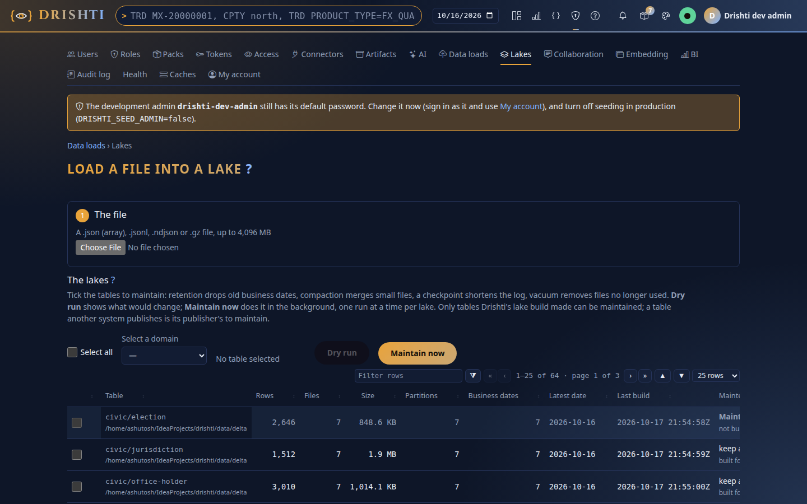

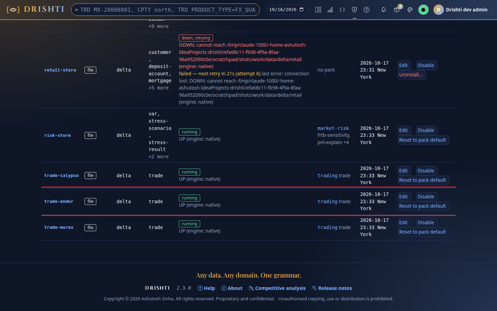

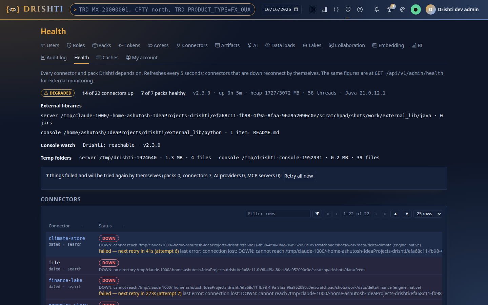

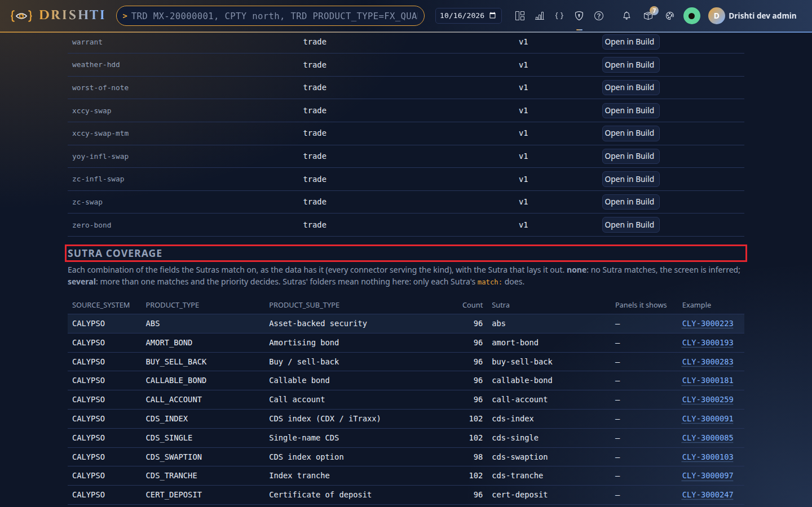

### 9.4 The demo, page by page

| # | Show | How |
|---|---|---|
| 1 | An ENDUR deal from your file | type one of your trade ids → Enter: ticket, legs, cash flows, resets, events, charts |
| 2 | Trades by system and product | **Forms → Trading**: Source system `ENDUR`, a product type → Search; then `CALYPSO`, `MUREX` |
| 3 | A CALYPSO and a MUREX deal | `/v/trade/CLY-3000157`, `/v/trade/MX-20000001` |
| 4 | Counterparty → netting set → CSA → collateral | `/v/counterparty-trades/CP-NORTHPLAINS`, then click through |
| 5 | A curve | `/v/commodity-curve/CMDC-BRENT` |
| 6 | An equity price and news | `/v/listed-company/CO-AAPL`; `/v/news-topic/TOPIC-FED` |
| 7 | Compare two dates | on a trade, pick one of your dates → **Compare** → the other |
| 8 | BI by source system | **BI → Catalogue → Trades overview → Open the report**; change a slicer |
| 9 | How a screen is designed | *How this view was built* → the Sutra name: the designer opens with the trade as its sample |
| 10 | A history | `TRD <your id> 60` (needs two or more of your files), `TRD 1000279 60` (amended ten times), **C** changes only, **D** the fields that changed, **Enter** the page as it stood that day; `EQ EQ-CSCA 3M` |

| | |
|---|---|
| 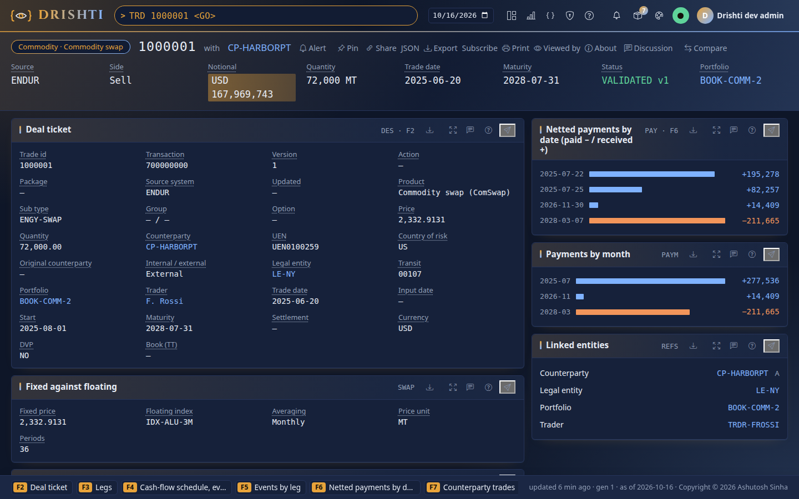 **1. An ENDUR deal** | 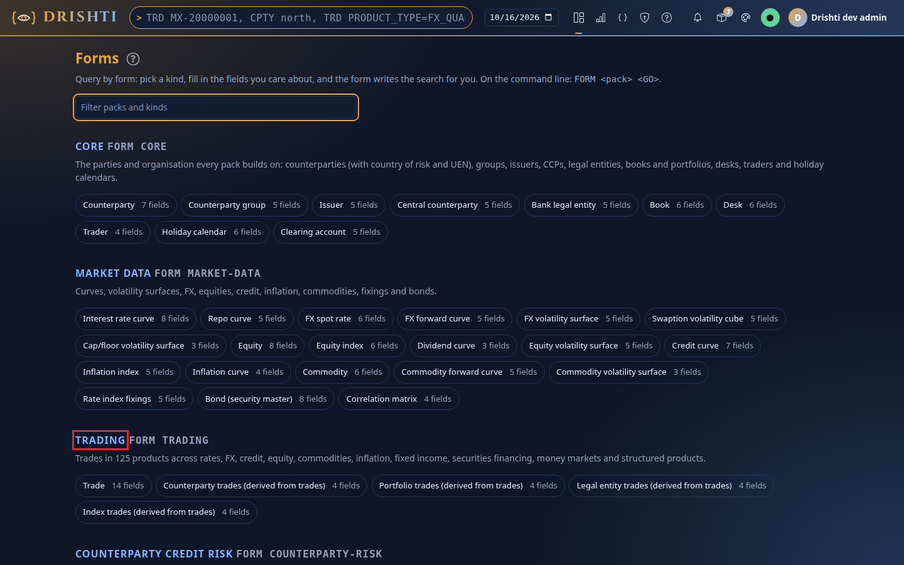 **2. Forms → Trading** |
| 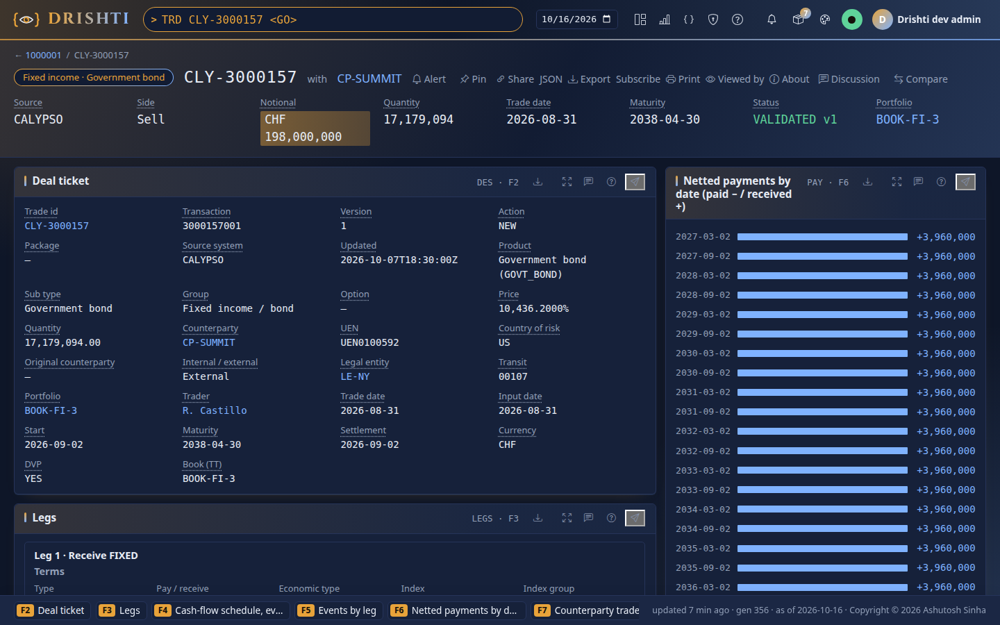 **3. A CALYPSO deal** | 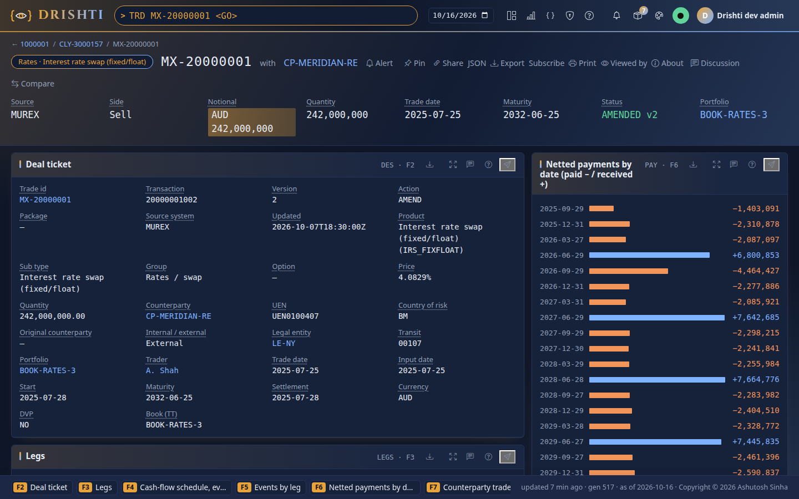 **3. A MUREX deal** |
| 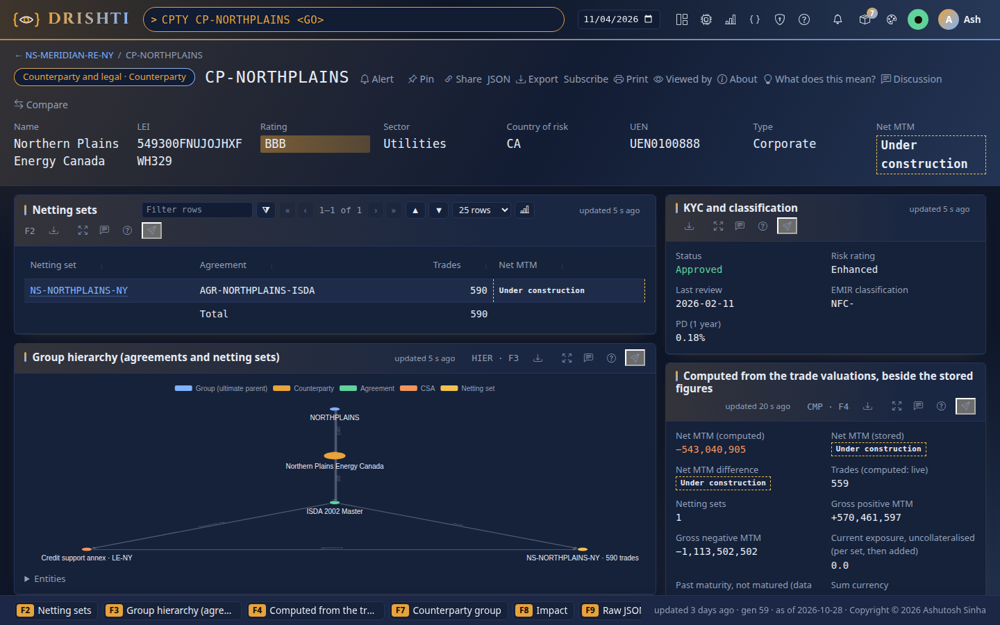 **4. A counterparty** | 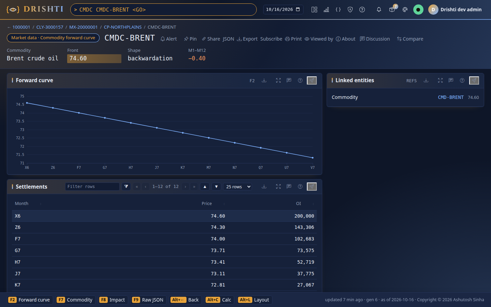 **5. A curve** |
| 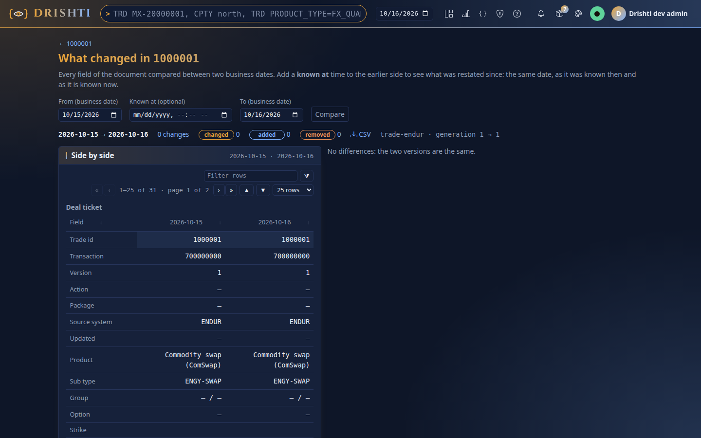 **7. Compare** | 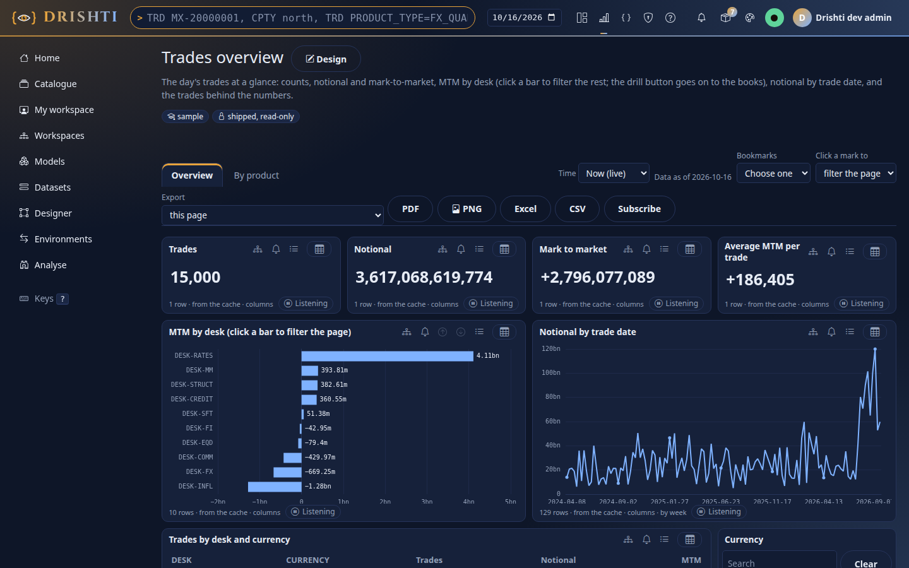 **8. BI, Trades overview** |
| 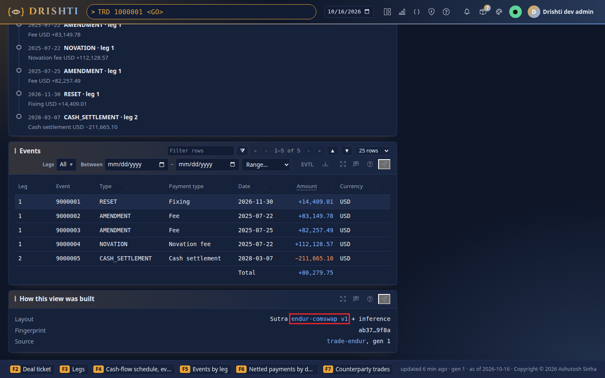 **9. How this view was built** | 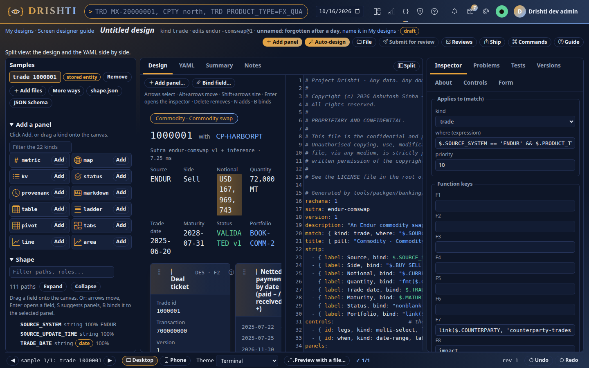 **9. The designer** |

The pictures are of synthetic data loaded exactly as in 9.2.

**Optional: two servers as one** ([tutorial 19](../tutorials/19-a-cluster-of-three.md)). Use the machine's real IPv4 address
(`ipconfig`), never `127.0.0.1` or `localhost`. Set one key for both (`$env:DRISHTI_NET_SECRET`), `drishti.py net set node.secret` and
`node.enabled true` on each, `net add-peer` the first from the second (its own `config` and `data` folders, `--server.port=18490`); **Admin →
Net → Members** shows both `alive`. With the console's `DRISHTI_BACKEND_URLS` naming the first, stopping it moves the next page to the
second within a second, still signed in.

**Optional: the S3 tests**, against simulators that need no `.exe` and no Docker: `pip install "moto[server]==5.2.3"`, then
`.\mvnw.cmd -q -pl drishti-identity,plugins/drishti-plugin-iceberg -am test "-Dtest=S3ContentStoreTest,S3MockContentStoreTest,MinioContentStoreTest,NativeOnS3SimulatorTest" "-Dsurefire.failIfNoSpecifiedTests=false"`
and `& $py -m unittest -v tools\lake\test_s3_simulators.py`. The MinIO tests are skipped on Windows (they run a server binary).

### 9.5 If something goes wrong

| What you see | Do this |
|---|---|
| The Run tab says **DrishtiApplication**; quotes or news try the internet; sample trades appear | Stop it; start **Drishti server (demo lakes)** or the script. |
| `start-server.ps1 … cannot be loaded because running scripts is disabled` | Use the line as given (`-ExecutionPolicy Bypass -File …`). |
| PowerShell says `lake` is not recognized | `lake …` is a sub-command: `& $py "$tools\drishti.py" lake …`, or the PyCharm configuration. |
| `lake build` says `no id` or `give --lake DIR` | `--key TRADE_ID` or `--lake` is missing: copy the line of 9.2 again. |
| ENDUR pages still show synthetic trades | Stop the server, delete `data\delta\trading\trade_endur`, load your files again. |
| ENDUR and CALYPSO/MUREX never on one date | Build the lakes again with `--as-of` your newest date. |
| BI shows 0 trades, or a page is empty while Admin → Lakes has the table | Stop the server, delete `config\connectors` (the server writes it again from the packs), start it. |
| A computed kind refuses a parameter its pack documents | **Admin → Connectors → Template updates**; a value under *changed* stays yours until **Use the pack's value**. |
| `OutOfMemoryError` | `-Xmx4g` fits about 400,000 trades a day; give 8 GB for a million or more. |
| A trade page says `DRS-1004 … timed out` | The first read of a date on a large table; open it again. If it repeats, exclude `data` from real-time antivirus scanning and keep it on a local disk. |
| *documents are not cached on disk (…)* in the log | Right after a restart the old server was still stopping; otherwise a second server uses the same `data` folder. |
| `Port 18480 (or 17480) is already in use` | Another copy is running: stop it. |
| A counterparty or portfolio page lists 1,000 trades | By design: the count and every total cover all of them; search for the rest. |

Afterwards stop both, and check that `git status` shows nothing new outside `data\` and that your files never left `<private>`. Temporary
files (`data\tmp`), caches (`data\cache`) and the grouped pages (`data\derived`) may be deleted while both are stopped.

---

*Copyright (c) 2026 Ashutosh Sinha <ajsinha@gmail.com>. All rights reserved.
Proprietary and confidential. Unauthorised copying, use or distribution is prohibited.*
