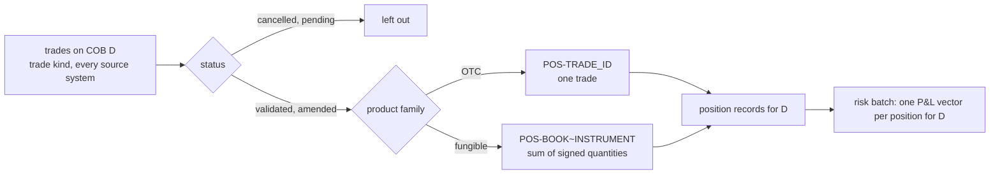
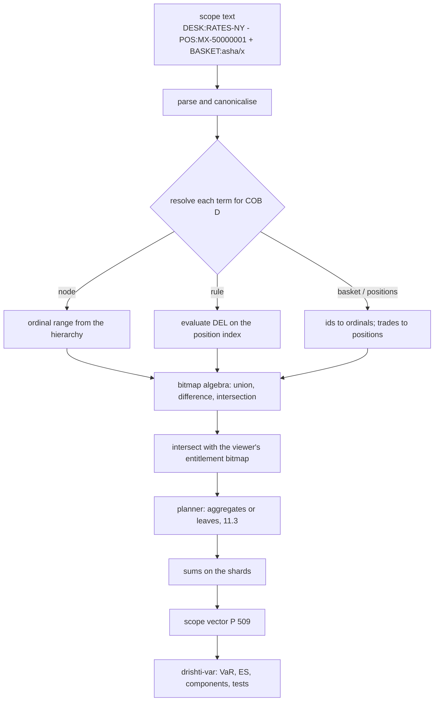

<!--
  Project Drishti · Any data. Any domain. One grammar.

  Copyright (c) 2026 Ashutosh Sinha <ajsinha@gmail.com>.
  All rights reserved.

  PROPRIETARY AND CONFIDENTIAL.

  This file is the confidential and proprietary property of Ashutosh Sinha.
  Unauthorised copying, use, modification, distribution or disclosure of this
  file, via any medium, is strictly prohibited except with the express prior
  written permission of the copyright holder.

  See the LICENSE file in the root of this repository for the full terms.
-->
# The VaR data model: positions, portfolios and the P&L vector store

The data contract: [docs/contracts/VAR.md](../contracts/VAR.md) (every input column, structure and answer, checked against the code).

Status: **partly built (2.8.0, unreleased).** The data of waves V0 to V3 is built: positions, portfolios, the trades' P&L vectors as a
`list<double>` column, hierarchies, the nodes' history, the vector store in memory; [section 18](#18-as-built-in-280) says what was
built, the **vector grain chosen (the trade)** and where it differs from the sections above. This is the companion of
[VAR_ENGINE.md](VAR_ENGINE.md): that document says what the engine computes and shows; this one says **what it computes over and how
that is stored and served** so that an interactive VaR on any scope answers in well under a second and the overnight VaR of every
desk and portfolio of a large bank takes minutes. A part section 18 does not list as built (cubes, sharding, the local memory-mapped
copy, restatement archiving, the `--sort-by` option) is **planned (2.8.0)**; what exists is cited with its file.

## Contents

1. [Summary of the decisions](#1-summary-of-the-decisions)
2. [What already exists in the packs](#2-what-already-exists-in-the-packs)
3. [Positions: the one thing to add](#3-positions-the-one-thing-to-add)
4. [Portfolios: hierarchies, rules and baskets](#4-portfolios-hierarchies-rules-and-baskets)
5. [Membership in time, and overlap](#5-membership-in-time-and-overlap)
6. [The P&L vector in Delta: layout options compared](#6-the-pl-vector-in-delta-layout-options-compared)
7. [Partitioning, clustering and files](#7-partitioning-clustering-and-files)
8. [The rolling window: how a new COB enters](#8-the-rolling-window-how-a-new-cob-enters)
9. [Versions, time travel, restatements and reruns](#9-versions-time-travel-restatements-and-reruns)
10. [Precision and compression](#10-precision-and-compression)
11. [Pre-aggregated vectors (cubes)](#11-pre-aggregated-vectors-cubes)
12. [Serving from memory](#12-serving-from-memory)
13. [Mapping scopes onto the store](#13-mapping-scopes-onto-the-store)
14. [Sizing for a large bank](#14-sizing-for-a-large-bank)
15. [Fit with the repository's data pattern, and what must change](#15-fit-with-the-repositorys-data-pattern-and-what-must-change)
16. [Worked examples](#16-worked-examples)
17. [Open questions for the product owner](#17-open-questions-for-the-product-owner)
18. [As built in 2.8.0](#18-as-built-in-280)

---

## 1. Summary of the decisions

| Topic | Recommendation |
|---|---|
| **What to add** | a **`position`** kind (derived from trades) and, for each position and close-of-business (COB) date, a **P&L vector** of 509 scenario P&Ls. Everything else (trades, books, desks, legal entities, counterparties, portfolios) already exists and is linked to. |
| **Position grain** | one position per **OTC trade** (not fungible, not netted); one position per **book × instrument** for fungible products (bonds, equities, futures, listed options), netting the trades' quantities |
| **Layout** | **one row per position per COB**, the vector in **one column `PNL` of type `list<double>`** (Parquet LIST), length checked = 509. Not long format, not 509 columns. |
| **Partitioning** | by `BUSINESS_DATE` (the COB) and `SCENARIO_SET_ID`; **sorted inside the date by the primary hierarchy** (legal entity, desk, book, position) so every node is a contiguous run of rows; files of about 512 MB, row groups of about 64 MB |
| **Rolling window** | **append-only, one immutable snapshot per COB**: every position's vector is written afresh each COB (under full revaluation every value changes); dates beyond retention are removed. Never a rewrite of a "current window" table. |
| **Reproducibility** | the COB's Delta version is the pin; restatements are new commits with a `BATCH_ID`; official results keep their pin; superseded files are archived, not vacuumed, within the regulatory horizon |
| **Precision** | **float64** in the lake and in memory; sums always in float64; a float32 hot cache is an opt-in |
| **Encoding** | the `PNL` column without dictionary, `BYTE_STREAM_SPLIT` then ZSTD |
| **Aggregates** | **node vectors** for every node of each hierarchy, per COB (`var-node`), plus optional **cubes** on secondary dimensions; refreshed bottom-up overnight and by deltas intraday; the planner chooses aggregates or leaves by cost |
| **Serving** | a **vector store** in the server: hot COBs in memory as dense row-major `double[]` chunks, ordinal-addressed; summation in plain Java loops that C2 vectorises (the incubating Vector API optional, never required); sharded by contiguous hierarchy ranges across Drishti\*net |
| **Scopes** | resolved to **bitmaps of position ordinals** per COB (Roaring bitmaps), so union, difference and intersection are exact and overlaps never double count; whole nodes short-circuit to their node vectors |

## 2. What already exists in the packs

The design adds positions and vectors on top of what the shipped packs already model. From the packs and the committed test data
(`data/testdata/`):

| Concept | Kind and pack | Key and fields used | Where it is defined |
|---|---|---|---|
| **trade** | `trade`, trading pack | `TRADE_ID` (`MX-…`, `CLY-…`, ENDUR ids); `TT_BOOK` (the book, e.g. `BOOK-RATES-3`), `TT_GROUP` (the desk, e.g. `DESK-RATES`), `PORTFOLIO` (equal to the book in the samples), `STRATEGY`, `LEGAL_ENTITY` (`LE-NY`), `COUNTERPARTY` (`CP-…`), `PRODUCT_GROUP`, `PRODUCT_TYPE` (`IRS_FIXFLOAT` …), `CURRENCY`, `QUANTITY`, `TRADE_STATUS` (`VALIDATED`, `AMENDED` …), `TRADE_VERSION`, `LEGS[]` | `config/packs/trading/pack.yaml`; data in `data/testdata/trades/{endur,calypso,murex}/` |
| **portfolio** | `portfolio-trades`, trading pack, a **derived** kind | grouped by `$.PORTFOLIO`, members `TRADE_IDS`, rows `TRADES`, `TRADE_COUNT` | the `trade-pages` derived connector in `config/packs/trading/pack.yaml`; [the derived connector](../connectors/types/derived/README.md) |
| **counterparty, legal entity portfolios** | `counterparty-trades`, `legal-entity-trades` (derived) | grouped by `$.COUNTERPARTY`, `$.LEGAL_ENTITY` | the same connector |
| **book** | `book`, core pack | `BOOK_ID` (`BOOK-COMM-1`), `DESK_NAME`, `TRADE_COUNT`, `MTM` | `config/packs/core/pack.yaml` (id pattern `^BOOK-`); `data/testdata/core/book/` |
| **desk** | `desk`, core pack | `DESK_ID` (`DESK-COMM`), `LEGAL_ENTITY`, `BOOKS[]` (`ID`), `VAR_99`, `VAR_RESULT` (a link to the `var` kind) | id pattern `^DESK-`; `data/testdata/core/desk/` |
| **legal entity** | `legal-entity`, core pack | `ENTITY_ID` (`LE-FRA`), `LEI`, `DESKS[]`, `BOOKS[]` | id pattern `^LE-`; `data/testdata/core/legal-entity/` |
| **counterparty** | `counterparty`, core pack | `COUNTERPARTY_ID` (`CP-ALDERSHOT`) | id pattern `^CP-` |
| **VaR today** | `var`, market-risk pack | `RESULT_ID` (`VAR-COMM`), `VAR_99`, `ES_975`, `SVAR`, `LIMIT`, `EXCEPTIONS`, `SCENARIO_PNL[]` (one desk-level array) | `config/packs/market-risk/pack.yaml`, connector `risk-store` (Delta, domain `risk`); `data/testdata/market-risk/var/` |

So the hierarchy **legal entity → desk → book → trade** is already in the data: a trade carries `LEGAL_ENTITY`, `TT_GROUP` (desk) and
`TT_BOOK` (book); a desk record carries its legal entity and books. Portfolios exist as derived groupings by a trade field. What is
missing is the **position** (the unit risk is computed on) and its **vector**: the product owner's view, which this design confirms.

## 3. Positions: the one thing to add

### 3.1 What a position is

A position is **what the risk batch values**. Trades are what the front office books; positions are trades made comparable for risk.

| Product family | Position | Why |
|---|---|---|
| **OTC** (swaps, FX forwards and options, CDS, swaptions, structured trades) | **one position per trade**: `POS-<TRADE_ID>` | each OTC trade has its own terms and counterparty; nothing nets |
| **Fungible** (bonds, equities, futures, listed options, FX spot by pair) | **one position per book and instrument**: `POS-<TT_BOOK>~<INSTRUMENT_ID>`, netting the trades' signed quantities | twenty trades in one bond in one book are one holding to the market; the risk batch values the holding |
| **Cash and accounts** (where a bank includes them) | one per book and currency | as fungible |

A bank whose batch is trade-level everywhere simply sets the rule to *one position per trade*; nothing else changes.

### 3.2 The `position` kind

```yaml
# config/packs/market-risk/pack.yaml (excerpt, planned 2.8.0)
kinds:
- position
- scenario-set
- pnl-vector
- var-node
- pnl-hypothetical
- risk-hierarchy
graph:
  id-patterns:
  - { pattern: ^POS-, kind: position }
  fields:
    TRADE_IDS:     { kind: trade,        label: Trades }
    TT_BOOK:       { kind: book,         label: Book }
    DESK:          { kind: desk,         label: Desk }
    LEGAL_ENTITY:  { kind: legal-entity, label: Legal entity }
    COUNTERPARTY:  { kind: counterparty, label: Counterparty }
    PORTFOLIO:     { kind: portfolio-trades, label: Portfolio }
routes:
  position: risk-store
  pnl-vector: risk-store
  var-node: risk-store
```

| Field | Type | Meaning |
|---|---|---|
| `POSITION_ID` | id | `POS-MX-50000001` (OTC) or `POS-BOOK-RATES-2~ISIN-US91282CJL6` (fungible) |
| `POSITION_TYPE` | text | `otc` or `fungible` |
| `TRADE_IDS` | id[] | the trades in the position (one for OTC); each a link to `trade` |
| `TRADE_VERSIONS` | text | a hash of the member trades' `TRADE_VERSION`s: the position's version |
| `INSTRUMENT_ID` | id | fungible only (ISIN, exchange code, currency pair) |
| `LEGAL_ENTITY`, `DESK`, `TT_BOOK`, `PORTFOLIO`, `STRATEGY` | text | copied from the trades on the COB (`DESK` from `TT_GROUP`); for a fungible position, all its trades share the book by construction |
| `COUNTERPARTY` | text | OTC only; empty for fungible positions |
| `PRODUCT_GROUP`, `PRODUCT_TYPE`, `CURRENCY` | text | from the trade (OTC) or the instrument (fungible) |
| `QUANTITY` | decimal | net signed quantity (fungible) or the trade's notional (OTC) |
| `LINEAR` | bool | whether the position's P&L scales exactly with its quantity (true for a fungible holding of one instrument); used by partial unwinds and trade-level picks ([section 13.4](#134-a-single-trade-inside-a-fungible-position)) |
| `TRADE_QUANTITIES` | map | fungible only: each member trade's signed quantity |
| `STATUS` | text | `open`, `closed` (net quantity zero, matured, cancelled) |
| `OPENED_ON`, `CLOSED_ON` | date | lifecycle |
| `TAGS` | text[] | free labels used by rule-based portfolios (`hedge`, `client-facilitation`, `banking-book`) |

### 3.3 Derivation from trades



- **Who derives them.** In production the **risk batch** decides positions (it is the system that values them); it publishes the
  `position` records and their vectors together, so the two always agree. In the demo, the test-data generator derives them from the
  committed trades by the rules above.
- **Keys.** The aggregation key of a fungible position is `(LEGAL_ENTITY, TT_BOOK, INSTRUMENT_ID)`; the product-family rule is a
  table in the pack's configuration (`PRODUCT_TYPE` → `otc` or `fungible`), so a bank can change it without code.
- **Netting.** Only within one book and one instrument. A long in one book and a short in another stay two positions (they belong to
  different desks and limits); their P&Ls offset when a scope includes both.
- **Lifecycle.** A position appears on the first COB a member trade is live; it gets a new `TRADE_VERSIONS` whenever a member trade is
  amended, booked or cancelled; it is `closed` when its net quantity is zero or its last trade has matured, and from the next COB it
  has no vector. A closed position stays in history: a past COB's VaR includes it.
- **A derived view for convenience.** For browsing (`POS` pages, *trades in this position*), the existing derived connector can also
  group trades by position key; the stored `position` kind remains the one the vectors refer to.

### 3.4 Links

```
legal-entity (LE-NY) ─┐
desk (DESK-RATES) ────┼── carried on the position (copied from trades on the COB)
book (BOOK-RATES-2) ──┤
portfolio (PORTFOLIO)─┘
                       position POS-MX-50000001 ──TRADE_IDS──▶ trade MX-50000001 ──▶ counterparty CP-HALCYON
                            │
                            └── pnl-vector PV-POS-MX-50000001-HS-509 (dated by COB): PNL[509]
```

Every link is an ordinary graph field, so the existing F-keys and links open the trade, the book, the desk, the legal entity and the
counterparty from a position page, and *what refers to this* (reverse lookup on promoted columns) finds a trade's position.

## 4. Portfolios: hierarchies, rules and baskets

A **portfolio** for VaR is any set of positions. Three ways to define one, all reduced to the same thing (a set of position
ordinals for a COB, [section 13](#13-mapping-scopes-onto-the-store)):

### 4.1 Hierarchical

Trees whose leaves are books. The **primary** hierarchy is the management one already in the data (bank → legal entity → desk →
book). A bank usually has more than one tree: management, legal entity, regulatory (trading book vs banking book), and a product
view. Each is a **`risk-hierarchy`** (planned) of nodes, effective-dated:

```yaml
# a risk-hierarchy record (dated, mode: effective: a row only when a node changes)
NODE_ID: MGMT/DESK-RATES
HIERARCHY: MGMT                    # MGMT | LEGAL | REG | PRODUCT …
LEVEL: desk                        # bank | division | legal-entity | desk | book
PARENT_ID: MGMT/DIV-MARKETS
NAME: Rates
REF: { kind: desk, id: DESK-RATES }        # the core entity this node stands for, when there is one
BOOKS: [BOOK-RATES-1, BOOK-RATES-2, BOOK-RATES-3]   # leaf books (only on the lowest level)
VALID_FROM: 2026-01-02
VALID_TO: null
```

- The demo's MGMT tree is generated from the core pack's `desk` and `legal-entity` records (books under desks, desks under legal
  entities) with a `DIV-MARKETS` division added; nothing is invented that contradicts them.
- **A book belongs to exactly one leaf of each tree** on a given COB (checked at load: a book in two leaves of one tree, or in none, is
  a problem listed by the load).

### 4.2 Rule-based (dynamic)

A **rule portfolio** is a named condition over the position's promoted columns, written in DEL ([EXPRESSIONS.md](../guides/EXPRESSIONS.md)):

```yaml
# a var-portfolio record (owned by Drishti, versioned; planned)
PORTFOLIO_ID: RULE/USD-RATES-HEDGES
TYPE: rule
RULE: "PRODUCT_GROUP == 'Rates' and CURRENCY == 'USD' and 'hedge' in TAGS"
OWNER: group-risk
SHARED_WITH: [risk]
VERSION: 3
```

Membership is **evaluated per COB** against that COB's positions: the same rule may hold 840 positions on Monday and 852 on Tuesday.

### 4.3 Ad-hoc and artificial (baskets)

Any set of trades or positions picked on a screen (rows of a trade table, a BI result, a search), or typed:

```yaml
PORTFOLIO_ID: BASKET/asha/rates-unwind-candidates
TYPE: basket
MEMBERS:                            # trades or positions; trades are resolved to positions per COB (13.4)
  - { trade: MX-50000001 }
  - { trade: CLY-30000001 }
  - { position: POS-BOOK-RATES-2~ISIN-US91282CJL6, quantity: -5000000 }   # a part of a fungible position
OWNER: asha
VERSION: 7
```

A basket is **static**: its members are fixed until its owner changes them (each change a new version). A basket may also combine
nodes and rules with the scope algebra (`DESK:RATES-NY - BASKET:asha/...`, [VAR_ENGINE.md section 6](VAR_ENGINE.md#6-scope-algebra-any-set-of-trades)).

Rule portfolios and baskets are Drishti-owned records (the content store, [CONTENT_STORE.md](CONTENT_STORE.md)), every
version kept and audited.

## 5. Membership in time, and overlap

### 5.1 Point-in-time resolution

A scope is always resolved **for one COB and one pin**:

| Definition | Resolved by | Versioned by |
|---|---|---|
| hierarchy node | the `risk-hierarchy` rows valid on the COB → its books → the positions whose `TT_BOOK` is one of them on the COB | the hierarchy table's Delta version in the pin |
| rule portfolio | the rule's version current at the pin, evaluated over the COB's position columns | the portfolio's `VERSION` |
| basket | its version current at the pin; trades resolved to the positions holding them on the COB | the basket's `VERSION` |

The result's stamp records the definition versions and a **membership hash** (a hash of the sorted position ids), so *which positions
were in this number* can always be answered and reproduced. A past COB's VaR uses that COB's positions and that COB's hierarchy, never
today's: a book moved to another desk last month counts under its old desk for dates before the move.

**Intraday moves.** A trade moved between books during the day (a write-back on `TT_BOOK`) moves its position's vector from one
ancestor chain to another; no repricing is needed ([VAR_ENGINE.md section 9](VAR_ENGINE.md#9-intraday-events-write-backs-and-feeds)).

### 5.2 Overlap

- A position belongs to **one leaf of each hierarchy** and to **any number of rule portfolios and baskets**.
- Each portfolio's vector is the sum over **its own** members; overlap between portfolios never matters for one portfolio.
- When portfolios are **combined** (a union), membership is computed as a set first, so a position in both is counted once. This is
  why scopes resolve to bitmaps ([section 13](#13-mapping-scopes-onto-the-store)) rather than to sums of portfolio vectors: two
  overlapping portfolios' vectors cannot simply be added.
- A **table of portfolios** that overlap (for example *USD hedges* and *RATES-NY*) never shows a total row; it shows the union's VaR,
  computed as a set, if asked.

## 6. The P&L vector in Delta: layout options compared

The **reference bank** of [section 14](#14-sizing-for-a-large-bank) has 2 million positions; one COB is 2,000,000 × 509 = 1.018
billion P&L values.

| | **A. Long** (one row per position × scenario) | **B. Wide** (one row per position, 509 columns `S001…S509`) | **C. Vector** (one row per position, `PNL list<double>`) — **recommended** | **D. Blob** (one row per position, `PNL` as a 4,072-byte binary) |
|---|---|---|---|---|
| rows per COB | 1.018 billion | 2 million | 2 million | 2 million |
| bytes per value before compression | ~8 (value) + ~2–4 (position key, scenario index, after dictionary and run-length encoding) | 8 | 8 + a few bits of repetition levels (run-length encoded, near zero) | 8 |
| size per COB, float64, compressed (estimate) | ~9–11 GB | ~5.5–6.5 GB | ~5.5–6.5 GB | ~6–7 GB (ZSTD on raw doubles, no byte-stream split) |
| **sum a scope's vectors** (the core operation) | a group-by over hundreds of millions of rows: seconds to tens of seconds | read 509 column chunks per row group, add row by row | read one column, decode into one contiguous array per row group, add | read one column, copy bytes, add |
| read **one scenario for all positions** (a component at the VaR date) | filter on the scenario index: good | read **one column**: best | read the whole column (509× more than needed) | the whole column |
| schema | 3 columns, stable | 509 columns; the scenario count is in the schema; Parquet footers and Delta statistics grow with it | 1 column, the length is data (checked = the scenario set's count) | 1 opaque column |
| readable by other tools (Spark, DuckDB, Trino, pandas) | yes | yes | yes (arrays are standard) | no: byte order and length are a private convention |
| Drishti reader today | strings and doubles: yes, but the row count is the problem | doubles: yes | **needs list support** ([section 15](#15-fit-with-the-repositorys-data-pattern-and-what-must-change)) | needs binary support |

**Recommendation: C, the vector layout.** It keeps one row per position (the unit everything is keyed by), one column for the
vector (the schema does not depend on the scenario count, which differs between `HS-509` and `SVAR-250`), it is standard Parquet and
Delta that any tool reads, and the core operation (sum many vectors) reads exactly one column sequentially. Its one weakness, reading a
single scenario across all positions, is covered in memory: the vector store serves component and scenario drills from the hot,
decoded matrix ([section 12](#12-serving-from-memory)), never from Parquet. Long format is rejected for size and aggregation cost;
wide for schema coupling and footer bloat; blob for interoperability.

## 7. Partitioning, clustering and files

| Choice | Recommendation | Why |
|---|---|---|
| **partition columns** | `BUSINESS_DATE`, then `SCENARIO_SET_ID` | every query is for one COB and one set; a COB is written once, as a unit; retention removes whole dates |
| partition by legal entity or desk too? | **no** by default; `LEGAL_ENTITY` only for banks above about 5 million positions | 400 desks would make ~15 MB partitions per COB (2 M × 4 KB ÷ 400): far too many small files. Legal entity (tens) keeps files large and helps entity-scoped jobs |
| **order within a COB** | sorted by `LEGAL_ENTITY`, `DESK`, `TT_BOOK`, `POSITION_ID` (the primary hierarchy) | every node of the primary hierarchy becomes a **contiguous run** of rows: reading a desk reads a few row groups, and the in-memory ordinals are ranges ([section 12.2](#122-ordinals-and-contiguous-nodes)) |
| Z-order or liquid clustering | **not needed for the primary hierarchy** (the sort gives perfect locality); Z-order on (`PRODUCT_GROUP`, `CURRENCY`) is an optional second clustering only if lake-side tools filter on them | Drishti filters on secondary attributes through the in-memory position index, not through Parquet statistics |
| **file size** | about 512 MB | about 1 GB per desk-sized group at most; a COB of the reference bank is ~12 files |
| **row-group size** | about 64 MB (~16,000 positions) | fine-grained skipping for a book read; large enough for efficient decoding |
| **statistics** | min/max on the hierarchy columns (the first indexed columns), none on `PNL` | skipping by node; statistics on a list column are useless |
| **compaction** | not needed for normal COBs (written once, already well sized); `OPTIMIZE` only after restatements that appended small files | |
| **deletion vectors** | **avoid** for this table | Drishti's Delta reader falls back from columns to documents for files with deletion vectors (`DeltaTable.java`, `deletionVectors`), which would make vector reads slow; restatements rewrite the affected files instead ([section 9](#9-versions-time-travel-restatements-and-reruns)) |

## 8. The rolling window: how a new COB enters

Each COB the scenario window moves by one day: the oldest scenario day drops out, the newest enters. Under **full revaluation** every
position is also revalued at the new COB's market, so **every one of the 509 values of every vector changes**; nothing can be reused
by shifting. Even under sensitivity-based (Taylor) revaluation the base sensitivities change daily. Therefore:

| Option | What happens each COB | Verdict |
|---|---|---|
| **append-only daily snapshot** | the batch writes a new partition `BUSINESS_DATE = D` with every open position's full vector; the scenario set record for D names its 509 dates; earlier COBs are untouched | **chosen**: one commit per COB, no rewrite, history and time travel for free, readers of D−1 never disturbed |
| full rewrite of a "current window" table | each COB rewrites the whole table | rejected: rewrites gigabytes for nothing, loses history, blocks readers during the swap |
| shift-and-append (store 510 values, move a pointer) | reuse yesterday's values | rejected: wrong under full revaluation (every value changes), and fragile |

```
 COB 2026-10-22: scenario-set HS-509 = [2024-10-08 … 2026-10-21]   partition business_date=2026-10-22/  (written once)
 COB 2026-10-23: scenario-set HS-509 = [2024-10-09 … 2026-10-22]   partition business_date=2026-10-23/  (written once)
                 position i, scenario k of COB D  =  P&L of position i (as held on D) under the move of SCENARIO_DATES[k] of D
```

- **Retention:** position vectors are kept `retention.vectors` COBs (proposed 60 hot in the lake, the rest archived, open question 3);
  node vectors (`var-node`, small) for years. The demo keeps the test data's sixty business days.
- **Removing a COB** is a Delta delete of the partition (a metadata-only commit, no rewrite), followed by archiving of its files
  ([section 9](#9-versions-time-travel-restatements-and-reruns)).
- **The scenario set** is itself dated, so the meaning of index *k* is never ambiguous.

## 9. Versions, time travel, restatements and reruns

- **The pin of a COB** is the Delta table version after its load. The engine's results stamp it
  ([REACTIVE_CONNECTORS.md section 8](REACTIVE_CONNECTORS.md#8-point-in-time-stamping-ordering-and-idempotence)).
- **Time travel:** *VaR of RATES-NY for COB 2026-09-15 as it was known on 2026-09-16 at 09:00* reads the table at that instant (the
  Delta plugin's existing `knownAt` read), before any later restatement.
- **Restatement** (the batch reruns a COB, or some positions failed and are repriced): a new commit replaces the affected rows of that
  COB. For a whole COB: an overwrite of the date's partition (`overwrite-dates`, as `lake build` does today). For some positions:
  the affected files are rewritten with the corrected rows (no deletion vectors, [section 7](#7-partitioning-clustering-and-files)).
  Every row carries `BATCH_ID` and `RESTATEMENT` (0, 1, …); a rerun with the same `BATCH_ID` is idempotent.
- **What changes downstream:** a restated COB moves the data version: the `data-version` trigger marks that COB's results stale and
  recomputes the watched ones and the official `var-node` records ([VAR_ENGINE.md section 13.4](VAR_ENGINE.md#134-the-overnight-precomputation)),
  which keep both the original and the restated numbers with their pins.
- **Reproducibility beyond `VACUUM`:** time travel needs the old files. Superseded files of this table are **archived** (moved to a cold
  location with a manifest) rather than deleted, for the regulatory horizon (open question 4); `VACUUM` retention for this table is
  set accordingly.

## 10. Precision and compression

| Choice | Size per value | Error | Verdict |
|---|---|---|---|
| **float64** | 8 bytes | none against the batch | **lake and hot cache, default** |
| float32 | 4 bytes | ~6 × 10⁻⁸ relative per value (about ±3 units on a P&L of 50 million); summed into float64 accumulators the errors are random: about √N × 3 ≈ ±4,000 units on a bank-level P&L of about 10⁹ for 2 million positions | **hot cache only, opt-in** (`vectors.hot-precision: float32`) when memory is short; numbers then differ slightly from the batch's and say so |
| integer cents (int64) | 8 bytes, compresses better (delta encoding) | rounding to a cent | rejected for the canonical store (the batch's values are floats); acceptable for the demo data's JSON |

- **Sums are always in float64**, whatever the storage: each accumulator is a `double[509]`.
- **Encoding of `PNL`:** no dictionary (values do not repeat); **`BYTE_STREAM_SPLIT`** (splits each double's bytes into streams, which
  makes exponents and high bytes compress well) followed by **ZSTD** (level 3). Expect about 70–80% of the raw size; P&L values carry
  much noise in their low bytes, so floating-point data compresses far less than text.
- **Other columns:** dictionary and ZSTD (ids and hierarchy names compress to almost nothing in sorted order).

## 11. Pre-aggregated vectors (cubes)

Because P&L vectors **add**, a scope's vector is the sum of its children's. Precomputing sums turns most queries into a handful of
vector additions.

### 11.1 What is precomputed

| Aggregate | Key | Size (reference bank) | Built |
|---|---|---|---|
| **node vectors** (`var-node`) | hierarchy, node, COB, scenario set | 5,000 nodes × 4 KB = 20 MB per hierarchy per COB | overnight, bottom-up, one pass over the sorted positions |
| **cube cells** (optional, `var-cube`) | a tuple of dimension values, e.g. (desk, product group), (legal entity, currency, risk class) | cells × 4 KB; a (400 desks × 30 product groups) cube is at most 12,000 cells = 49 MB | overnight, in the same pass |
| **rule portfolio vectors** | portfolio version, COB | 4 KB each | overnight for portfolios used in the last 30 days; on first use otherwise, then cached |

Cube dimensions are configured (`vectors.cubes`), and Admin → Compute shows how often each cube answered a query, so unused cubes can
be dropped.

### 11.2 Refresh

- **Overnight:** rebuilt from scratch for the COB, in the single sorted pass (each position read once, added to its book accumulator;
  a book's sum added to its desk's when the book ends, and so on up), so the cost is one read of the COB's vectors.
- **Intraday:** a changed position (amended, booked, cancelled, moved) contributes a **delta** `new − old`; the delta is added to each
  ancestor node and to each cube cell the position falls in (a few dozen vector additions). Deltas are kept as an **intraday overlay**
  keyed by the edit-log watermark, never written into the COB's aggregates, so the overnight numbers stay the official ones and an
  intraday number is always *overnight + overlay*.

### 11.3 Aggregates or leaves: the planner's rule

For a scope resolved to a bitmap `B` of positions, the planner considers:

1. **Exact cover by aggregates:** find the largest whole nodes or cube cells contained in `B` (greedy from the top of the primary
   hierarchy down, then cube cells). Cost = (number of aggregates + positions of `B` not covered) × 509 additions.
2. **Cover with subtraction:** a node containing `B` minus the few positions it has that `B` lacks (*desk minus three trades*). Cost =
   (1 + the positions removed) × 509.
3. **Leaves only:** sum every position of `B`. Cost = |B| × 509.

It takes the cheapest. Aggregates are used **only if they are valid for the request**: same COB, same scenario set, same pin (or the
pin's intraday overlay applied), and **the viewer sees the whole node** at least at aggregate level ([VAR_ENGINE.md section
12](VAR_ENGINE.md#12-entitlements-and-audit)); otherwise the node is replaced by its visible leaves. Every result is the same whichever
plan is used (tested, [section 16.4](#164-the-planners-choice-is-invisible)).

## 12. Serving from memory

### 12.1 The vector store

A component of `drishti-compute` (planned), in the server's JVM, generic (it knows *vectors keyed by ordinal*, not VaR):

| Holds | How |
|---|---|
| the hot COBs' position vectors | dense, **row-major** (position after position, 509 values each) in `double[]` chunks of 65,536 positions (33.4 M doubles, 267 MB per chunk; Java arrays stay far below their 2³¹-element limit) |
| the position index of each hot COB | the promoted columns of every position (ids dictionary-encoded, hierarchy, product, currency, counterparty, tags), column-wise, a few hundred bytes per position |
| node and cube vectors, the intraday overlay | small `double[509]` arrays |

- **Row-major** because the core operation is *add these positions' vectors*: each addition walks 509 contiguous doubles.
  Scenario-wise access (one scenario across many positions, for a component at the VaR date) is a strided read, still from memory;
  for whole-bank component runs the store transposes the needed scenarios once (the 11 around the VaR rank) into a scenario-major
  scratch array.
- **Loaded** from the lake once per COB (decoding the `PNL` column straight into the chunk) or from a **local copy** written after the
  first load under `<data dir>/compute/vectors/<COB>/` (raw little-endian doubles plus an index, memory-mappable), so a restart reloads
  at disk speed without decoding Parquet.
- **On heap, not off heap by default:** plain `double[]` chunks are what the JIT vectorises most reliably, and the generational ZGC on
  Java 21 handles a large, long-lived heap with short pauses. An off-heap variant (`ByteBuffer.allocateDirect` viewed as a
  `DoubleBuffer`) is an option for sites that cap the heap; no FFM is used (Java stays on 21 without preview features).

### 12.2 Ordinals and contiguous nodes

Within a COB each position gets an **ordinal** (0 to N−1) in the lake's sort order (legal entity, desk, book, position). Therefore every
node of the primary hierarchy is a **range of ordinals** `[first, last]`: summing a node from leaves is a sequential scan of one
contiguous slice of memory, the fastest access there is. Scopes are bitmaps of ordinals; a node is a run-length run in the bitmap.

### 12.3 Summation

```java
// the inner loop (plain Java; C2 turns it into SIMD additions)
static void addInto(double[] acc, double[] chunk, int offset) {        // acc.length == 509
    for (int j = 0; j < acc.length; j++) acc[j] += chunk[offset + j];
}
```

- **Plain arrays are the baseline**, required to work everywhere. The incubating Vector API (`jdk.incubator.vector`, which needs
  `--add-modules` on Java 21) may be enabled with a setting for an explicit SIMD kernel, but is never required, and both are tested to
  give the same sums.
- **Parallelism:** a scope's bitmap is split by chunk; each chunk is summed on its own virtual thread into a private accumulator; the
  accumulators are added at the end. Memory bandwidth, not arithmetic, is the limit.
- **Exactness:** additions in float64 in a fixed order per chunk give reproducible results; the order across chunks is fixed too
  (by chunk number), so the same scope gives the same bits every time.

### 12.4 Sharding across Drishti*net

- The COB's ordinals are split into **shards of contiguous ranges** aligned to legal entities and desks (a desk is never split), about
  equal in bytes, and spread over the nodes that serve the var-engine by the Drishti\*net ring, **two replicas each** (a node leaving
  costs no reload on the critical path).
- A query's coordinator (the owner of the request key, [REACTIVE_CONNECTORS.md section 14](REACTIVE_CONNECTORS.md#14-several-servers-drishtinet))
  sends each shard owner its part of the bitmap and receives a partial sum (509 doubles, 4 KB), then adds the partials. Network traffic
  is tiny; the work is local to the data.
- Node and cube vectors are small and replicated to every var-engine node.

## 13. Mapping scopes onto the store

### 13.1 From definition to bitmap



- **Bitmaps** are compressed (Roaring bitmaps, a small Apache-2.0 Java library, to be approved like any dependency): a node is one
  run; a rule over 2 million positions is a few hundred kilobytes at most; union, difference and intersection cost microseconds to
  milliseconds.
- **Hypothetical additions** (what-if trades, intraday trades not yet in the COB) are vectors **outside** the COB's ordinals: the
  sandbox or the intraday overlay holds them, and the scope's vector is the bitmap's sum plus their vectors.

### 13.2 Parts for contributions

Contributions need the vectors of the scope's **parts** (children, positions or risk classes). For children that are nodes, they are
node vectors (or ranges); for positions, they are the leaves; for an ad-hoc scope's *by desk* split, each part is the scope's bitmap
intersected with the desk's range. The parts' vectors and the scope's vector go to `drishti-var` together (small: a few hundred
vectors), and only for scopes with more than `contributions.max-parts` (default 5,000) parts is the work done as a job.

### 13.3 Overlapping portfolios side by side

A screen comparing *RATES-NY*, *USD hedges* and *Asha's basket* computes three bitmaps and three vectors independently; the union, if
shown, is a fourth bitmap. No vector is ever the sum of two portfolio vectors unless the planner has proven their bitmaps disjoint.

### 13.4 A single trade inside a fungible position

A basket may name a trade that is only part of a fungible position (one of twenty bond purchases in a book). Because the position is
**linear in its quantity** (one instrument), the trade's vector is the position's vector scaled by
`trade quantity ÷ position quantity` (from `TRADE_QUANTITIES`). A position that is not linear (`LINEAR: false`) cannot be split this
way: the basket includes the whole position and says so.

## 14. Sizing for a large bank

### 14.1 Size of one COB

| Positions | Values (× 509) | float64 in memory | float32 in memory | float64 in the lake (≈ 0.75 × raw) |
|---|---|---|---|---|
| 1,000,000 | 0.509 billion | 4.07 GB | 2.04 GB | ~3.1 GB |
| 2,000,000 | 1.018 billion | 8.14 GB | 4.07 GB | ~6.1 GB |
| 5,000,000 | 2.545 billion | 20.36 GB | 10.18 GB | ~15.3 GB |

The position index adds about 0.3 KB per position (0.6 GB for 2 million); node and cube vectors are tens of megabytes.

**In the lake per year** (252 COBs): about 0.8 TB, 1.5 TB and 3.9 TB of vectors for 1, 2 and 5 million positions; 60 hot COBs are about
0.18, 0.37 and 0.92 TB.

**In memory:** the two most-used COBs (today and the previous one) hot: about 8 GB, 16 GB and 41 GB (float64) across the var-engine nodes,
doubled by the two replicas: for 5 million positions, four nodes with 32 GB each for vectors, or float32 on two.

### 14.2 Time to aggregate the whole bank

Summing every position is bandwidth-bound. With a sustained 15 GB/s of memory bandwidth per server (a conservative figure for a
two-socket server under many threads):

| Positions | float64 bytes | 1 server | 4 servers (sharded) | float32, 4 servers |
|---|---|---|---|---|
| 1,000,000 | 4.07 GB | ~0.27 s | ~0.07 s | ~0.04 s |
| 2,000,000 | 8.14 GB | ~0.54 s | ~0.14 s | ~0.07 s |
| 5,000,000 | 20.36 GB | ~1.36 s | ~0.34 s | ~0.17 s |

These are the costs of a **filter** that cuts across every node. A node, or anything the planner covers with aggregates, costs
microseconds. **From the lake, cold** (decoding Parquet at roughly 0.5–1 GB/s per core), the same whole-bank pass is 10 to 40 seconds
on one server: acceptable for the overnight load, not for an interactive question, which is why hot COBs are served from memory.

### 14.3 An ad-hoc scope of 50,000 positions

| Step | Cost |
|---|---|
| resolve to a bitmap (ids or a rule on the position index) | 1–20 ms |
| planner (aggregate cover) | under 1 ms |
| sum the uncovered leaves: 50,000 × 4,072 bytes = 204 MB; scattered in memory, at ~5 GB/s effective | ~40 ms on one server; ~10–15 ms sharded |
| send the vector (and up to a few hundred part vectors) to the Python worker as Arrow | ~5 ms |
| quantiles, ES, smoothed components in `drishti-var` | ~5–10 ms |
| stamp, cache, answer | ~5 ms |
| **total** | **about 100 ms; target 250 ms at p95 warm**, 1 s if the COB's position index must first be loaded |

### 14.4 The overnight batch VaR

For every node of every hierarchy, every saved rule portfolio and basket in use:

1. **Load:** decode the COB's vectors into the vector store (2 M positions: about 6 GB of Parquet; minutes on one server, about one
   minute sharded on four), and write the local copy.
2. **Aggregate:** one sorted pass builds all node and cube vectors of the primary hierarchy (≈ 1 s per 2 million positions per
   server); other hierarchies by summing their books' vectors (books are already summed).
3. **Measures:** VaR, ES and backtests for 5,000+ nodes: sorting 509 numbers each, milliseconds in all.
4. **Components:** for each node, the parts' P&L at the node's tail scenarios; for position-level components across the bank, one
   strided pass per scenario band (about the cost of one whole-bank sum).
5. **Publish** `var-node` (and cubes) for the COB into the lake: tens of megabytes.

End to end: **minutes** for 2 to 5 million positions, dominated by reading the vectors once.

## 15. Fit with the repository's data pattern, and what must change

The data pattern ([DEMO_DATA.md](../connectors/DEMO_DATA.md), [the test data README](../../data/testdata/README.md)):
`data/testdata/<domain>/<kind>/*.jsonl.gz` → `tools/build_demo_lakes.py` and `lake demo` (`tools/lake/demo.py`, which writes each
day with `lake build`, `tools/lake/build.py`) → Delta tables → the Delta connector the pack declares (`risk-store`).

**How a lake table looks today** (`tools/lake/writers.py`): columns `id` (STRING), `doc` (STRING: **the whole document as JSON**,
nested arrays intact), `business_date` (DATE), the partition columns (STRING), and the **promoted columns**, each DOUBLE when every
value is a number, else STRING (`layout.<kind>.columns` in the pack). The Delta plugin (`DeltaSourcePlugin`, `DeltaTable`) reads one
entity from `doc`, and aggregates and filters from the promoted columns.

So today a 509-number vector would live **inside the `doc` JSON text**: about 5 KB of text per position to parse for every read, the
whole bank's vectors as 10 GB of JSON per COB. That is fine for the existing `var` kind (a few desk-level arrays) and unusable at
bank scale. What must change (all planned, 2.8.0):

| Where | Change |
|---|---|
| the pack's `layout:` | a third promoted type, a **vector**: `layout.pnl-vector.vectors: { PNL: { length: from-scenario-set, type: float64 } }` |
| test data (`data/testdata/market-risk/pnl-vector/`, `position/`, `scenario-set/`, `risk-hierarchy/`) | the vector stays a JSON array of numbers in the JSON Lines (P&Ls rounded to whole units for size); the generator (`tools/testdata/make_testdata.py`) writes the new kinds deterministically and lists them in `testdata.yaml`; about 200 positions × 60 COBs |
| `tools/lake/writers.py` (both engines) | write a vector column as `list<double>` (pyarrow `pa.list_(pa.float64())` for the `deltalake` engine; the same in Drishti's Java `LakeWriter`); `PNL` without dictionary, `BYTE_STREAM_SPLIT` and ZSTD; **the vector removed from `doc`** (the document keeps a marker, so it is not stored twice) |
| `tools/lake/build.py`, `laketables.py`, `lake demo` | accept and check the vector layout; sort a COB by the primary hierarchy before writing (a `--sort-by` option); `--partition-by SCENARIO_SET_ID` |
| `DeltaTable` / `DeltaSourcePlugin` | read a vector column into `double[]` (one row group into one chunk of the vector store, no boxing); `fetch()` of one entity puts the vector back into its document, so a position's page shows its P&L path unchanged; `columns()` and `scan()` serve vectors |
| the `ArrowScan` SPI (`drishti-api`) | carry a vector column as Arrow `FixedSizeList<float64>` (or `List<float64>`) |
| Drishti's native Parquet reader (`drishti-deltalake`, `drishti-lakeio`) | decode LIST of DOUBLE with repetition levels and the `BYTE_STREAM_SPLIT` encoding at full speed (to verify: it handles nested lists for documents today; vectors need a fast path) |
| Iceberg (`--store iceberg`) | the same `list<double>` column, so mixed storage keeps working |
| tests | a vector round trip (JSON Lines → Delta → `double[]` → document) equal to the bit; the pack served with the **demo connector off** |

## 16. Worked examples

### 16.1 A trade, its position and its vector

Trade `MX-20000001` (MUREX, `IRS_FIXFLOAT`, book `BOOK-RATES-3`, desk `DESK-RATES`, `LE-NY`, counterparty `CP-MERIDIAN-RE`) is OTC, so:

```json
{"POSITION_ID":"POS-MX-20000001","POSITION_TYPE":"otc","TRADE_IDS":["MX-20000001"],"TRADE_VERSIONS":"v2",
 "LEGAL_ENTITY":"LE-NY","DESK":"DESK-RATES","TT_BOOK":"BOOK-RATES-3","PORTFOLIO":"BOOK-RATES-3","COUNTERPARTY":"CP-MERIDIAN-RE",
 "PRODUCT_GROUP":"Rates","PRODUCT_TYPE":"IRS_FIXFLOAT","CURRENCY":"AUD","QUANTITY":242000000,"LINEAR":false,"STATUS":"open",
 "OPENED_ON":"2026-03-12","TAGS":[]}
{"VECTOR_ID":"PV-POS-MX-20000001-HS-509","POSITION_ID":"POS-MX-20000001","BUSINESS_DATE":"2026-10-23","SCENARIO_SET_ID":"HS-509",
 "LEGAL_ENTITY":"LE-NY","DESK":"DESK-RATES","TT_BOOK":"BOOK-RATES-3","PRODUCT_GROUP":"Rates","CURRENCY":"AUD","REPORTING_CCY":"USD",
 "PV":1843220,"PNL":[-41210,18833,-2290, … 509 values … ,7712],"STATUS":"ok","BATCH_ID":"B-2026-10-23-01","RESTATEMENT":0}
```

### 16.2 *RATES-NY minus two trades, plus Asha's basket*

```
scope  = DESK:RATES-NY - POS:MX-50000001,CLY-30000001 + BASKET:asha/usd-hedges     (COB 2026-10-23)
bitmap = range[812,344 … 830,755]  \ {812,377 ; 829,010}  ∪ {12,004 ; 455,120 ; 1,203,887 … 37 ordinals}
plan   = node vector(DESK:RATES-NY) − v(812,377) − v(829,010) + Σ 34 basket leaves outside the desk   (3 of the 37 are inside: already counted)
cost   = 37 vector additions ≈ 20 µs, regardless of the desk's 18,412 positions
```

### 16.3 A rule portfolio over the whole bank

`RULE/USD-RATES-HEDGES` on 2 million positions: the DEL rule runs over the position index (three columns) in ~15 ms and yields 8,420
ordinals spread over 60 desks; the planner finds no node fully inside, sums 8,420 leaves (~34 MB, ~10 ms), and the measures follow.
The stamp records rule version 3 and the membership hash.

### 16.4 The planner's choice is invisible

For any scope, *aggregates* and *leaves only* give the same vector to the last bit when summed in the same order, and within 1e-9
relative in any order. A property test draws random scopes over the demo data and compares the three plans of [section 11.3](#113-aggregates-or-leaves-the-planners-rule).

## 17. Open questions for the product owner

1. **Position grain.** OTC trade by trade and fungible products by book × instrument (proposed). Should fungible positions net across
   books of one desk, or stay per book? Should any OTC trades be grouped (for example FX forwards by currency pair and date)?
2. **Who produces positions and vectors in production?** The bank's risk batch (proposed: Drishti loads both, so positions and vectors
   always agree), or does Drishti derive positions from trades itself?
3. **Retention of position vectors.** 60 COBs hot in the lake (proposed) and how many archived (about 1.5 TB per year for 2 million
   positions)? Node vectors for how many years?
4. **Reproducibility horizon.** How long must a past COB's VaR be reproducible from its exact position vectors (this sets how long
   superseded files are archived after a restatement)?
5. **Hierarchies.** Which hierarchies are needed in 2.8.0 besides the management one (legal entity, regulatory, product)? Who
   maintains them: Drishti (`risk-hierarchy` records) or a feed from the bank?
6. **Hot cache precision.** float64 (proposed) or float32 to halve memory?
7. **Cube dimensions.** Which secondary splits are used often enough to precompute (for example desk × product group, legal entity ×
   currency)?
8. **Demo data size.** About 200 positions over 60 COBs, about 21 MB compressed (proposed); acceptable to commit?
9. **Roaring bitmaps.** Accept the small Apache-2.0 Roaring library as a new dependency of `drishti-compute`?

## 18. As built in 2.8.0

The data of the VaR engine's waves V0 to V3 (2.8.0, unreleased). The engine as built is [VAR_ENGINE.md section 18](VAR_ENGINE.md#18-as-built-in-280-waves-v0-to-v3).

### 18.1 The vector grain: the trade

The product owner (2026-10-24): *a position is not a trade*. A position is a holding: an instrument, a signed quantity (LONG or
SHORT), and the trades that build or reduce it; VaR must be exact for a trade, a position, a book, a portfolio and any basket of trades
or positions. **P&L vectors are stored per trade** (`pnl-vector`, one row per trade per business date, `VECTOR_ID = PV-<trade>-HS-509`,
its `POSITION_ID` the trade's position). A position's vector is the sum of its trades' (P&L adds), a book's the sum of its positions',
and so on up. Why the trade, not the position (sections 3 and 13.4 proposed the position):

- **Trade-level VaR is exact** for every product, linear or not; a position's is exact too, by additivity. Storing positions only
  would make a trade's VaR exact for linear holdings alone (scaling by quantity, section 13.4) and unavailable for an option.
- **Long and short net by construction:** the long and the short trades of one instrument add up in the position's vector; positions
  net in a portfolio the same way.
- **Baskets of trades and of positions** are both sets of trade ordinals: a basket naming one trade of a ten-trade position holds that
  trade's part, exactly.
- **The cost:** more rows than positions (1,673 trades in 196 positions in the demo). In memory a position is a run of consecutive
  trade ordinals, so summing a position or a book is one sequential scan; a bank whose batch values positions can store one row per
  position (one "trade" each) with nothing else changing.

The demo also stores each **position's** and each **portfolio's** vector (`PNL` on `position` and `portfolio`, a vector column too),
derived as the sums, for their pages' distributions; the engine never reads them.

### 18.2 The kinds as built

| Kind | One record per | Key fields (UPPER_SNAKE) |
|---|---|---|
| `position` | position and business date | `POSITION_ID` (`POS-<book>~<instrument>`, e.g. `POS-BOOK-RATES-1~CMS_SPREAD_OPT-AUD-2028Q2`), `INSTRUMENT_ID` (`INS-<product>-<currency>[-<underlying>]-<maturity quarter>`), `INSTRUMENT`, `DIRECTION` (LONG, SHORT, FLAT), `QUANTITY` (signed sum), `GROSS_QUANTITY`, `TRADE_IDS`, `TRADE_QUANTITIES` (each trade's signed quantity, direction, own VaR and component of the position's VaR), `LONG_TRADES`, `SHORT_TRADES`, `LEGAL_ENTITY`, `DIVISION`, `DESK`, `TT_BOOK`, `PORTFOLIO`, `COUNTERPARTY` (when one), `PRODUCT_GROUP`, `PRODUCT_TYPE`, `CURRENCY`, `MARKET_VALUE` (the trades' MTM), `NOTIONAL`, `LINEAR`, `TAGS`, `VAR_99`, `ES_975`, `COMPONENT_VAR` and `PCT_OF_BOOK_VAR` in its book, `PNL` |
| `pnl-vector` | trade and business date | `VECTOR_ID`, `TRADE_ID`, `POSITION_ID`, `INSTRUMENT_ID`, the hierarchy, `PRODUCT_*`, `CURRENCY`, `COUNTERPARTY`, `DIRECTION`, `QUANTITY`, `PV`, `PNL` (509, list<double>), `STATUS`, `PRICER`, `MODEL_VERSION`, `BATCH_ID`, `RESTATEMENT` |
| `scenario-set` | scenario set and business date | `SCENARIO_SET_ID` (HS-509), `SCENARIO_DATES` (509, oldest first), `WINDOW_START`, `WINDOW_END`, `HORIZON_DAYS`, `REVALUATION` |
| `risk-hierarchy` | node and business date | `NODE_ID` (`MGMT~DESK-RATES`, `LEGAL~LE-NY`), `HIERARCHY` (MGMT: bank, division, desk, book; LEGAL: bank, legal entity, desk, book), `LEVEL`, `PARENT_ID`, `CHILDREN`, `BOOKS` (every book beneath), `REF`, `LIMIT_VAR` |
| `var-node` | node and business date (250 days) | `VAR_NODE_ID` (`VN-<node>`), `NODE_ID`, `VAR_99`, `ES_975`, `HYPO_PNL`, `EXCEPTION`, `PREVIOUS_VAR`, `LIMIT`, `LIMIT_USE`, counts; `PNL` and `EXCEPTIONS_250` on the last date |
| `portfolio` | portfolio and business date | `PORTFOLIO_ID` (`PF-…`), `NAME`, `OWNER`, `TYPE` (HIERARCHY, RULE, BASKET), `DEFINITION` (`NODE`, `RULE` or `MEMBERS` of positions and trades), `ROLLS_UP_TO`, `VALID_FROM`, `LIMIT_VAR`, and as of the date: `POSITIONS` (each with its VaR and component VaR), counts of longs and shorts, gross and net market value, `VAR_99`, `ES_975`, `LIMIT_USE`, `BY_PRODUCT`, `BY_CURRENCY`, `BY_DIRECTION`, `TOP_CONTRIBUTORS`, `PNL` |

`pnl-hypothetical` (per position and date) is not built: the backtest of a node reads its `HYPO_PNL`; any other scope replays its
members. Rule portfolios and baskets saved by people live in the content store (VAR_ENGINE.md section 18.2); the stored `portfolio`
kind holds the demo's (and a bank's own) definitions.

### 18.3 Storage and the pipeline

- **Vector columns** (section 15): the pack's `layout.<kind>.vectors: [PNL]`; `lake build --vector` and both writers write
  `list<double>` (`tools/lake/stage.py`, `writers.py`; `LakeWriter` type `vector`), the document keeping `{"$vector": "PNL"}`; the Delta
  plugin streams a date's vectors (`SourcePlugin.vectors`, `VectorSink`, through `SourceRouter.vectors`) and puts a vector back into a
  fetched document. Reading goes through Delta Kernel's own list reader (no custom fast path yet); the Python writer keeps SNAPPY and
  default encodings (no `BYTE_STREAM_SPLIT` yet).
- **Order:** the engine sorts a date's trades into hierarchy order in memory when it loads them (the lake's file order does not
  matter); the lake-side `--sort-by` and partitioning by scenario set are not built.
- **Demo data:** `tools/packgen/var/make_var_data.py` (`make_testdata.py` runs it) derives positions from the committed trades (whole
  positions, up to 60 trades a book, positions holding both buys and sells first), values each trade over a synthetic market of about
  forty correlated, fat-tailed factors (`factors.py`: Student-t shocks, GARCH clustering, a stress episode, crash days), writes the
  six kinds into `data/testdata/market-risk/<kind>/` dated by their documents (`testdata.yaml` `dated-by: BUSINESS_DATE`: `lake demo`
  loads each folder in one run, every date moved with the business dates) and the pack's reference samples and Sutra tests. One business
  date of vectors and 250 days of node figures: **3.5 MB** (the open question 8 asked 21 MB for 60 dates of vectors).
- **Precision:** float64 everywhere; the demo's P&Ls are whole USD.
