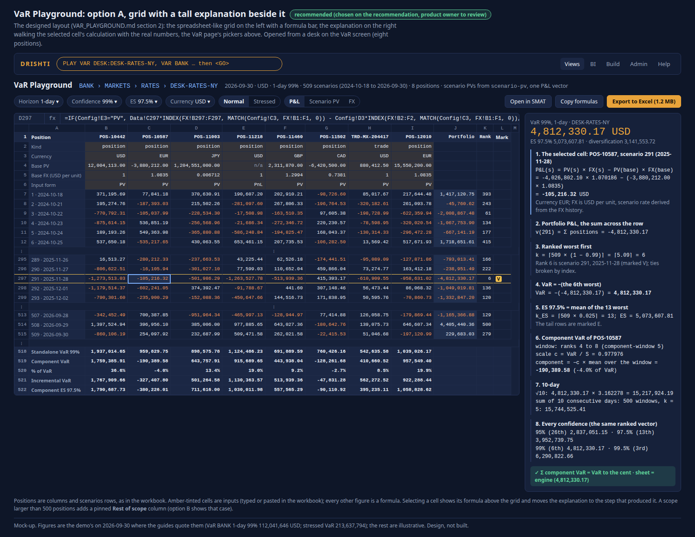
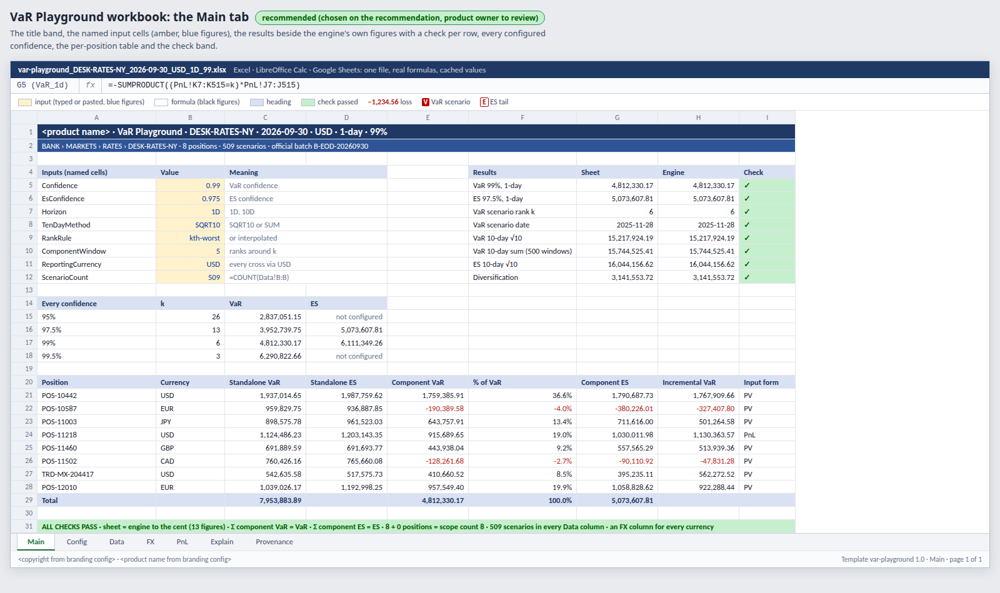

<!--
  Project Drishti · Any data. Any domain. One grammar.
  Copyright (c) 2026 Ashutosh Sinha <ajsinha@gmail.com>. All rights reserved.
  PROPRIETARY AND CONFIDENTIAL. See the LICENSE file in the root of this repository.
-->

# The VaR Playground: every VaR figure, worked in a grid and in a workbook you can recalculate

**Status: built** (the screen of option A with option B's Rest of scope, the workbook, the API, the command and the command line), with
the shared playground frame that every later metric's playground reuses. This document describes the design as built; the screen and
workbook mock-ups it was built from are in section 16. The user's view is [VAR_GUIDE.md section 3.10](../guides/VAR_GUIDE.md#310-the-var-playground-play-var).
The plan's rows are in [IMPLEMENTATION_PLAN.md](IMPLEMENTATION_PLAN.md#298-market-risk-regulatory-foundation-and-debugging-planned)
and its [Playgrounds](IMPLEMENTATION_PLAN.md#playgrounds-one-per-metric-in-the-metrics-release) list.

Related: [VAR_GUIDE.md section 18](../guides/VAR_GUIDE.md#18-the-computation) (the formulas the engine uses, which the workbook mirrors
cell for cell), [VAR.md section 2.9](../contracts/VAR.md#29-scenario-pv-scenario-pvs-per-trade-in-the-trades-currency) (P&L
from scenario PVs and the scenario FX), [section 18.6](../guides/VAR_GUIDE.md#186-horizons-the-two-10-day-methods-and-the-confidence-chosen)
(horizons and confidences), [COMPUTED_ATTRIBUTES.md](COMPUTED_ATTRIBUTES.md) (compute, never store), [CONFIGURATION.md](../admin/CONFIGURATION.md)
(branding and every setting). The word *playground* here means a metric's worked calculation; it is not the client renderer's
`/render/demo` page.

## Contents

1. [Purpose](#1-purpose)
2. [The screen](#2-the-screen)
3. [Scope: from one position to the VaR screen's scope](#3-scope-from-one-position-to-the-var-screens-scope)
4. [Where the inputs come from](#4-where-the-inputs-come-from)
5. [The template: version-controlled, built into the .xlsx](#5-the-template-version-controlled-built-into-the-xlsx)
6. [The tabs](#6-the-tabs)
7. [The formulas, cell by cell](#7-the-formulas-cell-by-cell)
8. [Check cells](#8-check-cells)
9. [The look](#9-the-look)
10. [Excel, LibreOffice and Google Sheets](#10-excel-libreoffice-and-google-sheets)
11. [Settings, commands and the API](#11-settings-commands-and-the-api)
12. [Tests in the drill](#12-tests-in-the-drill)
13. [The playground family and the rule](#13-the-playground-family-and-the-rule)
14. [Build plan and documentation](#14-build-plan-and-documentation)
15. [Decisions](#15-decisions)
16. [Mock-ups: the screens to build](#16-mock-ups-the-screens-to-build)

---

## 1. Purpose

A risk manager, a validator, an auditor or a regulator asks *how was this VaR worked out?* Today the answer is the provenance, the
scenario matrix (`SMAT`) and VAR_GUIDE's formulas. The playground answers it with the numbers themselves: for one position, a handful,
or the whole scope on the VaR screen, it shows every scenario PV, every FX rate, every P&L, the ranking, the VaR, the ES, the components
and the 10-day figures, in a grid on screen with a tall explanation panel beside it, and **exports the same calculation as an .xlsx with
real formulas**, so the whole thing recalculates on the person's desktop, offline, and can be changed and debugged there.

Two uses:

- **Offline debugging.** Why is this desk's VaR 12.4m? Export, open, change a PV, watch the VaR move.
- **Independent verification.** The workbook's figures equal the engine's to the cent, checked by cells in the workbook itself and by a
  drill test. Every figure turns from *trust us* into *check it yourself*.

Nothing the playground shows is stored: it is computed from the same inputs the engine reads, at the moment it is asked (the
compute-first rule, [COMPUTED_ATTRIBUTES.md](COMPUTED_ATTRIBUTES.md)).

## 2. The screen

```
┌ VaR Playground · BANK › RATES › DESK-RATES-NY · 2026-09-30 · USD · 1-day 99% · 509 scenarios ────────────────────────────────┐
│ ┌ grid (Excel-like) ─────────────────────────────────────────────────────┐ ┌ explanation ─────────────────────────────────┐ │
│ │      A            B           C           D          …    Z (rest)       │ │ VaR 99%, 1-day = 4,812,330.17 USD             │ │
│ │ 1 Position    POS-10442   POS-10587   POS-11003        Rest of scope    │ │                                                │ │
│ │ 2 Currency    USD         EUR         JPY                USD            │ │ 1. Each position's P&L under each scenario:    │ │
│ │ 3 Base PV     12,004,113  -3,880,212  1,204,551,000      n/a            │ │    P&L(s) = PV(s) × FX(s) − PV(base) × FX(base)│ │
│ │ 4 Input       PV          PV          PnL                PnL            │ │    POS-10587, scenario 2008-10-10:             │ │
│ │ 5 Scenario 1  -31,220     8,004       -1,100,000         -412,004       │ │    −3,901,004 × 1.2712 − (−3,880,212 × 1.0835) │ │
│ │ …             …           …           …                  …              │ │    = −754,214.55                               │ │
│ │ 513 Portfolio P&L, rank, V/E marks                                      │ │ 2. Portfolio P&L = Σ positions                │ │
│ │ 515 VaR  ES  standalone  component  incremental  diversification        │ │ 3. Ranked worst first; k = ⌈509 × 1%⌉ = 6     │ │
│ └─────────────────────────────────────────────────────────────────────────┘ │ 4. VaR = −(6th worst) = 4,812,330.17           │ │
│  [Horizon 1-day ▾] [Confidence 99% ▾] [ES 97.5% ▾] [Currency USD ▾]         │ …  each step with the real numbers             │ │
│  [Export to Excel]  [Copy formulas]  [Open in SMAT]                        └────────────────────────────────────────────────┘ │
└──────────────────────────────────────────────────────────────────────────────────────────────────────────────────────────────┘
```

- **The grid** looks like a spreadsheet (column letters, row numbers, frozen headers), positions as columns, scenarios as rows. Selecting a
  cell shows its formula in a formula bar above the grid, in the same words the workbook uses.
- **The explanation panel** (tall, on the right) walks through the calculation step by step with the real numbers: P&L of the selected
  position under the selected scenario, the sum, the rank, the VaR scenario and its date, ES as the mean of the tail, the component
  window, the 10-day methods. Selecting a cell moves the panel to the step that produced it.
- **The pickers** are the VaR page's: Horizon (1-day, 10-day √10, 10-day sum), Confidence (`drishti.var.confidences`), ES confidence
  (`drishti.var.es-confidences`), Currency, and Normal / Stressed (stressed VaR is built). They change the screen and
  the export alike.
- **Export to Excel** downloads the workbook of section 6 for exactly what is on screen.
- **Phone:** a glance form (the headline, the explanation's steps); the grid and the export are desk-tier (MOBILE_DISPLAY's tiers).
- **Mock-ups first** (2 or 3 variants of the screen, and a screenshot of each workbook tab), chosen by the product owner before the build.

## 3. Scope: from one position to the VaR screen's scope

| Way in | What it takes | Limit |
|---|---|---|
| `PLAY VAR <id> [<id> …]` | one to 50 trades or positions typed or picked, with the person's date, currency and pickers | 50 ids (`drishti.var.playground.max-ids`) |
| **Playground** on the VaR screen (in the browser) | **every position of the scope on screen** (a node, an ad-hoc set, a what-if basket) | at most **500 positions** in the browser, never more: `drishti.var.playground.max-positions` (default 500, values above 500 refused) |
| **Export to Excel** (from the Playground or the VaR screen) | the same scope | chosen in a drop-down beside the button: **100, 500 (default), 1,000, 10,000 or All** (`drishti.var.playground.export-choices`) |
| The trade, position, `PNLV`, `SPV` and `SMAT` pages | that one trade or position | 1 |

**Over the limit.** A scope with more positions than `max-positions` gets the largest positions by |component VaR| as their own columns
(500 by default) and **one "Rest of scope" column**: the summed P&L of every other position, already in the reporting currency, entered as
data. The portfolio P&L is then still the scope's P&L, so **the sheet's portfolio VaR equals the screen's VaR to the cent**; the sheet and
the screen say *500 of 18,412 positions shown, the rest combined in one column*.

**The browser and the workbook have separate limits.** The browser grid never holds more than 500 positions, so the page stays light;
the workbook is built on the server and streamed, so it can hold far more. Before the download the screen states the workbook's estimated
size, its recalculation time and the applications it fits: Excel and LibreOffice Calc (7.4 or later) hold 16,384 columns, older Calc
1,024; Google Sheets holds 10 million cells in a whole file, about 9,500 positions at 509 scenarios. A choice no application can open
(more positions than Excel's columns) is refused with that reason. Whatever the count, the positions beyond it go into the "Rest of scope"
column, so the workbook's portfolio VaR equals the screen's to the cent.

**Which figures for which positions.** Standalone VaR and ES and **component VaR and ES for every position** (cheap: a sum over the
scope's tail scenarios); **incremental VaR for the top 50 by |component VaR|** (`drishti.var.playground.incremental-positions`, default
50), because each needs its own re-ranked portfolio column; the others show *not computed (top 50 only)*. Diversification for the scope.

**Size, measured.** 500 positions × 509 scenarios: about 12 MB, recalculated by headless LibreOffice in about 10 seconds; 50 positions
about 1.3 MB; one position about 140 KB. The estimate the screen states is from those measurements (about 11 bytes a value cell and 30 a
formula cell, compressed). The export streams; the server holds the chosen positions' scenario values while it writes (about 8 bytes a
cell), so `drishti.var.playground.export-max-cells` (20 million by default, about 19,000 positions at 509 scenarios) caps one export.

**Layout by count.** Positions are columns while the PnL tab's columns fit (label, positions, Rest of scope, nine series and the 50
incremental helpers within 16,384 columns: about 16,300 positions); beyond that positions are rows and scenarios columns, the same
formulas through the other orientation (the frame's `SeriesLayout`). Each choice says which applications open it: Excel and LibreOffice
Calc 7.4 or later (16,384 columns, 1,048,576 rows), LibreOffice Calc before 7.4 (1,024 columns), Google Sheets (10 million cells in a
file).

## 4. Where the inputs come from

A server endpoint builds the inputs **as the person** (their entitlements and masks, as every VaR answer), from the same date, batch,
scenario window and scenario set the engine used, and says so in the Provenance tab:

| Input | Source | Note |
|---|---|---|
| **Scenario PVs** per position, in the position's own currency | `scenario-pv` (VAR_GUIDE 15.9) | **the preferred input** (compute-first: P&L is derived, never stored) |
| **P&L vectors** | `pnl-vector` | accepted; the position is flagged *input form PnL* |
| Base PV | `scenario-pv`'s base value | blank and *n/a* for a P&L-vector position |
| Scenario FX per currency, base FX | `fx-scenario` (supplied) or derived from the FX history (`ScenarioFx.derive`) | each currency's column says *supplied* or *derived* |
| Scenario dates, window, set id, stress flag | the date's scenario set, `drishti.var.scenario-window` | newest N when a window is set |
| Rank rule, component window, confidences, horizon, 10-day method | `drishti.var.*` and the pickers | written to Main as inputs |
| The engine's own figures | the VaR engine, for the same scope and pickers | written to Main's check cells (section 8) |

A trade or position the engine refused (a missing PV, an unknown currency) is listed in Provenance with its DRS code and left out, as the
engine leaves it out; never zero-filled.

**As built, from the engine's own vectors.** The engine keeps each trade's USD P&L row (every reporting currency is converted from these
rows), its USD value today and the currency its scenario PVs came in. A position's Data are recovered from them: `PV(s) = (p + P&L_USD(s))
/ FX_c(s)`, `PV(base) = p / FX_c(base)`, with `p` its USD value today (the same recovery as the per-currency totals, VAR.md section
2.11), so the workbook's chain of formulas gives back the engine's vector. A position whose trades came in different currencies is shown
in USD; one priced by P&L vectors alone is input form PnL (its USD P&L, `p` its stated USD value today). Rest of scope is the engine's
scope vector less the shown positions' P&L as the sheet computes them; with every position shown it is still kept, with zero positions,
when the scope's figure (a node's, summed from the rows as read in float64) differs from its positions' stored rows (float32 in the
mapped tier) by more than a millionth, so the sheet's VaR is always the VaR page's. Stressed VaR (USD only) shows every position as input
form PnL on the stress set's scenarios.

## 5. The template: version-controlled, built into the .xlsx

The workbook's look is **a crafted template kept in the repository as text**, so every change is a reviewable diff; its version is
stamped in every tab's footer and the document properties.

- **The template keeps the look and the words; the formulas are generated for the count chosen** (product owner). The parts in
  git are `template.properties` (name, version, and every cell format by name: `style.input.money=6`, `style.check=16`, the check
  colours `dxf.pass`, `dxf.fail`), `xl/styles.xml` (the look), `docProps/core.xml` and `docProps/app.xml` (with `{{PRODUCT}}`,
  `{{COPYRIGHT}}`, `{{OWNER}}`, `{{TEMPLATE_VERSION}}` filled from the branding configuration) and `explain.txt` (the Explain tab's
  steps, `{Name}` a cell reference and `{Name:v}` its value), under `drishti-server/src/main/resources/playground/var/template/`. They
  are packaged as resources and assembled into the .xlsx as each export is written (comments dropped, placeholders filled); the sheets,
  the named cells and every formula are written by the generator (`VarPlaygroundBook`) for exactly the positions chosen, so a 1-position
  workbook has no empty 500-column layout and a 10,000-position one is not limited by a template.
- **Filled by the server, streamed.** The frame's `WorkbookStream` and `SheetStream` write the zip straight onto the response, row by
  row. Formula cells go through `XlsxWriter.formula` (and `formulaText`), which checks each formula against the common function set
  (`XlsxFormulas`) and writes its **cached result** (so a viewer that does not recalculate still shows correct numbers), computed by
  `VarPlaygroundModel`, the same arithmetic as the formulas. A formula cell is always the generator's, never text supplied by a person.
  The workbook asks Excel to recalculate on open (`fullCalcOnLoad`).
- **A bank's own house style.** `drishti.var.playground.template` may name a folder holding a bank's own versions of these files; it
  must keep every style name of `template.properties` (checked when the server starts: a missing name or file refuses the template with
  the list of what is missing).
- **Works alone.** The empty workbook is downloadable (the playground's form and `GET /api/v1/var/playground/template?positions=10`):
  every formula in place over blank Data, Config and FX; paste scenario PVs, fill the rates and it calculates offline.

## 6. The tabs

Positions are **columns**, scenarios are **rows**, in the scenario set's order (oldest first), the same layout in every tab.

| Tab | What it holds | Typed or formula |
|---|---|---|
| **Main** | A title band (product name, scope, date, currency, horizon, confidence); the headline inputs (named cells: `Confidence`, `EsConfidence`, `Horizon`, `TenDayMethod`, `RankRule`, `ComponentWindow`, `ReportingCurrency`, `ScenarioCount`); in its lower part the **results**: VaR, ES, the VaR scenario's rank and date, 10-day √10 and 10-day sum VaR and ES, every configured confidence side by side, and per position standalone VaR and ES, component VaR and ES, % of VaR, incremental VaR (top 50), diversification; the check cells | inputs typed; results formulas over PnL |
| **Config** | One row per position: id, kind (trade or position), currency, **base PV** in its own currency, **base FX** (USD per unit), **input form `PV` (default) or `PnL`**, its source flag | typed (values) |
| **Data** | **Values only, the one place data is pasted:** the scenario PVs of each position in its own currency (input form PV), or the source's P&L vector as delivered (input form PnL); the "Rest of scope" column's P&L in the reporting currency | values |
| **FX** | **One column per currency** (not per position): the scenario rate of each scenario (USD per unit), the base rate in a header row, *supplied* or *derived* under the code; USD is 1 throughout | values |
| **PnL** | **Every cell a formula, nothing typed:** each position's P&L in USD (from Data, FX and Config, switching on the input form), then in the reporting currency; the portfolio P&L; its tie-broken rank; the V and E marks; the 10-day sums; the incremental helper columns (top 50) | formulas |
| **Explain** | The calculation in words: first in plain language (what VaR answers, how to read the tabs, signs and units), then the ten steps, each opening with what it means in plain words and then its formula and cells (*VaR = −PnL!B518, the 6th worst; see Main!C12*), then **every term** of Main (each input, derived cell and result), Config (each column), Data, FX, PnL and Provenance: what it is, why it matters, what changing it does, and its cell and value | text with references |
| **Sensitivities** (when delta-gamma-vega VaR is built, parked; [VAR_GUIDE 18.12](../guides/VAR_GUIDE.md#1812-delta-gamma-vega-var-on-request-design-not-built-parked)) | Each position's deltas, gammas and vegas per risk factor, the factor shocks per scenario day, and each DGV P&L cell as the expansion Σ δ·Δx + ½ Σ Γ·Δx² + Σ ν·Δσ in formulas; DGV VaR and ES beside the full-revaluation figures, with a check cell against the engine | inputs and formulas |
| **Factors** (when statistical factor VaR is built, parked; [VAR_GUIDE 18.13](../guides/VAR_GUIDE.md#1813-statistical-factor-var-estimated-from-scenario-pl-design-not-built-parked)) | Labelled a statistical estimation: the drivers' scenario-day series and each position's loadings and curvature as data; each fitted P&L cell, the factor VaR and each position's R² as formulas; a check cell against the engine | data and formulas |
| **Provenance** | Date, batch, data versions, scenario set id and dates, window, stress flag, source per position (`scenario-pv` or `pnl-vector`), refused items with DRS codes, the engine version, the template version, who exported it and when, the scope's full position count | values |

The **Config flag switches the PnL formula**, so a person can see and flip it (section 7.1).

## 7. The formulas, cell by cell

The workbook mirrors the engine exactly (VAR_GUIDE section 18; `ScenarioFx` in `drishti-compute`); the column and row names below stand
for the template's named ranges.

### 7.1 P&L of a position, in USD

| Input form | Formula | Engine |
|---|---|---|
| **PV** (default) | `P&L_USD(s) = PV(s) × FX_c(s) − PV(base) × FX_c(base)`; for a USD position `PV(s) − PV(base)` | `ScenarioFx.pnlFromPv` |
| **PnL**, delivered in USD | `= Data!x` (a reference; no PV arithmetic, base PV *n/a*) | the vector as delivered |
| **PnL**, delivered in another currency | that P&L converted at each scenario's rate, as the engine converts a non-USD `pnl-vector` | `ScenarioFx` |

In the cell: `=IF(Config!InputForm="PV", Data!x * FX!c_s - Config!BasePV * FX!c_base, <PnL branch>)`, with `c` looked up by
`INDEX` from the position's currency.

### 7.2 Into the reporting currency

With `p` the position's USD value today (`PV(base) × FX_c(base)`, 0 for a P&L-vector position) and `FX_r` the reporting currency's
USD-per-unit rates: `P&L_r(s) = (p + P&L_USD(s)) / FX_r(s) − p / FX_r(base)` (`ScenarioFx.convert`; every cross through USD). For USD
reporting it is the USD P&L. The "Rest of scope" column is already in the reporting currency.

### 7.3 The portfolio, its rank and the 1-day figures

| Figure | Formula in the sheet | Engine (VAR_GUIDE) |
|---|---|---|
| Portfolio P&L `v(s)` | `SUM` across the positions' reporting-currency P&L columns (and Rest of scope) | the scope's vector |
| Rank, worst first, ties by index | `=SUMPRODUCT((v<v_s)*1) + SUMPRODUCT((v_above=v_s)*1) + 1` | `o`, ties by index (18.1) |
| `k` (kth-worst) | `=MAX(1, MIN(N, ROUNDUP(N*(1-Confidence) - 1E-9, 0)))` | 18.1 |
| VaR, `kth-worst` | `=-SUMPRODUCT((Rank=k)*v)` | `−v[o[k−1]]` |
| VaR, `interpolated` (when configured) | the two neighbouring ranks weighted by `w`, as 18.1 | 18.1 |
| `k_ES`, ES | `=-SUMPRODUCT((Rank<=k_ES)*v)/k_ES` | 18.2 |
| Tail window `T` | ranks `k−h … k+h`, `h = ROUNDDOWN(ComponentWindow/2, 0)`, clamped to 1..N | 18.3 |
| Scale `c` | `VaR / S`, `S = −mean over T of v` (1 when the scaling is off or `S` is 0) | 18.3 |
| Component VaR of a position `p` | `=-c * SUMPRODUCT((Rank>=lo)*(Rank<=hi)*p) / COUNT(window)` | 18.3 |
| Component ES | `=-SUMPRODUCT((Rank<=k_ES)*p)/k_ES` | 18.3 |
| Standalone VaR and ES | the same on the position's own column with its own rank column | 18.3 |
| Incremental VaR (top 50) | `VaR(v) − VaR(v − p)`: a helper column `v − p` per position, its own rank, its kth-worst | 18.3 |
| Diversification | `Σ standalone VaR − VaR` | 18.3 |

Every confidence in `drishti.var.confidences` and every ES confidence in `drishti.var.es-confidences` has its own row of results on Main
(a different rank of the same ranked vector: no extra data).

### 7.4 10-day

| Method | Formula |
|---|---|
| **√10** | `= VaR_1d * SQRT(10)` (and ES) |
| **10-day sum** (overlapping) | a PnL column of `SUM` over 10 consecutive scenario rows: N − 9 windows (509 give 500); then rank, VaR, ES and components over those windows exactly as 7.3 |

### 7.5 Stressed VaR

With stressed VaR, the Normal / Stressed picker exports the stress scenario set instead: the same tabs and formulas
over its 250 scenarios, the set id and window on Main and in Provenance. A date with no stress set says so; never zeros.

### 7.5a The formulas as built

The cells as the generator writes them, positions as columns (item `i` in column `B + i` of Data and PnL, Config row `2 + i`, scenario
`j` in row `4 + j` of Data, FX and PnL):

| Cell | Formula |
|---|---|
| PnL, a position | `=(Config!$H$c+IF(Config!$F$c="PV",Data!Bj*INDEX(FX!$B$j:$X$j,Config!$I$c)-Config!$H$c,IF(Config!$C$c="USD",Data!Bj,Data!Bj*INDEX(FX!$B$j:$X$j,Config!$I$c))))/FX!$R$j-Config!$H$c/FX!$R$2`: USD from the input form, then into the reporting currency (`Config!H` the value today in USD, `= base PV × base FX`; `Config!I` the position's FX column, `=MATCH(currency, FX!$B$1:$X$1, 0)`; `FX!R` the reporting currency's rate, `=INDEX(…, MATCH(ReportingCurrency, …))`) |
| PnL, Rest of scope | `=Data!x` (already in the reporting currency) |
| Portfolio | `=SUM(B j:… j)` across the positions and Rest of scope |
| Rank | `=SUMPRODUCT(($P$4:$P$512<Pj)*1)+SUMPRODUCT(($P$4:$P(j−1)=Pj)*1)+1` (ties by index) |
| Mark, VaR window, ES tail | `=IF(Rank=VarRank,"V",IF(Rank<=EsRank,"E",""))`; `=(Rank>=VarLo)*(Rank<=VarHi)`; `=(Rank<=EsRank)*1` |
| 10-day sum, its rank | `=SUM(P(j−9):Pj)` from the 10th scenario; ranked as the portfolio |
| 10-day weights | for each scenario, how many of the 10-day VaR window's (and ES tail's) windows contain it: `=SUMPRODUCT((R10 range>=TenLo)*(R10 range<=TenHi))` over the windows that end in `j … j+9`, so a position's 10-day component is `−TenScale × SUMPRODUCT(weights, its 1-day column) / (TenHi − TenLo + 1)` with no 10-day column per position |
| Incremental helpers (top 50) | `=Pj − position j`: the portfolio without the position |
| VaR (named `VaROneDay`) | `=IF(RankRule="interpolated",-((1-IW)*SMALL(PF,ILo)+IW*SMALL(PF,IHi)),-SMALL(PF,VarRank))` |
| ES (named `ESOneDay`) | `=-SUMPRODUCT(ES tail,PF)/EsRank` |
| Standalone ES, every ES confidence | with no rank column: `=-(SUMPRODUCT((x<SMALL(x,k))*x)+(k-SUMPRODUCT((x<SMALL(x,k))*1))*SMALL(x,k))/k`, the values below the k-th worst plus the k-th worst as often as needed to make k |
| Component VaR, ES | `=-Scale*SUMPRODUCT(VaR window,p)/(VarHi-VarLo+1)`; `=-SUMPRODUCT(ES tail,p)/EsRank` |
| Headline | `=IF(Horizon="1D",VaROneDay,IF(TenDayMethod="SUM",VaRTenSum,VaROneDay*SQRT(10)))` |

Main's derived named cells (`VarRank`, `EsRank`, `VarLo`, `VarHi`, `IPos`, `ILo`, `IHi`, `IW`, `VaROneDay`, `ESOneDay`, `Smoothed`,
`Scale`, and their 10-day twins `TenCount`, `TenRank`, `TenEsRank`, `TenLo`, `TenHi`, `TenPos`, `TenILo`, `TenIHi`, `TenIW`,
`VaRTenSum`, `ESTenSum`, `TenSmoothed`, `TenScale`) sit under the inputs with their formula in words; no name looks like a cell
reference (`ES1` would be one).

### 7.6 Where the simulation is the input

The rule for every playground: where a metric's core is a large simulation (exposure paths, projected IM or capital), the simulation's
output is **data** and everything after it is **formulas**, and the sheet says so on Main and in Explain. VaR's core is already a sum and
a rank, so every step after the scenario PVs is a formula.

## 8. Check cells

| Check | Pass when |
|---|---|
| Portfolio VaR, ES (every confidence, both 10-day methods) | the sheet's figure equals the engine's figure written beside it, to the cent (`ABS(sheet − engine) < 0.005`) |
| Components add up | `Σ component VaR = VaR` and `Σ component ES = ES` to the cent |
| Positions shown | `positions shown + positions in Rest of scope = the scope's count` |
| Scenario count | `COUNT` of each Data column = `ScenarioCount` |
| FX present | every position's currency has an FX column |

A green **ALL CHECKS PASS** band on Main, or a red band naming the failed check. A person who changes a PV sees the engine checks turn
red (the engine's figure is for the original inputs), and the *adds up* checks stay green.

**As built**, the band sits at the top of Main (row 3), under the title, so it is seen first whatever the positions' count; its checks are
listed in column A of the Checks block (each `✓` or `✗`, green or red by conditional formatting): Σ component VaR = VaR, Σ component ES =
ES, Σ 10-day-sum components = the 10-day sum VaR, every position's component VaR, component ES, 10-day component and incremental VaR =
the engine's, positions shown + Rest of scope = the scope, every Data cell a number, every currency an FX column, and every result and
confidence row = the engine's. The engine's figures are its calculator's (`VarCalc`, `VarLens`) on its own scope vector and the
positions' vectors.

## 9. The look

Professional grade, decided by the product owner: one font family with clear sizes; muted header fills; **input cells visibly distinct
from formula cells** (a light input fill and a legend); losses red and gains green with **colour-blind-safe markers** as well (*V* on the
VaR scenario, *E* on the ES tail); number formats with thousands separators and two decimals for money; frozen headers; set column
widths; print set up landscape, fit to width, with header and footer; a title band on Main. **Copyright and product name** in a footer on
every tab and in the workbook's properties, taken **only from the branding configuration** (`drishti.branding.*`), never literals in the
template (the template holds placeholders the export fills). The look is mocked up (a screenshot of each tab) and chosen before the
build.

## 10. Excel, LibreOffice and Google Sheets

**One file for all three**, no switch. Formulas use only functions the three share: `SUM`, `SUMPRODUCT`, `SMALL`, `LARGE`, `AVERAGE`,
`COUNT`, `INDEX`, `MATCH`, `ROUNDDOWN`, `ROUNDUP`, `SQRT`, `IF`, `ABS`, `MAX`, `MIN`, `AND`, `OR`, `ISNUMBER` (the list is
`XlsxFormulas.ALLOWED`; a formula naming anything else is refused when it is written). **Never** Excel-365-only dynamic arrays
(`FILTER`, `SORT`, `SEQUENCE`, `LET`, `LAMBDA`, `XLOOKUP`), structured table references, volatile `INDIRECT` or `OFFSET`, or macros.
Cached values are written with every formula, so a viewer that does not recalculate (a browser preview, a mail client) shows the right
numbers. The export's drop-down says, for each count, which of Excel, LibreOffice Calc (7.4 or later, and before 7.4) and Google Sheets
open it (section 3).

## 11. Settings, commands and the API

| Setting | Default | Meaning |
|---|---|---|
| `drishti.var.playground.enabled` | `true` | the screen, the command and the export |
| `drishti.var.playground.max-positions` | `500` | positions the screen shows as their own columns, the largest by \|component VaR\|; the rest go into Rest of scope; **at most 500** (a value above is refused when the server starts) |
| `drishti.var.playground.incremental-positions` | `50` | positions that get incremental VaR (the largest by \|component VaR\|) |
| `drishti.var.playground.max-ids` | `50` | ids `PLAY VAR` takes |
| `drishti.var.playground.template` | blank: the built-in template | a bank's own template folder (it must keep every style name) |
| `drishti.var.playground.export-choices` | `[100, 500, 1000, 10000, 0]` | the export's drop-down (0: All) |
| `drishti.var.playground.export-default` | `500` | the choice selected first |
| `drishti.var.playground.export-max-cells` | `20000000` | the most cells one export holds on the server; larger is refused in words |

Each is in [CONFIGURATION.md](../admin/CONFIGURATION.md) through the settings catalogue.

- **Command:** `PLAY VAR <scope>` in the VaR explorer's words, with its lens and `IN <currency>`, and `PLAY VAR <id> <id> …` (positions
  or trades); `PLAY` is checked free against every pack's mnemonics and is an edition word (`commands.words.PLAY`, on in Drishti Risk and
  Drishti Trading). The console's page is `/play`; its JSON `/api/play/grid`, `/api/play/estimate`, `/api/play/export.xlsx`,
  `/api/play/template.xlsx`.
- **API:** `GET /api/v1/var/playground` (the grid as JSON: at most 500 positions, the figures, the engine's figures, the checks, the
  formula bar's formulas, the export's choices), `GET /api/v1/var/playground/estimate`, `GET /api/v1/var/playground.xlsx?count=500|all`
  (streamed) and `GET /api/v1/var/playground/template`; their parameters in [VAR_GUIDE.md section 11.1](../guides/VAR_GUIDE.md#111-the-endpoints).
- **CLI:** `drishti.py var playground <scope> [--ids A,B] [--xlsx out.xlsx] [--count N|all] [--estimate]`.

## 12. Tests in the drill

- **To the cent, recalculated.** `VarPlaygroundWorkbookTest` writes the workbook **without cached values**, so every figure read back is
  LibreOffice's own, recalculates it with `soffice --headless` (a private profile set to recalculate on load) and compares every result
  row, every confidence and ES confidence row and every position's component VaR, component ES, 10-day component and incremental VaR to
  the engine's calculator (`VarCalc`, `VarLens`) on vectors made the engine's way (`ScenarioFx`), to the cent: 1 position (USD), 50 (EUR
  reporting, the interpolated rank rule, the 10-day sum headline) and 500 with Rest of scope (USD, √10), PV and PnL input forms, positions
  as rows. `VarPlaygroundApiTest` does it through the server on a 611-trade lake (scenario PVs in EUR and GBP, USD P&L vectors): the grid
  against the VaR page's own answer, the 500-position export recalculated against it. The harness (`LibreOfficeRecalc`) skips where
  LibreOffice is absent (the Windows QA machine) and runs one LibreOffice at a time on the machine (`flock`).
- **The template.** A bank template missing a style name or a part is refused with the list; every formula of every export is scanned
  for functions outside the common set (`XlsxFormulas.scan`); the branding placeholders are filled from configuration in the properties
  and every tab's footer; the sizes, layouts and applications of each count.
- **The screen.** `test_play.py` (the command, the page, the grid, the export and the template streamed through, the edition) and
  `test_play_browser.py` (the windowed grid, the formula bar, the explanation, the arrow keys, the export's estimate, a picker, at 1280
  and 390 px, no request off the host).

## 13. The playground family and the rule

**The rule (product owner, 2026-10-31): every metric calculation ships with its playground, in the same release as the metric, never
deferred.** A metric is not done without it: `PLAY <METRIC> <ids|scope>`; the screen (inputs grid and tall explanation panel with real
numbers); the export from a version-controlled template (text OOXML parts in git) with Main, Config, Data (values only), formula tabs,
Explain and Provenance; every derived cell a formula; check cells (sheet = engine to the cent); the professional look; copyright from
the branding configuration; Excel, LibreOffice and Google Sheets; a drill test with headless LibreOffice recalculation. Every builder
brief and every metric's design document has its playground section.

**The frame is built once, with VaR:** the screen's grid and explanation panel, the template loader and filler on `XlsxWriter`,
the check-cell and look conventions, the formula scanner and the LibreOffice test harness. Each later playground is a template and a
calculation on that frame.

**How a later metric plugs in (the frame as built).** In `drishti-server`:

| Piece | Where | What a metric does with it |
|---|---|---|
| `PlaygroundTemplate` | `server/playground` | `PlaygroundTemplate.builtIn("<metric>", STYLES)` reads `playground/<metric>/template/` (copy VaR's folder: `template.properties`, `xl/styles.xml`, `docProps/*.xml`, `explain.txt`) and refuses a bank's folder missing a style |
| `WorkbookStream`, `SheetStream` | `server/playground` | the zip written onto the response, sheet by sheet and row by row: `sheet(name, tab)`, `row(r)`, `text`, `number`, `formula(col, f, cached, style)`, `formulaText`, `freeze`, `width`, `merge`, `checks(range, "✓")` (green and red), the branding footer on every tab, `name(...)` for the named cells |
| `SeriesLayout` | `server/playground` | items (positions, netting sets, trades) by points (scenarios, time steps) as columns or as rows, with series (a total, its rank) beside: every formula reference comes from it, so a generator serves both orientations |
| `ExportSizing` | `server/playground` | the estimate of a count (columns, rows, cells, size, recalculation time, the applications that open it, or why not) |
| `XlsxFormulas`, `XlsxWriter.formula` | `server/dist` | the common function set, the check of every formula written, the scan of a finished file |
| `LibreOfficeRecalc` | the tests' `server/playground` | `recalc(xlsx, work)` and `cells(file, sheet)`: the drill's recalculation, one LibreOffice at a time |
| The screen | `drishti-console`: `play_routes.py`, `terminal/play.html`, `drishti_var-playground.js`, `drishti_var-playground.css` | `PLAY <METRIC>` (add the word to `METRICS`); the windowed grid, formula bar and explanation take the metric's columns, rows and steps |

A metric adds its model (the formulas' arithmetic, for the cached values: VaR's is `VarPlaygroundModel`), its generator (VaR's
`VarPlaygroundBook`: the tabs and formulas through `SeriesLayout`), its inputs as the person (VaR's `VarPlayground`), its endpoints
(`/api/v1/<metric>/playground`, `.xlsx`, `/estimate`, `/template`), and its drill test on `LibreOfficeRecalc` at its own sizes.

| Playground | Metric | Release (the plan's themed releases) |
|---|---|---|
| **VaR** | VaR, ES, components, incremental, 10-day, stressed | built, with the frame |
| Exposure | EE, EPE, PFE for one netting set (the paths as data) | proposed |
| SA-CCR | EAD by CRE52 (replacement cost, add-ons, the multiplier) | proposed, with the engine |
| FVA | EPE and ENE × funding spread | proposed |
| FRTB SA | SBM, DRC, RRAO | proposed |
| SIMM | IM per netting set and regime | proposed |
| CVA, BA-CVA, SA-CVA | CVA (EE × DF × ΔPD × LGD), its capital | proposed |
| FRTB IMA | ES by liquidity horizon, stressed calibration | proposed |
| MVA, KVA | from projected IM and capital (as data) | proposed |

## 14. Build plan and documentation

1. Mock-ups: two or three screen variants and a screenshot of each workbook tab; the product owner picks.
2. The template parts in git, assembled into each export as it is written; `XlsxWriter` extended (checked formula cells with cached values); the streamed workbook, the layouts and the sizing (the frame, section 13).
3. The server endpoint and the calculation (shared with the engine's code where it exists: `ScenarioFx`, the rank and the components).
4. The screen (grid, panel, pickers, export), the command and the CLI.
5. Tests of section 12; the drill's LibreOffice stage.

**Documents kept with the build:** VAR_GUIDE (a playground section and its formulas), USER_GUIDE (the screen), a tutorial step in
tutorial 25 (CLI and UI, pictures), CONFIGURATION (the settings), API_GUIDE and CLI_GUIDE, a Knowledge entry, the help entries, the decks
(the VaR deck's verification slide), CHANGELOG; this document as built.

## 15. Decisions

**Decided (product owner, 2026-10-31):** the playground itself (one to many positions, the grid and the explanation panel, Export to
Excel with real formulas); every confidence, the ES confidences, both 10-day methods and currency conversion; the version-controlled
template; the professional look with copyright from branding; one file for Excel, LibreOffice and Google Sheets; the scope from the VaR
screen up to 500 positions (configurable) with Rest of scope; per-position currency, base PV and base FX; the Config tab with the input
form PV or PnL; the simplified tabs (Main, Config, Data values only, FX, PnL formulas only, Explain, Provenance); placement with
the frame; the rule that every metric has its playground in its own release.

**Mock-ups (2026-10-31), section 16:** three screen options and a picture of each workbook tab. The product owner chose option A
with option B's Rest of scope and the workbook look shown; that is what is built.

## 16. Mock-ups: the screens to build

The mock-ups are under [`mockups/var-playground/`](mockups/var-playground/), each a self-contained HTML page (system fonts, everything
inline, nothing from a CDN) with a headless-Chrome screenshot beside it, 1600 px wide; the dark theme is the default and `#light` at the
end of a page's address shows the light theme (`A-light.png`). The figures come from one exact model of the calculation: the BANK
figures are the demo's on 2026-09-30 (VaR 1-day 99% 112,041,646.00; 95% 68,355,411; 10-day √10 354,306,794; 10-day sum 274,544,283),
and every ES, component, incremental and 10-day figure on a page is computed from the same vectors as section 7 says, so the explanation
panel's arithmetic is right. **This checklist is the source of truth at build time**: a panel is done when its row says built.

| Mock-up | What it shows | Status |
|---|---|---|
| [A](mockups/var-playground/A.html): grid with a tall explanation beside it | a desk from the VaR screen (8 positions); the formula bar; the explanation of the selected cell | **built** (chosen by the product owner, with option B's Rest of scope) |
| [B](mockups/var-playground/B.html): three panes with the position list | BANK from the VaR screen: 500 of 18,412 positions, Rest of scope pinned at the right | its Rest of scope column built into A; the three panes not built |
| [C](mockups/var-playground/C.html): explanation first with tabbed views | `PLAY VAR` with three ids; the tail ranked worst first; the results | not built (the alternative not chosen) |
| [Workbook tabs](mockups/var-playground/workbook-main.html): Main, Config, Data, FX, PnL, Explain, Provenance | one picture per tab, the professional look of section 9 | **built** (chosen by the product owner) |

**Why A.** It is the layout this document designed (section 2) and the one every later playground can reuse unchanged: the grid looks
like the workbook a person will export (positions as columns, scenarios as rows, the formula bar showing the cell's formula in the
workbook's own words), and the explanation stays next to the cell it explains, so selecting a cell and reading why are one motion. It
serves one position and five hundred alike: a scope over the limit only adds the pinned Rest of scope column (B's case), and B's position
list can be a drawer of A rather than a third pane that narrows the grid. C reads well as a worked example but hides the spreadsheet a
validator expects to check, and does not match the export.





The other tabs: [Config](mockups/var-playground/workbook-config.png), [Data](mockups/var-playground/workbook-data.png),
[FX](mockups/var-playground/workbook-fx.png), [PnL](mockups/var-playground/workbook-pnl.png),
[Explain](mockups/var-playground/workbook-explain.png), [Provenance](mockups/var-playground/workbook-provenance.png); the other screen
options: [B](mockups/var-playground/B.png), [C](mockups/var-playground/C.png).

### 16.1 The screen (option A)

| # | Panel | Contents on the mock-up | Data, API or contract | Interaction | Status |
|---|---|---|---|---|---|
| P1 | Header | *VaR Playground*, the scope's path (BANK › MARKETS › RATES › DESK-RATES-NY), date, currency, horizon and confidence, the scenario count and dates, the position count, the input sources | the playground endpoint (section 11) | each path part opens that node's VaR | built: the scope's name and canonical form shown as text (the parts are not links) |
| P2 | Pickers | Horizon, Confidence, ES, Currency, Normal / Stressed; the grid's view P&L / Scenario PV / FX | `drishti.var.confidences`, `es-confidences`; the VaR page's pickers | change the grid, the panel and the export alike | built |
| P3 | Actions | Open in SMAT, Copy formulas, **Export to Excel** with the size stated | the export of section 11 | download the workbook for exactly what is on screen | built (Copy formula copies the selected cell's; the export's drop-down states each count's size, recalculation time and applications) |
| P4 | Formula bar | the selected cell's reference and its formula as the workbook writes it | the template's formulas | follows the selection | built |
| P5 | Grid: header rows | rows 1 to 6: Position, Kind, Currency, Base PV, Base FX, Input form; input cells tinted | Config (section 6) | — | built |
| P6 | Grid: scenarios | one row per scenario (index and date), each position's P&L in the reporting currency, Portfolio, Rank, Mark (V on the VaR scenario, E on the ES tail); long runs folded (⋮) around the first rows, the VaR scenario and the last rows | PnL (section 7) | select a cell; scroll; the V row is outlined | built: windowed rather than folded (only the cells in view are drawn, every row reached by scrolling, the VaR scenario selected first); V and E in the Mark column |
| P7 | Grid: results rows | Standalone VaR 99%, Component VaR, % of VaR, Incremental VaR, Component ES 97.5% per position | Main's results (section 7.3) | select a figure: the panel explains it | built |
| P8 | Rest of scope | a pinned last column when the scope has more than `max-positions` positions, its P&L entered as data | section 3 | — | built (after the positions, before Portfolio; not pinned) |
| P9 | Explanation panel | the headline (VaR, ES, diversification); steps 1 to 8 with the real numbers: the cell's P&L, the portfolio sum, the rank k, VaR, ES, the component (window and scale), the two 10-day methods, every confidence; the check line | the same endpoint | selecting a cell moves the panel to its step | built |
| P10 | Check line | *Σ component VaR = VaR to the cent · sheet = engine* | section 8 | red with the failed check named | built |
| P11 | Note | inputs tinted; every other figure a formula; the Rest of scope rule | — | — | built |

**States** (built). *Loading:* `loading…` in the header until the grid arrives. *Over the limit:* the banner *500 of 18,412 positions
shown (the largest by |component VaR|); the other … are combined in Rest of scope*. *Refused inputs:* in the workbook's Provenance
with their DRS codes (the screen links to it through the export). *Phone:* the glance form, the headline and the explanation's steps;
the grid and the export are desk-tier.

### 16.2 The workbook (the look shown)

| # | Tab | Contents on the mock-up | Typed or formula | Status |
|---|---|---|---|---|
| W1 | Every tab | the file name band, the formula bar, the legend (input, formula, heading, check passed, loss, V, E), column letters and row numbers, the sheet tabs, the footer *<copyright from branding config> · <product name from branding config>* and the template version | — | built: the footer (copyright and product name from branding, the template version, the page) on every tab and the tab colours; no legend drawn in the sheets (inputs amber with blue figures, formulas black, checks green or red) |
| W2 | Main | the title band and the scope band; the named inputs (amber fill, blue figures); the results beside the engine's figures with a check each; every confidence (k, VaR, ES); the per-position table with totals; the ALL CHECKS PASS band | inputs typed; results formulas | built |
| W3 | Config | one row per position: id, kind, currency, base PV, base FX, input form, source, base value in USD | typed; the last column a formula | built |
| W4 | Data | scenario PVs in each position's currency, or the P&L vector as delivered; the form row under the header | values only | built |
| W5 | FX | one column per currency; the base rate and *derived* or *supplied* in header rows | values | built |
| W6 | PnL | each position's P&L, Portfolio, Rank, Mark, the 10-day sums (from the 10th scenario); the selected cell's formula in the bar | formulas only | built |
| W7 | Explain | plain-language introduction, ten steps in plain words with their formulas and cells, and every term of every tab explained | text with references | built |
| W8 | Provenance | date, batch, scope, counts, scenario set, data versions, sources, refused items with codes, engine and template versions, who exported it, the settings | values | built |

**Settled in the build:** the fills and fonts of the mock-up (navy title band, light-blue headings, light-yellow inputs with blue figures,
black formula figures, red losses, the V and E marks), checked recalculating in LibreOffice; `xl/styles.xml` of the template holds them.