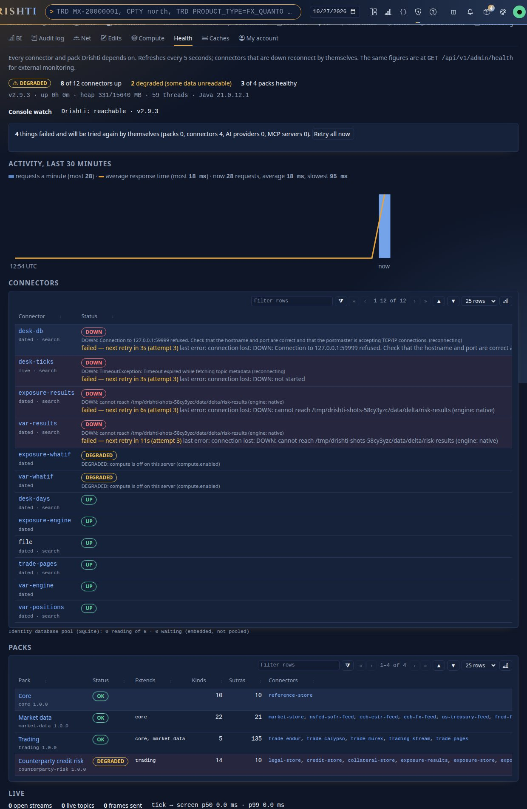
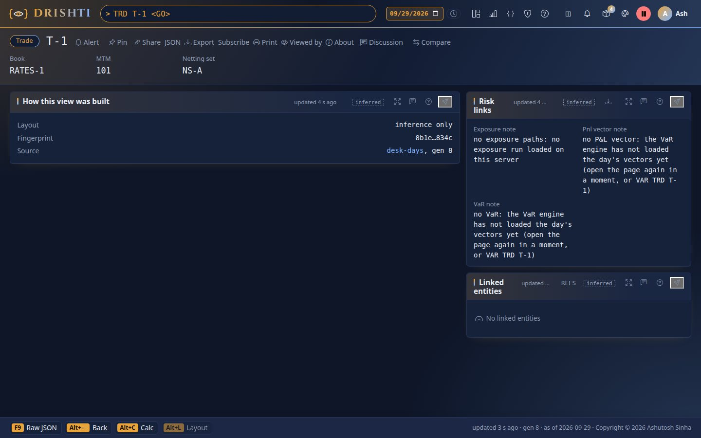
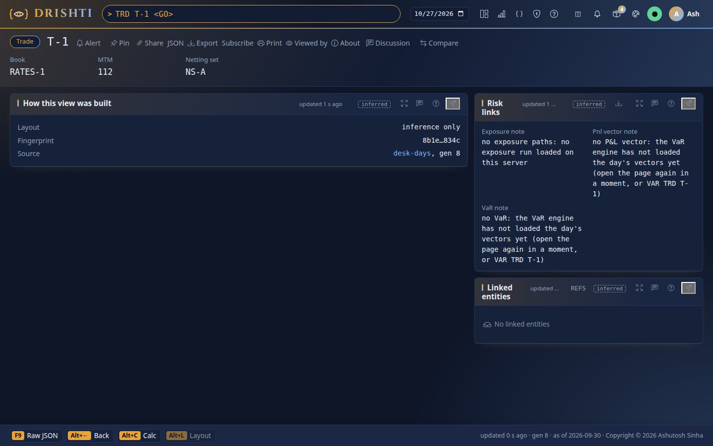
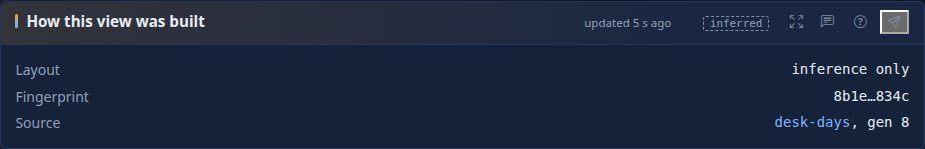

<!--
  Project Drishti · Any data. Any domain. One grammar.

  Copyright (c) 2026 Ashutosh Sinha <ajsinha@gmail.com>.
  All rights reserved.

  PROPRIETARY AND CONFIDENTIAL.

  This file is the confidential and proprietary property of Ashutosh Sinha.
  Unauthorised copying, use, modification, distribution or disclosure of this
  file, via any medium, is strictly prohibited except with the express prior
  written permission of the copyright holder.

  See the LICENSE file in the root of this repository for the full terms.
-->
# Connectors: a developer's guide

This guide is for the person who connects Drishti to data: choosing among the nineteen plugins that ship, combining
and operating them, and, when none fits, writing a new one. It teaches. The exact settings, data layouts, health texts
and limits of each connector live in that connector's own document (`docs/connectors/<NAME>_CONNECTOR.md`), and this
guide links there instead of repeating them. Named connectors are **files**, one YAML file per connector in `config/connectors/`: the folder, the
format, live reload and the Admin page are in [CONNECTOR_FILES.md](CONNECTOR_FILES.md).

| If you want to… | Go to |
|---|---|
| understand the words (entity, kind, connector, route, dated, live) and how a read picks a connector | [Concepts in plain words](#concepts-in-plain-words) |
| pick a connector for your data | [Which connector should I use?](#which-connector-should-i-use) |
| see each shipped connector in one screen, with a minimal configuration | [The shipped connectors](CONNECTORS.md#which-connector) |
| write your own connector | [The SourcePlugin SPI](#the-sourceplugin-spi) and [A worked example](#a-worked-example-the-dayfolder-plugin) |
| run several connectors together, check them, fix them | [Combining connectors](CONNECTORS.md#combining-connectors), [Operating connectors](CONNECTOR_FILES.md#12-health-and-problems), [Troubleshooting](../guides/TROUBLESHOOTING.md#a-connector-symptom-check-and-fix) |

## Contents

1. [Concepts in plain words](#concepts-in-plain-words)
2. [Which connector should I use?](#which-connector-should-i-use)
3. [Before you start: the common steps](#before-you-start-the-common-steps)
4. [The SourcePlugin SPI](#the-sourceplugin-spi)
5. [Registration and discovery](#registration-and-discovery)
6. [Configuration binding](#configuration-binding)
7. [TLS for a connector: the shared module](#tls-for-a-connector-the-shared-module)
8. [Outbound HTTP proxy: the shared module](#outbound-http-proxy-the-shared-module)
9. [Reconnecting and failures](#reconnecting-and-failures)
10. [Connectors that compute data on demand](#connectors-that-compute-data-on-demand)
11. [Testing with drishti-testkit](#testing-with-drishti-testkit)
12. [A worked example: the dayfolder plugin](#a-worked-example-the-dayfolder-plugin)
13. [The README standard](#the-readme-standard)
14. [The shipped connectors](CONNECTORS.md#which-connector) and 15. [Combining connectors](CONNECTORS.md#combining-connectors): in [CONNECTORS.md](CONNECTORS.md)
16. [Operating connectors](CONNECTOR_FILES.md#12-health-and-problems): in [CONNECTOR_FILES.md](CONNECTOR_FILES.md), and 17. [Troubleshooting](../guides/TROUBLESHOOTING.md#a-connector-symptom-check-and-fix): in [TROUBLESHOOTING.md](../guides/TROUBLESHOOTING.md)

---

## Concepts in plain words

### Entities, kinds and documents

Everything Drishti shows is an **entity**: a trade, a counterparty, a curve, a margin call. Each entity has a
**kind** (`trade`, `counterparty`, `ir-curve`) and an **id** (`MX-20000001`, `CP-ALDERSHOT`). The data behind an
entity is one **document**: a JSON object, as your system holds it. Drishti lays the document out on screen by
itself (and with a Sutra, if a pack ships one for the kind), so you do not reshape your data for Drishti; you only
tell Drishti where to find it.

A user opens an entity by typing `<MNEMONIC> <ID> <GO>` in the terminal, for example `TRD MX-20000001 <GO>`. The mnemonic
(`TRD`) comes from a pack and stands for a kind (`trade`). A connector can serve any kind, but a user can only type a
kind that some enabled pack gives a mnemonic (or an id pattern) to; through the API any kind can be read
(`GET /api/v1/views/{kind}/{id}`).

### Plugin, connector, connector file, route

| Word | What it is | Example |
|---|---|---|
| **plugin** | a piece of software that knows how to talk to one *type* of store | `jdbc` talks to databases, `kafka` to Kafka |
| **connector** | one plugin pointed at one *particular* store, with a name and its own settings | `desk-db`: the `jdbc` plugin, pointed at `jdbc:postgresql://db.bank.example/desk` |
| **connector file** | one YAML file, `config/connectors/<name>.yaml`; the file name is the connector's name. Connectors belong to the site, not to a pack ([CONNECTOR_FILES.md](CONNECTOR_FILES.md)) | `config/connectors/trade-endur.yaml` (Delta Lake) |
| **pack template** | what a pack suggests for a connector it names (its `pack.yaml` `connectors:` mapping or `connector-templates:`); the server writes it to the file once, at the first start, and never overwrites the file | the trading pack's templates for `trade-endur` (Delta Lake) and `trading-stream` (Kafka) |
| **site connector** | a connector file no pack suggests | anything you add yourself |
| **route** | "for this kind, ask this connector first" | `trade: trade-endur` |
| **default route** | the connector asked second, for every kind | `demo` (the sample data), as shipped |

A plugin can also run **as itself**, without a connector name, under `drishti.sources.plugins.<plugin>`. That is how
the shipped `demo` and `file` run. It is fine for one store; for anything more, use named connectors: you can run the
same plugin several times, each connector shows under its own name in health, and documents say which connector they
came from.

### Dated and undated; snapshot and effective

A **dated** connector keeps history: ask it for 29 September and it answers with the data for 29 September. Delta
Lake, the database table mode, Aerospike, dated folders on disk or in S3, and the public feeds are dated. An
**undated** connector only knows "now": a REST service, a Kafka topic, a message queue.

Dated stores keep each kind in one of two ways:

| Mode | Stored | A read for a date returns |
|---|---|---|
| `snapshot` (the default) | every entity, in full, for every business date | the newest date on or before the one asked, but no older than `lookback-days` (10); an entity missing from that date is gone |
| `effective` | a row only when the entity changes (reference data: counterparties, books) | each entity's last row on or before the date, however old |

### Live and picked dates

The top bar of the console has a business date. By default it shows **Live** (the current business date, latest
version): views can tick as new data arrives. When a user picks an earlier date, or the current date explicitly, the
view is a **static snapshot** for that date. API callers choose the same way with `X-Drishti-As-Of: 2026-09-29` or
`?asOf=2026-09-29`; `X-Drishti-Known-At` / `?knownAt=` asks for the data *as it was known* at an instant (before
later corrections; Delta Lake and Iceberg only: other dated connectors refuse it with `DRS-1007`).

A **live** connector pushes changes to open views (Kafka, ActiveMQ, RabbitMQ, and the demo samples). The others are
read when a view opens.

### How a request picks a connector

This is the single most useful thing to understand. For a read of `<kind>/<id>`, Drishti
(`SourceRouter` in `drishti-engine`) makes a list of candidates:

1. the kind's **route**, if it names a running connector that serves the kind;
2. the **default route** (`demo`), if it serves the kind;
3. **every other** running connector that serves the kind, **in the order they were registered** (a connector keeps its place in the order when its file changes or it is restarted). A connector with no `kinds` list serves *every* kind
   (the shipped `demo` and `file` do; so does a Kafka or message-queue connector before its first message, unless you
   give it `kinds`).

Then it re-orders the list, keeping the order inside each group:

- **For a picked date:** dated connectors first, then undated ones. History comes from history.
- **For Live:** live connectors first, and among them a real stream before the default route's samples; then the
  rest.

Drishti asks the candidates one by one. A connector that does not hold the entity says so and the next is asked. The
first that holds it answers. A connector that **holds the date** is authoritative for it: an entity it does not list
for that date is not held, and the connectors behind it are not asked (`DRS-1001 recent-files holds trade for
2026-09-29 and does not list trade/MX-30000006`). A recent store that dropped a trade is not overruled by the lake
behind it, and the view agrees with a search of the same date. Only a date the connector does not hold passes on (a
recent store of the last weeks in front of years in a lake). Which connectors can tell: the file connector over dated
JSON-lines snapshots (a date is held when a day's file serves it, within `lookback-days`); others cannot yet tell, and
an entity they do not hold passes to the next as before (see [`coverage`](#coveragekind-asof-which-dates-you-hold) in the SPI). A connector
that **fails** (the database is down, the service answers 500, a file or
table it holds cannot be read, a store it has not reached yet so it cannot tell what it holds) stops the read with
`DRS-1003 <connector> failed reading <kind>/<id>`: Drishti does not silently show you another store's data instead.
When the connector says what to do (a Delta date in a codec its engine does not read), the error says so too
(`…: trade 2026-09-30 cannot be read: …; rewrite the date with Snappy or ZSTD …`). The whole read must finish
within `drishti.sources.fetch-timeout` (5 s) or it ends with `DRS-1004`. If nobody holds the entity the answer is
`DRS-1001`; if no connector serves the kind at all, `DRS-1002` (rare, because `demo` and `file` serve every kind).
A read *as known at* an instant (`knownAt`) is only put to connectors that keep earlier versions (Delta Lake,
Iceberg). A dated connector without them that may hold the date stops the read with `DRS-1007` (400) naming it
(`recent-files keeps no earlier versions, so a read 'as known at' an instant cannot be answered from it …`), rather
than showing today's data as if it were what was known then; one that does not hold the date is passed over.
Undated connectors have one version and are read as usual (the view says the data is current).

Live updates follow the read: the ticks come from the first live connector that holds the entity, in the same order
(a real stream before the samples). So if a trade comes from Kafka, it ticks from Kafka.

Search (the type-ahead under the command line) asks every connector that supports search and merges the hits.
A structured search (`TRD where …`) lists the kind the same way and reads what it lists, in read order up to the
first connector that holds the date (the ones behind it are not listed, as they are not read); a connector that fails, does
not answer within the search budget, says its list of the kind is incomplete (a table it could not index), or cannot
answer a *known at* search, makes the answer `partial: true` and is named in it with why (`failed`), so a failure
never reads as "nothing matched".
Reverse lookups (what refers to this entity) ask every connector that supports them.

**A real example.** On a server running the trading pack with its Delta Lake and the demo samples on (and the Kafka
stream off), the same trade is read three ways:

```bash
B=http://localhost:18480/api/v1
curl -s $B/entities/trade/MX-20000001/raw | jq -c .provenance
curl -s "$B/entities/trade/MX-20000001/raw?asOf=2026-09-29" | jq -c .provenance
curl -s "$B/entities/trade/MX-20000001/raw?asOf=2026-08-01" | jq -c .provenance
```

You should see:

```json
{"source":"murex-rates","generation":2,"fetchedAt":"2026-10-01T01:57:52.264798849Z","live":true,"businessDate":null}
{"source":"trade-endur","generation":7,"fetchedAt":"2026-10-01T01:57:52.290912912Z","live":false,"businessDate":"2026-09-29"}
{"source":"murex-rates","generation":2,"fetchedAt":"2026-10-01T01:59:42.090962906Z","live":true,"businessDate":null}
```

- **Live**: the demo samples are live, so they go first; the sample's own source name (`murex-rates`) is shown.
- **29 September**: dated sources go first, so the lake (`trade-endur`) answers, with `businessDate`.
- **1 August**: before the lake's first date (the sample lake holds ten business days), so the lake does not hold it
  and the undated samples answer. The console says so above the view:
  *No data held for 2026-08-01: the current data of murex-rates, a source that keeps no dates*

### Where configuration goes

A connector is configured by **one file**, `config/connectors/<name>.yaml`, edited in your editor, in **Admin → Connectors**, or with
`drishti.py connector apply`, and applied to the running server without a restart. A pack does not carry connection settings: it **names** the connectors it
reads through (`connectors: [trade-endur]` and `routes:` in its `pack.yaml`) and may **suggest** a template for each. Precedence, highest first
(the full table and the rules are in [CONNECTOR_FILES.md](CONNECTOR_FILES.md#precedence)):

| Source | Role |
|---|---|
| environment variables, and `drishti.sources.connectors.*` in `application.yaml` / `application.local.yaml` (**deprecated**) | override a file setting by setting until you move them to the file; a warning names the file to write |
| `config/connectors/<name>.yaml` | the site's definition; it **replaces** the pack's template for that name **wholesale** (settings are not merged) |
| the pack's template (`connectors:` mapping or `connector-templates:` in `pack.yaml`) | the pack's suggestion; written to the file once at the first start, and used in memory when the file cannot be written |

A file with no template of that name is a new site connector. A connector file holds `plugin`, `enabled`, `kinds`, `description` and `settings`; nesting under
`settings` is flattened to dotted keys. Values like `${DRISHTI_DELTA_ROOT:${drishti.data.dir:./data}/delta}` are placeholders: the environment variable if set, else the default
after the colon. A **credential** setting (`password`, `secret…`, `token`, `api-key`, `access-key`, `private-key`, `credential`) may only be an `${ENV_VAR}` or a
`file:/path` reference ([CONNECTOR_FILES.md, Credentials and TLS](CONNECTOR_FILES.md#5-credentials-and-tls)). The server's own settings (`drishti.sources.fetch-timeout`,
`routes`, `plugins.<plugin>`) stay in `application.yaml` and `application.local.yaml`.

---

## Which connector should I use?

Whichever you choose, it is configured as a connector file (`config/connectors/<name>.yaml`), and every document in the list below ends with an
"As a connector file" section holding a complete example. Ready-made files for the databases, caches and lakes are in
[`config/connectors.examples/`](../../config/connectors.examples).

### By situation

| Your data is… | Use | Why | Watch out for |
|---|---|---|---|
| JSON or CSV files dropped in a folder by a nightly job | [`file`](CONNECTORS.md#file) | no infrastructure; one folder per business date gives history | search sees new files after `rescan-seconds`; no live updates |
| behind an in-house HTTP/JSON API, one entity per GET | [`rest`](CONNECTORS.md#rest) | uses the API the owning system already has | undated, no search, no reverse lookups; every view is a request to that service |
| in an existing database schema | [`jdbc` query mode](CONNECTORS.md#postgresql-and-jdbc) | one SQL statement per kind; your tables stay as they are | no search or reverse lookups; you write the SQL for dates |
| loaded by you into PostgreSQL for Drishti | [`jdbc` table mode](CONNECTORS.md#postgresql-and-jdbc) | one table per data domain, dated, search and reverse lookups from SQL | you run the load; size the indexes |
| in a data lake (Delta Lake on disk, S3, MinIO) | [`delta`](CONNECTORS.md#delta-lake) | the shipped default; years of history, *known at* time travel, search, reverse lookups, no Spark | partitions by `business_date`; keep it bounded with `tools/lake/maintain.py` |
| in Aerospike | [`aerospike`](CONNECTORS.md#aerospike) | sub-millisecond key reads (two per view), millions of entities a day, retention by record TTL | searches and reverse lookups need the pack's promoted fields (`layout`) |
| on Kafka topics (latest state per entity) | [`kafka`](CONNECTORS.md#kafka) | live views that tick; the topic is the state | undated: pair it with a lake for history |
| on ActiveMQ queues or topics | [`activemq`](CONNECTORS.md#activemq) | live; the connector keeps the latest document per entity on local disk | a queue delivers once: the local state store is the only copy |
| on RabbitMQ queues | [`rabbitmq`](CONNECTORS.md#rabbitmq) | as ActiveMQ, AMQP 0-9-1 | as ActiveMQ |
| JSON objects in a bucket (S3, MinIO, Ceph) | [`s3`](CONNECTORS.md#s3) | the `file` layout in object storage, dated by folder | cost of listing large buckets; reads cached `cache-seconds` |
| a total or summary of another kind (a book's P&L from its trades) | `derived` ([PACK_DEVELOPER_GUIDE.md](../guides/PACK_DEVELOPER_GUIDE.md#derived-kinds-entities-computed-from-other-kinds)) | computed by the server from the other kind, through whichever connectors serve it | reads every member once per `refresh`; keep `max-scan` above the member count |
| public rates and FX | [`feed`](CONNECTORS.md#public-feeds) | NY Fed SOFR, ECB €STR and FX, US Treasury curve, FRED; switched on by one variable each | needs internet (or a mirror); FRED needs a free key |
| headlines about a named entity, computed on demand | [`news`](CONNECTORS.md#news) | Google News RSS, filtered, de-duplicated and cached per name; nothing stored | needs internet; names leave the network; off by default |
| a quote and price history for a ticker, computed on demand | [`yfinance`](CONNECTORS.md#yahoo-finance) | Yahoo Finance's unofficial chart endpoint; samples and internal demos only | needs internet; unofficial and restricted; off by default |

### What each connector can do

| Connector | History (picked dates) | Live ticks | Search | Reverse lookups | Long-lived connection | Local disk |
|---|---|---|---|---|---|---|
| `demo` | no | yes | yes | yes | — | — |
| `file` | yes, by folder | no | yes | yes (JSON lines) | — | — |
| `rest` | no | no | no | no | — | — |
| `news`, `yfinance` | no (computed now) | no | only names or symbols already asked for | no | — | a bounded in-memory cache |
| `jdbc` query mode | when a query uses `:asOf` | no | no | no | a small pool | — |
| `jdbc` table mode | yes (`snapshot`/`effective`) | no | yes | yes | a small pool | — |
| `delta` | yes (`snapshot`/`effective`, *known at*) | no | yes | yes | — | read cache in memory |
| `aerospike` | yes (`snapshot`/`effective`) | no | yes | yes, from promoted bins (`reverse-index`) | cluster client | promoted bins cached in memory |
| `iceberg` | yes (`snapshot`/`effective`, *known at*) | no | yes | yes, from promoted columns | — | read cache in memory |
| `duckdb` | yes (`snapshot`/`effective`) | no | yes | yes, from promoted columns | — (the file is read in-process) | the DuckDB file; a day's promoted columns cached in memory |
| `mongodb` | yes (`snapshot`/`effective`) | no | yes | yes, from promoted fields (`reverse-index`) | driver pool | promoted fields cached in memory |
| `redis` | recent days (`snapshot`/`effective`) | yes (`<domain>:changes`) | yes | yes, from promoted columns | Lettuce connection | everything in Redis memory |
| `kafka` | no | yes | yes (`state` mode) | no | consumer | optional disk cache |
| `activemq`, `rabbitmq` | no | yes | yes | no | broker connection | state store (required) |
| `s3` | yes, by folder | no | yes | no | — | — |
| `feed` | yes, recent history | no | yes | no | — | — |
| `derived` | yes, wherever its members have it | no | yes | no | — | computations cached per date |

**For BI (Rūpaka datasets)** the `delta`, `duckdb`, `jdbc` (table mode) and `file` connectors implement `scan` over their promoted columns, and `duckdb` and `jdbc` (table mode) expose a `sqlTarget` for `direct` tables
([Bulk reads for BI](#bulk-reads-for-bi-scan-and-sqltarget)); every other connector is read record by record, with a warning that a large table will be slow.

**Rules of thumb.**

- **History lives in a dated store; "now" can live in a stream.** The banking packs ship exactly this: a Delta Lake
  connector per data domain, plus a Kafka connector for live trades (off until switched on). See
  [Combining connectors](CONNECTORS.md#combining-connectors).
- **Reverse lookups** (the *Linked entities* panel, impact analysis with F8) need a connector that indexes references:
  Delta Lake, PostgreSQL table mode, Aerospike, or the demo samples.
- **Cost.** `rest` and `jdbc` query mode put one request on your system per view opened (plus linked entities).
  Delta Lake, S3 and Aerospike read from storage Drishti does not load. Kafka, ActiveMQ and RabbitMQ read everything
  that arrives, whether or not anyone is looking.

---

## Before you start: the common steps

Every chapter below uses the same few commands. They are collected here once.

**1. Build once** (from the repository root; see [GETTING_STARTED.md](../guides/GETTING_STARTED.md) for Java 21 or newer and the
console's Python environment):

```bash
./mvnw -q package -DskipTests
```

**2. Choose the packs.** A pack gives your kinds their mnemonics and its connectors. The examples use the banking
packs; `counterparty-risk` pulls in `trading`, `market-data` and `core`, and `market-risk` adds stress
results:

```bash
export DRISHTI_PACKS=counterparty-risk,market-risk
```

**3. Put each connector in a file in `config/connectors/`**, in the folder you start the server from (the repository root when developing). The file name is
the connector's name (`config/connectors/desk-db.yaml` is the connector `desk-db`); copy one of `config/connectors.examples/` or write it in **Admin → Connectors**.
The folder is created on the first write, and a pack's suggested connectors are written there at the first start. Every chapter shows the file to write:

```yaml
# config/connectors/desk-db.yaml
plugin: jdbc
kinds: [trade]
settings:
  url: ${DESK_DB_URL}
```

Routes (`kind -> connector`) are the pack's `routes:`; the server's own settings stay in `application.local.yaml` (git-ignored, imported at start through
`spring.config.import: optional:file:./application.local.yaml`, so a missing file is fine).

**4. Start the server**, then the console in a second terminal:

```bash
java -jar drishti-server/target/drishti-server-*-exec.jar
drishti-console/.venv/bin/python drishti-console/run_drishti_web.py
```

The server listens on `http://localhost:18480`, the console on `http://localhost:17480`. Configuration is read at
start, except connector files: **a change to a file in `config/connectors/` is applied to that connector within seconds; after changing `application.local.yaml`, a pack or an
environment variable, restart the server.**

**5. Check the connectors.** For anyone (security on or off):

```bash
curl -s http://localhost:18480/api/v1/sources | jq -c '.sources[] | {name, kinds, health}'
curl -s http://localhost:18480/api/v1/sources | jq '.failures'
```

For administrators (with security on, add `-H "Authorization: Bearer $TOKEN"`; see
[API_GUIDE.md](../guides/API_GUIDE.md#minting-a-token-for-a-script)):

```bash
curl -s http://localhost:18480/api/v1/admin/health | jq '{status, summary, failedToStart}'
curl -s http://localhost:18480/api/v1/admin/health | jq '.sources[] | select(.name=="trade-endur")'
```

A healthy connector looks like this (real output from a running server):

```json
{
  "name": "trade-endur",
  "version": "1.0",
  "status": "UP",
  "health": "UP",
  "kinds": ["trade"],
  "live": false,
  "dated": true,
  "search": true,
  "reads": { "reads": 14, "found": 5, "notHeld": 9, "errors": 0, "lastError": null, "lastErrorAt": null,
             "lastOkAt": "2026-10-01T01:48:56.510246522Z", "p50Ms": 2.938, "p99Ms": 72.586 },
  "cache": { "timeTravel": 0, "partitions": 3, "tables": 1 }
}
```

In the console the same information is **Admin → Health** (`/admin/health`): a table of connectors (Connector,
Status, Kinds, Reads, Errors, Last error, Cache), the packs with their connectors, and anything that *failed to
start*. It refreshes every 5 seconds.

**6. Read one entity directly** to see which connector answered, before you look at the console:

```bash
curl -s http://localhost:18480/api/v1/entities/<kind>/<id>/raw | jq -c '{ref, provenance}'
```

`provenance.source` is the connector (or, for the demo samples, the sample's own source name); `businessDate` is
the date the document is for (`null` for undated connectors); `live` says whether it can tick.

---

## The SourcePlugin SPI

A source plugin brings entity documents from one system into Drishti. Plugins depend only on `drishti-api` and the small `drishti-common` (no
Spring, no Jackson), so they stay small and cannot clash with the server's libraries. The interface is
`com.ash.drishti.api.SourcePlugin`; the types around it (`EntityRef`, `EntityDocument`, `AsOf`, `Provenance`,
`PluginManifest`, `SourceCapabilities`, `SourceContext`, `HitIndex`, `ColumnSet`, `DateCoverage`, `SettingSpec`, `ScanRequest`, `ArrowScan`, `SqlTarget`) are in the same
package. Only two methods are abstract beyond `manifest`/`start`/`fetch`: everything else has a default that says "I do
not do that", so a first plugin is three methods long.

```java
public interface SourcePlugin extends AutoCloseable {
    PluginManifest manifest();
    void start(SourceContext context) throws Exception;
    Optional<EntityDocument> fetch(EntityRef ref) throws Exception;
    default Optional<EntityDocument> fetch(EntityRef ref, AsOf asOf) throws Exception;
    default DateCoverage coverage(String kind, AsOf asOf);
    default boolean timeTravel();
    default Subscription subscribe(EntityRef ref, Consumer<EntityDocument> listener);
    default boolean pushes(EntityRef ref);
    default java.time.Instant lastUpdate();
    default Optional<String> dataVersion(String kind);
    default Optional<String> dataVersion(String kind, LocalDate date);
    default Optional<String> tableIdentity(String kind);
    default java.util.Set<String> columnar(String kind);
    default Optional<ColumnSet> columns(String kind, Collection<String> paths, AsOf asOf) throws Exception;
    default boolean documents(String kind, AsOf asOf, Consumer<EntityDocument> sink) throws Exception;
    default Optional<ArrowScan> scan(ScanRequest request) throws Exception;
    default HistoryRead history(HistoryRequest request) throws Exception;
    default Optional<NavigableSet<LocalDate>> days(EntityRef ref, LocalDate from, LocalDate to);
    default Optional<SqlTarget> sqlTarget();
    default List<EntityRef> reverse(EntityRef target, String kind);
    default List<EntityRef> reverse(EntityRef target, String kind, AsOf asOf);
    default List<EntityHit> search(String kind, String text, int limit);
    default List<EntityHit> search(String kind, String text, int limit, AsOf asOf);
    default Optional<String> listingProblem(String kind);
    default Map<String, Object> cacheStats();
    default Optional<DatedHitIndex> typeAheadIndex();
    default Optional<PoolStats> poolStats();
    default boolean dependsOn(String kind);
    default void purgeCaches();
    default Optional<FieldNote> describeField(String kind, String field);
    default Map<LocalDate, Long> inventory(String kind, int maxDates);
    default String health();
    default void close();
    default List<SettingSpec> settingSpecs();
}
```

### The vocabulary

| Type | What it is |
|---|---|
| `EntityRef(kind, id)` | the address of one entity; both parts non-blank |
| `EntityDocument(ref, data, provenance, deleted)` | a document: `data` is a `DataNode` tree (object, array, value; `get`, `at(path)`, `asText`, `asDouble`), `deleted` marks a tombstone pushed to open views |
| `Provenance(source, generation, fetchedAt, live, businessDate)` | where the document came from; the console shows it in *How this view was built* |
| `AsOf(businessDate, knownAt, live)` | which data is wanted: `AsOf.LATEST` (live, current), `AsOf.of(date)` (a picked business date), optionally `knownAt` (as known at an instant, before later corrections) |
| `EntityHit(ref, title, subtitle)` | one line of type-ahead |
| `SettingSpec(name, type, required, defaultValue, description, secret, group)` | one setting the plugin reads, as the connector form and validator see it ([`settingSpecs()`](#settingspecs-describing-your-settings)) |

### `manifest()`: name, version, kinds, capabilities

```java
new PluginManifest("dayfolder", "1.0", kinds, new SourceCapabilities(live, reverseLookup, search, dated))
```

- `name` is the plugin's name, the value of `plugin:` in a connector. A plugin running as itself is also known by it.
- `kinds` lists the kinds served. An **empty set means any kind**: the plugin is a candidate for every read and
  answers "not held" for what it does not have. A plugin that learns its kinds from its store has an empty set until
  it has looked.
- `SourceCapabilities(live, reverseLookup, search, dated)` must be honest: the engine calls an optional method only
  when its capability is declared. `dated = true` means the plugin overrides the `AsOf` overloads and stamps
  `Provenance.businessDate`; dated sources always receive a concrete date.

### `start(SourceContext)`: settings, JSON parser, scheduler

`SourceContext` gives a plugin everything it may use from the host:

| Method | Use |
|---|---|
| `settings()` / `setting(key, fallback)` | the connector's flat `Map<String, String>`; `setting` returns the fallback for a missing or blank value. Nested maps in a pack arrive as dotted keys, lists as comma lists. Prefix families (`query.<kind>`, `mode.<kind>`, `header.<Name>`) are read by iterating the map |
| `parseJson(InputStream)` | the host's JSON parser, so the plugin carries none: returns a `DataNode` |
| `scheduler()` | a shared `ScheduledExecutorService` for background refreshes; cancel your tasks in `close()` |
| `reader()` | reads *other* kinds through the server's routing (`list`, `read`); for connectors built on others, such as `derived`. Use it when serving reads, not inside `start` (the router is built after the plugins start). It applies no entitlements: the server redacts what it serves |

`start` runs once. If the plugin cannot run without a setting, throw `PluginNotConfigured`: the plugin is then
*installed but not configured*, stays idle and is not counted as a failure (see
[Reconnecting and failures](#reconnecting-and-failures)). Any other exception fails the start and shows under
`failedToStart` in Admin → Health; the server still runs. **A store that is down at start should not fail the
start**: start a background task that retries and report `DOWN` through `health()` until it answers.

### `fetch(ref)` and `fetch(ref, asOf)`: reading one entity

```java
Optional<EntityDocument> fetch(EntityRef ref) throws Exception;
default Optional<EntityDocument> fetch(EntityRef ref, AsOf asOf) throws Exception { return fetch(ref); }
```

- Called concurrently from many virtual threads: it may block (JDBC, HTTP) but must be thread-safe.
- **Return `Optional.empty()` only when you know you do not hold the entity** (no row, no key, a date outside what you
  keep). Anything else throws: the store is down, a file is there but unreadable, a line does not parse, and also *not
  connected yet*. An empty answer for a failure would let the next store answer with its own, different data. See
  [Failure semantics](#failure-semantics).
- **Dated sources** override the second form, read the date from `asOf.businessDate()` and stamp
  `Provenance.businessDate` with the date the document is *for*, which may be earlier than the one asked (the last
  business day that has data). Undated sources need do nothing: the default ignores the date, and the view tells the
  user the data is current.
- `Provenance.source` is the name users see (take it from the `source-name` setting, defaulting to the connector's
  name). `generation` must be monotonic: higher means newer. A file's modification time, a table version, a counter
  or an ETag number all work.

### `coverage(kind, asOf)`: which dates you hold

`DateCoverage` is `HELD`, `NOT_HELD` or `UNKNOWN` (the default). It must be cheap: no remote call. A source that
reports `HELD` for a date is **authoritative** for it: an entity it does not list is not held, the read stops with
`DRS-1001` naming the source, the sources behind it are not asked, and a structured search lists the kind only up to
it, so views and searches agree. Only a date you report `NOT_HELD` passes on to older stores. When you cannot say,
return `UNKNOWN` and the next source is asked as before.

### `timeTravel()`: *known at* reads

Return `true` only if you keep earlier versions and honour `AsOf.knownAt` (Delta Lake, Iceberg). A read *as known at*
an instant is never put to a dated plugin that does not, and may hold the date: it ends with `DRS-1007` (400) naming
the source, and a search is partial.

### `search(kind, text, limit[, asOf])` and `HitIndex`

`search` powers the type-ahead under the command line and structured searches, so it **must answer from memory**: it
runs on every keystroke. `HitIndex` is a ready-made, lock-free index: call `replaceAll(hits)` after each scan,
`add`/`remove` for single changes, and `search(kind, text, limit)` ranks ids by prefix, then by containment, then by
title. Declare `search = true` in the capabilities. The four-argument form defaults to the three-argument one.

### `listingProblem(kind)`: an honest "partial"

If the index of a kind could not be rebuilt (a table you cannot read, a scan that failed), keep the previous index and
say so: return `Optional.of("reason")`, which must name what cannot be read **without secrets**. Structured searches
that list the kind are then marked `partial: true` with that reason, instead of looking exact. Empty means complete.

### `columnar(kind)` and `columns(kind, paths, asOf)`: promoted fields as columns

For stores that keep a pack's promoted fields beside the document (Delta, PostgreSQL table mode, DuckDB, Redis,
MongoDB, Aerospike, Iceberg). `columnar` lists the document paths held as columns; `columns` returns every entity of
the kind on the date, column by column (`ColumnSet`: `ids`, `numbers`, `texts`, `mixed`), so searches, pick lists,
derived kinds and impact analysis read columns instead of documents. Return `Optional.empty()` when you cannot answer
as columns and documents are read instead. `columns` is only called with paths `columnar` lists. A plugin that does not
keep columns leaves both as they are.

### `documents(kind, asOf, sink)` and `dataVersion(kind[, date])`: one pass over a day, and when it changed

`documents` hands every document of the kind on the business date to `sink`, in one pass over the store (a Delta table streams
the date's files one at a time), for connectors built from other kinds: the grouped pages of a `derived` connector read a day
this way instead of one `fetch` per member, so a million members cost one sequential read. Return `false`, having given
nothing to `sink`, when you cannot read so (the caller then reads entity by entity, up to its `max-scan`); `true` when you
read the date, even if it held nothing. Give each document as you read it; do not collect the day first.

`dataVersion` names the kind's data as the store holds it now (a Delta table's version and commit time), and the dated form
the data of one business date; empty when you cannot tell. It must be cheap: the BI store and the grouped pages ask it often
(every `version-check`, 10 s) and rebuild what they built from the data only when it changes. A source that cannot say its
version leaves the grouped pages on their `refresh` timer. `dependsOn(kind)` is true for a connector built from that kind
(the `derived` one), so a data-load signal for the kind purges it too.

### `tableIdentity(kind)`: the same data on several servers

With Drishti*net ([OPERATIONS.md](../admin/OPERATIONS.md#18-drishtinet-running-several-servers-as-one)) several servers may read the same table. `tableIdentity` names where the kind's data lives so that every
server reading the same data says the same: the Delta connector gives the table's id from its log (`delta:<id>`), else its location (an object
store's address, or a local path with the machine's name, since the same path on another machine is another table). Two servers whose sources
name the same identity are *replicas* of the kind and a search asks only one; different identities are *shards* and a search asks all. Return
empty (the default) when you cannot be sure: the source is then taken as unique to its server, which is always safe (asked, and duplicates
removed by id). It must be cheap.

### Bulk reads for BI: `scan` and `sqlTarget`

Rūpaka (BI, [RUPAKA.md](../architecture/RUPAKA.md) section 6.1) reads **whole tables** through the same connectors, by their logical names. Two **optional** methods say how, both default to "no":

```java
default Optional<ArrowScan> scan(ScanRequest request) throws Exception      // columns of a kind over a date range, as column batches
default Optional<SqlTarget> sqlTarget()                                      // where this store's SQL tables are, for pushdown
```

* **`scan(ScanRequest)`**: `ScanRequest(kind, paths, filters, from, to, batchRows)` asks for chosen document paths (no leading `$.`), optional conjunctive filters (`EQ NE LT LE GT GE IN`), and a business-date range (`from == null`: the
  source's latest day; an undated source ignores the range). Answer `Optional.empty()` when you cannot give **every** path as a column; the engine then reads records and warns that a large table will be slow. Otherwise return an
  `ArrowScan`: call `next()` for a `ColumnBatch` (the date, the entity ids, and one array per path: `String[]` for text, `double[]` with `NaN` for an absent number, `boolean[]`) until it returns null, then `close()`; `warnings()` after the last batch lists
  anything to show. The batch types are the Arrow type model without Arrow's memory libraries; the engine writes the Parquet layer from them. **A scan returns a date's own rows only**: a snapshot source that answers a date it
  does not hold with an earlier day must skip that day, or a range would count it twice.
* **The easy way.** A source that already promotes columns implements `columnar` and `columns` (above); give `scan` in one line: `return ColumnScans.over(this, request);`. It walks the days of the range, calls your `columns`, applies the filters, cuts batches, and
  skips days that are not the date asked. The Delta, DuckDB, PostgreSQL (table mode) and file connectors do exactly this, so **what they can scan is what they promote** (`layout.<kind>.columns`); a dataset that names a column they do not promote is read from
  documents instead. They do not yet push filters into their own storage: the filters are applied to the column set after it is read.
* **`sqlTarget()`**: for SQL stores. A `SqlTarget` gives the `dialect()` (`duckdb`, `postgresql`), a `relation(kind)` (the table expression, the kind column, the business-date column, the id column, and a function from a document path to its quoted column or
  null) and `with(work)`, which runs work on a connection borrowed from **your** pool. The engine compiles one SELECT over the relation, values bound as parameters, and runs it there (`mode: direct` tables). The DuckDB connector (the `entities` table of its
  file) and the PostgreSQL connector (table mode) provide it; Delta and files do not (their pushdown is the scan above). A connector wrapper (`ConnectorInstance`, the named connector) forwards both methods.

Test it as the engine does: [`ColumnScansTest`](../../drishti-api/src/test/java/com/ash/drishti/api/ColumnScansTest.java) is a stub source and the range, filter, batch and refusal cases; the engine's tests read a small generated lake through a stub connector.

### `history(request)` and `days(ref, from, to)`: one entity over business dates

`TRD 1000015 30` (history queries, [HISTORY_QUERIES.md](../architecture/HISTORY_QUERIES.md)) reads one entity on many business dates.

```java
default HistoryRead history(HistoryRequest request) throws Exception     // the entity on each date it holds, oldest first
default Optional<NavigableSet<LocalDate>> days(EntityRef ref, LocalDate from, LocalDate to)   // the dates it holds the entity, no document read
```

* **`HistoryRequest(ref, from, to, dates, fields, knownAt, lastDays, budget, parallelDays)`**: the dates `from`..`to` (both included);
  `dates` are the business dates of that span from the server's calendar (a plugin has no calendar; empty means every calendar day);
  `fields`, when not empty, are the top-level fields wanted (you may return whole documents); `knownAt` asks for time travel (only when
  `timeTravel()` is true); `lastDays > 0` asks for only the last N dates with data on or before `to`; `budget` is how long the whole read
  may take; `parallelDays` how many dates the default reads at once.
* **`HistoryRead(days, covered, failed)`**: `days` are `HistoryDay(date, document, versions)`, one per date the source holds the entity
  on, where the document's provenance names that date. A date answered by an **earlier** date (a snapshot lookback, an effective kind
  carrying a change forward) is not a day. `versions` is how many versions of the date the store keeps, or `null` when it cannot say
  cheaply. `covered` are the dates `coverage()` says `HELD`; the router asks the next connector of the kind only for the others (Redis in
  front of Delta). `failed` maps a date to why it could not be read (`HistoryReads.TIMED_OUT` when the budget ran out).
* **The default**, `HistoryReads.perDay`, reads date by date through `fetch(ref, asOf)`, newest first, `parallelDays` at once on
  virtual threads, and stops early for `lastDays`. When `days()` is present it reads only those dates. Every connector therefore has
  history on day one; override `history` (and `days`) only when your layout can do better: one range query, a list of the entity's
  dates, a read of promoted columns without the document.
* The contract (`DatedSourceContract`) holds the default and every fast path to the same answers, including
  `historyMatchesFetchDayByDay`: each day's document equals `fetch(ref, AsOf.of(date))`.
* `ConnectorInstance` (the named connector) forwards both methods for the kinds it serves.

### `reverse(target, kind[, asOf])`: what refers to this entity

Returns the entities of `kind` that refer to `target` (for example the trades whose netting set is `NS-A`): this feeds
the *Linked entities* panel and impact analysis. Declare `reverseLookup = true`. The server asks every source that
declares it and merges the answers. The date form defaults to the undated one.

### `subscribe(ref, listener)`, `pushes(ref)` and `lastUpdate()`: live data

A live plugin (`live = true`) returns a `Subscription` whose `close()` stops the pushes; each call to `listener` with a
new `EntityDocument` repaints open views (a document with `deleted = true` says the entity was removed). The default
throws, and is never called for a plugin that does not declare `live`. Subscriptions follow the read: they go to the
first live source that holds the entity, so ticks come from the source that answered. `pushes(ref)` returns `true` for
a plugin that pushes a kind that another source serves (a Kafka connector in `ticks` mode over a lake). `lastUpdate()`
says when new data last arrived (null when it cannot tell, as for a database read on demand): views show how old their
data is, and the connector's `stale-after` setting turns it into a warning.

### `health()`, `cacheStats()`, `purgeCaches()`, `close()`

| Method | Contract |
|---|---|
| `health()` | `"UP"`, `"UP (detail)"`, `"DEGRADED: reason"` (serving, but some data cannot be read: amber in Admin → Health, overall status `DEGRADED`) or anything else, which is *down* (`"DOWN: reason (reconnecting)"`). Cheap, no secrets, no remote call |
| `cacheStats()` | a small `Map` for Admin → Caches (entry counts, sizes, hits); empty when nothing is cached |
| `purgeCaches()` | drop everything cached (memory and disk) so the next reads refill from the source of truth. Called by an admin at any time; must be safe while reads are in flight. Never purge the only copy of data (the message-queue state stores do not) |
| `close()` | stop background tasks and release connections; called at shutdown and when a connector is reloaded |

### `describeField(kind, field)` and `inventory(kind, maxDates)`: optional explanations

Both default to "nothing to say" and are never needed for a first plugin.

- `describeField` returns a `SourcePlugin.FieldNote(means, formula, origin)` for a field of one of your kinds, which **About this page** shows in its glossary.
  A connector that computes fields (the `derived` connector) says there "sum of mtm over the trades" and the formula as configured; a store has nothing to add.
- `inventory` returns, newest business date first, the dates the source holds for a kind and how many entities each has (at most `maxDates`), or an empty map when it
  cannot say. **Admin → Packs → Data source → Test connection** shows it. It may read data, so it is never called on a request path.

### `settingSpecs()`: describing your settings

Optional. A connector is a file whose `settings:` the plugin reads ([Configuration binding](#configuration-binding)), and **Admin → Connectors** generates its
form, and the validator checks the file, from a description of those settings. The plugin gives it by overriding

```java
default List<SettingSpec> settingSpecs()      // the default declares none
```

returning one `com.ash.drishti.api.SettingSpec` per setting:

```java
public record SettingSpec(String name, String type, boolean required, String defaultValue,
                          String description, boolean secret, String group)
```

| Component | Meaning |
|---|---|
| `name` | the setting key as the plugin reads it (`root`, `bootstrap-servers`). A trailing `.*` covers a whole subtree (`layout.*`, `mode.*`, `query.*`), so free-form keys the plugin reads per kind are not reported as typos |
| `type` | `string` (the default when blank), `int`, `boolean`, `duration`, `path`, `list` or `enum:a\|b\|c` |
| `required` | true when the plugin cannot start without it; the form marks it and the validator refuses a file without it |
| `defaultValue` | what the plugin uses when the setting is absent, or null; shown as the field's placeholder |
| `description` | one line, shown under the field |
| `secret` | true for a credential: the form accepts only an `${ENV_VAR}` or a `file:/path` reference for it, and the validator refuses a literal value |
| `group` | the form section (`connection`, `security`, `tuning`, `tls`, …; `general` when blank) |

```java
@Override public List<SettingSpec> settingSpecs() {
    return List.of(
        new SettingSpec("root", "path", true, null, "Folder of day files", false, "connection"),
        new SettingSpec("rescan-seconds", "int", false, "30", "How often the folder is listed", false, "tuning"),
        new SettingSpec("mode.*", "string", false, null, "Per-kind read mode (mode.<kind>)", false, "mapping"));
}
```

A setting a file carries that no spec covers is a **warning** (a likely typo), never a refusal. The shipped plugins are described in
`drishti-engine/src/main/resources/drishti/plugin-settings.yaml`, which also holds the settings every plugin shares (`source-name`, `mode.*`, `domain`,
`stale-after`) and the shared `tls.*` block; **a plugin that overrides `settingSpecs()` wins** over its entry there, and a plugin that declares nothing falls back
to that catalogue. A plugin of yours that declares nothing still works: its form then offers only the free-form **Other settings** list.

### Failure semantics

The router asks the candidate sources one by one (see [How a request picks a connector](#how-a-request-picks-a-connector)).
What your plugin throws decides what the user sees:

| Your plugin | Result |
|---|---|
| returns `Optional.empty()` | not held here: the next source is asked |
| holds the date (`coverage` = `HELD`) and returns empty | not held, and authoritative: `DRS-1001`, no further source asked |
| throws any exception | the read ends with `DRS-1003 <connector> failed reading <kind>/<id>`; the **store order** does not matter: a failing store stops the read, and Drishti never silently shows another store's data instead |
| throws `UnreadableData(message, cause)` | as above, but the *message* is shown in the `DRS-1003` error and with the searches it makes partial. Use it when the data is there but cannot be read for a reason the reader can act on (an unsupported codec, a line that is not JSON). The message must carry no secrets: any other exception's message only reaches the log and Admin → Health |
| takes longer than `drishti.sources.fetch-timeout` | the whole read ends with `DRS-1004` |
| no source holds the entity / no source serves the kind | `DRS-1001` / `DRS-1002` |

So a plugin returns empty **only** when it knows it does not hold the entity. A plugin that learns its kinds from its
store and has not yet reached it cannot tell what it holds, so it throws until its first catalogue read succeeds (the
`jdbc`, `duckdb` and `mongodb` plugins do).

---

## Registration and discovery

Drishti finds plugins with the JDK's `ServiceLoader` (`PluginDiscovery` in `drishti-engine`). Two steps:

1. Put the plugin's fully qualified class name, one per line, in
   `META-INF/services/com.ash.drishti.api.SourcePlugin` inside the jar:

   ```text
   com.ash.drishti.examples.dayfolder.DayFolderSourcePlugin
   ```

   The class needs a public no-argument constructor.
2. Make the jar visible, in either of two ways. On the **class path** of the server (a Maven dependency of
   `drishti-server`, as the seventeen shipped plugins are), or in a folder named by `drishti.sources.plugin-dir`
   (`DRISHTI_PLUGIN_DIR`): every `*.jar` in it is loaded in **its own class loader**, so its libraries cannot clash
   with the server's, and a jar added there needs no rebuild of the server, only a restart.

A plugin whose name no connector uses and that is not listed under `plugins` starts with empty settings, and, if it
needs one, stays idle (see below). `GET /api/v1/sources` lists the running connectors; the failures are under
`failures`.

---

## Configuration binding

A plugin runs in one of two ways. **As itself**, under `drishti.sources.plugins.<plugin>`: one instance, one set of
settings. **As named connectors**, each a **file** in `config/connectors/` (`config/connectors/<name>.yaml`; the file name is the connector's name): the
same plugin several times, each with its own settings, name and, optionally, kinds. A pack names the connectors it reads through and may suggest a template for
each, which the server writes to the file at the first start ([CONNECTOR_FILES.md](CONNECTOR_FILES.md)).

```yaml
# application.local.yaml: the server's own settings
drishti:
  sources:
    plugin-dir: ./plugins                       # extra jars, each in its own class loader
```

```yaml
# config/connectors/desk-days.yaml
plugin: dayfolder
kinds: [trade, counterparty]
settings: { root: ./data/days, id-field: id, mode.counterparty: effective }
```

and the pack that reads it routes the kind: `connectors: [desk-days]` and `routes: { trade: desk-days }` in its `pack.yaml`.

A connector file has these keys: `plugin`, `enabled` (default true), `kinds` (limits what it serves: reads, subscriptions,
reverse lookups and search for other kinds answer nothing) `description` (free text) and `settings` (nesting is flattened to dotted keys, and the plugin is handed a `Map<String,
String>`; `source-name` defaults to the connector's name, so documents say which connector they came from). The old definition under `drishti.sources.connectors.<name>` in
`application.yaml` still works but is deprecated. **The
settings of each shipped plugin, with defaults, are in that connector's own document** (the table in
[CONFIGURATION.md](../admin/CONFIGURATION.md#connector-settings-plugin-by-plugin) lists the plugin names a connector
can name); a plugin of yours documents its own.

Rules worth knowing when you write a plugin:

- **Which instances start.** Every plugin on the class path runs as itself unless `plugins.<name>.enabled` is `false`,
  *except* a plugin used by any named connector: that one runs as itself only if it is also listed under `plugins`.
  A plugin that is neither listed nor used by a connector starts with empty settings; one that needs a setting then
  throws `PluginNotConfigured` from `start`, the log says *installed but not configured*, and health does not count it
  as a failure. Do the same for your plugin when it has nothing to run with.
- **Names.** Routes, health and *How this view was built* use the connector's name. A plugin running as itself is known
  by its manifest name or its `source-name`.
- **Setting keys with dots** (`mode.trade`, `header.Authorization`) are literal keys. In a connector file write them
  flat (`mode.trade: effective`) or nested (`mode: {trade: effective}`); both arrive as the same dotted key. In a pack's `pack.yaml` template write them
  flat. Only in the deprecated `application.yaml` form does Spring drop characters other than letters, digits, `-` and `.` from map keys unless the key is
  bracketed and quoted: `"[kind.desk_orders]": order`.
- **Values are strings.** YAML numbers and booleans are converted; parse them yourself and fail with a clear message.
  Placeholders (`${DESK_ROOT:./data}`) are resolved when the connector starts, in connector files as well as in packs, so secrets stay out of
  files; a credential setting may only be a reference (`${ENV_VAR}` or `file:/path`).
- **Describe your settings.** Override [`settingSpecs()`](#settingspecs-describing-your-settings) so Admin → Connectors can generate the form for your plugin and check its files.
- **Routing order** for a kind is its route, then the `default-route`, then every other source serving it, re-ordered
  for a picked date (dated first) or Live (live first): see [How a request picks a connector](#how-a-request-picks-a-connector).

---

## TLS for a connector: the shared module

A connector that connects to a server over the network gets TLS from one shared module in the plugin API,
`com.ash.drishti.api.tls` in `drishti-api` (pure JDK; no Spring, no extra dependency), so that every connector offers the
same settings, the same source forms and the same start-up messages. Operators learn the `tls.*` keys once:
[TLS.md](TLS.md). A connector that opens a TLS connection should use it instead of the JVM-wide `javax.net.ssl.*` properties.

| Class | What it is |
|---|---|
| `TlsSettings` | a record parsed from the connector's settings under a prefix (`TlsSettings.from(ctx.settings())` for `tls.`; `TlsSettings.parse(settings, "other.tls.")` for a second endpoint). Resolves `${ENV}` placeholders and `…-file` password files; its `toString` never prints a secret. |
| `TlsContexts.build(settings)` | validates everything and returns a `TlsMaterial`; throws `TlsException` (a `RuntimeException`) whose message names the setting, the file and the reason. |
| `TlsMaterial` | the result: `sslContext()`, `keyManagers()` (null when there is no client identity), `trustManagers()`, `sslParameters()` (protocols, cipher suites, and `HTTPS` endpoint identification when hostname verification is on), `socketFactory()`; the raw parts for a library that wants PEM or a key store instead (`clientKey()`, `clientChain()`, `trusted()`, `usesJvmDefaultTrust()`); `certificates()` with their expiry; `warnings()`; `annotate(health, now)`. |
| `Secrets` | `Secrets.get(settings, key)` and `Secrets.secret(settings, key)` for any setting that may hold a secret (`${ENV}` placeholders, the `-file` twin). Use it for connector-specific credentials too. |
| `PemReader` | PEM certificates and private keys (PKCS#8, encrypted PKCS#8, PKCS#1 RSA, SEC1 EC) if you need them on their own. |

**Using it in a connector** (the three steps every shipped connector follows):

```java
@Override
public void start(SourceContext ctx) {
    TlsSettings tls = TlsSettings.from(ctx.settings());
    boolean secure = tls.enabled() || ctx.setting("url", "").startsWith("https:");     // whatever your address says
    if (tls.enabled() && !secure) {
        throw new TlsException("tls.enabled is true but url is not https://");         // never a silent downgrade
    }
    this.tlsMaterial = secure ? TlsContexts.build(tls) : null;                          // fails the start with the file and the reason
    ...
}

// when you create a client:
client.sslContext(tlsMaterial.sslContext());                  // or tlsMaterial.socketFactory(), or keyManagers()/trustManagers()
socket.setSSLParameters(tlsMaterial.sslParameters());         // protocols, ciphers, the hostname check: on every SSLSocket/SSLEngine

@Override
public String health() {
    return tlsMaterial == null ? current : tlsMaterial.annotate(current, Instant.now());   // "UP (TLS certificate … expires in 12 days …)"
}
```

Rules the shipped connectors follow, which a new one should too:

1. **Build at start**, so a wrong file or password stops the connector with a clear message
   instead of failing at the first connection. Build once; reuse the material for reconnections.
2. **Never downgrade.** `tls.enabled: true` against a plain address is an error.
3. **Apply `sslParameters()` to every socket or engine**, not only the context: hostname verification, protocols and
   cipher suites live there. A library that takes only an `SSLContext` and cannot take parameters needs its own
   hostname option (ActiveMQ's `socket.verifyHostName`).
4. **Do not log or show secrets**; `TlsSettings.toString()` and `TlsMaterial.warnings()` carry none.
5. **Wrap `annotate` around `health()`** so an expiring certificate reaches Admin → Health.
6. **Test with generated certificates**: `drishti-testkit` has `TestPki` (a CA and certificates made at test time with the
   JDK alone, written as PEM in every key format, PKCS12 or JKS, with chosen validity), so tests need neither keytool nor
   openssl. The shipped connectors' tests (`KafkaSecureBrokerTest`, `ActiveMqTlsTest`, `RabbitMqTlsTest`) run a real
   broker in Docker with them; `TlsContextsTest` covers the module itself.
7. **Document the keys** by pointing at [TLS.md](TLS.md) and showing a complete example for your protocol.

Where a client library builds its own TLS from properties (Kafka), translate from the `TlsMaterial` raw parts: see
`KafkaSecurity` in `drishti-plugin-kafka`, which hands Kafka the PEM text it understands.

Other shapes the shipped connectors show, for a library that wants something other than an `SSLContext`:

- **The JDK `HttpClient`** (REST, feeds): `TlsHttp.material(settings, url, "base-url")` does the whole start-up rule (null for
  `http://`, a `TlsException` for `tls.*` beside a plain URL, the built material for `https://`) and `TlsHttp.apply(builder, material)`
  gives the client the context, protocols and ciphers, and honours `tls.verify-hostname: false`, which the JDK client would
  otherwise ignore.
- **A driver that loads its socket factory by class name** (PostgreSQL's `sslfactory`): register the `TlsMaterial` under a
  generated id and pass the id as the driver's factory argument (`PgSslFactory` in `drishti-plugin-jdbc`); unregister on close.
- **A client that takes its own policy object** (Aerospike's `TlsPolicy`, MongoDB's `SslSettings`, Lettuce's `SslOptions`, the AWS
  SDK's `TlsTrustManagersProvider`): copy `sslContext()`, `trustManagers()`/`keyManagers()`, the protocols and the cipher suites
  from the material; see `AerospikeTls`, `MongoTls`, `RedisTls` and `S3SourcePlugin.tlsMaterial`.
- **A library with no hook** (Hadoop's S3A has none for a private CA): say so at start when `tls.*` is set, and name the JVM
  truststore as the way out, as the Delta and Iceberg connectors do, rather than ignoring the settings.
- **The settings form** is generated for you: `TlsSettings.settingSpecs("tls.")` is what Admin -> Connectors offers, and a test
  (`SettingCatalogueTlsTest`) fails if it drifts from what `TlsSettings` reads. A plugin with `tls: true` in
  `plugin-settings.yaml` gets the section; a second endpoint lists its prefix under `tls-prefixes`.
- **Test** with `TlsFixture` in `drishti-testkit` (a CA, a server certificate for `localhost` and `127.0.0.1`, a client
  certificate, a second CA to prove refusal, PEM and PKCS12 files, and a server `SSLContext` for an in-process HTTPS server).

---

## Outbound HTTP proxy: the shared module

A plugin that speaks HTTP should honour the site's forward proxy the same way every shipped one does. The settings (`proxy.url`, `proxy.username`, `proxy.password`,
`proxy.password-file`, `proxy.no-proxy`, `proxy.enabled`, or the bare `proxy: none`), the site default `drishti.http.proxy.*` and the rules are in
[TLS.md (proxy)](TLS.md#outbound-http-proxy-for-connectors-ai-providers-and-mcp-servers); the code is `com.ash.drishti.api.proxy.ProxySettings` in `drishti-api` (Spring-free, like the TLS module). In `start`:

```java
ProxySettings proxy = ProxySettings.resolve(ctx.settings(), baseUrl);   // connector block, else site default, else environment, else none
HttpClient.Builder b = proxy.apply(HttpClient.newBuilder());            // selector (honours no-proxy) and Basic authenticator
...
HttpResponse<String> r = proxy.send(client, request, BodyHandlers.ofString());   // I/O errors come back in plain words (407, CONNECT refused, DNS)
...
public String health() { return proxy.annotate("UP", baseUrl); }        // "... via proxy host:port (connector)" or "(proxy ... not used for host: no-proxy)"
```

`resolve` throws `ProxyException` for a malformed block (a literal password, an `https://` proxy, a username without a password): let it fail the start with its message.
A library with its own proxy settings (the AWS SDK, Hadoop's S3A, the Iceberg REST client) is given `host()`, `port()`, `username()` and `password()` instead of
`apply` (`appliesTo(host)` and `uri()` help; `decided()` says to switch the SDK's own reading of the JVM's proxy properties off); see `S3SourcePlugin`,
`HadoopLake` and `SchemaRegistryClient`. Never print `password()`: `describe()`, `note()`, `annotate()` and `toString()` never include it. The form of **Admin -> Connectors** offers the **Proxy** section to a plugin with `proxy: true` in
`plugin-settings.yaml` (generated from `ProxySettings.settingSpecs()`, so a plugin does not list the keys itself). Test with `FakeProxy` in `drishti-testkit`: a forward
proxy on a local port that tunnels `CONNECT`, counts what passes and can demand Basic credentials.

---

## Reconnecting and failures

Every connector recovers from an outage without a restart of Drishti, and starts even when its store is down. Your
plugin should too: **start must not fail because the store is down.** Keep the connection lazy or retry in the
background, answer `health()` with `DOWN: … (reconnecting)` meanwhile, and throw from `fetch` (never return empty) until
you know what you hold. How each shipped connector does it:

| Connector | How |
|---|---|
| `jdbc` | a pool of lazy slots: each opens its connection on first use and reopens it when broken; table kinds are listed in the background (every 10 s) until the database answers |
| `kafka` | the Kafka client rides out a broker outage and carries on (health `DOWN: no connection to the broker (reconnecting)` after 10 s without one); a supervisor recreates the consumer after a fatal error (backoff 1 s → 30 s) and resumes at the last applied offset (a restart of the server replays the topic from the beginning, in both modes) |
| `iceberg` | each table's snapshot is checked every `refresh-seconds`; a failed check keeps the last one, and the next succeeds by itself |
| `duckdb` | nothing to reconnect to: the file is read in-process. A missing or unopenable file shows `DOWN: no DuckDB file at …` or `DOWN: DuckDB file … not opened: …`; the file is checked every `refresh-seconds` and opened once it is there. A file replaced by a load is reopened as a new generation, and reads in flight finish on the old one |
| `mongodb` | the driver connects in the background; reads of kinds not yet catalogued answer "not held"; the next refresh fills the catalogue |
| `redis` | Lettuce reconnects by itself; the next refresh refills the catalogue and the `<domain>:changes` subscription resumes. While health says `DOWN`, reads fail at once (`fail-fast`) and a check every `recheck-ms` (1 s) resumes them as soon as Redis answers |
| `aerospike` | the client tends the cluster in the background (`failIfNotConnected` off); the next refresh refills the catalogue |
| `activemq` | the failover transport reconnects; its interruptions show in health; a supervisor rebuilds the session after any other failure |
| `rabbitmq` | a supervisor retries until the first connection succeeds; then the client's automatic recovery reconnects and re-subscribes (a consumer the broker cancels, `DOWN: consumer cancelled on <queue>`, is not re-subscribed until a restart) |
| `delta`, `file`, `rest`, `s3`, feeds, `news`, `yfinance` | nothing long-lived to lose: each call reads or connects afresh |

While a store is down its reads fail (views say which source failed) and `health` reports `DOWN: … (reconnecting)`.

**What the host adds.** A plugin that throws from `start` (other than `PluginNotConfigured`), or whose `health()` stays *down* after it was up, is retried by the
server itself with the shared backoff `drishti.retry.connectors.*` (5 s doubling to 5 min, 20 % jitter; errors no retry can fix are retried only every `max`): see
[CONNECTOR_FILES.md](CONNECTOR_FILES.md#a-connector-that-fails-to-start-or-loses-its-connection-is-retried). A plugin that retries inside (HTTP calls to a service)
uses `RetryPolicy` from `drishti-common` in the same shape (`RetryPolicy.of(lookup, area)`), as the `news` and `yfinance` plugins do with their `retry-*` settings.

---

## Connectors that compute data on demand

A connector does not have to sit in front of a store. `fetch(ref)` is Java code, and what it returns can be **worked out when it is asked
for**: a web search, a calculation, a call to an in-house service, a join of several systems. Two shipped connectors are written this way
and are the examples to read: [`news`](NEWS.md) (headlines for the name in the id, from Google News RSS) and [`yfinance`](YFINANCE.md) (a quote
and price history for the ticker in the id, from Yahoo Finance). Neither has a database, a Delta table or a file behind it.

The pattern, in six rules:

1. **The id is the question.** `NEWS-Federal_Reserve`, `QUOTE-AAPL`. Parse it defensively (length, characters, prefix); an id that is not
   yours, or names nothing, is `Optional.empty()`, not an error. A pack's document holds the id, and a panel reads the answer with
   `source: "link($.newsId, 'news')"`.
2. **Do nothing at `start`.** There is no entity yet, and the world may be unreachable. Read and validate the settings (fail with the
   setting's name), build the HTTP client, and return. Health is `UP` until a call fails.
3. **Bound everything.** A timeout on every call, a limit on the bytes read, a limit on the cache. The work runs on a virtual thread
   and must never run longer than its timeout.
4. **Cache what is dear to compute**, keyed by what the answer depends on (not by the id when two ids share one expensive call: `NEWS-x` and
   `NEWS-x~all` share one web call), with a TTL and a maximum size, and make concurrent callers for one key share a single call.
   Serve an older answer when a refresh fails rather than nothing, and say so in `health()`.
5. **Fail loudly, retry sensibly.** Throw from `fetch` when the work fails (never return empty, which means "not held" and would tell the
   view the entity does not exist). Repeat only what waiting can fix (connection errors, timeouts, 429, 5xx) with the shared backoff
   (`RetryPolicy` from `drishti-common`, the shape of `drishti.retry.*`), and stop at once for the rest (403, an oversized body).
6. **Treat the answer as hostile.** Parse XML with DOCTYPEs and external entities off; parse JSON for the fields you need and read the
   wrong type as missing; allow only `http` and `https` links; strip markup from text.

Show the logic in the document. The news connector returns, beside the headlines, the list of steps that chose them and how many each
dropped (`pipeline`), so a person who wonders why a headline is missing can see which step removed it.

What it costs the rest of the system: a view waits for linked entities only `drishti.graph.link-budget` (40 ms), so the first view of a
slow computed entity shows its panel as pending, and the next shows it from the cache. Raise the budget if you build pages on such
connectors ([PERFORMANCE.md](../admin/PERFORMANCE.md)). And data that leaves the network must be said so wherever it is switched on:
both shipped connectors are `enabled: false` as shipped and name what they send in their documents and in the pack's pages.

Test it without the network: a local `com.sun.net.httpserver.HttpServer` serving canned answers (and a bad answer for every rule above:
an XXE attempt, an oversized body, a slow response, two 503s then success), and the contract of a source that is not dated. See
`FakeNewsServer` and `NewsSourcePluginTest` in `plugins/drishti-plugin-news`, and `FakeYahooServer` in `plugins/drishti-plugin-yfinance`.

---

## Testing with drishti-testkit

`drishti-testkit` holds the contract tests every plugin must pass: write the setup, inherit the assertions. Add it as
a test dependency (with `drishti-common` for its JSON codec).

| Class | For | You supply | It checks |
|---|---|---|---|
| `DatedSourceContract` | any dated store | `plugin()`: the started plugin over a store holding `ROWS` (trades as `snapshot` data over three business days, counterparties as `effective` data), with `mode.counterparty = effective`; `context(settings)` builds a `SourceContext` | it is dated and serves `trade` and `counterparty`; each business date reads its own data; a snapshot kind takes the newest date on or before the one asked, an entity absent from it is gone; an effective kind carries the last change forward; reverse lookups follow the date; search finds ids; `history` gives one day per date held (snapshot lookback days and carried effective days left out), the last N days, the fields asked, `days()` agreeing with it, and each day equal to `fetch` of that date |
| `MessageSourceContract` | a message-queue connector, against a real broker | `start(Path state)`, `send(destination, id, body, deleted)` | documents and envelopes become entities; updates reach live views; deletes remove; the latest state survives a restart of Drishti; messages sent while Drishti was down arrive when it returns; search finds what arrived |
| `BrokerOutage` | a message connector's recovery | `broker(port)` (kill it by closing), `start(port, state)`, `send(port, destination, body)` | a connector started before its broker exists connects when the broker comes up, and again after the broker is killed and started on the same port |

The `file`, `jdbc`, `delta`, `iceberg`, `duckdb`, `mongodb`, `redis` and `aerospike` plugins all extend
`DatedSourceContract`, and `activemq` and `rabbitmq` extend `MessageSourceContract` and `BrokerOutage`; the tests of
the stores that need a server run it in Docker with Testcontainers and skip where Docker is not reachable. Use Testcontainers or a
port nothing else listens on for your own store; never point a test at a service that is already running.

`DatedSourceContract.plugin()` is called more than once per test, so build the plugin once and cache it. The teaching
plugin's test is the whole recipe:

```java
@TestInstance(TestInstance.Lifecycle.PER_CLASS)
class DayFolderContractTest extends DatedSourceContract {
    private SourcePlugin plugin;

    @Override
    protected synchronized SourcePlugin plugin() throws Exception {
        if (plugin == null) {
            Path folder = Files.createTempDirectory("dayfolder-contract");
            // write ROWS as <kind>/<date>.jsonl, one line per entity ...
            DayFolderSourcePlugin p = new DayFolderSourcePlugin();
            p.start(context(Map.of("root", folder.toString(), "id-field.trade", "tradeId",
                    "mode.counterparty", "effective", "link.trade.netting-set", "nettingSet", "rescan-seconds", "0")));
            plugin = p;
        }
        return plugin;
    }
}
```

The contract covers the happy path. **Add your own tests for the failure semantics**, which are where plugins go wrong:
`PluginNotConfigured` without the required setting, `UnreadableData` for a bad line, `health()` going `DOWN` or
`DEGRADED` and healing, `Optional.empty()` versus a thrown exception, and discovery through `ServiceLoader`
(`DayFolderFailureTest` does each).

---

## A worked example: the dayfolder plugin

`docs/guides/examples/connector/` is a complete, small, **dated** source plugin written for teaching. It is built and
tested with the rest of the project (`./mvnw verify`), but it is **not shipped**: the server does not depend on it,
it is not one of the nineteen plugins, and it exists to be copied.

```text
docs/guides/examples/connector/
  pom.xml                                          depends on drishti-api (+ drishti-common and testkit for tests)
  src/main/java/.../DayFolderSourcePlugin.java     the plugin (under 300 lines)
  src/main/resources/META-INF/services/com.ash.drishti.api.SourcePlugin
  src/test/java/.../DayFolderContractTest.java     the DatedSourceContract
  src/test/java/.../DayFolderFailureTest.java      discovery, not configured, unreadable data, a failed rescan
  sample/                                          a folder you can point it at
```

**The data.** A folder `<root>/<kind>/<yyyy-MM-dd>.jsonl`, one JSON document per line:

```text
sample/trade/2026-09-29.jsonl         {"id":"T-1","book":"RATES-1","mtm":100.5,"nettingSet":"NS-A"}  ...
sample/trade/2026-09-30.jsonl         three trades (T-3 appears only here)
sample/counterparty/2026-09-29.jsonl  {"id":"CP-X","name":"Acme Bank","rating":"A"}
```

**How it maps onto the SPI**, method by method:

| SPI | In the plugin |
|---|---|
| `manifest` | `new PluginManifest("dayfolder", "1.0", kinds, new SourceCapabilities(false, true, true, true))`: not live, reverse lookups, search, dated. The kinds are the folders found; before `start` the set is empty (any kind) |
| `start` | reads `root` (throws `PluginNotConfigured` when missing), loads the whole folder once (fails loudly if it cannot), then schedules a rescan every `rescan-seconds` on `ctx.scheduler()` |
| the scan | builds an immutable `Snapshot` (kind → day → id → `DataNode`), parsed with `ctx.parseJson`, and swaps it in with one volatile write; concurrent reads see the old or the new, never half. A bad line throws `UnreadableData("trade/2026-09-28.jsonl line 2 is not a document")` naming the file and line and no content |
| `fetch(ref, asOf)` | `view(kind, date)`: for a `snapshot` kind the newest day on or before the date; for an `effective` kind every day up to it, merged. Returns the entity as an `EntityDocument` whose `Provenance` carries the day the document is for. Empty only because it is not in that view |
| `coverage` | `HELD` when the kind has a day on or before the date, `NOT_HELD` when it has none, `UNKNOWN` without a date |
| `search` | a `HitIndex` rebuilt by each scan: answers from memory |
| `reverse` | setting `link.<kind>.<target-kind>` names the document field that refers to the target; returns the ids in the date's view whose field equals the target id |
| `listingProblem` / `health` | after a failed rescan the previous scan keeps serving, `health()` says `DEGRADED: … (serving the previous scan)` and `listingProblem` makes searches partial; the next good scan heals both |
| `cacheStats` / `purgeCaches` | the counts of the snapshot; a purge rescans |
| `close` | cancels the rescan |

The settings it reads are in the class's javadoc: `root`, `source-name`, `id-field` and `id-field.<kind>`,
`mode.<kind>` (`snapshot` or `effective`), `link.<kind>.<target-kind>`, `rescan-seconds`.

**Run its tests** (they run in every `./mvnw verify`):

```bash
./mvnw -q -o test -pl docs/guides/examples/connector -am -Dtest='DayFolder*' -Dsurefire.failIfNoSpecifiedTests=false
```

**Serve a view from it.** Build the jar, drop it in a plugin folder, and declare a connector:

```bash
./mvnw -q -o package -DskipTests -pl docs/guides/examples/connector -am
mkdir -p plugins-extra && cp docs/guides/examples/connector/target/drishti-example-dayfolder-*.jar plugins-extra/
```

```yaml
# application.local.yaml
drishti:
  sources:
    plugin-dir: ./plugins-extra
    routes: { trade: desk-days, counterparty: desk-days }
```

```yaml
# config/connectors/desk-days.yaml
plugin: dayfolder
kinds: [trade, counterparty]
settings: { root: docs/guides/examples/connector/sample, source-name: desk-days, mode.counterparty: effective,
            link.trade.netting-set: nettingSet }
```

Restart (the plugin jar is loaded at start; the connector file is applied within seconds), then `curl -s localhost:18480/api/v1/sources | jq -c '.sources[] | select(.name=="desk-days")'` and open
`trade T-1` in the console (a pack that gives `trade` a mnemonic is needed for typing it; the API reads any kind).
Pick 29 September in the business-date picker: the view shows an MTM of 101 (100.5 in the file); pick the 30th: 112. *How this view was built*
names `desk-days`.









**What to take from it.** Keep the scan separate from the reads; swap state atomically; never return empty for a
failure; keep search in memory; say `DEGRADED` instead of lying; test the failure paths as well as the contract. What
it leaves out, on purpose: streaming a large file instead of reading it whole, a persistent index, columns
(`columnar`/`columns`), live updates and time travel. The shipped plugins show each of those: the table below says
which.

| To learn… | Read the shipped plugin |
|---|---|
| persistent indexes, id offsets, columns | `drishti-plugin-file` (JSON lines), `drishti-plugin-duckdb` |
| live updates, supervisors, backoff | `drishti-plugin-kafka`, `drishti-plugin-rabbitmq` |
| time travel (`knownAt`) | `drishti-plugin-delta`, `drishti-plugin-iceberg` |
| lazy connection slots and reconnecting | `drishti-plugin-jdbc` |
| a plugin built on other kinds | the engine's `derived` source (uses `SourceContext.reader()`) |

---

## The README standard

Every connector **type** has a `README.md`: each plugin at its root (`plugins/drishti-plugin-<x>/README.md`, carried in its jar at
`drishti/readme/<artifactId>/README.md`) and each built-in type (`derived`, `net`, `reactive`) in `docs/connectors/types/<type>/README.md`. Every
folder of ready-made connector **templates** (`config/connectors.examples/<x>/`) has one too. One or two pages each, for people, for
Admin → Connectors (a connector's page shows its type's README) and for AI (`GET /api/v1/admin/connectors/types/{type}/readme`). A new
plugin needs one before it merges: `tools/test_readmes.py` lists the plugin folders, the built-ins and the template folders from the disk
and fails on a missing README, a missing or invalid front matter, an empty section or a stale generated block.

The licence comment, a YAML front matter, `# The <x> connector`, then six `## ` sections in this order:

```markdown
---
connector: dayfolder          # the name a connector file's plugin: gives (templates: template: <folder>)
category: plugin              # plugin | built-in | template
summary: One line.
capabilities: [fetch, search, history]   # of fetch, search, subscribe, history, reverse-lookup, bulk-scan, write
settings: []                  # written by tools/connector_readmes.py from the settings catalogue
auth: How it signs in (secrets as ${ENV} or file:).
licence: The client library, its licence, bundled or not.
windows: What differs on Windows (no .exe may be placed on the QA machine).
doc: docs/connectors/DAYFOLDER_CONNECTOR.md
---
# The dayfolder connector
## What it reads
## Settings
<!-- settings:begin (generated by tools/connector_readmes.py from drishti-engine/src/main/resources/drishti/plugin-settings.yaml; edit the catalogue, not this table) -->
<!-- settings:end -->
## Data structure              # the record it returns: the field mapping, the id rule, nested structures; for a store the table
                               # layout or DDL; when generic, "depends on the source; mapping via <settings>"
## Examples                    # a connector file; a template folder's README ends with <!-- files:begin --> <!-- files:end -->
## Troubleshooting
## See also                    # the full document in docs/connectors/
```

`python3 tools/connector_readmes.py` fills the generated parts: a type's settings table and its `settings:` list from
`plugin-settings.yaml` (the catalogue Admin → Connectors builds its form from), a template folder's table of files and its `files:` and
`connectors:` lists from the files. `--check` fails when they are stale. A type the catalogue does not list (the built-ins) keeps a
hand-written settings table and `settings:` list. The full per-connector documents stay where they are; the README is the short,
structured page that links to them.

## The shipped connectors, combining them, operating them, troubleshooting

These sections were part of this guide; each now has one home: the shipped connectors and combining connectors are in [CONNECTORS.md](CONNECTORS.md#combining-connectors); health, caches, disk state, timeouts and capacity are in [CONNECTOR_FILES.md section 12](CONNECTOR_FILES.md#12-health-and-problems); the symptom, check and fix table is in [TROUBLESHOOTING.md](../guides/TROUBLESHOOTING.md#a-connector-symptom-check-and-fix).
