<!--
  Project Drishti · Any data. Any domain. One grammar.

  Copyright (c) 2026 Ashutosh Sinha <ajsinha@gmail.com>.
  All rights reserved.

  PROPRIETARY AND CONFIDENTIAL.

  This file is the confidential and proprietary property of Ashutosh Sinha.
  Unauthorised copying, use, modification, distribution or disclosure of this
  file, via any medium, is strictly prohibited except with the express prior
  written permission of the copyright holder.

  See the LICENSE file in the root of this repository for the full terms.
-->
# Connector files and Admin → Connectors

A **connector** is one configured instance of a source plugin: which plugin, how to reach the system behind it, and which kinds it
serves. Connectors belong to the **site**, not to a pack. Each one is a single YAML file in the connector folder,
`config/connectors/`, and **the file name is the connector's logical name**: `config/connectors/trade-endur.yaml` is the connector
`trade-endur`. A pack does not carry connection settings; it **names** the connectors it reads through, and several packs may name
the same one.

This page is the reference for the folder, the file format (with an example for every store), how a pack and a file fit together
(including **several connectors serving one kind**, as the trades of three source systems do), live reload, the **Admin →
Connectors** page, the REST API, the `drishti.py connector` commands, and moving off `application.yaml`. The settings each plugin
reads are in its own page ([CONNECTORS.md](CONNECTORS.md) lists them). Every command output below was captured on a fresh clone
with the demo lakes (`drishti.py lake demo`, [GETTING_STARTED.md](../guides/GETTING_STARTED.md#step-5--build-the-demo-lakes)).

Contents: [1](#1-the-model-in-one-minute) the model · [2](#2-the-folder) the folder · [3](#3-the-file) the file ·
[4](#4-examples-one-per-store) examples · [5](#5-credentials-and-tls) credentials and TLS · [6](#6-how-packs-and-files-fit-together) packs and files ·
[7](#7-live-reload) live reload · [8](#8-admin--connectors) the page · [9](#9-the-rest-api) the API · [10](#10-the-cli) the CLI ·
[11](#11-moving-off-applicationyaml-and-the-old-data-source-override) migration · [12](#12-health-and-problems) health · [13](#13-decisions) decisions · [14](#14-connection-pools) connection pools

## 1. The model in one minute

```
  pack.yaml (trading)                    config/connectors/trade-endur.yaml          the system behind it
  ───────────────────                    ──────────────────────────────────          ────────────────────
  kinds: [trade, …]                      plugin: delta
  connectors:                       ──►  kinds: [trade]                         ──►  data/delta/trading/trade_endur
    trade-endur:   {template}            settings: { root: …, domain: trading,       (a Delta table, partitioned by
    trade-calypso: {template}                        table.trade: trade_endur,         business date and PRODUCT_TYPE)
    trade-murex:   {template}                        union: true, … }
  routes: {trade: trade-endur, …}        config/connectors/trade-calypso.yaml   ──►  data/delta/trading/trade_calypso
                                         config/connectors/trade-murex.yaml     ──►  data/delta/trading/trade_murex
```

- The **pack** says *what* it needs: the kinds it owns and, in `routes:`, which connector answers each kind first.
- The **file** says *how* to reach it: plugin, settings, switch. It is edited by the site, in the editor of your choice or in **Admin →
  Connectors**, and applied to the running server **without a restart**.
- A pack may *suggest* a connector (a template). At the first start the server writes the suggestion to the file, once, and never
  overwrites it afterwards. So every pack shipped with Drishti works out of the box, and the file is then yours.
- **Several connectors may serve one kind together.** A connector with `union: true` holds one slice of its kinds (one source system
  of several, ids unique across them): reads, searches, type-ahead and BI tables ask every union connector of the kind and put the
  answers together. The trading pack's `trade` kind is served this way by `trade-endur`, `trade-calypso` and `trade-murex`.
- A pack that names a connector that does not exist still loads; its kinds say so ([section 12](#12-health-and-problems)).

## 2. The folder

| Setting | Default | Meaning |
|---|---|---|
| `drishti.sources.connectors-dir` (`DRISHTI_CONNECTORS_DIR`) | `./config/connectors` | The folder, relative to the server's working directory. Created on the first write. |
| `drishti.sources.connectors-watch` | `auto` | `auto` uses file events and falls back to polling; `poll` only polls; `off` reads the files at start only. |
| `drishti.sources.connectors-poll` | `5s` | How often the files are looked at: the fallback when events are unavailable, and a safety net beside them. |
| `drishti.sources.connectors-drain` | `3s` | A connector being restarted or stopped stays open this long so reads in flight finish. |
| `drishti.sources.connectors-generate` | `true` | Write a file from a pack's template when no file of that name exists. |

The folder holds the connector files and nothing else. What the server keeps *about* them lives in the **data folder**, never beside
them and never in a hidden folder:

```
config/connectors/                          the site's connector files: one per connector, the name is the file name
  trade-endur.yaml
  trade-calypso.yaml
  market-store.yaml
  …
data/connectors/                            <data dir>/connectors (DRISHTI_DATA_DIR moves the data folder)
  generated/trade-endur.properties          which files the server wrote from a pack's template, and from which version
  history/trade-endur.20261017T213854795.yaml   every earlier text of every file, written before each change
```

A `generated/<name>.properties` marker records the fingerprint of the file the server wrote and of the template it came from
(`file=1a3893dbc61d97ee`, `template=35e7b46805591a9c`, `kinds=trade`), so the server can tell an **unedited** generated file (it
may be regenerated when the pack's template changes) from one **you edited** (left alone, and flagged).

Names are lower case letters, digits and hyphens, starting with a letter or digit, at most 64 characters (`trade-endur`,
`risk-store-2`). `plugins` and `history` are reserved. A file whose name breaks the rule (`Upper.yaml`, `a b.yaml`, `.yml`) is not
loaded; the server lists it in the log and on the Connectors page.

**Keep this folder in version control** if you manage configuration as code; it holds no secret (section 5). Back it up with the rest
of the site configuration; `<data dir>/connectors/history/` is a convenience, not a backup.

## 3. The file

```yaml
# config/connectors/trade-endur.yaml
plugin: delta                     # required: which source plugin (delta, jdbc, file, kafka, redis, derived, …)
enabled: "${DRISHTI_LAKE_ENABLED:true}"   # optional, default true
kinds: [trade]                    # optional: the kinds it serves (default: what the plugin and the pack's routes say)
description: ENDUR trades         # optional, free text
settings:                         # the plugin's settings; nesting is flattened to the dotted keys the plugin reads
  root: "${DRISHTI_DELTA_ROOT:${drishti.data.dir:./data}/delta}"
  domain: trading
  table.trade: trade_endur        # the table under <root>/<domain>/ that holds the kind (default: the kind's name)
  union: "true"                   # one slice of 'trade' among several connectors
  tls:                            # tls: {ca-file: x} is the setting tls.ca-file
    ca-file: /etc/drishti/tls/ca.pem
```

- Only these top-level keys are allowed (`plugin`, `enabled`, `kinds`, `description`, `settings`, and an optional `name`); anything
  else is an error that names the key.
- `enabled` is `true` or `false`, quoted or not (`enabled: "false"` switches the connector off, as `${VAR:false}` resolves to the
  same text), or a `${ENV_VAR:default}` placeholder. Anything else (`maybe`, `"off"`) refuses the file with `'enabled' is true or false
  (or a "${VARIABLE:true}" placeholder), not 'maybe'`.
- A `name:` inside the file must equal the file name. A file `a.yaml` that says `name: b` is an error: rename the file or remove the
  line. The file name always wins as the identity.
- `${ENV_VAR}` and `${ENV_VAR:default}` placeholders are resolved when the connector starts, exactly as everywhere else in Drishti's
  configuration. An unset variable without a default refuses that file (the last good configuration keeps running).
- Lists become comma lists (`topics: [a, b]` is `topics: a,b`). Values are strings to the plugin.
- Comments are kept when you edit the YAML in an editor or in the YAML tab. Saving from the **Form** tab rewrites the file from the
  fields (comments are not kept; the earlier text is in `<data dir>/connectors/history/`).

## 4. Examples, one per store

**Delta Lake** (`config/connectors/trade-endur.yaml`, exactly as the server generated it from the trading pack's template at its first
start):

```yaml
# Generated at first start from the connector template of pack 'trading'. Edit it freely: it is never overwritten.
plugin: delta
enabled: "${DRISHTI_LAKE_ENABLED:true}"
kinds:
- trade
settings:
  root: "${DRISHTI_DELTA_ROOT:${drishti.data.dir:./data}/delta}"
  domain: trading
  layout.trade.columns: "TRADE_ID,SOURCE_SYSTEM,PRODUCT_TYPE,PRODUCT_SUB_TYPE,PRODUCT_GROUP,TRADE_STATUS,TRADE_VERSION,BUY_SELL_CODE,CURRENCY,QUANTITY,TRADE_DATE,MATURITY_DATE,COUNTERPARTY,LEGAL_ENTITY,PORTFOLIO,TRADER_ID"
  layout.trade.sort-by: id
  layout.trade.file-rows: 250000
  layout.trade.row-group-rows: 1000
  union: "true"
  table.trade: trade_endur
  source-name: trade-endur
```

`trade-calypso.yaml` and `trade-murex.yaml` are the same with `table.trade: trade_calypso` / `trade_murex` and their own
`source-name`. The `layout.trade.columns` are the attributes promoted beside each document as Delta columns (UPPER_SNAKE, as in the
documents), so searches, type-ahead and BI read them without opening documents. `drishti.py lake demo` writes these three tables;
`drishti.py lake build` writes one from your own export ([TOOLS.md](../guides/TOOLS.md)).

**A derived connector** (`config/connectors/trade-pages.yaml`, generated from the trading pack): no store behind it; it computes the
counterparty, portfolio, legal-entity and index pages from the `trade` kind (whichever connectors serve it). The first of its four
kinds (the file has the same block for `portfolio-trades`, `legal-entity-trades` and `index-trades`):

```yaml
plugin: derived
kinds:
- counterparty-trades
- portfolio-trades
- legal-entity-trades
- index-trades
settings:
  refresh: 60s
  store: disk
  counterparty-trades.from: trade
  counterparty-trades.group-by: $.COUNTERPARTY
  counterparty-trades.id-field: COUNTERPARTY
  counterparty-trades.members: TRADE_IDS
  counterparty-trades.max-members: 1000
  counterparty-trades.rows-field: TRADES
  counterparty-trades.fields.TRADE_COUNT: count
  counterparty-trades.fields.NOTIONAL: sum first($.LEGS).NOTIONAL
  counterparty-trades.fields.SOURCE_SYSTEMS: distinct $.SOURCE_SYSTEM
  counterparty-trades.rows.TRADE_ID: $.TRADE_ID
  counterparty-trades.rows.NOTIONAL: first($.LEGS).NOTIONAL
  counterparty-trades.rows.MATURITY_DATE: $.MATURITY_DATE
  …
```

**Kafka** (`config/connectors/trading-stream.yaml`, generated from the trading pack, switched off until `DRISHTI_STREAM_TRADING=true`):

```yaml
plugin: kafka
enabled: "${DRISHTI_STREAM_TRADING:false}"
kinds:
- trade
settings:
  bootstrap-servers: "${DRISHTI_KAFKA_BOOTSTRAP:localhost:9092}"
  topics: "${DRISHTI_TRADING_TOPIC:drishti.trading.trades}"
  kind: trade
  id-field: TRADE_ID
  stale-after: "${DRISHTI_STREAM_STALE_AFTER:15m}"
  disk-cache.enabled: "${DRISHTI_STREAM_DISK_CACHE:true}"
  disk-cache.root: "${DRISHTI_CACHE_ROOT:${drishti.data.dir:./data}/cache}"
  …
```

Over TLS, add the shared `tls:` block (section 5) and `security.protocol: SSL`, as
`config/connectors.examples/other/trading-stream.yaml` and `kafka-mtls-pem.yaml` show.

**More ready-made files** are in [`config/connectors.examples/`](../../config/connectors.examples). Copy one to `config/connectors/`,
change what is yours, and the server starts it within seconds. The folders `postgres/`, `duckdb/`, `aerospike/`, `mongodb/`,
`iceberg/`, `redis/` and `files/` hold the six data domains (`trading-store`, `risk-store`, `market-store`, `reference-store`,
`credit-store`, `collateral-store`) read from that store, replacing what the former `application-<store>.yaml` profiles did; `other/`
holds Kafka, RabbitMQ, ActiveMQ, REST, MongoDB, S3-backed Delta, PostgreSQL and Redis connectors over TLS or a proxy. A test
(`ConnectorExamplesTest`) keeps every example valid. Two things to know when you copy them:

- The example `trading-store.yaml` files are a **single** trade connector. The trading pack routes `trade` to `trade-endur` and serves
  it as a union of three: to read trades from another store, save the example as `trade-endur.yaml` (and `trade-calypso.yaml`,
  `trade-murex.yaml`, each with `union: "true"`), or keep one file and switch the other two off.
- Some example files still name a camelCase id field (`id-field: tradeId`); the shipped packs' documents are UPPER_SNAKE, so set
  `id-field: TRADE_ID`.

**PostgreSQL / any JDBC database** (`config/connectors.examples/postgres/trading-store.yaml`):

```yaml
plugin: jdbc
kinds:
- trade
description: trading-store read from postgres (the former application-postgres.yaml profile)
settings:
  domain: trading
  url: ${DRISHTI_PG_URL:jdbc:postgresql://localhost:5432/drishti}
  user: ${DRISHTI_PG_USER:drishti}
  password: ${DRISHTI_PG_PASSWORD}
  table: trading.entities
  # pool-size: inherits drishti.db.pool.size (20); set it here to size this connector's pool alone
```

**DuckDB, Aerospike, MongoDB, Iceberg, Redis, files**: the same shape with that plugin's settings; see
`config/connectors.examples/<store>/`. For instance Redis:

```yaml
plugin: redis
kinds: [trade]
settings:
  domain: trading
  uri: ${DRISHTI_REDIS_URI:redis://localhost:6379}
  cluster: ${DRISHTI_REDIS_CLUSTER:false}
```

**A folder of JSON documents** (a site connector no pack suggests; this one was applied and deleted on the demo server to capture
the outputs in section 10):

```yaml
# config/connectors/docs-notes.yaml: desk notes from a drop folder
plugin: file
kinds: [docs-note]
description: Desk notes from a drop folder
settings:
  root: /srv/desk/notes
  lookback-days: 10
```

The settings of every plugin, with type, default, whether it is required and whether it is a credential, are served by
`GET /api/v1/admin/connectors/plugins` and printed by `drishti.py connector plugins <name>` (real output, shortened):

```
$ drishti.py connector plugins file
plugin file
  setting               type                    default             what it is
  --------------------  --------------------    ----------------    ------------------------------------------------------------
  layout.*              string                                      Per-kind promoted columns: layout.<kind>.columns: a, b, c
  root                  path                    <data dir>/feeds    Folder of documents; default: the feeds folder of the data directory
  domain                string                                      Domain
  id-field              string                                      Field holding the entity id
  rescan-seconds        int                                         Rescan interval
  lookback-days         int                                         Days of history to index
  business-zone         string                  America/New_York    Time zone whose today is the business date the health check compares the folders with (the 0-rows warning)
  …
  index.days            int                     1                   Business days of ids kept for type-ahead (1 = the newest day only)
  …
  source-name           string                                      The name documents carry as their provenance (default: the connector's name)
  mode.*                string                                      Per-kind read mode (mode.<kind>)
  stale-after           duration                                    Mark the source stale when it has received nothing for this long (15m, 2h, 1d)
  union                 boolean                 false               This connector holds one slice of its kinds (one source system of several, ids unique across them): reads, searches, type-ahead and BI tables ask every union connector of the kind together
```

A plugin can declare its own settings (the `settingSpecs()` method of the source SPI, see
[CONNECTOR_DEVELOPER_GUIDE.md](CONNECTOR_DEVELOPER_GUIDE.md)); the shipped plugins are described in `drishti/plugin-settings.yaml`
inside the engine. A setting a plugin does not declare is a **warning** (a likely typo), never a refusal, because plugins also read
free-form keys (`layout.*`, `mode.*`, `table.*`, `query.*`). Every key the shipped plugins read is declared in that file; a test
(`PluginSettingsCatalogueSyncTest`) fails when a plugin reads one it does not declare, or when a setting is marked `required` that
the plugin defaults.

## 5. Credentials and TLS

**A connector file never holds a secret.** A setting whose name says it is a credential (`password`, `secret…`, `token`, `api-key`,
`access-key`, `private-key`, `credential`) must be one of:

- an environment reference: `password: ${ORDERS_DB_PASSWORD}` (refused at start when the variable is not set), or
  `password: ${ORDERS_DB_PASSWORD:}` with an empty default, for a store that may have no sign-in (a development node), or
- a file reference: `password: file:/run/secrets/orders-db-password` (the first line of the file is the secret, read when the connector
  starts; this is how Docker and Kubernetes secrets are mounted).

A literal value, a value as the default inside the reference (`${X:fallback}`) and a password inside a URL (`jdbc:…//user:pw@host`, `?password=…`)
are **refused** by Admin → Connectors, the API and the CLI with the reason and the name to use (real output in
[section 10](#10-the-cli)). A hand-edited file that breaks this still loads (so a running site is not stopped by an edit), and the page
shows a note on the connector.

**TLS.** Plugins that talk to a server over the network read one shared set of `tls.*` settings, and the form shows them as a **TLS**
section. The form's list is not typed by hand: it is generated from the class that reads the keys (`TlsSettings`), and a test fails if
the two ever differ. The full reference, with every key, the formats and the start-up messages, is [TLS.md](TLS.md); the keys are:

| Setting | Meaning |
|---|---|
| `tls.enabled` | Use TLS (a connector whose address already says so, such as `amqps://`, does not need it). |
| `tls.ca-file` | A PEM file of one or many CA certificates to trust (or the PEM text). |
| `tls.truststore`, `tls.truststore-password`, `tls.truststore-type` | A PKCS12 or JKS truststore instead of, or beside, the PEM file. |
| `tls.trust-jvm-default` | Also trust the public authorities the JVM knows. |
| `tls.cert-file`, `tls.key-file`, `tls.key-password` | The client certificate and key in PEM form, for mutual TLS. |
| `tls.keystore`, `tls.keystore-password`, `tls.keystore-type`, `tls.key-alias` | The client identity as a PKCS12 or JKS keystore. |
| `tls.protocols`, `tls.cipher-suites` | Protocol versions and cipher suites offered. |
| `tls.verify-hostname` | Check that the certificate names the host (default on). |
| `tls.insecure-trust-all` | Development only; refused unless `DRISHTI_ALLOW_INSECURE_TLS=true`. |

Every password has a `-file` twin (`tls.keystore-password-file: /run/secrets/ks`) that reads the first line of a file; the twin names
a path, so it is not itself a secret. A password written in a file is an environment reference or a `file:` reference, as above. The
Kafka connector also has `flavour`, `security.protocol`, `sasl.*` and `schema-registry.*` (with `schema-registry.tls.*` for the
registry's own certificate); the form lists them in a **Security** and a **Schema Registry** section.

**Outbound proxy.** Every connector that speaks HTTP also takes a `proxy:` block in `settings:` (shown as a **Proxy** section of the
form, generated from `ProxySettings`, the class that reads the keys): `proxy.url` (`http://host:port`), `proxy.username`,
`proxy.password` (an `${ENV}` reference, like every credential), `proxy.no-proxy` (names, suffixes, addresses, CIDR blocks) and
`proxy.enabled`; the bare `proxy: none` goes direct whatever the site default (`drishti.http.proxy.*`) says. The connector's page shows
the effective proxy, masked, and where it came from (connector, site default, environment), and **Test connection** goes through it and
says so. The reference is [TLS.md (proxy)](TLS.md#outbound-http-proxy-for-connectors-ai-providers-and-mcp-servers).

**Test connection** turns a TLS failure into words: an untrusted certificate points you at `tls.ca-file` or `tls.truststore`, a name
mismatch tells you to connect by a name the certificate carries, an expired certificate says so, and a wrong store password points at
the reference. Ready-made secure files are in [`config/connectors.examples/other/`](../../config/connectors.examples/other):
`kafka-mtls-pem.yaml` (Kafka, PEM client certificate), `kafka-confluent-cloud.yaml` (Confluent Cloud with Schema Registry),
`rabbitmq-external.yaml` (`amqps://`, the certificate is the log-in), `activemq-ssl.yaml` (`ssl://`), `postgres-tls.yaml`,
`postgres-tls-client-cert.yaml`, `redis-tls.yaml`, `rest-mtls.yaml`, `rest-via-proxy.yaml`, `s3-private-ca.yaml`, `s3-via-proxy.yaml`,
and the PKCS12 forms in `trading-stream.yaml`, `orders-queue.yaml`, `ops-events.yaml`, `positions-mongo.yaml` and `pricing-api.yaml`.

## 6. How packs and files fit together

A pack **names** its connectors. The trading pack's `pack.yaml` (shortened):

```yaml
connectors:                         # a mapping: each entry is a TEMPLATE the server writes to config/connectors/<name>.yaml once
  trade-endur:
    plugin: delta
    enabled: ${DRISHTI_LAKE_ENABLED:true}
    kinds: [trade]
    settings:
      root: ${DRISHTI_DELTA_ROOT:${drishti.data.dir:./data}/delta}
      domain: trading
      layout:
        trade:
          columns: [TRADE_ID, SOURCE_SYSTEM, PRODUCT_TYPE, …]
          sort-by: id
      union: true
      table: {trade: trade_endur}
      source-name: trade-endur
  trade-calypso: { … table: {trade: trade_calypso}, union: true … }
  trade-murex:   { … table: {trade: trade_murex},   union: true … }
  trading-stream: { plugin: kafka, enabled: ${DRISHTI_STREAM_TRADING:false}, … }
  trade-pages:   { plugin: derived, … }
routes:                             # which connector answers each kind first
  trade: trade-endur
  counterparty-trades: trade-pages
  portfolio-trades: trade-pages
  legal-entity-trades: trade-pages
  index-trades: trade-pages
```

- `connectors:` is either a **list of names** (a pack that only names what it needs) or, as every shipped pack does, a **mapping of
  definitions**. A mapping is read as the pack's **templates**; both forms work, and `connector-templates:` carries templates beside a
  list.
- **Kinds**: the pack's `routes:` decide the **primary** connector for a kind (the pack author knows where each kind lives). A
  connector's own `kinds:` (file, template or server configuration) makes it **serve** those kinds in addition, so a second connector
  listing a kind is consulted after the routed one (for example a lake behind a recent store, for dates the recent store does not
  hold). With no `kinds:` it serves what its plugin and the routes say. `kinds:` never removes a kind the routes send to it.
- **A union** (`union: true` on each connector of the kind): every union connector of a kind answers together, not one after another.
  A trade id is looked up in all three, a search or a type-ahead merges their hits (labelled by source), and a BI table over `trade`
  reads the three tables as one. Ids must be unique across the union (the trade ids are: `1000001` ENDUR, `CLY-3000157` CALYPSO,
  `MX-20000001` MUREX).
- **Several server processes or test contexts sharing one connector folder** all watch it; a file that appears there is started by
  every one of them and, for a name they define differently, replaces what they run. Give each its own folder
  (`drishti.sources.connectors-dir`).
- A name may be used by **several packs**; Admin → Connectors shows who uses each connector and for which kinds, and asks before you
  switch one off or delete it.

What the server reports for the trading pack (real output; only the routed connector lists the pack's kinds, the union members serve
`trade` beside it):

```
$ drishti.py server packs datasource get trading
connectors of trading   [files in …/config/connectors; change them with `drishti.py connector ...`]
  connector       state     plugin   kinds from this pack                                                   defined by  problems
  --------------  --------  -------  ---------------------------------------------------------------------  ----------  --------
  trade-endur     running   delta    trade                                                                  file
  trade-calypso   running   delta                                                                           file
  trade-murex     running   delta                                                                           file
  trading-stream  disabled  kafka                                                                           file
  trade-pages     running   derived  counterparty-trades,portfolio-trades,legal-entity-trades,index-trades  file
[exit 0]
```

### Precedence

Highest first. Each is documented and tested:

| Source | Role |
|---|---|
| Environment variables and `drishti.sources.connectors.*` in the server's own configuration (**deprecated**) | Override a file **setting by setting** until you move them to the file; a warning names the file to write. |
| `config/connectors/<name>.yaml` | The site's definition. It **replaces** the pack's template for that name **wholesale**: the settings are not merged, so what the file does not say is not inherited. |
| The pack's template (`connectors:` mapping or `connector-templates:`) | The pack's suggestion. Used to write the file once, and in memory when the file cannot be written. |

A file with **no** template of that name defines a **new site connector**. When two related packs (one `extends` the other) suggest the
same name, the more specific pack's template is the one written; two unrelated packs suggesting different definitions of one name is
an error.

### Generation at the first start

If a pack suggests a connector and no file of that name exists, the server writes it (logged, and audited as `connector-generated`),
records a marker in `<data dir>/connectors/generated/`, and never touches a file you edited. On a fresh clone with the seven packs:

```
$ ls config/connectors
civic-store.yaml       ecb-fx-feed.yaml     macro-store.yaml      nyfed-sofr-feed.yaml  trade-calypso.yaml  trading-stream.yaml
collateral-store.yaml  fred-feed.yaml       market-store.yaml     reference-store.yaml  trade-endur.yaml    us-treasury-feed.yaml
credit-store.yaml      legal-store.yaml     news-store.yaml       risk-store.yaml       trade-murex.yaml    yfinance.yaml
ecb-estr-feed.yaml     news.yaml            trade-pages.yaml
```

The log says, per file:

```
connectors: connector file trade-endur.yaml generated from the template of pack 'trading'
```

**Edited or not.** A generated file you never edited follows its pack: when the pack's template changes (a new release), the file is
written again from it (its text kept in the history). A file you edited is never overwritten; the Connectors page and Health flag that
the pack now suggests something else, and **Reset to pack default** takes the suggestion when you want it. If you delete a generated
file by hand while the pack still suggests it, it is written again at the next start. To stop generating files altogether, set
`drishti.sources.connectors-generate: false`; the templates are then used in memory.

**`lake demo` and connector files.** `drishti.py lake demo` checks the seven packs' Delta connector files against the lake it built:
with the default lake (`<data>/delta`) nothing changes; with `--lake DIR` each file that points elsewhere is rewritten to point there
(its earlier text kept in `<data dir>/connectors/history/`), and a missing one is written from the pack's template.

### A pack names a connector nobody defined

The pack loads. Its kinds say so, in three places:

- **Admin → Packs → Data source** lists the pack's connectors; a missing one is marked **not configured** with a **Create** link that
  opens New connector pre-filled from the pack's suggestion (if it has one).
- **Admin → Health** shows the pack as degraded with `connectorsNotConfigured`.
- Reading a view of such a kind fails with `DRS-1011`:

```
HTTP/1.1 404
{"title":"connector not configured","status":404,
 "detail":"DRS-1011 connector desk-archive is not configured: kind 'desk-quote-archive' is routed to it, but no connector file desk-archive.yaml exists (create it in Admin -> Connectors)",
 "instance":"/api/v1/views/desk-quote-archive/Q-1","code":"DRS-1011"}
```

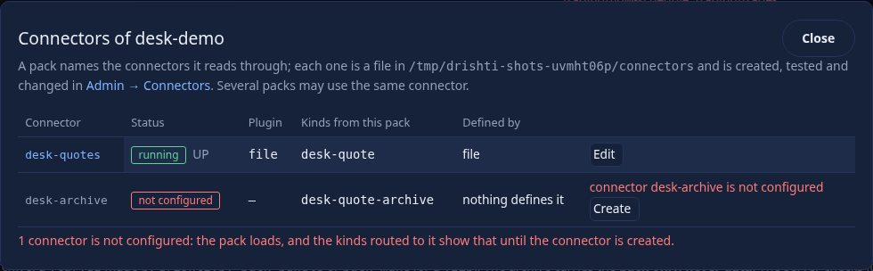

### Deploying a pack archive

A pack archive (`pack make`, `pack bundle`, Admin → Packs → Deploy archive) carries the connector **names and templates only**, never
a site's settings. The deploy preview lists the connectors the pack names that the site lacks, and
`POST /api/v1/admin/packs/deploy/{id}/connectors` (the **Create connectors** step) writes files from the templates before you deploy.
Loading the pack writes them at the next start anyway.

## 7. Live reload

The folder is watched (file events, with polling as a fallback and a safety net, the same pattern as Sutra hot reload). Per file:

| What happens to the file | What the server does |
|---|---|
| A **new** file | Starts that connector. |
| A file **changes** | Stops and restarts **only that connector**. |
| A file is **deleted** | Stops it, or, if a pack's template names it, applies the template again. |
| A file is **bad** (not YAML, unknown key, `name:` disagrees, unset `${VAR}`) | Keeps the **last good configuration running**, and shows the problem. |

```
INFO  connector docs-notes started (file)
INFO  connector docs-notes reconfigured from docs-notes.yaml: RUNNING
WARN  connector file docs-notes.yaml is not usable; the last good configuration keeps running: docs-notes.yaml: unknown key 'bogus' (allowed: plugin, enabled, kinds, description, settings)
INFO  connector file docs-notes.yaml was removed; the connector stops
```

A bad file shows in **Admin → Health** (`connectors.badFiles`, overall status degraded), on the Connectors page, and in
`drishti.py connector list` (in the *problems* column, with *the last good configuration is running*).

**Concurrency.** One reconfiguration at a time **per connector**; different connectors reconfigure in parallel. The old instance is
taken out of routing at once, stays open for `connectors-drain` (3 s) so reads in flight finish on it, then closes; the new one starts
after. Connectors you did not touch are not interrupted. A connector's place in the read order is kept across restarts.
A read of one of its kinds meanwhile (an entity, a view, a query) waits for the new instance, up to 30 s, instead of answering
"no source" or "not found"; a start that takes longer answers `503 DRS-1015 connector … is restarting`.

**The data changes, not the file.** A connector file does not change when its lake is rebuilt. The Delta connector checks each table's
latest version every `refresh-seconds` (10 s) and keys everything it caches by the table's version **and** commit time, so a table
written afresh (`lake demo` again, whose versions restart at 0) is read again; the BI store notices the same through each date's data
version ([DATA_LOADS.md](../guides/DATA_LOADS.md)).

### A connector that fails to start, or loses its connection, is retried

A file that is fine can still not start: the store is down, the network is not up yet, a credential is refused. The connector is then
`FAILED` and **tried again by itself**, without anyone touching the file: after `drishti.retry.connectors.initial` (5 s), then twice as
long each time up to `drishti.retry.connectors.max` (5 min), with 20 % jitter. When the store comes up the connector starts and serves;
open live views read through the router and pick the new instance up on their next refresh, no one reloads anything. The same goes for
a connector that was running and whose plugin now reports `DOWN` (its `health()`): it is listed as *connection lost*, looked at on the
schedule, and if it is still down after a few looks it is started afresh. Errors retrying cannot fix (the plugin is not installed, a
setting refers to an unset variable, credentials refused three times in a row) are classed **permanent** and retried only every `max`.
A connector that is `IDLE` (installed, not configured) is not retried: it needs a setting, and saving the file starts it.

```
WARN  connector 'site-quotes' failed (first time): connection refused; next try 2026-10-10T14:02:05Z
WARN  connector 'site-quotes' failed (attempt 2): connection refused; next try 2026-10-10T14:02:20Z
INFO  connector site-quotes started (file)
INFO  connector 'site-quotes' recovered after 3 failed attempt(s); it was: connection refused
```

The log writes failures 1, 2, 4, 8, ... and always the recovery, so an hour of outage is a handful of lines. Admin → Connectors and
Health show *failed — next retry in 20 s (attempt 3)* with the last error on the connector's row; **Retry now** (a button there and on
Health, `POST /api/v1/admin/retry/connectors[?name=site-quotes]`, admin role, audited as `connector-retry-now`, token scope
`packs:admin`) tries at once. Saving the file starts the count again. Failures and recoveries are audited (`connector-retry-failed`,
`connector-recovered`). All settings: [CONFIGURATION.md](../admin/CONFIGURATION.md#retry-settings); the overview:
[OPERATIONS.md](../admin/OPERATIONS.md#retries-what-failed-is-tried-again-by-itself).

What is **not** live: a connector defined in the server's own configuration (`application.yaml`, deprecated) and a change of
`connectors-dir` itself; both need a restart.

## 8. Admin → Connectors

**Admin → Connectors** (`/admin/connectors`, administrators only; the Admin menu and the Admin tabs link to it; `?` opens this page).
On the demo lakes it lists the seven packs' connectors: the three trade connectors, the derived `trade-pages`, the Delta domain stores
(`reference-store`, `market-store`, `legal-store`, `credit-store`, `collateral-store`, `risk-store`, `macro-store`, `civic-store`,
`news-store`), and the feeds, `news`, `yfinance` and `trading-stream` (off until you switch them on).

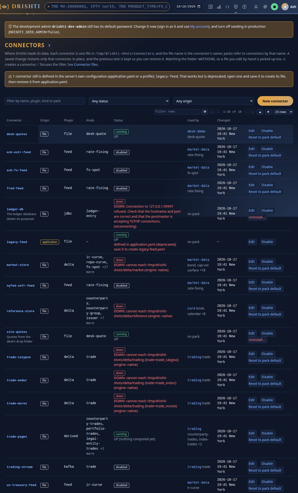

**Uninstalling safely.** The page has one way out for a connector that has a file, **Uninstall…** (there is no separate Delete button;
`DELETE /{name}` remains for scripts and keeps the text in `<data dir>/connectors/history/`). It asks what depends on the connector
(the packs and kinds that read through it, BI datasets that scan it, whether a pack's template would write it back), refuses while
anything does, and otherwise **moves the file** to `<data dir>/uninstalled/` where **Admin → Artifacts → Uninstalled** restores it. A
connector a pack's template names is only disabled or reset. See [ARTIFACTS.md](../admin/ARTIFACTS.md).

The list shows each connector's **origin** (`file`, `pack` for a template with no file yet, `application` for the deprecated
configuration), plugin, kinds, **status** with the plugin's own health beside it, which packs use it (and for which kinds), and when it
last changed. Filter by text, status or origin. `n` creates a connector and `/` focuses the filter. A connector defined in
`application.yaml` is flagged with the file that would replace it; a bad file shows its problem on its row.

### One connector: its own page

Every connector name in the list is a link (Tab to it, Enter opens it) to `/admin/connectors/<name>`; the packs in *Used by* link to
their pages.

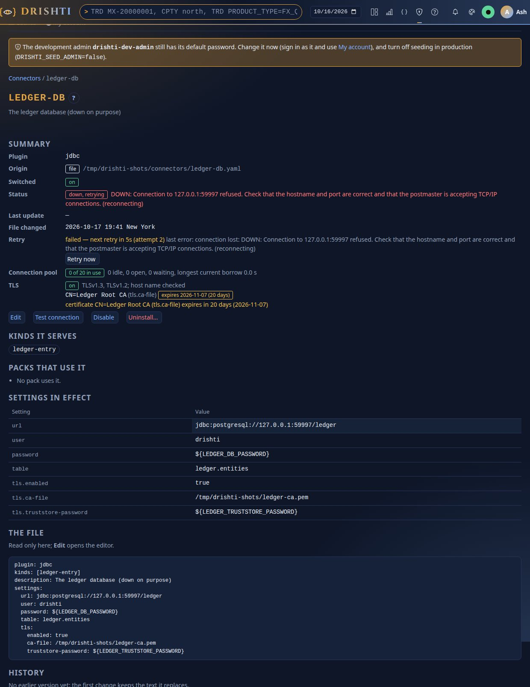

The page shows: the plugin, the origin (and the file), whether it is on, the **status** and the plugin's health, the last update and
when the file changed; when the connector failed to start or lost its connection, *failed — next retry in Ns (attempt k)* with the last
error and **Retry now**; **TLS**: on or off, the protocols, whether the host name is checked, and each configured certificate (client
certificate, CA bundle, key store) with its subject and **expiry date and days left** (a warning under 30 days, *expired* once past; a
setting that cannot be read is shown as the error). Then the **kinds it serves**, the **packs and kinds that use it** (links), the
**settings in effect** (credentials shown as `***`), the file as **read-only text**, and the **history** of kept versions.

Buttons: **Edit** opens the editor described below, **Test connection** opens it on the Test tab and runs the test on the saved file,
**Compare or restore** opens the History tab, **Disable / Enable**, **Reset to pack default** and **Uninstall…** behave as on the list
(a pack's connector is never uninstalled; the page asks before it disables one packs use). The editor also opens by address:
`/admin/connectors?name=<name>&tab=history` or `&tab=test`.

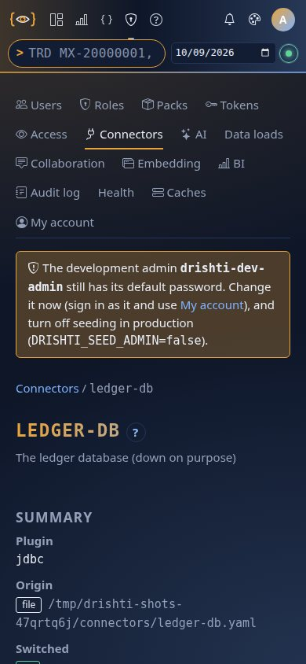

The pack side is the same: a pack's page lists the connectors it names, each linked here, and flags a missing one with **Create**
([PACKS.md](../guides/PACKS.md#one-pack-its-own-page)).

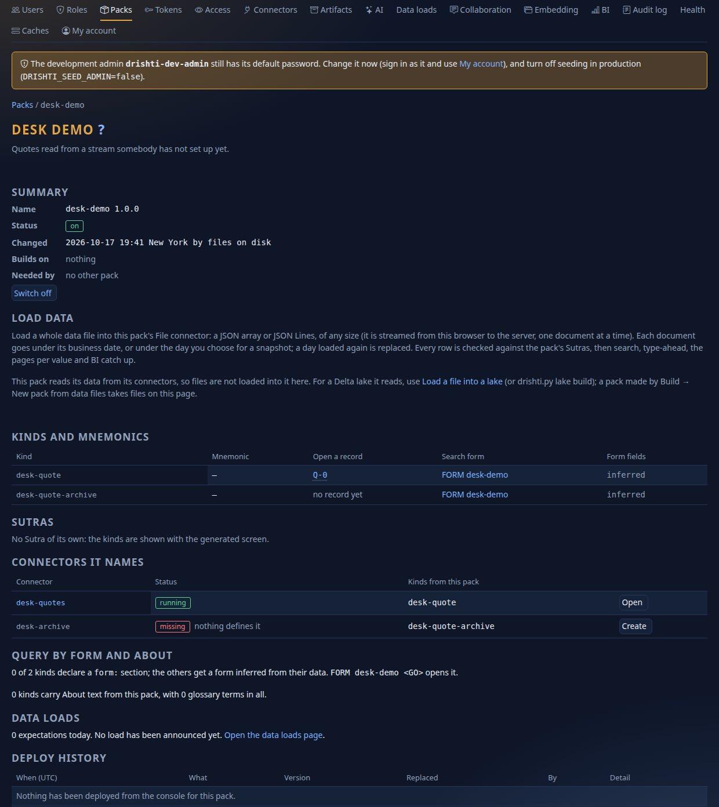 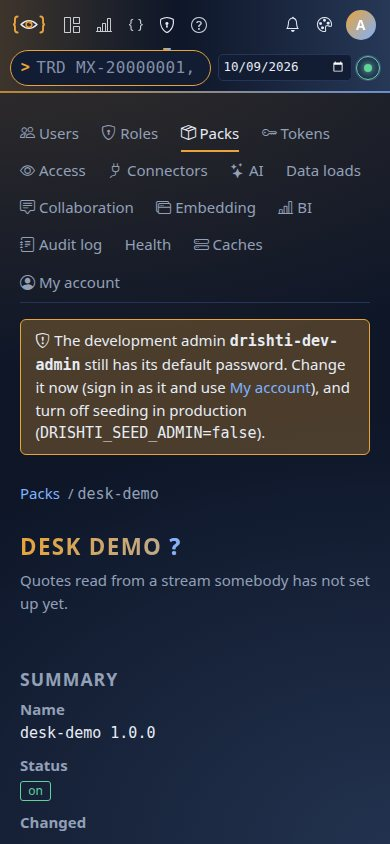

**New connector** and **Edit** open one editor with four tabs (arrow keys move between them):

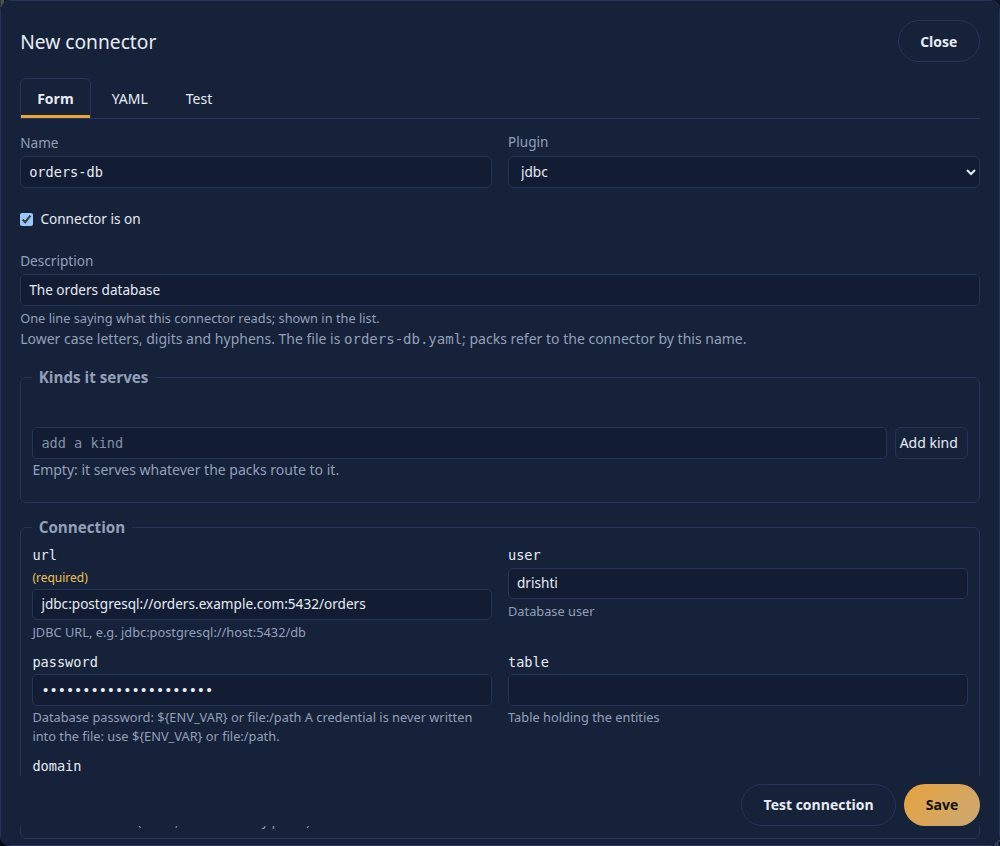

- **Form.** Choose a plugin and the form is generated from its declared settings, grouped (connection, TLS, what it reads, tuning),
  with a required marker, the default as the placeholder, and the description under each field. A **TLS** section appears when the
  plugin supports it. Kinds are picked from the kinds the loaded packs own. Settings the plugin reads that have no field go in **Other
  settings**.
- **YAML.** The same draft as text, comments and all. Leaving the tab reads the text into the form (and tells you if it cannot be
  read); leaving the form renders it. Both tabs edit one draft.
- **Test.** **Test connection** starts a throwaway instance on the draft's settings, asks it what it holds for the kinds it serves
  (business dates and counts), and closes it. Nothing that runs is changed. A failure comes back in words, with a hint for TLS and
  network errors.
- **History** (existing files). Every earlier text with its time and size; **Show changes** shows a diff against the current file
  (added lines start with `+`, removed with `-`, so it reads without colour), **Restore** puts one back (and applies it).

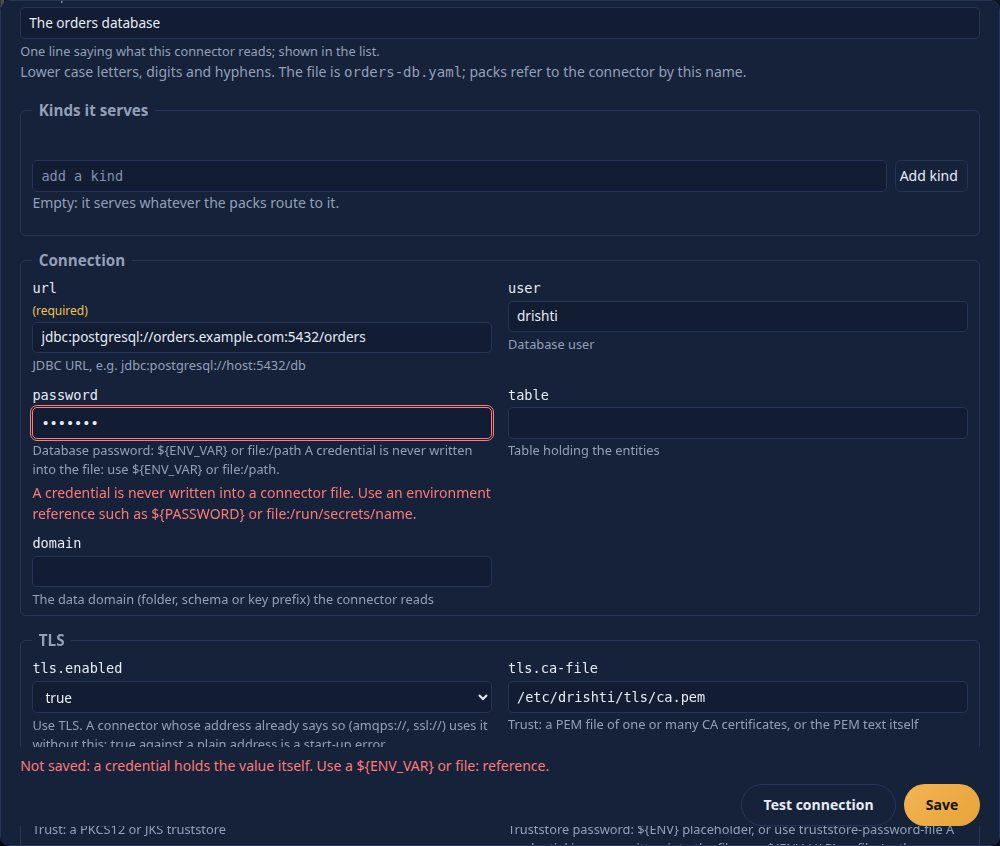

Fields flagged as secrets accept only `${ENV_VAR}` or `file:` references. A literal value is refused in the form before anything is
sent, with the message above; the server refuses it too.

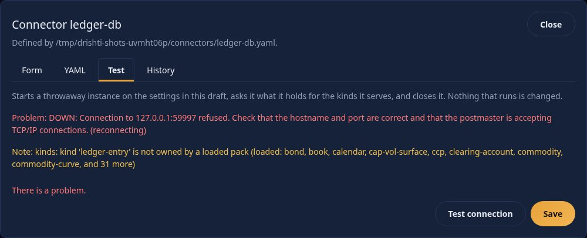

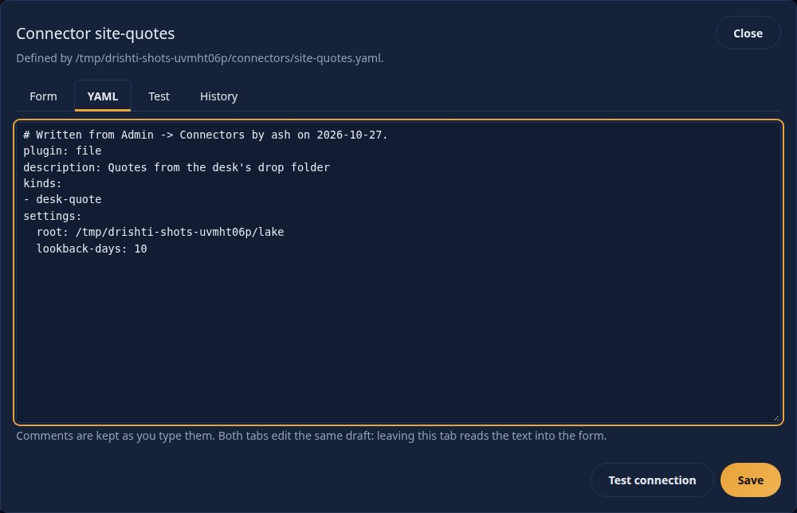

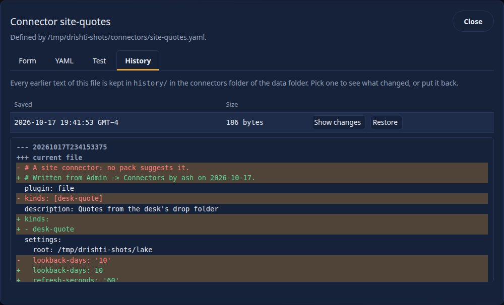

**Save** writes the file atomically (a timestamped copy of the old text goes to `<data dir>/connectors/history/`), applies it to that
connector and says what state it reached. **Two editors cannot overwrite each other**: the page sends the version it read (the file's
ETag) and the server refuses a stale one with *changed since you read it*, offering **Load the current version**.

Row actions: **Disable / Enable** (keeps the rest of the file), **Reset to pack default** (for a connector a pack suggests: the file is
replaced by the suggestion and your text is kept in the history), and **Uninstall…** (a file no pack suggests; it moves to the archive
and **Admin → Artifacts → Uninstalled** restores it). A connector a pack suggests is never uninstalled: reset it or disable it. Before
you disable or uninstall a connector that packs use, the page lists them and asks:

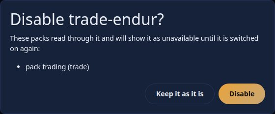

A disabled connector stops at once: its background work (a lake's periodic re-listing of ids, warming) stops with it, so it reads and
logs nothing more. When a disabled connector is the one a kind is routed to and another connector still serves the kind (a Cassandra `trading-store`
beside a disabled `trade-endur`), the others are asked: an id none of them holds answers `DRS-1001 no source holds trade/… (asked
trading-store; trade-endur, which kind 'trade' is routed to, is disabled)`. `DRS-1002 connector … is disabled` is the answer only when
nothing else serves the kind.

**New connector from a pack's suggestion.** The Create link on a pack's Data source panel (or `/admin/connectors?new=<name>`) opens the
editor pre-filled from the suggestion:

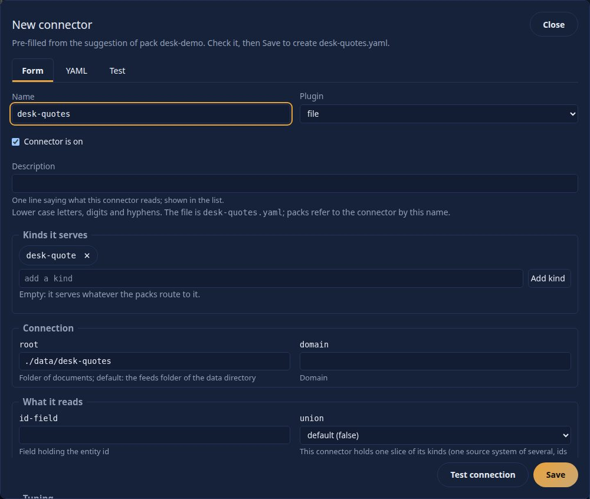

The page is keyboard operable (`n`, `/`, arrow keys on the tabs, Esc closes a dialog and returns focus to what opened it), works in
both themes, and on a phone (390 px) fields stack and every target is at least 44 px:

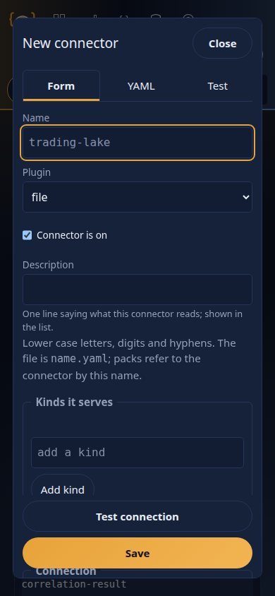

## 9. The REST API

All under `/api/v1/admin/connectors`; administrators only; a personal API token needs the **`packs:admin`** scope for the writes; every
change is **audited** (setting *names*, never values) as `connector-saved`, `-deleted`, `-reset`, `-enabled`, `-disabled`,
`-restored`, `-tested`, `-generated`, `-migrated`. From the console the same-origin and CSRF rules apply.

| Method and path | Does |
|---|---|
| `GET /` | Every connector: `origin`, `plugin`, `kinds`, `enabled`, `state`, `health`, `lastUpdate`, `updated`, `etag`, `problems`, `usedBy`; plus `directory`, `watch`, `misnamed`, `fileProblems`, `deprecated`, `knownKinds`. |
| `GET /plugins` | The plugins and their settings: `name`, `type`, `required`, `default`, `description`, `secret`, `group`; `tls` says whether the TLS section applies. |
| `GET /{name}` | The effective settings (credentials masked), the file `text`, `etag` (also the `ETag` header), `usedBy`, `packDefault`, `history`, `retry` (attempt, `nextRetryInSeconds`, `lastError`), and `tls`: `null` when no `tls.*` setting is given, else `enabled`, `verifyHostname`, `protocols`, `certificates` (`source`, `subject`, `notBefore`, `notAfter`, `daysLeft`, `expired`), `warnings`, or `error` when the material cannot be read. |
| `GET /{name}/suggestion` | What a loaded pack suggests for that name, `{"pack", "text"}`, to pre-fill New connector. `404` when no pack suggests it. |
| `PUT /{name}` | Create or change. Body `{"text": "<yaml>"}` or the form's fields. An existing file needs `If-Match: <etag>`; `?confirm=true` after switching off a connector packs use. Validates, writes atomically, applies. |
| `DELETE /{name}` | Delete a file no pack suggests (`If-Match`, `?confirm=true` when packs use it). |
| `POST /{name}/enabled` | `{"enabled": false}`: switch on or off, keeping the rest of the file. |
| `POST /{name}/reset` | Put the pack's suggestion back. |
| `POST /{name}/test` | Try a draft (the same bodies as `PUT`), or the saved file with no body. |
| `POST /{name}/validate`, `/render`, `/parse` | Findings for a draft; the YAML of the form's fields; the form's fields of a YAML. Nothing is saved. |
| `GET /{name}/history/{id}`, `POST /{name}/restore/{id}` | A kept version's text; put it back. |

Validation: the name rule; the plugin exists; required settings are present; types (`int`, `boolean`, enums); credentials are
references; unknown settings and unknown kinds are **warnings**. Errors are `DRS-5031` (422); a version conflict, an existing file
without `If-Match`, or an unconfirmed change to a connector in use is `DRS-5032` (409); an unknown connector is `DRS-5033` (404).

```
$ curl -i -X PUT .../api/v1/admin/connectors/site-quotes -H 'If-Match: "0000000000000000"' -d '{"text":"plugin: file\n…"}'
HTTP/1.1 409
{"title":"connector conflict","status":409,"code":"DRS-5032",
 "detail":"DRS-5032 connector 'site-quotes' changed since you read it (now 3e4b312691e95f5c, you have 0000000000000000); reload it and apply your edit again"}
```

## 10. The CLI

`drishti.py connector list|get|apply|delete|test|plugins|enable|disable|reset|history`, over a personal token with `packs:admin` for
the writes (`--token-file` or `DRISHTI_TOKEN`, `--server` or `DRISHTI_SERVER`), `--json` for machines, exit 0 done, 1 refused or a test
failed, 2 usage. Real output on the demo lakes (paths shortened to `…`):

```
$ drishti.py connector list
24 connector(s) in …/config/connectors   (watching: WATCHING)
  name              origin  plugin    kinds                                                        state     used by            problems
  ----------------  ------  --------  -----------------------------------------------------------  --------  -----------------  --------
  civic-store       file    delta     jurisdiction,party,office-holder +3                          running   world-economy
  collateral-store  file    delta     collateral-balance,margin-call,simm                          running   counterparty-risk
  credit-store      file    delta     netting-set,credit-limit,exposure-profile +2                 running   counterparty-risk
  ecb-estr-feed     file    feed      rate-fixing                                                  disabled  market-data
  ecb-fx-feed       file    feed      fx-spot                                                      disabled  market-data
  fred-feed         file    feed      rate-fixing                                                  disabled  market-data
  legal-store       file    delta     agreement,csa                                                running   counterparty-risk
  macro-store       file    delta     economy,macro-indicator,economic-forecast +4                 running   world-economy
  market-store      file    delta     ir-curve,repo-curve,fx-spot +17                              running   market-data
  news              file    news      news                                                         disabled  news-and-markets
  news-store        file    delta     news-topic,listed-company                                    running   news-and-markets
  nyfed-sofr-feed   file    feed      rate-fixing                                                  disabled  market-data
  reference-store   file    delta     counterparty,counterparty-group,issuer +7                    running   core
  risk-store        file    delta     var,stress-scenario,stress-result +3                         running   market-risk
  trade-calypso     file    delta     trade                                                        running   trading
  trade-endur       file    delta     trade                                                        running   trading
  trade-murex       file    delta     trade                                                        running   trading
  trade-pages       file    derived   counterparty-trades,portfolio-trades,legal-entity-trades +1  running   trading
  trading-stream    file    kafka     trade                                                        disabled  trading
  us-treasury-feed  file    feed      ir-curve                                                     disabled  market-data
  yfinance          file    yfinance  quote                                                        disabled  news-and-markets
  …
[exit 0]

$ drishti.py connector get trade-endur
connector trade-endur   origin file   plugin delta   running   version 1a3893dbc61d97ee
  file …/config/connectors/trade-endur.yaml
  kinds trade
  used by pack trading (trade)
  settings (credentials masked):
  setting                      value
  ---------------------------  ------------------------------------------------------------------
  root                         ${DRISHTI_DELTA_ROOT:${drishti.data.dir:./data}/delta}
  domain                       trading
  layout.trade.columns         TRADE_ID,SOURCE_SYSTEM,PRODUCT_TYPE,PRODUCT_SUB_TYPE,PRODUCT_GROUP,TRADE_STATUS,…
  layout.trade.sort-by         id
  layout.trade.file-rows       250000
  layout.trade.row-group-rows  1000
  union                        true
  table.trade                  trade_endur
  source-name                  trade-endur
[exit 0]

$ drishti.py connector test trade-endur
trade-endur (delta): reachable, health UP (engine: native), 14 ms
  kind   business date  rows  note
  -----  -------------  ----  ----
  trade  2026-10-16     5000
  trade  2026-10-15     5000
  trade  2026-10-14     5000
[exit 0]

$ drishti.py connector apply docs-notes.yaml          # with a literal password: refused
drishti: the server said 422 DRS-5031: DRS-5031 the connector is not valid: settings.password: a credential is never written into a connector file; use an environment reference such as ${PASSWORD} or a file: reference such as file:/run/secrets/password
[exit 1]

$ drishti.py connector apply docs-notes.yaml --test-first
applied docs-notes: running; changed (new connector), root, lookback-days; version 0a2bb09fe66ee59c
  note kinds: kind 'docs-note' is not owned by a loaded pack (loaded: agreement, bond, book, calendar, cap-vol-surface, ccp, and 64 more)
[exit 0]

$ drishti.py connector apply docs-notes.yaml          # lookback-days 10 -> 5
applied docs-notes: running; changed lookback-days; version 1abf33e787d83abf
[exit 0]

$ drishti.py connector history docs-notes
  version             kept at                         bytes
  ------------------  ------------------------------  -----
  20261017T213854795  2026-10-17T21:38:54.794718099Z  276
[exit 0]

$ drishti.py connector disable trade-endur
drishti: the server said 409 DRS-5032: DRS-5032 disabling connector 'trade-endur' would stop serving pack trading (trade); repeat with confirm=true to go ahead
[exit 1]

$ drishti.py connector delete trade-endur
drishti: the server said 409 DRS-5032: DRS-5032 connector 'trade-endur' is named by pack trading's template, so it is not deleted: reset it to the pack's default, or disable it
[exit 1]

$ drishti.py connector delete docs-notes
deleted docs-notes (its text is kept in <data>/connectors/history/)
[exit 0]
```

`apply` takes the name from the file name (`--name` overrides), reads the file's current version and sends it as `If-Match`, so it is
safe in a GitOps job: a concurrent edit makes the job fail instead of overwriting it (`--if-match` pins the version you expect).
`disable … --confirm` goes ahead after the question above. `drishti.py server packs datasource get <pack>` shows a pack's connectors
(section 6) and exits 1 while one is not configured:

```
$ drishti.py server packs datasource get desk-demo
connectors of desk-demo   [files in …/config/connectors; change them with `drishti.py connector ...`]
  connector     state           plugin  kinds from this pack  defined by          problems
  ------------  --------------  ------  --------------------  ------------------  ----------------------------------------
  desk-quotes   running         file    desk-quote            file
  desk-archive  not configured          desk-quote-archive    nothing defines it  connector desk-archive is not configured
  desk-archive is not configured: create it with `drishti.py connector apply desk-archive.yaml` or in Admin -> Connectors
[exit 1]
```

## 11. Moving off application.yaml and the old data-source override

**`drishti.sources.connectors` in `application.yaml`** (and `application-<profile>.yaml`, and environment variables such as
`DRISHTI_SOURCES_CONNECTORS_RISK_STORE_SETTINGS_ROOT`) **keep working**, but are deprecated. At start the server logs, per connector:

```
WARN  deprecated: connector 'legacy-feed' is defined in the server's own configuration (drishti.sources.connectors.legacy-feed);
      move it to /srv/drishti/config/connectors/legacy-feed.yaml and remove it from application.yaml. Until then it overrides that
      file setting by setting.
```

The Connectors page flags them too, and opening one and pressing Save creates its file. To move one: write the file (the YAML has the
same keys: `plugin`, `enabled`, `kinds`, `settings`), then delete the block from `application.yaml`.

**The per-store profiles** (`application-postgres.yaml`, `-duckdb`, `-aerospike`, `-mongodb`, `-iceberg`, `-redis`, `-files`) are
**kept working, deprecated**, and every one is also provided as **example files** in `config/connectors.examples/<store>/`. They were
not converted in place because a profile *overlays* the pack's generated files setting by setting, while a file *replaces* the template;
a faithful automatic conversion would hide a behaviour change. Copy the example files you want into `config/connectors/` (mind the
trade connectors' names, section 4) and drop the profile.

**The Admin → Packs → Data source override** (`<data dir>/packs/settings/<pack>.yaml`, written by the earlier Data source panel) is
**unified** with connector files. At the first start after the upgrade the server **migrates** each override into the connector file
of the same name: the override's `enabled` and `settings` are applied on top of the file (or, when there is none, on top of the pack's
template), the original override file is moved to `<data dir>/packs/settings/migrated/<pack>.yaml.<timestamp>` as a backup, and the
file's earlier text, if there was one, goes to `<data dir>/connectors/history/`. An override the server cannot place (no template and
no file say which plugin to use) is **left in place and reported**; nothing an administrator saved is dropped. It is logged and audited
as `connector-migrated`:

```
connectors: data-source override of pack 'risk' for connector 'risk-store' moved into risk-store.yaml
connectors: original override file of pack 'risk' kept in data/packs/settings/migrated
```

The panel itself is now a **view** of the pack's connectors with links to Admin → Connectors; the `PUT`, `DELETE` and `…/test` calls of
`/admin/packs/{name}/datasource` and `drishti.py server packs datasource set|test|reset` are gone (use the connector API and
`drishti.py connector`).

## 12. Health and problems

- **Admin → Health** has a `connectors` block (count, failed, `badFiles` with the message, watch state, folder, deprecated names), and a
  pack row lists `connectors`, `connectorsDown` and `connectorsNotConfigured`. A bad file or a missing connector makes the overall
  status **degraded**.
- `GET /api/v1/admin/health` → `connectors.watch` is `WATCHING`, `POLLING`, `OFF` or `STOPPED: <reason>`; `sources[]` has each
  connector's health (`UP (engine: native)` for a Delta connector on the local disk).

| You see | Cause and fix |
|---|---|
| `unknown key 'x'` | Only `plugin`, `enabled`, `kinds`, `description`, `settings` (and `name`) at the top level; put plugin settings under `settings:`. |
| `'enabled' is true or false … not 'maybe'` | Write `true` or `false` (quotes are fine), or a `${VARIABLE:true}` placeholder. |
| `says name 'b' but the file name is the connector's name` | Rename the file, or delete the `name:` line. |
| `'password' refers to an environment variable that is not set` | Set the variable in the server's environment, or give a default for a non-secret value. The last good configuration keeps running. |
| `a credential is never written into a connector file` | Use `${ENV_VAR}` or `file:/path`. |
| `no plugin named 'x'` | The plugin is not installed; `drishti.py connector plugins` lists them. |
| A connector is `FAILED` | The plugin could not start; the message is the plugin's. **Test connection** shows it with a hint. It is retried by itself (*failed — next retry in Ns (attempt k)*, [above](#a-connector-that-fails-to-start-or-loses-its-connection-is-retried)); fix the cause and it starts, or press **Retry now**. |
| A Delta connector `DOWN: cannot reach …/data/delta/trading` | No lake there: `drishti.py lake demo` (or point `root` / `DRISHTI_DELTA_ROOT` at your lake). |
| A Delta connector `DEGRADED: cannot read <kind> <date>: NoSuchFileException …` | A table was rewritten while the server read it (a `lake demo` or `lake build` run): it clears at the next reindex (about a minute); if not, *Admin → Caches* → purge that connector. |
| A file in the folder is ignored | Its name breaks the rule (listed on the page and in the log). |
| Edits are not picked up | `connectors-watch: off`, or `watch` is `STOPPED`; check Health and the log, or restart. |
| `DRS-1011` | A pack routes a kind to a connector with no file: create it ([section 6](#a-pack-names-a-connector-nobody-defined)). |

## 13. Decisions

- **Files replace templates, they do not merge.** Merging would make a site's file depend on what a pack happens to contain in its next
  version. A file says everything the connector needs.
- **Kinds come from the pack's `routes:`**, optionally narrowed by the file's `kinds:`, rather than only from the file: the author of a
  pack knows which kind lives where, and the same connector can then serve several packs.
- **A union is declared by the connectors, not the pack.** `union: true` on each slice lets a site add a fourth source system by adding
  one file, with no change to the pack.
- **The file name is the identity**, so a rename is a different connector, and two files cannot disagree about a name.
- **A literal credential is refused at the authoring surfaces, but not when the file watcher meets one**, so a hand edit never takes a
  running connector down; it is flagged instead.
- **Unknown settings and kinds are warnings.** Plugins read free-form keys, and a connector may be created before its pack is loaded.
- **Reset, not delete, for a pack's connector**, so a deleted file does not silently reappear at the next start.
- **What the server keeps about the files is in the data folder**, visible (`generated/`, `history/`), so the connector folder holds
  only what the site wrote.
- **Restarts drain.** A restart waits `connectors-drain` before closing the old instance so reads in flight finish; during that window
  and the new instance's start the connector's kinds are not served: their reads wait for the new instance (up to 30 s, then
  `DRS-1015`).

## 14. Connection pools

Every database connection a connector opens comes from a **pool** of a size you set, **20 by default**. The rules, which an architecture
test (`ConnectionDisciplineTest`) enforces on the source:

- **One unit of work, then back.** A connection is borrowed in a `try`-with-resources block for a query, a batch or a day's publish and
  returned at once, whatever happens (an exception, a timeout, a cancelled request). It is never held across a stream to a client, a
  wait on the network, a live subscription or a person's think-time, and no field of any class holds a `Connection`, `Statement` or
  `ResultSet`. A returned connection with an open transaction is rolled back and its auto-commit restored; a broken one is closed and
  replaced.
- **No statement runs for ever.** `statement-timeout` (default 5 minutes) is set on every connection (PostgreSQL `statement_timeout`).
- **Leaks are visible.** A connection borrowed longer than `pool-leak-threshold` (default 60 seconds) is logged once with the stack of
  the code that borrowed it, counted, and shown on the connector's page and Admin → Health; it goes back when the borrower finishes.
- **Waiting is bounded.** A caller waits `pool-connection-timeout` (default 10 seconds) for a free connection, then fails with a message
  that says how busy the pool is.

The settings are the same for every database connector, under its `settings:`; a connector that sets none inherits the **site
default**, `drishti.db.pool.*` in `application.yaml` ([CONFIGURATION.md](../admin/CONFIGURATION.md#drishtidbpool--database-connection-pools)).
The example files in `config/connectors.examples/` set none, so they follow the site.

| Setting | Default | Meaning |
|---|---|---|
| `pool-size` | `20` | The most connections the connector opens at once. A caller beyond it waits `pool-connection-timeout`. |
| `pool-min-idle` | `2` | Idle connections kept when quiet. |
| `pool-idle-timeout` | `10m` | An idle connection beyond `pool-min-idle` is closed after this long. |
| `pool-max-lifetime` | `30m` | A connection is replaced after this long, so a firewall or a failover never meets an old one. |
| `pool-connection-timeout` | `10s` | How long a caller waits for a free connection before it fails. |
| `pool-leak-threshold` | `60s` | A connection borrowed longer than this is logged once as a WARNING with the stack of the code that borrowed it; `0` turns it off. |
| `statement-timeout` | `5m` | The longest one statement may run (PostgreSQL `statement_timeout`); `0` for none. |

| Store | What is pooled | Notes |
|---|---|---|
| PostgreSQL / any JDBC ([POSTGRES_CONNECTOR.md](POSTGRES_CONNECTOR.md#connection-pool)) | JDBC connections, opened on first use | all settings above; the loader takes `--pool-size` |
| MongoDB ([MONGODB_CONNECTOR.md](MONGODB_CONNECTOR.md#connection-pool)) | the driver's pool (`maxPoolSize`, `minPoolSize`, `maxWaitTime`) | the statement timeout is the socket read timeout |
| Redis ([REDIS_CONNECTOR.md](REDIS_CONNECTOR.md#connection-pool)) | Lettuce connections, each multiplexed | another is opened only when the open ones are busy (`pool-pipeline-depth`); `pool-max-lifetime` and `pool-connection-timeout` do not apply |
| Aerospike ([AEROSPIKE_CONNECTOR.md](AEROSPIKE_CONNECTOR.md#connection-pool)) | the client's pool **per node** | `pool-size` is per node; `pool-connection-timeout` and `pool-max-lifetime` do not apply; borrows are not timed |
| The identity database on PostgreSQL | a Hikari pool (`drishti.identity.database-pool-size`, else the site default) | leak detection is Hikari's |
| **SQLite** (the default identity database) and **DuckDB** | **not pooled** | see below |

**Why SQLite and DuckDB are exempt.** Both are embedded files opened inside the server process: no network, no server-side connection
limit, no idle timeout to meet, nothing a pool protects. SQLite allows one writer at a time whatever the number of connections, so the
identity database keeps a small fixed pool (8) on SQLite; a DuckDB connector's `pool-size` (default 4) is a limit on reads at once.
Both still close everything they open (try-with-resources; `ConnectionDisciplineTest` covers them) and appear on Admin with their reads
running and waiting, marked *embedded, not pooled*.

**Seeing it.** The connector's page (Admin → Connectors → the connector) has a *Connection pool* line: *4 of 20 in use, 2 idle, 6 open,
0 waiting, longest current borrow 2.3 s*, with a note when a borrow passed the leak threshold or callers gave up waiting. Admin → Health
shows the same in a column, the identity database below the connectors, and a red line when every connection is in use with callers
waiting, or a borrow was held past the threshold. `GET /api/v1/admin/health` carries it as `sources[].pool` and `identityPool` (real
output of the default SQLite identity database; a pool that cannot time borrows reports `longestBorrowMillis: -1`):

```json
"identityPool": { "type": "sqlite", "exempt": true, "max": 8, "open": 2, "inUse": 0, "idle": 2, "waiting": 0,
                  "longestBorrowMillis": -1, "leaksDetected": 0, "timeouts": 0 },
"poolsAttention": []
```

A connector's pool looks the same with `"type": "jdbc"` and `"exempt": false`. Prometheus has one series per connector (`connector`
and `type` labels): `drishti_db_pool_max`, `_open`, `_in_use`, `_idle`, `_waiting`, `_longest_borrow_seconds`, `_leaks` and `_timeouts`
([OPERATIONS.md, Monitoring](../admin/OPERATIONS.md#134-prometheus-and-grafana)).

What the log says when a borrow is held (from the pool's test, `pool-leak-threshold: 150ms`; the frames after the first two are the
borrower's):

```
WARNING: connection leak suspected in the pool-test pool: borrowed by thread main for 150 ms (pool-leak-threshold 150 ms); borrowed at
java.lang.Throwable: borrowed by main
	at com.ash.drishti.api.pool.ResourcePool$Lease.<init>(ResourcePool.java:99)
	at com.ash.drishti.api.pool.ResourcePool.borrow(ResourcePool.java:178)
	at com.ash.drishti.plugin.jdbc.JdbcPoolTest.aConnectionHeldPastTheLeakThresholdIsCountedAndReleasedWhenClosed(JdbcPoolTest.java:204)
```

And when the pool is exhausted (`pool-size: 1`, `pool-connection-timeout: 250ms`):

```
no free connection in the pool-test pool within 250 ms (1 of 1 in use, 0 waiting, longest borrow 253 ms); raise pool-size or find what holds connections
```

Sizing the pools against the database's `max_connections` is in
[OPERATIONS.md](../admin/OPERATIONS.md#sizing-the-database-connection-pools); the symptoms and what to do are in
[TROUBLESHOOTING.md](../guides/TROUBLESHOOTING.md#a-connector-says-no-free-connection-in-the--pool).

## Status words, warnings and what the page tells you

The badge never says *running* for a connector that is not serving. **running** means up and healthy; **running, with a warning** means
up with something to read beside it (unreadable lines, or every dated folder is after today: *0 rows served for 2026-10-12: 'note'
holds 2099-01-05 to 2099-01-06, none on or before 2026-10-12*); **degraded** is a connector that serves but some of whose tables
cannot be read (its health starts `DEGRADED`, shown in full beside the badge: an Iceberg table moved after it was written, with the
`relocate` to copy); **down, retrying** is a connector that runs but reports DOWN or is
being retried; **failed**, **disabled** and **not started** keep their words. The list, the connector's page, a pack's *Data source*
panel and `drishti.py connector list|get` use the same words. The pages poll every 5 seconds: a connector's own page updates its status
as it starts, and the list and the Packs list offer a **Refresh** banner when something changed on disk, in the CLI or by another
administrator.

In the editor, a refused Save or Test shows its message in the bar beside **Save** (never below a long form), names the failing field,
focuses it and scrolls to it; **Save** is disabled and says *Saving…* while it works. Credential fields are masked while you type; a
literal credential is refused and **Test connection** says it did not try. **History** lists each kept version with the time in the
page's zone and hides Test and Save (restoring is its own button). A file connector made from a generated template says in its
description to set `root` (or the `DRISHTI_FILES_ROOT` environment variable); its page repeats it with the root now in effect.
