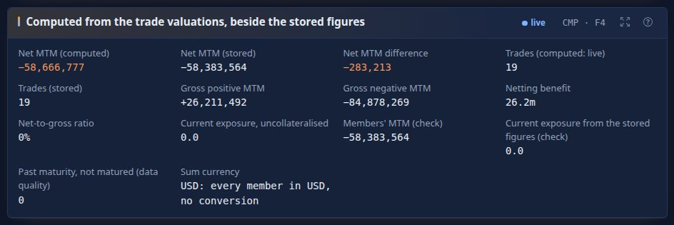
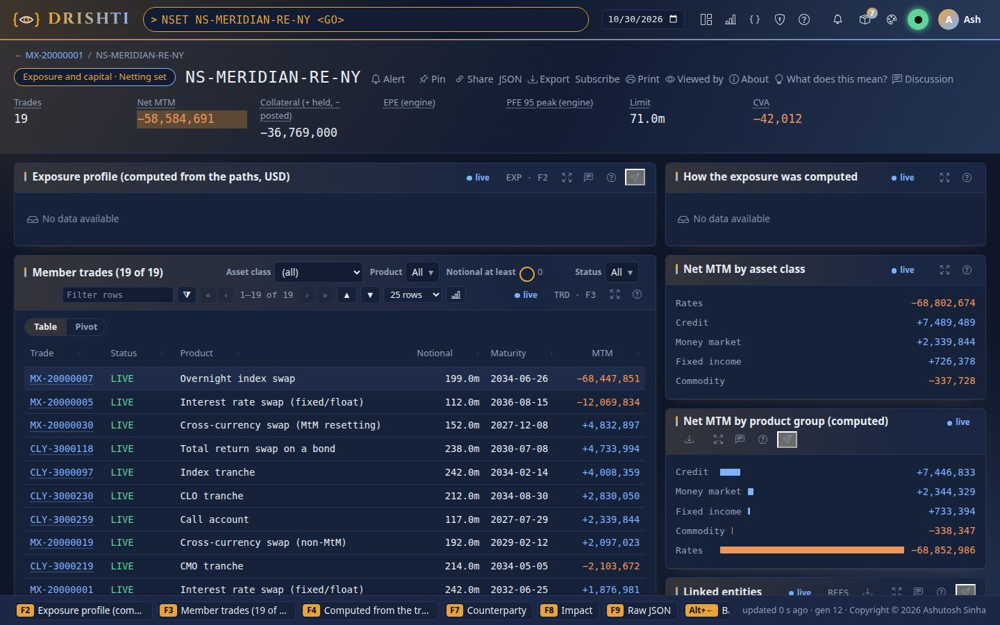
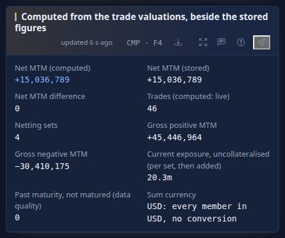
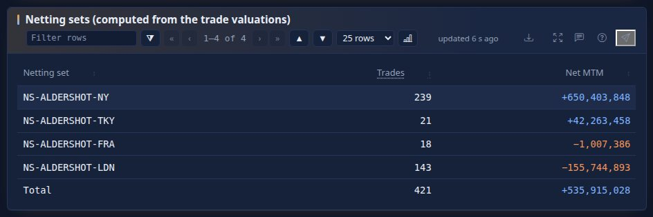
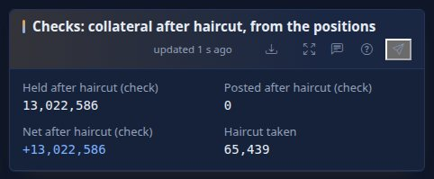
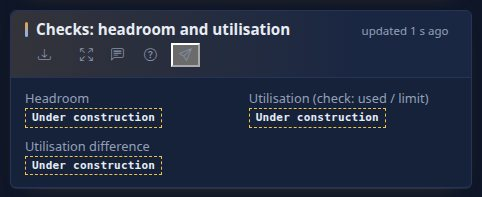

<!--
  Project Drishti · Any data. Any domain. One grammar.
  Copyright (c) 2026 Ashutosh Sinha <ajsinha@gmail.com>. All rights reserved.
  PROPRIETARY AND CONFIDENTIAL. See the LICENSE file in the root of this repository.
-->

# Counterparty exposure: the data contract

The data contract of Drishti's exposure engine (EPE, PFE and the profiles of any scope): what an upstream simulation delivers, how it is
checked, what Drishti builds from it and what it answers. The computation (netting and collateral per path, the statistics of a scope,
contributions, the pre-deal increment) is in [the exposure guide, section 18](../guides/EXPOSURE_GUIDE.md#18-the-computation); how to
use exposure is the rest of that guide. The fields of each kind the engine reads, with one example record each, are on
[the counterparty-risk contracts](packs/counterparty-risk.md); the rules every contract shares are in [the contracts index](README.md).

## Contents

- [1. The contract at a glance](#1-the-contract-at-a-glance)
- [2. Inputs from upstream engines](#2-inputs-from-upstream-engines)
- [3. Reference and master data read](#3-reference-and-master-data-read)
- [4. Conventions specific to exposure](#4-conventions-specific-to-exposure)
- [5. What Drishti answers](#5-what-drishti-answers)
- [6. Official end-of-day results](#6-official-end-of-day-results)
- [7. Validation, errors and data quality](#7-validation-errors-and-data-quality)
- [8. Exposure is computed, not stored](#8-exposure-is-computed-not-stored)
- [9. Test data and generators](#9-test-data-and-generators)
- [10. Decisions and open questions](#10-decisions-and-open-questions)

## 1. The contract at a glance

### 1.1 Summary

**What it is.** Counterparty credit exposure over time: on each simulated path, the netting set's value after netting and after the
collateral it would hold, floored at zero; then across paths the expected exposure (EE), expected negative exposure (ENE), the time
averages EPE and effective EPE (EEPE), and potential future exposure (PFE) at a confidence such as 95% or 99%, with the peak. For a
netting set, a counterparty, a connected group, a legal entity or any ad-hoc scope, and for a scope plus candidate trades (pre-deal).

**Commands.** `EXP NSET:NS-ALDERSHOT-FRA <GO>` (as typed; the spaced `EXP NSET NS-ALDERSHOT-FRA <GO>` too), `EXP CPTY:CP-ALDERSHOT <GO>`,
`EXP GROUP:GRP-ALDERSHOT <GO>`, `EXP LE:LE-NY <GO>`, `EXP TRD:<trade> <GO>`; the API `/api/v1/exposure`; the netting-set and counterparty
pages show the engine's figures as they open. **Implementation:** `EXP` is the computed kind `exposure-result`; its main screen is the
exposure explorer ([section 3](../guides/EXPOSURE_GUIDE.md#3-the-explorer-screen-by-screen)); `XWIF <scope>` is the exact what-if (`exposure-whatif`).

**Not stored:** the kind `exposure-profile` (`EXP-*` records with `EPE`, `EEPE`, `PFE_PEAK`, `BUCKETS[]`), and
the profile figures on `netting-set` ([NSET.md](NSET.md) section 1). Its ids open the computed page (§8).

| Part | Status |
|---|---|
| `simulation-run` (one row per simulation run and date: the grid, the paths, the seed, the model) | BUILT |
| `exposure-path` (one row per trade × grid date: a vector of MtM over the paths) | BUILT |
| Netting per path, collateral per path with the margin period of risk, EE, ENE, EPE, EEE, EEPE, PFE, peaks, contributions | BUILT |
| Tiered memory: netting-set path matrices in memory-mapped per-date files, trade paths read only for drills and what-ifs | BUILT (one node; sharding PLANNED) |
| Incremental exposure before dealing: the conservative proxy (`addon`) | BUILT |
| Incremental exposure before dealing: exact with candidate paths of the same run (`paths`, the Python engine) | BUILT |
| Computed kind `exposure-result`, reactive connector `exposure-engine` (Java) | BUILT |
| Reactive connector `exposure-whatif` (Python, kind `exposure-whatif` XWIF, pool `exposure`), the exposure explorer, the CLI's exposure commands (`drishti.py exposure`) | BUILT |
| The benchmark at a large bank's size | BUILT at a workstation's size, extrapolated ([section 27.4](../guides/EXPOSURE_GUIDE.md#274-the-benchmark-measured-and-extrapolated)) |
| Official end-of-day results `exposure-official`, `exposure-official-cpty` | BUILT |
| No stored `exposure-profile`, and no exposure figures on the netting set and counterparty | BUILT (§8) |

### 1.2 The measure in one page

**What it answers:** *how much could this counterparty owe us if it defaulted at a future date, on average and in a bad case, after
netting and collateral?* For credit officers (limits are set on PFE), CVA desks (EE feeds CVA), regulatory capital (EEPE under an
internal model), and traders (what a new trade does to a counterparty's PFE before they deal).

**In words:**
1. The upstream simulator draws P market paths (2,000 to 5,000 in a bank) on a time grid of G dates (50 to 100, including *look-back*
   dates a margin period of risk before the main ones), revalues every live trade on every path and date, and writes one row per trade
   and grid date: a vector of P MtM values. **Every trade uses the same paths** (path *p* is the same market for all trades), so trade
   values add per path.
2. Drishti sums the trades of each netting set per path and date: the **netting-set value** V(p, t).
3. On a margined netting set Drishti computes the **collateral** each path would hold at t, from the CSA's thresholds, minimum transfer
   amount and independent amount applied to the set's value at the look-back date t − MPOR (the collateral lags by the margin period of
   risk).
4. The **exposure** on a path is E(p, t) = max(V − C, 0); across netting sets of one counterparty exposures **add per path**.
5. **EE(t)** is the mean of E over the paths; **PFE_q(t)** is its q-quantile; **EPE** and **EEPE** are time averages over the first year
   (the formulas: [EXPOSURE_GUIDE section 18.4](../guides/EXPOSURE_GUIDE.md#184-statistics-of-a-scope)).

**Methodology.** Monte Carlo exposure simulation post-processing as in Basel CRE53 (internal models method: EE, effective EE, EEPE,
alpha 1.4) and the industry's PFE practice for limits. Drishti does **not** simulate markets or price trades: the paths are inputs
(the contracts' README.md section 3). QLRisk may later produce them ([ARCHITECTURE.md section 24](../architecture/ARCHITECTURE.md#24-compute-workers-python-and-java-libraries-approved-pinned-and-isolated)).

## 2. Inputs from upstream engines

### 2.1 Where they live

```
${DRISHTI_DELTA_ROOT}/risk/
├── simulation-run/   business_date=YYYY-MM-DD/                   one row per simulation run and date: the grid and the run's identity
├── exposure-path/    business_date=YYYY-MM-DD/run_id=<RUN_ID>/   one row per trade × grid date: MTM over the P paths  (the large table)
├── credit-path/      business_date=YYYY-MM-DD/run_id=<RUN_ID>/   optional: counterparty credit on the same paths (WWR.md)
└── netting-set/, netting-set-member/, csa/, valuation/     NSET.md
```

| Kind | Key | Grain | Read by | Cadence | Due |
|---|---|---|---|---|---|
| `simulation-run` | `RUN_ID` | run × date | EXP, CVA, LIM, GRP, WWR | daily | before the paths (to be agreed) |
| `exposure-path` | `PATH_ROW_ID` | trade × grid date × run | EXP, CVA, LIM, GRP, WWR | daily | **to be agreed** (open question 1); a large bank's run often lands overnight, 04:00–07:00 local |

Beside them the engine reads, for the date (E0 of [COMPUTED_ATTRIBUTES.md](../architecture/COMPUTED_ATTRIBUTES.md)):
`trade-valuation` (each netting set's members, a live status naming the set, and their MtM today: the market-risk pack's kind, which
VaR reads too), `netting-set` (the set's terms and links: counterparty, legal entity, CSA, collateral balance; no figure), `csa` (the
terms), `collateral-balance` (the holdings, after haircut), `credit-limit` (the counterparty's approved limit) and the counterparty and
group masters. Each of their data-load signals reloads the date (the connector's triggers; `drishti.ccr.exposure.kinds.*` names them).

### 2.2 `simulation-run`: the run's identity and grid (reference row)

**Grain:** one row per run and business date. **Row count:** 1 per date (a second, *stressed* calibration run is open question 4).
The paths of `exposure-path` are ordered by this row exactly as the P&L vectors are ordered by the scenario set (VAR.md section 2.3).

| Column | JSON | Delta | Req. | Engine | Unit | Meaning | Example |
|---|---|---|---|---|---|---|---|
| `RUN_ID` | id | `id` STRING | required | R | | the run; stamped on every answer | `XR-2026-09-30-01` |
| `BUSINESS_DATE` | date | `business_date` DATE | required | R | | the close the run starts from (t₀) | `2026-09-30` |
| `MARKET_DATA_DATE` | date | doc | required | R | | the market data the run calibrated to (normally the business date) | `2026-09-30` |
| `MODEL` | text | doc | required | – | | the scenario model | `Hull-White 1F rates, GBM FX and equity, Schwartz 1F commodity` |
| `MODEL_VERSION` | text | doc | required | – | | | `xsim-7.3.1` |
| `CALIBRATION` | text | STRING | required | R | | `RISK_NEUTRAL` (CVA, pricing) or `REAL_WORLD` (PFE, limits); `STRESSED` for a stressed calibration | `RISK_NEUTRAL` |
| `PATHS` | integer | DOUBLE | required | R | | P, the length of every `MTM` vector | `5000` |
| `SEED` | text | doc | required | – | | the generator's seed; with `MODEL_VERSION`, market data and trade versions the run is reproducible upstream | `0x5eed-20260930` |
| `ANTITHETIC` | boolean | doc | optional | – | | paths 2k and 2k+1 are antithetic pairs | `false` |
| `GRID_DATES` | date list | doc | required | R | | the G grid dates, strictly increasing, all after `BUSINESS_DATE`; index *k* of every row's `GRID_INDEX` | `["2026-10-01", "2026-10-07", …]` |
| `GRID_ROLE` | text list | doc | required | R | | per grid date: `PRIMARY` (exposure is reported) or `LOOKBACK` (only for collateral) | `["LOOKBACK", "PRIMARY", …]` |
| `LOOKBACK_OF` | integer list | doc | required | R | | per grid date: for a `LOOKBACK` point, the index of the `PRIMARY` point it serves; −1 for a primary point | `[1, -1, …]` |
| `LOOKBACK_DAYS` | integer | doc | required | R | business days | the distance of every look-back point before its primary point (the run's MPOR) | `10` |
| `VALUE_BASIS` | text | doc | required | R | | `FUTURE` (each value in USD of its grid date; Drishti discounts for CVA) or `DISCOUNTED` (in today's USD by the run's numeraire) | `FUTURE` |
| `CURRENCY` | ccy | doc | required | R | | must be `USD` | `USD` |
| `PRECISION` | text | doc | required | R | | `float32` or `float64`: the `MTM` vectors' type (§4) | `float32` |
| `CREDIT_PATHS` | boolean | doc | optional | R | | the run also wrote `credit-path` rows (WWR.md) | `true` |
| `TRADES`, `ROWS` | integer | doc | required | R | | rows written, for completeness | `998412`, `41302877` |
| `BATCH_ID`, `COMPUTED_AT` | id, timestamp | STRING, doc | required | – | | | `B-2026-09-30-01` |

**The grid.** Recommended (not required): daily to 2 weeks, weekly to 3 months, monthly to 1 year, quarterly to 5 years, semi-annual to
10 years, annual to 30 years (about 50 primary dates), each with one look-back date `LOOKBACK_DAYS` before it, shared where two coincide.
Drishti reports exposure at primary dates only; t₀ (the business date) comes from `valuation` (the current MtM), not from the paths.

### 2.3 `exposure-path`: every trade's MtM on every path (the large input)

**Grain:** one row per trade, grid date and run. **Key:** `PATH_ROW_ID` = `<RUN_ID>~<TRADE_ID>~<GRID_INDEX>`; natural key
(`BUSINESS_DATE`, `RUN_ID`, `TRADE_ID`, `GRID_INDEX`). **Sparse by maturity:** a trade has rows only for grid dates up to its last
cash flow; **an absent row means the trade is worth 0 on every path at that date** (allowed only after `MATURITY_DATE` + 10 business days,
otherwise the trade is incomplete, §7). **Row count:** Σ over trades of their live grid dates: about 40 million a date at 1,000,000 trades
and 50 primary + 50 look-back dates (average remaining maturity short of the grid's end).

**Why this grain** (decided here, open to review): one row per trade × grid date keeps a row to one vector of P floats (20 KB at P =
5,000 in float32, a good Parquet page), lets maturity drop rows instead of storing zeros, and lets Drishti read one grid date of a
netting set without the others. One row per trade with a P × G matrix would make 2 MB rows and store every zero after maturity.

**Implementation:** the run's row also carries `GRID_TENORS` (optional: each primary date's label, `1W` .. `10Y`; absent, the engine
labels a date by the nearest standard tenor), `STATUS` (`complete`; a run of another status is not read) and `NETTING_SETS`. A row of
`exposure-path` also carries, denormalised for the scopes and checks, `DESK`, `TT_BOOK`, `ASSET_CLASS`, `PRODUCT`, `NOTIONAL` and
`MATURITY_DATE` (optional; `DESK:` and `BOOK:` scopes need the first two). Rows of another `RUN_ID` on the date are left out and counted
(several runs may share a date: the newest complete run, by `COMPUTED_AT`, answers; `run=<id>` of another run is refused, `DRS-5440`).
The lake is partitioned by `business_date` only (`RUN_ID` is a column); the demo lake keeps `MTM` as `list<double>` (the run says
`PRECISION: float64`); float32 vectors are accepted by the contract (open question 7, decided) and, since part 2, the Delta reader
reads `list<float>` too (each value widened exactly to float64) and the lake writer writes float32 vector columns (`vector32`). In the lake the paths are served by the counterparty-risk pack's Delta connector `exposure-store` from the risk lake's domain
(`<root>/risk/simulation-run/`, `<root>/risk/exposure-path/`, layout `vectors: [MTM]`).

| Column | JSON | Delta | Req. | Engine | Unit | Meaning | Example |
|---|---|---|---|---|---|---|---|
| `PATH_ROW_ID` | id | `id` STRING | required | – | | `<RUN_ID>~<TRADE_ID>~<GRID_INDEX>` | `XR-2026-09-30-01~CLY-4003028~7` |
| `BUSINESS_DATE` | date | `business_date` DATE | required | R | | partition | `2026-09-30` |
| `RUN_ID` | id | STRING (partition `run_id`) | required | R | | the `simulation-run` | `XR-2026-09-30-01` |
| `TRADE_ID` | id | STRING | required | R | | the booking system's id, text | `CLY-4003028` |
| `SOURCE_SYSTEM` | text | STRING | required | R | | | `CALYPSO` |
| `TRADE_VERSION` | text | doc | optional | – | | the trade version the simulator priced | `5` |
| `NETTING_SET` | id | STRING | required | R | | denormalised from `netting-set-member` (checked, NSET.md section 10); empty: standalone | `NS-ALDERSHOT-FRA` |
| `COUNTERPARTY` | id | STRING | required | R | | denormalised | `CP-ALDERSHOT` |
| `LEGAL_ENTITY` | id | STRING | required | R | | the trade's booking legal entity | `LE-FRA` |
| `GRID_INDEX` | integer | DOUBLE | required | R | | *k*, index into `GRID_DATES` | `7` |
| `GRID_DATE` | date | STRING | required | – | | `GRID_DATES[k]`, for people and checks | `2026-12-31` |
| `MTM` | vector | `list<float>` (or `list<double>`) | required | R | USD | the trade's MtM on each path at the grid date, bank's side, an asset positive, length P, path order of the run | `[1203455.5, -88213.0, …]` (5,000) |
| `CASHFLOW` | vector | `list<float>` | optional | R | USD | net cash flow the trade pays the bank between the previous grid date and this one, per path (positive received); for settlement risk and collateral spikes (open question 6) | `[0, 0, 25000.0, …]` |
| `STATUS` | text | STRING | required | R | | `ok`, `proxied` (an approximate model), `failed` (`MTM` null) | `ok` |
| `PRICER` | text | doc | optional | – | | | `xsim-hw1f-swap` |
| `BATCH_ID` | id | STRING | required | R | | the run's batch; equal to the `simulation-run`'s | `B-2026-09-30-01` |

**The vector** (the contracts' README.md section 8, with one stated difference):

| Property | Contract |
|---|---|
| Type | `list<float>` (float32) **or** `list<double>`, as `PRECISION` of the run says. **Differs from the contracts' README.md section 8** (float64 only): exposure paths are about 4,000 times VaR's vectors ([exposure guide §27.2](../guides/EXPOSURE_GUIDE.md#272-sizes)), float32 halves the lake and keeps about 7 significant digits (a 50m MtM to about ±3 USD); every sum in Drishti is float64 |
| Length | P = `PATHS` of the run, every row of the run |
| Order | element *p* is path *p* of the run, the same market path for every trade and every `credit-path` row |
| Currency, basis | USD; `VALUE_BASIS` of the run |
| Missing | no `null`, `NaN` or infinity inside a vector; a trade the simulator could not value has `STATUS: failed` and `MTM` null on every row |

**Partitioning, sort and files (proposed):** partitioned by `business_date` and `run_id`; within a date, **sorted by `NETTING_SET`,
`TRADE_ID`, `GRID_INDEX`** so a netting set is contiguous and Drishti can aggregate it in one streaming pass; files about 512 MB,
row groups about 128 MB; `MTM` with Parquet `BYTE_STREAM_SPLIT` and ZSTD (level 3). Statistics on `NETTING_SET` and `GRID_INDEX`
allow pruning. The demo lake (`lake build`) writes the same columns with the writers' defaults.

### 2.4 Cadence, delivery and retention

| Item | Contract |
|---|---|
| Cadence | once per business date (the overnight exposure run); an intraday re-run is a new `RUN_ID` on the same date (the newest complete run answers; open question 4) |
| Complete when | every live member trade of every netting set has rows for every grid date up to its maturity (`ok`, `proxied` or `failed`), and `ROWS` of the run equals the rows written |
| One run | one `RUN_ID` and one `BATCH_ID` per run; a vector of another length rejects the row |
| Load signal | `POST /api/v1/packs/counterparty-risk/loads {kind: exposure-path, businessDate, batchId, rows}` reloads the date in the exposure engine automatically (product owner, 2026-10-25) |
| Restatement | a new `RUN_ID` (or the same `RUN_ID` rewritten whole); the old run stays readable by time travel |
| Retention | **7 years** was decided for input vectors (VaR, 2026-10-25). For exposure paths that is about 3.5 PB at a large bank: [exposure guide §27.3](../guides/EXPOSURE_GUIDE.md#273-seven-year-retention-cost-and-the-decision-open-question-2-decided-2026-10-26) proposes what is kept at full resolution and what summarised (**open question 2 for the product owner**) |

## 3. Reference and master data read

| Kind | Key | Read for |
|---|---|---|
| `netting-set`, `netting-set-member`, `csa` (NSET.md) | `NETTING_SET`, `CSA` | membership (checks), margined or not, thresholds, MTA, IA, rounding, MPOR, IM |
| `collateral-holding` (COLL.md) | `NETTING_SET` | today's collateral (the `current` collateral model, independent amounts, IM held) |
| `valuation` ([TVAL.md](TVAL.md)) | `TRADE_ID` | t₀ exposure (today's MtM) and the check that path means start near it |
| `trade` | `TRADE_ID` | maturity (sparse rows), status |
| `counterparty`, `counterparty-group` | | `CPTY:` and `GROUP:` scopes (GRP.md) |
| `ir-curve` (market-data) | `CRV-USD-…` | discount factors when `VALUE_BASIS` is `FUTURE` and a discounted figure is asked (CVA.md) |

## 4. Conventions specific to exposure

| Convention | Rule |
|---|---|
| Exposure sign | E ≥ 0, positive when the counterparty owes the bank; ENE ≤ 0 (what the bank owes them), reported negative |
| Paths | P equally weighted paths; antithetic pairs are just paths |
| Quantile | PFE_q(t) = the ⌈P·q − 10⁻⁹⌉-th smallest exposure at t (`rank-rule: kth`, as VaR's), or interpolated (`rank-rule: interpolated`); q in (0.5, 1) |
| Time | years as ACT/365 from the business date; Δt_k = t_k − t_{k−1} over primary dates, t₀ = the business date |
| First year | for EPE and EEPE the averaging horizon is T = min(1 year, the longest remaining maturity in the netting set) (CRE53) |
| Precision | inputs float32 or float64; every sum and statistic in float64; the hot matrices float32 ([exposure guide §26](../guides/EXPOSURE_GUIDE.md#26-one-date-in-memory-and-the-hot-file)) |
| Currency | USD; `VALUE_BASIS: FUTURE` values are not discounted for EE and PFE (exposure at the date, as limits want) |

## 5. What Drishti answers

### 5.1 The computed kind `exposure-result`

**Id:** the canonical scope text, with parameters after `~` as reactive kinds do (`CPTY:CP-ALDERSHOT~q=0.99`).

| Field | Type | Unit | Meaning |
|---|---|---|---|
| `SCOPE`, `CANONICAL`, `SCOPE_KIND`, `LABEL`, `BUSINESS_DATE` | text, date | | as NSET |
| `RUN_ID`, `PATHS`, `CALIBRATION` | text, integer, text | | the run |
| `CONFIDENCE` | rate | | q of the PFE fields |
| `CE`, `EPE`, `EEPE`, `PEAK_EE`, `PEAK_PFE`, `PEAK_PFE_DATE` | amount, date | USD | [exposure guide §18.4](../guides/EXPOSURE_GUIDE.md#184-statistics-of-a-scope) |
| `EAD_IMM` | amount | USD | informational ([exposure guide §18.5](../guides/EXPOSURE_GUIDE.md#185-regulatory-figures-informational)) |
| `MPOR_DAYS`, `COLLATERAL_MODEL` | integer, text | | what was applied |
| `PROFILE` | record list | | per primary date: `TENOR` (label, `1M`), `DATE`, `T` (years), `EE`, `ENE`, `EEE`, `PFE` (at `CONFIDENCE`), `PFE_99`, `EE_UNCOLL` |
| `BY_NETTING_SET` | record list | | for a counterparty or larger: `NETTING_SET`, `EPE`, `PEAK_EE`, `PEAK_PFE`, `PFE_CONTRIBUTION` |
| `FLAGS` | text list | | `partial`, `MPOR_MISMATCH`, `proxy`, `incomplete`, `stale-run` |
| `PROVENANCE` | record | | NSET's plus `RUN_ID`, `MODEL`, `MODEL_VERSION`, `SEED`, `FAILED_TRADES`, `PROXIED_TRADES`, `TIER` (`hot`, `lake`) |

Standard tenor labels in `PROFILE`: the primary grid dates, labelled by the nearest of `1W`, `2W`, `1M`, `2M`, `3M`, `6M`, `9M`, `1Y`, …,
`30Y` (a grid date between labels keeps its date).

**Implementation:** also `STATUS` (`ok` or `no-paths`, with `NOTE`), `PEAK_PFE_TENOR`, `PEAK_PFE_99`, `HORIZON_YEARS`, and in `PROFILE`
`PFE_95` beside `PFE`; `BY_NETTING_SET` rows carry `COUNTERPARTY`, `LABEL` and `PARTIAL` and are left out for a viewer who sees the scope
in aggregate only; `PROVENANCE` in UPPER_SNAKE (the run, the inputs' versions, the intake, `TIER`). An id of the stored-profile form
(`EXP-ALDERSHOT-FRA`) answers `NSET:NS-ALDERSHOT-FRA` with a `NOTE` saying so. The result's rule: `required: [SCOPE, STATUS, PROFILE]`.

### 5.2 The API (`/api/v1/exposure`)

| Method and path | Parameters | Answer |
|---|---|---|
| `GET /scope` | `scope`, `asOf`, `q` (0.95), `collateral` (`lagged`), `run` (newest complete) | §5.1 |
| `GET /scope/profile` | as above, `dates` (`primary` or `all`) | `PROFILE` only, for charts |
| `GET /scope/distribution` | `scope`, `date` (a grid date), `bins` (42) | the exposure distribution at the date: `histogram {edges, counts}`, `quantiles {0.5, 0.9, 0.95, 0.975, 0.99}`, `mean`, `zeroShare` |
| `GET /scope/contributions` | `scope`, `by` (`child`, `netting-set`, `trade`, `asset`), `figure` (`EE`, `EPE`, `PFE`), `date` | rows `{key, scope, label, kind, value, pct, incremental}` ([exposure guide §18.6](../guides/EXPOSURE_GUIDE.md#186-contributions-decomposition)) |
| `POST /what-if` | body `{scope, candidates: [{tradeId, nettingSet, counterparty, paths: {runId, arrow: <base64 Arrow IPC of FixedSizeList<float32>[P] × G> } or {upstreamRef} }], method: paths|addon, q}` | `{base, with, incremental: {epe, peakPfe, profile[]}, method, flags}` |
| `POST /captures`, `GET /captures[/{id}[/csv]]`, `GET /compare` | as VaR | captures of exposure answers (the profile and, optionally, the scope's E matrix summary, never the trade paths) |
| `GET /status`, `POST /reload` | | runs loaded, hot files, sizes |

**Implementation:** the paths are under `/api/v1/exposure`; every `GET` takes `asOf`, `q`, `collateral` and (`/scope`) `run` and
`strict`. Also `GET /scopes/{scope}` (the path form), `GET /scope/profile?format=csv`, `GET /tree` (groups, counterparties and netting
sets with their EPE and peak PFE; sets without paths marked `noPaths`), `GET /retention` ([exposure guide §27.3](../guides/EXPOSURE_GUIDE.md#273-seven-year-retention-cost-and-the-decision-open-question-2-decided-2026-10-26)), `GET /official?asOf=` and `POST
/official` (administrators), `POST /reload` (administrators). Answers are camelCase (`epe`, `peakPfe`, `profile[].pfe99` ...); the computed
kind spells the same fields in UPPER_SNAKE. **Part 2** added `distribution?bands=true` (the path fan: the 5, 25, 50, 75 and 95%
quantiles at every primary date), `contributions?alone=true` (by trade: each trade's peak PFE alone) and `&profile=true` (by trade: its EE
contribution at every primary date), the answer's `ancestors`, the counterparty's stored `limit` (`kinds.limit`), the netting set's
`collateral` (with `atPeak`), a trade's attributes, the tree's EE lines, tenors, bank and legal-entity nodes, and `POST /what-if` with
`method: paths`. The full table is [section 11](../guides/EXPOSURE_GUIDE.md#11-the-api). `contributions` rows: `{key, scope, label, kind, value, pct, incremental}`, with `total`,
`date`, `parts`, `truncated`. Captures are ids `XCAP-<yyyymmdd>-<n>`, kept per owner in the content store (`exposure/captures/`); a
capture keeps the figures, profile, netting sets, flags, member trade ids (for a viewer who sees them) and provenance, never paths.
`POST /captures` and `POST /what-if` need a token's `risk:write` and `read` respectively; `POST /reload` and `POST /official` are never
a token's (an administrator in the console).

### 5.3 CSV

`GET /scope/profile?format=csv`: `tenor,date,t,ee,ene,eee,pfe,pfe_99,ee_uncoll`. Captures' CSV: the `# field: value` lines, then the
profile.

### 5.4 The reactive connector (Java engine)

```yaml
# config/connectors/exposure-engine.yaml                        (in the pack's pack.yaml, below)
plugin: reactive
mode: reactive
description: Exposure profiles (EE, EPE, EEPE, PFE) for any counterparty scope, from the exposure paths
kinds:
  exposure-result:
    compute: exposure
    params:
      q:          { type: decimal, default: 0.95, min: 0.5, max: 0.9999 }
      collateral: { type: enum, options: [lagged, current, none], default: lagged }
      run:        { type: text, default: "" }                    # empty: the newest complete run of the date
    result: { required: [EPE, PEAK_PFE, PROFILE], types: { EPE: number, PEAK_PFE: number } }
reads:
  - { kind: simulation-run, as: run, all: true }
  - { kind: exposure-path, as: paths, vectors: [MTM], all: true }   # pinned by data version; read by the engine's store, not per request
  - { kind: netting-set-member, as: members, all: true }
  - { kind: csa, as: csas, all: true }
  - { kind: collateral-holding, as: holdings, all: true }
engine:
  type: java
  entry: com.ash.drishti.compute.ccr.ExposureEngine
  version: "1.0"
triggers:
  - { on: data-version, kinds: [simulation-run, exposure-path, netting-set-member, csa, collateral-holding], affects: all }
coalesce: { quiet: 1s, max-wait: 10s }
cache: { results: 1000, ttl: 1d }
limits: { timeout: 60s, wait: 50ms, max-inflight-per-user: 4, max-scope-netting-sets: 20000 }
```

**Implementation:** the connector `exposure-engine` is in the counterparty-risk pack's `pack.yaml` (written by
`tools/packgen/banking/ccr_kinds.py`), as VaR's `var-engine` is in the market-risk pack's: `engine: { type: java, class:
com.ash.drishti.server.exposure.ExposureResultEngine }`, `params` `q`, `collateral`, `run` as above, `result: { required: [SCOPE, STATUS,
PROFILE], types: { EPE: number, PEAK_PFE: number } }`, `triggers` on the data versions of `simulation-run`, `exposure-path`,
`netting-set`, `csa`, `collateral-balance`, `coalesce` 1 s / 10 s, `cache` 1,000 for 1 h, `limits` 60 s / 5 s / 4 per user; enabled by
`DRISHTI_EXPOSURE_ENABLED`. The scope limit is the engine's setting `max-scope-netting-sets`. No `reads:`: the engine reads its store.

### 5.5 The Python engine (what-if and analytics)

The proposal; the **implementation** below:

```yaml
# config/connectors/exposure-whatif.yaml                        (in the pack's pack.yaml)
plugin: reactive
mode: reactive
kinds:
  exposure-whatif:
    params:
      sandbox: { type: sandbox-ref, required: true }               # the candidate trades and their paths
      q:       { type: decimal, default: 0.95, min: 0.5, max: 0.9999 }
      method:  { type: enum, options: [paths, addon], default: paths }
reads:
  - { kind: exposure-result, as: base, id: "{id}" }
engine:
  type: python
  entry: drishti_ccr.exposure:ExposureWhatIfEngine
  pool: risk
  version: "1.0"
limits: { timeout: 30s, wait: 100ms, max-inflight-per-user: 2 }
requires: { python: { version: "3.12", lock: requires/drishti-ccr.lock } }
```

The engine interface (worker SDK, [ARCHITECTURE.md section 24](../architecture/ARCHITECTURE.md#24-compute-workers-python-and-java-libraries-approved-pinned-and-isolated) [exposure guide section 8](../guides/EXPOSURE_GUIDE.md#8-exposure-as-a-kind)), as proposed in a package `compute/drishti-ccr`:

```python
# compute/drishti-ccr/src/drishti_ccr/exposure.py               (drishti_compute/exposure/whatif.py)
from drishti_compute import Engine, Request, Inputs, Progress, Result

class ExposureWhatIfEngine(Engine):
    kinds = ("exposure-whatif",)

    def compute(self, req: Request, inputs: Inputs, progress: Progress) -> Result:
        grid = inputs.arrow("grid")          # GRID_INDEX int32, T float64, ROLE string, LOOKBACK_OF int32
        sets = inputs.arrow("set_paths")     # NETTING_SET string, GRID_INDEX int32, V fixed_size_list<float32>[P]  (the touched sets only)
        csa = inputs.arrow("csa")            # NETTING_SET, TH_THEM, TH_US, MTA_THEM, MTA_US, IA, ROUNDING, MPOR_DAYS, IM_HELD (USD, float64)
        cand = inputs.arrow("candidates")    # TRADE_ID, NETTING_SET, GRID_INDEX, MTM fixed_size_list<float32>[P]
        ...                                  # V' = V + candidates; C, E per section 18.3; statistics per section 18.4
        return Result(rows=[{"EPE": ..., "PEAK_PFE": ..., "INCREMENTAL_PEAK_PFE": ...}],
                      tables={"profile": profile_table})   # TENOR, DATE, T, EE, ENE, EEE, PFE, EE_BASE, PFE_BASE
```

Deterministic (no random numbers); a missing candidate path or a different P is `ComputeError("the candidate's paths are not of run
XR-…: 2,000 paths, the run has 5,000")`.

**Implementation:** the connector `exposure-whatif` is in the counterparty-risk pack's `pack.yaml` (written by
`tools/packgen/banking/ccr_kinds.py`), enabled by `DRISHTI_EXPOSURE_ENABLED`: kind `exposure-whatif` (mnemonic `XWIF`), `params`
`sandbox` (sandbox-ref), `q`, `collateral`, `sets`; `result: { required: [BEFORE_PEAK_PFE, AFTER_PEAK_PFE] }`; `reads` the base
`exposure-result` at `{id}~collateral=…~detail=whatif~q=…~sets=…` and the sets `{inputs.base.WHATIF_SETS}` (at most 50) with
`detail=set`; `engine: { type: python, entry: drishti_compute.exposure.whatif:ExposureWhatIfEngine, pool: exposure }`; `triggers` on
the data versions of `simulation-run`, `exposure-path`, `netting-set`, `csa`, `collateral-balance`; `coalesce` 1 s / 10 s; `cache` 200
for 1 h; `limits` 60 s / 250 ms / 2 per user. The pool `exposure` (`config/compute/compute.yaml`): Python, the system environment
(standard library only), 0 to `DRISHTI_COMPUTE_EXPOSURE_WORKERS` (4) workers, 2 GB, 300 CPU-seconds, 60 s; it runs only with
`DRISHTI_COMPUTE_ENABLED=true`. The package is `drishti-compute/src/main/python/drishti_compute/exposure/` (shipped in the worker SDK):
`measures.py` (the measures by `ExposureMath`'s rules: lagged collateral, E, N, EE, ENE, EEE, PFE by the rank rule, EPE and EEPE over the
horizon) and `whatif.py`.

Its inputs, read as the viewer from the Java engine (`ExposureWhatIfInputs`):

| Read | From | Fields |
|---|---|---|
| `base` (one row) | `exposure-result` with `detail=whatif` | `E_SCOPE`, `N_SCOPE` (G_primary × P, row-major), `TIMES`, `PRIMARY`, `LOOKBACK_FOR`, `TENORS`, `DATES`, `RULE`, `CE_SCOPE`, `LIFE_YEARS`, `WHATIF_SETS` / `WHATIF_SET_IDS` (the sets named in `sets`, else every set the scope covers whole, at most 50), `PATHS`, `RUN_ID`, `CONFIDENCE`, the scope's ids |
| `sets` (a row per set) | `exposure-result` with `detail=set` on `NSET:<id>` | `NETTING_SET`, `V` (G × P), `E_SET`, `N_SET`, the CSA's terms in USD, `HELD_TODAY`, `IM_HELD`, `V0`, `CE_SET` |
| `sandbox` | the person's private sandbox | `TRADE_ID`, `LABEL`, `NETTING_SET` (empty: its own), `MTM` (G × P), `MTM0`, `LIFE_YEARS`, `RUN_ID` |

The scope's exposure becomes `E_scope − E_set + E'_set` path by path for every set a candidate joins. The result: one row (`SCOPE`,
`CANONICAL`, `BUSINESS_DATE`, `RUN_ID`, `CONFIDENCE`, `COLLATERAL_MODEL`, `METHOD`, `ITEMS`, `BEFORE_`, `AFTER_` and `CHANGE_` of `EPE`,
`EEPE`, `PEAK_PFE`, `PEAK_EE`, `CE`, `BEFORE_PEAK_PFE_TENOR`, `AFTER_PEAK_PFE_TENOR`, `FLAGS`) and the tables `profile` (`TENOR`, `DATE`,
`T`, `EE_BASE`, `EE`, `ENE_BASE`, `ENE`, `PFE_BASE`, `PFE`, `INCREMENTAL_EE`, `INCREMENTAL_PFE`) and `items`. Its contract is
`exposure-whatif.contract.yaml` (computed). Tests: `drishti-compute/src/test/python/test_exposure_engine.py` (the worked example of
[exposure guide §2.1](../guides/EXPOSURE_GUIDE.md#21-by-hand-the-contracts-worked-example) and the test data against the Java figures).

## 6. Official end-of-day results

The two tables of [NSET.md section 9.5](NSET.md#95-published-official-results-nset-official-nset-official-cpty) (node rows; restricted
netting-set, counterparty and group rows), with the shared columns and these figures:

| Column | Type | Meaning |
|---|---|---|
| `RUN_ID`, `PATHS`, `CALIBRATION` | STRING, BIGINT, STRING | the run |
| `CE`, `EPE`, `EEPE`, `PEAK_EE`, `PEAK_PFE_95`, `PEAK_PFE_99`, `EAD_IMM` | DOUBLE | USD ([exposure guide §18.4](../guides/EXPOSURE_GUIDE.md#184-statistics-of-a-scope), [exposure guide §18.5](../guides/EXPOSURE_GUIDE.md#185-regulatory-figures-informational)) |
| `PEAK_PFE_DATE` | DATE | |
| `PFE_95_1Y`, `PFE_95_5Y`, `EE_1Y`, `EE_5Y` | DOUBLE | the profile at standard tenors, for warehouse queries without arrays |
| `PROFILE` | STRING | the profile (`TENOR`, `DATE`, `EE`, `ENE`, `EEE`, `PFE_95`, `PFE_99`) as JSON text: the shared table has no vector columns |
| `NETTING_SETS`, `FAILED_TRADES` | BIGINT | |

Node rows: EE, ENE and EPE are sums over the node's netting sets; PFE and EEPE of a node sum the paths of its netting sets (a batch step of
the official capture, [exposure guide §26.2](../guides/EXPOSURE_GUIDE.md#262-on-disk-the-hot-exposure-file-per-date)), so a node's PFE is the PFE of everything it faces, not a sum of PFEs. No paths are published.

**Implementation:** `ExposureOfficial` captures every netting set, counterparty and group (`exposure-official-cpty`, `HIERARCHY`
`NSET`, `CPTY`, `GROUP`; `NODE_ID` the scope text; `COUNTERPARTY` and `LEGAL_ENTITY`; LEI and rating are not published) and every
node of the MGMT and LEGAL hierarchies (`risk-hierarchy`: a node's trades are its books', the sets it cuts recomputed; without the
hierarchy kind, the bank and each legal entity) into `exposure-official`, at `limit-confidence` under the default collateral model, with
`PARTIAL_SETS` and `TRADES` besides the columns above, contract version `1.1`. Idempotent per inputs; a restated date is captured again
with the next `RESULT_VERSION`; append-only, logs kept `official.retention-years`. The record (`exposure/official/<date>.json`) keeps
every scope's figures and profile; every trade's EE contribution per primary date is kept beside it
(`exposure/official/<date>-trades-v<n>.jsonl`: a header line, then one `{"row": "trade", trade, nettingSet, ee}` a trade; records written
as `.json` are read as they are). Each published date is also written as JSON Lines beside the tables
(`<root>/risk-results/jsonl/<table>/<date>/<table>-v<n>.jsonl`, one row a line, one file per commit; `official.jsonl`, on by default).
Captured after the data-load signal and once at start for the newest date.

**Delta or Iceberg, a folder or S3.** Both tables are written through the same `OfficialSink` as VaR's
([VAR.md section 5](VAR.md#5-official-end-of-day-results)): Delta by default, Iceberg with
`drishti.ccr.exposure.official.format: iceberg`, under a folder or an `s3://` root (`drishti.ccr.exposure.official.storage`). Either way
append-only and 7 years: Delta `delta.appendOnly` and its log retention, Iceberg append commits with
`history.expire.max-snapshot-age-ms` of 2,557 days and every metadata file kept; on S3 each Delta commit file is an exclusive create.
The JSON Lines go beside the tables on the same storage; `<n>` is the Delta version or the Iceberg sequence number. A failed publish
names the format and the table in `publishError`. A table keeps the format it was created in (another format needs another root), and
BI's `exposure-results` connector follows the format by itself (generated as `plugin: iceberg` over the official root; a file never
edited follows a change, an edited one is kept and listed; `lake demo` leaves the file to the server).

**Exposure from an Iceberg CCR lake.** `simulation-run` and `exposure-path` may live in Iceberg (`build_demo_lakes.py --store
risk=iceberg` switches `exposure-store.yaml` with the market-risk pack's `risk-store.yaml`): the same day on Delta and on Iceberg gives
EE, PFE, EPE, the profiles, the contributions and the official records equal to the cent (`ExposureFormatEqualityTest`). Exposure has
one reporting currency, so there is no second one to compare.

**Hierarchies.** The nodes are those of the hierarchies VaR builds (`drishti.var.hierarchies`, else the market-risk pack's
`hierarchies:` block; [VAR.md section 2.14](VAR.md#214-hierarchies-from-the-rows-or-from-the-trades-columns)):
a hierarchy of the `risk-hierarchy` rows keeps its book-based scope (`BOOK:a + BOOK:b`); a hierarchy built from columns (the demo's limit
letters `LL`, `LIMIT_LETTER > DESK`) has the root `LL~BANK` (scope `BANK`) and a node for every distinct path of its trades' values, its
scope a rule over them (`WHERE:LIMIT_LETTER == 'LL-0003' and DESK == 'DESK-RATES'`), so a letter's EE, PFE and EPE are those of exactly
its trades (the sets it cuts recomputed). The level columns are read from the exposure paths' rows (the pack's layout promotes
`LIMIT_LETTER`; a table without the column skips that hierarchy alone, a `DRS-5211` warning in the provenance and Admin → Health, the
rest as usual; a row that leaves it empty is refused and listed) and kept per trade
in the hot file; a rule may read them (`WHERE:LIMIT_LETTER == 'LL-0003'`), and a hierarchy's word names a node in any exposure scope
(`LL:LL-0003`, `LL:LL-0003/DESK-RATES`). `ExposureOfficialHierarchiesTest` checks a letter's figures against the same rule and the desk it
is alone on.

## 7. Validation, errors and data quality

| Check | Rule | Outcome |
|---|---|---|
| Vector length | `len(MTM) = PATHS` of the run | row rejected |
| Finiteness | no `null`, `NaN`, infinity | row rejected |
| Grid | `GRID_DATES` increasing, after the business date; every `LOOKBACK` maps to a `PRIMARY`; `LOOKBACK_OF` lengths agree | run not loaded |
| Index | `0 ≤ GRID_INDEX < G`; `GRID_DATE` = `GRID_DATES[GRID_INDEX]` | row rejected |
| Unique | one row per (`RUN_ID`, `TRADE_ID`, `GRID_INDEX`) | load fails |
| Sparse rows | no row after maturity is fine; a missing row **before** `MATURITY_DATE` + 10 business days | trade `incomplete`, its set flagged |
| Membership | `NETTING_SET` equals `netting-set-member` | membership wins, flagged |
| Coverage | every live member trade has rows | missing trades counted, sets flagged `incomplete` |
| t₀ consistency | the mean of `MTM` at the first grid date within a tolerance of the trade's `valuation.MTM` (default 5% of notional-scaled vol, or 10% of |MTM| when larger) | warning listed per trade (an upstream mismatch of trade version or market data) |
| One run | one `BATCH_ID` per run; `RUN_ID` matches the run row | run not loaded; previous answers with a warning |

**DRS codes:** `DRS-5440` (400, a bad scope word or parameter: `q`, `collateral`, `date` not a primary grid date,
`by`, `figure`, `run` not the loaded run), `DRS-5441` (409, the date's run is not one run: its grid, two batch ids, a duplicate row, a
trade in two netting sets; the date before answers with a warning and the flag `stale-run`, or with `strict=true` the refusal),
`DRS-5442` (400, what-if candidate paths of another run), `DRS-5443` (503, the scope sums more netting sets than an interactive answer
may: the official capture computes it), `DRS-5444` (422, a row rejected at load: another vector length, NaN or infinity, a grid index or
date outside the grid; counted and listed in the provenance, never padded), `DRS-5445` (503, the date's matrices over the memory
budget), `DRS-5446` (503 since part 2: the what-if `paths` method's Python exposure engine is not running or not answering; it was 501
before the engine existed; the engine's own errors are 400), `DRS-1001` (404, no run for the date, or no paths
for the netting set or counterparty), `DRS-1003` (502, unreadable input). **Implementation checks:** sparse rows are checked to maturity plus 14
calendar days (the engine has no calendar; the generator writes rows to maturity plus 10 business days); the t₀ check lists trades whose
paths' mean at the first grid date departs from their MtM today by more than `t0-tolerance` of it or 5% of the notional (the test data's
model amortises to maturity, so short trades are listed); membership wins over a row's `NETTING_SET` (counted `membershipCorrected`); every
netting set the reference data knows without any path is counted (`setsWithoutPaths`).

## 8. Exposure is computed, not stored

### 8.1 Id mapping and removals

| Old | New |
|---|---|
| `EXP-<cp>-<le>` (`exposure-profile`, 76 records) | `EXP NSET:NS-<cp>-<le>` (the same netting set) |
| `netting-set.PROFILE[]`, `EE_PEAK`, `PFE_PEAK` | `exposure-result` at `NSET:<id>` |
| `counterparty.PFE_PEAK` | `exposure-result` at `CPTY:<id>` (`PEAK_PFE`) |
| `exposure-profile.PATHS`, `MODEL`, `CONFIDENCE`, `RUN_DATE` | `simulation-run` (`PATHS`, `MODEL`, `BUSINESS_DATE`) and the request's `q` |

Removed: the `exposure-profile` kind (pack kind, route, form, badge, id pattern `^EXP-` now redirecting), `samples/exposure-profile.jsonl`,
`data/testdata/counterparty-risk/exposure-profile/`, the kind's Sutra (replaced by the computed page), the Calc snippets
`exposure_profile_stats.py` and `collateral_mpor_mc.py` (rewritten over `exposure-result`), the generator's `profile()` and the
`exposure-profile` part of `credit_results` in `tools/packgen/banking/data_results.py`. Guard test: `exposure-profile` must not return; no
input or fundamental kind carries `EPE`, `EEPE`, `PFE_PEAK`, `EE_PEAK`.

**Implementation:**

- Removed: the kind from the pack (kinds, mnemonic `EXP` now the computed kind, the route on `credit-store`, its form and id pattern),
  its samples, test data (60 files), Sutra, Sutra tests (`tests/exposure-profile/`, its help-coverage line), contract
  (`exposure-profile.contract.yaml`), about text, README section, the Sutra Next test layout (`exposure-profile.v2.sutra.yaml`), the
  `credit-store` kind lists of the eight example connector files (`config/connectors.examples/*/credit-store.yaml`) and the docs that
  listed it. The generator's `profile()` is kept, writing nothing: the stored CVA and the limits' usage (parked, unchanged) are built on it.
- `netting-set` lost `EE_PEAK`, `PFE_PEAK`, `PROFILE[]` and the link `EXPOSURE_PROFILE`; `counterparty` lost `PFE_PEAK` (the policy's
  `removed:`). Their pages read the engine's figures under `EXPOSURE_ENGINE` as they open (`ExposureFigures`): the netting set's strip
  shows EPE and the peak PFE 95% (engine), its exposure panel the computed profile (EE, PFE 95, PFE 99) and a panel saying how it was
  computed (status, run, paths, CE, EEPE, the peak's date, a note); a set the run does not cover shows `STATUS no-paths` and "no exposure
  paths for the netting set NS-… on <date>". The badge of a netting set is its net MtM. `LIMIT` and `CVA` stay stored (no stored `UTILISATION`: its formula is unknown)
  (LIM and CVA are parked); the stored CVA, the SA-CCR figures, a credit limit's stored used amount and utilisation and the
  counterparty's stored net MtM show *Under construction* in their place until their engines are built
  ([UNDER_CONSTRUCTION.md](../reference/UNDER_CONSTRUCTION.md)); the walks of the live demo do not move exposure figures.
- **Computed attributes** ([COMPUTED_ATTRIBUTES.md](../architecture/COMPUTED_ATTRIBUTES.md) [exposure guide section 13](../guides/EXPOSURE_GUIDE.md#13-troubleshooting)): beside the stored figures the netting-set page
  shows the totals derived from the trade valuations (derived kind `nset-mtm`: net MtM, live trades, gross positive and negative,
  netting benefit, net-to-gross, uncollateralised CE, MtM by product group, the live-status trades past their maturity date) with the
  difference to the stored net MtM; the counterparty page the same from `cpty-mtm` (its CE uncollateralised per set first). The engine's CE
  and the derived uncollateralised CE differ by the collateral (after haircut) and the IM held. The collateral balance and the credit
  limit gained a **Checks** panel (held, posted and net after haircut from the positions; headroom and utilisation as used ÷ limit).

  

  

  

  

  

  
- Calc: `exposure_profile_stats.py` reads `exposure-result` (`EXP NSET:NS-ALDERSHOT-FRA`), recomputing EPE and EEPE beside the engine's;
  `cva_from_ee.py` reads the netting set's `exposure-result` profile (`T`, `EE`); `collateral_mpor_mc.py` its 1Y uncollateralised EE;
  `concentration_hhi.py` and the core pack's `group_exposure.py` each counterparty's `PEAK_PFE`. The count of snippets is unchanged.
- Redirects: `EXP EXP-ALDERSHOT-FRA` and the API's or the computed kind's id `EXP-ALDERSHOT-FRA` answer `NSET:NS-ALDERSHOT-FRA`
  (`ExposureService.scopeText`); the console's `/v/exposure-profile/EXP-ALDERSHOT-FRA` redirects to
  `/v/exposure-result/NSET:NS-ALDERSHOT-FRA?from=EXP-ALDERSHOT-FRA` (`routes/exposure_routes.py`).
- Guard: `tools/contracts.policy.yaml` lists `exposure-profile` under `retired:`, the netting set's and counterparty's figures
  under `removed:`, and `engine-columns.exposure` (`EPE`, `EEPE`, `PFE_PEAK`, `EE_PEAK`, `PEAK_PFE`, `PEAK_EE`, `EAD_IMM`, `PFE_95`,
  `PFE_99`, `EXPOSURE_ENGINE`, `EXPOSURE_PROFILE`); `tools/test_contracts.py` fails the build when one returns.
- The shipped BI samples (`config/bi`: the models `trading-risk`, `counterparty-exposure`,
  `live-exposure`, their datasets, the notebook and Python transform `pnl-vs-exposure`) still declare the netting set's `EE_PEAK` and
  `PFE_PEAK`; those columns are empty in the demo lake. The Screen Designer's example family `exposure-profile`
  (`docs/guides/examples/`) is a chart example of its own (`match: { kind: exposure }`), not the stored kind.

### 8.2 Stored profiles against computed exposure

`data_results.py` `profile(members, collateral)` (2026-10-25) does not simulate. For each of 10 tenors it sets
`EE = max(net − collateral, 0) · exp(−t/4) + vol · sqrt(max(t, 1/52)) · 0.4` with `vol = Σ_alive |notional| · SF · 0.35`, `PFE_95 = 2.2 · EE + 0.05 · vol`,
`PFE_99 = 2.9 · EE + 0.07 · vol`, `ENE` symmetrical. Then:

| Stored | Rule used | Computed rule | Effect |
|---|---|---|---|
| `EPE` | the simple mean of the 10 bucket EEs (0 to 10Y, not time-weighted) | time-weighted mean of EE over the first year | stored mixes 10 years of short buckets; not comparable |
| `EEPE` | the **largest** EE of the first five buckets (0, 1M, 3M, 6M, 1Y) | time-weighted mean of the running maximum | stored ≥ computed for any profile that is not flat |
| `PFE_95` | a multiple of EE | the 95% quantile of path exposures | different model |
| `PATHS: 5000` | a label: no paths exist | the run's `PATHS` | |
| collateral | the set's random collateral share, not lagged | lagged CSA collateral per path | stored EE ignores thresholds and MPOR |

Example on the test data's `NS-ALDERSHOT-FRA`: stored `EPE` 1,464,164 and `EEPE` 3,244,739 (the 1M bucket's EE), with `EE` falling from
3.24m at 1M to 1.31m at 1Y. Applied to that same stored profile, the rules of [exposure guide §18.4](../guides/EXPOSURE_GUIDE.md#184-statistics-of-a-scope) give a first-year EPE of 1.74m (3.24 × 1/12 + 2.68 ×
2/12 + 1.48 × 3/12 + 1.31 × 6/12) and an EEPE of 3.24m: the stored EEPE matches only because this profile peaks at its first bucket. The
table below shows stored against computed for every one of the 76 sets.

**Every stored set against the computed.** `python3 tools/packgen/ccr/make_ccr_data.py --reconcile 1/2` and `2/2` (half the netting
sets a run, at most 10,000 trades: 12,556 live trades in all) with `--stored` the stored-profile folder computes every one of the 76 sets with the
committed run's model (200 paths, the same seeds: ★ the eight committed sets, whose figures are exactly the engine's) against the
stored profile. USD millions; computed EPE and EEPE over the first year (or the set's last maturity), peak PFE at 95% with lagged CSA
collateral. Measured on test data whose netting sets held cancelled trades (12,556 members; the current sets
hold the 9,572 live ones, so today's computed figures are those of [exposure guide section 2.2](../guides/EXPOSURE_GUIDE.md#22-on-the-test-data), not this table's).

| Netting set | Trades | EPE stored | EPE computed | EEPE stored | EEPE computed | Peak PFE 95 stored | Peak PFE 95 computed | PFE computed / stored |
|---|---|---|---|---|---|---|---|---|
| NS-ALDERSHOT-FRA ★ | 43 | 1.46 | 2.51 | 3.24 | 19.14 | 8.43 | 29.39 | 3.49 |
| NS-ALDERSHOT-LDN ★ | 194 | 784.31 | 15.25 | 937.43 | 18.22 | 2,779.48 | 78.72 | 0.03 |
| NS-ALDERSHOT-NY ★ | 305 | 513.61 | 41.23 | 740.76 | 220.57 | 1,831.12 | 353.33 | 0.19 |
| NS-ALDERSHOT-TKY ★ | 22 | 288.37 | 11.70 | 368.72 | 16.73 | 1,281.80 | 56.92 | 0.04 |
| NS-AURORA-FRA | 42 | 0.47 | 0.36 | 2.07 | 2.25 | 5.46 | 10.18 | 1.86 |
| NS-AURORA-LDN | 176 | 654.53 | 20.03 | 855.05 | 25.11 | 2,259.77 | 102.60 | 0.05 |
| NS-AURORA-NY | 288 | 487.25 | 22.10 | 653.02 | 158.17 | 1,734.21 | 212.80 | 0.12 |
| NS-AURORA-TKY ★ | 11 | 118.94 | 23.72 | 195.59 | 33.38 | 507.86 | 133.75 | 0.26 |
| NS-BRAMBLE-FRA | 39 | 0.56 | 2.95 | 2.05 | 18.48 | 5.39 | 27.56 | 5.11 |
| NS-BRAMBLE-LDN | 199 | 582.71 | 17.30 | 852.43 | 21.25 | 1,993.93 | 92.58 | 0.05 |
| NS-BRAMBLE-NY | 308 | 413.53 | 26.55 | 611.07 | 91.74 | 1,438.66 | 233.54 | 0.16 |
| NS-BRAMBLE-TKY | 24 | 276.05 | 10.86 | 321.18 | 14.42 | 1,133.55 | 53.27 | 0.05 |
| NS-CASCADIA-FRA | 33 | 5.97 | 1.59 | 10.27 | 9.09 | 23.20 | 7.60 | 0.33 |
| NS-CASCADIA-LDN | 165 | 604.66 | 14.44 | 702.84 | 19.63 | 2,354.26 | 80.48 | 0.03 |
| NS-CASCADIA-NY | 281 | 358.27 | 18.71 | 496.29 | 125.10 | 1,247.05 | 188.53 | 0.15 |
| NS-CASCADIA-TKY ★ | 15 | 210.89 | 12.19 | 243.83 | 16.68 | 1,048.45 | 56.37 | 0.05 |
| NS-CORAL-FRA | 38 | 0.48 | 0.13 | 2.10 | 1.99 | 5.15 | 6.00 | 1.17 |
| NS-CORAL-LDN | 162 | 493.32 | 14.14 | 586.12 | 15.29 | 1,797.11 | 66.74 | 0.04 |
| NS-CORAL-NY | 264 | 314.72 | 44.30 | 568.82 | 71.32 | 1,340.67 | 261.65 | 0.20 |
| NS-CORAL-TKY | 19 | 166.06 | 9.52 | 243.95 | 12.72 | 620.46 | 42.64 | 0.07 |
| NS-HALCYON-FRA | 31 | 0.38 | 0.00 | 1.48 | 0.01 | 3.90 | 0.00 | 0.00 |
| NS-HALCYON-LDN | 180 | 597.57 | 15.20 | 679.81 | 17.63 | 2,470.75 | 75.20 | 0.03 |
| NS-HALCYON-NY | 285 | 371.81 | 22.44 | 582.37 | 30.60 | 1,655.01 | 130.92 | 0.08 |
| NS-HALCYON-TKY | 19 | 147.74 | 10.31 | 183.10 | 13.79 | 635.80 | 46.30 | 0.07 |
| NS-HARBORPT-FRA | 47 | 2.47 | 0.20 | 4.98 | 3.23 | 12.33 | 8.09 | 0.66 |
| NS-HARBORPT-LDN | 190 | 699.28 | 15.90 | 805.04 | 19.13 | 2,653.17 | 79.14 | 0.03 |
| NS-HARBORPT-NY | 263 | 405.02 | 30.59 | 689.28 | 85.26 | 1,896.06 | 225.45 | 0.12 |
| NS-HARBORPT-TKY | 17 | 264.03 | 8.92 | 277.99 | 10.94 | 1,223.83 | 41.34 | 0.03 |
| NS-HARBOURLINE-LDN-NY ★ | 5 | 0.04 | 0.04 | 0.12 | 0.07 | 0.33 | 0.21 | 0.63 |
| NS-HOUSE-NY | 67 | 5.52 | 1.66 | 20.87 | 5.14 | 49.55 | 20.71 | 0.42 |
| NS-KESTREL-FRA ★ | 32 | 0.37 | 1.14 | 1.56 | 12.79 | 3.83 | 18.50 | 4.83 |
| NS-KESTREL-LDN | 166 | 566.04 | 22.46 | 662.38 | 27.09 | 2,108.37 | 110.20 | 0.05 |
| NS-KESTREL-NY | 293 | 241.36 | 10.46 | 359.14 | 25.04 | 934.46 | 94.55 | 0.10 |
| NS-KESTREL-TKY | 18 | 209.75 | 8.70 | 284.15 | 13.94 | 819.82 | 53.99 | 0.07 |
| NS-LUMEN-FRA | 39 | 0.70 | 1.27 | 2.38 | 3.95 | 5.77 | 10.70 | 1.86 |
| NS-LUMEN-LDN | 162 | 393.31 | 10.91 | 487.57 | 23.73 | 1,489.93 | 72.87 | 0.05 |
| NS-LUMEN-NY | 268 | 415.58 | 33.37 | 610.52 | 223.25 | 1,423.08 | 342.04 | 0.24 |
| NS-LUMEN-TKY | 20 | 102.86 | 5.22 | 155.22 | 6.80 | 448.56 | 28.95 | 0.06 |
| NS-MERIDIAN-FRA | 50 | 5.62 | 0.25 | 10.39 | 7.98 | 23.96 | 6.85 | 0.29 |
| NS-MERIDIAN-LDN | 173 | 588.35 | 15.29 | 712.90 | 16.17 | 2,210.71 | 80.26 | 0.04 |
| NS-MERIDIAN-NY | 294 | 336.87 | 19.11 | 562.58 | 41.39 | 1,303.95 | 98.92 | 0.08 |
| NS-MERIDIAN-RE-FRA | 45 | 2.90 | 3.71 | 6.12 | 9.54 | 14.52 | 16.90 | 1.16 |
| NS-MERIDIAN-RE-LDN | 191 | 727.68 | 13.54 | 774.42 | 21.47 | 3,125.66 | 102.57 | 0.03 |
| NS-MERIDIAN-RE-NY | 323 | 295.22 | 20.61 | 403.40 | 35.61 | 1,097.23 | 134.78 | 0.12 |
| NS-MERIDIAN-RE-TKY | 17 | 199.68 | 10.90 | 276.59 | 13.65 | 770.12 | 49.92 | 0.06 |
| NS-MERIDIAN-TKY | 19 | 206.15 | 12.50 | 305.66 | 17.18 | 880.51 | 72.19 | 0.08 |
| NS-METROEX-NY | 73 | 2.94 | 0.28 | 11.11 | 0.74 | 28.22 | 4.35 | 0.15 |
| NS-NORTHBRIDGE-FRA | 38 | 0.53 | 0.43 | 2.12 | 1.67 | 5.20 | 5.95 | 1.14 |
| NS-NORTHBRIDGE-LDN | 164 | 443.02 | 14.96 | 569.21 | 24.91 | 1,786.87 | 93.87 | 0.05 |
| NS-NORTHBRIDGE-NY | 282 | 308.89 | 12.76 | 408.46 | 58.85 | 1,242.08 | 109.57 | 0.09 |
| NS-NORTHBRIDGE-TKY | 22 | 304.05 | 13.93 | 370.32 | 18.96 | 1,307.28 | 72.36 | 0.06 |
| NS-NORTHPLAINS-NY | 698 | 1,186.32 | 81.37 | 2,846.66 | 138.61 | 6,618.49 | 570.19 | 0.09 |
| NS-PINNACLE-FRA | 39 | 0.57 | 0.98 | 2.42 | 8.46 | 5.94 | 16.39 | 2.76 |
| NS-PINNACLE-LDN | 172 | 612.85 | 21.07 | 727.60 | 29.60 | 2,806.26 | 113.63 | 0.04 |
| NS-PINNACLE-NY | 278 | 294.93 | 15.62 | 389.70 | 22.05 | 1,137.60 | 93.08 | 0.08 |
| NS-PINNACLE-TKY | 26 | 272.80 | 10.51 | 340.28 | 14.47 | 1,115.62 | 47.38 | 0.04 |
| NS-PRAIRIEGAS-NY | 62 | 13.09 | 2.76 | 45.01 | 8.88 | 118.05 | 36.86 | 0.31 |
| NS-RHEINTAL-FRA | 30 | 0.45 | 0.98 | 1.65 | 5.77 | 4.01 | 12.79 | 3.19 |
| NS-RHEINTAL-LDN | 165 | 493.58 | 17.45 | 590.27 | 20.11 | 2,137.65 | 96.90 | 0.05 |
| NS-RHEINTAL-NY | 281 | 347.51 | 28.01 | 489.10 | 56.33 | 1,191.33 | 222.59 | 0.19 |
| NS-RHEINTAL-TKY | 24 | 240.24 | 8.29 | 290.61 | 12.27 | 1,007.76 | 43.68 | 0.04 |
| NS-SOLARIS-FRA | 51 | 4.26 | 0.01 | 8.09 | 5.95 | 18.76 | 0.37 | 0.02 |
| NS-SOLARIS-LDN | 168 | 703.14 | 17.99 | 766.64 | 24.88 | 2,756.02 | 100.33 | 0.04 |
| NS-SOLARIS-NY | 261 | 340.78 | 16.80 | 470.40 | 123.30 | 1,221.95 | 176.20 | 0.14 |
| NS-SOLARIS-TKY | 19 | 231.58 | 9.63 | 256.72 | 11.97 | 1,094.27 | 45.36 | 0.04 |
| NS-SUMMIT-LDN | 330 | 529.80 | 23.20 | 1,664.83 | 58.83 | 3,956.92 | 278.85 | 0.07 |
| NS-SUMMIT-NY | 1530 | 452.09 | 12.02 | 974.17 | 33.24 | 2,311.07 | 126.52 | 0.05 |
| NS-TOKAI-FRA | 37 | 0.35 | 1.09 | 1.42 | 4.18 | 3.74 | 9.66 | 2.58 |
| NS-TOKAI-LDN | 144 | 560.92 | 24.10 | 647.75 | 59.10 | 2,502.72 | 198.69 | 0.08 |
| NS-TOKAI-NY | 267 | 488.65 | 30.29 | 752.10 | 153.61 | 1,732.10 | 285.97 | 0.17 |
| NS-TOKAI-TKY | 19 | 254.67 | 10.84 | 318.80 | 14.64 | 1,002.43 | 54.22 | 0.05 |
| NS-VAULTGUARD-NY | 36 | 14.48 | 5.57 | 50.78 | 29.18 | 123.97 | 60.01 | 0.48 |
| NS-VERDANT-FRA | 38 | 1.62 | 1.89 | 3.79 | 7.86 | 8.84 | 17.14 | 1.94 |
| NS-VERDANT-LDN | 175 | 537.48 | 17.67 | 709.96 | 18.52 | 2,057.39 | 79.52 | 0.04 |
| NS-VERDANT-NY | 268 | 429.78 | 43.24 | 684.04 | 313.99 | 1,572.30 | 517.12 | 0.33 |
| NS-VERDANT-TKY | 19 | 267.94 | 12.08 | 330.60 | 15.95 | 1,052.75 | 52.42 | 0.05 |

**Reading it.** The stored figures were not exposures of these trades: they scaled with gross notional (`vol = Σ |notional| · SF · 0.35`)
and ignored the CSAs, so the large VM-margined sets with thresholds of 10m (the LDN and NY sets of 150 to 700 trades) stored peaks of
1 to 6.6 bn where the computed peak, collateral lagged by 10 business days, is 50 to 570 m: computed / stored 0.03 to 0.26, median
0.08 over the 76 sets; the stored 76 peaks sum to 92.6 bn, the computed to 7.6 bn. Small, short sets (the FRA securities-financing sets)
go the other way (1.9 to 5.1 times): their stored profile decayed with time while the computed one keeps the repos' path dispersion
until maturity, and EEPE there is several times EPE because EE peaks in the first weeks. The largest differences: NS-NORTHPLAINS-NY (peak
PFE 6,618 m stored, 570 m computed), NS-SUMMIT-LDN (3,957 m, 279 m), NS-PINNACLE-LDN (2,806 m, 114 m), NS-MERIDIAN-RE-LDN (3,126 m,
103 m), NS-ALDERSHOT-LDN (2,779 m, 79 m). Limits and CVA (parked) are still built on the stored profile's figures.

## 9. Test data and generators

| Item | Plan (deterministic, small: at most 10,000 trades locally) |
|---|---|
| Generator | `tools/packgen/ccr/paths.py`, called by `make_ccr_data.py` |
| Model | one standard-normal factor walk per asset class (rates, FX, credit, equity, commodity), correlated with a fixed matrix; for trade *i* in class *c*: `MTM_i(p,k) = A_i(t_k) · (MTM_i + s_c · N_i · (ρ X_c(p,k) + sqrt(1−ρ²) ε_i(p,k)))`, `A_i` the amortisation (1 − t/M_i, 0 after maturity), `s_c` a class volatility per unit notional, `N_i` the USD notional, ρ = 0.7; Python's `Random` seeded by text (`ccr|<RUN_ID>|<class>`, `ccr|<TRADE_ID>`) |
| Grid | 13 primary dates (`1W`, `2W`, `1M`, `2M`, `3M`, `6M`, `9M`, `1Y`, `2Y`, `3Y`, `5Y`, `7Y`, `10Y`) and a look-back date 10 business days before each that falls after the business date: **24 dates** (1W and 2W have none) |
| Committed | **8 netting sets** chosen to cover margined and unmargined, positive and negative MtM, one SFT set, one wrong-way set: about 600 trades × 200 paths × 26 dates = 3.1 million values, whole USD, about 8 MB compressed, in `data/testdata/counterparty-risk/exposure-path/exposure-path.tar` (`exposure-path/2026-09-30/cob.part-00N.jsonl.gz`) and `simulation-run/simulation-run.2026-09-30.jsonl.gz` |
| Local full set | `make_ccr_data.py --full` writes every live member trade (at most 10,000) × 500 paths × 26 dates into the data folder (about 0.5 GB, never committed), for benchmarks |
| Checks | `make_ccr_data.py --check` (as VaR's); `test_ccr_data.py`: vector lengths, sparse rows only after maturity, path 0 at the first grid date near t₀ MtM, the reference statistics in `ccrmath.py` equal the engine's (parity test in `drishti-compute`) |

**Implementation:** `tools/packgen/ccr/` (`paths.py`, `ccrmath.py`, `make_ccr_data.py`, `test_ccr_data.py`); `make_testdata.py` runs it.
The committed run `XR-2026-09-30-01` (batch `XB-2026-09-30-01`, `CALIBRATION: REAL_WORLD`, 200 paths, `PRECISION: float64`, whole USD)
covers **eight netting sets, 523 live trades, 7,540 rows, 6.0 MB** in 6 files: NS-ALDERSHOT-FRA (securities financing, positive),
NS-ALDERSHOT-LDN (negative), NS-ALDERSHOT-NY (large, positive), NS-ALDERSHOT-TKY (structured), NS-HARBOURLINE-LDN-NY and NS-KESTREL-FRA
(threshold-zero CSAs: fully margined; KESTREL-FRA a negative SFT set), NS-AURORA-TKY (the wrong-way set: every trade one way on one factor
at ρ = 0.95; its credit paths are not written) and NS-CASCADIA-TKY. Members, MtM, notional, maturity and asset class are the netting-set
records' (`TRADES[]`, equal to the trade valuations of the date), live on the date: status `NEW`, `VALIDATED` or `AMENDED` in its booking system (VaR's live statuses; a
netting set holds no cancelled or matured trade, and the generator also reads the trades' statuses) and maturity on or after it; desks from the core pack's desks. The volatilities per unit notional
and year: rates 1.2%, FX 4.5%, credit 2.5%, equity 9%, commodity 8%; the trade's direction a seeded coin. Every CSA of the test data
calls variation margin (no unmargined set: `collateral=none` and `TRD:` show a set unmargined). The other 68 netting sets have no paths
in the committed run; `--full --out <dir>` writes every set that fits in 10,000 trades (all 76: 9,572 live trades) at 500 paths.

**The demo lake (product owner 2026-10-26).** `drishti.py lake demo` (`tools/lake/demo.py`) does not load the committed run by
default: with `--exposure demo` (the default) it generates the run for every netting set of the counterparties that fit in 9,500
trades, smallest first and always whole: **23 of the 24 counterparties, 74 netting sets, 8,022 live trades, 200 paths** on the data's own date
(all 24, 76 sets and 8,302 trades on 2026-10-26, when the trades matured since are out) (about a
minute and 100 MB in the lake's staging folder, nothing downloaded, never committed), by `make_ccr_data.py --demo` (`write_demo`) from the
committed netting sets and CSAs, on the committed run's grid and seeds. Each trade's paths are seeded by its id, so the eight committed
sets have exactly the committed figures on the data's own dates (`--as-of data`); moved to today (the default), a trade that matured
between the data's date and today has no paths (`write_demo`'s `live_on`), so a set with such trades reads lower there. CP-SUMMIT (1,550 live trades) stays without paths on the data's own date under the 9,500-trade demo
limit. `--exposure committed` loads the committed run of eight sets alone (the fast path, and what the Java tests read). `drishti-compute`'s
`src/test/resources/ccr/reference.json` holds `ccrmath.py`'s figures of every committed set and of CP-ALDERSHOT; `ExposureParityTest`
checks the Java engine against them on the heap (float64: to 1e-6 USD) and through the hot file (float32: within 2^-23 of the set's
largest value). `lake demo` moves the run id, the rows' ids and the grid dates with the business dates.

## 10. Decisions and open questions

### 10.1 Open questions

| # | Question | Context |
|---|---|---|
| 1 | Due time of the exposure run and of its paths; who runs the simulator (a vendor engine, an in-house one, QLRisk later) | §2.4 · decided by default: due time to be agreed (the contracts say so); the load signal reloads whenever it lands |
| 2 | **Retention of exposure paths** (7 years decided for VaR vectors): full trade-level paths for 7 years is about 3.5 PB at P = 5,000 and G = 100. Accept the tiers of [exposure guide §27.3](../guides/EXPOSURE_GUIDE.md#273-seven-year-retention-cost-and-the-decision-open-question-2-decided-2026-10-26) (full trade paths 20 days and month-ends for a year, netting-set matrices month-ends for 7 years, statistics and trade contributions every date for 7 years), or another split? | [exposure guide §27.3](../guides/EXPOSURE_GUIDE.md#273-seven-year-retention-cost-and-the-decision-open-question-2-decided-2026-10-26) · **Decided 2026-10-26: the tiers of [exposure guide §27.3](../guides/EXPOSURE_GUIDE.md#273-seven-year-retention-cost-and-the-decision-open-question-2-decided-2026-10-26)** |
| 3 | When a CSA's MPOR differs from the run's look-back: use the run's look-back with a flag (proposed), or require the simulator to write a look-back per MPOR in use (5, 10, 20 days)? | [exposure guide §18.3](../guides/EXPOSURE_GUIDE.md#183-collateral-on-each-path-margined-netting-sets) · **Decided 2026-10-26: the run's look-back, flagged `MPOR_MISMATCH`** |
| 4 | Several runs on one date: a `STRESSED` calibration for EEPE (CRE53), a `REAL_WORLD` run for PFE and a `RISK_NEUTRAL` one for CVA. Which runs does the bank produce, and which is the default for each measure? | §2.2, [exposure guide §18.5](../guides/EXPOSURE_GUIDE.md#185-regulatory-figures-informational) · decided by default: the newest complete run of a date answers every measure; `run=` names it; `EAD_IMM_STRESSED` not built |
| 5 | Keep a per-set trade matrix in the hot file (fast trade contributions and what-if removals, but 2 TB a date at full size), or always read trades from the lake (proposed)? | [exposure guide §26.2](../guides/EXPOSURE_GUIDE.md#262-on-disk-the-hot-exposure-file-per-date) · decided by default: read from the lake |
| 6 | Path cash flows (`CASHFLOW`): needed for settlement-risk spikes and for collateral between grid dates; required, optional (proposed), or not at all? | §2.3 · decided by default: optional; not read |
| 7 | Float32 paths in the lake (a stated difference from the contracts' README.md section 8): accept? | §2.3 · **Decided 2026-10-26: accepted** (the demo lake keeps float64; the Delta reader reads `list<float>` too) |
| 8 | Pre-deal paths: will the upstream simulator offer an on-demand what-if service on the overnight run (same paths), and through which interface? | [exposure guide §18.7](../guides/EXPOSURE_GUIDE.md#187-pre-deal-incremental-exposure) · decided by default: candidate paths come with the request (`copyOf`, `mtm` or Arrow), built in part 2; `upstreamRef` not built |


---

*Copyright (c) 2026 Ashutosh Sinha <ajsinha@gmail.com>. All rights reserved.
Proprietary and confidential. Unauthorised copying, use or distribution is prohibited.*
