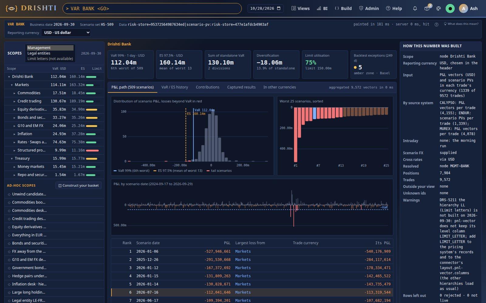
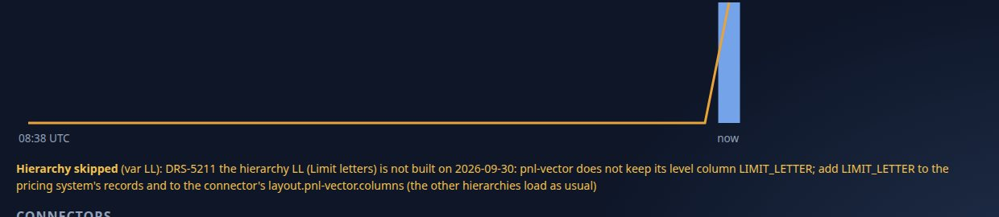
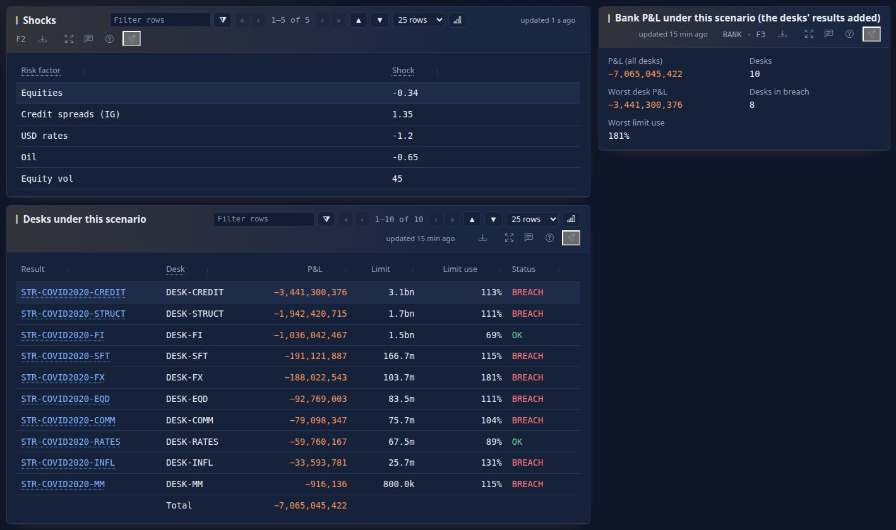

<!--
  Project Drishti · Any data. Any domain. One grammar.
  Copyright (c) 2026 Ashutosh Sinha <ajsinha@gmail.com>. All rights reserved.
  PROPRIETARY AND CONFIDENTIAL. See the LICENSE file in the root of this repository.
-->

# VaR: the data contract

The data contract of Drishti's VaR engine: what an upstream risk batch delivers, how it is checked, what Drishti builds from it and what it
answers. The computation (VaR, ES, decomposition, windows, horizons, stressed and parametric VaR) is in
[the VaR guide, section 18](../guides/VAR_GUIDE.md#18-the-computation); how to use VaR is the rest of that guide. The fields of each kind
the engine reads, with one example record each, are on [the market-risk contracts](packs/market-risk.md) and
[the trading contracts](packs/trading.md); the rules every contract shares are in [the contracts index](README.md).

## Contents

- [1. The contract at a glance](#1-the-contract-at-a-glance)
- [2. Inputs from upstream engines](#2-inputs-from-upstream-engines)
- [3. Reference and master data read](#3-reference-and-master-data-read)
- [4. Conventions specific to VaR](#4-conventions-specific-to-var)
- [5. Official end-of-day results](#5-official-end-of-day-results)
- [6. Validation, errors and data quality](#6-validation-errors-and-data-quality)
- [7. VaR is computed, not stored](#7-var-is-computed-not-stored)
- [8. Test data and generators](#8-test-data-and-generators)
- [9. Decisions and open questions](#9-decisions-and-open-questions)

## 1. The contract at a glance

*Contract version 1.5 · 2026-10-27 · Shared rules: [the contracts' README](README.md).* This page is the data contract of
Drishti's VaR engine: what an upstream risk batch delivers, what Drishti builds from it, and what Drishti answers. Every column, type,
key and formula was checked against the code and the committed test data on 2026-10-25. Where the designs say otherwise, the code wins
and the difference is noted (**Design differs**). The shared rules of every contract (the common risk lake, keys, types, dates, signs,
vectors, delivery, validation, answers, entitlements, versioning, retirement) are in the contracts' README; this page states only where
VaR differs or adds to them. Other contracts reuse VaR's model (the scope grammar, captures, entitlements, the planner) and cite this
contract's sections.

**Sources of truth checked:** `tools/packgen/var/make_var_data.py`, `positions.py`, `portfolios.py`, `factors.py`, `varmath.py`, `rules.py`;
`config/packs/market-risk/pack.yaml`, `config/packs/market-risk/config/about.yaml`, the pack's `samples/`; the test data in
`data/testdata/market-risk/` and its entries in `data/testdata/testdata.yaml`; `drishti-compute` (packages
`com.ash.drishti.compute.vector` and `com.ash.drishti.compute.var`); `drishti-server` (package `com.ash.drishti.server.var`); the Delta
plugin's vector reader (`DeltaTable.vectors`, `DeltaSourcePlugin.vectorColumns`); `tools/lake/stage.py` and `tools/lake/writers.py`;
`drishti.var` in `config/engines/var.yaml` (and its jar copy); the market-risk pack's `positions:` section.

**Commands and pages.** `VAR <word> <id> <GO>` opens the VaR explorer at a scope (`VAR DESK RATES <GO>`, `VAR BANK <GO>`,
`VAR CAPTURE CAP-20260930-1 <GO>`); `POS` and `PORT` open the position and portfolio pages; `VRES` the computed kind; the
API is `/api/v1/var`.

**Status.** The engine is **built** and tested: there is no stored `var` or `var-node` kind, no input or fundamental kind carries a VaR figure, positions are
derived by Drishti, the test data holds every live trade, official end-of-day captures are taken and published, the data-load signal
reloads the engine, the risk lake keeps 7 years, the gaps of section 6 are closed; each loaded date is a memory-mapped float32
hot file with the aggregates in float64, history dates open from their file, the benchmark is measured and extrapolated, and VaR is
also served as the computed kind `var-result` through a reactive connector; the what-if is the same engine's. What is still
**PLANNED** is marked so (names may still change; the decisions are in
[section 9](#9-decisions-and-open-questions)).

| Part | Status | Where |
|---|---|---|
| Trade-grain P&L vectors in a `list<double>` column (`pnl-vector`), every row checked at load | Built | §2.2, §6 |
| Scenario set, risk hierarchies (MGMT, LEGAL), portfolio definitions (HIERARCHY, RULE, BASKET) | Built | §2.3–2.5 |
| **Positions derived by Drishti** when a date loads, by the market-risk pack's `positions:` rules (securities: book + security; listed: book + contract; OTC: book + trade); signed quantity; live statuses only; served as the `position` kind by the `var-positions` connector | Built | [VaR guide §4](../guides/VAR_GUIDE.md#4-positions-derived-never-delivered), §2.6 |
| The in-memory engine: vector store, trade ordinals, node aggregates, planner, parallel sums | Built | [VaR guide §25](../guides/VAR_GUIDE.md#25-one-business-date-in-memory) |
| VaR, ES, standalone, component, incremental, marginal, diversification; backtest | Built | [VaR guide §18](../guides/VAR_GUIDE.md#18-the-computation) |
| Scope grammar `BANK LE DIV DESK BOOK NODE POS TRD CPTY PORT BASKET CAPTURE WHERE`, `+ - &`; `LE:` by the trades' legal entity; ids in any case | Built | [VaR guide §5](../guides/VAR_GUIDE.md#5-scopes-portfolios-and-baskets) |
| API `/api/v1/var`, baskets and captures in the content store, entitlements by node, field masks, audit | Built | [VaR guide §11](../guides/VAR_GUIDE.md#11-the-api), [VaR guide §9](../guides/VAR_GUIDE.md#9-who-sees-what-entitlements-and-audit) |
| Retire the stored `var` kind: `VAR-*` ids and `/v/var/<id>` open the explorer at the matching scope | Built | §7 |
| Retire the stored `var-node` kind: a node's history is the engine's **official end-of-day captures** | Built | §5, §7 |
| No computed column on `position`, `portfolio` or the core pack's `desk`: their pages show the engine's figures, computed as they open (`VAR_ENGINE`) | Built | [VaR guide §3.7](../guides/VAR_GUIDE.md#37-the-portfolio-and-position-pages), §7 |
| Official end-of-day captures of every node of MGMT and LEGAL, published to `risk-results/var-official` | Built | §5 |
| The data-load signal reloads the date and captures it (decided, open question 5) | Built | §2.8 |
| 7 years of vectors and their time travel (Delta log and removed files; lake maintenance never goes below) | Built | §2.1 |
| The full trade set (9,572 live trades) and 28 portfolios in the test data | Built | §8 |
| An optional "risk position" grouping for viewing (book × product × currency × underlying × maturity quarter) | PLANNED | §2.6 |
| Tiered memory: each loaded date a memory-mapped local hot file (float32 position rows in hierarchy order, the trades of fungible positions, float64 aggregates; Delta stays float64), the heap holding aggregates, columns and links; history dates opened lazily from their file; rebuilt when the inputs change; cleaned on eviction and shutdown | Built | [VaR guide §26](../guides/VAR_GUIDE.md#26-the-tiered-memory-and-the-hot-file) |
| The benchmark 1 M trades × 50 dates (`VarTierBenchmark`, opt-in): measured at 100,000 trades × 5 dates, extrapolated | Built (measured locally; the full run is for a server) | [BENCHMARK.md section 5.2](../admin/BENCHMARK.md#52-the-tiered-store-vartierbenchmark) |
| Sharding the hot store across Drishti*net nodes | Built (off by default: the pack's `sharding:` block) | [VaR guide §28](../guides/VAR_GUIDE.md#28-sharding-across-drishtinet), [CLUSTER_DEPLOYMENT.md section 5](../architecture/CLUSTER_DEPLOYMENT.md#5-var-sharding-in-depth-built) |
| The common risk lake (domain `risk`, one connector `risk-store` for every risk pack) | PLANNED (VaR's tables already there) | §2.1 |
| The computed kind `var-result` (`VRES`, the Java engine through the reactive connector `var-engine`) and the pre-deal what-if (`POST /api/v1/var/what-if`, the same engine: copies of booked trades or scopes, trades priced elsewhere, the stressed window) | Built | [VaR guide §8](../guides/VAR_GUIDE.md#8-what-if-and-var-as-a-kind) |
| VaR by a trade column (`by=attribute:TRADER_ID`), summed over every trade of the scope, the column's mask honoured | Built | [VaR guide §11.3](../guides/VAR_GUIDE.md#113-path-and-contributions) |
| The command line `drishti.py var` (show, parts, path, history, tree, status, captures, baskets, official, reload, whatif) | Built | [VaR guide §10](../guides/VAR_GUIDE.md#10-the-command-line) |
| What-if pricing of amended or new trades over the scenarios (QLRisk) | PLANNED (parked until QLRisk's API is stable; a what-if trade's vector is supplied) | [VaR guide §8.4](../guides/VAR_GUIDE.md#84-what-if-pricing-and-intraday-recomputes) |
| Scope words `GROUP:` and `NSET:` | Not built | [VaR guide §5.5](../guides/VAR_GUIDE.md#55-scope-words-by-a-trades-attribute) |
| **Scenario PVs** in each trade's currency (`scenario-pv`) beside or instead of P&L vectors, converted to USD P&L at load; scenario FX supplied (`fx-scenario`) or derived from the FX history (`fx-spot`); crosses through USD; a failed scenario `DRS-5206`, no FX `DRS-5207` | Built | §2.9 |
| **Reporting currency** `ccy=` on every answer, `--ccy` on the command line; USD built at load, other currencies on first ask, kept per date on the tiered memory; official records per `drishti.var.official.currencies` | Built (the console's picker: mock-ups first) | §2.10 |

## 2. Inputs from upstream engines

Whether each dataset is required, and what for: [the VaR guide, section 36](../guides/VAR_GUIDE.md#36-var-data-every-dataset-the-engine-reads); each kind's fields and one example record: [the market-risk contracts](packs/market-risk.md).

### 2.1 Where they live

All VaR inputs are tables in the **common risk lake**, domain `risk`, one table per kind, served by the market-risk pack's
connector `risk-store` (`plugin: delta`, `root: ${DRISHTI_DELTA_ROOT:${drishti.data.dir:./data}/delta}`, `domain: risk`). Delta is the
default; the same tables may be Iceberg tables, read by the same connector switched to `plugin: iceberg`
(`build_demo_lakes.py --store risk=iceberg` writes both the tables and the file; [section 29.3](../guides/VAR_GUIDE.md#293-how-the-lake-tools-and-the-delta-plugin-carry-a-vector)),
with the same VaR to the cent. The engine reads the kinds named by `drishti.var.kinds` (defaults below), whichever connector the kind
is routed to. The official results it
publishes live beside them, never read back ([section 5](#5-official-end-of-day-results)).

```
${DRISHTI_DELTA_ROOT}/
├── risk/                                        the inputs (engines read these)
│   ├── pnl-vector/   business_date=YYYY-MM-DD/part-*.parquet    one row per trade per date: the P&L vector and the trade's terms
│   ├── scenario-pv/  business_date=YYYY-MM-DD/                  one row per trade per date: its scenario PVs and base PV (its currency)
│   ├── fx-scenario/  business_date=YYYY-MM-DD/                  one row per currency per date: its rate today and per scenario
│   ├── scenario-set/ business_date=YYYY-MM-DD/                  one row per scenario set per date
│   ├── risk-hierarchy/ business_date=YYYY-MM-DD/                one row per hierarchy node per date
│   ├── var-limit/    business_date=YYYY-MM-DD/                  one row per node with a VaR limit (section 15.15)
│   └── portfolio/    business_date=YYYY-MM-DD/                  one row per portfolio definition per date
└── risk-results/
    └── var-official/ business_date=YYYY-MM-DD/                  the official end-of-day figures, a row per node and result version
```

Positions are not a table: Drishti derives them when it loads a date ([section 2.6](#26-positions-derived-by-drishti)). The
`position` and `var-node` tables are not inputs ([section 2.7](#27-tables-that-are-not-inputs-position-and-var-node)).

**The physical table** (every kind, `tools/lake/writers.py`): `id` STRING (the kind's key value), `doc` STRING (the whole document as
JSON), `business_date` DATE (the partition), the **promoted columns** of the pack's `layout.<kind>.columns` (DOUBLE when every value of
the column is a number, else STRING) and the **vector columns** of `layout.<kind>.vectors` (`list<double>`; the document keeps the
marker `{"$vector": "PNL"}` in their place). A field not promoted lives only inside `doc`. In the column tables below, *Delta* is the
promoted column's type, or `doc` when the field is only in the document. How the vector column is written and read is
[section 29](../guides/VAR_GUIDE.md#29-the-pl-vector-in-the-lake).

| Kind | `drishti.var.kinds` key (default) | Lake key (`id`) | Promoted columns (pack.yaml) | Vector columns |
|---|---|---|---|---|
| `pnl-vector` | `vector` (`pnl-vector`) | `VECTOR_ID` | 23 ([section 2.2](#22-pnl-vector-one-pl-vector-per-trade)) | `PNL` |
| `scenario-pv` | `scenario-pv` (`scenario-pv`) | `SCENARIO_PV_ID` | 24 ([section 2.9](#29-scenario-pv-scenario-pvs-per-trade-in-the-trades-currency)) | `SCENARIO_PV` |
| `fx-scenario` | `fx-scenario` (`fx-scenario`) | `FX_SCENARIO_ID` | `CURRENCY`, `RATE`, `SCENARIO_SET_ID` | none (`RATES` stays in the document) |
| `fx-spot` (market-data pack, read for derived FX) | `fx-spot` (`fx-spot`) | `PAIR` | (the market-data pack's) | none |
| `scenario-set` | `scenario-set` (`scenario-set`) | `SCENARIO_SET_ID` | none | none |
| `risk-hierarchy` | `hierarchy` (`risk-hierarchy`) | `NODE_ID` | `NODE_ID`, `HIERARCHY`, `LEVEL`, `PARENT_ID`, `NAME` | none |
| `portfolio` | `portfolio` (`portfolio`) | `PORTFOLIO_ID` | `PORTFOLIO_ID`, `NAME`, `TYPE`, `OWNER` | none |
| `position` (served, not stored) | `position` (`position`) | `POSITION_ID` | (the `var-positions` connector) | none |

The connector's layout in the market-risk pack (`config/packs/market-risk/pack.yaml`):

```yaml
connectors:
  risk-store:
    plugin: delta
    settings:
      domain: risk
      layout:
        pnl-vector:
          columns: [TRADE_ID, SECURITY_ID, INSTRUMENT, LEGAL_ENTITY, DIVISION, DESK, TT_BOOK, PORTFOLIO, ..., QUANTITY, PV, TRADE_STATUS,
                    MATURITY_DATE, STATUS, REPORTING_CCY, SCENARIO_SET_ID, BATCH_ID]
          vectors: [PNL]
```

**Partitioning, sort and files.** Partitioned by `business_date` only. `lake build` sorts rows by `id` within each batch of
at most 50,000 rows (`--batch-rows`, also bounded by `--batch-mb`, 128) and writes one commit per table with Drishti's Java writer
(or one per date and batch with `deltalake`); the market-risk layouts set no `sort-by`, `file-rows` or `row-group-rows` for these
kinds. The engine does not depend on the lake's order: it sorts a date into hierarchy order in memory ([section 25](../guides/VAR_GUIDE.md#25-one-business-date-in-memory)).
Encoding: the writers' defaults (Snappy; no `BYTE_STREAM_SPLIT`). **Design differs:** the design ([section 29.2](../guides/VAR_GUIDE.md#292-the-layout-the-design-chose-and-what-is-built))
proposed partitions by `BUSINESS_DATE` and `SCENARIO_SET_ID`, rows sorted by legal entity, desk, book and position, files of about 512
MB, row groups of about 64 MB, `BYTE_STREAM_SPLIT` and ZSTD for `PNL`; none of these is built. The sort and the partition by scenario
set remain planned; file sizing is open question 7.

**Retention: 7 years (open question 10).** Every table `lake build` creates in the domains `risk` and `risk-results`
keeps its Delta log and its removed files 7 years (`delta.logRetentionDuration` and `delta.deletedFileRetentionDuration` of `interval
2557 days`; both writers), so its time travel reaches back that far; the published `var-official` table is created the same way by the
server (`drishti.var.official.retention-years`, 7). Lake maintenance (`lake maintain`, Admin → Lakes) never vacuums a file nor deletes
a business date of those domains younger than 7 years, whatever a table's settings say: a lower `vacuum-hours` or `keep-business-days`
is raised (61,368 hours; 1,827 business days) and the run says so (`retention-floor`); a lake's `retain-years:` changes it per domain
([OPERATIONS.md](../admin/OPERATIONS.md#20-lake-maintenance-admin--lakes--maintain-and-lake-maintain)). The connector only reads, and never vacuums.

**The common risk lake (planned).** The VaR tables are already in domain `risk` behind `risk-store`. Every risk pack reads
the same lake through that one connector ([README.md section 2](README.md#2-the-common-risk-lake)); nothing changes for
VaR's tables.

### 2.2 `pnl-vector`: one P&L vector per trade

**Grain:** one row per **trade**, business date and scenario set. **Key:** `VECTOR_ID` (unique per date); the natural key is
(`BUSINESS_DATE`, `SCENARIO_SET_ID`, `TRADE_ID`): a trade id twice on a date refuses the date (`DRS-5202`, [section 6](#6-validation-errors-and-data-quality)).
**Row count:** every live trade the batch valued; test data 9,572 on 2026-09-30. **Design differs:** the design proposed one row per
*position*; the product owner chose the trade (2026-10-24, [section 29.1](../guides/VAR_GUIDE.md#291-the-vector-grain-the-trade)). A bank whose batch values
positions may send one row per position, its `TRADE_ID` the position's id (an OTC rule then makes it a position of its own).

"Engine" says whether the server engine reads the field: **R** (read as a column when the table keeps it promoted; `LEGAL_ENTITY`,
`DESK` and `TT_BOOK` must be promoted or the load fails), **C** (read for a check of section 6 when promoted), **–** (kept for people,
links and audit).

| Column | JSON | Delta | Req. | Engine | Unit | Meaning | Example |
|---|---|---|---|---|---|---|---|
| `VECTOR_ID` | id | `id` STRING | required | – | | `PNL-<TRADE_ID or POSITION_ID>-<SCENARIO_SET_ID>` (`PV-` before, still read); the lake key | `PNL-MX-20000274-HS-509` |
| `TRADE_ID` | id | STRING | required | R | | the booking system's trade id (text even when all digits). When null the engine uses the row's `id` | `MX-20000274` |
| `SECURITY_ID` | id | STRING | for securities and listed products | R | | the security or exchange contract the trade is in: a position rule's key (section 2.6). The test data's are synthetic | `SEC-WARRANT-USD-01` |
| `ISIN`, `TICKER`, `CONTRACT` | id | STRING | optional | R (when a rule names them) | | other keys a rule may name, read when promoted | |
| `INSTRUMENT` | text | STRING | optional | R | | the instrument's name, the position's label | `Equity warrant USD 2027-05` |
| `BUSINESS_DATE` | date | `business_date` DATE | required | R | | the close of business the vector belongs to | `2026-09-30` |
| `SCENARIO_SET_ID` | id | STRING | required | C | | the scenario set whose `SCENARIO_DATES` order the vector; another set's id refuses the date (`DRS-5203`) | `HS-509` |
| `SOURCE_SYSTEM` | text | doc | optional | – | | booking system | `MUREX` |
| `TRADE_VERSIONS` | text | doc | optional | – | | the trade version the batch priced (`v<TRADE_VERSION>`) | `v4` |
| `TRADE_STATUS` | text | STRING | optional | R | | the trade's status the batch priced: only the live statuses count; none: it counts | `AMENDED` |
| `MATURITY_DATE` | date | STRING | optional | R | | a trade matured before the business date does not count | `2027-05-26` |
| `LEGAL_ENTITY` | id | STRING | required | R | | the bank's legal entity that booked the trade: `LE:` ([VaR guide section 5.5](../guides/VAR_GUIDE.md#55-scope-words-by-a-trades-attribute)), 1st sort key in memory | `LE-LDN` |
| `DIVISION` | id | STRING | optional | R | | division of the desk | `DIV-MARKETS` |
| `DESK` | id | STRING | required | R | | desk (2nd sort key) | `DESK-EQD` |
| `TT_BOOK` | id | STRING | required | R | | book (3rd sort key); a trade without a book is in no node | `BOOK-EQD-2` |
| `PORTFOLIO` | text | STRING | optional | R | | booking portfolio on the trade | `BOOK-EQD-2` |
| `STRATEGY` | text | STRING | optional | R | | trading strategy | `""` |
| `PRODUCT_GROUP` | text | STRING | optional | R | | product group: picks the position rule | `Equity` |
| `PRODUCT_TYPE` | text | STRING | optional | R | | product type as booked: picks the position rule | `WARRANT` |
| `CURRENCY` | ccy | STRING | required | R | | the currency the P&L values are in; not USD: converted per scenario with its FX (approximate), `DRS-5207` without FX | `USD` |
| `TRADE_CURRENCY` | ccy | STRING | optional | R | | the trade's own currency when it is not the P&L's (scopes, rules, Trade currency) | `GBP` |
| `COUNTERPARTY` | id | STRING | optional | R | | counterparty id: `CPTY:` ([VaR guide section 5.5](../guides/VAR_GUIDE.md#55-scope-words-by-a-trades-attribute)) | `CP-SUMMIT` |
| `DIRECTION` | text | STRING | optional | R | | `LONG` (quantity ≥ 0) or `SHORT` | `SHORT` |
| `QUANTITY` | amount | DOUBLE | optional | R | units or notional | signed quantity: positive bought, negative sold (the batch applies the sign of `BUY_SELL_CODE`) | `-179000000.0` |
| `TAGS` | text | STRING | optional | R | | the trade's tags joined by `\|` (`internal`, `option`): a position's are the union | `""` |
| `REPORTING_CCY` | ccy | STRING | optional | C | | deprecated: an alias of `CURRENCY`; when present it must equal it (`DRS-5208`) | `USD` |
| `PV` | amount | DOUBLE | optional | R | USD | present value on the business date (a position's market value; the size behind a trade's marginal VaR) | `3143714` |
| `PNL` | vector | `list<double>` | required | R | USD | the trade's P&L under each scenario, in `SCENARIO_DATES` order, gain positive; length = `SCENARIO_COUNT` | `[4169, -3347, -1306, …]` (509) |
| `STATUS` | text | STRING | required | C | | `ok`, `proxied` (priced by a proxy) or `failed` (then `PNL` null; a failed row with a vector is rejected, never silently zero) | `ok` |
| `PRICER` | text | doc | optional | – | | pricer used | `demo-factor-model` |
| `MODEL_VERSION` | text | doc | optional | – | | pricer version | `demo-2` |
| `COMPUTED_AT` | timestamp | doc | optional | – | UTC | when the batch valued the trade | `2026-09-30T06:00:00Z` |
| `BATCH_ID` | id | STRING | required | C | | the run: one per date (several refuse the date, `DRS-5203`) | `B-2026-09-30-01` |
| `RESTATEMENT` | integer | doc | optional | – | | 0 for the first run, 1, 2, … for restatements | `0` |

`POSITION_ID` and `INSTRUMENT_ID` are not delivered: the engine derives them; an upstream value is not read. A per-risk-class
split (`PNL_BY_RISK_CLASS`, `{IR, FX, CR, EQ, CO}` vectors adding up to `PNL`) is designed and not built.

**The engine's read.** `VarLoader` asks the connector for the date's rows through `SourceRouter.vectors(kind, "PNL", columns, asOf,
sink)`: `TRADE_ID`, the engine's columns of `VarBook.TRADE_TEXTS` and `TRADE_NUMBERS`, every key field a position rule names, and the
check columns (`TRADE_STATUS`, `MATURITY_DATE`, `BATCH_ID`, `SCENARIO_SET_ID`, `REPORTING_CCY`, `STATUS`), each read when the table
keeps it promoted (`SourceRouter.columnar`); a connector that cannot say is asked for the engine's own columns only. The vector is
streamed into the vector store; no document is parsed. Each row passes `VarIntake` ([section 6.3](#63-what-the-load-checks)):
not live, it is left out (counted as `excluded`); a wrong length, a null or NaN, another currency or a failed row with a vector is
rejected (`DRS-5201`, counted and listed in the provenance); otherwise it gets its position and joins the store. A null `PNL` is a
**failed** row: counted (`provenance.failed`), never taken as zero.

**The vector** ([README.md section 8](README.md#8-vectors-and-other-arrays)):

| Property | Contract |
|---|---|
| Type | `list<double>` (Parquet LIST of DOUBLE), float64; JSON array of numbers in the test data |
| Length | N = the scenario set's `SCENARIO_COUNT` (509), the same for every row of the date |
| Order | element *i* is the P&L under the move of `SCENARIO_DATES[i]` of the scenario set of the same `BUSINESS_DATE`; oldest first |
| Currency | the record's `CURRENCY` (USD in the demo; another converted per scenario); amounts in currency units, not thousands; the test data's are whole USD. A trade priced in another currency is sent as scenario PVs instead ([section 2.9](#29-scenario-pv-scenario-pvs-per-trade-in-the-trades-currency)); answers in another currency are asked with `ccy` ([section 2.10](#210-reporting-currency)) |
| Sign | gain positive, loss negative, from the bank's point of view |
| Horizon | 1 day (`HORIZON_DAYS` of the scenario set) |
| Missing | no `null`, `NaN` or infinity inside a vector; a trade the batch could not value has `STATUS: failed` and `PNL` null |

### 2.3 `scenario-set`: the scenario days

**Grain:** one row per scenario set and business date. **Key:** `SCENARIO_SET_ID` (with `business_date`). **Row count:** 1 per date, or 2
when the batch sends a **stress set** for stressed VaR (`SET_TYPE: STRESS`, [section 18.8](../guides/VAR_GUIDE.md#188-stressed-var)). A date with two normal sets
is not loaded (`DRS-5203`), nor one whose `SCENARIO_DATES` are not strictly increasing or not all before the business date; two stress
sets refuse the stress set alone.

| Column | JSON | Delta | Req. | Engine | Meaning | Example |
|---|---|---|---|---|---|---|
| `SCENARIO_SET_ID` | id | `id` STRING | required | R | the set; stamped on every answer; the stress set's rows in every input table carry its own | `HS-509`, `HS-STRESS-2008` |
| `BUSINESS_DATE` | date | `business_date` DATE | required | R | the date whose vectors the set orders | `2026-09-30` |
| `SCENARIO_DATES` | date list | doc | required | R | the N scenario days, oldest first, strictly increasing; index *i* of every vector | `["2024-09-17", …, "2026-09-29"]` (509) |
| `SCENARIO_COUNT` | integer | doc | required | – | N = length of `SCENARIO_DATES` | `509` |
| `WINDOW_START` | date | doc | required | – | `SCENARIO_DATES[0]` | `2024-09-17` |
| `WINDOW_END` | date | doc | required | – | `SCENARIO_DATES[N-1]`: the business day before `BUSINESS_DATE` | `2026-09-29` |
| `HORIZON_DAYS` | integer | doc | required | – | 1 (10-day vectors, where a batch makes them, would be a separate set) | `1` |
| `REVALUATION` | text | doc | optional | – | `full` or `sensitivities` (Taylor), as the batch did it | `full` |
| `WEIGHTS` | number list | doc | optional | – | age weights for a weighted method (not used: equal weights) | `null` |
| `SOURCE_BATCH` | id | doc | optional | – | the batch that produced the set and its vectors | `B-2026-09-30-01` |
| `DESCRIPTION` | text | doc | optional | – | shown with a stressed answer | `Historical simulation, 509 business days, equal weights` |
| `SET_TYPE` | text | doc | optional | R | `STRESS` for the date's stress set; absent (or `HISTORICAL`) for the normal set; a set without it is the stress set when its id starts with `drishti.var.stress.id-prefix` | `STRESS` |
| `SYNTHETIC` | boolean | doc | optional | R | the set's moves are synthetic, not market history (the demo's stress set): every stressed answer says so | `true` |

Scenario days are business days of the USNY calendar (`tools/packgen/var/make_var_data.py`, `business_days`). The set is itself dated,
so the meaning of index *i* is never ambiguous: each date moves the window by one day (the oldest scenario day drops out, the newest
enters) and, under full revaluation, every value of every vector changes.

### 2.4 `risk-hierarchy`: the trees and their limits

**Grain:** one row per node and business date. **Key:** `NODE_ID` = `<HIERARCHY>~<node>`. **Row count:** 88 in the test data (MGMT:
1 bank, 2 divisions, 10 desks, 30 books; LEGAL: 1 bank, 4 legal entities, 10 desks, 30 books). MGMT is the **primary hierarchy**: the
planner and the history use it. The demo's MGMT tree is generated from the core pack's `desk` and `legal-entity` records (books under
desks) with a `DIV-MARKETS` division added; nothing contradicts them.

| Column | JSON | Delta | Req. | Engine | Unit | Meaning | Example |
|---|---|---|---|---|---|---|---|
| `NODE_ID` | id | STRING (also `id`) | required | R | | `<HIERARCHY>~<id>` | `LEGAL~LE-NY` |
| `HIERARCHY` | text | STRING | required | R | | any id (`[A-Z][A-Z0-9_]*`); `MGMT` and `LEGAL` in the demo. `DIV`, `DESK`, `BOOK` look in MGMT, `LE` in LEGAL; a configured word in its own hierarchy ([section 2.14](#214-hierarchies-from-the-rows-or-from-the-trades-columns)) | `LEGAL` |
| `LEVEL` | text | STRING | required | R | | the hierarchy's own level names (the enum opened): `bank`, `division`, `legal-entity`, `desk`, `book` in the demo | `legal-entity` |
| `PARENT_ID` | id | STRING | required (null at the root) | R | | parent node; the engine builds children from it | `LEGAL~BANK` |
| `NAME` | text | STRING | required | R | | display name | `LE-NY` |
| `REF` | record | doc | optional | – | | the master the node is: `{KIND, ID}` | `{"KIND": "legal-entity", "ID": "LE-NY"}` |
| `CHILDREN` | id list | doc | optional | – | | child node ids (informational; the engine uses `PARENT_ID`) | `["LEGAL~DESK-COMM", …]` |
| `BOOKS` | id list | doc | required | R | | **every** book beneath the node (a book node lists itself); the node's members are these books' trades | `["BOOK-COMM-1", …]` (15) |
| `LIMIT_VAR` | amount | DOUBLE | optional | R | USD | **not in the demo**: a node's limit is its `var-limit` row (decision 8 of [COMPUTED_ATTRIBUTES.md](../architecture/COMPUTED_ATTRIBUTES.md)); a bank's row that still carries one is read when `var-limit` has no row for the node | `8500000` |
| `BUSINESS_DATE` | date | `business_date` DATE | required | R | | | `2026-09-30` |
| `VALID_FROM`, `VALID_TO` | date | doc | optional | – | | validity of the node (informational) | `2026-01-02`, `null` |

A past date's VaR uses that date's hierarchy, never today's: a book moved to another desk last month counts under its old desk for dates
before the move. `risk-hierarchy` is one source of hierarchies among two (the rows, book-based; or the trades' columns:
[section 2.14](#214-hierarchies-from-the-rows-or-from-the-trades-columns)); the demo keeps MGMT and LEGAL on it.

### 2.5 `portfolio`: stored portfolio definitions

**Grain:** one row per portfolio and business date. **Key:** `PORTFOLIO_ID` (`PF-…`). **Row count:** 28 in the test data. A portfolio
is a **definition**: its positions, VaR, ES and contributions are the engine's, computed when asked (the portfolio page, `PORT:<id>`,
[section 3.7](../guides/VAR_GUIDE.md#37-the-portfolio-and-position-pages)). It carries no stored figures
([section 7.3](#73-what-is-not-stored)). How a definition becomes a scope is in
[section 5.7](../guides/VAR_GUIDE.md#57-stored-portfolios).

| Column | JSON | Delta | Req. | Engine | Meaning | Example |
|---|---|---|---|---|---|---|
| `PORTFOLIO_ID` | id | STRING (also `id`) | required | R | the portfolio; scope `PORT:<id>` | `PF-RATES-DESK` |
| `NAME` | text | STRING | required | R | | `Rates desk (New York)` |
| `OWNER` | text | STRING | required | R | user or team | `rates-risk` |
| `TYPE` | text | STRING | required | R | `HIERARCHY`, `RULE` or `BASKET` | `HIERARCHY` |
| `DEFINITION` | record | doc | required | R | `{NODE: <NODE_ID>}`, `{RULE: <rule text>}` ([section 5.4](../guides/VAR_GUIDE.md#54-the-position-rule-language-where-and-rule-portfolios)) or `{MEMBERS: [{POSITION_ID} or {TRADE_ID}, …]}` | `{"NODE": "MGMT~DESK-RATES"}` |
| `ROLLS_UP_TO` | record | doc | optional | – | `{KIND, ID}` the portfolio reports under | `{"KIND": "desk", "ID": "DESK-RATES"}` |
| `LIMIT_VAR` | amount | DOUBLE | optional | R | **not in the demo**: a portfolio's VaR limit is its `var-limit` row of hierarchy `PORTFOLIO` ([section 2.15](#215-var-limit-the-nodes-var-limits)); a record that still carries one is read when there is no row | `106000000` |
| `BUSINESS_DATE`, `VALID_FROM`, `VALID_TO` | date | `business_date` / doc | required / optional | – | | `2026-09-30`, `2026-01-02`, `null` |

A BASKET's `POSITION_ID` members name derived positions: `POS-<TT_BOOK>~<security>` or `POS-<TT_BOOK>~<TRADE_ID>`. Rule portfolios and
baskets saved by people live in the content store ([section 5.8](../guides/VAR_GUIDE.md#58-baskets)); the stored `portfolio` kind holds the demo's (and a
bank's own) definitions.

### 2.6 Positions derived by Drishti

Drishti derives positions itself, on the server, each time it loads a business date (product owner, 2026-10-25), from the date's
`pnl-vector` rows (the trades as the batch priced them) and the **position rules** ([section 4](../guides/VAR_GUIDE.md#4-positions-derived-never-delivered)
shows them).

| Rule | Contract |
|---|---|
| Live trades | `TRADE_STATUS` one of the live statuses (`NEW`, `VALIDATED`, `AMENDED`; configurable); a row with no status counts (the batch valued it); `MATURITY_DATE` before the business date: not live. A row not live is left out of the date (`provenance.excluded`) |
| Signed quantity | `QUANTITY` as delivered: `abs(QUANTITY)` when bought, `−abs(QUANTITY)` when sold (`BUY_SELL_CODE` starting with `S`): the batch applies it, as the demo generator does |
| Which rule | the first rule whose `groups` hold the trade's `PRODUCT_GROUP` or whose `types` hold its `PRODUCT_TYPE` (compared ignoring case; a rule naming neither takes every trade); configuration, never code |
| Securities | (`TT_BOOK`, the first of `SECURITY_ID`, `ISIN`, `TICKER` the trade carries): `POSITION_ID = POS-<TT_BOOK>~<security>` |
| Listed derivatives | (`TT_BOOK`, the first of `SECURITY_ID`, `CONTRACT`): `POSITION_ID = POS-<TT_BOOK>~<contract>` |
| OTC | (`TT_BOOK`, `TRADE_ID`): one position per trade; `POSITION_ID = POS-<TT_BOOK>~<TRADE_ID>`, `INSTRUMENT_ID` = the trade id. A securities or listed trade without a key field is OTC too |
| Direction | `LONG` when the net signed quantity > 0, `SHORT` < 0, `FLAT` = 0 |
| Position columns | the first trade's instrument, hierarchy, product and currency; the counterparty when every trade shares one (else empty); the union of the trades' tags; `QUANTITY` the signed sum, `NOTIONAL` the gross, `MARKET_VALUE` the trades' PV, `TRADE_COUNT`, `LONG_TRADES`, `SHORT_TRADES`; `POSITION_RULE` (`securities`, `listed`, `otc`), `SECURITY_ID`, `POSITION_TYPE` (`fungible`, `single-trade`), `STATUS` (`open`, `flat`) |
| Netting | only within one book and one instrument: a long in one book and a short in another stay two positions (different desks and limits); their P&Ls offset when a scope holds both |
| Risk positions | an optional second grouping for viewing only (book × product type × currency × underlying × maturity quarter): **PLANNED** |

**The rules** are the market-risk pack's `positions:` section (in `pack.yaml`, kept in `tools/packgen/banking/kept/market-risk.yaml`);
when no loaded pack has one, the server's `drishti.var.positions` ([section 12](../guides/VAR_GUIDE.md#12-settings); default: the live statuses, no rule, so
one position per trade).

**Where positions live (decided, open question 2).** In memory, with their date: rebuilt from the date's trades and the rules every time
the date is loaded, so the same inputs and rules always give the same positions (reproducible). They are not stored in the lake nor in a
database. Each **official end-of-day capture** records the membership the rules derived (every position with its trades, by book, and
each node's books) and the rules' text and digest ([section 5](#5-official-end-of-day-results)), so an official figure can be
recomputed from its inputs years later. They are served as the `position` kind by the market-risk pack's `var-positions` connector
(`plugin: var-positions`, the engine's memory; `POS <id>`, `/v/position/<id>`, search), with no figure on them: the position page shows
the engine's ([section 3.7](../guides/VAR_GUIDE.md#37-the-portfolio-and-position-pages)). Positions link to trades (`graph.fields.TRADE_IDS` → `trade`), so the
links open the trade, book, desk, legal entity and counterparty from a position page.

The served document: `POSITION_ID`, `BUSINESS_DATE`, `POSITION_RULE`, `SECURITY_ID`, `INSTRUMENT_ID`, `INSTRUMENT`, `POSITION_TYPE`,
`DIRECTION`, `QUANTITY`, `GROSS_QUANTITY`, `TRADE_COUNT`, `LONG_TRADES`, `SHORT_TRADES`, `TRADE_IDS`, `TRADES` (`TRADE_ID`, `QUANTITY`,
`DIRECTION`, `PV`, `PRODUCT_TYPE`, `COUNTERPARTY` each), `LEGAL_ENTITY`, `DIVISION`, `DESK`, `TT_BOOK`, `PORTFOLIO`, `STRATEGY`,
`COUNTERPARTY`, `PRODUCT_GROUP`, `PRODUCT_TYPE`, `CURRENCY`, `COUNTERPARTIES`, `MARKET_VALUE`, `NOTIONAL`, `TAGS`, `STATUS`,
`SCENARIO_SET_ID`, `VAR_SCOPE` (`POS:<id>`), `DERIVED_BY`.

**The test data (decided, open question 3).** The committed trades carry no security id: the demo risk batch
(`tools/packgen/var/positions.py`) gives every trade of a securities or listed rule keyed by `SECURITY_ID` a deterministic synthetic id,
a few per product type and currency (about six trades each, chosen by a hash of the trade id): `SEC-<PRODUCT_TYPE>-<CURRENCY>-<nn>` for
securities, `XCH-…` for listed. On 2026-09-30: 2,159 trades in 358 securities; 7,984 positions (359 securities, 212 listed, 7,413 OTC),
476 of them fungible and 111 netting buys and sells. A bank's batch copies the trade's own security id.

### 2.7 Tables that are not inputs: `position` and `var-node`

**`position`.** No `position` table is delivered (positions grouped by product type,
currency, underlying and maturity quarter, with VaR figures on them; ids like `POS-BOOK-RATES-1~CMS_SPREAD_OPT-AUD-2028Q2` and
`INSTRUMENT_ID` `INS-<product>-<currency>[-<underlying>]-<maturity quarter>`): positions are derived by Drishti
([section 2.6](#26-positions-derived-by-drishti)), and no position carries a stored figure.

**`var-node`.** No node's VaR, ES or hypothetical P&L is stored as an input
(`var-node`: `VAR_NODE_ID` `VN-<node>`, `NODE_ID`, `VAR_99`, `ES_975`, `HYPO_PNL`, `EXCEPTION`, `PREVIOUS_VAR`, `LIMIT`, `LIMIT_USE`,
counts; `PNL` and `EXCEPTIONS_250` on the last date): a node's history is
its **official end-of-day captures** ([section 5](#5-official-end-of-day-results)), and `VN-<NODE_ID>` opens the explorer at
`NODE:<NODE_ID>` ([section 7](#7-var-is-computed-not-stored)). The designed `pnl-hypothetical` kind (per position and date) is not
built: a node's backtest reads its official `HYPO_PNL`; any other scope replays its members.

### 2.8 Cadence, delivery and the load signal

```
 upstream risk batch (nightly)                 the risk lake (Delta)                     Drishti
 ─────────────────────────────                 ─────────────────────                     ───────
 values every live trade × 509 scenarios ───►  risk/pnl-vector/business_date=D/      ─┐
 the scenario days of the set ─────────────►  risk/scenario-set/business_date=D/     ─┼──► the VaR engine loads D:
 the hierarchies (MGMT, LEGAL) and limits ──►  risk/risk-hierarchy/business_date=D/   ─┤      checks every row, derives positions,
 portfolio definitions ────────────────────►  risk/portfolio/business_date=D/        ─┘      writes D's hot file, maps it
 POST /api/v1/packs/market-risk/loads ───────────────────────────────────────────────────►  the load signal: D is reloaded and
                                                                                            captured officially (every node)
                                               risk-results/var-official/  ◄──────────────  the official figures, appended
```

| Item | Contract |
|---|---|
| Producer | **the bank's batch** (decided); Drishti loads the vectors (the demo's come from a synthetic factor model) |
| Cadence | once per business date (USNY calendar), after the close |
| Due time | **to be agreed** (no `loads:` expectation in the market-risk pack today; open question 4) |
| Complete when | every live trade booked on the date has a `pnl-vector` row (`ok`, `proxied` or `failed`), the scenario set is written, and the hierarchy and portfolios of the date are present |
| One run | all rows of a date carry one `BATCH_ID` and the scenario set's `SCENARIO_SET_ID`; otherwise the date is not loaded (`DRS-5203`) and the date before it is answered, with a warning |
| Restatement | rewrite the whole date (`lake build` replaces a business date); `RESTATEMENT` + 1; a new `BATCH_ID` |
| Intraday | the changed trades only, appended (`lake build --mode append`), `RUN_KIND: INTRADAY`, each batch its own `BATCH_ID` and a later `COMPUTED_AT`, the morning run's scenario set; applied on the loaded date without a reload ([section 8.4](../guides/VAR_GUIDE.md#84-what-if-pricing-and-intraday-recomputes)) |

**Sequence**, following the shared delivery rules ([README.md section 9](README.md#9-delivery-writing-a-business-date)):

```
 upstream batch                                   Drishti
 ──────────────                                   ───────
 1 write scenario-set row for D ───────────────►  (lake)
 2 write pnl-vector rows for D (one BATCH_ID) ──►  (lake)
 3 write risk-hierarchy / portfolio rows for D ─►  (lake; when changed)
 4 POST /api/v1/packs/market-risk/loads           drops the connector caches of the kind, verifies the date, runs alerts, tells
   {kind, businessDate, status, rows, batchId}    people (DATA_GUIDE.md); for pnl-vector, scenario-set, risk-hierarchy, portfolio
   (or drishti.py data landed)                    (and trade): the VaR engine drops date D, then captures D officially (§19)
 5 the next VaR request for D (or the newest) ──►  loads D: scenario set, vectors (checked, positions derived), hierarchy,
                                                   portfolios; sorts, sums every node; answers
```

**Reload on load (open question 5).** A `ready` load of an input kind (`drishti.var.kinds`: `pnl-vector`, `scenario-set`,
`risk-hierarchy`, `portfolio`) or of `trade` (`LoadService.onReady`) drops that date from the engine (the same as
`POST /api/v1/var/reload` for the date, audited `var-reload`), so a restated date is never stale, then captures the date officially in
the background ([section 5](#5-official-end-of-day-results)): a date whose inputs are unchanged is not captured again, a restated one
gets the next result version. A **new** date is picked up without a signal (each request asks the connector for the newest date with
vectors); a **restated** open date is too, within `drishti.var.version-check` (30 s, the version watch: reloaded in the
background, the old figures answered meanwhile with a warning; a date with intraday updates applied is left to its signal); at start the server captures the newest date when it has no official record (`drishti.var.official.on-start`). **Hot dates:**
at most `drishti.var.hot-dates` (10) dates stay open, the least recently used leaving first; the date just used, the newest business date
and the dates pinned in memory always stay ([section 26.8](../guides/VAR_GUIDE.md#268-dates-in-memory-over-years-of-history)); a closed date's cached answers go too. **Restatements:** a batch that rewrites a date changes the vector table's data version; the signal reloads the date, a new
hot file is built (its name is the digest of the new inputs, [section 26](../guides/VAR_GUIDE.md#26-the-tiered-memory-and-the-hot-file)) and the official
capture is taken again with the next result version; the earlier one is kept. Time travel (*the VaR of a date as it was known on a later
day*) reads the table at that instant, within the 7 years kept.

### 2.9 `scenario-pv`: scenario PVs per trade, in the trade's currency

A bank's batch may send a trade's scenario P&L in a second form (product owner, 2026-10-27): the trade **revalued under each scenario**
and its **base PV** of the same run, both in the trade's own currency, instead of the P&L vector. Drishti computes the P&L itself when it
loads the date, in USD, and from there in any reporting currency ([section 2.10](#210-reporting-currency)). The two forms
live side by side: a date may hold P&L vectors for some trades and scenario PVs for others (the demo does: its Endur trades come as
scenario PVs); a trade is in one form only (a trade id in both refuses the date, `DRS-5202`). The P&L-vector form of section 2.2 is
unchanged.

**The decisions (product owner, 2026-10-27):** (1) PVs are in **each trade's own currency**, its `CURRENCY`; one stated currency for a
whole file is the same thing; (2) scenario FX is **derived** from the FX history of each scenario's date, unless the batch **supplies** it
(then the supplied rates are used); (3) every cross rate goes **through USD**; (4) the holding period stays **1 day**.

**The conversion at load** (`VarIntake`, `ScenarioFx.pnlFromPv`), for a trade in currency `c`, with `FX_c` in USD per unit of `c`:

```
P&L_USD(s) = PV(s) × FX_c(s) − PV(base) × FX_c(base)          s = 0 … 508, the scenario set's order
```

The trade's USD value today, `PV(base) × FX_c(base)`, becomes its `PV` (the position's market value, the size of its marginal VaR), as a
P&L vector's `PV`. A USD trade's P&L is `PV(s) − PV(base)`. Converted, the trade joins the store like any vector; positions, nodes,
scopes, captures and the official record do not know which form it came in (the provenance counts them: `scenarioPvTrades`).

**Grain:** one row per trade, business date and scenario set. **Key:** `SCENARIO_PV_ID` (`SPV-<TRADE_ID>-<SCENARIO_SET_ID>`), command
`SPV`. **Table:** `risk/scenario-pv/`, the vector column `SCENARIO_PV` (`list<double>`), the same promoted trade columns as `pnl-vector`
plus those below. Contract: `config/packs/market-risk/contracts/scenario-pv.contract.yaml`.

| Column | JSON | Delta | Req. | Engine | Unit | Meaning | Example |
|---|---|---|---|---|---|---|---|
| `SCENARIO_PV_ID` | id | `id` STRING | required | – | | the lake key: `SPV-<TRADE_ID or POSITION_ID>-<SCENARIO_SET_ID>` (an intraday update adds `-<BATCH_ID>`); it names the input row, never a position ([section 36.1](../guides/VAR_GUIDE.md#361-from-an-input-row-to-a-position)) | `SPV-1000054-HS-509` |
| `TRADE_ID` … `TAGS` | | | | R | | the trade's terms, as in [section 2.2](#22-pnl-vector-one-pl-vector-per-trade) (`LEGAL_ENTITY`, `DESK` and `TT_BOOK` promoted) | |
| `CURRENCY` | ccy | STRING | required | R | | the currency **both PVs** are in: the trade's own | `EUR` |
| `BASE_PV` | amount | DOUBLE | required | R | `CURRENCY` | the trade's value on the business date, from the same run as the scenario PVs | `14997.44` |
| `SCENARIO_PV` | vector | `list<double>` | required | R | `CURRENCY` | the trade's value under each scenario, in `SCENARIO_DATES` order; length `SCENARIO_COUNT`; a scenario that failed to price is `null` | `[15062.11, 14950.27, …]` (509) |
| `VALUATION_DATE`, `BASE_VALUATION_DATE` | date | STRING | required | C | | the dates the scenario PVs and the base PV are valued on: the same, the business date | `2026-09-30` |
| `RUN_KIND` | text | STRING | optional | R | | `FULL` (or none) for the day's run; `INTRADAY` for an update sent during the day ([section 8.4](../guides/VAR_GUIDE.md#84-what-if-pricing-and-intraday-recomputes)); the same column on `pnl-vector` | `INTRADAY` |
| `COMPUTED_AT` | timestamp | STRING | optional | R | | when the run priced the row; for an intraday update, later than the morning run's, the latest per trade winning | `2026-09-30T23:05:00Z` |
| `TRADE_STATUS`, `MATURITY_DATE` | | STRING | optional | R | | live or not, as in section 2.2 | |
| `STATUS` | text | STRING | required | C | | `ok`, `proxied` or `failed` (then `SCENARIO_PV` null: counted as failed, never zero) | `ok` |
| `SCENARIO_SET_ID`, `BATCH_ID` | id | STRING | required | C | | the run, checked with the vectors': one batch and the date's set across both forms (`DRS-5203`) | `HS-509`, `B-2026-09-30-01` |
| `SOURCE_SYSTEM`, `TRADE_VERSIONS`, `PRICER`, `MODEL_VERSION`, `COMPUTED_AT`, `RESTATEMENT` | | doc | optional | – | | as in section 2.2 | |

**What the load checks** (each a rejected row, counted and listed in `provenance.rejections`, never padded): a `null` or `NaN` in
`SCENARIO_PV` is a **scenario that failed to price**: `DRS-5206 <trade>: 1 scenario failed to price: 312 (2025-11-21); the trade is not
loaded (never filled with zero)`; a currency with no scenario FX on the date: `DRS-5207 <trade>: its PVs are in CHF and the date has no
CHF scenario FX (…)`; a length other than the set's, no `BASE_PV`, a `VALUATION_DATE` and `BASE_VALUATION_DATE` that differ, or either
not the business date: `DRS-5201`. Every trade uses the scenario set's order: the order is the set's `SCENARIO_DATES`, the same for both
forms, and its length is checked.

**FX: `fx-scenario` (supplied) or `fx-spot` (derived).** For each currency met, the engine takes, in this order:

| Source | Kind | What | Rates |
|---|---|---|---|
| supplied | `fx-scenario` (`FXS`, market-risk pack, `risk/fx-scenario/`) | one row per currency and date: `CURRENCY`, `RATE` (today), `RATES` (509, the scenario set's order), always **USD per one unit**, `SCENARIO_SET_ID`, `BATCH_ID` | as sent |
| derived | `fx-spot` (`FX`, market-data pack) | each pair against USD (`FX-EURUSD`, `FX-USDJPY`): today's `MID` and its `HISTORY` (`DATE`, `MID`) | `FX(s) = FX(base) × H(d_s) / H(d_s − 1)`: today's rate moved by the scenario day's 1-day relative move, `d_s − 1` the history's previous date |

Cross pairs (`FX-EURGBP`) are never read: every cross goes through USD, units of `B` per unit of `A` being `FX_A / FX_B`. A currency with
neither, or whose history does not cover every scenario day and the day before the first, has no rates on the date; the provenance's
`fx` says per currency where its rates came from (`supplied`, `derived`) and today's rate. The market-data pack's demo history is 30
days, so the demo **supplies** its scenario FX (AUD, CAD, CHF, EUR, GBP, JPY); a bank with 510 days of FX history needs to send none.
`scenario-pv` and `fx-scenario` are inputs (their data-load signal reloads the date, and they enter the hot file's digest); `fx-spot` is
read when a date loads, not watched. Contract: `config/packs/market-risk/contracts/fx-scenario.contract.yaml`.

**On the test data.** The Endur trades (1,339: 1,089 USD, 246 EUR, 4 CAD) come as scenario PVs: a factor-model move,
valued in the trade's currency (`tools/packgen/var/scenario_fx.py`). A USD trade's P&L from its scenario PVs is its P&L
vector **exactly**; a EUR or CAD trade's adds the move of its currency on its value, as a bank's revaluation would. The bank on
2026-09-30 moves from VaR 112,035,906 and ES 160,132,107 (every trade a P&L vector) to **112,041,646** and **160,143,809**
(+5,740 and +11,702); only the nodes holding those 250 trades change (the commodity desk 17,523,118 → 17,514,512, its books, LE-NY,
Markets, the bank). On the default demo lake (2026-10-26, 8,566 live trades) the bank moves from 126,544,583 and 172,580,660 to
126,537,611 and 172,532,570. `tools/packgen/var/make_var_data.py` prints both figures.

### 2.10 Reporting currency

Every answer of the engine takes a **reporting currency**, `ccy=EUR` (none: USD), and says it in `currency`: the headline and its
provenance, the path, the contributions, the history, the tree, the hints, captures and compare, the pre-deal what-if, `var-result`
(the parameter `ccy`: `VRES DESK:RATES~ccy=EUR`), and the official record (`GET /official?ccy=EUR`). The command line takes
`--ccy` ([section 10](../guides/VAR_GUIDE.md#10-the-command-line)); the console's **Reporting currency** picker and `VAR … IN EUR`, the currencies built ahead and
the per-trade-currency totals are [section 2.11](#211-reporting-currencies-built-ahead-per-trade-currency-totals-and-the-picker).

**The conversion.** The USD book is built when the date loads; a book in another currency `r` is built from it after the USD book for
the listed currencies (`drishti.var.currencies`, section 2.11), and **the first time it is asked** for any other, every trade converted with its USD value today `p` (its `PV`) and the scenario FX of `r` (`CurrencyBook`, `ScenarioFx.convert`):

```
P&L_r(s) = (p + P&L_USD(s)) / FX_r(s) − p / FX_r(base)
```

the trade's USD value under the scenario at the scenario's rate, less today's value at today's rate. For a scenario-PV trade in `c` this
is exactly `PV(s) × FX_c(s)/FX_r(s) − PV(base) × FX_c(base)/FX_r(base)`, the cross through USD. **The currency move is part of the risk:**
the same trades give a different VaR in each currency, never the USD VaR at today's rate. A trade with no `PV` converts its P&L alone
(counted: `fx.rates.<CCY>.tradesWithoutPv`). Limits convert at today's rate (every `var-limit` row is set in USD).

**Kept like the USD book.** The book in `r` has the same trades, positions and nodes in the same order (a scope resolves to the same
members in every currency); with the tiered memory it is its own hot file under `<hot>/<date>-<CCY>/` (digest: the USD book's, the
currency and the FX versions), opened again from it like a history date, and it leaves memory with its date. `GET /status` lists the
books in other currencies (`loaded[].currency`). A currency without rates on the date answers `422 DRS-5207` in words (*no CHF FX for the
scenarios of 2026-09-30: …; the currencies with FX on the date: AUD, CAD, CHF …*); a `ccy` that is not three letters, `400 DRS-5001`.

**Official records.** `drishti.var.official.currencies` (default `[USD]`) lists the currencies captured officially: USD always, first,
and the only one published to `risk-results/var-official`; each other one is captured from the date's book in that currency into the
content store (`var/official/<CCY>/<date>.json`, its own result versions), read by `GET /official?ccy=` and by a node's history in that
currency. A node's history in a currency without official records replays today's members, as for any scope.

**On the test data** (2026-09-30; `tools/packgen/var` FX, `VarTestDataPrecisionTest` prints them):

| Currency | Bank VaR 99% | Bank ES 97.5% |
|---|---|---|
| USD | 112,041,646 | 160,143,809 |
| EUR | 111,837,045 | 137,631,546 |
| GBP | 104,139,554 | 125,595,958 |
| CHF | 113,028,100 | 127,541,032 |
| CAD | 189,801,404 | 230,680,413 |
| AUD | 221,227,565 | 241,623,693 |
| JPY | 20,883,226,318 | 23,578,418,999 |

At today's rates the USD VaR would be 95.4 million EUR or 155.6 million CAD: the difference is the bank's net value (3.65 billion USD)
moving against each currency on the scenario days, a risk a euro-based owner carries and a dollar-based one does not.

### 2.11 Reporting currencies built ahead, per-trade-currency totals and the picker

The product owner's decisions of 2026-10-27: pricing systems always send PVs in the trade's own currency, kept as received; the
reporting currencies a bank uses are **built ahead**; every node keeps its P&L **summed per trade currency**; the console's page has a
**Reporting currency** picker (mock-up A) and a tab **In other currencies** (mock-up C's table).

**Built ahead.** `drishti.var.currencies` (default `USD, EUR, CAD, JPY, GBP`; USD always) lists them. When a date's USD book has
loaded, a background thread (one, low priority, so a USD answer never waits for it) builds each listed currency's book from it, one
after the other, into its own hot file (`<hot>/<date>-<CCY>/`, [VaR guide section 26](../guides/VAR_GUIDE.md#26-the-tiered-memory-and-the-hot-file)), exactly as the first ask of section 2.10 builds it. A request
in a currency not built yet joins the build in progress, or builds it itself (the first-ask path). Only with the tiered memory
(`tier.mode: mapped`): on the heap tier every currency's vectors would sit on the heap, so there they stay first-ask. A listed currency
without scenario FX on the date is said in the status (`not built: no JPY FX …`), never an error of the date. `GET /status` →
`currencies.builtAhead` says, per date and currency, `built ahead in 148 ms, 21399944 bytes`, `built on first ask` or why not, and
`tier.currencies` the files and bytes on disk.

**Retention.** `drishti.var.currency-retention-dates` (default **5**): the newest five business dates with trades are built ahead; after
each build the listed currencies' hot files of older dates are deleted (unless a request has them open; a currency asked on an older
date is built again on first ask). The USD books keep following `tier.disk-dates`. Why five: the explorer is used on today and the days
before it (day-over-day, the week's comparisons in the captures), the hot dates are two, and a week of business dates costs about 21 MB a
currency a date on the demo (four currencies: 0.43 GB on disk), 5.0 GB at 100k trades, far below the 60 dates the disk tier keeps. The
native inputs (`scenario-pv`, `fx-scenario`) stay in the lake.

**Measured on the demo lake** (2026-10-27, 8,566 live trades, 1,199 of them scenario PVs; a 24-core workstation, mapped tier):

| | per currency | four listed currencies (EUR, CAD, JPY, GBP) | per 100k trades (extrapolated, linear) |
|---|---|---|---|
| disk, one date | 21.4 MB (the USD hot file: 21.9 MB) | 85.6 MB | 250 MB a currency, 1.0 GB for four |
| disk, the 5 retained dates | 107 MB | 428 MB | 5.0 GB |
| build time, one date | 58 to 148 ms | 0.37 s (the USD load: 0.58 s) | about 4.3 s, in the background |

**Per-trade-currency totals.** Every node keeps, for each currency its trades are priced in (`c`: a scenario-PV row's `CURRENCY`; a
P&L vector counts as USD), the sum of their **native** PVs under each scenario and today, `PVsum_c(s)` and `PVbase_c` (`CurrencyTotals`,
built with the USD book from the rows as read, float64; kept in the hot file's `CTOT` section). A node's P&L in any reporting
currency `X` is then exact and cheap:

```
P&L_X(s) = Σ_c [ PVsum_c(s) × FX_c→X(s) − PVbase_c × FX_c→X(base) ]        FX_c→X = FX_c / FX_X (USD per unit: the cross through USD)
```

The conversion is linear in the PVs, so this is the sum of the trades each converted on its own, to the cent (`CurrencyTotalsTest`:
every node of a synthetic bank in USD, EUR, CAD, JPY and GBP, heap and mapped; `VarTestDataPrecisionTest`: every node of the test data
in six currencies, against the book converted trade by trade; `VarCurrencyAheadTest`: the server's answers). **The headline VaR and
ES in any currency other than USD, and the tab below, come from these totals**; any other scope sums its trades per currency first
(`CurrencyTotals.of`). The rest of the page (contributions by part, the P&L path's worst part) reads the book in that currency.
The provenance's `tier` says `per-trade-currency totals of the USD book (float64), converted with the scenario FX of EUR`.

**On the demo lake** (2026-10-27): the bank 126,537,611 / 172,532,570 USD is **110,448,804 / 144,379,703 EUR**. On the test data
(2026-09-30) the figures of section 2.10 are unchanged (the totals equal the converted book).

**The picker (the console, mock-up A).** The VaR page's header strip has **Reporting currency**: the listed currencies, then
**More…**, which adds every other currency with scenario FX on the date (`GET /api/v1/var/currencies`: `listed`, `available`,
`ready`). The whole page follows it: the tiles (`VaR 99% · 1 day · EUR`), the limit (`set in USD, at today's rate`), the P&L path,
the history, the contributions, the scope tree (`VaR EUR`), captures and the basket's sheet. The choice stays for the browser tab's session
and goes into the link (`/var?scope=DESK:DESK-RATES&ccy=EUR`); the command line says the same, **`VAR DESK DESK-RATES IN EUR`** (any
VAR command ends with `IN <currency>`). The provenance says the reporting currency, the input form (`P&L vectors (USD) and scenario PVs
in each trade's currency (1199 of 8566 trades)`), the scenario FX (`supplied`, `derived`) and `Cross rates: via USD`.

**The tab In other currencies** (mock-up C's table, loaded **only when opened**): `GET /api/v1/var/scope/currencies?scope=&ccy=`, one
row per listed currency (and the page's own when it is not listed): its VaR 99% and ES 97.5% from the totals, that VaR in the page's
currency at today's rate, and the difference from the page's VaR (`+3.2%`). The shown currency is marked; a click on another switches
the page to it. The difference is the currency move on the scenario days: a euro-based owner carries a risk a dollar-based one does not.

**Trade currency.** Every trade page's strip says **Trade currency**: the currency its PVs come in (`EUR · as priced`, from the engine's
scenario-PV row) or, for a trade sent as a P&L vector or one the engine has not loaded, its own `CURRENCY` (`USD · as booked`). The
strip holds eight figures at most (`DRS-2026`): Trade currency takes the place of Source, which stays in the deal ticket (DES). The
trade's **Risk** group (`risk-links@1`) adds **Trade currency** (and where it comes from) and **Base PV** in that currency
(`RISK_LINKS.TRADE_CURRENCY`, `TRADE_CURRENCY_FROM`, `BASE_PV`, set by `VarTradeLinks`). The VaR page's contributions and the
worst-scenario rows list it (`tradeCurrency`, `fromCurrency`); a position's trades (`TRADES[].TRADE_CURRENCY`, the position page) too;
the counterparty, portfolio, legal-entity and index pages' trade tables label their currency column **Trade currency**. Position and
portfolio figures stay in USD.

### 2.12 Producing P&L vectors and scenario PVs

A pricing system sends a business day's trades in either form, side by side: **P&L vectors** in USD (`pnl-vector`, section 2.2) or
**scenario PVs** in each trade's own currency with its base PV (`scenario-pv`, section 2.9), with the **scenario FX** (`fx-scenario`)
when it has it; during the day, only the changed trades ([VaR guide section 8.4](../guides/VAR_GUIDE.md#84-what-if-pricing-and-intraday-recomputes)); per trade or per position (section 2.13). **This is the
contract a pricing system sends:** every record leads with what it is (`VALUE_TYPE`, `GRAIN`, its id, `CURRENCY`, `SOURCE_SYSTEM`); JSONL, one
JSON object per line, UTF-8, a file `.jsonl` (or `.jsonl.gz`), each line exactly the fields of its kind's contract
(`config/packs/market-risk/contracts/{scenario-pv,pnl-vector,fx-scenario}.contract.yaml`, which say the same), no other. Sample lines
(the vector cut to its first 3 values here: a row carries all 509):

```text
# scenario PVs of a trade, the morning run (VALUE_TYPE PV, GRAIN TRADE: its TRADE_ID; CURRENCY the PVs' own)
{"VALUE_TYPE":"PV","GRAIN":"TRADE","TRADE_ID":"1000054","CURRENCY":"EUR","SOURCE_SYSTEM":"ENDUR","SCENARIO_PV_ID":"SPV-1000054-HS-509","SECURITY_ID":null,"INSTRUMENT":"ENGY-SWAP EUR 2026-09","BUSINESS_DATE":"2026-09-30","SCENARIO_SET_ID":"HS-509","TRADE_VERSIONS":"v2","TRADE_STATUS":"VALIDATED","MATURITY_DATE":"2026-09-30","LEGAL_ENTITY":"LE-NY","DIVISION":"DIV-MARKETS","DESK":"DESK-COMM","TT_BOOK":"BOOK-COMM-1","LIMIT_LETTER":"LL-0001","PORTFOLIO":"BOOK-COMM-1","STRATEGY":"","PRODUCT_GROUP":"Commodity","PRODUCT_TYPE":"ComSwap","COUNTERPARTY":"CP-NORTHPLAINS","DIRECTION":"SHORT","QUANTITY":-18000.0,"TAGS":"","BASE_PV":14997.44,"VALUATION_DATE":"2026-09-30","BASE_VALUATION_DATE":"2026-09-30","SCENARIO_PV":[139808.35,-108734.24,-56739.35],"STATUS":"ok","PRICER":"demo-factor-model","MODEL_VERSION":"demo-2","COMPUTED_AT":"2026-09-30T06:00:00Z","BATCH_ID":"B-2026-09-30-01","RESTATEMENT":0,"RUN_KIND":"FULL"}
# scenario PVs of a position its source system sends whole (GRAIN POSITION: its POSITION_ID, placed by its book, naming its trades)
{"VALUE_TYPE":"PV","GRAIN":"POSITION","POSITION_ID":"POS-BOOK-COMM-1~XCH-ComFut-EUR-03","CURRENCY":"EUR","SOURCE_SYSTEM":"ENDUR","SCENARIO_PV_ID":"SPV-POS-BOOK-COMM-1~XCH-ComFut-EUR-03-HS-509","BUSINESS_DATE":"2026-09-30","SCENARIO_SET_ID":"HS-509","TRADE_STATUS":"AMENDED","LEGAL_ENTITY":"LE-NY","DIVISION":"DIV-MARKETS","DESK":"DESK-COMM","TT_BOOK":"BOOK-COMM-1","LIMIT_LETTER":"LL-0001","PORTFOLIO":"BOOK-COMM-1","STRATEGY":"","PRODUCT_GROUP":"Commodity","PRODUCT_TYPE":"ComFut","SECURITY_ID":"XCH-ComFut-EUR-03","INSTRUMENT":"ENGY-EXCH-FUT EUR 2026-11","MATURITY_DATE":"2026-12-31","COUNTERPARTY":"","DIRECTION":"LONG","QUANTITY":8750.0,"TAGS":"","BASE_PV":8252.13,"VALUATION_DATE":"2026-09-30","BASE_VALUATION_DATE":"2026-09-30","SCENARIO_PV":[-94382.46,93080.07,58121.8],"STATUS":"ok","PRICER":"demo-factor-model","MODEL_VERSION":"demo-2","COMPUTED_AT":"2026-09-30T06:00:00Z","BATCH_ID":"B-2026-09-30-01","RESTATEMENT":0,"RUN_KIND":"FULL","TRADE_IDS":["1001385","1001840","1004234"]}
# a P&L vector of a trade (VALUE_TYPE PNL: CURRENCY the values' currency, USD here; TRADE_CURRENCY the trade's own)
{"VALUE_TYPE":"PNL","GRAIN":"TRADE","TRADE_ID":"MX-20000274","CURRENCY":"USD","SOURCE_SYSTEM":"MUREX","VECTOR_ID":"PNL-MX-20000274-HS-509","SECURITY_ID":"SEC-WARRANT-USD-01","INSTRUMENT":"Equity warrant USD 2027-05","BUSINESS_DATE":"2026-09-30","SCENARIO_SET_ID":"HS-509","TRADE_VERSIONS":"v4","TRADE_STATUS":"AMENDED","MATURITY_DATE":"2027-05-26","LEGAL_ENTITY":"LE-LDN","DIVISION":"DIV-MARKETS","DESK":"DESK-EQD","TT_BOOK":"BOOK-EQD-2","LIMIT_LETTER":"LL-0008","PORTFOLIO":"BOOK-EQD-2","STRATEGY":"","PRODUCT_GROUP":"Equity","PRODUCT_TYPE":"WARRANT","COUNTERPARTY":"CP-SUMMIT","DIRECTION":"SHORT","QUANTITY":-179000000.0,"TAGS":"","TRADE_CURRENCY":"USD","REPORTING_CCY":"USD","PV":3143714,"PNL":[4169,-3347,-1306],"STATUS":"ok","PRICER":"demo-factor-model","MODEL_VERSION":"demo-2","COMPUTED_AT":"2026-09-30T06:00:00Z","BATCH_ID":"B-2026-09-30-01","RESTATEMENT":0,"RUN_KIND":"FULL"}
# a P&L vector of a position
{"VALUE_TYPE":"PNL","GRAIN":"POSITION","POSITION_ID":"POS-BOOK-COMM-1~XCH-CMD_FUTURE-USD-03","CURRENCY":"USD","SOURCE_SYSTEM":"MUREX","VECTOR_ID":"PNL-POS-BOOK-COMM-1~XCH-CMD_FUTURE-USD-03-HS-509","BUSINESS_DATE":"2026-09-30","SCENARIO_SET_ID":"HS-509","TRADE_STATUS":"AMENDED","LEGAL_ENTITY":"LE-NY","DIVISION":"DIV-MARKETS","DESK":"DESK-COMM","TT_BOOK":"BOOK-COMM-1","LIMIT_LETTER":"LL-0001","PORTFOLIO":"BOOK-COMM-1","STRATEGY":"","PRODUCT_GROUP":"Commodity","PRODUCT_TYPE":"CMD_FUTURE","SECURITY_ID":"XCH-CMD_FUTURE-USD-03","INSTRUMENT":"Commodity future USD 2027-09","MATURITY_DATE":"2027-09-10","COUNTERPARTY":"CP-SUMMIT","DIRECTION":"LONG","QUANTITY":122.0,"TAGS":"","TRADE_CURRENCY":"USD","REPORTING_CCY":"USD","PV":1595886,"PNL":[-471736.0,508921.0,273690.0],"STATUS":"ok","PRICER":"demo-factor-model","MODEL_VERSION":"demo-2","COMPUTED_AT":"2026-09-30T06:00:00Z","BATCH_ID":"B-2026-09-30-01","RESTATEMENT":0,"RUN_KIND":"FULL","TRADE_IDS":["MX-20000291","MX-30002954"]}
# an intraday amendment (RUN_KIND INTRADAY, its own BATCH_ID, a later COMPUTED_AT)
{"VALUE_TYPE":"PV","GRAIN":"TRADE","TRADE_ID":"1002344","CURRENCY":"USD","SOURCE_SYSTEM":"ENDUR","SCENARIO_PV_ID":"SPV-1002344-HS-509-I-2026-09-30-001","SECURITY_ID":"XCH-ComFut-USD-03","INSTRUMENT":"ENGY-EXCH-FUT USD 2026-09","BUSINESS_DATE":"2026-09-30","SCENARIO_SET_ID":"HS-509","TRADE_VERSIONS":"v6","TRADE_STATUS":"AMENDED","MATURITY_DATE":"2026-09-30","LEGAL_ENTITY":"LE-NY","DIVISION":"DIV-MARKETS","DESK":"DESK-COMM","TT_BOOK":"BOOK-COMM-3","LIMIT_LETTER":"LL-0003","PORTFOLIO":"BOOK-COMM-3","STRATEGY":"","PRODUCT_GROUP":"Commodity","PRODUCT_TYPE":"ComFut","COUNTERPARTY":"CP-METROEX","DIRECTION":"SHORT","QUANTITY":-5900.0,"TAGS":"","BASE_PV":-302670.0,"VALUATION_DATE":"2026-09-30","BASE_VALUATION_DATE":"2026-09-30","SCENARIO_PV":[-208989.8,-396009.18,-356724.62],"STATUS":"ok","PRICER":"demo-factor-model","MODEL_VERSION":"demo-2","COMPUTED_AT":"2026-09-30T06:05:00Z","BATCH_ID":"I-2026-09-30-001","RESTATEMENT":0,"RUN_KIND":"INTRADAY"}
# an intraday cancel: TRADE_STATUS CANCELLED, the vector null
{"VALUE_TYPE":"PV","GRAIN":"TRADE","TRADE_ID":"1000414","CURRENCY":"USD","SOURCE_SYSTEM":"ENDUR","SCENARIO_PV_ID":"SPV-1000414-HS-509-I-2026-09-30-001","SECURITY_ID":null,"INSTRUMENT":"ENGY-SWAP USD 2026-11","BUSINESS_DATE":"2026-09-30","SCENARIO_SET_ID":"HS-509","TRADE_VERSIONS":"v8","TRADE_STATUS":"CANCELLED","MATURITY_DATE":"2026-11-30","LEGAL_ENTITY":"LE-NY","DIVISION":"DIV-MARKETS","DESK":"DESK-COMM","TT_BOOK":"BOOK-COMM-1","LIMIT_LETTER":"LL-0001","PORTFOLIO":"BOOK-COMM-1","STRATEGY":"","PRODUCT_GROUP":"Commodity","PRODUCT_TYPE":"ComSwap","COUNTERPARTY":"CP-NORTHPLAINS","DIRECTION":"LONG","QUANTITY":96000.0,"TAGS":"","BASE_PV":581788.0,"VALUATION_DATE":"2026-09-30","BASE_VALUATION_DATE":"2026-09-30","SCENARIO_PV":null,"STATUS":"ok","PRICER":"demo-factor-model","MODEL_VERSION":"demo-2","COMPUTED_AT":"2026-09-30T06:05:04Z","BATCH_ID":"I-2026-09-30-001","RESTATEMENT":0,"RUN_KIND":"INTRADAY"}
# fx-scenario: a currency's rate today and under each scenario, USD per one unit
{"FX_SCENARIO_ID":"FXS-EUR-HS-509","BUSINESS_DATE":"2026-09-30","SCENARIO_SET_ID":"HS-509","CURRENCY":"EUR","QUOTE":"USD per 1 EUR","RATE":1.174,"RATES":[1.1717623212,1.1782367396,1.1795979081],"SOURCE":"demo-factor-model","BATCH_ID":"B-2026-09-30-01"}
```

**The stand-in pricing system** (`tools/pvgen`, each a standalone script with `--help`, `--dry-run`, a `.sh` beside it and a `.ps1` in
`tools/windows`; pure Python with the console's environment, kafka-python for Kafka): the demo's factor model
(`tools/packgen/var/make_var_data.py`, `scenario_fx.py`) valuing every live trade of the test data, never a copy of the committed files.

| Script | Does | Example |
|---|---|---|
| `tools/pvgen/morning.py` (`morning.sh`, `tools\windows\pvgen-morning.ps1`) | a full day: `scenario-pv` for `--pv-systems` (default ENDUR), `pnl-vector` for the others (`--pnl-systems`; `--all-vectors`: every trade a P&L vector), `fx-scenario`; `--date` moves it to another business date; `--lake` writes it into the lake (replacing the date), `--server` signals | `tools/pvgen/morning.sh --date 2026-10-27 --lake data/delta --server http://127.0.0.1:18480` |
| `tools/pvgen/intraday.py` (`intraday.sh`, `pvgen-intraday.ps1`) | N small batches (`--batches 20 --trades-per-batch 15`) of amended, new and cancelled trades (`--mix amend=70,new=15,cancel=15`, or `--plan amend,new,cancel`), each its own `BATCH_ID` (`I-<date>-001`; a second run on the same date goes on with `--first 21` and a later `--start`), `RUN_KIND: INTRADAY`, a `COMPUTED_AT` a minute after the batch before; each update as scenario PVs or a P&L vector by its system; `--seed` makes the same batches; `--lake` appends each batch, `--server` signals it, `--every 30s` drips them | `tools/pvgen/intraday.sh --date 2026-10-27 --batches 5 --lake data/delta --server http://127.0.0.1:18480 --every 30s` |
| `tools/pvgen/publish_kafka.py` (`publish-kafka.sh`, `pvgen-publish-kafka.ps1`) | the same updates to the PV topic, each message's value JSONL text of `--per-message` records (default 10), one row of the contract a line; a cancel a cancel line; the key names the message, never a trade; `--rate`, `--seconds`, `--seed` as `tools/samplegen/stream.py`; `--save` keeps every record sent as JSONL | `tools/pvgen/publish-kafka.sh --bootstrap localhost:9092 --rate 5 --seconds 60 --save data/pvgen/sent.jsonl` |
| `tools/pvgen/check.py` (`check.sh`, `pvgen-check.ps1`) | recomputes from the files what the engine should show (each trade's USD P&L, scenario PVs through the engine's own formula `engine_pnl`, the latest `COMPUTED_AT` per trade, cancels removed) and compares the bank's and every desk's VaR and ES with `GET /api/v1/var/scope`; exit 1 on a difference | `tools/pvgen/check.sh --morning data/pvgen/morning-2026-10-27 --intraday data/pvgen/intraday-2026-10-27 --server http://127.0.0.1:18480` |

The files go under `<data folder>/pvgen/` by default (`morning-<date>/`, `intraday-<date>/`). The morning run of the test data's date is
the engine's to the unit (`check.py` on it: VaR 112,041,646, ES 160,143,809; with `--all-vectors` 112,035,906 and 160,132,107).
The committed intraday sample (`config/packs/market-risk/samples/intraday/scenario-pv.2026-09-30.jsonl`: three amended Endur trades,
one new, one cancelled) loads with `drishti.py var intraday --load <file> --date <the lake's date>`. `make_var_data.py` takes the same
`--pv-systems`, `--pnl-systems` and `--all-vectors`: the P&L-vector generation is whole, for any system.

### 2.13 Inputs: any form, any grain

Source systems cannot be made to change, so the engine takes any of four inputs and lets a system switch between them from one date to
the next: the **form** (scenario PVs, or a path of P&L) times the **grain** (one record a trade, or one a position the system sends
whole).

| | Per trade (`GRAIN: TRADE`, `TRADE_ID`) | Per position (`GRAIN: POSITION`, `POSITION_ID`) |
|---|---|---|
| **Scenario PVs** (`VALUE_TYPE: PV`, kind `scenario-pv`) | each trade's 509 PVs and `BASE_PV` in its own `CURRENCY`; its position derived by the rules | a position's PVs (its trades' summed, one currency) placed by its book; never derived |
| **P&L vectors** (`VALUE_TYPE: PNL`, kind `pnl-vector`) | each trade's P&L path in its `CURRENCY` (USD, or another converted per scenario); `TRADE_CURRENCY` the trade's own | a position's P&L path in its `CURRENCY` |

**Every record says what it is**, leading with `VALUE_TYPE`, `GRAIN`, its id (`TRADE_ID` or `POSITION_ID`), `CURRENCY` and
`SOURCE_SYSTEM`, in files and in Kafka lines alike (section 2.12 has a line of each; the value fields keep their names: `SCENARIO_PV`,
`BASE_PV`, `PNL`). A position record carries what places it without a trade master: `LEGAL_ENTITY`, `DESK`, `TT_BOOK`, `COUNTERPARTY`
when it has one, `CURRENCY`, the identifiers the position rules use (`SECURITY_ID`, `PRODUCT_TYPE`), and optionally `TRADE_IDS`, the
trades it aggregates.

| Refused | Code | Where |
|---|---|---|
| a record without `VALUE_TYPE`, `GRAIN`, its id, `CURRENCY` or `SOURCE_SYSTEM`; a `VALUE_TYPE` that is not its payload (PVs or a P&L array); a `GRAIN` that is not its id | `DRS-5208` | the record is refused and listed (`provenance.rejections`; a Kafka line with its partition, offset and line); the rest loads |
| a record that disagrees with its system's pin (`drishti.var.inputs`) | `DRS-5209` | refused and listed, naming the system, the pin and what the record says |
| one system sending two forms or two grains on one date; a supplied position naming in `TRADE_IDS` a trade also sent on its own | `DRS-5210` | the date is refused (nothing would say which counts: never a double count); an intraday update in another form or grain than the system's morning run is refused and listed, never mixed in |

**The pin (optional).** Either the record's fields or a pin is enough to know what a record is; the fields are required, and a pin is a
cross-check: when both exist they must agree.

```yaml
drishti:
  var:
    inputs:                       # optional: a record that disagrees with its system's pin is refused (DRS-5209)
      ENDUR:   { form: pv,  grain: position }
      CALYPSO: { form: pnl, grain: trade }
      MUREX:   { form: pv,  grain: trade }
      default: { form: any, grain: any }
```

The record's `SOURCE_SYSTEM` selects its pin (`default` for the rest; `any` accepts whatever arrives). The pins are read at start: a
change applies after a restart, from the next date loaded; a date loaded before keeps what it was read with (its provenance says it), and
a restated date is read with the pins in force then. `make_var_data.py --inputs-config` prints the pins matching the data it makes.

**Switching between days just works.** Each business date is read as it stands: a system that sent P&L per trade yesterday and PVs per
position today needs no change. One date, one system: one form and one grain. Different systems on one date may differ (Endur per
position as PVs beside Murex per trade as P&L vectors).

**What still adds up.** A supplied position is one row of the date, its id its `POSITION_ID`, placed in its book's nodes in both
hierarchies: the tree, portfolios, `LE:`, `DESK:`, `BOOK:`, `CPTY:` (when the record has one), baskets and what-if at position level,
captures, official records, the reporting currencies and the per-currency node totals, intraday files and Kafka (keyed by
`POSITION_ID`, the latest `COMPUTED_AT` winning). **What degrades, in words:** `TRD:<id>` of a supplied position answers *a position its
source system sends whole (position grain): ask POS:<id>*; contributions by trade list it as the position it is; a trade page of such a
system says *its source system sends PVs per position: the trade is in the supplied position …* and links the position (when
`TRADE_IDS` names it); the position page lists the named trades without trade-level figures; Trade currency on a trade page is not
shown for them.

**The currency of a P&L vector.** On a P&L record `CURRENCY` is the currency the values are in: a vector in CAD is converted
to USD per scenario with that scenario's FX (`P&L_USD(s) = P&L_CAD(s) × FX_CAD(s)`), its `PV` at today's rate; a currency with no
scenario FX on the date rejects the row (`DRS-5207`). The trade's own currency, when it is not the P&L's, is the optional
`TRADE_CURRENCY` (what scopes, rules and the pages' Trade currency read). `REPORTING_CCY` is a deprecated alias of `CURRENCY`: when
present it must say the same (`DRS-5208`). **The currency caveat:** scenario PVs in their own currency convert exactly into any reporting
currency with each scenario's FX (section 2.11); a P&L vector's conversion is approximate, since the currency move inside the trade is
already folded into the vector, so `inputsBySystem.<system>.tradesWithoutPv` counts the records that limit multi-currency exactness.

**Visibility.** Every answer's provenance carries `inputsBySystem`: per source system on the date, `form`, `grain`, `rows`,
`decidedBy` (*record fields*, or *record fields, agreeing with the pin pv, position*) and `tradesWithoutPv`; `GET /api/v1/var/status`
lists it per loaded date; the VaR page shows it in *How this number was built*.

**Files without the fields.** The fields are required on every PV or vector record: a file without them is refused (`DRS-5208`). `drishti.py var convert
FILE --set VALUE_TYPE=PNL --set GRAIN=TRADE --set CURRENCY=USD --set SOURCE_SYSTEM=MUREX` adds them (`--infer` takes `VALUE_TYPE` from
the payload and `GRAIN` from the id); the generator and the PV scripts always write them. A connector file written from the pack's
template of an older installation (`config/connectors/risk-store.yaml`) must promote them ([VaR guide section 8.4](../guides/VAR_GUIDE.md#84-what-if-pricing-and-intraday-recomputes), *A connector file from an older template*).
`drishti.py var intraday --load` routes a mixed file by `VALUE_TYPE`. The scripts make either grain: `make_var_data.py --position-systems
MUREX`, `tools/pvgen/morning.py --grain position` (or `--position-systems`), the same on `intraday.py` and `publish_kafka.py`;
`check.py` reads both. **Tested:** `VarInputsApiTest` (the same trades as their positions give the same node VaR and ES in all four
combinations, a system switching grain between dates, two grains on one date refused, records refused with their codes, an intraday
update in another grain refused), `VarInputsTest` (fields, pins, the per-system rule), `VarPvStreamTest` (a Kafka message mixing all four
of four systems, a pin disagreeing, a field missing), `test_pvgen.py` (per position equal to per trade to the cent).

### 2.14 Hierarchies: from the rows or from the trades' columns

The engine's hierarchies are **configured** (with no configuration: MGMT and LEGAL, read from the `risk-hierarchy` rows, each node a list of books),
and a hierarchy can also be built from the trades' own columns: the demo's **limit letters** (`LL`,
the letter of authority each trade's VaR limit is granted under) are `LIMIT_LETTER > DESK`, read from every P&L and scenario-PV row.

**Where they are configured.** The market-risk pack's manifest, `hierarchies:` beside `positions:` (generated from
`tools/packgen/banking/kept/market-risk.yaml`); `drishti.var.hierarchies` in the server's settings wins over it when set; neither: MGMT
and LEGAL from the rows. The exposure engine builds the same hierarchies ([EXPOSURE_GUIDE.md](../guides/EXPOSURE_GUIDE.md)).

```yaml
hierarchies:
  MGMT:  { title: Management, source: risk-hierarchy, limits: var-limit }
  LEGAL: { title: Legal entities, source: risk-hierarchy, limits: var-limit }
  LL:    { title: Limit letters, levels: "LIMIT_LETTER > DESK", word: LL, limits: var-limit }
```

| Key | Default | Meaning |
|---|---|---|
| `title` | the id | what the explorer's selector and the tree call it |
| `source` | `columns` when `levels` is given, else `risk-hierarchy` | `risk-hierarchy`: the rows of the kind (book-based, the names on the rows; their limits from `var-limit`); `columns`: built from the trades' columns |
| `levels` | none | the level columns, top first: `"LIMIT_LETTER > DESK"` or a list. Every distinct path of values is a node under one root |
| `level-names` | each column in lower case (`limit-letter`, `desk`) | the level each column's nodes are at |
| `root` | `{id: BANK, name: <title>}` | the root's own id (the node `LL~BANK`) and name; `drishti.var.root-name(s)` names it as it names the rows' roots |
| `ids` | `path` | `path`: a node's id is its path (`LL~LL-0003/DESK-RATES`); `leaf`: its own value (`MGMT~DESK-RATES`), refused at load (`DRS-5213`) when a value sits under two parents on the date |
| `word` | none | the scope word naming the hierarchy's nodes: `LL:LL-0003`, `LL:LL-0003/DESK-RATES`, `LL:0003` (the word's own prefix, as `DESK:RATES`). Not one of the engine's words (`BANK LE DIV DESK BOOK NODE POS TRD CPTY PORT BASKET WHERE CAPTURE NSET GROUP`) |
| `limits` | none | the kind the nodes' VaR limits come from: `var-limit` ([section 2.15](#215-var-limit-the-nodes-var-limits)). A node without a row has no limit (blank, never zero). For a `risk-hierarchy` hierarchy a row wins over the row's own `LIMIT_VAR` (the demo's rows carry none: every VaR limit lives in `var-limit`) |

Ids, words and level columns are checked at start (a duplicate id or word, a reserved word, a column hierarchy without levels: refused,
`DRS-5213`). A hierarchy of the `risk-hierarchy` rows that no configuration names is still built (its id as its title): the data decides.
A hierarchy configured from columns ignores the rows of the same id.

**Members are rows, not books.** A column node's members are the trades whose values start with its path: a letter may hold part of a
book (two of the demo's books are split between two letters). The engine sums every **cell** once when the date loads (a run of trades
of one book with the same values of every level column; [section 25](../guides/VAR_GUIDE.md#25-one-business-date-in-memory)) and a node's aggregate from its
cells, so a letter's VaR is computed as fast as a desk's.

**A position under two nodes is split** (decision D4): its trades in each node are a position of their own, `<position>@<value>`
(`POS-BOOK-RATES-1~SEC-GOVT_BOND-USD-03@LL-0004`), and the date's provenance says how many were split. `POS:<position>` names the parts by
their ids; the trades are unchanged.

**Every row carries the level columns.** A source whose table does not keep a level column (P&L vectors or exposure paths written
before the column existed) **skips that hierarchy alone** (product owner, 2026-10-28): the date loads, MGMT, LEGAL and every other
hierarchy as usual, the official capture goes on, and a `DRS-5211` **warning** names the hierarchy, the column, the kind and the fix
(*add LIMIT_LETTER to the pricing system's records and to the connector's layout.pnl-vector.columns*): in `provenance.warnings` on the
VaR page, in Admin → Health (*Hierarchy skipped*) and in the log. Its tree answers `404 DRS-5214` with that reason, and the explorer's
select lists it as *(not available)*, disabled. A row that leaves the column empty, in a table that keeps it, is refused and listed
(`DRS-5211`), never placed under a guessed node. The connector's layout must promote the column (`layout.pnl-vector.columns`,
`layout.scenario-pv.columns`, `layout.exposure-path.columns`: the pack's do). The same rule holds for exposure.





**The equality tests** (`HierarchyEquivalenceTest`, the 8,233 + 1,339 rows of 2026-09-30): MGMT configured as `DIVISION > DESK > TT_BOOK`
(leaf ids; levels `division`, `desk`, `book`) and LEGAL as `LEGAL_ENTITY > DESK > TT_BOOK` give the rows' trees exactly: the same node
ids, parents, levels and members, the aggregates to the bit, VaR, ES, the children's component VaR and the worst scenarios to the cent at
every node, in USD and in EUR, and every node's limit from `var-limit` on both sides (the rows carry none). Every limit letter is exactly the sum of its
rows. (LEGAL by columns follows each row's `LEGAL_ENTITY`; it differs from the book-based tree where a book holds another entity's trades:
the test data has none.)

### 2.15 `var-limit`: the nodes' VaR limits

**Grain:** one row per node with a limit and business date. **Key:** `LIMIT_ID` = `VL-<NODE_ID>`. **Row count:** 157 in the test data
(41: the 43 nodes of LL but two letter-desk nodes left without one; the 88 MGMT and LEGAL nodes; the 28 portfolios, hierarchy
`PORTFOLIO`, `NODE_ID` the portfolio's id: every VaR limit lives here, with its currency, decision 8 of
[COMPUTED_ATTRIBUTES.md](../architecture/COMPUTED_ATTRIBUTES.md)). Read for the hierarchies whose `limits` names the kind
(`drishti.var.kinds.limit`, `var-limit`) and for the portfolios; JSON Lines, one row a line.

| Column | JSON | Delta | Req. | Meaning | Example |
|---|---|---|---|---|---|
| `LIMIT_ID` | id | STRING (also `id`) | required | `VL-<NODE_ID>` | `VL-LL~LL-0003` |
| `HIERARCHY` | text | STRING | required | the node's hierarchy; `PORTFOLIO` for a portfolio's limit | `LL` |
| `NODE_ID` | id | STRING | required | the node's id as the engine builds it; a row naming no node of the date is unused and said (`DRS-5212` in `provenance.warnings`) | `LL~LL-0003/DESK-RATES` |
| `LIMIT_VAR` | amount | DOUBLE | required | the VaR limit, USD (another reporting currency: at today's rate), at `HORIZON` and `CONFIDENCE` | `4100000` |
| `HORIZON`, `CONFIDENCE` | text, rate | doc | optional | what the limit is set for, `1D` and `0.99` when absent; limit use is shown only for an answer at the same horizon and confidence ([section 18.6](../guides/VAR_GUIDE.md#186-horizons-the-two-10-day-methods-and-the-confidence-chosen)) | `1D`, `0.99` |
| `CURRENCY` | text | STRING | required | `USD` | `USD` |
| `BUSINESS_DATE` | date | `business_date` DATE | required | | `2026-09-30` |
| `VALID_FROM`, `VALID_TO` | date | doc | `VALID_FROM` required | validity (informational) | `2026-01-02`, `null` |

The kind is an input: its data version is part of a date's hot-file digest, and its data-load signal reloads the date.

### 2.16 `desk-pnl`: the bank's actual and hypothetical P&L

**What it is.** The P&L the regulatory backtest compares the official VaR with ([section 18.11](../guides/VAR_GUIDE.md#1811-backtesting-for-regulation)): per desk
and business date, **actual P&L** from finance and **hypothetical P&L** from front office. It is never an input of the VaR engine (no
figure of VaR reads it), and Drishti's own P&L of a node, the official record's `hypoPnl` ([section 7](../guides/VAR_GUIDE.md#7-history-and-backtesting)), is
not this kind: it is the risk model's P&L, shown beside these two as the **risk-theoretical P&L**. Contract `DPNL`
([docs/contracts/packs/market-risk.md](packs/market-risk.md)); served by `risk-store` like the other inputs.

**Grain:** one row per desk (and its legal entity) per business date. **Key:** `DESK_PNL_ID` = `DPNL-<DESK_ID>-<BUSINESS_DATE>`.
**Row count:** 2,600 in the test data (10 desks × 260 business days to 2026-09-30). JSON Lines, one row a line.

| Column | JSON | Delta | Req. | Meaning | Example |
|---|---|---|---|---|---|
| `DESK_PNL_ID` | id | STRING (also `id`) | required | `DPNL-<DESK_ID>-<BUSINESS_DATE>` | `DPNL-DESK-RATES-2026-09-30` |
| `BUSINESS_DATE` | date | `business_date` DATE | required | the day the market moved: tested against the official VaR of the business day before | `2026-09-30` |
| `DESK_ID` | id | STRING | required | a desk node of the hierarchies (`DESK-RATES` is `MGMT~DESK-RATES`); a node's P&L is the sum of its desks' rows, the bank's of every row | `DESK-RATES` |
| `LEGAL_ENTITY` | id | STRING | optional | the entity the P&L is booked in: a LEGAL node sums its entity's rows | `LE-NY` |
| `ACTUAL_PNL` | amount | DOUBLE | required | finance's **clean** actual P&L: fees, commissions, reserves, net interest income and intraday trading left out (12 CFR 217.204(b); OSFI CAR chapter 9); USD, a loss negative | `870301` |
| `HYPOTHETICAL_PNL` | amount | DOUBLE | required | front office's hypothetical P&L: the end of the day before's positions revalued on the day's market, nothing traded; USD | `1774641` |
| `FEES_AND_COMMISSIONS` | amount | DOUBLE | optional | what finance left out of the actual P&L, for the record: never tested | `365672` |
| `CURRENCY` | text | STRING | required | `USD` | `USD` |
| `SOURCE`, `AS_OF` | text, timestamp | STRING | required | the system the row came from; when it produced the figures (a restated day is sent again with a later `AS_OF`) | `demo-finance`, `2026-09-30T22:00:00Z` |

**On the test data** (`tools/packgen/var/desk_pnl.py`, generated by `make_var_data.py`): a desk's risk-theoretical P&L of a date is its
scenario P&L of the scenario day before it (today's trades under that day's move: the official record's convention); the hypothetical
P&L adds a front-office pricing difference (4% of the desk's daily deviation), the actual P&L the day's new business and position
changes (12%); the fees are recorded beside. A desk missing on a date is named by the backtest, never read as zero; the kind's data-load
signal makes the backtest read the date again.

## 3. Reference and master data read

**The server engine reads no master directly** (decided 2026-10-25): everything it needs is denormalised onto the `pnl-vector` rows (the
trade's terms as the batch priced them: hierarchy, product, security, status, maturity, quantity) and the `risk-hierarchy` rows (books
per node). Positions are derived from those rows, not from the trade master: one read per date, the version the batch priced
(`TRADE_VERSIONS`), no join across the three booking systems at load. Masters are read by the demo generator and by the pages' links.

| Master (kind) | Key | Read by | What for |
|---|---|---|---|
| `trade` (ENDUR, CALYPSO, MUREX connectors; TRD) | `TRADE_ID` | the generator (the batch's copy of each trade); the pages' links | live trades, status, maturity, book, signed quantity, product and currency, version; the security id a bank's batch copies |
| `desk` (core pack; DESK) | `DESK_ID`, `BOOKS[].ID` | generator | book → desk, desk → legal entity, desk names; the hierarchies |
| `book` (BOOK) | `TT_BOOK` | pages (links) | |
| `legal-entity` (LE) | `LEGAL_ENTITY` | generator (via desks); pages | `LE:` reads the trades' own `LEGAL_ENTITY` ([section 5.5](../guides/VAR_GUIDE.md#55-scope-words-by-a-trades-attribute)) |
| `trade-valuation` (TVAL) | `VALUATION_ID` = `TVAL-<TRADE_ID>` | generator | `MTM` → `PV` |
| `counterparty` (CPTY) | `COUNTERPARTY` | pages (links) | `CPTY:` reads the trades' own `COUNTERPARTY` |
| `lei-entity` (LEI), `netting-set` (NSET) | `LEI`, `NETTING_SET` | `GROUP:` and `NSET:` scopes (parked) | |

Positions link to trades (`graph.fields.TRADE_IDS` → `trade`); the explorer links each trade row to `TRD:<id>` and each node to its
`NODE:` scope.

## 4. Conventions specific to VaR

| Convention | Rule |
|---|---|
| P&L sign | gain positive, loss negative ([README.md section 7](README.md#7-currencies-units-and-signs)) |
| VaR, ES | **reported as positive numbers** for a loss (VaR = −(k-th worst P&L)); a scope whose k-th worst scenario is a gain has a **negative** VaR, shown as such |
| Component VaR | signed: a hedge has a negative component; components add up to the scope's VaR |
| Currency | USD for every vector and every figure (`REPORTING_CCY`); no FX conversion in the engine |
| Rounding | the API and captures round figures to whole currency units (`Math.round`; `NaN` and infinity become `0`); `pct`, `limitUse`, `confidence` and the test statistics are unrounded doubles |
| Confidence | VaR 99% (`drishti.var.confidence`), ES 97.5% (`drishti.var.es-confidence`); a value outside (0.5, 1) falls back to the default |
| Rank rule | `kth-worst` (the 6th worst of 509 at 99%, the 13 worst for ES at 97.5%), or `interpolated`: [VAR_GUIDE section 18.1](../guides/VAR_GUIDE.md#181-var) |
| Ties | scenarios with equal P&L are ordered by index, the older scenario first (the same rule in `VarMath.order` and `varmath.order`) |
| Horizon | the inputs are 1-day (`HORIZON_DAYS` 1); 10-day VaR is computed from them on request, by √10 or the sum of overlapping 10-day windows ([section 18.6](../guides/VAR_GUIDE.md#186-horizons-the-two-10-day-methods-and-the-confidence-chosen)); official records stay 1-day (`HORIZON` `1D`) |
| Quantity | positive long, negative short; `DIRECTION` says the same in words |
| Ids | case: the ids of `POS`, `TRD` and `CPTY` are kept as written and matched exactly, else ignoring case (a booking system's ids are text and may be lower case; two ids that differ only in case are ambiguous and match neither); the other words' arguments are upper case, except basket names and capture ids ([section 5.2](../guides/VAR_GUIDE.md#52-the-grammar)) |

## 5. Official end-of-day results

**Official end-of-day captures.** When a date's inputs are complete (the date loads as one run, with trades and hierarchy
nodes), the server captures **every node of every hierarchy** (MGMT, LEGAL and the limit letters; 131 nodes in the test data) as the **official** record,
as the server itself (every node at positions level; every **configured** hierarchy, the limit letters' too: 131 nodes in the
test data, [section 2.14](#214-hierarchies-from-the-rows-or-from-the-trades-columns)): after the data-load signal of an input kind ([section 2.8](#28-cadence-delivery-and-the-load-signal)),
at start for the newest date without a record (`drishti.var.official.on-start`), and by an administrator (`POST /official`,
`drishti.py var official --capture`). One capture runs at a time, in the background (`VarOfficial`, its own thread); a date captured
from the same inputs (the same versions and batch ids) is not captured again (`unchanged`); a restated date is captured anew with the
next **result version**, the earlier captures kept. Kept 7 years, like the vectors (decided, open question 10): the content store keeps
every version, and nothing deletes them. `VarOfficialStore` serves the node history from them.

**In other reporting currencies.** The record above is the USD one, and the only one published. Each other currency of
`drishti.var.official.currencies` (default `[USD]`; for example `[USD, EUR]`) is captured in the same run, from the date's book in that currency, under
`var/official/<CCY>/<date>.json` with its own result versions; every capture and record says its `currency`
([section 2.10](#210-reporting-currency)).

| Record | Key in the content store | Content |
|---|---|---|
| A node's official capture | `var/captures/official/<CAP-id>.json` | the capture document of [section 6](../guides/VAR_GUIDE.md#6-captures-and-compare) with `official: true`, `owner: drishti`, `node`, `resultVersion`, `hypoPnl`, the components (the 50 largest; `componentCount` says how many there were), the worst 25, the vector (whole units), `membership` (the date's membership record), `memberCount`, `membershipHash`, `inputs`, `provenance`. No member list of its own: `CAPTURE:<id>` resolves the node's trades from the membership record |
| The date's record | `var/official/<YYYY-MM-DD>.json` | `businessDate`, `resultVersion`, `computedAt`, `contractVersion`, `inputs` (versions, batch ids, rules digest), `positionRules`, `membership`, `published` or `publishError`, and `nodes`: per node `captureId`, `hierarchy`, `level`, `name`, `parent`, `var`, `es`, `hypoPnl`, `limit`, `limitUse`, `sumStandalone`, `diversification`, `trades`, `positions`, `exceptions250`, `light`, and `varAt` (the node's VaR at each
other confidence of `drishti.regulatory.backtesting.confidences`, `{"0.975": …}`, for the regulatory backtest of [section 18.11](../guides/VAR_GUIDE.md#1811-backtesting-for-regulation)). A restatement writes a new version of it (the store keeps the old) |
| The date's membership | `var/official/<YYYY-MM-DD>-membership-v<n>.jsonl` | JSON Lines: a header line (the position rules' text and digest, trade and position counts), then every derived position with its trades and book, and each node's books, one a line. With a hierarchy built from columns also one `{"row": "cell", cell, book, values, positions}` a cell, and a column node lists its cells as its `books` (`CAPTURE:<id>` of such a node reads its cells' positions). Records written as `.json`, one document, are read as they are |
| The published rows as JSON Lines | `<root>/risk-results/jsonl/var-official/<date>/var-official-v<n>.jsonl` (a file beside the official table, on the same storage: a folder or `s3://`; `<n>` the Delta version or the Iceberg sequence number of the commit) | the rows of each publish commit, one a line (`drishti.var.official.jsonl`, on by default) |

The rates desk's entry in the official record of 2026-09-30:

```json
{"captureId": "CAP-20260930-72", "hierarchy": "MGMT", "level": "desk", "name": "Rates · Swaps and options", "parent": "MGMT~DIV-MARKETS",
 "var": 74633680, "es": 75377415, "hypoPnl": -2066043, "limit": 100000000, "limitUse": 0.7463368, "sumStandalone": 125524898,
 "diversification": 50891218, "trades": 1487, "positions": 1349, "exceptions250": 0, "light": "green"}
```

The node history ([section 7](../guides/VAR_GUIDE.md#7-history-and-backtesting), mode `official`) reads the dates' records: each date's latest result version.
`GET /captures?scope=<a node>` lists the node's official captures (a date's latest result version each) beside people's, for a viewer
who sees every node. The backtest of a record counts exceptions over the official history up to the day before plus the day
(`exceptions250`, `light`). Captures remain the only stored copy of a computed figure
([README.md section 11](README.md#11-what-drishti-answers-computed-kinds-the-api-captures)). These are the numbers of record:
each can be recomputed from its inputs (the same vectors, the same engine version) at any later date.

**Published official results.** Each official capture run is also appended to
`<root>/risk-results/var-official/` (`drishti.var.official.root`, by default `${DRISHTI_DELTA_ROOT}`) for other systems, by
`VarPublisher` through an `OfficialSink`, one commit per run: one row per node of every hierarchy per business date and result version.
The format is **Delta by default** (`drishti.var.official.format: delta`, Drishti's own lake writer) or **Iceberg**
(`drishti.var.official.format: iceberg`, Drishti's Iceberg engine; the table `risk-results.var-official` under the root), and the root
is a folder or an object store (`s3://bucket/prefix`, with `drishti.var.official.storage` holding the `s3.*` settings: endpoint,
region, keys or the default credential chain, `s3.path-style`). The table is **append-only** either way, so nothing is ever overwritten:
a restated date adds rows with the next `RESULT_VERSION`, and the latest version of a date is the rows with the highest. A table keeps
the format it was created in: with the format changed and the root not, the publish is refused in words (`publishError`), so give the
new format another root. The readers follow by themselves: with `format: iceberg` the server reads the market-risk pack's `var-results`
template (BI's reader, `plugin: delta` in the pack) as `plugin: iceberg` over `${drishti.var.official.root}` with `engine: native` and
the `s3.*` settings of `drishti.var.official.storage` (`OfficialReaders`). The file generated at start says so; a file never edited
follows when the format changes (back to Delta too); an edited file is kept and the change of plugin listed under Template updates.
`drishti.py lake demo` and `build_demo_lakes.py` leave `var-results.yaml` and `exposure-results.yaml` to the server (they read where the
server publishes, not the demo lake); a file an earlier `lake demo` wrote (first line *Written by drishti.py lake demo*, no stamp) is
moved to `<data>/connectors/history/` by the next build, and the server writes the stamped one at its next start. An Iceberg reader of `risk-results` is allowed as the Delta one is: read only, computed kinds only (`tools/test_contracts.py`).

| Format | Append-only | 7 years |
|---|---|---|
| Delta | `delta.appendOnly=true`; each commit file on S3 an exclusive create (a conditional PUT through drishti-lakeio), so two servers publishing at once both land, the second on the next version | `delta.logRetentionDuration`, `delta.deletedFileRetentionDuration`: `interval 2557 days` |
| Iceberg | append commits only; `drishti.append-only=true` on the table | `history.expire.max-snapshot-age-ms` of 2,557 days; `write.metadata.delete-after-commit.enabled=false` (every metadata file kept) |

```yaml
drishti:
  var:
    official:
      root: s3://bank-risk-lake/prod          # the table: s3://bank-risk-lake/prod/risk-results/var-official
      format: iceberg                         # delta (the default) or iceberg
      storage:                                # the s3.* settings of the connectors (ICEBERG_CONNECTOR.md, DELTA_CONNECTOR.md)
        s3.region: us-east-1                  # no keys: the default AWS credential chain (an instance or task role)
```

No engine reads it (a guard test,
`tools/test_contracts.py`, fails the build when a connector other than a read-only Delta or Iceberg connector of computed kinds, such as BI's
`var-results`, points at `risk-results`, or when a reactive connector reads or triggers on those kinds). A publish that fails (storage refused, a disk)
is recorded in the date's record (`publishError`, naming the format and the table) and logged; the capture stands. An
`s3://` root is published like a local folder.

| Column | Type | Meaning |
|---|---|---|
| `business_date` | DATE (partition) | the business date (`BUSINESS_DATE` of the shared rules' section 11: Delta's column names are case-insensitive, so the partition column is it) |
| `id`, `doc` | STRING | `<NODE_ID>@<date>#v<RESULT_VERSION>`; the row as JSON |
| `HIERARCHY`, `NODE_ID`, `NODE_NAME`, `PARENT_ID`, `LEVEL` | STRING | the node |
| `CAPTURE_ID` | STRING | the official capture the row was written from |
| `RESULT_VERSION` | BIGINT | 1, then 2, 3 … on a restatement |
| `INPUT_VERSIONS` | STRING | the inputs' versions, batch ids and position rules' digest, as JSON text |
| `COMPUTED_AT`, `CONTRACT_VERSION` | STRING | UTC instant; the contract version the rows carry (`1.4`; `1.3` before) |
| `VAR` | DOUBLE | VaR at `CONFIDENCE`, USD, positive |
| `ES` | DOUBLE | expected shortfall at `ES_CONFIDENCE`, USD, positive |
| `CONFIDENCE`, `ES_CONFIDENCE` | DOUBLE | `0.99`, `0.975` (`drishti.var.*`) |
| `SCENARIO_SET_ID` | STRING | `HS-509` |
| `STANDALONE_SUM`, `DIVERSIFICATION` | DOUBLE | the sum of the children's VaR (positions for a book), and that sum minus `VAR` |
| `HYPO_PNL` | DOUBLE | the node's hypothetical P&L for the date, USD (the backtest's input, [section 7](../guides/VAR_GUIDE.md#7-history-and-backtesting)) |
| `LIMIT`, `LIMIT_USE` | DOUBLE | the node's VaR limit from the hierarchy, and `VAR / LIMIT` |
| `TRADE_COUNT`, `POSITION_COUNT` | BIGINT | the members counted |
| `EXCEPTIONS_250`, `TRAFFIC_LIGHT` | BIGINT, STRING | backtest exceptions over the official history (up to 250 days), and the Basel zone |
| `HORIZON`, `METHOD` | STRING | (contract 1.4): `1D` and null: official records are 1-day at `CONFIDENCE`; a future 10-day record says `10D` and `SQRT10`, `SUM` or `FULL` ([section 18.6](../guides/VAR_GUIDE.md#186-horizons-the-two-10-day-methods-and-the-confidence-chosen)). An older table keeps its columns (the lake writer adds none): the rows' `doc` carries them |

| `SVAR`, `SES`, `STRESS_SET_ID` | DOUBLE, DOUBLE, STRING | contract 1.5: the node's stressed VaR and ES at `CONFIDENCE`, `ES_CONFIDENCE` and `HORIZON` on the date's stress set, and that set's id; null when the date has none, never zero ([section 18.8](../guides/VAR_GUIDE.md#188-stressed-var)). A table written before keeps its columns: the rows' `doc` carries them |

No vectors and no trade or position rows are published; the capture itself keeps the node's vector for audit.

**In BI.** The published table is also the read-only kind `var-official` (`VOFF`) of the market-risk pack, served by the Delta
connector `var-results` for BI and other readers (still no engine reads it; the guard allows only a read-only connector of computed
kinds). The sample report **Market risk: VaR** (`config/bi/reports/market-risk-var.report.yaml`, model `market-risk-var`;
[BI_GUIDE.md](../guides/BI_GUIDE.md)) shows the bank's VaR and ES, VaR by desk and by legal entity, the bank and a desk over time, and every node
with its limit use, from the latest result version of each date; it never adds VaRs across nodes.

## 6. Validation, errors and data quality

### 6.1 At `lake build`

`tools/lake/stage.py` rejects a document (counted per reason, the first 50 kept with file and line) with no key, no business date, a
date that is not a date, a document that is not an object, or a vector field that is not a list of numbers (`the vector field 'PNL' is
not a list of numbers`). A `null` element inside a vector is accepted and stays null (the engine rejects the row, section 6.3).

### 6.2 Errors the engine answers

| HTTP | Code | When | Message (abridged) |
|---|---|---|---|
| 400 | `DRS-5001` | no `scope` | *give a scope: scope=BANK, DESK:RATES, POS:<id>, TRD:<id>, PORT:<id> …* |
| 400 | `DRS-5001` | the scope does not parse ([section 5.2](../guides/VAR_GUIDE.md#52-the-grammar)) | the parser's reason and position |
| 400 | `DRS-5001` | `by` not one of the accepted values; `by=node` on a scope without child nodes; `scenario` not a scenario date | *by is child, node, position, trade, desk or book*; *by=node lists a node's child nodes; … is not a node*; *<date> is not a scenario date of HS-509* |
| 400 | `DRS-5001` | a basket name or an empty basket scope; a capture id that exists | *a basket's name is 1-64 letters …*; *a basket has a scope …* |
| 403 | `DRS-5002` | the engine is off | *the VaR engine is switched off on this server (drishti.var.enabled)* |
| 403 | `DRS-5002` | the caller may not open `pnl-vector` | *your role may not see VaR (the kind pnl-vector)* |
| 403 | `DRS-5002` | a `POS`/`TRD`/`CPTY`/`WHERE`/`BASKET`/`CAPTURE` scope, or `PORT:` of a BASKET portfolio, over trades seen only in aggregate; `by=position` or `by=trade` for such a viewer | *… your role sees some of these only in aggregate* |
| 403 | `DRS-5002` | `CPTY:` for a viewer who sees `COUNTERPARTY` masked | *the counterparty is masked for your role …* |
| 403 | `DRS-5002` | `POST /reload` or `POST /official` by a non-administrator; `GET /official` by a viewer who does not see every node; a token without `risk:write` on a write | |
| 404 | `DRS-1001` | no P&L vectors in any connector; no scenario set for the date; no such hierarchy; no basket or capture the caller may read; no official record of the date | *no P&L vectors in any connector (kind pnl-vector): build the demo lake …*; *no scenario set for <date>* |
| 422 | `DRS-5202` | the same `TRADE_ID` twice on the date | *the P&L vectors of <date> are not loaded: the trade <id> has two P&L vectors on one business date …* |
| 422 | `DRS-5203` | the date is not one run and no earlier date has vectors (else the earlier date is answered, with the warning); intraday rows (`RUN_KIND: INTRADAY`) are not a second run | *the VaR inputs of <date> are not loaded: the vectors come from 2 runs (BATCH_ID …)* |
| 502 | `DRS-1003` | the vectors cannot be read; no connector keeps `pnl-vector.PNL` as a vector column with the columns asked | *the P&L vectors of <date> could not be read: …*; *no connector keeps pnl-vector.PNL as a vector column with the columns …* |
| 503 | `DRS-5204` | a date's vectors exceed `memory-budget-mb` (capacity: decided, open question 9) | *<n> vectors of 509 values need <m> MB; the vector store's budget is <b> MB …: the engine has no room for this date now; raise …* |
| 422 | `DRS-5207` | `ccy` names a currency with no scenario FX on the date | *no CHF FX for the scenarios of <date>: CHF: no scenario rates supplied and no FX history to derive them from; the currencies with FX on the date: …* |
| 400 | `DRS-5001` | `ccy` is not a three-letter code; a compare of two captures in different currencies | *ccy is a currency's ISO code (USD, EUR, CAD ...), not EURO*; *… is in EUR and … in USD: a compare reads two captures in one currency* |
| 422 | `DRS-5210` | one source system sent two forms or grains on the date, or a supplied position covers a trade also sent on its own (section 2.13) | *the inputs of 2026-09-30 are not loaded: MUREX sent {PNL/POSITION=1, PNL/TRADE=7}; one source system sends one form and one grain on one date* |
| 404 | `DRS-5214` | the tree of a hierarchy skipped on the date: its level column is not in the source (section 2.14; the date itself answers, with the `DRS-5211` warning) | *DRS-5211 the hierarchy LL (Limit letters) is not built on 2026-09-30: pnl-vector does not keep its level column LIMIT_LETTER; add LIMIT_LETTER to the pricing system's records and to the connector's layout.pnl-vector.columns (the other hierarchies load as usual)* |
| 422 | `DRS-5213` | the hierarchies' configuration is not valid, or a hierarchy with `ids: leaf` has a value under two parents on the date | *the VaR inputs of <date> are not loaded: the hierarchy MGMT names its nodes by their own value (ids: leaf), but DESK-X sits under both … : use ids: path* |
| 404 | `DRS-5214` | `GET /tree?hierarchy=<id>` of a hierarchy the date has not | *no hierarchy NOPE on <date> (it has LL, LEGAL, MGMT)* |

`DRS-5208` (a record that does not say what it is, or contradicts itself) and `DRS-5209` (a record against its system's pin) name a
refused record in `provenance.rejections` (an intraday one in `intraday.rejections` too). `DRS-5201`, `DRS-5206` and (for a trade) `DRS-5207` are not HTTP answers: they name a rejected row in `provenance.rejections` (section 6.3).
An intraday row of another scenario set is refused as `DRS-5203` in `intraday.rejections`; the date is not. A row that leaves a level
column of a column hierarchy empty is refused as `DRS-5211` in `provenance.rejections`; a `var-limit` row naming no node of the
date is said as `DRS-5212` in `provenance.warnings`, and a position split between two nodes is counted there too.

### 6.3 What the load checks

`VarIntake` checks every row as it streams in, and `VarLoader` the date as a whole. A **rejected row** is not loaded, never padded: it is
counted (`provenance.rejected`, `GET /status`) and its reason listed (`provenance.rejections`, the first 20: `DRS-5201 <trade>: <why>`).

| Check | Rule | Outcome |
|---|---|---|
| Live | `TRADE_STATUS` one of the live statuses (none: live); `MATURITY_DATE` on or after the date | not live: left out (`excluded`), not an error |
| Vector length | `len(PNL) = SCENARIO_COUNT` of the date's set | row rejected (`DRS-5201`) |
| Finiteness | no `null`, `NaN` or infinity in `PNL` | row rejected (`DRS-5201`) |
| Failed rows | `STATUS = failed` with a vector | row rejected (`DRS-5201`); a null `PNL` is a failed row, counted (`failed`) |
| Currency | `CURRENCY` has scenario FX on the date when it is not USD; `REPORTING_CCY`, when present, equals `CURRENCY` | row rejected (`DRS-5207`, `DRS-5208`) |
| Scenario PVs | every `SCENARIO_PV` finite (a null or NaN is a scenario that failed to price) | row rejected (`DRS-5206`, the scenarios listed), never zero-filled |
| Scenario FX | the row's `CURRENCY` has scenario FX on the date (supplied or derived) | row rejected (`DRS-5207`) |
| Valuation dates | `VALUATION_DATE` = `BASE_VALUATION_DATE` = the business date (when promoted); `BASE_PV` present; length = `SCENARIO_COUNT` | row rejected (`DRS-5201`) |
| Unique trade | one row per (`BUSINESS_DATE`, `SCENARIO_SET_ID`, `TRADE_ID`) | the date is not loaded (`422 DRS-5202`) |
| One run | one `BATCH_ID` across the date's vectors; every `SCENARIO_SET_ID` equals the set's | the date is not loaded (`DRS-5203`); the date before it is answered with the reason in `provenance.warnings`, until the date's vectors change |
| Scenario set | one set per date; `SCENARIO_DATES` strictly increasing and all before `BUSINESS_DATE` | the date is not loaded (`DRS-5203`), as above |
| Memory | the date's vectors within `memory-budget-mb` | `503 DRS-5204` (capacity) |
| Level columns | every level column of a column hierarchy kept by each source and set on each row | a column not kept: that hierarchy is skipped, the rest loads (`DRS-5211` in `provenance.warnings`); a row without a value: rejected (`DRS-5211`) |
| Limits | every `var-limit` row of a hierarchy reading them names a node of the date | the row is unused; `DRS-5212` in `provenance.warnings` |

**Still not checked (planned):** a `TRADE_ID` live in the trade master and a `TT_BOOK` in exactly one leaf of each hierarchy (`unmapped`
in provenance); one root per hierarchy, every `PARENT_ID` existing, a node's `BOOKS` the union of its children's; a RULE portfolio naming
known fields (a missing field compares unequal: [VaR guide section 5.4](../guides/VAR_GUIDE.md#54-the-position-rule-language-where-and-rule-portfolios)) and a BASKET's members existing (unknown members are listed in
`provenance.unknown`); completeness of the batch against the trades booked; a `TT_BOOK` in no hierarchy node (the trade is in no node,
summed only by scopes naming it); more than 100,000 hierarchy nodes or portfolios on a connector that cannot list a date whole (only the
first 100,000 are read).

## 7. VaR is computed, not stored

### 7.1 The `var` kind: id mapping

A desk's VaR record id has the form `VAR-<desk>` (`RESULT_ID`; there is no stored `var` kind with `VAR_99`, `ES_975`, `SVAR`, `LIMIT`, `EXCEPTIONS`,
`SCENARIO_PNL` of 500 values, `PNL_SERIES`, `CONTRIBUTIONS`, `DESK`): every such id and link opens the explorer at the
matching scope (the console: `VAR <id>`, `/v/var/<id>`; `drishti-console/routes/var_routes.py`):

| Id | Scope | Node |
|---|---|---|
| `VAR-COMM` | `DESK:COMM` | `MGMT~DESK-COMM` |
| `VAR-CREDIT` | `DESK:CREDIT` | `MGMT~DESK-CREDIT` |
| `VAR-EQD` | `DESK:EQD` | `MGMT~DESK-EQD` |
| `VAR-FI` | `DESK:FI` | `MGMT~DESK-FI` |
| `VAR-FX` | `DESK:FX` | `MGMT~DESK-FX` |
| `VAR-INFL` | `DESK:INFL` | `MGMT~DESK-INFL` |
| `VAR-MM` | `DESK:MM` | `MGMT~DESK-MM` |
| `VAR-RATES` | `DESK:RATES` | `MGMT~DESK-RATES` |
| `VAR-SFT` | `DESK:SFT` | `MGMT~DESK-SFT` |
| `VAR-STRUCT` | `DESK:STRUCT` | `MGMT~DESK-STRUCT` |

General rule: `VAR-<x>` → `DESK:<x>`; the explorer says where the id was opened, and an id with no matching node opens it at `BANK`
with a notice. `/v/var/<anything else>` opens `BANK` with the notice. The `VAR` mnemonic is the explorer's word only (a reserved word of
the command line). `VAR-COMM` is the desk `DESK-COMM` (its `DESK` field), and the scope word for a division is `DIV:`.

**`var-node`:** `VN-<NODE_ID>` → `NODE:<NODE_ID>` (`VAR VN-…`, `/v/var-node/VN-…`), its history from the official captures
([section 5](#5-official-end-of-day-results)).

### 7.2 The desks' VaR on the test data

| Desk | Engine VaR (2026-09-30, every live trade) | Live trades in the desk |
|---|---|---|
| COMM | 17,523,118 | 2,141 |
| CREDIT | 130,670,864 | 943 |
| EQD | 35,827,767 | 1,201 |
| FI | 33,274,561 | 1,013 |
| FX | 24,060,533 | 1,164 |
| INFL | 24,933,130 | 314 |
| MM | 15,446,375 | 424 |
| RATES | 74,633,680 | 1,487 |
| SFT | 1,536,322 | 611 |
| STRUCT | 9,987,431 | 274 |

Every figure is historical simulation over the scenario P&Ls of real (synthetic) trades, longs and shorts netting; no desk carries a
stored VaR figure ([section 7.3](#73-what-is-not-stored)).

### 7.3 What is not stored

| Item | Not stored |
|---|---|
| `var` kind | `pack.yaml` kind, mnemonic, route, form, badge and id pattern `^VAR-` (now: the explorer), `graph.fields.VAR_RESULT`; `samples/var.jsonl`; `data/testdata/market-risk/var/`; `sutras/market-risk/var.v1.sutra.yaml` and its Sutra tests; the about sections (English and French); the Calc snippets reading it (`var_es.py`, `var_tails.py`, `var_methods.py`, `var_component.py`, `var_backtest.py`, `var_limits.py`, `var_factor_regression.py`, and the core pack's `desk_performance.py`); the generator's VaR part of `market_results`; its contract |
| `var-node` kind | kind, route, layout, mnemonic `VNODE`, id pattern `^VN-`; samples and test data; `Demo.var_nodes()`; `VarLoader.history` and `VarBook.NodeHistory` (replaced by official captures); `drishti.var.kinds.node`; its contract |
| Computed fields on `position` | `VAR_99`, `ES_975`, `COMPONENT_VAR` (also from the layout's promoted columns), `BOOK_VAR`, `PCT_OF_BOOK_VAR`, `TRADE_QUANTITIES[].VAR_99`, `TRADE_QUANTITIES[].COMPONENT_VAR`, `PNL`: the page reads the engine's ([section 3.7](../guides/VAR_GUIDE.md#37-the-portfolio-and-position-pages)) |
| Computed fields on `portfolio` | `VAR_99`, `ES_975`, `LIMIT_USE`, `POSITION_COUNT`, `TRADE_COUNT`, `LONG_COUNT`, `SHORT_COUNT`, `GROSS_MV`, `NET_MV`, `POSITIONS[]`, `BY_*[]`, `TOP_CONTRIBUTORS`, `ALL_TRADES`, `PNL` (and the promoted `VAR_99`, `ES_975`, `POSITION_COUNT`, the vector `PNL`): the page reads the engine's |
| The `position` input table | positions are derived by Drishti ([section 2.6](#26-positions-derived-by-drishti)), served by `var-positions` |
| The core pack's `desk` | `VAR_99` and `VAR_RESULT` on each desk record: the desk page's VaR is the engine's (`DESK:<id>`) |
| The core pack's `legal-entity` | `BOOKS[].VAR`, a stored book VaR left on each legal entity's book rows (BOOK-SFT-1 read 70.8m against LE-FRA's computed 1.8m): the page's VaR is the engine's, `VAR_ENGINE.VAR` (`LE:<id>`) and each book's `VAR_ENGINE.BOOKS[].VAR` (`BOOK:<id>`), which the risk-return scatter and the Calc snippet `legal_entity_risk_return.py` read |
| Guard test | `tools/test_contracts.py` (`TheRetiredStoredVersions`) fails the build when `var` or `var-node` returns (a pack's kind, route, mnemonic, sample, contract, Sutra, Sutra test, test-data folder or dataset), when a figure removed from `position`, `desk`, `portfolio` or `legal-entity` returns, when an input, fundamental or Drishti-owned kind's contract or data carries a column the VaR engine produces (`tools/contracts.policy.yaml`, `engine-columns`: `VAR_99`, `ES_975`, `COMPONENT_VAR`, `BOOK_VAR`, `PCT_OF_BOOK_VAR`, `PCT_OF_VAR`, `HYPO_PNL`, `EXCEPTIONS_250`, `VAR_RESULT`, `VAR_ENGINE`, and the path `BOOKS[].VAR`), and when an engine's connector reads `risk-results` (only a read-only Delta connector of computed kinds, BI's `var-results`, may) |

### 7.4 The bank's stress P&L by scenario (derived)

The stress results stay stored (one per desk and scenario, `STR`, with a positive `LIMIT`). What is added from them is
derived, not stored: `stress-scenario-pnl` (`SSPNL`, connector `mr-derived` of the market-risk pack) adds the desks' results of one
scenario once per business date: the bank's P&L, the number of desks, the worst desk, each desk's limit use and the breaches. The
stress-scenario page shows it in two panels, **Bank P&L under this scenario** and **Desks under this scenario**
([COMPUTED_ATTRIBUTES.md](../architecture/COMPUTED_ATTRIBUTES.md) [VaR guide section 13](../guides/VAR_GUIDE.md#13-troubleshooting)). It does not touch VaR: `VAR BANK` on 2026-09-30 stays
112,041,646.



## 8. Test data and generators

### 8.1 What the repository ships (verified 2026-10-25, version 1.3)

`tools/packgen/var/make_var_data.py` (run by `tools/testdata/make_testdata.py`) writes `data/testdata/market-risk/<kind>/` and the
pack's reference samples and Sutra tests. Counts from the files and `data/testdata/testdata.yaml` (`dated-by: BUSINESS_DATE`: every row's date
is its file's; `lake demo` loads each folder in one run by the load rules, every date moved with the business dates).

**Three business dates.** The VaR inputs are written for the last three business dates of the test data, **2026-09-28, 2026-09-29 and
2026-09-30**, each in files of its own (`<kind>.<date>.jsonl.gz`, or a tar's `<kind>/<date>/` folder), so *Why it moved* ([section 3.11](../guides/VAR_GUIDE.md#311-why-it-moved-the-var-change-explained))
and the scenario matrix have real dates to compare. Each date is built as a bank's batch of that date would be: its positions from that
date's trades (the 60 days of trades replayed to it: the trades that matured or were cancelled since the date before are gone, the
amended ones carry their new terms), its scenario window a day further on (the oldest day leaves, the date before's move enters; a day's
move is the same on every date that holds it), and its hierarchy: book `BOOK-FI-3` sits under the credit desk on 2026-09-28 and moves to
the fixed income desk on 2026-09-29 (both LE-NY, Markets), the hierarchy step of the explanation. The VaR limits are the newest date's on
every date. The stress set ([section 18.8](../guides/VAR_GUIDE.md#188-stressed-var)), the desks' P&L history and the long P&L
history of the stress window selection are the newest date's only.

| Date | Live trades | Positions | P&L vectors | Scenario PVs | Bank VaR 99% 1-day | ES 97.5% | Scenario window |
|---|---|---|---|---|---|---|---|
| 2026-09-28 | 9,640 | 8,041 | 8,291 | 1,349 | 112,405,919 | 156,769,106 | 2024-09-13 to 2026-09-25 |
| 2026-09-29 | 9,609 | 8,015 | 8,267 | 1,342 | 112,575,052 | 155,792,404 | 2024-09-16 to 2026-09-28 |
| 2026-09-30 | 9,572 | 7,984 | 8,233 | 1,339 | 112,041,646 | 160,143,809 | 2024-09-17 to 2026-09-29 |

From 2026-09-28 to 2026-09-29, 31 trades leave (matured or cancelled); from 2026-09-29 to 2026-09-30, 37. The trades feed books no
new trade on these three days (its newest trade date is 2026-09-25), so *trades in* is empty on the demo.

The kinds, on the newest date (each of the other two dates has the same files):

| Kind | Folder files | Dated | Documents on 2026-09-30 | Bytes (gzip), 2026-09-30 |
|---|---|---|---|---|
| `pnl-vector` | `pnl-vector-<date>.tar`: `pnl-vector/<date>/cob.part-001.jsonl.gz` … `part-010` | 2026-09-28 to 2026-09-30 | **8,233** trades (CALYPSO 4,155, MUREX 4,078; all `ok`), every vector 509 values (the Endur trades moved to `scenario-pv`) | 13,451,636 |
| `scenario-pv` | `scenario-pv-<date>.tar`: `scenario-pv/<date>/cob.part-001.jsonl.gz` … `part-003` | 2026-09-28 to 2026-09-30 | **1,339** Endur trades (USD 1,089, EUR 246, CAD 4), 509 scenario PVs and a base PV each, in cents of the trade's currency ([section 2.9](#29-scenario-pv-scenario-pvs-per-trade-in-the-trades-currency)) | 2,770,923 |
| `fx-scenario` | `fx-scenario.tar`: `fx-scenario/<date>/cob.jsonl.gz` | 2026-09-28 to 2026-09-30 | 6 currencies (AUD, CAD, CHF, EUR, GBP, JPY): today's `fx-spot` mid and 509 scenario rates moved by the factor model's FX factors | 16,315 |
| `scenario-set` | `scenario-set.tar`: `scenario-set/<date>/cob.jsonl.gz` | 2026-09-28 to 2026-09-30 | 1 (`HS-509`, 2024-09-17 to 2026-09-29) | 1,399 |
| `risk-hierarchy` | `risk-hierarchy.<date>.jsonl.gz` | 2026-09-28 to 2026-09-30 | **88** nodes | 1,921 |
| `portfolio` | `portfolio.<date>.jsonl.gz` | 2026-09-28 to 2026-09-30 | **28** definitions | 1,643 |
| `var-limit` | `var-limit.<date>.jsonl.gz` | 2026-09-28 to 2026-09-30 | **157** limits | 1,858 |

The data's 30 books hold every live trade of the date (9,572; open question 1), over 10 desks and 4 legal entities (`LE-FRA`, `LE-LDN`,
`LE-NY`, `LE-TKY`). The rules derive 7,984 positions. The 28 portfolios: one HIERARCHY portfolio per desk (`PF-<DESK>-DESK`, 10)
and per legal entity (`PF-LE-<x>`, 4) and `PF-COMM-BOOK-1`; RULE portfolios `PF-USD-RATES`, `PF-EUR-ALL`, `PF-SHORT-RISK`,
`PF-GOVT-BONDS`, `PF-LISTED`, `PF-OPTIONS`, `PF-FX-CROSSES`, `PF-LARGE-LONGS`; BASKET portfolios `PF-ASHA-UNWIND`, `PF-NETTED-FLOW`,
`PF-HEDGE-PAIRS`, `PF-TOP-SECURITIES`, `PF-PARTIAL-FILLS` (single trades of fungible positions); they overlap on purpose. Engine VaR on
2026-09-30: the bank 112,041,646 (ES 160,143,809; 112,035,906 and 160,132,107 when every trade is a P&L vector: the
difference is the FX translation of the Endur trades in EUR and CAD, section 2.9). No position, `var` or `var-node` folder, and no VaR figure on any document. The
security ids on securities and listed trades are synthetic too. The node history starts with the first official capture.

**Repository size:** the committed vectors are 48.93 MB (gzip) for the three dates, about 16.3 MB a date, and the stress set's
8.93 MB on the newest date.

**Into a lake.** `drishti.py lake demo` builds the market-risk pack's VaR tables with every other table, or alone:

```bash
python3 tools/drishti.py lake demo --as-of data \
  --only market-risk/pnl-vector,market-risk/scenario-pv,market-risk/fx-scenario,market-risk/scenario-set,market-risk/risk-hierarchy,market-risk/portfolio,market-risk/var-limit
```

`--as-of data` keeps the test data's own dates (2026-09-28 to 2026-09-30), so the numbers are the VaR guide's; `--as-of today` (the
default) moves the dates to end on your today and the trades that have matured since drop out. Sizing sets of more trades are generated locally by the benchmarks
([section 27](../guides/VAR_GUIDE.md#27-sizes-performance-and-the-benchmark)), never committed.

### 8.2 How it is made

| Step | Rule |
|---|---|
| Trades | the committed trades of the 60 business dates (ENDUR, CALYPSO, MUREX), replayed to the last date; live = the pack's live statuses (`VALIDATED`, `AMENDED`, `NEW`), maturity on or after the date, book known to a desk: **9,572** trades, every one valued (`--budget 0`, the default) |
| Security ids | for a trade whose position rule keys by `SECURITY_ID` (securities, listed): a synthetic id, a few per product type and currency (about six trades each, by a hash of the trade id) |
| Positions | the pack's `positions:` rules, as the server applies them (`positions.Rules`): 7,984 (476 fungible, 111 netting buys and sells); for the market model, the samples and the portfolios' members only: they are not written |
| Market | about forty correlated factors over 509 + 1 days (`factors.py`): global and group factors, Student-t (4 degrees of freedom) shocks, GARCH(1,1), a 20-day stress episode at 2.5× volatility, four crash days; Python's own `Random`, seeded by text (deterministic everywhere) |
| A trade's vector | `round(q × per_unit × unit[j] + 0.06 × abs(q) × per_unit × t_j)` for j = 0..509 (`q` signed quantity, `per_unit` = a lognormal risk size by product group ÷ the position's gross quantity, `unit` the position's factor path with a short-gamma term for options, `t_j` the trade's own Student-t draws); the first 509 are `PNL` |
| Limits | a node's and a portfolio's VaR limit (an input a risk manager sets) are its VaR today × a headroom (most green, a few tight) at two significant figures |
| Portfolios | `tools/packgen/var/portfolios.py`: definitions only |
| Files | gzip level 9, `mtime` 0, split into parts of about 1.2 MB compressed; the vectors sorted by legal entity, desk, book and trade |

**`make_var_data.py --check`** regenerates into a temporary folder and fails (exit 1) when a committed file's decompressed content or a
sample differs, or a retired folder or sample is still there: *VaR demo data out of date; run tools/packgen/var/make_var_data.py*.
`tools/packgen/var/test_var_data.py` checks every live trade once with 509 finite values from one run, the securities shared and the
fungible positions the rules derive, no VaR figure on any input and the retired tables gone, the portfolios (25 to 30, all three types,
resolving and overlapping, the legal entities covering the bank), the samples being the server's derived positions, the rule language,
the position rules and the measures.

## 9. Decisions and open questions

### 9.1 Open questions of the contract

| # | Question | Context |
|---|---|---|
| 1 | **Decided (product owner, 2026-10-25): every live trade, no budget.** *Live* = status `NEW`, `VALIDATED` or `AMENDED` (the pack's `live-statuses`) and maturity on or after the date, book known to a desk: 9,572 trades on 2026-09-30 (10,399 by status alone; 12,076 trade valuations, which include matured and cancelled trades). The vectors are 15.7 MB compressed | §8 |
| 2 | **Decided (2026-10-25): in memory**, rebuilt from the date's trades and the rules on every load (reproducible); each official capture records the date's membership and the rules (audit). No database or lake table | §2.6 |
| 3 | **Decided (2026-10-25):** the demo risk batch adds a deterministic synthetic `SECURITY_ID` to securities and listed trades (the trade master is unchanged); *securities* and *listed* are the pack's `positions:` rules (by product group and type), configuration not code | §2.6 |
| 4 | Due time of the batch (for example 06:00 New York the next business day) and the completeness rule per book | §2.8 |
| 5 | **Decided (product owner, 2026-10-25): yes.** The data-load signal of `pnl-vector`, `scenario-set`, `risk-hierarchy`, `portfolio` (and `trade`) reloads that date in the engine automatically (the same as `POST /api/v1/var/reload` for the date), so a restated date is never stale, then captures it officially. Built | §2.8 |
| 6 | Several scenario sets on one date (a stressed set `SVAR-250`): select by `SCENARIO_SET_ID` (a scope or request parameter), and which is the default? | §2.3 |
| 7 | Lake layout for the vectors at bank scale: sort by hierarchy and partition by scenario set (both designed, not built); file and row-group sizes; `BYTE_STREAM_SPLIT` + ZSTD | §2.1, [VaR guide §29](../guides/VAR_GUIDE.md#29-the-pl-vector-in-the-lake) |
| 8 | **Decided and built (2026-10-26): keep `TMAT`, for the trades of positions of more than one trade only.** A trade alone in its position is its position's row; the others' rows are in the file, read only on a drill or a trade scope (a lake read per drill would scan a whole date) | [VaR guide §26](../guides/VAR_GUIDE.md#26-the-tiered-memory-and-the-hot-file) |
| 9 | **Decided and built (2026-10-25):** `by=node` accepted (`400` off a node); the memory budget answers `503 DRS-5204` (capacity); the largest parts by gross size when they exceed `max-parts` | [VaR guide §11.1](../guides/VAR_GUIDE.md#111-the-endpoints), §6 |
| 10 | **Decided (product owner, 2026-10-25): vectors are kept for 7 years** in the lake (Delta `VACUUM` and log retention set so that 7 years of dates and their time travel stay readable). Official end-of-day captures follow the same 7 years. Built: the lake writers set 7-year log and file retention on `risk` and `risk-results` tables, and `lake maintain` never vacuums them below it ([section 2.1](#21-where-they-live)) | §5 |
| 11 | **Decided and built (2026-10-25):** the platform's field masks apply to contribution rows (`•••`); `CPTY:` is refused to a viewer who sees the counterparty masked | [VaR guide §9](../guides/VAR_GUIDE.md#9-who-sees-what-entitlements-and-audit) |
| 12 | **Decided and built (2026-10-26):** `var-result` (`VRES`); fields `VAR` and `ES` with `CONFIDENCE` and `ES_CONFIDENCE`, never `VAR_99`; paths and histories are not separate kinds | [VaR guide §8](../guides/VAR_GUIDE.md#8-what-if-and-var-as-a-kind) |
| 13 | **Decided (2026-10-25): kept and documented**: the light scales with the days it has; screens show its days, and it is not a regulatory zone before 250 days | [VaR guide §7](../guides/VAR_GUIDE.md#7-history-and-backtesting) |
| 14 | **Decided (product owner, 2026-10-25): `LE:` is the bank's legal entity.** The trade's booking `LEGAL_ENTITY` is the source of truth; the `LEGAL` hierarchy rolls up from it, and a trade whose `LEGAL_ENTITY` disagrees with its book's place in the `LEGAL` hierarchy is reported as a data-quality warning in the answer's provenance | [VaR guide §5.5](../guides/VAR_GUIDE.md#55-scope-words-by-a-trades-attribute) |

### 9.2 The designs' questions and their decisions

The engine design (2026-10-24) and the data model asked the product owner these questions; the decisions (the design's
recommended defaults unless the product owner said otherwise):

| Question | Decision |
|---|---|
| Engine 1. Which pack (the market-risk pack, or a new `var` pack)? | the **market-risk** pack |
| Engine 2. The existing `var` kind: keep it beside the engine or retire it? | kept beside the engine in V0 to V3; **retired** in part 1 ([section 7](#7-var-is-computed-not-stored)): `VAR VAR-RATES` opens the explorer at `DESK:RATES` |
| Engine 3. Rank rule for N = 509 at 99%: the 6th worst, the 5th, or interpolated? | **the 6th worst of 509** (k = ceil(N (1 − a))), configurable (`drishti.var.rank-rule: interpolated`) |
| Engine 4 and data model 6. Precision of the hot cache: float64 everywhere (8.1 GB a day for 2 million positions) or float32 with float64 sums? | V0 to V3: **float64** in the lake, in memory and in sums; part 2 (approved 2026-10-25): **float32 position rows in the hot file, float64 aggregates and sums**, the lake float64 ([section 26.6](../guides/VAR_GUIDE.md#266-precision-float32-rows-float64-sums)) |
| Engine 5. A per-risk-class vector (`PNL_BY_RISK_CLASS`) ? | **not built** |
| Engine 6 and data model 3 and 4. Retention of vectors and official numbers; the reproducibility horizon | **7 years** of vectors and their time travel, and of official captures (product owner, 2026-10-25) |
| Engine 7. 10-day vectors from the batch, or √10 scaling? | decided 2026-10-30: both √10 and the 10-day sum from the 1-day set, computed on request ([VaR guide section 18.6](../guides/VAR_GUIDE.md#186-horizons-the-two-10-day-methods-and-the-confidence-chosen)); 10-day vectors from the batch stay a designed slot (full revaluation) |
| Engine 8 and data model 2. Who produces vectors (and positions) in production? | **the bank's batch** produces the vectors; Drishti loads them and **derives the positions itself** (product owner, 2026-10-25) |
| Engine 9. Entitlement source: Drishti or the bank's system? | **in Drishti** (`drishti.var.access`) |
| Engine 10 and data model 8. Committed demo data size (about 200 positions over 60 days, about 21 MB) | **15.7 MB** from part 1: one business date of vectors for every live trade (9,572); 3.5 MB before (1,673 trades and 250 days of node figures) |
| Data model 1. Position grain: OTC by trade, fungible by book × instrument; net across books? group OTC trades? | **vectors at trade grain** (2026-10-24); a position is a holding of one instrument in one book netting its trades, derived by the pack's rules ([section 29.1](../guides/VAR_GUIDE.md#291-the-vector-grain-the-trade)); no netting across books, no OTC grouping |
| Data model 5. Hierarchies besides management; who maintains them? | MGMT and LEGAL, delivered as `risk-hierarchy` rows by the batch (a regulatory or product tree is a third `HIERARCHY` value) |
| Data model 7. Cube dimensions to precompute | not built ([section 30](../guides/VAR_GUIDE.md#30-the-design-record)) |
| Data model 9. Roaring bitmaps as a new dependency? | **not added**: a plain bitmap of the date's rows (`java.util.BitSet`) is small enough |

### 9.3 Where the code and the designs disagree

| Topic | Design | Code (wins) |
|---|---|---|
| Vector grain | per position | per trade (decided 2026-10-24) |
| Position grain | OTC one per trade; fungible book × instrument | as designed: derived by Drishti by the pack's rules ([section 2.6](#26-positions-derived-by-drishti)) |
| `POSITION_TYPE` values | `otc`, `fungible` | `single-trade`, `fungible`; the rule (`otc`, `securities`, `listed`) is `POSITION_RULE` |
| Lake layout | partitions by date and scenario set, sorted by hierarchy, 512 MB files, `BYTE_STREAM_SPLIT` + ZSTD | partitioned by date only, sorted by `id` per batch, writer defaults |
| Data version (the pin) | the Delta table version | a SHA-256 stamp of the date partition's files |
| Bitmaps | Roaring, over positions | `java.util.BitSet`, over trades |
| Marginal VaR | per unit of notional or PV | per million of market value (positions) or PV (trades) |
| Audit | basket changes audited | as designed ([section 9](../guides/VAR_GUIDE.md#9-who-sees-what-entitlements-and-audit)) |
| `by` values | API_GUIDE.md: `child`, `node`, `position`, `trade` | `child`, `node`, `position`, `trade`, `desk`, `book` |
| Truncated parts | the largest by gross exposure | as designed (by gross size) |
| Provenance | the input tables' versions and batch ids | as designed (`provenance.inputs`) |
| Load signal | the shared rules' section 9: the signal reloads the date (confirmed 2026-10-25) | as designed (and the date is captured officially) |
| `VAR-COMM` mapping | the shared rules' section 14: `DIVISION:COMM` | the record is the desk `DESK-COMM`; the division word is `DIV:` |
| Scope sections | the shared rules' sections 4 and 8 pointed to *VAR.md section 9* (scopes) and *section 11* (memory) | scopes are [section 5](../guides/VAR_GUIDE.md#5-scopes-portfolios-and-baskets) of this guide and memory [section 26](../guides/VAR_GUIDE.md#26-the-tiered-memory-and-the-hot-file) |
| Hot file (proposed in 1.3) | `<data folder>/var/hot/<date>/<SCENARIO_SET_ID>.vhot`, a `STRS` section of every dictionary, `NODE` with member runs over position rows, `TMAT` of every trade | `<date>/inputs-<16 hex of the inputs' digest>.vhot` (the set id is in the header); each column section carries its dictionaries; `NODE` holds books (runs come from `BOOK`); `META`, `SCEN`, `AKEY`, `TMAP` added; `TMAT` holds only the trades of fungible positions |
| Sharding | each node maps the shards it owns | built ([section 28](../guides/VAR_GUIDE.md#28-sharding-across-drishtinet)): each owner builds and maps only its shards; every member holds the date's skeleton and node aggregates |
| Computed kinds | `var-result`, `var-contribution`, `var-path`, `var-history`, `what-if` | `var-result`; parts and worst scenarios inside `var-result`; the what-if is the VaR API's (`POST /what-if`) |
| Where the engine runs | a reactive connector `var-engine` over a Python package `compute/drishti-var` | every figure in the server's JVM (additions and sorts next to the data), the what-if included; the reactive connector `var-engine` serves the computed kind ([section 24](../guides/VAR_GUIDE.md#24-where-the-engine-lives)) |
| The explorer | a Sutra of the market-risk pack, opened by `VARX <scope>` | a console page (`/var`), opened by `VAR` ([section 24](../guides/VAR_GUIDE.md#24-where-the-engine-lives)) |
| API paths | `/api/v1/var/scopes/{scope}`, `/path`, `/history`, `/contributions?by=child\|position\|risk-class`, `PATCH /baskets/{id}`, `/sandboxes` | `GET /scope?scope=` (and `/scopes/{scope}` for a scope without a slash) with `/scope/path`, `/scope/history`, `/scope/contributions`; baskets by owner and name; `POST /what-if` ([section 11](../guides/VAR_GUIDE.md#11-the-api)) |


---

*Copyright (c) 2026 Ashutosh Sinha <ajsinha@gmail.com>. All rights reserved.
Proprietary and confidential. Unauthorised copying, use or distribution is prohibited.*
