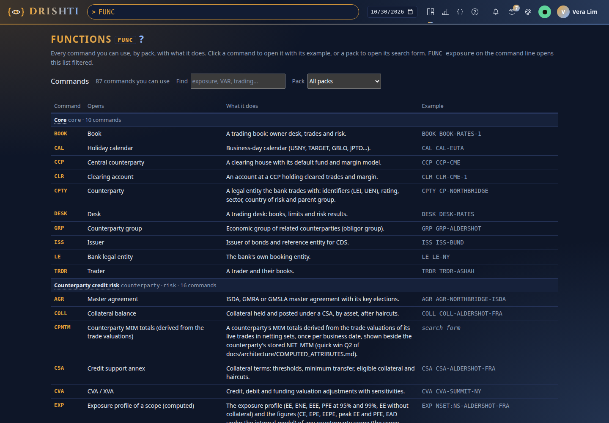
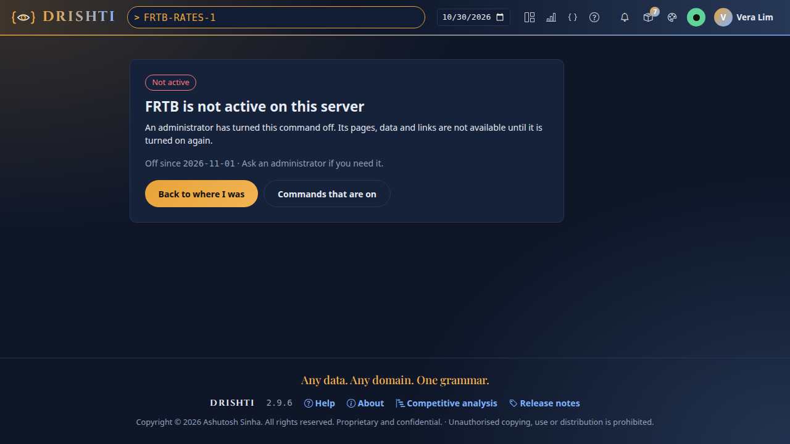
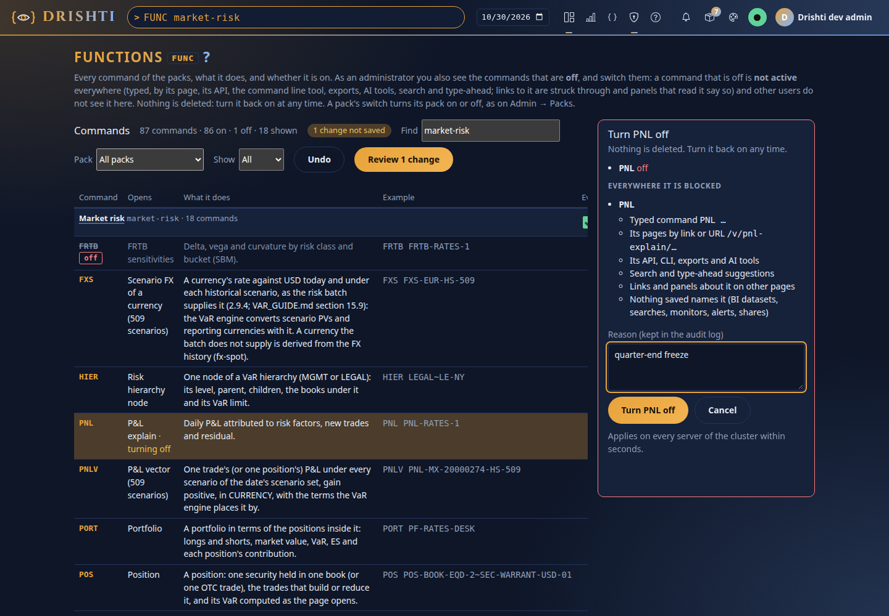
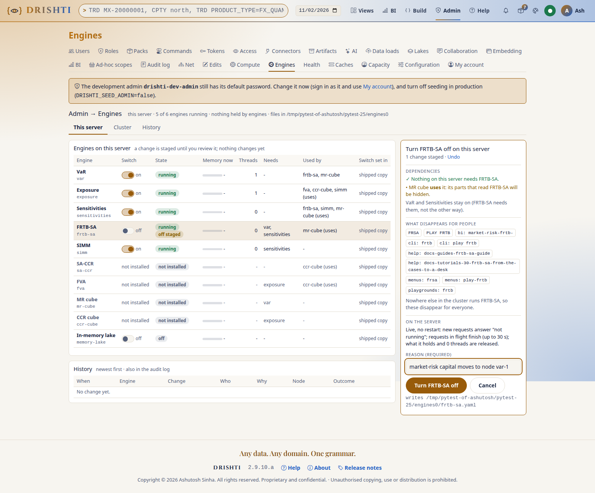
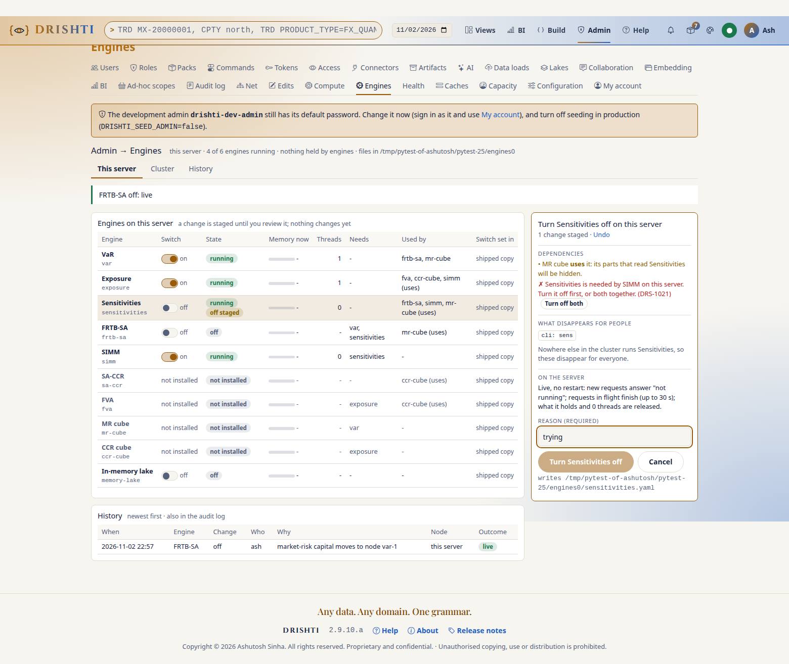
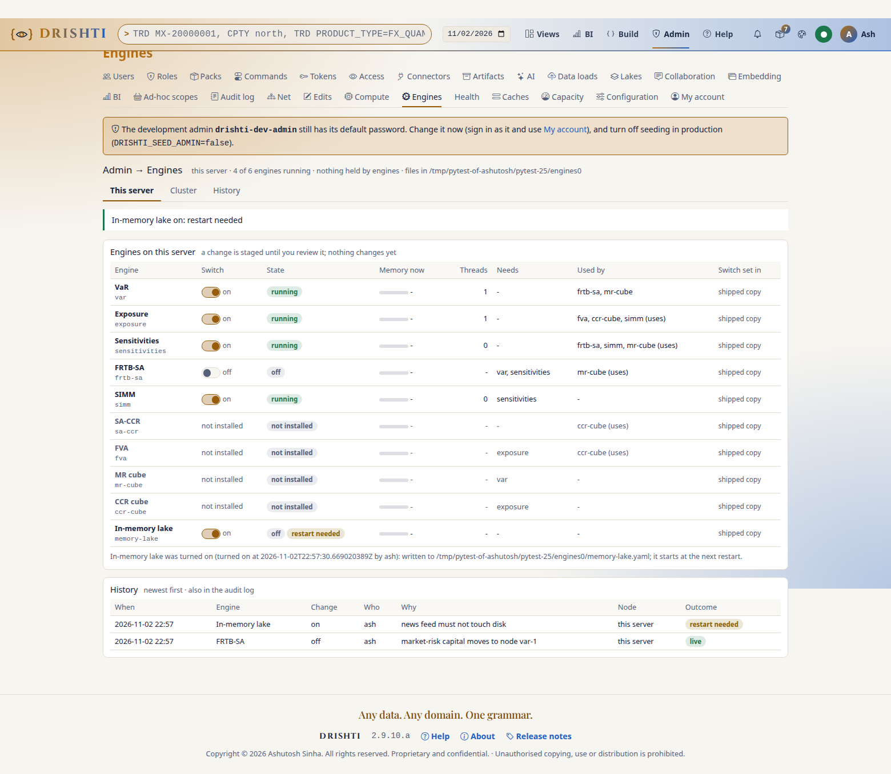
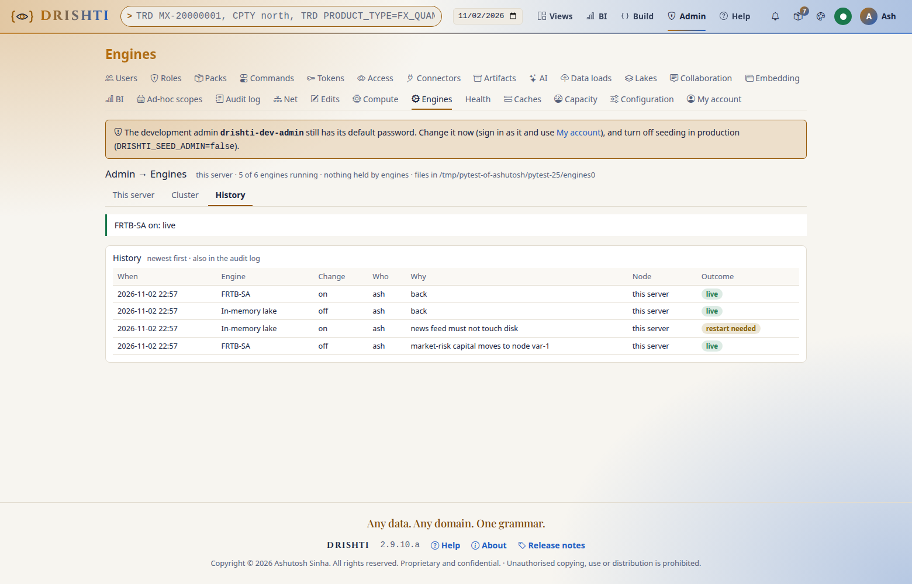
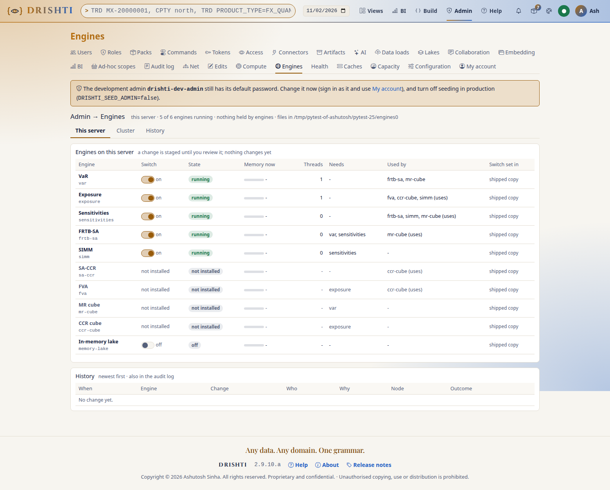

<!--
  Project Drishti · Any data. Any domain. One grammar.

  Copyright (c) 2026 Ashutosh Sinha <ajsinha@gmail.com>.
  All rights reserved.

  PROPRIETARY AND CONFIDENTIAL.

  This file is the confidential and proprietary property of Ashutosh Sinha.
  Unauthorised copying, use, modification, distribution or disclosure of this
  file, via any medium, is strictly prohibited except with the express prior
  written permission of the copyright holder.

  See the LICENSE file in the root of this repository for the full terms.
-->
# Administration guide: people, access and lenses

This guide is for the people who run Drishti for others. It covers who may sign in and how (users, passwords, single sign-on, API
tokens, embedding), what each person may open (roles, powers, packs), where all of that is stored, what each person is shown (lenses and
editions, Home, branding), and the switches that turn a command, a compute engine or a module off. You need the **admin** role for
almost everything here; it is all under **Admin** in the top bar. Every setting named here is described in full in
[CONFIGURATION.md](../admin/CONFIGURATION.md); the endpoints are in [API_REFERENCE.md](API_REFERENCE.md).

## Contents

1. [Signing in and out](#1-signing-in-and-out)
2. [Your first ten minutes: add a person](#2-your-first-ten-minutes-add-a-person)
3. [Roles](#3-roles)
4. [Packs per user](#4-packs-per-user)
5. [Single sign-on (OpenID Connect)](#5-single-sign-on-openid-connect)
6. [API tokens](#6-api-tokens)
7. [Embedding host applications](#7-embedding-host-applications)
8. [Who looked at what: the access log](#8-who-looked-at-what-the-access-log)
9. [The identity database](#9-the-identity-database)
10. [Rules Drishti enforces](#10-rules-drishti-enforces)
11. [The users and roles API](#11-the-users-and-roles-api)
12. [What a lens is](#12-what-a-lens-is)
13. [Run a whole instance as Drishti Risk or Drishti Finance](#13-run-a-whole-instance-as-drishti-risk-or-drishti-finance)
14. [Offer lenses to people](#14-offer-lenses-to-people)
15. [Home: landings, cards and chips](#15-home-landings-cards-and-chips)
16. [The shipped lenses](#16-the-shipped-lenses)
17. [Customise a lens without forking it, and white-label it](#17-customise-a-lens-without-forking-it-and-white-label-it)
18. [Make your own lens](#18-make-your-own-lens)
19. [Lenses in a cluster](#19-lenses-in-a-cluster)
20. [Functions (FUNC): every command, and turning one on or off](#20-functions-func-every-command-and-turning-one-on-or-off)
21. [Compute engines on or off](#21-compute-engines-on-or-off)
22. [Modules on or off](#22-modules-on-or-off)
23. [Data bindings](#23-data-bindings)
24. [White label: distributions](#24-white-label-distributions)
25. [Modules and Deploy](#25-modules-and-deploy)
26. [Troubleshooting](#26-troubleshooting)

## 1. Signing in and out

Where the links are, when sign-in is **on** (`DRISHTI_AUTH_ENABLED=true` with the session and token secrets on both the server and the
console: [CONFIGURATION.md, Turn security on](../admin/CONFIGURATION.md#turn-security-on-production)):

- The landing page (when you are not signed in) has a **Sign in** button in the top navigation. It returns you to the page you were on.
  Any protected page (the terminal, Search, Admin) sends you to the sign-in page first. The sign-in page links back to the home page.
- Signed in, your initial and name at the right of the top bar (or of the landing page's navigation) open a menu with **My account** and
  **Sign out**. Signing out ends the session on the server and lands on the landing page with a "Signed out" notice. It is a POST from the
  console's own pages only. The live views and alerts of that session stop at once on that console; on another console, or after an
  administrator disables or deletes the user, they stop within `auth.recheck_seconds` (10 s by default), when the console asks the server
  again whether the session stands.
- With several servers on one console, each server's session is its own: live views, pack jobs and AI limits belong to the person on
  that server, never to the same name on another server.

When sign-in is **off** (the local default), everyone who reaches the console acts as the development user, so there is nothing to sign
in to and no **Sign out**. The top bar's user menu says **Sign-in is off on this server** and links here, and `/login` says so and offers
to open the terminal.

Every user can see their own profile and roles on **My account** (`/account`), change their password (giving the current one), make
personal API tokens ([section 6](#6-api-tokens)), and choose their theme, clock zone, density and landing page.

## 2. Your first ten minutes: add a person

The example: Priya joins the credit desk. She should see counterparties and credit curves, nothing else, and she works with the *Banking
core* and *Counterparty credit risk* packs.

### 2.1 Sign in as the development admin

On a fresh installation the server creates one account the first time it starts:

| User | Password | Roles |
|---|---|---|
| `drishti-dev-admin` | `drishti-dev-admin123` | `admin` |

Open the console (for example `http://localhost:17480`), click **Sign in** and use those details. Until you change the password, every
admin page shows a red warning: *The development admin still has its default password.* In production set `DRISHTI_SEED_ADMIN=false` so
no development admin is ever created ([section 10](#10-rules-drishti-enforces)).

### 2.2 Change that password

Click your name in the top bar, then **My account → Change password**. Type the current password and the new one twice. The new one needs
at least 10 characters, with letters and digits, and must not be your user name. You should see *Password changed.* The warning
disappears.

### 2.3 Make a role for the credit desk

Go to **Admin → Roles** and click **New role**. Fill in:

| Field | Value |
|---|---|
| Name | `credit-analyst` |
| Description | `Reads counterparties and credit curves` |
| Kinds it opens | `counterparty` and [`credit-curve`](../contracts/samples/market-data.md#credit-curve) ([contract](../contracts/packs/market-data.md#cds-credit-curve-credit-curve)) (one per line) |
| Powers | leave them unticked |

Click **Save**. You should see *Created credit-analyst.* The row shows the two kinds, *0* users, and who changed it and when. Instead of
typing kinds, you can click a pack's button under *Add every kind of a pack*; tick **Opens every kind** for a role that may open
everything.

### 2.4 Create the user

Go to **Admin → Users** and click **New user**:

| Field | Value |
|---|---|
| User name | `priya` (3–64 of `a-z 0-9 . _ -`; it never changes) |
| Display name | `Priya Raman` |
| Desk | `Credit` |
| Email | `priya@bank.example` |
| Roles | tick `credit-analyst` |
| Packs | untick all but `core` and `counterparty-risk` |
| Initial password | at least 10 characters; tell Priya it, privately |
| Must change at first sign-in | tick it if Priya should choose her own |

Click **Save**. Priya appears in the list as *active*.

### 2.5 Check what Priya sees

Sign out and sign in as `priya`. Then:

- `CPTY CP-NORTHBRIDGE <GO>` opens the counterparty.
- `TRD IRS-48213 <GO>` is refused: *priya may not open trade entities*. Links to trades on her pages are still shown, but greyed out with
  the reason. Drishti shows that something exists without showing its content.
- The pack switcher in the top bar lists only her two packs.

### 2.6 Read the audit log

Back as the admin, open **Admin → Audit log**. You should see, newest first, `login` (priya), `user-created` (priya) and `role-created`
(credit-analyst), each with who did it and when. Type `priya` in the filter to see only what concerns her.

The same steps from a script are in [section 11](#11-the-users-and-roles-api).

## 3. Roles

A role says two things: **which kinds of entity** its holders may open (`trade`, `counterparty`, … or `*` for every kind), and **which
powers** they hold. A person may hold several roles: they may open a kind if **any** of their roles allows it, and they have a power if
**any** of their roles grants it.

### 3.1 The powers

| Power | Lets the holder |
|---|---|
| `raw` | see every field, in raw JSON (F9) and everywhere else. Others see the fields in `drishti.security.redact` as `•••` wherever their value could be seen or inferred: views, search, Impact, type-ahead, alerts ([CONFIGURATION.md, Field masks](../admin/CONFIGURATION.md#field-masks)). Masks work on fields: a masked value copied into another text field (a timeline note) stays visible unless that field is masked too or `drishti.security.mask-copies` is on (best effort, exact match); fix the source so free text does not carry sensitive values |
| `author` | save Sutras from Studio and propose them (where Studio saving is on). **Designing is open to everyone**: any signed-in user may use Studio and the Screen Builder and preview against a pasted document; saving, proposing, approving and deleting need the power, and previewing a stored entity needs the right to its kind |
| `approve` | approve or reject proposed Sutras, but never their own (four eyes) |
| `admin` | everything in this guide: users, roles, caches, health, audit |
| `calc` | use Calc (`Alt+C`): Python run in their own browser on the views a pack offers it, reading only what their roles open ([section 3.5](#35-calc)) |
| `layout` | use layout mode (`Alt+L`): arrange a view's panels for themselves and keep that personal layout. **On unless a role says `layout: false`** ([section 3.6](#36-layouts)) |
| `collaborate` | comment on entities and send views to colleagues; **on unless a role says `collaborate: false`** ([section 3.8](#38-discussion-sharing-and-shared-workspaces)) |
| `compliance` | read any share and the full record of any thread, place legal holds, run the compliance export; an administrator does not have it unless a role grants it ([section 3.8](#38-discussion-sharing-and-shared-workspaces)) |
| `bi`, `bi-author`, `bi-steward`, `bi-admin` | business intelligence, granted as a list on the role ([section 3.4](#34-bi-powers-rupaka)) |
| permission `var:system-baskets` | create, edit, retire and import the VaR engine's system baskets, the bank's own baskets everyone reads as `PORT:<id>` ([VAR_GUIDE.md section 5.7](VAR_GUIDE.md#57-system-baskets)). A **module permission**: granted as a list on the role (`permissions: [var:system-baskets]` in configuration or a pack; the *Permissions* group of Admin → Roles); every administrator holds it. Each change is audited and its owner told |

### 3.2 Built-in roles and your own roles

| | Built-in roles | Roles you define |
|---|---|---|
| Come from | `drishti.security.roles` in configuration, and the `roles:` section of each pack | **Admin → Roles** |
| Stored in | configuration files | the identity database |
| Changed by | editing configuration, then a restart | an admin, at once, from the browser |
| Shown as | *built-in*, without Edit or Delete | normal rows, with Edit and Delete |

Configuration ships with these:

| Role | Opens | Raw JSON | Author | Approve | Admin | Calc | Layout |
|---|---|---|---|---|---|---|---|
| `viewer` | everything | masked | — | — | — | — | — (`layout: false`) |
| `author` | everything | yes | yes | — | — | yes | yes |
| `approver` | everything | yes | yes | yes | — | yes | yes |
| `pivot-approver` | everything | masked | — | — | — | — | yes |
| `admin` | everything | yes | yes | — | yes (and admins may approve) | yes | yes |

`pivot-approver` approves custom pivot functions someone else wrote (four eyes: never one's own; administrators may too); it is the role
`drishti.pivot.functions.approver-role` names as shipped ([PIVOT_GUIDE.md](PIVOT_GUIDE.md)). Its `approve` is not the Sutra review's: a
pivot approver does not make Sutras live.

Packs add their own. The shipped packs add `trader` (trading), `market-risk` (market-risk), `credit-risk` (counterparty-risk), `economist`
and `analyst` (world-economy), `news-analyst` and `market-analyst` (news-and-markets); core and market-data add none. The roles of the packs
that offer Calc hold `calc`: `trader`, `market-risk` and `credit-risk`; the roles of world-economy and news-and-markets do not. Every pack
role has `layout`, and so has every role you define in Admin → Roles unless you untick *Customise layouts*. A pack declares one like this:

```yaml
# config/packs/economy/world-economy/pack.yaml
roles:
  economist:
    kinds: [economy, macro-indicator, economic-forecast, labour-market, fiscal-position, country-group, ...]
```

Rules for your own roles:

- Names are 2–64 of `a-z 0-9 -` and start with a letter (`credit-analyst`, `ops-l2`).
- A built-in name always means the built-in role, so you cannot create a role called `admin` or `trader`.
- A role opens at least one kind.
- A role that someone holds cannot be deleted. The Delete button says how many hold it. Take the role away from them on the Users page
  first; the server refuses (`DRS-6009`) if you try anyway.
- A change applies at each holder's next click: no restart and no new sign-in.
- Every create, change and delete is audited (`role-created`, `role-updated`, `role-deleted`), with what the role allows.

### 3.3 How Drishti decides whether someone may open an entity

Two checks, and both must pass:

```
may open trade MX-20000001  =  one of my roles opens "trade"          (roles: this section)
                   AND the pack that defines "trade" is mine   (packs: section 4)
```

A lens ([section 12](#12-what-a-lens-is)) never widens or narrows this: it changes only what a person is shown.

### 3.4 BI powers (Rupaka)

Business intelligence ([REPORTS_GUIDE.md](REPORTS_GUIDE.md)) has four powers of its own. They are a list, `bi`, on a role:
`drishti.security.roles.<role>.bi: [bi, bi-author]` in configuration or a pack, or, for a role you define, **Admin → BI settings** (a
table of roles with four tick boxes each; built-in roles are read-only there) or the `bi` list of `PUT /api/v1/admin/role-definitions/{name}`.
Saving a role in **Admin → Roles** keeps the BI powers it has.

| Power | Lets the holder |
|---|---|
| `bi` | open BI (the **BI** top-bar menu, `RUPAKA <GO>`, `/bi`), the catalogue and the published items their audience allows; favourites and recents |
| `bi-author` | create, edit, move, propose and publish items in the workspaces they are a contributor or member of, and create shared workspaces (when the policy is `authors`, the default) |
| `bi-steward` | **certify** published items (owners only *promote*); **review** proposals in any workspace; **import bundles**; create shared workspaces when the policy is `stewards` |
| `bi-admin` | Admin → BI settings (the workspace policy, powers per role); admin of every shared workspace; always allowed to create workspaces |

A higher power also opens BI, so a role with only `bi-author` sees the catalogue. An administrator holds all four; with security off
everyone does. The built-in `viewer` holds `bi`; `author` and `approver` hold `bi` and `bi-author`; the roles packs add hold **none** until
you grant them. A power opens the door; what a person may do in a given workspace is then decided by their **workspace role** (viewer,
contributor, member, admin) there. Approving a proposal needs the `approve` power as well, and with four eyes on never your own proposal.
Changes to roles, settings, workspaces, members and items are in the audit log (`role-updated` with `bi=[...]`, `bi-settings-changed`,
`bi-workspace-*`, `bi-member-*`, `bi-item-*`).

### 3.5 Calc

Calc ([USER_GUIDE.md](USER_GUIDE.md#calc-python-on-any-view)) runs Python in the user's browser on the view they are looking at.

- **Who:** holders of a role with `calc`. Tick *Use Calc* in the role's dialog (Admin → Roles), or `calc: true` in configuration or a pack.
- **What it reads:** only what the user could open by clicking. Every read goes through the console with the user's session; roles, packs
  and masking apply call by call. Nothing runs on the server.
- **Where:** on views of kinds whose pack enables Calc (`python.enabled` in `pack.yaml`).
- **What is kept:** each user's own snippets (`drishti_preference`, namespace `calc-snippets`, at most 50), deleted with the user. Reads
  are in the access log like any read (`drishti.columns()` as a `search`).
- **For everyone:** Calc is a Labs feature, off as shipped; `DRISHTI_LABS_CALC=true` (server and console) switches it on.

### 3.6 Layouts

Layout mode ([USER_GUIDE.md](USER_GUIDE.md#layout-mode-arrange-a-view-your-way)) lets a user drag, resize and hide a view's panels for
themselves.

- **Who:** holders of a role with `layout`, which is **every role unless it says otherwise**: `viewer` without it; `author`, `approver`,
  `admin` and every pack role with it; roles defined in Admin → Roles with it unless *Customise layouts* is unticked (stored as a
  `no-layout` row in `drishti_role_power`). To take it away from a role in configuration or a pack, write `layout: false`. Without it the
  footer's **Layout** key is greyed with the reason and `/api/v1/me/layouts/**` answers `403 DRS-5002`.
- **What is kept:** each user's layout per Sutra (`drishti_preference`, namespace `layouts`, one document per Sutra: panel order, column,
  `span`, `height`, `hidden`; at most 50), deleted with the user. A layout never changes the Sutra.
- **Promoting a layout** needs `author` as well (and `drishti.rachana.studio-save`): it is a Sutra proposal like any Studio save, reviewed
  by an approver (four eyes) and audited as `sutra-proposed`.
- **For everyone:** `DRISHTI_LAYOUTS_ENABLED=false` (server and console) switches layouts off; saved layouts are then not applied either.

### 3.7 Pivots

The Pivot ([USER_GUIDE.md](USER_GUIDE.md#pivot-slice-a-table-your-way)), offered where a Sutra or a pack opts in, has **no power of its
own**:

- **Who:** anyone who may open the kind may pivot its tables and search results and save their arrangement; it changes nothing for anyone
  else. The pivot reads only what the view or search would show them: a masked field groups under `•••` and is never added up.
- **What is kept:** each user's arrangement per Sutra and panel, and per kind for searches (`drishti_preference`, namespace `pivots`),
  deleted with the user.
- **Promoting a pivot** to a Sutra needs `author` (and `drishti.rachana.studio-save`), as for layouts.
- **Reads** are in the access log: a panel's rows for its pivot as a `view`, a search pivot and its drill-downs as a `search`.
- **For everyone:** `DRISHTI_PIVOT_ENABLED=false` (server) switches the Pivot tab off; the pivot engine itself is a compute engine
  ([section 21](#21-compute-engines-on-or-off)).

### 3.8 Discussion, sharing and shared workspaces

- **Discussion:** anyone who may open a kind reads and writes comments on its entities, and sends a view to colleagues with a note, if their
  role has the `collaborate` power (`roles.<role>.collaborate: false` takes it away). Only the author edits, and only within
  `drishti.collab.threads.edit-window`; nobody erases: a retracted comment reads "Retracted by the author" and its text stays in the
  revisions. Comments, edits, retractions and moderation are in the audit log (`collab.comment.*`, `collab.thread.*`); a share is in the
  access log as `share`.
- **What people can learn about each other.** The people picker lists only users who share a pack with the person searching
  (`drishti.collab.directory.scope`), needs two letters, is rate limited, and shows a role's size, never its members. A notice is never sent
  to, and a mention never reaches, someone who may not open that kind of view; the sender is told who was left out and why (never what the
  view holds) under `share.undeliverable: tell`.
- **Moderation** (`admin`): **Hide** a comment with a reason (readers see "Hidden by a moderator: <reason>"; the text stays in the record),
  **Lock** a thread, and remove a whole thread for good with `DELETE /admin/collab/threads/{id}` (audited; refused with `423 DRS-7010`
  under a legal hold). The API is in [API_REFERENCE.md](API_REFERENCE.md#32-comment-threads).
- **Compliance** (`roles.<role>.compliance`): a compliance officer reads any share and the full record of any thread (hidden and retracted
  comments, every revision, unscrubbed), places and releases **legal holds**, runs the **export** and **verifies** the hash chains. The
  runbooks are in [OPERATIONS_GUIDE.md](OPERATIONS_GUIDE.md#123-retention-legal-holds-and-the-compliance-export).
- **Admin → Collaboration** (`/admin/collab`) shows what the signed-in roles may use, and the server decides every call: *Threads and
  moderation* (search by user, kind, id and dates; read a thread with its hidden comments; **Hide**, **Unhide**, **Lock**, **Unlock**;
  `admin`), *Legal holds* (list, place by scope, release; `compliance`), *Compliance export* (start, wait, download once; `compliance`),
  *Verify the chains* (one thread or everything; `compliance`), *Retention* (a dry run that counts what would go and what a hold keeps,
  never deletes; `admin`) and *Bridges* (the configured chat bridges with their queue, and a **Test** that posts one message; `admin`). A
  role that holds only `compliance` sees the compliance sections; an administrator without the power sees the others.
- **Shared workspaces:** a workspace's owner shares it with everyone, roles or named people. Readers see it read-only; panes on kinds a
  reader's roles may not open stay hidden. Share records are kept with the preferences (`drishti_preference`, namespace
  `workspace-shares`).

## 4. Packs per user

A pack is a domain's worth of kinds, mnemonics, layouts and roles ([BUILD_GUIDE.md](BUILD_GUIDE.md)). The server may
have many installed; each person sees the ones assigned to them.

- **Default packs.** A user who was never given a list of packs (the field left out, not an empty list) sees the packs in
  `drishti.packs.default-for-users`, or every installed pack when that is empty. In the Users list this shows as *default packs*.
- **Assigned packs.** Tick packs in the user dialog to give exactly those. Untick all of them (an empty list, `"packs": []`) and the user
  sees none: every kind answers `DRS-5002`. This is not the same as the default.
- **Choosing among them.** Someone with several packs picks which to see from the pack switcher in the top bar. That choice is theirs, and
  it is saved with their settings.

A pack's role is still needed to open its kinds. Giving Priya the *trading* pack without a role that opens `trade` shows her trade links
greyed out.

## 5. Single sign-on (OpenID Connect)

Staff can sign in through the bank's identity provider (Keycloak, Microsoft Entra ID, Okta, Ping, …). The login page then offers **Sign in
with single sign-on** beside the password form. The server verifies every ID token itself; the console only runs the browser redirect.

Register Drishti at the provider as a web application:

- redirect URI `https://<console>/auth/oidc/callback`;
- scopes `openid profile email`;
- a groups claim in the ID token.

Then set, for both console and server:

```bash
DRISHTI_OIDC_ENABLED=true
DRISHTI_OIDC_ISSUER=https://login.bank.example/realms/staff
DRISHTI_OIDC_CLIENT_ID=drishti
DRISHTI_OIDC_CLIENT_SECRET=…          # console only; omit for a public client (PKCE alone)
```

Map the provider's groups to Drishti roles, built-in ones or your own, in the server's configuration
([CONFIGURATION.md, single sign-on](../admin/CONFIGURATION.md#drishtisecurityoidc--single-sign-on)):

```yaml
drishti:
  security:
    oidc:
      groups-claim: groups                 # Keycloak realm roles: realm_access.roles; Entra ID: groups or roles
      username-claim: preferred_username   # or email, upn
      role-map:
        desk-rates: [trader]
        credit-desk: [credit-analyst]      # a role defined in Admin → Roles works too
        sutra-authors: [author]
        sutra-approvers: [approver]
        drishti-admins: [admin]
      default-roles: []                    # empty: users whose groups map to nothing are refused
      roles-from-provider: true            # groups replace roles at each sign-in
```

- The first sign-in creates the user, with no password. Later sign-ins update the name, email and roles.
- Disabling a user in Drishti keeps them out, whatever the provider says. The last enabled admin is never demoted by the provider.
- A mapped role that does not exist is dropped, and the server log says so.
- Every sign-in, first-time creation and refusal is in the audit log (`login-sso`, `user-provisioned`, `login-sso-refused`). Refusals tell
  the user only that sign-on was refused; the reason is in the server log.
- Password sign-in stays for accounts created in Drishti, so keep one break-glass admin.

### 5.1 The sign-in window for pages that embed views

A page that shows Drishti views but has **no backend of its own** (a static intranet page, a SharePoint page) cannot run the token exchange
of [section 7](#7-embedding-host-applications). With single sign-on on, it can use the renderer's **sign-in window** (`auth: 'popup'`;
[EMBED_GUIDE.md](EMBED_GUIDE.md#13-drishti-elements-libraries-in-your-own-app)): the page shows *Sign in to see this*; on the click, one small window runs this same
single sign-on and the page gets a short-lived, read-only, masked embed token, as from the exchange.

What to set, once:

- At the provider, add the redirect URI `https://<console>/embed/v2/sign-in/callback` to Drishti's client (beside `/auth/oidc/callback`),
  or set `embed.sign_in.redirect_uri` to the one you registered. For silent renewal the provider must issue refresh tokens (Keycloak does by
  default; Entra ID and Okta with `offline_access` in `auth.oidc.scopes`); without them the person clicks again when the token ends.
- Register the page's origin as a **host application** (Admin → Embedding, [section 7](#7-embedding-host-applications)): its origins,
  scopes and kinds apply. A page whose origin is not registered gets the button disabled with `DRS-8002` naming its origin, and no window.
- The window is on by default; `embed.sign_in.enabled: false` (console) or `drishti.embed.sign-in-window: false` (server) turns it off, and
  pages then need the exchange. `embed.sign_in.max_hours` (default the console's `auth.session_hours`) bounds how long it is renewed.

What is recorded: the sign-in itself as any single sign-on (`login-sso`, the user created or updated from the provider's groups), then
`embed-sign-in-window` with the page's origin, the user, the host application and the time (renewals say `(renewed)`), or
`embed-sign-in-window-refused` with the reason (an origin nobody registered, an ID token refused, a disabled user). The token never reaches
storage or a cookie in the page; the provider's refresh token is sealed by the console (AES-GCM) so the page holds it without reading it.

## 6. API tokens

People read Drishti from scripts, notebooks and Excel with personal API tokens they make on **My account → API tokens**
([API_REFERENCE.md, clients](DEVELOPER_GUIDE.md#113-clients-scripts-notebooks-and-excel)). What an administrator needs to know:

- **A token acts as its owner**, with the owner's roles and packs at the time of each call, and, unless it was made with a **write scope**,
  **only reads**: every `GET`, and the `POST`s that carry a query and change nothing, listed in `drishti.security.token-read-posts` (the
  search pivot, `/api/v1/command`, the search-form compile, and the BI query, validate and format calls). Any other `POST`, `PUT`, `PATCH`
  or `DELETE` is refused with `403 DRS-5002 API tokens only read`; add a path to the list only if it writes nothing.
- **Write scopes (for tools, CI and GitOps).** When making a token a person may tick `design:write`, `design:approve`, `packs:admin`,
  `bi:write`, `bi:approve`, `bi:admin`, `ai:use`, `ai:admin`, `loads:write` (an ETL job announcing that a batch landed:
  [DATA_GUIDE.md](DATA_GUIDE.md#10-permissions)), `risk:write` (VaR baskets and captures, what-if sandboxes), `risk:system-baskets` (the VaR system baskets: create, edit, retire, import; the user still needs the permission `var:system-baskets`), `pivot:write` (end live
  pivots, save and submit custom functions), `pivot:comment` (cell comments on saved pivot views), `pivot:approve` or `pivot:admin` (pivot
  rollups) (`drishti.security.token-scopes`; the account page lists them in words). What a token may do is the scope **and** the roles its
  user holds at the time of each call: `design:approve` is useless to someone who is not an approver, `packs:admin` to someone who is not an
  admin. `packs:admin` covers loading and deploying packs, the registry, Retry now and writes to `/api/v1/admin/connectors/**`; the `bi:*`
  scopes cover the write calls of business intelligence and still need the BI power and the workspace role each call needs; `ai:use` opens
  `POST /api/v1/ai/chat` and the MCP tool calls. So demoting or disabling a user cuts their tokens at once.
- A token with a write scope must expire (`drishti.security.token-write-max-days`, 90). Every write done with a token is in the audit log as
  `token-write` (token id, method, path, status; never the secret) and each refusal as `token-denied`.
- Users, roles, tokens, sign-in, caches, engine and command switches, and personal or collaboration state are never open to a token
  (`token-never`); there is no `admin` scope.
- Disabling a user stops their tokens at once (and they cannot make new ones); deleting a user deletes them.
- **Admin → Tokens** lists every token (owner, name, scopes: *read only* or the write scopes it holds, created, expires, last used in the
  console's time zone) and revokes any of them.
- Secrets are never stored, only their SHA-256; nobody, administrators included, can see a secret after it is made.
- `token-created` and `token-revoked` are in the audit log; so are `signed-out` (a console sign-out) and `sessions-ended` (an
  administrator's disable, delete or password reset ended the user's console sessions).

## 7. Embedding host applications

Another web application (a CRM, a portal) can show live Drishti views in its own pages with `<drishti-view>`
([EMBED_GUIDE.md](EMBED_GUIDE.md#13-drishti-elements-libraries-in-your-own-app)), without an iframe. An administrator allows it, one **host application** at a time.
Embedding is off until `drishti.embed.enabled` is on ([CONFIGURATION.md](../admin/CONFIGURATION.md#drishtiembed--embedded-views-for-other-web-applications));
register applications on **Admin → Embedding** (`/admin/embedding`), or with the API
([API_REFERENCE.md](API_REFERENCE.md#24-embedding-views-in-another-web-application)), for example:

```bash
curl -s -X POST $SERVER/api/v1/admin/embed/apps -H "Authorization: Bearer $ADMIN_TOKEN" -H 'Content-Type: application/json' -d '{
  "id": "crm", "name": "Client CRM", "contact": "crm-team@bank.example",
  "origins": ["https://crm.bank.example"], "kinds": ["trade", "counterparty"], "scopes": ["embed:view"],
  "jwks": "{\"keys\": [ ... the host backend public key ... ]}"}'      # the answer shows the client secret once
```

- The host's **backend** keeps the client secret (or signs with its key) and tells Drishti who its signed-in user is with that user's ID
  token or a JWT it signs itself; it can never name a user with the secret alone. The browser only ever holds a five-minute, read-only
  embed token.
- Embedded views **always mask** the fields in `drishti.security.redact`, even for users whose roles have `raw`, and show only the kinds the
  application was registered for (`kinds`) that the user's roles open now.
- `enabled: false` (a `PUT`) stops the application at once: its tokens are refused at the next call. Disabling a user does the same for
  that user. **Rotate** the secret with a grace period (`rotate-secret`) so the host can switch over.
- A page with no backend may instead sign its user in through single sign-on in a window it opens on a click ([section 5.1](#51-the-sign-in-window-for-pages-that-embed-views)).
- The audit log has `embed-app-created`, `-changed`, `-enabled`, `-disabled`, `-secret-rotated`, `-deleted`, for every token request
  `embed-token` or `embed-token-refused`, and for the sign-in window `embed-sign-in-window` (with the page's origin) or
  `embed-sign-in-window-refused`. The access log shows each embedded view as the user's own with the detail `embed:<application>`, so
  "which application showed what to whom" is Admin → Access.
- Rates (`callsPerMinute` per application, `userCallsPerMinute` per user) answer `429 DRS-8004` with `Retry-After`.

### 7.1 The Admin → Embedding page

Admin menu → **Embedding** (`/admin/embedding`, administrators only) lists every host application: name and id, its origins, how it signs
in (client secret, public key, or both), scopes and kinds, whether it is enabled, and what it did **since the server started**: tokens
issued, embed calls, live streams open now, refusals by code (`DRS-8002` wrong origin, `DRS-8003` unknown or disabled, `DRS-8004` rate
limit, and so on), and when it was last used. Refusals that name no registered application are counted together in a line above the table.
The counters are in memory (they start again at a restart) and are also Prometheus metrics (`drishti_embed_tokens_total`, `_calls_total`,
`_refusals_total{code}`, `drishti_embed_streams`, each with an `app` label).

- **New application** (key `n`): name, id (made from the name; lower-case letters, digits and hyphens), origins one per line, how it signs
  in, scopes (the ones this server defines), the kinds it may show (empty: every kind its users' roles open), rates and token life. With a
  client secret, the secret is **shown once** in its own dialog, with a Copy button; closing the dialog forgets it, and a reload does not
  bring it back. With a public key, paste a JWK set (public keys only).
- **Rotate secret** asks for a grace period (seconds; the old secret keeps working that long, `0` ends it at once) and shows the new secret
  once.
- **Disable** stops the application at once (no new tokens; its tokens fail at the next call) but keeps its registration; **Enable** brings
  it back. **Delete** asks first and removes it for good. All of them are audited.
- Applications **declared in configuration** (`drishti.embed.apps`, for GitOps) are marked *from config* and read-only: change them in the
  file and restart. A configured id cannot be registered again here.
- Keys: `n` opens *New application*, `/` focuses the filter, `Esc` closes a dialog. The page works at phone width and in both themes.

## 8. Who looked at what: the access log

Every read that was answered is recorded: a view, a raw document (F9), a history or compare read, a search and a CSV export, with the
person, the time, the entity (or the search text) and the business date asked for (blank for live). Refused reads are not recorded (they
returned nothing). Administrators see it in **Admin → Access**, filtered by person, action, kind, id and dates; a view's **Viewed by**
(administrators only) opens the list for that entity. Worked example: "who looked at MX-20000001 last week" is Access with kind `trade`,
id `MX-20000001`, from and until.

It is in the identity database (`drishti_access`), kept `drishti.access-log.keep-days` (90) days. Recording is asynchronous and never slows a
read; if the database cannot keep up, events are dropped and the page says how many. The console's own service identity is not recorded.
Through the API: `GET /api/v1/admin/access?user=&action=&kind=&id=&from=&to=&limit=`.

## 9. The identity database

Everything in sections 1 to 8 is in **one database**: users with their roles and packs; the roles you define; each person's saved
workspaces, monitors, alert rules and settings; the audit and access logs; the command and pack switches ([section 20](#20-functions-func-every-command-and-turning-one-on-or-off)).
The server reaches it through JPA (Hibernate and Spring Data repositories), with no hand-written SQL in the code.

| Database | When | URL |
|---|---|---|
| **SQLite** (default) | one server; nothing to install | `jdbc:sqlite:./data/identity/drishti.db` |
| **PostgreSQL** | several servers sharing users, or your database team's backups | `jdbc:postgresql://host:5432/drishti` |

### 9.1 The schema: two files, no migrations

The tables are written out in full, once per database, in `kernel/drishti-identity/src/main/resources/db/`: `schema-sqlite.sql` and
`schema-postgres.sql`. The server runs the right file every time it starts. Each statement is `CREATE … IF NOT EXISTS`, so running it on an
existing database changes nothing. There is no migration tool and no migration history: the file *is* the schema. On PostgreSQL the server
also checks at start that its entities match the tables, and refuses to start, naming the column, if they do not.

| Table | Holds |
|---|---|
| `drishti_user` | one row per person: name, email, desk, password hash, enabled, lockout, timestamps |
| `drishti_user_role` | (user, role) pairs |
| `drishti_user_pack` | (user, pack) pairs; `drishti_user.packs_assigned` says whether they apply or the defaults do |
| `drishti_role` · `drishti_role_kind` · `drishti_role_power` | roles defined in Admin → Roles, the kinds each opens, and their extra powers (`calc`; `no-layout` for a role that may not customise layouts), one row each |
| `drishti_preference` | (user, namespace, name) → a JSON document: workspaces (with their divider sizes), monitors, alert rules, settings, Calc snippets (`calc-snippets`), personal layouts (`layouts`), pivots (`pivots`), shares (`workspace-shares`) |
| `drishti_audit` | one row per audited action, numbered in order |
| `drishti_api_token` | personal API tokens: owner, name, a SHA-256 of the secret (never the secret), scopes, created, expires, last used, revoked |
| `drishti_session` | console sign-in sessions: a SHA-256 of the session id (never the id), user, created, expires. A row is removed at sign-out, when the user is disabled, deleted or has their password reset, and (hourly) once expired |
| `drishti_access` | the access log: when, who, action (view, raw, history, search, export), kind, id, search text or field, business date |
| `drishti_note` | notes on entities and their fields: entity, field path, author, text, created, edited. Kept when their author is deleted |
| `drishti_switch` · `drishti_switch_log` | the command and pack switches and every change to them ([section 20.6](#206-where-it-is-kept)) |

Deleting a user removes their role and pack rows with them (`ON DELETE CASCADE`), and their saved documents too.

### 9.2 Use PostgreSQL

1. Create a database and a user (as a PostgreSQL superuser):

   ```sql
   CREATE USER drishti WITH PASSWORD 'choose-a-long-one';
   CREATE DATABASE drishti OWNER drishti;
   ```

2. Point the server at it, through environment variables or `application.local.yaml`
   ([CONFIGURATION.md, identity](../admin/CONFIGURATION.md#drishtiidentity--users-passwords-and-the-identity-database)):

   ```bash
   export DRISHTI_IDENTITY_DB_URL=jdbc:postgresql://db.bank.example:5432/drishti
   export DRISHTI_IDENTITY_DB_USER=drishti
   export DRISHTI_IDENTITY_DB_PASSWORD='choose-a-long-one'
   ```

   ```yaml
   # application.local.yaml
   drishti:
     identity:
       database-url: jdbc:postgresql://db.bank.example:5432/drishti
       database-user: drishti
       database-password: ${DRISHTI_IDENTITY_DB_PASSWORD}
       # database-pool-size: unset = drishti.db.pool.size (20) on PostgreSQL
   ```

3. Start the server. The log says:

   ```
   identity database ready: jdbc:postgresql://db.bank.example:5432/drishti (db/schema-postgres.sql)
   ```

   If PostgreSQL is not up yet, the server waits for it, retrying with growing pauses for up to about four minutes:
   *identity database not reachable yet (…); retrying in 2000 ms*.

To try it locally with Docker (the repository's compose file runs PostgreSQL 18 on port 5432, or `DRISHTI_PG_PORT`):

```bash
docker compose -f deploy/docker/compose.data.yaml up -d postgres
docker compose -f deploy/docker/compose.data.yaml exec postgres psql -U drishti -c 'CREATE DATABASE drishti_identity'
DRISHTI_IDENTITY_DB_URL=jdbc:postgresql://localhost:5432/drishti_identity DRISHTI_IDENTITY_DB_USER=drishti \
DRISHTI_IDENTITY_DB_PASSWORD=drishti java -jar kernel/drishti-server/target/drishti-server-*.jar
```

### 9.3 SQLite: what to know

- The database is one file, plus `-wal` and `-shm` files beside it while the server runs. Keep the folder on local disk, not a network
  share.
- Readers never wait. Writers take turns: SQLite allows one writer at a time, and Drishti's writes (a sign-in, a saved workspace) take
  milliseconds.
- For more than one server sharing the same users, use PostgreSQL.

### 9.4 Back it up

| Database | Command |
|---|---|
| SQLite (safe while running) | `sqlite3 data/identity/drishti.db ".backup 'backup/drishti-$(date +%F).db'"` |
| PostgreSQL | `pg_dump -Fc -h db.bank.example -U drishti drishti > drishti-$(date +%F).dump` |

To restore SQLite, stop the server and copy the backup over `drishti.db`. For PostgreSQL, use `pg_restore -d drishti --clean
drishti-….dump`. Keep `data/` out of version control (it is git-ignored). Drishti has no back door: if every admin's password is forgotten,
restore the database from a backup.

## 10. Rules Drishti enforces

| Rule | Default | Setting (`drishti.identity.*`) |
|---|---|---|
| Hashing | PBKDF2-HMAC-SHA256, 240,000 iterations, 16-byte salt, constant-time check | `iterations` |
| Password policy | at least 10 characters, letters and digits, not the user name | `min-password-length` |
| Lockout | 5 failed sign-ins lock the account for 15 minutes; an admin's password reset unlocks it | `max-failed-attempts`, `lockout` |
| Unknown users | answered like a wrong password, in the same time | — |
| Forced password change | off; an admin can tick it per user. Until it is done the console answers only the account page, the change and sign-out (other pages lead back to *My account*; console API calls `403 DRS-6010`) | `force-password-change-on-create`, `force-password-change-on-reset` |
| Sessions follow the user | each console sign-in is a session the server keeps; the console checks it, the user's roles and enabled flag per request (reusing an answer for the console's `auth.recheck_seconds`, 10). Disabling, deleting or resetting the password of a user signs them out everywhere (enabling them again does not bring a session back); a role change applies within those seconds, at once on every worker process of the console you used. Sign-out ends the session on the server | console `auth.recheck_seconds` |
| Development admin | created when the database has no users | `seed-admin` (`DRISHTI_SEED_ADMIN=false` in production), `seed-username`, `seed-password`, `seed-roles` |
| Last admin | there is always one enabled admin: it cannot be disabled, demoted or deleted | — |
| Self-protection | nobody can disable or delete their own account | — |
| Database | SQLite file | `database-url` (`DRISHTI_IDENTITY_DB_URL`), `database-user`, `database-password`, `database-pool-size` (unset: `drishti.db.pool.size`, 20, on PostgreSQL; 8 on SQLite) |

### 10.1 What the console keeps of each person

The console keeps a few answers for a moment so pages draw quickly. Nothing it keeps for one person is served to another:

- **One key for everything read as a person**: the server of the request, the user, their roles (sorted), the as-of date and its known-at,
  and the lens the page is seen through. The same person on two servers, or with a role changed, is someone else to every cache. Each store
  is bounded and drops the least recently used entry, never everyone's.
- **Calc's permission, BI's powers and the sign-in check** follow the person's change stamp, so a role change made through one worker
  process is seen at once by the others.
- **Responses**: every page and answer is sent `Cache-Control: private, no-store` (the static files excepted), so neither a shared proxy nor
  the browser's back button shows a person's page after they sign out.
- **The browser**: what pages keep in this browser (the VaR basket, Calc's drafts and history, column filters, table sizes, the capacity
  plan, BI Studio's tabs and drafts, the controls' choices) is named per person, and **Sign out** clears it (`Clear-Site-Data: "storage"`).
- **Links that change something** (open or leave a lens, choose Home's landing) are posted; opening their address shows a form, so a
  crawler, a prefetch or another site's link changes nothing.
- **The server connection** keeps no cookie a server sets: who calls is said by each call's own headers.
- **SQL over a BI extract** runs in four shared worker threads, at most two of them one person's at a time.

### 10.2 The other Admin pages

The pages for running the server (Admin → Connectors, Health, Caches, Capacity, Loads, Lakes, Cluster, Packs) are in
[OPERATIONS_GUIDE.md](OPERATIONS_GUIDE.md); for example Admin → Capacity in
[section 12.4](OPERATIONS_GUIDE.md#146-admin--capacity-today-against-the-plan). Admin → Functions and Admin → Engines are sections 20 and 21 below; modules (no page: a file, a setting or the API) are section 22.

## 11. The users and roles API

Every call is under `/api/v1`. Anything under `/admin` needs a signed-in administrator (the console) and is never open to a personal API
token. With security off (local development) the examples work as they are; with security on, add `-H "Authorization: Bearer <token>"`.

```bash
# Define a role
curl -s -X PUT localhost:18480/api/v1/admin/role-definitions/credit-analyst \
  -H 'Content-Type: application/json' \
  -d '{"description":"Reads counterparties and credit curves","kinds":["counterparty","credit-curve"]}'
# → {"name":"credit-analyst","kinds":["counterparty","credit-curve"],"raw":false,…,"builtIn":false,"updatedBy":"…"}

# Create a user holding it, with two packs
curl -s -X POST localhost:18480/api/v1/admin/users -H 'Content-Type: application/json' \
  -d '{"username":"priya","displayName":"Priya Raman","desk":"Credit","roles":["credit-analyst"],
       "packs":["core","counterparty-risk"],"password":"credit-desk-2026"}'

# Every role, with how many people hold it
curl -s localhost:18480/api/v1/admin/role-definitions
# → [{"name":"admin","kinds":["*"],"builtIn":true,"users":1,…},{"name":"credit-analyst",…,"users":1}]

# What happened to priya
curl -s 'localhost:18480/api/v1/admin/audit?subject=priya&limit=20'
```

| Method | Path | Does |
|---|---|---|
| `POST` | `/auth/login` | verify a sign-in (the console's service token only) |
| `POST` · `GET` · `DELETE` | `/auth/sessions[/{id}]` | open, check and end console sign-in sessions (the console's service token only) |
| `GET` | `/auth/me` | the caller's profile |
| `POST` | `/auth/password` `{current, next}` | change your own password |
| `GET` / `POST` | `/admin/users[?q=]` | list or search / create |
| `GET` / `PUT` / `DELETE` | `/admin/users/{u}` | read / update profile, roles and packs / delete |
| `POST` | `/admin/users/{u}/enabled` `{enabled}` | enable or disable |
| `POST` | `/admin/users/{u}/password` `{password}` | reset a password (also clears a lockout) |
| `GET` | `/admin/roles` | every role name a user may be given |
| `GET` | `/admin/role-definitions` | every role: kinds, powers (`raw`, `author`, `approve`, `admin`, `calc`, `layout`, `collaborate`, `compliance`, and the `bi` list), built-in or not, holders |
| `GET` / `PUT` / `DELETE` | `/admin/role-definitions/{name}` | read / create or replace / delete a role you defined (the body: `description`, `kinds`, the powers as booleans, `bi` as a list; a `bi` entry that is not one of the four powers is `422 DRS-9003`; leave `bi` out to keep the role's) |
| `GET` | `/admin/audit?limit=&subject=` | audit events, newest first; `subject` matches who did it or to whom |
| `GET` | `/admin/status` | the default-password warning, user count, installed packs |
| `GET` | `/admin/access?user=&action=&kind=&id=&from=&to=&limit=` | the access log ([section 8](#8-who-looked-at-what-the-access-log)) |

| Code | HTTP | Meaning |
|---|---|---|
| `DRS-5001` | 400 | bad request (for example a role name with capitals, or no kinds) |
| `DRS-5002` | 403 | not allowed (not an admin, or a kind none of your roles opens) |
| `DRS-6001` | 404 | no such user |
| `DRS-6002` | 409 | the user already exists |
| `DRS-6003` | 422 | weak password |
| `DRS-6004` | 401 | bad credentials |
| `DRS-6005` | 423 | locked after repeated failures |
| `DRS-6006` | 409 | that would leave no enabled admin |
| `DRS-6007` | 422 | invalid user data (name, email, or a role that does not exist) |
| `DRS-6008` | 404 | no such role |
| `DRS-6009` | 409 | the role is held by someone; take it away from them first |
| `DRS-6010` | 403 | (console) the user must choose a new password on *My account* first |

## 12. What a lens is

A **lens** is a **workspace**: Drishti arranged for one kind of person. It sets the starting Home (landings, cards, chips), which menus
and menu items come first, the command line's placeholder and the default screens. It **never hides anything**: every command, page,
menu item, Help page, Admin page and BI dataset the running distribution has stays there, inside a lens or not. A person opens one for
their own session (*Open Drishti Risk*, [section 14](#14-offer-lenses-to-people)); the distribution may name one as everyone's starting
workspace (`lenses.default`).

What exists is not a lens's to say. Three layers of switches, each with one job ([section 12.3](#123-the-three-layers-of-switches)):
the **distribution** says what exists, the **module switch** whether a module is on at this site, the **engine switch** whether a compute
engine runs on this server. What a person may read is decided by their roles, packs and masks (sections 3 and 4).

### 12.1 Modules, functions and lenses

Every lens belongs to a **module** and bundles **functions**:

```
licence  →  modules on  →  lenses offered  →  functions this person may use  →  rows and columns inside
```

- **The module** decides whether the lens exists here. A lens names the modules it needs and is offered only while they are all on
  (installed, licensed and enabled: [section 22](#22-modules-on-or-off)). A module that is off offers none of its lenses
  and none of its packs.
- **The functions** are the command words the lens bundles (`VAR`, `TRD`, `CRV`, `ECON` ...). A card, chip, menu item or command whose
  function is off for the person (its module off, or an administrator's switch on Functions: [section 20](#20-functions-func-every-command-and-turning-one-on-or-off))
  is not shown.
- **The lens** arranges the experience: the top menus it puts first and their items' order, Home (landings, cards, chips), the
  placeholder, the phone display. It loads no pack, presets no feature and hides nothing.

### 12.2 Where a lens is defined

| Where | What it holds |
|---|---|
| **The registry** (`META-INF/drishti/lenses.yaml` in each module's jar: [the banking module's](../../modules/banking/banking-service/src/main/resources/META-INF/drishti/lenses.yaml), [the core server's](../../kernel/drishti-server/src/main/resources/META-INF/drishti/lenses.yaml)) | the lens's id and title, the modules it needs, the functions it bundles, its Home template, its Home **cards** (`cards:`) and **chips** (`chips:`), and for a lens with no file its menus and Help pages; a site's `config/access/lenses.yaml` adds a lens or replaces one by its id |
| **The lens file** (`config/lenses/<module>/<lens>.yaml`) | the arrangement: its title and description, the menus it puts first (`menus:`), Home (`home:`), the phone display (`phone:`) and its landings' own settings (`trading:`, `quality:`) |

The shipped lenses:

| Lens | Id | Module | File | Modules it needs | Packs, by module |
|---|---|---|---|---|---|
| **Drishti Risk** | `risk` | banking | [`config/lenses/banking/risk.yaml`](../../config/lenses/banking/risk.yaml) | banking | core: core · banking: market-data, trading, counterparty-risk, market-risk |
| **Drishti Trading** | `trading` | banking | [`config/lenses/banking/trading.yaml`](../../config/lenses/banking/trading.yaml) | banking | core: core · banking: market-data, trading, market-risk, counterparty-risk |
| **Drishti Market** | `market` | banking | [`config/lenses/banking/market.yaml`](../../config/lenses/banking/market.yaml) | capitalmarkets, banking | core: core · banking: market-data |
| **Drishti World** | `world` | economy | [`config/lenses/economy/world.yaml`](../../config/lenses/economy/world.yaml) | economy (capitalmarkets for its company, filing and fund parts) | economy: world-economy, news-and-markets, official-news, gdelt-events · capitalmarkets: us-equities, funds · core: gleif |
| **Public sector** | `publicsector` | economy | none: the registry entry | economy | the public sector's six packs ([section 16.5](#165-public-sector)) |

The registry also lists lenses that have no lens file or Home yet (CRO, MR cube, CCR cube, CIO, Oversight); they are not offered to people.

**One folder.** The lens files are under `config/lenses` (the console's `lens.dir`, `DRISHTI_LENS_DIR`): a file sits in its module's
folder (`config/lenses/<module>/<lens>.yaml`), or in the folder itself for a lens of no module; only the console reads them. The feature
presets a distribution may name are in [`config/distributions/kernel.yaml`](../../config/distributions/kernel.yaml) (`features:`). The
full product's packs are [`config/packs/default-packs.yaml`](../../config/packs/default-packs.yaml), by module; a distribution's are its
modules'.

### 12.3 The three layers of switches

Each switch has one job and one home:

| Layer | Its one job | Where | Who changes it |
|---|---|---|---|
| **Distribution** | what exists: the modules (their packs, commands, menus, Help, engines), the brand, the feature presets | `config/distributions/drishti.<name>.yaml` (`features:` presets through `kernel.yaml`), chosen at start ([section 24](#24-white-label-distributions)) | the product owner or licensee; a restart |
| **Module switch** | whether a module the distribution has is on at this site | `config/modules/<module>.yaml`, `DRISHTI_MODULES_<MODULE>_ENABLED`, Admin → Modules ([section 22](#22-modules-on-or-off)) | an administrator |
| **Engine switch** | whether a compute engine (VaR, exposure, FRTB-SA, SIMM ...) runs on this server | `config/engines/<id>.yaml`, Admin → Engines ([section 21](#21-compute-engines-on-or-off)) | an administrator, per server |

A distribution presets an engine **off** when the module that owns it is not in it (it does not exist there), never **on**: where an
engine runs is its own switch. On top, an administrator's function switch (Functions, [section 20](#20-functions-func-every-command-and-turning-one-on-or-off))
turns one command off for everyone. A command word is shown when its module exists and is on, its engine runs somewhere in the cluster
and its function is on. A module's menus (its manifest's `console.menus`) are in the top bar only while the module is in the distribution,
installed, loaded and on; they go and come back at the next page when that changes. A lens changes none of this.

## 13. Run a whole instance as Drishti Risk or Drishti Finance

Name a **distribution** ([section 24](#24-white-label-distributions)): `bin/start-all.sh --distribution risk`, `DRISHTI_DISTRIBUTION=risk` or
`drishti.distribution: risk`; the console follows the server. Drishti Risk has the banking and market-data modules, so economy and
capital-markets commands, menus and Help do not exist there; its starting workspace is the Risk lens. A lens file is never an instance's
filter: the old setting `drishti.edition` (`DRISHTI_EDITION`) is no longer read, and Health names it when a site still sets it.

## 14. Offer lenses to people

`drishti.lenses` (`DRISHTI_LENSES`) lists the lenses a person may open (a distribution offers its own: `lenses.offered`). Set it in the server's
configuration and restart the server:

```yaml
drishti:
  lenses: risk,world,market,trading    # the default; DRISHTI_LENSES= (empty): no lens link, the full product only
  # lenses: risk                       # one: "Open Drishti Risk"
  # lenses: risk,world                 # two: "Open Drishti Risk" and "Open Drishti World"
```

Each person then sees **Open Drishti Risk** (and the others listed) in the Views menu and on Home, each with its lens's description.
Opening one arranges, on every page and every server of the cluster, their Home (the lens's landings, cards and chips) and the menus
(the lens's first, then the rest); every command, page and dataset stays where it was. **Leave Drishti Risk** comes back (to the
distribution's starting workspace, which has no Leave link of its own). Inside one lens the menu shows
**Leave …** first, then **Switch to …** each of the others: switching needs no leaving first. The 3-node stack runs
`DRISHTI_LENSES: risk,world,market,trading` (`deploy/stack/stack.yaml`, `settings:`); after changing it, restart the stack.

- **Kept per person.** The lens is the person's `lens` setting (the server's user store), so a refresh, another browser or another server
  keeps it. Other people are unaffected. The server's answers are the same inside a lens or not.
- **Only lenses the registry offers.** A name in `drishti.lenses` whose registry lens is not offered (a module it needs is off) is dropped:
  no link, and `/lens/<name>` answers `DRS-4023`.
- **Build and Studio are off inside a lens.** A page names the Sutra that drew it ("How this view was built", About this page, a pack's
  page) **without** a link to the designer; in the full product the link opens it.
- **Who sees the link.** `lens.roles` in the console's configuration (who sees the link, which roles start in the lens) is read and is the
  hook for granting lenses per role.

To turn lenses off, set `DRISHTI_LENSES=` (empty) and restart: people inside one see the full product at their next page.

## 15. Home: landings, cards and chips

**Landings.** Each shipped lens with a lens file has three Home pages, each filled from the engines' and packs' own answers. The links at
the top of Home switch between them, and **the choice is remembered** in the person's settings (`homeLanding`, read back by the server's
`/api/v1/me/settings`), so it follows them to every server and browser. A landing the current lens does not offer gives that lens's
default; a landing id two lenses share (`desk`, `explorer`, `map`) follows the person from one to the other. "The classic Home"
(`?landing=today`) opens the product's Home with the lens's sections.

The lens file sets which landings are offered, the default, the page that draws them and their titles:

```yaml
home:
  landing: desk                    # the default
  landings: [desk, command, map]
  template: home/risk_landing.html # a home/<name>_landing.html page; a file that names none gets Drishti Risk's
  titles: { desk: Risk desk, command: Command first, map: Risk map }
  landing-by-role: {}              # e.g. { risk-manager: map, trader: command }
  sections: { stats: off, grammar: off, pipeline: off, capabilities: off, views: off }   # the product's Home sections
```

`landing-by-role: {role: landing}`, when configured, wins over a person's remembered choice (Drishti Trading's own trading role sits below
the choice: [section 16.2](#162-drishti-trading)).

**Cards and chips** come from the lens's registry entry (`cards:`, each `{title, cmd, icon}`; `chips:`, command lines). A card or chip is
shown only while its function is on for the person, so a lens whose capital markets functions are off loses `USEQ AAPL` and `FUND SPY`
without a change to any file. A site replaces them in the console's `edition:` block (`home.cards`, `home.chips`:
[section 17](#17-customise-a-lens-without-forking-it-and-white-label-it)).

The landings are not Sutras: a Sutra lays out one entity's view, and these pages span the engines with no entity. Each lens's landing is
one template under its module's console plugin (`home/<lens>_landing.html`), drawn in the terminal look with the theme's own variables in
every theme, one column on a phone. A figure the data cannot give is left out or labelled, never invented.

## 16. The shipped lenses

### 16.1 Drishti Risk

**Drishti Risk** (`risk`, banking module) is a one-stop shop to manage risk: VaR and exposure first; liquidity, climate and more join as
more lines in the same file.

| Area | Put first | Left to the other menus (still there) |
|---|---|---|
| **Commands** | VaR (`VAR` and its page with the basket what-if; `VRES`, `VOFF`, `VLIM`, `PORT`, `POS`, `PNLV`, `SPV`, `FXS`, `SSET`); exposure (`EXP` and its page; `XRUN`, `XPATH`, `XOFC`, `AGR`, `CSA`, `NSET`, `LIM`, `COLL`, `MC`); the derived totals `NSMTM`, `CPMTM`; reference data `CPTY`, `GRP`, `LE`, `BOOK`, `DESK`, `TRDR`, `CCP`; trades `TRD`, `CTRD`, `PTRD`, `LTRD`; `FX`; the words `BI`, `FUNC`, `WHAT`, `DATAMAP`, `DATA` (Export data), `SMAT` (the scenario matrix), `PLAY` (the VaR Playground) | stress (`STR`, `SCN`, `SSPNL`), `PNL`, `TVAL`, `CVA`, `SACCR`, the curves and vol surfaces, `ISS`, `CAL`, `CLR`; the words `FORM`, `RUPAKA` |
| **Menus** | Views (Terminal, Search, Functions, Data map, Export data, Reports, Workspaces, Monitors, Alerts), Risk (the VaR, exposure and other engines' pages, each while its engine runs), BI, Admin, Help (Help centre, Knowledge, Install and run, About); footer: Help, About, Release notes | Build, Forms |

The command line suggests
`VAR BANK`, `VRES DESK:RATES`, `EXP CPTY:CP-ALDERSHOT`; the registry's chips add `VAR DESK RATES`, `EXP BANK`, `VLIM` and `VOFF`, and its
cards open the bank's and the rates desk's VaR, VaR results by desk and a counterparty's exposure.

| Landing | Id | What leads |
|---|---|---|
| **Risk desk** (the default) | `desk` | tiles: VaR and ES of the bank, the backtest, exposure EPE and peak PFE, limits in breach, counterparties and netting sets; VaR by desk with limit use; exposure by counterparty against its credit limit; quick cards |
| **Command first** | `command` | a big command line, the lens's chips, a status strip, the person's VaR baskets, their monitors, links to learn |
| **Risk map** | `map` | the hierarchy with VaR and limit use per node and a switch between the hierarchies the engine holds (`home.hierarchies` names the one it opens on); a limit-use heat map; Today: intraday batches, official records, breaches |

Every figure is the engines' own answer through the console's `/api/var/...` and `/api/exposure/...` (`scope`, `scope/history`, `tree`,
`intraday/streams`, `official`, `baskets`). The map shows VaR and limit use per node (exposure is netted per netting set across desks, so
there is no EPE per VaR node), and the heat map shows each node's VaR limit use; the Today feed names the date an official record captured.

### 16.2 Drishti Trading

**Drishti Trading** (`trading`, banking module) is for traders and desk heads: my books, my P&L today, my VaR and limits, today's trades,
my counterparties, and whether a new trade fits. It loads the same five packs as Drishti Risk and shows the blotter, books and positions,
risk on my book, counterparties and the market data a trader reads; regulatory, stress, collateral operations and macro economics are left
out.

| Area | Put first | Left to the other menus (still there) |
|---|---|---|
| **Commands** | the blotter `TRD`, `CTRD`, `PTRD`, `LTRD`, `ITRD`; books and positions `BOOK`, `DESK`, `TRDR`, `POS`; risk on my book `VLIM`, `VRES`, `TVAL`, `PNLV`, `PORT`, `DPNL`, `PNL`, `SENS`; counterparties `CPTY`, `GRP`, `NSET`, `NSMTM`, `CPMTM`, `LIM`, `EXP`; market data `CRV`, `REPO`, `FIX`, `IRV`, `CPV`, `FX`, `FXF`, `FXV`, `EQ`, `EQX`, `CMD`, `CMDC`, `BND`, `CDS`; the words `VAR`, `EXP`, `BI`, `FUNC`, `WHAT`, `DATA`, `SMAT`, `PLAY` | regulatory (`SACCR`, `CVA`), stress (`SCN`, `STR`, `SSPNL`), collateral operations (`COLL`, `MC`), the exposure engine's runs, paths and official records, VaR's scenario inputs, macro economics; the words `DATAMAP`, `FORM`, `RUPAKA` |
| **Menus** | Views (Terminal, Search, Functions, Export data, Reports, Workspaces, Monitors, Alerts); Engines; one **Markets** menu (rates, vols, FX, credit, equities and commodities: `menus.markets`); Blotter, Positions, Risk (with the engines' pages), Counterparties; Help. BI and Admin by command only (`BI <GO>`; `ADMIN <GO>` for administrators) | Forms, Data map, Build; BI and Admin in the bar |

`SMAT BOOK BOOK-RATES-1 20` opens the scenario matrix: the book's scenarios across its last 20 business dates
([VAR_GUIDE.md section 3.9](VAR_GUIDE.md#39-the-scenario-matrix-smat)).

| Landing (green accent) | Id | What leads |
|---|---|---|
| **Trader desk** (the default; traders) | `trader` | P&L today (MtM change since the business day before, over my books), my VaR (intraday when updated) and the highest limit use of my books, DV01 (when the valuations carry it), trades today (new, amended, cancelled); **Check a new trade**; today's blotter; top positions by VaR contribution; quick commands for my trader and book |
| **Desk head** (desk heads) | `desk` | desk P&L today, desk VaR and its limit use, breaches, books near their limit, the largest counterparty's share of the desk's positive MtM; limit use by book over the last 5 business dates; by trader (P&L, VaR, trades); P&L against VaR over 60 days (official history only); overnight movers |
| **Explorer** | `explorer` | a big command line, the chips, the commands grouped (blotter, books and positions, risk on my book, counterparties, market data), the person's recent Trading commands |

The figures are worked out by the console's banking plugin and served read-only by `/api/home/trading/{me,valuations,blotter,risk,limits,pnl-var,traders}`
and `POST /api/home/trading/check` (`404 DRS-4023` unless the person's lens shows `TRD`; the check also needs the words `VAR` and `EXP`),
cached two minutes per person, date and scope.

**"My": who a person is.** The landings open on **the person's own** books or desk. Who that is, in order:

1. **Configuration.** `trading.people` in the lens file, with the console's own `trading.people` (`application.local.yaml`) added on top (a
   name in both: the console's). User names are compared ignoring case.

   ```yaml
   trading:
     people:
       a.shah: { trader: TRDR-ASHAH }                      # a trader: their trader record's books; opens on the Trader desk
       t.brennan: { desk: DESK-COMM, role: desk-head }      # a desk head: the desk's books; opens on Desk head
   ```

2. **A trader record** (`trading.match-records`, on): a `trader` whose id is `TRDR-<USER>` (case, dots and dashes ignored) or whose `NAME`
   is the person's display name, read with their own search.
3. **Their own choice**: a person with neither sees a small **View as** picker (the traders and desks their search returns); the choice is
   kept in their settings (`tradingView`: `trader:<id>` or `desk:<id>`, validated by the server's settings API).
4. An **administrator** always sees the picker, and their choice wins over a mapping; a mapped person who is not an administrator cannot
   repoint themselves (`/home/trading/view-as` refuses with `DRS-4023`).

**Which landing opens first** follows the trading role: `trading.landing-by-role: {desk-head: desk, trader: trader}` (a View as desk counts
as a desk head). It sits **below the person's own choice**, so a desk head who picks the Trader desk keeps it; `home.landing-by-role` still
wins over both when configured. **It never widens access:** every figure is read through the existing routes as the person, with their
roles, masks, lens and date; scoping only chooses which books the landing asks about. A role without `raw` sees `TRADER_ID` masked, so the
Desk head's figures by trader say so instead of guessing. Other settings (all in `trading:`): `limit-days` (5), `pnl-var-days` (60),
`max-rows` (20,000 valuations a date before the figures say **partial**), `live-statuses` (`NEW`, `VALIDATED`, `AMENDED`).

**How the figures are made.**

- **P&L today**: the MtM change of every trade of my books valued on both the business date and the business day before (`TVAL` on both
  dates; the person's date box moves both), summed. The valuations' own `PNL_1D` is a different figure and is not used.
- **My VaR**: the VaR engine's figure of the union of my books (`BOOK:A + BOOK:B`), labelled **intraday** with the trades updated and the
  time when the engine applied intraday updates. **Limit use**: the highest of my books' VaR ÷ its limit, with the book and limit named.
- **Totals** (P&L today, MtM, DV01, by book, by trader, the largest counterparty's share) are the server's pivot engine's
  (`POST /api/v1/pivot/inline`); with the pivot engine off the tiles show no figure and say why.
- **Trades today**: the trades of my books whose `SOURCE_UPDATE_TIME` is on the business date: **cancelled** (`TRADE_STATUS` CANCELLED),
  **new** (`TRADE_ACTION` NEW, or `TRADE_DATE` that day), else **amended**. When that search does not answer in time on a large lake
  (`DRS-1004`), the events come from the two days' valuations, with no time of day, and the tile says so.
- **The day**: when the lake's latest valuations are older than the business date, the figures are of that day against the business day
  before it, and the page says "the latest valuations are of …".
- **Limit use by book**: each cell VaR ÷ limit from that date's **official VaR record**; a date without a record shows "—" and is named
  under the grid.
- **By trader**: each trader's component VaR over every trade of the desk, adding up to the desk's VaR. With `TRADER_ID` masked the P&L and
  VaR are "—" and the card says why.
- **P&L against VaR**: the desk's official history, the last `pnl-var-days`, exceptions circled; a replayed history is scenario P&L, not a
  day's, so then the card is left out with that note.
- **Largest counterparty**: its share of the desk's positive MtM over live trades (named so; a desk's share of each counterparty's netted,
  collateralised exposure is not a figure the exposure engine serves).

Left out or labelled, never invented: the DV01 tile when no live trade holds a DV01; P&L today, by book and by trader, and the movers
without valuations on the day before; P&L against VaR without official history; by-trader P&L and VaR for a role that sees `TRADER_ID`
masked; a book's limit use on a date without an official record. A scope larger than `trading.max-rows` is read in part and every figure
says **partial**.

**The new-trade check.** Pick a product (the products of your live trades), the side, a notional (`250m`, `1.5bn`), the counterparty and
the book, then **Check**. The engines price a **copy of a booked trade**: a live trade of the product with a notional in my books (the
counterparty's own first, then the chosen book's, then the largest notional), scaled to the notional (negative when the side differs). One
answer from the two engines, each asked once, as the person:

- **VaR**: the VaR page's what-if on `BOOK:<book>` gives VaR before and after and the book's limit, its use before and after and the status
  after: **fits** (`within`), **near** (from `drishti.risk.limit-near`), **breaches**; no comparable limit: the change only.
- **Counterparty**: the exposure engine's pre-deal check ([EXPOSURE_GUIDE.md section 18.9](EXPOSURE_GUIDE.md#189-the-pre-deal-check)):
  the decision and the counterparty's credit limit before and after: **fits**, **near** (from `drishti.ccr.exposure.limit-near`),
  **breaches** (a decline), or **refer** with the reason. When the copied trade has no paths on the run the check is asked described, the
  engine's conservative proxy, labelled **proxy**, which refers.

A verdict reads: *Fits my VaR · 6.12m → 6.30m · limit use 83% → 85%* and *Counterparty near its limit · peak PFE 401.5m → 409.2m · 97% of
limit*. Both halves are the server's engines and need no compute workers.

### 16.3 Drishti Market

**Drishti Market** (`market`, banking module, needing capitalmarkets too) is the bank's own market data: curves, repo, fixings, FX spot,
forwards and vols, swaption and cap vols, credit curves, bonds, equities, indexes, dividends, inflation, commodities and correlations (the
market-data pack, with the core pack it extends). No trades and no VaR. The market-data lake must be built (`lake demo` builds it).

| Area | Put first | Left to the other menus (still there) |
|---|---|---|
| **Commands** | the pack's: `CRV`, `REPO`, `IRV`, `CPV`, `FIX`, `INF`, `INFC`; `FX`, `FXF`, `FXV`; `CDS`, `BND`; `EQ`, `EQX`, `DIV`, `EQV`, `CMD`, `CMDC`, `CMDV`; `CORR`, `CORRC`, `EQB`; the words `BI`, `FORM`, `FUNC`, `WHAT`, `DATAMAP`, `DATA` | `VAR`, `EXP`, `SMAT`, `PLAY` and every risk and trade command; core's own (`CPTY`, `BOOK`, `CAL`, `ISS` …); `RUPAKA` |
| **Menus** | Views (Terminal, Search, Forms, Functions, Data map, Export data, Reports, Workspaces, Monitors, Alerts), Curves, Volatility, FX, Credit, BI, Admin, Help | Build, the risk engines |

The landings (violet accent) are worked out in the console from the pack's own answers, read as the person, cached two minutes per person,
and served by `/api/home/market/desk`, `/moves` and `/quality` (`404 DRS-4023` unless the person's lens shows `CRV`).

| Landing | Id | What leads |
|---|---|---|
| **Market desk** (the default) | `desk` | USD OIS 10Y, USD 2s10s, EUR/USD 1M ATM vol, the CDS 5Y median, the data exceptions; the USD curves (today against a week ago when the history has it); the biggest moves in σ of their own history; quick cards for CRV, FXV, IRV and FIX |
| **Explorer** | `explorer` | a big command line, the chips, counts by asset class, the commands grouped by asset class with their counts; the person's recent commands, Knowledge, Data map, Learn |
| **Quality** | `quality` | the checks below, critical first, then warnings, each opening its command; the clean share; a Checks run card |

- **Changes only from real data.** A day-over-day change appears only when the history holds real data for both days; otherwise the tile
  says "no change: no history for the day before".
- **Biggest moves**: each curve's `TEN_Y`, credit curve's `SPREAD_5Y`, FX spot's `MID`, commodity's `FRONT` and index's `LEVEL` over 21
  business days; the latest move in standard deviations of the item's own daily moves when ten or more are held (a "jump" at 3σ or more);
  with less history, the largest moves against the day before.
- **The quality checks**, worst first: **stale** (warning: a document older than the business date by more than `quality.stale-days`
  business days, weekends and the server's holidays skipped); **gaps** (warning: a curve missing a tenor that every other curve of its type
  has, for a type of three or more); **discount factors and forwards** (a discount factor that does not fall with maturity or is outside
  (0, 1]: critical; a negative forward rate: warning); **vol surfaces** (critical: a vol at or below zero, and ATM total variance falling
  with expiry on the FX and equity surfaces). Jumps and a second source are not checks.

The stale threshold and the chips are configuration:

```yaml
edition:
  quality:
    stale-days: 3                  # default 2 (config/lenses/banking/market.yaml)
  home:
    chips: [CRV CRV-USD-OIS, FXV FXV-USDJPY, CDS CDS-SOLARIS, DATAMAP]
```

### 16.4 Drishti World

**Drishti World** (`world`, economy module) is the public-data packs in one product: economies and regions (world-economy), news and quotes
(news-and-markets), official news (official-news: `PRESS`, `PREL`; gdelt-events: `GDELT`), legal entities (gleif), and, while the
**capitalmarkets** module is on, US companies and filings (us-equities) and funds and ETFs (funds). The public-data lakes must be built
(`lake demo` builds them; [EXTERNAL_DATA.md](EXTERNAL_DATA.md) says how each source is refreshed). The IMF figures and Yahoo prices in these
packs are shown inside the bank only; showing Drishti World outside it needs the product owner's decision first. While capitalmarkets is
off, its packs, its functions (`USEQ`, `IDX`, `SIC`, `EDGAR`, `FILING`, `FACT`, `PXH`, `FUND`, `HELD`, `TRACK`), its cards and chips, and
the landings' company, filing and fund parts are gone; the rest of World stands.

| Area | Put first | Left to the other menus (still there) |
|---|---|---|
| **Commands** | the packs' own: `ECON`, `MACRO`, `FCST`, `LABR`, `FISC`, `ECG`, `REGE`, `JUR`, `PARTY`, `OFFC`, `ELEC`, `REGN`, `SOCI`; `TOPIC`, `NEWS`, `CO`, `QUOTE`; `USEQ`, `IDX`, `SIC`, `EDGAR`, `FILING`, `FACT`, `PXH`; `LEI`, `LEIG`, `LEIR`, `LEIC`, `LEIM`; `FUND`, `HELD`, `TRACK`; `PRESS`, `PREL`, `GDELT`; the words `BI`, `FORM`, `FUNC`, `WHAT`, `DATAMAP`, `DATA` | `VAR`, `EXP`, `SMAT`, `PLAY` and every risk command; `RUPAKA` |
| **Menus** | Views (Terminal, Search, Forms, Functions, Data map, Export data, Reports, Workspaces, Monitors, Alerts), Economies, Markets (news and quotes), Companies, BI, Admin, Help | Build, the risk engines |

The landings (teal accent) read one thin read-only route, `/api/home/search`, which runs the server's own search grammar
(`ECON where GDP_USD_BN > 0 order by GDP_USD_BN desc limit 12`), refused with `404 DRS-4023` for a command the person's lens does not
show; the server filters again by the lens it is told. Each panel paints when its answer arrives; one refused or empty says so in place.

| Landing | Id | What leads |
|---|---|---|
| **World desk** (the default) | `desk` | World GDP growth (GDP-weighted), quotes up and down in the market snapshot, the biggest mover, new SEC filings, funds and ETFs; economies that moved (the twelve largest, growth against the year before); today's news by topic (`home.topics`); quick cards |
| **Explorer** | `explorer` | a big command line, the chips, the counts of economies, companies, legal entities, funds, filings and topics; the person's recent commands (World's only), Knowledge, Data map, Learn |
| **World map** | `map` | the world by region, income group, G7 or G20, by growth, inflation or debt to GDP (each group GDP-weighted from its economies); US sectors by revenue; the largest funds and the index each tracks; what changed (the latest of each source) |

The desk's topics, the chips and the default landing are configuration, in the file or the console's `edition:` block:

```yaml
edition:
  home:
    topics: [TOPIC-RATES, TOPIC-FED, TOPIC-OIL]            # the desk's news topics (TOPIC ids)
    chips: [ECON USA, USEQ MSFT, FUND QQQ, DATAMAP]          # the Explorer's chips
    landing: map                                            # the default landing
```

### 16.5 Public sector

**Public sector** (`publicsector`, economy module) is development indicators, central banks, national statistics, the OECD, official news
and world events: the packs world-development, central-banks, national-statistics, oecd, official-news and gdelt-events
([PUBLIC_SECTOR_GUIDE.md](PUBLIC_SECTOR_GUIDE.md), section 2 to turn it on). It is defined by its registry entry alone
([the core server's lenses](../../kernel/drishti-server/src/main/resources/META-INF/drishti/lenses.yaml)):

| Part | As shipped |
|---|---|
| **Modules** | economy |
| **Functions** | `WDI`, `WDIS`, `CBANK`, `CBSER`, `NSTAT`, `OECD`, `OECDS`, `PRESS`, `PREL`, `GDELT` |
| **Menus** | Views, BI, Admin, Help |
| **Cards** | a country's development (`WDI WDI-CAN`), one indicator's history, a central bank, a rate series, Statistics Canada, OECD members by inflation, official press releases, the world's news by tone (GDELT) |
| **Chips** | `WDI WDI-USA`, `CBANK CBANK-FED`, `OECD OECD-USA`, `PRESS PRESS-ECB` |

With the economy module off, all its packs and functions are gone and neither World nor Public sector is offered. It ships no lens file and
no landing template of its own, so it is not run as a whole instance's lens; to do that, or to give it landings, write a lens file for it
in `config/lenses/economy/` ([section 18](#18-make-your-own-lens)).

## 17. Customise a lens without forking it, and white-label it

A lens only arranges, so customising one is editing its file (or a copy: [section 18](#18-make-your-own-lens)): the menus it puts
first, Home's landing, cards and chips, the placeholder. What exists, the brand and the feature presets are the distribution file's
([section 24](#24-white-label-distributions)); a site changes them in its own distribution file, and any feature preset can be overridden by its own
setting (for example `DRISHTI_LABS_CALC=true` turns Calc, a Labs feature, on). A site's `config/access/lenses.yaml` adds a lens to the
registry or replaces a shipped one by its id (its modules, functions, cards and chips).

### 17.1 On a phone

A lens's `phone:` block sets and caps the phone tier of panels over every Sutra, after the site's `ui.phone`
([BUILD_GUIDE.md](BUILD_GUIDE.md#32-designing-for-phones), [USER_GUIDE.md, On a phone](USER_GUIDE.md#on-a-phone));
`max:` is a cap no Sutra can exceed. `pages:` does the same for the parts of the VaR and exposure pages, and `home.phone` for the lens's
landing. Drishti Risk ships one rule: a VaR contribution panel waits under *More on this page*.

```yaml
phone:
  rules:
    - { title: "*contribution*", tier: more }       # keys: panel, kind, title, sutra, entity (globs); tier or max
    - { kind: pivot, max: desk }
  pages:
    var: { hist: glance, whatif: desk }              # parts: tiles, method, path-dist, path-tail, path-series, path-table, hist,
                                                     # contrib, captures, ccy, tree, prov, whatif, basket
home:
  phone: { table: more }                             # parts: hero, tiles, quick, card-1, table, chart, map, feed
```

On a phone the lens's subject menus fold into one menu named after it (its title without the product's name: **Trading**).

### 17.2 White-labelling checklist

**The distribution file's `brand:` is the one home of the product's name, tagline, owner, copyright and notice (section 24), on the server and the
console alike.** A site that keeps its own `drishti.branding.*`, `DRISHTI_PRODUCT`, `ui.product`, `ui.tagline`, `ui.owner`, `ui.copyright` or `ui.notice` is
not read: Health names each one as no longer read. A lens keeps Drishti's name and eye by default. A licensee who wants its own name writes its own
distribution file (`--distribution=<path>`); the rest of the look is set on the console:

| What | Server | Console |
|---|---|---|
| Product name, tagline, owner, copyright, notice | the distribution file's `brand:` | the same file |
| Logo (instead of the eye) | | `ui.logo`: an image under `/static/` (a site file in `web/static/`) or a `data:` URL |
| Browser icon, home-screen icon | | `ui.favicon`, `ui.apple_touch_icon`; the web manifest (`/manifest.webmanifest`) follows them and the product name |
| Colours | | a theme (`ui.default_theme`) or the UI kit's `brand.yaml` (`drishti.ui-kit.site-dir`) |
| CLI name | | `drishti.py` keeps its name; wrap it in a script of yours if needed |
| Mail | `drishti.collab.email.*` sender and subject prefix | |

`{product}` in Help titles and summaries follows the product name. Check with `drishti-console/tests/test_branding_guard.py`: it renders the
console with another product name and fails on any visible "Drishti" left.

## 18. Make your own lens

Copy a shipped file into the folder of the module it belongs to (or into `config/lenses/` itself for a lens of no module) and edit it:

```bash
cp config/lenses/banking/risk.yaml config/lenses/banking/my-desk.yaml
```

| Key | What it does |
|---|---|
| `edition`, `title`, `description` | the lens's name (the file's), the product title shown in About, the top bar and the lens menu, and its one line |
| `menus.top` | the top menus it puts first, by id, in order; the others follow (a subject menu it names is drawn too where the distribution names no list) |
| `menus.<menu>` | the items it puts first per menu (`views`, `bi`, `build`, `admin`, `help`, `footer`, or a module's menu), by the ids in `drishti-console/config/sitemap.yaml` and the modules' manifests (`console.menus`); nothing is left out |
| `menus.placeholder` | the command line's placeholder |
| `home.landing`, `home.landings`, `home.template`, `home.titles`, `home.landing-by-role`, `home.sections`, `home.hierarchies`, `home.topics` | Home ([section 15](#15-home-landings-cards-and-chips)); `template` is a `home/<name>_landing.html` page (none: Drishti Risk's); `sections` switches off `house`, `stats`, `grammar`, `pipeline`, `capabilities`, `views`, `close` |
| `phone` | the phone display ([section 17.1](#171-on-a-phone)) |

Then add `my-desk` to `drishti.lenses` (or a distribution's `lenses.offered`) and restart. A lens a person opens also needs a registry
entry (the modules it needs and its functions, cards and chips): add it to the site's `config/access/lenses.yaml` with the same id.
**Adding a measure later** (liquidity, climate) is a module: its packs, commands and menus come with it, and a lens names its page in
`menus.views` to put it first.

## 19. Lenses in a cluster

A person's lens is kept in their settings (the server's user store), so every member and every console worker sees it. A lens changes
nothing a server answers, so VaR sharding, the exposure engine and every other cluster service work the same inside one. Every member
runs the same distribution ([section 24](#24-white-label-distributions)); compute engines are per node ([section 21.7](#217-in-a-cluster)).

## 20. Functions (FUNC): every command, and turning one on or off

**Functions** is the command directory, for everyone: Views → **Functions**, or type `FUNC <GO>`. It lists every command you can use,
grouped by pack, with what each does and an example; click one to open it. An administrator sees the same page with the switches: any
command of the packs can be turned off for everyone (`FRTB`, `EQV`, `TRD` and every other mnemonic). The code stays; a command that is off
is **not active** everywhere, and nothing about it leaks. Turn it back on at any time. Packs are switched on the same page and in the same
record, so a cluster of servers always agrees on both. **Admin → Functions** is that page (`/func`; the old address `/admin/commands` redirects to it).

### 20.1 The page, for everyone

Views → **Functions** (`/func`), or `FUNC <GO>` on the command line, lists every command **you can use**: the commands that are on, of the
packs switched on for you, of the kinds your roles open. They are grouped by pack; each row says what the command opens, **what it does**
(the one-line description of its data contract, the same text as the [command catalog](COMMAND_CATALOG.md)) and an example. A command an
administrator turned off is not listed at all. The count reads *N commands you can use*.



- **The command** (`TRD`) opens it with the pack's example (`TRD 1000015 <GO>`): the pack's own example command for it, else the mnemonic
  with the example id its contract records. A command with no example opens its kind's search form instead (`FORM <pack> <kind>`), and the
  Example column says *search form*.
- **The pack's name** opens the pack's search form, exactly what `FORM <pack>` opens.
- **Find** (or `/`) narrows the list: every word you type must appear in the command's code, title, description, kind, or its pack's name
  or title. `FUNC <words>` opens the page with them typed: `FUNC exposure` (every command about exposure), `FUNC VAR`, `FUNC trading` (one
  pack's commands). The filter is kept in the address (`/func?q=exposure`), so a reload or a shared link shows the same list. **Pack** keeps
  one pack's commands.

`FUNC` is a reserved command word, like `BI`, `RUPAKA`, `FORM`, `WHAT` and `DATAMAP`: no pack may define a mnemonic named `FUNC`, in any
case. F1 or the `?` beside the title opens this page of help.

### 20.2 The administrator's view

An administrator (someone with the `admin` role, the same rule that shows the Admin menu) sees everything above and more:

- The commands that are **off** too, greyed, struck through, with an *off* chip, and never a link. **Show** keeps only the commands that are
  on or off. The count reads *N commands · X on · Y off*.
- The **Everyone** column turns a command on or off for everyone; a pack's row has a **Pack** switch that turns the whole pack on or off, as
  Admin → Packs does. Each switch records its grantee (`*` for everyone).
- **Undo** and **Review changes**, with the side panel and its reason ([section 20.4](#204-review-reason-and-history)).
- **Cluster** (a section that opens): the version of the switches each server of the cluster holds (*in step*, or *catching up* for a few
  seconds after a change) and the **History** of changes.


The server alone decides who may change a switch: the switches' API refuses anyone who is not an administrator (`403`), whatever page or
script asks.

### 20.3 What "not active" means

A command that is off answers the same way whatever asks for it:

| Where | What happens |
|---|---|
| The command line (`FRTB FRTB-RATES-1 <GO>`) and its page (`/v/frtb-sensitivity/…`) | The **not active** page: "FRTB is not active on this server", since when, and "ask an administrator if you need it" |
| The API (views, search, history, raw, exports), the command line tool, subscriptions, the compute ask | `403 DRS-1016` with `command`, `kind` and `since`; no data |
| Search, type-ahead and pick lists, the packs' menus, example commands on the landing page | Left out: it is not suggested |
| A link to it on another page (a linked-entity row, a table cell, a link key) | Struck through, *not active*, not clickable |
| A panel of another page that reads it | *Not active (turned off by an administrator)*, with nothing of its data |
| BI datasets and models that read its kind, BI SQL, AI answers about a page | Refused, or the tables of the kind left out, exactly as for a kind the person may not open |



An open page follows a change at once: the server tells every console on its live channel, a page of a command just turned off is drawn
again (as the not active page), and links to it stop being links.

### 20.4 Review, reason and history



Ticking a box only records a change: the page counts the changes not saved, **Undo** takes back the last one, and **Review N changes** (or
**Turn FRTB off** for a single one) opens the side panel. It lists everything each change blocks: the typed command, its page and API, the
command line tool, exports and AI tools, search and type-ahead, links and panels on other pages, and what is saved that reads its kind (BI
datasets and what is built on them, saved searches, monitors, alerts, subscriptions, workspaces, shares, embed hosts). Write the
**reason**: it is kept with the change. **Apply** sends the whole batch; a pack another switched-on pack builds on cannot be switched off
(switch that one off first).

**History** (in **Cluster**) lists every change, newest first: when, what, on or off, who, why and the server it was made on. Each change is
also in the audit log (`command-disabled`, `command-enabled`, `pack-disabled`, `pack-enabled`).

### 20.5 Several servers

On a cluster ([OPERATIONS_GUIDE.md](CLUSTER_GUIDE.md#1-several-servers-as-one-drishtinet)) a change made on any server reaches
every other within a gossip round or two, and is written to each server's own database before it takes effect there:

- Every change carries a **stamp** (a hybrid logical clock: the wall time in milliseconds and a counter, never behind a stamp the server has
  seen) and the **node** it was made on. When two changes of one switch meet, the newer by (stamp, node) wins, so every server reaches the
  same state whatever order it hears them in.
- Each member's gossip entry carries the hash of its switches (`switchesHash`, beside `digestHash`). A server whose hash differs from a
  peer's pulls the peer's switches (`GET /api/v1/net/switches`, signed with the cluster key, on the gossip port too) and merges them. Both
  sides of a difference pull, so a server that was down or cut off while changes were made catches up when it comes back, and a change it
  made meanwhile reaches the others.
- A server starts from what its own database holds, then reconciles with its peers.

### 20.6 Where it is kept

The switches live in the identity database ([section 9](#9-the-identity-database)), in both complete schema files:

| Table | Holds |
|---|---|
| `drishti_switch` | The newest state of each switch: `scope` (`command` or `pack`), `name` (the mnemonic or the pack), `grantee` (`*` is everyone), `enabled`, `reason`, `actor`, `stamp`, `node`, `updated_at` |
| `drishti_switch_log` | Every change applied, made here or learned from a peer, once each: the same columns, with `at` (when it was made) and `applied_at` (when this server applied it) |

### 20.7 From a script

What a user sees on Functions is `GET /api/v1/functions` ([API_REFERENCE.md](API_REFERENCE.md)): the commands the caller can use, by pack, with
nothing of the switches; a personal API token reads it too.

The admin API is `/api/v1/admin/commands`: `GET` the list, `POST` a batch
`{"reason": "...", "changes": [{"scope": "command", "name": "FRTB", "on": false}]}`, `GET /history`, `GET /{code}/impact`. Like every
admin endpoint that changes access, it is never for a personal API token: use the console, or `drishti.py server commands` where sign-in
is off:

```
$ python3 tools/drishti.py server commands off FRTB EQV --reason "quarter-end freeze" --user ash
FRTB, EQV off; 2 of 90 commands off; every server of the cluster follows within seconds
$ python3 tools/drishti.py server commands list --off --user ash
$ python3 tools/drishti.py server commands history --user ash
```

## 21. Compute engines on or off

A **compute engine** is the part of the server that computes figures when asked: VaR (with regulatory VaR), exposure, the position
sensitivities, FRTB-SA, SIMM, the MR cube, the pivot engine, the in-memory lake, the data inbox, Arrow Flight and the OpenBLAS kernels. Not
every server runs every engine: a market-risk node has no use for exposure, a small console node needs none. Each engine has **its own
file**, `config/engines/<engine>.yaml`, with its switch and every one of its settings, and **one switch with one meaning**: off, the engine
does not exist on that server. Every key of every file is in [CONFIGURATION.md, Compute engines](../admin/CONFIGURATION.md#compute-engines-configenginesyaml).
How the engines are built is in [ARCHITECTURE.md section 27](../architecture/ARCHITECTURE.md#27-compute-engines).

### 21.1 The engines

| Id | Engine | Switch (environment variable) | As shipped | Brings to the screen |
|---|---|---|---|---|
| `var` | VaR, ES, stressed VaR, the what-if, why it moved, parametric VaR, regulatory VaR (backtesting, report runs, sign-off) | `DRISHTI_VAR_ENABLED` | on | `VAR`, `VAR EXPLAIN`, `SMAT`, `PLAY VAR`; its pages in the Risk menu; the VaR landings and tiles; the VaR guide's Help pages; `drishti.py var`; BI `market-risk-var-*` |
| `exposure` | EE, ENE, PFE, EPE, EEPE, the exposure what-if, the pre-deal check and the playground | `DRISHTI_EXPOSURE_ENABLED` | on | `EXP`, `PLAY EXP`; its column and page; tiles; the exposure guide's Help pages; `drishti.py exposure`; BI `counterparty-exposure-*`, `live-exposure*` |
| `sensitivities` | position sensitivities and the factor dictionary: load, checks, sums by bucket | `DRISHTI_SENSITIVITIES_ENABLED` | on | `SENS`, `RFAC`, the factor dictionary |
| `frtb-sa` | FRTB-SA: SBM, DRC, RRAO and its playground | `DRISHTI_FRTB_ENABLED` | on | `FRSA`, `PLAY FRTB`; the capital page; the FRTB-SA guide's Help pages; `drishti.py frtb` |
| `simm` | ISDA SIMM initial margin per netting set and regime, and its playground | `DRISHTI_SIMM_ENABLED` | on | `SIMM`, `PLAY SIMM`; the netting set page's IM panel |
| `pivot` | the pivot engine ([PIVOT_GUIDE.md](PIVOT_GUIDE.md)) | `DRISHTI_PIVOT_ENGINE_ENABLED` | on | `PIVOT`, Views → Pivot, Pivot on an Export data table, `drishti.py pivot` |
| `mr-cube` | the market-risk cube on the pivot engine ([PIVOT_GUIDE.md section 29](PIVOT_GUIDE.md#29-the-mr-cube-preset)) | `DRISHTI_MR_CUBE_ENABLED` | on | `MCUBE`, `/mcube` |
| `memory-lake` | Delta tables held in memory only, with their replenish jobs ([DATA_LAKE_GUIDE.md](DATA_LAKE_GUIDE.md)) | `DRISHTI_MEMORY_LAKE_ENABLED` | off (it needs stores configured) | Admin → Lakes' Memory tab, `drishti.py lake memory`, `mem://` stores |
| `dataload` | the data inbox: files dropped in its inbox with a `.ready` marker are loaded into the lake ([DATA_GUIDE.md](DATA_GUIDE.md)) | `DRISHTI_DATALOAD_ENABLED` | off | the inbox and its loads |
| `flight` | Arrow Flight, data out to any client ([FLIGHT_GUIDE.md](FLIGHT_GUIDE.md)) | `DRISHTI_FLIGHT_ENABLED` | off | the Flight port |
| `openblas` | linear algebra on the bundled OpenBLAS; off: the pure-Java kernels, the same figures | `DRISHTI_OPENBLAS_ENABLED` | off | nothing hidden: on switches the many-scope sums to OpenBLAS live, after a self-test; `drishti.py server blas` |

The compute workers are not an engine: they keep their own file, `config/compute/compute.yaml`, and switch, `compute.enabled`. Neither are
BI, Export data and the other platform features: their switches stay in `application.yaml` and the lenses' `features:`.

### 21.2 The files

```
config/engines/                 DRISHTI_ENGINES_DIR (default ./config/engines), shipped with every distribution
├── var.yaml                    drishti.engines.var.enabled, drishti.var.*, drishti.regulatory.*
├── exposure.yaml               drishti.engines.exposure.enabled, drishti.ccr.exposure.*
├── sensitivities.yaml          drishti.engines.sensitivities.enabled, drishti.sensitivities.*
├── frtb-sa.yaml                drishti.engines.frtb-sa.enabled, drishti.frtb.*
├── simm.yaml                   drishti.engines.simm.enabled, drishti.simm.*
├── mr-cube.yaml                drishti.engines.mr-cube.enabled, drishti.cube.mr.*
├── pivot.yaml, dataload.yaml, flight.yaml, openblas.yaml   each engine's switch and settings
└── memory-lake.yaml            drishti.engines.memory-lake.enabled, drishti.lake.memory.*
```

Every file has the same first block, `drishti.engines.<id>`, then the engine's own settings under the prefix they always had:

```yaml
# config/engines/frtb-sa.yaml: the FRTB-SA engine. Read at start, imported by application.yaml.
# Admin -> Engines writes this file (the switch and the reason); every other key is edited here by hand.
drishti:
  engines:
    frtb-sa:
      enabled: ${DRISHTI_FRTB_ENABLED:true}   # run FRTB-SA on this node (live: on and off without a restart)
      changed: { by: "", at: "", reason: "" } # the last change made from Admin -> Engines or drishti.py (written by the server)
  frtb:
    parameters-dir: ${DRISHTI_FRTB_PARAMETERS:./config/packs/banking/market-risk/capital}
    max-factors: 2000
    # ... the engine's other settings
```

**What wins, from strongest to weakest:** `--key=value` on the command line, then environment variables; `application.local.yaml`; the
site's `config/engines/<id>.yaml`; the copy of the same file inside the server jar; `application.yaml` (which holds no engine keys). A site
that deletes a file gets the shipped values. A lens's feature presets (`var: off`) sit above the engine files.

**Other names that still decide.** `drishti.var.enabled`, `drishti.ccr.exposure.enabled`, `drishti.frtb.enabled`, `drishti.simm.enabled`
and `drishti.pivot.enabled`, set anywhere above the shipped files (most often `application.local.yaml`), decide the engine's switch, and the
server says so once at start:

```
WARN  drishti.var.enabled is the old name of drishti.engines.var.enabled (set in local file); it still works.
      Move it to config/engines/var.yaml, or use Admin -> Engines (DRS-1024).
```

`drishti.frtb.sensitivity-kind`, `factor-kind` and `cache-minutes` are read as `drishti.sensitivities.*`. The in-memory lake is on when its
stores are configured in `application.local.yaml` (`drishti.lake.memory.stores`) and nothing sets its switch. To tidy up, move the engine
keys from `application.local.yaml` to the engine's file; `drishti.py server engines show var --sources` says where each key comes from.

### 21.3 What "off" means

Off, the engine is not started: no date is opened or loaded, no cache, no thread of its own, no warm-up, no pinned date, no official capture
at start, no memory reserved for it; its own connectors and the kinds it computes are not registered; the engine-input kinds it reads (P&L
vectors, exposure paths, sensitivities) are not read ahead on a node where no running engine reads them (reference kinds such as trades and
counterparties are never affected). Its API answers `404` in words, never `403` (nothing is forbidden; the engine is not here):

```json
{"status": 404, "code": "DRS-1020", "engine": "frtb-sa",
 "detail": "DRS-1020 FRTB-SA is not running on this server, and no other server of this cluster runs it. An administrator can turn it on in Admin → Engines."}
```

When no server of the cluster runs it, it disappears from the console everywhere: its command words (typed, they answer the same words),
type-ahead, FUNC and examples; its pages in the Risk menu; its Help pages (a direct link opens a short page saying
the engine is not running here); its Home tiles, cards and chips, and a lens whose engine is off is not offered (the MR cube); its pages and
playgrounds (404); its BI datasets and the reports on them; its `drishti.py` commands (exit code 3 with the same words).
`/actuator/health` lists each engine's state under `engines`; an engine that is off is `off`, never down.

**Who opens a running engine.** The engine's catalogue entry names the roles that see its pages (`opens:` in
`drishti-console/plugins/banking/engines.yaml`, byte-equal to the banking jar's: `role:<name>`, `pack:<name>`; administrators always;
none: everyone). A role it does not open does not see its pages under Risk, is not offered its words in the
type-ahead and is told "<title> is not opened for your role; ask an administrator." when it types one. Help is documentation and stays
listed. The server's own entitlements still decide the data.

### 21.4 Dependencies

| Engine | Needs (on the same server) | Uses (its parts hidden without it) |
|---|---|---|
| FRTB-SA | VaR (its scopes, hierarchies and limit letters) and the sensitivities | |
| SIMM | the sensitivities | exposure |
| MR cube | VaR, the pivot engine | the sensitivities, FRTB-SA |
| pivot | | VaR (the `var` source) |

Needs are local because the needing engine calls the needed one in process: a node running FRTB-SA runs VaR too. Turning on an engine
whose need is off, or off an engine another running one needs, is refused with words (`409 DRS-1021`): "FRTB-SA needs VaR on this server:
its scopes (desks, books, limit letters) are VaR's ... Turn on VaR first, or both together." Admin → Engines offers **Turn on both** or
**Turn off all three**; the command line takes `--with-needs` and `--with-dependents`. A server started with FRTB-SA on and VaR off in the
files starts; FRTB-SA is `blocked` with the reason, the start log says it in one line (`DRS-1022`), and nothing else fails.

### 21.5 Turning an engine on or off while the server runs

| Change | Effect | When |
|---|---|---|
| **Off** (any engine) | new requests answer `404` at once (or go to another node in a cluster); requests in flight finish within `drishti.engines.drain` (30 s), then are cancelled with a clear message; its open dates, caches and buffers are released, its threads end, its connectors and computed kinds are unregistered; open pages are told on the live channel and redraw without it | live |
| **On** (every engine but `memory-lake` and `flight`) | parameter files read and checked, connectors registered, threads created; the newest business date loads on first use (or ahead, per the engine's own warm-up settings); the console is told and shows the words | live |
| **On** `memory-lake` | written to the file; **restart needed** (the launchers add the stores' caps to the direct-memory limit at start, reading the engine's file) | restart |
| **On** `flight` | written to the file; **restart needed** (the port opens at start) | restart |
| A setting other than `enabled` | each key says `live` or `restart` in CONFIGURATION.md; Admin → Engines edits only the switch and names the file for the rest | as the key says |

**Restart needed** is a pill on the engine's row, kept until the server restarts, with the time of the change and who made it. The files are
also **watched** (`drishti.engines.watch-seconds`, 5): an edit by hand takes effect as a change from the page does and shows in History as
"edited in the file", with no name and no reason.

### 21.6 Admin → Engines



**Admin → Engines** (`/admin/engines`, administrators only; admin page id `engines`, so a lens can list or hide it as any Admin page) lists
every engine with its switch, its **state** (running, off, starting, stopping, blocked with the reason, restart needed, not installed), the
**memory** it holds now, its threads, what it **needs** and what **uses** it, and **where its switch is set** (the shipped copy, the server's or its module's, *shipped copy (module banking)*; the engine
file, the local file, the environment, the lens, another name).

1. Flip a switch. This only **stages** the change; the panel on the right opens.
2. Read the panel: the dependency check (a refusal in words, before anything is sent), **what disappears for people** (its words, menus,
   Help pages, tiles, BI datasets, CLI commands, playgrounds, and the engines that need or use it), what happens on the server, and whether
   it is live or needs a restart.
3. Write the **reason** (required) and **Apply**. The page writes the engine's file.



**Writing the file.** The server writes only `enabled` (keeping its environment variable: `${DRISHTI_FRTB_ENABLED:false}`) and `changed`
(`by`, `at`, `reason`), keeping every comment and every other key; atomically (a temporary file in the same folder, then a rename); the file
is made from the shipped copy when the site has none. It is refused (`409 DRS-1023`) when the file was edited by hand since the page read it
("reload"), or when the folder cannot be written (the page names the folder and `DRISHTI_ENGINES_DIR`). When the switch is set above the
file (the environment, the local file, another name), the change is written and the page says that setting still decides until it is
removed.



**History** (below the table, and its own tab) lists every change, newest first: when, the engine, on or off, who, why, the node and the
outcome (live, restart needed, written, refused with the words). The audit log holds the same (`engine-enabled`, `engine-disabled`,
`engine-refused`) with the file and its checksum before and after. Only an administrator may change an engine (the API refuses anyone else
with `403`); a personal API token never may.



### 21.7 In a cluster

Each node reads its own `config/engines/` folder, so nodes differ by design (the VaR shard owners run `var`; the counterparty nodes
`exposure`; a console node none). Each node publishes its engines in its capability digest (the service `engines`), so a change reaches
the peers within a gossip round. A request for an engine's API arriving at a node that does not run it is **forwarded** to a node that
does (the least loaded, signed with the cluster key, for the caller; the answer names the node in `X-Drishti-Engine-Node`); an engine that
is starting or stopping on a node is not routed to; no node runs it: `404 DRS-1020`. People are offered an engine when any reachable node
runs it; a node going down that was the only one running an engine makes its words disappear within the failure detector's time, and come
back when it returns. A node with `var` off is never a VaR shard owner.

The **Cluster** tab of Admin → Engines is the matrix of nodes and engines with an "available to people" column; an administrator may change
another node's engine from there (the change goes to that node, signed, which writes its own file; both nodes audit it).



### 21.8 The command line

```
$ python3 tools/drishti.py server engines list
ENGINE         STATE           MEMORY    NEEDS                 FILE
var            running         3.1 GB    -                     config/engines/var.yaml
exposure       running         1.4 GB    -                     config/engines/exposure.yaml
sensitivities  running         210 MB    -                     config/engines/sensitivities.yaml
frtb-sa        off             -         var, sensitivities    config/engines/frtb-sa.yaml
simm           running         12 MB     sensitivities         config/engines/simm.yaml
memory-lake    off             -         -                     config/engines/memory-lake.yaml (restart to turn on)

$ python3 tools/drishti.py server engines off var --reason "a counterparty node"
drishti: refused (DRS-1021): VaR is needed by FRTB-SA on this server. Turn it off first, or both together.

$ python3 tools/drishti.py server engines on frtb-sa --with-needs --reason "capital desk asked"
var already running; frtb-sa on (live). Written to config/engines/frtb-sa.yaml.
```

`list` (`--cluster`: every node side by side; `--json`), `show <id>` (state, memory, needs, used by, what it hides; `--sources`: where each
key comes from), `on <id>... [--with-needs]`, `off <id>... [--with-dependents]` (both need `--reason` and an administrator; `--node` changes
another node), `history`. `drishti.py admin engines` is the same command. Exit codes: 0 done, 2 refused, 3 not running anywhere.

The API behind them ([API_REFERENCE.md](API_REFERENCE.md)): `GET /api/v1/admin/engines` (every engine: state, memory, threads, needs, used by,
where the switch comes from, restart needed), `GET /api/v1/admin/engines/{id}/impact` (what turning it off hides), `POST /api/v1/admin/engines`
(a batch `{"reason": "...", "node": "<id or blank>", "changes": [{"engine": "frtb-sa", "on": false}]}`, checked as a whole for dependencies,
answering each change's outcome), `GET /api/v1/admin/engines/history`; `GET /api/v1/about` carries `engines: [{id, title, here, cluster}]`,
what the console needs to show or hide. The codes: `DRS-1020` (not running here or anywhere, 404), `DRS-1021` (a dependency refuses the
change, 409), `DRS-1022` (an engine blocked at start by a missing need, logged), `DRS-1023` (the engine file changed on disk or cannot be
written, 409), `DRS-1024` (another name of the switch in use, a warning).

## 22. Modules on or off

Drishti runs as a core plus **modules**: **banking** (VaR and ES, exposure, FRTB-SA, SIMM, sensitivities, the MR cube, the official results,
and the trading, market-data, market-risk and counterparty-risk packs), **capitalmarkets** (the us-equities and funds packs and the market
data's functions) and **economy** (the world-economy, news-and-markets and public-sector packs, and the World and Public sector lenses). A
module is **on** when it is installed, licensed and enabled, and every module it needs is on; the core is always on. A module that is off
offers none of its lenses, functions, packs or engines (its engines show *not installed* on Admin → Engines), and its API answers
`404 DRS-1025`; a function that is off answers `404 DRS-1026`. The switch is `config/modules/<module>.yaml` (`POST /api/v1/admin/modules` writes it, with a reason, audited) or
`DRISHTI_MODULES_<MODULE>_ENABLED`, and a change takes effect at the next start. The how-to, the licence file and what each module brings
to the console are in [OPERATIONS_GUIDE.md, Modules on or off](OPERATIONS_GUIDE.md#65-engines-modules-and-editions).

### 22.1 Module packages, auto-deploy and the shared lib folder

Besides the modules built into the server, the kernel loads **module packages** (`.dmod`), each in its own class loader. Two folders
under the data folder, as in Tomcat:

| Folder | Setting | What it holds | When a change counts |
|---|---|---|---|
| `<data folder>/modules/` | `drishti.modules.path` (`DRISHTI_MODULES_PATH`, commas for several) | `.dmod` packages to deploy; the server keeps its own `installed/`, `store/`, `staging/` and `tombstones/` beside them | at once (auto-deploy) |
| `<data folder>/lib/` | `drishti.lib.path` (`DRISHTI_LIB_PATH`) | jars every connector and module may use: JDBC drivers, connector plugins, a company's own libraries | at the next restart |

**Auto-deploy.** A `.dmod` put into the module folder is deployed within `drishti.modules.autodeploy-seconds` (5) through the module
deployment, exactly as an administrator's upload would be: its hash list verified, the fifteen conformance checks, installed under
`installed/<id>/<version>/` and loaded; a new version is installed beside the old one and `active.yaml` switches to it when it is ready.
A module is placed like any other (`config/placement.yaml`; on a single node, its parts on `local`). Taking the file out removes the module the same way (its API answers `410 DRS-1028`, its tombstone is kept for saved work). Every step is
in the audit log as `autodeploy`; a package that fails a check is logged and tried again only when its bytes change. `drishti.modules.autodeploy`:
empty (the default) means **on for a single node and off in a cluster**, where modules are deployed by plan → apply with two administrators
([CLUSTER_GUIDE.md](CLUSTER_GUIDE.md)); `true` or `false` decides outright. **Production loads only verified `.dmod` packages**; the
development mode that loads a module's exploded build folder (`drishti.modules.dev`) is for a developer's own server, refused in a cluster
and under the `prod` or `production` profile, and marks each such module *development (unverified)* in Health
([DEVELOPER_GUIDE.md section 1.6](DEVELOPER_GUIDE.md#16-the-module-sdk)).

**The shared lib folder.** Every jar in `<data folder>/lib/` is read once, at start, into one *lib* class loader under the kernel's.
Connectors and modules see its classes, a JDBC driver in it is registered (a connector's `jdbc:` URL finds it), and a connector plugin
in it (its `META-INF/services` entry) is offered like a built-in one. It never replaces a kernel class: the kernel is asked first. Health
(`lib`) and Admin → Modules list each jar with its size and SHA-256, marked **lib**: code the site added beside the product. A module's own
third-party jars belong in its package (`java.lib`), not here.

## 23. Data bindings

A module says which **kinds** it needs (banking: `trade`, [`scenario-pv`](../contracts/samples/market-risk.md#scenario-pv) ([contract](../contracts/packs/market-risk.md#spv-scenario-pvs-of-a-trade-509-scenarios-its-currency-scenario-pv))
or [`pnl-vector`](../contracts/samples/market-risk.md#pnl-vector) ([contract](../contracts/packs/market-risk.md#pnlv-pl-vector-509-scenarios-pnl-vector)),
[`scenario-set`](../contracts/samples/market-risk.md#scenario-set) ([contract](../contracts/packs/market-risk.md#sset-scenario-set-scenario-set)),
[`netting-set`](../contracts/samples/counterparty-risk.md#netting-set) ([contract](../contracts/packs/counterparty-risk.md#nset-netting-set-netting-set)) …); the site decides
which connector or lake table serves each one. That decision is the **binding**, one per kind, shared by every module that needs the kind,
kept in `config/bindings.yaml` (`drishti.bindings.file` names another place). A binding names connectors and lakes only; hosts, URLs and
credentials stay in the connector files and the secret store, and no module ever sees them. The file's format and examples:
[DATA_LAKE_GUIDE.md, Data bindings](DATA_LAKE_GUIDE.md#61-data-bindings); the design: [KERNEL_AND_MODULES.md section 5](../architecture/KERNEL_AND_MODULES.md#5-data-needs-and-connector-binding).

**Admin → Data bindings** shows one row per kind: the modules that need it, the functions that use it, what serves it in read order (with
*union* and the live connector), where the answer came from, the last load and the **state**:

| State | Meaning | Effect |
|---|---|---|
| `BOUND` | the site's binding, or the distribution's default (a pack's route), serves it | normal |
| `AUTO` | nobody bound it, but a lake holds it (found by convention) | normal; bind it to confirm |
| `DEMO` | the demo lake's samples serve it (only while demo is on) | works; demo data |
| `STALE` | bound, but nothing loaded within its contract's cadence | works; amber |
| `MISMATCH` | the source breaks the contract | treated as unbound for the needs |
| `UNBOUND` | nothing serves it | a **required** need switches off exactly the functions that use it, and they explain themselves: the page is the needs-data page (*Exposure needs data: exposure-path is not bound*, with links to Admin → Data bindings and Help), the command line says the same and the API answers `409 DRS-1035`; an optional one hides its features |
| `COMPUTED` | a module computes it (`position`, `system-basket`, `var-result`) | never bound |

A kind finds its data in this order, first hit wins: the site's binding, the distribution's default, a lake by convention, the demo lake,
else unbound. The red banner names every required need that is unbound and the functions it switched off (they answer `404 DRS-1026` with
that reason until the kind is bound).

**Changing a binding takes two administrators.** *Bind…* on a row opens the form (connectors in read order, union, live, the demo lake,
why); *Propose* records it; a second administrator approves or rejects it under *Waiting for a decision*, and the proposer may withdraw it.
An approval writes `config/bindings.yaml` (the previous file kept as `bindings.yaml.bak`) and applies it **without a restart**: the
connectors whose kinds change are applied again and the read order is swapped. Every step is in the audit log (`binding-proposed`,
`binding-approved`, `binding-rejected`, `binding-withdrawn`). A refusal says why (`422 DRS-1029`): a computed kind, a connector no file
defines, a host or credential in the binding, demo and real together; deciding your own proposal is `403 DRS-2007`. An edit of the file
by hand is picked up within `drishti.bindings.refresh-seconds` (30), or at once with `POST /api/v1/admin/bindings/reload`.

**Connector files name no kinds.** `config/bindings.yaml` is the one home of which connectors serve each kind; a connector file keeps its plugin, settings and `lake:`, and serves what its plugin and lake hold (a `kinds:` line left in a file by an earlier release is ignored and dropped at the file's next save). Health's `bindings` line gives the count of bound kinds and of required needs that nothing serves; Admin → Data bindings has the detail. The API: `GET /api/v1/admin/bindings`, `POST /api/v1/admin/bindings/proposals` and `…/proposals/{id}/approve|reject|withdraw`.

### 23.1 Module placement (Admin → Cluster → Modules)

**Admin → Cluster → Modules** shows where every module part runs: one row per part (its resource class, max-nodes, memory), one column per
node (its labels, up or down), each cell **active**, **standby**, **down**, **not placed** or **in process**, the owner of a feed or
singleton starred. A part with no placement runs nowhere, and the page says so. To change it, **Plan a placement** (the whole
`config/placement.yaml` and why): the server refuses heavy work on every node without `allow-all: true` or over `max-nodes` (`DRS-1030`);
another administrator **Applies** it (four eyes, `DRS-2007` for the proposer; `DRS-1031` when the cluster changed since the plan). It takes
effect at once on every member, with no restart. Banking and the other modules still built into the server run on every node until they
become modules. The rules: [CLUSTER_GUIDE.md section 1.9](CLUSTER_GUIDE.md#19-module-placement).

## 24. White label: distributions

A **distribution** makes the product: its name, tagline, copyright, logo and theme, its modules, lenses, menus, Home cards and Help.
It is one file, `config/distributions/drishti.<name>.yaml`, and the one way to brand Drishti
([DISTRIBUTIONS.md](../architecture/DISTRIBUTIONS.md), [KERNEL_AND_MODULES.md section 6](../architecture/KERNEL_AND_MODULES.md#6-the-distribution-file-white-label)).
Shipped: **Drishti All** (every module, the default), **Drishti Risk** (banking and market data; Risk, Trading and Market lenses; navy
dark), **Drishti Finance** (capital markets, economy and market data; no VaR or any risk number; light) and **Drishti Genomics** (the
sample). What a distribution leaves out does not exist in it: its commands, words, menus, Home cards, Help pages and the catalogue the
AI reads; a command typed anyway answers *DRS-4023 VRES is not in Drishti Finance*.

**Choose one** at start: `bin/start-all.sh --distribution finance` (Windows `bin\start-all.cmd --distribution finance`), or
`DRISHTI_DISTRIBUTION=finance`, or `drishti.distribution: finance` (server) and `distribution: finance` (console). A path instead of a
name loads a site's own file. A console started with its own `--distribution` keeps it whatever the server runs, so one cluster can serve
a Drishti Risk console and a Drishti Finance console ([DEPLOYMENT_AND_QA_GUIDE.md 6.7](../DEPLOYMENT_AND_QA_GUIDE.md#67-starting-a-white-labelled-instance)).

**Your own brand.** Copy a shipped file to a new `drishti.acme.yaml` beside it in config/distributions, change `distribution: drishti.acme` and its
`brand:` (`product`, `tagline`, `owner`, `copyright`, `notice`, `logo`, `favicon`, `about`, `support`), `theme:` (`tokens`: one of the
console's themes, `mode`, `density`), `modules:` (module ids: each module's own manifest under `modules/<id>/`), `lenses:`, `menus:`, `home:` and
`docs: { title }`; start with `--distribution acme`. A distribution names modules; it never contains code, connectors or credentials,
and it cannot widen the licence.

**Admin → White label** (mock-up A, side by side): every distribution file as a card, the running one first, each with its brand, theme,
modules (and whether each is loaded on this server), lenses, menus, Home cards, Help title and the command that starts it. Read only:
change the file and restart. **Admin → Health** summarises: the console's and the server's distribution, how many modules loaded, how many kinds are bound (and how many required needs are unbound) and the placement version, one line each with a link to the page that holds the detail (White label, Modules, Data bindings).

**The old keys.** `drishti.branding.*`, `DRISHTI_PRODUCT`, `ui.product`, `ui.tagline`, `ui.copyright`, `ui.owner` and `ui.notice` are no longer read (the
distribution file's `brand:` decides), nor is `drishti.edition` (`DRISHTI_EDITION`: a lens file is never an instance's filter); Health names any a
site still sets.

## 25. Modules and Deploy

**A module's settings.** A module describes its own settings in its manifest (`settings:`), and a site sets them as `drishti.module.<id>.<key>`. Banking's
are the VaR window and confidences, the hierarchies' labels, the system-basket seed and the settings of its risk engines (var, exposure, frtb-sa, simm,
sensitivities, mr-cube). The server keys they replaced (`drishti.var.confidence`, `drishti.var.scenario-window`, ...) are read for one release, the module's
key winning; Health lists the old keys a site still sets. `GET /api/v1/admin/modules/banking/settings` gives each setting, its value and where the value
comes from (the module's key, the old key, or the default). Banking also declares its parts (`api` light, `compute` heavy, `feeds`), so Placement can put
the compute on its own nodes.

**Admin → Modules** (mock-up A, table and detail) lists every module of the cluster: its version, state (*LOADED*, *OFF*, *REMOVED*, *IN
THE STORE*), the nodes it is placed on and the versions in the module store; the plans waiting for a second administrator are pinned on top
with *Review*; the chosen module's detail shows its API prefix, the names it owns, the store's verify report and the actions (*Upgrade*,
*Switch off*, *Remove*, *Switch on*, *Reinstall*), each a plan; every deployment is listed below with who proposed and applied it and the
outcome.

**Admin → Modules → Deploy** (mock-up C, placement | plan): upload the `.dmod` (checked once with the fifteen conformance checks and kept
in the store; a version is never rebuilt), see where it is placed (change that in Admin → Cluster → Modules, section 23.1), choose the
action and say why, and *Plan*: the plan lists every node, what it does now and after, and that unplaced nodes receive nothing. A second
administrator opens it (from *Review*) and *Applies*: staged on every placed node, then activated together (an upgrade: node by node, the
others serving the old version meanwhile); a failure on any node rolls every node back and the page says which node and why. The same
steps from a terminal: `drishti.py module deploy | apply | list` ([CLI_REFERENCE.md](CLI_REFERENCE.md)); the rules:
[CLUSTER_GUIDE.md section 1.10](CLUSTER_GUIDE.md#110-deploying-a-module).

A removed module's pages show *… is no longer installed on this system* (410; administrators also see who removed it, when and the
deployment), a switched-off one's *Not available* (404). Alert rules that use it show *paused · needs module X*; nothing saved is deleted,
and a reinstall restores it.

**What the console shows of a module.** Its console part (its pages under `/m/<id>/`, menu entries, Home cards, command words, Help
section, AI tools; [DEVELOPER_GUIDE.md section 1.7](DEVELOPER_GUIDE.md#17-a-modules-console-part)) appears on every console within
`modules.parts_refresh_seconds` (5) of the apply, at once on the console that applied it, and goes the same way when the module is
switched off or removed: an open page of it is frozen under the notice, Build's lists and Forms' saved searches keep saved Sutras, reports, dashboards, baskets and searches
that use it with a *needs module X* chip (not openable until it is back). A part that carries its own copy of Drishti Elements or of a
vendored library, code, or a template that reaches past the kernel's layouts is refused (not shown anywhere); `GET /api/modules/hosted`
lists what the console hosts, what is gone and what it refused, with the reasons.

## 26. Troubleshooting

**Users, roles and sign-in**

| You see | Why | Do |
|---|---|---|
| *unknown role 'x'* when saving a user | the role does not exist (a typo, or it was deleted) | check Admin → Roles |
| *'trader' is a built-in role* | you tried to define a role with a built-in name | pick another name |
| *… is held by [priya]* when deleting a role | someone still has it | remove it from them on the Users page |
| a user cannot open a kind their role lists | the kind's pack is not one of theirs | tick the pack in their user dialog |
| the server does not start: *Schema-validation: missing column …* (PostgreSQL) | the database was changed by hand, or is another application's | point it at Drishti's own database |
| *identity database not reachable yet* in the log | PostgreSQL is down, or the URL, user or password is wrong | check with `psql "postgresql://drishti@host:5432/drishti"` |
| every admin is locked after failed sign-ins | the lockout (15 minutes) | wait, or clear it in the database: `sqlite3 data/identity/drishti.db "UPDATE drishti_user SET failed_attempts=0, locked_until=NULL WHERE username='drishti-dev-admin'"` |
| a user is sent to the sign-in page every few seconds | their account was disabled, deleted or had its password reset (audit: `sessions-ended`), or the console cannot keep a session the server opened (`auth.recheck_seconds`) | check the audit log for the user |
| every admin's password is forgotten | — | restore the identity database from a backup ([section 9.4](#94-back-it-up)) |
| a script's write answers `403 DRS-5002 API tokens only read` | the token has no write scope for that call | make a token with the scope ([section 6](#6-api-tokens)) |

**Lenses**

| You see | Why | Do |
|---|---|---|
| No "Open …" link for a lens named in `drishti.lenses` | its registry lens is not offered (a module it needs is off), it has no file, or the instance runs a lens itself | switch the module on (`config/modules/<module>.yaml`, `DRISHTI_MODULES_<MODULE>_ENABLED` or `POST /api/v1/admin/modules`; restart); the server's log says "lens … is not offered" with the reason |
| A command answers `DRS-1026` or "not available to you" | its function is off (its module off, or Functions) | switch the module or the function on |
| A Home card or chip is missing | its function is off for the person | switch the function or its module on |
| World shows no companies, filings or funds | the capitalmarkets module is off | switch it on (`config/modules/<module>.yaml`, `DRISHTI_MODULES_<MODULE>_ENABLED` or `POST /api/v1/admin/modules`; restart) |
| The console still shows the full product | it has not reached the server yet, or the server runs no lens | check `/public/about`; the console follows within `backend.check_seconds` |
| A BI report is missing | its dataset or model is not in `bi.datasets` / `bi.models` | add it there |

**Commands and engines**

| You see | Why | Do |
|---|---|---|
| A command shows the **not active** page, or the API answers `403 DRS-1016` | an administrator turned it off on Functions | turn it on in Functions ([section 20](#20-functions-func-every-command-and-turning-one-on-or-off)) |
| A word answers "… is not running on this server" (`DRS-1020`) | its engine is off on every node | turn it on in Admin → Engines ([section 21.6](#216-admin--engines)) |
| Turning an engine on or off is refused (`DRS-1021`) | another engine needs it, or it needs one that is off | turn both on or off together (**Turn on both**, `--with-needs`, `--with-dependents`) |
| An engine shows `blocked` after a start (`DRS-1022` in the log) | its file turns it on but a need is off | turn the need on |
| Apply answers `DRS-1023` | the engine file was edited by hand since the page read it, or the folder is not writable | reload the page; check `DRISHTI_ENGINES_DIR` and the folder's permissions |
| The page says a change is written but another setting still decides | the switch is set in the environment, `application.local.yaml` or by another name (`DRS-1024` in the log) | remove that setting, or change it there |
| An engine stays *restart needed* | `memory-lake` and `flight` start only at a server start | restart the server |
| An engine shows *not installed* | its module is off | switch the module on ([section 22](#22-modules-on-or-off)) |
| An engine's pages are missing from the Risk menu for some people | the engine's `opens:` does not name their role | add the role to its `opens:` in `plugins/banking/engines.yaml` (and the banking jar's copy) |
