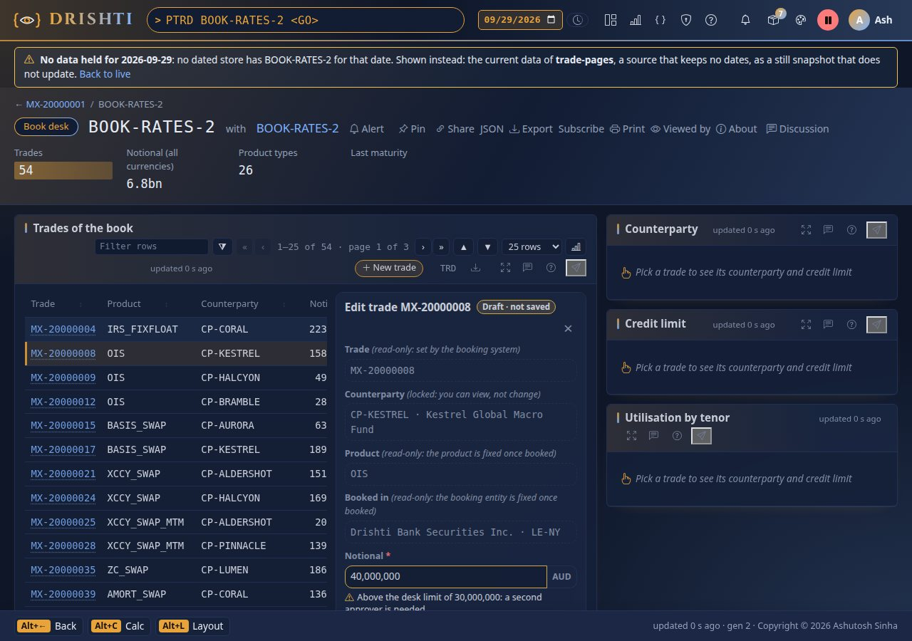
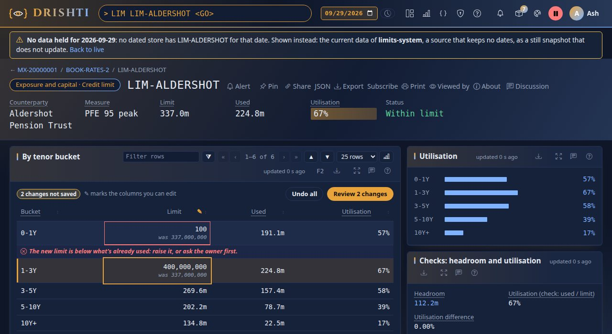
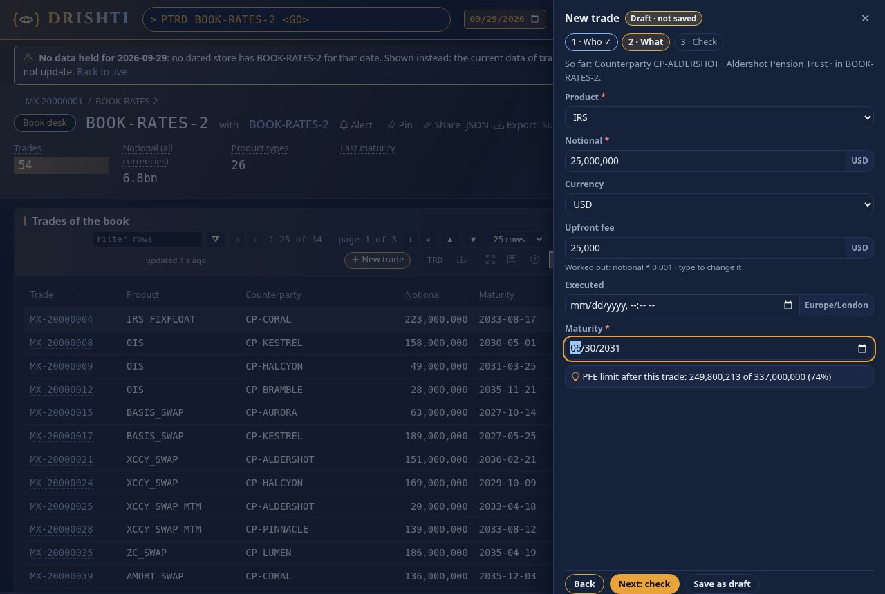
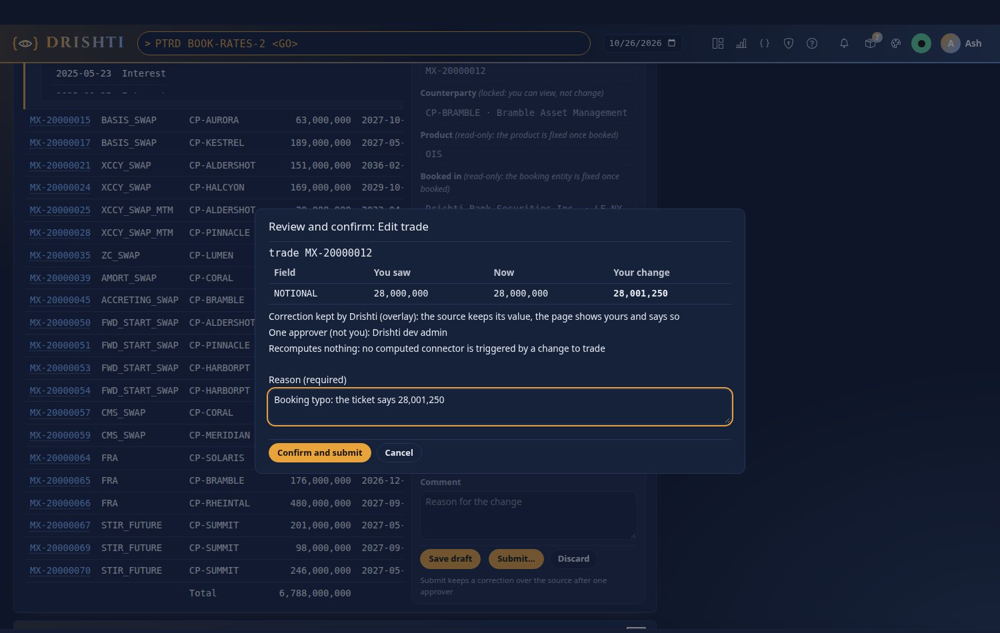
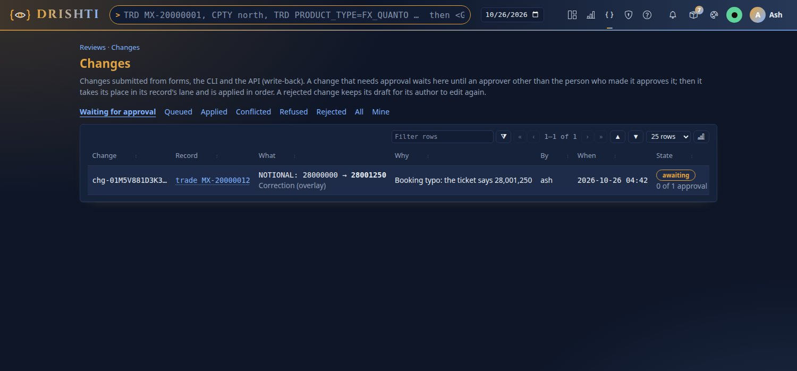
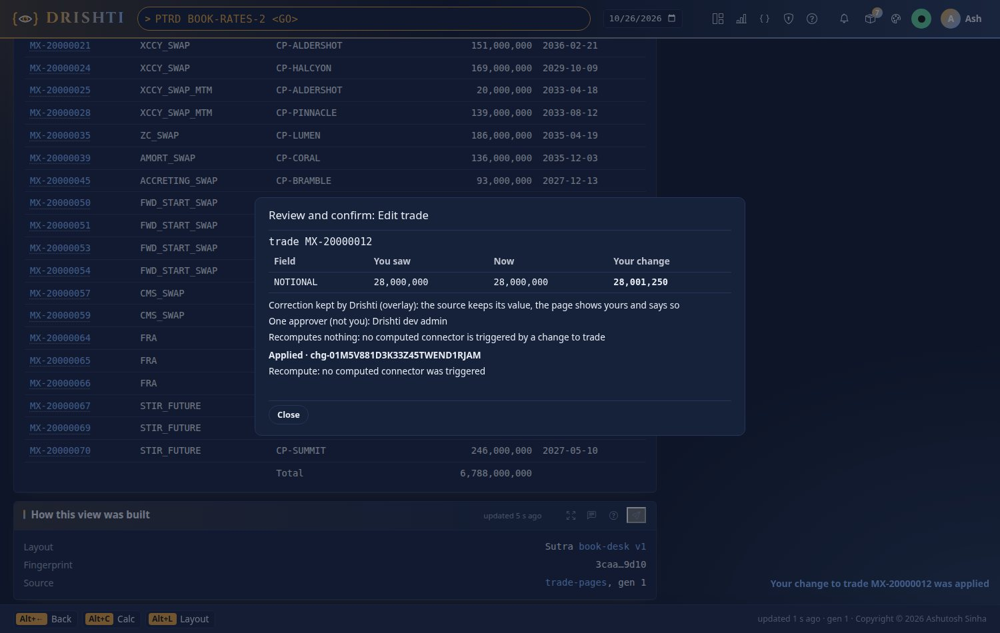

<!--
  Project Drishti · Any data. Any domain. One grammar.

  Copyright (c) 2026 Ashutosh Sinha <ajsinha@gmail.com>.
  All rights reserved.

  PROPRIETARY AND CONFIDENTIAL.

  This file is the confidential and proprietary property of Ashutosh Sinha.
  Unauthorised copying, use, modification, distribution or disclosure of this
  file, via any medium, is strictly prohibited except with the express prior
  written permission of the copyright holder.

  See the LICENSE file in the root of this repository for the full terms.
-->

# Corrections and approvals

Drishti lets people change records from a screen's forms, from the command line (`drishti.py change`) and from the API. A change is a
**change request**: checked as the person who made it, approved by someone else where the policy says so, applied one at a time per
record, in order, and audited. It lands in one of three places: a **correction** kept in Drishti beside the source's value, a record
Drishti **owns**, or an **amendment** sent to the source system through its connector.

Everything that waits for a second person, corrections and every other four-eyes item (Sutra proposals, BI items, pivot functions,
stress windows, report sign-offs, compute packages), is decided in **one Approvals queue**.

This guide is for the people who **use** forms and approve changes (sections 2 to 6) and for the **administrator** who switches
write-back on and runs it (sections 7 to 12). How to **design** a form (the `form:` YAML, editable cells, the drawer's steps, rules,
hints, the Sutra designer and `sutra lint`) is in [BUILD_GUIDE.md](BUILD_GUIDE.md). The worked example with pictures is
[tutorial 11](../tutorials/11-correct-and-approve.md). How it is built, and why, is
[HOW_IT_FITS.md, section A31](../../HOW_IT_FITS.md#part-ii--architecture).

## Contents

- [1. The ways in](#1-the-ways-in)
- [2. Correcting a record](#2-correcting-a-record)
- [3. Drafts](#3-drafts)
- [4. Submitting a change](#4-submitting-a-change)
- [5. Where a change goes](#5-where-a-change-goes)
- [6. The Approvals queue](#6-the-approvals-queue)
- [7. For administrators: switching write-back on](#7-for-administrators-switching-write-back-on)
- [8. The edit log, lanes and the cluster](#8-the-edit-log-lanes-and-the-cluster)
- [9. Admin → Edits](#9-admin--edits)
- [10. Writing to a source: `writes:`](#10-writing-to-a-source-writes)
- [11. Audit and retention](#11-audit-and-retention)
- [12. When something is wrong](#12-when-something-is-wrong)
- [13. Settings and further reading](#13-settings-and-further-reading)

## 1. The ways in

A screen that lets you change its records shows one of three ways in; the Sutra author chose which
([BUILD_GUIDE.md](BUILD_GUIDE.md) says how):

| Way | What you do |
|---|---|
| A form beside the table | Click a row: a form opens beside the table with typed fields |
| The table's cells | A ✎ marks the editable columns; type into the cells, like a spreadsheet |
| A guided drawer | **New** opens a drawer over the dimmed page, one step at a time |

Saving keeps a **draft** for you, on the server ([section 3](#3-drafts)). A form that says where its changes go also has **Submit…**,
which turns the draft into a change request ([section 4](#4-submitting-a-change)). A form without it keeps drafts only, and says so.

Nothing is editable as shipped: an administrator switches write-back on for the site, a Sutra author makes a form submit, and you need a
role with the **edit** power ([section 7](#7-for-administrators-switching-write-back-on)).

## 2. Correcting a record

### 2.1 A form beside the table

The trading pack's book desk carries a form on its trades. Open `/v/portfolio-trades/BOOK-RATES-2?sutra=book-desk` (or
`PTRD BOOK-RATES-2 <GO>`, then the Book desk screen) and click a trade:



What you see:

- **Typed fields.** A number or an amount of money takes `40,000,000`, `40m` or `1.5bn`; a date opens the date picker; a fixed list is
  a list; a lookup lists what its source offers; a long text field takes several lines.
- **Locked fields say why.** A read-only field shows its value with the reason, *(read-only: set by the booking system)*, or *(locked:
  you can view, not change)* when no reason is given. A field your roles may not change is locked the same way. A field hidden from you
  says **Hidden for you** and is never editable.
- **Messages in words, under the field.** An error stops the draft; a warning is shown and kept with it, for example *Above the desk
  limit of 30,000,000: a second approver is needed.*
- **Draft · not saved** while you have changes; **Save draft** keeps them; **Discard** throws them away (and the saved draft too).
- Leaving the page with changes not saved asks first. A panel you are editing is not refreshed under your hands.

### 2.2 Money, dates and times, linked records and worked-out values

- **Money** is an amount and its currency. Type `1.5m`, `250k`, `2bn` or `1,000,000`; it shows grouped (`1,500,000`) once you leave the
  field. The currency sits beside it, fixed or following another field (it changes when you pick a currency). A value that does not read
  says *Notional is an amount (1,000,000, 1.5m or 250k)*.
- **A date and time** is entered with the browser's date and time picker; the time zone is shown beside it and with the value
  (*2026-10-23 14:05 Europe/London*).
- **A linked record** (for example the legal entity a trade is booked in) is a search box. Type part of a name or an id, pick with the
  arrows and **Enter** (or a click); the record's id is kept and its label shown (*Drishti Bank Europe AG · LE-FRA*), with **Open**
  beside it. The box searches the server as you type (*Searching…* meanwhile, *No match for "…"* when nothing holds the text), so every
  record of the kind can be found, read as you may see them; a record whose value is hidden from you is never offered. When the server
  cannot be reached, the choices the page brought still answer. On saving, an unknown id is refused: *Booked in: no legal entity
  'LE-NOWHERE' was found*.
- **A worked-out value** fills itself in a new record from the other fields as you type (*Worked out: notional * 0.001 · type to change
  it*) until you type over it. The server fills it too when a new record leaves it empty, so a draft saved by a script is the same.

### 2.3 Editing in the cells

A credit limit's buckets (`/v/credit-limit/LIM-ALDERSHOT`) are edited straight in the table:



| Key | Does |
|---|---|
| **Enter**, **F2** or a click | open a cell |
| **Enter** | keep the value in the draft |
| **Esc** | undo the cell |
| **Tab** / **Shift+Tab** | keep the value and move to the next / previous editable cell |

A changed cell is tinted and says *was 337,000,000*; a bad one has a red border and the reason under its row. The bar above the table
counts *2 changes not saved*, with **Undo all** and **Review 2 changes**, which lists every change and saves the draft (it says *Fix 1
problem first* while one is wrong). A cell hidden from you says *Hidden for you*.

### 2.4 A new record in the guided drawer



**New trade** (or the screen's own label) opens the drawer; the page stays visible behind it, dimmed. **Next** checks the step's fields
first (*Counterparty is required*); a finished step is ticked; **Back** returns; the last step, **Check**, shows what you entered and
every message. A hint is worked out as you type: *PFE limit after this trade: 102,400,000 of 120,000,000 (85%)*; a value it reads that is
hidden from you makes it say *Hidden for you*. **Save as draft** keeps the record from any step, checked up to that step.

## 3. Drafts

Drafts are kept per person on the server. A page with drafts says **You have 2 drafts on this page**, with **Resume** (the form opens
again where it was: the row, the cells, the step) and **Discard** for each. Every save is checked again on the server with the same rules;
a value for a field hidden from you, or a change to a field you may not edit, is refused. Each save and discard is in the audit log.

## 4. Submitting a change

### 4.1 Submit, then review and confirm

**Submit…** saves the draft, then opens the **review and confirm sheet**:



| The sheet shows | For example |
|---|---|
| For each record and field: what you saw, what is there now, your change | a field that moved since you opened the record is flagged here, before you send anything |
| Where it goes | *Correction kept … (overlay)*, *Amend in trade-murex (command amend-notional)* |
| Who must approve | *One approver (not you): K. Rao or M. Diaz* |
| What it will recompute | the computed panels whose triggers fire on a change to this kind of record, or *Recomputes nothing* |
| The reason | a box, required when the form asks for one |

**Confirm and submit** turns the draft into one change request per record. On a phone the sheet takes the whole screen.

### 4.2 After you submit

The sheet follows each change, and a toast says it too when the sheet is closed:

| State | Means |
|---|---|
| *Waiting for an approver* | it is in the [Approvals queue](#6-the-approvals-queue) with the change id |
| *Approved* | it has taken its place in its record's queue |
| *Applied* | it is written; your draft is closed with the change id; toast *Your change to trade MX-20000012 was applied* |
| *Pending at the source* | an amendment sent to the source system, until the source confirms it |
| *Conflicted: the record moved* | a field you changed has a newer value than the one you saw: nothing is written over it ([4.5](#45-when-the-record-moved-conflicted)) |
| *Refused* | with the reason, for example a rule that fails against the record as it is now, or a source that said no |

A conflicted or refused change keeps your draft, and the drafts bar says so, so you can edit it again. People watching the record see the
new value at once on its page (masked for them), with *Changed by … just now*; the name shows only to those who may see the edit
history. When the change triggers a recompute (a computed panel, such as a book's VaR), you see its progress and the stamp when it is
done; viewers of the result see the new number. A recompute that fails does not undo the change: the result is marked stale and catches
up on the next trigger or read.

### 4.3 Who may submit

- Editing is on for the site, and the form has `save:` (it shows **Submit…**).
- You hold the **edit** power on one of your roles (Admin → Roles: *Submit edits*). A personal API token also needs the **edit** scope,
  which no token has unless it was ticked when the token was made.
- Every field you change is editable for you: not hidden from you, not read-only, and your role is among those the field allows.
- You may edit only kinds of the packs you are given.
- A new record from the drawer can be submitted to an owned record or as a new record at the source, never as a correction (there is
  no source record to correct).

The server checks all of this again when you submit, and once more when the change is applied, against the record as it is then.

### 4.4 From the command line

The same requests, for the caller's token (with the **edit** scope) or `--user` with sign-in off:

```bash
# propose a change to a record's fields (the same request as a form's Submit)
drishti.py change propose --kind trade --id MX-20000012 --set NOTIONAL=28001250 --from NOTIONAL=28000000 --reason "booking typo: ticket 4411"
# chg-01M5V881D3K33Z45TWEND1RJAM  trade MX-20000012  AWAITING (1 approval needed)

drishti.py change submit d-4ab964fa3060 --reason "booking typo"     # submit one of your form drafts
drishti.py change list --state awaiting --mine                       # changes, newest first
drishti.py change show chg-01M5V881D3K33Z45TWEND1RJAM                 # one change
drishti.py change history trade MX-20000012                          # a record's changes from the edit log
```

| `change propose` option | Means |
|---|---|
| `--set FIELD=VALUE` | the new value; repeat for several fields |
| `--from FIELD=VALUE` | the value you saw: a field that moved since is conflicted |
| `--reason` | why (required when the form asks for one) |
| `--sutra`, `--panel` | the form whose rules decide (default: the first form that edits the field) |
| `--date YYYY-MM-DD` | the business date; a past date is a restatement and needs the restate role |
| `--override` | *Apply mine anyway* over a newer value (needs the override role) |

`change list` filters by `--state` (`awaiting`, `queued`, `applying`, `applied`, `refused`, `conflicted`, `rejected`, `withdrawn`),
`--kind`, `--entity` and `--mine`. Every command takes `--json`. Exit codes: `0`; `1` when the change was refused or conflicted or the
server said no; `2` for a usage error. The change is decided with `drishti.py approvals` ([6.6](#66-from-the-command-line)). The API is
`POST /api/v1/changes` and its siblings ([API_REFERENCE.md](API_REFERENCE.md)); [CLI_REFERENCE.md](CLI_REFERENCE.md) has every command.

### 4.5 When the record moved: conflicted

Two people open the same trade. The first changes the notional and it is applied. The second, still looking at the old value, changes it
too. Their change would overwrite the first without either knowing, so Drishti refuses it as **conflicted**:

```bash
drishti.py change show <its id>
# chg-…  trade MX-20000012  CONFLICTED  (overlay, by kim)
#   NOTIONAL: you saw 28000000, it is now 28001250, you wanted 28000500
```

The check is per field: a change to another field of the same record in between does not conflict. Changes to the source outside
Drishti (a load, a ticket in the booking system) are detected the same way. Open the record again and edit from what is there now; a
person with the override role may instead apply theirs anyway (`--override`), which is audited with the value it overwrote.

## 5. Where a change goes

The form says where (the site's policy may only make it stricter):

| Target | What is written | Who sees it |
|---|---|---|
| **Correction** (`overlay`) | a correction kept in the Drishti database beside the source's value; the source is not changed | every page that reads the record (and the page row the form edited) shows the corrected value; *How this view was built* says **Edited here** with the change id, the field and who made it; Admin → Edits lists it under *Open overlays* with the source's value |
| **Owned** (`owned`) | the record's value itself, in the Drishti database (Drishti is its system of record) | every page that reads the record |
| **Source** (`source`) | a command of the connector's `writes:`, sent to the source system in its own transaction ([section 10](#10-writing-to-a-source-writes)) | the page shows the value as pending until the source confirms it; a refusal withdraws it and the page shows the source's value again |

The lake's files (Delta, Iceberg) are never written per change: pages read the correction from the Drishti database and lay it over the
source's record.

## 6. The Approvals queue

### 6.1 What waits there

Everything that waits for a second person is in **one queue**: **Views → Approvals** (`/approvals`), with a count on the top bar's
approvals tool (the badge beside the bell).

| Kind | Area | Who decides | Where it is made |
|---|---|---|---|
| Sutra | Screens | an approver (four eyes) | a workbench save, a designed screen, a terminal layout promoted ([USER_GUIDE.md › Reviews](USER_GUIDE.md#reviews-approving-a-sutra)) |
| Correction | Data | an approver of changes (the policy may ask for several) | a form's Submit, `drishti.py change propose` ([section 4](#4-submitting-a-change)) |
| BI item | Data | a bi-steward, or a member of the workspace with the approve power | *Propose for review* on a dataset, model, report or board ([BI_GUIDE.md](BI_GUIDE.md#part-3--reports-and-dashboards)) |
| Pivot function | Data | an approver (a Java plug-in: an administrator); with a sharing scope | `pivot functions submit` |
| Stress window | Risk | someone who sees every node, never the proposer | *Freeze and propose* on `SWIN` |
| Report sign-off | Risk | the next step of the chain (maker, checker, approver); one person signs one step | `VAR REPORT <report> <period>`, *Generate* |
| Compute package | Access | an administrator (and the roles `compute.approval.roles` names) | a connector or pool that needs packages |

### 6.2 The list

*Waiting for me* is your inbox: everything you may decide now, never your own. Items with a due date near (a report run's filing date)
are **pinned on top** under *Due soon*; the rest are newest first. Filter by area (*Data · Screens · Risk · Access*) or by kind; *Mine
sent* lists what you asked for; *Done* what was decided. How near a due date pins an item is a setting (`drishti.approvals`).

### 6.3 One item

Click one:

- **What changes**: a diff, with the maker's reason (for a correction, each field from → to).
- **Effect if approved**: what changes downstream: the records and views that read a corrected record, the published reports a BI change
  breaks, a node's stressed VaR under each window, the files a signed run releases.
- **Rules**: why you may decide (and what you may not).
- *More facts*: checks, evidence, history.

### 6.4 Deciding

- **Approve.** Some kinds ask one more thing: a pivot function, who may use it (*everyone* or `group:<name>`); a BI dataset change,
  whether to update the reports that use renamed names, or, as a bi-admin, to approve over a breaking change; a report sign-off, the step
  you sign.
- **Reject…** with a reason in the comment box (a reason is required).
- **Withdraw** your own.
- **Ask a question**: a thread on the item. The maker is told (without the text) and answers in the same place, and whoever asked is
  told of the answer.

The maker never approves their own. Every decision and every question is in the audit log.

### 6.5 Approving a correction

A correction waits in the queue as kind *Correction* until it has the approvals it needs; only then does it take its place in its
record's queue, and it is checked against the record as it is then.



- The person who submitted sees it under *Mine sent*, with **Withdraw** and no Approve or Reject, and *0 of 1 approvals*.
- An approver opens it, reads what changes and its effect, and presses **Approve**. Approving your own change answers `403 DRS-9302`
  *you submitted this change: someone else approves it (four eyes)*.
- How many approvals each target needs, and who may approve, is the site's policy
  ([7.3](#73-the-approval-policy)); a form may ask for more, never fewer.



### 6.6 From the command line

```bash
drishti.py approvals list                                   # waiting for you, due soon first
drishti.py approvals list --box sent --group risk            # --box inbox|sent|done|all, --group data|screens|risk|access, --kind ...
drishti.py approvals show sutra P-000042                     # what changes, its effect, the rules, the questions
drishti.py approvals approve change chg-01M5V881D3K33Z45TWEND1RJAM --comment "checked against ticket 4411"
drishti.py approvals reject bi it-0042 --comment "name the columns"
drishti.py approvals withdraw change chg-01M5V881D3K33Z45TWEND1RJAM
drishti.py approvals approve function asha:wret@1 --comment reviewed --param scope=group:rates
drishti.py approvals approve var-report annual-report-var:FY2026:v1 --param step=checker
drishti.py approvals ask sutra P-000042 "Why the new title?"
```

The kinds are `sutra`, `change`, `bi`, `compute`, `function`, `stress-window` and `var-report`; the id is the item's id within its kind
(`approvals list` shows it). `--param NAME=VALUE` carries what a kind needs besides: `scope` (a pivot function), `step` (a report run),
`force` or `applyRenames` (a BI item). `approvals list` also names any area it could not read. Exit codes: `0`; `1` when the server said
no; `2` for a usage error. The API is `/api/v1/approvals` ([API_REFERENCE.md](API_REFERENCE.md)).

## 7. For administrators: switching write-back on

### 7.1 Off at three levels

Write-back is **off as shipped**, at three levels, and the ones a change needs must all be on before anything is written:

| Level | Off because | Turned on by |
|---|---|---|
| the site | `edit.enabled: false` in `config/edit/edit.yaml`: no change is accepted anywhere and no Submit is drawn | an administrator: `edit.enabled: true` (or `DRISHTI_EDIT_ENABLED=true`) and a restart |
| the field | a field is editable only when a Sutra's `form:` has `save:` | a Sutra author, through review like any Sutra change ([BUILD_GUIDE.md](BUILD_GUIDE.md)); the trading pack's book desk ships with `save:` (corrections of a trade, one approver) |
| the source | a connector writes to its source only when its file declares `writes:` and its writes are switched on | an administrator: the connector file's `writes:`, then **Switch on** in Admin → Edits (audited) ([section 10](#10-writing-to-a-source-writes)) |

Corrections and owned records need the first two; an amendment sent to a source needs all three. A fresh install or an upgrade is
read-only. With the site switch off, corrections applied earlier are still shown.

### 7.2 Switch it on

```yaml
# config/edit/edit.yaml
edit:
  enabled: true          # or leave ${DRISHTI_EDIT_ENABLED:false} and set the variable
  log: auto
```

Restart the server. The start logs:

```text
write-back: on; edit log sqlite (auto: this node is alone), 64 lanes, node local
```

Then give the people who edit a role with the edit power (Admin → Roles → *Submit edits*; the shipped `admin` role has it), and the
people who approve a role with the approve power, or name them in `policy.approver-roles`. Check it from the command line:

```bash
drishti.py edits status
# {"enabled": true, "mode": "single", "store": "sqlite", "why": "auto: this node is alone", ...}
```

### 7.3 The approval policy

`config/edit/policy.yaml` decides:

| Key | Says |
|---|---|
| `policy.approval.overlay` / `owned` / `source` | approvals a change needs per target: `none`, `one` or `two`. Shipped: `none`, `none`, `one` |
| `policy.kinds.<kind>.approval.<target>` | a stricter rule for one kind |
| `policy.approver-roles` | who approves; empty means holders of the approve power and administrators |
| `policy.self-approval` | `false`: nobody approves their own change (four eyes) |
| `policy.restate-role` | the role a change to a past business date (a restatement) needs |
| `policy.override-role` | the role *Apply mine anyway* over a newer value needs |

A form's `save.approval` may ask for more approvals than the policy, never fewer. Who may do what, in one place:

| To | You need |
|---|---|
| submit any change | the **edit** power on one of your roles; a token also needs the **edit** scope |
| edit a given field | a role the field allows (`editable-by` on the form's field) |
| approve a change | an approver role or the approve power, and **never your own change** |
| *Apply mine anyway* on a conflict | the override role; audited with the overwritten value |
| change a past business date | the restate role |
| switch a connector's writes on | administrator; audited, shown on Admin → Edits |

Everything is checked again when the change is applied, not only when it is submitted: the switch, the edit power, the kind, the masks,
the form's roles and read-only fields. A field hidden from a person can never be edited by them, and a change never reveals a hidden value
(the difference shows the mask for fields the reader cannot see).

## 8. The edit log, lanes and the cluster

Every change is a row of the **edit log** (`drishti_edit_log`) in the Drishti database, acknowledged only after it is committed. Changes
run in **lanes** (`lanes.lanes`, 64): a record always maps to the same lane, a lane applies one change at a time in its order, and lanes
apply in parallel. So two changes to one record never happen at once, and a change is never lost once you are told it was received.

Each lane has one owner node, taken in the database with a lease (`lanes.lane-lease`, 10 s). A node that lost its lane (cut off from the
others, or paused) can no longer write anything for it. Where the edit log lives is set by `edit.log: auto`:

| Setup | The edit log | When a node stops |
|---|---|---|
| one node | its SQLite Drishti database | it owns every lane; after a restart it takes its lanes back and applies what was acknowledged |
| a cluster on PostgreSQL | the shared database; lanes spread over the members | another node takes the lanes after the lease, carries on from the last applied change and resends unconfirmed commands |
| a cluster with `edit.primary` | the primary's SQLite; every other node forwards edits to it and copies its corrections | no failover: edits pause with a message while the primary is down; reading carries on |
| a cluster with neither | none | edits are refused in the cluster (`DRS-9306`); reading carries on |

A change can be submitted on any node; it is forwarded to its lane's owner. An explicit `edit.log` (`sqlite`, `postgres`) is checked at
start: `postgres` needs a PostgreSQL Drishti database, `sqlite` in a cluster needs `edit.primary`; otherwise the server starts with
editing off and says why. On AWS, use PostgreSQL (RDS, Aurora) for the Drishti database. Moving the edit primary is a configuration change
made with the old one stopped.

A lane deeper than `lanes.max-lane-depth` (1,000) refuses new changes with *busy, try again* (`503 DRS-9304`); the draft is kept.

## 9. Admin → Edits

**Admin → Edits** shows:

- the store in use, and why (the auto rule), and this node;
- each lane that has an owner or waiting changes: owner, epoch, lease, depth, oldest wait;
- the warnings: an edit primary without failover, a lane whose oldest change waited past `lanes.lane-warn` (2 s), a lane with waiting
  changes and no live owner, source commands not confirmed past `lanes.command-timeout` (30 s);
- each connector that declares `writes:`: its commands, their problems, and the **Switch on** / **Switch off** for its writes;
- the **open overlays**: every correction with the source's value beside it. An administrator may withdraw one; the views and the other
  nodes are told at once.

`drishti.py edits status` prints the same as JSON.

## 10. Writing to a source: `writes:`

A connector says **how** to change a record in its system; the Sutra's form says **what** may change; the lane owner says **when** and in
what order. The JDBC plugin writes; the file, Delta and Iceberg plugins never do (a lake is not written per change), and any other plugin
is refused with *plugin … cannot write*.

A command needs a **concurrency guard** (it changes the row only if it is still the version the person saw) and an **idempotency clause**
(it recognises its own change id, so a resend is applied at most once):

```yaml
# config/connectors/trade-murex.yaml (excerpt)
writes:
  amend-notional:
    kind: trade
    params: [leg]
    jdbc:
      sql: >
        UPDATE MX_TRADE_LEG SET NOTIONAL = :value, VERSION = VERSION + 1, DRISHTI_CHANGE_ID = :changeId
         WHERE TRADE_ID = :entity AND LEG_NO = :leg AND VERSION = :basedOn
      expect-rows: 1
      already-applied: SELECT 1 FROM MX_TRADE_LEG WHERE TRADE_ID = :entity AND LEG_NO = :leg AND DRISHTI_CHANGE_ID = :changeId
    confirm: reply           # reply | next-load (ack-topic is read as a reply until a messaging plugin writes)
    timeout: 30s
```

| Key | Means |
|---|---|
| `kind` | the records the command changes |
| `params` | extra parameters the form supplies (read from the row being edited) |
| `jdbc.sql` | the statement, with bound parameters |
| `jdbc.expect-rows` | the guard: any other row count means the record moved, and the change is *conflicted* |
| `jdbc.already-applied` | the idempotency clause: a query that finds the change id already written |
| `confirm` | when the change counts as applied at the source: the statement's `reply`, or the `next-load` showing the value |
| `timeout` | after this, an unconfirmed command is listed on Admin → Edits |

Drishti supplies `:entity`, `:kind`, `:businessDate`, `:value`, `:from`, `:basedOn`, `:changeId`, `:by`, `:reason`, `:at` and `:field`,
plus the names in `params:`. Parameters are always bound, never pasted into the SQL. A command without its guard or idempotency clause, or
naming a parameter that is neither, is refused when the connector loads: Admin → Connectors and Admin → Edits say why, and the connector
stays read-only for it. A new record uses a `create:` command of the same connector, with the guard *the key does not exist yet*. A change
of several fields sends one command per field, each with its own change id (`<id>#1`, `#2`).

Commands go out through an **outbox**: the change is recorded as pending in the same transaction that applies it, then sent in order, one
at a time per record, so a slow source never holds up the lane's other changes. After a failover the new owner resends what was not
confirmed with the **same change id**, so the source applies it at most once. A source that cannot guard or de-duplicate (no version, no
change-id column) is edited through corrections only.

Once the file declares `writes:`, an administrator switches the connector's writes on in Admin → Edits (audited). The connector file's
keys are in [DATA_GUIDE.md section 9](DATA_GUIDE.md#writes-saving-to-the-source) and the JDBC plugin's in
[its README](../../plugins/drishti-plugin-jdbc/README.md#writes-commands-that-change-a-record).

## 11. Audit and retention

Every step is in the audit log:

| Event | When |
|---|---|
| `edit-submitted`, `edit-withdrawn` | a change is submitted or withdrawn |
| `edit-approved`, `edit-rejected`, `edit-self-approval-refused` | an approver decides; someone tries to approve their own |
| `edit-applied`, `edit-conflicted`, `edit-refused` | the lane owner applies or refuses it |
| `edit-confirmed`, `edit-refused-at-source` | the source answers a command |
| `form-draft-closed` | a draft is closed with its change id |
| `connector-writes-on`, `connector-writes-off` | an administrator switches a connector's writes |
| `edit-overlay-withdrawn` | an administrator withdraws a correction |
| `edit-log-purged` | finished entries past retention are deleted |

Values of fields hidden from the submitter are written as the mask. Each edit-log row carries a SHA-256 digest over its place and body,
so a changed row is evident. The log is kept `retention.keep` (7 years); finished entries older are deleted. A record's history is
`drishti.py change history <kind> <id>` (or `GET /api/v1/entities/{kind}/{id}/history`).

## 12. When something is wrong

| You see | Why | Do |
|---|---|---|
| `403 DRS-9301` | editing is off | `edit.enabled: true`, restart |
| `403 DRS-9302 … no Sutra's form with save: names it` | the field is not editable | a Sutra author adds `save:` to the form ([BUILD_GUIDE.md](BUILD_GUIDE.md)) |
| `403 DRS-9302 … does not hold the edit power` | the person's roles | Admin → Roles: *Submit edits* |
| `403 DRS-9302 … you submitted this change` | four eyes | another approver decides |
| `503 DRS-9304` busy | the lane is deeper than `lanes.max-lane-depth` | try again; the draft is kept |
| `503 DRS-9306 Edits are paused …` | the edit primary is down, or the cluster has no shared edit log | start the primary; for failover use PostgreSQL |
| a change stays *queued* | no node owns its lane (Admin → Edits: a lane with waiting changes and no live owner) | check the server log for `edit lanes:`; a node takes the lane when its lease runs out |
| *unconfirmed* commands | the source did not confirm within `lanes.command-timeout` | check the source; the outbox keeps resending with the same change id |
| *Conflicted: the record moved* | the record changed since you opened it | open it again and edit from what is there now ([4.5](#45-when-the-record-moved-conflicted)) |
| no **Submit…** on a form | the form has no `save:`, editing is off, or you lack the edit power | the three switches of [7.1](#71-off-at-three-levels) |

## 13. Settings and further reading

- Every setting (`config/edit/edit.yaml`, `lanes.yaml`, `policy.yaml`, `retention.yaml`, and `drishti.approvals`):
  [CONFIGURATION.md](../admin/CONFIGURATION.md#write-back-configedit).
- Designing a form that submits (`form:`, `save:`, cells, the drawer, rules and hints, the designer, `sutra lint`):
  [BUILD_GUIDE.md](BUILD_GUIDE.md); every key is in [RACHANA_REFERENCE.md](RACHANA_REFERENCE.md#forms-form-on-a-panel).
- Recomputing on a change: a computed connector with a `write-back` trigger ([tutorial 19, Part C](../tutorials/19-build-a-pack-and-a-screen.md#part-c--computed-panels-a-reactive-connector)).
- The endpoints: [API_REFERENCE.md](API_REFERENCE.md). The commands: [CLI_REFERENCE.md](CLI_REFERENCE.md).
- How it is built (lanes, fencing, the outbox, the applied event, the one queue): [HOW_IT_FITS.md, section A31](../../HOW_IT_FITS.md#part-ii--architecture).
- The worked example: [tutorial 11](../tutorials/11-correct-and-approve.md).
