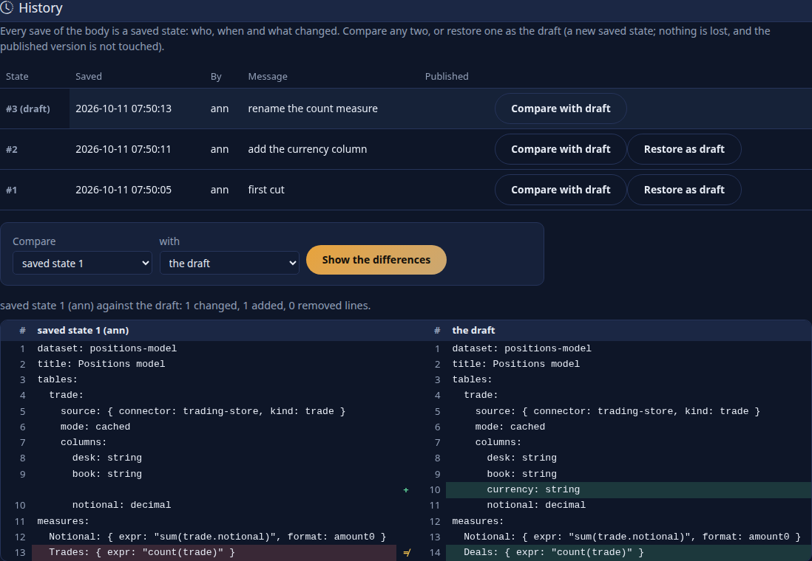
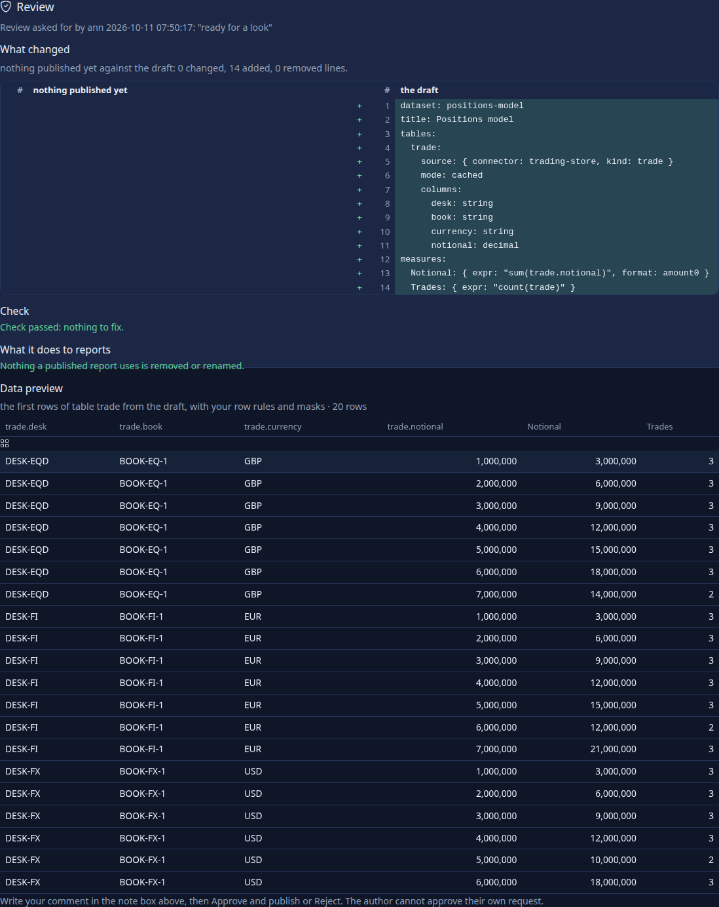
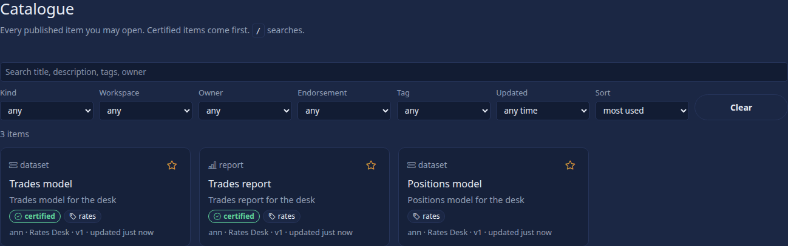
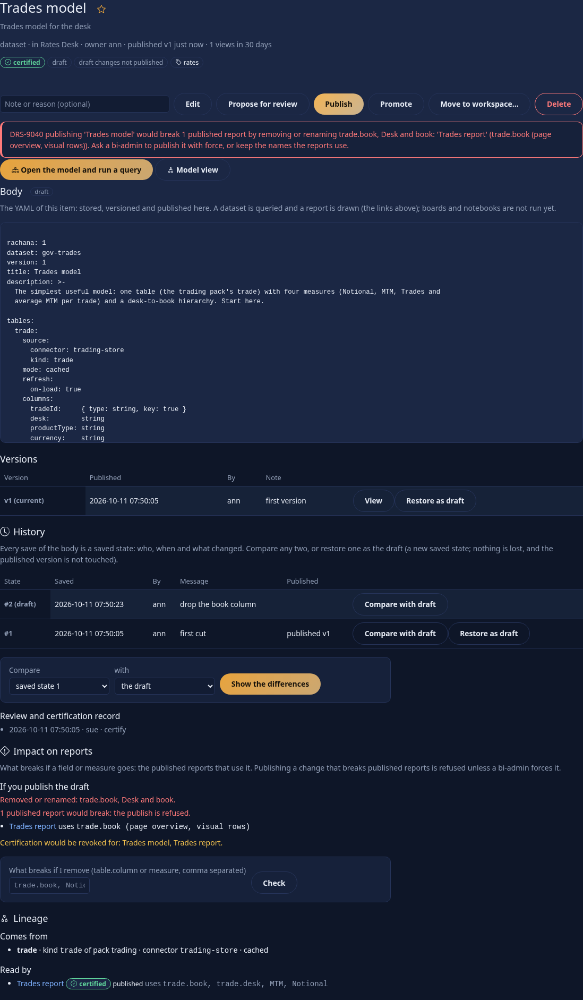
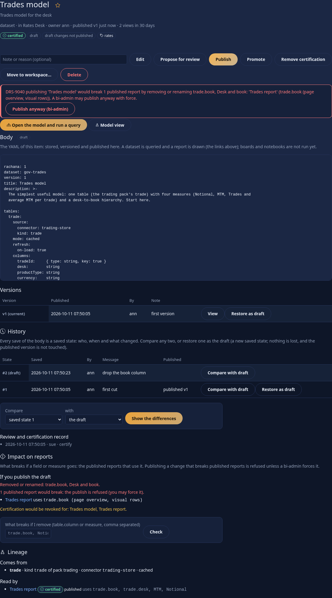
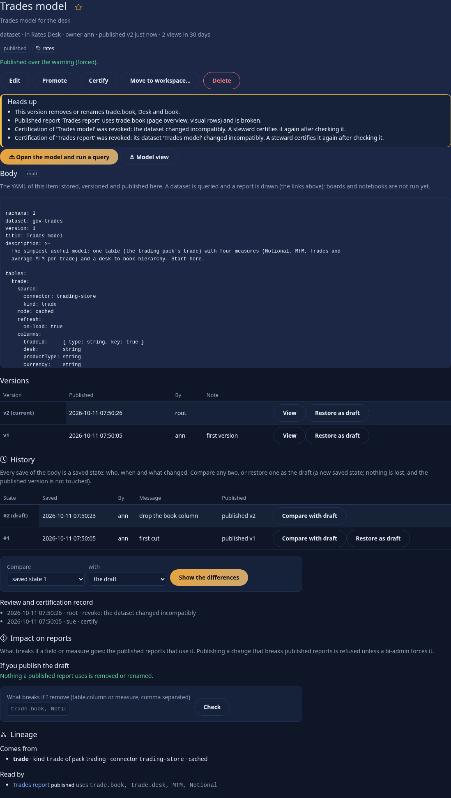
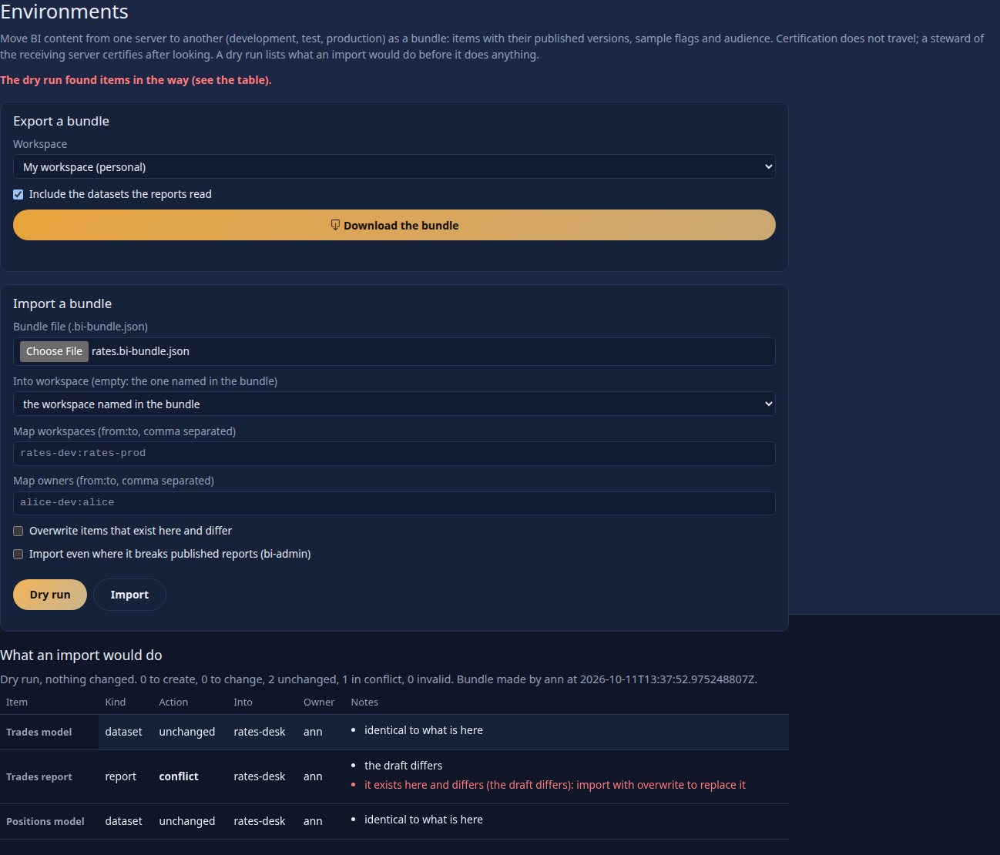
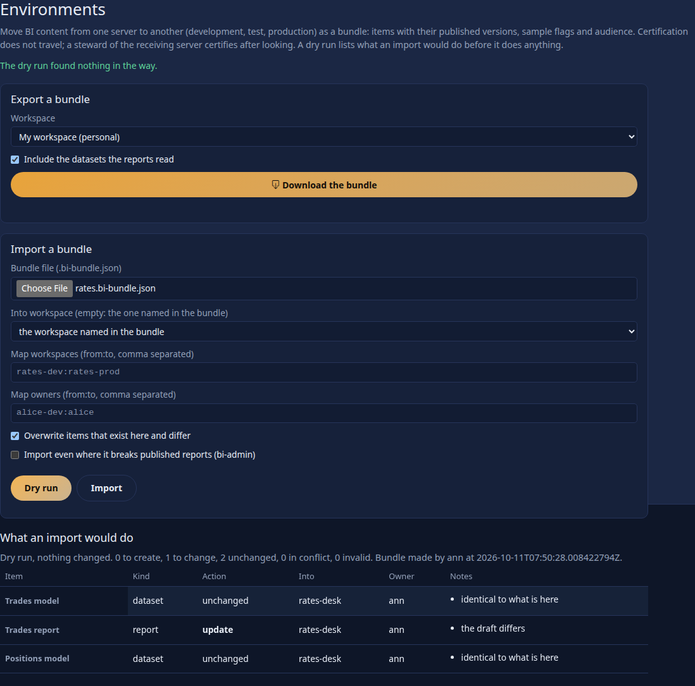

<!--
  Project Drishti · Any data. Any domain. One grammar.

  Copyright (c) 2026 Ashutosh Sinha <ajsinha@gmail.com>.
  All rights reserved.

  PROPRIETARY AND CONFIDENTIAL.

  This file is the confidential and proprietary property of Ashutosh Sinha.
  Unauthorised copying, use, modification, distribution or disclosure of this
  file, via any medium, is strictly prohibited except with the express prior
  written permission of the copyright holder.

  See the LICENSE file in the root of this repository for the full terms.
-->
# Publishing and governance in BI: versions, review, certification, lineage, impact, environments

This is the reference for Rūpaka **phase 4**. A dataset or report is not just a file: it is saved, reviewed, certified, and moved between servers, and a change to a dataset can break the reports built on it. This page says exactly how each of those works, what each person sees, which refusal comes back, and what is **not built**. For the pages see [BI_GUIDE.md](BI_GUIDE.md) section 17; for the walk-through with pictures see [tutorial 10](../tutorials/10-first-bi-report.md) chapter 17; the design is [RUPAKA.md](../architecture/RUPAKA.md) sections 10 and 11 and what is built is its section 20.4. The settings are `drishti.bi.governance.*` in [CONFIGURATION.md](../admin/CONFIGURATION.md#drishtibigovernance--publishing-and-governance-phase-4): `revisions-keep`, `preview-rows`, `refuse-breaking`, `revoke-certification`, `bundle-max-bytes` and `tell-people` (the inbox notices; off, the audit log and the history still record everything).

## Contents

1. [Saved states and published versions](#1-saved-states-and-published-versions)
2. [The diff](#2-the-diff)
3. [Review](#3-review)
4. [Certification and endorsement](#4-certification-and-endorsement)
5. [Lineage](#5-lineage)
6. [Impact: what breaks if I change this](#6-impact-what-breaks-if-i-change-this)
7. [Environments: bundles](#7-environments-bundles)
8. [The audit trail](#8-the-audit-trail)
9. [API](#9-api)
10. [Built and not built](#10-built-and-not-built)

## 1. Saved states and published versions

Two histories exist side by side, and the page shows both.

| | A **saved state** (history) | A **published version** (Versions) |
|---|---|---|
| Made by | every change of an item's body: creating it, each save, a restore, a publish, an import | publishing (or approving a proposal) |
| Numbered | `#1`, `#2` ... per item, in the order saved | `v1`, `v2` ... |
| Carries | who, when, a message (*What changed* in the Edit form), where it came from (`create`, `save`, `restore`, `publish`, `import`) | who published, when, the note |
| Kept | the newest `drishti.bi.governance.revisions-keep` (200); one that is a published version is never dropped | the newest `drishti.bi.versions-keep` (50) |
| Seen by | people who may **edit** the item (contributor or higher), and a bi-steward while it is proposed | everyone who may read the item |

A change to the title, description, tags or audience alone is not a new saved state: only the body is versioned. Items that existed before phase 4 have no saved states before the upgrade; their published versions are all still in Versions.

**Readers see the published version; authors see their draft.** This is unchanged: the published version is pinned until someone publishes another, whatever the draft says.

**Restore** makes a saved state (or a published version) the draft again **as a new saved state**, so nothing is ever lost and the published version is not touched. It is refused while the item is proposed (`DRS-9004`: withdraw first).

```
GET /api/v1/bi/items/bi-ba49ebcd44/history        (as ann, after two saves)
{ "title": "Positions model", "status": "draft", "publishedVersion": 0,
  "revisions": [
    { "seq": 3, "message": "rename the count measure", "author": "ann", "origin": "save",   "publishedVersion": 0, "draft": true,  "bytes": 339 },
    { "seq": 2, "message": "add the currency column",  "author": "ann", "origin": "save",   "publishedVersion": 0, "draft": false, "bytes": 340 },
    { "seq": 1, "message": "first cut",                "author": "ann", "origin": "create", "publishedVersion": 0, "draft": false, "bytes": 317 } ],
  "events": [], "canRestore": true }
```

A reader who may not edit the item gets `DRS-9002` (the published versions are open to them); someone who may not see the item at all gets `DRS-9001`.



## 2. The diff

A diff compares two **sides**, each one of `draft`, `published`, `vN` (a published version) or `rN` (a saved state). It is a line diff of the YAML, shown side by side: lines only on the left are marked `−`, only on the right `+`, a line replaced `≠`, with line numbers on both sides and the changed rows tinted (the mark, not only the colour, says what changed). A very large change (more than 4 million line pairs in the middle) is shown as one changed block.

```
GET /api/v1/bi/items/bi-ba49ebcd44/diff?from=r1&to=draft
{ "from": { "ref": "r1", "label": "saved state 1 (ann)" }, "to": { "ref": "draft", "label": "the draft" },
  "identical": false, "added": 1, "removed": 0, "changed": 1,
  "rows": [ { "op": "same",  "left": "dataset: positions-model", "right": "dataset: positions-model", "leftNo": 1, "rightNo": 1 },
            ...
            { "op": "added", "left": null, "right": "      currency: string", "leftNo": 0, "rightNo": 10 } ] }
```

Without `from` and `to` the diff is the published version against the draft. A shipped file keeps only its current version, so only `vN` for the current N works for it. A bad side is `DRS-9003`.

## 3. Review

Review extends the phase 1 flow; it does not replace it. A workspace may *require review before publishing* (Workspaces, the workspace's settings); even where it does not, an author may *Propose for review*.

1. **Request.** The author proposes, with a note. The item is frozen (no edits until it is withdrawn). The **reviewers are told** in the inbox (the bell): every bi-steward, and every member of the workspace who holds the `approve` power, except the author.
2. **The review page.** A reviewer opens the item and sees, under *Review*: who asked and what they wrote; **what changed** (the draft against the published version, side by side); **Check** (the dataset's or report's problems, with DRS code and path; a report is checked against its dataset); **what it does to reports** (the impact of section 6, for a dataset); and a **data preview**: for a dataset the first `drishti.bi.governance.preview-rows` (20) rows of its first table and two measures read from the **draft**, for a report a sample of the data it reads. The preview is answered as the reviewer: their row rules and masks apply, so a reviewer never sees through a mask. When the source cannot be read the preview says why instead of failing the review.
3. **Decide.** *Approve and publish* (with a note) publishes the draft as the next version; *Reject* needs a reason and returns the item to draft. Both are recorded with the comment in the item's **review record**, shown under History, and the author is told in the inbox.

**Who may decide.** A **bi-steward** may, in any workspace (a steward reads what is proposed for review, in any shared workspace; what is published stays behind its audience, so to certify an item a steward must be in its audience or its workspace). A workspace **member** may if they hold the `approve` power on a role. **Four-eyes** (`drishti.governance.four-eyes`, with security on): the person who proposed may not approve or reject (`DRS-9005`); they may withdraw. An approval that would break published reports is refused like any publish (section 6), and a bi-admin may force it.



## 4. Certification and endorsement

* **Promoted**: the owner, or a member of the workspace, marks a published item. **Certified**: only a **bi-steward** (or a bi-admin) marks it, and only a steward may remove it. Both show as a badge on the card in the catalogue, in search results, on Home and on the item, and **certified items come first** in the catalogue's default sort and have a *Certified for you* row on Home. The catalogue filters by endorsement.
* **Certification falls automatically** when it is no longer true (`drishti.bi.governance.revoke-certification`, on by default). Publishing a version of a **dataset** that removes or renames a field, measure or hierarchy (by name; a rename is a removal plus an addition) revokes:
  * the certification of **that dataset**, and
  * the certification of every **certified published report that uses a removed name** (a report that uses none of them stays certified).

  Each revocation is written to the item's review record and the audit log, the **owner and whoever certified it are told** in the inbox, and the publish answers with a `warnings` list. A **shipped** report carries its endorsement in its file; it is listed in the warnings and stays as the file says.
* **Certification does not travel** in a bundle (section 7): it arrives as *promoted*, and a steward of the receiving server certifies after looking.

```
POST /api/v1/bi/items/bi-f99d2f18d5/publish  { "note": "drop book", "force": true }     (as a bi-admin; see section 6)
{ ... "publishedVersion": 2, "endorsement": "none",
  "warnings": [ "This version removes or renames trade.book, Desk and book.",
                "Published report 'Trades report' uses trade.book (page overview, visual rows) and is broken.",
                "Certification of 'Trades model' was revoked: the dataset changed incompatibly. A steward certifies it again after checking it.",
                "Certification of 'Trades report' was revoked: its dataset 'Trades model' changed incompatibly. A steward certifies it again after checking it." ] }
```



## 5. Lineage

*Lineage* on an item's page shows where it comes from and what depends on it.

* A **dataset**: **Comes from**: each table with its pack kind, the packs that define the kind, the connector's logical name (or "whichever serves the kind"), the mode, and whether it is one row per element of an array. **Read by**: the reports (published, and drafts for their authors) that name the dataset, with the fields and measures each uses.
* A **report**: **Reads dataset** (with its endorsement and status), **Uses** (the fields, measures and hierarchies it names), and **Comes from**: the tables, kinds, packs and connectors behind the fields it uses.

A report in a list is named only if you could open it; the rest are counted ("2 more reports you cannot open"). Boards are not in the lineage (a board names reports, and a report that loses a visual a board uses is found when the board is read, [BOARDS.md section 10](BOARDS.md#10-built-and-not-built)) and notebooks are not run, so they have none.

```
GET /api/v1/bi/items/bi-f99d2f18d5/lineage
{ "item": { "title": "Trades model", "kind": "dataset", "endorsement": "certified", "publishedVersion": 1 },
  "upstream":   [ { "table": "trade", "kind": "trade", "packs": ["trading"], "connector": "trading-store", "each": null, "mode": "cached" } ],
  "downstream": [ { "id": "bi-0ae16dad69", "title": "Trades report", "status": "published", "endorsement": "certified",
                    "uses": { "fields": ["trade.book", "trade.desk"], "measures": ["MTM", "Notional"], "hierarchies": [] } } ],
  "hidden": 0 }
```


## 6. Impact: what breaks if I change this

Names are compared, not meanings: a field is `table.column`, and a measure or hierarchy is its name. A report names them in its wells, filters, sorts, drill-through and bookmarks; each place is recorded so the answer says *where* ("trade.book (page overview, visual rows)").

* **Ask.** On a dataset's page, *Impact on reports*: the first block is what publishing the **draft** would do; the box *What breaks if I remove ...* answers for names you type (a table name removes its columns). API: `GET /items/{id}/impact` (the draft against the published version) or `GET /items/{id}/impact?remove=trade.book,Notional`. `POST /items/{id}/impact` with `{ "yaml": ... }` answers for YAML you have not saved (the Model view does not call it yet).
* **Published reports versus drafts.** A published report breaks if its **published** text uses a removed name. A draft report (never published, or with unpublished changes) is listed apart: it breaks nothing readers see.
* **Refusal.** With `drishti.bi.governance.refuse-breaking` (on), publishing or approving a dataset change that breaks **published** reports is refused, `409 DRS-9040`, naming the reports you may open (and counting the rest) and what each uses. Fix the reports first, publish the dataset with the old names kept beside the new ones, or ask a **bi-admin** to publish with `force: true` (the page offers *Publish anyway (bi-admin)* after the refusal). A person without `bi-admin` who sends `force` gets `DRS-9002`. A forced publish is audited as such and revokes certification (section 4).
* **Check and publish both use it.** The review page shows it before anyone decides; publishing and approving enforce it; a bundle import enforces it too (section 7).

```
GET /api/v1/bi/items/bi-f99d2f18d5/impact?remove=trade.book          (as ann)
{ "change": { "breaking": true, "removedFields": ["trade.book"], "removedMeasures": [], "removedHierarchies": [] },
  "breaksPublished": true,
  "published": [ { "visible": true, "id": "bi-0ae16dad69", "title": "Trades report", "endorsement": "certified",
                   "uses": ["trade.book (page overview, visual rows)"] } ],
  "drafts": [], "refused": true, "canForce": false,
  "wouldRevokeCertification": ["Trades model", "Trades report"], "hypothetical": true }

POST /api/v1/bi/items/bi-f99d2f18d5/publish  { "note": "drop book" }
409 { "code": "DRS-9040", "detail": "DRS-9040 publishing 'Trades model' would break 1 published report by removing or renaming trade.book, Desk and book:
      'Trades report' (trade.book (page overview, visual rows)). Ask a bi-admin to publish it with force, or keep the names the reports use." }
```







## 7. Environments: bundles

Development, test and production are separate servers; BI content moves between them as a **bundle**, one JSON file (`*.bi-bundle.json`). *Environments* in the BI rail exports and imports; the API is `GET /bundle` and `POST /bundle/import`.

**Export** (needs `bi-author` and the contributor role in each item's workspace): the items you name (`items=a,b`) or a whole workspace (`workspace=rates-desk`), and by default (`dependencies=true`) the **datasets the reports among them read**. Each item carries its kind, title, description, tags, owner, workspace, audience, **sample flag**, endorsement, status, draft body and **every published version** (number, note, author, time, body), each body with its SHA-256; the bundle has a checksum over all of them. Shipped files are not bundled (they are files and travel with the BI folder) and items you may only read are skipped; both are listed under `skipped`.

```
{ "format": "drishti-bi-bundle", "formatVersion": 1, "createdAt": "2026-10-11T07:50:28Z", "createdBy": "ann", "checksum": "706d3dd4...",
  "items": [ { "id": "bi-f99d2f18d5", "kind": "dataset", "title": "Trades model", "owner": "ann", "workspace": "rates-desk", "sample": false,
               "endorsement": "none", "status": "published", "publishedVersion": 2, "versions": [1, 2], "sha256": "089eb358..." }, ... ] }
```
(the summary of a real export; each item also holds its bodies.)

**Import** needs **bi-steward** (an environment's governance act) and a workspace role in the target (member where the bundle brings published items, contributor for drafts). It is a **dry run unless you say otherwise**, and a dry run changes nothing. For each item it says one of:

| Action | Meaning |
|---|---|
| `create` | the id is new here |
| `unchanged` | the draft and the published version are identical to what is here |
| `update` | it exists here in the same workspace and differs; applied only with `overwrite` |
| `conflict` | in the way: it differs and `overwrite` is off; the id exists in another workspace; the workspace does not exist here or you have no role in it; the change would break published reports (and you did not force it as bi-admin) |
| `invalid` | a body is not a valid dataset or report, is over `drishti.bi.max-body-bytes`, or the kind is unknown |

A real import is **all or nothing**: if any item is a conflict or invalid, nothing is written (`409 DRS-9042` for a conflict, `422 DRS-9041` for an invalid item or bundle) and the answer names the first. Every body and version is verified against its checksum, and the bundle against its own: a changed file is `DRS-9041`. The bundle may be at most `drishti.bi.governance.bundle-max-bytes` (8 MiB).

**Mapping.** *Workspaces* `from:to` places a source workspace's items in another (a source personal workspace lands in yours); *Into workspace* names one for all. *Owners* `from:to` maps an owner; an owner who does not exist here becomes the importer, with a warning. **Ownership** is otherwise kept. Audience roles, users and packs that do not exist here are left out, with a warning. **Certification does not travel** (it arrives as promoted; a steward certifies after looking); the sample flag does, so a sample stays hidden from those who may not see samples. The published versions arrive with their numbers; an overwritten item first keeps its old draft as a saved state (*before import by ...*), and the import is a saved state of origin `import` with a review-record entry naming who made the bundle.





```
POST /api/v1/bi/bundle/import  { "bundle": {...}, "dryRun": true }          (as a steward)
{ "dryRun": true, "ok": false, "applied": false, "counts": { "create": 0, "update": 0, "unchanged": 2, "conflict": 1, "invalid": 0 },
  "items": [ { "id": "bi-0ae16dad69", "title": "Trades report", "action": "conflict", "workspace": "rates-desk", "owner": "ann",
               "reasons": ["the draft differs"], "blocks": ["it exists here and differs (the draft differs): import with overwrite to replace it"] }, ... ] }
```

## 8. The audit trail

Every governance act is in the audit log (Admin, Audit log), with the actor and the item:

| Action | When |
|---|---|
| `bi-item-created`, `bi-item-updated` | an item is created, its fields or body saved |
| `bi-item-proposed`, `-withdrawn`, `-approved`, `-rejected` | the review flow (the comment is in the detail) |
| `bi-item-published` | a version is published or approved; the detail says `FORCED over N published report(s)` when forced |
| `bi-item-restored` | a version or saved state is restored as the draft |
| `bi-item-endorsed` | promoted, certified or an endorsement removed (the level is the detail) |
| `bi-certification-revoked` | certification fell automatically (the detail says why) |
| `bi-bundle-exported`, `bi-bundle-imported`, `bi-item-imported` | a bundle left or entered; each item an import wrote |
| `bi-query` | the reviewer's data preview (`review preview: N rows ...`) and every other dataset query |

The item's own **review record** (under History) lists requests, decisions with comments, certifications, revocations and imports with who and when.

## 9. API

All under `/api/v1/bi`; answers are as the caller. Token scopes: writes need `bi:write`, approvals, endorsements and imports `bi:approve` ([API_GUIDE.md](API_GUIDE.md)).

| Call | Does | Refusals |
|---|---|---|
| `GET /items/{id}/history`, `/history/{n}` | saved states (with the review record); one state's body | 9002, 9001 |
| `POST /items/{id}/history/{n}/restore` | the state becomes the draft (a new state) | 9004 while proposed, 9001, 9002 |
| `GET /items/{id}/diff?from=&to=` | the side-by-side diff | 9003 for a bad side |
| `GET /items/{id}/review` | request, diff, Check, impact, data preview | 9002, 9001 |
| `GET /items/{id}/lineage` | upstream, downstream, uses | 9001 |
| `GET /items/{id}/impact[?remove=a,b]`, `POST /items/{id}/impact {yaml}` | what breaks | 9001 |
| `POST /items/{id}/publish`, `/approve` with `{note, force}` | publish; `force` is for bi-admin | **9040**, 9002, 9004, 9005 |
| `GET /bundle?items=&workspace=&dependencies=` | the bundle | 9002, 9001 |
| `POST /bundle/import {bundle, dryRun, overwrite, force, workspace, workspaces, owners}` | dry run or import | **9041**, **9042**, 9002 |

The codes this phase adds (the item and workspace codes `DRS-9001` to `9006` are in [BI_GUIDE.md section 12](BI_GUIDE.md#12-problems)):

| Code | HTTP | Meaning |
|---|---|---|
| `DRS-9040` | 409 | publishing or approving a dataset would break published reports (a field, measure or hierarchy they use is removed or renamed); a `bi-admin` may force it |
| `DRS-9041` | 422 | a bundle is not readable, fails its checksums, is over `bundle-max-bytes`, or holds an invalid item |
| `DRS-9042` | 409 | a bundle import would overwrite what differs here (conflicts), or names a workspace or owner that cannot be mapped |
| `DRS-9043` | 409 | publishing or approving a report or dataset whose expected values (`tests:`) fail or cannot run; a `bi-admin` may force it ([REPORTS.md section 17](REPORTS.md#17-expected-values-tests)) |

## 10. Built and not built

Built: saved states for every save, restore, publish and import, the history list, the side-by-side diff of any two states, restore as a new draft; review with a steward as reviewer, the review page (request, diff, Check, impact, data preview), approve and reject with comments, four-eyes, inbox notifications; promoted and certified badges in the catalogue, search and Home, certification only by a steward, automatic revocation with a warning; lineage of datasets and reports; impact analysis by name, used on publish, approve, the review page and import, the refusal `DRS-9040` and the bi-admin's force; bundles with versions, sample flags, ownership and workspace mapping, checksums and a dry run; the audit trail of all of it.

**Not built, and not faked:**

* **A bundle inside a pack archive.** A BI bundle is its own file. Deploying a pack (Admin, Packs, Deploy) does not import BI content, and there is no rollback of an import beyond restoring the saved state it kept (*before import by ...*).
* **Renames are not recognised as renames.** A renamed field is a removed field plus a new one; nothing offers to rewrite the reports that use it.
* **Impact is by name.** Changes that keep a name but change its meaning or type (a column's type, a measure's expression, a row rule) are not flagged; relationships are not compared. A report's names are read from its wells, filters, sorts, drill-through, hierarchy and bookmarks.
* **Lineage stops at the connector.** It does not follow a connector to the system behind it, and boards and notebooks have no lineage. (A board item does travel in a bundle when you name it or export its workspace, but the reports it shows are not added as dependencies and its body is not checked on import: export the reports with it.)
* **Saved states before the upgrade.** History starts at the upgrade; older published versions are in Versions.
* **No comments on a line.** A review has one comment per decision, not threaded comments on diff lines.
* **No scheduled re-certification or expiry**, and no approval chains of more than one reviewer.
* **Impact on boards (a change that removes a visual a board uses is not found at publish) and on notebooks, usage-based impact ("who opened this report last week")** and *what changed since your last visit* on Home.
