<!--
  Project Drishti · Any data. Any domain. One grammar.

  Copyright (c) 2026 Ashutosh Sinha <ajsinha@gmail.com>.
  All rights reserved.

  PROPRIETARY AND CONFIDENTIAL.

  This file is the confidential and proprietary property of Ashutosh Sinha.
  Unauthorised copying, use, modification, distribution or disclosure of this
  file, via any medium, is strictly prohibited except with the express prior
  written permission of the copyright holder.

  See the LICENSE file in the root of this repository for the full terms.
-->
# BI guide: the pivot, tables and models, reports, the Notebook and the computed groupings

Drishti's business intelligence in one document. There is one analysis path: **slice in the Pivot, then make a report**. The Pivot is
the one grid for slicing and totalling any table; tables and models are defined once and read the same way by the pivot, reports,
Arrow Flight and alerts; a report is what you keep, share, schedule, put on a wall screen, send as a statement or watch with an alert;
the Notebook runs SQL on the server and Python on its compute pool over the rows you may see; and the groupings and analytics are
figures computed from the fundamental data when they are opened. Every number is computed on the server, as the person looking: their
row rules and masks apply to every visual, export, mail, alert and embedded report. The browser only draws.

Each part is a reference followed by its hands-on tutorial. Every tutorial step shows what to do in the UI, the real command and its
output from the command line, and the YAML it produces, with a screenshot and what you should see.

| Part | What it covers | Section numbers |
|---|---|---|
| [Part 1 · Pivot, cubes and explain](#part-1--pivot-cubes-and-explain) | the pivot engine over any table, measures and totals, custom functions, explain, what-if, the MR cube | P1 to P29, then its tutorial |
| [Part 2 · Virtual tables and models](#part-2--virtual-tables-and-models) | tables defined once over any kind, query, transform or model; models and their measures; the command line | T1 onwards, then its tutorial |
| [Part 3 · Reports and dashboards](#part-3--reports-and-dashboards) | BI Studio and the designer, visuals, boards, statements, background runs, publishing, governance and distribution | R1 onwards, then its tutorial |
| [Part 4 · The Notebook and Python](#part-4--the-notebook-and-python) | SQL and Python cells, Python measures and visuals, Transforms and the Transform editor, turning Python on | N1 onwards, then its tutorial |
| [Part 5 · Groupings and analytics](#part-5--groupings-and-analytics) | LEIG, LEIC, SIC, ECG, CORR and the other computed groupings: using them, their data contracts, how they are computed | G sections, then its tutorial |
| [Part 6 · Drishti BI and Power BI compared](#part-6--drishti-bi-and-power-bi-compared) | where Drishti BI is ahead, where it is behind, what is planned, with sources | C1 onwards |

How BI is built (the table layer, MQ, Drishti SQL, the expression language, the query engine, BI runs) is in
[How Drishti fits together](../../HOW_IT_FITS.md).

## Part 1 · Pivot, cubes and explain

The pivot engine turns any table of any pack, or the VaR engine's trades, into a pivot: these measures, broken down by these fields on
rows and columns, under these filters, on this business date. Every figure is computed by the server; every total is made from its own
members, never from the figures on the screen. The hands-on walk-through is [the pivot tutorial, Part A](#part-a--the-pivot-engine-trades-by-product-legs-by-desk-then-var-by-desk);
custom functions, explain and what-if are walked through in [the pivot tutorial, Part B](#part-b--custom-functions-why-did-it-move-and-what-if); the MR cube,
market risk as a pivot, is [section 29](#p29-the-mr-cube-preset) and [the pivot tutorial, Part C](#part-c--the-mr-cube-desks-by-risk-class-with-the-right-totals).

### Contents

- [1. Open it](#p1-open-it)
- [2. The screen](#p2-the-screen)
- [3. Sources and fields](#p3-sources-and-fields)
- [4. Measures and how each total is made](#p4-measures-and-how-each-total-is-made)
- [5. Nested rows, opened lazily](#p5-nested-rows-opened-lazily)
- [6. Top N, Others and sorting](#p6-top-n-others-and-sorting)
- [7. Provenance, rows and cell references](#p7-provenance-rows-and-cell-references)
- [8. The scan estimate, budgets and busy protection](#p8-the-scan-estimate-budgets-and-busy-protection)
- [9. Charts of a selection](#p9-charts-of-a-selection)
- [10. Export](#p10-export)
- [11. Saved and shared views, compare](#p11-saved-and-shared-views-compare)
- [12. Who sees what](#p12-who-sees-what)
- [13. The view as JSON](#p13-the-view-as-json)
- [14. The API](#p14-the-api)
- [15. The command line](#p15-the-command-line)
- [16. Settings](#p16-settings)
- [17. Refusals and their codes](#p17-refusals-and-their-codes)
- [18. How it is built](#p18-how-it-is-built)
- [19. Custom functions](#p19-custom-functions)
- [20. Why did it move: explain the difference](#p20-why-did-it-move-explain-the-difference)
- [21. What-if](#p21-what-if)
- [22. BI on the pivot engine](#p22-bi-on-the-pivot-engine)
- [23. Scale: sketches, rollups, progressive answers and the cluster](#p23-scale-sketches-rollups-progressive-answers-and-the-cluster)
- [24. The screen's switches: exact or ≈, progressive, rollups](#p24-the-screens-switches-exact-or--progressive-rollups)
- [25. Live pivots](#p25-live-pivots)
- [26. Cell comments](#p26-cell-comments)
- [27. Pivot data: the sources of the examples](#p27-pivot-data-the-sources-of-the-examples)
- [28. Presets: the risk cubes](#p28-presets-the-risk-cubes)
- [29. The MR cube preset](#p29-the-mr-cube-preset)

### P1. Open it

| From | How |
|---|---|
| The command line | `PIVOT <GO>` (choose a source), `PIVOT trade <GO>` (a table), `PIVOT trade 2026-10-30 <GO>` (a table on a date), `PIVOT var <GO>` (VaR), `PIVOT @asha/desk-risk <GO>` (a saved view) |
| The menu | **Views → Pivot** |
| A table | **Pivot** in Export data's facts of the table (`EXPORT trade <GO>`, then Pivot) |
| A page's table | **Pivot** under a table or ladder whose Sutra says `pivot:` (the source `panel/<kind>/<panel>/<id>`: the panel's own rows, the Sutra's arrangement as the opening view) |
| Search results | **Pivot** above the results of a kind whose pack says `pivot:` (the kind, the pack's arrangement as the opening view) |

The engine is a compute engine with its own file, `config/engines/pivot.yaml` ([ADMIN_GUIDE.md](ADMIN_GUIDE.md#21-compute-engines-on-or-off)):
switch it with `drishti.engines.pivot.enabled` (on as shipped; `DRISHTI_PIVOT_ENGINE_ENABLED`), from Admin → Engines or
`drishti.py admin engines`, live. Off, `/api/v1/pivot` answers `404 DRS-1020` in words, and `PIVOT`, Views → Pivot, its Help pages and
`drishti.py pivot` disappear. The old name `drishti.pivot.enabled` still works (it is also the Pivot tab's switch). The MR cube needs it.

### P2. The screen

The screen is Excel's PivotTable as people know it, with what Excel lacks in the places Excel's equivalents would be. It gives the grid
most of the screen: the fields live behind pickers, not in a list beside it. One component draws every pivot (drishti-grid's wells,
[ELEMENTS_API.md](ELEMENTS_API.md)): Views → Pivot, the MR and CCR cubes, the Pivot under a page's table and above search results all open this screen.

**Three ways to hold the fields, one model.** The screen opens in the first; **Customize ›** (or `\`) moves between the line and the panes.

| Mode | What you see | For |
|---|---|---|
| **Views** (C + B, the default) | the **View** picker first (ready-made layouts, *My views*, *Shared with me*, **Save view as…**), then the compact line | everyone: the first click answers the question |
| **Compact** (B) | one line above the grid: `Rows [⋔ MGMT ▾ Desk › Book ▲▼] [Position ▾] + · Columns [Risk class ▾] + · Filters [Trade status ▾] + · Values VaR ▾ ES ▾ Comp VaR … ⋯ · Customize ›`; no field list on screen | a trader who reads the pivot |
| **Panes** (A, behind Customize ›) | the grid on the left; **Build** (Rows, Columns, Values, Filters as lists, the switches) and **Fields** (search, Hierarchies, the fields by folder, the measures by folder, More fields) on the right, both closing to a 28 px rail (`»`) | building a new view, Power BI and Excel habits; the BI designer opens here |

A preset (`mode:` in `config/pivot-presets.yaml`), a page's Sutra (`pivot: { mode: … }`) or the address (`/pivot?source=trade&mode=panes`)
chooses how a pivot opens; your choice of the panes is kept in this browser under your name. Old addresses and saved views open as they
did, in the default mode.

| Part | What it does |
|---|---|
| Header line | the short title (`MR cube · DESK-RATES 2026-11-06 · 1d 99% · USD`), the **i** (what the view reads and how the answer was computed: the scan estimate, the cells, the cache, the figures' unit), the lens's headline figures on the same line, help |
| Toolbar | Source, Date, Compare (another date, cell by cell), Subtotals (below or above), Chart (`G`), Export (`X`), Save view, Share, Why, What-if, Functions |
| Scan estimate | behind the **i**: what the view reads before it runs ("This pivot reads ≈2,000 rows (≈94 KB, 3 of 8 columns), ≈under a second."); a large one shows at once and asks first, with **Run** |
| View picker (Views mode) | **VIEW By book ▾**: ready-made layouts (keys `1`–`9`), *My views*, *Shared with me*, **Save view as…** (Personal or Shared, `Ctrl+S`); a layout changed since its view was opened shows a dot and offers **Revert** ([section 11](#p11-saved-and-shared-views-compare)) |
| Rows, Columns, Filters | chips on the line (or lists in Build). A **hierarchy is one chip** (`⋔ MGMT ▾ Desk › Book`) with a level stepper: ▲ up a level, ▼ the next level (`Alt+↑`, `Alt+↓`). Any number of fields in each, nested in the order given. The well's name or **+** opens its picker |
| Field picker | search, then **Hierarchies** (each one item; open it for its levels, each with a check), the fields by display folder, **More fields** (collapsed: the columns a hierarchy's levels are built from, the long tail). `↑↓` move, `→` levels, `Space` on or off, `Enter` use, `Esc` close; **Customize ›** in its foot |
| Values | on the line, the lit toggles **are** the values, in order; the unlit measures are a click away and **⋯** opens the Values picker. Each value's **▾** sets its function, its show-as and more ([section 4](#p4-measures-and-how-each-total-is-made)). The same field may be a value twice (Sum of PV and Count of PV side by side) |
| The grid | rows in display order: a member with **+** (closed) or a header with **−** (open), its children indented, then its total (subtotals below; above puts the total on the member's own line); Others; the grand total. Each row label is shown in full (the row-header column is as wide as its labels, up to 460 px; its tooltip is the row's whole path). An empty member is **(Blank)**, muted, with a **?** that says the rows with no value are kept so every total is complete. Columns × measures; a holistic measure's header carries **H**, an approximate figure **≈** |
| Figures | one number format per measure: every figure of a column in the unit its largest reaches (`74.63 m` beside `0.84 m`, never `938,400.00`); the unit is said once (the **i**); an empty cell is blank, never 0.00 |
| Diversification | a non-additive measure's (VaR, ES) total is its own figure; where an open node's parts add up to more, its row says **diversification −29.24 m** (total − Σ parts, the engine's figure). Nothing is said where there is no gap |
| Slicers | a strip above the grid: each slicer field's members as buttons (read from the engine, as you may see them); a button keeps or drops its member (a filter of the view), **All** clears it |
| Conditional formats | on a value's chip: **colour scale** or **data bars**, drawn from the figures shown over the members' cells (never changing a figure), kept with the view |
| Provenance popover | click a cell: its figure, exact or ≈, the function and how its totals are made, the members counted, the condition (or VaR scope) that selects them, the data version, the filters, what was computed and what came from the cache, its reference; **Rows** lists the members, **Ask the VaR engine** opens the cell's scope in VAR |
| Chart | a chart of the selected cells (or the top level), linked to the grid: a click on a bar opens that member |
| Export | what (the pivot, the rows of the selected cell, the definition) and how (Excel, CSV, JSON Lines, Arrow) |

**Keyboard** (the line under the grid shows them; `?` lists every key of the screen):

| Keys | What they do |
|---|---|
| `R` `C` `V` `F` | open the Rows, Columns, Values or Filters picker |
| `Shift+V` | open the View picker; `1`–`9` in it pick a ready-made view, `Ctrl+S` saves |
| `Alt+↑` `Alt+↓` | the first hierarchy in Rows a level up or down (the stepper's ▲ ▼) |
| `\` | Customize: the panes, and back to the line |
| `→` `←` | open or close a row (on its first cell); `Shift+→` opens every level below; `1`–`9` open the row axis to that level |
| `E` | explain a figure (its provenance); `Shift+E` expands the selected row by another field |
| `Enter` | a cell's rows |
| `G` `X` `L` `M` | chart, export, live, a comment (in a figure's Explain) |
| a chip: `Enter`, `Delete`, `Ctrl+←` `Ctrl+→` | its menu, remove it, move it in its well |

The MR lens keeps its own keys: `H` the horizon, `[` `]` the previous or next date, `W` the what-if tray.

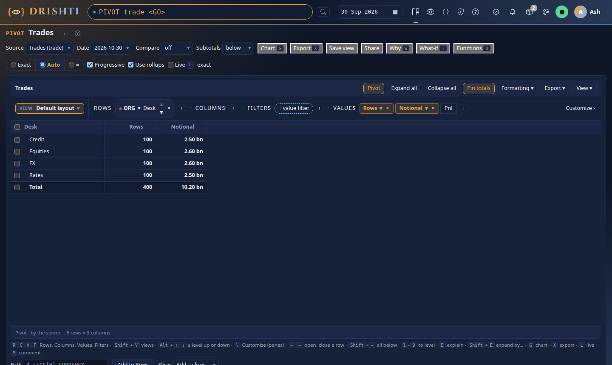

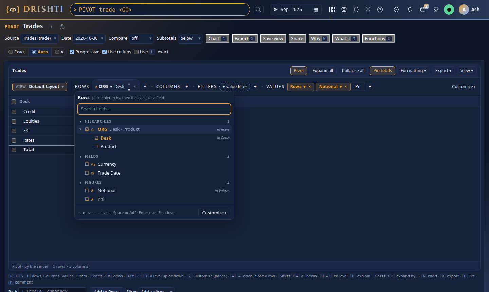

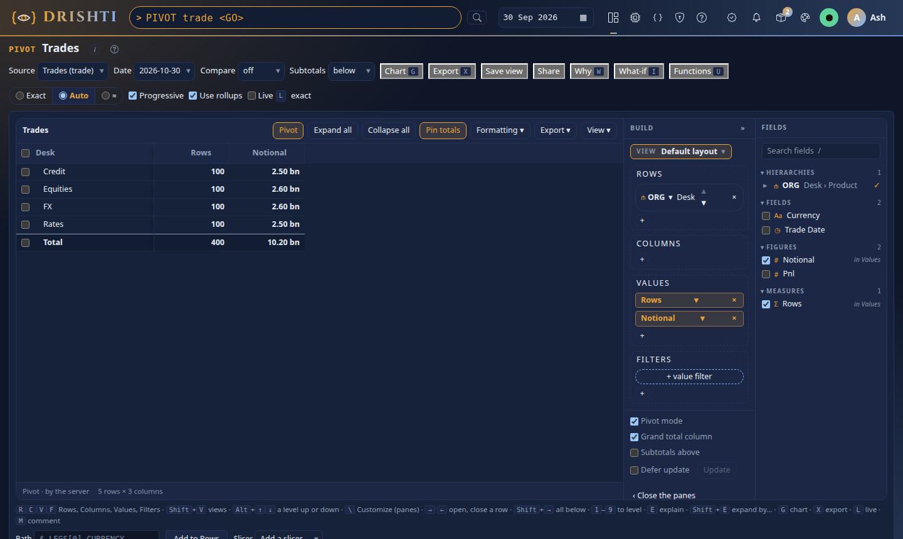

### P3. Sources and fields

| Source | What it is | Its fields | Its measures |
|---|---|---|---|
| A table (`trade`, `position`, any stored kind) | Export data's table, read for you through its connector on the date | its columns, typed from the data contract (`string`, `date`, `number`) | the built-in functions over any field |
| `var` | the VaR engine's book of the date | the positions' text columns (DESK, CURRENCY, PRODUCT_GROUP …) | `var()`, `es()`, `pv()`, `trades()` |
| `panel/<kind>/<panel>/<id>` | a table's or ladder's rows on its page: the same document, Sutra and business date | the fields of its Sutra's `pivot:` (masked ones left out) | the built-in functions |
| `table:<domain>.<name>` | a virtual table ([Part 2 · Virtual tables and models](#part-2--virtual-tables-and-models)) read for you on the date: its source as you may see it, then the table's rules, masks and hidden columns | its columns, typed by the table (`integer` and `decimal` as `number`, `date` and `timestamp` as `date`); a column masked for you is left out | the built-in functions |

A virtual table is read through the layer and staged in the engine's in-memory DuckDB like a panel's rows, at most
`drishti.tables.read-max-rows` rows (more is refused, never cut short); its date picker offers its source's dates. What was staged is
kept while nothing it was read from changed (the table's definition, the date, the source kind's data version, and who reads: user, roles,
attributes, raw): a view opened again then reads nothing. A source that keeps no data version is read on every open.

**Rows held in memory.** Two components pivot rows they already hold, and both ask the engine rather than add up a figure: a Sutra's
`pivot` panel (its document's rows, grouped by `by` and `across` with the panel's `agg`; ChartBinder hands them to the engine's in-memory
provider) and *Chart any table* on the shown rows (the page sends only the chart's fields to `POST /api/v1/pivot/inline`, at most 100,000
rows). The in-memory provider makes every state with the same built-in functions as the tabular provider, so the figures are equal.

A date field groups as `TRADE_DATE:day`, `:week`, `:month`, `:quarter` or `:year`; a number as `NOTIONAL_USD:width=1000000` (buckets of a
width, labelled by their lower edge). A missing value is the member `(blank)`.

How a table is read, chosen per table:

| Route | When | How |
|---|---|---|
| **Direct lake** | the kind's one source is a Delta or Iceberg table on a local disk, a snapshot table (one partition holds the date), without deletion vectors or delete files, and every field you may use is a column it keeps | DuckDB reads the date's Parquet files itself: only the columns a statement uses (column pruning), the filters repeated on the raw columns so row groups and files are skipped by their statistics; masked columns are never named, so never read; no staging cap |
| **Staged** | any other table (a document store, an object store, masks that also change values inside other fields, memory-only data) | read once per date, data version and mask signature through Export data's own read and kept in the engine's in-memory DuckDB (`drishti.pivot.stage-keep` tables); over `drishti.pivot.stage-max-rows` rows refused in words, never cut short |

Memory-only data is never written: the executor has no spill folder unless `drishti.pivot.duckdb.temp-directory` names one. The estimate
of a lake table comes from its metadata (the files' bytes, the manifests' or add-actions' row counts); nothing is read.

#### Currencies and units

A field has a **unit**: an `amount` of the data contract is **money** in the currency of the row's currency field (`CURRENCY`, `CCY`,
`*_CCY`); a `rate` or a name ending `_PCT` is never summed (a sum of it is refused, with `avg` or `wavg` offered). A money total over
several currencies is **never added raw**: such a cell shows no figure and says *mixed currencies (EUR to USD)*; a cell in one currency
shows its figure and its currency. To add them, convert in the view:

```json
"currency": {"report": "USD", "rates": {"EUR": 1.08, "GBP": 1.27, "JPY": 0.0066}, "source": "ECB close 2026-10-30"}
```

Every money figure is then in USD (each row converted at its currency's rate before any aggregation; a row in a currency without a rate is
left out), the measures' unit says USD, and the provenance names the rates and their source. Counts stay counts.

#### Documents: paths, lists and grains

An entity of the lake is a **document**: a trade keeps its whole source record (JSON) beside a few promoted columns, and that record holds
nested parts. A Calypso, Endur or Murex trade of the demo has `LEGS` (a list: each leg has `LEG_ID`, `LEG_TYPE`, `CURRENCY`, `NOTIONAL`, an
`INDEX` object and a list of `CASH_FLOWS`) and `EVENTS` (a list: each event has `EVENT_TYPE`, `EVENT_DATE`, `AMOUNT`). Every part of it can
be pivoted.

**A field is a Rachana path**, written as a Sutra binds it and as a BI dataset column's `path:` names it:

| Path | Means | One row per |
|---|---|---|
| `$.PRODUCT_TYPE` | a field of the trade | trade |
| `$.LEGS[0].CURRENCY` | the first leg's currency | trade |
| `$.LEGS[?@.LEG_TYPE == 'FLOAT'][0].INDEX.NAME` | the floating leg's index, wherever the leg sits | trade |
| `size($.LEGS)` | how many legs the trade has | trade |
| `$.LEGS[*].NOTIONAL` | every leg's notional | **leg** (the `[*]` makes the grain) |
| `$.LEGS[?@.LEG_TYPE == 'FIXED'][*].NOTIONAL` | the fixed legs' notionals | leg |
| `$.LEGS[*].CASH_FLOWS[*].AMOUNT` | every cash flow of every leg | **cash flow** |
| `$.EVENTS[*].EVENT_TYPE` | every event's type | **event** |

The field list shows them grouped by what they count: the trade's own fields first, then *Each leg (one row per leg)*, *Each cash flow*,
*Each event*, each field under its readable name (*Legs › Notional*, *Legs › Index › Name*). Type a path into the field search box and it is
offered as *Your path*, to drag to a zone like any field. The same paths work in a saved view, on the command line and in the API; the
answer names each field by its id (`LEGS.NOTIONAL`).

**The rules, so a figure is never counted twice:**

1. **One grain per view: the finest list its rows, columns and values use.** Rows *Desk* and values *Sum of Legs › Notional* aggregate one
   row per leg.
2. **A coarser figure in a finer view counts each parent once.** *Sum of Quantity* (a trade field) in a leg view adds each trade's quantity
   once in each cell, never once per leg: a trade with three legs adds its quantity once.
3. **Two separate lists are never crossed.** Legs and events of the same trade are independent lists; a view that would put a leg field and
   an event field on the same rows is refused with the reason (three legs and four events would make twelve rows). Look at them side by side
   as two views.
4. **A filter on a list keeps the parents with any element matching.** *Legs › Currency = JPY* on a trade view keeps the trades with a JPY
   leg; on a leg view it keeps the JPY legs. Add `~all` to the filter's field (`$.LEGS[*].CURRENCY~all`) to keep the trades whose legs
   **all** match.
5. **Masks apply per path:** a field hidden for you is not offered at any depth, and the record you read is the one your masks leave.

**How a path is read**, chosen per view, fastest first (the cell's provenance names the route):

| Route | When | What is read |
|---|---|---|
| **Promoted column** | the path names a field the connector promotes (`layout.<kind>.columns`) | that typed column |
| **BI dataset** | every list field the view uses is a column of a published BI dataset table over that list (`source: {kind: trade, each: LEGS}`), and nothing is masked for you | that table's cached layer (Parquet, one row per element) |
| **Ad hoc** | anything else | each document of the date, by DuckDB's JSON functions; the scan estimate says the cost first, and a kind past `drishti.pivot.stage-max-rows` documents is refused with the cheaper route named |

An administrator sees, under the field list, the paths people typed most on that source, with **Promote** (the connector's page: add the
field to its `layout.<kind>.columns`) and **Add to dataset** (the BI dataset editor: a `path:` column). Both make the path a column read.
`GET /api/v1/pivot/paths?source=trade` lists them.

##### Worked examples on the demo lake

Each view below was run on the demo lake (`drishti.py lake demo`, the trades of the three source systems, business date 2026-09-30); the
figures are the ones the run returned. Each is saved as a view, so it opens with `PIVOT @<you>/<name> <GO>`.

**1. Notional by desk and year: one row per leg.** Rows `$.TT_GROUP` (the desk), columns `$.TRADE_DATE` by year, values the sum of
`$.LEGS[*].NOTIONAL`. The view reads 20,422 legs of 15,000 trades; the grand total is **6019.12 bn**, DESK-RATES the largest desk at
**2188.84 bn** (2024: 220.12 bn, 2025: 376.54 bn, 2026: 1592.18 bn). The first row has no desk: the trades whose source sets no `TT_GROUP`
(1086.30 bn).

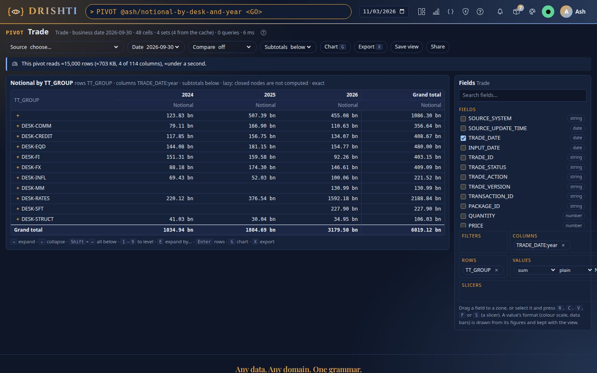

```
drishti.py pivot run --source trade --rows '$.TT_GROUP' --cols '$.TRADE_DATE:year' --values 'sum($.LEGS[*].NOTIONAL)'
```

```yaml
source: trade
rows: [$.TT_GROUP]
columns: [$.TRADE_DATE:year]
values:
  - {measure: sum($.LEGS[*].NOTIONAL), as: Notional}
```

**2. How many trades have a JPY leg, by product: one row per trade, a filter on a list.** Rows `$.PRODUCT_TYPE`, value `count()`, filter
`$.LEGS[*].CURRENCY` in JPY. **1,383** of the 15,000 trades have at least one JPY leg, across 69 product types; the most are FX_ACCUMULATOR (68),
FIRST_TO_DEFAULT (64), INFL_ASSET_SWAP (55) and FX_BARRIER (51).

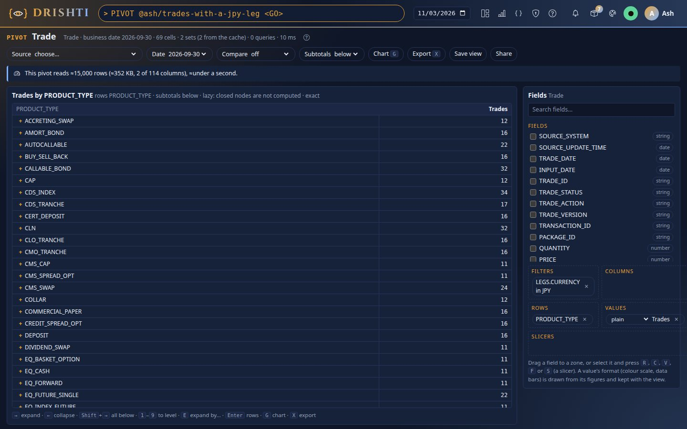

```
drishti.py pivot run --source trade --rows '$.PRODUCT_TYPE' --values 'count()' --filter '$.LEGS[*].CURRENCY=JPY'
```

```yaml
source: trade
rows: [$.PRODUCT_TYPE]
filters: {$.LEGS[*].CURRENCY: {in: [JPY]}}
values:
  - {measure: count(), as: Trades}
```

**3. Fixed against floating legs per counterparty: a list field on the columns.** Rows `$.COUNTERPARTY` (the top 8, the other 16 in
*Others*), columns `$.LEGS[*].LEG_TYPE`, values the count of legs and the sum of their notional. Of 20,422 legs, 9,604 are FIXED
(2259.03 bn), 6,606 FLOAT (2762.22 bn), 3,358 OPTION (945.21 bn) and 854 PHYSICAL (52.66 bn); CP-NORTHPLAINS has the most legs (2,844).

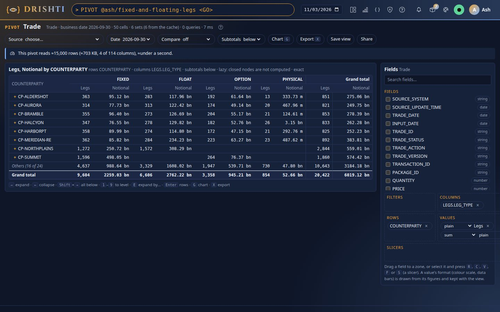

```
drishti.py pivot run --source trade --rows '$.COUNTERPARTY' --cols '$.LEGS[*].LEG_TYPE' --top '$.COUNTERPARTY=8' \
  --values 'count()' --values 'sum($.LEGS[*].NOTIONAL)'
```

```yaml
source: trade
rows: [$.COUNTERPARTY]
columns: [$.LEGS[*].LEG_TYPE]
top: {$.COUNTERPARTY: {n: 8}}
values:
  - {measure: count(), as: Legs}
  - {measure: sum($.LEGS[*].NOTIONAL), as: Notional}
```

**4. Quantity per desk without double counting: a trade figure in a leg view.** Rows `$.TT_GROUP`, filter `$.CURRENCY` in USD (a quantity
is an amount in its trade's currency; one currency adds up), values the sum of `$.QUANTITY` and the count of `$.LEGS[*].LEG_ID`. The legs
make the grain (12,230 USD legs), and each trade's quantity is added once: the total, **1,120,878,590,423.65**, is exactly the sum over the
8,562 USD trades at the trade grain. DESK-COMM: 197,072,225,509.30 over 1,320 legs of 990 trades; DESK-RATES: 172,787,316,965.74 over 882
legs of 541 trades.

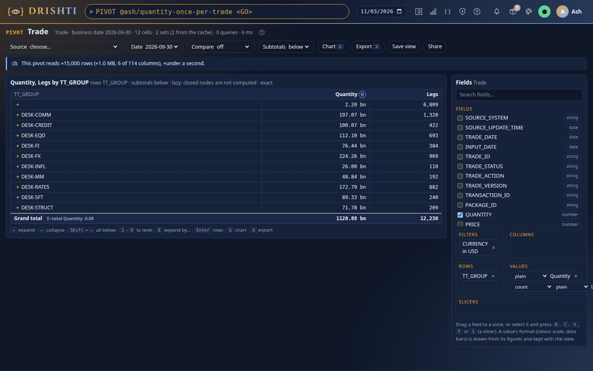

```
drishti.py pivot run --source trade --rows '$.TT_GROUP' --filter '$.CURRENCY=USD' --values 'sum($.QUANTITY)' --values 'count($.LEGS[*].LEG_ID)'
```

```yaml
source: trade
rows: [$.TT_GROUP]
filters: {$.CURRENCY: {in: [USD]}}
values:
  - {measure: sum($.QUANTITY), as: Quantity}
  - {measure: count($.LEGS[*].LEG_ID), as: Legs}
```

**5. Booking events by type and year: one row per event.** Rows `$.EVENTS[*].EVENT_TYPE`, columns `$.EVENTS[*].EVENT_DATE` by year, value
`count()`: **157,087** events. BOOKED and CONFIRMED have 10,000 each (2024: 2,659, 2025: 3,322, 2026: 4,019); the cash settlements run to
2059; 1,887 events have no type and no date (*(blank)*).

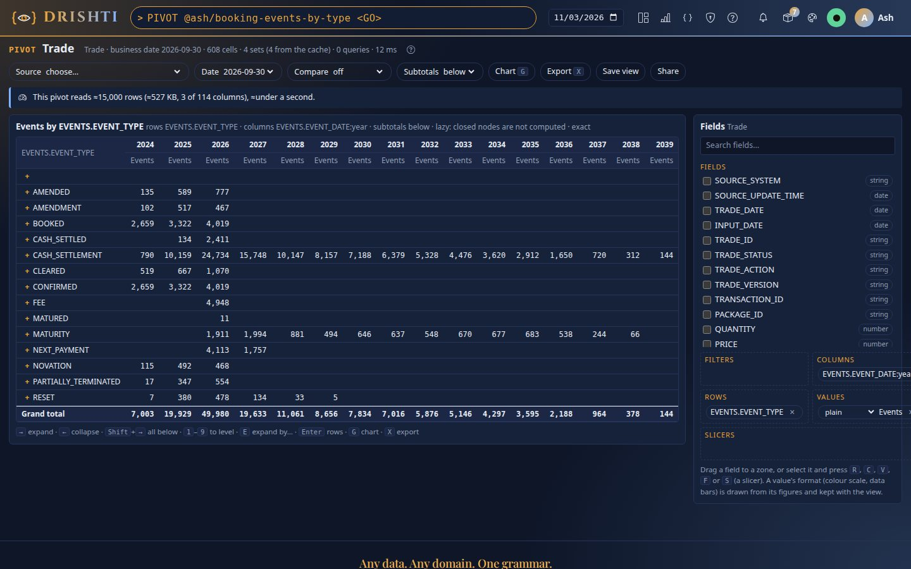

```
drishti.py pivot run --source trade --rows '$.EVENTS[*].EVENT_TYPE' --cols '$.EVENTS[*].EVENT_DATE:year' --values 'count()'
```

```yaml
source: trade
rows: [$.EVENTS[*].EVENT_TYPE]
columns: [$.EVENTS[*].EVENT_DATE:year]
values:
  - {measure: count(), as: Events}
```

**6. VaR beside the notional: two sources, each exact.** VaR is not a sum of trades, so it comes from the VaR source, not from the trade
documents: rows `DESK`, values `var()` and `es()`. The bank's VaR is **112,041,645.93** (ES 160,143,809.24); DESK-CREDIT
130,670,864.00 and DESK-RATES 74,633,680.00 add up, with the others, to more than the bank: the diversification. Put it beside example 1 to
read a desk's VaR against its legs' notional.


```
drishti.py pivot run --source var --rows DESK --values 'var()' --values 'es()'
```

```yaml
source: var
rows: [DESK]
values:
  - {measure: var(), as: VaR}
  - {measure: es(), as: ES}
```

Two views that would cross lists are refused rather than answered: rows `$.LEGS[*].CURRENCY` and columns `$.EVENTS[*].EVENT_TYPE` answers
*Legs and Events are separate lists of each trade: a view that crossed them would count every pair … Pick one, or compare them side by side
as two views.*

### P4. Measures and how each total is made

**A cell or a total is made from its members, never from other cells' figures.** What differs by kind is how:

| Function | Kind | A total is | In Excel |
|---|---|---|---|
| `sum(x)` | mergeable | the sum of its own rows (compensated) | `SUM` of its parts |
| `count()`, `count(x)` | mergeable | the rows (or values) of its own rows | `SUM` of its parts |
| `avg(x)` | mergeable | Σx / n of its own rows, never an average of averages | value |
| `min(x)`, `max(x)` | mergeable | the extreme of its own rows | value |
| `wavg(x, w)` | mergeable | Σwx / Σw of its own rows | value |
| `var_samp(x)`, `var_pop(x)`, `stddev_samp(x)`, `stddev_pop(x)` | mergeable | Welford's state of its own rows | value |
| `median(x)`, `percentile(x, q)` | holistic, exact; ≈ by its sketch (KLL, ±1.65% of rank) when asked or large | exact: the quantile of its own values (linear interpolation, as DuckDB's `quantile_cont`); ≈: the merge of its cells' KLL summaries | value |
| `distinct(x)` (also written `count_distinct(x)`) | holistic, exact; ≈ by its sketch (HyperLogLog, ±1.6%) when asked or large | exact: the distinct values of its own rows; ≈: the merge of its cells' registers | value |
| `var()`, `es()` (source `var`) | holistic | the VaR engine's answer for the cell's own scope, from its trades' summed scenario vector | value |
| `pv()`, `trades()` (source `var`) | holistic (adds up) | the engine's answer for the cell's scope | value |

So the desks' VaRs add up to more than the bank's: the grand total is the bank's own VaR, and the gap (Σ children − total) is shown beside
every open node's total as **Σ−total**, the diversification. A function has one name ([RACHANA_REFERENCE.md](RACHANA_REFERENCE.md#the-function-catalogue));
its sketch is how it is computed when ≈ is accepted, with a stated error, never a second name, and never for VaR
([section 23](#p23-scale-sketches-rollups-progressive-answers-and-the-cluster)); custom functions are in [section 19](#p19-custom-functions).

Show values as: a value may carry `showAs` (`pct-grand`, `pct-row`, `pct-column`, `pct-parent-row`, `rank`, `ntile:<n>`,
`diff:<n>:<dimension>`, `pct-change:<n>:<dimension>`); it is computed from the finished figures, so a total is never broken. The same
is written as a function around the aggregate, which is how the catalogue names it: `pct_of_total(sum(NOTIONAL))`,
`pct_of_row(...)`, `pct_of_column(...)`, `pct_of_parent(...)` (the level above on the rows), `ntile(sum(NOTIONAL), 4)` (the bucket
among the siblings), `diff(sum(PNL), 1, TRADE_DATE:month)` and `pct_change(sum(PNL), 1, TRADE_DATE:month)` (along a dimension on the
rows or the columns). The column header is the text as written; the raw figure stays in the answer beside the shown one. The statistics
(`skewness`, `kurtosis`, `corr`, `slope`, `iqr`, `trimmean`, `mode`, `string_agg` …) are ordinary values:
[RACHANA_REFERENCE.md](RACHANA_REFERENCE.md#every-function-generated-from-the-registries).

#### Choosing a function in the screen

A value's **▾** (on the line, or on its chip in Build) offers, in plain words, **only the functions valid for its field**, as the source's
catalogue says them (`GET /api/v1/pivot/catalogue`: each field's `functions`):

| Field | Offered | Shown off, with the reason |
|---|---|---|
| a number (money, a count) | Sum, Count, Distinct count, Average, Weighted average…, Min, Max, Median, Percentile…, Variance, Std dev | none |
| a rate or a percentage (`unit: rate`, `pct`) | the same without Sum | **Sum**: "a rate is never summed (an average or a weighted average is)" |
| a text, a date, a hierarchy level | Count, Distinct count | **Sum**: "not a number: count it, or count its distinct values" |
| a measure computed per cell (VaR, ES, Comp VaR, Limit use…) | no function: the menu says *computed per cell by the VaR engine from the cell's own trades; a total is never a sum of the cells (Σ − total = the diversification)* and offers the VaR options instead (horizon, confidence, scenario set: the view's options) | every function |

**Weighted average…** asks for its weight (another number field: `wavg(PV, NOTIONAL)`); **Percentile…** for its quantile (p50, p90, p95,
p99 or one typed: `percentile(PV, 0.99)`). **Custom ƒ…** opens the Rachana formula editor (a formula, `sum(PV) / sum(NOTIONAL)`, or a
custom function, `wret(RET, W)`); the server checks it before it is used and says why when it cannot. The custom functions you may use
([section 19](#p19-custom-functions)) are listed as **ƒ name**. **Add another value of PV** puts the same field in Values again with
another function, so Sum of PV and Count of PV stand side by side.

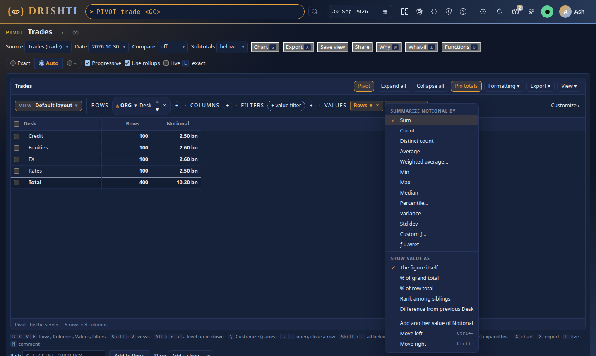

**Show value as** offers the forms the engine computes (the catalogue's `showAs`), and only those: % of grand total, % of row total, % of
column total, % of parent row, Rank among siblings, Quartile among siblings, and, for each field on the rows or columns, *Difference from
previous* and *% change vs previous* (`diff:1:<field>`, `pct-change:1:<field>`). A share of a measure that does not add up (VaR) is shown off,
with the reason. Running totals are not a form of the engine and are not offered. The figure is computed by the server from the finished
figures; the raw figure stays in the answer.

### P5. Nested rows, opened lazily

Rows are levels. Only level one is computed at first; opening a member computes **its children only**: one statement for that node's
children and their columns, every other cell read from the partial-state cache. A ten-level hierarchy over a big table opens as fast as one
level. The answer says what it did: "18 cells · 6 sets (4 from the cache) · 1 queries".

- **+** opens a member by the next row field; a member on the last row level is a leaf and has no **+**.
- **Expand by…** (`E`): open any member by a field other than the next row field, per member: EMEA by desk, APAC by currency, in one grid,
  a leaf included. The totals stay right: each node is its own cell key.
- **Open to level N** (`1`–`9`): every member down to level N.
- The open nodes are part of the view (its `expanded` list), so a saved view and a link reopen them.

**Names on the rows.** A source can name its members: the VaR source shows the desk, book or legal entity's name, as the VaR tree does, and the row's tooltip
keeps the id. Keys, paths, filters and figures use the id. A member with no name shows its id. In the answer, a named row has a `name` next to its `value`.

### P6. Top N, Others and sorting

A level may show its top N members by a measure and one **Others** member: "Others (3 of 5)". Others' figures are computed from **its own
members** (the rows of the members not shown), for every measure: a median of Others is the median of those rows, never total minus the
top N. Others is not opened further (its rows can be exported).

**Top N when you ask ≈.** With the screen's **≈** switch on (or `"exact": false`), a level whose top N is ranked by a count of rows
(`count()`, or `count(x)` of the level's own field) and whose field is plain text is chosen **before** the level is read: one Space-Saving
summary of the field (10·n counters) is made for the parent's cell, the members it ranks first are the level, and only their cells are
read. The figures shown are exact, each from its own rows; only the choice of members is ≈, within a stated bound: every count the summary
keeps is over by at most its floor, and a member holding more than 1/(10·n) of the rows is always listed. Others then reads "Others (≈: the
rest after a top N chosen by a summary)" and its figures are still its own members' exactly. A top N ranked by anything else (a sum, an
average, a VaR), a grouped date or number bins, and every view not asking ≈ rank every member exactly; the answer's notes say which.
Use it for a level with very many members (counterparties, instruments) where reading every member's cell would be the cost.

Each level sorts on its own: by label in the field's type order (numbers by value, dates by time, text alphabetically, `(blank)` last),
or by a measure, ascending or descending. A sort never moves a child out of its parent.

### P7. Provenance, rows and cell references

Every answer has a provenance id (`pv:<date>:<hash>`); every cell's provenance (members, condition or scope, the measures' kinds, the data
version, filters, statements run, cache hits, time) is kept for the last `drishti.pivot.provenance-kept` answers.

**Rows** lists a cell's member rows, paged, as you may see them (the VaR source's rows are its trades: open the cell's scope in VAR).

A **cell reference** names a cell of a saved view by its coordinates, not its position: `pivot://asha/desk-risk@4/Notional[DESK=RATES-NY,
CCY=USD]`. It survives re-sorting, new columns and a new date; a coordinate that is gone says "not in the view", never 0. Copy it from the
popover; resolve it with `GET /api/v1/pivot/cells?ref=...`. In a Sutra, Rachana reads the same cell: `cell('asha/desk-risk', 'DESK',
'RATES-NY', 'CCY', 'USD')`, and a compute engine's measure for one scope: `measure('VAR', 'DESK:RATES-NY')`, both answered by this
engine for the person viewing ([RACHANA_REFERENCE.md](RACHANA_REFERENCE.md#functions)).

### P8. The scan estimate, budgets and busy protection

Before a view runs, the screen shows what it will read. Over `drishti.pivot.estimate.confirm-above-seconds` (60) or `confirm-above-rows`
(500 million), it asks first. A table not yet read for you has an unknown size until its first pivot.

- **Cell budget**: a view of more visible cells than `drishti.pivot.max-cells` (20,000, totals included; `max-holistic-cells`, 5,000,
  with a holistic measure) is refused with the count and how to narrow it (`422 DRS-5702`), never cut short.
- **Busy protection**: a view of more than `drishti.pivot.busy-cells` cells asks the admission gate before it opens deeper levels; a
  refusal is `503 DRS-9507` with `Retry-After`.

### P9. Charts of a selection

Select cells (click, Shift+click or Shift+arrows) and press `G`. With nothing selected the chart shows the top level. A measure that adds up
(sum, count) is drawn as bars that sum to the total. **A measure that does not add up is never stacked**: VaR by desk is drawn as the desks'
bars beside the bank's, with the diversification as its own bar, and the chart says so in words. The diversification is the engine's
own gap of the charted column (each open row's `diversificationByColumn` in the answer, Σ parts − total; drawn as total − Σ parts): the
browser adds up nothing. The gap is given only when the row's total and every one of its parts have the figure; when one has none (a
measure computed for a view's first cells only, such as the MR cube's stressed VaR and SBM, or a hidden cell) it is `null` and no bar is
drawn: never a sum of some of the parts. Which cells get such a capped measure is fixed by the view: its first N cells in the grid's
order, row by row as shown, each row's columns left to right ([section 29.2](#p292-the-measures) section 2). A bar's click opens that member in the
grid. ECharts is vendored; nothing comes from a CDN.

### P10. Export

**Export** (`X`) asks what and how:

| What | Contents |
|---|---|
| The pivot as shown | Excel: one sheet with the rows as shown, numbers as numbers, Excel's own row **outline levels** (grouping with + and −, summaries below or above as on screen); a **`SUM` formula only where a measure's total is the plain sum of its parts** (sum, count), every other figure the engine's value; a **Provenance** sheet (who, when, the provenance id, the data, the filters, every measure's function, kind, exactness and how its totals are made). CSV: one row per cell and measure (`ROW, COLUMN, <dimensions>, MEASURE, VALUE, EXACT, MEMBERS, KIND`) or the grid as shown. Arrow: the cells as a columnar stream |
| The underlying rows | the selected cell's member rows as CSV, as you may see them (up to `drishti.pivot.export.rows-max`) |
| The definition | the view as YAML, no figures |

**JSON Lines** (the data standard) writes one object a cell and measure (`row`, `column`, `coords` by dimension, `measure`, `value` as a number, `exact`, `members`, `kind`), and the rows of a cell one object a row. An xlsx of more rows than `drishti.pivot.export.xlsx-max-rows` is refused with CSV or Arrow offered. Every export is audited (who, the view,
what, the format, the size), never its values.

### P11. Saved and shared views, compare

**Save view** keeps the definition (never the numbers) under your name, each save a new version; **Share** adds people or roles
(`role:risk`). A reader opens a shared view with their own entitlements and masks. `PIVOT @owner/name <GO>` opens one.

**The View picker** (`Shift+V`, the **VIEW** chip in front of the line) lists three kinds of view, with no store of its own:

| Group | What | From |
|---|---|---|
| Ready-made (keys `1`–`9`) | the preset's layouts: the MR cube's *By risk class × desk* (its landing), *By desk*, *By book*, *By limit letter*, *Top contributors*, *Trades in my scope*; a source without a preset offers its *Default layout* | `views:` of the preset in `drishti-console/config/pivot-presets.yaml`; a view naming a field the source does not have (a hierarchy not configured) is left out |
| My views | your saved views of this source | the saved views above |
| Shared with me | the views others shared with you or your roles | the same |

**Save view as…** names the layout (letters, digits and dashes are kept: *Desk morning* is saved as `desk-morning`) and saves it
**Personal** or **Shared** (with people, or `role:risk`), `Ctrl+S`. A ready-made view is laid over the landing: the scope, the date and the
lens's options you chose stay. When the layout changes after a view was opened, its chip shows a dot and the picker offers **Revert**.

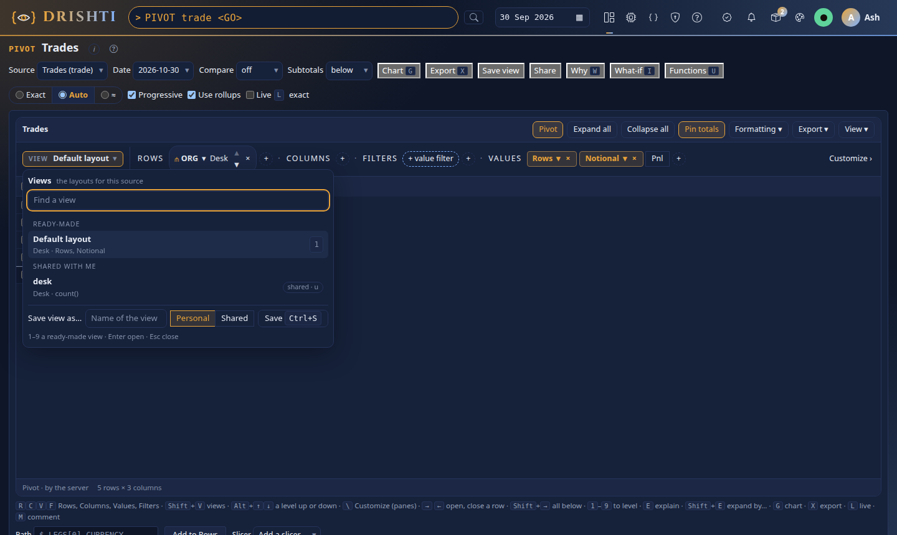

A preset names the ready-made views and, with `view:`, the one it opens with:

```yaml
presets:
  mr:
    mode: views                      # views (the default), compact or panes
    view: by-desk                    # optional: the ready-made view it opens with (default: the source's landing)
    views:
      - id: by-book
        name: By book
        detail: MGMT Desk › Book · VaR, ES, Limit use
        rows: [MGMT.DESK, MGMT.BOOK]
        values: [{measure: "var()", as: VaR}, {measure: "es()", as: ES}, {measure: "limit_use()", as: Limit use}]
        expandTo: {rows: 2, columns: 1}
```

On a page's table, an author may **promote** the view to the Sutra (`POST /api/v1/pivot/promote` `{"sutra", "view", "note", "preview"}`):
the Sutra's next version with the panel's `pivot:` arrangement, through review when review is on; a view the arrangement cannot say (a
grouped date, a median, a filter that leaves values out) is refused in words and stays a saved view
([RACHANA_REFERENCE.md](RACHANA_REFERENCE.md#pivot-pivot-on-a-table-or-ladder)).

**Compare** picks another date: each cell shows its change (▲/▼) and new or gone cells are marked; the API answers both sides and the
differences.

**Versions.** Every save of a view is kept: `GET /api/v1/pivot/views/{owner}/{name}/versions` lists them, `/diff?from=1&to=2` says what
changed in the definition (rows, columns, values, filters, open nodes, sorts, top N, date) and `POST /api/v1/pivot/views/{name}/restore`
with `{"version": 1}` saves an old one again as the next version (the versions between stay). A view keeps its definition, never numbers.
Comments on its cells are kept beside its versions ([section 26](#p26-cell-comments)).

### P12. Who sees what

- A table is read through Export data's own read for you: a table you may not open is not offered; a **masked column is not read at
  all**, so it cannot be a dimension, a measure's input or a filter (`403 DRS-5705`).
- The VaR source applies the VaR engine's own entitlements: trades you may not see are left out of every cell; a role that sees the bank only
  in aggregate is offered no dimension unless the MR cube runs, which offers it the hierarchy levels ([section 29.4](#p294-the-view-dimensions-options-cells-and-totals)).
- `drishti.pivot.aggregate-only.min-members-per-cell` (1 as shipped) hides the figures of a cell with fewer members.
- Every view run, rows read and export is audited without values.

### P13. The view as JSON

```json
{ "source": "trade", "date": "2026-10-30",
  "rows": ["LEGAL_ENTITY", "DESK"], "columns": ["TRADE_DATE:month"],
  "values": [{"measure": "sum(NOTIONAL_USD)", "as": "Notional"}, {"measure": "median(PNL_1D)", "as": "Median P&L"}],
  "filters": {"PRODUCT_GROUP": {"in": ["RATES", "FX"]}, "TRADE_STATUS": {"notIn": ["MATURED"]}},
  "expanded": [{"axis": "rows", "path": [["LEGAL_ENTITY", "LE-UK"]], "by": "CURRENCY"}],
  "expandTo": {"rows": 1}, "sort": {"DESK": {"by": "Notional", "desc": true}},
  "top": {"DESK": {"n": 10, "by": "Notional"}}, "subtotals": "below" }
```

The answer has `rows` and `columns` in display order (each with `key`, `kind` node, header, total, others or grand, `depth`, `label`,
`path`, `expandable`, `expanded`, `by`, and `diversification` on a holistic total), `cells` keyed `rowKey|colKey` (each with `values`,
`members`, `coords`, `notes` where a figure is missing, `scope` on the VaR source), `measures` (id, label, kind, plainSum, exact),
`computed` (sets, fromCache, queries, ms), `provenance` and `provenanceShared`.

### P14. The API

| Call | Does |
|---|---|
| `GET /api/v1/pivot/sources` | the sources you may pivot |
| `GET /api/v1/pivot/catalogue?source=&date=` | a source's fields, measures, functions, dates, masked count; for the pickers each field's `group` (hierarchy, field, measure), `folder`, `hidden` (More fields), `hierarchy` and `functions` (those valid for it), each measure's `folder` and `perCell`, the source's `hierarchies` (`{id, title, levels: [{field, label}], columns}`) and `showAs` (the forms the engine computes) |
| `POST /api/v1/pivot/query` | a view (or `{"view": "owner/name"}`) → its answer |
| `POST /api/v1/pivot/estimate` | the scan estimate; nothing read |
| `POST /api/v1/pivot/expand` | `{view, axis, path, by}`: the view with that node open; only its children computed |
| `POST /api/v1/pivot/compare` | `{view, otherDate}`: both answers and the differences per cell |
| `POST /api/v1/pivot/rows` | `{view, coords, offset, limit}`: a cell's member rows |
| `POST /api/v1/pivot/inline` | `{fields: [{name, type}], rows: [[…]], view}`: rows the caller already holds (at most 100,000; field names of letters, digits and `_`; type `string`, `number` or `date`), aggregated by the engine; the view's `source` is ignored |
| `GET /api/v1/pivot/cells?ref=` | a cell by reference |
| `GET /api/v1/pivot/provenance/{id}?cell=rowKey|colKey` | an answer's or a cell's provenance |
| `GET, POST /api/v1/pivot/views`, `GET /views/{owner}/{name}`, `DELETE /views/{name}` | saved views |
| `POST /api/v1/pivot/promote` | a page table's view as its Sutra's `pivot:` arrangement (an author; `preview: true` shows the next version) |
| `POST /api/v1/pivot/export` | `{view, what: pivot|rows|definition, format: xlsx|csv|jsonl|arrow, shape: cells|grid, delimiter, bom, coords}`, streamed |
| `GET /api/v1/pivot/functions`, `GET /functions/{owner}/{name}?version=` | custom functions you may use (section 19) |
| `POST /api/v1/pivot/functions/test` | a definition and sample rows: the harness and the playground; nothing saved |
| `POST /api/v1/pivot/functions` | save a new version after its harness passes |
| `POST /api/v1/pivot/functions/{owner}/{name}@{v}/submit`, `/approve`, `/revoke` | sharing: approval by someone who is not the author, withdrawal |
| `POST /api/v1/explain` `{kind: pivot, measure: cell, view, from, to, fromDate, toDate, by, order, price, quantity}` | the one Explain of a cell: the difference in steps that add up (section 20); `POST /api/v1/pivot/explain` is its deprecated alias for one release |
| `POST /api/v1/pivot/whatif` | `{view, whatIf: {exclude, changes, add}}`: the view with the overlay beside the original (section 21) |
| `GET /api/v1/pivot/views/{owner}/{name}/versions`, `/versions/{n}`, `/diff?from=&to=`; `POST /views/{name}/restore` `{version}` | a saved view's versions (every save kept), one version, what changed between two, an old one restored as the next version |
| `POST /api/v1/pivot/query` with `"exact": true` or `false` | exact on request, or ≈ by the sketches at any size ([section 23.1](#p231-sketches-with-a-stated-error-and-exact-on-request)) |
| `POST /api/v1/pivot/query?progressive=true` | server-sent events: `approximate` (from a sample, with intervals) then `exact` |
| `GET, POST /api/v1/pivot/rollups`, `DELETE /rollups/{id}`, `POST /rollups/{id}/refresh` | rollups: list with advice; define, remove, refresh (administrators) |
| `POST /api/v1/pivot/query` with `"rollups": false`, `"progressive": false` | the screen's switches as options: no rollup answers, no ≈ first answer; every answer's `computedAs` says what was asked and what answered ([section 24](#p24-the-screens-switches-exact-or--progressive-rollups)) |
| `POST /api/v1/pivot/live`, `GET /live`, `GET /live/{id}/events`, `DELETE /live/{id}` | a live pivot: started (its first answer, id and node), listed, streamed (`answer`, `patch`, `reshape`, `status`), ended ([section 25](#p25-live-pivots)) |
| `GET, POST /api/v1/pivot/views/{owner}/{name}/comments`, `POST /comments/{id}/resolve`, `/reopen`, `DELETE /comments/{id}` | a saved view's cell comments ([section 26](#p26-cell-comments)) |

Details and the error codes: [API_REFERENCE.md, Pivot engine](API_REFERENCE.md#23-pivot-engine-apiv1pivot).

### P15. The command line

```
drishti.py pivot sources
drishti.py pivot fields trade
drishti.py pivot run --source trade --rows productType,counterparty --values "count()" --values "sum(notional)" --open productType=IRS
drishti.py pivot run --source var --rows DESK --cols CURRENCY --values "var()" --values "es()"
drishti.py pivot run --source trade --rows DESK --top DESK=5 --csv out.csv
drishti.py pivot estimate --view asha/desk-risk
drishti.py pivot export --view asha/desk-risk --format xlsx -o desk-risk.xlsx
drishti.py pivot save desk-risk --source var --rows DESK --values "var()" --share role:risk
drishti.py pivot views
drishti.py pivot functions test wret.yaml --sample rows.csv --group DESK
drishti.py pivot functions save wret.yaml --sample rows.csv
drishti.py approvals approve function asha:wret@1 --comment "reviewed" --param scope=group:rates
drishti.py pivot explain --view asha/desk-risk --cell DESK=EMEA --from 2026-09-30 --to 2026-10-30 --by BOOK
drishti.py pivot whatif --view asha/desk-risk --scale PRICE=1.1@DESK=RATES --exclude BOOK=B-17
```

More in [CLI_REFERENCE.md](CLI_REFERENCE.md#pivot-the-pivot-engine).

### P16. Settings

All under `drishti.pivot` in `config/engines/pivot.yaml` (the switch `drishti.engines.pivot.enabled` there too), listed in [CONFIGURATION.md](../admin/CONFIGURATION.md): `enabled`, `max-cells`,
`max-holistic-cells`, `busy-cells`, `cache-mb` (the partial-state cache `pivot.states`, in the one memory budget), `provenance-kept`,
`local-shards`, `stage-max-rows`, `stage-keep`, `duckdb.connections`, `duckdb.threads`, `duckdb.memory-limit-mb`, `duckdb.temp-directory`,
`estimate.confirm-above-seconds`, `estimate.confirm-above-rows`, `aggregate-only.min-members-per-cell`, `export.xlsx-max-rows`,
`export.rows-max`; custom functions under `functions` (`formula`, `sql-macros`, `require-approval`, `approver-role`,
`holistic-max-rows`, `holistic-max-mb`, `harness.tolerance`, `harness.seeds`, `harness.max-ns-per-row`, `python.enabled`,
`python.interpreter`, `python.workers`, `python.timeout-seconds`, `python.memory-mb`, `python.batch-rows`, `java.enabled`, `java.dir`);
the scale keys of [section 23.6](#p236-settings); and `drishti.admission.retry-after.pivot-view`.

### P17. Refusals and their codes

| Code | Status | When |
|---|---|---|
| DRS-5701 | 400 | a view it cannot answer: an unknown field or function, a field twice, a bad grouping, sort or show-as |
| DRS-5702 | 422 | over the cell budget (with the count), a table over `stage-max-rows`, an xlsx over `xlsx-max-rows` |
| DRS-1020 | 404 | the engine is switched off here (DRS-5703 when an edition has no PIVOT) |
| DRS-5704 | 404 | a saved view, provenance id or source that is not there (or not shared with you) |
| DRS-5705 | 403 | a masked field asked as a dimension, input or filter |
| DRS-5720 | 504 | a view computed across the cluster where a node's share had no answer by the deadline (no other node could answer it) |
| DRS-9507 | 503 | busy protection: a large view did not start; `Retry-After` |
| DRS-5710 | 400 | a custom function refused as written (its code, inputs, kind or name) |
| DRS-5711 | 422 | a custom function whose harness did not pass: not saved, with the first failure |
| DRS-5712 | 403 | approval: the author approving, someone who is not an approver, a function not approved for you, a plug-in jar changed since approval |
| DRS-5713 | 404 | a custom function's language is off here (Python and Java plug-ins as shipped) |
| DRS-5714 | 422 | a custom function past a limit: a state over its bound, a call over its time, every worker busy |
| DRS-5715 | 403 | a custom function in an official run, or an official measure's name |
| DRS-5716 | 400 | an explanation or a what-if it cannot make as asked |
| DRS-5721 | 422 | a live pivot refused or ended: live pivots off, your or the server's live views at their most, over the live cell budget, an exact live view over `drishti.pivot.live.max-rows`, a view pinned to a past version |
| DRS-5722 | 400 | a cell comment refused: empty or over 2,000 characters, a cell or measure not of the view, an Others cell, not the author's or the owner's to change |

### P18. How it is built

The engine is the Maven module `drishti-bicompute` (plain Java, no Spring): the pivot model (views, cell keys, nested axes), the provider
SPI (`PivotProvider`: catalogue, estimate, evaluate a plan of declarative cell sets into partial states, drill), the function SPI
(`AggFunction`: start, add a columnar batch, merge, finish; mergeable, sketch or holistic; each with its SQL state form), the built-ins,
the `GROUP BY GROUPING SETS` compiler and the DuckDB tabular provider, the in-memory provider (`RowsProvider`: rows held in memory, the
same states by the functions' own `add`), partial states merged in a fixed order (`OrderedMerge`), the
partial-state cache, the split-and-merge harness and the exports. The server wires it: Export data's tables as sources, the VaR provider,
REST, busy protection, saved views and audit. The console only draws: `drishti_pivot-engine.js` asks the engine and lays its answer out,
`drishti_pivot-grid.js` is the one grid (the Pivot screen and the nested `pivot` panel), and nothing in the browser adds up a figure.

The engine is also Rachana's only source of aggregates ([ONE_GRAMMAR.md](../architecture/ARCHITECTURE.md#23-one-grammar-one-engine)): it registers every built-in
into Rachana's function table (`sum`, `count`, `avg`, `min`, `max`, `median`, `percentile`, `distinct`, `wavg`, `variance`, `stddev`,
the `_once` forms), the grouping behind `group(...)`, and `measure(...)` and `cell(...)`, so a sum in a Sutra and a sum in a pivot cell
are the same `AggFunction`. A Sutra's `pivot` panel writes its groupings as Rachana paths and its value as one of these
(`by: "@.BOOK"`, `across: "@.CURRENCY"`, `value: sum(@.MTM)`). Every function, once, is listed in [RACHANA_REFERENCE.md](RACHANA_REFERENCE.md#every-function-generated-from-the-registries).

### P19. Custom functions

When the built-ins are not enough, write your own aggregation function. Every function, built-in or yours, is the same four steps:
`start` (an empty state), `add` (a columnar batch of a cell's rows: only the inputs you declare, already ruled and masked for the reader),
`merge` (two partial states of the same cell as one) and `finish` (the figure). A function's **kind** says how its totals are made:
**mergeable** (a small state, an exact merge: totals are merged states, never figures added up), **sketch** (a bounded state with a stated
error) or **holistic** (no merge: every cell gets all of its rows in one call, up to `holistic-max-rows`).

| Language | Write | Runs | Kind | On as shipped |
|---|---|---|---|---|
| **Formula** (Rachana) | `sum(r * w) / sum(w)`, `sum(PNL, where = PNL < 0) / sum(abs(PNL))`, `percentile(x, 0.99) - percentile(x, 0.01)`, `count(where = PNL < 0) / count()` | in the same `GROUPING SETS` statement as the built-ins | the kind of its parts (a ratio of sums is mergeable; a formula with a median is holistic) | yes |
| **SQL macro** (DuckDB) | `CREATE MACRO wret(r, w) AS sum(r * w) / sum(w)`; `CREATE MACRO slope(y, x) AS regr_slope(y, x)` | a macro that is a formula of the built-ins is rewritten into their states (mergeable, exact); any other runs in DuckDB per grouping set (holistic) | as found | yes |
| **Python** | a class with `start`, `add`, `merge`, `finish`, decorated `@function(name=..., kind=Mergeable, inputs={...})` | the node's sandboxed `pivot-fn` worker pool, fed Arrow batches over a pipe (never a file) | as declared, proven by the harness | no (`functions.python.enabled`) |
| **Java plug-in** | a class implementing `AggFunction` in a jar in `functions.java.dir` | in the server; the jar pinned by its SHA-256 when an administrator approves it | any | no (`functions.java.enabled`) |

A view uses a function as `fn:owner/name@version(FIELD, FIELD)`: the fields are bound in order to the function's declared inputs. Without
`@version` the latest version you may use is taken, and the column header says which (`fn:asha/wret@2 by asha`). A formula can also be
written straight into a view's values, unnamed: `sum(PNL) / sum(abs(PNL))`.

A formula is a Rachana expression ([RACHANA_REFERENCE.md](RACHANA_REFERENCE.md#rachana-el-expressions)) over the cell's rows: the
aggregates of [RACHANA_REFERENCE.md](RACHANA_REFERENCE.md#every-function-generated-from-the-registries) with an optional `where = <condition>`, `count()` for the rows, `&&`, `||`, `!`, `null`,
`c ? a : b` and `power(x, n)`. A formula saved in a view, a view's version or a formula function in Python's style (`and`, `None`,
`x if c else y`, `**`) is rewritten into Rachana once when the server starts, in place and audited (`pivot-formula-migrate`); its figures do
not change.

**The harness.** A function is saved, shared or used only after its harness passes on sample rows: one pass; batches of 1, 7, 1,000 and
65,536 rows; the rows split into 2, 3 and 16 random parts merged left-deep and balanced under five seeds, every state serialised and read
back as the cluster does; an empty cell, a part of nulls, a single row, 100 equal rows, infinities and NaN; a state read back finishes to
the same figure; the same rows give the same bits twice; the cost a row (judged on 1,000 rows or more, the fastest of up to five warm
runs, so a busy machine does not refuse a function within its limit); the state within its declared bytes. A mergeable function whose
split-and-merge answer differs from one pass by more than its tolerance (1e-12 relative) fails, with the run that differed and by how much.

**The playground.** On the pivot screen, **Functions** (`U`): write the function, paste sample rows (CSV with a header), **Check**. You
see the harness's checks, the state after each part and after each merge beside the one-pass figure, the cost (nanoseconds a row, the
state's bytes, and the projection on a real table) and the function tried in a little pivot of the sample (by a column you pick), its
total made from the groups' states. **Save version** keeps it private to you.

**Versions, approval, audit, labels.** Every save is a new version; a saved view names the version it uses, so a new version never changes
its figures. A function is private to its author until an approver (an administrator, or a member of `functions.approver-role`,
`pivot-approver` as shipped) **who is not its author** approves it for everyone or a group (`group:rates`), with a reason; a Java plug-in
is approved by an administrator. Withdrawing a version makes every cell of its column say "function withdrawn by … on …: reason", with no
figure. Saves, tests, submissions, approvals, withdrawals and every use in a view are audited (who, which version). Custom functions never
run in an official run, report or sign-off, and never take an official measure's name (`var`, `es`, `frtb_sa`, `simm`, `saccr`, ...):
the official measures stay the Java engines.

**Python's sandbox.** Each worker is `python -I` in an empty environment and serves one function version only (a function's rows never meet another function's code): no network, no processes, no writes at all, no reads outside the
Python installation and the SDK, imports from an allow-list (numpy, pyarrow, scipy, pandas, polars and safe standard modules), `open`,
`exec`, `eval` and `compile` not given to your code, memory limited per worker and each call's time limited (the worker is stopped past
it). `batch["r"]` is a pyarrow array (or numpy, or a list when those are not installed); `batch.numpy("r")` and `batch.list("r")` give the
others. Vectorise over the batch: a loop row by row shows in the playground's cost line.

```python
from drishti_pivot import function, Mergeable
import pyarrow.compute as pc

@function(name="wavg_return", kind=Mergeable, inputs={"r": "float64", "w": "float64"})
class WeightedReturn:
    def start(self, params):          return {"swr": 0.0, "sw": 0.0}
    def add(self, s, batch):
        swr = pc.sum(pc.multiply(batch["r"], batch["w"])).as_py() or 0.0
        sw = pc.sum(batch["w"]).as_py() or 0.0
        return {"swr": s["swr"] + swr, "sw": s["sw"] + sw}
    def merge(self, a, b):            return {"swr": a["swr"] + b["swr"], "sw": a["sw"] + b["sw"]}
    def finish(self, s):              return None if s["sw"] == 0 else s["swr"] / s["sw"]
```

Functions without an SQL form (Python, Java plug-ins) are fed by the tabular provider: the rows the view reads are scanned once, each row
dealt to the cells of every level it belongs to, each cell's inputs fed in batches of `functions.python.batch-rows`.

### P20. Why did it move: explain the difference

Pick a cell (or two) and press **Why** (`W`): the difference between two cells, or one cell on two dates, split by the members of a
dimension you choose, in steps that **add up** to the difference. **Explain ›** on the card opens the one Explain (USER_GUIDE.md,
"Explain: one for every number") at *Why it moved*: the words ("Notional moved from 1.2bn to 1.5bn (+300m); the largest steps: RATES
+210m, FX +95m (new)"), the waterfall of the steps and each member's step in a table, with the formula and inputs on the other tabs.

| The measure | Each step |
|---|---|
| a sum or a count | the member's own change (new, gone or changed), whatever the order |
| a ratio, an average, a variance, a formula (mergeable) | the change in the total when that member's rows move from the first cell to the second, the others as the steps before left them; the steps telescope, so they add up exactly; a different order (by member, or largest first) splits the same difference differently, and the order is shown |
| a median, a percentile, VaR (holistic: figures computed by DuckDB or the VaR engine, never merged) | each member's own change, then one step for what they do not explain (for VaR: diversification) |
| price × quantity (`--price PRICE --quantity QUANTITY`) | the price effect Σ(p₁−p₀)·q₀, the quantity effect Σp₀·(q₁−q₀), the cross term, new members, members gone, in that order |

What remains after the steps is shown as the residual and named (rounding, or rows whose member is blank); it is zero to the last digits
for a mergeable measure.

### P21. What-if

**What-if** (`I`) shows the view with an overlay beside the view as it is, cell by cell, the differences being what-if minus original:
leave members out (`BOOK=B-17`), scale or set a number field where a condition holds (`PRICE*1.1 where DESK=RATES`,
`NOTIONAL=0 where TRADE_ID=T-1`), add hypothetical rows. The overlay is joined into the source's relation after your row rules, its values
bound as parameters; the original's states come from the cache and only the overlay's cells are new. Nothing is written to the lake. On
the VaR source, use the VaR engine's own what-if.

### P22. BI on the pivot engine

BI's totals and subtotals are the pivot engine's. Every total row and column of a **matrix**, the total row of a **table** with
`format.totals`, and a model query's `totals` (grand, subtotals or explicit levels) are made in **one** `GROUP BY GROUPING SETS` statement
of the engine's function states over the model's rows as the reader may see them: BI's compiler writes those rows (row rules, masks,
joins, layers, dates) as the statement's FROM item and the statement runs in BI's engine, where the model's layers are, so no row leaves
it. Each level is computed from its own rows: an average, a ratio, a distinct count and a percentile are right at every level, and a
sum's total is the engine's too (the console adds nothing up). Measures of two facts get one statement per fact.

A model's measure is a pivot function when its DEL is an expression of aggregates of one fact's rows: `sum`, `avg`, `min`, `max`, `count`,
`distinct`, `percentile`, `ratio`, `where=` conditions, arithmetic, row functions and other measures by `measure('Name')`. Whether a
measure adds up is the engine's answer (its `plainSum`), not a guess from its text. Measures that read beyond the rows of their group
(time intelligence, running and analytic functions, filter contexts, balances, Python measures) are the model's own query's: they get no
total, and the answer says why ("no total for YTD: ytd(...) is not an aggregate of its group's rows"). A dataset read directly from its
source (`mode: direct`) gets no engine totals either (they would read every row back).

### P23. Scale: sketches, rollups, progressive answers and the cluster

Large tables (a billion rows and more) are answered by four things that work together, each of them inside the engine and each saying in
the answer what it did.

#### P23.1 Sketches, with a stated error and exact on request

A sketch is the ≈ form of a function that has one name: the view writes `distinct(x)`, `median(x)` or `percentile(x, q)`, and the engine
computes it from the values (exact) or by its sketch (≈), as the request and the size decide. The answer's measure says which
(`kind: sketch`, `exact: false`, `error`), and a sketched call's id ends in `≈` (`distinct(COUNTERPARTY) ≈`), so the cache and the rollups
keep the two forms apart.

| Function | Sketch (its ≈ form) | State | Stated error |
|---|---|---|---|
| `distinct(x)` | HyperLogLog | 2^p registers (p = 12: 4,096 bytes) | ±1.04/√m: **±1.6%** at p = 12, ±0.8% at p = 14 (one standard error) |
| `median(x)`, `percentile(x, q)` | KLL | about 3k values (k = 200) | **±1.65% of rank** at k = 200; ±1.8% when made from DuckDB's quantile points |
| `top_n` of a level | Space-Saving | 10·n counters | each count over by at most the summary's floor, never under; a member over 1/(10·n) of the rows always listed (a level's top N by a count, when ≈ is asked: [section 6](#p6-top-n-others-and-sorting)) |

**Never approximate:** VaR, ES and every provider's own measure, the once-per-parent forms, custom functions: they have no sketch.

A sketch merges like a sum: the distinct count of a desk-month total is the merge of its cells' registers (exact for the sketch, the same
registers in any order), never the sum of the cells' counts. Every ≈ measure carries its error in the answer (`measures[].error`) and in
the provenance popover.

**Exact or ≈ is chosen by size, and you may always ask.** A view that reads more than `sketches.approximate-above-rows` rows (10 million)
answers `distinct`, `median` and `percentile` by their sketches, with a note saying so; under it they are exact (cheap there). Ask
for exact with `"exact": true` beside the view, or for ≈ at any size with `"exact": false` (on the screen: the Exact / Auto / ≈ switch,
[section 24](#p24-the-screens-switches-exact-or--progressive-rollups)):

```json
{ "view": { "source": "trade", "rows": ["DESK"], "values": [{"measure": "distinct(COUNTERPARTY)", "as": "Counterparties"}] },
  "exact": true }
```

```
drishti.py pivot run --source trade --rows DESK --values "distinct(COUNTERPARTY)" --approximate    # ≈, ±1.6%, at any size
drishti.py pivot run --source trade --rows DESK --values "distinct(COUNTERPARTY)" --exact          # exact on request, at any size
```

How a sketch is made on the tabular provider: HyperLogLog's (register, rank) pairs come from DuckDB's 64-bit `hash()` in the same
`GROUP BY GROUPING SETS` statement as every other state; KLL is built in Java from the cell's quantile points (`quantile_disc` at 2k + 1
fractions) and its count; Space-Saving from the cell's value counts, kept to its counters. KLL is written in the module; its error is measured by `SketchErrorTest`. Up to about 10,000 distinct values (2.5 × the 4,096 registers) a distinct count is linear counting over the registers, which is closer there than the harmonic mean. A document
source ([section 3](#documents-paths-lists-and-grains)) is sketched the same way at
its view's grain: `distinct($.LEGS[*].CURRENCY)` counts the legs' currencies.

#### P23.2 Rollups of partial states, chosen automatically

A rollup keeps the **partial states** (sums, counts, Welford parts, HyperLogLog registers, KLL summaries, Space-Saving counters) of a source
at a grain. A view whose dimensions, filters and measures the rollup covers is answered from it, merged in key order, equal to reading the
table; the answer says "answered from the rollup …". A date kept by day answers week, month, quarter and year too.

```yaml
# config/engines/pivot.yaml (or POST /api/v1/pivot/rollups, administrators)
drishti:
  pivot:
    rollups:
      definitions:
        - id: trades-desk-month
          source: trade
          grain: [DESK, CURRENCY, TRADE_DATE:month]
          functions: ["sum(NOTIONAL_USD)", "count()", "distinct(COUNTERPARTY) ≈"]   # ≈: the distinct count's sketch is kept
          dates: latest            # the latest date, refreshed as it moves (all: keep every date built)
```

A function marked `≈` keeps its sketch (the registers or the KLL summary), so it answers views that accept ≈ for it (by request or by
size); the exact distinct count and quantiles keep every value and are never rollup material. On a document source the grain and the
functions are written as paths (`grain: [$.LEGS[*].CURRENCY, DESK]`, `functions: ["sum($.LEGS[*].NOTIONAL)"]`): the rollup is kept at
that grain, and a view at the same grain is answered from it.

- **Refreshed on load, incrementally.** Every `rollups.refresh-seconds` (60) each rollup's source version is checked. On a direct lake
  route the files of the version are the rollup's parts: files a load added are read alone and merged in; a partition that lost a file
  (a restatement, a delete) is rebuilt from its own files; other partitions are untouched. A source read another way (staged, or a
  document grain, which reads the documents whole) is rebuilt whole when its version moves. A stale rollup never answers.
- **Smallest first.** Of the rollups that cover a view, the one with the fewest rows answers.
- **Not for everyone.** A rollup answers only a person who reads every row and field of the source (row rules and masks apply before
  aggregation, and a rollup has aggregated already); never a view with `asOf`; never money that is guarded per cell or converted (the
  table answers those). Holistic functions (an exact median, the once-per-parent forms, VaR) are never rollup material.
- **Advice.** Grains that scanned the table `rollups.advise-after-scans` times (10) are proposed, with how often and how long:
  `GET /api/v1/pivot/rollups` lists the definitions, the rollups built (rows, bytes, version, last refresh) and the advice.
- Kept on disk under `<data dir>/pivot/rollups/<id>/<date>.rollup`, read back at start.

#### P23.3 Progressive answers: ≈ first, then exact

A view estimated over `progressive.after-ms` (2 s) answers twice when the caller asks for the pair
(`POST /api/v1/pivot/query?progressive=true`, server-sent events `approximate` then `exact`): first from a
sample of `progressive.sample-fraction` (2%) of the rows, then exact. The first answer is honest or silent:

| Measure | First answer |
|---|---|
| `sum`, `count` | the sample's figure scaled up, with its 95% interval (`intervals`) |
| `avg` | the sample's average, ±1.96·s/√n |
| `median`, `percentile` | the sample's quantile by its sketch, with its rank interval |
| everything else (min, max, variance, distinct counts, the once-per-parent forms, custom functions) | "computing" until exact: never a guessed figure |

Every cell of the first answer is marked `approximate`; it is never cached. **Never for VaR**, nor for a view with a holistic measure that
has no sketch or that is asked exact: those wait for exact (decision 7). On a document source the sample is of the view's rows at its
grain (legs of a leg-grain view).

#### P23.4 The cluster: partial states from every node, merged in order

On a Drishti\*net cluster, a mergeable view estimated over `cluster.min-rows` (5 million) is computed by every live node running the
engine: on a direct lake route each node reads its share of the files (assigned by rendezvous hashing of the path, so each node's caches
stay warm for the same files), otherwise one row shard each; each answers **partial states per cell key** (`POST
/api/v1/net/pivot/partials`, for the cluster's nodes only, as the same person, so masks and row rules apply there before aggregation);
the coordinator merges them in node order, then cell-key order. The figures equal one node's (counts and registers exactly, sums to the
last digits) and repeat on every run. A node late past `cluster.hedge-after-seconds` (20) has its share asked of the next node too (the
first answer wins); a share with no answer by `cluster.deadline-seconds` (300) refuses the view in words (DRS-5720), never a figure from
the other nodes alone. VaR keeps its own sharding; a view with a custom function or a holistic measure is computed on the node asked;
a document view (its lists read from the documents) is shared by row shards, never by files.

#### P23.5 The scan estimate, refined

The estimate (`POST /api/v1/pivot/estimate`) counts rows and bytes from metadata before anything is read; once this node has measured
scans, its seconds come from the **measured** rate (the median of its last 20 scans over 200 ms), divided by the nodes that will share
the scan, always as a range (`range`: half to twice) with how it was made. It lists the options: run, narrow, **use the rollup** (when one
covers the view, and whether it may answer you), run in the background, not now.

#### P23.6 Settings

Under `drishti.pivot` in `config/engines/pivot.yaml`, in [CONFIGURATION.md](../admin/CONFIGURATION.md): `sketches.hll-precision` (12),
`sketches.kll-k` (200), `sketches.top-capacity-factor` (10), `sketches.approximate-above-rows` (10,000,000), `progressive.enabled`,
`progressive.after-ms` (2000), `progressive.sample-fraction` (0.02), `rollups.enabled`, `rollups.refresh-seconds` (60),
`rollups.advise-after-scans` (10), `rollups.dir`, `rollups.definitions`, `cluster.enabled`, `cluster.hedge-after-seconds` (20),
`cluster.deadline-seconds` (300), `cluster.min-rows` (5,000,000); live pivots ([section 25](#p25-live-pivots)): `drishti.pivot.live.enabled`,
`drishti.pivot.live.max-per-person` (5), `drishti.pivot.live.max-total` (200), `drishti.pivot.live.min-interval-ms` (1000), `drishti.pivot.live.max-cells` (5,000), `drishti.pivot.live.max-rows` (50,000,000),
`drishti.pivot.live.idle-seconds` (60), `drishti.pivot.live.heartbeat-seconds` (15).

The benchmark of these at 5, 25 and 75 GB, one node and three, cold and warm, with and without a rollup, is
[BENCHMARK.md section 16](../admin/BENCHMARK.md#16-the-pivot-engine-at-scale).

### P24. The screen's switches: exact or ≈, progressive, rollups

Under the toolbar, four switches say how the figures are computed. Each is an option of the request (never part of the saved view: a
view says what is shown, these say how it is computed), and the line beside them says how the answer **was** computed, from the answer's
`computedAs`:

```
 [ Exact | Auto | ≈ ]  [x] Progressive  [x] Use rollups  [ ] Live L     from rollup desk-month; ≈ from a sketch (Counterparties)
```

| Switch | On the request | What it does |
|---|---|---|
| **Exact** | `"exact": true` | every figure from its values at any size: distinct counts and percentiles exact, every top N ranked over every member |
| **Auto** (the default) | `"exact": "auto"` | distinct counts and percentiles exact on small data and ≈ by their sketches above `sketches.approximate-above-rows` (the note says so) |
| **≈** | `"exact": false` | distinct counts and percentiles by their sketches with their stated error at any size, and a level's top N by a count chosen by a summary ([section 6](#p6-top-n-others-and-sorting)) |
| **Progressive** | `"progressive": true` | a view estimated over `progressive.after-ms` shows ≈ from a sample first, then the exact answer replaces it ([section 23.3](#p233-progressive-answers--first-then-exact)) |
| **Use rollups** | `"rollups": false` when off | on: a covering rollup may answer (the same figures, faster); off: the table is read, for a check against the rollup |
| **Live** | `POST /api/v1/pivot/live` | the view kept current ([section 25](#p25-live-pivots)) |

Changing a switch asks again. The line reads, joined by `;`: `exact`; `≈ from a 2% sample` (a progressive first answer);
`≈ from a sketch (<measures>)`; `top N ≈ by a summary, figures exact`; `from rollup <id>` (or the node route, on a cluster);
`rollups off`; `live · checked 10:31:02`. Its tooltip lists each sketch's error and each route in full; the provenance popover of a cell
repeats it ("Answered"). VaR, ES and every provider's own measure are exact whatever the switch says.

Keyboard: the switches are ordinary radio buttons and check boxes in the tab order; `L` turns Live on and off. On a phone they wrap
under the toolbar and grow to a comfortable tap size; the line moves to its own row. The browser computes nothing: every figure, ≈ or
exact, is the server's.

The same as JSON and on the command line:

```json
{ "view": "asha/desk-risk", "exact": false, "progressive": false, "rollups": false }
```

```
drishti.py pivot run --view asha/desk-risk --approximate          # ≈
drishti.py pivot run --view asha/desk-risk --exact                # exact on request
```

### P25. Live pivots

**Live** keeps a view current. When the data under it moves, the engine computes the view again and sends only the cells that changed;
the screen puts them in place and flashes them. Nothing else is redrawn unless members came or went.

**What moves it.** A **data load** of the view's table for the view's business date (the same signal the packs' loads give BI: a view
on the latest date moves with a load of any date), and a **live table's update**: a page panel's rows (`panel/<kind>/<panel>/<id>`) are
followed through the same live channel the page's own live view streams from. A load of another table or another date computes nothing.

**What is computed again.** The view, through the one engine and its partial-state cache: the sets of dates and data versions that did not
move come from the cache, so only the touched date's sets (or, when a rollup answers, the rollup refreshed with the load's new files'
states first) are read again. A live recompute is **exact**, never a sample and never progressive, unless the view asked ≈: a live
figure is never an estimate you did not ask for.

**What is sent** (server-sent events on `GET /api/v1/pivot/live/{id}/events`):

| Event | Carries |
|---|---|
| `answer` | first: the current answer |
| `patch` | the cells whose figures, members or notes moved (whole, by `rowKey|colKey`), the cells gone (`removed`), the new provenance id and `computedAs`, `seq`, `causes` ("a load of trade for 2026-10-30") |
| `reshape` | the whole answer, when the rows, columns or measures changed (a member came or went, the latest date moved on) |
| `status` | nothing moved after a check, and the heartbeat every `drishti.pivot.live.heartbeat-seconds` |
| `error`, `ended` | a recompute that failed (the view stays live), the view ended (stopped, idle, over the live cell budget, the engine stopped) |

A patch applied to the last answer equals a fresh query of the view, cell by cell (`LivePivotTest`).

**Limits, refused in words** (`422 DRS-5721`): live pivots switched off (`drishti.pivot.live.enabled`); `drishti.pivot.live.max-per-person` (5) live views per
person and `drishti.pivot.live.max-total` (200) per server; `drishti.pivot.live.max-cells` (5,000) visible cells; an exact live view estimated over `drishti.pivot.live.max-rows`
(50 million rows: ask ≈ for a live view of its sketches, or narrow it); a view pinned to a past version (`asOf`), which never changes.
Changes are coalesced: at most one recompute per view every `drishti.pivot.live.min-interval-ms` (1 s), the latest data wins. A live view nobody
streams ends after `drishti.pivot.live.idle-seconds` (60). A live view is its person's: only they stream or end it.

```
POST /api/v1/pivot/live            {"view": "asha/desk-risk", "exact": true}
  → {"id": "lp-3f2a…", "node": "10.0.4.17:18480", "answer": {…}, "options": {"exact": true, "progressive": false, "rollups": true}}
GET  /api/v1/pivot/live/lp-3f2a…/events           (on that node; the console follows it on the browser's one live channel, `pivotlive:<id>@<node>`)
DELETE /api/v1/pivot/live/lp-3f2a…
```

A personal API token may start and stream a live pivot (it reads only); ending one needs the `pivot:write` scope. Starting and ending
are audited (`pivot.live.start`, `pivot.live.end`).

### P26. Cell comments

On a **saved** view, anyone who may open the view may comment on a cell: click the cell, and the provenance popover lists the cell's
comments and has a box to add one (`M` puts the cursor there), about the whole cell or one measure. A commented cell shows a marker in
its corner (dimmed when every comment on it is resolved).

- **What is kept:** who, when, the text (1 to 2,000 characters), the measure if one, the cell by its **coordinates**
  (`productType=IRS`; the grand total `*`), resolved or open (by whom, when), and the view's **version** it was written on. A cell is
  named by its coordinates, not its place on the screen, so the comment stays on its cell when the view is rearranged.
- **Kept with the view's versions** (`pivot/view-versions/<owner>/<name>/comments.json`, beside the numbered versions): saving the view
  again keeps every comment; one written on an earlier version says so ("on an older version").
- **Who changes one:** its author or the view's owner resolves, reopens and deletes it (`400 DRS-5722` for anyone else). Others' cells
  take no comments (their members move with the top N). A view keeps at most 1,000 comments.
- **Audited** (`pivot.comment.add`, `resolve`, `reopen`, `delete`) with the view, the cell and the comment's id, never its text.
- A personal API token reads comments with any scope and changes them with the `pivot:comment` scope.

```
GET    /api/v1/pivot/views/asha/desk-risk/comments?open=true            the open comments ({cell}: one cell's)
POST   /api/v1/pivot/views/asha/desk-risk/comments   {"coords": {"DESK": "RATES"}, "measure": "Notional", "text": "checked with the desk"}
POST   /api/v1/pivot/views/asha/desk-risk/comments/c-91d0…/resolve      (and /reopen)
DELETE /api/v1/pivot/views/asha/desk-risk/comments/c-91d0…
```

### P27. Pivot data: the sources of the examples

Every dataset the pivot guide's examples and the MR cube preset read, what it is for, whether it is required, where its sample lives, and the links to its two homes: its **data contract** (the fields, the key, the rules: the pack's contract page and its `<kind>.contract.yaml`) and its **example** (a real record of the shipped synthetic test data, every field explained, on [docs/contracts/samples](../contracts/samples/README.md)). This guide copies neither. How files are named, dated and loaded is
[DATA_LAKE_GUIDE.md](DATA_LAKE_GUIDE.md#5-routing-business-dates-modes-repeats-and-undo).

<!-- The block below is generated by tools/docs/guide_data.py from tools/docs/guide_data.yaml: edit the spec, not the block. -->
<!-- guide-data:begin pivot -->
#### P27.1 At a glance

| Dataset (kind) | What it is for | Required? | Sample files (`data/testdata/…`) | Guide |
|---|---|---|---|---|
| [The trades](#p272-the-trades-the-examples-table) | the rows of the guide's examples (`"source": "trade"`) | for the table source `trade` | `trades/murex/trade_murex.*.jsonl.gz` | [3](#p3-sources-and-fields) |
| [`scenario-pv`](#p273-scenario-pv-the-var-books-vectors) | the positions' columns and vectors behind `var()`, `es()`, `pv()` | for the source `var` | `market-risk/scenario-pv/scenario-pv-*.tar` | [3](#p3-sources-and-fields) |
| [`position`](#p274-position-positions) | a stored position table, when the bank delivers one | optional (a table source) | no sample in the demo data | [3](#p3-sources-and-fields) |
| [`pnl-vector`](#p275-pnl-vector-pl-vectors-per-trade) | the MR cube preset: every trade's vector; its columns as dimensions | **one of the two**, per trade | no sample in the demo data | [29.3](#p293-the-inputs) |
| [`scenario-set`](#p276-scenario-set-the-scenario-days) | the scenario days of the histogram and the explain | for the MR cube | `market-risk/scenario-set/scenario-set.tar` | — |
| [`var-limit`](#p277-var-limit-var-limits) | `limit()` and `limit_use()` | optional | `market-risk/var-limit/var-limit.*.jsonl.gz` | — |
| [`position-sensitivity`](#p278-position-sensitivity-the-sensitivities) | `dv01()`, `cs01()`, the ladder and the heat map | for the sensitivity measures | `market-risk/position-sensitivity/position-sensitivity.*.jsonl.gz` | [FRTB_SA_GUIDE.md 3](FRTB_SA_GUIDE.md#3-the-inputs-and-their-data-contract) |
| [`risk-factor`](#p279-risk-factor-the-factor-dictionary) | each factor's class, tenor and curve for the ladder | for the sensitivity measures | `market-risk/risk-factor/risk-factor.*.jsonl.gz` | — |

The pivot reads any stored kind through its connector ([section 3](#p3-sources-and-fields)); these are the sources the guide's examples
use. A field's type and unit (money, rate) come from the kind's data contract.

#### P27.2 The trades: the examples' table

The trades (`trade_murex`, `trade_endur`, `trade_calypso` under `data/testdata/trades/<system>/`): a stored kind read as a table; its
text fields are the rows and columns, its numbers the measures. The record shows the fields a pivot of trades usually groups by.

- **Data contract:** [`trade`](../contracts/packs/trading.md#trd-trade-trade) (TRD), key `TRADE_ID`; 47 fields, 25 required; the file [`trade.contract.yaml`](../../config/packs/banking/trading/contracts/trade.contract.yaml).
- **Example:** [a real record of the test data, every field explained](../contracts/samples/trades.md#murex) (files `data/testdata/trades/murex/trade_murex.*.jsonl.gz`).

#### P27.3 `scenario-pv`: the VaR book's vectors

The source `var` is the VaR engine's book of the date, built from these rows (or `pnl-vector` rows, [VAR_GUIDE.md section
36](VAR_GUIDE.md#36-var-data-every-dataset-the-engine-reads)): its text columns (DESK, CURRENCY, PRODUCT_GROUP …) are the fields.

- **Data contract:** [`scenario-pv`](../contracts/packs/market-risk.md#spv-scenario-pvs-of-a-trade-509-scenarios-its-currency-scenario-pv) (SPV), key `SCENARIO_PV_ID`; 40 fields, 28 required; the file [`scenario-pv.contract.yaml`](../../config/packs/banking/market-risk/contracts/scenario-pv.contract.yaml).
- **Example:** [a real record of the test data, every field explained](../contracts/samples/market-risk.md#scenario-pv) (files `data/testdata/market-risk/scenario-pv/scenario-pv-*.tar`).

#### P27.4 `position`: positions

A stored position table, pivoted like any other kind. The demo derives its positions in the VaR engine instead.

- **Data contract:** [`position`](../contracts/packs/market-risk.md#pos-position-position) (POS), key `POSITION_ID`; 32 fields, 30 required; the file [`position.contract.yaml`](../../config/packs/banking/market-risk/contracts/position.contract.yaml).
- **Example:** no sample in the demo data.

#### P27.5 `pnl-vector`: P&L vectors per trade

Each trade's scenario P&L; its columns (`LEGAL_ENTITY`, `DIVISION`, `DESK`, `TT_BOOK`, `PRODUCT_GROUP`, `PRODUCT_TYPE`, `CURRENCY`,
`COUNTERPARTY`, …) are the cube's dimensions.

- **Data contract:** [`pnl-vector`](../contracts/packs/market-risk.md#pnlv-pl-vector-509-scenarios-pnl-vector) (PNLV), key `VECTOR_ID`; 39 fields, 27 required; the file [`pnl-vector.contract.yaml`](../../config/packs/banking/market-risk/contracts/pnl-vector.contract.yaml).
- **Example:** none in the demo data (it ships scenario PVs); the record's shape is [its sample](../contracts/samples/market-risk.md#pnl-vector).

#### P27.6 `scenario-set`: the scenario days

The ordered scenario days: the histogram's and the explain's dates.

- **Data contract:** [`scenario-set`](../contracts/packs/market-risk.md#sset-scenario-set-scenario-set) (SSET), key `SCENARIO_SET_ID`; 13 fields, 10 required; the file [`scenario-set.contract.yaml`](../../config/packs/banking/market-risk/contracts/scenario-set.contract.yaml).
- **Example:** [a real record of the test data, every field explained](../contracts/samples/market-risk.md#scenario-set) (files `data/testdata/market-risk/scenario-set/scenario-set.tar`).

#### P27.7 `var-limit`: VaR limits

A node's VaR limit: the `limit()` and `limit_use()` measures.

- **Data contract:** [`var-limit`](../contracts/packs/market-risk.md#vlim-var-limit-of-a-hierarchy-node-var-limit) (VLIM), key `LIMIT_ID`; 10 fields, 7 required; the file [`var-limit.contract.yaml`](../../config/packs/banking/market-risk/contracts/var-limit.contract.yaml).
- **Example:** [a real record of the test data, every field explained](../contracts/samples/market-risk.md#var-limit) (files `data/testdata/market-risk/var-limit/var-limit.*.jsonl.gz`).

#### P27.8 `position-sensitivity`: the sensitivities

The FRTB-SA engine's position sensitivities: `dv01()`, `cs01()`, the ladder and the heat map of tab C.

- **Data contract:** [`position-sensitivity`](../contracts/packs/market-risk.md#sens-position-sensitivities-position-sensitivity) (SENS), key `SENSITIVITY_ID`; 28 fields, 19 required; the file [`position-sensitivity.contract.yaml`](../../config/packs/banking/market-risk/contracts/position-sensitivity.contract.yaml).
- **Example:** [a real record of the test data, every field explained](../contracts/samples/market-risk.md#position-sensitivity) (files `data/testdata/market-risk/position-sensitivity/position-sensitivity.*.jsonl.gz`).

#### P27.9 `risk-factor`: the factor dictionary

The factor dictionary the sensitivities name their factors by.

- **Data contract:** [`risk-factor`](../contracts/packs/market-risk.md#rfac-risk-factor-dictionary-risk-factor) (RFAC), key `RISK_FACTOR`; 27 fields, 12 required; the file [`risk-factor.contract.yaml`](../../config/packs/banking/market-risk/contracts/risk-factor.contract.yaml).
- **Example:** [a real record of the test data, every field explained](../contracts/samples/market-risk.md#risk-factor) (files `data/testdata/market-risk/risk-factor/risk-factor.*.jsonl.gz`).
<!-- guide-data:end -->

### P28. Presets: the risk cubes

**One grid, several doors.** A preset is this screen opened with a source, a lens and a landing view, under its own name and command word. It
draws no grid of its own and computes nothing of its own: every cell, subtotal and total is the pivot engine's answer for the view, as the person
asking, exactly as on `PIVOT <GO>`. The presets are defined in `drishti-console/config/pivot-presets.yaml`, and each opens at
`/pivot?preset=<name>`:

| Preset | Word | Source | Lens and landing | Doors |
|---|---|---|---|---|
| `mr`, the **MR cube** | `MCUBE` | `var` (the VaR engine's book of the date) | the MR lens (headline strip, time-travel slider, tabs B and C); lands on the source's default view: desks by risk class, the VaR, the bank | `MCUBE <GO>`; **VaR → MR cube**; the VaR explorer's **MR cube ›** link (its scope and date); `/mcube` |
| `ccr`, the **CCR cube** | `CCUBE` | the CCR provider (each netting set's exposure paths, netted and collateralised first) | lands on the limit board and the netting-set drill | `CCUBE <GO>`; **Counterparties → CCR cube** |

**The MR cube.** `MCUBE <scope> [BY rows[,columns]] [MEASURE m,...] [DATE d] [SORT desc] <GO>` lays what you type over the landing
(`MCUBE DESK:RATES BY MGMT.BOOK,CURRENCY MEASURE VAR,COMP_VAR`); `MCUBE @owner/name <GO>` opens a saved view; in the VaR explorer, **MR cube ›**
opens the scope and date you are looking at. Its measures, lens and figures are [section 29](#p29-the-mr-cube-preset). A test records the view the
cube asked the server for, for each form of `MCUBE`, and checks the preset asks for exactly the same (`tests/test_cube_presets.py`).

**The CCR cube** is *Under construction*: the preset, its word and its door exist, and its page says so; its source, the CCR provider, comes with
the counterparty engines ([UNDER_CONSTRUCTION.md](../admin/UNDER_CONSTRUCTION.md), `ccr-cube-preset`). Meanwhile every counterparty's computed exposure is the
[Exposure explorer](EXPOSURE_GUIDE.md) (`EXP`).

A preset whose engine runs on no server of the cluster (the MR cube needs `mr-cube`) is refused in words (`DRS-1020`), like its word.

### P29. The MR cube preset

The **MR cube** puts the VaR engine's figures on any rows and columns: desks by risk class, books by currency, legal entities by product,
a desk's positions by counterparty. It is the Pivot's preset `mr` ([section 28](#p28-presets-the-risk-cubes)): the pivot engine on its
VaR source (`var`), with the MR lens around it. Every cell, every subtotal and the grand total is the **figure of its own set of trades**,
computed by the server from those trades' scenario P&L vectors. A total is never the sum of the cells above it: VaR does not add up, and
the pivot shows the gap as **diversification**. Around the pivot sit the headline of the view's scope, the time-travel slider,
sparklines, a cell's tail histogram and why it moved, the components and their waterfall, the factor heat map, the DV01 ladder and a
what-if side by side. The hands-on walk-through is [the pivot tutorial, Part C](#part-c--the-mr-cube-desks-by-risk-class-with-the-right-totals). The preset needs
the `mr-cube` engine ([29.9](#p299-settings-and-switching-the-cube-off)); where it does not run, `MCUBE` and this preset are refused in
words and the rest of this guide still applies.

#### P29.1 What the cube answers

| Question | Where |
|---|---|
| Where is the bank's VaR, by desk × risk class, against limits? | the pivot (the landing): each cell its VaR; add `limit_use()` for each whole desk's use of its limit |
| Why is the bank's VaR smaller than the desks' sum? | the **Σ desks − total** tile and the grand total's diversification (Σ children − total, in money) |
| Which scenario days drive this cell's tail? | the rail under the pivot: the cell's histogram, the VaR scenario marked **V**, the expected-shortfall tail marked **E** |
| Why did a cell's VaR move since yesterday? | **Explain the move**: the VaR engine's exact steps on the cell's scope, adding up to the change |
| Where did this number come from? | a cell's **provenance** (click it): its scope, its members, the date's data, the scenario set, the method |
| What does each desk contribute? | tab B: component VaR (adding up to the total exactly), the waterfall, the hedges as negative bars |
| Am I within my DV01 buckets? | tab C: the DV01 ladder by currency and tenor bucket, against two-sided bucket limits when they are configured |
| What does this unwind do to every desk? | tab C: the what-if side by side, before, after and the change for every row and the total |

Every figure is computed by the server in Java; the console only draws. The VaR of a cell **equals** the VaR engine's answer for the cell's
scope (`GET /api/v1/risk/var/scope?scope=<the cell's scope>`) to the cent; every cell carries its scope so you can check it.

#### P29.2 The measures

The VaR source's measures are its own functions (a view writes them `var()`, `comp_var()`): each cell and each total is computed from its
own trades, never by adding one cell's figure to another's.

| Measure | Plain sum? | What it is |
|---|---|---|
| `var()` | no | the cell's own VaR: its trades' scenario P&L vectors summed (float64, the engine's fixed order), then the k-th worst loss through the view's lens |
| `es()` | no | the cell's expected shortfall from the same summed vector |
| `pv()` | yes | the sum of the trades' present values |
| `trades()` | yes | the trades in the cell |
| `comp_var()` | yes | the cell's share of the view's **total** VaR (Euler): the cells of any level add up to their parent's share, and all of them to the total VaR |
| `comp_es()` | yes | the same for ES |
| `incr_var()` | no | the view's total VaR less the total's VaR without the cell |
| `limit()` | no | the VaR limit of the node the cell is, when the cell is that node's whole membership as you see it (`var-limit`) |
| `limit_use()` | no | the cell's VaR over its node's limit, shown only when the limit is set for the view's horizon and confidence |
| `svar()` | no | stressed VaR: the cell's scope on the date's stress set (USD), computed scope by scope, for the first `stressed-max-cells` cells of a view |
| `dv01()` | yes | the cell's GIRR delta sensitivities per basis point, from the position sensitivities |
| `cs01()` | yes | the cell's credit-spread delta sensitivities |
| `sbm()` | no | FRTB-SA sensitivities-based capital of the cell's own scope ([FRTB_SA_GUIDE.md](FRTB_SA_GUIDE.md)), for the first `sbm-max-cells` cells |

**Always exact.** The cube's measures have one name each and no ≈ form: the pivot engine's sketches and its progressive first answer from
a sample never apply to them; a large view waits for its exact figures, or is refused by the budget with its count.

*Plain sum* says only how an Excel export writes a total: as a `SUM` formula of its cells where the figure adds up, as the server's value
where it does not. `dv01()`, `cs01()` and `sbm()` are offered only when the FRTB-SA engine runs here. With the MR cube off, the source offers
`var()`, `es()`, `pv()` and `trades()` only. A figure the cube cannot give in a cell (stressed VaR past `stressed-max-cells`, SBM of a cell
no scope text names, a limit of a cell that is not a whole node) is empty, with its reason in the cell's notes; never a zero.

**Which cells get stressed VaR and SBM.** Each is a run of an engine on the cell's scope, so a view gets them for a fixed set of its cells:
the first `stressed-max-cells` (100) and `sbm-max-cells` (60) cells **in the grid's order**: row by row as the grid shows them (with
subtotals below, the grand total row comes last), each row's columns left to right, column total last; a cell without trades is not a
cell. Every other cell is empty, with the note *stressed VaR is computed for the first 100 cells of a view, row by row as the grid shows
them*, even when its figure is in the cache from another view. So the same view always shows the same figures, whatever was asked
before it or at the same time. A view is not sorted or ranked for a top N by either measure (the order decides which cells are
computed), and a row's diversification of either is shown only when the row's total and every one of its parts have the figure: never a
sum of some of the parts.

#### P29.3 The inputs

The cube adds no input of its own: it reads the VaR engine's book of the business date and, for the sensitivity measures, the FRTB-SA
engine's position sensitivities. Each input's fields are its data contract; the links to each one's contract and example are in
[section 27](#p27-pivot-data-the-sources-of-the-examples).

| Input | Kind | What the cube reads from it |
|---|---|---|
| Scenario P&L vectors or scenario PVs | `pnl-vector`, `scenario-pv` (+ [`fx-scenario`](../contracts/samples/market-risk.md#fx-scenario) ([contract](../contracts/packs/market-risk.md#fxs-scenario-fx-of-a-currency-509-scenarios-fx-scenario))) | every trade's vector; its columns (`LEGAL_ENTITY`, `DIVISION`, `DESK`, `TT_BOOK`, `PRODUCT_GROUP`, `PRODUCT_TYPE`, `CURRENCY`, `COUNTERPARTY`, …) as dimensions |
| Scenario set | `scenario-set` | the scenario days of the histogram and the explain |
| Hierarchies and VaR limits | the trades' promoted columns, `var-limit` | the hierarchy levels as dimensions (`MGMT.DESK`, `LEGAL.LEGAL-ENTITY`, `LL.LIMIT_LETTER`), `limit()` and `limit_use()` |
| Position sensitivities and the factor dictionary | `position-sensitivity`, `risk-factor` | `dv01()`, `cs01()`, the ladder and the heat map ([FRTB_SA_GUIDE.md section 3](FRTB_SA_GUIDE.md#3-the-inputs-and-their-data-contract)) |
| Official captures and the open dates | the VaR engine | the time-travel slider's stops and the sparklines |

**Positions** are the VaR engine's own ([VAR_GUIDE.md](VAR_GUIDE.md)). A dimension that is a column of the positions puts a **whole
position** in one value, exactly as a `WHERE:` rule selects it, so the cell's scope text selects the same trades.

**The risk class** (`RISK_CLASS`) is derived from each position's product group by configuration (`drishti.cube.mr.risk-classes`): a
position's primary class, the classes in their configured order, then `OTHER`. A desk of one product group has VaR in one class only.

#### P29.4 The view: dimensions, options, cells and totals

A view of the cube is a pivot view of source `var`: rows, columns, values, filters, the date, nodes opened lazily, sort and top N, and the
source's **options**:

| Option | Values | What |
|---|---|---|
| `scope` | the VaR engine's grammar: `BANK` (default), `DESK:RATES`, `NODE:MGMT~DESK-RATES`, `LE:LE-NY - BOOK:X`, `PORT:…`, `BASKET:…` | the trades the view starts from, as you see them |
| `horizon` | `1d` (default), `10d` | the VaR horizon |
| `method` | `sqrt10` (default for 10 days), `sum` | the 10-day method: the 1-day figure × √10, or the overlapping 10-day sums |
| `confidence`, `esConfidence` | `0.99`, `0.975` (or `99%`) | the VaR and ES confidences |
| `set` | `normal` (default), `stressed` | the scenario set (stressed: in USD) |
| `ccy` | `USD` (default), any reporting currency the engine offers | the reporting currency |

The lens is the VaR engine's ([VAR_GUIDE.md section 18.6](VAR_GUIDE.md#186-horizons-the-two-10-day-methods-and-the-confidence-chosen)).
A name that is not an option is refused in words.

```json
{ "source": "var", "rows": ["MGMT.DESK", "MGMT.BOOK", "POSITION", "TRADE"], "columns": ["RISK_CLASS"],
  "values": [{"measure": "var()", "as": "VaR"}, {"measure": "comp_var()", "as": "Comp VaR"}],
  "filters": {"LEGAL_ENTITY": {"in": ["LE-NY"]}}, "options": {"scope": "BANK", "horizon": "10d"} }
```

**Dimensions** (`GET /api/v1/pivot/catalogue?source=var`):

| Type | Examples | Values and the cell's scope |
|---|---|---|
| hierarchy | `MGMT.DIVISION`, `MGMT.DESK`, `MGMT.BOOK`, `LEGAL.LEGAL-ENTITY`, `LL.LIMIT_LETTER` | the level's nodes by their code (`DESK-RATES`); the scope names the node, `NODE:MGMT~DESK-RATES` |
| string (a position column) | `DESK`, `TT_BOOK`, `LEGAL_ENTITY`, `CURRENCY`, `PRODUCT_GROUP`, `PRODUCT_TYPE` | the column's values; the scope is a `WHERE:` rule |
| string (a trade column) | `COUNTERPARTY`, `TRADE_STATUS`, any other column of the trades | the column's values; `COUNTERPARTY` is `CPTY:`, the others have no scope text |
| string (derived) | `RISK_CLASS` | the configured classes, then `OTHER`; the scope is `WHERE:PRODUCT_GROUP in (…)` |
| string (members) | `POSITION`, `TRADE` | each position (`POS:`), each trade (`TRD:`): the last levels of a drill |

**In the pickers** each hierarchy is one item (the catalogue's `hierarchies`: `MGMT ▸ Division › Desk › Book`, `LEGAL ▸ Legal entity ›
Desk › Book`, `LL ▸ Limit letter › Desk`, any other the VaR configuration names, and the members' drill `Positions ▸ Position › Trade`).
The promoted columns a hierarchy's levels are built from (`DIVISION`, `DESK`, `TT_BOOK`, `LEGAL_ENTITY`, `LIMIT_LETTER`) are hidden from
the plain list, under **More fields**, still usable. The measures sit in display folders: VaR (VaR, ES, Parametric VaR, Stressed VaR),
Contribution (Comp VaR, Comp ES, Incr VaR), Limits (Limit, Limit use), Sensitivities (DV01, CS01, SBM capital) and Book (PV, Trades); each
is computed per cell, so its value menu offers the VaR options rather than a function ([section 4](#choosing-a-function-in-the-screen)).

The landing view (the catalogue's `defaultView`) puts the management hierarchy's desks on the rows, its lower levels then `POSITION` and
`TRADE` beneath them (each opened when you open a node), and `RISK_CLASS` on the columns.

**A cell, a subtotal and the grand total are the same thing**: a set of trades. The pivot engine plans the view level by level and asks the
VaR provider for every set of a level at once; the provider finds each cell's trades from per-trade dimension codes and sums **all** their
vectors **in one batch** (on a sharded date one call per remote shard owner for all the cells), then takes each measure's statistic once
per cell. So the grand total's VaR equals `VAR BANK` (or the view's scope) exactly; each subtotal is its node's own VaR, never a sum of the
rows under it; the diversification of a node is **Σ children − node**, in money, beside it; an empty cell (a desk with no trade of the
class) has no figure, not a zero. The partial-state cache keeps every cell's figures by the date's data version and intraday stamp, the
viewer's rights, the scope and the lens: a re-pivot computes only the cells it has not seen (the answer says how many came from the cache).

**Rights.** The cube reads as the person, as the VaR explorer does. A role that sees part of a scope only in aggregate may pivot it by
**hierarchy levels** only: a column, the risk class, a position or a trade would name what it may not see one by one, and is refused
in words (`403`). A masked column is not offered and is refused if asked.

#### P29.5 The landing

`MCUBE <GO>` (or **VaR → MR cube**, or **MR cube ›** in the VaR explorer, which opens the scope and date you are looking at) opens the
pivot screen on the VaR source with the MR lens, the pivot first, with tabs B and C beside it; the command forms are in
[section 28](#p28-presets-the-risk-cubes).

| Panel | What it shows |
|---|---|
| Headline figures | on the title's line, beside the short title (`MR cube · BANK 2026-11-06 · 1d 99% · USD`): VaR of the scope (its rank of N), ES (mean of the worst), limit use with its bar (green under 80%, amber from it, red over 100%), **Σ rows − total** (the diversification), stressed VaR, the data (batches, intraday, data version, trades and positions) |
| Lens controls | the scope; the measure (VaR, ES, Comp VaR, DV01, SBM: one not running here is greyed); horizon 1D, 10D √10, 10D sum; confidence; scenario set; currency. Each changes the view's options and the engine answers again |
| Time-travel slider | the business dates with an official record, open on this server or held by the lake (official ones dotted); a click: *as of*; shift-click: *compare* (explain's earlier date); `[` and `]` step |
| Pivot | the pivot engine's grid: nested rows opened with + and −, *expand by…* per node, the View picker and the compact line ([section 2](#p2-the-screen)): MGMT as one chip with its stepper, the lit measure toggles as the values; the panes behind Customize ›; each cell a sparkline of the first measure over the open dates |
| Rail | the clicked cell's tail histogram (V and E), explain the move, the sparklines' note |

Click a cell to fill the rail and see its provenance; `→` opens a row (desk → book → position → trade), `E` expands a node by another field,
`Enter` lists a cell's trades. Keys of the lens: **H** 1D/10D, **[ ]** dates, **W** the what-if tray.

#### P29.6 Tail, attribution, sensitivities and what-if

**Tab B** (the first row dimension): **components** (`comp_var()` of each member and its share of the total, a negative component a
hedge; they add up to the total exactly), the **waterfall** of the components sorted by size with the total as its last bar, the
**histogram** of the view's total, and the **factor heat map** of GIRR delta (DV01) by curve currency × tenor (▲ long in green, ▼ short in
red, intensity by size, every cell printed).

**Tab C**: the **sensitivity ladder**: GIRR delta by currency and the buckets of a grid (`BANK-IR-TENOR`: 0-2Y, 2-5Y, 5-10Y, 10Y+;
`FRTB-GIRR`: the regulator's vertices), net per bucket, a centre-zero bar (long right, short left), against the bucket's two-sided limit
when one is configured (`use = max(net / limit, −net / limit)`, **near** from 80%, **breach** over 100%). The **what-if side by side**: add
a booked trade copied and scaled (`× -1` unwinds it); every row of the view's first row dimension and the total, before, after and the change
(the Java what-if on each row's scope, [VAR_GUIDE.md section 8.2](VAR_GUIDE.md#82-the-what-if-the-java-engine)), a materially changed row
outlined. **Explain the move** of the last cell clicked, or of the view's scope.

A grid is configuration: each bucket `label: from-to` in years, starting where the last ended (a gap or an overlap is refused in words);
a tenor in no bucket is counted aside (`withoutTenor`).

#### P29.7 Explain the move, time travel and provenance

**Explain the move** is the one Explain of the cell's VaR (kind `var` on the cell's scope, `GET /api/v1/explain?kind=var&scope=…&from=…&to=…`;
[USER_GUIDE.md, "Explain: one for every number"](USER_GUIDE.md#explain-one-for-every-number)): the card names the cell and its dates, a
hover previews it, a click opens the drawer at **Why it moved**, the VaR engine's exact steps between the compare date (or the date
before) and the view's date, each with its top contributors; the steps add up to the change.

**Time travel.** The slider's stops are business dates and, within an open date, its batches in order (dates and batches, not raw lake
versions). Choosing a date that is not open opens it. The pivot screen's **Compare** shows the view on two dates cell by cell.

**Provenance** per cell (click it, `GET /api/v1/pivot/provenance/{id}?cell=<row>|<column>`): the cell's scope, its members, how its figure
is made; the view's shared part (the source's notes: route, scenarios, trades hidden by your role) and the work done (sets, cells from the
cache, the batch of vector sums). The headline's provenance (`POST /api/v1/risk/mr/headline`) adds the date's data version and input
versions, batches and intraday updates, the scenario set and window, the method and lens, and the shards.

#### P29.8 Saved views, sharing and export

The cube's views are pivot views ([section 11](#p11-saved-and-shared-views-compare)): saved, shared read-only with people or roles and
opened **with the reader's entitlements**; the options (scope and lens) are kept with the view. Export from the pivot screen's **Export**:
Excel (outline levels; `SUM` formulas only for `pv()`, `trades()`, `comp_var()`, `comp_es()`, `dv01()` and `cs01()`, the server's values
for every other measure; a Provenance sheet), CSV, Arrow, the definition as YAML, and a cell's trades.

#### P29.9 Settings and switching the cube off

The cell budget, busy protection and the cache are the pivot engine's ([section 16](#p16-settings)). The cube's own settings are in
`config/engines/mr-cube.yaml`; each key, its default and its environment variable are in [CONFIGURATION.md](../admin/CONFIGURATION.md):

| Setting | What |
|---|---|
| `drishti.engines.mr-cube.enabled` | the MR cube (engine `mr-cube`: needs `var` and `pivot`, uses `sensitivities` and `frtb-sa`) |
| `drishti.cube.mr.risk-classes` | the derived `RISK_CLASS` dimension (IR, CR, FX, EQ, CM by product group as shipped) |
| `drishti.cube.mr.grids` | the ladders' bucket grids, in years (`BANK-IR-TENOR`, `FRTB-GIRR`) |
| `drishti.cube.mr.ladder-limits` | two-sided DV01 limits per currency and bucket (`"USD 2-5Y": 1500000`) |
| `drishti.cube.mr.sbm-max-cells`, `stressed-max-cells` | the cells of a view that get SBM (60), and stressed VaR (100): its first, in the grid's order ([section 29.2](#p292-the-measures)) |
| `drishti.cube.mr.sparkline-dates`, `sparkline-max-cells` | the open business dates a sparkline reads, and the most cells of a view that get one |
| `drishti.cube.mr.what-if-rows` | the most rows the what-if side by side computes (the total always added) |

**Switched off** (Admin → Engines, or the file), `/api/v1/risk/mr/...` answers `404 DRS-1020`, the `MCUBE` word and the menu entry are
gone, the VaR source of the pivot engine offers `var()`, `es()`, `pv()` and `trades()` by the positions' columns only (an MR measure, a
hierarchy level or an option is refused in words), and the cube's kept dimension codes are released.

#### P29.10 API and command line

The grid is the pivot engine's API ([section 14](#p14-the-api)) with `"source": "var"`; the MR lens adds:

| Request | What |
|---|---|
| `POST /api/v1/risk/mr/headline` | `{view}`: the headline of the view's scope: `var`, `es`, `k`, `esCount`, `scenarios`, `lens`, `limit`, `limitUse`, `limitStatus` (within, near, breach), `limitNear`, `stressedVar` or `stressedNote`, `dataVersion`, `batches`, `intraday`, `trades`, `positions`, `provenance` |
| `POST /api/v1/risk/mr/detail` | `{view, coords}`: one cell's tail: histogram `edges` and `counts`, `var`, `es`, `k`, `esCount`, the VaR scenario and its date, the ES tail, `trades`, `positions`, `scope` |
| `POST /api/v1/risk/mr/history` | `{view}`: the sparklines: `dates`, `series` by cell key (`<row>|<column>`) of the first measure |
| `GET /api/v1/risk/mr/versions` | the slider's stops |
| `GET /api/v1/risk/mr/sensitivities?scope=&grid=&asOf=` · `?by=QUALIFIER,TENOR&class=GIRR&measure=DELTA` | the ladder by a grid, or the heat map by two factor parts |
| `POST /api/v1/risk/mr/what-if` | `{view, items: [{copyOf, factor}]}`: each row and the total, before, after and incremental |

A `view` is the view itself or a saved view's id (`owner/name`). On the command line: `drishti.py pivot run --source var --rows MGMT.DESK
--cols RISK_CLASS --values "var()" --option horizon=10d`, and `drishti.py pivot mr headline|cell|versions|explain|ladder|heat|whatif`
([CLI_REFERENCE.md](CLI_REFERENCE.md)). In the console: `MCUBE <GO>`.

#### P29.11 Refusals and error codes

| Code | When |
|---|---|
| `DRS-5701` (400) | a view the cube cannot answer: an unknown field, measure or option, an MR measure or option while the MR cube is off, a bad lens or grid |
| `DRS-5702` (422) | the view has more cells (with its totals) than the pivot engine's budget for holistic measures: the count is given; nothing is cut short |
| `DRS-5704` (404) | a saved view or a cell that is not there, or not shared with you |
| `DRS-5705` (403) | a masked column asked as a dimension |
| `DRS-1020` (404) | the MR cube (or the pivot or VaR engine) is not running on this server |
| `DRS-9507` (503) | busy protection: a large view did not start; `Retry-After` |
| `403` | a dimension that would name positions of a scope you see only in aggregate |
| `DRS-5215` (503) | a shard of the date has no live owner: the view is refused, never answered from the other shards |

#### P29.12 How it is computed

The pivot engine owns the view: the levels, the cell sets, the budget, busy protection, the cache, provenance, saved views and exports. The
VaR provider (`VarPivotProvider`) answers each set of cells: it opens the view's scope through its lens as the person (`VarService`), finds
each cell's trades from per-trade codes of each dimension (`VarPivotCodes`), sums every cell's vector in one batch (`VarBook.vectors`,
`ShardedVectors.sumSets`: the planner's node aggregates plus and minus the rows that differ, each remote shard asked once for all the sets,
partials added in shard order so each vector is the single set's to the bit), and finishes each figure with the engine's own arithmetic
(`VarCalc`, `VarMath`, `VarLens`). Components use the view's total vector (the filtered trades of the view). The MR lens's endpoints
(`MrCubeExtras`, `MrSensitivities`) read the same provider and engines. Nothing in the console computes a figure.

#### P29.13 Not built yet

- **Per-class vectors** (the risk-class columns as each position's own split): the class is a position's primary class until the bank
  delivers per-class vectors.
- **The factor overlay** of explain the move (Σ sensitivity × the factor's move): it needs each factor's move by date in the lake.
- **Within-date batches on the slider** as stops of their own (the slider moves between dates; a date's batches are listed on its stop).
- **Streaming patches** of visible cells on an intraday batch, **corrections** in the cube, the **phone tiers** beyond the pivot
  screen's narrow layout.
- **The cube's playground and its workbook of the VaR formulas** (the export has the totals that add up as formulas; the VaR statistic of a
  cell is the VaR Playground's, `PLAY VAR <scope>`).

### Tutorial: pivot, cubes and explain

The pivot engine end to end. Part A pivots the demo trades, their legs and VaR by desk, with totals that are never a sum of what is shown.
Part B writes a custom function, proves and approves it, explains why a figure moved and runs a what-if. Part C is the market-risk cube on the same
engine: desks by risk class, with the right totals and the diversification. Every step shows the UI, the command line and the view's JSON or YAML.

#### Time to complete

About 1 h 25 min in all; each part can be done on its own day.

- Part A · The pivot engine: trades by product, legs by desk, then VaR by desk: About 30 minutes.
- Part B · Custom functions, why did it move and what-if: About 25 minutes.
- Part C · The MR cube: desks by risk class, with the right totals: About 30 minutes.

#### Before you start

- The server and console running on the demo lake (`drishti.py lake demo`, [tutorial 1, Part A](../tutorials/01-first-15-minutes.md#part-a--install-start-and-look-around)); `EXPORT trade <GO>` lists
  the trades. The figures below are those of the demo lake on business date 2026-09-30.
- For step 6, the VaR engine on with the demo risk lake (`VAR BANK <GO>` answers).
- A token for the command line in `DRISHTI_TOKEN` or a `--token-file` ([CLI_REFERENCE.md](CLI_REFERENCE.md)).

**Part B · Custom functions, why did it move and what-if.**

- [Part A](#part-a--the-pivot-engine-trades-by-product-legs-by-desk-then-var-by-desk) done: `PIVOT trade <GO>` answers with the demo trades.
- Two users: you (an analyst) and a second user who may approve: an administrator, or a member of the role named by
  `drishti.pivot.functions.approver-role` (`pivot-approver`, one of the built-in roles as shipped: give it to the second user in
  Admin → Users). See [ADMIN_GUIDE.md](ADMIN_GUIDE.md#3-roles).

**Part C · The MR cube: desks by risk class, with the right totals.**

- The server and console running with the demo risk lake ([the VaR tutorial, Part A](VAR_GUIDE.md#part-a--historical-var-from-the-bank-to-a-trade)): `VAR BANK <GO>` answers.
- The engines `var`, `pivot` and `mr-cube` on (Admin → Engines; `mr-cube` is on by default). For step 26, `sensitivities` and `frtb-sa` on too.

#### What you will learn

**Part A · The pivot engine: trades by product, legs by desk, then VaR by desk**

- how a view is built from the View picker and the compact line (Rows, Columns, Filters, Values, a picker behind each) or the panes
  behind Customize, how a value's function is chosen from those valid for its field, and what the server computes;
- why only open rows are computed, and how "expand by" breaks one member down by another field;
- why Others and every total are made from their own members;
- where a cell's figures come from (provenance, rows, a reference);
- how a document's lists (a trade's legs) are pivoted with Rachana paths, and why a trade's figure is counted once per trade;
- why a non-additive total (VaR) is never a sum, and how the chart and the Excel export respect it;
- how the switches Exact / Auto / ≈, Progressive and Use rollups change how a figure is computed (never what it means), and how Live
  keeps a view current;
- how a comment stays on its cell through re-arrangements and new versions of a saved view.

**Part B · Custom functions, why did it move and what-if**

- how a formula of built-ins is one function whose totals are made from states, never from the figures shown;
- what the harness checks before a function is saved, shared or used;
- why sharing needs an approver who is not the author, and what a withdrawn function looks like;
- how a difference is split into steps that add up, for sums, ratios and holistic measures;
- how a what-if overlay changes only the cells it touches, each change listed against the original.

**Part C · The MR cube: desks by risk class, with the right totals**

- why every cell and every total of the cube is the VaR of its own trades, and what diversification is in money;
- where a cell's number comes from: its scope, its tail, why it moved;
- how the lens (horizon, confidence, scenario set, currency) and the scope are options of one view;
- how components add up exactly where VaR does not;
- how the ladder and the what-if read the same view.

##### Part A · The pivot engine: trades by product, legs by desk, then VaR by desk

A pivot is "these measures, broken down by these fields, under these filters, on this date". In this part you pivot the demo trades,
open a row lazily and another by a different field, check a top N's Others by hand, read a cell's provenance and rows, pivot the trades'
legs with a document path, pivot VaR by desk and see that the bank's VaR is not the sum of the desks', chart a selection, and save, share
and export a view to Excel. Each step shows the UI, the command line and the view's JSON or YAML. The guide is
[Part 1 · Pivot, cubes and explain](#part-1--pivot-cubes-and-explain).

#### Step 1 · A first pivot of the trades

**UI.** Type `PIVOT trade <GO>`. The screen opens as the **View** picker (*Default layout*) in front of one line, Rows · Columns ·
Filters · Values, with the first text field on Rows and `count()` in Values; there is no field list on screen. Press `R`: the Rows picker
opens with its search; type `product`, press `Enter` on *Product type*, then uncheck the first field. Press `V` and check *Counterparty*: a
text field arrives as a count; on its chip's **▾** choose **Distinct count** (a text offers only Count and Distinct count; *Sum* is shown
off, "not a number"). The **i** beside the title says what the view reads; the grid shows one row per product type and the grand total.


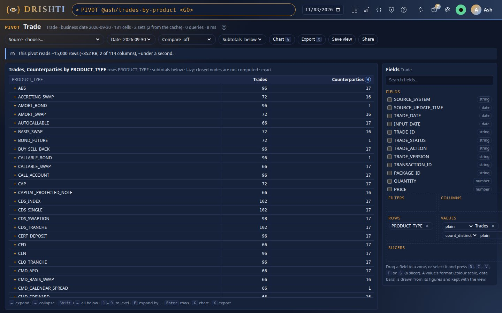

You should see 131 product types, **15,000** trades in the grand total and **24** distinct counterparties.

**CLI.**

```
drishti.py pivot fields trade
drishti.py pivot run --source trade --rows PRODUCT_TYPE --values "count()" --values "count_distinct(COUNTERPARTY)"
```

**JSON** (what the screen sent to `POST /api/v1/pivot/query`):

```json
{"source": "trade", "rows": ["PRODUCT_TYPE"], "values": [{"measure": "count()", "as": "Trades"}, {"measure": "count_distinct(COUNTERPARTY)", "as": "Counterparties"}]}
```

Check: the grand total's `count()` equals Export data's row count (`EXPORT trade`, "Rows").

#### Step 2 · Open a row, then expand another by a different field

**UI.** Add `PORTFOLIO` to Rows (`R`, type `portf`, `Enter`: it goes after `PRODUCT_TYPE`; any number of fields may be nested). Nothing below level one is computed yet: the grid shows product types with **+**.
Press **+** on a product (or select its first cell and press `→`): it becomes a header with its portfolios and a total below them. The meta
line says how many sets were computed and how many came from the cache: only that product's children were asked. Now select another
product's row, press `E` and type `TRADE_DATE`: that product opens by date while the first stays by portfolio.

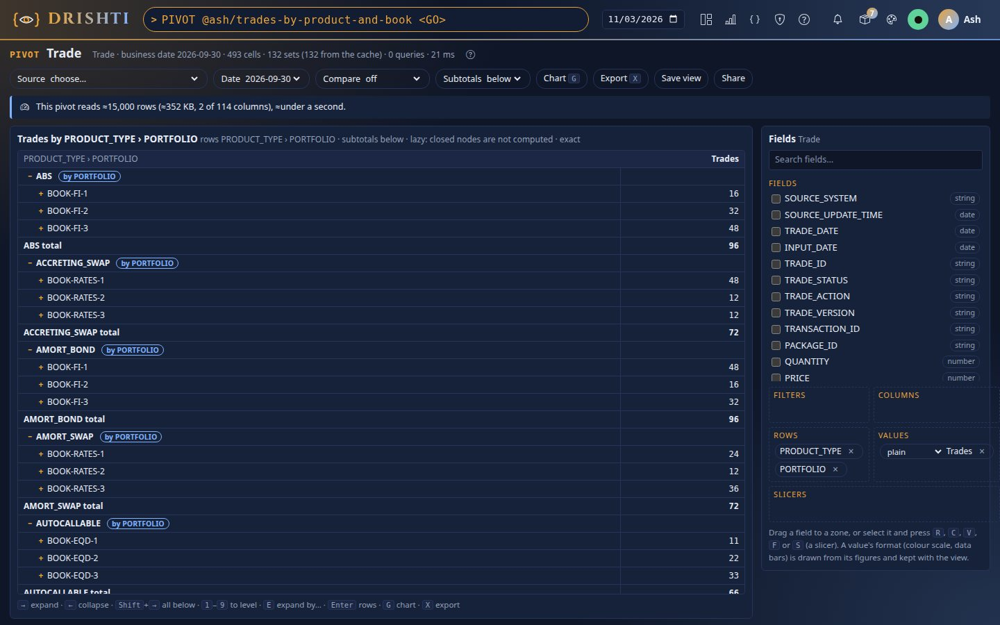

You should see each opened product's top 5 portfolios, an *Others* row and the product's total; the grand total is still 15,000.

**CLI.**

```
drishti.py pivot run --source trade --rows PRODUCT_TYPE,PORTFOLIO --values "count()" --level 2 --top PORTFOLIO=5
```

**JSON.**

```json
{"source": "trade", "rows": ["PRODUCT_TYPE", "PORTFOLIO"], "values": [{"measure": "count()", "as": "Trades"}],
 "expandTo": {"rows": 2}, "top": {"PORTFOLIO": {"n": 5}}}
```

#### Step 3 · The top N and its Others

**UI.** Keep the top 2 product types by count (the CLI below, or `"top"` in the view). The grid shows the two and "Others (k of n)". Click
Others' count cell: its provenance counts its members. Check by hand: Others' count is the grand total less the two shown (for a count that
adds up); for a `median(...)`, Others is the median of Others' own rows, which no subtraction gives.

You should see two product types and Others (129 of 131), whose count is 15,000 less the two shown.

**CLI.**

```
drishti.py pivot run --source trade --rows PRODUCT_TYPE --values "count()" --values "median(PRICE)" --top PRODUCT_TYPE=2
```

**JSON.** `"top": {"PRODUCT_TYPE": {"n": 2, "by": "Trades"}}`

#### Step 4 · A cell's provenance and its rows

**UI.** Click a product's total cell. The popover shows the figure, exact, the function and how its totals are made ("each cell and total
from its own rows' state"), the members counted, the condition (`PRODUCT_TYPE = '…'`), the data version and what was computed. Press
**Rows**: that product's trades, as you may see them. Press `Enter` on any cell for the same.

You should see the cell's count equal to the number of rows listed.

**CLI.** `drishti.py pivot export --source trade --rows PRODUCT_TYPE --values "count()" --what rows --cell PRODUCT_TYPE=IRS --format csv -o irs.csv`

**JSON** (`POST /api/v1/pivot/rows`): `{"view": {...}, "coords": {"PRODUCT_TYPE": "IRS"}, "limit": 50}`

#### Step 5 · The legs of the trades: a document path

**UI.** A trade's record holds its legs. In the Rows picker (`R`; or the Fields pane behind **Customize ›**), under **Each leg (one row
per leg)**, are the legs' fields (*Legs › Notional*, *Legs › Leg type* …); type `$.LEGS[0].CURRENCY` into the **Path** box under the grid
and it joins Rows as *Your path*.

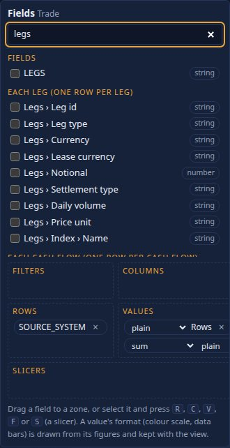

Put `TT_GROUP` (the desk) on Rows, filter `CURRENCY` to USD, and drop *Legs › Leg id* and `QUANTITY` on Values (a count of legs and a sum
of quantity). The legs make the view's grain, one row per leg, and each trade's quantity is added **once**, not once per leg.


You should see **12,230** USD legs and a quantity total of **1,120,878,590,423.65**: exactly the sum over the 8,562 USD trades at the trade
grain (put `count()` alone in Values to see 8,562 trades). DESK-COMM has 1,320 legs of 990 trades. Now put *Events › Event type* on Columns:
the view is refused, because legs and events are separate lists that would multiply each other.

**CLI.**

```
drishti.py pivot run --source trade --rows '$.TT_GROUP' --filter '$.CURRENCY=USD' --values 'sum($.QUANTITY)' --values 'count($.LEGS[*].LEG_ID)'
```

**YAML** (the saved view):

```yaml
source: trade
rows: [$.TT_GROUP]
filters: {$.CURRENCY: {in: [USD]}}
values:
  - {measure: sum($.QUANTITY), as: Quantity}
  - {measure: count($.LEGS[*].LEG_ID), as: Legs}
```

More worked examples, each with its real figures: [Part 1 · Pivot, cubes and explain, Documents](#documents-paths-lists-and-grains).

#### Step 6 · VaR by desk: the total is not a sum

**UI.** Choose the source **VaR** (or type `PIVOT var <GO>`). The view opens with `var()` and `es()`; put `DESK` on Rows. Each cell's
popover shows its **scope** (`WHERE:DESK == 'DESK-X'`) and **Ask the VaR engine** opens it in VAR: the figure is the same to the cent. The
grand total is the bank's own VaR; the desks' VaRs add up to more, and the grand total row shows the gap as **diversification**
(total − Σ desks). VaR's **▾** offers no function: it is computed per cell by the VaR engine.

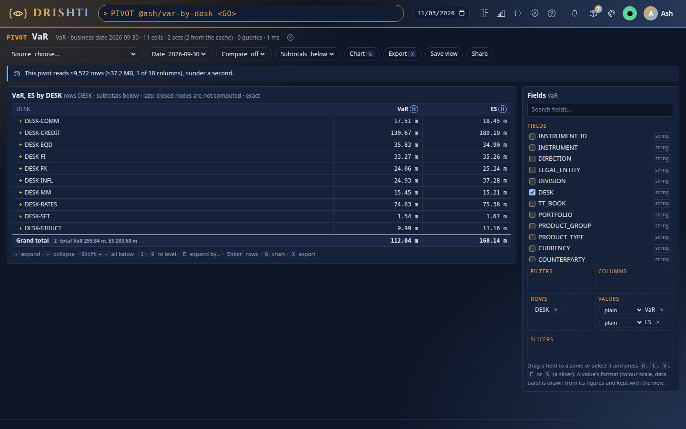

You should see the bank's VaR of **112,041,645.93** (ES 160,143,809.24), less than DESK-CREDIT (130,670,864.00) and DESK-RATES
(74,633,680.00) together.

**CLI.**

```
drishti.py pivot run --source var --rows DESK --values "var()" --values "es()"
drishti.py var show BANK
```

**JSON.** `{"source": "var", "rows": ["DESK"], "values": [{"measure": "var()", "as": "VaR"}, {"measure": "es()", "as": "ES"}]}`

#### Step 7 · Chart the selection

**UI.** With nothing selected, press `G`: the desks' VaR as bars **beside** the bank's, with the diversification as its own bar, and a line
saying why it is not stacked. Go back to the trades pivot of step 1 and press `G`: a count adds up, so its bars sum to the total. Click a
bar to open that member in the grid.

You should see the VaR bars side by side, never stacked, and the trades' bars adding up to 15,000.

**CLI.** A chart is drawn on the screen; `drishti.py pivot export --format csv` writes the figures it draws.

#### Step 8 · Save, share and export to Excel

**UI.** Press **Share**, name the view `desk-var` and share it with `role:risk`. The title becomes `you/desk-var @1`; a cell's popover now
shows its reference (`pivot://you/desk-var@1/VaR[DESK=DESK-X]`). Press `X`, keep "The pivot as shown" and press **Excel**. Open the file:
the rows are grouped with Excel's own + and −; in a trades pivot, a `count()` or `sum()` total is a `SUM` formula of its parts, while VaR
and any median are values; the Provenance sheet lists who exported, the data and how every measure's totals are made.

You should see `you/desk-var` in `drishti.py pivot views` and, in the workbook, VaR totals as values, not formulas.

**CLI.**

```
drishti.py pivot save desk-var --source var --rows DESK --values "var()" --share role:risk
drishti.py pivot export --view you/desk-var --format xlsx -o desk-var.xlsx
drishti.py pivot views
```

**JSON** (`POST /api/v1/pivot/views`): `{"name": "desk-var", "view": {...}, "sharedWith": ["role:risk"]}`

#### Step 9 · Exact or ≈, rollups, and Live

**UI.** Back on the trades pivot, put `counterparty` on Rows and add `distinct(counterparty)` to Values. Under the toolbar, the line
beside the switches reads `exact`. Press **≈**: the distinct count now reads `≈ …`, the line says `≈ from a sketch (distinct(counterparty))`
and its tooltip the error (±1.6%). Keep the top 5 counterparties by `count()` (step 3): with ≈ on, the line adds
`top N ≈ by a summary, figures exact`: five counterparties were chosen by a Space-Saving summary before the level was read, and each
count shown is still exact; Others says "≈". Press **Exact** to rank every member again. Untick **Use rollups**: if an administrator
defined a rollup covering the view, the line no longer says `from rollup …` and the figures are the same. Press `L` (or tick **Live**):
the line ends `live`; when a load of the trades lands for this date (an administrator's `drishti.py data load` or Admin → Data loads),
the cells that moved flash with their new figures and nothing else is redrawn.

**CLI.**

```
drishti.py pivot run --source trade --rows counterparty --values "count()" --values "distinct(counterparty)" --top counterparty=5 --approximate
drishti.py pivot run --source trade --rows productType --values "count()" --no-rollups
drishti.py pivot live start --source trade --rows productType --values "count()"
drishti.py pivot live list
drishti.py pivot live stop lp-…
```

**JSON** (`POST /api/v1/pivot/query`, then `POST /api/v1/pivot/live`):
`{"view": {...}, "exact": false, "rollups": false}`; every answer's `computedAs.words` says how it was computed.

**You should see** the same counts under Exact and ≈ (only the distinct count and the choice of the top 5 change, each marked), the
line beside the switches change with every press, and with Live on a load's moved cells flash while the rest stay as they were.

#### Step 10 · A comment on a cell

**UI.** Open the view you saved in step 8 (`PIVOT @you/desk-var <GO>`), click a desk's VaR cell and, in the popover, write "checked with
the desk" (`M` puts the cursor in the box) and press **Comment**. The cell gets a marker in its corner. Move CURRENCY to Columns and back,
or save the view again: the comment stays on its cell, named by its coordinates (`DESK=DESK-X`); after the new save it says "on an older
version". Press **Resolve**: the marker dims.

**CLI.**

```
drishti.py pivot comments you/desk-var --cell DESK=DESK-X --add "checked with the desk" --measure VaR
drishti.py pivot comments you/desk-var --open
drishti.py pivot comments you/desk-var --resolve c-…
```

**JSON** (`POST /api/v1/pivot/views/you/desk-var/comments`): `{"coords": {"DESK": "DESK-X"}, "measure": "VaR", "text": "checked with the desk"}`

**You should see** the marker on the commented cell wherever the cell moves, the comment in its popover with your name and the time,
"on an older version" after the view is saved again, and a dimmed marker once it is resolved.

###### What you learned

Every figure in a pivot is the server's, made from its cell's own members: a mergeable total from its own rows' state, a holistic one
(VaR, a median) from its own members, Others from its own rows. A document's lists are pivoted at their own grain with Rachana paths, a
coarser figure is counted once per parent, and two lists are never crossed. Open rows are computed on demand and the rest come from the
cache. A chart and an Excel file never add up what does not add up. The switches change how a figure is computed and say so, never what
it means; a live view sends only what moved; a comment belongs to a cell's coordinates, not its place on the screen.

##### Part B · Custom functions, why did it move and what-if

The built-in measures cover most questions; the rest you write yourself. In this part you put a formula straight into a pivot, write a
weighted-return function in the playground and watch the harness prove that its split-and-merge answer equals one pass, save it, have
someone else approve it and use it in a view, withdraw it, then explain why one product's notional differs from another's in steps that
add up, and try a what-if. Each step shows the UI, the command line and the JSON or YAML. The guide is
[BI_GUIDE.md, sections P19 to 22](#p19-custom-functions).

#### Step 11 · A formula in a view

**UI.** `PIVOT trade <GO>`, `PRODUCT_TYPE` on Rows. In Values, edit a value's text to `sum(NOTIONAL, where=NOTIONAL > 100000000) / sum(NOTIONAL)`
(the share of notional in trades over 100 million). Every row and the grand total show the ratio; the grand total is the ratio over all the trades, not
an average of the rows' ratios.

**CLI.**

```
drishti.py pivot run --source trade --rows PRODUCT_TYPE --values "sum(NOTIONAL, where=NOTIONAL > 100000000) / sum(NOTIONAL)"
```

**JSON.**

```json
{"source": "trade", "rows": ["PRODUCT_TYPE"], "values": [{"measure": "sum(NOTIONAL, where=NOTIONAL > 100000000) / sum(NOTIONAL)", "as": "Large share"}]}
```

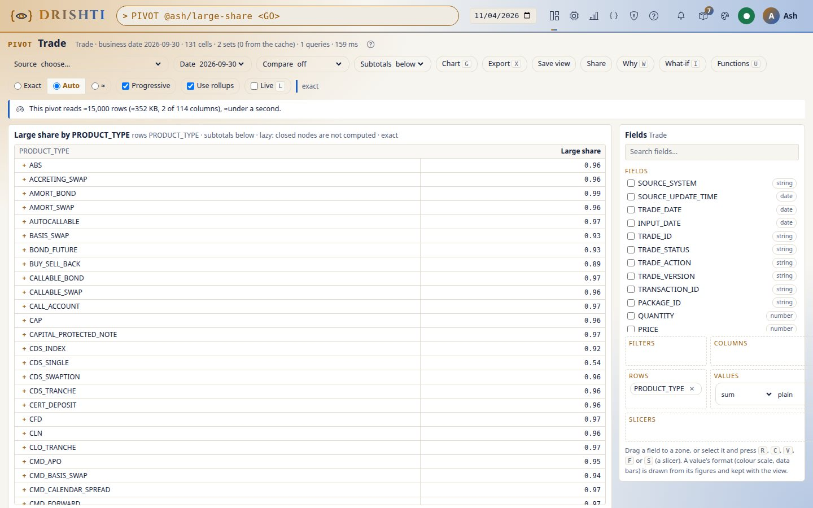

**You should see** one ratio per product type and a grand total that equals the sum of the notional of trades over 100 million divided by the sum of all notional (`EXPORT trade`, filter and sum).

#### Step 12 · The playground: a function and its harness

**UI.** Press `U` (or **Functions**). Name `wret`, language **formula (Rachana)**, inputs `r, w`, code `sum(r * w) / sum(w)`; leave the sample
rows and the group column `g`. Press **Check**. You see *Passes the harness*, the checks (one pass; batches of 1, 7, 1,000 and 65,536;
2, 3 and 16 random parts merged left-deep and balanced under five seeds; an empty cell; a part of nulls; one row; equal rows; infinities;
the state read back; the same bits twice; the cost; the state's size), the state after each part and after each merge (two sums, `[Σrw, Σw]`
as the engine keeps them) with the final figure beside the one-pass figure, and the little pivot of the sample by `g` whose total is made
from the groups' states.

**CLI.** Write `wret.yaml` and `rows.csv`:

```yaml
name: wret
language: formula
code: sum(r * w) / sum(w)
inputs: [r, w]
description: the weighted mean of returns
```

```
r,w,g
0.012,3,A
-0.004,1,B
0.020,2,A
0.001,5,B
```

```
drishti.py pivot functions test wret.yaml --sample rows.csv --group g
```

```text
PASSED: fn:ravi/wret@0 (mergeable), one pass 0.007, 4 rows, 2245.0 ns a row, state 56 bytes
  ok  one pass             the figure is 0.007
  ok  batches and splits   36 runs within 1.0E-12 of the one pass
  ok  empty                an empty cell finishes to nothing (no values in the cell, or a division by zero)
  ok  nulls                a part of nulls merged equals one pass over the rows and the nulls
  ok  single row           one row finishes to 0.012000000000000002
  ok  all equal            100 equal rows finish to 0.012000000000000002, split or not
  ok  state round trip     the state read back finishes to the same figure
  ok  deterministic        the same rows in the same order gave the same bits
  ok  cost                 2245 ns a row (limit 2000); under 1,000 sample rows the cost is shown, not judged
  ok  state bound          the largest state was 56 bytes
  part 1 (rows 1 to 2)               0.008  (56 bytes)
  part 2 (rows 3 to 4)               0.0064285714285714285  (56 bytes)
  merged parts 1 to 2                0.007  (56 bytes)
```

(The author here is `ravi`: a function is named after the person who writes it, `fn:<you>/<name>@<version>`; `@0` is the unsaved draft.)

**JSON** (`POST /api/v1/pivot/functions/test`): the YAML's keys, plus `"sample": [{"r": 0.012, "w": 3, "g": "A"}, ...]` and `"group": "g"`.

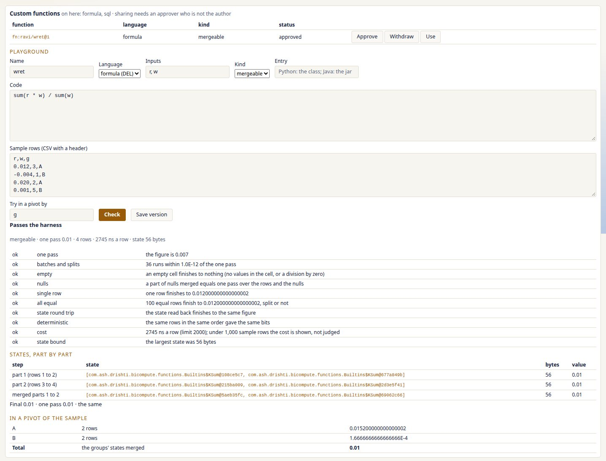

**You should see** *Passes the harness*; the final figure is (0.012·3 − 0.004·1 + 0.020·2 + 0.001·5) / 11 = 0.077 / 11 = 0.007.

#### Step 13 · An SQL macro: rewritten into states, or holistic

**UI.** Language **SQL macro**, code `CREATE MACRO wret2(r, w) AS sum(r * w) / sum(w)`, **Check**: the kind is *mergeable* (the engine
rewrote the macro into the states of its sums). Now `CREATE MACRO slope(r, w) AS regr_slope(r, w)`: the kind is *holistic* (no merge;
each cell's figure is computed by DuckDB from its own rows) and the harness runs only the checks that apply.

**CLI.** The same with `language: sql` and `code: "CREATE MACRO slope(r, w) AS regr_slope(r, w)"`.

**You should see** *mergeable* for `wret2` and *holistic* for `slope`; a macro that names a table or a file (`read_csv(...)`) is refused in words (DRS-5710): a macro is SQL over its inputs only.

#### Step 14 · Save, approve, use

**UI.** Back to `wret` (formula), **Save version**: `fn:you/wret@1`, private. As yourself, **submit** it for sharing; as the second user, open
**Views → Approvals**, choose `fn:you/wret@1` (or *In Approvals* beside it in **Functions**) and press **Approve**, with the comment
"reviewed: a weighted mean". As yourself, in Values add
`fn:you/wret@1(PRICE, NOTIONAL)` (the trades' price and notional): the column header is the call itself, `fn:ravi/wret@1(PRICE, NOTIONAL)`
for the author `ravi`.

**CLI.**

```
drishti.py pivot functions save wret.yaml --sample rows.csv
drishti.py approvals approve function you:wret@1 --comment "reviewed: a weighted mean"      # as the approver
drishti.py pivot run --source trade --rows PRODUCT_TYPE --values "fn:you/wret@1(PRICE, NOTIONAL)"
```

```text
saved fn:ravi/wret@1 (mergeable): private until an approver who is not you approves it
drishti: the server said 403 DRS-5712: an author never approves their own function (fn:ravi/wret@1): another approver must ...
fn:ravi/wret@1: approved
```

The refusal is the author's own `approve`; the approval is the second user's (`vera`, with her own token).

**JSON.** `POST /api/v1/approvals/function/you:wret@1/approve` with `{"comment": "reviewed: a weighted mean", "params": {"scope": "everyone"}}`; the view's
value is `{"measure": "fn:you/wret@1(PRICE, NOTIONAL)"}`.

```text
Trade · 2026-09-30 · 131 cells · 2 sets, 0 from the cache · 1 queries · 267 ms · exact
PRODUCT_TYPE                        fn:ravi/wret@1(PRICE, NO
+ ABS                                                      ·
+ ACCRETING_SWAP                                        0.05
+ AMORT_BOND                                           98.20
+ AMORT_SWAP                                            0.03
...
```

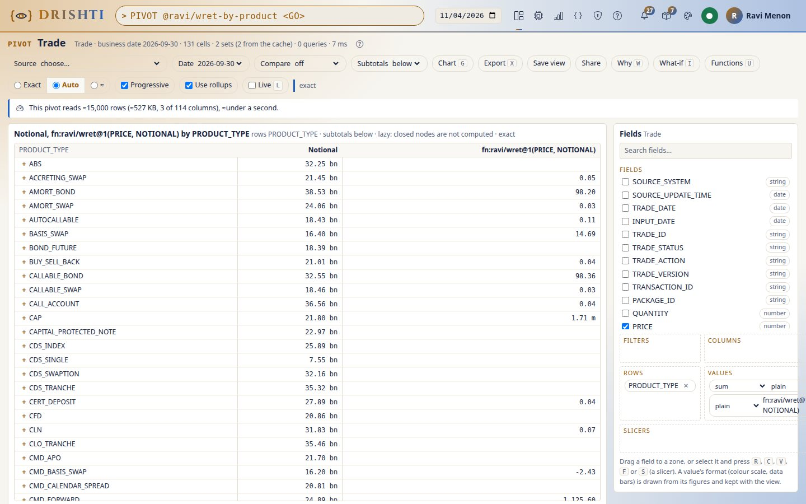

**You should see** the new column in every row and the total; approving your own function is refused (DRS-5712: "an author never approves their own function"); Admin → Audit shows
`pivot.function.save`, `pivot.function.approve` and `pivot.function.use`, with the version.

#### Step 15 · Withdraw

**UI.** As the approver, **Withdraw** `fn:you/wret@1` with a reason. Run your view again: every cell of that column says "function withdrawn
by … on …: reason", with no figure; the other values answer as before.

**CLI.** `drishti.py pivot functions revoke you/wret@1 --reason "superseded"`.

**You should see** "function withdrawn by …" in each cell of the column and no figure; the function's list marks it *withdrawn*.

#### Step 16 · Why did it move?

**UI.** In the `PRODUCT_TYPE` pivot with `sum(NOTIONAL)`, put `COUNTERPARTY` on Columns (**Split by** offers the view's own rows and
columns), select two product rows (click one, Shift-click the other) or type them as **First cell** and **Second cell**, and press `W`.
**Split by** `COUNTERPARTY`, **Explain**. The words say how much the second differs from the first and the largest steps; below them one
step per counterparty (its cause: new, gone or changed) and the steps add up to the difference. Change the value to `avg(NOTIONAL)` and explain again: each
step is now that counterparty's effect on the average given the steps before it, the order is shown (switch **Order** to "largest first"
and the same difference splits differently), and they still add up.

**CLI.**

```
drishti.py pivot explain --source trade --rows PRODUCT_TYPE --values "sum(NOTIONAL)" --cell PRODUCT_TYPE=FX_SWAP --other-cell PRODUCT_TYPE=FX_FORWARD --by COUNTERPARTY
```

```text
sum(NOTIONAL) moved from 35,644,171,130 to 25,679,859,409 (-9,964,311,721); the largest steps: CP-MERIDIAN-RE -2,196,462,950, CP-BRAMBLE -2,126,815,900, CP-VERDANT -2,055,678,300.
  each member's own change (the measure adds up)
  CP-ALDERSHOT                 changed     710,057,225.0000   cumulative 710,057,225.0000
  CP-AURORA                    changed   -1,669,308,280.0000   cumulative -959,251,055.0000
  CP-BRAMBLE                   changed   -2,126,815,900.0000   cumulative -3,086,066,955.0000
  ...
```

**JSON** (the one Explain, `POST /api/v1/explain`, kind `pivot`; the engine's steps are under `why.answer`):

```json
{"kind": "pivot", "measure": "cell", "part": "why",
 "view": {"source": "trade", "rows": ["PRODUCT_TYPE"], "values": ["sum(NOTIONAL)"]},
 "from": {"PRODUCT_TYPE": "FX_SWAP"}, "to": {"PRODUCT_TYPE": "FX_FORWARD"}, "by": "COUNTERPARTY"}
```

The old `POST /api/v1/pivot/explain` still answers for one release, as a deprecated alias of this (it says so in its `Deprecation` and
`Link` headers); move scripts to `/api/v1/explain`.

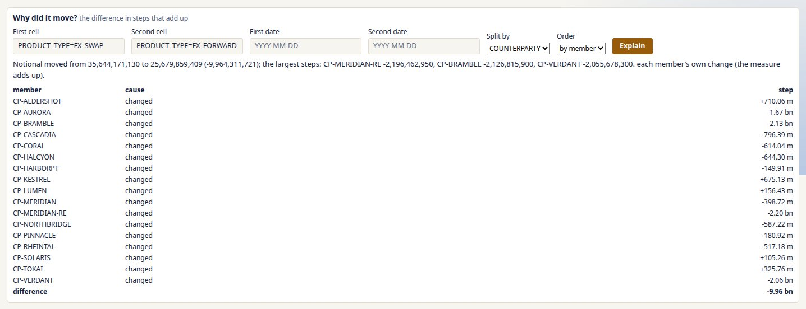

**You should see** the words and the steps; the sum of the steps plus the residual equals `difference`; the residual is named ("rounding"). For a cell on two dates, give
`fromDate` and `toDate` (`--from`, `--to`) instead of a second cell.

#### Step 17 · What-if

**UI.** Press `I`. **Leave out** `PRODUCT_TYPE=FX_FORWARD`, **Change** `NOTIONAL*1.1 where COUNTERPARTY=CP-ALDERSHOT`, **Run the what-if**. The list
shows each cell that changes and by how much (what-if minus original); nothing was written anywhere.

**CLI.**

```
drishti.py pivot whatif --source trade --rows PRODUCT_TYPE --values "sum(NOTIONAL)" --exclude PRODUCT_TYPE=FX_FORWARD --scale NOTIONAL=1.1@COUNTERPARTY=CP-ALDERSHOT
```

```text
108 cell(s) change; differences are what-if minus original
  PRODUCT_TYPE=ABS|*                       sum(NOTIONAL) +138,863,064.00
  PRODUCT_TYPE=ACCRETING_SWAP|*            sum(NOTIONAL) +101,499,900.00
  PRODUCT_TYPE=AMORT_SWAP|*                sum(NOTIONAL) +155,982,800.00
  ...
```

**JSON** (`POST /api/v1/pivot/whatif`):

```json
{"view": {"source": "trade", "rows": ["PRODUCT_TYPE"], "values": ["sum(NOTIONAL)"]},
 "whatIf": {"exclude": {"PRODUCT_TYPE": ["FX_FORWARD"]}, "changes": [{"field": "NOTIONAL", "scale": 1.1, "where": {"COUNTERPARTY": ["CP-ALDERSHOT"]}}]}}
```

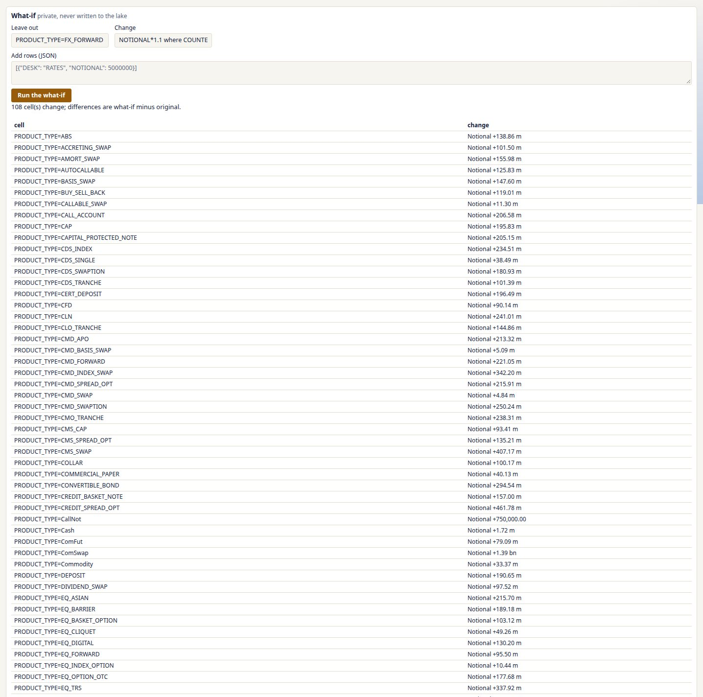

**You should see** *108 cell(s) change; differences are what-if minus original* and each changed cell with its change: FX_FORWARD's
cell is gone from the what-if, and the grand total moved by 10 % of CP-ALDERSHOT's notional less FX_FORWARD's.

#### Step 18 · Python (an administrator turns it on)

Python functions are off as shipped. With `drishti.pivot.functions.python.enabled: true` in `config/engines/pivot.yaml` (and a restart),
language **Python** takes a class decorated with `@function` ([BI_GUIDE.md section P19](#p19-custom-functions));
it runs in the node's sandboxed `pivot-fn` workers (no network, no files, no processes), fed Arrow batches over a pipe, and passes the same
harness. Python functions never read memory-only data.

**You should see** **Python** offered in the language list once it is on (and, while it is off, refused in words: DRS-5713).

#### Step 19 · BI's totals are the engine's

Open a BI report with a matrix (the sample *trades overview*). Every total and subtotal row comes from the pivot engine's
one statement over the model's rows: the average's total is the average over all the trades, a sum's total is the engine's sum. A
year-to-date measure shows a dash in the total row; the answer's warnings say why ([BI_GUIDE.md section R3.2](#r97-true-totals)).

**You should see** the matrix's totals and subtotals as before (the figures are the same: `BiParityTest`) and a dash, with its reason,
where a measure has no total.

##### Part C · The MR cube: desks by risk class, with the right totals

The MR cube is the pivot engine on the VaR source with the market-risk lens around it. In this part you open the landing (desks by risk
class), check its totals against `VAR BANK` and see the diversification, read a cell's tail and why it moved, change the lens (10 days,
97.5%, stressed), re-pivot by currency and open a desk down to its trades, read the components and their waterfall, the DV01 ladder and a
what-if side by side, and save, share and export a view. Each step shows the UI, the command line and the view's JSON. The guide is
[BI_GUIDE.md section P29](#p29-the-mr-cube-preset); the pivot screen itself is [Part A](#part-a--the-pivot-engine-trades-by-product-legs-by-desk-then-var-by-desk).

#### Step 20 · The landing: desks by risk class

**UI.** Type `MCUBE <GO>` (or **VaR → MR cube**). The pivot screen opens with the MR lens: the short title (`MR cube · BANK 2026-09-30 ·
1d 99% · USD`) with the headline figures on its line (VaR, ES, limit use, Σ desks − total, stressed VaR, the data), the lens controls, the
slider, tabs A, B and C, and the pivot under one line: **VIEW By risk class × desk ▾**, then `Rows ⋔ MGMT ▾ Desk ▲▼ · Columns Risk class ·
Values VaR ▾` and the measure toggles. One row per desk of the management hierarchy, one column per risk class, each cell its VaR with a
sparkline when earlier dates are open.

**CLI.**

```
drishti.py pivot fields var
drishti.py pivot run --source var --rows MGMT.DESK --cols RISK_CLASS --values "var()"
drishti.py pivot mr headline --source var
```

**JSON** (the catalogue's `defaultView`, sent to `POST /api/v1/pivot/query`):

```json
{"source": "var", "rows": ["MGMT.DESK", "MGMT.BOOK", "POSITION", "TRADE"], "columns": ["RISK_CLASS"],
 "values": [{"measure": "var()", "as": "VaR"}], "options": {"scope": "BANK"}, "expandTo": {"rows": 1, "columns": 1}}
```

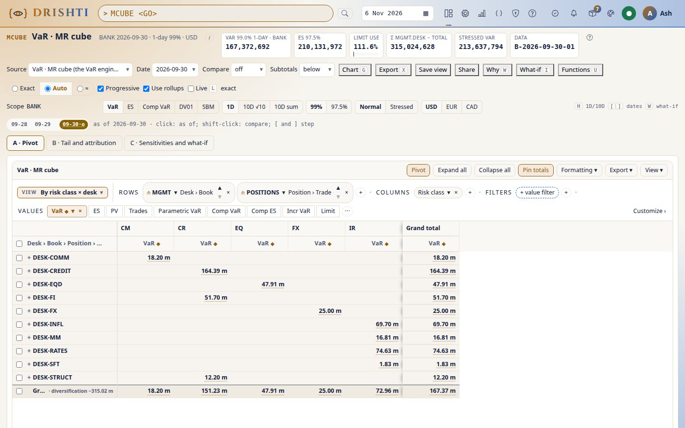

**You should see** desks by risk class with a grand total; the grand total equals `VAR BANK` to the cent, and the headline's VaR is the same number.

#### Step 21 · The fields: the View picker, the Rows picker, VaR's menu and the panes

**UI.** Press `Shift+V`: the **View** picker lists the cube's ready-made views (*By risk class × desk*, *By desk*, *By book*, *By limit
letter* where the LL hierarchy is configured, *Top contributors*, *Trades in my scope*; keys `1`–`9`), then *My views* and *Shared with me*.
Press `3` (or click *By book*): rows `MGMT Desk › Book`, values VaR, ES and Limit use. Press `R`: the Rows picker shows **Hierarchies**
first, each one item (`MGMT Division › Desk › Book`, `LEGAL Legal entity › Desk › Book`, `Positions Position › Trade`); open MGMT with `→`
for its levels. The columns the levels are built from (`DIVISION`, `DESK`, `TT_BOOK`, `LEGAL_ENTITY`) are under **More fields**, closed.
`Esc`, then `Alt+↑`: MGMT goes up a level (Desk alone, the stepper's ▲); `Alt+↓` brings Book back (▼). Open VaR's **▾**: *computed per cell by the VaR engine*, no Sum, the VaR options (horizon,
confidence, scenario set) instead. Press `\`: the **Build** and **Fields** panes open beside the grid; drag *Currency* from Fields to
Columns; `\` again closes them.

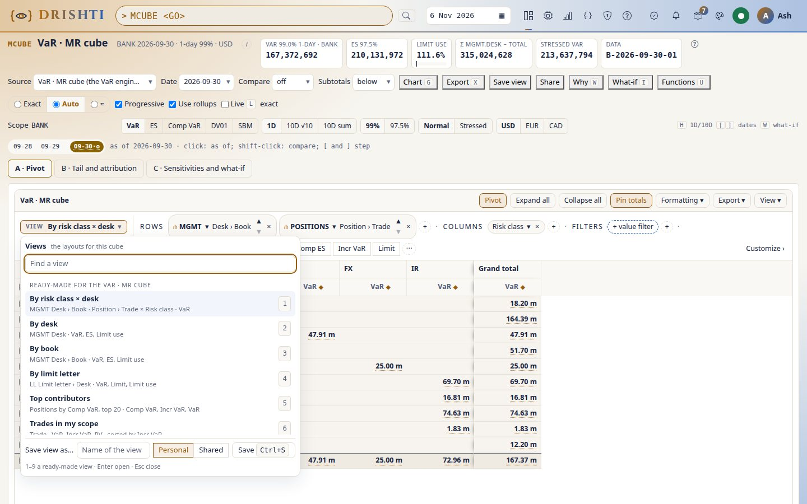

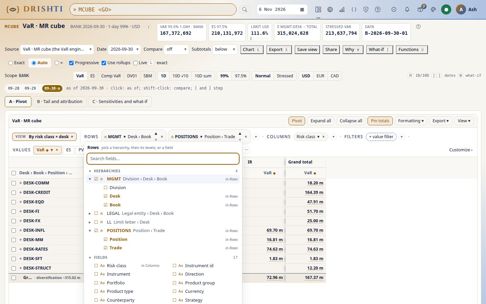

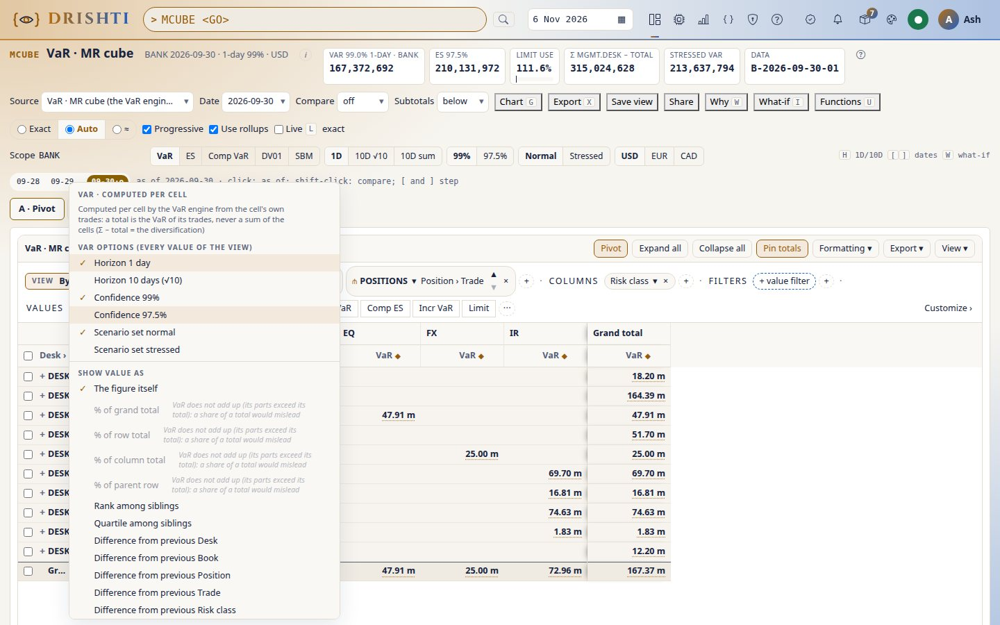

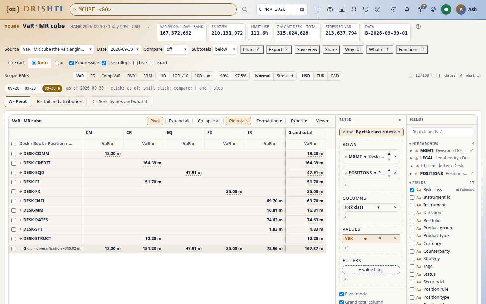

**CLI.**

```
drishti.py pivot fields var
drishti.py pivot run --source var --rows MGMT.DESK,MGMT.BOOK --values "var()" --values "es()" --values "limit_use()"
```

**YAML** (the ready-made view in `drishti-console/config/pivot-presets.yaml`, and a Sutra's pivot that opens in the panes):

```yaml
presets:
  mr:
    mode: views
    views:
      - id: by-book
        name: By book
        rows: [MGMT.DESK, MGMT.BOOK]
        values: [{measure: "var()", as: VaR}, {measure: "es()", as: ES}, {measure: "limit_use()", as: Limit use}]
```

```yaml
pivot: { rows: [CURRENCY], values: [{ field: NOTIONAL, agg: sum }], mode: panes }
```

**You should see** the books of each desk under it; the catalogue (`drishti.py pivot fields var`) lists MGMT once under `hierarchies`, its
levels hidden from the plain fields, and every VaR measure with `perCell: true` and no functions.

#### Step 22 · Totals are never sums: the diversification

**UI.** Add up the desks' VaR in the *Grand total* column by hand: it is more than the bank's. The headline's **Σ desks − total** tile is
that difference, in money; the grand total row carries it too (`Σ−total` beside it).

**CLI.**

```
drishti.py pivot run --source var --rows MGMT.DESK --values "var()" --json | jq '.rows[] | select(.kind=="grand") | .diversification'
```

**JSON.** The answer's grand row: `{"kind": "grand", "diversification": {"VaR": <Σ desks − bank>}}`.

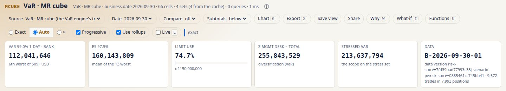

**You should see** a grand total below the desks' sum and the difference in the Σ desks − total tile; pick one desk's cell and run `VAR <its scope>` (the scope is in the cell's provenance, step 22): the same VaR to the cent.

#### Step 23 · A cell's tail, provenance and why it moved

**UI.** Click the RATES × IR cell. The provenance popover shows its scope (`(NODE:MGMT~DESK-RATES) & (WHERE:PRODUCT_GROUP in (…))`), its
trades and how the figure is made. The rail under the pivot shows its scenario P&L histogram (the VaR scenario marked **V**, the ES tail
**E**) and *Explain the move*: the cell's VaR on the date before, each exact step, and today's VaR. Shift-click an earlier date on the slider
to explain against it instead.

**CLI.**

```
drishti.py pivot mr cell --source var --rows MGMT.DESK --cols RISK_CLASS --cell MGMT.DESK=DESK-RATES,RISK_CLASS=IR
drishti.py pivot mr explain --scope "(NODE:MGMT~DESK-RATES) & (WHERE:PRODUCT_GROUP in ('Rates'))"
```

**JSON** (`POST /api/v1/risk/mr/detail`):

```json
{"view": {"source": "var", "rows": ["MGMT.DESK"], "columns": ["RISK_CLASS"], "values": [{"measure": "var()"}]},
 "coords": {"MGMT.DESK": "DESK-RATES", "RISK_CLASS": "IR"}}
```

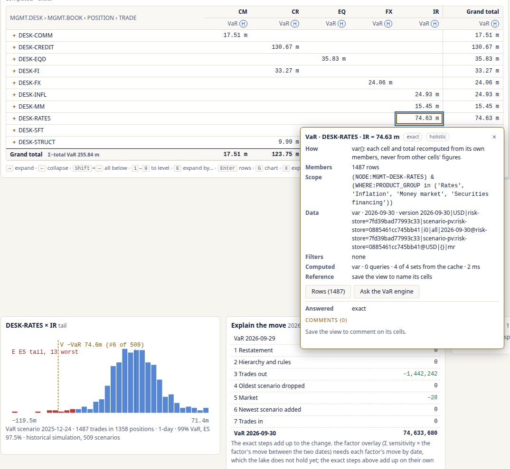

**You should see** the cell's scope, its scenario P&L histogram with V and E marked and its steps; the detail's `var` equals the cell's VaR, and its `k` says which worst loss it is (the 6th of 509 at 99%).

#### Step 24 · The lens: 10 days, 97.5%, stressed, another currency

**UI.** Press **H** (or click *10D √10*): every cell is computed again at 10 days. Click *97.5%*, then *Stressed*: the stress set's VaR
(USD). Click *Normal* and *EUR*: the bank in euros. Type `DESK:RATES` in *Scope* and press Enter: the view starts from the rates desk.

**CLI.**

```
drishti.py pivot run --source var --rows MGMT.DESK --values "var()" --option horizon=10d --option confidence=0.975
drishti.py pivot run --source var --rows MGMT.BOOK --values "var()" --option scope=DESK:RATES --option ccy=EUR
```

**JSON.** The options of the view: `"options": {"scope": "DESK:RATES", "horizon": "10d", "confidence": "0.975", "ccy": "EUR"}`.

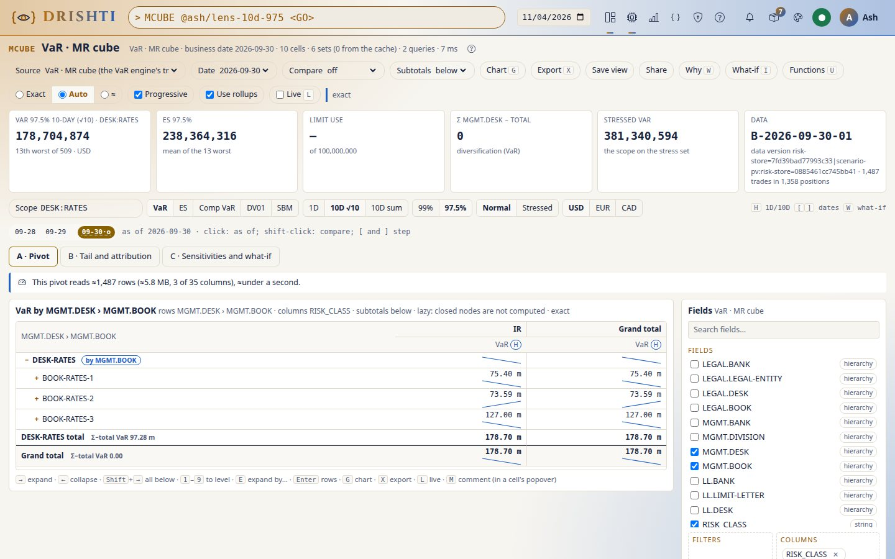

**You should see** every cell computed again for the lens; `VAR DESK:RATES H 10D` on the VaR explorer gives the total of the 10-day view.

#### Step 25 · Re-pivot and open a desk down to its trades

**UI.** Press `C`, uncheck *Risk class* and check *Currency* (or drag it in the panes). Open RATES with →: its books are computed, nothing else. Open a book: its
positions; a position: its trades. Select a book and press **E**, type `COUNTERPARTY`: that book alone is broken down by counterparty.
Press Enter on a cell: its trades, as the VaR engine holds them.

**CLI.**

```
drishti.py pivot run --source var --rows MGMT.DESK,MGMT.BOOK --cols CURRENCY --values "var()" --open MGMT.DESK=DESK-RATES
drishti.py pivot export --source var --rows MGMT.DESK --values "var()" --what rows --cell MGMT.DESK=DESK-RATES -o rates-trades.csv
```

**JSON.** The node opened: `"expanded": [{"axis": "rows", "path": [["MGMT.DESK", "DESK-RATES"]], "by": "MGMT.BOOK"}]`.

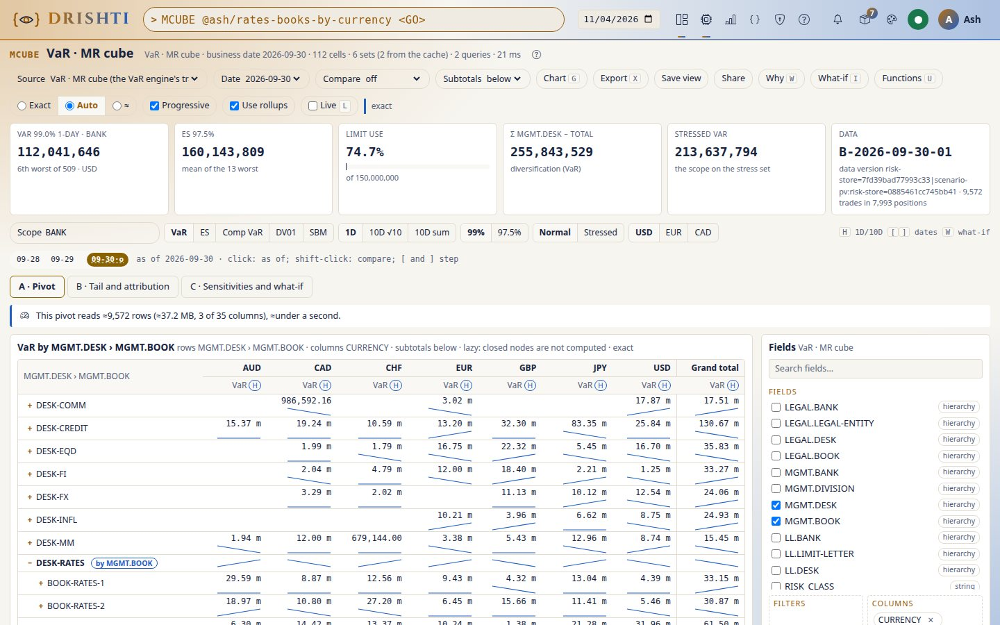

**You should see** RATES's books and nothing else computed; each book's VaR is its own (`VAR BOOK:<book>`), and the desk's subtotal is not their sum.

#### Step 26 · Components, the waterfall, the ladder and a what-if

**UI.** Open tab **B**: each desk's component VaR and its share; a negative one is a hedge; they add up to the bank's VaR exactly. The
waterfall draws them, the total last; the histogram is the bank's; the heat map is DV01 by currency × tenor. Open tab **C**: the DV01 ladder
by currency and bucket (*Grid* switches between the bank's buckets and FRTB's vertices). In *What-if*, copy a booked trade with × -1 and add
it: every desk and the total, before, after and the change.

**CLI.**

```
drishti.py pivot run --source var --rows MGMT.DESK --values "comp_var()" --values "var()"
drishti.py pivot mr ladder --scope BANK --grid BANK-IR-TENOR
drishti.py pivot mr whatif --source var --rows MGMT.DESK --copy <a trade id> --factor -1
```

**JSON** (`POST /api/v1/risk/mr/what-if`): `{"view": {...}, "items": [{"copyOf": "<a trade id>", "factor": -1}]}`.

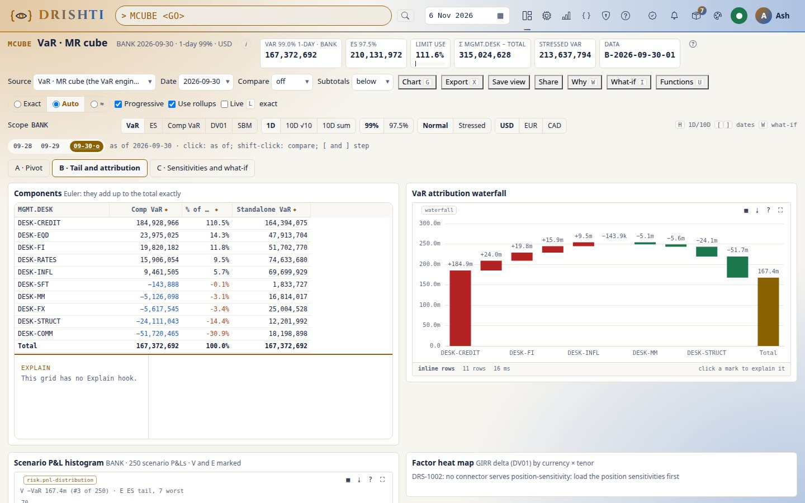

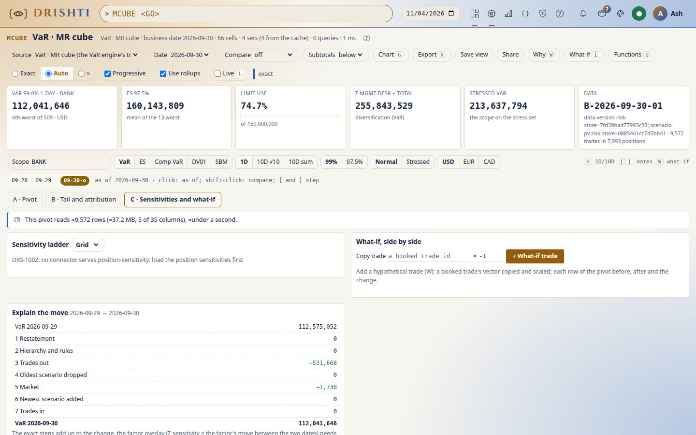

**You should see** the components with the hedges negative, the ladder and the what-if before and after; the components' sum equals the bank's VaR to the cent; the what-if's *Total* row's *before* equals the grand total.

#### Step 27 · Save, share and export

**UI.** `Shift+V`, **Save view as…** `morning`, **Shared** with `role:risk`, `Ctrl+S` (or **Save view**, then **Share**). A colleague opens `MCUBE @you/morning <GO>` with their own rights.
**Export → Excel**: the outline of the rows, `SUM` formulas only for the measures that add up (`comp_var()`, `pv()`, `trades()`), the server's
values for VaR and ES, a Provenance sheet.

**CLI.**

```
drishti.py pivot save morning --source var --rows MGMT.DESK --cols RISK_CLASS --values "var()" --share role:risk
drishti.py pivot export --view you/morning --format xlsx -o morning.xlsx
```

**JSON.** The saved view is the view itself, options included; never its numbers.

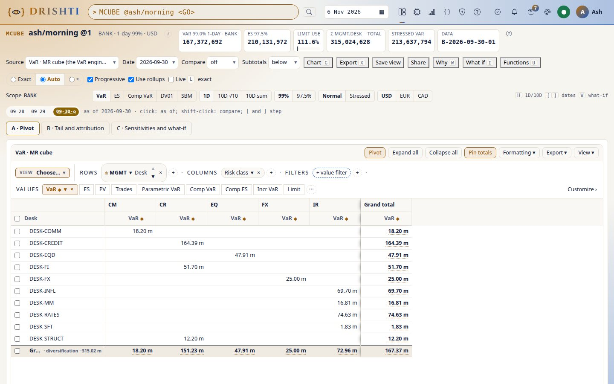

**You should see** the view in your saved views and its workbook; open the workbook: the VaR column's totals are values, not formulas; a Comp VaR total is a `SUM`.

#### Next steps

- [Part 1 · Pivot, cubes and explain](#part-1--pivot-cubes-and-explain) section 2 (the screen: the View picker, the compact line, the panes and every key) and
  sections 24 to 26: the switches, live pivots and cell comments in full.

- The worked examples over documents, each with its figures, picture, command and saved view:
  [Part 1 · Pivot, cubes and explain, Documents](#documents-paths-lists-and-grains).
- Every setting, the API and the refusals: [Part 1 · Pivot, cubes and explain](#part-1--pivot-cubes-and-explain) sections 14 to 17.
- Make a path a column read for everyone: promote it in the connector's `layout.<kind>.columns`
  ([../guides/DATA_GUIDE.md section 8](DATA_GUIDE.md#8-connectors)) or add it to a BI dataset as a `path:` column ([Part 3 · Reports and dashboards](#part-3--reports-and-dashboards)).
- [Part 1 · Pivot, cubes and explain](#part-1--pivot-cubes-and-explain) sections 19 to 22: the languages, the harness, approval, explain, what-if, BI's totals.
- [ARCHITECTURE.md section 26](../architecture/ARCHITECTURE.md#26-the-pivot-engine) sections 8, 10 and 12: the design.
- The guide: [BI_GUIDE.md section P29](#p29-the-mr-cube-preset) (every measure, option, setting and code).
- The pivot screen: [Part 1 · Pivot, cubes and explain](#part-1--pivot-cubes-and-explain); the VaR engine: [VAR_GUIDE.md](VAR_GUIDE.md).

## Part 2 · Virtual tables and models

A **virtual table** is a named, typed table defined once by configuration over any kind any connector serves (a lake table, a database
table, an in-memory table), a SQL query, a Python transform, a model's answer or another virtual table. A **model** relates virtual tables
and defines measures over them. Every consumer reads them the same way: BI, the pivot, Arrow Flight and alerts. This guide is the
reference: every key, every check, the command line and the migration of BI's datasets and models; the hands-on walk-through is the
[virtual tables tutorial](#tutorial-virtual-tables-and-models). The design, with its decisions, is
[ARCHITECTURE.md section 24](../architecture/ARCHITECTURE.md#24-virtual-tables-the-central-table-layer); how BI reads the layer is
[ARCHITECTURE.md §28 section 18](../architecture/ARCHITECTURE.md#281-the-table-layer-and-models-in-rachana).

The outputs below are real: the shipped BI datasets and models as migrated into `config/tables/bi` (where they ship) beside the tutorial's own two tables and model, and the
test data's samples of 2026-09-30 (`data/testdata`: Endur trades, counterparties).

### Contents

1. [Where definitions live](#t1-where-definitions-live)
2. [Names](#t2-names)
3. [A table, key by key](#t3-a-table-key-by-key)
4. [Paths and expressions in a table](#t4-paths-and-expressions-in-a-table)
5. [A model, key by key](#t5-a-model-key-by-key)
6. [Materialisation](#t6-materialisation)
7. [Who sees what](#t7-who-sees-what)
7a. [Reading a table: dates and shared reads](#t7a-reading-a-table-dates-and-shared-reads)
8. [Checks, preview and lineage](#t8-checks-preview-and-lineage)
9. [The migration: tables migrate](#t9-the-migration-tables-migrate)
10. [Problem codes](#t10-problem-codes)
11. [The editors](#t11-the-editors)
12. [Measures in a model: filter context, and what is refused](#t12-measures-in-a-model-filter-context-and-what-is-refused)

### T1. Where definitions live

| Where | What |
|---|---|
| `config/tables/<domain>/<name>.table.yaml` | one virtual table per file, in its domain's folder (`config/tables/trading/trade_legs.table.yaml`) |
| `config/tables/<domain>/<name>.model.yaml` | one model per file (the shipped samples: `config/tables/banking/` for the banking module's, read only while it is on, and `config/tables/bi/`) |
| the item store (`drishti_bi_item`, kinds `table` and `model`) | stored definitions, governed as BI's items are: workspaces, review, versions (no schema change) |

The catalogue reads both, checks every definition and the catalogue as a whole, and is replaced in one step when a definition changes. The
module is `drishti-tables` (plain Java); BI depends on it, never the reverse.

Every file starts with `rachana: 3`, the language version of the layer's files: expressions are Rachana. A file in BI's old form
(`rachana: 2`, `dataset:`, `datasets:`) is refused with the command that migrates it (`DRS-9614`).

### T2. Names

| Kind | Rule | Example |
|---|---|---|
| table | `<domain>.<name>`: lower case, letters, digits, underscores, starting with a letter; the domain is the file's folder | `trading.trade_legs` |
| migrated BI dataset | the domain `bi`, hyphens as underscores | `trading-risk-trades` is `banking.trading_risk_trades` |
| pack-generated dataset | the pack's name as the domain | `pack.trading.trade` is `trading.trade` |
| model | BI's model name, kept (reports, boards and bookmarks bind it by name and major) | `trading-risk@1` |
| a table's old name | `was: trading-risk-trades`: resolves for one release, with a warning wherever it is used | |
| reference with a version | `@^1` (or `@1`): the major asked for | `trading.trade@^1` |

A table's name is unique across virtual tables and stored tables: a virtual table named like a lake table or a kind is refused when it is
defined (`DRS-9616`; `tables check --stored NAME,...` checks against a list, the server against its lakes and packs). Many tables may read
one source, each with its own columns, grain and filter (`trading.trade_summary` and `trading.trade_legs`, both `from: { kind: trade }`).

### T3. A table, key by key

```yaml
rachana: 3
table: banking.trading_cashflows_cashflows
was: trading-cashflows-cashflows             # the name before, one release
version: 1.0.0
title: "Trade legs and cashflows: cashflows"
from: { kind: trade }
grain: $.LEGS[*].CASH_FLOWS[*]               # one row per cash flow of every leg
columns:
  LEG_ID:       { path: "^.LEG_ID", type: integer }
  CURRENCY:     { path: "^.CURRENCY", type: string }   # the leg's currency
  FLOW_TYPE:    { path: "@.FLOW_TYPE", type: string }
  PAYMENT_DATE: { path: "@.PAYMENT_DATE", type: date }
  NOTIONAL:     { path: "@.NOTIONAL", type: decimal, format: amount0 }
materialize: on-load
```

| Key | Value | Notes |
|---|---|---|
| `rachana` | `3` | required: the language version |
| `table` | the name (section 2) | required |
| `was` | the old name | optional, one release |
| `version` | `major.minor.patch` | `1.0.0` when not given; consumers bind by major |
| `id`, `title`, `description`, `owner`, `sample`, `endorsement`, `tags`, `ai`, `layout` | as BI's items have them | kept as written |
| `from` | `{ kind, pack, connector }`, `{ lake, table }`, `{ table }` (a table over a table), `{ connector, query, params }` (SQL), `{ python, inputs, params }`, `{ model, query }` (a summary table) | exactly one form; `from: trade` is `from: { kind: trade }` |
| `grain` | a path from `$` ending in a list: `$.LEGS[*]`, `$.LEGS[*].CASH_FLOWS[*]` | omitted: one row per entity; only over documents (a kind, a lake table, a table) |
| `filter` | a row-scope condition over the source | rows that do not meet it are not in the table |
| `columns` | name to `path`, `expr` or `python` (exactly one), with `type`, `role`, `meaning`, `references`, `unit`, `additive`, `aggregate`, `format`, `key`, `masked`, `hidden-for`, `description` | `NAME: $.PATH` is the short form of a path column |
| `keys` | the columns that identify a row (with `business_date`) | a column with `key: true` or `role: key` is added |
| `keep` | `{ latest: COLUMN }`: of the rows with the same keys, the one with the greatest value; or a number of business dates (`30`) or days (`90d`) kept | de-duplication is explicit, never a silent distinct |
| `says` | what one row is, in words | |
| `materialize` | `none`, `on-load`, `{ live: { rows, age } }` | section 6 |
| `as-of` | `business-date` or `latest-load` | |
| `refresh` | `{ on-load: true, schedule: ... }` | |
| `rules` | `- { role: desk-head, where: "$.DESK in user.desks" }` | section 7 |
| `hidden-for` | roles that see none of the table | |
| `tests` | `unique`, `not-null`, `references-exist`, `agg` | the item's own tests |

**Built-in columns.** Every table has `id`, `business_date`, `index` (under a grain: the element's place in its list), and a live table
`update_seq` and `updated_at`. They are never declared (`DRS-9602`).

**Types.** `string`, `integer`, `decimal`, `boolean`, `date`, `timestamp`.

### T4. Paths and expressions in a table

| Root | Names | Needs |
|---|---|---|
| `$` | the entity (or the source row) | always |
| `@` | the grain's element (the row) | a grain |
| `^` | the element's parent (the leg of a cash flow) | a grain two lists deep; one list deep, `^` is the entity: write `$` |
| `^^` | the parent's parent | a grain three lists deep |

A path holds one value: a list (`[*]`) in a column is refused (`DRS-9603`); an aggregate of a list in an expression is Rachana's list form
(`sum($.LEGS[*].NOTIONAL)`), not a measure. Indexes are written in brackets (`$.LEGS[0].CURRENCY`).

A **calculated column** (`expr`) and the `filter` are row-scope Rachana over the **source**, never over another column: write
`$.MTM / 1000000`, not `MTM / 1000000` (`DRS-9127`), so a column means the same whatever order columns are read in. Aggregates of rows
belong in a model's measures (`DRS-9127`); `ctl.x` and the other display concerns of a Sutra are refused (`DRS-9127`); `user.x` belongs in a
rule. A look-up of another table is `related(core.desks.NAME, on = $.DESK)`.

A column whose expression reads a masked column's path is masked too.

**The null rule.** A comparison with a missing value follows Rachana: `null != 'X'` is true, `null == 'X'` is false, `null == null` is
true. Write `$.STATUS != 'MATURED' && $.STATUS != null` to leave rows with no status out.

**Checked mode.** Every expression of a table or model is checked by Rachana's checked mode, with the types of the table's columns (a
path a column reads has that column's type) or the model's `alias.COLUMN`: the scope's rules, the types, `in` and lists, named arguments,
`^`. Its codes are the language's: `DRS-9127` (type or scope), `DRS-9129` (not yet), `DRS-9152` (unknown name). A definition reads the
source as it is: masks are its readers'. An aggregate is a measure's, not a column's: `greatest(a, b)` is the larger of two values in a
row.

### T5. A model, key by key

```yaml
rachana: 3
model: trading-risk
version: 1.0.0
tables:
  trades:         { table: banking.trading_risk_trades, role: fact }
  netting_sets:   { table: banking.trading_risk_netting_sets, role: fact }
  counterparties: { table: banking.trading_risk_counterparties, role: dimension }
  desks:          { table: banking.trading_risk_desks, role: dimension }
relationships:
  - { from: trades.DESK, to: desks.id }
  - { from: trades.NETTING_SET, to: netting_sets.id, active: false }
measures:
  MTM:      { expr: "sum(trades.MTM)", format: signed0 }
  Open MTM: { expr: "sum(trades.MTM, where = trades.TRADE_STATUS != 'MATURED' && trades.TRADE_STATUS != null)", format: signed0 }
  MTM rank: { expr: "rank(sum(trades.MTM))" }
hierarchies:
  Desk and book: [desks.NAME, books.NAME]
security:
  may-see-all: { netting_sets: [desk-head], counterparties: [desk-head], desks: [desk-head] }
```

| Key | Value | Notes |
|---|---|---|
| `tables` | alias to `{ table, role }` (`fact` or `dimension`) | measures, fields and rules name `alias.COLUMN` |
| `relationships` | `{ id, from, to, cardinality, direction, active, name }`, from the many side | both ends real columns of one type (`DRS-9122`); one active relationship per pair of aliases |
| `measures` | name to `{ expr, format, description, currency, additive, id, title, display, folder, hidden }`, or a Python measure `{ python, inputs, by }` | aggregate scope: `alias.COLUMN` inside aggregates, `measure('name')`, `param.x`; no document path (`DRS-9127`); an inactive relationship is `calc(..., via = 'r_5')` |
| `hierarchies` | name to its levels (`trades.TRADE_DATE.month` is a field) | |
| `security` | `rows` per alias, `masked`, `may-see-all`, `propagate` | only tightens what the tables' rules allow |
| `scan-warn-rows` | a whole number of rows above zero | this model's own threshold for the warning on a join across connectors; without it, `drishti.tables.scan-warn-rows` |
| `calc-groups`, `parameters`, `calendars`, `fx`, `tests`, `rollups`, `history` | as BI's models have them | `history` samples measures of a live table |
| `id`, `title`, `description`, `owner`, `tags`, `sample`, `endorsement`, `lifecycle`, `layout`, `ai`, `golden`, `contract`, `perspectives`, `fields` | kept as written | |

The model query (MQ, `mq: 1` and `mq: 2`) asks a model as it always has; a table's implicit model is `table:<name>`.

### T6. Materialisation

| `materialize` | Means |
|---|---|
| `none` (default) | read on demand; the compiler pushes work to the fastest route (a promoted column, a connector's column scan, SQL to the source) |
| `on-load` | Parquet per business date under `<store>/<domain>/<name>/v<major>/<date>/part-*.parquet`, rebuilt when the source's data-load signal arrives; a query reading the previous file goes on (each build writes a file of its own) |
| `{ live: { rows, age } }` | in memory by key, maintained from what the source pushes; bounded by `rows` and `age` (`30s`, `15m`, `2h`, `1d`, or ISO-8601); needs `keys`; only over a kind |

A live table's rows are worked out from each pushed entity through the table's own definition; a row whose values did not change keeps its
`update_seq`. An on-load build writes a new file and moves it in, so a query reading the previous file goes on.

Materialised files are a cache: rebuilt at will, never the truth, never written into a lake's own tables. A model's `rollups:` keep partial
states per date. The store's folder is a setting of the layer (planned: `drishti.tables.store-dir`, by default `<data>/tables`).

### T7. Who sees what

| Layer | Applies to | Notes |
|---|---|---|
| the table's `rules` | every reader of the table: BI, the pivot, Flight | a reader with several roles sees the rows any of their rules allows; a role no rule names sees none |
| the table's masked columns | readers without the raw power (a role with `raw`) | they see `•••`, whatever the installation's own field masks (`drishti.security.redact`) are, even none; a filter, sort or grouping on a masked column is refused |
| the model's `security` | readers through the model | only tightens; `may-see-all` stops a fact's rule reaching a dimension |

`$.DESK in user.desks` is strict: a desk-head with no desks sees no trades.

A rule on one fact also limits another fact of a model through `related_rows('alias')`: `- { role: desk-head, where: "related_rows('trades')" }`
on the exposure table keeps the exposure rows that share a key (a dimension both reference, such as the counterparty, or a reference
between the two) with the trades the desk head sees, so she sees the exposure of the counterparties her desks trade with and nothing
more. BI's engine works it out over the other table with that table's own rules; a model where the two share no key refuses the question,
and a table with such a rule read on its own shows that role no rows. `tables migrate` writes it wherever an old dataset's rule named
another table (nobody sees more data after the upgrade; ARCHITECTURE.md §28 8.5). A live table's history follows its table's rules the same way,
on its group columns.

Before the table's own rules, a read is a read of the source as the reader: their row rules and masks on the source kind apply to every
document. A table hidden from a role (`hidden-for`) gives that role no rows; a column hidden from a role is left out of what they read.
Administrators and BI authors (the power to edit BI datasets) define tables and models; definitions are audited and versioned like BI's
items.

### T7a. Reading a table: dates and shared reads

| Point | Rule |
|---|---|
| business date | every read names one; none means the source's latest; a date the source does not hold is refused (`DRS-9615`) |
| undated source | gives its current rows, dated today |
| known-at time | passed to a source that keeps history; refused by one that does not (`DRS-9615`) |
| shared reads | within one request (a pivot view, a model query, a Flight read, a Sutra page) a source is read once per business date, and every table over it is computed from that read |
| a table over a table | reads its base's source with the base's grain and filter, its own filter added, the base's columns and its own |
| a condition | a reader's condition (a Sutra's `where:`, Flight's `filter`) is Rachana over the table's columns, bare or as `@.X`; a masked column cannot filter (`DRS-9615`) |
| size | a read of more rows than `drishti.tables.read-max-rows` (2,000,000) is refused in words, never cut short |
| reading again | a read's version is the definitions, the table, the date, the source kind's data version and who reads; a consumer keeps what it staged while the version holds (the pivot does), and a source without a data version is read every time |
| sources read here | a kind and a lake table; a SQL, Python or model source is computed by its runner |
| models across connectors | a model may relate tables from different connectors; the engine joins them, and the scan estimate warns when a side is larger than the model's `scan-warn-rows`, else `drishti.tables.scan-warn-rows` (1,000,000), and unfiltered |
| Sutra pages | a panel's `source: { table: trading.trade_legs, where: "@.CURRENCY == $.CCY", limit: 50, as-of }` reads the table for the page's viewer on the page's date (or `as-of`); `where` keeps rows (`@` the row, `$` the page's document, the page's events), at most `limit` (default 20, at most 200); the rows are `$src`. Each viewer gets their own rows and masks; a page built for nobody in particular (an audience's snapshot) shows the panel's reason instead |

### T8. Checks, preview and lineage

The command line reads definitions and sample files only; it starts no server. Run it from the repository (or installation) folder:
`config/tables` is read by default (`--root` for another folder).

```text
$ drishti.py tables list
table  banking.counterparty_exposure_counterparties@1.0.0  from kind, 4 columns, materialize on-load
table  banking.counterparty_exposure_official_counterparties@1.0.0  from table, 0 columns, materialize on-load
...
table  banking.live_trading_trade@1.0.0  from kind, 14 columns, materialize live
table  banking.trading_cashflows_cashflows@1.0.0  from kind, grain $.LEGS[*].CASH_FLOWS[*], 9 columns, materialize on-load
table  banking.trading_risk_trades@1.0.0  from kind, 17 columns, materialize on-load
table  core.books@1.0.0  from kind, 3 columns, materialize none
table  trading.trade_legs@1.0.0  from kind, grain $.LEGS[*], 8 columns, materialize on-load
model  trading-risk@1.0.0  7 tables, 17 measures
model  legs@1.0.0  2 tables, 4 measures
...
24 table(s), 11 model(s)

$ drishti.py tables check
24 table(s), 11 model(s): 0 error(s), 0 warning(s)
```

A table over a table (`from: { table }`) has its base's columns; `0 columns` counts only those it adds.

`tables check` checks every table (name and folder, source, grain, paths, columns, types, keys, materialisation, rules, expressions in their
scopes), every model (aliases, tables found at the major asked, relationships, measures, hierarchies, security) and the catalogue (two
definitions with one name, `was:` names, references between tables, `related(...)`, tables over tables that come back to themselves). It
exits 1 when it finds an error. With `--sample TABLE=FILE.jsonl` it also checks the table against sample documents: keys unique per
business date, every path present in some row.

```text
$ drishti.py tables preview banking.trading_cashflows_cashflows --sample trades.jsonl --limit 5
id	business_date	index	LEG_ID	CURRENCY	FLOW_TYPE	FLOW_ID	PAYMENT_DATE	START_DATE	END_DATE	NOTIONAL	RATE
row-1		0	1	USD		5000028	2026-11-03	2026-11-01	2026-11-01	1.484794E7
row-1		0	2	USD		5000029	2026-11-03	2026-11-01	2026-11-01	1.1878352E7
row-2		0	1	USD		5002953	2026-04-07	2026-03-01	2026-03-31	979542.3
row-2		1	1	USD		5002954	2026-05-10	2026-04-01	2026-04-30	979542.3
row-2		2	1	USD		5002955	2026-06-10	2026-05-01	2026-05-31	979542.3
5 row(s) from 136 document(s)
```

A sample is JSON Lines (plain or `.gz`), one entity a line: the document itself, or `{ id, business_date, doc }` as the lake keeps it.
The preview expands the grain, walks `$`, `@` and `^`, evaluates filters and calculated columns with Rachana, and shows at most 10,000 rows.
A sample has no entity id or business date unless it is in the lake's form: the preview numbers its documents (`row-1`). `related(...)`
reads another table's sample given with `--related TABLE=FILE.jsonl` (repeatable), and `fx(...)` the spot rates of `--fx FILE.jsonl`
(documents with `PAIR_NAME: "EUR/USD"` and `MID`, the market-data pack's [`fx-spot`](../contracts/samples/market-data.md#fx-spot) ([contract](../contracts/packs/market-data.md#fx-fx-spot-rate-fx-spot)): a pair as quoted, its inverse, or through USD); without
them `related` finds nothing and only a currency to itself converts.

```text
$ drishti.py tables lineage banking.trading_risk_trades
used by  model trading-risk: reads it as trades (fact)
```

Lineage lists who uses a table: models that read it (and as which alias), tables over it, columns that look it up; BI's reports, alerts
and Flight add theirs once BI reads the layer. Every command takes `--json`.

#### Offering a table for new data

A table a data load creates (a new lake table, DATA_LAKE_GUIDE.md section 5.6) is offered a flat virtual table; nothing is defined until
someone accepts it. `tables offer` reads a sample of the new documents and suggests one column per scalar field (a nested object's
fields one level down, `$.OWNER.NAME` as `OWNER_NAME`), each typed from its values (`integer`, `decimal`, `boolean`, `date`,
`timestamp`, else `string`), the id field (`id` or a name ending `_ID`) as the key when it is unique in the sample, and names each list
of objects as a grain to choose instead (`--grain '$.MOVES[*]'`: one row per element, its fields as `@` paths). `--write` accepts it: a
new file under `config/tables/<domain>/`, refused when the name is taken (a table, a `was:` name, or `--stored`).

```text
$ drishti.py tables offer bank.counterparties --sample counterparties.jsonl --kind counterparty
rachana: 3
table: bank.counterparties
version: 1.0.0
description: "Offered from a sample of 24 documents; review the columns before accepting."
from: { kind: counterparty }
keys: [COUNTERPARTY_ID]
columns:
  COUNTERPARTY_ID:         { path: "$.COUNTERPARTY_ID", type: string }
  NAME:                    { path: "$.NAME", type: string }
  ...
  NET_MTM:                 { path: "$.NET_MTM", type: decimal }
  KYC_STATUS:              { path: "$.KYC.STATUS", type: string }
  KYC_LAST_REVIEW:         { path: "$.KYC.LAST_REVIEW", type: date }
  KYC_PD_1Y:               { path: "$.KYC.PD_1Y", type: decimal }
  ...
materialize: none
# offered from 24 document(s); grains you may choose instead: [$.NETTING_SETS[*]]
```

### T9. The migration: tables migrate

One command turns BI's datasets and models into tables and models of the layer, and every DEL expression in them into Rachana, in one pass.
BI reads only the layer's tables and models and only Rachana: an installation with its own datasets or models in `config/bi/datasets` or
`config/bi/models` runs the command (dry run first) before it starts the server. The shipped ones ship migrated, in `config/tables/bi`.

```text
$ drishti.py tables migrate --dry-run          # the diff per file and the report; nothing written
$ drishti.py tables migrate --check            # exit 1 when anything would change (CI)
$ drishti.py tables migrate --report migration.txt --audit data/audit/tables-migrate.jsonl --who ajsinha
```

| Step | What it does |
|---|---|
| read | `config/bi/datasets/*.dataset.yaml` and `config/bi/models/*.model.yaml` (`--bi` for another folder), `rachana: 1` and `2` |
| map | every key of a dataset to its table key (the source to `from`, `each` to `grain`, a column without a path to `$.NAME` or `@.NAME`, dotted indexes to brackets, `derive` and calculated columns to `expr`, `where` to `filter`, `grain.one-row-per` and `keep: latest by` to `keys` and `keep`, the time mode to `materialize`, `security.rows` to `rules`, `security.masked` to `masked: true`); every key of a model (`datasets` to `tables`, aliases kept, `via` to `calc(..., via = ...)`, a live table's `history` to the model) |
| translate | each DEL expression read by DEL's parser and mapped to Rachana's tree (section 2.4 of the design): the words (`True`, `None`, `and`, `or`, `not`), `a if c else b` as `c ? a : b`, `**` and `//` as `power` and `floor`, chained comparisons, `x is None`, the renamed functions (`startswith` is `starts_with`, `last` and `first` of a balance are `latest` and `earliest`, `cumulative` is `running`) |
| rewrite | a bare column to its path (`MTM / 1000000` is `$.MTM / 1000000`); `alias.COLUMN.month` in a measure to `month(alias.COLUMN)`; the null rule (below) |
| check | the result through the layer's checks, as `tables check` would |
| write | the files under `config/tables/bi/`, each with the source file's licence lines and a line naming the file it came from; one audit line per file (`tables-migrate`: who, when, the file, the SHA-256 of before and after); the BI files stay until BI reads the layer (`--moved-to DIR` moves them). A file already under `config/tables` is never replaced: one of the same shape (the same columns, a model with every measure) that holds at least the old dataset's row rules, masks and hidden columns is kept as it is, with whatever was added to it; any other is refused with the reason (rename one, or remove the file to have it written) |

**The null rule, kept.** DEL, like SQL, makes a comparison with a missing value false; Rachana makes `null != 'X'` true. The migration
rewrites every comparison whose meaning would change, so every figure stays the same:

| DEL | Rachana after the migration |
|---|---|
| `sum(trades.MTM, where=trades.TRADE_STATUS != 'MATURED')` | `sum(trades.MTM, where = trades.TRADE_STATUS != 'MATURED' && trades.TRADE_STATUS != null)` |
| `a != b` (both may be missing) | `a != b && a != null && b != null` |
| `trades.DESK == books.DESK` | `trades.DESK == books.DESK && trades.DESK != null` |
| `DESK not in ['A', 'B']` | `$.DESK not in ['A', 'B'] && $.DESK != null` |
| `not (DESK == 'FX')` | `$.DESK != 'FX' && $.DESK != null` |
| `trades.DESK == 'FX'`, `x in [...]`, `x is None` | unchanged in meaning (`x == null` for the last) |

A key column and a literal are never missing, so they gain no guard. Running the migration again changes nothing.

**Grouped datasets and consumers.** A dataset with `group:` becomes two tables: its rows (`bi.<name>_rows`) and a summary table under its
name whose rows are that table's implicit model's answer (`from: { model: table:bi.<name>_rows, query }`). The consumers in `config/bi`
(reports, boards, alerts, notebooks) are rewritten in place, comments and layout kept: a binding to a version-1 dataset becomes its model
(`model: live-trading@1`), and every `expr:` and `define:` entry is translated as a measure.

**Stored items.** The server migrates the item store's datasets and models at its first start (once BI reads the layer): every version of
every item rewritten in place under its number, the draft too, the text before kept as a saved state of the item's history, one event and
one audit line per item; an item that cannot be migrated is left as it was with the reason on its page.

**What it refuses** (`DRS-9195`, the item named in the report, nothing written for it): an expression the translator cannot keep the
meaning of, two items that give one name and differ (a `rachana: 1` original whose converted form ships beside it with the same tables and
measures is recognised, not refused), a pack-generated dataset (regenerated, never migrated) and a model SQL source.

The report:

```text
$ drishti.py tables migrate --dry-run --report migration.txt
...
items: 34 (converted 34, unchanged 0, refused 0)
expressions: 103 (rewritten 22, refused 0)
files to write: 32

converted  datasets/counterparty-exposure-official-netting-sets.dataset.yaml  ->  bi/counterparty_exposure_official_netting_sets.table.yaml
    filter:
      - HIERARCHY == 'NSET'
      + $.HIERARCHY == 'NSET'
        (HIERARCHY is $.HIERARCHY (an expression reads the source))
...
converted  models/trading-risk.model.yaml  ->  bi/trading-risk.model.yaml
    measures.Open MTM.expr:
      - sum(trades.MTM, where=trades.TRADE_STATUS != 'MATURED')
      + sum(trades.MTM, where = trades.TRADE_STATUS != 'MATURED' && trades.TRADE_STATUS != null)
        (DEL into Rachana (section 2.4))
        (kept DEL's meaning for a missing value: trades.TRADE_STATUS != 'MATURED' && trades.TRADE_STATUS != null (Q1))
```

The 32 files are 22 tables and 10 models under `config/tables/bi/`; the two consumers rewritten in place are the live reports, bound to
their models. Run against a `config/tables` that already holds tables of its own, each is checked in its own domain folder.

### T10. Problem codes

| Code | Meaning |
|---|---|
| `DRS-9600` | the definition cannot be read (YAML, an unknown key, a required key missing), or an expression does not read |
| `DRS-9601` | a name breaks the naming rule, or the file is not in its domain's folder |
| `DRS-9602` | a built-in column declared |
| `DRS-9603` | a grain or path that is not one |
| `DRS-9604` | a column with none, or several, of `path`, `expr`, `python` |
| `DRS-9605` | an unknown type |
| `DRS-9606` | keys and `keep` |
| `DRS-9607` | materialisation |
| `DRS-9608` | a rule without a role or a condition |
| `DRS-9609` | a table, model, column, measure or alias the catalogue does not hold |
| `DRS-9610` | two definitions with one name, or one `was:` name twice |
| `DRS-9611` | tables over tables in a circle |
| `DRS-9613` | a sample check |
| `DRS-9614` | BI's old form where the layer reads |
| `DRS-9615` | a read refused: a date the source does not hold, known-at on a source without history, too many rows, a source its runner computes, a condition on a masked column, a reader no rule names |
| `DRS-9616` | a virtual table named like a stored table |
| `DRS-9127`, `DRS-9129`, `DRS-9152`, `DRS-9122` | the language's (checked mode): a type or scope, not yet, an unknown name; a relationship's ends |
| `DRS-9195` | the migration refused an item or an expression |

### T11. The editors

**Build › Tables & models** (`/build/tables`; also from BI's rail) is one screen for every table, virtual table, semantic model and
Python-driven table. The designs and the mock-ups the product owner chose are in [EDITORS.md](../architecture/SHARED_SCREENS.md#7-the-editors-one-pattern-for-every-object-people-author). Opening it needs
the `bi` power; saving and proposing need `bi-author` (or an administrator); a person without it reads the YAML and the preview but cannot
change them.

#### T11.1 The shell

| Part | What it does |
|---|---|
| **Objects** (left) | every table, Python-driven table and model you may open, in three groups, with a search over name, title, form and connector. A definition shipped under `config/tables/` is read-only here (*Shipped*); **Copy as a draft** starts an editable copy |
| **Editor** (middle) | the visual editor of the object, and **below it the live YAML**: a visual edit rewrites the YAML at once (the layer's own writer, the file's comment header kept) and the line being edited is highlighted; a YAML edit is checked as you type and shows in the visual side. An invalid YAML is marked at its line and kept as typed; the visual side keeps the last valid version and the switch to **Visual** waits until it reads |
| **Preview and checks** (right) | read on the server as you may see the source, on the source's latest business date (or one you choose): the first 20 rows, the **totals of the number columns computed by the pivot engine** over every row read, the checks (name unique, key unique, empty values, dates follow the source, the read's own problems), the cost of a join across connectors, and *Used by* |
| **Visual / YAML / Both** | the views; your choice and whether the YAML panel is open are remembered for you on the server (`PUT /api/v1/tables/editor/prefs`) |
| **Validate** (Ctrl+Enter) | the layer's checks now, every problem listed with its line (click it to go there) |
| **Preview** | reads the preview again |
| **History** | the saved versions and reviews of a stored object |
| **Impact (n)** | what uses it: models, tables over it, look-ups, and BI's reports, boards and notebooks that bind it |
| **Save draft** (Ctrl+S) | saves a draft in a workspace (your own, or a shared one); nothing goes live |
| **Propose for review** | asks a second person to approve it (four eyes: BI's review, the same approve power and notifications); approving runs the layer's checks and refuses a definition with an error |
| **+ New** | guided steps that land in the editor: a table (name, source, the columns suggested from a sample of the source, check), a model (the four questions below), a Python-driven table (name, then a template, a notebook or an empty function) |

The panes are resized with the shared handles (remembered per person; off on a phone, where the panes stack). Every button is reachable by
keyboard; the model's tabs move with the arrow keys.

#### T11.2 Tables and virtual tables

**The source and its look-ups** are rows: the source (a kind any connector serves, or another table) and each **look-up**: one row of
another table by a key for each row (`related(trading.desks.NAME, on = $.DESK)`, many to one). A table never multiplies its rows:
combining tables row by row is a model's relationships. **+ Look-up** picks the table, the key and the
columns to bring in. When the two sides are served by different connectors, the cost shows under the sources: the rows each side read now,
the memory they take and the time the read took; above `drishti.tables.scan-warn-rows` (1,000,000) on a side and with no filter, readers
are asked to filter first.

**Columns** are a checklist: the source's own fields unticked until you tick them, each with the name here, where it comes from (a path such
as `$.mtm`, or a Rachana formula: a computed column), its type and whether it is a key. **+ Computed column** adds a formula; the function
catalogue and the columns complete as you type. `business_date` is built in and follows the source. The **Rows** card holds the filter, the
grain and the materialisation.

**Text** shows the same table as one Rachana statement, read back as you type:

```text
table trading.trade_view from trade
grain $.LEGS[*]
select $.TRADE_ID as TRADE_ID: string key,
       @.NOTIONAL / 1000000 as NOTIONAL_M: decimal,
       related(core.desks.NAME, on = $.DESK) as DESK_NAME: string
where $.STATUS != 'CANCELLED' && $.STATUS != null
```

Every other key of the table (formats, masks, rules, materialisation) is kept as it was. A table whose source is SQL, Python or a model's
answer is edited in the visual view or the YAML.

#### T11.3 Semantic models

Tabs with counts: **Overview**, **Tables** (aliases, their tables and roles, and the relationships from the many side, with the join cost
across connectors), **Fields** (every `alias.COLUMN`), **Measures**, **Hierarchies**, **Row rules**, **Masks** and **Access**.

- **Overview** answers four questions: what it is about, what people look at it by, what numbers it gives, who may see what. The same four
  questions are the *+ New model* steps.
- **Measures**: each with its formula, format and **Adds up?**. That answer is the engine's: each aggregate is looked up in the pivot
  engine's functions, and a total adds up only when every aggregate in it is a plain sum of its parts (`sum`, `count`) and they are only
  added, subtracted or scaled by a number. An average, a ratio, a distinct count or VaR is computed per total.
- A measure's **?** opens its card: the formula, the formula in words (from the function catalogue), a worked test value (the measure's total
  over every row you may see, from the preview), whether it adds up and why, and the measures that use it.
- **Access** is the matrix of every role against the rows it sees (the tables' rules and the model's, `all`, or `none`), the columns masked for
  it (none for a role with the raw power) and whether it may edit.
- The preview pane is the model's live answer: each measure's grand total, read as you.

#### T11.4 Python-driven tables and models

A Python-driven table is a table whose source is a build function: `from: { python: <item>, inputs: { alias: table }, params: { pool, runs } }`.
Its **output contract** is the table's columns (names, types, keys) and tests (`not-null`, `unique`); its code is kept in the build
function's item (a BI Python item: `interface: transform`, `entry: build`, `target: server`, with its time and memory limits) and saved with
the table.

```yaml
rachana: 3
table: risk.desk_pnl_stats
from:
  python: risk-desk_pnl_stats
  inputs: { pnl: risk.daily_pnl }
  params: { pool: default, runs: on-demand, by: DESK, value: PNL }
columns:
  GROUP: { type: string, key: true }
  N:     { type: integer }
  MEAN:  { type: decimal }
tests:
  - { not-null: MEAN }
```

| Part | What it does |
|---|---|
| **Build function** | `build(inputs, params)`: the inputs by alias, each a table as you may see it; returns one table with the contract's columns |
| **Output contract** | the columns, types, keys and *never empty*; **Contract from the code** proposes it from the columns the code assigns and selects |
| **Inputs** | the tables it reads, read as the person the run is for |
| **Runs** | on demand and kept per business date, or on each load of an input; the compute pool and the time and memory limits |
| **Templates** | join and derive, resample a series, statistics per group, a file or feed from an approved source: each writes the code, the inputs and the contract |
| **Notebook → Turn into table** | cells become the build function: `drishti.table("domain.name")` becomes an input, the imports move to the top, the last expression is returned, and the contract is proposed |
| **Sample run** | reads each input as you may see it (a table by name, or a model query), runs the build function on the server's compute pool `python` (the strict sandbox of [BI_GUIDE.md section R34](#n3-python-measures-and-visuals), section 7), and checks the rows against the contract: each contract column there and of its type, the keys unique and the never-empty columns filled, each failure said in words in the checks; the first 20 rows show. Needs `bi-author`; where the server cannot run Python safely (compute off, Windows) the button is off and says why. The Notebook's **Run cells on the server** turns the cells into a build function and runs it the same way |

**Where the code runs.** On the server's compute pool `python`, never in the console or the browser, in the strict sandbox of
[BI_GUIDE.md section N19](../architecture/ARCHITECTURE.md#291-one-python-runtime): the inputs read as the person the run
is for (their row rules and masks), the pinned libraries only (`config/compute/locks/python.lock`), the build function's time and memory limits, no
network (a file or feed from an approved source is read by the server and handed in as an input), files only in its own folder; every run is audited.
When BI reads the table, the same function runs for the reader and its rows are checked against the contract: a column missing or of another type is
refused in words (`DRS-9075`). Where the server cannot run Python safely (compute off, a Windows server), the table answers `DRS-9074` with the reason.

A Python **model** is a model whose measures are Python measures (`{ python, inputs, by }`): the Measures tab lists them with the engine's "adds up?" (computed per total), and their keys are edited in the YAML; they run on the same pool.

#### T11.5 The editor API

Everything the screen shows is computed on the server, for the person who asks: `/api/v1/tables/editor`.

| Call | What it answers |
|---|---|
| `GET /objects` | the tables, Python tables and models you may open, with where each comes from and its status; whether you may edit |
| `GET /object?kind=table&name=` (or `&item=`) | the YAML, the document, the problems at their lines, the statement, the build function of a Python table |
| `POST /check` `{kind, yaml}` or `{kind, yaml, doc}` | the layer's checks as typed; a `doc` is written back as YAML |
| `POST /statement` `{statement, yaml}` | the Text toggle's statement read onto the table |
| `POST /preview` `{kind, yaml, date}` | a table's rows, totals (pivot engine), checks and cost; a model's measures with their totals and "adds up?" |
| `POST /access` `{yaml}` | a model's Access matrix |
| `GET /impact?kind=&name=`, `GET /history?item=` | what uses it; its versions |
| `POST /suggest` `{kind, name}` | + New: a table over a kind with columns from a sample |
| `POST /save`, `POST /propose` | a draft saved in a workspace; proposed for review |
| `GET`/`PUT /prefs` | your view (`visual`, `yaml`, `both`) and the YAML panel |
| `GET /python/templates`, `POST /python/notebook`, `POST /python/contract` | the Python table's templates, a notebook turned into a build function, a contract proposed from code |
| `POST /python/run` `{yaml, source, date?, timeout?, memory?, inputs?}` | the sample run on the compute pool, checked against the contract (`bi-author`) |
| `GET /python/runtime` | whether the sample run runs on this server, and why not |

The same definitions are checked on the command line by `drishti.py tables check` (section 8); a saved draft is a BI item of kind `table` or
`model` in the layer's form (`rachana: 3`).

### T12. Measures in a model: filter context, and what is refused

**Filter direction, bridges and named paths.** A relationship has a `direction: single` (one way, the default) or `both`. A many-to-many is declared with `bridges:` naming its bridge table; each measure can follow a named or inactive relationship once for all of its expression with `via: name` (`calc(..., via = 'name', filter = 'one_way')` overrides one relationship's direction for one measure). A model where a table reaches another by two paths and one is both-ways or across a bridge is refused at save with both paths and the fix; see [Reports guide section 5.3](#r53-relationships-and-how-a-question-joins).

**Measure functions.** `functions: { share: { params: [a, b], expr: "a / b" } }` lets a measure write `share(sum(x.V), sum(x.W))`; a call is expanded before the checks, so it is exactly the expression it stands for.


Every expression is written in one of four scopes, decided by where it stands: **row** (a column's `expr`, a `filter`), **rule** (a
table's `rules`, a model's `security.rows`), **aggregate** (a model's measures, MQ `define` and `having`) and **context** (the first
argument of `calc`, `share_of`, `parent_of`, `as_of`). What each scope may name: [ARCHITECTURE.md §28 section
18.2](../architecture/ARCHITECTURE.md#284-the-expression-language-del-and-its-checks). Every function, with its arguments and where it runs:
[RACHANA_REFERENCE.md](RACHANA_REFERENCE.md#every-function-generated-from-the-registries).

A measure is evaluated per group of the answer in four layers: the reader's **security** (fixed: no function touches it), the **query**
(MQ `where`, report, page and visual filters, slicers, drill, cross-filter), the **group** (the current group's values) and the
**measure**'s own `where =` and `calc` edits. The context functions edit the query and group layers:

```yaml
measures:
  MTM:             { expr: "sum(trades.MTM)" }
  Open MTM:        { expr: "sum(trades.MTM, where = trades.TRADE_STATUS != 'MATURED' && trades.TRADE_STATUS != null)" }
  MTM all desks:   { expr: "calc(measure('MTM'), ignore = [desks.NAME])" }        # the desk filter dropped
  MTM % of total:  { expr: "share_of(measure('MTM'), over = ALL)", format: share } # of everything you may see
  MTM % of parent: { expr: "parent_of(measure('MTM'), hierarchy = 'Desk and book')" }
  MTM day on day:  { expr: "measure('MTM') - as_of(measure('MTM'), shift_date(asof(), -1))" }
  MTM ytd:         { expr: "ytd(sum(trades.MTM), trades.TRADE_DATE)" }
  Closing balance: { expr: "latest(sum(accounts.BALANCE), accounts.business_date)" }
```

`ignore = ALL` means everything **you** may see: security is never in scope. `share_of` and `parent_of` drop filters, so a book's share
of the total stays a share of everything you may see whatever the slicers say; the pivot's `pct_of_total` and `pct_of_parent` are shares
of the totals the answer shows. Context functions nest at most three deep; iteration is explicit (`avg_by(sum(trades.MTM), by = [desks.NAME])`),
never a silent context transition. A literal mapping reads better as `switch(payments.CURRENCY, 'JPY', 1 / 148.2, 'EUR', 1.174, null)`
than as a chain of `? :`.

**What is refused, and why.**

| Refused | Why |
|---|---|
| any function that edits the security layer or adds rows a rule removed | nothing adds rights |
| an aggregate in a column, a filter or a rule; a bare column outside an aggregate in a measure (`DRS-9127`) | a column is one value per row, a measure one value per group |
| a document path in a measure (`sum(trades.LEGS[*].NOTIONAL)`) | add the path as a table column, so every consumer reads the same figure |
| a filter, sort, `in` or grouping on a masked column (`DRS-9161`) | a hidden value must not be inferred from what a filter keeps |
| `reduce` with `+` over a list | an aggregate is the engine's (`sum`) |
| `as_of` with a date that depends on a row (`DRS-9166`), or on a live table (`DRS-9157`) | the second plan is bound to one date before the query runs |
| context functions nested deeper than three | the plans stay bounded and readable |
| `ctl.x`, `link`, `fmt` in tables and models | display concerns of a Sutra; a column or a measure has a `format` |
| VaR, ES, exposure, FRTB-SA or SIMM as an aggregate over a vector or a table | they come only from their engines, through `measure('VAR', scope)` |

### Tutorial: virtual tables and models

A virtual table turns documents into rows and typed columns, once, for every reader. In this tutorial you define the trades' legs as a
table, preview it over sample documents, add a column converted to US dollars and the desk's name looked up in a table of books, give a
trader only their own trades, relate the legs to the books in a model with measures, and migrate BI's shipped datasets and models with a dry
run first. Each step shows the YAML, the command line and the screen. The guide is [Part 2 · Virtual tables and models](#part-2--virtual-tables-and-models).

The outputs below are real: the test data's Endur trades, books and FX spots of 2026-09-30 (`data/testdata`), and the shipped
`config/bi`. BI reads the table layer from the switch on; until then the screens shown are the ones that read the same data today.

#### Time to complete

About 30 minutes.

#### Before you start

- A checkout of the repository and the server's exec jar built (`./mvnw -q -DskipTests package`): the `tables` commands run from it
  without starting a server ([CLI_REFERENCE.md](CLI_REFERENCE.md)).
- Sample documents as JSON Lines, one entity a line, in the folder you work in:

  ```text
  $ zcat data/testdata/trades/endur/trade_endur.2026-09-30.jsonl.gz > trades.jsonl
  $ zcat data/testdata/core/book/book.2026-09-30.jsonl.gz > books.jsonl
  $ zcat data/testdata/market-data/fx-spot/fx-spot.2026-09-30.jsonl.gz > fx-spot.jsonl
  ```

- Run every command from the folder that holds `config/tables` (the repository's folder, or a copy of it to try things in): the tables live
  under `config/tables`, one folder per domain, and `tables migrate` reads `config/bi` beside it.

#### What you will learn

- how a table's grain, paths and columns turn a trade's legs into rows, and what `$`, `@` and `^` name;
- why a calculated column reads the source, never another column, and how `fx` and `related` read another source;
- how a table's rules and masks apply to every reader, and what a reader no rule names sees;
- how a model relates tables and defines measures in Rachana;
- how `tables migrate` turns BI's datasets and models into tables and models, keeping every figure (the null rule).

#### Step 1 · A table of the trades' legs

An Endur trade holds its legs in `LEGS`, each with `LEG_ID`, `CURRENCY` and `NOTIONAL`; the trade's book is `PORTFOLIO`. Write
`config/tables/trading/trade_legs.table.yaml`:

```yaml
rachana: 3
table: trading.trade_legs
from: { kind: trade }
grain: $.LEGS[*]                          # one row per leg
keys: [TRADE_ID, LEG_ID]
columns:
  TRADE_ID: $.TRADE_ID                    # the trade's own field
  BOOK:     { path: $.PORTFOLIO, type: string }
  LEG_ID:   { path: "@.LEG_ID", type: string }
  CURRENCY: { path: "@.CURRENCY", type: string }
  NOTIONAL: { path: "@.NOTIONAL", type: decimal, format: amount0 }
materialize: on-load
```

Check it:

```text
$ python3 tools/drishti.py tables check
1 table(s), 0 model(s): 0 error(s), 0 warning(s)
```

You should see `0 error(s)`. Write `$.LEGS[0]` as the grain and the check names the grain and every path that needed it:

```text
$ python3 tools/drishti.py tables check
trading/trade_legs.table.yaml: error DRS-9603 grain: a grain is a path from $ that ends in a list: $.LEGS[*] or $.LEGS[*].CASH_FLOWS[*]
trading/trade_legs.table.yaml: error DRS-9603 columns.LEG_ID.path: @ names the grain's element: this table's grain is the entity (use $)
trading/trade_legs.table.yaml: error DRS-9603 columns.CURRENCY.path: @ names the grain's element: this table's grain is the entity (use $)
trading/trade_legs.table.yaml: error DRS-9603 columns.NOTIONAL.path: @ names the grain's element: this table's grain is the entity (use $)
1 table(s), 0 model(s): 4 error(s), 0 warning(s)
```

On the screen: the Pivot reads the same grain from the trades today. Rows `$.LEGS[*].CURRENCY` count one row per leg, as the table will:

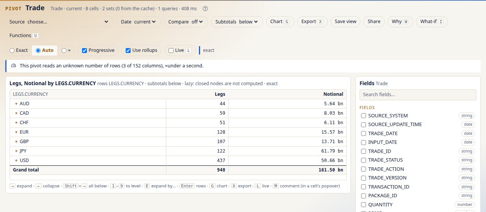

#### Step 2 · Its rows over sample documents

```text
$ python3 tools/drishti.py tables preview trading.trade_legs --sample trades.jsonl --limit 5
id	business_date	index	TRADE_ID	BOOK	LEG_ID	CURRENCY	NOTIONAL
row-1		0	1000016	BOOK-COMM-3	1	USD	1.484794E7
row-1		1	1000016	BOOK-COMM-3	2	USD	1.1878352E7
row-2		0	1000138	BOOK-COMM-3	1	USD	3.52635228E7
row-2		1	1000138	BOOK-COMM-3	2	USD	3.635252842E7
row-3		0	1000156	BOOK-COMM-3	1	EUR	6437605.63
5 row(s) from 136 document(s)
```

Add `--json` for the rows as JSON. Check the keys on the sample:

```text
$ python3 tools/drishti.py tables check --sample trading.trade_legs=trades.jsonl
1 table(s), 0 model(s): 0 error(s), 0 warning(s)
```

You should see one row per leg (trade 1000016 has two), the built-in columns `id`, `business_date` and `index` first (a sample file has
no entity id or business date: the preview numbers its documents `row-1`, `row-2` ...), and no `DRS-9613` (the keys are unique on each
business date).

#### Step 3 · A column in dollars and the desk's name

Add two calculated columns. A column's expression reads the source (`@.NOTIONAL`), never another column (`NOTIONAL`):

```yaml
  NOTIONAL_USD: { expr: "@.NOTIONAL * fx(@.CURRENCY, 'USD')", type: decimal }
  DESK_NAME:    { expr: "related(core.books.DESK_NAME, on = $.PORTFOLIO)", type: string }
```

`fx` reads the installation's one FX source at the row's business date; `related` reads the `DESK_NAME` of the `core.books` row whose key
is the trade's book. Write `config/tables/core/books.table.yaml`:

```yaml
rachana: 3
table: core.books
from: { kind: book }
keys: [BOOK_ID]
columns:
  BOOK_ID:   { path: $.BOOK_ID, type: string }
  NAME:      { path: $.NAME, type: string }
  DESK_NAME: { path: $.DESK_NAME, type: string }
```

then preview again, the books' and the FX spots' samples beside the trades' (`--related` gives a table's sample, `--fx` the spot rates;
without them only a currency to itself converts and `related` finds nothing):

```text
$ python3 tools/drishti.py tables preview trading.trade_legs --sample trades.jsonl --related core.books=books.jsonl --fx fx-spot.jsonl --limit 6
id	business_date	index	TRADE_ID	BOOK	LEG_ID	CURRENCY	TRADER	NOTIONAL	NOTIONAL_USD	DESK_NAME
row-1		0	1000016	BOOK-COMM-3	1	USD	TRDR-FROSSI	1.484794E7	14847940	Commodities
row-1		1	1000016	BOOK-COMM-3	2	USD	TRDR-FROSSI	1.1878352E7	11878352	Commodities
row-2		0	1000138	BOOK-COMM-3	1	USD	TRDR-FROSSI	3.52635228E7	3.52635228E7	Commodities
row-2		1	1000138	BOOK-COMM-3	2	USD	TRDR-FROSSI	3.635252842E7	3.635252842E7	Commodities
row-3		0	1000156	BOOK-COMM-3	1	EUR	TRDR-TBRENNAN	6437605.63	7557749.00962	Commodities
row-4		0	1000172	BOOK-COMM-1	1	USD	TRDR-TBRENNAN	659442.31	659442.31	Commodities
6 row(s) from 136 document(s)
```

(The `TRADER` column is step 4's.) You should see the EUR leg in dollars at the sample's EUR/USD spot (1.174) and the desk's name. Write
`NOTIONAL * 2` instead and the check refuses it with the path to write:

```text
trading/trade_legs.table.yaml: error DRS-9152 columns.DOUBLE.expr: no field 'NOTIONAL'; did you mean @.NOTIONAL?
trading/trade_legs.table.yaml: error DRS-9127 columns.DOUBLE.expr: 'NOTIONAL' is a column of this table: an expression reads the source, so write the column's path (@.NOTIONAL)
```

#### Step 4 · Who sees which rows

Add rules, and a column masked for readers without the raw power:

```yaml
  TRADER:   { path: $.TRADER_ID, type: string, masked: true }
...
rules:
  - { role: trader, where: "$.TRADER_ID == user.name" }
  - { role: [risk, analyst], where: "true" }
```

The rules apply to every reader of the table: BI, the pivot, Arrow Flight; `tables check` reads each rule in Rachana's checked mode (a
rule reads the row and `user`). You should see `0 error(s)` from the check and, once BI reads the layer, a trader see the legs of their
own trades, risk and analysts every leg, and a role no rule names none, told so (`DRS-9131`). A list attribute is strict: a rule
`$.DESK in user.desks` holds nothing for a reader with no desks. On the screen, BI's model `trading-risk` shows the same today on its Security tab: a row rule
per role and the masked columns, which `tables migrate` carries into its tables (step 6):

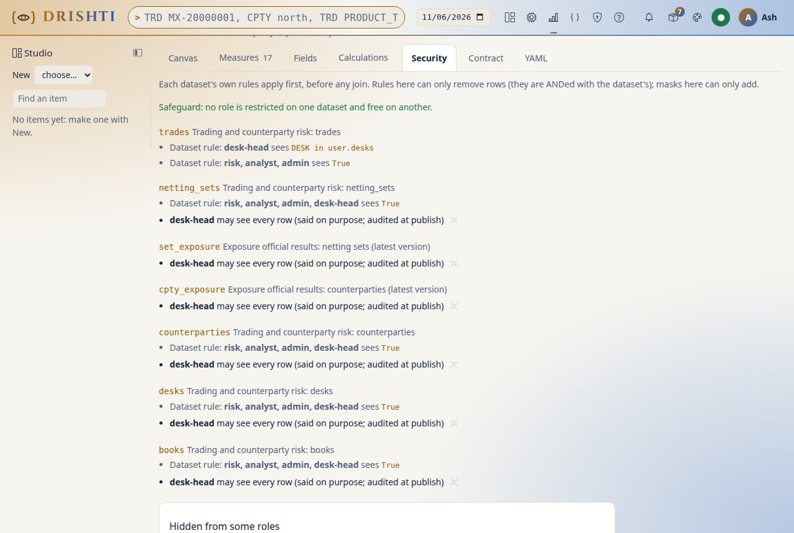

#### Step 5 · A model over the legs and the books

Write `config/tables/trading/legs.model.yaml`:

```yaml
rachana: 3
model: legs
tables:
  legs:  { table: trading.trade_legs, role: fact }
  books: { table: core.books, role: dimension }
relationships:
  - { from: legs.BOOK, to: books.BOOK_ID }
measures:
  Notional USD:   { expr: "sum(legs.NOTIONAL_USD)", format: amount0 }
  Legs:           { expr: "count(legs)" }
  Average leg:    { expr: "measure('Notional USD') / measure('Legs')", format: amount0 }
  Non-USD legs:   { expr: "count(legs, where = legs.CURRENCY != 'USD' && legs.CURRENCY != null)" }
hierarchies:
  Desk and book: [books.DESK_NAME, books.NAME]
```

```text
$ python3 tools/drishti.py tables check
2 table(s), 1 model(s): 0 error(s), 0 warning(s)
$ python3 tools/drishti.py tables lineage trading.trade_legs
used by  model legs: reads it as legs (fact)
$ python3 tools/drishti.py tables lineage legs
reads  legs  trading.trade_legs
reads  books  core.books
```

You should see `0 error(s)`, and the lineage name the model `legs` and what it reads. Asked by `books.DESK_NAME` or by book, the layer
compiles each measure with Rachana's one compiler and the pivot engine's aggregates: one row per leg underneath, each book's subtotal and
the grand total, as the Pivot shows over the same trades today (rows `$.PORTFOLIO` and `$.LEGS[*].CURRENCY`, every book open):

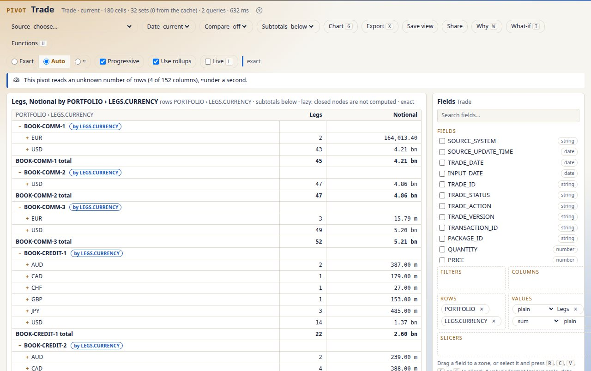

#### Step 5a · A bridge, both ways, and a measure along another path

**In the Console.** Open the model, **Tables** tab. Under **Many-to-many bridges** add a row: left key `books.BOOK_ID`, right key `limit_groups.GROUP_ID`, bridge table `book_limit_group`. In **Relationships** set a relationship's **Filter** to **Both ways** only if a one-side measure must be filtered by the many side. If the save is refused, the two paths and the fix buttons appear with the paths drawn; **Show the paths** draws them at any time. **Convert DAX to Rachana** at the bottom of the tab turns a pasted DAX measure into Rachana and names what it cannot convert.

**In YAML:**

```yaml
relationships:
  - { name: trade_date, from: trades.TRADE_DATE, to: dates.DAY }
  - { name: settle_date, from: trades.SETTLE_DATE, to: dates.DAY, active: false }
bridges:
  - { name: book_limit_group, left: books.BOOK_ID, right: limit_groups.GROUP_ID, through: book_limit_group }
measures:
  Notional by settle date: { expr: "sum(trades.NOTIONAL)", via: settle_date }
```

**At the prompt:** `tools/drishti.py bi dax "CALCULATE(SUM(trades[NOTIONAL]), USERELATIONSHIP(trades[SETTLE_DATE], dates[DAY]))"`

You should see group rows by limit group that do not add to the total when a book sits in two groups: the total counts each trade once.

#### Step 6 · BI's samples migrated, with a dry run first

The dry run prints the diff of every file it would write and a report; nothing is written:

```text
$ python3 tools/drishti.py tables migrate --dry-run --report migration.txt
--- /dev/null
+++ b/bi/counterparty_exposure_counterparties.table.yaml
...
--- a/config/bi/reports/banking/live-trading-desk.report.yaml
+++ b/config/bi/reports/banking/live-trading-desk.report.yaml
@@ -30,7 +30,7 @@
 sample: true
 endorsement: promoted
 tags: [sample, trading, live, streaming, tutorial]
+model: live-trading@1
-dataset: live-trading
 theme: { palette: default }
items: 34 (converted 34, unchanged 0, refused 0)
expressions: 103 (rewritten 22, refused 0)
files to write: 32
```

You should see 34 items converted, none refused: 22 tables and 10 models under `config/tables/bi/`, and the two live reports bound to their
models. In the report, `trading-risk`'s *Open MTM*:

```text
converted  models/trading-risk.model.yaml  ->  bi/trading-risk.model.yaml
    measures.Open MTM.expr:
      - sum(trades.MTM, where=trades.TRADE_STATUS != 'MATURED')
      + sum(trades.MTM, where = trades.TRADE_STATUS != 'MATURED' && trades.TRADE_STATUS != null)
        (DEL into Rachana (section 2.4))
        (kept DEL's meaning for a missing value: trades.TRADE_STATUS != 'MATURED' && trades.TRADE_STATUS != null (Q1))
```

The guard keeps BI's figure: in Rachana a missing status is not `'MATURED'`, so without it a trade with no status would be counted. On the
screen, the model's measures as BI shows them today, *Open MTM* among them:

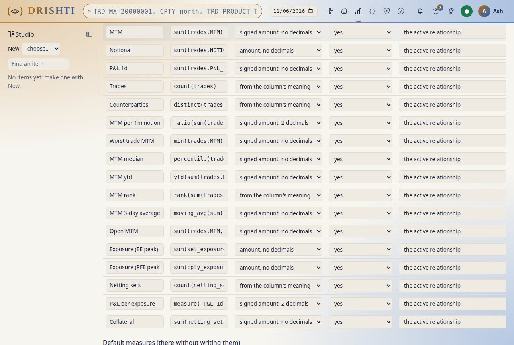

Then the write, with an audit line per file, and `--check` (exit 1 while something would change):

```text
$ python3 tools/drishti.py tables migrate --audit data/audit/tables-migrate.jsonl
...
34 file(s) written under /path/to/drishti/config/tables
$ python3 tools/drishti.py tables migrate --check
nothing to migrate
$ python3 tools/drishti.py tables check
24 table(s), 11 model(s): 0 error(s), 0 warning(s)
```

You should see the files under `config/tables/bi/` beside your own two tables and model, 34 lines in the audit, the second run change
nothing, and the whole catalogue check clean.

#### Next steps

- Every key, check and code: [Part 2 · Virtual tables and models](#part-2--virtual-tables-and-models), in Help beside this tutorial:

  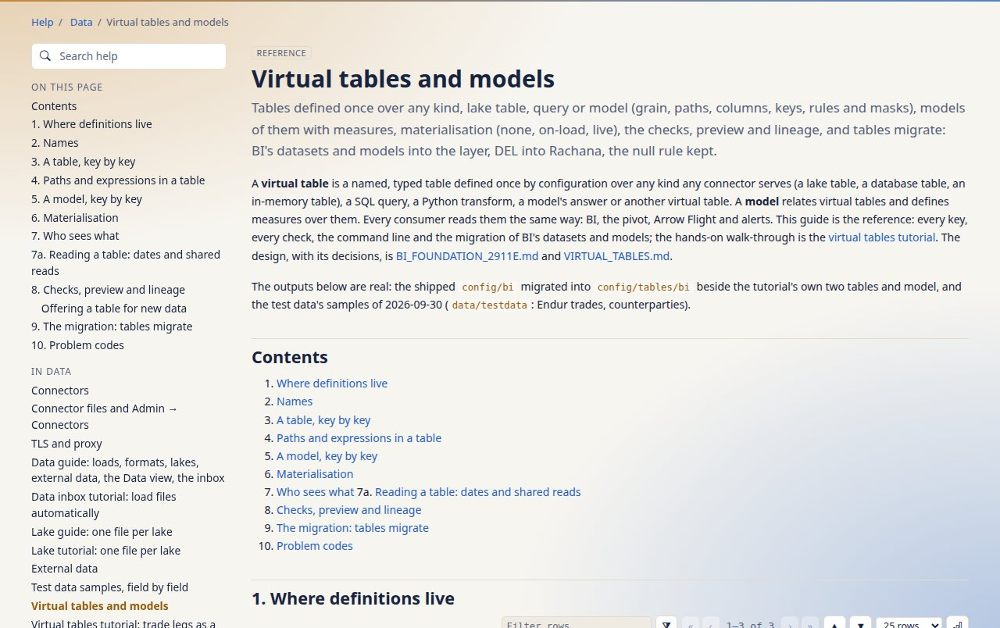

- The language: [RACHANA_REFERENCE.md](RACHANA_REFERENCE.md) (paths, `in`, the null rule, checked mode).
- The design and what is built: [BI_FOUNDATION_2911E.md](../architecture/ARCHITECTURE.md#281-the-table-layer-and-models-in-rachana).

## Part 3 · Reports and dashboards

Drishti's reports, boards and statements are its business-intelligence layer, called **BI** in the top bar and on the command line
(`RUPAKA` is an alias). There is one analysis path: **slice in the Pivot, then make a report**. The [Pivot](#part-1--pivot-cubes-and-explain) is the one grid
for slicing and totalling any table; when an analysis is worth keeping for other people (published, shared, scheduled, put on a wall
screen, sent as a statement, watched by an alert), it becomes a **report**. A report reads a **model** written in Rachana over the
**tables** of the table layer (**Build › Tables & models**; [Part 2 · Virtual tables and models](#part-2--virtual-tables-and-models) is the home of tables, models and virtual
tables). Every number is computed on the server, as the person looking: their row rules and masks apply to every visual, export, mail,
alert and embedded report. The browser only draws.

This guide is what you see and what you do: the pages, the designer, the report file, boards, statements, background runs, AI helpers,
publishing and governance, and distribution (the Reports page, export, subscriptions, alerts, embedding). How it is built is
[ARCHITECTURE.md section 28](../architecture/ARCHITECTURE.md). Code over a model (SQL and Python cells, Python measures, visuals and
Transforms) is the [Notebook](#part-4--the-notebook-and-python).

### Start here

| You want to | Read |
|---|---|
| **Learn by doing** | [the reports tutorial, Part A](#part-a--your-first-bi-report) (a first report in twelve steps: map, bar, slicer, publish, filters, several models, relative dates, a tablet); then [11](#part-d--bi-that-runs-itself) (refresh, subscriptions, alerts, export, expected values), [12](#part-f--live-bi-and-boards) (live reports and boards), [13](#part-g--govern-bi) (governance), [14](#tutorial-the-notebook-and-python) (Python and the Notebook), [15](../tutorials/10-ai-assistant.md) (AI), [16](../tutorials/20-embed-drishti.md) (embedding), [18](#part-b--several-datasets-in-one-report) (several facts in one report), [20](#part-c--statements-and-field-parameters) (statements and field parameters), [44](#tutorial-virtual-tables-and-models) (tables and models) |
| Try each step with real answers, four people and row rules at work | [section 5.9](#r59-worked-examples-the-shipped-models-row-rules-and-masks) |
| Find your way round the pages, powers and workspaces | sections [2](#r2-getting-in-the-bi-menu-the-rail-and-bi-go) to [4](#r4-home-the-catalogue-workspaces-and-items) |
| Write or read a table or a model | [Part 2 · Virtual tables and models](#part-2--virtual-tables-and-models); what reports need of them: [section 5](#r5-models-and-datasets-what-a-report-reads) |
| Design a report | [section 8](#r8-bi-studio-and-the-report-designer); the file: [section 9](#r9-the-report-file-pages-visuals-filters-and-slicers) |
| Put a wall of tiles on a screen | [section 14](#r14-boards-report-pages-of-live-tiles) |
| Follow a long question that runs in the background | [section 15](#r15-background-runs-long-bi-questions) |
| Publish, review, certify, trace lineage, move content between servers | [section 17](#r17-publishing-and-governance-versions-review-certification-lineage-impact-environments) |
| Export, subscribe, schedule, alert | [section 18](#r18-distribution-the-reports-page-export-and-subscriptions), [section 19](#r19-alerts-on-numbers) |
| Show a report in another web application | [section 20](#r20-embedding-a-report-in-another-web-application), [EMBED_GUIDE.md](EMBED_GUIDE.md) |
| Grant the powers, set the limits | [ADMIN_GUIDE.md](ADMIN_GUIDE.md#34-bi-powers-rupaka), [CONFIGURATION.md](../admin/CONFIGURATION.md) |
| Call it from a program or the command line | [API_REFERENCE.md](API_REFERENCE.md), [CLI_REFERENCE.md](CLI_REFERENCE.md#bi-workspaces-and-the-catalogue-rupaka) |
| Compare this with Power BI, honestly: leads, gaps, what is planned | [Drishti BI and Power BI compared](#part-6--drishti-bi-and-power-bi-compared) |
| Fix a problem | [section 22](#r22-settings-limits-and-problem-codes), [OPERATIONS_GUIDE.md](OPERATIONS_GUIDE.md#21-troubleshooting) |

A good first hour: read sections 2 to 4, set up the stack of [section 5.9](#r59-worked-examples-the-shipped-models-row-rules-and-masks), then do tutorial 8, Part A.

### Contents

1. [What a report is, and the path to one](#r1-what-a-report-is-and-the-path-to-one)
2. [Getting in: the BI menu, the rail and BI GO](#r2-getting-in-the-bi-menu-the-rail-and-bi-go)
3. [Who may do what: the four powers](#r3-who-may-do-what-the-four-powers)
4. [Home, the catalogue, workspaces and items](#r4-home-the-catalogue-workspaces-and-items)
5. [Models and datasets: what a report reads](#r5-models-and-datasets-what-a-report-reads)
6. [The report viewer](#r6-the-report-viewer)
7. [Which date a report reads](#r7-which-date-a-report-reads)
8. [BI Studio and the report designer](#r8-bi-studio-and-the-report-designer)
9. [The report file: pages, visuals, filters and slicers](#r9-the-report-file-pages-visuals-filters-and-slicers)
10. [Format, conditional formatting and themes](#r10-format-conditional-formatting-and-themes)
11. [Field parameters](#r11-field-parameters)
12. [Statements: paginated reports, page-exact, one per reader](#r12-statements-paginated-reports-page-exact-one-per-reader)
13. [Live reports and standing queries](#r13-live-reports-and-standing-queries)
14. [Boards: report pages of live tiles](#r14-boards-report-pages-of-live-tiles)
15. [Background runs: long BI questions](#r15-background-runs-long-bi-questions)
16. [AI in BI: report from words, ask the data, explain this number](#r16-ai-in-bi-report-from-words-ask-the-data-explain-this-number)
17. [Publishing and governance: versions, review, certification, lineage, impact, environments](#r17-publishing-and-governance-versions-review-certification-lineage-impact-environments)
18. [Distribution: the Reports page, export and subscriptions](#r18-distribution-the-reports-page-export-and-subscriptions)
19. [Alerts on numbers](#r19-alerts-on-numbers)
20. [Embedding a report in another web application](#r20-embedding-a-report-in-another-web-application)
21. [Python in reports](#r21-python-in-reports)
22. [Settings, limits and problem codes](#r22-settings-limits-and-problem-codes)

### R1. What a report is, and the path to one

**The path.** Open any table, entity search or VaR in the **Pivot** (`PIVOT <GO>`, or *Pivot* on the BI rail) and slice it: the risk cubes
are its presets ([Part 1 · Pivot, cubes and explain](#part-1--pivot-cubes-and-explain)). A figure for other people is a **report**: pages of visuals over one model, designed by
dragging fields onto a canvas, published through review, read by many, each as themselves. What a grid cannot say is the
[Notebook](#part-4--the-notebook-and-python)'s.

**What you can do**

* open BI from the top bar or with `BI <GO>`; keep drafts in a personal workspace and move them to a shared one; create typed items
  (`report`, `theme`, `notebook`, `python`, and the table layer's `table` and `model`; a board is a report with board pages) with a YAML body;
* read the **models** reports sit on: tables from pack kinds through connectors, relationships, measures, row rules and masks; a pack's
  every kind is already a table; start a model from the packs (section 5);
* open a **report**: tabs, slicers, click a bar to filter the page, drill down, drill through, show the rows, open a trade in the terminal
  (section 6); **design** one in BI Studio by dragging fields onto a canvas, with the YAML beside it, real data, Check, undo and redo (section 8);
* lay a page out as **paper** (a statement, one per reader: section 12) or as a **board** of live tiles for a wall screen (section 14);
* watch a report over a **live table** redraw as the data ticks (section 13); let a long question run in the **background** and come back
  to it (section 15);
* publish versions, propose for review, approve (four eyes), compare any two saved states, certify, see lineage and what a change breaks,
  move content between servers as a bundle (section 17);
* **export** a page as PDF, PNG, Excel, CSV or JSON Lines, **subscribe** people by email, set **alerts** on a number, **embed** a report in
  another application (sections 18 to 20);
* ask the **AI helpers**, when an administrator has switched them on: describe a report, ask the data, explain a number (section 16).

Everything the pages do, the server decides: the pages are a shell that asks the server's `/api/v1/bi` under your identity.

### R2. Getting in: the BI menu, the rail and BI GO

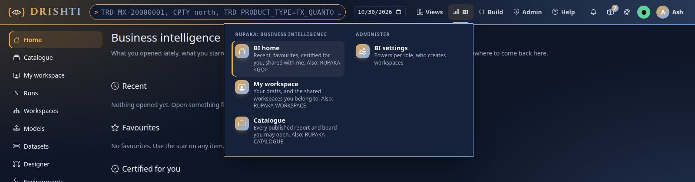

**The BI menu** is a menu of the top bar, with the icon `bar-chart-line` (an edition or a lens chooses which menus it draws, and in what
order). It is shown only to people who hold the `bi` power (section 3), and not at all when BI is
switched off. Its entries are also the **rail** on the left of every BI page:

| Group | Entry | Opens |
|---|---|---|
| Business intelligence | **Catalogue** | every published report and board you may open (`/bi/catalogue`) |
| | **My workspace** | your drafts (`/bi/w/me`) |
| | **My runs** | your BI questions queued or running, and the last ones answered (`/bi/w/me?tab=runs`, section 15) |
| | **Workspaces** | the shared workspaces you belong to, and their members (`/bi/workspaces`) |
| Analyse | **Models** | *Start from your data*: the models and the tables the packs give (`/bi/models`, section 5) |
| | **Datasets** | the tables reports read, with their refresh (`/bi/datasets`) |
| | **Report designer** | your report drafts, a new report or board, and the designer (`/bi/designer`) |
| | **Promotion (test to live)** | move reports and models from one environment to the next as a bundle (`/bi/environments`, section 17.7) |
| | **Notebook**, **Data prep** | code over a model, and Python data preparation ([Part 4 · The Notebook and Python](#part-4--the-notebook-and-python)) |
| Administer | **BI settings** | Admin, BI settings (`/admin/bi`, needs `bi-admin`; in the top bar's menu only) |

The rail also links the **Build home** (`/build`, where BI's own home `/bi` leads), **Tables & models** (`/build/tables`) and the **Pivot**.
**Reports** in the **Views** menu (`/reports`) lists your scheduled reports, subscriptions and alerts, and the BI reports (section 18.1).

**`BI` on the command line** is a reserved keyword (`RUPAKA` is an alias). Case does not matter.

| Type | Opens |
|---|---|
| `BI <GO>` | the Build home (`/build`) |
| `BI WORKSPACE <GO>` (or `WORKSPACES`) | your personal workspace (`/bi/w/me`) |
| `BI CATALOGUE <GO>` (or `CATALOG`) | the catalogue (`/bi/catalogue`) |
| `BI RUNS <GO>` | your runs (section 15) |
| `BI <report-or-board> <GO>` | an item by its id or its title (any case); a **report opens drawn** (`/bi/r/<id>`), any other item opens its page; words that match several items open the catalogue searched for them |
| `BI SETTINGS <GO>` | Admin, BI settings (needs `bi-admin`) |

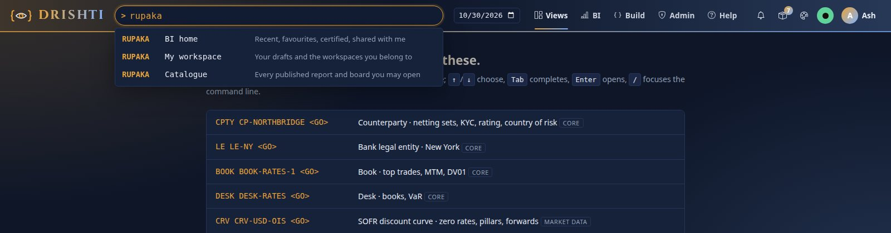

Type-ahead offers the keyword after the first letters (`b`, `ru`), the pages after `BI `, and the items you may open that match what you
type next. Someone without the `bi` power gets no suggestions and, on `<GO>`, a message that says what is missing. A pack may not define a
mnemonic named `BI` or `RUPAKA` (or `FORM`, `FUNC`, `WHAT`, `DATAMAP`): the pack loader refuses it, and `pack check` fails the same way.

**Addresses:** `/bi/catalogue`, `/bi/workspaces`, `/bi/w/<workspace>` (`me` is your personal one), `/bi/i/<item>` (an item's page),
`/bi/models`, `/bi/datasets`, `/bi/ds/<table>` (a table's page), `/bi/r/<report>[/<page>]` (the viewer; `/bi/b/<board>` opens it),
`/bi/designer` and `/bi/design/<draft>` (the designer), `/bi/design/theme/<id>` (the theme designer), `/bi/environments`, `/bi/run/<id>`
(one run), `/admin/bi` and `/admin/bi/runs`. The addresses of tables and models (`/bi/d/<id>`, `/bi/m/<id>`, `/bi/md/<id>`,
`/bi/datasets/new`) lead to the table's page or to **Build › Tables & models**.

**Keys** (the console's one keymap: `?` or the rail's **Keys** button lists them with the rest of the screen's): `/` searches the catalogue
(from another BI page it takes you there with the search focused), `g h` the Build home, `g c` the catalogue, `g w` my workspace, `g r` my
runs. Keys are ignored while you type in a field.

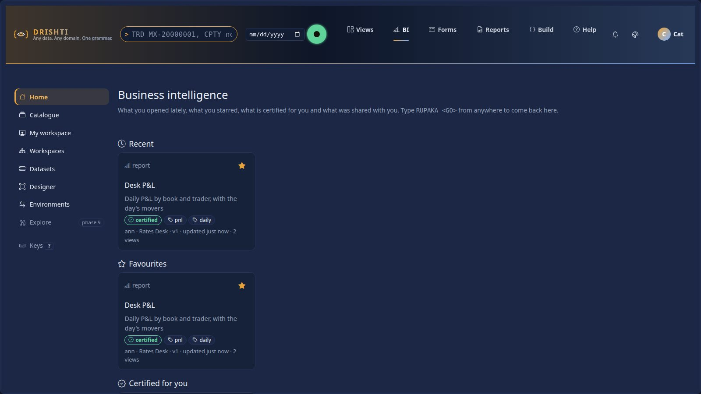

**On a phone** (390 px) the rail becomes a scrolling bar above the page, cards stack in one column, every control is at least 44 px high,
and fields use 16 px text so the browser does not zoom.

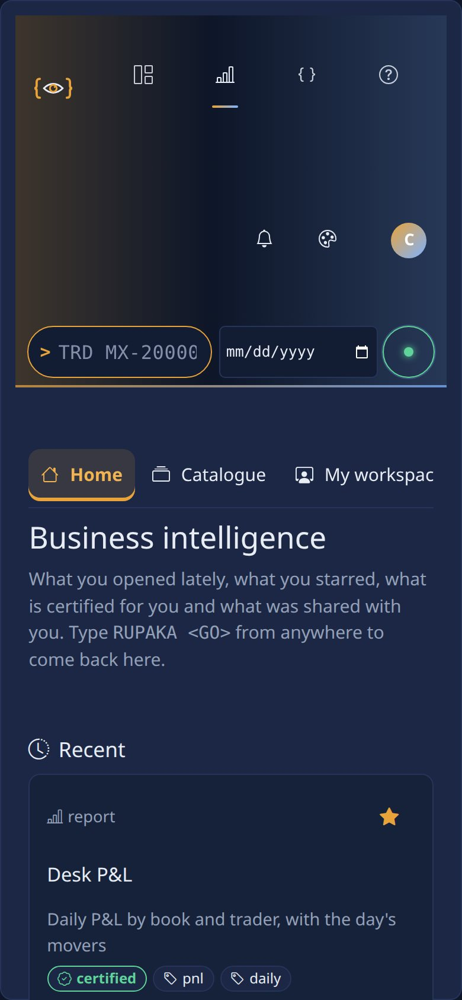

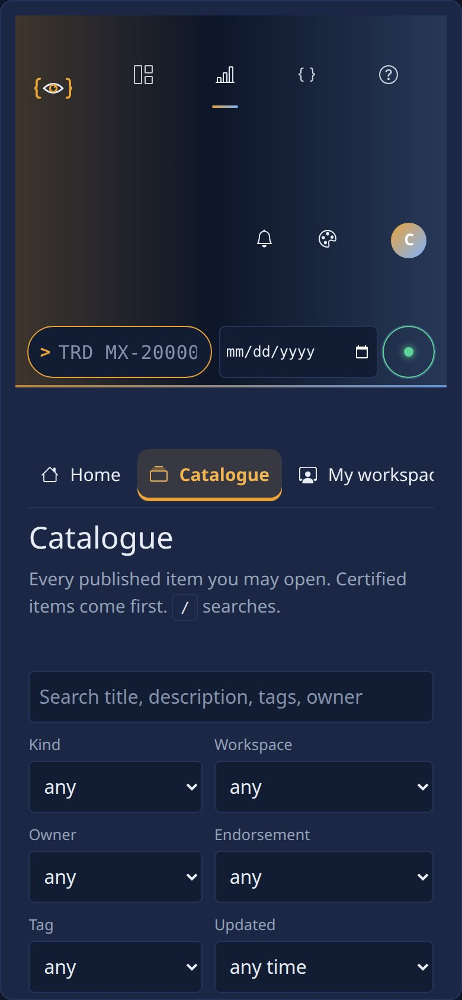 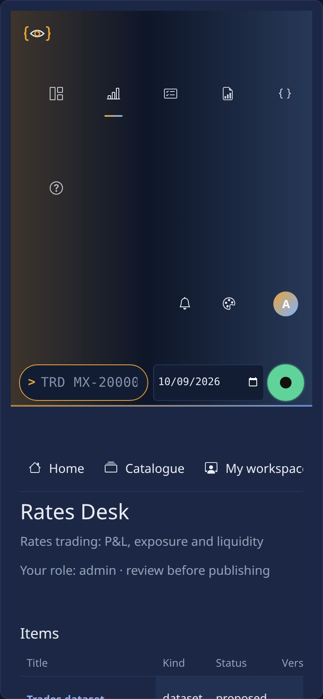

### R3. Who may do what: the four powers

BI powers are granted on roles, beside `raw`, `author` and `approve` (see [ADMIN_GUIDE.md](ADMIN_GUIDE.md#34-bi-powers-rupaka)).

| Power | Lets a holder |
|---|---|
| `bi` | open BI, the catalogue and the published content their audience allows; keep favourites and recents |
| `bi-author` | create, edit, move, propose and publish items (reports, tables, models, themes), design, and create shared workspaces (if the policy says authors) |
| `bi-steward` | **certify** published items; **review** (approve or reject) proposals in any workspace; **import bundles**; create shared workspaces when the policy says stewards |
| `bi-admin` | change BI settings, see and manage every shared workspace, force a publish that breaks reports or fails tests; always allowed to create workspaces |

A higher power also opens BI, so a role granted only `bi-author` still sees the catalogue. The built-in `admin` role holds all four;
`viewer` holds `bi`; `author` and `approver` hold `bi` and `bi-author`; a role a pack defines holds none until an administrator grants it.
With security off, everyone holds everything. What a power allows is then narrowed by the **workspace role** (section 4.3). Approving also
needs the role's own **`approve`** flag for a workspace member who is not a steward (section 17.3).

### R4. Home, the catalogue, workspaces and items

#### R4.1 Home: For you

BI's home is the **Build home** (`/build`). Its **For you** strip holds four sets of cards: **Recent** (what you opened lately, newest
first), **Favourites** (items you starred), **Certified for you** (certified items you may open, most used first) and **Shared with me**
(published items of your workspaces that others own). A card shows the kind, a star, the title, the description, badges (certified,
promoted, shipped, status, tags) and a line with owner, workspace, version, freshness ("updated 3 days ago") and the views in the last
30 days.

#### R4.2 The catalogue

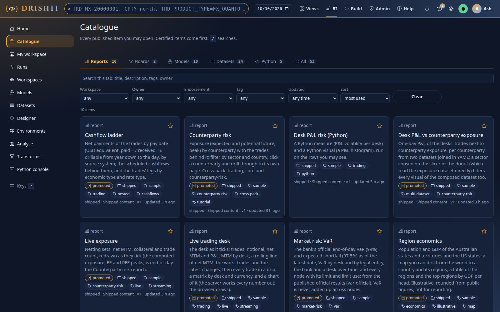

The catalogue lists every **published** item you may open (section 4.5), **split by kind into tabs**: **Reports · Boards · Models · Datasets ·
Python · All**, each with its count (*Reports 24*). Boards holds reports with board pages; Python holds Python items and notebooks; All shows
everything, grouped by kind. A tab switches in place; the address names it (`/bi/catalogue?kind=reports&sort=use`), so a link opens the same
tab and back and forward walk the tabs. With no `kind` in the address the catalogue opens on the tab you used last (remembered in this
browser), else Reports. The arrow keys move along the tabs; on a phone the tabs scroll sideways.

Search, filters and sort work **inside the chosen tab**, and every tab's count follows the search. The search box searches title,
description, tags, owner, kind and workspace name (every word must match); the filters narrow by workspace, owner, endorsement, tag and how
recently it was published; sort is *most used* (the default), *newest* or *title*. **Certified items are pinned first** except when sorted by
title. The address keeps the state (`?kind=python&q=daily`), and the filter lists show only values that exist, with counts.

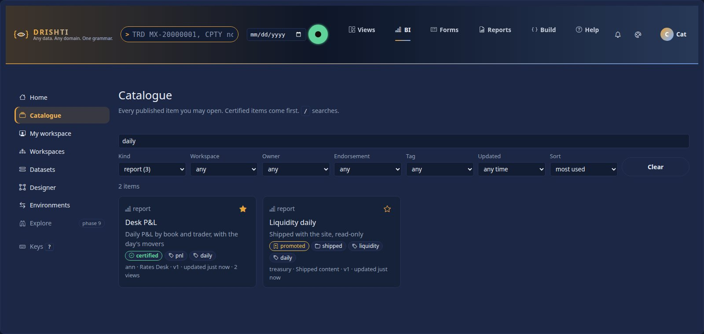

#### R4.3 Workspaces and their roles

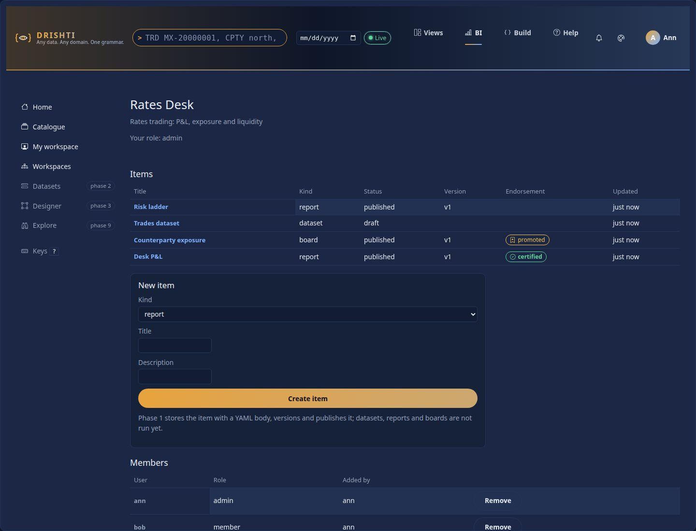

- **Personal workspace** (one per user, made on first use): drafts only you can see. It has no members and cannot publish: move an item
  to a shared workspace first (*Move to workspace*).
- **Shared workspace**: created from **Workspaces** (needs the policy's power, section 4.6). The creator becomes its admin. Members have a role:

| Workspace role | May |
|---|---|
| `viewer` | open the workspace and its published items |
| `contributor` | also create and edit drafts (needs the `bi-author` power too) |
| `member` | also publish, approve proposals, promote, delete others' drafts (publish needs `bi-author`) |
| `admin` | also add and remove members, rename it, switch review on or off, delete it (when empty) |

**Items · Runs · Members.** A workspace page has three tabs (`?tab=members`, `?tab=runs` in the address). **Items** lists the title, a short
id and the created time, the kind, status, version, endorsement and when it was updated. Rows you may delete (your own items, or any item
if you are a member of a shared workspace; never shipped content) have a checkbox; **Select all** and **Delete selected (N)** open one
confirmation listing the titles, and the message says which were deleted and which were skipped, with the reason. **New item** asks a report
for its model and opens it in the designer; a board opens in the same designer; a table or model opens **Build › Tables & models**; a
notebook or a Python item starts in the Notebook. **Members** lists the members and, for its admins, **Add a member** (type part of a name,
choose the role, **Add or change**) and the settings (*Require review before publishing*, *Delete workspace*). After **Create workspace**,
*Next: add the people who share it* opens the Members tab. **Runs** is section 15.4.

A person who is not a member does not learn that a workspace exists (`404 DRS-9001`). The last admin cannot be demoted or removed. A
workspace that **requires review before publishing** offers *Propose* instead of *Publish*. A `bi-admin` is an admin of every shared
workspace (but cannot read anyone's personal workspace).

#### R4.4 Items: lifecycle, versions, duplicate and delete

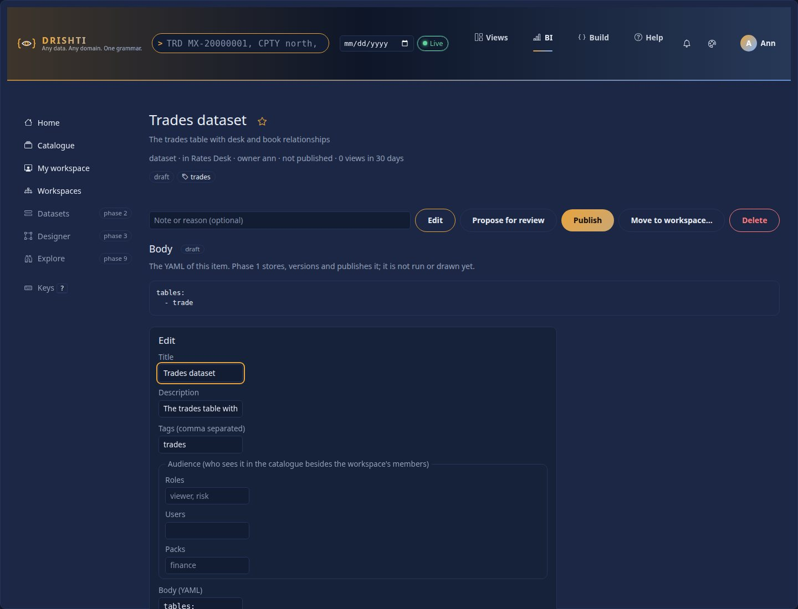

An **item** has a kind, a title, a description, an owner, tags, an audience, a **YAML body** (a mapping, at most
`drishti.bi.max-body-bytes`, 256 KiB; nothing runs it) and a lifecycle: `draft` → (optional `proposed`) → `published` as version N.

- Editing a **published** item makes a new draft; readers keep the published version until you publish again, and the page shows "draft
  changes not published".
- **Publish** (member, `bi-author`, shared workspace, no review required) writes the next version. **Propose for review** freezes the item
  until it is approved, rejected or withdrawn (section 17.3).
- **Two people, one draft.** Every editor saves from the saved state it opened. If someone else saved first, the save is refused
  (`DRS-9007`, nothing written) and the editor offers **Reload theirs**, **Save mine as a copy** (into a workspace you choose) or **Overwrite
  with mine**. This holds in the report designer (boards included), the theme designer and the item page's Edit form.
- **Frozen items open read-only.** A proposed item opens with a banner and **Withdraw to edit**; its page shows who can approve it.
- **One bad visual, not a blank report.** A visual with an error of its own shows an error card; every other visual is drawn, in the
  designer, the viewer, exports and boards.
- **Buttons that do not double-submit.** A button that sends a request is disabled while it is in flight, and the answer (*Published*,
  *Certified*, or a refusal in words such as *DRS-9052 ... which is still a draft*) appears beside it.
- **View as readers see it.** The designers' **View** menu offers **my draft** or **as readers see it (published)**: the published version
  with data masked for you, with a banner naming the version; greyed until the item has been published.
- **Duplicate...** makes a draft copy of any item in a workspace you choose. **Delete** (on the item page and in the workspace list) first
  says what depends on it: the reports that read a model, the boards that show a report (the count is of what you may read). **Move**
  changes workspace (you need contributor in the target).
- **Versions** are kept (`drishti.bi.versions-keep`, 50): *View* shows a version's body; *Restore as draft* makes an old version the draft
  again. **History** (section 17.1) adds a saved state for every save, a side-by-side diff and restore.
- **Endorsement.** The owner or a member may **promote** a published item; only a `bi-steward` may **certify** it (section 17.4).
- **Favourites and views.** The star is yours alone. Opening an item counts one view for today; the card shows the views of the last
  `drishti.bi.usage-days` (30).

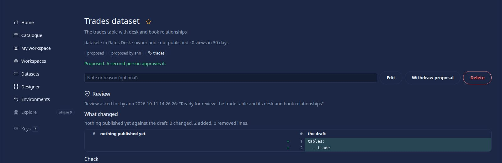

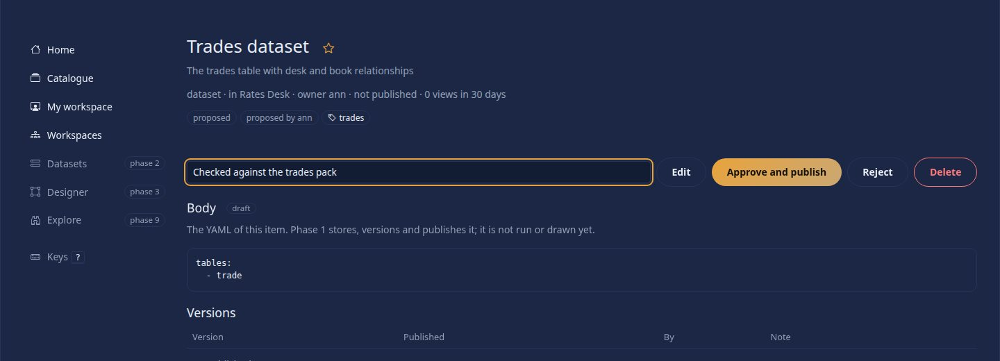

#### R4.5 Who sees what

An item reaches the **catalogue** and **Home** for you when it is **published**, not in a personal workspace, and at least one holds: you
are a `bi-admin`, its owner, or a member of its workspace; its **audience** names one of your roles, you by name, or a pack assigned to you;
it is shipped content with no audience (everyone with `bi`). An item with an empty audience is visible to its workspace's members only. A
draft is seen only by the workspace's contributors and above. Anyone who may not see an item gets `404 DRS-9001`, never a hint that it
exists. Rows and fields **inside** a model are a separate layer: the table's and the model's row rules and masks are applied by the server to
every query, for each reader (section 5.5); the catalogue decides only whether you may open the item.

#### R4.6 Shipped content, the samples and BI settings

**Shipped content.** Files in the BI folder (`drishti.bi.dir`, default `./config/bi`) appear as published, read-only items of the workspace
*Shipped content*: `reports/<id>.report.yaml` (boards are reports), `python/<id>.python.yaml`, `themes/<id>.theme.yaml`,
`notebooks/<id>.notebook.yaml`, and the table layer's tables and models in `config/tables/<domain>/` ([Part 2 · Virtual tables and models](#part-2--virtual-tables-and-models)). The
keys `title`, `description`, `owner`, `tags`, `endorsement` (`none`, `promoted`, `certified`) and `audience` (`roles`, `users`, `packs`)
describe the catalogue entry; the file is the body. The folder is read again **live, with no restart** (`drishti.bi.watch`: `auto` file
events with a polling safety net every `folder-refresh`, 5 s; `poll`; or `off`): **add** a file and it appears; **change** it and the next
read is the next version (counted since the server started); **delete** it and it is gone (`404 DRS-9001`). A file that does not parse
**keeps its last good version** and is listed as a problem in *Admin, BI settings* and on *Health*. Shipped items cannot be edited here:
change the file, or **Save a copy**. Details: [config/bi/README.md](../../config/bi/README.md).

```yaml
# config/bi/reports/liquidity-daily.report.yaml
title: Liquidity daily
description: Shipped with the site, read-only
owner: treasury
tags: [liquidity, daily]
endorsement: promoted
pages: []
```

**The samples**, each commented and marked `sample: true`: ten models in `config/tables/banking/` and `config/tables/bi/` (`trades-basic`,
`trading-risk`, `trading-cashflows`, `counterparty-exposure`, `desk-pnl-vs-exposure-py`, the live `live-trading` and `live-exposure`,
`market-risk-var`, `world-economics`, `region-economics`) over the tables beside them; twelve reports in `config/bi/reports/`
(`trades-overview`, `counterparty-risk`, `cashflow-ladder`, `live-trading-desk`, `live-exposure`, `python-desk-risk`, `pnl-vs-exposure`,
`market-risk-var`, `world-economics`, `region-economics`, and the boards `desk-wall` and `python-wall`); four Python items, one notebook
and two themes (**Corporate** and **Print**). `world-economics` reads real World Bank data; `region-economics` (Australian and US states)
has illustrative figures rounded from public figures, not for reporting. A sample is hidden from the people who may not see sample packs
(*Admin, Packs, Hide samples from business users* or *from everyone*).

**VaR in BI.** The sample report **Market risk: VaR** (model `market-risk-var`) reads the official end-of-day VaR the server publishes
([VAR_GUIDE.md section 19](VAR_GUIDE.md#19-official-end-of-day-results)), served by the market-risk pack as the read-only kind
`var-official` (connector `var-results`). The table `market_risk_var_official` holds every result version; `market_risk_var_latest` keeps the
latest version of each node and date, and the model reads that one. VaR is not additive, so no measure sums it: `VaR 99%` and `ES 97.5%` are
`max()` of a node's one row (over several nodes, the largest, never a total), and `Bank VaR` and `Bank ES` are the bank node's own figures.
The report shows the bank's VaR, ES and limit use; VaR by desk and by legal entity, each bar drilling through to a **Node** page; the bank
over time and a desk chosen in a slicer over time; every node with VaR, ES, limit and limit use (over 90% in red). Every figure says what it
is: `nodes.HORIZON` (`1D`), `nodes.METHOD`, and the measures **VaR confidence** and **ES confidence**; put `nodes.HORIZON` on a slicer to keep
a 1-day figure apart from a 10-day one. A 10-day or another-confidence figure is the engine's on demand (`VRES <scope>~horizon=10d~method=sum`,
[VAR_GUIDE.md section 18.6](VAR_GUIDE.md#186-horizons-the-two-10-day-methods-and-the-confidence-chosen)). A node id opens the node in the
terminal; `VAR NODE:<id> <GO>` opens the VaR explorer.

**Exposure in BI.** Netting-set and counterparty records store no exposure: the exposure engine computes it and publishes its official
end-of-day results ([EXPOSURE_GUIDE.md section 20](EXPOSURE_GUIDE.md#20-official-end-of-day-results)), served as the read-only kind
`exposure-official-cpty` (command `XOFC`, connector `exposure-results`). The tables `counterparty_exposure_official_netting_sets` and
`counterparty_exposure_official_counterparties` keep one row type each, the latest version of each scope and date. The models
`counterparty-exposure` and `trading-risk` read them as two more facts, `set_exposure` and `cpty_exposure`, related to `counterparties.id`:
**Exposure (EE peak)** is `sum(set_exposure.PEAK_EE)` (a reporting sum of the netting sets' peaks), and **Exposure (PFE peak)** is
`sum(cpty_exposure.PEAK_PFE_95)`, each counterparty's own peak 95% PFE, never a sum of its sets' PFEs. The live model `live-exposure` keeps
only what the netting set carries as it ticks (net MTM, collateral, limit, trades), since a live table is not joined to the daily results.

**Admin, BI settings** (`/admin/bi`, needs `bi-admin`):

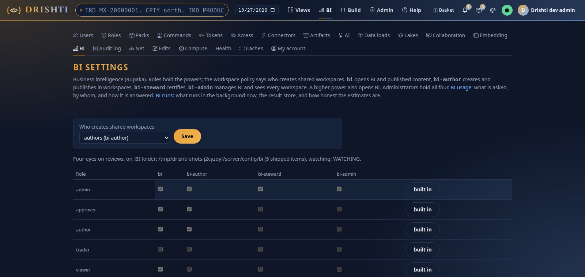

- *Who creates shared workspaces*: `authors` (`bi-author`, the default), `stewards` or `admins`. Kept in the identity database; overrides
  `drishti.bi.workspace-creation`.
- *The BI folder*: how it is watched (`WATCHING`, `POLLING`, `OFF`), how many shipped items it holds, and any file with a problem.
- *Roles and their powers*: tick `bi`, `bi-author`, `bi-steward`, `bi-admin` per role and **Save**. Roles from configuration or a pack are
  read-only here; roles defined in Admin, Roles are editable, by an administrator. A change reaches everyone who holds the role at once.
- *Shipped files*: the same list as **Admin → Artifacts**. **Disable** hides a file from the catalogue and keeps it; **Uninstall…** shows the
  reports, boards, models, alerts and subscriptions that depend on it, refuses while any do, and otherwise moves the file to
  `data/uninstalled/`, from where it is restored ([OPERATIONS_GUIDE.md section 18](OPERATIONS_GUIDE.md#10-admin--artifacts-install-and-uninstall-safely)).

**The command line.** `drishti.py bi workspace list|get`, `drishti.py bi catalogue list|get|publish` and `drishti.py bi item ...` talk to
the API as the token's user ([CLI_REFERENCE.md](CLI_REFERENCE.md#bi-workspaces-and-the-catalogue-rupaka)); the token scopes are `bi:write`,
`bi:approve` and `bi:admin`:

```
$ drishti.py bi workspace list
id                            role          items  name
u-cat-7fd6                    admin             0  My workspace  [personal]
rates-desk                    viewer            4  Rates Desk
shipped                       viewer            2  Shipped content
$ drishti.py bi catalogue list --q exposure --kind board
id              kind     endorsed  status    ver  title
bi-cd5f8b2cc5   board    promoted  published v1   Counterparty exposure  (Rates Desk, ann)
1 item(s)
```

### R5. Models and datasets: what a report reads

A report reads **one model** (`model: trading-risk@1`). A model relates **tables** (BI's "datasets") and defines measures, hierarchies,
parameters and tighter security over them; a table is one governed table over a pack kind, a SQL query, a Python transform, a model's
answer or another table. Both are files of the table layer (`config/tables/<domain>/<name>.table.yaml` and `.model.yaml`, `rachana: 3`)
or stored items of kind `table` and `model`, and both are written in **Build › Tables & models** (`/build/tables`), one editor with the live
YAML below it, a preview read as you, "adds up?" from the engine, and review before live. **Every key, check and command of tables and
models is in [Part 2 · Virtual tables and models](#part-2--virtual-tables-and-models)**; this section is what a report author needs of them, and the BI pages that show them.

BI reads only the table layer's form, and only Rachana in it. A file in BI's older dataset or model form under `config/bi/datasets` or
`config/bi/models` is refused with `DRS-9196` and the command that migrates it: `drishti.py tables migrate` ([BI_GUIDE.md section T9](#t9-the-migration-tables-migrate)).
A pack carries its BI tables and models as `config/bi/tables/*.table.yaml` and `config/bi/models/*.model.yaml` in the layer's form (**Build →
New pack** writes them).

#### R5.1 The Models page and a table's page

**Models** in the rail (`/bi/models`, *Start from your data*):

* **Tables from the packs.** Every kind of every pack you may open is already a table, with its promoted columns, the vocabulary's meanings
  and the packs' references, certified by its pack, read-only, versioned with the pack. Nobody builds them. A card shows the pack, the time
  mode and the number of columns, and the kind's own description; **Use** starts a report on it at once.
* **Your tables** (the ones you may read, and your drafts) and **Models** (model items you may read).
* **New model** and **New table** open **Build › Tables & models**; **Make it a model** (below) writes a table's implicit model out.

**A table's page** (`/bi/ds/<name>`) says what one row is (*One row per trade per business date*), the keys, the time mode (*snapshot: a
query without a date reads the latest business date with rows*), the source, every column with its type, role, meaning, the kind it
references (`desk →`), its unit, whether it adds up and its default measure, the security, the YAML, its **Refresh** (section 5.6) and its
**Expected values** (section 5.8). Its buttons: **Start a report on it**, **Make it a model**, and **Narrow it** (a table of your own over this
one: extra computed columns, a row filter, more masks; the pack's own stays read-only). **Datasets** in the rail lists the tables reports read,
with their refresh.

**The implicit model.** A report may start from a bare table: its **implicit model** (`model: table:<name>`, or `dataset:<name>`) is the
table as the fact, its pack dimensions one hop away (a trade valuation's `DESK` brings the desk table) and **default measures** (one per
column with an aggregation, `Sum of MTM`, and `Count of <alias>`; amounts formatted `amount2`, counts `integer`). **Make it a model** writes
that implicit model out as a **shared** draft model and binds the report to it; when the workspace already has a model written out from the
same table, the report is bound to that one, and the reports on the same table are offered the move too. A model is shared, never a
per-report copy: deleting a report never touches its model, and a model is **not deleted while anything reads it** (`409 DRS-9004` names
what does; `GET /api/v1/bi/models/{ref}/consumers` lists the reports, boards, notebooks, tables, alerts and live subscriptions that read it).

#### R5.2 Fields, perspectives and the contract

Field properties are written **once, in the model** (`fields:`) and inherited by every report, board and answer on it: each field's
**display name**, **description**, **format**, **folder**, **hidden**, **sort by**, **data category** and **default summarisation**, and
each measure's description, format, folder and hidden. A **perspective** (`perspectives:`) is a named field list for one audience; a report
keeps its choice as `perspective:`. A perspective is a convenience, not security: what a role may not see, the model hides from it
(`hidden-for`), and the server leaves it out of `describe`, SQL and AI (naming it is *not found*).

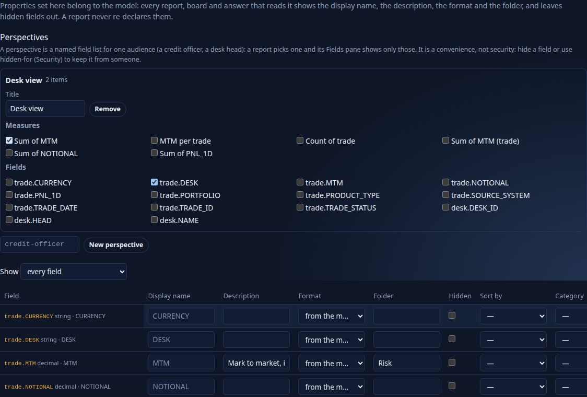

```yaml
measures:
  Sum of MTM: {expr: sum(trade.MTM)}
  MTM per trade: {expr: measure('Sum of MTM') / count(trade.TRADE_ID)}
fields:
  trade.MTM: {description: 'Mark to market, in the trade''s currency', folder: Risk}
  trade.PORTFOLIO: {hidden: true}
perspectives:
  desk-view: {title: Desk view, fields: [trade.DESK], measures: [Sum of MTM]}
```

**The contract.** A model has a semver `version`; reports pin a major (`trades-basic@1`). Each change since the published version needs a
version: removing or redefining a measure, hiding a field or removing a relationship is **major**; adding is **minor**; a description or a
format is **patch**; security needs none (it is audited). A published model refuses a breaking change without a new major (`DRS-9126`), and
the change lists the items that read the published major.


**The security safeguard.** When a role is restricted on one table of a model but no rule restricts another, the model cannot be published
until it is answered (`DRS-9130`): add a rule for that role on the other table, or say so with `may-see-all: { desk: [desk-head] }` (an
audited note). Check also names the readers no row rule matches (`DRS-9131`, a warning: leaving a role out may be the point); such a reader's
answer is empty and says *you have no access to rows of trades in this model: no row rule names your roles*, so the viewer shows that instead
of *No rows for this selection*.

#### R5.3 Relationships and how a question joins

**Many-to-many.** Declare the bridge once; the bridge table's own rows are not repeated into the facts.

```yaml
bridges:
  - name: book_limit_group
    left: books.BOOK_ID
    right: limit_groups.GROUP_ID
    through: book_limit_group        # optional: left-key, right-key, left-name, right-name, left-filter, right-filter
```

A dimension across a bridge filters and groups by a semi-join: a fact row is counted once per value of what is asked, never once per bridge row, so group rows may not add to the total (a book in two groups) and the total is from its own rows. Row rules and masks on the bridge and the far table are applied inside the semi-join, as the reader, before any join; a restricted far table reaches the facts too. A measure that reads a table beyond the bridge is refused in words: bring the column onto the near side with a look-up.

**Both ways.** `direction: both` on a relationship lets a filter on the many side reach the one side; it is read as a semi-join, so a one-side measure is never repeated. A model where a table can reach another by two paths and one of them is both-ways or across a bridge is refused when saved, naming both paths and the fix (`Two filter paths ... make 'cpty_group' inactive and name it with via: ..., or turn off both ways on 'bridge_book'`). A measure names the other path with `via: settle_date`.


A model's relationships go from the many side to the one side (`{ from: trades.DESK, to: desks.id }`), and the packs' links are suggested
for you. A question joins along **active** relationships, many-to-one, `LEFT JOIN`ed from the table the measures aggregate, so a measure is
never counted twice:

* **A measure is aggregated at its own table.** When a question mixes measures of different tables (`MTM` of `trades` and `Exposure (EE peak)`
  of `set_exposure`), each is computed alone at the question's fields and the answers are joined on them, so a "one"-side figure is never
  repeated by the many side. A measure that only combines measures (`measure('MTM') / measure('Exposure (EE peak)')`) is worked out over each
  at its own grain.
* **Several facts in one question.** Facts that share dimensions (trades and limits, both by desk) are not joined to each other: each is
  aggregated alone at the shared fields and the parts are full-outer-joined on them (a null equals a null), so a sector one fact lacks still
  shows with the other's figures. With no fields the totals sit side by side. A filter on a shared dimension reaches every fact.
* **Refused, safely** (`DRS-9020`, `DRS-9156`): a field one fact cannot reach many-to-one; a measure that mixes two unrelated facts in one
  expression; a window measure with another fact; legs and cash flows (siblings under a trade) in one question; and a **row rule that reads
  a fact** the other cannot reach: the question is refused rather than answered with other readers' data.

The pictures show the shipped cross-pack model with its tables and relationships, a relationship drawn back by dragging `PORTFOLIO` of
`trades` onto `id` of `books`, the line in the YAML, and a relationship proposed from the data with its match rate (profiling, no AI;
`drishti.bi.query.infer-min-match`, 0.8; links a pack already declares are never proposed). Relationships are written in the model's
**Tables** tab ([BI_GUIDE.md section T11.3](#t113-semantic-models)); a model's relationships drive joins and
cross-filtering only and never change a pack.


```
trades.DESK → desk_pnl.id  100% of 10 values match (many-to-one)
accepted: { from: trades.DESK, to: desk_pnl.id, cardinality: many-to-one }
```

#### R5.4 Measures: the expression language

Measures are **Rachana** expressions in aggregate scope ([RACHANA_REFERENCE.md › Rachana-EL expressions](RACHANA_REFERENCE.md#rachana-el-expressions),
every function in [RACHANA_REFERENCE.md](RACHANA_REFERENCE.md#every-function-generated-from-the-registries); filter context and what is refused: [BI_GUIDE.md section T12](#t12-measures-in-a-model-filter-context-and-what-is-refused)).
They compile to SQL on the server and are never run as code; every value is a bound parameter. The expression editor completes fields,
measures (writing `measure('…')`), functions with their signature and an example, and named arguments, shows the server's problems as you
type with the fix as a button, and **Try it** answers on the saved draft, as you.

```yaml
measures:
  Notional:   { expr: "sum(trades.NOTIONAL)", format: amount0 }
  MTM per 1m: { expr: "ratio(sum(trades.MTM), sum(trades.NOTIONAL)) * 1000000" }
  Share:      { expr: "measure('MTM') / measure('Notional')" }
  Open MTM:   { expr: "sum(trades.MTM, where = trades.TRADE_STATUS != 'MATURED' && trades.TRADE_STATUS != null)" }
  MTM ytd:    { expr: "ytd(sum(trades.MTM), trades.TRADE_DATE)" }
  MTM rank:   { expr: "rank(sum(trades.MTM))" }
  MTM 3-day average: { expr: "moving_avg(sum(trades.MTM), 3, trades.TRADE_DATE)" }
  Day on day: { expr: "sum(trades.MTM) - lag(sum(trades.MTM), 1, trades.TRADE_DATE)" }
```

A measure must aggregate (a column outside an aggregate is `DRS-9127`, *wrap it: `sum(trades.MTM)`*). What a report author needs to know of
the families:

* **Time intelligence** (`ytd`, `mtd`, `qtd`, `prior_period`, `same_period_last_year`, `running`) restricts **the rows the question reads**,
  ending on the as-of date (the end of the question's dates, else the newest date read); `prior_period` and `same_period_last_year` follow
  the pack's business-day calendar. With partitions that hold only each day's rows, the report's dates must reach back to the start of the
  window. `running` needs the date as a **field** of the visual, cannot be filtered on, and takes one `sum`, `count`, `min` or `max`. A rollup
  cannot hold a time measure.
* **Window functions** (`lag`, `lead`, `rank`, `dense_rank`, `percent_rank`, `moving_avg`, `moving_sum`, `moving_min`, `moving_max`,
  `cumulative`) are worked out **over the rows the question returns**, after the reader's row rules, filters and grouping, so a rank is a rank
  among the rows this reader may see. The order column must be a field of the visual; a window cannot be filtered on; a "row" is a row of the
  visual, not a calendar day (`lag(..., 1, trades.TRADE_DATE)` is the previous date that has trades).
* **Filter context** (`calc`, `share_of`, `parent_of`, `as_of`): security is never in scope, so `share_of(…, over = ALL)` is a share of
  everything **you** may see. The Fields pane badges a measure that uses time intelligence or a window (`ytd`, `running total`, ...).

#### R5.5 Row rules and masks in practice

Who sees which rows and fields is set on the tables and tightened by the model ([BI_GUIDE.md section T7](#t7-who-sees-what)).
For a report it means:

* **Row rules** run on the server, for each reader, as a predicate the question cannot remove. A reader gets the rows any of their rules
  allows; a reader no rule names gets **no rows**, and the answer says why. `user.desks` is strict: a desk head with no desks sees no trades.
* **Masks** apply to readers without the `raw` power, **before aggregation**: a masked field reads `•••` in every row and is **not grouped
  on** (its values cannot be told apart, so a bar by a masked name is one bar); a measure over a masked column is `null`; a filter or sort on
  a masked column is refused (`403 DRS-9021` in a report, `DRS-9161` in a model query).
* **Fail closed.** If a visual's measures cannot reach a rule's table many-to-one, that visual answers `DRS-9020`, naming the rule, rather
  than other readers' data.

#### R5.6 Layers, rollups and refresh

A table is answered from the smallest layer that covers the question: a model's **rollup** (per-date components of its measures at a coarser
grain: sums, counts, minimums and maximums; `avg` as a sum and a count), else the **columns layer** (typed Parquet per business date, built on
the first question and again when a data-load signal names the date), else the **source** itself. Every answer says which (`layer`,
`rollup`); `"layer": "columns"` in a question forces the columns layer. A rollup answers a question of one table whose fields, filters and
row-rule columns are among its `by` columns and whose measures it holds; `distinct`, `percentile`, a condition inside an aggregate and
time measures are not rollup material. A heavy question asked often is offered as a rollup (section 15.14).

**Refresh.** A data-load signal for a kind ([DATA_GUIDE.md](DATA_GUIDE.md#1-telling-drishti-new-data-has-landed)) rebuilds that date of every
published table that reads it, and only that date. `refresh:` on a table says when it is rebuilt on its own: `daily 06:00`, `weekdays 18:30`,
**`business-days 07:30`** (the pack's holiday calendar), `weekly mon 07:00`, `monthly last 18:00 business`, `hourly`, a cron, or
**`after-load`** (optionally `after-load trade`). Times are in the business-date zone. A refresh builds the current business date; when the
source holds nothing for it, it builds the **latest date the source holds** and says so (`warning: 0 rows for 2026-10-14; latest data
2026-10-09`). A failed refresh is retried with the shared retry policy (`drishti.retry.bi.*`), then `failed` until its next time.

The table page's **Refresh** section lists the schedule, the status (`never`, `waiting`, `running`, `ok`, `retrying`, `failed`, `invalid`),
the last and next refresh, rows, time and failures, **Recent refreshes** (when, started by, result, date, rows, time, error), **Refresh now**
for `bi-author` (audited `bi-dataset-refresh`) and **Set a schedule** for a table with none. The state survives a restart; a time missed
while the server was down runs once at start (`schedule (catch-up)`). From the command line: `drishti.py bi dataset refresh ID --now`; over
the API: `GET` and `POST /api/v1/bi/datasets/{id}/refresh`.


#### R5.7 Live tables

A table with `materialize: { live: { rows, age } }` is the **current state of a kind**, kept in memory and updated by key as the source
pushes changes ([BI_GUIDE.md section T6](#t6-materialisation)); reports and boards over it redraw as it changes
(section 13). What a report author sees:

* A batch of changes is applied in one step, so a question never sees half a batch; a model's **rollups over a live table are kept by group**
  as rows change (a sum or count moves by the difference; a minimum or maximum is read again when the row that held it changes).
* **Retention:** `rows` bounds the table (the rows changed longest ago go first; `drishti.bi.live.max-rows` is the ceiling) and `age` drops rows
  that have not changed for that long. Every live table also has `updateSeq` and `updatedAt`.
* **History:** a live table holds only now, so a model's `history:` samples chosen measures every few seconds into a bounded table
  (`history.ts` and one column per measure, with a generated `<measure> history` measure): a line of net MTM over the last hour is
  `axis: [history.ts], values: [MTM history]`. It lives while the table runs and starts empty after a restart; a reader whose role has a row
  rule on the live table is refused the history (`DRS-9020`), since it cannot be filtered by that rule.
* **How it is doing:** the table page's **Layers** table (and `GET /api/v1/bi/datasets/{id}/layers`) shows each live table's `state`
  (`starting`, `live`, `stale`, `failed`, `closed`), rows, entities followed and how many push, and the last change. A connector that cannot
  push is read again every `drishti.bi.live.resync` (`pushes: false`). A table nobody uses for `drishti.bi.live.idle-close` (10 minutes) is
  closed and starts again on the next use.


#### R5.8 Expected values: `tests:`

A table, a model or a report may declare what a number should be. **Check** runs the tests (the table page's *Expected values*, the designer's
Check, `POST /api/v1/bi/items/{id}/tests`, `drishti.py bi item tests ID`), and **publishing is refused while one fails** (`409 DRS-9043`)
unless a `bi-admin` forces it.

```yaml
tests:
  - name: The book holds 15,000 valuations
    measure: Trades
    expect: 15000                               # a number, a range { min, max } or [low, high]
  - { name: Rates desk, measure: MTM, by: [trades.DESK], row: { trades.DESK: DESK-RATES }, expect: 4108728089.5, tolerance: 0.5% }
  - { name: USD only, measure: Notional, filters: [{ field: trades.CURRENCY, op: eq, values: [USD] }], expect: { min: 1000000 } }
```

`by` groups the answer and `row` picks one row (without it the answer must be one row); `filters` are report filters; `date` is the business
date; `tolerance` widens a number or a range; `role` runs the test as a role. Each result is `pass`, `fail` (with the figure found) or `error`
(why it could not run). A report's tests are in section 9.12.


#### R5.9 Worked examples: the shipped models, row rules and masks

The tutorials teach reports in order. This section keeps the recipes they do not repeat: a stack with four people so row rules and masks can
be seen at work, and the shipped models queried. Every answer was captured over the **demo lakes** (`drishti.py lake demo`: sixty business
days of the packs, 5,000 trades for each of ENDUR, CALYPSO and MUREX, 15,000 trade valuations a day), which end on today's business date, so
your dates and some figures differ.

| Sample model | What it teaches | Tables (aliases) |
|---|---|---|
| `trades-basic` | the "hello world": one table, four measures, a computed column, a hierarchy | `trade` (the trade valuations) |
| `trading-risk` | three packs, relationships from the packs' links, a rollup, a row rule, masks, window and time measures, the exposure facts | `trades`, `netting_sets`, `set_exposure`, `cpty_exposure`, `counterparties`, `desks`, `books` |
| `trading-cashflows` | nested documents: legs, cash flows and payments as tables of the trades of three source systems | `trades`, `legs`, `cashflows`, `payments` |

##### Set up

The quick start of [data/testdata/README.md](../../data/testdata/README.md) (clone, install, `lake demo`, start, open), or with the IDE's run
configurations **Build demo lakes**, **Drishti server (demo lakes)** and **Drishti console**. From a terminal at the repository root:

```bash
drishti-console/.venv/bin/python tools/drishti.py lake demo
DRISHTI_DEMO_ENABLED=false DRISHTI_SECURITY_ENABLED=true DRISHTI_TOKEN_SECRET=drishti-dev-only-token-secret-change-me-0123456789 \
  DRISHTI_SEED_ADMIN=true DRISHTI_SEED_USERNAME=drishti-dev-admin DRISHTI_SEED_PASSWORD=drishti-dev-admin123 \
  java -Xmx4g -jar drishti-server/target/drishti-server-*-exec.jar
drishti-console/.venv/bin/python drishti-console/run_drishti_web.py --server.port=17480 --backend.url=http://127.0.0.1:18480
```

Open http://localhost:17480 and sign in as `drishti-dev-admin` / `drishti-dev-admin123` ([OPERATIONS_GUIDE.md](OPERATIONS_GUIDE.md#2-install-and-run-on-one-machine)). Then make
four people (the models' row rules name these roles: `desk-head` sees `DESK in user.desks`; `risk`, `analyst` and `admin` see every row):

1. **Admin → Roles → New role** where one is missing: `bi-writer`, `risk`, `desk-head`, `analyst` (tick **Opens every kind**, and **See every
   field unmasked**, the raw power, for `bi-writer` and `risk` only).
2. **Admin → BI settings**: tick `bi` for `risk`, `desk-head` and `analyst`, and `bi` and `bi-author` for `bi-writer`, **Save** on each row.
3. **Admin → Users → New user**, four times: `wes` (`bi-writer`), `rita` (`risk`), `hana` (`desk-head`, **Desk** `DESK-FX`), `ann` (`analyst`),
   each with a password of at least ten characters with letters and digits, *Must change at first sign-in* unticked.

So **wes** writes, **rita** sees everything, **hana** is a desk head without raw, **ann** an analyst without raw
(`drishti-console/tests/bi_data_stack.py` does the same by API). Use a second browser or a private window to be two people at once.

##### The Models page and `trades-basic`

`BI <GO>`, then **Models** (and **Datasets**) in the rail. The samples show as *promoted* and *sample*. `GET /api/v1/bi/models` lists what you
may read; `drishti.py bi model list` prints it; `drishti.py bi model describe trading-risk` prints every table, column and measure.


Open **Trades, the basics**: its table with every column and type, the measures with their expressions, the security and the layers.
`config/tables/banking/trades-basic.model.yaml` and `trades_basic_trade.table.yaml` explain each part in comments.


Group by `trade.DESK`, measures *Notional*, *MTM*, *Trades*, *Average MTM per trade*:


```
POST /api/v1/bi/mq
{"mq": 1, "model": "trades-basic@1", "select": {"fields": ["trade.DESK"], "measures": ["Notional", "MTM", "Trades", "Average MTM per trade"]}}

DESK-COMM     885,017,001,985.25   -395,383,250.53   5990     -66,007.22
DESK-CREDIT   348,350,245,514.15    386,059,702.75   1172     329,402.48
DESK-EQD      430,529,717,922.53    -85,763,784.34   1452     -59,065.97
...                                                                       (10 rows)
meta: asOf=2026-10-26, layer=columns, 10.6 ms, cached=false
```

From a terminal: `drishti.py bi mq --model trades-basic@1 --select trade.DESK --measures Notional,MTM,Trades`, or in SQL,
`drishti.py bi sql "SELECT trade.DESK, MEASURE('MTM') FROM trade GROUP BY trade.DESK" --model trades-basic@1`. The first question built the
columns layer; ask again and the result cache answers (`cached: true`). `time: {as-of: "2026-10-15"}` (a report's date picker) asks another
day. `options: {explain: true}` shows the compiled SQL to an author: names quoted from the model, **no value in the text**.

##### `trading-risk`: relationships from the packs' links

Its tables read three connectors in three packs (`risk-store`, `reference-store`, `credit-store`), joined by the links the packs declare.


Grouped by `desks.NAME` (a column of another pack's table), *MTM*, *Notional*, *Trades*, *Counterparties* (a distinct count):

```
Bonds and securitised          -30,588,339.35     403,150,156,232.97   1248   18
Commodities                   -395,383,250.53     885,017,001,985.25   5990   24
G10 and EM FX                 -681,989,221.57     372,842,213,118.35   1428   17
...                                                                              (10 rows)
```

Exposure by counterparty (a measure of the exposure facts by a column of the counterparties), the five largest:

```
{"mq": 1, "model": "trading-risk@1", "select": {"fields": ["counterparties.NAME"], "measures": ["Exposure (EE peak)", "Netting sets"]},
 "sort": [{"by": "Exposure (EE peak)", "desc": true}], "limit": 5}
Verdant Agri Holdings           303,824,105   4
Aldershot Pension Trust         278,109,475   4
...
```

The model's rollup `by_desk_currency` answers a question by `trades.DESK` and `trades.CURRENCY` (`meta: layer=rollup, rollup=by_desk_currency`);
`"options": {"layer": "columns"}` gives the same numbers from the columns layer. The window measures it ships rank the desks
(`DESK-RATES 4,108,728,089.50 1`, `DESK-MM 393,805,216.87 2`, ...) and smooth MTM by trade date.

##### Row rules and masks with three readers

The same question, by `desks.NAME`, *MTM*, *Trades*, *Counterparties*:

**rita** (risk, raw): all ten desks.


**hana** (desk head, desk `DESK-FX`, no raw): one row, her desk. She did not filter; the rule did, on the server. Her *Counterparties* is null:
a distinct count of a masked column.


```
G10 and EM FX   -681,989,221.57   1428   null        meta: masked=[Counterparties], warnings=["measure Counterparties is masked"]
```

**ann** (analyst, no raw): every desk, *Counterparties* null. Grouped by `counterparties.NAME`, one row `•••` with every trade in it; a filter
on it is refused:


```
403 DRS-9161 'counterparties.NAME' is masked for you: it cannot be filtered on      (a report's visual says DRS-9021)
```

Hana's exposure by counterparty is answered over every netting set (the model's `may-see-all` lets a desk head see every netting set and
counterparty) and is one row `•••`, since the names are masked for her. Without that note the rule on `trades` would be joined into her
question, netting sets do not reach trades many-to-one, and it would be **refused** (`422 DRS-9020`).

##### `trading-cashflows`: legs, cash flows and payments

A trade document holds arrays; a table over an array has one row per element. By payment month:

```
{"mq": 1, "model": "trading-cashflows@1", "select": {"fields": ["cashflows.PAYMENT_DATE.month"], "measures": ["Scheduled notional", "Cashflows"]}}
 1   2,037,997,887,202.71   12381       6   3,109,379,357,636.66   15328
 2   2,839,968,374,336.31   16672       7   2,298,276,593,510.71   13332
...
```


Cash flows by `trades.SOURCE_SYSTEM` join many-to-one to the trades (`CALYPSO 40713 5000`, `ENDUR 65928 5000`, `MUREX 75823 5000`). A leg
column with a cash-flow measure would repeat each cash flow once per leg, and is refused (`422 DRS-9156 ... no relationship path joining
[legs, cashflows] ... Group by a field they all reach`).

##### Change a measure in a copy, and a definition that is wrong

Shipped files are read-only: open one in **Build › Tables & models**, **Copy as a draft**, add a measure such as
`Big trades: { expr: "sum(trade.NOTIONAL, where = trade.NOTIONAL > 100000000)" }`, save, and ask it by `trade.DESK`. Your draft is yours until
published. A mistake is answered with its code and the names that exist:

```
drishti.py bi expr validate "sum(trades.notional)" --model trading-risk
INVALID  (del2, aggregate scope, type any)
  error   DRS-9152  at 4-19: no field 'trades.notional'; did you mean trades.NOTIONAL?
```

##### Start a model from the packs

Choose kinds (here [`trade-valuation`](../contracts/samples/market-risk.md#trade-valuation) ([contract](../contracts/packs/market-risk.md#tval-trade-valuation-trade-valuation)), `desk`, `counterparty`, [`netting-set`](../contracts/samples/counterparty-risk.md#netting-set) ([contract](../contracts/packs/counterparty-risk.md#nset-netting-set-netting-set))): each is a pack table, **the packs' link graph becomes
relationships, across packs**, and relationships the data suggests are proposed with their match rate.


```
relationships read from the packs (all cross-pack):
  trade_valuation.COUNTERPARTY -> counterparty      many-to-one
  trade_valuation.DESK         -> desk              many-to-one
  trade_valuation.NETTING_SET  -> netting_set       many-to-one
  netting_set.COUNTERPARTY     -> counterparty      many-to-one
proposed from the data: none (the packs declare every link between these four)
```

The pages work at 390 px: the rail scrolls sideways, forms stack, tables scroll inside their frame, targets are 44 px.


#### R5.10 A table of your own, step by step

For what a pack does not give, a table of your own narrows a pack table (`from:` another table, with a filter, a grain, computed columns and
masks) or reads another source: a SQL query in a SQL connector, a Python transform, a model's answer, or a **Drishti SQL** statement over a
model. **Build › Tables & models → + New** walks through it with the server's checks beside each step ([BI_GUIDE.md section T11.2](#t112-tables-and-virtual-tables)).
The pictures show the steps of a narrowed trade table: the rows kept (the editor completing a column), what one row is and which duplicate
wins (never a silent distinct), a computed column, a grouping to one row per desk, the server's preview as you, and the save with the masked
columns; then a table whose source is a SQL statement over a model, and its preview.


Check a row filter or a formula before you save it, against a table's implicit model:

```bash
drishti.py bi expr validate "TRADE_STATUS != 'MATURED'" --scope row --model dataset:pack.market-risk.trade-valuation
drishti.py bi expr validate "NOTIONAL / 1000000" --scope row --model dataset:pack.market-risk.trade-valuation
```

#### R5.11 A run's result as a table snapshot

A finished background run of a model query or SQL statement can be **promoted** (section 15.10): its result is frozen as a snapshot and
becomes a draft table (and optionally a draft report on it) you build on.

```yaml
rachana: 3
table: bi.desk_pnl_2026
version: 1.0.0
title: "Desk P&L 2026 (snapshot of run r-java-1-01JA…, as of 2026-09-30)"
from: { run: desk-pnl-2026, params: { version: 1, token: 9f3c… } }   # the snapshot, pinned to a version; the token binds it to this table
columns:
  desk:   { type: string, title: "trades.desk", role: dimension }
  pnl:    { type: decimal, title: "PnL", role: amount, aggregate: sum }
  trader: { type: string, title: "trades.trader", masked: true, role: dimension }   # masked for the promoter: masked always
keys: [desk, trader]
provenance: { run: "r-java-1-01JA…", computedAs: "ajsinha", asOf: "2026-09-30" }
```

* **The rows are what the promoter could see.** A column masked for them holds the mask and is declared `masked`, so it stays masked for every
  reader; their row rules are baked in. Add `rules:` for readers on top.
* **It is a draft** until reviewed and published; the reviewer sees `provenance` (whose rights computed it).
* **Only this table reads the snapshot** (another gets `DRS-9108`). Promoting again under the same name is version N+1; the newest
  `promote.versions-keep` (5, `config/runs/runs.yaml`) are kept, outside the result store's budget; `promote.enabled: false` turns it off.

### R6. The report viewer

Open a report from the catalogue (its page has **Open the report**), with `BI <report> <GO>`, or at `/bi/r/<id>` (and `/bi/r/<id>/<page>`).
The shipped **Trades overview**, **Counterparty risk** and **Cashflow ladder** read the three stored sample models; **Live trading desk** and
**Live exposure** are live (section 13).


The toolbar holds the **business date** (empty: the latest the data has; section 7), **Bookmarks** (saved states of the report), *Click a
mark to* **filter the page** or **highlight**, and **Reset**; the filters in force are chips under the page tabs. Every visual has a header
with its title and the buttons that fit it, and a line under it with the rows that came back, the milliseconds the question took (or "from
the cache") and the layer that answered (`columns`, `rollup`, `direct`, `live`); *masked* is added when a column was masked for you.

* **Click a mark.** The other visuals filter to it: here DESK-COMM was clicked, the cards, the line and the table are that desk's, the bar
  keeps all desks but dims the others, and a chip says what is selected. Click it again, press `Esc`, or use the visual's clear button to
  let go (the chip's ✕, or *Clear all* when there are several); Ctrl or Shift adds marks. **Drag across a line, area, histogram or scatter** to
  select a range the same way (a brush: the other visuals filter to it, VaR recomputed for the selection). One selection at a time is the default; `selection: crossfilter` at the top of the report file keeps one per visual, each chart ignoring only its own. With **highlight**, bar, column, line, area and combo charts keep the whole answer and draw the chosen
  share over it.

  

* **Drill down and up.** With a mark selected the drill-down button (or `d`) goes one level down the visual's hierarchy (desk to book); the
  title shows the path; the up button (or `u`) comes back.

  

* **Show the rows** (`r`) replaces the visual with the rows behind it (every column of the table it reads; the selected mark's rows when one
  is selected); **Show as a table** (`t`) shows the visual's own numbers, and is what a screen reader reads. Masked columns read `•••` here too.

  

* **Drill through.** In **Counterparty risk**, select a counterparty's bar and press *Drill through to Counterparty*: that counterparty's page
  opens with the value carried as a chip (in the address, `?carry=...`, so the link can be shared) and a **Back** button. A trade in its table
  opens in the terminal (*Open in the terminal*, or the link in the key column; a column that references a kind links to that entity too).

  

  

* **The rows you see are yours.** The report asks its model as **you**. A desk head sees the trades of their desk, and the exposure visuals say,
  with the code, why they cannot be drawn for a reader whose row rule is on the trades (`DRS-9020`); a reader without the raw power sees the
  counterparty name as `•••`, one bar:

  

  

* **Cashflow ladder** drills from the pay year to the quarter, month and day, and lays the legs out as a matrix with subtotals:

  

  

* **Keys.** `Tab` walks the visuals in reading order (top to bottom, left to right); in a chart `Left` and `Right` move between marks and
  `Enter` selects; `Esc` clears; `t`, `r`, `d`, `u` act on the focused visual; `?` lists them.
* **A phone** (390 px) shows one column in reading order with 44 px buttons and no sideways scroll; a report that declares a phone or tablet
  arrangement shows its own (section 8.4):

  

The page asks for each visual's data **three at a time** (the server allows three a person, and the page retries a refusal for busy); a
visual that is refused shows the code and words in its frame with a **Retry** button while the others carry on. A question that takes longer
than the inline wait becomes a background run with a card in place of the chart (section 15). A visual whose rows reach its limit says so
(*first 500 of 2,340*) and offers **Show all** (up to 5,000 rows); a time series is asked again by week, month, quarter or year until the
whole range fits, and says *by week* (section 9.11).

A visual's answer can also come as Apache Arrow (`POST /api/v1/bi/reports/{id}/query` with `Accept: application/vnd.apache.arrow.stream`)
for clients that read Arrow; the page itself asks JSON, which measured as fast to draw ([DATA_GUIDE.md](DATA_GUIDE.md#6-arrow-to-the-browser-where-it-pays)).

### R7. Which date a report reads

"As of D" (a day in the toolbar's date or the time picker, or **Now**, the current business date) means **each table at its latest business
date on or before D**: facts and dimensions alike, live or not, on a weekend or a holiday, and before today's load. A report never shows an
empty table for today while yesterday's data is there, and an empty partition built for a date with no data is never kept as the answer.
The line under the toolbar says the date the data is as of and names each table's date when they differ (*Data as of: prices 2026-10-20,
trades 2026-10-16 (asked 2026-10-21)*); a visual or a board tile whose tables differ says the same under it, in the theme's warning colour.

A report may choose otherwise with the top-level key `as-of`:

| `as-of:` | Each visual reads |
|---|---|
| `per-table` (the default) | each table at its own latest date on or before D; a fact and a dimension may stand at different dates |
| `aligned` | every table at the newest date on or before D that **all** of the visual's tables hold (a reconciliation: no mixing of days) |
| `2026-09-30` | always that date (a month-end pack), whatever the reader picks |
| a relative name | the end of its window at D: `last-business-day`, `previous-month` (the last day of the month before), `previous-quarter`, `last-5-business-days`, `this-month` (D), ... (the names of section 9.9) |

```yaml
report: month-end-reconciliation
model: trading-risk@1
as-of: aligned
```

A window the reader picks (two dates) is read as it is; a report's `dates: { from, to }` sets one for every question. Anything else is
`DRS-9030` at `as-of`. A visual pinned to a past date is asked once, never followed live. Every answer says the date each table was read at
(`meta.dataAsOf`: `{asked, tables: {trades: "2026-10-16", prices: "2026-10-20"}, aligned: false}`).

### R8. BI Studio and the report designer

The designers share one shell, **BI Studio**: the report designer (and so the board and statement designers: a board and a statement are
report pages) and the theme designer. Tables and models are written in **Build › Tables & models**. **Report designer** in the rail
(`/bi/designer`) lists your report drafts (in every workspace where you may add items) and starts a new report or board on a model, in the
workspace you choose; **Samples to start from** lists the shipped reports, each with **Copy and design**. A draft opens at
`/bi/design/<draft>`; a shipped report opens read-only with **Save a copy**. From a table's page, **Start a report on it** opens the designer
with it chosen. The designer needs the `bi-author` power; its step-by-step use is [the reports tutorial, Part A](#part-a--your-first-bi-report).

#### R8.1 The Studio shell

* **The header**: where you are (BI › Studio › Reports), the item's name and status (*Saved*, *Unsaved changes*, *Read-only*), the actions
  (Undo, Redo, Preview with data, Check, View, Item page, Publish, Save) and **+ New** (report, board, theme, table, model). The layout picker
  switches between **Studio**, **Side by side** and **Terminal** (dense and monospace, a `DESIGN>` command line on Ctrl+K that takes `check`,
  `save`, `publish`, `undo`, `redo`; F3 Check, F4 the YAML tab, F9 Publish), remembered in this browser. In a workspace that requires review,
  Publish reads **Propose** and asks for a note for the reviewer.
* **The Explorer** (left): the items of every workspace where you may add items, by kind, with a search; a draft shows its status. The button
  at the left of the header folds it away (under 900 px it starts folded).
* **The open items** (above the designer): every item you open joins the tabs (the last eight, for this browser tab). The work itself is saved
  on the server: the tabs are only a convenience.
* **The properties** (right): the designer's panes (Filters, Visualizations with Build and Format, Fields).
* **The dock** (under the designer): **Problems**, what the server's Check says about the draft a second after each change (each linked to its
  visual; the count is on the tab), and **Query**, the selected visual's model query and its SQL (section 8.3).


#### R8.2 The report designer

The panes are where Power BI authors expect them: the canvas on the left, then **Filters**, **Visualizations** (with **Build** and **Format**)
and **Fields**. The designer is an authoring tool, so it opens with its panes, as the pivot screen does behind **Customize ›**
([BI_GUIDE.md section P2](#p2-the-screen), mode A); a reader of the report meets the visuals alone, as a pivot's reader meets
the View picker and the compact line. The same field-list rules hold in both: a hierarchy is one item, a model's hidden fields are left
out, measures sit in their display folders.


* **Fields.** The model's tables, their columns (a date opens into its parts: year, quarter, month, week, day), its measures (listed first,
  labelled *default* or *model*) and hierarchies, with a search box. **Drag a field onto the canvas** and the best visual for it appears: a
  measure is a card, a column a table; **drag another onto that visual** and it improves: a category with a measure becomes a bar, a date with
  a measure a line, two categories with a measure a matrix. Without a mouse, the field's button adds it to the selected visual (or makes a new
  one). A hierarchy added to a chart makes it drillable.
* **Visualizations.** The types the designer offers (section 9.3; `vega-lite` has a box for its specification; the rolling chart, the
  `perspective-*` types and the entity view are written in the YAML tab). Choosing one with a visual selected converts it (and asks first when
  wells would be dropped); **+ Add visual**, or dragging a type onto the canvas, makes a new one. **Build** shows the wells of the selected
  visual: chips you can remove or reorder and a select that adds without dragging; drill-down along a hierarchy and drill-through to a page are
  set here. **Format** is section 10; with no visual selected it is the **page** (title, layout: grid, board or statement, the fields it takes as
  a drill-through target, whether it is a tooltip page) and the **report** (title, description, theme, palette, business dates, links,
  bookmarks, the kiosk rotation of its board pages).
* **Filters.** *On all pages*, *On this page*, *On this visual*. **Basic** picks values (type them, or *Pick from the data*), **Advanced** is a
  condition (is, is not, less than, between, contains, starts with, is empty ...), **Top N** keeps the N values with the highest (or lowest)
  measure.

  

* **The canvas** is the 12-column grid. Drag a visual by its header and drag the corner to resize: both snap to the grid, and what a move would
  overlap is pushed down. **Keyboard:** focus a visual and `Arrow` moves it a cell, `Shift` with an arrow resizes it, `Ctrl+D` duplicates,
  `Delete` removes, `Enter` goes to its title in Format.
* **Real data while you design.** Every visual is drawn from the model, as you (your rows, your masks), with the rows and the **question time**
  under it; **Preview with data** can be turned off. An **incomplete visual** (a required well empty) shows its own note (*Add a field to the
  axis well*) while the others still draw. A field dropped where it does not fit says which wells the visual has.
* **YAML.** The tab shows the same draft as text. Edit either view and the other follows at once; a mistake in the text is reported with its
  code and path (`DRS-9031`, ...) and the canvas keeps the last good draft. A strip of **suggestions** follows the cursor: visual types after
  `type:`, operators, hierarchies, pages, and the model's fields and measures in a well. Comments, key order and every entry you did not touch
  stay as written.

  

* **Check** validates the draft and adds the quality checks (`A11Y`: a chart, table, card or image with no title or alt text, a colour too pale
  for the background; `LAYOUT`: visuals that overlap; `PERF`: a preview that took over a second) and runs the report's expected values.
  Clicking a finding goes to the visual; each names the visual's title, id, number and page.

  

* **Undo and redo** (`Ctrl+Z`, `Ctrl+Y`) walk the last 100 changes; **Save** (`Ctrl+S`) keeps the draft; the page warns before you leave with
  unsaved changes. **Publish** (**Propose** where the workspace reviews) saves first, then publishes; a report that cannot be drawn is refused
  with its errors listed. Converting a visual's type renames its made-up id (`card-1` becomes `slicer-1`), and everything that named the old id
  follows it (bookmarks, layouts, interactions, tooltips).

#### R8.3 A report on a model: Fields, own measures, MQ or SQL

The **Fields** pane is the model as you see it (`GET /api/v1/bi/models/{ref}/describe`): one group per alias, the model's **display names**
(every visual's labels use them), **descriptions** (the tooltip), **formats**, **folders**, hidden fields left out, masked fields marked. Its
header names the model (*Implicit model of Trade* with **Make it a model**, or *Model Trades and desks* with **Open the model**) and how many
reports a change of it reaches. When the model has **perspectives**, **Perspective** shows only one perspective's fields and measures, and the
report keeps the choice (`perspective: "desk-view"`).


**A measure of this report only.** *New measure for this report* takes a name and a formula in the expression editor over the model's
measures and fields; **Try it** asks the model. It is written into the report and sent with every question that uses it as `define`, so it
never changes the model; it is marked *this report only*, with **Move to the model**. A name the model already has is refused (`DRS-9154`).

```yaml
measures:
  "MTM in thousands": { expr: "measure('Sum of MTM') / 1000" }
```

**Query of the selected visual: MQ or SQL.** Every visual's data is one **model query** built from its wells, the report's, page's and
visual's filters (a filter on a measure becomes `having`), its sort and limit, and in the viewer the slicers and the other visuals'
selections. The Query panel shows it as YAML or as **Drishti SQL** (the model's aliases as tables, `MEASURE('name')` for a measure, `JOIN`
without `ON` along the model's relationships), one switch. **Run as SQL** sends the statement to the server (`POST /api/v1/bi/sql`) and shows
its rows, time and plan, saying whether the plan is the visual's: one question, one plan, one cache entry, whichever language asks it.

```yaml
mq: 1
model: trades-and-desks@1
select:
  fields: [trade.DESK]
  measures: [Sum of MTM]
```

```sql
SELECT trade.DESK,
       MEASURE('Sum of MTM') / 1000 AS "MTM in thousands"
FROM   trade
GROUP  BY trade.DESK
ORDER  BY "MTM in thousands" DESC
LIMIT  500
```


**Publishing a report on a model** needs that model **published** (a draft model is read by its author only) and readable by the publisher
(a member of its workspace, or in its audience); otherwise publish is refused with `DRS-9030` (*the model 'wes-draft@1' is not published ...*).
A report names `model:` or the older `dataset:`, never both (`DRS-9140`).

#### R8.4 Phone and tablet layouts

A phone shows one column: without anything declared, the grid in **reading order**, each visual at its type's default height. A report may say
how each page is arranged at **640 px and narrower** (`layouts.phone`) and, for a tablet, at **1024 px and narrower** (`layouts.tablet`, two
columns: each visual half the width, those in `wide` the whole width):

```yaml
layouts:
  phone:
    desk:                                   # a page id
      order: [mtm, trades, by-desk, movers] # first, in this order; every other visual follows in reading order
      hide: [rolling, losses, latest]       # not drawn on a phone, and not asked for
      span: { by-desk: 5 }                  # height in grid rows (1 to 40; a row is 56 px)
  tablet:
    main: { order: [desk, trades, mtm, notional, rows], wide: [desk, rows], span: { desk: 5, rows: 4 }, hide: [] }
```

Hidden visuals are **not asked for**, so a hidden table costs the phone nothing. A visual may not be both in `order` and in `hide`; a page or
visual that does not exist is `DRS-9031`, a bad height `DRS-9030`. The viewer chooses by the **screen** (a phone with only a tablet layout gets
the automatic column) and swaps back when the window grows; `<drishti-report>` chooses by the **element's own width** (section 20). In the
designer the **Phone** tab lists the page's visuals in phone order (drag a row or use its arrows, *Hide*, *Rows* for the height) beside a 390 px
preview drawn to scale; *Back to automatic* removes the page's entry. The **Tablet** tab is the same list with *Wide*, above a 768 px preview.
The sample *Live trading desk* ships with a phone layout.


### R9. The report file: pages, visuals, filters and slicers

#### R9.1 Where a report lives

* **A file** in the BI folder, `config/bi/reports/<id>.report.yaml`: a published, read-only item of *Shipped content* (id
  `file:report:<id>`), watched live (section 4.6).
* **An item** of a workspace: a `report` item whose YAML body is a draft you edit in the designer, then publish like any item. Publishing checks
  it and refuses a report with errors (`DRS-9030`).

#### R9.2 The file

```yaml
report: trades-overview        # the report's name: letters, digits, hyphen, underscore, dot
version: 1
title: Trades overview
description: The day's trades at a glance.
sample: true
model: trades-basic@1          # the model it reads, at a major version; or table:<name> (an implicit model)
theme: corporate               # a theme item (section 10.3), or { palette: default | colour-blind | mono }
dates: { from: 2026-10-01, to: 2026-10-08 }   # optional; without it each question reads the latest business date (section 7)
filters: []                    # report filters (section 9.8)
pages:
  - id: overview
    title: Overview
    filters: []                # page filters
    visuals:
      - id: mtm
        type: card
        title: Mark to market
        at: { x: 6, y: 0, w: 3, h: 2 }          # column, row, width in columns, height in rows
        wells: { values: [MTM] }
        format: { rules: [{ type: rule, apply: MTM, op: lt, value: 0, colour: "#b3261e" }] }
bookmarks:
  - { name: FX desk only, page: overview, filters: [{ field: trade.DESK, op: in, values: [DESK-FX] }] }
layouts: { phone: { overview: { order: [mtm] } } }   # section 8.4
tests:                         # section 9.12
  - { name: Trades is not empty, measure: Trades, expect: { min: 1 } }
```

| Key | Meaning |
|---|---|
| `report`, `version`, `title`, `description` | the name (also the file name), your own version number, the catalogue's title and description |
| `sample` | `true`: sample content, hidden from people who may not see samples |
| `model` | the model it reads (`<name>@<major>`, or `table:<name>` for a table's implicit model); not found or not readable: `DRS-9034`. Older reports name `dataset:` |
| `perspective`, `measures` | the model's perspective the Fields pane shows; the report's own measures (section 8.3) |
| `theme` | a theme item's name (`theme: corporate`, or `{ use: corporate }`), or a palette: `default` (following light, dark and high contrast), `colour-blind` (Okabe-Ito) or `mono`; optional `palette` and `background` over the theme's |
| `as-of`, `dates` | which date it reads (section 7) |
| `board`, `statement` | the settings of its board pages (section 14) and its paper (section 12) |
| `filters`, `bookmarks`, `links`, `pages` | sections 9.8, 9.10, 9.13 and below |
| `layouts`, `tests` | sections 8.4 and 9.12 |

A **page** has `id` (made from the title when missing), `title`, `filters`, `visuals`, and optionally `layout` (`grid`, the default; `board`,
section 14; `statement`, section 12), `drillthrough: { fields: [table.column] }` (a **drill-through target**, left out of the tabs),
`tooltip: true` (a **tooltip page**) and `interactions:` (section 9.10). At most 30 pages, 60 visuals a page.

A **visual** has `id` (unique on the page), `type` (section 9.3), `title`, `at` (`{ x, y, w, h }`: column `x` 0 to 11, `w` 1 to 12 with
`x + w` at most 12, row `y`, `h` 1 to 40 rows of 56 px), `wells`, its own `filters`, `sort: { by, desc }` and `limit`, `hierarchy` (a model
hierarchy it drills down), `drillthrough: { page, field }`, `format` (section 10), `tooltip` (a tooltip page's id), `interacts: false` (other
visuals' selections do not filter it), the `text` of a text visual or button, an image's `src` (this site's `/static/...` or a `data:image/`
URI, never another address) and `alt` (also a text alternative for any visual), a button's `action: { navigate: <page> }` or
`{ bookmark: <name> }`, and a tile's `from` and `alert` (section 14). The keyboard order is the picture's: top to bottom, then left to right.

#### R9.3 The visuals and their wells

A **well** holds fields (`table.column`, or `table.column.year|quarter|month|week|day` for a date), measures or either. Charts draw with the
vendored chart library; everything else is plain elements. Required wells must be filled.

| Type | Wells (kind, how many) | What it draws |
|---|---|---|
| `bar` | `axis` field (1, required), `legend` field (1), `values` measures (required), `split` field (1) | horizontal bars ranked by the first measure; one series per measure or per legend value; with `split`, **small multiples** (section 10.4) |
| `column`, `line`, `area` | as `bar` | vertical columns (`stacked`, `percent`); lines in axis order (a date axis in date order); filled lines |
| `combo` | `axis` (1, required), `values` (required), `secondary` measures | columns for `values`, lines for `secondary` on a second axis |
| `scatter` | `details` field (1, required), `x`, `y` measures (1 each, required), `size` measure (1) | a point per value of `details` |
| `pie`, `donut` | `axis` field (1, required), `values` measure (1, required) | shares of the whole, the percentage in the tip |
| `waterfall` | `axis` field (1, required), `values` measure (1, required) | each step from the running total, and a total |
| `treemap` | `axis` fields (1 or 2, required), `values` measure (1, required) | nested rectangles |
| `sunburst`, `icicle` | `axis` fields (1 to 5, required), `values` measure (1, required, additive: it sizes the parts), `colour` measure (1) | the hierarchy as rings or bars, sized by a measure that adds up; `colour` is read per node, so it may be a measure that does not add (VaR use of limit), asked of the server at every level (`format: { warnAt: 0.9, badAt: 1 }` set where a node turns amber or red; a node with no figure is hollow). Click to select; the side panel zooms |
| `calendar` | `axis` date field (1, required), `values` measure (1, required) | a square per day on a month grid (limit breaches, exceptions); a day with no row is left hollow |
| `decomposition` | no wells; `format: { source, measure, splits: [...] }` | one measure split level by level through the [pivot engine](#part-1--pivot-cubes-and-explain): see below |
| `heatmap` | `axis` and `legend` fields (1 each, required), `values` measure (1, required) | a grid coloured by the measure |
| `bubble` | `details` field (1, required), `x`, `y` and `size` measures (1 each, required) | a scatter sized by `size` (section 9.4) |
| `funnel` | `axis` field (1, required), `values` measure (1, required) | stages from the largest down |
| `histogram` | `axis` field (1, required), `values` measure (1, required); `format: { bins: 10 }` | how many members of `axis` fall in each band of the measure, binned by the server |
| `box` | `axis` field (1), `details` field (1, required), `values` measure (1, required) | a box plot of the measure over the members of `details`, one box per value of `axis` |
| `map` | `location` field (1) **or** `latitude` and `longitude` fields; `details` (1), `values` measure (1, required) | countries or regions shaded by the measure, or points (section 9.4) |
| `card` | `values` measure (1, required) | one number |
| `multirow-card` | `axis` field (1), `values` measures (required) | a row per value of `axis`, or the measures as rows |
| `kpi` | `values` measure (1, required), `target` measure (1), `axis` field (1) | the value against the target, a sparkline over `axis` |
| `gauge` | `values` measure (1, required), `target` measure (1) | a dial; `format: { min, max }` |
| `table` | `columns` fields and measures (required) | the fields grouped, the measures added up; sortable titles; data bars and colours; key and reference columns link to the entity in the terminal; `format: { totals: true }` adds a true total row (section 9.7) |
| `matrix` | `rows` fields (required, any number), `columns` field (1), `values` measures (required) | rows by columns, with subtotals at every level and true totals (section 10.5) |
| `slicer` | `field` (1, required) | section 9.9 |
| `text`, `image`, `button` | none | `text`; `src` and `alt`; `text` and `action` |
| `live-chart` | `values` measures (1 to 4, required) | a **rolling line** of a live report: a point per update, the latest `format.window` (5 to 1,000) points (section 13.1) |
| `vega-lite` | `axis` fields, `legend` (1), `values` measures: at least one | a Vega-Lite specification in `format.spec`, its data the rows of the wells (section 9.6) |
| `python` | `columns` fields, `values` one Python measure | what a Python item returns for your rows ([Part 4 · The Notebook and Python](#part-4--the-notebook-and-python)) |
| `entity-view` | `key` (1, required): a field holding an entity's id | the Drishti view of the entity selected on the page (section 9.5) |
| `tile` | none: `from: { report, visual, page }` | a visual of another report on a board page (section 14) |
| `perspective-grid`, `perspective-pivot`, `perspective-chart` | `columns` / `rows`, `columns`, `values` fields of one table | drawn as Drishti's own grid of the rows the server sends, masked; for a pivot use a `matrix`, for a chart a chart type |

Reserved and refused with `DRS-9033`: `shape`. A measure in a field well, a field in a measure well, an unknown well, a required well left
empty or one over its number of items is `DRS-9032`; a name the model does not have is `DRS-9031`.

#### R9.4 The map, funnel, histogram, box plot and bubble

All five draw from the same question as any chart, are built the same way in the designer (the Charts group, Build, Format), and are exported
and drawn by `<drishti-report>`. A mask applies as everywhere: a masked measure is a blank visual that says `•••`, a masked field is one bar or
box.


**Map.** `wells: { location: [counterparties.COUNTRY], values: [Exposure (EE peak)] }` shades each country by the measure. `location` holds
**ISO 3166-1 codes** (`US` or `USA`) or the English name or, below the country, **ISO 3166-2 region codes** (`AU-NSW`), matched against
vendored Natural Earth shapes: no tiles, no map service, no CDN. A country too small for the world shapes is a **clickable dot**; a value no
shape knows is **named under the map** (*Not on the map: CHI, XKX*), never dropped. **Points:** `latitude`, `longitude`, `details` and
`values` put a point at each position, as large as the measure. **Drilling:** a map opens at the world; a click on a country **selects it**
(the cross-filter) **and opens its regions**, with the breadcrumb **World › Australia**. Rows that name only regions shade their country with
the **sum** of their regions, so use an additive measure. `format: { level: AUS }` opens already drilled in; `drill: false` keeps the world
only. The samples **World economics** (real World Bank data) and **Region economics** (Australian and US states, illustrative figures) are the
ones to adopt.

 

**Funnel** (`axis`, `values`): the stages largest first; a click filters by the stage. **Bubble** (`details`, `x`, `y`, `size`): the scatter
with its fourth measure as the size.

 

**Histogram.** `wells: { axis: [trades.TRADE_ID], values: [MTM] }, format: { bins: 12 }`: the engine is asked for the measure of every member
of `axis` (up to `drishti.bi.report.distribution-rows`, 20,000), as the reader, and the **server** bins it into equal-width bands (2 to 100);
the answer is `bin`, `count`, `from`, `to`, so the screen, an export and a subscription show the same bars. **Box plot.**
`wells: { axis: [trade.DESK], details: [trade.TRADE_ID], values: [MTM] }`: quartiles by linear interpolation, whiskers at the lowest and highest
value within 1.5 interquartile ranges, the members beyond them as outliers (at most 25 listed).

 

In the designer the five are in the Charts group; Build shows their wells (the map's place wells are optional, the check asks for a place);
Format has **Bars** for a histogram, and **Level** and **Drill into countries** for a map.

 

**The map shapes.** `static/vendor/echarts/maps/world-countries.json` (Natural Earth 1:110m, 177 shapes), `world-points.json` (the
countries too small for those shapes, as points) and `regions/<ISO3>.json` (one country's admin-1 regions at 1:10m, simplified, coded by
ISO 3166-2; 251 files, none over 200 KB, loaded when the map first opens that country), made by `tools/maps/build_regions.py`. The console
serves them, and for `<drishti-report>` `/embed/v1/world-countries.json`, `/embed/v1/world-points.json` and `/embed/v1/regions/<ISO3>.json`.
Natural Earth is public domain ([VENDOR.md](../../drishti-console/web/static/vendor/VENDOR.md)). The same shapes draw the Sutra `map` panel.

#### R9.5 The entity view

`type: entity-view` shows **a Drishti view inline** for the row the person picks: click a counterparty in a bar and its view opens beside it.

```yaml
- { id: ids, type: bar, title: Exposure by counterparty (click one), at: { x: 0, y: 0, w: 5, h: 10 }, wells: { axis: [counterparties.id], values: [Exposure (EE peak)] },
    filters: [{ field: counterparties.id, op: top, n: 10, by: Exposure (EE peak) }] }
- { id: counterparty-view, type: entity-view, title: The counterparty's view, at: { x: 5, y: 0, w: 7, h: 10 }, wells: { key: [counterparties.id] } }
```

When a mark of another visual selects exactly one value of the `key` field, the visual shows that entity's view (`/v/<kind>/<id>?embed=1`);
until then it says *Select a counterparty in another visual to see its counterparty here*. `format: { kind: counterparty }` names the kind when
the table does not. The frame is the view **built for the person looking** (their masks, row rules and rights); the report only supplies the
id, so select by **id**, not by a name that may be masked. It asks no question of its own (no *Alert me*, *Show as a table* or export), and the
designer's canvas and an embedded report show a note instead. The sample **Counterparty risk** has the page *Counterparty lookup*.


#### R9.6 Vega-Lite visuals

A `vega-lite` visual draws a [Vega-Lite](https://vega.github.io/vega-lite/) specification written in the report. Its **data is the rows of
its wells**, asked as the person looking and put in as `data.values`; put no data in the specification.

```yaml
- id: mtm-by-desk
  type: vega-lite
  title: Net MTM by desk (Vega-Lite)
  at: { x: 0, y: 0, w: 8, h: 7 }
  wells: { axis: [trade.DESK], values: [MTM, Trades] }
  format:
    spec:
      mark: { type: bar, cornerRadiusEnd: 3 }
      encoding:
        x: { field: DESK, type: nominal, sort: "-y", title: Desk }
        y: { field: MTM, type: quantitative, title: Net MTM }
        color: { condition: { test: "datum.MTM < 0", value: "#b3261e" }, value: "#4f7cff" }
        tooltip: [{ field: DESK }, { field: MTM, format: ",.0f" }, { field: Trades }]
  alt: Bars of net mark to market for each desk, red where it is negative
```


* **Field names.** A row is keyed by the well's items: a field by the text after the table's dot (`trade.DESK` is `DESK`; `trade_DESK` when two
  fields share a name), a measure by its name. Check warns about a field the specification names that no well supplies.
* **Nothing is loaded.** `data.url`, `url` and `loader` are refused (`DRS-9032`); the specification is limited to 200,000 characters.
* **Drawn by drishti-chart**, which translates the specification (marks `bar`, `line`, `area`, `point`, `circle`, `square`, `tick`, `rule`,
  `rect`, `arc`, `boxplot`; encodings `x`, `y`, `color`, `size`, `theta`, `tooltip`, `opacity`; `aggregate`, `bin`, `stack`, `scale`, `axis`;
  `layer`; `transform` `filter` and `calculate`), read by a small expression language, never `eval`, under the page's strict content policy.
  Anything else (facets, `repeat`, `concat`, `params`, `selection`, `projection`, other transforms, `text` marks, `resolve`) is **not drawn**,
  and the frame says which feature and what to use instead. `width` and `height` are ignored. An embedded `<drishti-report>` does not draw it.

#### R9.7 True totals

A total of a ratio, an average, a distinct count, a percentile, a minimum or a maximum is **not** the sum or the average of the figures shown.
Every total and subtotal of a matrix, and the total row of a table with `format: { totals: true }`, is computed by the **pivot engine**
([BI_GUIDE.md section P22](#p22-bi-on-the-pivot-engine)) over the model's rows as the reader may see them, each level from the rows
of its own group, in one statement; the page adds nothing up. A measure that reads beyond its group's rows (time intelligence, running,
context, Python) has no total. The answer carries them as `totals` (one entry per level: `by`, the measures, the rows); a level the engine
refuses, or a measure masked for the reader, stays `–` with its reason in the cell's title. The cap is `drishti.bi.report.totals-max-rows`
(2,000 rows a level).


The grand total of *Largest notional* is the largest, 7,000,000 (its sum would have been 21,000,000); the cells the engine worked out say so
in their tip.

#### R9.7a The decomposition tree

A `decomposition` visual asks the pivot engine one split at a time (`POST /api/v1/pivot/decompose`). Its format names a pivot source, a measure
(a function: `var()`, `sum(NOTIONAL)`) and the dimensions a reader may split by. The reader chooses the next split in the list at each column
head and opens a box to go a level down.

```yaml
- id: var-tree
  type: decomposition
  title: 99% VaR
  format:
    source: var                   # the pivot source
    measure: var()
    splits: [DESK, LEGAL_ENTITY, PRODUCT_GROUP, CURRENCY]
    options: { scope: BANK }      # the provider's options of the view
```

Every box is its own figure, recomputed for that slice by the engine; nothing is added in the browser. A measure that adds up (a plain sum)
says the parts add to the parent. For a measure that does not (VaR), each split says **Σ standalone − diversification = parent**, the server's
figures; when the source has the Euler component (`comp_var`), each box shows **component VaR** beside its standalone figure, and the
components add up to the parent. In the designer: *Add a visual → Decomposition*, then Format.

#### R9.8 Filters

A filter is `{ field, op, values }` at **report**, **page** or **visual** level. `field` is a column (or date part) or, for a comparison on a
total, a **measure** (it becomes `having`).

| `op` | Values |
|---|---|
| `in`, `not-in` | a list |
| `eq`, `ne`, `lt`, `le`, `gt`, `ge` | one value |
| `between` | two values |
| `contains`, `starts-with` | text |
| `is-null`, `not-null` | none |
| `top` | `n`, `by` (a measure), `dir` (`desc` for the highest, `asc` for the lowest): keep the `n` values of `field` with the highest measure |

```yaml
filters: [{ field: counterparties.id, op: top, n: 10, by: Exposure (EE peak) }]   # the ten largest counterparties
```

A `top` filter is resolved first, in the context of the other filters (slicers included), so it follows the person's choices. Rank by a column
that is not masked (`counterparties.id`, not the masked name): a filter on a masked column is `DRS-9021`.

#### R9.9 Slicers

A `slicer` lists the values of its field (under the reader's rows and masks) and filters the visuals in its **scope**.

* `format.mode`: `list` (the default: checkboxes with a search box), `dropdown`, `range` (**From** and **To** for a number or a date) or
  `relative-date` (below). `format.style: tiles` draws a list as buttons.
* `format.scope`: `page` (the default) or `report` (every page, so a choice holds on the others).
* `format.syncGroup: <name>`: the slicers of one group, on any pages, share **one choice**, each filtering its own page; they slice one field
  (else `DRS-9032`).
* A slicer never filters itself, and other slicers filter it. A visual a slicer cannot reach through the model's relationships answers
  `DRS-9020` and says so.

**The relative-date slicer.** `format.mode: relative-date` on a date or timestamp field offers named windows, worked out **on the server** from
the report's as-of date and the pack's **business-day calendar**, so the same name means the same dates on a screen, in an export and in a
subscription.

```yaml
- { id: when, type: slicer, title: When, at: { x: 0, y: 0, w: 4, h: 3 }, wells: { field: [trade.TRADE_DATE] },
    format: { mode: relative-date, default: last-30-days, options: [last-7-days, last-5-business-days, last-4-weeks, this-month, this-quarter, this-year, previous-month, all] } }
```

| Name | The window |
|---|---|
| `last-N-days` | the N calendar days ending on the as-of date (which counts as one) |
| `last-N-business-days` | the N business days ending on the as-of date (or the business day before it); holidays skipped |
| `last-N-weeks` | the 7 × N days ending on the as-of date |
| `last-N-months` | from the day after the same date N months earlier, to the as-of date |
| `this-week`, `this-month`, `this-quarter`, `this-year` | from the start of the period (a week starts on Monday) **to date** |
| `previous-week`, `previous-month`, `previous-quarter`, `previous-year` | the whole period before the one the as-of date is in |
| `all` | no restriction |

N is 1 to 3,660. `default` applies until the person chooses (and in exports and subscriptions); `options` lists the names offered (default:
`last-7-days`, `last-30-days`, `last-90-days`, `last-5-business-days`, `last-4-weeks`, `last-3-months`, `last-12-months`, the `this-*` and
`previous-*` names, `all`). In the designer: the slicer's Format, **Mode** *relative date*, **Starts as** and **Windows it offers**. With USNY,
5 business days ending Tuesday 7 July 2026 start on Tuesday 30 June, since Friday 3 July is a holiday.


#### R9.10 Interactions, tooltip pages, drill-through and bookmarks

* **Edit interactions.** A page's `interactions: { <source visual>: { <target visual>: filter | highlight | none } }` says, pair by pair, how a
  selection (or a slicer's choice) on one visual acts on another; a pair not listed follows the viewer's *Click a mark to* choice. In the
  designer: select the source, then Format, *Interactions*, or **Edit on the canvas** (Filter, Highlight and None over each other visual).
* **Tooltip pages.** A page with `tooltip: true` is left out of the tabs; a visual with `tooltip: <page id>` opens it in a popover when the
  pointer rests on a mark, each of its visuals asked with the mark's value carried. In the designer: Format, *Tooltip*, **New tooltip page**.
* **Drill through.** A visual offers *Drill through to <page>* for each page whose `drillthrough: fields` lists the selected mark's field.
* **Bookmarks** (`bookmarks: [{ name, page, slicers: { <slicer id>: [values] }, filters }]`): choosing one applies the page, slicer choices
  and filters. In the designer, with nothing selected, Format's **Bookmarks** box writes them: a name, a choice for each slicer (a
  relative-date slicer offers its windows and writes `{ relative: name }`), and **Save this page as a bookmark**; a bookmark can be renamed,
  updated from the page's filters or removed.

#### R9.11 How a visual becomes a query

For each visual the server builds one model query from the visual and the state of the page, in this order of authority: the report's
filters, the page's, the visual's, the slicers in scope, the marks selected on **other** visuals, the values carried by a drill-through, the
drill-down path. It runs it **as the person looking**. A finished answer is shared with everyone of the same **access profile** (section 15.6).

| Part | Rule |
|---|---|
| fields | the `axis`, `legend` (and `rows`, `columns`, `details`) wells in order; a table's `columns` that are not measures |
| measures | the `values`, `secondary`, `target`, `x`, `y`, `size` wells |
| order | a date axis in date order; else the first measure, largest first; a table, matrix, heatmap or slicer has the engine's order (never on a masked column); `sort` overrides |
| rows | `limit`, else the chart, table or slicer default (`drishti.bi.report.chart-rows`, 500; `table-rows`, 1,000; `slicer-values`, 1,000) |
| dates | section 7 |
| selections | a selected mark on another visual filters this one; with highlight on, a chart asks twice (the whole and the highlighted part); `interacts: false` and slicers are not touched |
| drill-down | the first axis field moves down the hierarchy one level per value clicked, and those values become filters (past the last level: `DRS-9035`) |
| show the rows | the visual's own filters and selection, every column of the table it reads, up to `show-rows` (1,000) |

**Never cut silently.** A visual whose rows reach its limit says *first 500 of 2,340* (*more than* past 50,000) and offers **Show all** (up to
5,000 rows, what one JSON answer holds). A time series (a line, area, column or combo over a date axis) is asked again by period, week, then
month, quarter and year, until the whole range fits, and its footer says *by week*; `format: { period: auto | day | week | month | quarter | year }`
fixes it. A model field may name a period itself: `trade.TRADE_DATE.month_start` (also `week_start`, `quarter_start`, `year_start`).

#### R9.12 Expected values in a report

A report may declare what its numbers should be (the keys of section 5.8, plus `visual`: what a visual shows, its first measure, one row, asked
as the viewer asks it; and `column`, the measure column to read). **Check** runs them and shows each as passed, failed or could-not-run;
**publishing is refused while one fails** (`409 DRS-9043`) unless a `bi-admin` forces it (audited `FORCED over N failing test(s)`).

```yaml
tests:
  - { name: The card shows every trade, visual: trades, expect: 750 }
  - { name: Rates desk MTM, measure: MTM, by: [trade.DESK], row: { trade.DESK: DESK-RATES }, expect: 161766771, tolerance: 0.5% }
  - { name: A bad day, measure: Trades, filters: [{ field: trade.DESK, op: eq, values: [DESK-FX] }], date: 2026-10-09, expect: { min: 10, max: 90 }, role: desk-head }
```

**As a chosen role.** Check offers **Run the tests as** *yourself* or a role you hold (a `bi-steward` may choose any): the figure a test finds
is the figure a reader with that role's rules and masks sees. A role you do not hold, a figure masked for the role, or an answer of several
rows without `row` is `error`, never a figure. `drishti.bi.governance.refuse-failing-tests` (on) turns the publish gate off; a test that cannot
run counts as failing at publish. Exports and subscriptions do not run tests.

```text
POST /api/v1/bi/items/bi-d73f79cdbc/tests     {"role": "writer"}
{"item": "bi-d73f79cdbc", "kind": "report", "role": "writer", "total": 3, "passed": 2, "failed": 1, "errors": 0, "ok": false, "results": [
  {"name": "card shows the count", "kind": "visual", "target": "n", "expect": "16", "actual": 16.0, "status": "pass", "message": "", "role": "writer"},
  {"name": "card is wrong", "kind": "visual", "target": "n", "expect": "1", "actual": 16.0, "status": "fail", "message": "expected 1, got 16", "role": "writer"},
  {"name": "measure through the report", "kind": "measure", "target": "N", "expect": "1 or more", "actual": 16.0, "status": "pass", "message": "", "role": "writer"}]}
```


#### R9.13 Reports over several models

A report reads **one model**; put facts that belong together in one model with several fact tables (section 5.3). Only across teams that own
different models may a visual name its own `model:` (or `dataset:`), with the report's `links:` saying which fields of different models mean
the same, so a slicer or a click on one model's visual filters the visuals of another. Each visual is still asked as the reader against its
own model.

```yaml
links:                                  # fields (table.column) of different models that mean the same thing
  - fields: [counterparties.SECTOR, joined.sector]
```

A choice made on one model reaches a visual of another only through a link that names a field that visual's model has; otherwise it does not
reach it, and the visual says so. A link naming a field no model of the report has is `DRS-9031`. Alerts, subscriptions, exports, boards and
the embedded report ask each visual the same way; impact analysis counts what each visual reads. The sample *Desk P&L vs counterparty
exposure* (`pnl-vs-exposure`) reads one model, `trading-risk@1`, which holds both facts:


#### R9.14 Checking a report: DRS-9030 to DRS-9038

The check never throws: it returns every problem with its code and the path of the key (`POST /api/v1/bi/reports/validate`, the YAML tab, Check,
the dock's Problems, and the viewer when a report cannot be drawn). **One bad visual is one error card**: it answers `422 DRS-9034` for itself and
every other visual is still drawn. A draft with errors can be saved; **Propose, Approve and Publish** refuse it (a `bi-admin` may force it,
audited).

| Code | Meaning | Example |
|---|---|---|
| `DRS-9030` | the structure is wrong: not YAML, an unknown visual type, a bad `at`, a duplicate id, an unknown operator or interaction, an image from another address, a bad `as-of` | `pages[0].visuals[1].at: x is 0 to 11 and w is 1 to 12, and x + w is at most 12 ... this is x=8, w=6` |
| `DRS-9031` | a name the model or the report lacks: a field, measure, hierarchy, page, bookmark, slicer, tooltip page, a rule's `apply` | `pages[0].visuals[0].wells.axis: table 'trade' has no column 'nope' (it has id, tradeId, desk, ...)` |
| `DRS-9032` | a visual built wrongly: a measure in a field well, an unknown or empty well, too many items, a format value of the wrong type, a sync group over two fields | `...wells.values: 'trade.MTM' is a field; the values well takes measures (Notional, MTM, ...)` |
| `DRS-9033` | a reserved visual type (`shape`) | `...type: the visual 'shape' is reserved and not built yet` |
| `DRS-9034` | the model cannot be found or has errors | `no dataset 'x' (a catalogue id, a file name such as trades-basic, or the dataset's name)` |
| `DRS-9035` | a visual question names a page, visual or slicer the report lacks, or its state is not valid | `the hierarchy 'Desk and book' has 2 levels; there is nothing below trade.PORTFOLIO` |
| `DRS-9036` | a theme item is not valid, or (a warning) the report names a theme that cannot be found | `palette[1]: 'red' is not a colour (#rrggbb)` |
| `DRS-9037` | a well's field parameter is not one, or a choice does not fit the well (section 11) | `...wells.values: the values well takes measures, and the field parameter 'breakdown' can be trade.DESK, trade.PORTFOLIO, fields: put it in a field well` |
| `DRS-9038` | a statement is not valid (section 12.8) | `statement.paper: paper is one of [A3, A4, A5, Legal, Letter], not 'B5'` |

#### R9.15 Security of a report

* A reader needs the **report** (audience and workspace roles); they need not open the model's catalogue entry: a published report reads its
  model with the grants of the people who published it, and the engine applies **the reader's own row rules and masks**. A draft (and the
  designer) finds only the models its author may read, so a report cannot be used to reach a model the catalogue hides from its author.
* A reader is never told the model's row rules through the report. A visual whose table a rule cannot reach answers `DRS-9020`, naming it.
* Report questions go through the same limits as any question: three at a time per person, time, rows and bytes.
* Nothing in a report is executed: it is parsed, checked, turned into parameterised model queries (every value bound) and drawn. No script,
  style or address from a report reaches the page.

### R10. Format, conditional formatting and themes

#### R10.1 The Format pane

`format` is **typed per visual family**: one schema per family (`chart` for bar, column, line, area and combo; `other-chart`; `card` for cards,
KPIs and gauges; `table`; `matrix`; `slicer`; `static` for text, image, button and tile; `code` for python, vega-lite and the live types;
`common` for what they share). The server checks every visual's format against its family: a wrong value of a typed key is `DRS-9032`, an
unknown key a warning (so a stored report never stops opening). The designer's **Format pane is generated from the schemas**
(`GET /api/v1/bi/reports/format-schemas`): a section per group in the family's order (Title, Frame, Data labels, Axes, Legend, Colours, Small
multiples, Values, Conditional formatting; for a matrix Layout and Subtotals; for a slicer Slicer), the right control for each key with its
range and hint, so whatever the pane offers the server accepts.

| In Power BI | In BI Studio | YAML |
|---|---|---|
| Format, Visual, Values axis (min, max, log, gridlines) | Format, *Axes*, *Value axis* | `format: { valueAxis: { min, max, log, gridlines } }` |
| Format, General, Title, Subtitle; Effects, Border, Shadow | Format, *Title*, *Subtitle*; *Frame*, *Border*, *Shadow* | `format: { subtitle, border: true, shadow: true }` |
| Conditional formatting, Background colour, Gradient | Format, *Conditional formatting*, *Colour scale*, **Add a rule** | `rules: [{ type: gradient, apply: MTM, min, mid, max }]` |
| Conditional formatting, Icons | *Icons*, **Add a rule** | `rules: [{ type: icons, apply: Notional, icons: arrows, thresholds: [0, 1000000] }]` |
| Conditional formatting, Rules, based on another field | *Rule*, *When*: another measure | `rules: [{ type: rule, apply: MTM, on: Trades, op: gt, value: 10, colour }]` |
| Matrix, Row subtotals, Stepped layout, Expand all | Format, *Subtotals*, *Layout*; *Expand all* above the matrix | `format: { subtotals: true, stepped: true, expandTo: 0 }` |
| Small multiples well | Build, the **split** well | `wells: { split: [trade.CURRENCY] }`, `format: { multiples: { columns: 3 } }` |
| Edit interactions | Format, *Interactions*, or **Edit on the canvas** | `interactions: { column-1: { matrix-1: none } }` |
| Page information, Allow use as tooltip; Format, Tooltip, Page | Page: *Use as a tooltip page*; visual: Format, *Tooltip*, **New tooltip page** | `tooltip: true` (page), `tooltip: tip1` (visual) |
| Sync slicers | Format, *Slicer*, *Sync group* | `format: { syncGroup: ccy }` |
| View, Themes, Customize current theme | Format, *Report*, *Theme*; **Make a theme** | `theme: corporate`; a `theme` item (section 10.3) |

| Key | For | Meaning |
|---|---|---|
| `subtitle`, `titleSize` | every visual | a line under the title; the title's size (10 to 32 px) |
| `border`, `shadow`, `background`, `padding` | every visual | the frame |
| `labels`, `labelDensity`, `labelPosition` | charts | data labels; the share of points labelled; outside, inside or centre |
| `stacked`, `percent`, `smooth` | bar, column, area; line, area, combo | stack; 100% stacked; smooth the line |
| `valueAxis`, `categoryAxis`, `axisTitles`, `legend` | charts | `{ min, max, log, gridlines, show }`; `{ rotate, show }`; `{ x, y }`; `bottom`, `top`, `right`, `none` |
| `colour`, `seriesColours` | charts | one colour for a one-series chart; a colour per series or, for a pie, per category |
| `period` | charts on a date axis | `auto`, `day`, `week`, `month`, `quarter`, `year` (section 9.11) |
| `numberFormat` | charts, cards, tables | `amount0`, `signed0`, `signed2`, `compact`, `pct`, `share`; else the measure's own format |
| `rules`, `dataBars` | cards, KPIs, gauges, tables, matrices, bar, column; table, matrix | conditional formatting (10.2); measures drawn as bars in the cell |
| `calloutSize`, `showLabel`, `goodWhen`, `min`, `max` | card, KPI, gauge | the number's size; show the measure's name; better `higher` or `lower` than the target; the dial's range |
| `totals`, `rowBanding`, `wrap`, `fontSize` | table | a true total row; banded rows; wrap text; text size |
| `subtotals`, `rowSubtotals`, `columnSubtotals`, `stepped`, `expandTo`, `valuesOn` | matrix | section 10.5 |
| `mode`, `style`, `scope`, `syncGroup`, `default`, `options` | slicer | section 9.9 |
| `size`, `align` | text, button | `heading`; left, centre, right |
| `bins`, `level`, `drill` | histogram; map | section 9.4 |

A theme's visual defaults are applied under a visual's own format: what the visual says wins.

#### R10.2 Conditional formatting

`format.rules` is a list; each rule names what it colours (`apply`: a measure the visual shows, or a field for `values`) and its `type`:

```yaml
format:
  rules:
    - { type: gradient, apply: MTM, min: "#c62828", mid: "#ffffff", max: "#2e7d32" }       # a colour scale (mid optional)
    - { type: rule, apply: MTM, on: Trades, op: gt, value: 10, colour: "#b3261e" }         # a rule on ANOTHER measure; background: also takes a colour
    - { type: icons, apply: Notional, icons: arrows, thresholds: [0, 1000000] }             # arrows, traffic, signs or flags: low, middle, high
    - { type: values, apply: trade.DESK, colours: { DESK-FX: "#1565c0" }, target: background } # a colour per value of a field
```

| Type | Keys |
|---|---|
| `rule` | `on` (a measure of the model; else the one coloured), `op` (`lt le gt ge eq ne between`), `value`, `to` (for `between`), `colour` (text), `background` |
| `gradient` | `min`, `max`, optional `mid`; `minValue`, `midValue`, `maxValue` (else the lowest, middle and highest the visual shows); `target`: `background` or `font` |
| `icons` | `icons` (`arrows`, `traffic`, `signs`, `flags`), `thresholds` (one or two numbers), `reverse` (low is good), `on` |
| `values` | `colours` (a value to a colour), `target` (`font` or `background`) |

A rule on another measure makes the visual ask for that measure too (not shown). A cell with a background takes black or white text, whichever
reads; an icon is said in words to a screen reader (*low*, *middle*, *high*). Charts colour their marks, tables and matrices their cells,
cards their number. The short form `conditional: [{ measure, op, value, colour }]` is still read. In the designer: Format, *Conditional
formatting*, choose the kind and **Add a rule**; nothing is typed but the numbers.

#### R10.3 Themes

A **theme** is an item of kind `theme` (shipped in `config/bi/themes`, or stored, versioned, reviewed and published like a report), which a
report names with `theme: corporate`:

```yaml
theme: corporate
title: Corporate
palette: ["#1f4e79", "#2e75b6", "#9dc3e6", "#c55a11", "#70ad47", "#7f7f7f", "#ffc000", "#5b9bd5"]   # 3 to 12 series colours, in order
good: "#2e7d32"                         # a KPI above target, a colour scale's high end
bad: "#c62828"
background: "#ffffff"                   # optional: the visuals' background and text
foreground: "#1b1b1b"
font: { family: sans, size: 12 }        # sans, serif, mono or system (nothing is fetched); 10 to 18 px
visuals:                                # format defaults by family (chart, other-chart, card, table, matrix, slicer, static, code) or type
  chart: { labels: true, legend: bottom, valueAxis: { gridlines: true } }
  matrix: { rowBanding: true, stepped: true }
```

The shipped themes are **Corporate** and **Print**. A report's own `palette` and `background` win over the theme's; a theme that cannot be
found is a warning (`DRS-9036`) and the report draws with the default colours. A theme is checked like a report
(`POST /api/v1/bi/themes/validate`): a palette that is not 3 to 12 colours, a colour that is not `#rrggbb`, a font that is not one of the four,
or a visual default the format schemas refuse is `DRS-9036`; text on its background under a contrast of 4.5 is an `A11Y` warning.
`GET /api/v1/bi/themes` lists the themes you may use.

**The theme designer** (`/bi/design/theme/<id>`; *New: theme* in the Explorer, or **Make a theme** in Format; `/bi/design/theme/new` starts from
Corporate in your private workspace) edits a theme: its title and name, its series colours (add, remove, move; 3 to 12), page, text, good and
bad colours, type, and the format defaults of each kind of visual, drawn by the same generated Format pane, with a live preview of a chart, a
table and a card. The theme's YAML is the Studio's YAML panel (**Visual**, **YAML** or **Both**): a change on either side shows on the other.
Save keeps the draft; **Publish** makes it what reports read.


#### R10.4 Number formats and small multiples

`numberFormat` or the measure's own format; a calculation group item's format wins in a visual that shows it (a share reads as a percent).

A bar, column, line or area chart with a field in its **Small multiples** well (`split`) is one small chart per value of that field, from the
one answer the server gave:

```yaml
- { id: mtm-by-ccy, type: column, at: { x: 0, y: 0, w: 12, h: 7 }, wells: { axis: [trade.DESK], values: [MTM], split: [trade.CURRENCY] },
    format: { multiples: { columns: 3, max: 12, sharedAxis: true } } }
```

`columns` is the charts per row (default up to 3), `max` the most charts (default 12; the rest are named under the chart), `sharedAxis` one
value axis for all (the default).

#### R10.5 The matrix

| Key | Default | Meaning |
|---|---|---|
| `subtotals` | off | a subtotal for each group at every level of the row fields, a total per row and a grand total |
| `rowSubtotals` | on | off keeps the grand total and the levels but drops the groups' subtotals |
| `columnSubtotals` | on | the *Total* column of each row |
| `stepped` | on | one indented column for the row fields; off: a column per row field, with a total line after each group |
| `expandTo` | every level | the level it opens at (`0` the first row field only); *Expand all* and *Collapse all* above the matrix |
| `valuesOn` | `columns` | `rows` lists the measures down the rows |

A total of a measure that adds up is the sum of the figures shown; one that does not is the engine's (section 9.7). A click on a row's name
selects its value, which filters the other visuals like any mark.

**One report with all of it**, made in the designer without the YAML tab (the YAML is what the designer writes):

```yaml
report: desk-pack
title: Desk pack
model: trades-basic@1
theme: { use: corporate }                                    # Format, Report, Theme
pages:
  - id: page1
    title: Page 1
    interactions:                                            # Format, Interactions (or Edit on the canvas)
      column-1: { matrix-1: none }
    visuals:
      - id: matrix-1
        type: matrix
        at: { x: 0, y: 0, w: 6, h: 5 }
        wells: { rows: [trade.DESK, trade.PORTFOLIO], columns: [trade.CURRENCY], values: [MTM, Notional] }
        format:                                              # Format, Subtotals, Layout, Conditional formatting
          subtotals: true
          expandTo: 0
          rules:
            - { type: gradient, apply: MTM, min: "#c62828", mid: "#ffffff", max: "#2e7d32" }
            - { type: icons, apply: Notional, icons: arrows, thresholds: [0, 1000000] }
      - id: column-1
        type: column
        at: { x: 6, y: 0, w: 6, h: 5 }
        wells: { axis: [trade.DESK], values: [MTM], split: [trade.CURRENCY] }        # Build, the Small multiples well
        tooltip: tip1                                        # Format, Tooltip, New tooltip page
        format: { subtitle: "By desk, one chart per currency", border: true, valueAxis: { gridlines: false }, multiples: { columns: 3 } }
      - { id: card-1, type: card, at: { x: 0, y: 5, w: 3, h: 2 }, wells: { values: [Trades] } }
      - { id: slicer-1, type: slicer, at: { x: 3, y: 5, w: 3, h: 5 }, wells: { field: [trade.CURRENCY] }, format: { syncGroup: ccy } }
  - id: tip1
    title: Tooltip 1
    tooltip: true                                            # Format with no visual selected: Use as a tooltip page
    visuals:
      - { id: card-1, type: card, at: { x: 0, y: 0, w: 6, h: 2 }, wells: { values: [Trades] } }
  - id: page3
    title: Page 3
    visuals:
      - { id: slicer-1, type: slicer, at: { x: 0, y: 0, w: 3, h: 5 }, wells: { field: [trade.CURRENCY] }, format: { syncGroup: ccy } }
      - { id: card-1, type: card, at: { x: 3, y: 0, w: 6, h: 2 }, wells: { values: [MTM] } }
```

The matrix opens at the desks and expands and collapses, coloured and with icons; the small multiples draw a chart per currency; a selection on
the chart filters the card and not the matrix; the tooltip page opens over a bar, filtered to it; a currency chosen on page 1 holds on page 3.

### R11. Field parameters

A **field parameter** of a model lets the **reader** choose what a visual draws: *break down by desk or by portfolio*, *show MTM or Notional*.
A well of a report on that model may name `param.<name>` instead of a field or a measure, and the parameter slicer above the page
(*Parameters*) switches it.

```yaml
# the model (excerpt)
measures:
  MTM:      { expr: "sum(trade.MTM)" }
  NOTIONAL: { expr: "sum(trade.NOTIONAL)" }
parameters:
  breakdown: { kind: field, fields: [trade.DESK, trade.PORTFOLIO], default: trade.DESK, title: Break down by }
  metric:    { kind: field, fields: [MTM, NOTIONAL], default: MTM, title: Show }
```

```yaml
# the report
model: fp-desk@1
pages:
  - id: main
    title: Main
    visuals:
      - { id: chart, type: column, title: By the reader's choice, at: { x: 0, y: 0, w: 8, h: 5 },
          wells: { axis: [param.breakdown], values: [param.metric] }, sort: { by: param.metric, desc: true } }
```

* **What is drawn.** Each question carries the reader's values (the state's `params`); the server puts the chosen field or measure in place of
  `param.<name>` in the wells and the sort, so the axis, the legend and the tooltips name what was chosen. Without a choice the `default` (else
  the first choice) is drawn: in the designer's canvas, in an export, in a statement. The choice is a chip in the filter line; **Reset** puts the
  defaults back.
* **Masks hold.** The choice is only a name: a masked measure chosen stays masked (and a sort by it is refused for that reader, `DRS-9021`).
* **In BI Studio.** Build's *Add a field…* list ends with **Field parameters**: a parameter of fields in a field well (axis, legend, rows,
  columns), one of measures in a measure well (values), one of both only in a well of either. Its chip is marked as a field parameter.
* **Checked (`DRS-9037`).** The report is on a model with a parameter of that name of `kind: field` (a what-if value goes in a measure, not a
  well); every choice fits the well and is a field or measure of the model. A value the parameter does not list is refused when the visual is
  asked (`422 DRS-9037`). `param.<name>` works in a model query's `select.measures` and `sort` too.

What-if parameters (a number with a min, max and step, shown as a slider) and calculation groups (*Show as*) appear above the page in the same
way (section 13.3).


### R12. Statements: paginated reports, page-exact, one per reader

A **statement** is a report page laid out on paper: a monthly client statement, a desk's positions at month end, a regulatory schedule. Where
a grid page is a screen people slice, a statement page is **page-exact**: a paper size and orientation, margins, a header and a footer with the
page number and the run date on every page, explicit and automatic page breaks, a table's column titles repeated on every page it runs onto,
and groups of rows kept together. It is made as a **PDF** (and as an Excel workbook set to print on the same paper), and a subscription
**bursts** it: one statement per recipient, each made **as that recipient**. A statement is a page with `layout: statement`; the report's
`statement:` sets its paper. Nothing new is stored: a statement is a report. The walk-through is
[the reports tutorial, Part C](#part-c--statements-and-field-parameters).

#### R12.1 A statement in YAML

```yaml
report: monthly-statement
title: Monthly statement
model: trades-basic@1
statement:                                   # the paper of every statement page (12.2)
  paper: A4
  orientation: portrait
  margins: { top: 15, right: 12, bottom: 15, left: 12 }        # millimetres
  header: { left: "{title}", center: "{period}", right: "For {reader}" }
  footer: { left: "Run {run-date}", right: "Page {page} of {pages}" }
  period: previous-month                      # what it covers (12.4)
  fontSize: 9
pages:
  - id: statement
    title: Statement
    layout: statement                         # this page is paper
    visuals:                                  # bands, top to bottom by row (at.y), side by side in a row by column (at.x, at.w)
      - { id: intro, type: text, at: { x: 0, y: 0, w: 12, h: 1 }, text: "Positions of {reader} for {period}", format: { size: heading } }
      - { id: notional, type: card, title: Notional, at: { x: 0, y: 1, w: 4, h: 2 }, wells: { values: [Notional] } }
      - { id: mtm, type: card, title: MTM, at: { x: 4, y: 1, w: 4, h: 2 }, wells: { values: [MTM] } }
      - { id: trades, type: card, title: Trades, at: { x: 8, y: 1, w: 4, h: 2 }, wells: { values: [Trades] } }
      - { id: positions, type: table, title: Positions, at: { x: 0, y: 3, w: 12, h: 8 },
          wells: { columns: [trade.DESK, trade.TRADE_ID, trade.PORTFOLIO, Notional, MTM] }, sort: { by: trade.TRADE_ID },
          format: { groupBy: trade.DESK } }                          # each desk's rows kept on one page when they fit
      - { id: books, type: matrix, title: By book and currency, at: { x: 0, y: 11, w: 12, h: 4 },
          wells: { rows: [trade.PORTFOLIO], columns: [trade.CURRENCY], values: [Notional] }, format: { pageBreak: before } }
```

A statement page's visuals are **bands**: `text`, `card`, `multirow-card`, `kpi`, `gauge`, `table` and `matrix`. A table, a matrix and a
multirow card run over pages, so each has its row to itself; text and cards share a row by their columns. A report may mix grid, board and
statement pages. Every band is the visual's ordinary question, asked as the reader (section 9.11).


#### R12.2 The paper: `statement:`

| Key | Meaning | Default |
|---|---|---|
| `paper` | `A4`, `A3`, `A5`, `Letter` or `Legal` | `drishti.distribution.statements.paper` (`A4`) |
| `orientation` | `portrait` or `landscape` | `portrait` |
| `margins` | `{ top, right, bottom, left }` in millimetres (0 to 60), or one number for all four | `{ top: 18, right: 15, bottom: 18, left: 15 }` |
| `header`, `footer` | `{ left, center, right }` with tokens; `header: false` for none | header `{title}` · `{period}`; footer `{reader} · run {run-date}` · `Page {page} of {pages}` |
| `period` | `none`, `day`, `month`, `previous-month`, `quarter`, `previous-quarter`, `year`, `previous-year` | `none` |
| `dates` | its questions read the period's last day (`end`) or every day of it (`window`) | `end` |
| `fontSize` | the text size in points, 7 to 12 | `9` |

**Tokens** in the header, the footer, a text band and a visual's title: `{title}`, `{page}` and `{pages}`, `{run-date}` and `{run-time}` (in the
server's business time zone), `{period}` (*September 2026*, *2026-Q3*, *2026*, or the date), `{from}` and `{to}`, `{as-of}`, `{reader}` and
`{param.<name>}` (a parameter of the model). An unknown token is refused (`DRS-9038`). A **band** adds to its `format` (the Format pane's
**Statement** group): `pageBreak` (`before`, `after`, `none`), `keepTogether` (never split; moves to the next page whole when it fits on one),
`repeatHeader` (a table's column titles on every page, under its title marked *(continued)*; on by default) and `groupBy` (rows grouped under a
heading *DESK: DESK-FX*; a group that fits on a page is never split).

#### R12.3 How the pages are laid out

The server lays the pages out, so the PDF, the preview and the Excel print setup agree: the browser never computes a page.

* Rows of bands go top to bottom; a row is as tall as its tallest band and is never split. Text taller than a page flows line by line.
* A **table** holds every row of its question, up to `drishti.distribution.statements.max-rows` (10,000); a longer one stops there and says so
  above itself (*The first 10,000 rows only: the table goes on*). A table never leaves its title and column titles alone at the foot of a page.
* A table **sorted by a measure masked for the reader** is drawn in the question's own order, with the note *Not sorted: 'MTM' is masked for
  you, and its order would tell the masked figures*.
* A **card** with no value: a count of nothing is `0`, a value of nothing is `–`, a masked one reads its mask. A date later than the business
  date is not read: every card reads `–` with its note.
* **Notes are never cut**: they wrap, and the band grows to hold them.
* When **no band has data** for the dates read, the preview, the file's notes and the command line say which dates were read and where data is:
  *No data is held for 2026-10-25, the date this October 2026 statement reads: every band is empty. The nearest date with data is 2026-10-20
  (before). Choose a date the data covers.*
* **A figure is never cut**: a number column is as wide as its widest figure. When the figures do not fit, the table's font shrinks in
  half-point steps (to three quarters of `fontSize`, at least 6 pt), then the number columns go on **in parts below the table**, each repeating
  the row labels (*MTM by desk and currency (part 2 of 2: NOK to NZD)*), then the text columns narrow. A card's value reads in compact units
  (`3.62tn`) with the exact figure under it. Text wider than its column is cut with an ellipsis where the column ends.
* A matrix is drawn as a table. The header and footer are written last, when the page count is known. A statement longer than
  `drishti.distribution.statements.max-pages` (500) is refused, never cut (`DRS-9038`).


#### R12.4 The period, the date and the parameters

A statement's **date** is the subscription's business date (`today`, `previous` or `load`, section 18.3), the date given to a preview or the
command line, else the view state's `dates.to`, else the latest business date. Its `period` is worked out from it: dated 2026-10-01 with
`period: previous-month`, it covers *September 2026*. With `dates: end` every band reads the period's last day; with `dates: window` every day
of it (for flows rather than positions). The run's view state carries the model's **parameters** (`params`; a subscription's
`target.state.params`; `--param name=value`), so a statement whose table names `param.breakdown` is by desk or by portfolio as its
subscription chooses.

#### R12.5 The statement designer

With no visual selected, **Format → Layout → statement** makes the page a statement, and the **Paper** tab appears beside Canvas, Phone, Tablet
and YAML: **Paper** (size, orientation, margins, text size), **Header** and **Footer** (left, centre and right, with the tokens listed under
them), **Period**. **Preview pages** lays the draft out on the server, as you, for the **Statement date** you choose, one sheet at a time with
**‹** and **›** (or Page Up and Page Down), *Page 2 of 3 · Letter landscape* beside them. **PDF** and **Excel** download the saved draft. Each
band's **Page break**, **Keep together**, **Repeat the column titles on every page** and **Keep rows together by** are in **Format → Statement**.


#### R12.6 PDF, Excel and bursting through subscriptions

* **PDF** (Export on the page, `POST /api/v1/export/pdf`, or `POST /api/v1/bi/reports/statement/file`): written by the server itself (the standard
  Helvetica fonts, nothing downloaded), every page exactly the paper's size. The export of a statement page is always the statement.
* **Excel**: the bands' tables as typed sheets (an *About* sheet first), each set to print on the statement's paper (orientation, size,
  margins, header and footer, the column titles repeated on every printed page), carrying every note the PDF has.
* **Bursting**: a subscription to a statement page (format `pdf` or `xlsx`) makes **one statement per recipient**, each asked as that recipient,
  so two people's statements differ only by their masks, row rules and name. The file is named after the statement, its period and the
  recipient (*Monthly statement September 2026 hana.pdf*); each delivery's history says `statement: true`, its `pages` and its `file`; the mail's
  subject ends with the page count. A recipient who may not open the report is skipped with the reason in words. The Subscribe form says so when
  it opens on a statement page and offers a PDF first.

#### R12.7 The command line and the API

```
$ drishti.py bi statement preview bi-39eb12fe47 --date 2026-10-08
Monthly statement: 3 pages, A4 portrait, October 2026, 66 rows
  page 1: Monthly statement | October 2026 | For wes  ...  Run 2026-10-19 · by DESK | Page 1 of 3  (80 cells)
  page 2: Monthly statement | October 2026 | For wes  ...  Run 2026-10-19 · by DESK | Page 2 of 3  (160 cells)
  page 3: Monthly statement | October 2026 | For wes  ...  Run 2026-10-19 · by DESK | Page 3 of 3  (6 cells)
$ drishti.py bi statement preview bi-39eb12fe47 --date 2026-10-08 --param breakdown=trade.PORTFOLIO
$ drishti.py bi statement file bi-39eb12fe47 --date 2026-10-08 -o statement.pdf
wrote statement.pdf (5,000 bytes)
$ drishti.py bi statement file bi-39eb12fe47 --date 2026-10-08 --format xlsx -o statement.xlsx
wrote statement.xlsx (7,823 bytes)
$ drishti.py bi statement preview bi-39eb12fe47 --date 9999-12-31
Monthly statement: 2 pages, A4 portrait, December 9999, 3 rows
  hint: No data is held for 9999-12-31, the date this December 9999 statement reads: every band is empty. The nearest date with data is 2026-10-20 (before). Choose a date the data covers.
```

`--file report.yaml` makes the statement of a draft's YAML (a BI author). Over the API: `POST /api/v1/bi/reports/statement/preview` (the pages as
drawing operations, `pageCount`, `rows`, `cut`, `hint`) and `POST /api/v1/bi/reports/statement/file` (`format: pdf`, `xlsx` or `jsonl`, with
`X-Statement-Pages`, `X-Statement-Cut` and `X-Statement-Hint`) ([API_REFERENCE.md](API_REFERENCE.md), [CLI_REFERENCE.md](CLI_REFERENCE.md#bi-statement)).

#### R12.8 Checks: DRS-9038

| Path | Refused |
|---|---|
| `statement.paper`, `statement.orientation` | not one of the paper sizes; not portrait or landscape |
| `statement.margins.<side>` | not 0 to 60 millimetres, or an unknown side |
| `statement.header.<part>`, `.footer.<part>`, a text band, a title | an unknown part or token, or `{param.<name>}` naming no parameter of the model |
| `statement.period`, `statement.dates`, `statement.fontSize` | not one of the periods; not end or window; not 7 to 12 |
| `pages[i].visuals[j].type` | a visual a statement does not draw (a chart: put it on a grid page and export that as a picture) |
| `pages[i].visuals[j].at` | a table, matrix or multirow card that shares its row |
| `...format.groupBy`, `.pageBreak` | a field the band does not show; not before, after or none |
| `pages[i].tooltip` | a statement page that is a tooltip page |

Settings: `drishti.distribution.statements.*` (`max-pages`, `max-rows`, `paper`, `band-queries`) and the export limits
([CONFIGURATION.md](../admin/CONFIGURATION.md)). A statement draws text, cards, tables and matrices in Helvetica (characters outside
Windows-1252 print as `?`), on the report's one paper, for users and roles.

### R13. Live reports and standing queries

#### R13.1 A live report

Nothing in a report says "live": a report whose model reads a **live table** (section 5.7) is live. Open **Live trading desk** from the
catalogue. Above the pages is the **live indicator**:


| Part | What it says |
|---|---|
| the dot and word | **Live**; **Paused**; **Stale** (nothing heard for `bi.live.stale_seconds`, 30 s, or the source has pushed nothing for `drishti.bi.live.stale-after`); **Feed failing** (the table's first read failed); **Disconnected** (the browser retries by itself); **Paused (tab in background)** (hidden for ten seconds, its stream given back) |
| *Last update 07:49:57* | when the live table last changed, not the last redraw |
| **Pause** / **Resume** | holds the picture; Resume catches up at once |

  

The visuals redraw **in place** as the table changes, at most four times a second, **as the person looking** (their row rules and masks on
every update): a chart keeps its keyboard cursor, a table its scroll position, a card flashes when its number changes (unless reduced motion
is asked for). A visual whose update fails keeps the old picture with a dashed border and the reason under it. Slicers keep their open state.
A **rolling line** (`live-chart`) adds a point per update and keeps the latest `format.window` points in the browser from the moment the page
opened; for a line that is there when the page opens, chart the model's **history** (section 5.7). The page uses the browser's one shared
channel ([DATA_ARCHITECTURE.md](../architecture/DATA_ARCHITECTURE.md#1-live-updates)), so nothing costs a connection of its own.

Pages of the sample: *Desk* (cards, net MTM by desk, a rolling line, the worst trades, the latest changes), *Every trade* (a grid of every
trade), *Pivot* (a matrix by desk and currency, grouped and totalled by the server) and *Chart* (a stacked column per desk, one series per
currency). For a reader without `raw` the `TRADER_ID` column reads `•••`, in the cards, the tables and the grid alike.


#### R13.2 Pushed answers and the state chip

Every visual of a report and every tile of a board **follows** its model query: the page subscribes it and the server pushes a new answer when
the model's data moves (a live batch, a data load, a refresh); nothing polls. A page holds at most 12 standing queries (a board 16); the rest
are asked once and say so. Readers of one question with the same effective security share **one evaluation**: a morning of 500 viewers with 5
distinct securities is 5 evaluations per visual. The **state chip** under each visual says how it is kept current, in words and an icon:

| Chip | Means |
|---|---|
| **Listening** | the stream is up and nothing has changed yet (a daily snapshot never does) |
| **Live** · 41 ms | the server pushed a change within the last minute; the time is how late the last one was |
| **Throttled** | evaluations took longer than the throttle, so the server doubled it |
| **Every few seconds** | worked out again on the server's tick (windows, time intelligence, Python measures, or a model over its maintenance budget) |
| **Stale** | nothing heard for `bi.live.stale_seconds`; the picture is the last good one |
| **Not updating** | the subscription failed (the reason is the chip's title) |
| **Too many live queries: close a tab** | the server refused a subscription for want of room (`DRS-9181`, `DRS-9182`) |
| **As of 2026-10-09** | a past day: asked once, it never changes |
| **2026-10-01 to 2026-10-09** | a window, followed |
| **Asked once** | the page follows its maximum already |


**The time picker** (*Time* in the report's and the board's bar) asks the same question **now**, **as of a date** or over **a window** of dates:
one plan answers all three. Each table of a model is bound to its own time: a live trades table reads its current state, snapshot desks the
current business date; *as of* a past date, a live table reads its history at the end of that day (refused `DRS-9157` without one). A
back-dated load moves only that date's answers.

#### R13.3 Parameter slicers and Explain

A report on a model with parameters or calculation groups shows them above the page: a what-if number as a slider (its min, max and step), a
field parameter as a choice of fields (section 11), and each calculation group as *Show as*. A value other than the default is a chip in the
filter line; the visuals are asked again with the values (`mq: 2`, `params`, `calc`).


**Explain.** The diagram button of a visual opens *How this was answered*: the steps and where each ran, each scan's layer (`columns`, `live`,
`history`, `direct`, a rollup), the plan hash, whether the cache answered, the times, and the plan as text. It shows *that* a security rule
applied, never another reader's rule. **Close** puts the visual back. The same is any model query with `options: { explain: true }`:


```text
plan: p_994bfe46057d176f   signature: s_f3056bc6c04cfd95   time: current 2026-10-16
timings: {engineMillis=4.9, layer=columns, sourceOrJavaMillis=1.78}
- Answer {binding={params={shock=0.5}}, columns=[trade.desk, MTM shocked], shape=grouped}   tier: java
  - Limit {n=500}   tier: java
    - Aggregate trade by [trade.desk]: [MTM shocked]   tier: java
      - SecureScan trade (pack.trading.trade@1.0.0)  rules: none  columns: [desk, mtm]   tier: java   layer: columns
```

**From a program.** A standing query is `POST /api/v1/bi/mq/subscribe` with the model query, a throttle and `deliver: rows | diff | value`,
read on `GET /api/v1/bi/mq/stream` (settings `drishti.bi.mq.*`):

```
curl -s -u rita:rita -H 'Content-Type: application/json' localhost:18958/api/v1/bi/mq/subscribe \
  -d '{"query": {"mq": 1, "model": "live-desks", "select": {"fields": ["trades.desk"], "measures": ["MTM", "Trades"]}}, "throttle": "250ms", "deliver": "diff"}'
# {"subscription": "sq_…", "throttle": "250ms", "deliver": "diff", "answer": {…}, "cursor": "g-…", "group": "sg_…", "mode": "incremental", "subscribers": 1}
curl -sN -u rita:rita localhost:18958/api/v1/bi/mq/stream
# event: answer   data: {"subscription": "sq_…", "cursor": "g-…", "diff": {"upsert": [["DESK-A", 12000.0, 7]], "delete": []}, "mode": "incremental"}
# event: status   data: {"subscription": "sq_…", "state": "live", "mode": "incremental", "group": "sg_…", "lagMillis": 41, "cursor": "g-…"}
```

A tab that closes ends its standing queries; one no stream reads is dropped after `drishti.bi.mq.idle-close` (60 s). The Alerts page's **Now**
column shows each alert's number, pushed the same way.

**`perspective-*` visuals.** No BI page computes: a report with `perspective-grid`, `perspective-pivot` or `perspective-chart` draws them as
Drishti's own grid of the rows the server sends; for a pivot change the type to a `matrix`, for a chart to a chart type (the live desk sample's
*Pivot* and *Chart* pages do).

### R14. Boards: report pages of live tiles

A **board** is a wall of tiles for a screen on the wall of a trading desk, a risk team or an operations room. A board is a **report page** with
`layout: board`: it holds **tiles** (visuals of other reports, with their alert colours) beside the report's **own visuals**, which take the
report's filters, slicers, cross-filter and drill as on any page. It keeps them up to date as the data ticks, turns its pages by itself in
**kiosk** mode, and colours a tile amber or red when its number crosses a threshold. The samples are `config/bi/reports/banking/desk-wall.report.yaml`
and `python-wall.report.yaml`; the walk-through is [the reports tutorial, Part F](#part-f--live-bi-and-boards).

#### R14.1 What a board is

* A tile names a report and one of its visuals; the viewer asks **that report** for the tile's data, **as the person looking**, so a tile can
  never show more than the same visual in its own report. Tiles can come from **several reports over several models**.
* The board page's own visuals (a slicer, a card, a chart over the report's model) are ordinary report visuals. Tiles are **not filtered** by
  them: a tile is answered by its own report.
* Tiles over a live table redraw in place; tiles over a cached table show the data as it was read. A tile whose question takes longer than the
  inline wait shows the run card (section 15); live tiles stay streams.
* A report whose pages are all board pages of tiles needs no `model:`. A board **sends nothing by itself**, unless a tile's alert says `notify:`.

#### R14.2 The file

```yaml
report: desk-wall
board: { rotate: "20s" }         # the board pages' settings: kiosk rotation (3s to 1h) and the tiles' notification defaults (notify:)
title: Desk wall
description: The trading desk and the counterparty exposure on one live wall.
sample: true
endorsement: promoted
pages:
  - id: desk
    title: Trading desk
    layout: board                # a board page: tiles, kiosk, rotation
    visuals:
      - id: net-mtm
        type: tile
        title: Net MTM
        from: { report: live-trading-desk, visual: mtm }
        at: { x: 0, y: 0, w: 3, h: 3 }
        alert: { on: MTM, warn: { op: lt, value: 0 }, crit: { op: lt, value: -1000000000 }, hysteresis: 25000000 }
```

| Tile key | Meaning |
|---|---|
| `from.report` | the report the visual is in: its catalogue id, file name or title; only reports **the caller may open** resolve |
| `from.visual`, `from.page` | the visual's id, and the page that holds it (empty: the first page that has it) |
| `title` | replaces the visual's own title on the wall |
| `at` | its place on the 12-column grid |
| `alert` | the thresholds and `notify:` (14.3) |
| `format` | the frame only: subtitle, border, shadow, background, padding |

Any visual draws as a tile except a **slicer** and another **tile** (`DRS-9052`). A tile is not interactive. A tile whose report the reader
may not open, or that has lost its visual, shows **Not available** with the reason (*You cannot open the report this tile shows, or it does not
exist*); the rest of the wall draws. A tile on a grid page, or without `from:`, is `DRS-9032`.

**Python tiles.** A tile may show a **python visual** of its report (a Python measure as bars, a Python chart, a Python Vega-Lite visual); it runs
for the person looking on the server's compute pool and shows *Python · item · target · ms · rows* under it. A Python tile has no `alert:` of
its own: make an alert on the Python measure instead (section 19.1).

```yaml
- { id: vol,   type: tile, title: Desk P&L volatility, from: { report: python-desk-risk, visual: volatility }, at: { x: 0, y: 0, w: 6, h: 6 } }
- { id: hist,  type: tile, title: One-day P&L,          from: { report: python-desk-risk, visual: histogram },  at: { x: 6, y: 0, w: 6, h: 6 } }
- { id: strip, type: tile, title: P&L by desk,           from: { report: python-desk-risk, visual: strip },      at: { x: 0, y: 6, w: 12, h: 6 } }
```


#### R14.3 Alerts: a tile changes colour

| `alert` key | Meaning |
|---|---|
| `on` | the measure or column compared; empty means the first number column the tile shows |
| `warn`, `crit` | `{ op, value }`, `op` one of `lt le gt ge eq ne`; at least one |
| `hysteresis` | how far back inside a threshold the value must be before the tile **drops a level**, so a value at the edge does not flip the colour |

The rule is evaluated on every redraw against the tile's rows: a card or KPI by its one value, a chart or table by **the worst of its rows**;
`crit` first, then `warn`. A tile at a level gets an amber or red border, its number takes the colour, and the line under it says **warning**
or **critical** in words. With `warn: lt 100`, `crit: lt 50`, `hysteresis: 10`: 49 is red; 55 still red; 60 amber; 105 still amber; 110
normal. Thresholds are compared with the reader's own number; a masked value never crosses one.

**Notifications.** Add `notify` to a tile's `alert` and the **server** judges the tile for every person who may read the report and tells them
when it **enters** the colour, each on their own number (the machinery of section 19):

```yaml
board:
  notify: { channels: [inbox, email], cooldown: 1h }   # optional: defaults for every tile that says `notify`
pages:
  - id: p1
    layout: board
    visuals:
      - id: mtm
        type: tile
        from: { report: trades-overview, visual: mtm }
        at: { x: 0, y: 0, w: 6, h: 3 }
        alert:
          warn: { op: lt, value: -100000 }
          crit: { op: lt, value: -300000 }
          notify: true               # or { level: warn, channels: [chat], trigger: live, severity: critical, cooldown: 30m }
```

| `notify` key | Default | Meaning |
|---|---|---|
| `level` | `crit` | `crit` notifies on red; `warn` on amber or red (needs the matching threshold) |
| `channels` | `[inbox]` | any of `inbox`, `email`, `chat` |
| `cooldown` | `drishti.alerts.cooldown` (30 min) | no second notification for one person within it |
| `trigger` | `after-load` | `after-load`, `live` (when a live report changes) or a schedule (`business-days 07:30`) |
| `severity` | `critical` for `crit`, else `warn` | `info`, `warn`, `critical` |

A person is told again only after the tile has dropped below the level and the cooldown has passed. A person whose number is masked is told
nothing. The message is the tile and its colour, never a figure (`Desk wall · Mark to market — is now red`); it opens the board. A report with
more readers than `drishti.alerts.max-audience` (300) tells nobody and says so in the history. Administrators see the tiles that notify at
**Alerts, Everyone's alerts** (section 19.6).

#### R14.4 The viewer, kiosk and rotation

A board page is a page of the **report viewer** (`/bi/r/<id>/<page>`; the catalogue lists reports with board pages under *Boards*; the item
page's **Open the board** opens it in kiosk; `/bi/b/<id>` opens the viewer too). It has the report's tabs, the live indicator with Pause and
Resume, the time picker and the **Kiosk** button.


**Kiosk** (the button, `k`, or `?kiosk=1`) hides the top bar, the rail and the heading, fills the screen (the button also asks for full screen)
and **turns the board pages** every `board.rotate` (else the console's `bi.board.rotate_seconds`, 30). Rotation stops while paused or hidden.


| Key | Does |
|---|---|
| `k` | enter or leave kiosk (on a focused table or matrix visual, `k` opens its chart instead) |
| `Esc` | leave kiosk |
| `p` | in kiosk: pause or resume the updates and the turning of pages |
| `←` `→` | in kiosk: the previous or next board page |

On a phone the wall is one column in reading order with 44 px buttons.

#### R14.5 Who sees what, and checking a board

To open a board a person needs the `bi` power and the right to read the report; each tile's data is its report's answer to them, on every
update. A tile can name a report that is still a **draft** in the designer; it draws only for people who can open that draft, so a report whose
tile shows a draft **cannot be published or proposed** until that report is (`DRS-9052`; force does not help):

```json
{"status": 422, "code": "DRS-9052", "title": "board invalid",
 "detail": "DRS-9052 'KPI board' cannot be published: it shows the report 'Draft KPIs', which is still a draft that only its author can open. Publish it first, or choose a published report."}
```

| Code | HTTP | Meaning |
|---|---|---|
| `DRS-9052` | 422 | an alert threshold that is not `{ op, value }`, a `notify:` that cannot work, `board.rotate` outside 3 s to 1 h, a tile naming a report the caller cannot open or a page or visual it lacks, a slicer or tile as a tile |
| `DRS-9032` | 422 | a tile on a page that is not a board page, or without `from:` |
| `DRS-9053` | 501 | a reserved setting this server does not build (`notifications` or `subscriptions` on an alert) |

#### R14.6 Designing a board

A board is designed in the report designer:

* **Make one**: *New: board* in the Explorer (or *Start a board* on the designer's start page) makes a report with one empty board page; on any
  report, Format with no visual selected, *Layout: board* turns the page into a board page.
* **Add a tile**: choose **tile** in Visualizations (*Board*); in Format, *Tile*, choose the **report** (the ones you may open, then your drafts,
  marked *(draft)*) and one of its **visuals**. The canvas draws the tile with its report's data, as you.
* **Alert**: in Format, *Tile*: *Alert on*, *Warning*, *Critical*, *Hysteresis*, and *Notify (the inbox) when it turns red*.
* **Kiosk**: Format with no visual selected, *Report*: *Kiosk: next page every (seconds)* writes `board.rotate`.
* **YAML, Check, Save, Publish** as for any report. From the command line a board is a report: `drishti.py bi item save`.

| You do in the designer | It writes |
|---|---|
| *Layout: board* | `layout: board` on the page |
| a tile, its report and visual | `{ id, type: tile, from: { report, page, visual }, at }` |
| *Warning: < 0* | `alert: { warn: { op: lt, value: 0 } }` |
| *Kiosk: 20* | `board: { rotate: 20s }` |

A board file in the older form (`config/bi/boards/*.board.yaml`, with `tiles:`) is read as a report until converted:
`drishti.py bi migrate --boards config/bi/boards --write` writes `config/bi/reports/<name>.report.yaml` (`--keep-old` keeps the old file); stored
boards are converted when the server starts (`drishti.bi.migrate.on-start`), keeping their ids. `POST /api/v1/bi/boards/convert` shows what a
file becomes. Settings: the console's `bi.board.rotate_seconds`, `bi.live.min_interval_ms` and `bi.live.stale_seconds`; the server's
`drishti.bi.live.*` and `drishti.alerts.*`. Endpoints: `GET /api/v1/bi/boards/{id}`, `GET /api/v1/bi/boards/reports` (the reports a tile can
name) ([API_REFERENCE.md](API_REFERENCE.md)).

### R15. Background runs: long BI questions

Every BI question (a report visual, a board tile, a model query, SQL, a statement) goes through one pipeline. The console waits about two
seconds for the answer. When it comes in time, the visual is drawn as usual and nothing else happens. When it takes longer, the question
becomes a **run**: it goes on in the background, the visual shows a run card, and you keep working; the bell tells you when it is ready. A
slicer, a cross-filter or a drill on a dashboard never becomes a run: it is answered at once, or it tells you that it needs one. How it is
built: [ARCHITECTURE.md section 28](../architecture/ARCHITECTURE.md).

#### R15.1 The run card

A visual whose question takes longer than the inline wait shows a run card instead of its chart; the rest of the page keeps working.


* **Running: 3 to 6 min.** The estimate is always a range, with how it was made, never a single number that looks more precise than it is.
* **Why it is large**, for example "182 business dates of trade_endur, 41 to build first; no rollup has grain desk × month".
* **Progress**, a bar with its percentage and what is happening ("building 12 of 41 dates"), measured, never guessed; when it cannot be
  measured the card says "progress is not measured for this one" and shows no bar.
* **Cancel** stops the run and frees everything it holds at once. **Open in Runs** opens it in the Runs tab.
* **Export CSV**, **Export Excel** and **Export JSONL**, once the run is done (section 15.9).

When the run finishes while the page is open, the card turns into the chart without a reload; if you have left, the bell counts it.

#### R15.2 Confirming a large run

A question that would read a great deal of data (above a minute, or 500 million rows, by default) asks you first. Nothing has run yet.

```
 Confirm a background run
 About 1.84 billion rows over 182 business days (Delta statistics). Expected 3 to 6 min on this server.
 A rollup at this grain in the model makes this instant next time.
 [ Run in background ]   [ Narrow the dates ]   [ Not now ]
```

**Run in background** starts it; **Narrow the dates** puts the focus on the report's date; **Not now** (or `Esc`) leaves it, nothing read. When
the size of a table is not known, the card says "We cannot estimate this yet: it reads tables whose size we do not know. It may take a long
time." Such a question always asks first when you ask it yourself (a model query, SQL, the CLI). A report visual of unknown size does not ask:
it draws as usual and becomes a run card if it outlives the inline wait. When the same question already ran on older data, the confirmation
offers *Open that result* (with its as-of date and age) beside *Run on the newest data*.

#### R15.3 A selection that needs a run

Dashboards stay instant: a slicer, a cross-filter or a drill is answered from the model's rollups and built layers. When a selection would
need a long scan instead, the visual says so at once, before anything is read:

```
 This selection needs a background run (3 to 6 min)
 [ Run in background ]   [ Not now ]
```

**Run in background** starts it as a visible run, with its card. The model's owner can add a rollup at that grain (section 15.14), and then the
same selection is instant.

#### R15.4 The Runs tab

Open it from the rail (**My runs**, with the number of your runs queued or running), from a workspace's tabs (**Items · Runs · Members**), with
`BI RUNS <GO>`, or `g` then `r`. The address keeps the tab: `/bi/w/me?tab=runs`.


Each row shows the question and where it came from, its status, the dates it is as of, the data version it read (for example
`trade_endur delta v412`), how long it took, its rows and the estimate you were shown. Hover the data version for every table and date, and the
estimate for "estimated 3 to 6 min, took 4 min 12 s". A failed run has a second line with its reason in words and the code in brackets. ⇄ marks
a run someone shared with you. Rows change as the runs do, with no reload (**⟳ live**); screen readers hear each change.

Filters: **Status** (all, active, waiting for you, done, failed, cancelled, expired), **Source** (reports, boards, model queries, SQL,
statements, schedules), **Who** (mine, shared with me, both), **Since** (1 to 90 days), **Search**. A shared workspace's Runs tab lists the
runs of its items that you may see. Keys: the arrows move between the tabs; `↑` and `↓` between rows; `Enter` opens a run; `Esc` closes it.

#### R15.5 One run: the drawer


The drawer shows the run's source, who ran it and as whom it was computed, the filters and parameters, the dates, the data versions (**all
versions** lists each table), the estimate beside the actual, the tier and the engine; then the actions the server allows you:

| Action | What it does |
|---|---|
| **Open** | a report's run opens the report with `?run=<id>`: the visual is drawn from the stored result and a line says so; any other run opens its result |
| **Run again** (choose in **Run again as**) | *Same as before (as of D)*: the same dates and data versions, **reused** at once when the result is still stored; *With the latest data*: relative dates worked out again. The new run is highlighted at the top, the drawer follows it, and the old row says *superseded by* it |
| **Cancel** | stops a queued or running run (*Cancelled: cancelled by you*) |
| **Export CSV** · **Export Excel** · **Export JSONL** | the stored result as a file, your own version of it (section 15.9) |
| **Promote…** | a model query's or SQL run's result to a table snapshot or a report on it (section 15.10) |
| **Keep longer** | 90 days, 180 days or a year, instead of 30 days after the last open |
| **Delete result** | removes the stored result now; the run stays listed, as expired |
| **Share…** · **Unshare** | section 15.7 |
| **Schedule…** · **Edit** · **Pause** · **Remove** | section 15.8 |
| **Run in background / Discard** | for a run waiting for your confirmation |

An expired run says when its result was removed, and offers Run again.

#### R15.6 The same answer for the same access profile

A report visual's answer is shared between everyone with the same **access profile**: the same roles, masks and row rules on the model it
reads. When a colleague with your profile has drawn the visual on the same data and dates, you get their answer at once (**Reused**), or wait
for the same run if it is still going; nothing is computed twice. Someone with another mask or row rule never gets your answer. A visual that
depends on who is looking (a filter or value naming you, such as `user.name` or `me`, a row rule by your user name, a personal model) stays
yours alone.

#### R15.7 Sharing a run


**Share…** opens the people picker: type two letters of a name or a role and choose it (it becomes a chip; `×` takes it off), or type names
comma separated (`bob, role:risk-team`); a role is expanded to its members. A share never hands over your result as such: the server decides,
for each person, what their own rights allow, and the drawer lists each with the decision:

| Shown as | Meaning |
|---|---|
| **sees the same** | they have exactly your rights: they read your stored result |
| **re-masked** | the same rows with their own extra masks applied |
| **recomputed as them** | their rights differ, so the question runs again as them (the drawer names their run), and they are told when it is ready |

A person who may not read the model gets no share, and the drawer says so ("Not shared with eve (DRS-9021)"). Ten people of one desk with equal
rights cost one recomputation. The decision is taken again each time they read it, so a recipient whose rights narrowed is told to re-run it.
**Unshare** stops sharing with that person. A recipient finds the run in their own Runs tab marked **⇄ shared by anna**; they can open and
export it (their own version); sharing on, scheduling and deleting stay with the owner. The bell tells them.

#### R15.8 Schedules

**Schedule…** asks the same question again on a schedule, as you, at the time it fires (if you lose access, the firing fails and you are told;
it never borrows anyone's rights). Choose a preset and the form writes the schedule under it ("Writes `weekly mon 08:00`"):

| Preset | Writes |
|---|---|
| Daily at | `daily 07:00` |
| Weekdays at | `weekdays 07:30` |
| Business days at | `business-days 07:30` (the calendar's business days) |
| Weekly on | `weekly mon 08:00` |
| Monthly, the last day at | `monthly last 18:00` |
| Monthly, the last business day at | `monthly last 18:00 business` |
| Written out | anything in the same grammar, typed |

The grammar is the subscriptions' (section 18.3); `after-load` is not offered for runs. **On** chooses the newest data (relative dates worked
out at each firing) or the same dates; times are the server's zone. The drawer's **Schedule** line says what it is and when it fires next
("business-days 07:30 on the newest data · next 2026-10-22 07:30 UTC"); **Edit**, **Pause** / **Resume** and **Remove** (the runs it made stay).
Each firing is a visible background run and a notice on the bell.

#### R15.9 Export

**Export CSV**, **Export Excel** and **Export JSONL** (a row a line, the CSV's column names) download a finished run's result: in the drawer, on
the run card, and on the line above a report drawn from a run ("Drawn from the run of…"). The server makes the file from the stored result, so
nothing is computed again, and it is **your** version: a recipient of a share gets theirs, and masked cells stay masked (the file's note names
the masked columns). A very large result is cut at the export row limit, with a note.

#### R15.10 Promote a run

**Promote…** asks for a **Name** (prefilled from the run's title), a **Title**, and **To**: *a dataset snapshot* keeps the result as a read-only
table and makes a draft table in My workspace (`from: { run: … }`, section 5.11); *a report on it* also makes a draft report with one table of
every column. The rows are kept as you see them: a column masked for you stays masked for every reader. The drawer then says *Promoted to
name@1* with links to the drafts, which follow the normal review; the reviewer sees as whom the data was computed. Only the runner promotes,
with `bi-author`, and only a model query or a SQL run. The same name again is version 2. A name another person promoted is refused (*That
snapshot name is taken by another person's promotion: choose another name (DRS-9004)*). On the command line:
`drishti.py bi runs promote RUN --to report --name desk-pnl-2026 --title "Desk P&L 2026"`; over the API, `POST /api/v1/bi/runs/{id}/promote`.

#### R15.11 The bell and the inbox

When a visible run finishes, fails, or is started again after a server restart, the bell counts it once: "Run finished: MTM by desk and month,
2026-01-02 to 2026-09-30 (182 rows, 3 min 40 s)": names and counts only, never a value. Opening it goes to `/bi/run/<id>`, which opens the
report drawn from the stored result, or the run. The inbox has a **Runs** tab (`/inbox?tab=run`). Nothing is lost without a word: after a
restart every queued or running run is resumed or marked failed with its reason.

#### R15.12 On the command line

`drishti.py bi runs` does what the Runs tab does, as the token's user ([CLI_REFERENCE.md](CLI_REFERENCE.md) section 5.7):

```
$ python3 tools/drishti.py bi runs list --state running,done --since 7d
r-java-2-01JAC4Q8Z6T3M4R9B0X1Y2Z3W4  MTM by desk and month
    running · building 12 of 41 dates · 29 %  · as of 2026-01-02 to 2026-09-30 (182 dates)  · trade_endur delta v412  · est. 3 to 6 min
$ python3 tools/drishti.py bi runs submit --sql "SELECT desk, MEASURE('MTM') FROM trades GROUP BY desk" --model trading --wait 0 --yes
r-java-2-01JAC4Q8Z6T3M4R9B0X1Y2Z3W5  queued  (expected 3 to 6 min)
  follow it:  drishti.py bi runs wait r-java-2-01JAC4Q8Z6T3M4R9B0X1Y2Z3W5
$ python3 tools/drishti.py bi runs wait r-java-2-01JAC4Q8Z6T3M4R9B0X1Y2Z3W5 --timeout 30m      # exit 0 done, 3 failed, 4 cancelled, 5 still running
$ python3 tools/drishti.py bi runs result r-java-2-01JAC4Q8Z6T3M4R9B0X1Y2Z3W5 --format csv --out pnl.csv     # or --format jsonl
$ python3 tools/drishti.py bi runs share r-java-2-01JAC4Q8Z6T3M4R9B0X1Y2Z3W5 --to bob --to carol --to eve
bob: re-masked (your result with their extra masks)
carol: recomputed as them (their rights differ: a run of their own) (run r-java-2-01JAC4Q8Z6T3M4R9B0X1Y2Z3W6)
eve: not shared: eve may not read the model trading (DRS-9021)                      (on stderr)
$ python3 tools/drishti.py bi runs unshare r-java-2-01JAC4Q8Z6T3M4R9B0X1Y2Z3W5 carol
carol: no longer shared
$ python3 tools/drishti.py bi runs schedule r-java-2-01JAC4Q8Z6T3M4R9B0X1Y2Z3W5 "weekly mon 08:00" --data latest
sch-1  weekly mon 08:00  on latest data  next 2026-10-26 08:00
$ python3 tools/drishti.py bi runs schedules edit sch-1 "business-days 07:30"     # also: schedules [list] | disable | enable | delete ID
$ python3 tools/drishti.py bi runs export r-java-2-01JAC4Q8Z6T3M4R9B0X1Y2Z3W5 --format xlsx --out pnl.xlsx
$ python3 tools/drishti.py bi runs suggestions --model trading                    # bi-admin
sg-1  trading  desk x month  suggested  37 runs, about 4 min each
    asked 37 times this week, about 4 min each: make it a rollup refreshed at load
$ python3 tools/drishti.py bi runs suggestions accept sg-1                         # or: dismiss sg-1
sg-1  accepted: the rollup is in the draft of trading (bi-model-...); review it and publish it
```

`bi runs estimate` gives the tier, the engine and the estimate and runs nothing. A large question without `--yes` is refused with its estimate
and exit 2. `drishti.py bi mq FILE --async` and `drishti.py bi sql "…" --model M --async` ask as a run: the answer when it is done within
`--wait` (2 s), else the run's id. Without `--async` they answer in the foreground. Over the API, a client asks for a run with the standard
`Prefer: respond-async` header; the endpoints are under `/api/v1/bi/runs` ([API_REFERENCE.md](API_REFERENCE.md)).

#### R15.13 The Admin page for runs

`/admin/bi/runs`, for BI administrators (also linked from Admin → BI), shows the engine's gate (slots in use per work class: interactive,
standing and background, with the background cap), the interactive admission wait (the sign that background work slows nobody), the queue per
person, what runs now (with **Cancel**: the person is told an administrator cancelled it), the result store (results and snapshots, the biggest
users), how accurate the estimates were, how many questions were answered inline, the settings file (`config/runs/runs.yaml`) and the
repeated heavy questions. It shows state, sizes and nodes, never a value. `drishti.py bi runs storage` prints the same.

#### R15.14 Rollup suggestions

The same heavy question asked again and again is better answered by a rollup in the model. The server counts the finished heavy model queries
per model, grain and shape of their filters (the field and the operator, never a value); one asked often enough (by default 5 times in 7 days,
with a median of a minute or more) becomes a suggestion with the rollup drafted.


**Repeated heavy questions** on `/admin/bi/runs` lists each: the model, the grain and filters, how many runs, the typical time, its status, and
**The rollup** (the YAML that would be added). For a BI administrator, **Accept** adds the drafted rollup to the model's **draft** under
`rollups:` (comments and order kept; nothing is published: the change is reviewed like any other; for a model shipped in a pack the YAML is
given to add by hand); **Dismiss** stops suggesting it. Once the model has a rollup at that grain the status says **Built**, and those questions
are answered at once. While a model has open suggestions, administrators see a notice on it that opens this list for that model
(`/admin/bi/runs?model=trading#suggestions`).

#### R15.15 The words for each state

| State | Shown as | Meaning |
|---|---|---|
| `awaiting-confirm` | Waiting for you | it asked you to confirm; nothing has run |
| `queued` | Queued | waiting for a slot |
| `running` | Running, with progress | reading and computing |
| `storing` | Storing | writing the result |
| `done` | Done | the result is stored |
| `reused` | Reused | the same question on the same data was already answered by someone with the same access profile: nothing ran |
| `failed` | Failed: *reason* (code) | ended with a problem; the reason says what to do |
| `cancelled` | Cancelled: *by whom* | by you, an administrator, a newer selection, or the page closing |
| `expired` | Expired | the result was removed by retention or the storage budget |

The codes `DRS-9080` to `DRS-9089` are listed with their fixes in [OPERATIONS_GUIDE.md](OPERATIONS_GUIDE.md#21-troubleshooting).

### R16. AI in BI: report from words, ask the data, explain this number

A language model sits beside reports in a few places and no more. It is **off by default**, it is the AI layer's
([AI_GUIDE.md](AI_GUIDE.md#1-model-providers)), and the model is never trusted with anything a person could not do by hand: **it writes a draft or a
query, and Drishti checks it, runs it as the reader, and shows it.** With the AI layer off, the buttons are hidden and every call answers
`404 DRS-4015`.

| Where | What you do | What the model does | What Drishti does |
|---|---|---|---|
| Designer | **Describe a report** | drafts report YAML over the report's model | checks it with the report checker before you see it; puts it in the YAML tab; saves nothing |
| A report page | **Ask the data** (a question box under the bar) | maps the question to a model query | the engine runs it as you, shows a table, the visual that suits it, and the query used |
| A visual's header | **Explain** (the light bulb) | in `aggregates` mode only: words the breakdown | works out the lineage and the breakdown of the number on the engine |
| Designer | **Suggest visuals**, **Explain in plain words** | proposes visuals; explains Check's problems | checks every proposal; applies nothing until you press **Add to this page** |
| Build › Tables & models | **Ask the AI helper** | proposes relationships, measures and descriptions | drops what is not in the model; each item has its own **Accept** |
| A subscription | a written summary at the top of the email | words the recipient's own figures | only under `aggregates`, as the recipient |


#### R16.1 Turn it on, and who may

```yaml
# config/ai/mock.yaml  (a deterministic provider for trying it; use config/ai/openai.yaml.example or anthropic.yaml.example for a real model)
type: mock
models:
  - name: m
```

```
DRISHTI_AI_ENABLED=true  DRISHTI_AI_DEFAULT_MODEL=mock/m
```

The settings are `drishti.bi.ai` and the AI layer's policy (`drishti.ai.policy.*`) in [CONFIGURATION.md](../admin/CONFIGURATION.md). The features
are named `bi-draft`, `bi-ask`, `bi-explain`, `subscription-narrative`, `bi-suggest`, `bi-explain-checks` and `bi-helper`, so
`drishti.ai.policy.features."[bi-ask]": {roles: [analyst], per-user-per-minute: 10}` limits who asks and how often. **Two gates** must open: the
**BI power** (`bi-author` to describe a report, `bi` to ask or explain) and the **AI policy** (its roles, masks, per-user and per-feature limits,
the cost limit; `403 DRS-4018` otherwise). Every call is audited twice, never with the prompt or the answer: the policy's access-log row and a
BI audit row (`bi-ai-draft`, `bi-ai-ask`, `bi-ai-explain`).

#### R16.2 What the model is sent

The prompt is the **model** the report reads (its description, as the person reads it) and the person's own words, nothing else. For *Ask the
data* on **Trades overview** (model `trades-basic@1`), abridged:

```text
TASK: ask-query
DATASET trades-basic: The simplest useful model: one table (the trading pack's trade) with four measures (Notional, MTM, Trades and average MTM per trade) and a desk-to-book hierarchy. Start here.
FIELDS (write them as table.column):
  table trade: the dataset trades-basic-trade 1.0.0, a fact
    trade.VALUATION_ID string
    trade.TRADE_ID string
    trade.DESK string
    trade.PORTFOLIO string
    trade.CURRENCY string
    trade.NOTIONAL decimal
    trade.MTM decimal
    trade.TRADE_DATE date
    trade.MTM_IN_MILLIONS decimal - MTM in millions of USD
    ...
MEASURES (write them by name):
  Notional - Total notional of the trades, in the trade's own currency units.
  MTM - Mark-to-market in USD, signed.
  Trades - Number of trades.
  Average MTM per trade - MTM divided by the number of trades (a measure built from measures).
  ...
HIERARCHIES:
  Desk and book: [trade.DESK, trade.PORTFOLIO]
QUESTION: notional by desk
```

What is **not** in it, in either mode: a row, a value, a measure's definition, a connector or a path, and any field **masked for the reader**
(left out, so the model cannot be told it exists). The AI policy then masks `drishti.security.redact` fields in the prompt as for every call.

| | `labels-only` (default) | `aggregates` |
|---|---|---|
| Report from words | the model | the model (a draft never involves values) |
| Ask the data | the model maps the question; **the answer is never sent to it** | then a second call words the reader's aggregate result (unmasked columns only, at most `ask-rows` rows) |
| Explain | no model call at all: lineage and breakdown only | one call words the breakdown, as the reader sees it |

`aggregates` sends **the reader's own figures** to the provider: use it only with a provider you may send such figures to. That is why it is an
administrator's setting (`drishti.bi.ai.values`), not a button.

#### R16.3 Report from words

In the designer, **Describe a report**: say what you want ("notional by desk as a bar chart and the total as a card") and press **Draft it**. The
model is told the report grammar and the model as you read it, and answers with YAML. Drishti strips a code fence, pins the draft to the model
the report reads, runs the **report checker** on it (the same as Check), and if it fails tells the model the problems once more; if it still
fails you get `422 DRS-4020` and the draft is **not shown**. A passing draft appears as text with *Use this draft*, which puts it in the YAML tab
like text you typed. **Nothing is saved or published.**

```text
POST /api/v1/bi/ai/draft  {"dataset": "world-economics@1", "request": "GDP by region"}                (as an administrator)   200
{ "yaml": "rachana: 2\nreport: gdp-by-region\nversion: 1\ntitle: GDP by region\nmodel: world-economics@1\npages:\n  - id: main\n ...",
  "valid": true, "problems": [], "dataset": "world-economics@1", "model": "world-economics@1", "saved": false }

POST /api/v1/bi/ai/draft  {"dataset": "trades-basic@1", "request": "x"}                                (as rita, no bi-author)   403
{ "status": 403, "code": "DRS-9002", "detail": "DRS-9002 rita does not hold the bi-author power (an administrator grants it on a role)" }
```


#### R16.4 Ask the data

The question box maps a question to a **model query** (fields, measures, filters, dates, order, limit). The model chooses only names from the
model it was shown; the **engine** checks every name, binds every value, and runs it **as you**, so two people asking the same question get the
answers each is entitled to. The page shows the answer as a **table**, the **visual that suits it** (a card for one number, a line over dates, a
bar for a few categories; chosen by Drishti from the shape of the query), a note of the rows, and **the query the model chose**, so you can
trust or doubt what was asked. An engine refusal is shown with its code and "the query the model chose was refused"; a question the model cannot
turn into a query is `DRS-4020`, not a guess.

```text
POST /api/v1/bi/ai/ask  {"report": "file:report:trades-overview", "question": "notional by desk"}          (as ann, bi-writer)   200
{ "columns": [{"type": "string", "masked": false, "name": "trade.DESK"}, {"type": "decimal", "masked": false, "name": "Notional"}],
  "rows": [["DESK-COMM", 8.888037427736503E11], ["DESK-RATES", 5.96934185E11], ["DESK-EQD", 4.28542341E11], ...], "rowCount": 10,
  "question": "notional by desk",
  "query": {"fields": ["trade.DESK"], "measures": ["Notional"], "filters": [], "orderBy": [{"desc": true, "by": "Notional"}], "limit": 200},
  "visual": "bar", "values": "labels-only", "summary": null }
```

#### R16.5 Explain this number

The light bulb in a visual's header explains the visual's **first measure** under the **page's state** (its slicers, selections and date), so the
number explained is the number on the screen:

* **Lineage**, no model involved: the model, the measure's definition, the columns it reads, and each table's pack kind, connector and mode.
* **The breakdown**, computed by the engine as you: the total, then the value by up to `explain-dimensions` dimensions (the visual's own fields
  first), each with its top `explain-members` members and their **share**; a dimension masked for you is left out.
* **The narrative** (`aggregates` only): three sentences wording that breakdown, from numbers the model was given and told not to add to.

Explain says **what a number is made of**, not why it moved over time.


#### R16.6 Designer copilot and the AI helper

**Suggest visuals** (beside *Check*; with the AI layer on and `bi-author`) takes a goal in your words and proposes visuals, their wells and
filters, each as a card with its type, title, a sentence on why it is useful and **the YAML that would be added**. Each is checked as a
hand-written one is; nothing is applied: **Add to this page** puts it at the bottom of the page as one undoable edit. **Explain in plain words**
in the Check panel sends the checker's own problems (codes, paths, messages) and answers each with what it means and what to change; with no
problem the model is not called. Feature names `bi-suggest` and `bi-explain-checks`.


**Ask the AI helper**, on a model, proposes what a model usually lacks, from its names, types and descriptions alone: **relationships** between
columns of the same type in different tables, **measures** (one aggregate over a column the model has) and **descriptions** for the columns that
have none. Each item is checked against the model first (a name that is not there, a relationship inside one table or one that exists, a
measure over an unknown column, a name taken: dropped), shown with the YAML it would add and its own **Accept**, one undoable edit; nothing is
saved until you save. Feature `bi-helper`.


#### R16.7 Errors

| Code | When |
|---|---|
| `DRS-4015` (404) | the AI layer is off |
| `DRS-4016` (502 / 504) | the provider failed or did not answer in time |
| `DRS-4017` (429) | over a per-user, per-feature or cost limit |
| `DRS-4018` (403) | the AI policy does not open the feature to your role |
| `DRS-4019` (404) | the configured model is not found |
| `DRS-4020` (422) | the model's answer could not be used: a draft that failed the report check after one repair, or an answer that is not a query; nothing changed |
| `DRS-9002` (403) | no BI power for the hook |
| `DRS-9020`, `DRS-9021`, `DRS-9025` | the engine refused the query the model chose |

Each question stands alone (no follow-up that remembers the last), and Explain does not compare dates.

### R17. Publishing and governance: versions, review, certification, lineage, impact, environments

A report or a model is not just a file: it is saved, reviewed, certified and moved between servers, and a change to a model can break the
reports built on it. On an item's page (`/bi/i/<id>`) the sections **History**, **Review**, **Impact on reports** and **Lineage** show it; the
rail has **Promotion (test to live)**. The walk-through is [the reports tutorial, Part G](#part-g--govern-bi). A phone shows the same sections one column
wide; tables scroll inside their frame.

#### R17.1 Saved states and published versions

| | A **saved state** (History) | A **published version** (Versions) |
|---|---|---|
| Made by | every change of an item's body: create, save, restore, publish, import | publishing (or approving a proposal) |
| Numbered | `#1`, `#2` ... per item | `v1`, `v2` ... |
| Carries | who, when, a message (*What changed* in the Edit form), where it came from (`create`, `save`, `restore`, `publish`, `import`) | who published, when, the note |
| Kept | the newest `drishti.bi.governance.revisions-keep` (200); one that is a published version is never dropped | the newest `drishti.bi.versions-keep` (50) |
| Seen by | people who may **edit** the item, and a bi-steward while it is proposed | everyone who may read the item |

A change of title, description, tags or audience alone is not a saved state: only the body is versioned. **Readers see the published version;
authors see their draft.** **Restore** makes a saved state (or a published version) the draft again **as a new saved state**, so nothing is ever
lost; it is refused while the item is proposed (`DRS-9004`: withdraw first).

```
GET /api/v1/bi/items/bi-ba49ebcd44/history        (as ann, after two saves)
{ "title": "Positions model", "status": "draft", "publishedVersion": 0,
  "revisions": [
    { "seq": 3, "message": "rename the count measure", "author": "ann", "origin": "save",   "publishedVersion": 0, "draft": true,  "bytes": 339 },
    { "seq": 2, "message": "add the currency column",  "author": "ann", "origin": "save",   "publishedVersion": 0, "draft": false, "bytes": 340 },
    { "seq": 1, "message": "first cut",                "author": "ann", "origin": "create", "publishedVersion": 0, "draft": false, "bytes": 317 } ],
  "events": [], "canRestore": true }
```


#### R17.2 The diff

Pick two states (or press *Compare with draft*) and *Show the differences*: a line diff of the YAML side by side, each side one of `draft`,
`published`, `vN` or `rN`. Lines only on the left are marked `−`, only on the right `+`, a line replaced `≠`, with line numbers and tinted rows
(the mark, not only the colour, says what changed). Without `from` and `to` it is the published version against the draft
(`GET /api/v1/bi/items/{id}/diff?from=r1&to=draft`). A shipped file keeps only its current version. A bad side is `DRS-9003`.

#### R17.3 Review

A workspace may *require review before publishing*; even where it does not, an author may *Propose for review*.

1. **Request.** The author proposes, with a note. The item is frozen. The **reviewers are told** in the inbox: every bi-steward, and every member
   of the workspace whose role has the **`approve` power**, except the author.
2. **The review page.** Under *Review*: who asked and what they wrote; **what changed** (the draft against the published version); **Check**;
   **what it does to reports** (section 17.6); and a **data preview** from the **draft**, answered with the reviewer's own rows and masks
   (`drishti.bi.governance.preview-rows`, 20).
3. **Decide**, in the one Approvals queue (*Decide in Approvals*; [APPROVALS_GUIDE.md](APPROVALS_GUIDE.md)): *Approve* (with a comment) publishes
   the draft as the next version; *Reject* needs a reason and returns it to draft. Both go in the item's **review record**, and the author is told.

**Who may decide**: a **bi-steward** in any workspace, or a workspace **member** whose role holds the `approve` power (a flag of the role, as the
built-in `approver` has). **Four eyes** (`drishti.governance.four-eyes`, with security on): the proposer may not decide (`DRS-9005`). While an
item is proposed its page names who can decide it; Edit, Move and **Publish are hidden and refused** (`409 DRS-9004`) until it is approved,
rejected or withdrawn, so nobody publishes past the review. The proposer may **withdraw**.


#### R17.4 Certification and endorsement

* **Promoted**: the owner or a member of the workspace marks a published item. **Certified**: only a **bi-steward** (or a bi-admin), and only a
  steward removes it. Both are badges in the catalogue, search, Home and the item; **certified items come first** and have *Certified for you*.
* **Certification falls automatically** (`drishti.bi.governance.revoke-certification`, on): publishing a model version that removes or renames a
  field, measure or hierarchy revokes the model's certification and that of every certified published report that uses a removed name. Each
  revocation is in the review record and the audit log, the owner and the certifier are told, and the publish answers with `warnings`.
* **Certification does not travel** in a bundle: it arrives as *promoted*, and a steward of the receiving server certifies after looking.

```
POST /api/v1/bi/items/bi-f99d2f18d5/publish  { "note": "drop book", "force": true }     (as a bi-admin; see 17.6)
{ ... "publishedVersion": 2, "endorsement": "none",
  "warnings": [ "This version removes or renames trade.book, Desk and book.",
                "Published report 'Trades report' uses trade.book (page overview, visual rows) and is broken.",
                "Certification of 'Trades model' was revoked: the dataset changed incompatibly. A steward certifies it again after checking it.",
                "Certification of 'Trades report' was revoked: its dataset 'Trades model' changed incompatibly. A steward certifies it again after checking it." ] }
```


#### R17.5 Lineage

*Lineage* on an item's page shows where it comes from and what depends on it. A **model** lists each alias with the table and version it
resolves now and its chain down to the root (the table, a pack kind and its connector, a SQL source, a Python item, another model), then what
reads it (reports with the fields and measures they use, boards, notebooks, tables on the model's answer, alerts, subscriptions). A **table**
lists its root and the models that read it, under which alias and version. A **report** names its model and version, what it uses, and the
tables behind it. A report you could not open is counted, not named ("2 more reports you cannot open"). Over the API:
`GET /api/v1/bi/items/{id}/lineage`.

```
GET /api/v1/bi/items/file:dataset:trading-risk-trades/lineage          (captured on the demo lakes)
{"item": {...}, "layer": true, "dataset": {"name": "trading-risk-trades", "version": "1.0.0"},
 "upstream": [{"table": "trading_risk_trades", "dataset": "trading-risk-trades", "version": "1.0.0",
               "chain": [{"kind": "dataset", "name": "trading-risk-trades"}, {"kind": "pack-kind", "name": "trade-valuation", "pack": "market-risk", "connector": "risk-store"}]}],
 "downstream": [{"id": "file:model:trading-risk", "kind": "model", "title": "Trading and counterparty risk", "as": "trades", "range": "", "reads": "1.0.0", ...}],
 "hidden": 0}
```


**Past the connector.** Each source also says what its connector reads: the settings of its connector file that name the place (`table`,
`schema`, `topic`, `path`, `bucket`, `prefix`, `database`, `url`, `host`, `bootstrap-servers` and the like), as the file declares them.
Credentials never appear, and for a reader who is not an administrator the values are masked (`"root": "•••"`).

#### R17.6 Impact: what breaks if I change this

Names are compared: a field is `table.column`, a measure or hierarchy its name. A report names them in its wells, filters, sorts, drill-through
and bookmarks, and each place is recorded, so the answer says *where* ("trade.book (page overview, visual rows)").

* **Ask.** On a model's page, *Impact on reports*: what publishing the **draft** would do, and *What breaks if I remove ...* for names you type.
  API: `GET /api/v1/bi/items/{id}/impact[?remove=trade.book,Notional]`, or `POST` with `{ "yaml": ... }` for text not saved. Build › Tables &
  models shows the same as **Impact (n)**.
* A **published** report breaks if its published text uses a removed name; a draft report is listed apart.
* **Refusal.** With `drishti.bi.governance.refuse-breaking` (on), publishing or approving a change that breaks **published** reports is refused,
  `409 DRS-9040`, naming the reports you may open and what each uses. Fix the reports first, keep the old names beside the new, or ask a
  **bi-admin** to publish with `force: true` (*Publish anyway (bi-admin)*); a forced publish is audited and revokes certification.

```
GET /api/v1/bi/items/bi-f99d2f18d5/impact?remove=trade.book          (as ann)
{ "change": { "breaking": true, "removedFields": ["trade.book"], "removedMeasures": [], "removedHierarchies": [] },
  "breaksPublished": true,
  "published": [ { "visible": true, "id": "bi-0ae16dad69", "title": "Trades report", "endorsement": "certified",
                   "uses": ["trade.book (page overview, visual rows)"] } ],
  "drafts": [], "refused": true, "canForce": false,
  "wouldRevokeCertification": ["Trades model", "Trades report"], "hypothetical": true }

POST /api/v1/bi/items/bi-f99d2f18d5/publish  { "note": "drop book" }
409 { "code": "DRS-9040", "detail": "DRS-9040 publishing 'Trades model' would break 1 published report by removing or renaming trade.book, Desk and book:
      'Trades report' (trade.book (page overview, visual rows)). Ask a bi-admin to publish it with force, or keep the names the reports use." }
```


**Renames.** A renamed field or measure is **recognised as a rename** when the new name means the same (a column with the same path or
expression and type in the same table, a measure with the same expression). It still breaks the reports that use the old name, but the impact
says *to what* (`orders.book [renamed to orders.desk_book]`) and, when every report that loses a name is a stored report that loses only renamed
names (`renamable: true`), **Publish and update the reports** (`{"applyRenames": true}`) rewrites their published text and their draft to the
new names in the same step, each as its next version (audited `bi-item-renamed-names`). Only the places a report names a field are rewritten;
the rewritten report loses the comments of its old text.

```
POST /api/v1/bi/items/bi-501131a408/publish  { "note": "rename", "applyRenames": true }
200 { "publishedVersion": 2,
      "warnings": [ "Report 'Orders report': 2 name(s) updated, published as version 2", "This version removes or renames orders.book, Gross." ] }
```

**A changed type or meaning** (a column's `type`, path or expression; a measure's expression) is listed under **alters** with each published
report that uses it. It is **not refused** (the report still draws); it is shown so a reviewer sees that the figures will differ. Relationships and
row rules are not compared.

#### R17.7 Environments: bundles

Development, test and production are separate servers; content moves between them as a **bundle**, one JSON file (`*.bi-bundle.json`).
**Promotion (test to live)** in the rail exports and imports (`GET /api/v1/bi/bundle`, `POST /api/v1/bi/bundle/import`).

**Export** (`bi-author` and contributor in each item's workspace): the items you name or a whole workspace, and by default the models the
reports among them read. Each item carries its kind, title, description, tags, owner, workspace, audience, sample flag, endorsement, status,
draft body and **every published version**, each body with its SHA-256; the bundle has a checksum over all. Shipped files are not bundled (they
travel with the folder).

**Import** needs **bi-steward** and a workspace role in the target. It is a **dry run unless you say otherwise**; for each item it says:

| Action | Meaning |
|---|---|
| `create` | the id is new here |
| `unchanged` | the draft and the published version are identical to what is here |
| `update` | it exists here in the same workspace and differs; applied only with `overwrite` |
| `conflict` | it differs and `overwrite` is off; the id exists in another workspace; the workspace does not exist here or you have no role in it; the change would break published reports |
| `invalid` | a body is not valid, is too large, or the kind is unknown |

A real import is **all or nothing** (`409 DRS-9042` for a conflict, `422 DRS-9041` for an invalid item or bundle, or a changed file that fails its
checksum); a bundle is at most `drishti.bi.governance.bundle-max-bytes` (8 MiB). **Mapping:** *Workspaces* `from:to`, *Into workspace*,
*Owners* `from:to`; an owner who does not exist here becomes the importer, and audience entries that do not exist are left out, each with a
warning. Changing any choice needs a new dry run.


```
POST /api/v1/bi/bundle/import  { "bundle": {...}, "dryRun": true }          (as a steward)
{ "dryRun": true, "ok": false, "applied": false, "counts": { "create": 0, "update": 0, "unchanged": 2, "conflict": 1, "invalid": 0 },
  "items": [ { "id": "bi-0ae16dad69", "title": "Trades report", "action": "conflict", "workspace": "rates-desk", "owner": "ann",
               "reasons": ["the draft differs"], "blocks": ["it exists here and differs (the draft differs): import with overwrite to replace it"] }, ... ] }
```

**Rolling back an import.** Every real import keeps what it replaced (`drishti.bi.governance.imports-dir`, the newest `imports-keep`, 20). The page
lists them under **Imports you can roll back**, each with **Roll back this import** (bi-steward): an overwritten item's row and published versions
come back as a **new saved state** (origin `rollback`), and an item the import created is removed. If any item was edited or published since, the
roll back stops with nothing changed (`409 DRS-9004`); a bi-admin may force it (audited). An import is rolled back once.

```
GET /api/v1/bi/imports
{ "imports": [ { "id": "mv543kh5-7a48ae", "at": "2026-10-12T10:31:18Z", "by": "drishti-dev-admin", "source": "bundle", "madeBy": "drishti-dev-admin",
                 "items": 1, "created": 0, "replaced": 1, "rolledBack": false } ] }
POST /api/v1/bi/imports/mv543kh5-7a48ae/rollback  {}
200 { "id": "mv543kh5-7a48ae", "restored": 1, "removed": 0, "forced": false }
```

#### R17.8 BI content in a pack archive

A pack archive may carry `config/bi/tables/` and `models/` (in the table layer's form), `reports/`, `notebooks/` and `python/`, one file per
item named `<name>.<kind>.yaml`. Deploying the pack does **not** copy them where readers could use them unchecked: they become a bundle and go
through the same import ([BUILD_GUIDE.md](BUILD_GUIDE.md)).

* **The upload check** adds a `bi` block: how many items by kind, and a dry run of the import, so the administrator reads the impact before
  confirming.
* **The deploy** imports them into the shared workspace `packs` (`drishti.bi.governance.pack-workspace`), one item per file with a stable id
  `pk-<pack>-<kind>-<name>`, **published**, with **the pack as its audience**, tagged `pack:<name>`, never certified. *Roll back this import*
  undoes it.
* **A refusal does not undo the deploy**: if the import is held back the pack is deployed and the answer says
  `"bi": { "loaded": false, "problem": "..." }` (audit `pack-bi-held`); confirming with `acceptBreaking=true` forces it (bi-admin).

```
POST /api/v1/admin/packs/deploy/{uploadId}                                       (the pack bi-demo 1.0.1 carries a dataset and a report)
200 { "deployed": "1.0.1", ...,
      "bi": { "items": 2, "loaded": true, "importId": "mv5494v3-06ad1e", "counts": { "create": 0, "update": 1, "unchanged": 1, "conflict": 0, "invalid": 0 } } }
```

#### R17.9 The audit trail

Every act is in the audit log (Admin, Audit log), with the actor and the item: `bi-workspace-created`, `-updated`, `-deleted`, `bi-member-set`,
`bi-member-removed`; `bi-item-created`, `-updated`, `-moved`, `-deleted`, `-proposed`, `-withdrawn`, `-approved`, `-rejected`, `-published` (the
detail says `FORCED over N published report(s)` when forced), `-restored`, `-endorsed`; `bi-certification-revoked`; `bi-bundle-exported`,
`bi-bundle-imported`, `bi-item-imported`, `bi-import-rolled-back`; `bi-item-renamed-names`; `pack-bi-loaded`, `pack-bi-held`; `bi-settings-changed`;
`bi-dataset-refresh`; and `bi-query` (every model question, the reviewer's preview included). The item's own **review record** (under History)
lists requests, decisions with comments, certifications, revocations and imports. Token scopes: writes need `bi:write`; approvals, endorsements
and imports `bi:approve` ([API_REFERENCE.md](API_REFERENCE.md)).

### R18. Distribution: the Reports page, export and subscriptions

**One rule runs through all of it: the file or the mail is made for the person who gets it.** The numbers are asked of the engine *as that
person*, so their row rules and masks apply; nothing is copied from the sender's screen. **A masked cell reads `•••` in every format** (CSV,
Excel, PDF, PNG, JSON Lines and the mail's body). The walk-through is [the reports tutorial, Part D](#part-d--bi-that-runs-itself).

#### R18.1 The Reports page and scheduled searches

The **Reports** page (**Views › Reports**, `/reports`) lists every scheduled report and subscription you have in **one list** (by name, with what
each is, when it runs, who gets it, its next run in UTC and its last run), with a box to find one, and links to your alerts and the BI reports.
Administrators see everyone's at **Reports, All subscriptions** (`/reports/all`) and can pause, resume or delete any; only the owner changes what
one sends.

**Scheduled reports.** A scheduled report is a search that runs on its own and delivers its result as a CSV file or as JSON Lines (one entity a
line, keyed as the CSV's header; **Format** in the dialog, `format: csv | jsonl` over the API). On the search page, after a search, press
**Schedule…** (or open **Reports**). Give it a name, check the search, and say when:

| When | Runs |
|---|---|
| `business-days 18:30` | at 18:30 on weekdays that are not holidays in the server's calendar |
| `weekdays 07:00` | at 07:00 Monday to Friday |
| `daily 06:00` | every day at 06:00 |
| `hourly` | on the hour |
| `cron 0 0 8,12,16 * * MON-FRI` | a cron expression: second, minute, hour, day, month, weekday |

Times are in the business-date zone (New York by default). **Data for** chooses the current business day or the one before. **Deliver to** is the
server's reports folder (a `.csv` or `.jsonl` file) or a webhook your administrator allows (posted as `text/csv` or `application/jsonl`, with
`X-Drishti-Report` and `X-Drishti-Business-Date` headers); email needs the server's SMTP settings. A scheduled report runs **as you**, with your
masked fields; if your account is disabled it stops. **Run now** runs one at once. The walk-through is [the reports tutorial, Part E](#part-e--scheduled-searches-and-subscriptions).

#### R18.2 Export

On a report, the **Export** bar under the page tabs saves **this page** or one visual; on a Sutra view, *Export* in its header saves the view. What
you save is what **you** may see, with the slicers, selections, drill path, carried values and controls on your screen written in its header with
the business date.

| Format | What it is |
|---|---|
| **Excel** (`.xlsx`) | an `About` sheet (title, as-of date, the filters, the rows of each sheet) and **one sheet per visual** (or per table-like panel of a view); a bold header that stays in view; numbers as numbers, dates as dates, text as text (never a formula); a chart visual also gets a **native Excel chart** |
| **CSV** | the same tables, each under its title; UTF-8 with a byte-order mark; text a spreadsheet would run as a formula gets a leading apostrophe |
| **JSON Lines** | a row a line, keyed as the CSV's header ([DATA_GUIDE.md](DATA_GUIDE.md#2-data-formats-json-lines-is-the-standard)) |
| **PDF** | landscape A4 (a setting), paged: no row split by a page edge, the header row repeated, a running header (title; as-of date) and footer (who it was made for, when, "Page n of m") |
| **PNG** | one picture, as tall as the content needs (to a limit) |

In a PDF or PNG of a report, a card is its value, a chart (bar, column, line, area, pie, donut, waterfall, treemap) is bars of its first measure
above its data (a line or area as lines over the whole series), every other type its data table; text, images, buttons and slicers are left out
(the slicers' choices are written in the header). A statement page exports as the statement (section 12). A view is drawn as a share's picture
is, with "Exported by …" across the page.

**Charts in the workbook.** A bar, column, line, area, pie or donut visual is written with a real Excel chart on its data sheet, reading the
sheet's own cells (the first column the category, each numeric column after it a series, at most 6; at most 500 categories); other chart types
are drawn as columns, and a map, gauge, table or card gets the data sheet alone. **A column masked for the reader is text (`•••`), so it is never
a series.** Each person of a subscription gets charts of their own figures.


The PNG of the sample page, unedited:


The Excel file of that page, `Trades overview.xlsx`, has the sheets `About`, `Trades`, `Notional`, `Mark to market`, `Average MTM per trade`,
`MTM by desk (click a bar to fil` (cut at Excel's 31 characters), `Notional by trade date` and `Trades by desk and currency`. The CSV of one
visual:

```
desk,MTM
DESK-EQD,425000
DESK-FI,-75000
DESK-FX,-575000
```

**Limits** (`drishti.distribution.export.*`, [CONFIGURATION.md](../admin/CONFIGURATION.md)): rows per table in Excel and CSV (`max-rows`, 50,000; a
table is read whole up to there and says when it was cut), rows drawn per table in a PDF or PNG (`pdf-max-rows`, 500; under a chart `pdf-chart-rows`,
15), the largest file (`max-bytes`, 25 MB), the longest export (`timeout`, 60 s), visuals per export (`max-visuals`, 40). Over a limit:
`422 DRS-9060`, naming the setting. **The API:** `POST /api/v1/export/{format}` (`pdf`, `png`, `xlsx`, `csv`, `jsonl`) with
`{type: "report", id, page?, visual?, state?, date?}` or `{type: "view", id: "kind/id", date?, view?}`; the console serves
`/dist/bi/<report id>.<format>` and `/dist/view/<kind>/<id>.<format>`. Every export is audited (`export`: who, what, rows, bytes).

#### R18.3 Subscriptions

**Subscribe** (beside Export, on every report and view) sends the content by email on a schedule. A subscription says **what** (a report, page or
visual with the view state; or a view with its controls), **when**, **in what form**, and **to whom**.


| Field | Meaning |
|---|---|
| Name | 1 to 64 letters, digits, spaces, dots, dashes, underscores; yours alone |
| When | **Send** offers every day, every business day, every week on a day, the last business day of the month and every hour, at a time you pick; **Advanced: the schedule as text** takes any schedule (below) |
| Data for | `today` (the current business date), `previous` (the business day before), or `load` (the date of the load that triggered an `after-load` run) |
| Send as | `html` (the tables in the email), `pdf`, `xlsx` or `jsonl` (attached) |
| To | user names and `role:NAME`. **Never an email address**: refused (`DRS-9061`) |
| View state | taken from the report or view you pressed Subscribe on |

**Schedules.** Everything a scheduled report takes (`daily HH:MM`, `weekdays HH:MM`, `business-days HH:MM`, `hourly`, `cron` and six fields), and
`weekly mon 07:30`, `monthly 1 07:30` (a short month uses its last day), `monthly last 18:00`, the word `business` after a weekly or monthly
schedule (a holiday moves to the next business day; `monthly last 18:00 business` is the last business day), and `after-load` or `after-load TRD`
(shortly after a load finished ready, `load-delay`, 5 s, so the layers rebuild first). `POST /api/v1/subscriptions/preview` shows the next three
runs of a schedule text.

**Each recipient gets their own.** For every recipient the server builds that person's rights as they are now and asks the engine as them. What
the test mail server received after one *Run now* of the same subscription: Hana is a desk head and sees one desk; Ann is an analyst whose
`MTM` is masked; Rita sees everything.

```
Trades overview · 2026-10-08

Trades overview
Page: Overview · Data as of 2026-10-08
Filters: none beyond the report's own

Trades
Trades: 20
...
MTM by desk (click a bar to filter the page)
desk | MTM
DESK-FX | -575,000
```

```
Mark to market
Masked for you: MTM.
MTM: •••
...
MTM by desk (click a bar to filter the page)
Not available: DRS-9021 'MTM' is masked for you: it cannot be sorted on
No data
```


The headers: `From: drishti@desk.test`, `Subject: Drishti: Trades overview · 2026-10-08`, `Auto-Submitted: auto-generated`. A subscription
that attaches a file says in the body what it holds, with a link to open it in Drishti.

* **A recipient who cannot open the target** is **skipped**, with the reason in the history in words; they are not mailed a refusal. A recipient
  with no email address, or a disabled user, is skipped and listed with the reason.
* **Outside addresses are refused**: a person who is not a user has no rights, so no render can be made for them. A subscription saved earlier
  with an address keeps it, but it is skipped at every send.
* **Who may subscribe whom.** Anyone may subscribe **themselves**; subscribing other people or a role needs `bi-author` or an administrator
  (`DRS-9061` otherwise). The subscriber must be able to open the target.
* **Statements** are burst, one per recipient (section 12.6).
* **A written summary** at the top of each email (*Open the email with a short written summary*, `narrative: true`): offered only when AI is on.
  Each recipient's email opens with two or three sentences that word **their own** figures, written as that recipient under the feature
  `subscription-narrative`, from their render with every masked column left out (at most
  `drishti.distribution.subscriptions.narrative-rows`, 15, rows of each table), and **only under `drishti.bi.ai.values: aggregates`**. Otherwise
  the mail goes without it and the delivery says `summary: skipped: <why>`. It is labelled as written by an AI model and stored nowhere but in the
  email; saving `narrative: true` while the AI layer is off is refused (`422 DRS-9061`).

**Running, pausing, history.** *Run now* makes and sends everything at once (`Morning desk pack: 3 sent`). *Pause* stops the schedule; *Resume*
schedules it from **now** (it does not catch up). *History* keeps the last runs (`keep-runs`, 30), the newest with every recipient's delivery
status; a run is `ok`, `partial`, `retrying`, `failed` or `skipped`. Everything is audited (`subscription.save`, `.run`, `.pause`, `.resume`,
`.delete`).


**Retries.** A mail that could not be sent (the server unreachable, a timeout) is retried with the shared retry policy
(`drishti.retry.distribution.*`) up to `max-attempts` (4); a refused address or an SMTP 5xx is permanent at once. Mail goes through the server's
mail settings (`spring.mail.*`, `drishti.collab.email.from`, `drishti.collab.console-url`); with no SMTP host every delivery fails with "no SMTP host:
set spring.mail.host". A subscription is a document in the owner's preferences (`per-user`, 20, a person); run the scheduler on **one** server of a
group (`drishti.distribution.subscriptions.enabled`).

#### R18.4 Webhooks and text messages

Alerts and subscriptions can also **post to a webhook** and **send a text**. An administrator sets both up (`drishti.notify.*`,
[CONFIGURATION.md](../admin/CONFIGURATION.md)); a person only picks from what exists.

**Webhooks.** An administrator defines a webhook by a **name**, a URL and a secret (`drishti.notify.webhooks.<name>.*`) and lists the hosts webhooks
may reach (`drishti.notify.webhook.allowed-hosts`; empty means none). A person ticks the names on the alert or Subscribe form; they cannot type a
URL. A post is JSON with `X-Drishti-Event` (`alert` or `subscription`), `X-Drishti-Timestamp` and **`X-Drishti-Signature: sha256=<hex>`**, the
HMAC-SHA256 of `<timestamp>.<body>` with the secret, which the receiver recomputes. Redirects are never followed; 2xx is sent; a timeout, a
connection failure, 408, 429 and 5xx are retried; anything else is permanent.

```
POST https://hooks.corp.example/drishti
X-Drishti-Event: alert
X-Drishti-Timestamp: 1782000000
X-Drishti-Signature: sha256=3c3b0f6c0b6e7f2a0d5c...
{"event":"alert","id":1782000000123,"at":"2026-10-12T14:00:00Z","alert":"Exposure over limit","key":"alice/Exposure","severity":"critical",
 "watching":"Exposure (trading-risk)","condition":"above 100","link":"https://drishti.bank.example/bi/r/file:report:daily/main"}
```

A subscription's post carries the title, where it opens and the number of recipients, never a name or a figure.

**Text messages.** The gateway is any HTTP SMS service, described by templates (`drishti.notify.sms.url`, `method`, `body`, `content-type`, headers,
`sender`); no vendor is built in. A person gives **their own** mobile number (the form, or `PUT /api/v1/me/phone`) and ticks *text me* / *text each
recipient*. A text is cut to `sms.max-chars` (160) and holds the title, severity and a link, **never a figure** unless the administrator sets
`sms.include-values`. Both channels are in the history (`webhook:NAME`, `sms:USER`).


### R19. Alerts on numbers

An **alert** watches one number and tells you when it crosses a limit, moves too far or does not arrive. **The number is read as you**, with your
row rules and masks, by the same engine call the screen makes; a number masked for you is never judged or shown. The page is **Alerts**
(`/alerts`), linked from the Reports page and the inbox; the walk-through is [the reports tutorial, Part D](#part-d--bi-that-runs-itself).


*Alert me* (the bell in a visual's frame) opens the form with the report, the page, the visual and the filters on your screen filled in:


#### R19.1 What can be watched

| Source | You give | The number is | Live |
|---|---|---|---|
| **A visual of a report** (`type: visual`) | `report`, `page`, `visual`, optionally `measure` (a column), `reduce` and `state` (the filters you had on the screen; the date is never kept) | the column of the visual's answer; for many rows `reduce`: `first`, `last`, `sum`, `min`, `max`, `avg`, `count` | when the model has a live table |
| **A measure of a model** (*Watch: measure of a model*) | the model (or a pack table), one of **its measures**, optional filters chosen from its fields | the measure over the latest business date (a model query; `reduce` when it could answer several rows) | when the model has a live table |
| **A field of a Sutra entity** (`type: field`) | `kind`, `id`, `field` (a path or any Rachana expression over the entity) | the field, through your field masks | when the source pushes |
| **A board tile** | the tile's `notify:` (section 14.3) | its colour as a level | when the report is live |

*Alert me* is on every visual that shows numbers, and in the dialog that opens when you click a number on a view (beside *Discuss*). A **Python
measure** can be watched too: it is read for each person it is judged for, on the server's compute pool, over that person's rows; prefer a schedule
or `after-load` to `live` for it ([Part 4 · The Notebook and Python](#part-4--the-notebook-and-python)). An alert whose number is masked for its owner when it is saved is refused
(*the value this alert watches (MTM) is masked for you, so it could never be read*); a question that answers several rows without `reduce` is
refused with the way to choose one.

```
PUT /api/v1/alerts/rules/Vol
{"title": "Desk P&L volatility", "source": {"type": "dataset", "dataset": "file:dataset:trades-basic", "measure": "Desk P&L volatility"},
 "condition": {"type": "threshold", "op": "above", "value": 5000}, "trigger": {"mode": "after-load"}}
```

#### R19.2 When it fires, and when it looks

| Condition | Keys | Fires when |
|---|---|---|
| **Threshold** | `op`: `above`, `below`, `between`, `outside`; `value`; `high` | the number is above or below the limit, between `value` and `high` (edges included), or outside them |
| **Change** | `mode`: `pct` or `abs`; `op`: `rises`, `falls` or `moves`; `value`; `against`: `previous-run` or `previous-day` | the number rose or fell by at least `value`; `pct` is `(now - before) / abs(before) x 100` |
| **No data** | `by`: a time of day (`09:00`) | on a business day, from `by` on, the source shows no data for today's date; it clears when data lands |

| Trigger | Keys | The alert looks |
|---|---|---|
| **schedule** (default `hourly`) | `schedule`: the words of subscriptions (section 18.3) | at those times; after a restart it does not catch up |
| **after-load** | `kind` (optional) | `load-delay` (5 s) after a data load announced ready ([DATA_GUIDE.md](DATA_GUIDE.md#1-telling-drishti-new-data-has-landed)); a "no data" alert looks after every load |
| **live** | `debounce` (default 10 s) | when the source changes, once changes have been quiet for the debounce, and at least every `live-max-wait` (2 min); needs a live source |

A new or edited alert is looked at **once when you save it**; *Look now* looks at once. A change with nothing to compare with does not fire. A
reading that cannot be judged (masked, no data yet, an error) never fires and never clears an active alert.

#### R19.3 No flapping, and each person on their own number

| State | Meaning |
|---|---|
| **armed** | watching; nothing is wrong |
| **active** | it fired and the number has not come back; it does **not** fire again while active |
| **paused** | switched off; *Resume* arms it afresh |

* **Hysteresis** (default 0): once active, the alert re-arms only when the number is back inside the limit by at least this much (`above 100`
  with hysteresis `10` fires at 101, stays active at 95, re-arms at 90).
* **Cooldown** (`drishti.alerts.cooldown`, 30 min; `0` for none): no second firing for this person within it; a breach inside it is written as
  **held** and fires when it ends if the condition still holds.
* **Each person is judged on their own number.** A number masked for you is a *masked* reading (`skipped: masked for you, so it cannot be judged`,
  once). The message carries **your** number (`MTM floor — now -725,000 (below -300,000)`); a chat bridge post carries none.

#### R19.4 Delivery

| Channel | What | Rules |
|---|---|---|
| **Inbox** | a row of type `alert` (the *Alerts* tab), a toast and a count on the bell | always on unless you turn it off ([USER_GUIDE.md](USER_GUIDE.md)) |
| **Email** | one mail to **the address on your account**, `Drishti alert: <title>` | users only; a failed send is retried (`drishti.retry.alerts.*`, `drishti.alerts.max-attempts`, 4), a refused address is permanent |
| **Webhook** | a signed post (section 18.4) | one per alert per cooldown, **never a number** |
| **Text** | a text to your own number | the title, severity and a link |
| **Chat bridges** | a post to every bridge whose route lists `alert` | **never a number**; at most one post per alert per cooldown ([CONFIGURATION.md](../admin/CONFIGURATION.md), `drishti.alerts.bridges`) |

The **history** (on the edit page; the last `keep-history`, 50) has an entry for each firing, clearing, held breach and skipped reason, with what
triggered it (`saved`, `schedule`, `load`, `live`, `by hand`, `resumed`), the number, the message and what each channel did:


The audit log has `alert.save`, `alert.delete`, `alert.pause`, `alert.resume` and `alert.fire` (no number). An alert is a document in the owner's
preferences (`per-user`, 20); with several servers, turn `drishti.alerts.enabled` off on all but one. The older rules on one entity
([USER_GUIDE.md](USER_GUIDE.md#alerts)) stay beside these on the Alerts page.

#### R19.5 Real output

Rita makes *the MTM card of Trades overview, below -300,000, after a data load, with hysteresis 25,000, by inbox and email*. *Check now*
(`POST /api/v1/alerts/rules/preview`, saving nothing) answers:

```
{ "status": "ok", "value": -725000.0, "asOf": "2026-10-08", "note": "", "condition": "below -300,000", "holds": true, "live": false }
```

After a load of ten losing trades, its state and history:

```json
{
  "state": { "rita": { "active": true, "firedAt": "2026-10-11T20:21:53.529000506Z", "lastValue": -725000.0, "lastEval": "2026-10-11T20:21:53.529000506Z" } },
  "history": [ { "at": "2026-10-11T20:21:53.529000506Z", "user": "rita", "action": "fired", "severity": "warn", "trigger": "load",
                 "value": -725000.0, "asOf": "2026-10-08", "message": "MTM floor — now -725,000 (below -300,000)",
                 "delivered": { "inbox": "ok", "email": "sent", "bridge": "off" } } ]
}
```

and the mail of a board tile's notification (the figure is never in a tile's message):

```
Subject: Drishti alert: Desk wall · Mark to market
To: rita@desk.test

Desk wall · Mark to market

is now red

Severity: critical
Watching: trades-overview · mtm
Condition: reaches crit
```


**Ann**, whose `MTM` is masked, makes the same alert: *Check now* says *That number is masked for you, so an alert on it would never judge it.
Ask for the access, or watch another number.*; after the same load her history holds one `skipped` entry and her inbox nothing:


A bad alert is `422 DRS-9062` and names the key (`DRS-9062 condition.op is above, below, between or outside`).

#### R19.6 Everyone's alerts, and the phone

Administrators see the tiles that notify, who is alerted now and the history at **Alerts, Everyone's alerts** (`/alerts/all`):


The Alerts page, the form, the history and the inbox keep to the screen at 390 px:


### R20. Embedding a report in another web application

Export and subscriptions send a report **out**; embedding **shows it in place**, in another application's own page, live, for that application's
user. It is a Drishti Element, `<drishti-report>`, in a Shadow DOM, with **no iframe**. Every attribute, event, the token provider and the
framework samples are in [EMBED_GUIDE.md](EMBED_GUIDE.md); this is what a report author and an administrator need to know. The walk-through is
[tutorial 20](../tutorials/20-embed-drishti.md).

```html
<drishti-report id="rep" report="file:report:live-trading-desk" theme="light"></drishti-report>
<drishti-report id="one" report="file:report:live-trading-desk" visual="by-desk" chrome="bare"></drishti-report>
```


* **What is in it.** The page tabs, the slicers, the business date, bookmarks, *click a mark to filter or highlight*, **cross-filtering** between
  its visuals, *show as a table* and the live bar; a live report follows its data, each tick asking the visuals again **as the person looking**. A
  click tells the host (`drishti:filter-changed`, with the selections in force). `page="grid"` shows one page; `visual="by-desk"` one visual alone,
  as a card of the host's own.


* **Always masked.** An embedded call masks `drishti.security.redact` fields and the model's masked columns **whatever the user's roles** (a user
  with `raw` still sees `•••`); the element tells the host which columns were masked (`drishti:masked`). Row rules are the user's, per call.
* **Which hosts may show which reports** (Admin → Embedding): the host application is registered with the scope **`embed:report`**; its *Kinds and
  reports it may show* list is the allow-list (`report:file:report:live-trading-desk`, or `report:*`). A report off the list is refused `DRS-8005`.
  Only a **published** report is embedded.
* **Phone.** The element uses the report's `layouts.phone` when **the element** is 640 px or narrower (section 8.4):


* **Not in the element:** drill down and through, *Alert me*, *Show the rows*, Export and Subscribe (use the console), Vega-Lite and Python visuals,
  the entity view; two elements of one report do not cross-filter each other.

### R21. Python in reports

Python reaches a report in three ways, always run on the server's compute pool in its sandbox, over the rows the reader may see, never in the
browser: a **Python measure** of a model (`{ python: <item>, inputs, by }`), shown by a `python` visual and watchable by an alert; a **python
visual** that draws what a Python item returns (bars, a chart or a Vega-Lite specification), also as a board tile; and a **Python-driven table**
(a transform whose output is a table a model reads; [BI_GUIDE.md section T11.4](#t114-python-driven-tables-and-models)). The
sample report `python-desk-risk` and the board `python-wall` show them. Writing the items, the sandbox, their tests, data prep step by step and the
Notebook's SQL and Python cells are in [Part 4 · The Notebook and Python](#part-4--the-notebook-and-python).

### R22. Settings, limits and problem codes

**Settings** (all in [CONFIGURATION.md](../admin/CONFIGURATION.md)): `drishti.bi.*` (`enabled`, `dir`, `watch`, `folder-refresh`,
`workspace-creation`, `max-body-bytes`, `versions-keep`, `usage-days`, `recent`, `list-limit`) and the console's `bi.enabled`
(`DRISHTI_BI_ENABLED`); `drishti.bi.query.*` (the engine's limits), `drishti.bi.report.*` (rows per visual, totals, distributions),
`drishti.bi.refresh.*`, `drishti.bi.live.*` with the console's `bi.live.*` and `bi.board.rotate_seconds`, `drishti.bi.mq.*` (standing queries),
`drishti.bi.exec.*` and `config/runs/runs.yaml` (background runs), `drishti.bi.governance.*`, `drishti.bi.ai`, `drishti.distribution.*`,
`drishti.alerts.*` and `drishti.notify.*`.

**The menu is missing**: you hold no BI power (ask an administrator to grant `bi` on one of your roles), the console's `bi.enabled` is off, or the
server could not be asked (the menu then hides rather than failing the page). *Publish* is not offered: the workspace requires review, or you are
not a member with `bi-author`.

| Code | HTTP | Meaning |
|---|---|---|
| `DRS-9001` | 404 | no such workspace, item or version, **or you may not know it exists** |
| `DRS-9002` | 403 | you lack a BI power or the workspace role the action needs (the message says which) |
| `DRS-9003` | 422 | a name, kind, body (not YAML, too large), tag, audience or endorsement that is not valid |
| `DRS-9004` | 409 | the state forbids it: name taken, nothing new to publish, already proposed, personal workspace, last admin, workspace not empty, shipped content is read-only, a model still read |
| `DRS-9005` | 403 | four eyes: you proposed it, so you may not decide it |
| `DRS-9006` | 403 | BI is switched off on this server (`drishti.bi.enabled`) |
| `DRS-9007` | 409 | stale save: someone saved the item since you opened it |
| `DRS-9020` to `9027` | 4xx/5xx | a question refused (a field, measure, operator, value or date it cannot take, or no join), masked (`9021`), too many rows or bytes, too slow, too many at once, a source down, the engine failed |
| `DRS-9030` to `9038` | 422 | a report, theme, field parameter or statement (section 9.14) |
| `DRS-9040` to `9043` | 409/422 | a publish that breaks reports, a bad bundle, a conflicting import, a failing expected value (section 17) |
| `DRS-9050`, `9051` | 422/429 | a live table that cannot be kept; too many live streams |
| `DRS-9052`, `9053` | 422/501 | a board (section 14.5) |
| `DRS-9060` to `9062` | 422 | an export over a limit; a subscription; an alert |
| `DRS-9080` to `9089` | | background runs (section 15) |
| `DRS-9126`, `9130`, `9131`, `9140`, `9150` to `9163`, `9181`, `9182`, `9196` | | models and model queries: a breaking change without a major, the security safeguard, a model binding, query refusals, standing-query room, a file in the older form |
| `DRS-4015` to `4020` | | AI (section 16.7) |

Every code is listed with its fix in [OPERATIONS_GUIDE.md](OPERATIONS_GUIDE.md#22-error-codes).

### Tutorial: reports and dashboards

Business intelligence from a first report to a governed one. Part A builds a report in BI Studio and publishes it. Part B puts two facts in
one model. Part C makes a statement page and field parameters. Part D lets reports run themselves: refresh, subscriptions, alerts and exports.
Part E schedules a search and subscribes a colleague to a view. Part F is live data and boards for a wall. Part G governs it all: history,
review, certification, lineage and moving between servers. Every step shows the UI, the command line where there is one, and the YAML.

#### Time to complete

About 5 h 10 min in all; each part can be done on its own day.

- Part A · Your first BI report: About 60 minutes.
- Part B · Several datasets in one report: About 60 minutes.
- Part C · Statements and field parameters: About 40 minutes.
- Part D · BI that runs itself: About 45 minutes.
- Part E · Scheduled searches and subscriptions: About 25 minutes.
- Part F · Live BI and boards: About 30 minutes.
- Part G · Govern BI: About 50 minutes.

#### Before you start

- **The quick-start environment** ([data/testdata/README.md](../../data/testdata/README.md)): the demo lakes built (`drishti-console/.venv/bin/python tools/drishti.py lake demo`, or the run configuration **Build demo lakes**), the server started on them (run configuration **Drishti server (demo lakes)**: sign-in on, the seven packs, the samples off) and the console (**Drishti console**). The figures below are from the default lake `lake demo` built on 26 October 2026: sixty business days ending **2026-10-26**, 5,000 trades in each of ENDUR, CALYPSO and MUREX, and the exposure run `lake demo` generates (all 76 netting sets): exposure is computed by the exposure engine, and the server publishes its official end-of-day results when it starts. `lake demo` moves the days to end on *your* business date, so your dates differ.
- Signed in as the development administrator (`drishti-dev-admin`, password `drishti-dev-admin123`, the run configuration's seed), and, for the command line, a **personal API token** in `DRISHTI_TOKEN` (click your name → **My account** → **API tokens**, tick `bi:write` among the scopes, **Create token**; [tutorial 1, step 9](../tutorials/01-first-15-minutes.md#step-9--make-a-token-for-the-command-line)). Every command line below is run from the repository folder with the console's Python, `drishti-console/.venv/bin/python tools/drishti.py ...` (written `python3 tools/drishti.py` for short), against `DRISHTI_SERVER` (default `http://localhost:18480`).
- Nothing else to install. The sample models, datasets and reports are files in `config/bi/` that every server reads. The data of **World economics** is real and public: about 200 economies from the World Bank (CC BY 4.0), through the `world-economy` pack. The dataset uses only the World Bank
  fields on purpose; the pack's IMF fields stay out of it ([EXTERNAL_DATA.md (world-economy)](EXTERNAL_DATA.md#the-world-economy-data-in-detail)). Every column of every shipped model is in **UPPER_SNAKE** (`REGION_NAME`, `GDP_USD_BN`, `TRADE_DATE`), the names the data has in production.

**Where this data comes from.** The *World economics* model reads the `world-economy` pack: World Bank figures (CC BY 4.0), fetched by `drishti.py feed run world-economy`; its IMF fields (internal only) stay out of the model. Each source, its licence and how to refresh it: [External data](EXTERNAL_DATA.md).

**Part B · Several datasets in one report.**

- [Part A](#part-a--your-first-bi-report) done (reports, workspaces, models)
  and [the Notebook tutorial](#tutorial-the-notebook-and-python) for Python and the Notebook. You sign in as the development administrator, who holds `bi-author`.
- Step 21 uses two colleagues; make them in **Admin → Users** ([tutorial 21](../tutorials/21-run-it-in-production.md)): `rita` with a role `risk` (raw power on, BI power `bi`), and `hana` with a role `desk-head` (raw power **off**, BI power `bi`) and **Desk** `DESK-FX`.
- A shared workspace called **Exposure desk** (**Workspaces → New workspace**): a model and a report are published from a shared workspace; a private one cannot publish.
- The console's Python environment from tutorial 1, Part A (it carries `pandas` and `pyarrow`), for steps 18, 20 and 22.
- **The numbers.** Every number below (`15,000` trade valuations, MTM `3,210,381,877`, P&L `90,804,863`, `76` netting sets with computed
  exposure `2,663,018,256`, the sector rows) was taken on the default demo lake `lake demo` built on 26 October 2026: sixty business days ending
  2026-10-26 and the exposure run `lake demo` generates (all 76 netting sets of the 24 counterparties), whose official end-of-day results the
  server publishes when it starts, each day a snapshot, so a question asks **one business date** (the latest, unless you pick another) and a sum is one day's, never the days added up. `lake demo`
  moves the days to end on *your* business date.
- Files in [data/](../tutorials/data/): [cp-risk.model.yaml](../tutorials/data/cp-risk.model.yaml) (the model of step 16, for the command-line path), [cp-risk-view.report.yaml](../tutorials/data/cp-risk-view.report.yaml), [cp-risk-extracts.notebook.yaml](../tutorials/data/cp-risk-extracts.notebook.yaml), [cp-table.python.yaml](../tutorials/data/cp-table.python.yaml) and [cp-table.dataset.yaml](../tutorials/data/cp-table.dataset.yaml).

**Part C · Statements and field parameters.**

- Part A done: a running server and console, signed in as a BI author (`bi-author`), the sample model *Trades, the basics* (`trades-basic@1`) and its
  dataset `trades-basic-trade` (the trade valuations).
- For step 29, a server that can send mail (`spring.mail.host`) and two or more users with an email address.

The outputs below were captured on this version against the test stack of `drishti-console/tests/test_bi_wave_d_browser.py` (the sample's 60 valuations of
2026-10-08); your numbers are your data's.

**Part D · BI that runs itself.**

- [Part A](#part-a--your-first-bi-report) done (it made the workspace `Economics desk`), and [tutorial 1, Part D](../tutorials/01-first-15-minutes.md#part-d--share-and-collaborate) for the colleague `vera`
  (a user with the `viewer` role and the address `vera@example.com`); [Part E](#part-e--scheduled-searches-and-subscriptions) for how the **Reports** page lists subscriptions.
- A personal token **reads** and writes BI items, but it never calls your own
  `/me/...` addresses (subscriptions, alerts): those are made in the console, and steps 31 and 34 say so.
- Three small files in [data/](../tutorials/data/): [trades-daily.dataset.yaml](../tutorials/data/trades-daily.dataset.yaml) (a dataset that refreshes itself),
  [trades-daily.model.yaml](../tutorials/data/trades-daily.model.yaml) (the model over it) and [desk-check.report.yaml](../tutorials/data/desk-check.report.yaml) (a report that
  says what its numbers must be).
- Mail is **optional**. Steps 31 and 32 run without it and show what happens; step 33 shows it working with a catcher on your own machine (a small script that ships with this tutorial).

**Part E · Scheduled searches and subscriptions.**

- [Tutorial 1, Part A](../tutorials/01-first-15-minutes.md#part-a--install-start-and-look-around) done (signed in as the development administrator, the token for the command line set) and [tutorial 1, Part D](../tutorials/01-first-15-minutes.md#part-d--share-and-collaborate) for the user `vera`.
- Email needs an SMTP server, which a fresh install does not have. The tutorial shows what Drishti does without one (it keeps the run and retries); [OPERATIONS_GUIDE.md](OPERATIONS_GUIDE.md) says how to set `spring.mail.host` and the email channel.

**Part F · Live BI and boards.**

- [Part A](#part-a--your-first-bi-report) done (you know the report viewer). The shipped samples used here, the dataset **Live trading desk**, the reports **Live trading desk** and **Live exposure** and the boards **Desk wall** and **Python wall**, are in every server's `config/bi/`.
- **Live and the model layer.** The two live samples are **version 1 datasets** (`rachana: 1`) that their reports read directly. The converter has made a **model** of each (`live-trading@1`, `live-exposure@1`) over the same live
  table, so a model query, the Notebook and an alert on a measure of a model read the live rows too (step 46).
- **A source that ticks.** The demo lakes are daily snapshots: they do not move, so on the quick-start server (**Drishti server (demo lakes)**, which sets
  `DRISHTI_DEMO_ENABLED=false`) a live visual's chip says **Listening** (following, nothing has changed) rather than **Live**. Either way a live table
  follows at most 2,000 trade valuations (`drishti.bi.live.follow-max`; the lake holds 15,000) and says so in a warning. For this tutorial **turn the demo ticker on**: edit the run
  configuration **Drishti server (demo lakes)** and set `DRISHTI_DEMO_ENABLED` to `true`, or start the server with it
  ([data/testdata/README.md](../../data/testdata/README.md), "The demo ticker"). The demo source then moves every live sample that someone is watching
  (a view, a live visual or a board tile open) every 400 ms; a sample answers before the lake for an id both hold, and the lakes still answer every other id. With a
  real source the same pages follow your own live connector ([DEMO_CONNECTOR.md](../../plugins/drishti-plugin-demo/README.md), [DATA_GUIDE.md](DATA_GUIDE.md#1-telling-drishti-new-data-has-landed)).

**Part G · Govern BI.**

- Part A done (you know workspaces and publishing), signed in as the development administrator.
- Three people, because governance is people checking each other: **ann** writes (powers `bi` and `bi-author`), **sue** is a steward (`bi` and `bi-steward`), and the **administrator**, who holds every power. Step 54 makes ann and sue.
- Three small files in [data/](../tutorials/data/): [rates-trades.dataset.yaml](../tutorials/data/rates-trades.dataset.yaml) (the rates desk's trades, a dataset of the model
  layer), [trades-model.model.yaml](../tutorials/data/trades-model.model.yaml) (the model over it) and [trades-report.report.yaml](../tutorials/data/trades-report.report.yaml)
  (a report on the model).
- A personal API token for each person you act as on the command line (each signs in once and makes one on **My account → API tokens**, as in
  [tutorial 1, step 9](../tutorials/01-first-15-minutes.md#step-9--make-a-token-for-the-command-line); `DRISHTI_TOKEN` holds the one in use, `$ANN_TOKEN` and
  `$SUE_TOKEN` below are theirs). The administrator's token needs the `bi:write` scope; sue's needs `bi:approve` to approve and certify.

#### What you will learn

**Part A · Your first BI report**

- the parts of a **model**: the datasets it reads (one table each, with its columns), the measures it owns; and how to ask it a question before drawing anything;
- how to make a report in the designer: cards, a **map**, a bar with a **top 10** filter, a slicer; where each visual sits on the 12-column grid;
- (at the end) a **relative-date slicer**, a **tablet layout** and an **entity view**: *last 3 months*, two columns on an 820 px screen, and a counterparty's own view beside a bar;
- how the map drills **world, country, region** with a breadcrumb, and how a click on a map or a bar **cross-filters** the rest of the page;
- how to publish: your own workspace, a shared workspace, the catalogue;
- **filter like Power BI**: list, dropdown and range slicers, page and report scope, a top-N filter that tames a busy donut, bookmarks, and when to use a slicer instead of a click;
- the **Counterparty risk** sample: slicers that reach across packs, a selected bar, and drill-through;
- **two fact tables in one model**: trades and netting sets, each added up on its own and joined through the counterparty, so one-day P&L and exposure stand side by side and one slicer filters both;
- (step 13) **a dataset and a model of your own, in the wizard**: narrow a pack dataset (some columns, some rows, a worked-out column), preview it, publish it and make a model of it in one click, with no YAML typed.
- (step 14) **models**: a pack dataset with nothing to build, a report on it at once, then a model of trades and desks with a suggested relationship, a measure, a row rule and the security safeguard, published, opened in the Notebook and watched by an alert, in the UI, over the API and as YAML.

**Part B · Several datasets in one report**

- the two pack datasets, **Trade valuation** and **Netting set**, and the **grain** of each (one row per trade, one row per netting set);
- a **model with two facts** in the model designer: datasets ticked, a role corrected, relationships accepted from the packs (and one proposed *inactive* with the reason), measures from columns, a measure over both facts in the **expression editor**, a row rule and the **safeguard**;
- **MTM and exposure in one visual**: each fact aggregated alone at the visual's grain, then joined, so the totals are the true ones, and the same question in Drishti SQL with the same plan;
- why Drishti **does not join rows** of two facts, with the inflated totals a row join gives, and why exposure **by desk** is refused (`DRS-9156`) rather than guessed;
- a **dataset made by a Python Transform** whose inputs are model queries, kept per reader;
- two readers with **different row rules and masks**, and why one reader's exposure is the same in the model and different in the Python table;
- the same analysis in the **Notebook**, promoted to a visual, and how this compares with Power BI.

**Part C · Statements and field parameters**

- what a field parameter is and how it goes in a well, in Build and in the YAML;
- how a reader's parameter slicer switches a chart's field and measure, and that masks still hold;
- how to make a page a statement, set its paper, header and footer, and preview it page by page;
- how a statement's tables run over pages: repeated column titles, groups kept together, page breaks;
- how one subscription sends each person their own statement, and the CLI for the same.

**Part D · BI that runs itself**

- how a dataset of the model layer is told to refresh itself (`refresh:` in its YAML, or **Set a schedule** on its page) and how to see it ran;
- how to subscribe a person to a whole report, a page or one visual, in HTML, PDF or Excel, and why each recipient gets their own copy;
- what **Run now** says with no SMTP host (`no SMTP host: set spring.mail.host`) and how to configure mail so it sends;
- how to put an **alert** on a number of a report or on a **measure of a model**, the difference between *armed* and *active*, and where the firing lands (inbox, email);
- how to export a report to **PDF, PNG, Excel and CSV**, a whole page or one visual;
- how to say what a number should be (`tests:`) in a report and in a model, run the tests as a role, and why a failing test stops a publish.

**Part E · Scheduled searches and subscriptions**

- how to turn a search into a scheduled report: when it runs (business days, holidays, after a load), which day's data, and where the file goes;
- **Run now**, the last-run line, and the file it wrote;
- a subscription: formats (HTML, PDF, Excel), recipients (**users and roles only**, never an email address) and why each recipient gets their own render;
- where both live: **Views → Reports** in the top bar;
- what the command line and the REST API can do for them.

**Part F · Live BI and boards**

- what "live" means for data (a source that **pushes**) and why the demo's live data is **coherent**: related numbers move together;
- the `mode: live` table of a dataset and how to see how it is doing;
- the live indicator of a report, **Pause** and **Resume**, and what redraws;
- a **board**: tiles from several reports, amber and red tiles from their alert rules, pages that turn on their own, and **kiosk mode**;
- the **history** of a live table (a line that is there when the page opens) and **your own board** laid out in the report designer (BI Studio), with a tile alert that does not flicker (hysteresis);
- a **chart of the desk by currency** (the server groups, the browser draws) and a **wall of Python** tiles.

**Part G · Govern BI**

- the four BI **powers** (`bi`, `bi-author`, `bi-steward`, `bi-admin`) and how a role gets them;
- **history**: every save is a saved state; compare two; restore one (a new state, nothing lost);
- **review**: propose, who is told, what the reviewer sees, **four-eyes**, approve and publish;
- **certified** and **promoted**, and where they show;
- **lineage**: what a model reads (datasets, pack kinds, connectors) and what reads it;
- **the contract**: which change needs a **new major version**, and which reports use what it takes away; the refusal `DRS-9126`;
- **environments**: a bundle, a dry run, a conflict, an overwrite;
- **renames** that rewrite the reports (version 1 datasets), an import you can **roll back**, and lineage that reaches the connector's source.

##### Part A · Your first BI report

Business intelligence in Drishti (it is called **Rūpaka**; type `BI <GO>` or choose the bar-chart icon in the top bar) is built from three things: a **dataset** (tables, how they join, and named **measures** such as "GDP per capita"), a **report**
(pages of **visuals** that ask the dataset questions), and the **catalogue** where published reports are found. In this part you build a report of your own on the **World economics** sample: two cards, a **map** you can drill from the world to a country
and its regions, a bar, and a slicer. You look at it, cross-filter it, publish it, learn the slicers in detail on the **Trades overview** sample, and meet the cross-filter and drill-through of **Counterparty risk**.

#### Step 1 · Look at the model

A report reads a **model**: a small star of **datasets** (each one table with its columns, the time it keeps and its row rules), the relationships
between them and the **measures** the model owns. Choose **Models** in the left rail. Under *Your models* find **World economics**
(`world-economics`, `model 1.0.0 · published`) and press **Open the designer**, then the **Measures** tab.


You should see `World economics`, `v1.0.0`, `Read-only` (it ships with Drishti: **Save a copy** makes one of your own) and `Valid`, **Used by** the
report **World economics**, and the seven **measures** (`Economies`, `GDP (USD bn)`, `Population (m)`, `GDP per capita (USD)`, `Average growth`,
`Average inflation`, `Average unemployment`), each a formula the model owns, so every report on it agrees. `GDP per capita (USD)` is
`ratio(sum(economies.GDP_USD_BN), sum(economies.POPULATION_M)) * 1000`: GDP over population, not an average of averages, so a region's figure is right. The
**Canvas** tab shows the one dataset the model reads, under the alias `economies`. Back on **Models**, under *Your datasets*, press **Open** on
**World economics: economies**.


You should see the dataset `world-economics-economies` `1.0.0`: one row per economy (key `id`), time `snapshot (one per business date)`, read from
`the economy kind of the pack, through macro-store`, refreshed `when new data loads`, and its columns: the country's name, its ISO code (`iso3`, which
is what a map needs), World Bank region and income group and a few figures. The data is real and public (the World Bank, CC BY 4.0, through the
`world-economy` pack).

**Ask it a question** before drawing anything. **From the command line** (the token of tutorial 1, Part A), a **model query** groups by the region and asks
three measures, the biggest economies first:

```text
$ python3 tools/drishti.py bi mq --model world-economics@1 --select economies.REGION_NAME \
    --measures "GDP (USD bn),Population (m),GDP per capita (USD)" --sort="-GDP (USD bn)"
economies.REGION_NAME                               GDP (USD bn)  Population (m)  GDP per capita (USD)
-------------------------------------------------  ------------  --------------  --------------------
North America                                      33,098.79     383.50          86,306.87
East Asia & Pacific                                32,710.77     2,340.96        13,973.22
Europe & Central Asia                              32,262.10     932.48          34,598.00
Latin America & Caribbean                          7,327.57      666.55          10,993.23
Middle East, North Africa, Afghanistan & Pakistan  5,136.27      828.03          6,203.03
South Asia                                         4,578.02      1,692.26        2,705.28
Sub-Saharan Africa                                 2,213.29      1,318.05        1,679.22
7 row(s)  as of 2026-10-26  plan p_6020bb1a1c70beae
```

**As YAML**, the same question is a file you can keep and run with `python3 tools/drishti.py bi mq gdp-by-region.yaml`:

```yaml
mq: 1
model: world-economics@1
select: { fields: [economies.REGION_NAME], measures: [GDP (USD bn), Population (m), GDP per capita (USD)] }
sort: [{ by: GDP (USD bn), desc: true }]
```

and **over REST** it is `POST $DRISHTI_SERVER/api/v1/bi/mq` with that body as JSON (`{"mq": 1, "model": "world-economics@1", "select": {...}, "sort": [...]}`),
which answers the `columns`, the `rows` and a `meta` block with the as-of date and the plan. `python3 tools/drishti.py bi model list` lists every model
and dataset you may read (`world-economics@1  model  World economics  1.0.0  published`). Everything a report draws is a question like this, asked **as
you**: your row rules and masks apply, which is why two people can open one report and see different figures. (Your dates differ: the business date is
today's.)

#### Step 2 · Start a report

Choose **Designer** in the rail. Choose the dataset **World economics**, give the report the title `My world report` and look at the form before you press the button.


You should see the dataset chooser (every dataset you may open), the title box and the button **Start designing**. Press it.

You land in the designer: a canvas on a 12-column grid, a **Filters** pane, **Visualizations** (every kind of visual) and **Fields** (the dataset's columns and measures). The report is a draft in **My workspace**, which only you see.

The designer sits in **BI Studio**, the shell the report, model and theme designers share: the **Explorer** of your items on the left (with
**New**), the items you opened as **tabs** above the canvas, and under it a **dock** with **Problems** (the server's check of your draft a second after each
change, each problem linked to its visual) and **Query** (the selected visual's model query and its SQL). The steps below work the same in it;
[BI_GUIDE.md section R26](#r8-bi-studio-and-the-report-designer) is the tour, and
[Part 3 · Reports and dashboards › Reports: the YAML, the visuals and how they behave, section 5](#r101-the-format-pane) the Format pane, conditional formatting and themes.


#### Step 3 · Two cards

Drag the measure `GDP (USD bn)` from **Fields** onto the canvas, then `Population (m)` beside it. (Dragging with the keyboard also works: focus a field and press Enter.)


You should see two cards with real figures: `117,327` (billion dollars) and `8,161.83` (million people). A **measure alone becomes a card**; a column alone would become a table; a column with a measure becomes a bar. Under each card is the line the server answered with: rows, time
and the layer.

**From the command line** the two cards are one question with no field (and **in the YAML** each is a visual `{ type: card, wells: { values: [GDP (USD bn)] } }`):

```text
$ python3 tools/drishti.py bi mq --model world-economics@1 --measures "GDP (USD bn),Population (m)"
GDP (USD bn)  Population (m)
------------  --------------
117,326.82    8,161.83
1 row(s)  as of 2026-10-26  plan p_1a5eabbd64657b9f
```

#### Step 4 · A map

Click an empty part of the canvas to let go of the selection, then click **map** in **Visualizations**. In **Build**, add `economies.ISO3` to the **location** well and `GDP per capita (USD)` to **values**.


You should see the world shaded from dark to light by GDP per capita (the legend runs from 0 to `90k+`), the title `World` above it, and a note `Not on the map: CHI, XKX` under it: two codes the shapes do not know are **named, never dropped silently**. Small countries (Cayman Islands, Monaco)
are dots so they can be clicked. The shapes are Natural Earth, shipped with the console: nothing is fetched from the internet. The `location` well takes ISO country codes (`AUS`, `AU` or the English name), or ISO 3166-2 region codes (`AU-NSW`) for a map of one country's regions.

#### Step 5 · A bar, a slicer, and where everything sits

Add a bar: with nothing selected click **bar**, put `economies.NAME` in **axis** and `GDP (USD bn)` in **values**. Add a slicer: click **slicer**, put `economies.REGION_NAME` in **field**, then open **Format** and set the mode to **dropdown**.
The visuals are stacked wherever there was room, so now place them. **In the UI**, drag a visual by its header and resize it by its corner (the places snap to the 12-column grid), and give the bar its **top 10** in the **Filters** pane: under *On this visual* press **Add a filter**, choose the field `economies.NAME`, the filter type **Top N**, *Keep the top* `10`, *with the* `highest`, *by measure* `GDP (USD bn)`, and press **Add the filter**. **From the YAML** (the exact way, and what both of these write), open the **YAML** tab: the report is text, and each visual has `at: { x, y, w, h }` on the 12-column grid. Give each one a title and a place, and give the bar a **top 10** filter
(a filter on the visual, `op: top`: the ten economies with the largest GDP):


```yaml
- id: card-1
  type: card
  title: "GDP (USD bn)"
  at: { x: 0, y: 0, w: 3, h: 2 }
  wells: { values: [GDP (USD bn)] }
- id: map-1
  type: map
  title: "GDP per capita (USD): click a country"
  at: { x: 0, y: 2, w: 8, h: 8 }
  wells: { location: [economies.ISO3], values: [GDP per capita (USD)] }
- id: bar-1
  type: bar
  title: "Largest economies (GDP, USD bn)"
  at: { x: 8, y: 2, w: 4, h: 8 }
  wells: { axis: [economies.NAME], values: [GDP (USD bn)] }
  filters: [{ field: economies.NAME, op: top, n: 10, by: GDP (USD bn) }]
```

You should see the YAML with `at:` lines and no complaints (a mistake is reported with its code, and `DRS-9030` is a place off the grid). Switch back to **Canvas**. (You can also drag a visual by its header and resize it by its corner; the YAML is simply the exact way.)


You should see two cards, a `Region` dropdown, the map on the left and ten bars on the right. Press **Save** (or `Ctrl+S`); the status next to the title says `Saved`. Press **Check**: it adds accessibility checks (a visual without a title or alt text is flagged for screen readers).

#### Step 6 · View it, click, drill

Press **View**: the report opens as a reader sees it.


You should see the toolbar (business date, *Click a mark to filter the page / highlight*, **Reset**), the **Export** bar (PDF, PNG, Excel, CSV, Subscribe; Part D), and your visuals drawn with real data. Now **click Australia** on the map.


You should see three things at once. A **chip** under the toolbar, `economies.ISO3: AUS`, says what is filtering the page. The cards answer for Australia alone (`1,799` billion dollars of GDP, `27.61` million people): this is the **cross-filter**. And the map **drilled**:
its title bar says **World › Australia**, and the shapes of Australia's states and territories replace the world.

The cross-filter is a filter on the click's field; **from the command line** it is `--where`:

```text
$ python3 tools/drishti.py bi mq --model world-economics@1 --select economies.ISO3,economies.NAME \
    --measures "GDP (USD bn),Population (m)" --where economies.ISO3=AUS
economies.ISO3  economies.NAME  GDP (USD bn)  Population (m)
--------------  --------------  ------------  --------------
AUS             Australia       1,798.52      27.61
1 row(s)  as of 2026-10-26  plan p_097e0dff24160bf0
```


Under the map you read `No figures at region level for Australia: the location field holds countries, not their regions.` That is honest: this dataset has one row per **country**. To shade regions give the map a field of ISO 3166-2 codes (`AU-NSW`, `US-CA`) and the same visual
colours the states by their own figure. Press **World** in the breadcrumb.


You should see the world again and the chip still in place: the breadcrumb moves the map, the chip (or **Reset**, or `Esc`) clears the filter. Click a second country with `Ctrl` held to add it to the selection.

#### Step 7 · Publish

A draft in **My workspace** is private. To publish, move it to a **shared workspace** (that is where people are members and where review can be required). Choose **Workspaces** and fill in **New workspace**.


You should see the form; leave *Require review before publishing* unticked for now and press **Create workspace** (a workspace that requires review needs a second person to approve, which is [Part G](#part-g--govern-bi)). Open your report's page (**My workspace**, then the report), press **Move…**, pick `Economics desk` and press **Move**.


You should see the report listed under the new workspace. Type a note and press **Publish**.


You should see `Published.` and `published v1 just now`. Each publish makes the next numbered version; the draft carries on separately. Open the **Catalogue**, the one place every published item is found, and search `world`.


You should see your report beside the shipped one, with its workspace and owner. The same list from the command line:

```text
$ python3 tools/drishti.py bi catalogue list
id                                                 kind     endorsed  status    ver  title
file:report:cashflow-ladder                         report   promoted  published v1   Cashflow ladder  (Shipped content, shipped)
file:model:counterparty-exposure                    model    promoted  published v1   Counterparty exposure  (Shipped content, shipped)
...
bi-7f8269ba14                                       report   none      published v1   My world report  (Economics desk, drishti-dev-admin)
...
file:report:world-economics                         report   promoted  published v1   World economics  (Shipped content, shipped)
file:dataset:world-economics-economies              dataset  promoted  published v1   World economics: economies  (Shipped content, shipped)
54 item(s), showing 50
```

```text
$ python3 tools/drishti.py bi workspace list
id                            role          items  name
u-drishti-dev-admin-eb6f      admin             0  My workspace  [personal]
economics-desk                admin             1  Economics desk
shipped                       viewer           53  Shipped content
```

You should see the report with `published v1` among the 53 shipped items (ten models, their datasets, ten reports, two boards, two themes, a notebook and four Python items), and the workspace with one item. (Ids and dates differ on your machine.)

#### Step 8 · Filter like Power BI

The sample **Trades overview** has a second page, **By product**, built to show slicers. Open it from the Catalogue (or type `BI trades overview <GO>`) and choose the tab **By product**.

A **slicer** is a visual that holds choices and filters other visuals. It has a mode and a scope. **In the UI** select the slicer and open **Format**: **Mode** is a choice of *list*, *dropdown*, *range* and *relative date*, and **Filters** is *this page* or *every page*. **In the YAML** the same two settings are:

```yaml
- { id: pick-product, type: slicer, title: Product type, wells: { field: [trade.PRODUCT_TYPE] }, format: { mode: dropdown, scope: page } }
```

| `format.mode` | What it looks like | Use it for |
|---|---|---|
| `list` (the default) | a checkbox list with a search box, always open | a field with a handful of values (desks, currencies) |
| `dropdown` | a closed box that opens a **floating** checkbox list with a search box, **Select all** and **Clear** | a field with many values (product types: 130 across the three source systems) |
| `range` | two boxes, *From* and *To* | a number or a date field (notional, trade date) |

| `format.scope` | A choice filters |
|---|---|
| `page` (the default) | the visuals of this page |
| `report` | every page of the report, so a choice made on one page holds on the next (the Counterparty risk sector slicer) |

All three together on one page (the YAML is [data/slicer-kinds.report.yaml](../tutorials/data/slicer-kinds.report.yaml); paste it into **My workspace → New item** or into the designer's YAML tab to try it):


You should see the desks as an open list with its search box and **Clear**, the currency as a closed dropdown, the notional as *From* and *To* boxes, and the donut. **Open the Product type dropdown** on the Trades overview and type `SWAP` in its search box.


You should see the list **floating over** the visuals below it (it does not push the page down), narrowed to the product types that contain `SWAP`, each with a tick box. **Select all** and **Clear** tick and untick the values in one press. Tick `AMORT_SWAP` and `BASIS_SWAP`, then click outside.


You should see `2 selected: AMORT_SWAP, BASIS_SWAP` in the box, a **chip** `Product type: AMORT_SWAP, BASIS_SWAP` under the toolbar, the Desk and Currency slicers narrowed to values that still exist (a slicer never filters itself; **other** slicers filter it), a donut of two slices (72 trades each) and a matrix of one desk, `DESK-RATES`, in four currencies (CAD, EUR, GBP, USD). **Reset** clears all of it.

**From the command line** the matrix's question with the slicer's choice is a filter (`--where` once per value is an *and*; a list of values is the YAML's `in`):

```text
$ python3 tools/drishti.py bi mq --model trades-basic@1 --select trade.DESK,trade.CURRENCY --measures Trades --where trade.PRODUCT_TYPE=AMORT_SWAP
trade.DESK  trade.CURRENCY  Trades
----------  --------------  ------
DESK-RATES  CAD             12
DESK-RATES  EUR             12
DESK-RATES  GBP             24
DESK-RATES  USD             24
4 row(s)  as of 2026-10-26  plan p_841e66dd1d28602d
```

The slicer's two choices together, as a file (`python3 tools/drishti.py bi mq both-swaps.yaml`):

```yaml
mq: 1
model: trades-basic@1
select: { fields: [trade.DESK, trade.CURRENCY], measures: [Trades] }
where: [{ field: trade.PRODUCT_TYPE, op: in, values: [AMORT_SWAP, BASIS_SWAP] }]
```

```text
trade.DESK  trade.CURRENCY  Trades
----------  --------------  ------
DESK-RATES  CAD             12
DESK-RATES  EUR             36
DESK-RATES  GBP             60
DESK-RATES  USD             36
4 row(s)  as of 2026-10-26  plan p_1b9ffa4705022ec3
```

**Taming a busy donut.** The donut on this page could have about forty product types. It does not draw forty slices: it carries a **top filter**. **In the UI** that is the **Filters** pane: *On this visual*, **Add a filter**, filter type **Top N**, how many, highest or lowest, and the measure to rank by:


**In the YAML** it is one line (both write the same):

```yaml
- { id: share, type: donut, title: "Notional by product type (top 12)", wells: { axis: [trade.PRODUCT_TYPE], values: [Notional] },
    filters: [{ field: trade.PRODUCT_TYPE, op: top, n: 12, by: Notional }] }
```


You should see twelve slices and the title `(top 12)`, ENDUR's `ComSwap` the largest (`498,190,803,406` of notional), then `FRA` and `FX_BARRIER`. The server ranks the product types **in the context of the slicers**, so the top twelve of the swaps you chose is a different twelve from the top twelve overall. `n` is how many, `by` the measure to rank by.

**Bookmarks** save a state. **In the UI**, in the designer, select nothing (click the empty canvas) and open **Format**: under **Bookmarks** type a name, set the slicer choices you want kept (a relative-date slicer offers its windows), and press **Save this page as a bookmark**; it keeps the page, the filters of the Filters pane and those slicer choices. Each saved bookmark can be renamed in place, updated from the page's filters again, or removed:


**In the YAML** they are `bookmarks:` (a name, a page, slicer choices and filters). Either way they appear in the **Bookmarks** box of the viewer's toolbar. On the **Overview** page choose the bookmark `FX desk only`.


You should see the page filtered to `DESK-FX` (`1,428` trades, notional `372,842,213,118`, MTM `-681,989,222`) with a chip, as if you had made the choice yourself. **From the command line**: `python3 tools/drishti.py bi mq --model trades-basic@1 --select trade.DESK --measures Trades,Notional,MTM --where trade.DESK=DESK-FX` prints the same three numbers. **In the YAML** the bookmark is `- { name: FX desk only, page: overview, slicers: {}, filters: [{ field: trade.DESK, op: in, values: [DESK-FX] }] }` (`config/bi/reports/banking/trades-overview.report.yaml`). A bookmark is written in the designer, not captured from what a reader has chosen on screen in the viewer.

**Slicer or click?** Both filter. A **slicer** is a choice you make on purpose from a list, it stays visible, and it can be page or report wide. A **click on a mark** (a bar, a slice, a country) is exploring: it filters the **other** visuals of the page, it highlights what you picked, and it is gone when you click again.
Click the `DESK-FX` bar on the Overview page:


You should see the same figures as the bookmark gave. *Click a mark to* **highlight** (in the toolbar) keeps the whole answer on bar and column charts and draws the chosen share over it instead of filtering.

#### Step 9 · Counterparty risk: slicers across packs, and drill-through

Open the shipped report **Counterparty risk**. It reads the model **Trading and counterparty risk** (`trading-risk@1`), which joins three packs (trade valuations from `market-risk`, counterparties, desks and books from `core`, netting sets and their computed exposure from `counterparty-risk`), and its two slicers, Sector and Country, are `scope: report`: they filter every page and reach the trades and the netting sets **through the relationships**.


You should see exposure cards (`2,663,018,256` EE peak, `5,217,565,098` PFE peak, `76` netting sets), the two dropdown slicers and a bar of the ten counterparties with the highest expected exposure (a **top 10** filter again), Verdant Agri Holdings first. The exposure is the exposure engine's: its official end-of-day results for the date (a netting set does not store it). EE peak adds up the netting sets' computed peaks; PFE peak is each counterparty's own peak 95% PFE (its sets netted path by path), never a sum of its sets' PFEs. The demo's run covers all 76 netting sets of the 24 counterparties, so every set carries exposure. Click the bar of **Verdant Agri Holdings**.


You should see a chip, the cards narrowed to that counterparty (`303,824,105` expected exposure, `498,606,456` PFE, `4` netting sets) and, in the bar's header, a **drill-through** button. Press it.


You should see a second page, **Counterparty**, with the name carried in as a chip **and in the address** (so the link can be shared), a **Back** button, four cards (exposure `303,824,105`, `576` trades, MTM `+647,788,759`, notional `157,685,840,489`) and a table of its trades, highest MTM first, whose ids are links: `MX-30000477` (a MUREX zero-coupon swap of DESK-RATES) opens that trade's view in the terminal.

**From the command line**, the bar and the drill-through page are two model queries:

```text
$ python3 tools/drishti.py bi mq --model trading-risk@1 --select counterparties.NAME \
    --measures "Exposure (EE peak),Exposure (PFE peak)" --sort="-Exposure (EE peak)" --limit 3
counterparties.NAME      Exposure (EE peak)  Exposure (PFE peak)
-----------------------  ------------------  -------------------
Verdant Agri Holdings    303,824,105.00      498,606,456.00
Aldershot Pension Trust  278,109,475.00      395,266,101.00
Tokai Mutual Trust Bank  226,721,872.00      382,755,529.00
3 row(s)  as of 2026-10-26
$ python3 tools/drishti.py bi mq --model trading-risk@1 --select trades.TRADE_ID,trades.DESK,trades.PRODUCT_TYPE --measures MTM \
    --where "counterparties.NAME=Verdant Agri Holdings" --sort=-MTM --limit 3
trades.TRADE_ID  trades.DESK  trades.PRODUCT_TYPE  MTM
---------------  -----------  -------------------  --------------
MX-30000477      DESK-RATES   ZC_SWAP              198,326,642.98
MX-30000098      DESK-RATES   SWAPTION_EUR         137,469,021.75
MX-30001342      DESK-RATES   OIS                  91,875,065.38
3 row(s)  as of 2026-10-26
```

**In the YAML** the drill-through is two lines of `config/bi/reports/banking/counterparty-risk.report.yaml`: the bar's `drillthrough: { page: counterparty, field: counterparties.NAME }` and the target page's `drillthrough: { fields: [counterparties.NAME] }`.

#### Step 10 · On a phone

Open your report on a phone-width window (390 px).


You should see one column in reading order, the map at the full width, targets at least 44 pixels high and no sideways scroll. A report can also have a **phone layout** of its own (which visuals, in what order): [tutorial 20](../tutorials/20-embed-drishti.md) and the designer's **Phone** tab.

#### Step 11 · Two fact tables in one model

Everything so far added up **one** table. The question "what is each counterparty's one-day P&L next to its exposure?" needs two: P&L is a
column of the **trades** (one row per trade valuation) and exposure a column of the **netting sets** (one row per netting set). Adding them up in
one table would count a netting set's exposure once for every trade under it. A **model** keeps each as a **fact table** of its own: each is added
up alone at the visual's fields, and the two answers are joined on the dimension both reach, here the counterparty.

**In the UI.** Choose **Models** and open **Trading and counterparty risk** (`trading-risk`, `model 1.0.0 · published`) in the designer, on the
**Canvas** tab.


You should see the datasets under their aliases: the **facts** `trades` and `netting_sets`, and the **dimensions** `counterparties`, `desks`
and `books`, with a line for each relationship (from the many side to the one side): `trades.COUNTERPARTY → counterparties.id` and
`netting_sets.COUNTERPARTY → counterparties.id`, the two paths that meet at the counterparty. (`trades.NETTING_SET → netting_sets.id` is an
**inactive** relationship, `active: false`, so the two facts are never joined row to row.) Two more facts sit beside them, `set_exposure`
and `cpty_exposure` (scroll the canvas to see them all): the exposure engine's official end-of-day results for each netting set and each
counterparty (the datasets `counterparty-exposure-official-netting-sets` and `-counterparties`), related to `counterparties.id` the same way;
the netting-set record does not store exposure. Press the **Measures** tab.


Scroll to the list. You should see `P&L 1d` (`sum(trades.PNL_1D)`), `Exposure (EE peak)` (`sum(set_exposure.PEAK_EE)`: the netting sets'
computed peaks), `Exposure (PFE peak)` (`sum(cpty_exposure.PEAK_PFE_95)`: each counterparty's own) and `P&L per exposure`,
`measure('P&L 1d') / measure('Exposure (EE peak)')`: the ratio of the two sums, whatever the grouping. Now open the report **Desk P&L vs
counterparty exposure** from the catalogue.


You should see `Desk P&L` `90,804,863`, `Exposure (EE peak)` `2,663,018,256` and the ratio `0.03`, the ten counterparties with the most exposure
as pairs of bars, a donut of exposure by sector and the table of every counterparty. In the Sector slicer choose **Banking**.


You should see a chip `Sector: Banking`, the cards narrowed to the banks (`Desk P&L` `52,050,305`, exposure `441,334,249`), four banks in the
bar chart (Rheintal Landesbank, Tokai Mutual Trust Bank, Harbor Point Bank, and Harbourline Bank London Branch, whose exposure, `56,174`, is too small
to see as a bar) and the donut a single slice: one
slicer on the dimension filters **both** facts. Click a slice of the donut instead and the same happens. Open the report as a desk head and the P&L
shrinks to the trades of your desks (the exposure does not: the model says `may-see-all` for the netting sets and their exposure); open it as an analyst and the
names read `•••` (the bars are ranked by the counterparty's **id**, which is not masked, so the report still works).

**From the command line** the table of the report is one model query; the server says how it answered (the two facts aggregated alone, then
joined):

```text
$ python3 tools/drishti.py bi mq --model trading-risk@1 --select counterparties.NAME,counterparties.SECTOR \
    --measures "P&L 1d,Exposure (EE peak),P&L per exposure" --sort="-Exposure (EE peak)" --limit 4 --json | jq -c '.rows[], .meta.warnings'
["Verdant Agri Holdings","Agriculture",-1441625.5600000015,303824105.0,-0.004744934770728615]
["Aldershot Pension Trust","Pensions",11885402.729999984,278109475.0,0.04273641784408814]
["Tokai Mutual Trust Bank","Banking",17583780.69000001,226721872.0,0.077556613902694]
["Aurora Sovereign Wealth Fund","Government",-4988548.660000008,202918363.0,-0.024584017859438416]
["2 fact tables, each aggregated alone at the query's fields and then joined: [trades, counterparties, set_exposure]","a measure that combines measures of different grains is worked out over the joined results: P&L per exposure"]
```

**In the YAML** (`config/tables/banking/trading-risk.model.yaml`), the part that makes it work:

```yaml
datasets:
  trades:         { dataset: trading-risk-trades, role: fact }
  netting_sets:   { dataset: trading-risk-netting-sets, role: fact }
  set_exposure:   { dataset: counterparty-exposure-official-netting-sets, role: fact }    # the computed exposure
  cpty_exposure:  { dataset: counterparty-exposure-official-counterparties, role: fact }
  counterparties: { dataset: trading-risk-counterparties, role: dimension }
relationships:                  # from the MANY side to the ONE side
  - { from: trades.COUNTERPARTY, to: counterparties.id }
  - { from: trades.NETTING_SET, to: netting_sets.id, active: false }
  - { from: netting_sets.COUNTERPARTY, to: counterparties.id }
  - { from: set_exposure.COUNTERPARTY, to: counterparties.id }
  - { from: cpty_exposure.COUNTERPARTY, to: counterparties.id }
measures:
  P&L 1d:             { expr: "sum(trades.PNL_1D)", format: signed0 }
  Exposure (EE peak): { expr: "sum(set_exposure.PEAK_EE)", format: amount0 }        # a reporting sum of the sets' computed peaks
  Exposure (PFE peak): { expr: "sum(cpty_exposure.PEAK_PFE_95)", format: amount0 }  # the counterparty's own row, never a sum of its sets' PFEs
  P&L per exposure:   { expr: "measure('P&L 1d') / measure('Exposure (EE peak)')", format: signed2 }
```

and the report (`config/bi/reports/banking/pnl-vs-exposure.report.yaml`) only says `model: trading-risk@1`. When the two numbers live in **two models**
(each with its own row rules), a report can still read both side by side and link their fields: that is [Part B](#part-b--several-datasets-in-one-report).
The same table made by a Python Transform is in [the Notebook tutorial](#tutorial-the-notebook-and-python); the reference is
[ARCHITECTURE.md §28](../architecture/ARCHITECTURE.md#281-the-table-layer-and-models-in-rachana) and [Part 3 · Reports and dashboards › Reports: the YAML, the visuals and how they behave, section 16](#r913-reports-over-several-models).

#### Step 12 · Relative dates, a tablet, and a view inside a report

Three things a real report needs. Each is a few controls in the designer, and each is also a few lines of YAML (**In the UI**: build it in the designer; **in the YAML**: open **My workspace → New item**, kind *report*, paste, **Save draft**, then **View**; the two write the same text).

**A slicer that says "last 4 weeks".** A slicer on a date column can offer named windows instead of values. The server works them out from the report's date and the business-day calendar, so the same name means the same dates on the screen, in an export and in a subscription.

**In the UI:** drag the date field (`trade.TRADE_DATE`) onto the canvas, choose **slicer**, open **Format** and set **Mode** to *relative date (a date field)*. Two more controls appear: **Starts as** (the window used until a reader chooses; it is the `default`) and **Windows it offers** (a tick for each of the sixteen names; unticking one narrows the list, the `options`).


**In the YAML:**

```yaml
rachana: 2
report: relative-dates
title: Relative dates
model: trades-basic@1
pages:
  - id: main
    title: Main
    visuals:
      - { id: when, type: slicer, title: When, at: { x: 0, y: 0, w: 4, h: 3 }, wells: { field: [trade.TRADE_DATE] }, format: { mode: relative-date, default: last-90-days } }
      - { id: count, type: card, title: Trades, at: { x: 4, y: 0, w: 4, h: 3 }, wells: { values: [Trades] } }
      - { id: mtm, type: card, title: Mark to market, at: { x: 8, y: 0, w: 4, h: 3 }, wells: { values: [MTM] } }
      - { id: desk, type: bar, title: MTM by desk, at: { x: 0, y: 3, w: 12, h: 6 }, wells: { axis: [trade.DESK], values: [MTM] } }
```

**From the command line**, check it before saving (`Check`, nothing stored) and ask what the window holds: *last 3 months* runs from the day after the same date
three months earlier to the report's date, 2026-07-27 to 2026-10-26 here, of `TRADE_DATE`:

```text
$ jq -Rs '{yaml: .}' relative-dates.report.yaml | curl -s -X POST -H "Authorization: Bearer $DRISHTI_TOKEN" \
    -H 'Content-Type: application/json' -d @- $DRISHTI_SERVER/api/v1/bi/reports/validate | jq -c '{valid, problems}'
{"valid":true,"problems":[]}
$ python3 tools/drishti.py bi mq relative-window.yaml
Trades  MTM
------  ----------------
2619    1,125,679,037.48
1 row(s)  as of 2026-10-26  plan p_eaea0217f95f331d
```

```yaml
# relative-window.yaml: the window the slicer works out, as an explicit filter
mq: 1
model: trades-basic@1
select: { measures: [Trades, MTM] }
where: [{ field: trade.TRADE_DATE, op: between, values: [2026-07-27, 2026-10-26] }]
```


You should see the slicer's dropdown (the report's `default: last-90-days` is chosen until you pick another) and, after choosing **Last 3 months**, a chip `When: Last 3 months` and cards narrowed to the `2,619` trades booked in the three months ending on the report's date (MTM `+1,125,679,037`; the whole book is `15,000` trades). Your count depends on the day you built the lake: the trade dates stay (the newest is 2026-09-25), the business dates move, so a short window such as *Last 4 weeks* can hold no trades at all. The names are `last-N-days`, `last-N-business-days`, `last-N-weeks`, `last-N-months`, `this-week|month|quarter|year` (to date), `previous-...` and `all`: [Part 3 · Reports and dashboards › Reports: the YAML, the visuals and how they behave, section 6.1](#r99-slicers).

**A tablet layout.** A phone gets one column ([step 10](#step-10--on-a-phone)); a tablet (up to 1024 px) can get two, with some visuals across:

```yaml
layouts:
  tablet:
    main:
      order: [desk, count, mtm]                     # first, in this order (the visuals' ids)
      wide: [desk]                                  # the whole width; the others take half
      span: { desk: 5 }                             # heights in grid rows
```

**In the UI** open the draft in the designer and press the **Tablet** tab (the **Phone** tab is the same for a phone). Every key above has a control there: the arrows or a drag set the `order`, **Hide** hides a visual, **Wide** is `wide` (tablet only) and **Rows** is `span`:


You should see the visuals in tablet order with **Hide**, **Wide** and **Rows**, and a preview below. Then open the report on an 820 px screen:


You should see the bar the whole width, then the cards in two columns. A phone, or a desktop, is not affected. **From the command line** there is no layout command: the layout is part of the report's YAML, so `python3 tools/drishti.py bi item new me relative-dates.report.yaml` saves the whole report, `layouts:` included, as a draft in your own workspace (`me`), and `bi item save <id> FILE` saves a changed file over it.

**A counterparty's own view inside the report.** The sample **Counterparty risk** has a page *Counterparty lookup*: a bar of the ten largest counterparties and, beside it, a visual of `type: entity-view` with `wells: { key: [counterparties.id] }`. Open it and click a bar:


You should see the counterparty's own **Drishti view** (its name, rating, net MTM and netting sets) in the frame beside the bar, with a chip `counterparties.id: CP-VERDANT` (the first bar: the largest computed expected exposure). It is the view page built **for you**: someone who may not see a field does not see it here either. [Part 3 · Reports and dashboards › Reports: the YAML, the visuals and how they behave, section 3.4](#r95-the-entity-view).

#### Step 13 · A dataset and a model of your own, in the wizard

Everything so far read models that ship with Drishti. A business user can make a dataset and a model without typing YAML. This step makes
**Large economies** (the economies with a GDP of 100 billion dollars or more, with a GDP per head worked out), publishes it, and makes a model of it.

**In the UI.** Choose **Models**, then **New dataset**. The wizard has eight steps along the top; you can go back at any time, and each step shows the
server's check of what you chose.

**1 · Source.** Where the table comes from: **a pack dataset** (keep some of its columns and rows, add columns, group it), an SQL view over a model, a
query in a SQL connector, a Python Transform, or the answer of a model. Choose **A pack dataset** and `pack.world-economy.economy` (every kind of every pack
is a dataset already, certified and read-only; this one narrows it).


**2 · Columns.** Tick the columns to keep: press **Only the keys**, then tick `NAME`, `ISO3`, `REGION_NAME`, `INCOME_NAME`, `GDP_USD_BN` and `POPULATION_M`
(each shows its type and role; the key `id` always stays, a row must still say what it is).


**3 · Rows.** *Keep the rows where* `GDP_USD_BN >= 100` (a filter of the table in DEL, not a security rule: row rules are set on the model). **4 · One row
is**: the pack's grain stays, one row per economy per business date. **5 · Worked-out columns.** Press **A formula column**, name it `GDP_PER_HEAD`, type
`decimal`, formula `GDP_USD_BN / POPULATION_M * 1000`: the server checks it as you type.


**6 · Group** (optional) makes a coarser grain; leave it. **7 · Preview**: press **Preview**, then **Save the draft and preview** when it asks (the server previews a saved
draft, visible only to you; Save later updates the same draft): it answers the first rows, as you.


You should see 76 economies in all (GDP of 100 billion dollars or more), Australia with `GDP_USD_BN` `1,798.52` and `GDP_PER_HEAD` `65,129.79`.

**8 · Save.** Title `Large economies` (the name, what models use, follows: `large-economies`), the **workspace** (a shared one, here *Models desk*: a
private draft cannot be published), the columns to mask, and the YAML the wizard wrote, for review.


Press **Save and publish**. **You should see** the next steps under the buttons: **Open the dataset**, **Start a report on it** (a report on its implicit model,
`dataset:large-economies`) and **Use it in a new model**. Press **Use it in a new model**, choose *Models desk* and **Make the model**: the model
designer opens on **Large economies model**, the dataset placed as a fact under the alias `large_economies`, with the default measures of its columns
(`Count of large_economies`, `Sum of GDP_USD_BN`, `Sum of POPULATION_M`).


From here it is the model designer of the preview section below: add measures, relationships and row rules, **Save**, **Publish**, then **New report
on this model**. To change the dataset later, open it (Models → *Your datasets* → **Open**) and choose **Narrow it** or edit its YAML; publishing a
change needs a new version (`1.0.1` for words, `1.1.0` for an added column, `2.0.0` for a column taken away; `DRS-9126` says which).

**In YAML.** What the wizard wrote for the dataset (the server added `id` on save) and for the model:

```yaml
rachana: 2
expressions: 2
dataset: large-economies
version: 1.0.0
id: ds_482151d0
title: Large economies
extends: pack.world-economy.economy@^1
columns: [NAME, ISO3, REGION_NAME, INCOME_NAME, GDP_USD_BN, POPULATION_M]
where: GDP_USD_BN >= 100
grain:
  says: One row per economy per business date
  keys: [id]
derive:
  GDP_PER_HEAD: {expr: GDP_USD_BN / POPULATION_M * 1000, type: decimal}
```

```yaml
rachana: 2
expressions: 2
model: large-economies-model
version: 1.0.0
id: md_52756ba0
title: Large economies model
datasets:
  large_economies: {dataset: large-economies@^1, role: fact}
relationships: []
measures: {}          # the defaults of the columns: Count of large_economies, Sum of GDP_USD_BN, Sum of POPULATION_M
```

**From the command line.** The same two files make the same items (a write needs a token with the `bi:write` scope and the `bi-author` power; the
ids differ on your machine). The shared workspace is made once on the **Workspaces** page, or over REST (there is no `bi workspace new`):

```text
$ curl -s -X POST -H "Authorization: Bearer $DRISHTI_TOKEN" -H 'Content-Type: application/json' \
    -d '{"name": "Models desk", "id": "models-desk"}' $DRISHTI_SERVER/api/v1/bi/workspaces | jq -c '{id, name, role}'
{"id":"models-desk","name":"Models desk","role":"admin"}
```

```text
$ python3 tools/drishti.py bi model check large-economies.dataset.yaml          # the server's Check, nothing stored
valid  (dataset large-economies)
$ python3 tools/drishti.py bi item new models-desk large-economies.dataset.yaml
bi-23cecf80ac  dataset  Large economies  draft in Models desk
$ python3 tools/drishti.py bi catalogue publish bi-23cecf80ac
published Large economies as version 1
$ python3 tools/drishti.py bi item new models-desk large-economies-model.model.yaml
bi-f7cc3473c2  model  Large economies model  draft in Models desk
$ python3 tools/drishti.py bi model describe large-economies-model@1
Large economies model  (large-economies-model@1)

large_economies  fact  large-economies 1.0.0
  large_economies.GDP_USD_BN         decimal   amount
  large_economies.INCOME_NAME        string    dimension
  large_economies.ISO3               string    dimension
  large_economies.NAME               string    dimension
  large_economies.POPULATION_M       decimal   amount
  large_economies.REGION_NAME        string    dimension
  large_economies.GDP_PER_HEAD       decimal   amount

measures
  Count of large_economies          count(large_economies)  (default)
  Sum of GDP_USD_BN                 sum(large_economies.GDP_USD_BN)  (default)
  Sum of POPULATION_M               sum(large_economies.POPULATION_M)  (default)
$ python3 tools/drishti.py bi mq --model large-economies-model@1 --select large_economies.REGION_NAME \
    --measures "Count of large_economies" --sort="-Count of large_economies" --limit 3
large_economies.REGION_NAME                        Count of large_economies
-------------------------------------------------  ------------------------
Europe & Central Asia                              29
Middle East, North Africa, Afghanistan & Pakistan  12
Latin America & Caribbean                          12
3 row(s)  as of 2026-10-26  plan p_1a5faeead616790e
```

A draft model answers its owner (and is listed as `draft` by `bi model list`); a report on it is published once the model is. The reference for the
wizard's every step is [BI_GUIDE.md section R23](#r5-models-and-datasets-what-a-report-reads) and
[Part 3 · Reports and dashboards](#r5-models-and-datasets-what-a-report-reads); the version 1 guided tables builder (*Use the guided tables builder* under the wizard's first step) still makes
`rachana: 1` datasets, which the upgrade converts to models ([tutorial 21](../tutorials/21-run-it-in-production.md)).

##### Notes: saving safely, and more than one dataset

- **UI.** *New report* on the designer's start page asks for a **Main dataset** and an optional **Also add** (Ctrl or Shift for several): the designer opens with all of them in the **Fields** pane. A dataset you cannot use yet is greyed with the reason (for example *draft in a private workspace: publish it first*). **+ Add visual** makes an empty visual; the **Publish** button (Propose where review is required) saves first. Open the same draft in two tabs and save in both: the second is refused with **Reload theirs / Save mine as a copy / Overwrite with mine**.
- **CLI.** `drishti.py bi catalogue get <id>` shows the item with its `etag`; a propose, approve or publish of a report that cannot be drawn is refused with `DRS-9030` and the errors (a bi-admin may force it).
- **YAML.** Nothing new to write: the extra datasets are named in each visual's `dataset:` and the report's `links:` (Part 3 · Reports and dashboards › Reports: the YAML, the visuals and how they behave, section 16); `?also=a,b` on the designer URL opens extra datasets in the Fields pane.

#### Step 14 · Models: from a pack dataset to a report

The **model layer** ([BI_GUIDE.md section R23](#r5-models-and-datasets-what-a-report-reads)): every
kind of every pack is a dataset already, and a model is a few of them joined. This step goes from the pack's **Trade valuation** (one row per trade
per business date, with its desk, MTM and P&L, in the `market-risk` pack) to a model of trades and desks with a row rule, published, analysed and
watched. The numbers are from the demo lake (15,000 trade valuations over ten desks).

**In the UI.**

1. **BI → Models** in the rail. Under *Datasets from the packs* every kind is already a dataset: find **Trade valuation**
   (`pack.market-risk.trade-valuation`, certified, read-only). Its title opens its page: *One row per trade valuation per business date*, key `id`,
   time *snapshot*, and `DESK` marked `desk →` (it holds desk ids; `COUNTERPARTY`, `PORTFOLIO`, `NETTING_SET` and `TRADER_ID` likewise).
2. Press **Use** on the card and choose your workspace: a report opens in the designer on the **implicit model of Trade valuation**. Fields lists
   `trade_valuation` and, brought along by the pack reference, `desk`; drag **Sum of MTM** onto the canvas, then **desk → NAME** onto the card: a bar of
   MTM by desk name, with nothing modelled by hand. *Query of the selected visual* shows the model query it asked.
3. Back on **Models**, press **New model**, title it *Trades and desks*, tick **Trade valuation** and **Desk**, **Create and open the designer**. Desk is
   placed as a **dimension** (Trade valuation references it). Under the canvas, *Suggested relationships* offers `trade.DESK → desk.id` (*trade.DESK holds
   desk ids (from the pack)*): press **Add**. (The designer names the alias after the dataset; rename it `trade` in the **Fields** tab to match the YAML
   below.)
4. **Measures**: dataset `trade`, column `MTM`, **Add measure**: `Sum of MTM`, `sum(trade.MTM)`, adds up: yes.
5. **Security**: on `trade`, roles `desk-head`, *the column matches the reader*, column `DESK`, *the reader's desks*, **Add the rule**. The tab shows ⚠ 1:
   *The role desk-head is restricted elsewhere in this model, but desk has no rule*, and the header badge agrees (*Valid, 1 to fix before publishing*).
   Press **desk-head may see every row of desk** (desks are not secret); the ⚠ goes. Add a second rule so you see every trade yourself: under **Roles**
   tick your own role (`admin` for the development administrator; the list holds the roles the server knows, any other can be typed under it), *every
   row*. The note under the list says *roles without a rule see no rows*: a reader no rule matches reads nothing of that dataset.
6. **Save** (the badge says *Valid*), then **New report on this model**: the Fields pane's header says *Model Trades and desks*, *this report
   references the model*. A model is shared: **Used by** (above the tabs) lists the reports, boards, alerts, subscriptions and notebooks that read it, and
   **New board on this model** starts a board on it. Deleting a report never deletes its model, and a model that is used cannot be deleted.
7. **Publish.** In your private workspace Publish says to move it to a shared workspace first, with **Move…** beside it: choose a shared workspace (*Models
   desk* of step 13) and Move, then **Publish** (it checks the model and its security safeguard first). A report on the published model publishes the same
   way from its item page.
8. **Open it in the Notebook.** Open the **Notebook** (`/bi/notebook`): the *Model or dataset* picker lists *Models*, *Your datasets* and one group per pack. Choose
   **Trades and desks (model 1.0.0, published)**, tick `trade.DESK`, `trade.MTM` and `desk.NAME`, **Open the extract**: the rows you may see, as one model
   query.
9. **Alert on it.** **Alerts → New**, *Watch: measure of a model*: choose the model, then the measure `Sum of MTM`, a filter (`trade.DESK is one of
   DESK-FX`), *Tell me when* it is above a limit, **Check now** (it reads your own number; a masked one cannot be saved) and **Save alert**.

You should see, in step 2, the bar of MTM by desk name led by `Rates · Swaps and options` (`4,484,481,851.44` over 1,832 valuations), then
`Money markets` and `Structured products`: the same three rows the command line below prints.

**From the command line.** The same through the CLI and the REST API, with your token. The pack datasets (79 of them for the seven packs), then a
question to the implicit model of Trade valuation:

```text
$ curl -s -H "Authorization: Bearer $DRISHTI_TOKEN" $DRISHTI_SERVER/api/v1/bi/pack-datasets | jq -c '.datasets | length, .[0]'
79
{"name":"pack.core.book","id":"ds_pack_core_book","title":"Book","description":"Book: one row per book per business date, from the Core pack.","pack":"core","kind":"book","version":"1.0.0","mode":"snapshot","endorsement":"certified","columns":10,"query":"dataset:pack.core.book"}
$ python3 tools/drishti.py bi mq --model dataset:pack.market-risk.trade-valuation --select desk.NAME \
    --measures "Sum of MTM,Count of trade_valuation" --sort="-Sum of MTM" --limit 3
desk.NAME                  Sum of MTM        Count of trade_valuation
-------------------------  ----------------  ------------------------
Rates · Swaps and options  4,484,481,851.44  1832
Money markets              401,503,094.06    480
Structured products        394,244,806.24    330
3 row(s)  as of 2026-10-26  plan p_b9a516b4619eb2dc
```

Check of the model's YAML without storing it: `python3 tools/drishti.py bi model check trades-and-desks.model.yaml`, or
`POST /api/v1/bi/models/validate` with `{"yaml": "..."}`. Before step 5's **may see every row**, it answers `"valid": true` with the warning
`DRS-9130` and `"exposures": [{"dataset": "desk", "role": "desk-head"}]`, which a publish refuses; after it, only `DRS-9131` remains (the roles
`approver`, `author` and `viewer` have no rule and see no trades: on purpose here).

**In the YAML.** What the designer wrote in steps 3 to 5 (you typed none of it; the server added `id` on save):

```yaml
rachana: 2
expressions: 2
model: trades-and-desks
version: 1.0.0
id: md_...
title: Trades and desks
datasets:
  trade: {dataset: pack.market-risk.trade-valuation@^1, role: fact}
  desk: {dataset: pack.core.desk@^1, role: dimension}
relationships:
  - {from: trade.DESK, to: desk.id, suggested: {from: pack-reference}}
measures:
  Sum of MTM: {expr: sum(trade.MTM)}
security:
  rows:
    trade:
      - {role: desk-head, where: trade.DESK in user.desks}
      - {role: admin, where: 'True'}
  may-see-all:
    desk: [desk-head]
```

and the report of step 6 says `model: trades-and-desks@1`. It publishes like any report once its model is published and passes its safeguard
([Part 3 · Reports and dashboards › Reports: the YAML, the visuals and how they behave, section 18](#r83-a-report-on-a-model-fields-own-measures-mq-or-sql)).

**Steps 7 to 9 from the command line.** Make the item, publish it and ask it (through the console the same calls are `/bi/api/items/<id>/publish`
and **`/bi/api/mq`**):

```text
$ python3 tools/drishti.py bi item new models-desk trades-and-desks.model.yaml
bi-6b99de51c7  model  Trades and desks  draft in Models desk
$ python3 tools/drishti.py bi catalogue publish bi-6b99de51c7
published Trades and desks as version 1
$ python3 tools/drishti.py bi mq --model trades-and-desks@1 --select desk.NAME --measures "Sum of MTM" --sort="-Sum of MTM" --limit 3
desk.NAME                  Sum of MTM
-------------------------  ----------------
Rates · Swaps and options  4,484,481,851.44
Money markets              401,503,094.06
Structured products        394,244,806.24
3 row(s)  as of 2026-10-26  plan p_bd58306ba8d6bb50
warning: connector 'reference-store' cannot scan desk as columns for table desk: reading documents one by one (slow for a large table; promote the columns in the connector's layout, or fewer columns)
```

The alert is made in the console only (`/alerts/rules` is never open to a personal API token); what **Alerts → New** writes, as
`PUT /api/v1/alerts/rules/<name>` with title, severity, trigger and delivery around it:

```yaml
source:
  type: model
  model: trades-and-desks@1
  query: {select: {fields: [], measures: ["Sum of MTM"]}, where: [{field: trade.DESK, op: in, values: [DESK-FX]}]}
  reduce: first
condition: {type: threshold, op: above, value: 1000000}
```

`Sum of MTM` for `DESK-FX` is `-681,989,222` today, so this alert stays quiet; [Part D](#part-d--bi-that-runs-itself) makes one that fires.

##### Part B · Several datasets in one report

A report usually starts from one dataset. Real questions do not stop there: *what is each sector's P&L next to its counterparty exposure?* needs the **trades** (where P&L lives) and the **netting sets** (where exposure lives), two things measured at two different grains. The answer is **one model with two facts**: the trades and the netting sets sit in one model with the dimensions they share (the counterparty, the desk), every measure is aggregated **at its own grain first** and the answers are then joined on the fields you asked for, so one visual can show MTM and exposure side by side and the totals stay the true ones. This part builds that model in the **model designer**, puts both measures in one visual, shows why Drishti **never joins the rows** of two facts for you (and what a row join does to your totals), writes a measure that spans both facts, makes a table with a **Python Transform**, and shows two readers getting different, correct answers from one definition. Every step is done in the **UI**, again from the **command line**, and shown as the **YAML** the item keeps, with the real numbers of the demo data.

#### Step 15 · The two datasets and their grains

Open **Models** in the BI rail. Every kind of every pack you may open is already a dataset (nobody builds them); search `valuation` and open **Trade
valuation**. (The `trading` pack's **Trade** is the deal itself, from each source system, with its legs and cash flows; its valuation, the MTM and
the one-day P&L of each trade of every source system, with its desk and netting set, is the `market-risk` pack's **Trade valuation**: the dataset P&L
lives in.)


You should see what one row is (*One row per trade valuation per business date*), the key (`id`), the time mode (*snapshot*), the source (*the
trade-valuation kind of the market-risk pack, through risk-store*) and the columns: `COUNTERPARTY` **references** `counterparty`, `DESK` references
`desk`, `NETTING_SET` references [`netting-set`](../contracts/samples/counterparty-risk.md#netting-set) ([contract](../contracts/packs/counterparty-risk.md#nset-netting-set-netting-set)), `PORTFOLIO` references `book`, `TRADER_ID` references `trader`. Now open **Exposure official results: netting sets** (search `exposure official`).


You should see one row per netting set per business date: a different grain. A netting set's record keeps no exposure figure: exposure is computed by the exposure engine, and this dataset is its official end-of-day result for each netting set (the latest result version), with the set's counterparty (`COUNTERPARTY` references it) and the computed peaks (`PEAK_EE`, `PEAK_PFE_95`); it has **no desk**. The demo's exposure run covers all 76 netting sets of the 24 counterparties, so this dataset has 76 rows a day. Both datasets reach the counterparty, which is what lets them meet; only trades reach a desk.

**From the command line** each dataset is asked through its **implicit model** (`dataset:<name>`: the dataset as a fact, its pack dimensions one hop away, a default measure per amount column):

```text
$ python3 tools/drishti.py bi mq --model dataset:pack.market-risk.trade-valuation --measures "Count of trade_valuation,Sum of MTM,Sum of PNL_1D"
Count of trade_valuation  Sum of MTM        Sum of PNL_1D
------------------------  ----------------  -------------
15000                     3,210,381,876.57  90,804,863.45
1 row(s)  as of 2026-10-26

$ python3 tools/drishti.py bi mq --model counterparty-exposure@1 --measures "Exposure (EE peak)"
Exposure (EE peak)
------------------
2,663,018,256.00
1 row(s)  as of 2026-10-26
```

(The official results are a Delta table whose columns the pack's connector `exposure-results` promotes, so they are scanned as columns; the
model `counterparty-exposure` reads the same dataset.)

**The YAML** of a pack dataset is written by Drishti from the pack (read-only; **Narrow it** makes a dataset of your own that `extends` it, [Part 3 · Reports and dashboards › Datasets: the YAML, the expression language and the security rules, section 14](#r510-a-table-of-your-own-step-by-step)). The part that matters here is the grain:

```yaml
rachana: 2
dataset: pack.counterparty-risk.netting-set
version: 1.0.0
title: Netting set
source:
  pack: counterparty-risk
  kind: netting-set
  connector: credit-store
grain:
  says: One row per netting-set per business date
  date: businessDate
  keys:
  - id
time:
  as-of: business-date
  mode: snapshot
```

Keep four numbers: **15,000 trades, MTM 3,210,381,877, P&L 90,804,863** and **76 netting sets with expected exposure 2,663,018,256**. They are the true totals; the rest of the tutorial is about never losing them.

#### Step 16 · One model, two facts

Still on **Models**, press **New model**. Title it `CP risk`, choose the workspace **Exposure desk**, and tick **Counterparty**, **Desk**, **Exposure official results: netting sets** and **Trade valuation** (give it the alias `netting_set` in its box, as you do `trade`, so the names below match).


Press **Create and open the designer**. You land on the **canvas** with four boxes (rename the box `trade_valuation` to `trade` with its alias field,
so the names below match). The designer guessed each box's **role**: `trade` is a fact (it has amounts to add up); `counterparty` and `desk` are dimensions (other datasets reference them); and `netting_set` was guessed a dimension too, because trades reference netting sets. **A netting set has amounts to add (its exposure): change its role to `fact`** with the select on its box. Each box still carries a pinned problem (`DRS-9121`: no relationship yet), and under the canvas the **Suggested relationships** come from the packs' references:


You should see the suggestions, each one click: `netting_set.COUNTERPARTY → counterparty.id`, `trade.COUNTERPARTY → counterparty.id` and `trade.DESK → desk.id` with **Add**, and `trade.NETTING_SET → netting_set.id` with **Add as inactive** and the reason *two facts: proposed inactive; relate both to a shared dimension instead*. That reason is the whole idea of this tutorial: two facts meet **through a dimension they share**, never row to row. Press **Add** on the first three and **Dismiss** the fourth (and any other the packs offer, such as `trade.PORTFOLIO → book`, which this model does not need).


The pinned problems are gone and the lines are drawn (`* → 1`). Open the **Measures** tab. **New measure from a column** gives a measure with the right default: choose the dataset `trade`, the column `MTM`, **Add measure**; it arrives as `Sum of MTM`, `sum(trade.MTM)`, adding up. Rename it `MTM` in its row. Do the same for `trade` `PNL_1D` (`P&L 1d`), `trade` *count the rows* (`Trades`), `netting_set` `PEAK_EE` (`Exposure (EE peak)`) and `netting_set` *count the rows* (`Netting sets`):


Then **Write a formula**: the name `MTM per exposure`, and in the formula type `MT`; the editor lists the measures that start so (a capital letter lists measures first) and writes `measure('MTM')` when you pick one. Type ` / Exp` and pick **Exposure (EE peak)**:


You should see the formula `measure('MTM') / measure('Exposure (EE peak)')`, the two measures it uses as **chips**, and the server's check: *Checks clean as far as the saved draft goes* (the model is not saved yet, so the two measures you just made are not on the server; Save and the check is complete). Press **Add formula**. A ratio of two sums is the right way to divide: it is worked out **after** each sum, so a sector's figure is MTM over exposure, never an average of per-row ratios. Give `MTM`, `P&L 1d` the format *signed amount, no decimals*, `Exposure (EE peak)` *amount, no decimals* and `MTM per exposure` *signed amount, 2 decimals*.

**Security.** Open the **Security** tab and **Add a rule for this model**: on `trade`, the role `desk-head` sees rows where *the column matches the reader*, `trade.DESK` in *the reader's desks*; then `risk` and `admin` see *every row*. The rule restricts `desk-head` on trades and on nothing else, and the **safeguard** says so before you can publish:


A desk head may see every counterparty, desk and netting set (the exposure of the whole bank is not secret to them; their trades are): press **desk-head may see every row of …** for the three. Each writes an audited note (`may-see-all`), not a rule. Under **Masked columns** mask `counterparty.NAME` (readers without the raw power read `•••`). On the **Contract** tab set the title `Counterparty P&L and exposure`. The **YAML** tab shows what the designer wrote; nobody typed it:


**Save** (`Saved draft`), then **Publish** (`Published`). The designer also saves the draft by itself two seconds after each change (*Draft saved at 14:02:31* beside the state; Ctrl+S saves the field you are still typing in too), and if someone saved the model meanwhile it opens a **merge view** (theirs and yours, part by part) instead of overwriting. If Publish is refused, the reason stays under the toolbar with the tab that fixes it (a contract change needing a new major opens **Contract**, which proposes the version). On the model's item page, give it the **Audience** `risk` and `desk-head` (tick them in the role list under *Roles*), so rita and hana may read it (step 21). The model as stored, with the stable ids the server adds on save (captured):

```yaml
rachana: 2
expressions: 2
model: cp-risk
version: 1.0.0
id: md_fc33f6b2
title: Counterparty P&L and exposure
datasets:
  trade: {dataset: pack.market-risk.trade-valuation@^1, role: fact}     # every trade's valuation (MTM, P&L) from every source system
  netting_set: {dataset: counterparty-exposure-official-netting-sets@^1, role: fact}
  counterparty: {dataset: pack.core.counterparty@^1, role: dimension}
  desk: {dataset: pack.core.desk@^1, role: dimension}
relationships:
  - { id: r_1, from: trade.COUNTERPARTY, to: counterparty.id, suggested: {from: pack-reference}}
  - { id: r_2, from: netting_set.COUNTERPARTY, to: counterparty.id, suggested: {from: pack-reference}}
  - { id: r_3, from: trade.DESK, to: desk.id, suggested: {from: pack-reference}}
measures:
  MTM: { expr: sum(trade.MTM), format: signed0, id: m_mtm }
  P&L 1d: { expr: sum(trade.PNL_1D), format: signed0, id: m_p_l_1d }
  Trades: { expr: count(trade), id: m_trades }
  Exposure (EE peak): { expr: sum(netting_set.PEAK_EE), format: amount0, id: m_exposure_ee_peak }
  Netting sets: { expr: count(netting_set), id: m_netting_sets }
  MTM per exposure: { expr: "measure('MTM') / measure('Exposure (EE peak)')", format: signed2, id: m_mtm_per_exposure }
security:
  rows:
    trade:
      - {role: desk-head, where: trade.DESK in user.desks}
      - {role: risk, where: 'True'}
      - {role: admin, where: 'True'}
  masked: [counterparty.NAME]
  may-see-all:
    netting_set: [desk-head]
    counterparty: [desk-head]
    desk: [desk-head]
```

**From the command line** the same model is the file [cp-risk.model.yaml](../tutorials/data/cp-risk.model.yaml) (the YAML above without the server's ids). Check it, create it as an item in the workspace and publish it (the item calls are the ones every BI item uses; the answers are cut to the keys that matter):

```text
$ python3 tools/drishti.py bi model check docs/tutorials/data/cp-risk.model.yaml
valid  (model cp-risk)
  warning DRS-9131  security.rows.trade: roles without a rule see no rows of 'trade': approver, author, viewer, bi-steward, bi-writer. Add a rule for them (where: "True" lets a role see every row), or leave them out on purpose: they get "you have no access to rows of trade in this model"

$ curl -s -X POST -H "Authorization: Bearer $DRISHTI_TOKEN" -H 'Content-Type: application/json' \
    -d "$(python3 -c 'import json;print(json.dumps({"kind":"model","title":"Counterparty P&L and exposure","audienceRoles":["risk","desk-head"],"body":open("docs/tutorials/data/cp-risk.model.yaml").read()}))')" \
    $DRISHTI_SERVER/api/v1/bi/workspaces/exposure-desk/items
{"id":"bi-e3b4f30732","workspace":"exposure-desk","kind":"model","title":"Counterparty P&L and exposure","status":"draft", ...}
$ curl -s -X POST -H "Authorization: Bearer $DRISHTI_TOKEN" -H 'Content-Type: application/json' -d '{"note":"tutorial 8"}' $DRISHTI_SERVER/api/v1/bi/items/bi-e3b4f30732/publish
{"id":"bi-e3b4f30732","status":"published","publishedVersion":1, ...}

$ python3 tools/drishti.py bi model list --kind model
query                      kind   title                                       version  state
-------------------------  -----  ------------------------------------------  -------  ---------
cp-risk@1                  model  Counterparty P&L and exposure               1.0.0    published
counterparty-exposure@1    model  Counterparty exposure                       1.0.0    published
...
world-economics@1          model  World economics                             1.0.0    published
```

The warning `DRS-9131` is Check naming the readers no rule matches: they get no trades, and their answers say so. It never stops a publish; leaving a role out may be the point. `python3 tools/drishti.py bi model describe cp-risk@1` lists every field of the four datasets and every measure, yours and the defaults (`Sum of MTM`, `Count of netting_set`, ...), as you see them.

#### Step 17 · MTM and exposure in one visual

On the model's page press **New report on this model**, or create the report [cp-risk-view.report.yaml](../tutorials/data/cp-risk-view.report.yaml) in the workspace and publish it. Its bar puts `MTM` (a trades measure) and `Exposure (EE peak)` (a netting-set measure) on one axis, `counterparty.SECTOR`:


You should see the true totals of step 15 on the cards (`+3,210,381,877` and `2,663,018,256`, the ratio `+1.21`) and, in **one visual**, both measures for eleven sectors. In the designer, drop `Exposure (EE peak)` on the bar that already shows MTM: it simply joins it, because both are measures of one model. The report reads the model by reference (`model: cp-risk@1`); a visual's wells name the model's fields and measures:

```yaml
rachana: 1
report: cp-risk-view
title: MTM and exposure by sector
model: cp-risk@1
pages:
  - id: view
    title: By sector
    visuals:
      - { id: sector, type: slicer, title: Sector, at: { x: 9, y: 0, w: 3, h: 2 }, wells: { field: [counterparty.SECTOR] }, format: { mode: dropdown } }
      - { id: mtm, type: card, title: MTM, at: { x: 0, y: 0, w: 3, h: 2 }, wells: { values: [MTM] } }
      - { id: ee, type: card, title: Exposure (EE peak), at: { x: 3, y: 0, w: 3, h: 2 }, wells: { values: [Exposure (EE peak)] } }
      - { id: ratio, type: card, title: MTM per exposure, at: { x: 6, y: 0, w: 3, h: 2 }, wells: { values: [MTM per exposure] } }
      - { id: by-sector, type: bar, title: "MTM and exposure by sector (one visual, two facts)", at: { x: 0, y: 2, w: 12, h: 6 },
          wells: { axis: [counterparty.SECTOR], values: [MTM, Exposure (EE peak)] } }
      - { id: table, type: table, title: Counterparties, at: { x: 0, y: 8, w: 12, h: 6 },
          wells: { columns: [counterparty.NAME, counterparty.SECTOR, MTM, Exposure (EE peak), MTM per exposure] },
          sort: { by: Exposure (EE peak), desc: true }, limit: 8 }
```

Choose **Banking** in the **Sector** slicer:


You should see MTM `+97,448,046` beside exposure `441,334,249`: one filter, both facts, because the sector belongs to the counterparty both facts reach. **How it is computed.** Each fact is **aggregated alone** at the question's grain (trades summed by sector, netting sets summed by sector), then the two answers are joined on the sector. The server says so in the answer:

```text
$ python3 tools/drishti.py bi mq --model cp-risk@1 --select counterparty.SECTOR --measures "MTM,Exposure (EE peak),MTM per exposure"
counterparty.SECTOR  MTM             Exposure (EE peak)  MTM per exposure
-------------------  --------------  ------------------  ----------------
Agriculture          647,788,758.90  303,824,105.00      2.13
Airlines             628,172,520.95  153,151,356.00      4.10
Asset management     46,726,246.18   357,112,107.00      0.13
Banking              97,448,046.10   441,334,249.00      0.22
Financial services   96,741,253.28   125,317,776.00      0.77
Government           569,515,006.55  310,533,734.00      1.83
Insurance            93,947,894.23   215,370,310.00      0.44
Pensions             504,346,759.03  278,109,475.00      1.81
Shipping             -53,347,107.41  104,450,300.00      -0.51
Technology           523,053,969.78  123,022,594.00      4.25
Utilities            55,988,528.98   250,792,250.00      0.22
11 row(s)  as of 2026-10-26
warning: 2 fact tables, each aggregated alone at the query's fields and then joined: [trade, counterparty, netting_set]
warning: a measure that combines measures of different grains is worked out over the joined results: MTM per exposure
```

The sector rows add up to the totals of step 15 (`3,210,381,876.57` and `2,663,018,256`), to the cent. The same question in **Drishti SQL** ([API_REFERENCE.md › Drishti SQL](API_REFERENCE.md#8-drishti-sql-apiv1bisql)): tables are the model's aliases, `JOIN` needs no `ON` (the model's relationships are used), a measure is `MEASURE('name')`:

```text
$ python3 tools/drishti.py bi sql "SELECT counterparty.SECTOR, MEASURE('MTM') AS mtm, MEASURE('Exposure (EE peak)') AS ee
    FROM trade JOIN counterparty JOIN netting_set GROUP BY counterparty.SECTOR ORDER BY ee DESC LIMIT 3" --model cp-risk@1
counterparty.SECTOR  mtm             ee
-------------------  --------------  --------------
Banking              97,448,046.10   441,334,249.00
Asset management     46,726,246.18   357,112,107.00
Government           569,515,006.55  310,533,734.00
3 row(s)  shape mq
warning: 2 fact tables, each aggregated alone at the query's fields and then joined: [trade, counterparty, netting_set]
```

`shape mq`: the statement was one model query, compiled into the same plan a visual asks. In the designer, **Query of the selected visual** shows the bar's question as a model query or as this SQL, with **Run as SQL** ([Part 3 · Reports and dashboards › Reports: the YAML, the visuals and how they behave, section 19](#r83-a-report-on-a-model-fields-own-measures-mq-or-sql)): the visual, the model query and the SQL are one question, so they share one plan and one cached answer per reader.

**What "aggregated alone, then joined" protects you from.** Exposure has no trade in it and P&L has no netting set in it, so a sector's exposure is the sum of that sector's netting sets (76 in all) **once each**, however many trades the sector has; and a sector's MTM is the sum of its trades **once each**, however many netting sets its counterparties have. Add the eleven sector rows of either column and you get step 15's totals, which is the check to run on any model with two facts: the sum of the parts is the whole. A sector whose counterparties have exposure but no trades today keeps its exposure and shows no MTM (empty, not zero), because the join of the two answers keeps both sides.

#### Step 18 · Why Drishti does not join rows across facts

If both facts reach the counterparty, why not join each trade to its counterparty's netting sets and add up? Because the honest answer needs care. Open the **Notebook** (`/bi/notebook`) and the notebook [cp-risk-extracts.notebook.yaml](../tutorials/data/cp-risk-extracts.notebook.yaml) (create it as an item in the workspace, then choose it in the **Notebook** box). It holds **two extracts** of the model, each built by the server for you (your row rules, your masks): `df` is the trades (`COUNTERPARTY`, `MTM`, `PNL_1D`), and `extract("exposure")` is the netting sets (`COUNTERPARTY`, `PEAK_EE`):


You should see `10000 rows, 3 columns.` with the note that the extract was cut (an extract holds at most `bi.notebook.max_rows`, 10,000; the lake has
15,000 trade valuations) and, under **More extracts**, `exposure` (all 76 netting sets of the official results). In the **Python** tab, the first cell does what a person who thinks in rows would do: join each trade to the netting sets of its counterparty, and add up. The cells run on the server's compute pool (**Run**); what they give is below.

They give (the `true` figures are the extract's own: the P&L of the 10,000 trades it holds):

```text
trade rows 10000  netting-set rows 76  rows after the row join 32293
P&L 1d   true 95004093   row join 397124778
EE peak  true 2663018256   row join 1165433266636
```

Every trade of a counterparty with four netting sets became four rows, so its P&L was counted four times; every netting set met every trade of its counterparty, so exposure was counted once per trade. The P&L is **4.2 times** too big and the exposure **438 times**; nothing failed, and the table looks like a table. That is the **fan-out** trap. The second cell does what the model does for you: add each side up to the counterparty first, then join the sums, and draw it:

Its exposure is step 15's total again (`2,663,018,256`); its MTM is the extract's (the 10,000 trades it holds), and the model of step 17 gives the full one. **From the command line** the model of step 17 answers the same question without a join of rows: `python3 tools/drishti.py bi mq --model cp-risk@1 --select counterparty.id --measures MTM,"Exposure (EE peak)"`.

**What the model refuses.** A desk is a grain of trades only: a netting set has no desk. Ask the model for exposure by desk and it refuses rather than guess:


```text
$ python3 tools/drishti.py bi mq --model cp-risk@1 --select desk.NAME --measures "Exposure (EE peak)"
drishti: the server said 422 DRS-9156: DRS-9156 the model has no relationship path joining [desk, netting_set] to the measures' table without repeating its rows
(each join must go many-to-one); your row rule reads [netting_set] and is applied to every query you run, so the table the measures aggregate must reach it
many-to-one. Group by a field they all reach (counterparty.COUNTERPARTY_ID, counterparty.NAME, counterparty.LEI, counterparty.RATING) or ask the measures apart.

$ python3 tools/drishti.py bi mq --model cp-risk@1 --select desk.NAME --measures "MTM,Trades"
desk.NAME                    MTM                Trades
---------------------------  -----------------  ------
Bonds and securitised        -30,588,339.35     1248
Commodities                  -395,383,250.53    5990
...
G10 and EM FX                -681,989,221.57    1428
...
Rates · Swaps and options    4,484,481,851.44   1832
10 row(s)  as of 2026-10-26
```

The fix the message offers is the design: group by what both facts reach (the counterparty and its sector, rating, country), or ask exposure alone. **In YAML** there is nothing to write: the refusal comes from the relationships of step 16 (`trade.DESK → desk.id` exists; nothing joins a netting set to a desk).

#### Step 19 · A measure over two facts

`MTM per exposure` of step 16 is a measure **over measures of two facts**: `measure('MTM') / measure('Exposure (EE peak)')`. It is worked out **after** each fact's aggregate, over the joined result, so at any grain it is the sum of MTM over the sum of exposure (Technology `523,053,970 / 123,022,594 = 4.25`). The server's warning in step 17 says exactly that (*a measure that combines measures of different grains is worked out over the joined results*).

**In the UI** you wrote it in the expression editor (step 16); its check can be asked at any time from the command line, against the model as you see it:

```text
$ python3 tools/drishti.py bi expr validate "measure('MTM') / measure('Exposure (EE peak)')" --model cp-risk@1
valid  (del2, aggregate scope, type decimal)

$ python3 tools/drishti.py bi expr validate "sum(trade.MTM) / sum(netting_set.PEAK_EE)" --model cp-risk@1
INVALID  (del2, aggregate scope, type decimal)
  error   DRS-9156  at 0-41: a model query would refuse this measure: the measures aggregate [trade, netting_set], which no many-to-one path connects: ask for them in separate queries
      fix: aggregate each fact in a measure of its own, or join the facts through a shared dimension
```

You should see `valid` for the first, typed `decimal`, and the second **refused while you write it**: two aggregates of two facts in one expression
cannot be planned as one aggregate, and the check plans it the way a model query would (`DRS-9156`, with the fix). `measure('…')` reuses the model's own
definitions, each worked out at its own grain first (and follows them if they change): that is the way to combine facts. **In YAML** it is one line of
`measures:` (step 16). A measure that **divides row by row** across facts has no meaning either, because a row of one fact has no row of the other; it
is refused the same way when it is asked:

```text
$ python3 tools/drishti.py bi mq --model cp-risk@1 --define "X=sum(trade.MTM / netting_set.PEAK_EE)" --measures X
drishti: the server said 422 DRS-9156: DRS-9156 the measures aggregate [trade, netting_set], which no many-to-one path connects: ask for them in separate queries.
Group by a field they all reach (counterparty.COUNTERPARTY_ID, counterparty.NAME, counterparty.LEI, counterparty.RATING) or ask the measures apart.
```

(`--define` adds a measure of this query only, as a report's own measure travels.) Inside one aggregate every column belongs to one fact; ratios inside one fact are recipes R35 and R40 of [RACHANA_REFERENCE.md › Rachana-EL expressions](RACHANA_REFERENCE.md#rachana-el-expressions).

#### Step 20 · A dataset made by a Python Transform

When the combination is more than sums and a ratio (a rank, a clean-up, a model), write it in Python. A **Transform** is a Python item with `interface: transform`: a function `run(pnl, exposure, params)` that gets each **input's answer** as a pandas frame, **already masked for the reader**, and returns a table. Create [cp-table.python.yaml](../tutorials/data/cp-table.python.yaml) as a *python* item (**New item**, kind *python*, **What does it make? A table**) and publish it:

```python
def run(pnl, exposure, params):
    """pnl: id, NAME, SECTOR, MTM, Trades (the counterparty's fields, without their alias).  exposure: id, Exposure (EE peak)."""
    short = lambda f: f.rename(columns=lambda c: c.split(".")[-1])          # counterparty.id and id are the same column
    p = short(pnl).rename(columns={"id": "COUNTERPARTY", "Trades": "TRADES"})
    e = short(exposure).rename(columns={"id": "COUNTERPARTY", "Exposure (EE peak)": "EE_PEAK"})
    m = p.merge(e, on="COUNTERPARTY", how="left")
    floor = float(params.get("floor", 1.0))
    m["MTM_PER_EXPOSURE"] = m["MTM"] / m["EE_PEAK"].clip(lower=floor)
    m["EXPOSURE_RANK"] = m["EE_PEAK"].rank(ascending=False, method="min")
    return m[["COUNTERPARTY", "NAME", "SECTOR", "MTM", "TRADES", "EE_PEAK", "MTM_PER_EXPOSURE", "EXPOSURE_RANK"]]
```

The dataset [cp-table.dataset.yaml](../tutorials/data/cp-table.dataset.yaml) names the Transform (by its title or catalogue id), asks **two model queries** of `cp-risk` as its inputs, each **already at the counterparty grain** (so the join in Python is one row to one row), and declares the columns it returns:

```yaml
rachana: 2
expressions: 2
dataset: cp-table
version: 1.0.0
title: Counterparty table (Python)
source:
  python: Counterparty table          # the Python item, by its title (or its catalogue id)
  inputs:
    pnl: {model: cp-risk@1, select: {fields: [counterparty.id, counterparty.NAME, counterparty.SECTOR], measures: [MTM, Trades]}}
    exposure: {model: cp-risk@1, select: {fields: [counterparty.id], measures: [Exposure (EE peak)]}}
  params: {floor: 1.0}
grain: {says: One row per counterparty, keys: [COUNTERPARTY]}
time: {mode: snapshot}
columns:
  COUNTERPARTY: {type: string, role: key, references: counterparty}
  NAME: {type: string, role: attribute}
  SECTOR: {type: string, role: dimension}
  MTM: {type: decimal, role: amount, additive: true, aggregate: sum, format: signed0}
  TRADES: {type: integer, role: quantity, additive: true, aggregate: sum}
  EE_PEAK: {type: decimal, role: amount, additive: true, aggregate: sum, format: amount0}
  MTM_PER_EXPOSURE: {type: decimal, role: ratio, additive: false, format: signed2}
  EXPOSURE_RANK: {type: decimal, role: attribute}
```

Create it in the workspace (**New item**, kind *dataset*, **Paste YAML**, or the dataset wizard's *Python Transform* source, [Part 3 · Reports and dashboards › Datasets: the YAML, the expression language and the security rules, section 15](#r510-a-table-of-your-own-step-by-step)) and publish it. You should see its page say what one row is and where it comes from:


Ask it through its implicit model, like any dataset:

```text
$ python3 tools/drishti.py bi mq --model dataset:cp-table --measures "Sum of MTM,Sum of EE_PEAK"
Sum of MTM        Sum of EE_PEAK
----------------  ----------------
3,210,381,876.57  2,663,018,256.00
1 row(s)  as of 2026-10-26

$ python3 tools/drishti.py bi mq --model dataset:cp-table --select cp_table.NAME,cp_table.SECTOR --measures "Sum of MTM,Sum of EE_PEAK" --limit 3
cp_table.NAME                 cp_table.SECTOR   Sum of MTM      Sum of EE_PEAK
----------------------------  ----------------  --------------  --------------
Aldershot Pension Trust       Pensions          504,346,759.03  278,109,475.00
Aurora Sovereign Wealth Fund  Government        571,227,075.64  202,918,363.00
Bramble Asset Management      Asset management  482,365,089.34  131,153,591.00
3 row(s)  as of 2026-10-26
```

The totals are step 15's, to the cent: the inputs are model queries, so they read all 15,000 trades (no extract is cut here). The Transform's answer is **kept per reader** (until an input changes or `drishti.bi.transform.cache-ttl` passes): a second reader has other rows and masks, so it runs again for them. It runs on the server's compute pool, in its strict sandbox (no network, its own folder, CPU, memory and time limits: [Part 3 · Reports and dashboards › Python in BI: measures, visuals and data prep written in Python, section 7](#n71-what-the-sandbox-enforces)), never in the browser; a failure in the code is `DRS-9071` with Python's message, a missing declared column `DRS-9075`. Because its inputs are model queries, a Python dataset can never read more than its reader may: it receives answers that rules and masks have already shaped. When to choose which: **the model** for sums and ratios at any grain (no code; the default); **a Python dataset** when you need code (a rank, a clean-up, a statistical model) and can accept a table computed per reader at one grain; a report on that dataset then reads it through its implicit model, like any other.

#### Step 21 · Two readers: each dataset is filtered as the reader, before anything is joined

Drishti applies each dataset's rules **as the person reading, before any join or aggregate**: nothing a rule hides reaches a sum, a join or a Transform. In `cp-risk`, `desk-head` sees `trade.DESK in user.desks` on trades and every row of the other three (the `may-see-all` notes); `risk` sees everything; the counterparty's name is masked for a reader without the raw power. Sign in as **rita** (role `risk`, raw power) and open the report; then as **hana** (a desk head of `DESK-FX`, no raw power):


You should see two different reports from one definition. Rita's numbers are the totals of step 15. Hana's **MTM is `-681,989,222`**, her desk's trades only (the `G10 and EM FX` row of step 18); her **exposure is `2,663,018,256`**, the whole bank's, because the model lets a desk head see every netting set (step 16's note), and the two facts are aggregated **apart** before they meet, so her trade rule does not shrink the exposure. Her names read `•••`. From the command line, each with their own token (make one on **My account**, tutorial 1, step 9):

```text
rita$ python3 tools/drishti.py bi mq --model cp-risk@1 --measures "Trades,MTM,Exposure (EE peak)"
Trades  MTM               Exposure (EE peak)
------  ----------------  ------------------
15000   3,210,381,876.57  2,663,018,256.00
1 row(s)  as of 2026-10-26

hana$ python3 tools/drishti.py bi mq --model cp-risk@1 --measures "Trades,MTM,Exposure (EE peak)"
Trades  MTM              Exposure (EE peak)
------  ---------------  ------------------
1428    -681,989,221.57  2,663,018,256.00
1 row(s)  as of 2026-10-26

hana$ python3 tools/drishti.py bi mq --model cp-risk@1 --select counterparty.NAME --measures "MTM,Exposure (EE peak)" --limit 3
counterparty.NAME  MTM              Exposure (EE peak)
-----------------  ---------------  ------------------
•••                -681,989,221.57  2,663,018,256.00
1 row(s)  as of 2026-10-26  masked counterparty.NAME
warning: counterparty.NAME is masked
```

A masked column holds one value for hana, so grouping by it gives one row (a masked dimension is not grouped on). Now the **Python table** of step 20, as each of them:

```text
rita$ python3 tools/drishti.py bi mq --model dataset:cp-table --measures "Sum of MTM,Sum of EE_PEAK"
Sum of MTM        Sum of EE_PEAK
----------------  ----------------
3,210,381,876.57  2,663,018,256.00
1 row(s)  as of 2026-10-26

hana$ python3 tools/drishti.py bi mq --model dataset:cp-table --measures "Sum of MTM,Sum of EE_PEAK"
Sum of MTM       Sum of EE_PEAK
---------------  ----------------
-681,989,221.57  2,407,959,011.00
1 row(s)  as of 2026-10-26
```

(The plan is the same for both, `--json` shows its id: a plan is the question; who asks it is the security signature, kept apart, so the answers differ and each is cached for its reader.)

Hana's exposure there is **`2,407,959,011`**, not `2,663,018,256`: the Transform's inputs were asked as hana, her `pnl` input has a row only for the **17 counterparties her desk trades with**, and the Transform's `how="left"` keeps exposure only for those. The other seven (CP-NORTHPLAINS, CP-SUMMIT, CP-VAULTGUARD, CP-HOUSE, CP-PRAIRIEGAS, CP-METROEX and CP-HARBOURLINE-LDN) all have exposure, `255,059,245` together, exactly the difference, and are dropped **by the code**, not by a rule. Both answers are right for what they say: the model answers *the bank's exposure next to my trades*; this Python table answers *the exposure of my counterparties*. Choose the one your question means, and say it in the dataset's description.

**In YAML** the readers' difference is the `security:` block of step 16, nothing else: the rule is on one dataset (`trade`), the notes on the others, the mask on one field. A join or filter on a masked field is refused (`DRS-9161`), which is why the Transform's inputs join on the counterparty's **id**, never its name.

#### Step 22 · The same analysis in the Notebook, promoted to a visual

When you do not yet know the question, work it out in the **Notebook** before you build anything (step 18 did the first half). Opening this two-fact model in the Notebook ticks the fields of one fact (trades) and the dimensions; the netting sets' fields are marked *another fact* and stay unticked, because one extract has one grain. Open the notebook of step 18, in the **Python** tab, and press **Promote to a visual** under the second cell (the chart):


You should see `Python visual draft saved in your workspace` **beside the button you pressed** (with an *Open the draft* link; pressing it again offers **Update that draft** or **Save another**), and the notes: the cell's `df` became the function's `table`, a visual returns an ECharts option, SVG or PNG, and nothing is published for you. Be exact about what was kept: a visual reads **one model query** of its report, so the draft keeps `df` (the first extract); a cell that reads `extract("exposure")` as well belongs in a **Transform** (step 20): **Promote to a Transform** writes the function with each `extract("name")` as a parameter of `run(...)`. The path from an idea to a shared number is therefore: explore in Analyse, put the measures in the **model** when sums and ratios do it (most of the time), or **promote to a Transform** and make a Python dataset when they do not, then build the report. **From the command line** a notebook is an item like the others (`python3 tools/drishti.py bi catalogue get <id>` shows its YAML); its SQL cells run Drishti SQL over the model on the server ([USER_GUIDE.md › Analyse: slice, SQL and Python, section 4](#n23-sql-cells)).

#### Step 23 · How this compares with Power BI

The full, checked comparison is [Drishti BI and Power BI compared](#part-6--drishti-bi-and-power-bi-compared); this step shows the modelling differences you have just used.

You should see a short, honest table, not a scorecard (the claims about Power BI are the ones of [ARCHITECTURE.md §28 section 11](../architecture/ARCHITECTURE.md#28-business-intelligence-on-the-table-layer), whose own knowledge of Power BI may be stale; check before you quote it):

| | Power BI | Drishti |
|---|---|---|
| Several tables of different grains | one model, **relationships** between tables (many-to-one, many-to-many, bidirectional), DAX that follows them | one **model** with several **facts** and shared **dimensions**; each measure is aggregated **at its own fact's grain**, then the answers are joined on the asked fields |
| A slicer on a shared dimension | filters every fact through relationships | the same, one way (the dimension filters the facts); *both ways* is not built yet |
| A field only one fact reaches | blank or repeated values, depending on the relationships | **refused** with the fields that work (`DRS-9156`), never a guessed or repeated number |
| A measure over two facts | DAX over two tables | `measure('MTM') / measure('Exposure (EE peak)')`, worked out over the joined results ([RACHANA_REFERENCE.md › Rachana-EL expressions](RACHANA_REFERENCE.md#rachana-el-expressions)) |
| Row-level security | a rule per role in the model | a rule **per dataset, applied as the reader before any join**; a model can only tighten; the **safeguard** names a role left open on another dataset |
| Behind the tools | DAX, the Power BI service, capacity licences | one closed, compiled expression language (DEL, Python-like), Drishti SQL over the same plan, one open server, your own infrastructure |

Where Drishti is **behind**: no bidirectional or many-to-many relationships yet, no context transition and no `CALCULATE` (`calc`, `share_of` instead). Where it is deliberately different: it refuses to guess, and nothing joins the rows of two facts.

##### Part C · Statements and field parameters

Two things a Power BI or SSRS author expects are built. **Field parameters in a visual's wells**: the reader chooses which field a chart breaks
down by and which measure it shows. **Statements**: a report page laid out on paper, page by page (paper size, margins, a header and footer with page
numbers, page breaks, column titles on every page, groups kept together), made as a PDF or Excel and sent by a subscription to many people, **each made as
that person**. This part builds a model with two field parameters, a report whose chart the reader switches, and a monthly statement that bursts to a
role. Each step shows the UI, the command line and the YAML. The references are [Part 3 · Reports and dashboards › Reports: the YAML, the visuals and how they behave, section 21](#r11-field-parameters)
and [Part 3 · Reports and dashboards › Reports: the YAML, the visuals and how they behave, section 24](#r12-statements-paginated-reports-page-exact-one-per-reader).

#### Step 24 · A model with two field parameters

A field parameter is a model's list of fields (or of measures) the reader chooses from.

**In the UI.** Open the model designer on a new model (BI Studio → Explorer → New → Model, the dataset `trades-basic-trade`), add the measures `MTM`
(`sum(trade.MTM)`) and `NOTIONAL` (`sum(trade.NOTIONAL)`), then the **Calculations** tab → *New parameter* `breakdown`, kind **field (switch a
breakdown)**, ticking `trade.DESK` and `trade.PORTFOLIO`; and `metric`, kind **field**, ticking the measures `MTM (measure)` and `NOTIONAL (measure)`
(a field parameter's choices may be measures). Save and publish.

**From the command line**, the same model from its file:

```
$ drishti.py bi item new me docs/tutorials/data/desk-params.model.yaml
```

**The YAML** ([desk-params.model.yaml](../tutorials/data/desk-params.model.yaml)):

```yaml
model: fp-desk
datasets:
  trade: { dataset: trades-basic-trade, role: fact }
measures:
  MTM:      { expr: "sum(trade.MTM)", format: signed0 }
  NOTIONAL: { expr: "sum(trade.NOTIONAL)", format: amount0 }
  Trades:   { expr: "count(trade)" }
parameters:
  breakdown: { kind: field, fields: [trade.DESK, trade.PORTFOLIO], default: trade.DESK, title: Break down by }
  metric:    { kind: field, fields: [MTM, NOTIONAL], default: MTM, title: Show }
```

**You should see:** the model published as `fp-desk@1`, its **Calculations** tab listing the parameters `breakdown` (the fields `trade.DESK` and
`trade.PORTFOLIO`, *Break down by*) and `metric` (the measures `MTM` and `NOTIONAL`, *Show*).

#### Step 25 · A chart the reader switches

**In the UI.** New report on the model `fp-desk@1`, add a **column** visual and open **Build**. The *Add a field…* list of the **axis** well ends with
*Field parameters*: choose `param.breakdown`; the **values** well's list offers `param.metric` (a parameter of measures goes in a measure well only). Each
chip says it is a field parameter, and the canvas draws the default: MTM by desk. Save, and open the report: **Parameters** above the page has *Break down
by* and *Show*. Choose *PORTFOLIO* and *NOTIONAL*: the chart is asked again and draws notional by book; each choice is a chip, and **Reset** brings the
defaults back.


**The YAML** of the visual: `wells: { axis: [param.breakdown], values: [param.metric] }`. A parameter that does not fit its well is refused by Check,
`DRS-9037`: put `param.breakdown` in **values** and Problems says, once for the parameter, *the values well takes measures, and the field parameter
'breakdown' can be trade.DESK, trade.PORTFOLIO, fields: put it in a field well*.

**From the command line**, the model query the chart asks with the reader's choice (a field parameter of measures goes among the measures), written as a
file `switch.mq.yaml`:

```yaml
mq: 2
model: fp-desk@1
select: { fields: [param.breakdown], measures: [param.metric] }
params: { breakdown: trade.PORTFOLIO, metric: NOTIONAL }
```

```
$ drishti.py bi mq switch.mq.yaml          # notional by book, as you
```

A reader without raw sees MTM masked whichever way they choose: the choice is only a name; the visual is asked as them.

**You should see:** the column chart drawing MTM by desk by default; with *PORTFOLIO* and *NOTIONAL* chosen, notional by book and the two choices
as chips above the page (**Reset** brings MTM by desk back); `param.breakdown` in the values well refused with `DRS-9037`.

#### Step 26 · A statement page

**In the UI.** In the same report, **+** a page, then in **Format** with no visual selected, **Layout → statement**. The **Paper** tab appears beside
Canvas. Add the bands as on any page: a **text** (`Positions of {reader} for {period}`, Format → Size → heading), three **cards** side by side (Notional,
MTM, Trades), a **table** of `param.breakdown`, `trade.TRADE_ID`, `trade.CURRENCY`, `NOTIONAL`, `MTM` sorted by `trade.TRADE_ID`, and a **matrix** of
`trade.PORTFOLIO` by `trade.CURRENCY` with `NOTIONAL`. A table and a matrix run over pages, so each has a row of its own.

**The YAML** ([monthly-statement.report.yaml](../tutorials/data/monthly-statement.report.yaml)), the statement page:

```yaml
  - id: statement
    title: Statement
    layout: statement
    visuals:
      - { id: intro, type: text, at: { x: 0, y: 0, w: 12, h: 1 }, text: "Positions of {reader} for {period}", format: { size: heading } }
      - { id: notional, type: card, title: Notional, at: { x: 0, y: 1, w: 4, h: 2 }, wells: { values: [NOTIONAL] } }
      - { id: mtm, type: card, title: MTM, at: { x: 4, y: 1, w: 4, h: 2 }, wells: { values: [MTM] } }
      - { id: trades, type: card, title: Trades, at: { x: 8, y: 1, w: 4, h: 2 }, wells: { values: [Trades] } }
      - { id: positions, type: table, title: Positions, at: { x: 0, y: 3, w: 12, h: 8 },
          wells: { columns: [param.breakdown, trade.TRADE_ID, trade.CURRENCY, NOTIONAL, MTM] }, sort: { by: trade.TRADE_ID },
          format: { groupBy: param.breakdown } }
      - { id: by-currency, type: matrix, title: Notional by book and currency, at: { x: 0, y: 11, w: 12, h: 4 },
          wells: { rows: [trade.PORTFOLIO], columns: [trade.CURRENCY], values: [NOTIONAL] }, format: { pageBreak: before } }
```

**You should see:** the page's layout *statement*, the **Paper** tab beside Canvas, and the bands one under another: the heading, the three cards
in a row, the *Positions* table and the *Notional by book and currency* matrix, each table on a row of its own.

#### Step 27 · The paper, and how the pages break

**In the UI.** The **Paper** tab: *Size* A4, *Orientation* portrait, the margins in millimetres, the **Header** (left `{title}`, centre `{period}`, right
`For {reader}`) and **Footer** (left `Run {run-date} · by {param.breakdown}`, right `Page {page} of {pages}`), *Covers* **the month of its date**. Select
the table, and in **Format → Statement**: **Keep rows together by** `param.breakdown` (each desk's rows on one page when they fit, under a heading),
**Repeat the column titles on every page** (on by default). Select the matrix: **Page break** *before* (it starts a page of its own).

**The YAML** of the paper:

```yaml
statement:
  paper: A4
  orientation: portrait
  margins: { top: 15, right: 12, bottom: 15, left: 12 }
  header: { left: "{title}", center: "{period}", right: "For {reader}" }
  footer: { left: "Run {run-date} · by {param.breakdown}", right: "Page {page} of {pages}" }
  period: month
  fontSize: 9
```

Try a wrong one in the YAML tab (`paper: B5`, a token `{nope}`): Problems lists each with `DRS-9038` and its path.

**You should see:** the Paper tab holding A4 portrait, the margins, the header and footer as typed and *Covers* the month; the table's Format →
Statement keeping rows together by `param.breakdown` with the column titles repeated, the matrix's page break *before*; and for `paper: B5` or
`{nope}`, a `DRS-9038` in Problems naming the key's path.

#### Step 28 · Preview page by page

**In the UI.** Paper tab → *Statement date* 2026-10-08 → **Preview pages**. The server lays the statement out for you, with your masks and row rules, and
the preview shows one sheet at a time: **›** for the next (or Page Down), *Page 2 of 3 · A4 portrait · October 2026* beside it. Page 1 holds the heading,
the cards and the first desk's rows; page 2 starts with the column titles again and keeps each desk whole; page 3 is the matrix. Change the orientation to
landscape and preview again: more pages, as fewer rows fit a landscape page. **PDF** and **Excel** download the saved draft.


**From the command line** (the report's id from step 25):

```
$ drishti.py bi statement preview bi-39eb12fe47 --date 2026-10-08
Monthly statement: 3 pages, A4 portrait, October 2026, 66 rows
  page 1: Monthly statement | October 2026 | For wes  ...  Run 2026-10-19 · by DESK | Page 1 of 3  (80 cells)
  page 2: Monthly statement | October 2026 | For wes  ...  Run 2026-10-19 · by DESK | Page 2 of 3  (160 cells)
  page 3: Monthly statement | October 2026 | For wes  ...  Run 2026-10-19 · by DESK | Page 3 of 3  (6 cells)

$ drishti.py bi statement preview bi-39eb12fe47 --date 2026-10-08 --param breakdown=trade.PORTFOLIO
Monthly statement: 3 pages, A4 portrait, October 2026, 66 rows
  page 1: Monthly statement | October 2026 | For wes  ...  Run 2026-10-19 · by PORTFOLIO | Page 1 of 3  (80 cells)
  ...
$ drishti.py bi statement file bi-39eb12fe47 --date 2026-10-08 -o statement.pdf
wrote statement.pdf (5,000 bytes)
$ drishti.py bi statement file bi-39eb12fe47 --date 2026-10-08 --format xlsx -o statement.xlsx
wrote statement.xlsx (7,823 bytes)
```

The workbook's sheets print on the same paper, with the header and footer and the column titles on every printed page.

**You should see:** *Page 1 of 3 · A4 portrait · October 2026* in the preview; page 2 headed *Positions (continued)* with the column titles
`TRADE_ID`, `CURRENCY`, `NOTIONAL`, `MTM` again and each desk (*DESK: DESK-FI*, *DESK: DESK-EQD*) whole under its heading; page 3 the matrix alone;
the footer *Run … · by DESK* and *Page n of 3* on every page. On the command line, `3 pages, A4 portrait, October 2026, 66 rows`, the footer saying
*by PORTFOLIO* with `--param breakdown=trade.PORTFOLIO`, and `statement.pdf` and `statement.xlsx` written.

#### Step 29 · One statement per person: a subscription

Move the report to a shared workspace and publish it (Part G). Then on the report's **Statement** page, **Subscribe**: *Send as* **pdf**, *To*
`role:desk-head` (or the people), *When* `monthly 1 07:30 business`, *Data for* `previous` (the business day before the run: the statement covers that
month). **Run now** in the subscription's history: one mail per person, each with their own PDF, *Monthly statement October 2026 hana.pdf*; the history
shows each delivery with `statement: true` and its page count. A desk head's statement holds their desk's trades only; an analyst's has MTM masked;
two people with the same rights get the same pages but their name ([Part 3 · Reports and dashboards › Distribution: scheduled reports, export, subscriptions, alerts and embedding, section 2](#r183-subscriptions)).

**From the command line.** A subscription is yours, so it is saved and run from the console while you are signed in: saving one
(`PUT /api/v1/me/subscriptions/{name}`) or running it (`POST …/{name}/run`) with a personal API token answers `403 DRS-5002 API tokens
may not call this endpoint`, whatever the token's scopes, because every `/me/**` write is never open to a token
([API_REFERENCE.md › Personal API tokens](API_REFERENCE.md#28-personal-api-tokens)). A token can read it back once the console has saved it,
with its runs and deliveries:

```
$ curl -s -H "Authorization: Bearer $DRISHTI_TOKEN" $DRISHTI_SERVER/api/v1/me/subscriptions \
    | jq '.[] | {name, title, schedule, format, recipients, runs: [.runs[] | {at, status, sent}]}'
```

and make your own statement as a file, which only reads (step 28's `drishti.py bi statement file`, or
`POST /api/v1/bi/reports/statement/file`, [Part 3 · Reports and dashboards › Reports: the YAML, the visuals and how they behave, section 24](#r12-statements-paginated-reports-page-exact-one-per-reader)).

**You should see:** after **Run now**, one mail per person in `role:desk-head`, each with their own PDF (*Monthly statement October 2026
hana.pdf*), and in the subscription's history one delivery per person with `statement: true` and its page count; a desk head's PDF holds
only their desk's trades. On the command line, the subscription with `format: pdf`, `recipients: ["role:desk-head"]` and the run.

###### What you did

- a model's field parameters in a chart's wells, switched by the reader, masks intact (`DRS-9037` for one that does not fit);
- a statement page with its paper, header and footer, page breaks, repeated column titles and groups kept together (`DRS-9038` for a wrong one);
- a page-by-page preview in the Studio, the PDF and Excel from the CLI, and one statement per person from one subscription.

##### Part D · BI that runs itself

A report is only useful if it is fresh when people look at it and reaches them when it matters. In this part BI works on its own. A **dataset refreshes
itself** every business morning. A **subscription** sends a report to a colleague, rendered for them. An **alert** watches a number, in a report or as a
measure of a **model**, and tells you when it crosses a limit. You **export** a page as PDF, PNG, Excel and CSV. A report and a model **say the figures they
must give**, and a wrong figure stops a publish. You also see what Drishti does with **no mail server** (the usual state of a fresh install) and how to set
one up.

Every step shows the same thing three ways: **in the UI**, **on the command line** (`python3 tools/drishti.py`, or `curl` where the tool has no command
yet), and **as YAML** (what the UI writes, which you can keep in git).

#### Step 30 · A dataset that refreshes itself

A dataset keeps its rows in layers it builds from the source. They are rebuilt when a data load arrives ([tutorial 12](../tutorials/12-a-day-of-bank-data.md)), when someone
asks, and on a **schedule** set on the dataset. A dataset is one table of the **model layer** (`rachana: 2`): it says where the rows come from and
what one row is, and its measures live in a **model** over it ([BI_GUIDE.md section R23](#r5-models-and-datasets-what-a-report-reads)).

**In the UI** there are two ways to set the schedule, and neither needs the YAML:

- **In the dataset wizard** (**Models → New dataset**, the wizard of [Part 3 · Reports and dashboards › Datasets: the YAML, the expression language and the security rules, section 15](#r510-a-table-of-your-own-step-by-step)):
  on the *Columns* step choose **Refresh** *business days at 06:30* (or *when new data loads*); the YAML of the *Save* step shows the line it writes,
  `refresh: business-days 06:30`.
- **On the dataset's own page**, when it has no schedule: the **Refresh** section says *No refresh schedule* and, for an author who may edit the draft,
  offers **Set a schedule** (a choice and a time). It writes `refresh:` into a new saved state of the draft, keeping every other line and every comment of
  the file; publish the dataset to start the schedule.


You should see the form (*Business days at*, a time, **Set a schedule**) and one row, `dataset`, rebuilt *when data loads*: the only refresh a dataset has
until you give it a schedule.

**The YAML** (what both of them write) is the tutorial's dataset over the trades, [data/trades-daily.dataset.yaml](../tutorials/data/trades-daily.dataset.yaml). The line
that matters is `refresh:`:

```yaml
rachana: 2
expressions: 2
dataset: trades-daily
version: 1.0.0
title: Trades refreshed daily
description: The trades by desk, rebuilt on their own at 06:30 on business days.
source: { connector: risk-store, kind: trade-valuation }
grain: { says: "One row per trade per business date", keys: [TRADE_ID] }
refresh: "business-days 06:30"      # a schedule (daily 06:00, hourly, cron ...) or after-load: when the layers are rebuilt without anyone asking
columns:
  TRADE_ID:  { type: string, role: key }
  DESK:     { type: string }
  CURRENCY: { type: string }
  NOTIONAL: { type: decimal, format: amount0 }
  MTM:      { type: decimal, format: signed0 }
```

The rows are the `market-risk` pack's **trade valuations** (`risk-store` is its Delta connector, the table `risk/trade-valuation` that
`lake demo` built): one row per trade and business date with its desk, currency, notional and MTM, in the names the data has (`TRADE_ID`, `DESK`, ...).
The words are the ones of a scheduled report ([Part E](#part-e--scheduled-searches-and-subscriptions)): `daily 06:00`, `weekdays 07:00`, `business-days 06:30` (skips holidays of the
server's calendar), `hourly`, `cron ...`, or `after-load`. `refresh: { on-load: true }` (what the wizard writes for *when new data loads*) rebuilds only
when data arrives; `{ schedule: "daily 06:00", on-load: true }` does both. The model over it, [data/trades-daily.model.yaml](../tutorials/data/trades-daily.model.yaml),
reads it as its one fact and adds three measures:

```yaml
rachana: 2
expressions: 2
model: trades-daily
version: 1.0.0
title: Trades daily
datasets:
  trade: { dataset: trades-daily, role: fact }
measures:
  Notional: { expr: "sum(trade.NOTIONAL)", format: amount0 }
  MTM:      { expr: "sum(trade.MTM)", format: signed0 }
  Trades:   { expr: "count(trade)" }
security:
  rows:
    trade:
      - { role: [admin, risk, bi-writer], where: "True" }
```

**From the command line** put both files in the workspace, publish them, and ask for the dataset's refresh state (`bi item new` reads the kind from the
file name; the ids differ on your machine):

```text
$ python3 tools/drishti.py bi item new economics-desk docs/tutorials/data/trades-daily.dataset.yaml
bi-c767a5fd15  dataset  Trades refreshed daily  draft in Economics desk

$ python3 tools/drishti.py bi catalogue publish bi-c767a5fd15 --note "refreshes itself on business mornings"
published Trades refreshed daily as version 1

$ python3 tools/drishti.py bi dataset refresh bi-c767a5fd15
scheduled  (America/New_York, calendar USNY)
  dataset   business-days 06:30   waiting for the scheduler

$ python3 tools/drishti.py bi item new economics-desk docs/tutorials/data/trades-daily.model.yaml
bi-a29d960c58  model  Trades daily  draft in Economics desk

$ python3 tools/drishti.py bi catalogue publish bi-a29d960c58 --note "the measures over the dataset"
published Trades daily as version 1
```

**In the UI** the same is **My workspace → New item**, kind *dataset* (and then *model*), **Paste YAML** (the button next to *Open the dataset wizard*),
paste the file, **Create from the YAML**; move it to `Economics desk`; **Publish** ([Part A](#part-a--your-first-bi-report), step 7). Open the dataset from
**Models** (its page is `/bi/ds/<id>`) and scroll to **Refresh**.


You should see one row, `dataset`, with the schedule `business-days 06:30` and the status `waiting for the scheduler` before its first run, and the line
*Last refresh: – · Next: worked out at the next scheduler look*. Do not wait for 06:30. **Refresh now** is the same call a schedule makes (it needs the BI
author power); the command line's `--now` asks for it and waits until it ends:

```text
$ python3 tools/drishti.py bi dataset refresh bi-c767a5fd15 --now
scheduled  (America/New_York, calendar USNY)
  dataset   business-days 06:30   ok  last run 2026-10-17 21:42:16 UTC by manual (drishti-dev-admin): 30000 rows in 41 ms
```

(The count is the rows read for every table built from the dataset: 15,000 for the model's `trade` table and 15,000 for the dataset's own implicit
model, so `30000` for 15,000 trade valuations.)

(Over REST: `POST /api/v1/bi/datasets/<id>/refresh` starts it and `GET` the same path answers the state.)


You should see *Refreshed 30000 rows in ... ms.* beside the button, the status `ok` with a note, the line *Last refresh ... · Next ...*, and **Recent
refreshes**: every run, newest first, with who or what started it (`schedule`, `after-load trade`, `retry`, `manual (drishti-dev-admin)`), the rows, the
time and any note. The history and the state are kept in the BI store, so they are still there after a restart (a run the restart interrupted shows as
`interrupted`). Ask the model for the rows the refresh built:

```text
$ python3 tools/drishti.py bi mq --model trades-daily@1 --select trade.DESK --measures "Trades,Notional,MTM" --limit 4
trade.DESK   Trades  Notional            MTM
-----------  ------  ------------------  ---------------
DESK-COMM    5990    885,017,001,985.25  -395,383,250.53
DESK-CREDIT  1172    348,350,245,514.15  386,059,702.75
DESK-EQD     1452    430,529,717,922.53  -85,763,784.34
DESK-FI      1248    403,150,156,232.97  -30,588,339.35
4 row(s)  as of 2026-10-26  plan p_084c3aa583453ccc
```

The Delta connector scans the promoted columns of the table, so 15,000 rows take a few tens of milliseconds. A refresh that fails is **retried** with the shared retry policy (5 s, doubling, up to 5 minutes; after four tries it is
`failed` until its next time), and the dataset page says so.

#### Step 31 · Subscribe a colleague to a report

Open the shipped report **World economics** (a report on the model `world-economics@1`) and press **Subscribe** in the toolbar (beside the export
buttons). Subscribe and the export buttons appear only when they will work for you: when an administrator has switched exports or subscriptions off, or
you already own the most subscriptions allowed, a line beside the bar says so and why (the server's `GET /api/v1/distribution/status` is what the page asks).


You should see the form with the target named at the top (`The BI report "World economics" (file:report:world-economics), page world, with the filters you
have set`): a subscription keeps the page and the slicer choices you had on the screen. **When** is a choice, not a text: *every business day* at `07:30`
is its default, and the line under it says it in words (*Every business day at 07:30*) and which model the figures are asked of (*The figures are asked of
the model world-economics@1, as each recipient*); **Advanced: the schedule as text** takes any schedule word. Name it `Morning economy pack`, **Send as**
*an Excel workbook attached* (the other forms are the email itself with the tables in the body, and a PDF), and **To** `vera`. **To** takes user names and
`role:NAME`, **never an email address**: each person gets the report asked of the data **as that person**, with their own row rules and masks, and an
outside address has no rights to ask as. Press **Subscribe**.


You should see `Morning economy pack` badged `SUBSCRIPTION`, the report, `business-days 07:30`, `vera` with `Excel attached`, and the next run in UTC
(07:30 New York on the next business day: `11:30`).

**From the command line**: none. A subscription is yours (`/api/v1/me/subscriptions/<name>`), and a personal API token never calls your own `/me/...`
addresses (`403 DRS-5002 API tokens may not call this endpoint`); what the console sends on **Subscribe**, as you, is `PUT /api/v1/me/subscriptions/<name>`
with the body below, and `GET` the same path reads it back. **The YAML** of what the form saved (the server keeps it as JSON; these are its keys, captured):

```yaml
name: Morning economy pack
target:
  type: report
  id: file:report:world-economics
  page: world
  visual: ''
  state: { carry: [], slicers: {}, selections: [], drill: [] }
schedule: business-days 07:30
date: today
format: xlsx
recipients: [vera]
narrative: false
sms: false
webhooks: []
enabled: true
nextRun: '2026-10-19T11:30:00Z'          # saved on Saturday 17 October: the next business day is Monday
```

```text
$ curl -s -X PUT -H "Authorization: Bearer $DRISHTI_TOKEN" -H 'Content-Type: application/json' \
    -d '{"target":{"type":"report","id":"file:report:world-economics","page":"world"},"schedule":"business-days 07:30","format":"xlsx","recipients":["vera"]}' \
    "$DRISHTI_SERVER/api/v1/me/subscriptions/Morning%20economy%20pack"
{"title":"forbidden","status":403,"code":"DRS-5002","detail":"API tokens may not call this endpoint"}
```

Press **Run now** (the console's `POST /api/v1/me/subscriptions/Morning%20economy%20pack/run`).

#### Step 32 · What "Run now" says without a mail server


You should see `Morning economy pack: 0 sent, 1 to retry` and the last run `retrying`. Open **History**:


You should see `vera@example.com · retry · IllegalStateException: no SMTP host: set spring.mail.host`. That is the honest answer: Drishti built vera's
copy, had nowhere to send it, and will **retry** (4 attempts, then `failed`). Nothing is lost silently, and a recipient without an address on their
account is shown as `skipped · no email address on file`. The run as the API keeps it (`runs` of the subscription, captured):

```text
{"id": "7fc8f059", "at": "2026-10-17T21:43:29.128765703Z", "trigger": "by hand", "status": "retrying", "sent": 0, "failed": 0, "skipped": 0, "retrying": 1,
 "deliveries": [{"to": "vera@example.com", "label": "Vera Lim", "user": "vera", "attempts": 1, "status": "retry",
                 "error": "IllegalStateException: no SMTP host: set spring.mail.host", "nextAttempt": "2026-10-17T21:43:34.227711247Z"}]}
```

**To configure mail** you need four things on the **server** (not the console): an SMTP host, the collaboration email switch, the console's address (for the links in the mail) and a From address. In the environment, before the server starts:

```bash
export SPRING_MAIL_HOST=smtp.example.com SPRING_MAIL_PORT=587          # your mail server
export SPRING_MAIL_USERNAME=drishti SPRING_MAIL_PASSWORD=...          # if it asks for sign-in; keep the password out of files
export SPRING_MAIL_PROPERTIES_MAIL_SMTP_STARTTLS_REQUIRED=true         # for any server reached over a network
export SPRING_MAIL_PROPERTIES_MAIL_SMTP_CONNECTIONTIMEOUT=10000 SPRING_MAIL_PROPERTIES_MAIL_SMTP_TIMEOUT=10000
export DRISHTI_COLLAB_EMAIL_ENABLED=true
export DRISHTI_CONSOLE_URL=https://drishti.example.com                  # where links in the mail point
export DRISHTI_MAIL_FROM=drishti@example.com
```

(The same keys as `spring.mail.host` and so on in the server's `application.yml`; [OPERATIONS_GUIDE.md](OPERATIONS_GUIDE.md) and [CONFIGURATION.md](../admin/CONFIGURATION.md#email-springmail-and-the-outbox) have all of them.) To try it **without sending anything anywhere**, use the catcher that ships with this
tutorial: a small program that accepts any mail on your machine and writes each message to a file.

```bash
python3 docs/tutorials/data/smtp-catcher.py 1025 caught-mail &
export SPRING_MAIL_HOST=127.0.0.1 SPRING_MAIL_PORT=1025 DRISHTI_COLLAB_EMAIL_ENABLED=true DRISHTI_CONSOLE_URL=http://localhost:17480 DRISHTI_MAIL_FROM=drishti@desk.example
# then start the server as in tutorial 1
```

You should see `catching mail on 127.0.0.1:1025, writing to caught-mail/` from the catcher. (Collaboration email needs sign-in on, which tutorial 1, Part A set.) Restart the server with those variables, open **Reports** and press **Run now** again.

#### Step 33 · Run now, with a mail server


You should see `Morning economy pack: 1 sent` and the last run `ok`.


You should see both runs in the history: the new one `ok · 1 sent` (`vera@example.com · sent`) and, beneath it, the earlier one with
`retry (attempt 3) · IllegalStateException: no SMTP host`: the restart came before its fourth try, so it stays as it was (a run that is not restarted ends
`failed (attempt 4)`). Look at what the catcher caught:

```text
$ python3 - <<'PY'
import email; from email import policy
m = email.message_from_bytes(open("caught-mail/001.eml", "rb").read(), policy=policy.default)
print(m["From"], m["To"], m["Subject"], m["Auto-Submitted"], sep="\n")
print(m.get_body(("plain",)).get_content())
print([p.get_filename() for p in m.iter_attachments()])
PY
drishti@desk.example
vera@example.com
Drishti: World economics · 2026-10-13
auto-generated
World economics · 2026-10-13

World economics
Page: World · Data as of 2026-10-13
Filters: none beyond the report's own

The report is attached: World economics.xlsx
- Economies: 1 rows
- GDP (USD bn): 1 rows
- Population (m): 1 rows
- Average growth: 1 rows
- GDP per capita (USD): click a country to filter and to open its regions: 213 rows
- Largest economies (GDP, USD bn): 10 rows
- The economies: 213 rows

Open it in Drishti:
http://localhost:17912/bi/r/file%3Areport%3Aworld-economics/world

You are receiving this because you are a recipient of a subscription in Drishti. The figures are the ones you are entitled to see; they are rendered for you, not copied from the sender.
Ask the owner of the subscription, or an administrator, to change or stop it.

['World economics.xlsx']
```

(This mail was captured on an earlier run of the tutorial, on business date 2026-10-13; the steps and the shape are the same on the demo lake, the date is yours.) You should see a mail from your From address to `vera`'s address, marked `Auto-Submitted: auto-generated`, with each visual and how many rows it holds, a
link that opens the report in Drishti, and the workbook attached (29,589 bytes here). The link is built from `DRISHTI_CONSOLE_URL` (here the tutorial's
scratch console; yours says `localhost:17480`).

#### Step 34 · An alert on a number

An alert watches **one number** and tells you when it crosses a limit, changes too much or does not arrive. It watches a **visual of a report** (what is
on the screen, with your filters) or a **measure of a model** (asked directly, with filters of its own). Start with a visual: open the shipped **Trades
overview**. Each card has a **bell** in its corner: *Alert me*.


You should see the card (`Mark to market`, `+3,210,381,877` on the demo lake) and the bell. Press the bell: the form opens already filled in with the report, the page and the visual.


Name it `MTM floor`. **Watch** says what (this visual, with the filters you had set; a card answers one cell, so it is watched as it is). **Tell me
when**: *crosses a limit*, *below* `3500000000` (a limit above today's number so you see it fire; a real floor would be a loss limit), **Hysteresis**
`10000000`: after it fires it stays quiet until the number has come back **inside** the limit by at least this much, so a number that wobbles around the
limit does not ring every minute. **Look**: *after a data load* (the others are *on a schedule* such as `hourly`, and *live*, when the source pushes
changes). Press **Check now** (it says what the alert would do right now) and **Save**.


You should see the alert under **Alerts on numbers** with the state `active` (it fired when saved: a new alert whose condition already holds fires at
once) and the message `MTM floor — now 3,210,381,876.57 (below 3,500,000,000)`. The states: **armed** (watching), **active** (fired, will not fire again until it
re-arms), **paused** (you switched it off). Open **Edit and history**.


You should see one entry per firing, clearing or skipped look with the time, what triggered it, the number and the channel result (`inbox: ok`). The alert
reads the number **as you**: a number masked for you is never judged and never shown. The message also lands in the **inbox**, under **Alerts**:


You should see the row (and one more for every firing); it opens what the alert is about. With the mail server of step 33 and an address on your account,
tick **Email** in the form and the same message arrives as `Drishti alert: MTM floor`. A mail that fails is tried again by the shared retry policy (the
history shows `retrying: attempt 1 of 4 …`, then `sent (attempt 3 of 4)`).

**An alert on a measure of a model** needs no report. **In the UI**: **Alerts → New alert on a number**, **Watch** *A measure of a model*, choose the model
**Trades daily** (step 30) and the measure **MTM**, **Add a filter** `trade.DESK` *is* `DESK-FX`, then *crosses a limit*, *below* `-10000000`, and
**Check now**:


You should see the model and its measures in the two lists (only the models and measures you may read), the filter row, and *The number is the model's
measure read as you, with your row rules and masks*. Press **Save**: the FX desk's MTM is `-681,989,222`, below the limit, so it fires at once.

**From the command line** you can read the number it watches, and list your alerts (a read); saving and **Check now** are the console's calls
(`PUT /api/v1/alerts/rules/<name>` and `POST .../check`), which a personal token may not make (`403 DRS-5002`):

```text
$ python3 tools/drishti.py bi mq --model trades-daily@1 --select trade.DESK --measures "Trades,MTM" --where trade.DESK=DESK-FX
trade.DESK  Trades  MTM
----------  ------  ---------------
DESK-FX     1428    -681,989,221.57
1 row(s)  as of 2026-10-26  plan p_e316a98e618b4b4c
$ curl -s -H "Authorization: Bearer $DRISHTI_TOKEN" "$DRISHTI_SERVER/api/v1/alerts/rules" | jq -c '.[] | {name, describe, label, history: [.history[0] | {action, trigger, message, delivered}]}'
{"name":"FX desk MTM floor","describe":"below -10,000,000","label":"trades-daily@1 · MTM","history":[{"action":"fired","trigger":"saved","message":"FX desk MTM floor — now -681,989,221.57 (below -10,000,000)","delivered":{"inbox":"ok","email":"off","bridge":"off","sms":"off"}}]}
```

**The YAML** of that alert (the body of `fx-floor.json`; the server keeps the query as one model query, `mq: 1`, and fills in what you left out):

```yaml
name: FX desk MTM floor
title: FX desk MTM floor
severity: warn
source:
  type: model
  model: trades-daily@1
  query:
    select: { fields: [], measures: [MTM] }
    where:
      - { field: trade.DESK, op: eq, value: DESK-FX }
condition: { type: threshold, op: below, value: -10000000 }
trigger: { mode: after-load }
delivery: { inbox: true }
```

#### Step 35 · Export: PDF, PNG, Excel, CSV

The **Export** bar is under the page tabs of every report: choose *this page* or one visual, then a format.


You should see the bar. Press **PNG**, or fetch a page directly: the console serves exports at `/dist/bi/<report id>.<format>` (a signed-in call), and the
server at `POST /api/v1/export/<format>`, which a personal token may call (an export is a read):


You should see the cards as their figures, the charts as horizontal bars and their data tables, the title and the data date at the top. The same page as
Excel, PDF and PNG, as the person who sees everything (captured from the console's `/dist/bi/file%3Areport%3Atrades-overview.<format>?page=overview`):

```text
$ for f in xlsx pdf png; do curl -s -X POST -H "Authorization: Bearer $DRISHTI_TOKEN" -H 'Content-Type: application/json' \
    -d '{"type":"report","id":"file:report:trades-overview","page":"overview"}' -o "Trades overview.$f" $DRISHTI_SERVER/api/v1/export/$f; done
Trades overview.xlsx   29,481 bytes   sheets:  About | Trades | Notional | Mark to market | Average MTM per trade |
                                                MTM by desk (click a bar to fil | Notional by trade date | Trades by desk and currency   (2 native charts)
Trades overview.pdf    10,274 bytes   4 pages
Trades overview.png   221,770 bytes
```

An Excel file has an `About` sheet (the title, the date, the filters) and **one sheet per visual**, with numbers as numbers; sheet names are cut at Excel's
31 characters. The CSV of one visual (choose it in the bar's first box, or add `&visual=by-desk` to the address):

```text
$ curl -s -X POST -H "Authorization: Bearer $DRISHTI_TOKEN" -H 'Content-Type: application/json' \
    -d '{"type":"report","id":"file:report:trades-overview","page":"overview","visual":"by-desk"}' $DRISHTI_SERVER/api/v1/export/csv
DESK,MTM
DESK-RATES,4.4844818514400015E9
DESK-MM,4.015030940599998E8
DESK-STRUCT,3.9424480623999995E8
DESK-CREDIT,3.860597027500004E8
DESK-SFT,2.6994665810000002E7
DESK-FI,-3.058833934999999E7
DESK-EQD,-8.576378433999994E7
DESK-COMM,-3.953832505300001E8
DESK-FX,-6.819892215699991E8
DESK-INFL,-1.28917764794E9
```

(The console's CSV button asks the same of `GET /dist/bi/file%3Areport%3Atrades-overview.csv?page=overview&visual=by-desk`.) You should see a header row
and one line per desk, the largest MTM first. Large amounts are written in exponent form (`4.4844818514400015E9` is 4,484,481,851.44): spreadsheets read
them as numbers. Every export carries your **business date and slicer choices**, is built as you (masked fields stay
masked), and is audited; limits (rows per sheet, file size, time) are settings of `drishti.distribution.export.*`. There is no YAML: an export is a
request, and a **subscription** (step 31) is the export written down. [Part 3 · Reports and dashboards](#r18-distribution-the-reports-page-export-and-subscriptions) has them.

#### Step 36 · Say what a number should be

A report or a model may declare the numbers it must show, as `tests:`. A **report's** tests name a measure (optionally a visual and a row of it) and the
number; a **model's** tests are questions in Drishti SQL and the number each must give. The tutorial's report,
[data/desk-check.report.yaml](../tutorials/data/desk-check.report.yaml), reads the model of step 30 and says four things (the demo lake holds 15,000 trade
valuations, 1,428 of them on the FX desk; the third test is wrong on purpose):

```yaml
rachana: 2
report: desk-check
version: 1
title: Desk check
model: trades-daily@1
pages:
  - id: main
    title: Main
    visuals:
      - { id: trades, type: card, title: Trades, at: { x: 0, y: 0, w: 3, h: 2 }, wells: { values: [Trades] } }
      - { id: by-desk, type: bar, title: Trades by desk, at: { x: 3, y: 0, w: 6, h: 4 }, wells: { axis: [trade.DESK], values: [Trades] } }
tests:
  - { name: The book holds 15000 trades, measure: Trades, expect: 15000 }
  - { name: Trades within a range, measure: Trades, expect: { min: 14900, max: 15100 } }
  - { name: Close to 100 trades, measure: Trades, expect: 100, tolerance: 1% }
  - { name: The FX desk, visual: by-desk, row: { trade.DESK: DESK-FX }, expect: 1428 }
```

**In the UI** there is no form for tests yet: write them in the designer's **YAML** tab (or the item page's **Edit**). Create the report in
`Economics desk`, open it in the designer and press **Check**: the report is checked and its tests run, as you or as a role you hold (*Run the tests as*).


You should see `3 passed, 1 failed.` and the failing test saying what it expected and what it found (`expected 100 ± 1%, got 15000`). Now press **Publish**
on the item's page:


You should see `DRS-9043 'Desk check' cannot be published: 1 of its tests fails (Close to 100 trades: expected 100 ± 1%, got 15000).` Mend the expectation
(or the data) and publish again; a `bi-admin` may publish anyway with `force`, and the audit log says so. **From the command line** the same three moves
(`bi item tests` exits 1 when a test fails, so a CI job can run it):

```text
$ python3 tools/drishti.py bi item new economics-desk docs/tutorials/data/desk-check.report.yaml
bi-ba581ce78b  report  Desk check  draft in Economics desk

$ python3 tools/drishti.py bi item tests bi-ba581ce78b
pass  The book holds 15000 trades: expected 15000, found 15,000
pass  Trades within a range: expected 14900 to 15100, found 15,000
fail  Close to 100 trades: expected 100 ± 1%, found 15,000
pass  The FX desk: expected 1428, found 1,428
3 passed, 1 failed

$ python3 tools/drishti.py bi catalogue publish bi-ba581ce78b --note "first cut"
drishti: the server said 409 DRS-9043: DRS-9043 'Desk check' cannot be published: 1 of its tests fails (Close to 100 trades: expected 100 ± 1%, got 15000). Fix the item or the expected value, or publish anyway with force.
```

**A model's own tests** say what the model must answer, whatever report reads it. Add them to the model's YAML (here with `bi item save`; in the UI, the
model designer's **YAML** tab):

```yaml
tests:
  - { name: The book holds 15000 trades, sql: "SELECT MEASURE('Trades') FROM trade", expect: 15000 }
  - { name: Every desk has trades, sql: "SELECT COUNT(DISTINCT trade.DESK) FROM trade", expect: { min: 1 } }
```

(`trades-daily-tested.model.yaml` below is [data/trades-daily.model.yaml](../tutorials/data/trades-daily.model.yaml) with these `tests:` added at the end.)

**In the UI** open the model (**Models → Trades daily → Open the designer**), the **Contract** tab, **Expected values**, and press **Run the tests**:


You should see each test with its question and what it should give, and, after **Run the tests**, `2 passed, 0 failed.` with the figures found (`15,000`, and
`10` desks). They run on the **saved** model, as you or as a role you hold, and that matters:

```text
$ python3 tools/drishti.py bi item save bi-a29d960c58 trades-daily-tested.model.yaml --message "the figures it must give"
bi-a29d960c58  saved  (draft, published v1)

$ python3 tools/drishti.py bi item tests bi-a29d960c58
pass  The book holds 15000 trades: expected 15000, found 15,000
pass  Every desk has trades: expected 1 or more, found 10
2 passed, 0 failed

$ python3 tools/drishti.py bi item tests bi-a29d960c58 --role viewer
fail  The book holds 15000 trades: expected 15000, found 0
fail  Every desk has trades: expected 1 or more, found 0
0 passed, 2 failed  (as viewer)
```

You should see the same tests fail **as `viewer`**: the model's row rule names `admin`, `risk` and `bi-writer`, and a role no rule names sees no rows
(the model designer's **Security** tab warns about exactly this, `DRS-9131`). A test run as a role is the quickest way to see what a reader gets. The
same words work in a report and in a model; [Part 3 · Reports and dashboards › Reports: the YAML, the visuals and how they behave, section 17](#r912-expected-values-in-a-report) has every form of `expect`.

#### Step 37 · Charts in the workbook, a summary in the mail, a webhook and a text

Four small things make what leaves Drishti more useful; none changes how you work.

**Charts in Excel.** Export the *Overview* page as Excel again: a bar, column, line, area, pie or donut visual now has a **native Excel chart** beside its data (open it in Excel or LibreOffice and edit it as any chart). It reads the sheet's own cells, so a column masked for the reader is text and never plotted.


**A written summary.** On the Subscribe form (step 31) tick *Open the email with a short written summary*. It needs the AI layer ([tutorial 10](../tutorials/10-ai-assistant.md)) and **`drishti.bi.ai.values: aggregates`**; each recipient's email then opens with two or three sentences that word *their own* figures, never a masked one. With anything else the mail goes without it and the run's history says why.

**A webhook and a text.** An administrator defines webhooks and one text gateway (`drishti.notify.*`, [CONFIGURATION.md](../admin/CONFIGURATION.md#drishtinotify--webhooks-and-text-messages-for-alerts-and-subscriptions)); the form then offers them by name, plus a field for your own mobile number:

You should see a webhook per defined name and, once a gateway is set up, *Text each recipient who has given a number a link to it* (the picture is in [Part 3 · Reports and dashboards › Distribution: scheduled reports, export, subscriptions, alerts and embedding, section 6](#r184-webhooks-and-text-messages)). A webhook post is signed (`X-Drishti-Signature`) and holds the title and a link, never a figure; so does a text. The alert form has the same two boxes. In the subscription's YAML they are `webhooks: [ops]` and `sms: true`. [Part 3 · Reports and dashboards › Distribution: scheduled reports, export, subscriptions, alerts and embedding, section 6](#r184-webhooks-and-text-messages).

##### Part E · Scheduled searches and subscriptions

Two things in Drishti run on a schedule and deliver what you saw: a **scheduled report** (a search, run as you, delivered as a CSV file) and a **subscription** (a view or a BI report, sent by email in
the form you choose, rendered separately for each recipient). In this part you make one of each, run them by hand, read their history, and see how they sit together under **Views → Reports** next to alerts and
BI reports.

#### Step 38 · Start from a search

Run a search that finds what you want to see every day: the trades whose valuation lost more than 200 million. Valuations are their own kind, [`trade-valuation`](../contracts/samples/market-risk.md#trade-valuation) ([contract](../contracts/packs/market-risk.md#tval-trade-valuation-trade-valuation))
(mnemonic `TVAL`, one per trade per day, from the market-risk pack); the trade itself carries no MTM. Type:

```text
TVAL where MTM < -200m order by MTM
```


You should see a table (`7 of 15000 trade valuations match`, worst first: `TVAL-MX-30002670` at about −319 million), the **Schedule...** link beside the search box and a **Watch as a monitor** button. (From a search made with a form, **Schedule a report** under the results does the
same, tutorial 1, Part C.) Press **Schedule...**.

#### Step 39 · Say when, which day, and where


You should see the **Reports and subscriptions** page with *New report* filled in with your search. Name it `Big losers`. **When** takes these words, in the business-date zone (New York by default):

| When | Runs |
|---|---|
| `business-days 18:30` | at 18:30 on weekdays that are not holidays in the server's calendar |
| `weekdays 07:00` | Monday to Friday at 07:00 |
| `daily 06:00`, `hourly` | every day at 06:00; every hour |
| `weekly mon 07:30` | on that weekday |
| `monthly last 18:00 business` | on the last business day of the month |
| `after-load`, `after-load trade` | shortly after a data load finished `ready` (tutorial 12), for any kind or the one named |
| `cron 0 0 8,12,16 * * MON-FRI` | a cron expression: second, minute, hour, day, month, weekday |

Type `business-days 18:30`. **Data for** chooses the current business day or the one before: pick *the business day before* for a morning report on yesterday's close. **Deliver to** is the server's reports folder or a
webhook your administrator allows. Press **Save report**.


You should see `Saved Big losers`, and a row with the search, the schedule, where it goes and **Next run (UTC)**. The next run skips the weekend and the holidays of the
calendar: saved on Saturday 17 October 2026, it first runs on Monday the 19th (`2026-10-19T22:30:00Z`); had it been saved the weekend before, Monday 12 October (Columbus Day,
a New York holiday) would have been skipped too. The server shows the next three runs of any schedule text; this is the call behind it:

```text
$ for each schedule: curl -s -X POST -H "Authorization: Bearer $DRISHTI_TOKEN" -H 'Content-Type: application/json' -d '{"schedule":"..."}' http://localhost:18480/api/v1/subscriptions/preview
business-days 18:30
{"next": ["2026-10-19T22:30:00Z", "2026-10-20T22:30:00Z", "2026-10-21T22:30:00Z"]}
monthly last 18:00 business
{"next": ["2026-10-30T22:00:00Z", "2026-11-30T23:00:00Z", "2026-12-31T23:00:00Z"]}
after-load trade
{"next": []}
```

You should see three instants for `business-days 18:30` (22:30 UTC is 18:30 New York), the last business day of each coming month for `monthly last 18:00 business`, and none for `after-load`, which has no time, only a trigger.

#### Step 40 · Run it now

Press **Run now** on the row.


You should see `Big losers: 7 rows`, the path of the file, and the **Last run** line `ok`, the time and `7 rows`, for the business date `2026-10-15` (*the business day
before* 2026-10-16). The report ran **as you**: it sees what your roles let you see, with the same masked fields, and it stops if your account is disabled or
deleted. The file is a CSV in the reports folder, under the data folder:

```text
$ head -4 data/reports/drishti-dev-admin/Big_losers/Big_losers-2026-10-15-1746.csv
kind,id,title,MTM (USD)
trade-valuation,TVAL-MX-30002670,TVAL-MX-30002670,-319580679.781726
trade-valuation,TVAL-MX-30001782,TVAL-MX-30001782,-283751034.71329
trade-valuation,TVAL-MX-30003114,TVAL-MX-30003114,-282298514.881738
```

You should see the columns of the search (kind, id, title, then the fields the results showed: here the MTM) and one line for each valuation. The file name carries the
business date it was run for and the time.

**From the command line** the run is one call too, `POST /api/v1/me/reports/Big%20losers/run`, from a signed-in session; it answers with the run:

```text
{"at": "2026-10-17T21:46:55.675641667Z", "trigger": "by hand", "businessDate": "2026-10-15", "rows": 7, "bytes": 507,
 "target": "~/drishti/data/reports/drishti-dev-admin/Big_losers/Big_losers-2026-10-15-1746.csv", "status": "ok"}
```

The report as the page saves it (`PUT /api/v1/me/reports/{name}`):

```yaml
name: Big losers
query: TVAL where MTM < -200m order by MTM
schedule: business-days 18:30
deliver: folder
date: previous            # the business day before
enabled: true
```

#### Step 41 · A subscription: a view for a colleague

Open `TRD MX-20000001` and press **Subscribe** (next to Export) in the title line.


Fill in: name `Swap for Vera`, **When**: under **Send** choose *on a schedule I write (advanced)*, open **Advanced: the schedule as text** and type `after-load trade` (it runs after the day's data lands, not at a time; the plain choices are every day, every business day, every week, month end and every hour, at a time), **Data for** *the date of the load that triggered it*, **Send as** *a PDF attached*, and **To** `vera`. **Send as** offers the email
itself (the tables in the body), a PDF or an Excel workbook. **To** takes user names and `role:NAME` (everyone who holds the role), separated by commas. Try an email address first:


You should see `DRS-9061 'vera@example.com' is an email address, not a user: a subscription goes to users and roles only, because each person gets the report with their own access (an address outside the system has none)`. That is the rule that keeps masks
safe: Drishti builds each recipient's copy from the data **as that person**, with their roles as they are now, so the sender never sees and the mail never carries a figure the recipient may not see. Someone who may not open the view is skipped, and the history says why. Only
a BI author or an administrator may subscribe other people; anyone may subscribe themselves. Put `vera` back and press **Subscribe**. What the page saves (`PUT /api/v1/me/subscriptions/{name}`):

```yaml
name: Swap for Vera
title: TRD MX-20000001
target: { type: view, id: trade/MX-20000001 }
schedule: after-load trade
format: pdf
date: load                # the date of the load that triggered it
recipients: [vera]
```

#### Step 42 · Reports, all in one place

Open **Views** in the top bar and choose **Reports** (it is an entry of Views, with Forms, the terminal and search).


You should see **Reports** under **Look up** with the words "Every report you have". It opens **one page** with the links at its top: **My subscriptions**, **My alerts** ([tutorial 12](../tutorials/12-a-day-of-bank-data.md)), **BI reports and boards** (the published reports of Rūpaka, the catalogue filtered to reports) and, for administrators, **All subscriptions** and **All alerts**; a **Find** box
(*Find a report or subscription: name, what, when, to...*) narrows the list as you type, and the list is one list:


You should see both rows, badged `REPORT` and `SUBSCRIPTION`, each with its schedule, who it goes to (a folder, or `vera` with the format), the next run and the last. A subscription you make on a **BI report** (Subscribe under its page tabs) lands in the same list, with the
report's page or visual as its target. Row actions: **Run now**, **Pause** and **Resume** (subscriptions), **Delete**. **Everyone's subscriptions** (administrators) lists everybody's.

#### Step 43 · Run the subscription, read its history

Press **Run now** on `Swap for Vera`.


On a fresh install, with no mail server: You should see `Swap for Vera: 0 sent, 1 to retry` and a last-run line `retrying`. The run, as the server answers it:

```text
{"id": "b0bd2b86", "at": "2026-10-17T21:47:08.870822192Z", "trigger": "by hand",
 "deliveries": [{"to": "vera@example.com", "label": "Vera Lim", "attempts": 1, "user": "vera",
                 "error": "IllegalStateException: no SMTP host: set spring.mail.host", "status": "retry", "nextAttempt": "2026-10-17T21:47:14.698917894Z"}],
 "sent": 0, "failed": 0, "skipped": 0, "retrying": 1, "status": "retrying"}
```

Open **History**:


You should see each run with the time, how it was triggered (`by hand`, a schedule or `after-load`), the counts, and for each recipient a line such as `vera@example.com · retry · IllegalStateException: no SMTP host: set spring.mail.host`. That is the
honest result without a mail server: Drishti built Vera's copy, could not send it, and will **retry** (and keep the history). If Vera had no email address on her account the line says `skipped · no email address on file`. Set the SMTP host and the email channel
(Admin → Collaboration) and the same run sends. Each retry, failure and skip is recorded; nothing is lost silently.

On a phone the page is one column:


#### Step 44 · From the command line and the API

Creating and editing reports and subscriptions is done in the console (`drishti.py` has no command for scheduled reports or subscriptions; its `bi` commands, such as `drishti.py bi catalogue list` and `bi runs`, are for BI items: [CLI_REFERENCE.md](CLI_REFERENCE.md)). Reading them is REST, with the token of tutorial 1, Part A. A
personal token may read but never change your reports: a `PUT` with it is refused, `403 DRS-5002 API tokens may not call this endpoint`.

```text
$ curl -s -H "Authorization: Bearer $DRISHTI_TOKEN" http://localhost:18480/api/v1/me/reports \
    | python3 -c "import json,sys; [print(r['name'], '|', r['query'], '|', r['schedule'], '|', r['deliver'], '|', r['date']) for r in json.load(sys.stdin)]"
Big losers | TVAL where MTM < -200m order by MTM | business-days 18:30 | folder | previous
```

```text
$ curl -s -H "Authorization: Bearer $DRISHTI_TOKEN" http://localhost:18480/api/v1/me/subscriptions \
    | python3 -c "import json,sys; [print(r['name'], '|', r['schedule'], '|', r['format'], '|', ','.join(r['recipients']), '|', r['date']) for r in json.load(sys.stdin)]"
Swap for Vera | after-load trade | pdf | vera | load
```

You should see one line for each, its name, schedule, format or destination, recipients and which day's data. [Part 3 · Reports and dashboards](#r18-distribution-the-reports-page-export-and-subscriptions) lists the whole API (`PUT /api/v1/me/subscriptions/{name}` and friends, for a session, not a token) and the retry rules.

##### Part F · Live BI and boards

So far every number was as of the last time a layer was built. This part is about numbers **as they are**. You watch the demo market tick (a curve that moves as a whole, not one cell at a time), look at a **live table**, open a report that redraws itself as the trades
change and **pause** it, then put a **Desk wall** of live tiles on a screen in **kiosk mode**. Every step shows it **in the UI**, **on the command line**
(`python3 tools/drishti.py`, or `curl` where the tool has no command) and **as YAML** (the file the UI reads or writes), or says why one of the three does
not apply.

#### Step 45 · Live data moves together

Open a rate curve in the terminal: type `CRV CRV-USD-BASIS <GO>`, or open `/v/ir-curve/CRV-USD-BASIS`.


You should see the key figures at the top (`10Y` and `2s10s`: about `4.13%` and `+18.9 bp` on a freshly started server, wherever the walk has taken them since), the **Zero rates** chart, a **1Y forward** chart and the **Pillars** table (tenor, instrument, quote, zero rate, discount factor), and `updated 1 s ago` at the bottom: the page is live. Wait ten seconds.


You should see other figures for `10Y` and `2s10s` (a few hundredths of a percent and a few tenths of a basis point away), the chart with a new shape and **every row of the table changed**, not just the 10Y cell: the quote, the zero rate and the discount factor of each tenor. A real market does not move one number: when the 10-year rate ticks, the whole curve, its forwards, its
discount factors and its slope tick with it, and the demo does the same (a "coherent walk": one random draw moves a headline and everything that depends on it; [DEMO_CONNECTOR.md](../../plugins/drishti-plugin-demo/README.md) section 7.4). The command line prints the same view as text, as of the moment you ask:

```text
$ python3 tools/drishti.py view get ir-curve/CRV-USD-BASIS
Market data · Interest rate curve  CRV-USD-BASIS   [CRV]

Key figures
  figure    value
  --------  --------------------
  Currency  USD
  Type      Cross-currency basis
  Index     SOFR
  10Y       4.1315%
  2s10s     +18.9 bp
  Points    12
  As of     2026-09-30

Zero rates (%)  (line, curve, F2)
  series          points   first    last     min     max
  --------------  ------  ------  ------  ------  ------
  Zero rates (%)      12  4.0704  4.1443  3.9418  4.1443
  x: 1M .. 30Y

Pillars  (table, points, F3)
  Tenor  Instrument          Quote  Zero      DF
  -----  ----------------  -------  ----  ------
  1M     Deposit / future  4.0461%  4.07  0.9966
  3M     Deposit / future  4.0740%  4.05  0.9899
  6M     Deposit / future  3.9976%  4.00  0.9802
  1Y     Basis swap        3.9077%  4.01  0.9607
  ...
  10Y    Basis swap        3.4804%  4.13  0.6616
  30Y    Basis swap        2.5293%  4.14  0.2884

1Y forward rates (%)  (line, forwards)
  series                points   first    last     min    max
  --------------------  ------  ------  ------  ------  -----
  1Y forward rates (%)       8  3.9801  4.0836  3.9801  4.307
  x: 1Y .. 20Y

How this view was built  (provenance, built)
  field        value
  -----------  -----------------------------
  Layout       Sutra ir-curve v1 + inference
  Fingerprint  d097…63e7
  Source       md-hub, gen 29

Linked entities  (links, refs)
  link          text      status    opens
  ------------  --------  --------  --------------------
  Calendar      CAL-USNY  resolved  calendar/CAL-USNY
  Fixing index  FIX-SOFR  resolved  rate-fixing/FIX-SOFR

source md-hub gen 29  layout Sutra ir-curve v1 + inference  built in 1.74 ms
```

You should see the table form of the same page, asked with the ticker **on**: the source line names `md-hub` (the demo source of the market-data
samples, which answers before the lake) and `gen 29`, the number of times this curve has ticked; `As of` is the sample's own date. Ask again a minute later
with the page still open in the browser and the figures and the generation have moved; ask with no page open and they have not: the demo moves only the
entities someone is watching (a live view, a live BI visual or a board tile subscribes to them; [DEMO_CONNECTOR.md](../../plugins/drishti-plugin-demo/README.md) section 7.1). With the
ticker **off** the same command reads the lake: the source line names `market-store` (the `market-data` pack's Delta connector), the figures are the
lake's close of the last business day, and nothing moves. That is **live data**: a connector that **pushes**
changes instead of waiting to be asked. BI uses it through a live table. **The YAML** of a source that pushes is a connector's file; the demo's ticking needs
none (it is built in), and a real one looks like the Kafka connector the `trading` pack suggests, `trading-stream` (written to
`config/connectors/trading-stream.yaml` at the server's first start; off until you switch it on):

```yaml
plugin: kafka
enabled: ${DRISHTI_STREAM_TRADING:false}
kinds: [trade]
settings:
  bootstrap-servers: ${DRISHTI_KAFKA_BOOTSTRAP:localhost:9092}
  topics: ${DRISHTI_TRADING_TOPIC:drishti.trading.trades}
  kind: trade
  id-field: TRADE_ID                # which field says which trade a message updates
  stale-after: ${DRISHTI_STREAM_STALE_AFTER:15m}
```

#### Step 46 · A live table

Open **Datasets** and **Live trading desk** (a version 1 dataset: its page is the 2.1 one, with **Layers**). Its trade table is declared with `mode: live`
over the `market-risk` pack's **trade valuations** (`config/tables/banking/live_trading_trade.table.yaml` and its model `config/tables/banking/live-trading.model.yaml`):

```yaml
tables:
  trade:
    source:
      kind: trade-valuation     # no connector named: whichever running connector serves trade valuations and can push them (the demo ticker here)
    mode: live
    live:
      rows: 5000                # the most rows it keeps
    columns:
      VALUATION_ID:  { type: string, key: true }
      TRADE_ID:      string
      DESK:          string
      ...
      MTM:           { type: decimal, format: signed0 }
```

The engine keeps this table **in memory** and applies each change as the source pushes it. Scroll to **Layers on disk**: a live table has no dates on disk; it says how it is doing.


You should see the table `trade`, the mode `live` and its state, and the dataset's second table, `history` (step 51). Over REST (there is no `drishti.py`
command for layers; captured with the ticker on):

```text
$ curl -s -H "Authorization: Bearer $DRISHTI_TOKEN" $DRISHTI_SERVER/api/v1/bi/datasets/file:dataset:live-trading/layers
{"tables":[{"table":"trade","partitions":[],"mode":"live","live":{"table":"trade","kind":"trade-valuation","state":"live","rows":2000,"entities":2000,
  "subscribed":2000,"pushes":true,"seq":13474,"epoch":0,"generation":27,"lastUpdate":"2026-10-17T23:09:11.409753668Z","lastSeen":"2026-10-17T23:09:14.646008349Z",
  "startedAt":"2026-10-17T23:08:40.963118257Z","applied":13474,"skipped":1,"evicted":0,"deleted":0,
  "error":"following the first 2000 trade-valuation entities of more (drishti.bi.live.follow-max)",
  "aggregates":[{"rollup":"byDeskBook","groups":603,"incremental":24948,"recomputedGroups":8580}]}},
 {"table":"history","partitions":[],"mode":"history","history":{"table":"history","every":"PT10S","keep":360,"samples":2,"lastSample":"2026-10-17T23:09:05.133271549Z","error":null}}]}
```

You should see `state: live`, the rows and the entities followed (`subscribed`), `pushes: true`, and a count of changes applied (13,474 in the
first half-minute here, 1 skipped because the value had not changed). The `error` line is a limit, not a failure: the lake's 15,000 trade valuations (with
the demo's samples among them) are more than a live table follows, so it follows the first 2,000 (`drishti.bi.live.follow-max`) and every query over it says
so in a warning. With the ticker **off** the same call says `"state": "stale"` and the same limit: nothing pushes. A live table starts when it is first used and is closed after ten idle minutes. The
queries are the ones of any dataset: a live table is just another layer that answers them.

**The same table through the model layer.** The model the converter made of this sample, `live-trading@1`, reads the trade table as its one fact (the
dataset `live-trading-trade`, `mode: live`), with the dataset's measures:

```text
$ python3 tools/drishti.py bi model describe live-trading@1
Live trading desk  (live-trading@1)

trade  fact  live-trading-trade 1.0.0
  trade.VALUATION_ID                 string    key
  trade.TRADE_ID                     string    dimension
  trade.SOURCE_SYSTEM                string    dimension
  trade.DESK                         string    dimension
  ...
  trade.NOTIONAL                     decimal   amount        amount0
  trade.MTM                          decimal   amount        signed0
  trade.PNL_1D                       decimal   amount        signed0

measures
  Trades                            count(trade)
  Notional                          sum(trade.NOTIONAL)
  MTM                               sum(trade.MTM)
  PnL 1d                            sum(trade.PNL_1D)
  Losses                            sum(trade.MTM, where=trade.MTM < 0)
  Worst trade                       min(trade.MTM)
  Best trade                        max(trade.MTM)
  MTM history                       sum(history.MTM)
  Losses history                    sum(history.Losses)
  Trades history                    sum(history.Trades)
  Count of trade                    count(trade)  (default)
```

**Kept by group, not recomputed.** The dataset declares a rollup over the live table:

```yaml
rollups:
  - { name: byDeskBook, table: trade, by: [DESK, PORTFOLIO, PRODUCT_TYPE, CURRENCY], measures: [Trades, Notional, MTM, PnL 1d, Worst trade, Best trade] }
```

The engine keeps the sums, counts, minimums and maximums **by group** as each change arrives: a row that changes takes its old values out of its group and
puts the new ones in (a sum moves by the difference; a minimum is read again for that one group only when the row that held it changed). A query the
rollup can answer reads those few rows, not every trade. Ask the desk bar as one model query, with the SQL it ran (`options: { explain: true }`, for BI
authors); the query is the file [data/live-desk.mq.yaml](../tutorials/data/live-desk.mq.yaml):

```yaml
mq: 1
model: live-trading@1
select:
  fields: [trade.DESK]
  measures: [Trades, Notional, MTM, Worst trade]
limit: 3
options: { explain: true }
```

```text
$ python3 tools/drishti.py bi mq docs/tutorials/data/live-desk.mq.yaml
trade.DESK   Trades  Notional            MTM              Worst trade
-----------  ------  ------------------  ---------------  ---------------
DESK-COMM    1340    150,736,891,389.22  -431,690,867.00  -138,590,967.00
DESK-CREDIT  72      8,598,000,000.00    6,793,307.00     -5,788,195.00
DESK-EQD     132     15,806,000,000.00   -6,651,101.00    -5,634,493.00
3 row(s)  as of 2026-10-16  plan p_41d17c8e34c96a52  layer live (rollup byDeskBook)
sql: SELECT "trade"."DESK" AS "trade.DESK", (CAST(coalesce(sum(m0), 0) AS BIGINT)) AS "Trades", (sum(m1)) AS "Notional", (sum(m2)) AS "MTM",
     (min(m4)) AS "Worst trade" FROM (SELECT * FROM live_3_agg0) AS "trade" GROUP BY "trade"."DESK" ORDER BY "trade.DESK" ASC LIMIT 3
warning: live trade: following the first 2000 trade-valuation entities of more (drishti.bi.live.follow-max)
```

(The 2,000 valuations followed are the demo's samples, which tick, and the first of the lake's, which do not: the lake's first ones are `DESK-COMM`'s,
hence its 1,340 trades. With the ticker off the same file answers from the first 2,000 of the lake alone, all of them `DESK-COMM`.)

You should see `layer live (rollup byDeskBook)`, and the FROM reads `live_3_agg0`, the kept groups. The layer line above says how it is going:
`{"rollup": "byDeskBook", "groups": 603, "incremental": 24948, "recomputedGroups": 8580}` after about half a minute of ticks (603 groups; 24,948 rows moved by
difference; 8,580 groups whose minimum or maximum was read again). The reader's row rules and masks still apply on top. A measure that is not a plain
sum, count, minimum or maximum of a column (`Losses` has a condition inside) is computed over the rows; `drishti.bi.live.incremental-aggregates:
false` turns this off. [Part 3 · Reports and dashboards › Datasets: the YAML, the expression language and the security rules, section 7.1](#r57-live-tables).

#### Step 47 · A report that follows it

Open the report **Live trading desk** (**Catalogue**, or `BI live trading desk <GO>`).


You should see, above the pages, the **live indicator** `Live · Last update 02:28:35` with a **Pause** button (`Listening` when the ticker is off); five
cards (trades, notional, net MTM, losses, one-day P&L), a bar of MTM by desk, and a **rolling line**. Every frame says `live` in its footer, most
of them `live (byDeskBook)`: the layer that answered is the in-memory table, and its kept groups. Watch for a few seconds:

- the **cards** flash when their number changes and the **bars** change length, but the chart is the same chart drawn over (not rebuilt), and a table keeps its scroll position. At most four redraws a second, however fast the source ticks;
- the **rolling line** adds a point on each update and keeps the latest 120: it shows how the numbers moved since you opened the page (the browser keeps the points; the server keeps no history of an aggregate);
- slicers are not redrawn (they keep their open state), but a choice still filters every update.

Press **Pause**.


You should see `Paused` and a **Resume** button; the pictures hold still while the server keeps ticking. Press **Resume**.


You should see `Live` again and the page **catch up at once** to the table as it is now. If the connection drops (stop the console to see it) the page says so, keeps what it has and redraws everything when the stream is back. The second page, **Every trade**, is a grid of every trade the live table follows:


You should see every trade with its id, desk, portfolio, product type, currency, buy/sell code, trader, notional, MTM and P&L, the rows redrawn as they
tick. It is Drishti's own grid of the rows the server sends: no BI page computes anything in the browser (a 2.1 report's `perspective-grid`,
`perspective-pivot` or `perspective-chart` visual is drawn the same way, and the server does the grouping). Everything is **as you**: sign in as someone
whose role does not hold the raw power and the same page shows `•••` in the `TRADER_ID` column on every tick (the dataset's `masked: [TRADER_ID]`),
because each tick makes your page ask again, as you.

**On the command line** one visual of the report is one call, the one the page makes on every tick (`state` holds the slicers and selections; the answer
says the layer, and `live` how the table is doing):

```text
$ curl -s -X POST -H "Authorization: Bearer $DRISHTI_TOKEN" -H 'Content-Type: application/json' -d '{"page":"desk","visual":"by-desk","state":{}}' \
    $DRISHTI_SERVER/api/v1/bi/reports/file:report:live-trading-desk/query
{"columns":[{"name":"trade.DESK","masked":false,"type":"string"},{"name":"MTM","masked":false,"type":"decimal"}],
 "rows":[["DESK-RATES",1.61345431E8],["DESK-STRUCT",1.5637236E7],["DESK-MM",9417173.0], ... ,["DESK-INFL",-4.7557765E7],["DESK-COMM",-4.31780806E8]],"rowCount":10,
 "meta":{"layer":"live","rollup":"byDeskBook","rows":10,"millis":1.2,"cached":false,...,
         "warnings":["live trade: following the first 2000 trade-valuation entities of more (drishti.bi.live.follow-max)"]},"visual":"by-desk",
 "live":{"generation":36,"state":"live","tables":[{"table":"trade","kind":"trade-valuation","state":"live","rows":2000,"applied":18829,...}]}}
```

**The YAML** of the two live visuals of the page (the report is `config/bi/reports/banking/live-trading-desk.report.yaml`): a bar is any bar, the rolling line is
its own type, and nothing says "live" because the dataset does:

```yaml
      - { id: by-desk, type: bar, title: Net MTM by desk, at: { x: 0, y: 2, w: 6, h: 5 }, wells: { axis: [trade.DESK], values: [MTM] } }
      - id: rolling
        type: live-chart               # a rolling line: each update of the table adds a point; the window keeps the latest 120
        title: Net MTM and losses, rolling
        at: { x: 6, y: 2, w: 6, h: 5 }
        wells: { values: [MTM, Losses] }
        format: { window: 120 }
```

#### Step 48 · A wall for the desk: a board

A **board** puts the visuals of several reports on one screen. A board is a **report whose pages have `layout: board`**: its tiles are visuals of other
reports, and it may hold its own visuals too ([Part 3 · Reports and dashboards › Reports: the YAML, the visuals and how they behave, section 23](#r14-boards-report-pages-of-live-tiles)). Open **Catalogue → Desk wall** (`/bi/r/file:report:desk-wall`; the 2.3 address
`/bi/b/file:board:desk-wall` opens it too).


You should see tiles of different sizes: the cards and charts of the Live trading desk, and two tiles outlined in **amber**, *Net MTM* (`-311,235,202` when this was captured; it ticks) and *Losses* (`-1,792,303,610`), whose footers say `warning`. The colour comes from **alert rules of the tiles**, not from the report they show:

```yaml
pages:
  - id: desk
    title: Trading desk
    layout: board
    visuals:
      - id: net-mtm
        type: tile
        title: Net MTM
        from: { report: live-trading-desk, visual: mtm }
        at: { x: 0, y: 0, w: 3, h: 3 }
        alert: { on: MTM, warn: { op: lt, value: 0 }, crit: { op: lt, value: -1000000000 }, hysteresis: 25000000 }
```

A tile is a visual of a report (the report supplies the data, **as the person looking**) placed on a 12-column grid, with an optional `alert`: amber when the `warn` condition holds, red when `crit` does, and the footer says the word as well, so colour is never the only signal. Net MTM below 0 is a warning, below -1 billion critical (Losses: below -1.5 billion, below -2.5 billion);
the live net MTM here (`-310,188,982`) is below 0 but above -1 billion, hence amber, and Losses (`-1,789,927,256`) likewise. A tile that turns red can also **tell people** (`notify:` on its alert; [Part 3 · Reports and dashboards › Reports: the YAML, the visuals and how they behave, section 23](#r14-boards-report-pages-of-live-tiles) section 4). The second page is another report over another live dataset:


You should see the tab **Counterparty exposure** with tiles from the report *Live exposure*: netting sets, net MTM (red: below -300 million), collateral and the trade count, then the most negative netting sets and those with the largest net MTM. (The EE and PFE peaks are not live tiles: exposure is computed once a day by the exposure engine; the report *Counterparty risk* shows it.) Pages are tabs; a board can hold as many as you like.
**On the command line** the board is a report of the catalogue like any other:

```text
$ python3 tools/drishti.py bi catalogue get file:report:desk-wall
file:report:desk-wall report    promoted  published v1   Desk wall  (Shipped content, shipped)
  The trading desk and the counterparty exposure on one live wall. Tiles turn amber and red as the numbers cross their thresholds.
  tags: sample, trading, counterparty-risk, live, streaming, tutorial   views: 0   audience: {'roles': [], 'users': [], 'packs': []}
```

(`--body` prints its YAML: [config/bi/reports/banking/desk-wall.report.yaml](../../config/bi/reports/banking/desk-wall.report.yaml).) A board file of 2.3 (`board:` with `tiles:`) is read as such a report until you convert it:
`python3 tools/drishti.py bi migrate --boards config/bi/boards --write` writes `config/bi/reports/<name>.report.yaml` ([Part 3 · Reports and dashboards › Reports: the YAML, the visuals and how they behave, section 12](#r146-designing-a-board)).

#### Step 49 · Kiosk mode

Go back to the first page and press **Kiosk** (or press `k`, or add `?kiosk=1` to the address, which is how a wall display opens it).


You should see the menus gone and the wall filling the screen: the Net MTM and Losses tiles large, the amber outline and the word `warning` under each, the rolling line, the worst trades and the latest changes, `Live · Last update` and **Next page every 20 s**. The pages turn by themselves
(the report's `board: { rotate }`). Keys: `Esc` leaves kiosk, `p` pauses the live updates (and so the turning), the arrow keys change page. A phone or a TV browser showing `?kiosk=1` is a desk display.
**The YAML** is one line at the top of the report, `board: { rotate: 20s }` (3 seconds to an hour; without it the console's `bi.board.rotate_seconds`, 30); in the designer it is Format with no visual selected, *Kiosk: next page every (seconds)*. There is no command line for kiosk mode: it is how a
browser shows a board, and the address `/bi/r/file:report:desk-wall?kiosk=1` is what a wall display is told to open.

#### Step 50 · What a wall screen needs

- **A user for the screen.** The wall shows the data of whoever is signed in. Make a user for it (tutorial 21: users and roles) with the roles you want it to see, and sign the screen in once; a masked field stays masked.
- **The server's clock and calendar.** Dates on the wall are business dates of the server's calendar.
- **A board with a mistake** says what and where: the report's Check (the designer's **Check**, the Studio's **Problems**, `POST /api/v1/bi/reports/validate`) answers `DRS-9052` for a tile that names a report or visual that does not exist or an alert that cannot work, `DRS-9030` for a tile off the grid. A 2.3 board file is checked the old way, `POST /api/v1/bi/boards/validate`; one whose one tile is off the grid and names a visual the report does not have (captured):

```text
$ curl -s -X POST -H "Authorization: Bearer $DRISHTI_TOKEN" -H 'Content-Type: application/json' \
    -d '{"yaml":"rachana: 1\nboard: broken\ntitle: Broken\npages:\n  - id: p\n    title: P\n    tiles:\n      - { id: t, report: live-trading-desk, visual: nope, at: { x: 10, y: 0, w: 4, h: 2 } }\n"}' \
    $DRISHTI_SERVER/api/v1/bi/boards/validate
{"valid":false,"problems":[
  {"level":"error","code":"DRS-9052","path":"pages[0].tiles[0].at","message":"x is 0 to 11 and w is 1 to 12, and x + w is at most 12 (the grid has 12 columns); this is x=10, w=4"},
  {"level":"error","code":"DRS-9052","path":"pages[0].tiles[0].visual","message":"report 'Live trading desk' has no visual 'nope'"}], ...}
```

You should see, once the screen is signed in as that user, the wall with the figures of that user's roles, and nothing the roles mask.

#### Step 51 · A line that remembers: the history of a live table

A live table holds only **now**. The rolling line of step 47 collects its points in the browser from the moment the page opened, so a refresh empties it. For a line that is there when the page opens, the dataset can **keep a history**: every ten seconds it works out a few measures over the live table and appends them to a bounded table of its own. The sample dataset says so in its `live:` block:

```yaml
    live:
      rows: 5000
      history:
        every: 10s
        keep: 360                 # an hour of samples
        measures: [MTM, Losses, Trades]
```

Open the **Live trading desk** report again, wait a minute, and scroll to the bottom of the **Desk** page.


You should see a line titled *Net MTM and losses, last hour* with a point for every ten seconds the dataset has been open (the sample dataset is sampled only while someone has it open, so on a freshly started server the line begins when you opened the page; reload it and the points are still there). The line is an ordinary `line` visual over the dataset table `history`: its axis is `history.ts` and its values are the generated measures `MTM history` and `Losses history`. [Part 3 · Reports and dashboards](#r57-live-tables) has the rest (grouping by a column, masks, the limits). **On the command line** the points are one visual's answer (twelve samples, the first two minutes; captured):

```text
$ curl -s -X POST -H "Authorization: Bearer $DRISHTI_TOKEN" -H 'Content-Type: application/json' -d '{"page":"desk","visual":"last-hour","state":{}}' \
    $DRISHTI_SERVER/api/v1/bi/reports/file:report:live-trading-desk/query
{"columns":[{"name":"history.ts","masked":false,"type":"string"},{"name":"MTM history","masked":false,"type":"decimal"},
            {"name":"Losses history","masked":false,"type":"decimal"}],
 "rows":[["2026-10-17 23:08:55.0",-3.10700726E8,-1.790428046E9],["2026-10-17 23:09:05.0",-3.09656725E8,-1.791016081E9], ...,
         ["2026-10-17 23:10:50.0",-3.10440227E8,-1.792199831E9]],"rowCount":12,"meta":{"layer":"live","tables":["history"],...}}
```

The history is a table of the version 1 dataset. The model the converter made carries the history measures but not the `history` table, so the
last-hour line reads the dataset.

#### Step 52 · Lay out your own board

So far the board was a file. It is designed like any report, in **BI Studio**: in the Explorer, **New: board** (or **Designer → Boards → Start a board**) makes a report with one empty board page and opens it in the report designer. Choose **tile** in Visualizations (*Board*); in **Format → Tile** pick the report *Live trading desk* and its visual *Net MTM*: the canvas draws the tile **with the report's live numbers**, as you. Two more tiles (*Trades*, *By desk*) and the page is the board below.


You should see the canvas with the three tiles, drawn with data, the page tabs above it, and on the right **Format → Tile**: the **report** and **visual** the selected tile shows and its **alert**. Drag a tile by its header to move it, drag its corner to resize it, or focus it and use the arrow keys (with Shift to resize). A page becomes a board page by itself when you add a tile; Format with no visual selected shows *Layout: board* and, under *Report*, *Kiosk: next page every (seconds)* (30 here).

The alert of the selected tile:


*Net MTM* turns amber below 0 and red below -1 billion (the demo lakes' book is billions: a net MTM of a few hundred million either way is ordinary). The **hysteresis** of 25 million means a red tile stays red until the number is 25 million back above -1 billion, so a number hovering at the edge does not flip the colour (and does not send a message each time). Each change is applied as you make it (Undo steps it back).

The **YAML** tab shows the same report as text; edit either and the other follows.


**Save** stores a draft (nothing is published by saving); **View** opens it, Kiosk and all; **Publish** publishes it like any report (Part G); a board whose tile shows a draft report cannot be published until that report is.

| You do | It writes |
|---|---|
| *New: board* | `pages: [{ id: page1, title: Page 1, layout: board, visuals: [] }]` |
| a **tile**, its *Report* and *Visual* | `{ id: net-mtm, type: tile, from: { report: live-trading-desk, visual: mtm }, at: {...} }` |
| *Warning: < 0*, *Critical: < -1000000000*, *Hysteresis: 25000000* | `alert: { on: MTM, warn: { op: lt, value: 0 }, crit: { op: lt, value: -1000000000 }, hysteresis: 25000000 }` |
| *Kiosk: next page every 30* | `board: { rotate: "30s" }` |

**From the command line** the same board is the file [data/night-desk.report.yaml](../tutorials/data/night-desk.report.yaml), the YAML tab's text:

```yaml
rachana: 1
report: night-desk
board: { rotate: "30s" }
title: Night desk
pages:
  - id: desk
    title: Trading desk
    layout: board
    visuals:
      - id: net-mtm
        type: tile
        title: Net MTM
        from: { report: live-trading-desk, visual: mtm }
        at: { x: 0, y: 0, w: 4, h: 3 }
        alert: { on: MTM, warn: { op: lt, value: 0 }, crit: { op: lt, value: -1000000000 }, hysteresis: 25000000 }
      - { id: trades, type: tile, from: { report: live-trading-desk, visual: trades }, at: { x: 4, y: 0, w: 2, h: 3 } }
      - { id: by-desk, type: tile, from: { report: live-trading-desk, visual: by-desk }, at: { x: 0, y: 3, w: 6, h: 5 } }
```

```text
$ python3 tools/drishti.py bi item new me docs/tutorials/data/night-desk.report.yaml
bi-a57e4089af  report  Night desk  draft in My workspace
```

It opens in the report designer at `/bi/design/<id>`; `bi catalogue publish <id>` publishes it once it is in a shared workspace.

#### Step 53 · A chart of the desk by currency, and a wall of Python

The **Live trading desk** report has a fourth page, **Chart**: net MTM per desk, one stacked series per currency. The **Pivot** page before it is the same
question as a matrix. Both are worked out by the server (its standing queries) and only drawn by the browser.


You should see one column per desk, each split into its currencies, redrawn as the trades tick. **The YAML** of the two visuals (the report's **Pivot** and
**Chart** pages):

```yaml
      - id: desk-currency
        type: matrix                    # the server groups and totals: desks down, currencies across
        title: Net MTM and notional by desk and currency
        wells: { rows: [trade.DESK], columns: [trade.CURRENCY], values: [MTM, Notional] }
      - id: mtm-chart
        type: column                    # the same question as a chart: a column per desk, one series per currency, stacked
        title: Net MTM by desk and currency
        wells: { axis: [trade.DESK], legend: [trade.CURRENCY], values: [MTM] }
        format: { stacked: true, labels: false }
```

To chart it another way, copy the report to your workspace, open the copy in the designer and change the visual's type (a bar, a line, a heatmap) or its
wells: the server answers the new question. **On the command line** the chart's numbers are one call, the one the page makes:

```text
$ curl -s -H "Authorization: Bearer $DRISHTI_TOKEN" -H 'Content-Type: application/json' \
    $DRISHTI_SERVER/api/v1/bi/reports/file:report:live-trading-desk/query -d '{"page": "chart", "visual": "mtm-chart", "state": {}}'
{"columns": [{"name": "trade.DESK", "masked": false, "type": "string"}, {"name": "trade.CURRENCY", "masked": false, "type": "string"},
             {"name": "MTM", "masked": false, "type": "decimal"}],
 "rows": [["DESK-RATES", "USD", 103250910.0], ["DESK-RATES", "EUR", 85051243.0], ["DESK-RATES", "AUD", 25689818.0], ...],
 "rowCount": 58, "meta": {"layer": "live", "rows": 58, "cached": false, "masked": [], ...}, ...}
```

A board tile can show a **Python visual** too. Open the sample board **Python wall** from the catalogue (`/bi/r/file:report:python-wall`).


You should see three tiles, each with a line under it (`Python · desk-pnl-volatility v1 · server · ... ms · 10000 rows`): they ran for you, on the rows
you may see of the lake's trade valuations (not the live table), cut to the first 10,000 of the 15,000 (the row limit of a Python visual's inputs: the server
answers `X-Bi-Rows: 10000`; a JSON answer refuses more than 5,000 with `DRS-9022`, so the console asks in Arrow). The Python wall's tiles are visuals of the report **Desk P&L risk (Python)**, which reads the model `trades-basic@1`: a Python measure is a
measure of the model (`Desk P&L volatility: { python: desk-pnl-volatility, inputs: [trade.PNL_1D], by: [trade.DESK] }`), so the board needs nothing new. A Python tile has no amber and red of its own; to be told when a Python measure crosses a limit make an **alert** on it ([the Notebook tutorial](#tutorial-the-notebook-and-python), step 11).

##### Note: boards and saving

- **UI.** The report designer (where boards are designed) saves from the state it opened: when someone else saved the board first you get **Reload theirs / Save mine as a copy / Overwrite with mine**, and a proposed board opens read-only with a banner. **CLI.** `drishti.py bi catalogue get <id>` shows the item's `etag`; `drishti.py bi item save <id> FILE` writes a new saved state. **YAML.** A report with board pages (BOARDS.md).

##### Part G · Govern BI

When other people rely on a model or a report, changing it needs care. Drishti keeps **every saved state**, lets you **compare and restore** them, asks a
**second person to review** before something is published, lets a **steward certify** what has been checked, shows **where a model comes from and who
reads it**, tells you **which change needs a new major version and which reports it touches**, refuses a dataset change that would break the models
reading it, and moves content between servers as a **bundle** you can try out with a **dry run** first. This part does all of it with three people,
on a **model** of the model layer and the dataset it reads.

Every step shows it **in the UI**, **on the command line** (`python3 tools/drishti.py`, or `curl` where the tool has no command) and **as YAML**, or says
why one of the three does not apply.

#### Step 54 · Powers, roles and two people

Powers are held by **roles**. In the console choose **Admin → Roles** and make two roles (kinds `*`, see every field): `bi-writer` and `bi-steward`. Then **Admin → BI** (BI settings) lists every role with four columns; tick `bi` and `bi-author` for `bi-writer`, `bi` and `bi-steward` for `bi-steward`, and press **Save** on each row.


You should see the table with your two rows at the bottom, ticks as above and a **Save** button on each (built-in roles are read-only; `admin` holds all four). The columns:

| Power | Lets a person |
|---|---|
| `bi` | open BI and the published content they are allowed |
| `bi-author` | make drafts, publish in workspaces (propose, where review is required) |
| `bi-steward` | certify, and decide reviews in any workspace |
| `bi-admin` | manage BI, see every workspace and **force** what a refusal stops |

Then **Admin → Users → New user**: `ann` with role `bi-writer`, `sue` with role `bi-steward`, a password each (`tutorial-pass-2026` is the one the
tutorials use) and *Must change at first sign-in* unticked. Use a second browser or a private window to be two people at once; below, the picture says who
is signed in. **On the command line** the same two calls the page makes (the administrator's token; the BI powers are the `bi` list of a role):

```text
$ curl -s -X PUT -H "Authorization: Bearer $DRISHTI_TOKEN" -H 'Content-Type: application/json' \
    -d '{"kinds":["*"],"raw":true,"bi":["bi","bi-author"]}' $DRISHTI_SERVER/api/v1/admin/role-definitions/bi-writer
{"name":"bi-writer","description":"","kinds":["*"],"raw":true,"author":false,"approve":false,"admin":false,"calc":false,"layout":true,"collaborate":true, ...,"bi":["bi","bi-author"]}
$ curl -s -X POST -H "Authorization: Bearer $DRISHTI_TOKEN" -H 'Content-Type: application/json' \
    -d '{"username":"ann","displayName":"Ann","roles":["bi-writer"],"password":"tutorial-pass-2026","mustChangePassword":false}' \
    $DRISHTI_SERVER/api/v1/admin/users
{"username":"ann","displayName":"Ann","email":"","desk":"","roles":["bi-writer"],"enabled":true,"mustChangePassword":false,"locked":false, ...}
```

There is no YAML for people: roles and users live in the server's user store ([ADMIN_GUIDE.md](ADMIN_GUIDE.md)).

#### Step 55 · A workspace that asks for review

Sign in as **ann**. Choose **Workspaces** and create **Rates desk**, ticking **Require review before publishing (a second person approves)**.


You should see the form with the box ticked. In a workspace that requires review nobody publishes their own work: the author **proposes** and someone else
approves. Add sue as a member of the workspace: after **Create workspace** follow *Next: add the people who share it* (or open the workspace and choose its
**Members** tab), type `sue`, choose the role `member` and press **Add or change** (over the API: `PUT /api/v1/bi/workspaces/rates-desk/members/sue` with
`{"role": "member"}`). Then put the dataset and the model in it, **the dataset first**: a model reads published datasets, so it can only be checked
once its dataset is through review. **In the UI** that is **My workspace → New item** (or the workspace's own **New item**), kind *dataset* then
*model*, **Paste YAML**, in `Rates desk`; **on the command line**, as ann (`bi item new` reads the kind from the file name):

```text
$ python3 tools/drishti.py bi item new rates-desk docs/tutorials/data/rates-trades.dataset.yaml --audience bi-steward,bi-writer,viewer
bi-ba201206d6  dataset  Rates trades  draft in Rates desk
$ python3 tools/drishti.py bi model check docs/tutorials/data/trades-model.model.yaml          # too early: its dataset is not published yet
INVALID  (model trades-model)
  error   DRS-9120  datasets.trade: no dataset 'rates-trades' is published (a pack-generated one, or a rachana: 2 dataset)
  error   DRS-9127  measures.Notional: 'trade.NOTIONAL' is not a table.column of this dataset (tables: )
  ...
```

Ann proposes the dataset and sue approves it (the same moves as step 57, shown there): then the model checks clean and goes in:

```text
$ python3 tools/drishti.py bi model check docs/tutorials/data/trades-model.model.yaml
valid  (model trades-model)
  warning DRS-9131  security.rows.trade: roles without a rule see no rows of 'trade': approver, author. Add a rule for them (where: "True" lets a role see every row), or leave them out on purpose: they get "you have no access to rows of trade in this model"
$ python3 tools/drishti.py bi item new rates-desk docs/tutorials/data/trades-model.model.yaml --audience bi-steward,bi-writer,viewer
bi-614d1ef4d3  model  Trades model  draft in Rates desk
```

**The YAML** of the two (the files above, without their comments): the dataset says what one row is and where it comes from; the model reads it as its
one fact and adds the measures, a hierarchy and who sees which rows:

```yaml
rachana: 2
expressions: 2
dataset: rates-trades
version: 1.0.0
title: Rates trades
source: { connector: risk-store, kind: trade-valuation }
grain: { says: "One row per trade per business date", keys: [TRADE_ID] }
columns:
  TRADE_ID:  { type: string, role: key }
  DESK:     { type: string }
  PORTFOLIO:    { type: string }
  NOTIONAL: { type: decimal, format: amount0 }
  MTM:      { type: decimal, format: signed0 }
---
rachana: 2
expressions: 2
model: trades-model
version: 1.0.0
title: Trades model
datasets:
  trade: { dataset: rates-trades, role: fact }
measures:
  Notional: { expr: "sum(trade.NOTIONAL)", format: amount0 }
  MTM:      { expr: "sum(trade.MTM)", format: signed0 }
  Trades:   { expr: "count(trade)" }
hierarchies:
  Desk and book: [trade.DESK, trade.PORTFOLIO]
security:
  rows:
    trade:
      - { role: [admin, bi-writer, bi-steward, bi-reviewer, bi-reader, viewer], where: "True" }
```

The dataset reads the `market-risk` pack's trade valuations (the book is the `PORTFOLIO` column) through `risk-store`, the Delta table the demo lake built.

#### Step 56 · Save twice, compare, restore

Open the **Trades model** item (or its designer: **Models → Trades model**). Press **Edit**, give `trade.PORTFOLIO` a display name (`Book`) and a description (in the
designer that is the **Fields** tab; in the YAML, a `fields:` entry), write `name and describe the book` in *What changed* and press **Save draft**.
Press **Edit** again, rename the measure `Trades` to `Deals`, write `rename the count measure`, **Save draft**. Under **History**:

```text
$ curl -s -H "Authorization: Bearer $ANN_TOKEN" $DRISHTI_SERVER/api/v1/bi/items/bi-614d1ef4d3/history | jq -r '.revisions[] | "#\(.seq)  \(.message)  \(.author)  \(.origin)"'
#3  rename the count measure  ann  save
#2  name and describe the book  ann  save
#1  created  ann  create
```

Choose *saved state 1* against *the draft* and press **Show the differences**.


You should see the three states with who, when and what changed, and a **side-by-side** comparison: two lines added (the `fields:` entry) and the
`Trades` measure line changed to `Deals`. Over the API: `GET /api/v1/bi/items/<id>/diff?from=r1&to=draft` answers `"added": 2, "removed": 0, "changed": 2`
and the lines.
**The YAML** the first save added:

```yaml
fields:
  trade.PORTFOLIO: { display: Book, description: The trading book }
```

Press **Restore as draft** on state 2 (over the API: `POST /api/v1/bi/items/<id>/history/2/restore`). The history now has **four** states:

```text
#4  restored saved state 2  ann  restore
#3  rename the count measure  ann  save
...
```

You should see the restore as a **new** saved state (`origin: restore`), so nothing was lost; a published version, had there been one, would not have been touched.

#### Step 57 · Propose, review, approve

Write `ready for a look` in the note box and press **Propose for review**.


You should see the badge `proposed` and `proposed by ann`; the item is frozen (no edits unless withdrawn). **The reviewers are told**: every steward, and every workspace member holding the `approve` power on a role, except the author. Ann cannot approve her own proposal (she has no approve power; even a steward who proposed may not, with four-eyes on, `DRS-9005`):

```text
$ curl -s -X POST -H "Authorization: Bearer $ANN_TOKEN" -H 'Content-Type: application/json' -d '{"note":"me"}' $DRISHTI_SERVER/api/v1/approvals/bi/bi-614d1ef4d3/approve
{"type":"about:blank","title":"bi forbidden","status":403,"detail":"DRS-9002 approving needs the bi-steward power, or a member of the workspace with the approve power on a role","instance":"/api/v1/approvals/bi/bi-614d1ef4d3/approve","code":"DRS-9002"}
```

Sign in as **sue** and open the item.


You should see the **Review** section: who asked and the note, **what changed** against what is published (here all 37 lines are new: nothing is
published yet), `Check passed: nothing to fix` (the server's Check of the model: its datasets, relationships, measures and the security safeguard), and
*Data preview*, which a model leaves to its designer (*there is no data to preview for a model*: the designer's Query panel and the Notebook ask it).
Press **Decide in Approvals**: the item opens in the one Approvals queue. Write `looks right` and press **Approve**. On the command line the
same decision is `curl -X POST .../api/v1/approvals/bi/<id>/approve -d '{"comment":"looks right"}'` with sue's token.


You should see `published v1`. Ann is told:


You should see `sue approved model 'Trades model': looks right` as the newest row. (A **Reject** with a reason is the other decision; the reason goes to
the author.) Now ann makes the report, [trades-report.report.yaml](../tutorials/data/trades-report.report.yaml), in the same workspace, proposes it, and sue approves
it the same way (not shown). It reads the model by reference:

```yaml
rachana: 2
report: trades-report
title: Trades report
model: trades-model@1
pages:
  - id: overview
    title: Overview
    visuals:
      - { id: notional, type: card, title: Notional, at: { x: 0, y: 0, w: 3, h: 2 }, wells: { values: [Notional] } }
      - { id: by-desk, type: bar, title: Notional by desk, at: { x: 3, y: 0, w: 5, h: 4 }, wells: { axis: [trade.DESK], values: [Notional] }, alt: Bars of notional by desk }
      - { id: rows, type: table, title: Desk and book, at: { x: 0, y: 4, w: 8, h: 4 }, wells: { columns: [trade.DESK, trade.PORTFOLIO, MTM] } }
```

#### Step 58 · Certify

Published is not the same as checked. **Promoted** is the owner's mark; **certified** can only be set by a steward, and only a steward can remove it. As sue, open the model: the action row offers **Promote** and **Certify**.


You should see the buttons. Press **Certify** on the model and on the report (the API is `POST /api/v1/bi/items/<id>/endorse` with
`{"level": "certified"}`). Then open the **Catalogue**.


You should see the two certified items **first** (certified items come first in the default sort), each with the green `certified` badge. The badge also
shows in search results, on Home and on **Models**, and the **Endorsement** filter finds them. **The YAML** says nothing about it: an endorsement is a
decision about a version, kept by the catalogue (`endorsement: certified` in the item's metadata), never something an author writes; that is why it does not
travel in a bundle (step 61).

#### Step 59 · Lineage

As ann, open the **Trades model** and scroll to **Lineage**.


You should see **Comes from** (`trade` · dataset `rates-trades` · kind `trade-valuation` of pack `market-risk` · connector `risk-store`) and **Read by**
(`Trades report`, a report). The same from the command line and the API:

```text
$ curl -s -H "Authorization: Bearer $DRISHTI_TOKEN" $DRISHTI_SERVER/api/v1/bi/lineage/trades-model@1
{"ref":"trades-model@1","path":[{"name":"trades-model","version":"1.0.0","kind":"model"}],
 "datasets":{"trade":[{"name":"rates-trades","kind":"dataset"},{"kind":"pack-kind","name":"trade-valuation","pack":"market-risk","connector":"risk-store"}]},"problems":[]}

$ python3 tools/drishti.py bi model consumers trades-model@1
kind    id             title
------  -------------  -------------
report  bi-9c8d5a624a  Trades report
```

You should see the same two lists as data. (A report you may not open is counted under `hidden`, not named.) **Models → Trades model → Open the
designer** shows the same consumers above its tabs (**Used by**), and the dataset's own page (`/bi/ds/<id>`) shows where its rows come from. There is no
YAML for lineage: it is worked out from the files, never written down.

#### Step 60 · What breaks if I remove a field

A model is a **contract**: reports bind to its major version (`trades-model@1`), and a change that takes away something they may use needs a **new major
version** ([BI_GUIDE.md section R23](#r5-models-and-datasets-what-a-report-reads)). Before changing a published model, ask.
As ann open the model's designer, the **Contract** tab, and set **What consumers may use** to *only what is ticked below*: every field and measure
consumers use today starts ticked. Untick `trade.PORTFOLIO`.


You should see, at the top, **Changes since the published version**: `major` *takes trade.PORTFOLIO out of the contract · used by Trades report*, then
*These changes need a new major version: what reads trades-model@1 has to move to it. The draft says 1.0.0.* and **Use version 2.0.0**, and *1 item
reads trades-model@1: Trades report (report)*. Nothing is saved yet. The impact is the server's answer for that one field:

```text
$ curl -s -H "Authorization: Bearer $DRISHTI_TOKEN" "$DRISHTI_SERVER/api/v1/bi/models/trades-model@1/impact?target=trade.PORTFOLIO"
{"model":"bi-614d1ef4d3","target":"trade.PORTFOLIO",
 "consumers":[{"kind":"report","id":"bi-9c8d5a624a","title":"Trades report","status":"published","owner":"ann","workspace":"rates-desk"}],"unknown":[]}
```

**The YAML** that change writes into the model (`exposes: listed` and the lists; a contract that lists nothing is `exposes: all`, the default):

```yaml
contract:
  exposes: listed
  fields: [trade.TRADE_ID, trade.DESK]          # trade.PORTFOLIO taken out
  measures: [Notional, MTM, Trades]
```

Leave the model as it is (do not save) and try the other way to lose the field: drop the `PORTFOLIO` column from the **dataset**. As ann, edit **Rates
trades**, delete the line `  PORTFOLIO:    { type: string }`, save and propose; as sue, press **Decide in Approvals**, then **Approve**.


You should see `DRS-9126 'Rates trades' cannot be published: a breaking change needs a new major version (not 1.0.0): the column 'PORTFOLIO' is
removed`. The server compares the draft with the published version: removing a column, or changing its type, is breaking; adding one is not. The same
from the command line (sue's token):

```text
$ curl -s -X POST -H "Authorization: Bearer $SUE_TOKEN" -H 'Content-Type: application/json' -d '{"note":"x"}' \
    $DRISHTI_SERVER/api/v1/approvals/bi/bi-ba201206d6/approve
{"type":"about:blank","title":"layer model breaking","status":409,"detail":"DRS-9126 'Rates trades' cannot be published: a breaking change needs a new major version (not 1.0.0): the column 'PORTFOLIO' is removed","instance":"/api/v1/approvals/bi/bi-ba201206d6/approve","code":"DRS-9126"}
```

The right ways out are to keep the column, or to publish the change as `version: 2.0.0` once the reports that read `trade.PORTFOLIO` have been changed
first (the model designer's **Used by** and this tab name them). Ann withdraws the proposal (`POST .../withdraw`) and saves the dataset back as it was.

#### Step 61 · Move it to another server: a bundle and a dry run

**Environments** in the rail is how content moves between servers (development, test, production). As ann choose the workspace and press **Download the bundle**.


You should see the export card (a workspace, *include the datasets the reports read*). The file holds the items with their draft bodies, owner, audience
and **every published version**, each with a checksum, and a checksum over the whole (`GET /api/v1/bi/bundle` with `workspace=rates-desk`, or
`items=<id>,<id>`; captured):

```text
$ curl -s -H "Authorization: Bearer $ANN_TOKEN" "$DRISHTI_SERVER/api/v1/bi/bundle?workspace=rates-desk" -o rates-desk.bundle.json
{"format": "drishti-bi-bundle", "formatVersion": 1, "createdAt": "2026-10-13T06:46:50Z", "createdBy": "ann", "checksum": "de0f811f...a20db6"}
[{"title": "Rates trades", "kind": "dataset", "owner": "ann", "status": "draft", "publishedVersion": 1, "versions": [1], "endorsement": "none"},
 {"title": "Trades model", "kind": "model", "owner": "ann", "status": "published", "publishedVersion": 1, "versions": [1], "endorsement": "certified"},
 {"title": "Trades report", "kind": "report", "owner": "ann", "status": "published", "publishedVersion": 1, "versions": [1], "endorsement": "certified"}]
```

**Certification does not travel**: the dry run says so for each certified item (*certification does not travel: it is promoted here; a bi-steward
certifies it after the import*), and a steward of the receiving server certifies after looking. A bundle is a file: copy it to the other server.
Importing needs a **steward** (it is a governance act). Here the "other server" is the same one, and, to make something to see, the report is edited after
the export. As **sue** choose the bundle on *Import a bundle* and press **Dry run**, which changes nothing.


You should see a table: `Rates trades` and `Trades model` **unchanged** (`identical to what is here`) and `Trades report` **conflict** with the reason
`it exists here and differs (the draft differs): import with overwrite to replace it`. (Without that edit the dry run of the same bundle says every item is
`unchanged`, `identical to what is here`, with `"counts": {"create": 0, "update": 0, "unchanged": 3, "conflict": 0, "invalid": 0}, "ok": true`, and the two
certified items warn `certification does not travel`.) The API gives the same plan
(`POST /api/v1/bi/bundle/import` with `{"bundle": ..., "dryRun": true}`): `"counts": {"create": 0, "update": 0, "unchanged": 2, "conflict": 1, "invalid":
0}, "ok": false`. Tick **Overwrite items that exist here and differ** and run the dry run again.


You should see `Trades report` as an **update** and the **Import** button enabled. (Other things a dry run can say: `create`, `invalid`, a workspace that does not exist here, or a change that would break published reports there. *Map owners* and *Map workspaces* rename people and workspaces between environments.)

#### Step 62 · On a phone


You should see the same sections stacked in one column, the tables scrolling inside their own frames and every button at least 44 pixels high. The
command line and the YAML are the same on any screen.

#### Step 63 · A rename is not a breakage (version 1 datasets)

Step 60 stopped a change that removed a field a report used. But often a field is only **renamed**. A **version 1 dataset** (`rachana: 1`, the 2.1
format the live samples still use) recognises a rename and rewrites its reports in the same step. Say the *Orders desk* dataset reads `book` from the
document path `book.name`, and a report charts `orders.book`. Ann renames the column to `desk_book` (the same `path:`) and the measure `Gross` to
`Notional total` (the same expression), saves and proposes. Sue opens the dataset to review it.


You should see, in the review under *What it does to reports*, **Recognised as renames (same path or expression)**: `orders.book → orders.desk_book; Gross → Notional total`, the report that uses them with `[renamed to ...]` beside each, and the button **Approve and update the reports** (an author who may publish directly sees **Publish and update the reports** under *Impact on reports*). A name is recognised as a rename only when the new one has the **same `path:` or `expr:`** (and type); a column with neither has only its name to go by. Press the button.


You should see, in the *Orders report*'s history, a new published version whose saved state says `renamed [...]` (its origin is `rename`), and a
`rename` line in the review record: the report's wells now name `orders.desk_book` and `Notional total` (titles are never touched), and the dataset's new
version is published in the same step. The report as it was rewritten (`GET /api/v1/bi/items/<report id>`, captured):

```yaml
      - id: gross
        type: card
        title: Gross
        wells: { values: [Notional total] }
      - id: by-book
        type: bar
        title: Orders by book
        wells: { axis: [orders.desk_book], values: [Orders] }
```

On the command line the review answer is `GET /api/v1/bi/items/<dataset id>/impact` (`"renames": [{"from": "orders.book", "to": "orders.desk_book",
"kind": "field"}, {"from": "Gross", "to": "Notional total", "kind": "measure"}], "renamable": true`), and the button is `POST .../approve` with
`{"applyRenames": true}`. In a **model**, measures and relationships carry **stable ids** the server writes on save (`id: m_notional`); today
a model's Contract tab lists a renamed measure as one taken away (major) and one added, with the reports that use the old name, so rename a model's
measure as a new major version, or keep the old name.

#### Step 64 · Roll an import back

An import is not final. **Environments** now lists every import under *Imports you can roll back*. Ann retitled a visual of the report after exporting it; Sue imports the older bundle over it (the overwrite of step 61) and looks at the list.


You should see one row for the import (`bundle`, one item, one replaced) and the button **Roll back this import**. Press it. On the command line the list is
`GET /api/v1/bi/imports` (captured: `{"id": "mv6bj6vt-dcb179", "by": "sue", "source": "bundle", "madeBy": "ann", "items": 1, "created": 0, "replaced": 1,
"rolledBack": false}`) and the button is `POST /api/v1/bi/imports/<id>/rollback`.


You should see the row say it was rolled back, and the report's draft is Ann's again (as a new saved state with the origin `rollback`; nothing was lost). Had the report been edited **after** the import, the roll back would have stopped with nothing changed and named it; an administrator can force it. A pack deployed from **Admin, Packs** that carries BI files (`config/bi/` in the archive) is imported the same way, so it appears in this list with the source `pack <name> <version>` and rolls back the same way.

#### Step 65 · Where does the data really come from?

Step 59's lineage stopped at the connector's name. A dataset's item page (its **Lineage** section) goes one step further: it shows what the connector's
file says it reads. Ann's *Lake
orders* dataset (a dataset of the model layer, `source: { connector: orders-lake, kind: trade }`) reads through the connector `orders-lake`; the
administrator looks first, then Ann.


You should see, as the administrator, `reads from (file): root /srv/lake/orders`; as Ann, `root •••`. Only an administrator reads where a connector reads
from (a table, a topic, a path, a bucket, a host); everybody else sees that there is a source and what kind of setting names it. Credentials never appear in
either. The API answers the same, masked as you (`GET /api/v1/bi/items/<id>/lineage`, captured as the administrator and as ann):

```text
"source": {"connector": "orders-lake", "plugin": "file", "masked": false, "declared": {"root": "/srv/lake/orders"}}
"source": {"connector": "orders-lake", "plugin": "file", "masked": true,  "declared": {"root": "•••"}}
```

The YAML behind it is the connector's own file (`config/connectors/orders-lake.yaml`: `plugin: file`, `kinds: [trade]`, `settings: { root:
/srv/lake/orders }`), which only an administrator edits (**Admin → Connectors**).

#### Step 66 · Break a measure down, and see it live

**UI.** On a report page: *Add a visual → Decomposition*, in Format give the pivot source (`var`), the measure (`var()`) and the splits
(`DESK`, `LEGAL_ENTITY`). Save, then in the viewer pick *Split by* on the root box and open a desk: each split says *Σ standalone −
diversification = parent*, and each box shows component VaR beside standalone.

**CLI.** The same numbers the box shows:

```bash
curl -s -X POST -H "$AUTH" -H 'Content-Type: application/json' \
  -d '{"source":"var","measure":"var()","split":"DESK","options":{"scope":"BANK"}}' \
  http://localhost:17480/api/v1/pivot/decompose | python3 -m json.tool | head -20
```

**YAML.** See [9.7a](#r97a-the-decomposition-tree): a `decomposition` visual holds the source, the measure and the
splits. To try an element's code, open **Elements → Playground page** (`/elements#mode=docs&c=decomposition&tab=page`; every element has one, picked in the side list): edit a cell of its data or the JavaScript,
the visual redraws in a sandboxed frame; a mistake names its line and the last good drawing stays, greyed.

**You should see** five desk boxes under the root, the line *Σ standalone − diversification = parent* beside them, and in the
Playground page the decomposition tree redrawn after each edit, with **Reset** bringing the example back.

#### Next steps

- [Part 3 · Reports and dashboards](#part-3--reports-and-dashboards) for every page of the BI area, [Part 3 · Reports and dashboards](#r9-the-report-file-pages-visuals-filters-and-slicers) for every visual and its wells (sections 3 and 6 are the map and the slicers), [Part 3 · Reports and dashboards](#r5-models-and-datasets-what-a-report-reads) for writing a dataset, and [Part 3 · Reports and dashboards › Datasets: the YAML, the expression language and the security rules, section 17](#r59-worked-examples-the-shipped-models-row-rules-and-masks) for
  a stack with four people, row rules and masks at work, and the Model view.
- [BI_GUIDE.md sections R23 and 24](#r54-measures-the-expression-language) for models and the model designer, [RACHANA_REFERENCE.md › Rachana-EL expressions](RACHANA_REFERENCE.md#rachana-el-expressions) for measures (fifty-odd recipes), [API_REFERENCE.md › Drishti SQL](API_REFERENCE.md#8-drishti-sql-apiv1bisql) for Drishti SQL, [Part 3 · Reports and dashboards › Python in BI: measures, visuals and data prep written in Python, section 13](#n4-transforms-a-table-in-a-table-out) for Transforms, [USER_GUIDE.md](USER_GUIDE.md#the-notebook) for extracts and promotion.
- [Part 3 · Reports and dashboards › Reports: the YAML, the visuals and how they behave, section 24](#r12-statements-paginated-reports-page-exact-one-per-reader): every key of a statement and how the layout decides where a page breaks.
- [Part 3 · Reports and dashboards](#r18-distribution-the-reports-page-export-and-subscriptions): schedules, recipients and retries of a subscription.
- [Part 3 · Reports and dashboards › Reports: the YAML, the visuals and how they behave, section 21](#r11-field-parameters): field parameters in every kind of well.
- [Part 3 · Reports and dashboards](#r18-distribution-the-reports-page-export-and-subscriptions): every schedule word, retries, alerts on models and fields, chat bridges, board notifications.
- [CLI_REFERENCE.md](CLI_REFERENCE.md): `bi item`, `bi dataset refresh` and `bi mq` with every option.
- [Part 3 · Reports and dashboards](#r18-distribution-the-reports-page-export-and-subscriptions): export formats (PDF, PNG, Excel, CSV), subscriptions in depth, alerts on numbers, boards, embedding a report in another web application.
- [USER_GUIDE.md › Scheduled reports](#r181-the-reports-page-and-scheduled-searches) is the reference for the CSV reports.
- Tutorial 1, Part C made the search; tutorial 12 told Drishti when the data lands, which is what `after-load` waits for.
- [Part 3 · Reports and dashboards › Reports: the YAML, the visuals and how they behave, section 23](#r14-boards-report-pages-of-live-tiles): every tile option, alerts on tiles and notifications, the API. [Part 3 · Reports and dashboards › Datasets: the YAML, the expression language and the security rules, section 7.1](#r57-live-tables) is the live-table reference.
- [DEMO_CONNECTOR.md](../../plugins/drishti-plugin-demo/README.md) and [../guides/DATA_GUIDE.md section 11](DATA_GUIDE.md#11-the-demo-data) say exactly what ticks and how.
- [The Notebook tutorial](#tutorial-the-notebook-and-python): Python in a measure, a visual and a notebook.
- [Part 3 · Reports and dashboards](#r17-publishing-and-governance-versions-review-certification-lineage-impact-environments): every rule, setting (`drishti.governance.four-eyes`, `drishti.bi.governance.refuse-breaking`) and error code of this tutorial.
- [BI_GUIDE.md section R23](#r5-models-and-datasets-what-a-report-reads): models, their contract and their versions.
- [ADMIN_GUIDE.md](ADMIN_GUIDE.md): roles and users in depth; tutorial 21 summarises them.

#### If something goes wrong

| You see | Meaning |
|---|---|
| a visual says `DRS-9031` | a field, measure or page named in the YAML is not in the dataset; the message lists the real names |
| `DRS-9030` on the Check button | a visual's `at` is off the 12-column grid (`x + w` is at most 12) |
| `Not on the map: XXX` | the location field holds a code the shapes do not know; it is named, not dropped |
| `No figures at region level for ...` | the rows name countries, not their regions: add a field of ISO 3166-2 codes |
| Publish is not offered | the report is in **My workspace**: move it to a shared workspace first |
| a visual says `DRS-9020` | a slicer or a selection cannot reach that visual through the dataset's relationships |
| a number is `•••` | the dataset masks it for your role; the report is working as it should |
| `DRS-9190` on a dataset made of others (`from:` or `derived:`) | a composed or derived dataset, which BI does not read: `drishti.py bi migrate --models` converts it to a model ([Part 3 · Reports and dashboards › Datasets: the YAML, the expression language and the security rules, section 11](#r53-relationships-and-how-a-question-joins)) |
| `DRS-9021` "the join key ... is masked for you" | a source masks the column the join is made on; join on an unmasked key such as an id |
| a slicer does not filter a visual of another dataset | no `link` in the report says the two fields are the same ([Part 3 · Reports and dashboards › Reports: the YAML, the visuals and how they behave, section 16](#r913-reports-over-several-models)) |
| a dataset with amounts guessed a *dimension* | another dataset references it: change its role to *fact* with the select on its box (step 16) |
| *Add as inactive* on a suggestion | it joins two facts directly; relate both to a dimension they share instead, and dismiss it |
| `DRS-9156` for a field and a measure | the field's dataset is not reached many-to-one from the measure's fact (a netting set has no desk): group by a field both facts reach, or ask the measure alone |
| a total several times what the source says | rows were joined, not sums (step 18): put the measures in one model, or aggregate each side to the key first |
| `DRS-9130` when publishing | the safeguard: a role restricted on one dataset is open on another; add a rule or press *may see every row* (step 16) |
| `DRS-9151` for a reader | they may not read the model: give the model an **Audience** (its item page), or share the report only |
| `DRS-9070` "no Python item" on a Python dataset | name the Transform by its catalogue id or its title, and publish it first |
| `DRS-9071` from a Transform | the code failed on the frames it got (a column named differently, for example); the message is Python's |
| *Checks clean as far as the saved draft goes* in the formula editor | the formula uses measures you made since the last save: wait for *Draft saved at …* (the autosave, two seconds after a change) or press Save, and the check is complete |
| *Saved elsewhere since you opened it* with a table of parts | someone saved the model while you edited it: the autosave stopped; keep theirs or yours for each part and press **Merge and save** |
| `no SMTP host: set spring.mail.host` | the server has no mail settings; set them as in step 32 and restart **the server** |
| `DRS-9061` on Subscribe | an email address was typed in To; use user names and `role:NAME` |
| `skipped · no email address on file` | the recipient's account has no email; add it in Admin, Users |
| `skipped` for a recipient who may not open the report | give them the role the report's audience asks for; the history names the reason |
| Refresh stays `waiting for the scheduler` | its time has not come, or the scheduler is off on this server (`drishti.bi.refresh.enabled`) |
| **Set a schedule** is not offered | the dataset already has a schedule, or you may not edit its draft (a shipped dataset is read-only) |
| the alert says `masked for you` | the number is masked for your role; an alert never judges what you may not see |
| a test finds `0` as a role | the model's row rules give that role no rows; add a rule for it (Security tab) or leave it out on purpose |
| `DRS-9043` on Publish | a test of the item fails; the message names it, the figure expected and the figure found |
| `DRS-9060` on an export | over an export limit; the message names the setting |
| the schedule is refused | the words are not understood: the page lists the forms; the server preview call above shows what it understood |
| a report says `0 rows` | the search matches nothing for that business day |
| a subscription is skipped | the recipient may not open the view, or has no email address on file; the history says which |
| `retrying` | the mail server is not set up or not reachable; set `spring.mail.host` and check Admin → Collaboration |
| no file appears | the report's *Deliver to* is a webhook, or the run failed: see its last-run line |
| the indicator says `Disconnected` | the page lost its stream (the console or the network stopped); it keeps what it has and recovers by itself |
| `Paused` and nothing moves | you paused it (or the browser tab was hidden); press **Resume** |
| the last-hour line is empty or has one point | the dataset samples only while it is open; keep a report open for a minute |
| a tile stays red after the number looks normal | the tile has a hysteresis: it drops a level only when the number is back inside by that much |
| the live table says `state: error` | its connector is down: see Admin → Connectors; the table recovers when the connector does |
| the wall shows `•••` | the screen's user has a role that masks the field |
| an amber tile you did not expect | the tile's `alert` in the board file; the footer names the condition's word (`warning` or `critical`) |
| no ticks at all | the demo source is switched off (`drishti.sources.plugins.demo`), or a real source pushes nothing |
| `DRS-9002` | the person lacks the power the step needs (`bi-author` to publish or propose, `bi-steward` to approve or certify, `bi-admin` to force) |
| `DRS-9005` | four-eyes: the person who proposed tried to approve or reject; they may only withdraw |
| `DRS-9126` | a breaking change (a column removed or retyped, something consumers use taken away) needs the next major version; change the reports first, or keep what they read |
| `DRS-9131` (a warning on Check) | roles without a row rule see no rows of that dataset in the model; add a rule, or leave them out on purpose |
| `DRS-9040` | (a version 1 dataset) the change would break published reports: fix the reports, keep the old names, **publish and update the reports** when the impact shows every lost name as a rename, or ask a `bi-admin` to force it |
| the roll back says `DRS-9004` | an item was edited or published after the import: nothing was changed; a `bi-admin` may force it, losing that work |
| Propose for review is not offered | the workspace does not require review: publish directly; or you are not a member of it |
| no email about a review | the **inbox** (the bell) is always told; email needs the mail settings of [Part D](#part-d--bi-that-runs-itself) |
| the dry run says `conflict` | the item exists on the target and differs: tick *Overwrite* or rename it; read the reason first |
| the steward cannot certify an item | a steward must be in the item's audience or workspace; add the steward or the role to the audience |

## Part 4 · The Notebook and Python

Drishti runs code people write in two places only: **SQL on the server** and **Python on the server's compute pool**. This guide is
how to use both: the **Notebook** (SQL and Python cells over the rows you may see), **Python measures and visuals** in reports,
**Transforms** and the **Transform editor** for data prep, the command line, the limits and errors, and what an administrator does to
turn Python on. How the runtime is built (the pool, its workers, the sandbox, the lock file) is in
[ARCHITECTURE.md](../architecture/ARCHITECTURE.md) section 29. Reports themselves are in [Part 3 · Reports and dashboards](#part-3--reports-and-dashboards); a
walk-through of everything here is [the Notebook tutorial](#tutorial-the-notebook-and-python).

### Contents

1. [Where code runs](#n1-where-code-runs)
2. [The Notebook](#n2-the-notebook)
3. [Python measures and visuals](#n3-python-measures-and-visuals)
4. [Transforms: a table in, a table out](#n4-transforms-a-table-in-a-table-out)
5. [Data prep: the Transform editor](#n5-data-prep-the-transform-editor)
6. [On the command line](#n6-on-the-command-line)
7. [The sandbox and who sees what](#n7-the-sandbox-and-who-sees-what)
8. [Limits and errors](#n8-limits-and-errors)
9. [For administrators: turning Python on](#n9-for-administrators-turning-python-on)

### N1. Where code runs

#### N1.1 One Python runtime, on the server

Every Python run in Drishti is the server's, on its compute pool **`python`**: a Notebook cell, a python visual, a Python measure of a
report, board or alert, a Transform behind a Python dataset, a Python-driven table, the Transform editor's step-by-step run, the profile
of a frame and the tests an item ships with. The console runs none and the browser runs none: the page asks and draws. The server reads
the rows **as the person running the code** (their row rules, their masks, their business date) and hands them with the code to the
pool, which runs it in a strict sandbox (no network, its own folder, time and memory limits, pinned libraries:
[section 7](#n7-the-sandbox-and-who-sees-what)).

```
 report visual (type: python) ──asks──▶ console ──▶ server: the item to run, and the rows this person may see (read as them, masked)
                                                         │
                                                         ▼
                              the compute pool python: a fresh fork child per call, in the strict sandbox
                    (no network at all, files held by the kernel to its own folder, CPU, memory, time and output limits)
                                          │
                   a number per group, a chart (data, never HTML), or a table
```

| You want to | Use |
|---|---|
| explore a model with SQL and pandas, then keep what is good | the **Notebook** ([section 2](#n2-the-notebook)) |
| a number the expression language cannot make (a volatility, a percentile, a fitted slope) | a **Python measure** ([section 3](#n3-python-measures-and-visuals)) |
| a chart the visual catalogue does not have | a **Python visual** ([section 3](#n3-python-measures-and-visuals)) |
| a join or reshaping easier in pandas, published as a dataset | a **Transform** ([section 4](#n4-transforms-a-table-in-a-table-out)) |
| clean raw rows step by step, without typing YAML | the **Transform editor** ([section 5](#n5-data-prep-the-transform-editor)) |
| a table whose rows a build function makes | a **Python-driven table** ([Part 2 · Virtual tables and models](#t114-python-driven-tables-and-models)) |
| slice and total a table | the **Pivot** ([Part 1 · Pivot, cubes and explain](#part-1--pivot-cubes-and-explain)), then a report |

Python runs only once an administrator has switched on the compute pool ([section 9](#n9-for-administrators-turning-python-on)), and
only on a Linux server; elsewhere every page says why it cannot run.

#### N1.2 The Python console and Calc

The **Python console** is the Notebook: its address `/pyconsole` (and `/bi/explore`) opens `/bi/notebook`, where Python over a
masked extract runs on the server. Python **in your own browser** on a view's rows is a different thing: **Calc**, a scratch pad behind a
Labs switch that never publishes ([USER_GUIDE.md › Calc](USER_GUIDE.md#calc-python-on-any-view)).

### N2. The Notebook

The **Notebook** (`/bi/notebook`, the BI rail's *Notebook*) is the one place for code over data. You open a model as an **extract**, the
rows *you* may see (masked columns stay masked, row rules apply), and work on it in **SQL cells**, run by the server, and **Python cells**,
run on the server's compute pool. You save the work as a **notebook** (a BI item with versions and review like any other) and **promote**
what is good: a SQL cell becomes a **visual in a report draft**, a Python cell a Python Measure, Visual or Transform draft.

**One analysis path: Pivot, then Report.** To slice and total a table, use the [Pivot](#part-1--pivot-cubes-and-explain) (`PIVOT <GO>`, or *Pivot* in the
BI rail); to publish, share or schedule, make a report. The Notebook is for what a grid cannot say. **Nothing of yours runs in the
console or in your browser**: SQL is the server's, Python the server's compute pool's.

#### N2.1 At a glance

```
 model ──(your identity)──▶ server: masks columns, applies your row rules ──▶ extract (at most bi.notebook.max_rows rows)
                                                                                    │
                    ┌──────────────────────────────────────┬────────────────────────┤
                  SQL cell                              Python cell              Profile
   the server: Drishti SQL over the model,      the server's compute pool    every column of the extract,
   as you (POST /bi/notebook/sql)               (POST /bi/notebook/python)   no code of yours
```

The extract is **rebuilt for you on every call** and never kept: the console holds nothing between calls, so a mask or a row rule changed
on the server applies the next time you run a cell.

#### N2.2 The extract

1. Choose a **Model or dataset** (a dataset reads as its own small model).
2. Tick the **Fields**.
3. Choose the **Time**: *Now*, *As of a date* or *A window*.
4. Press **Open the extract**.

The line under the form tells you what you got: `60 rows, 8 columns.` and, when something is masked for you, `Masked for you: MTM.` The
rows are the table's *own* rows (not grouped), cut to `bi.notebook.max_rows` (10,000); a cut says so (`60 rows of 4,000 (cut to the row
limit)`). Columns are named for the table's column (`DESK`, not `trade.DESK`); two columns of the same name keep their table
(`trade_DESK`). The console's route can also open one report visual's data as the extract (`{report, page, visual, state}`).

**More extracts.** *More extracts: join several models* (under the form) adds further extracts to the notebook, each a name, a model and
fields, built for you by the server exactly as the first is (your row rules, your masks; at most `bi.notebook.max_extracts`, 6, besides
the first). A Python cell reads one as `extract("name")`.


Every extract is the reader's, so a join of two extracts shows **their** rows: a join key that the server masks for them arrives masked
and the join finds nothing, which is the mask doing its job. Because the extract is cut, a cell over it gives the extract's totals, not
the model's: for true totals use the Pivot or a report.

#### N2.3 SQL cells

A SQL cell is **Drishti SQL over the model the extract reads** ([ARCHITECTURE.md](../architecture/ARCHITECTURE.md), section 28), run by
the server **as you**, with your row rules and masks, through the same plan as the model query it equals. Its tables are the model's
aliases, a measure is `MEASURE('name')`, and `JOIN` needs no `ON` (the model's relationships are used). A new cell starts with a
statement written from the model (the first text field you ticked and the model's first measure):

```sql
SELECT trade.CURRENCY,
       MEASURE('Sum of MTM') AS "Sum of MTM"
FROM   trade
GROUP  BY trade.CURRENCY
LIMIT  20
```

The cell's footer says *3 rows in 4 ms · Drishti SQL, run by the server over sql-model@1 as you · plan p_825d3a8857*, with the masked
columns when there are any:


The console sends the cell to `POST /bi/notebook/sql` (`{extract, sql}`), which asks the server's `POST /api/v1/bi/sql` with the model and
the cell's row limit (`bi.notebook.sql_max_rows`, one more to say when it was cut); it never reads the SQL itself. One `SELECT` per cell;
text over `bi.notebook.sql_max_chars` (20,000) is `DRS-9072`. *Run all* runs the cells in order. The same SQL runs from the terminal with
`drishti.py bi sql` ([section 6](#n6-on-the-command-line)).

#### N2.4 Python cells

A Python cell sees `df` (the extract as a pandas DataFrame), `extract(name)` (any other extract of the notebook, as a DataFrame for the
same reader) and `params`. What it prints comes back as text; what it puts in **`result`** is drawn: a DataFrame or Series as a table, a
dict as an ECharts option, SVG text or PNG bytes as an image, anything else as a value.

```python
g = df.groupby("DESK", as_index=False)["NOTIONAL"].sum()
result = {"title": {"text": "Notional by desk"}, "xAxis": {"type": "category", "data": list(g["DESK"])},
          "yAxis": {"type": "value"}, "series": [{"type": "bar", "data": [float(v) for v in g["NOTIONAL"]]}]}
```

**Run** sends the cell to the server (`POST /bi/notebook/python`), which reads the extract and the other extracts **as you** and runs the
cell on the compute pool `python` in its strict sandbox: no network, files held to its own folder, the cell's time and memory limits
(`bi.notebook.cell_timeout_seconds`, `cell_memory_mb`), the pinned libraries only. The line above the output says where it ran, how long
it took, how many rows it read and what was masked; what the cell printed shows first, then its `result`; a failure shows the error and,
as an author, your own code's traceback. Where the server cannot run Python safely (compute off, a Windows server), *Run* is off and says
why; you can still write, save and promote cells. Whoever opens the notebook later runs them over their own rows.

Running Python needs the **`bi-author`** power (the page says *Running Python needs the bi-author power.*); SQL needs only `bi`. The
packages a cell may import are the pinned allow-list ([section 9.3](#n93-the-pinned-libraries-installing-and-locking-the-environment)).

#### N2.5 Saving a notebook

**Save as a notebook** stores the extract's definition and every cell as a BI item of kind **`notebook`**: in *My workspace* (or, if you
opened a notebook you may edit, as a new version of it). It has versions, diffs, review and publishing like any item
([Part 3 · Reports and dashboards](#part-3--reports-and-dashboards)); *Open in the Notebook* on the item page (or `/bi/notebook?item=<id>`, or the notebook picker)
reopens it: the extract is rebuilt for whoever opens it, so **a notebook shared with someone else shows *their* rows**. Outputs are not
stored, only the code.

The body is YAML, checked by `POST /bi/notebook/check` (unknown keys and bad cells are `DRS-9070`, naming the cell):

```yaml
rachana: 1
notebook: desk-notional-first-look
title: Desk notional, first look
dataset: mq:trades-basic@1       # the model it reads (mq:<model>@<major>, or dataset:<name> for a dataset's implicit model)
fields: [trade.TRADE_ID, trade.DESK, trade.PORTFOLIO, trade.NOTIONAL, trade.MTM]
extracts:                       # optional: further extracts, read by a Python cell as extract("name")
  - { name: exposure, dataset: mq:counterparty-exposure@1, fields: [set_exposure.COUNTERPARTY, set_exposure.PEAK_EE] }
cells:
  - type: sql
    source: SELECT trade.DESK, MEASURE('Sum of MTM') FROM trade GROUP BY trade.DESK
  - type: python
    source: |
      result = df.groupby("DESK", as_index=False)["NOTIONAL"].sum()
```

A cell is `sql` or `python`; slicing is the Pivot's, so a notebook saved with a `slice` cell opens with that cell left out and a line
saying so. A notebook may also carry the catalogue's keys (`sample`, `tags`, `endorsement`, `owner`, `audience`); a shipped one is
`config/bi/notebooks/banking/pnl-vs-exposure-pandas.notebook.yaml`. A notebook's cells can also become a Python-driven table's build
function ([Part 2 · Virtual tables and models](#t114-python-driven-tables-and-models)).

#### N2.6 Promote

Every promotion answers **beside the button you pressed** (one message, with an *Open the draft* link). Pressing the same promotion again
for the same cell does not make a duplicate: it offers **Update that draft** or **Save another**. Promoting writes a **draft** item in your
workspace; nothing is published.

* **A SQL cell to a report visual.** Choose where first, in the line *Promote a SQL cell to* above the tabs: **a new report draft**, or
  one of the report drafts you may edit (your workspace and the shared ones you contribute to), and optionally the page. Plain and
  `GROUP BY` columns become *rows*, `MEASURE('name')` and the aggregates `sum`, `avg`, `count`, `min`, `max` of a column become *values*
  when the model has that measure, and simple `WHERE` conditions (`=`, `<>`, `<`, `<=`, `>`, `>=`, `IN`, `NOT IN`, `BETWEEN`,
  `IS [NOT] NULL`, joined by `AND`) become *filters*. What a report cannot say (an expression, `LIKE`, `OR`, `HAVING`, a sub-query,
  `ORDER BY`, `LIMIT`) is left out and listed in the notes; nothing is guessed. A new report draft reads the extract's model; in an
  existing one the visual is added below what the page holds and the report is written again by the designer's writer (comments in its
  YAML are not kept; the note says so).

  

* **A Python cell to a Measure or a Visual** (the cell's buttons): the cell's `df` becomes the function's `table`, `result` is returned,
  and the packages the cell imports go into the manifest ([section 3.3](#n33-the-manifest)). Check it on the item page, then publish.
* **A Python cell that joins extracts to a Transform** (*Promote to a Transform*, greyed with "Add a second extract first" until the
  notebook has one): each `extract("name")` becomes a parameter of `run(...)`, a use of `df` becomes the first extract, and the cell's
  `result` is returned ([section 4](#n4-transforms-a-table-in-a-table-out)).

The route is the console's `POST /bi/notebook/promote` with `{to: report, name, dataset, sql, columns, qualified, target?, page?}` or
`{to: measure | visual | transform, name, source, columns, extracts?}`.

#### N2.7 Profile

The **Profile** tab shows every column of the extract: its type, what its text looks like (numbers or dates kept as text), empty values
(count and %), distinct values, whether it could be a key, min and max (and the mean of a number), the five most common values and a
histogram of a number. No code of yours runs (`POST /bi/notebook/profile` with `{extract}`), and it is drawn by the same panel as the
[Transform editor's profile](#n55-profiling). A column masked for you says so and profiles as empty.


#### N2.8 Who sees what in the Notebook

The server decides, as everywhere in BI: the extract is a model query (`POST /api/v1/bi/mq`) **as you**, so the same column masks and row
rules as a report apply, and a masked column arrives empty. A SQL cell is answered by the server as you; a Python cell runs on the pool
over the extract built for you. A cell cannot widen access, and a saved notebook holds code, not data.

#### N2.9 Notebook settings, errors and routes

The console's `bi.notebook.*` settings ([CONFIGURATION.md › `bi.notebook`](../admin/CONFIGURATION.md#binotebook)) set the most rows of an
extract (`max_rows`, 10,000), its most columns (`max_fields`), a SQL cell's limits (`sql_max_rows`, `sql_max_chars`), a Python cell's
limits (`cell_timeout_seconds`, `cell_memory_mb`, `cell_max_chars`), the most cells (`max_cells`) and the most further extracts
(`max_extracts`).

| Code | HTTP | In the Notebook |
|---|---|---|
| `DRS-9070` | 422 | the request is wrong (no fields, a bad name, a notebook that does not check, a SQL syntax error, a slice sent to promote) |
| `DRS-9072` | 413 | a limit: SQL text, cell size, extract fields or extracts |
| `DRS-9073` | 403 | refused: Python without `bi-author` |
| `DRS-9074` | 503 | Python does not run on this server now (the reason is given), or the console lacks `pyarrow` |

The server's own refusals (`DRS-9001` no such dataset, a denied model) come through unchanged; a Python cell's own failures are
`DRS-9071` to `9074` ([section 8](#n8-limits-and-errors)). The routes are the console's own, JSON from its pages only (same-origin, the
session cookie): `GET /bi/notebook`, `GET /bi/notebook/status`, `POST /bi/notebook/extract`, `POST /bi/notebook/sql`,
`POST /bi/notebook/python`, `POST /bi/notebook/profile`, `POST /bi/notebook/check`, `POST /bi/notebook/promote`.

### N3. Python measures and visuals

Where the expression language and the visual catalogue stop, Drishti runs **typed Python**: a **Measure** is a Python function that turns
the rows of a group into a number (a desk's P&L volatility, a percentile no aggregate gives, a fitted slope), and a **Visual** is a Python
function that turns rows into a chart (a histogram with your own bins, a regression plot). Authors do not paste scripts into a visual: a
Python function is a **BI item** of its own (kind `python`), with a manifest, versions, review and publishing like a dataset or a report,
and a report names it.

#### N3.1 At a glance

| | Python measure | Python visual |
|---|---|---|
| function | `compute(table, params)`, or `compute_groups(frame, by, params)` once over every group | `render(table, params)` |
| called | once per group, with that group's rows | once, with all the rows handed over |
| returns | one number (or `None`) | an ECharts option, a Vega-Lite specification or a drishti-chart spec (a dict, by `output:`), SVG text or PNG bytes |
| drawn as | bars, one per group | the chart or image |

Two samples ship (`config/bi/python/`), and the sample report **Desk P&L risk (Python)** (`python-desk-risk`) shows both on the trades
model:

* `desk-pnl-volatility` (a measure): the standard deviation of one-day P&L, per desk;
* `pnl-histogram` (a visual): a histogram of one-day P&L drawn with numpy.


#### N3.2 The two interfaces

**Measure.** `config/bi/python/banking/desk-pnl-volatility.python.yaml`:

```yaml
rachana: 1
python: desk-pnl-volatility
title: Desk P&L volatility
interface: measure
inputs: [pnl1d]                  # the columns the function reads, as the table names them
packages: [pandas]
target: server                   # the server's compute pool
timeout: 10                      # seconds
memory: 256                      # megabytes
params: { min_trades: 2 }
source: |
  def compute(table, params):
      """One number for the rows of one group."""
      pnl = table["pnl1d"].dropna()
      if len(pnl) < int(params.get("min_trades", 2)):
          return 0.0
      return float(pnl.std(ddof=1))
```

`table` is a **pandas DataFrame** holding that group's rows and **only the columns in `inputs`**. The function returns a number (an int or
float; `None` or NaN is shown as blank; infinity or anything else is `DRS-9071`). Which columns make a group comes from where the measure
is used ([section 3.5](#n35-a-python-measure-in-a-model)): the measure's `by`.

**Visual.** `config/bi/python/banking/pnl-histogram.python.yaml`:

```yaml
interface: visual
output: echarts                  # echarts (an option), vega-lite, drishti-chart, svg or png
inputs: [pnl1d]
packages: [numpy]
params: { bins: 20 }
source: |
  import numpy as np

  def render(table, params):
      pnl = table["pnl1d"].dropna().to_numpy(dtype=float)
      counts, edges = np.histogram(pnl, bins=int(params.get("bins", 20)))
      ...
      return {"title": {...}, "xAxis": {...}, "yAxis": {...}, "series": [{"type": "bar", "data": [int(c) for c in counts]}]}
```

`table` is a DataFrame of the rows the visual hands over (the columns of its `columns` well; the row `id` is dropped). The function returns
**data, never markup**: an ECharts option drawn by the console's own charts (any `formatter`, `valueFormatter`, `extraCssText` and
`appendToBody` key is removed: those are the places an option can carry HTML), an SVG (refused if it holds `<script`, `javascript:`,
`<foreignObject`, `<iframe`, `<image`, `xlink:href` or an `on...` handler; shown as an image, which never runs script) or PNG bytes.
Colours you leave out (text, axes, grid lines) take the page's theme, so a chart reads in the dark and the light theme alike.

#### N3.3 The manifest

The body of a `python` item is YAML:

| Key | Required | Meaning |
|---|---|---|
| `python` | yes | the item's name (letters, digits, hyphen, underscore) |
| `interface` | yes | `measure`, `visual`, `transform` ([section 4](#n4-transforms-a-table-in-a-table-out)) or `column` ([section 3.7](#n37-grouped-measures-and-the-column-interface)) |
| `source` | yes | the code; up to 65,536 characters; it must define the entry function |
| `entry` | no | the function's name: `compute` for a measure, `render` for a visual, `run` for a transform (a top-level function, or a method of a class `Transform`) |
| `inputs` | measure, transform: yes | a measure: the columns the function reads, as the table names them (`pnl1d`, not `trade.pnl1d`); a transform: the **datasets** it reads, in the order its function receives their frames |
| `packages` | no | what the source imports; each must be on the allow-list (`drishti.bi.report.python-packages`) **and pinned** in `config/compute/locks/python.lock` |
| `target` | no | `server` (default). `browser` and `both` are read and run on the server's pool like `server` |
| `timeout` | no | seconds, 1 to `drishti.bi.report.python-max-seconds` (60); default 10 |
| `memory` | no | megabytes the code may add to what Python needs to start, 32 to `python-max-memory-mb` (1024); default 256 |
| `output` | visual | `echarts` (default), `vega-lite`, `drishti-chart` ([section 3.8](#n38-vega-lite-and-drishti-chart-output)), `svg` or `png`; a measure's output is `number`, a transform's `frame` |
| `params` | no | defaults the function reads from `params`; a visual of a report overrides them in `format.params` |
| `tests` | no | examples the item must pass: run by Check, and a failing one refuses a publish ([section 3.9](#n39-tests-shipped-with-an-item)) |
| `title`, `description`, `owner`, `tags`, `endorsement`, `audience`, `sample`, `version` | no | the catalogue's keys, as for any item |

Anything else is refused with `DRS-9070` and the path of the key. The server checks the manifest (`POST /api/v1/bi/python/validate`, and
on every publish); **Check the Python**, the button on the item page (the console's `POST /bi/python/check`, the server's
`POST /api/v1/bi/python/check`), adds the checks that need Python's own parser, made on the compute pool without running anything: the
source parses, defines its entry, and imports only what it lists or the safe standard library.


#### N3.4 Python items are BI items

A Python item lives where every BI item lives: **shipped** in `config/bi/python/<id>.python.yaml` (a published, read-only item,
`file:python:<id>`, watched live), or **in a workspace** (create it with kind *python*, or `drishti.py bi item new`). Nothing about
governance is special:

* every save is a saved state (diff, restore); **publish** checks the manifest and refuses a bad one with `DRS-9070`; a workspace that
  requires review needs a second person to approve it ([Part 3 · Reports and dashboards](#part-3--reports-and-dashboards));
* a report that names the item runs **what was published** for every viewer; someone who edits the item (a contributor or better in its
  workspace) runs the **draft**, so a change can be tried before it is published; the run line under the visual shows the version;
* it has an owner, tags, endorsement and an audience like any item, and appears in the catalogue (`kind=python`) and in bundles.

A report **names an item** by catalogue id, shipped file name (`pnl-histogram`) or title. Anyone who can open a published report can have
its Python items run for them: the report is what names the item, as it is what names the dataset.

#### N3.5 A Python measure in a model

A measure may be a **Python item** instead of an expression: `python:` names the item (catalogue id, shipped file name or title), `inputs`
the columns its function reads and `by` the columns that make a group, all `table.column` and all of **one table**:

```yaml
measures:
  Desk P&L volatility:
    python: desk-pnl-volatility       # config/bi/python/banking/desk-pnl-volatility.python.yaml
    inputs: [trade.PNL_1D]            # columns of ONE table
    by: [trade.DESK]                  # one number per desk
    description: Standard deviation of the one-day P&L per desk, computed in Python.
```

The SQL engine **cannot run it**: a query that names a Python measure is refused (`DRS-9013`), and the model says so as a warning when it is
checked, so the measure is shown by a **python visual** (below), not mixed into a bar chart's SQL measures. The server reads the rows of
`by` and `inputs` that this person may see, and the pool calls the item once per group. Checks: the item is named, `inputs` is not empty,
every name is a column, all of one table (`DRS-9012`); `expr` and `python` together are `DRS-9010`. The model is checked **without**
looking the item up (an item can be published after it), so a wrong item name appears when a report runs it (`DRS-9001`/`9070`). The
keys of a model's measures are in [Part 2 · Virtual tables and models](#part-2--virtual-tables-and-models).

#### N3.6 The python visual in a report

The **`python` visual** (designer, catalogue group *Python*; wells `columns` and `values`):

```yaml
- id: volatility
  type: python
  title: Desk P&L volatility (Python measure)
  wells: { values: [Desk P&L volatility] }        # a Python measure of the model: its columns and groups come from the measure
  format: { run: auto }

- id: histogram
  type: python
  wells: { columns: [trade.DESK, trade.PNL_1D] }   # the rows handed to Python
  format: { python: pnl-histogram, params: { bins: 24 }, run: auto }
```

| Key | Meaning |
|---|---|
| `wells.values` | one Python measure of the model; the rows are its `by` and `inputs` columns |
| `wells.columns` | the columns handed to a Python item named in `format.python` (any number of fields of one table) |
| `format.python` | the item; required unless the values well holds a Python measure. With a measure item and no model measure, the groups are the columns that are not `inputs` |
| `format.params` | overrides the item's `params` |
| `format.run` | `auto` (default), `server` or `browser`: every value runs on the server's compute pool; with `auto` a server that cannot run Python safely answers `DRS-9074` and says why |

The rows are the table's own rows (not grouped), under the page's slicers, filters and business date, at most
`drishti.bi.report.python-rows` (10,000). The report **check** refuses a python visual with neither an item nor a Python measure, with a
values well that is not a Python measure, or without columns (`DRS-9032`). A python visual has no drill, selection, alert or *show the
rows* buttons; an export of it is the table of rows handed to Python. In the designer its Format pane takes the item and the parameters;
the canvas shows a placeholder, since Python runs when a report is opened, not while designing. The line under each visual says the server
ran it: `Python · desk-pnl-volatility v1 · server · 240 ms · 60 rows`.


#### N3.7 Grouped measures and the column interface

* **`compute_groups(frame, by, params)`.** A measure may define it instead of `compute`: one vectorised call over every group's rows that
  returns a DataFrame of the group columns and one value column (`value`, else the last). Faster for many groups:

  ```python
  def compute_groups(frame, by, params):
      out = frame.groupby(by, dropna=False)["pnl1d"].std().reset_index()
      return out.rename(columns={"pnl1d": "value"})
  ```

* **The `column` interface.** `derive(frame, params)` returns one value per row (a Series, an array or a list), for a column written
  `derive: { python: … }` (a calculated column computed in Python).

#### N3.8 Vega-Lite and drishti-chart output

A visual may return a **Vega-Lite** specification instead of an ECharts option: say `output: vega-lite` in the manifest and return the
specification as a dict (`mark`, `encoding`, `layer`, `transform` ... as [Vega-Lite](https://vega.github.io/vega-lite/) has them). The sample
`config/bi/python/banking/pnl-vega.python.yaml` draws one dot for each trade's one-day P&L, by desk, with each desk's median as a tick:

```python
def render(table, params):
    rows = table.dropna(subset=["pnl1d"]).head(int(params.get("max_points", 400)))
    dots = [{"desk": str(r.desk), "pnl1d": float(r.pnl1d)} for r in rows.itertuples()]
    medians = [{"desk": str(d), "median": float(v)} for d, v in rows.groupby("desk")["pnl1d"].median().items()]
    return {"layer": [
        {"data": {"values": dots}, "mark": {"type": "circle", "opacity": 0.6, "size": 40}, "encoding": {"x": {"field": "pnl1d", "type": "quantitative"}, "y": {"field": "desk", "type": "nominal"}}},
        {"data": {"values": medians}, "mark": {"type": "tick", "thickness": 3, "color": "#d9534f"}, "encoding": {"x": {"field": "median", "type": "quantitative"}, "y": {"field": "desk", "type": "nominal"}}}]}
```


What comes back from the worker is data, as with ECharts: `{"kind": "vega-lite", "spec": {...}, "ms": 258}`. The page has no Vega:
drishti-chart translates the specification (`fromVegaLite`) and draws it, and a feature it does not translate is refused in words with what
to use instead (`DRS-9077`; the list is with the report's own Vega-Lite visuals in [Part 3 · Reports and dashboards](#part-3--reports-and-dashboards)). The rules:

* **The data is inside the specification** (`data.values`). A `url` or a `loader` anywhere in it is refused, in the sandbox (`DRS-9073`: "a
  Vega-Lite specification may not load anything from a URL or name a loader") and again in the page. An expression such as
  `datum.MTM < 0` is read by drishti-chart's expression language, **without `eval`**, so the page keeps its strict content security policy.
* The chart takes the theme's colours and fills its frame (`width` and `height` are ignored).

**The preferred form: a drishti-chart spec.** A visual whose manifest says `output: drishti-chart` returns a drishti-chart spec (a dict)
with its rows inline, and the page draws it as it is: every kind drishti-chart has (bar, line, area, scatter, bubble, histogram, boxplot,
heatmap, pie, donut, waterfall, treemap, sankey, gauge, candlestick, map, layers), its annotations and conditional marks, nothing to
translate and nothing refused. The answer is `{"kind": "drishti-chart", "spec": {...}}`; a spec without `kind` is a `TypeError`, and
`data.source` (an address to load) is refused in the sandbox (`DRS-9073`): put the rows in `data.rows`. The spec's language is in
[ELEMENTS_API.md](ELEMENTS_API.md) (drishti-chart).

```python
def render(table, params):
    by_desk = table.groupby("DESK", as_index=False)["PNL_1D"].sum()
    return {"kind": "bar", "title": "One-day P&L by desk", "data": {"rows": by_desk.to_dict("records")},
            "x": {"field": "DESK"}, "y": {"field": "PNL_1D", "format": "amount0"},
            "colourWhen": [{"when": "datum.PNL_1D < 0", "tone": "bad"}]}
```

The answer is at most 4 MB. A report can also hold a Vega-Lite visual with **no Python at all** (`type: vega-lite`,
[Part 3 · Reports and dashboards](#part-3--reports-and-dashboards)).

#### N3.9 Tests shipped with an item

A Python item may carry `tests:`: examples of what its function must return. **Check** runs them on the server's compute pool, one request
each (the same as a report's run), and shows each as passed, failed or could not run; a **publish** is refused while one fails.

```yaml
tests:
  - name: the standard deviation of one desk
    input: { columns: [pnl1d], rows: [[1.0], [2.0], [3.0], [4.0]] }      # a frame written in the test
    expect: 1.2909944
    tolerance: 0.000001
  - name: a desk of its own in a grouped call
    input: { columns: [desk, pnl1d], rows: [[FX, 1.0], [FX, 3.0], [RATES, 10.0], [RATES, 14.0]] }
    by: [desk]                                                                # a measure: the group columns
    expect: { FX: 1.4142136, RATES: 2.8284271 }                              # a number for each group
    tolerance: 0.000001
```

A test may read rows of a dataset instead of a frame it carries: `sample: { dataset: trades-basic, fields: [trade.DESK, trade.PNL_1D], limit: 200 }`.

| Key | Meaning |
|---|---|
| `name` | required, unique in the item |
| `input` | the frame: `{columns: [...], rows: [[...]]}` (up to 1,000 rows). For a **transform**, a mapping of each input dataset to its frame |
| `sample` | instead of `input`: `{dataset, fields: [table.column, ...], limit}` (at most 1,000 rows). The rows are the ones the **person running the test** may see (row rules and masks apply), so such a test can pass for one person and fail for another; a sample is for a check against real data, an `input` for a stable one |
| `params` | values over the item's defaults |
| `by` | a measure: the group columns; without it the whole input is one group |
| `expect` | a **measure**: a number (no `by`) or a number for each group (`by`: no group may be missing and none may be extra). A **visual**: `{kind: echarts \| vega-lite \| svg \| png, has: {<dotted path>: <value>}}`, for example `{kind: vega-lite, has: {layer.0.mark.type: circle}}` (a path steps through keys and list indexes). A **transform**: `{columns: [...], rows: <count>}` |
| `tolerance` | absolute, default `1e-9`; for numbers in `expect` and in `has` |

The server reads the **shape** of `tests:` when the item is validated or published (`DRS-9070`, with the path of the key:
`tests[0].expect`) and runs them on its compute pool:

* **Check** (the item page's *Check the Python*) shows them, each with its result: `passed`, `FAILED` (with what it expected and got) or
  `could not run` (the code failed, a package is off the list, Python does not run on this server: the message has the `DRS` code). Body
  `{yaml, tests: false}` skips them.
* **Publish and approve** run them first, whichever way they are asked (the console, the API, the command line); a failing or unrunnable
  one refuses the publish (`DRS-9076`) with the first three: `'Vol' cannot be published: 1 of its 3 tests fails (bad: expected 9.0, got
  1.0). Fix the item or the expected value; a bi-admin may publish it with force.` A **bi-admin** may send `{"force": true}`.

Real output of Check on the two samples that ship tests:

```
desk-pnl-volatility  3 tests: passed 3
  pass  the standard deviation of one desk      1.2909944487358056
  pass  too few trades is zero                  0.0
  pass  a desk of its own in a grouped call     2 groups
pnl-vega             2 tests: passed 2
  pass  a dot for every trade and a median for every desk   vega-lite
  pass  at most max_points dots                             vega-lite
```


#### N3.10 Python on boards and in alerts

**Boards.** A board tile may show a **python visual** of its report: a Python measure shown as bars, a Python visual that returns a
chart, or one that returns a Vega-Lite specification. The tile runs the item for the person looking, exactly as the report does, and shows
the line *Python · item · target · ms · rows* under it. The sample board `python-wall`
([config/bi/reports/banking/python-wall.report.yaml](../../config/bi/reports/banking/python-wall.report.yaml)) has three:

```yaml
- { id: vol,   type: tile, title: Desk P&L volatility, from: { report: python-desk-risk, visual: volatility }, at: { x: 0, y: 0, w: 6, h: 6 } }
- { id: hist,  type: tile, title: One-day P&L,          from: { report: python-desk-risk, visual: histogram },  at: { x: 6, y: 0, w: 6, h: 6 } }
- { id: strip, type: tile, title: P&L by desk,           from: { report: python-desk-risk, visual: strip },      at: { x: 0, y: 6, w: 12, h: 6 } }
```


A Python tile has **no `alert:` of its own**: the colour rule reads the numbers a query returns, and a Python tile's number is made by code
that runs for the person looking. To be told when a Python measure crosses a limit, make an **alert** on it.

**Alerts.** An alert's source may be a **Python measure**: a dataset source whose measure is one (`type: dataset`,
`measure: Desk P&L volatility`), or a visual source whose visual is a python visual that shows one. It is read **for each person it is
judged for**, on the alert's schedule, after a load or by hand:

1. the server builds **that person's rows** (their row rules and masks applied by the engine) for the measure's `inputs` and `by` columns,
   up to `drishti.bi.report.python-rows`;
2. it hands the Python item and the rows to the compute pool `python`, which runs the item in the same strict sandbox;
3. the item's number for each group comes back and is reduced to **one number**: for a dataset source the whole input is one group; for a
   visual source `reduce` (`first` by default; `sum`, `min`, `max`, `avg`, `last`, `count`) is applied to the groups.

* A column **masked for the person** makes the reading *masked*: nothing is run and no figure is shown. An alert whose number is masked
  for its owner **when it is saved** is refused (`422`, *the value this alert watches (MTM) is masked for you, so it could never be read:
  an alert only watches a value its owner may see*).
* A visual or model query that answers **several rows** needs the number chosen: one cell (a `state` that filters it to one row) or an
  aggregate (`source.reduce`); saving one without `reduce` is refused and says which to choose.
* A run that fails (the code raised, a limit, the sandbox refused something, Python not running on this server) is an **error reading**
  with the DRS code and its words in the history; an error reading never fires and never clears.
* A python visual that draws a **chart** (no measure in its wells) has no number to watch: the alert reads as an error that says to watch
  a Python measure.
* A Python alert is not cheap (it starts a process for each person each time): prefer `schedule` or `after-load` to `live`.

```
PUT /api/v1/alerts/rules/Vol
{"title": "Desk P&L volatility", "source": {"type": "dataset", "dataset": "file:dataset:trades-basic", "measure": "Desk P&L volatility"},
 "condition": {"type": "threshold", "op": "above", "value": 5000}, "trigger": {"mode": "after-load"}}
```

The rest of alerts (conditions, triggers, delivery) is in [Part 3 · Reports and dashboards](#part-3--reports-and-dashboards).

### N4. Transforms: a table in, a table out

The third interface, after the Measure and the Visual, is the **Transform**: Python that turns the frames of one or more answers into **a
table**, which a **Python dataset** publishes as its one table (`source: { python: <item>, inputs: { <name>: <a model query> } }`), with
measures in a model over it. Use it where a join or a reshaping is easier in pandas than in the dataset language (a merge with a
tolerance, a rank, a fitted column, a pivot), and you still want the result to be a dataset every report, alert and subscription can use.

```yaml
rachana: 1
python: pnl-vs-exposure
interface: transform            # a table in, a table out
inputs: [pnl, exposure]         # the inputs of the Python dataset (model queries), in the order its function receives their frames
packages: [pandas]
target: server                  # a Transform runs on the server and its result is kept for the reader
timeout: 20
memory: 512
params: { floor: 1.0 }          # defaults; the dataset may override them
source: |
  def run(pnl, exposure, params):
      m = pnl.merge(exposure, on="counterparty", how="left")
      m = m.rename(columns={"Desk P&L": "desk_pnl", "Exposure (EE peak)": "ee_peak"})
      m["pnl_per_exposure"] = m["desk_pnl"] / m["ee_peak"].clip(lower=float(params.get("floor", 1.0)))
      return m[["counterparty", "name", "sector", "desk_pnl", "ee_peak", "pnl_per_exposure"]]
```

**The contract.**

| | |
|---|---|
| function | `run(*frames)`: one **pandas DataFrame** per input, in the order of `inputs`. A function that has a parameter named `params` receives the parameters (the manifest's `params` over the dataset's); or a class named `Transform` with a method `run(self, *frames)`, which finds the parameters in `self.params` |
| frames | what the reader may see: each input is a model query asked **as the reader**, so row rules and masks are already applied and a masked column is null. Each column is named by the last part of its field or measure name (`counterparties.id` is `id`) |
| returns | a DataFrame: no more than `drishti.bi.transform.max-rows` rows; column names of letters, digits and underscore; no duplicate names. Anything else is `DRS-9071` |
| column types | typed from the frame: `int` is `integer`, `float` and decimals are `decimal`, `bool` is `boolean`, dates and timestamps are `date` and `timestamp`, everything else `string` |
| `inputs` (manifest) | the names of the Python dataset's inputs, not columns: the dataset's `source.inputs` must name the same in the same order (`DRS-9075` otherwise) |
| `target` | `server` only |

**Who sees what.** The server asks each input as the reader and hands the answers to the pool, exactly as for a Python measure. The frame
comes back as a Parquet file, is checked against the columns and types the dataset or table declares (its **contract**: a column
missing, or `string` where `decimal` is declared, is `DRS-9075` in words), and the server keeps it for **that reader** and the version of
the inputs (`drishti.bi.transform.cache-ttl`, `cache-entries`). The code never sees anything the reader may not; another reader gets their
own run. Real output of the sample's first and second run (an author who may read every row):

```
Python Transform pnl-vs-exposure: 18 rows in 218 ms (first run); the same reader again: kept, 0 ms
```

**Checks.** The server checks the manifest on validate and publish (`DRS-9070`): a transform needs `inputs` naming datasets, defines `run`
(a top-level function or the method of a class `Transform`), and `target` is `server`. Check adds the source checks on the pool (it parses,
defines its entry, imports only what it lists; nothing runs).

**From the Notebook.** A notebook that joins several extracts in pandas ([section 2.2](#n22-the-extract)) can **Promote to a Transform**:
each `extract("name")` becomes a parameter of `run`, the cell's `result` is returned; the draft is then checked and published, and a
Python dataset is written over it (the dataset wizard's source *A Python Transform*), one model query per parameter of `run`.


The sample is `config/bi/python/banking/pnl-vs-exposure.python.yaml` with the Python dataset `desk-pnl-vs-exposure-py-result` and the
model `desk-pnl-vs-exposure-py` over it ([the Notebook tutorial, step 8](#step-8--two-models-a-python-transform-and-a-join-in-the-notebook)).
Settings: `drishti.bi.transform.*` in
[CONFIGURATION.md](../admin/CONFIGURATION.md#drishtibitransform--python-transforms-and-composed-datasets).

### N5. Data prep: the Transform editor

The Transform editor makes the Python path the data-prep tool a Power Query author expects, without a step language: **raw rows straight
from a connector**, a **step-by-step run with a preview and a profile after every step** and a **tested snippets library** for the common
reshapes. The steps are lines of pandas, run on the server's compute pool in the same sandbox as every Python item, on the rows the
person looking may see.

#### N5.1 Inputs straight from a connector

A Python dataset's `source.inputs` ([section 4](#n4-transforms-a-table-in-a-table-out)) takes, besides a model query, a **pack kind read
through a connector**:

```yaml
source:
  python: fx-book-value-cleaned
  inputs:
    trades:                                   # the name run() receives it by
      kind: trade                             # a pack kind
      pack: trading                           # optional: which pack's definition (default: the first that declares it)
      connector: prep-store                   # optional: a connector by name (default: whichever the pack routes the kind to)
      fields: [TRADE_ID, TRADE_DATE, PORTFOLIO, CURRENCY, QUANTITY, PRICE]   # optional: the kind's columns (default: all)
      where: [{ field: PORTFOLIO, op: in, values: [BOOK-FX-1] }]             # optional: filters, as a model query's
      limit: 50000                            # optional: at most this many rows
    rates: { model: fx-rates@1, select: { fields: [rates.currency, rates.date, rates.rate], measures: [] }, shape: rows }   # a model query
```

A kind input is the rows of the kind's pack-generated dataset (`pack.trading.trade`), asked through its implicit model **as the reader**:
the kind's entitlements, their row rules and their masks apply exactly as in a report on it, and a masked column arrives masked. A role that
may not read the kind gets no rows. Naming a connector reads the same kind through that connector instead of the one the pack routes it
to; the input then asks only the fields it names (and the grain's keys), so **the connector must keep them as columns** (its `layout`),
which every lake connector does for the promoted columns. Its answers are never put in the result cache; the Transform keeps its own
result per reader.

The server checks the shape on validate and publish (`DRS-9108` with the path: `source.inputs.trades.colour`), a kind no pack declares is
`DRS-9102`, a field the kind lacks `DRS-9108` with the kind's columns, a connector that is not running `DRS-9026`. The lineage of the
dataset reaches the kind and the connector (`pack-kind`, `connector: prep-store`, `input: trades`).

**One input as you.** `POST /api/v1/bi/python/input` with `{input, limit?, asOf?}` answers the rows of one input (either form) as the
caller: Arrow with `?format=arrow` (headers `X-Bi-Rows`, `X-Bi-Masked`, `X-Bi-Model`, `X-Bi-As-Of`, the day the rows came from) or JSON
`{model, kind, columns, rows, rowCount, masked, asOf}`; `limit` defaults to 1,000 and never exceeds
`drishti.bi.transform.max-input-rows` (50,000). It needs the BI power. This is what the editor previews, and what
`drishti.py bi transform input` prints.

#### N5.2 The editor

**BI → Transforms** (`/bi/transform`, the rail's *Transforms*; also the Notebook's *Transform editor* link) builds a Transform in four
parts, with **no YAML to type**:

1. **Inputs.** Name it as the code will (`trades`), then *A pack kind, straight through its connector* (pick the kind, optionally type the
   connector, tick the fields) or *A model or a dataset* (a model query of rows). The line under the input says how many rows came, the day
   they are of and what is masked for you.

   

2. **Steps.** The first is *Start from trades* (`df = trades.copy()`). *Add a step from the snippets* opens a form for the snippet you
   choose ([section 5.3](#n53-the-snippets-library)): the columns are those of the step before, the inputs are yours. *Write a step* takes a
   label and a few lines of pandas over `df`. A step is inserted after the one you are looking at; each can be edited (✎), moved (↑ ↓) or
   removed (×), and *Undo the last step* removes the last.
3. **Preview.** After every change the console asks the server to run the steps ([section 5.4](#n54-the-step-by-step-run)) and each step
   shows its rows and columns; pick one to see its **first 20 rows** (*Rows*) or its **profile** (*Profile*,
   [section 5.5](#n55-profiling)). A step that fails turns red, says its error and line, and the steps before it keep their frames.

   

   

4. **Save.** Tick the column(s) that make one row (the grain; a column that was unique in the preview is offered first) and *Save as
   drafts*: a **Python item** (`interface: transform`) and a **Python dataset** that runs it, both drafts in your workspace. Check and
   publish the Python item first, then the dataset. The page's address then names both (`/bi/transform?item=<id>&dataset=<id>`), and
   opening it again opens the same steps.

The YAML is shown under *YAML: what is saved* and stays in step with the page; edit either text and *Read the YAML back* to see it as
steps again (a Transform written by hand opens too: its `# step:` comments are the steps, or its whole body is one step).


What is saved, for the sample above:

```yaml
rachana: 1
python: fx-book-value-cleaned
title: FX book value, cleaned
interface: transform
inputs: [trades]
packages: [pandas, numpy]
target: server
timeout: 20
memory: 512
params: {}
source: |
  import re
  import numpy as np
  import pandas as pd


  def run(trades, params):
      # step: Start from trades
      df = trades.copy()
      # step: Filter rows by values (PORTFOLIO)
      df = df[df['PORTFOLIO'].isin(['BOOK-FX-1']) == True].reset_index(drop=True)
      # step: Calculated column (QUANTITY; PRICE)
      df['VALUE'] = (pd.to_numeric(df['QUANTITY'], errors="coerce") * pd.to_numeric(df['PRICE'], errors="coerce")).replace([np.inf, -np.inf], np.nan)
      # step: Group and total (CURRENCY; VALUE)
      df = df.groupby(['CURRENCY'], as_index=False, dropna=False)[['VALUE']].agg('sum')
      return df
```

Running the steps needs the **bi-author** power (it runs Python); without it the page still writes and reads the YAML.

#### N5.3 The snippets library

`drishti-console/config/prep-snippets.yaml` holds 21 snippets, each one step over `df` with parameters filled in a form. **A value is
always written as a Python literal** (`repr`): a column called `x"]; import os` is a column of that odd name, never code; an *input*
parameter must be one of the Transform's inputs and an *operator* one of its options (`DRS-9070` otherwise). Every snippet carries an
**example** (frames in, parameters, the frame expected out) that the test suite runs in plain pandas **and** as a step of the pool's
step-by-step run, so a snippet is correct out of the box.

| Group | Snippets |
|---|---|
| Columns | keep columns, rename a column, split a column, calculated column (`+ - * /`) |
| Clean | type fix: text to number, type fix: text to date, replace values, fill down (optionally within groups), remove duplicates |
| Rows | filter rows by values, drop rows with an empty value, sort rows |
| Combine | append another input (union), join another input, **as-of join of prices** (the latest price of the instrument on or before the row's date, within *n* days), **as-of FX conversion** (an amount to a base currency at the latest rate on or before the row's date) |
| Reshape | unpivot (columns to rows), pivot (rows to columns), group and total |
| Dates | align to a business day (following, preceding, modified following; weekends and the holidays you list), tenor bucket (`<1Y`, `1-2Y`, ..., `30Y+`) |

More snippets: a file of the same shape named by `bi.transform.snippets_file`
([CONFIGURATION.md](../admin/CONFIGURATION.md#prep-snippetsyaml-the-transform-editors-data-prep-snippets)).

#### N5.4 The step-by-step run

`POST /bi/transform/steps` (the console) passes the page's inputs and code to the server (`POST /api/v1/bi/python/steps`): each input is
read **as you** ([section 5.1](#n51-inputs-straight-from-a-connector), at most `bi.transform.preview_rows`, 1,000), then `run` runs **once**
on the compute pool (its usual sandbox and limits) with a mark after each step. The steps are the statements after each
`# step: <label>` comment of `run`'s body, or each top-level statement when there is none. After each step the worker describes the frame
that step made (the last DataFrame it assigned, else `df`; after the last step, what `run` returned): its rows, columns and types, its first
20 rows and its profile. The answer also profiles each input and gives the key hints between them. A step that raises stops the run:
`failed` has its index, label, line, error and traceback (the steps before keep their frames). Measured on the sample (60 rows, four
steps): the inputs asked in about 10 ms, the Python run about 45 to 65 ms in all.

The run is never kept: an author runs it as they edit. The Python dataset itself runs the same `run` as each reader when it is read.

#### N5.5 Profiling

The **profile** of a frame, worked out on the compute pool over the reader's rows, is one card per column: its type; **what its text looks
like** (numbers or dates kept as text, with *Fix the type*, which adds the right type-fix step; digits in a column named like an
identifier, `TRADE_ID` or `..._CODE`, are not offered a number type: ids are text by design); empty values (count and %, with a bar);
distinct values; **key?** when every row has its own value; min and max (and the mean of a number); the five most common values; a
histogram of a number. Between inputs, *looks like a key of* names a column whose values (90% or more) are the values of another input's
unique column, with how many match: the *Join* snippet joins them.

The same panel is the Notebook's **Profile** tab ([section 2.7](#n27-profile)); the server's route is `POST /api/v1/bi/python/profile`. No
author code runs to profile.

### N6. On the command line

The commands run over REST as the token's user (`--server`, `--token-file`, `--user` as for every REST command;
[CLI_REFERENCE.md](CLI_REFERENCE.md)):

```
drishti.py bi sql "SELECT ..." --model M [--explain] [--format table|json|csv|jsonl]   a Notebook SQL cell's statement, from the terminal
drishti.py bi transform input FILE.dataset.yaml [--input NAME] [--limit N] [--as-of DATE] [--rows N] [--json]   each input as you: rows, masked columns, a profile
drishti.py bi transform snippets [--json]                                      the data-prep snippets
drishti.py bi transform snippet ID [NAME=VALUE ...] [--inputs a,b]             one step, its values written as literals
drishti.py bi item new WORKSPACE FILE.python.yaml                              a Python item draft (as the editor's Save makes it)
drishti.py bi item new WORKSPACE FILE.dataset.yaml                             the Python dataset draft
drishti.py bi item tests ID                                                    run an item's tests as you; exit 1 on a failure
drishti.py bi catalogue publish ID [--note TEXT]                               publish the draft (its tests run first)
```

Real output of `bi transform input` on the demo lakes
([the Notebook tutorial, step 12](#step-12--prepare-raw-trades-step-by-step-the-transform-editor)):

```
$ python3 tools/drishti.py bi transform input docs/tutorials/data/endur-trades-cleaned.dataset.yaml
trades: 1,000 rows of dataset:pack.trading.trade as of 2026-10-16
  CURRENCY                     text      empty     0  distinct      3  CAD .. USD
  MATURITY_DATE                text      empty     0  distinct     81  2024-11-01 .. 2029-10-31
  NOTIONAL                     float64   empty     0  distinct    971  2,855.8 .. 2.46923e+08
  PORTFOLIO                    text      empty     0  distinct      3  BOOK-COMM-1 .. BOOK-COMM-3
  TRADE_DATE                   text      empty     0  distinct    529  2024-10-10 .. 2026-09-25
  TRADE_ID                     text      empty     0  distinct   1000  1000005 .. 1005000
  TRADE_STATUS                 text      empty     0  distinct      5  AMENDED .. VALIDATED
$ python3 tools/drishti.py bi transform snippet filter-values column=TRADE_STATUS values=MATURED keep=false
# step: Filter rows by values (TRADE_STATUS)
df = df[df['TRADE_STATUS'].isin(['MATURED']) == False].reset_index(drop=True)
$ python3 tools/drishti.py bi transform snippet asof-fx amount=NOTIONAL currency=CURRENCY date=TRADE_DATE fx=rates --inputs trades,rates
```

`snippets` and `snippet` read the console's library (no server). The steps themselves run on the server's compute pool (the editor's
step-by-step run, and the dataset when it is read). The administrator's side (the lock file) is `tools/python_lock.py`
([section 9.3](#n93-the-pinned-libraries-installing-and-locking-the-environment)).

### N7. The sandbox and who sees what

#### N7.1 What the sandbox enforces

Code people write runs only in the pool's **strict sandbox** (`isolation: strict`), and only where every part of it can be had. The walls
the kernel holds come first; Python's own guards are the second line.

| What | How |
|---|---|
| no network | the worker has a user and network namespace of its own with **no interface**, so nothing it or a library runs (Python, C or C++) can connect anywhere; the kernel also refuses TCP; a guard refuses `socket.*` in words |
| files only in its own folder | each request is held by the kernel (Landlock) to reading the Python installation, the module path, the system libraries and its own scratch folder, and to writing that folder only, so C++ code that opens a file itself (`pyarrow.fs`) is refused too |
| a separate process | a fresh process per request, started with an **empty environment** (no tokens, no proxies); nothing it leaves reaches the next request |
| no processes, no loader | `subprocess`, `os.system`, `exec*`, `spawn*`, `fork` and loading with `ctypes` are refused |
| CPU time and wall time | the item's `timeout`; past it the request is stopped: `DRS-9072` |
| memory | what Python needs to start plus the item's `memory` MB (never more than the pool's): `DRS-9072` |
| output | an answer at most 4 MB, a Transform's file at most `drishti.bi.transform.max-bytes`: `DRS-9072`; the input at most 256 MB |
| pinned libraries | the packages an item may list are the allow-list that `config/compute/locks/python.lock` pins; while the pool's interpreter carries a different version of one, every run is refused, naming the package |
| imports | the author's own `import` may name only the listed packages and a short list of safe standard-library modules (`math`, `statistics`, `json`, `datetime`, `re`, `collections`, `itertools`, `functools`, `typing`, `decimal`, `fractions`, `random`, ...); `exec`, `eval`, `compile` are not given |
| the input is what the reader may see | the server reads the rows as the person running it (row rules and masks), and the function gets only the columns of `inputs` |
| every run audited | the audit log has one line per run (`python-run`): who, what ran, on which pool, the outcome, the time and the bytes handed over |

**Where it cannot be safe, it does not run.** The strict sandbox needs Linux with Landlock (kernel 5.13 or later) and user namespaces. On
**Windows** and on a Linux without them, no code people write runs: every run answers `DRS-9074` with the reason, and the Notebook's Run
and the table editor's Sample run are off and say why. Nothing falls back to a weaker sandbox. A file or feed the code needs is read by the
server and handed in as an input; the code itself never reaches a network.

#### N7.2 Who sees what

* The rows are the server's answer for **this person**: their row rules, their masks, their business date. A masked column arrives masked
  (`X-Bi-Masked` lists it; the visual's line says *masked*); Python never receives the real value, so it cannot reveal it. The result is
  derived from those rows only.
* A **traceback** is shown to people with the `bi-author` power; everyone else sees the code and the message
  (`DRS-9071 ZeroDivisionError: division by zero`) without the source lines.
* Which item runs, and which rows it reads, are decided by the **server**; the console passes on the person's identity and decides nothing
  about access.
* Every non-GET call takes JSON from the console's own pages only (same-origin check and `application/json`, `DRS-5002` / `DRS-5001`;
  [API_REFERENCE.md](API_REFERENCE.md)).

### N8. Limits and errors

#### N8.1 The limits

| Limit | Where it is set |
|---|---|
| rows handed to a python visual or measure | `drishti.bi.report.python-rows` (10,000) |
| an item's time and memory | its manifest's `timeout` and `memory`, capped by `drishti.bi.report.python-max-seconds` (60) and `python-max-memory-mb` (1024) |
| a Notebook extract, SQL cell and Python cell | `bi.notebook.*` ([section 2.9](#n29-notebook-settings-errors-and-routes)) |
| a Transform's rows, input rows, result size and cache | `drishti.bi.transform.*` (`max-rows`, `max-input-rows`, `max-bytes`, `cache-ttl`, `cache-entries`) |
| the editor's preview rows, extra snippets | `bi.transform.*` (`preview_rows`, `snippets_file`) |
| how many run at once | the pool's workers and queue ([section 9.2](#n92-workers-memory-and-time)) |

Every key, its default and its environment variable is in [CONFIGURATION.md](../admin/CONFIGURATION.md):
[`drishti.bi.report`](../admin/CONFIGURATION.md#drishtibireport--reports-phase-3),
[`drishti.bi.transform`](../admin/CONFIGURATION.md#drishtibitransform--python-transforms-and-composed-datasets),
[`bi.notebook`](../admin/CONFIGURATION.md#binotebook), [`bi.transform`](../admin/CONFIGURATION.md#bitransform) and
[`compute`](../admin/CONFIGURATION.md#compute-workers-configcomputecomputeyaml).

#### N8.2 Errors: DRS-9070 to DRS-9077

| Code | HTTP | Meaning | Usual cause |
|---|---|---|---|
| `DRS-9070` | 422 | a Python item or its use is not valid | a manifest key, a package off the list, no entry function, a python visual with no item |
| `DRS-9071` | 422 | the code failed | an exception (the message names it; authors also get the traceback), a measure that returned something that is not a number, a visual that returned neither an option, an SVG nor a PNG |
| `DRS-9072` | 413 or 504 | a limit stopped it | over `timeout` (504), over `memory`, input or output size (413) |
| `DRS-9073` | 403 | the sandbox refused something | an `import` that is not on the list, the network, a file outside the scratch folder, a process |
| `DRS-9074` | 503 | Python does not run here now | compute off, the pool `python` missing or not strict, the strict sandbox not available on this platform (Windows), the interpreter not carrying the pinned versions, the pool's queue full |
| `DRS-9075` | 422 | a Transform's result is not usable | a column the dataset declares is missing from the frame or of another type, or the Transform's `inputs` are not the dataset's inputs |
| `DRS-9076` | 422 | a test the item ships with fails, so it is not published | a publish (or approve) of a Python item whose `tests:` do not all pass; a bi-admin may publish with `force: true` |
| `DRS-9077` | 422 | a Vega-Lite specification could not be drawn (shown in the visual's frame; no HTTP call) | a `url` or `loader` in the specification, a feature drishti-chart does not translate (named with what to use instead), an invalid specification |

Real answers of the pool's engine in its strict sandbox (a measure on three rows, then a read the guard refuses and one only the kernel
can):

```
{"ok": true, "kind": "measure", "by": ["desk"], "rows": [["A", 3.0], ["B", 5.0]], "ms": 18}
{"ok": false, "kind": "sandbox", "error": "Denied: reading /etc/hostname is not allowed", "traceback": "  File \"<python-item>\", line 2, in render ..."}
{"ok": false, "kind": "sandbox", "error": "PermissionError: [Errno 13] Failed to open local file '/home/.../.bashrc'. Detail: [errno 13] Permission denied"}
```

The server answers them as `DRS-9071` to `9073` (the traceback for authors only).

#### N8.3 Does Python run here?

`GET /api/v1/bi/python/runtime` (the console's `GET /bi/python/status`; the Notebook's `GET /bi/notebook/status`) says whether Python
runs, and why not:

```
{"runs": false, "why": "Python runs on the server's compute pool, and compute is off (compute.enabled in config/compute/compute.yaml)", "where": "server",
 "pool": "python", "packages": ["pandas", "numpy", "pyarrow", "scipy"], "pins": {"numpy": "2.5.3", "pandas": "3.0.6", ...}, "calls": 0, "failures": 0}
```

**How fast.** With pandas loaded, the engine answers a measure, a Transform, a cell or a profile in **11 to 24 ms** inside a warm worker
(strict sandbox included); the first request of an idle pool also pays for the worker's start, about 0.2 s plus the imports. More in
[OPERATIONS_GUIDE.md](OPERATIONS_GUIDE.md#21-troubleshooting).

### N9. For administrators: turning Python on

Python is **off as shipped**. Turning it on is three things: switch compute on, size the pool `python`, and make sure its interpreter
carries the pinned libraries. The compute workers in general (other pools, connector requirements and their approval, Admin → Compute) are
in [OPERATIONS_GUIDE.md › Compute workers](OPERATIONS_GUIDE.md#15-compute-workers).

#### N9.1 Switch on compute and the pool `python`

1. Use a **Linux** server with Landlock (kernel 5.13 or later) and unprivileged user namespaces ([section 7.1](#n71-what-the-sandbox-enforces)).
2. In `config/compute/compute.yaml` set `compute.enabled: true` (or the environment variable `DRISHTI_COMPUTE_ENABLED=true`), and point
   `compute.python` (`DRISHTI_PYTHON`) at the interpreter the workers use (empty: `python3`).
3. Keep the shipped pool `python` as it is: `engines: [drishti_compute.items:ItemsEngine]`, `isolation: strict`, `mode: fork`. A pool that
   is missing or not strict makes every run answer `DRS-9074`.
4. Restart the server, then check `GET /api/v1/bi/python/runtime` (or open the Notebook): `"runs": true`.

`drishti.bi.transform.enabled` switches every Python run off again without touching compute. The console has no Python setting: it runs
none.

#### N9.2 Workers, memory and time

The shipped pool:

```yaml
    python:                          # code people write: Python items, Python-driven tables and models, Notebook cells
      type: python
      engines: [drishti_compute.items:ItemsEngine]
      environment: system            # the site's interpreter, checked against locks/python.lock before any run; or { python: "3.13", lock: locks/python.lock, index: <name> }
      isolation: strict              # no network and files held by the kernel: Linux only; elsewhere no run
      workers:
        min: 0
        max: ${DRISHTI_COMPUTE_PYTHON_WORKERS:4}
      mode: fork                     # strict isolation needs a fresh child per request
      memory: 6GB                    # the worker's address space: pandas, NumPy and Arrow loaded (about 2.5 GB of it) plus an item's own memory
      cpu-seconds: 120
      recycle-after: 200
      batch-share: 0.5               # a Python-driven table's scheduled build is batch work
      idle-stop: 5m
      timeout: 60s                   # an item's own timeout may be shorter (drishti.bi.report.python-max-seconds caps it)
      timeout-batch: 10m
```

* **How many at once:** `workers.max` (4 as shipped; any number, per node with `compute.nodes.<node>.pools.python.workers`). A full queue
  answers `DRS-9074`; one person runs at most `compute.scheduling.max-inflight-per-user` at once.
* **Warm workers:** every call is a fresh child of a worker that imported pandas, NumPy and pyarrow once. `workers.min` (0 as shipped)
  keeps that many started, so the first call after an idle spell does not pay about 0.2 s plus the imports; isolation is unchanged.
* **Per item:** the item's `timeout` and `memory` are capped by `drishti.bi.report.python-max-seconds` and `python-max-memory-mb`; a
  Notebook cell by `bi.notebook.cell_timeout_seconds` and `cell_memory_mb`.

#### N9.3 The pinned libraries: installing and locking the environment

The libraries code people write may import are **one pinned set**: `config/compute/locks/python.in` lists the whole environment, one
`name==version` per line, transitive packages included (as shipped: numpy, pandas, pyarrow, scipy, python-dateutil, six, tzdata), and
`config/compute/locks/python.lock` pins each to the sha256 of each of its files. The manifest allow-list `drishti.bi.report.python-packages`
offers only what the lock pins (a test holds the two together).

There are two ways to give the pool that environment:

* **`environment: system`** (as shipped): the site's interpreter. Install the pinned versions into it, for example
  `python3 -m pip install --require-hashes --no-deps -r config/compute/locks/python.lock`. Before any run the server asks the pool for its
  interpreter's versions and refuses every run, naming each package, while one differs from its pin.
* **A locked environment**: `environment: { python: "3.13", lock: locks/python.lock, index: <name> }`. The environment is built under the
  data folder from exactly those files by hash (offline, from the named package source in `compute.indexes`, never public PyPI unless the
  site names it), read-only once built, and checked at every worker start. Build it from Admin → Compute (or automatically with
  `compute.build: on-approval`).

**To add or change a library** (for example `statsmodels`, `scikit-learn` or `polars`):

1. add it, and every package it needs, to `config/compute/locks/python.in` with one version each;
2. write the lock on a machine that may reach the package index, and commit it:

   ```
   python tools/python_lock.py config/compute/locks/python.in --out config/compute/locks/python.lock [--index URL]
   ```

3. add the import name to `drishti.bi.report.python-packages`;
4. install it into the pool's interpreter (or rebuild the locked environment) and restart the workers.

Nothing is resolved at install time: the lock is the whole environment.

#### N9.4 Watching it

* **Admin → Compute** shows the pools, workers busy, queues, latency, environments and recent requests.
* The **audit log** has one `python-run` line per run (who, what, the pool, the outcome, the time, the bytes).
* `GET /api/v1/bi/python/runtime` says whether Python runs and why not ([section 8.3](#n83-does-python-run-here)).
* On **Windows** Python runs stay off by design (no network namespace, no Landlock): every run says so with `DRS-9074`.

### Tutorial: the Notebook and Python

SQL measures cover most questions. When a figure needs a real function (a standard deviation of P&L per desk, a histogram, a model) you write it in **Python**, and Drishti runs it **sandboxed, on the rows the person looking may see**. And when you do not yet know the question, the **Notebook** gives you
an extract of a model to query with **SQL** on the server, work on in **Python** on the server's compute pool, keep as a **notebook**, and **promote** to a measure, a visual or a report draft (slicing is the **Pivot**'s). This tutorial does both on the demo trades, through the
model `trades-basic@1` (every sample is a model over datasets). Every step shows it **in the UI**, **on the command line** (`python3 tools/drishti.py`, or `curl`) and **as YAML**, or says why one of the three does not apply.

#### Time to complete

About 60 minutes (step 12: 15 minutes).

#### Before you start

- The quick-start environment of [the reports tutorial](#before-you-start-2) (the demo lakes: 15,000 trade valuations over ten desks,
  business date 2026-10-16) and tutorial 10 done (reports, workspaces, `Economics desk`). You sign in as the development administrator, who holds the `bi-author` power that Python needs (SQL cells need only `bi`).
- Python on the server: compute switched on, and the server's compute pool `python` pointed at an interpreter that carries the pinned libraries (`DRISHTI_COMPUTE_ENABLED=true`, `DRISHTI_PYTHON=<python with pandas, numpy, pyarrow and scipy at the versions of config/compute/locks/python.lock>`; [OPERATIONS_GUIDE.md](OPERATIONS_GUIDE.md)). Every Python item runs on that pool, in a strict sandbox (no network, files held to its own folder), never in the console or your browser; on a Windows server Python is off and says why.
  the browser. **Calc** (the step that asks a BI model from a view, Alt+C) is the one exception: it is Python on the screen you are on, in your browser, so its
  runtime must be installed once on the console with `tools/fetch-pyodide.sh` ([OPERATIONS_GUIDE.md](OPERATIONS_GUIDE.md#2-install-and-run-on-one-machine)); without it Calc says
  *Python runtime not installed* and Run stays disabled.
- Two small files in [data/](../tutorials/data/): [notional-by-desk.python.yaml](../tutorials/data/notional-by-desk.python.yaml) (a Python visual) and [desk-python.report.yaml](../tutorials/data/desk-python.report.yaml) (a report on the model `trades-basic@1` that uses it).
- The personal API token of [tutorial 1, step 9](../tutorials/01-first-15-minutes.md#step-9--make-a-token-for-the-command-line) in `DRISHTI_TOKEN` (with `bi:write`),
  and `DRISHTI_SERVER`. The Notebook and Calc calls quoted below are the console's, made with your session: a personal token does not reach them.

#### What you will learn

- the two kinds of Python item: a **measure** (`compute(table, params)`, one number per group) and a **visual** (`render(table, params)`, a chart);
- how a report uses them, where they run, and what the sandbox forbids;
- the **Notebook**: the extract of a model, **SQL** (Drishti SQL on the server over the model), a **Python** cell for the server's compute pool, saving a **notebook**, and **promoting** work into BI items; slicing in the **Pivot**.
- **Python across models**: a **Transform** that turns the answers of two model queries into a table (a **Python dataset**, 2.2), and a notebook that joins two extracts in pandas and promotes the join to a Transform;
- **Vega-Lite** charts (written in a report, or returned by Python), the **tests** a Python item carries, where a SQL cell runs and promoting into an **existing** report, **Calc's BI client** (a Labs scratch pad; steps 9 to 11).
- **Data prep**: a Transform built step by step in the **Transform editor** from raw trades read straight through a connector, with a preview
  and a profile after every step and no YAML to type (step 12).

#### Step 1 · Python in a report: the shipped sample

Open **Catalogue → Desk P&L risk (Python)**.


You should see two charts. Under each is a line such as `Python · desk-pnl-volatility v1 · server · 278 ms · 10000 rows`: the **item** that drew it, its version, **where it ran** (the server's compute pool, `server`) and how many rows it was handed. The left chart is a **Python measure** (the volatility of one-day P&L of each desk); the right one is a **Python visual** (a histogram drawn with numpy).
Both worked on the trades **as you may see them**: masks and row rules were applied before Python saw a row. A Python visual is handed at most 10,000
rows, so on the demo lake's 15,000 trade valuations it works on the first 10,000 (the server says so: `DRS-9022` is what a plain JSON answer of more rows
is told); a Python measure for a figure over every row belongs in a model query, or in a Transform over grouped answers (step 8).

The measure's source is a short YAML item, `config/bi/python/banking/desk-pnl-volatility.python.yaml`:

```yaml
python: desk-pnl-volatility
title: Desk P&L volatility
interface: measure
inputs: [PNL_1D]                 # the columns the function reads, as the table names them
packages: [pandas]               # what the source imports (must be on the allow-list)
target: server                   # the console runs it (there is no browser target)
timeout: 10                      # seconds
memory: 256                      # megabytes
params: { min_trades: 2 }
source: |
  def compute(table, params):
      """One number for the rows of one group."""
      pnl = table["PNL_1D"].dropna()
      if len(pnl) < int(params.get("min_trades", 2)):
          return 0.0
      return float(pnl.std(ddof=1))
```

The **model** (`config/tables/banking/trades-basic.model.yaml`) says which groups it is called for (one number per desk) in a measure that is a Python item,
not an expression:

```yaml
measures:
  Desk P&L volatility:
    python: desk-pnl-volatility      # the item
    inputs: [trade.PNL_1D]           # columns of ONE dataset of the model
    by: [trade.DESK]                 # one number per desk
```

**On the command line** the model lists it with its item, beside the measures that are expressions:

```text
$ python3 tools/drishti.py bi model describe trades-basic@1
Trades, the basics  (trades-basic@1)

trade  fact  trades-basic-trade 1.0.0
  trade.VALUATION_ID                 string    key
  trade.TRADE_ID                     string    dimension
  trade.SOURCE_SYSTEM                string    dimension
  trade.DESK                         string    dimension
  trade.PORTFOLIO                    string    dimension
  trade.PRODUCT_TYPE                 string    dimension
  trade.CURRENCY                     string    dimension
  trade.TRADE_STATUS                 string    dimension
  trade.NOTIONAL                     decimal   amount        amount0
  trade.MTM                          decimal   amount        signed0
  trade.PNL_1D                       decimal   amount        signed0
  trade.TRADE_DATE                   date      date
  trade.MTM_IN_MILLIONS              decimal   amount

measures
  Notional                          sum(trade.NOTIONAL)
  MTM                               sum(trade.MTM)
  Trades                            count(trade)
  Average MTM per trade             measure('MTM') / measure('Trades')
  Desk P&L volatility               python: desk-pnl-volatility
  Count of trade                    count(trade)  (default)
```

A model query computes it like any measure, on the server's rows (every row, not the visual's 10,000), one call of the item per group:

```text
$ python3 tools/drishti.py bi mq --model trades-basic@1 --select trade.DESK --measures "Desk P&L volatility" --limit 3
trade.DESK   Desk P&L volatility
-----------  -------------------
DESK-COMM    217,782.36
DESK-CREDIT  159,732.60
DESK-EQD     183,546.29
3 row(s)  as of 2026-10-16  plan p_8978bc854cd42c41
```

The report's python visual draws it from the rows it is handed.

#### Step 2 · A Python visual of your own

A visual is a function `render(table, params)` that gets the rows of the visual's `columns` well and returns a chart **as data** (an ECharts option, SVG text or PNG bytes; never HTML or script). Here is the tutorial's, which draws the largest desks by notional:

```yaml
rachana: 1
python: notional-by-desk
title: Notional by desk chart
interface: visual
output: echarts
inputs: [DESK, NOTIONAL]
packages: [pandas]
target: server
params: { top: 8 }
source: |
  def render(table, params):
      top = int(params.get("top", 8))
      g = table.groupby("DESK", as_index=False)["NOTIONAL"].sum().sort_values("NOTIONAL", ascending=False).head(top)
      return {
          "title": {"text": f"Notional of the {len(g)} largest desks", "left": "center"},
          "xAxis": {"type": "value", "name": "Notional"},
          "yAxis": {"type": "category", "data": list(g["DESK"])[::-1]},
          "series": [{"type": "bar", "data": [float(v) for v in g["NOTIONAL"]][::-1]}],
      }
```

A Python item is a BI item like a dataset or a report: stored, versioned, reviewed and published. Create it in your workspace. **In the UI** that is a form, and you do not start from a blank page: **My workspace → New item**, kind *python*, and **What does it make?** asks for *a measure* (one number per group), *a visual* (a chart drawn by Python) or *a table* (a Transform, which joins datasets), and for the columns it reads (or, for a table, the datasets it reads). **Create and open the editor** makes the item with a valid, commented starter body (the manifest the server checks, a function of the right shape, and for a measure a test) and opens it with its editor ready, so you change the code and press **Check the Python**.


For this step choose *a visual* and replace the body with the tutorial's, or, **from the file**, paste the YAML from `data/notional-by-desk.python.yaml` into the same form's item page (**Edit**), the way it was done before the starter existed: kind *python*, title `Notional by desk chart`, **Create item**. (The picture below moved it into `Economics desk`.)


You should see the item as a draft with its actions. Press **Check the Python**: the console checks what only it can, that the source parses, defines its entry (`render`) and imports only what the manifest lists or the safe standard library.


You should see `The Python item checks out: the manifest is valid and the source parses.` A mistake is reported with its code. A package that is not allowed, for example `packages: [requests]`, is refused (`DRS-9070`) with the allow-list:

```text
$ POST /bi/python/check   (packages: [requests])
{"valid": false, "problems": [
  {"level": "error", "code": "DRS-9070", "path": "packages", "message": "'requests' is not an allowed package (allowed: pandas, numpy, pyarrow, scipy)"},
  {"level": "error", "code": "DRS-9070", "path": "packages", "message": "'requests' is not on the pool's pinned allow-list (pandas, numpy, pyarrow, scipy)"}, ...
```

Press **Publish** (a Python item must be published for a report to use it). **From the command line** the same two moves (`bi item new` reads the
kind from the file name; the ids differ on your machine):

```text
$ python3 tools/drishti.py bi item new economics-desk docs/tutorials/data/notional-by-desk.python.yaml
bi-9f1278b922  python  Notional by desk chart  draft in Economics desk
$ python3 tools/drishti.py bi catalogue publish bi-9f1278b922 --note "my first Python visual"
published Notional by desk chart as version 1
```

Now the report, [data/desk-python.report.yaml](../tutorials/data/desk-python.report.yaml): it reads the model (`model: trades-basic@1`), a slicer, a `python` visual
that names your item, and one that uses the shipped measure.

```yaml
- id: notional-chart
  type: python
  title: "Notional by desk (my Python visual)"
  at: { x: 0, y: 2, w: 6, h: 6 }
  wells: { columns: [trade.DESK, trade.NOTIONAL] }       # the rows handed to Python
  format: { python: Notional by desk chart, params: { top: 8 }, run: auto }
- id: volatility
  type: python
  wells: { values: [Desk P&L volatility] }                # a Python measure of the model
  format: { run: auto }
```

Create it (New item, kind *report*, or `python3 tools/drishti.py bi item new economics-desk docs/tutorials/data/desk-python.report.yaml`) and press **Open the report**.


You should see your chart, `Notional of the 8 largest desks`, drawn by your function, beside the shipped one; the footer of yours reads `Python · bi-... v1 · server · 320 ms · 10000 rows`. Choose a currency in the slicer: the chart is asked again and Python gets only those rows (the rows are the table's own, under the page's slicers, filters and business date, at most 10,000). `format.run` is `auto` (the server first, the browser if the server cannot), `server` or `browser`.

**The sandbox.** The server target runs a short-lived worker process per call: **no network**, a scratch folder only, limits on CPU, memory, time and output, and **nothing kept between calls**, so nothing leaks between people. `import` works for the allow-listed packages. Python never reaches the server's data directly; it receives the Arrow rows the server built for the person.

#### Step 3 · The Notebook: an extract to work on

Choose **Notebook** in the BI rail (`/bi/notebook`). In **Model or dataset** choose **Trades, the basics (model 1.0.0, published)** (the list holds the
models first, then your datasets and the packs' datasets, one group per pack), tick the fields you want and press **Open the extract**.


You should see the fields grouped by the model's alias (`trade`) and, after **Open the extract**, the line `10000 rows, 10 columns.` with a note that the
extract was cut (the lake holds 15,000). The extract is **one model query** (its rows, `shape: rows`) asked as **you** (masked columns arrive empty, and
the line says `Masked for you: ...`), cut to `bi.notebook.max_rows` (10,000; a cut says so). It is rebuilt on every run and never kept, so a mask or row
rule changed on the server applies the next time. **On the command line** the same rows are a model query, and **the YAML** of it is what the Notebook sends:

```yaml
mq: 1
model: trades-basic@1
select: { fields: [trade.TRADE_ID, trade.DESK, trade.PORTFOLIO, trade.CURRENCY, trade.NOTIONAL, trade.MTM], measures: [] }
shape: rows                 # the rows themselves, not grouped
limit: 10000
```

(`python3 tools/drishti.py bi mq that.yaml` prints them.)

#### Step 4 · Slicing is the Pivot's

To put desks down, currencies across and notional in the cells, use the **Pivot**, the one grid for slicing any table: the *Pivot* link in the BI rail,
or the Notebook's own line *To slice and total a table, use the Pivot*. Its totals are the whole table's, worked out by the server
([Part 1 · Pivot, cubes and explain](#part-1--pivot-cubes-and-explain)); **on the command line** `PIVOT <table> <GO>` opens it on a table, and a pivot view is saved as YAML there.
The Notebook is for what a grid cannot say: SQL over the model and Python.

You should see the Pivot open with its source picker: choose the trades' table, then drag `DESK` to Rows, `CURRENCY` to Columns and `NOTIONAL` to Values.

#### Step 5 · SQL

Open the **SQL** tab (it opens first). A SQL cell is **one read-only SELECT** in **Drishti SQL over the model**, asked of the **server** as you, so its
answers are true totals, not the extract's. Its tables are the model's aliases and a measure is `MEASURE('name')`
([API_REFERENCE.md › Drishti SQL](API_REFERENCE.md#8-drishti-sql-apiv1bisql)):

```sql
SELECT trade.DESK, MEASURE('Trades') AS trades, MEASURE('Notional') AS notional
FROM trade
GROUP BY trade.DESK
ORDER BY notional DESC
```

Press **Run**.


You should see a table, the largest desk first (`DESK-COMM`, `5,990` trades, `888,803,742,774` of notional: true totals over all 15,000 rows, not the
extract's), and the line *10 rows in 7 ms · Drishti SQL, run by the server over trades-basic@1 as you · plan p_...*: the same plan a visual of the same
question would run. **From the command line** the same statement (and what a write is told):

```text
$ python3 tools/drishti.py bi sql "SELECT trade.DESK, MEASURE('Trades') AS trades, MEASURE('Notional') AS notional FROM trade GROUP BY trade.DESK ORDER BY notional DESC LIMIT 3" --model trades-basic@1
trade.DESK  trades  notional
----------  ------  ------------------
DESK-COMM   5990    888,803,742,773.65
DESK-RATES  1832    596,934,185,000.00
DESK-EQD    1452    428,542,341,000.00
3 row(s)  shape mq  plan p_3773eb23294dfb01

$ python3 tools/drishti.py bi sql "DROP TABLE trade" --model trades-basic@1
drishti: the server said 422 DRS-9170: DRS-9170 Drishti SQL is read-only: DROP is refused; a statement is one SELECT (or WITH ... SELECT)
```

(Text over 20,000 characters is `DRS-9072`; at most 5,000 rows come back.) There is no YAML for a cell on its own: it is kept in a notebook (step 7).

#### Step 6 · A Python cell

Open the **Python** tab. A cell sees `df` (the extract as a pandas table), `extract("name")` (another extract of the notebook) and `params`. What it prints
comes back as text; what it puts in `result` is **drawn**: a table as a table, a dict as an ECharts option, SVG or PNG as an image.

```python
g = df.groupby('DESK', as_index=False)['NOTIONAL'].sum()
result = {'title': {'text': 'Notional by desk'}, 'xAxis': {'type': 'category', 'data': list(g['DESK'])}, 'yAxis': {'type': 'value'},
          'series': [{'type': 'bar', 'data': [float(v) for v in g['NOTIONAL']]}]}
```

The line beside **Run** says *Runs on the server's compute pool*: a cell never runs in the console or your browser. Press **Run**: the server reads the
extract as you and runs the cell in its strict sandbox. You should see the line *Ran on the server's compute pool in ... ms over 10000 rows* and the bar
chart of notional by desk under it (what the cell printed comes first, when it prints). Keep the cell in the notebook (step 7) and promote it to an item
(below): whoever opens the notebook later runs it on the pool, over their own rows. Running Python needs `bi-author`; a person with only `bi` writes and runs SQL cells.

#### Step 7 · Keep it as a notebook, promote it

Under **Save** give it a title (`Desk notional, first look`) and press **Save as a notebook**. (**My workspace → New item → notebook** only points you here:
a notebook is made from the work you did, not from a form.)


You should see a link, **Open the item**: the extract's definition and every cell are now a BI item of kind **notebook** in your workspace, with versions,
diffs, review and publishing like any other. Opening it again (**Open in the Notebook** on the item page) rebuilds the extract **for whoever opens it**: a
notebook shared with a colleague shows *their* rows. Outputs are not stored, only the code. **The YAML** of the notebook:

```yaml
rachana: 1
notebook: desk-notional-first-look
title: Desk notional, first look
dataset: mq:trades-basic@1            # the model the extract reads
fields: [trade.TRADE_ID, trade.DESK, trade.PORTFOLIO, trade.PRODUCT_TYPE, trade.CURRENCY, trade.TRADE_STATUS, trade.NOTIONAL, trade.MTM, trade.PNL_1D, trade.MTM_IN_MILLIONS]
cells:
- type: sql
  source: |
    SELECT trade.DESK, MEASURE('Trades') AS trades, MEASURE('Notional') AS notional
    FROM trade
    GROUP BY trade.DESK
    ORDER BY notional DESC
- type: python
  source: |
    g = df.groupby('DESK', as_index=False)['NOTIONAL'].sum()
    result = {'title': {'text': 'Notional by desk'}, ...}
  target: server
```

To turn a Python cell into a reusable item press **Promote to a visual** (or **to a measure**) under the cell.


You should see `Python visual draft saved in your workspace: Notebook cell (visual).` and the reminder: the cell's `df` became the function's `table`,
`result` is returned, a measure must return one number and a visual an ECharts option, SVG or PNG; check it with **Check the Python** on the item page,
then publish. Nothing is published for you. A SQL cell becomes a **report visual** the same way (step 10).

#### Step 8 · Two models: a Python Transform and a join in the Notebook

Steps 1 to 7 used Python on one model. Python can also **join answers**. The sample **Desk P&L vs counterparty exposure (Python)** makes one table, P&L
next to exposure per counterparty, with a **Python Transform**: a Python item with `interface: transform` whose function `run(pnl, exposure, params)`
receives two answers as pandas frames, **asked as you**, and returns a table. That table is a **Python dataset** (`source.python`), and each
input is a **model query**. Open **Models**, find **Desk P&L vs counterparty exposure (Python): the Transform's table** under the datasets.


You should see *Source: the Python Transform pnl-vs-exposure*, the key `counterparty` and the nine columns the Transform returns (a contract: a column it
does not return is `DRS-9075`). There is nothing to refresh: the Transform runs **when the dataset is asked**, for the person asking, and its frame is kept
for them until an input changes. **The YAML** says what it reads (`config/tables/bi/desk_pnl_vs_exposure_py_result.table.yaml`):

```yaml
rachana: 2
expressions: 2
dataset: desk-pnl-vs-exposure-py-result
version: 1.0.0
source:
  python: pnl-vs-exposure
  inputs:                       # each a model query, asked as the reader (their row rules and masks)
    pnl: { model: trading-risk@1, select: { fields: [counterparties.id, counterparties.NAME], measures: [P&L 1d, Trades] } }
    exposure: { model: counterparty-exposure@1, select: { fields: [counterparties.id, counterparties.SECTOR], measures: [Exposure (EE peak), Exposure (PFE peak)] } }
  params: { floor: 1.0 }
grain: { keys: [counterparty] }
columns:
  counterparty: { type: string }
  ...
```

and the model `desk-pnl-vs-exposure-py@1` reads it as its one fact, with measures over it. **On the command line** ask it like any model (the
Transform runs for you on the first question):

```text
$ python3 tools/drishti.py bi mq --model desk-pnl-vs-exposure-py@1 --select result.counterparty,result.name,result.sector --measures "Desk P&L,Exposure (EE peak),P&L per exposure" --limit 3
result.counterparty  result.name                   result.sector     Desk P&L       Exposure (EE peak)  P&L per exposure
-------------------  ----------------------------  ----------------  -------------  ------------------  ----------------
CP-ALDERSHOT         Aldershot Pension Trust       Pensions          9,940,482.84   276,416,536.00      0.04
CP-AURORA            Aurora Sovereign Wealth Fund  Government        -5,475,341.95  213,663,642.00      -0.03
CP-BRAMBLE           Bramble Asset Management      Asset management  6,448,473.64   146,933,503.00      0.04
3 row(s)  as of 2026-10-26
```

The item is `config/bi/python/banking/pnl-vs-exposure.python.yaml` (the model queries hand their columns over as the models name them, `NAME` and `SECTOR`;
the Transform renames them to the table's own `name` and `sector`); the reference is [Part 3 · Reports and dashboards › Python in BI: measures, visuals and data prep written in Python, section 13](#n4-transforms-a-table-in-a-table-out).

How would you write such a Transform? In the **Notebook**, with **two extracts**. Open the notebook **Desk P&L vs counterparty exposure, in pandas** (the Notebook box in the Extract card).


You should see `10000 rows, 3 columns.` for the first extract (cut: the lake holds 15,000 trade valuations) (the trades of the model **Trading and counterparty risk**) and, in **More extracts: join
several models**, a second one called `exposure` (`mq:trading-risk@1`, 3 fields: the netting sets' computed exposure, `set_exposure`, of the same
model: the exposure engine's official end-of-day results). Each is built for you by the
server, with your row rules and masks. Open the **Python** tab: the join cell is there (`df` is the trades; `extract("exposure")` is the
netting sets' computed exposure, `PEAK_EE`); **Run** runs it on the server's compute pool (step 6). On the server, one model
already joins its facts through the counterparty (Drishti SQL `FROM trades JOIN counterparties JOIN set_exposure`). When the pandas join is what you want to keep, press **Promote to a Transform**.


You should see, beside the button, that a Python Transform draft was saved in your workspace: each `extract("name")` became a parameter of `run(...)`, the
cell's `result` is returned, and the next step is *a dataset of its table: source: { python: <this item>, inputs: { <name>: <a model query> } }, one
input per parameter of run(), in this order*. Open the draft, **Check the Python**, publish it, and make that dataset. Nothing is published by promoting.

**In the UI** the Python dataset is the dataset wizard's source **A Python Transform** ([Part 3 · Reports and dashboards › Datasets: the YAML, the expression language and the security rules, section 15](#r510-a-table-of-your-own-step-by-step)):
**Models → New dataset**, choose the Transform by its title, give each input of `run()` its model query (a model, the fields and the measures to hand
over), and list the columns the Transform returns with their types; **Preview** runs it for you before you save. **From the YAML** it is the
`source: { python: ..., inputs: { ... } }` above; **Make it a model** on its page puts a model over it, where its measures go.

#### Step 9 · Vega-Lite, and tests that ship with the item

A chart does not have to be an ECharts option. A **Vega-Lite** specification can be written in the report itself (a `vega-lite` visual: its data is the rows of its wells) or returned by a Python visual (`output: vega-lite`). Open the sample report **Desk P&L risk (Python)**, its **Vega-Lite** tab.


You should see bars for the desks, red for the negative ones: the colour is the specification's `condition: { test: "datum.MTM < 0" }`, evaluated **without `eval`**, so the page keeps its strict content security policy. drishti-chart draws it: the specification is translated into a drishti-chart spec, so the chart has the same card, tooltip, data table (▦) and Explain as every other chart. A feature drishti-chart does not translate (a facet, a `text` mark, a selection) is not drawn: the frame says **Not drawn** and names each feature with what to use instead. In your own Python visuals prefer `output: drishti-chart`: return a drishti-chart spec (`{"kind": "bar", "data": {"rows": [...]}, "x": ..., "y": ...}`), drawn as it is. On the first tab, the bottom visual is a Python visual that returns a specification: a dot for each trade's one-day P&L by desk, a tick for each median.


A Python item can also carry **tests**. Open the item **Desk P&L volatility** (the Python measure), and press **Check the Python**.


You should see `Tests: 3 of 3 passed.` and a line for each (`passed · the standard deviation of one desk · 1.2909944487358056`). The sample is shipped (read-only); in a copy of it in your own workspace, change a number in an `expect:` and check again: that test says `FAILED` with what it expected and got, and **publishing** through the console is refused (`DRS-9076`) until it passes. [Part 3 · Reports and dashboards](#n3-python-measures-and-visuals) sections 14 and 15 have the rules.

#### Step 10 · Where a SQL cell runs, and promote into a report you already have

A SQL cell is **Drishti SQL over the model**, run by the server as you (the answer is the model's, with true totals, and the cell is the same plan a
report visual runs); the line beside **Run** says so. Nothing runs in the browser or the console. Above the tabs, **Promote a SQL cell to** a *new report
draft* or to one of your report drafts. Choose one, write a SQL cell and **Run** it:


You should see ten desks (`DESK-RATES` `2,863,034,263` first, for the USD trades) and the line naming
`trades-basic@1`. **From the command line**:

```text
$ python3 tools/drishti.py bi sql "SELECT trade.DESK, MEASURE('MTM') AS mtm FROM trade WHERE trade.CURRENCY = 'USD' GROUP BY trade.DESK ORDER BY mtm DESC LIMIT 3" --model trades-basic@1
trade.DESK   mtm
-----------  ----------------
DESK-RATES   2,863,034,262.92
DESK-STRUCT  409,340,516.24
DESK-SFT     264,809,126.60
3 row(s)  shape mq  plan p_3fefc5a51db918b6
``` Press **Promote to a report visual**:


You should see, beside the button, `Visual sql added to the report draft: Desk views.` and notes: the `ORDER BY` was left out (a visual sorts in its own
settings) and the report was written again by the designer's writer. Open the draft in the designer: a new `matrix` (rows `trade.DESK`, values `MTM`, the
filter `trade.CURRENCY eq USD`) below what was there. The reader understands Drishti SQL (aliases and `MEASURE('...')`) and plain aggregates of columns, matched to the model's measures. **The YAML** of the visual it added:

```yaml
      - id: sql
        type: matrix
        title: Desk views
        at: { x: 0, y: 8, w: 12, h: 6 }
        wells: { rows: [trade.DESK], values: [MTM] }
        filters: [{ field: trade.CURRENCY, op: eq, values: [USD] }]
```

A SQL cell of **another** model is not added to an existing report (a report reads one model: `DRS-9070` names both); promote it to a new draft.
[USER_GUIDE.md › The Notebook](USER_GUIDE.md#the-notebook) section 6 has the details.

#### Step 11 · Calc: the BI engine as a DataFrame; a Python measure in an alert

In **Calc** (`Alt+C` on any view) the module `drishti_bi` asks the BI engine, **as you**: `query` sends one model query (a model's `name@major`; a 2.1
dataset's name reads the model the converter made of it, `trades-basic` is `trades-basic@1`):

```python
import drishti_bi
df = await drishti_bi.query_async('trades-basic@1', measures=['MTM', 'Trades'], by=['trade.DESK'])
show(df, 'MTM by desk')
```


You should see ten desks with their MTM and trade counts: the same numbers a report shows, with the same masks. The command line prints the same:

```text
$ python3 tools/drishti.py bi mq --model trades-basic@1 --select trade.DESK --measures MTM,Trades --limit 3
trade.DESK   MTM              Trades
-----------  ---------------  ------
DESK-COMM    -429,967,635.39  5990
DESK-CREDIT  360,552,941.89   1172
DESK-EQD     -79,395,510.75   1452
3 row(s)  as of 2026-10-16  plan p_5d2cad2dda86953b
```

Calc is a **Labs** feature (off as shipped: an administrator switches `labs.calc` on), a scratch pad in your browser that never publishes.

Last, a **Python measure in an alert**. An alert on a measure of a model asks a model query, and a model query runs Python measures (step 1), so
**Alerts → New → Watch a measure of a model** on **Desk P&L volatility** works like any other: choose the model `trades-basic@1`, the measure, *crosses a
limit*, *above* `100000`, **Save**. What the form sends, with your session (a personal API token may not call `/me/...`), and the alert at once firing
(the largest desk volatility, `1,117,385`, is above the limit), captured:

```text
PUT /api/v1/alerts/rules/Desk%20volatility%20ceiling
    {"source":{"type":"model","model":"trades-basic@1","query":{"select":{"fields":["trade.DESK"],"measures":["Desk P&L volatility"]}},"reduce":"max"},
     "condition":{"type":"threshold","op":"above","value":100000},"trigger":{"mode":"after-load"}}
200 {"name":"Desk volatility ceiling", ..., "source":{"type":"model","model":"trades-basic@1","measure":"Desk P&L volatility","reduce":"max", ...},
     "describe":"above 100,000","label":"trades-basic@1 · Desk P&L volatility","link":"/bi/i/trades-basic%401"}
POST /api/v1/alerts/rules/Desk%20volatility%20ceiling/check
200 {... "history":[{"action":"fired","trigger":"saved","value":1117385.1394432886,"asOf":"2026-10-16",
     "message":"Desk volatility ceiling — now 1,117,385.1394 (above 100,000)","delivered":{"inbox":"ok","email":"off","bridge":"off","sms":"off"}}]}
```

`reduce: max` watches the largest of the desks' figures; `first` or a filter on one desk watches one.

<a id="step-12--prepare-raw-trades-step-by-step-the-transform-editor-240"></a>

#### Step 12 · Prepare raw trades step by step: the Transform editor

Step 8 made a Transform from two **models**. Before a model exists you often want to clean the **raw rows** first: drop matured trades, fix a type,
bucket a tenor, total. The **Transform editor** does that step by step, with the rows and a profile after every step, and you never type YAML.

**In the UI.** Open **BI → Transforms** (the rail). Type the title `ENDUR trades, cleaned`. Under **1. Inputs**, name the input `trades`, keep *A pack
kind, straight through its connector*, choose the kind **Trade (trading.trade)**, type the connector `trade-endur` (the ENDUR trades of the demo lake),
tick `TRADE_ID`, `TRADE_STATUS`, `PORTFOLIO`, `CURRENCY`, `NOTIONAL`, `TRADE_DATE` and `MATURITY_DATE`, and press **Add the input**.


You should see the line `trades the kind trade (pack trading) through trade-endur · 7 fields 1,000 rows (the first 1,000) · as of 2026-10-16` and a first
step, **Start from trades**, with `1,000 rows · 7 cols`. The editor previews the first `bi.transform.preview_rows` rows (1,000) **as you**: your row
rules and masks apply, as when the dataset is read.

Now **Add a step from the snippets**: choose **Filter rows by values**, the column `TRADE_STATUS`, the value `MATURED`, untick *Keep them* (drop them), and
**Add the step**. Step 2 says `510 rows · 7 cols`. Press **Profile**:


You should see `TRADE_STATUS` with four values left (`VALIDATED ×336`, `AMENDED ×64`, `NEW ×62`, `CANCELLED ×48`), `TRADE_ID` marked **key?** (every row
its own value), and *Text that looks like dates* under `TRADE_DATE` and `MATURITY_DATE`. Press **Fix the type** under `TRADE_DATE`: a step
**Type fix: text to date (TRADE_DATE)** is added. Then two more snippets: **Tenor bucket** (maturity `MATURITY_DATE`, from `TRADE_DATE`) and **Group and
total** (group by `PORTFOLIO` and `tenor_bucket`, the column `NOTIONAL`, `sum`). Press **Rows**:


You should see `Ran 5 steps on trades 1,000 rows` and nine rows, `BOOK-COMM-1 1-2Y 90,937,298.74` first. Pick any step to see its own rows again; ✎ edits
a step, ↑ ↓ move it, × removes it. Under **4. Save**, tick `PORTFOLIO` and `tenor_bucket` (*Each row is one*) and **Save as drafts**: you should see
*Saved as two drafts in your workspace: the Python item and the dataset*. Check and publish the Python item, then the dataset ([Part 3 · Reports and dashboards › Python in BI: measures, visuals and data prep written in Python,
section 13](#n4-transforms-a-table-in-a-table-out)).

**The YAML** was written for you; open *YAML: what is saved* to read it (and edit it, then **Read the YAML back**, if you like). The Python item
([data/endur-trades-cleaned.python.yaml](../tutorials/data/endur-trades-cleaned.python.yaml)) holds the steps after their `# step:` comments:

```python
def run(trades, params):
    # step: Start from trades
    df = trades.copy()
    # step: Filter rows by values (TRADE_STATUS)
    df = df[df['TRADE_STATUS'].isin(['MATURED']) == False].reset_index(drop=True)
    # step: Type fix: text to date (TRADE_DATE)
    df['TRADE_DATE'] = pd.to_datetime(df['TRADE_DATE'], format='%Y-%m-%d', errors="coerce").dt.date
    # step: Tenor bucket (MATURITY_DATE; TRADE_DATE)
    ...
    # step: Group and total (PORTFOLIO, tenor_bucket; NOTIONAL)
    df = df.groupby(['PORTFOLIO', 'tenor_bucket'], as_index=False, dropna=False)[['NOTIONAL']].agg('sum')
    return df
```

and the Python dataset ([data/endur-trades-cleaned.dataset.yaml](../tutorials/data/endur-trades-cleaned.dataset.yaml)) reads the kind straight through the connector:

```yaml
source:
  python: endur-trades-cleaned
  inputs:
    trades:
      kind: trade
      pack: trading
      fields: [CURRENCY, MATURITY_DATE, NOTIONAL, PORTFOLIO, TRADE_DATE, TRADE_ID, TRADE_STATUS]
      connector: trade-endur
grain:
  keys: [PORTFOLIO, tenor_bucket]
```

**On the command line** the input is asked as you and profiled, the snippets are listed and written, and the drafts are saved from the files:

```text
$ python3 tools/drishti.py bi transform input docs/tutorials/data/endur-trades-cleaned.dataset.yaml --rows 2
trades: 1,000 rows of dataset:pack.trading.trade as of 2026-10-16
  CURRENCY                     text      empty     0  distinct      3  CAD .. USD
  MATURITY_DATE                text      empty     0  distinct     81  2024-11-01 .. 2029-10-31
  NOTIONAL                     float64   empty     0  distinct    971  2,855.8 .. 2.46923e+08
  PORTFOLIO                    text      empty     0  distinct      3  BOOK-COMM-1 .. BOOK-COMM-3
  TRADE_DATE                   text      empty     0  distinct    529  2024-10-10 .. 2026-09-25
  TRADE_ID                     text      empty     0  distinct   1000  1000005 .. 1005000
  TRADE_STATUS                 text      empty     0  distinct      5  AMENDED .. VALIDATED
    CAD | 2025-04-30 | 1000000.0 | BOOK-COMM-3 | 2025-03-01 | 1002153 | MATURED
    CAD | 2026-04-30 | 20000000.0 | BOOK-COMM-1 | 2025-02-06 | 1003026 | MATURED
$ python3 tools/drishti.py bi transform snippet filter-values column=TRADE_STATUS values=MATURED keep=false
# step: Filter rows by values (TRADE_STATUS)
df = df[df['TRADE_STATUS'].isin(['MATURED']) == False].reset_index(drop=True)
$ python3 tools/drishti.py bi item new me docs/tutorials/data/endur-trades-cleaned.python.yaml
bi-90b5ada37c  python  ENDUR trades, cleaned  draft in My workspace
$ python3 tools/drishti.py bi item new me docs/tutorials/data/endur-trades-cleaned.dataset.yaml
bi-04b126d3c4  dataset  ENDUR trades, cleaned  draft in My workspace
```

The steps run where every Python item runs, on the server's compute pool; the snippets write each value as a literal, never as code. The reference is
[Part 3 · Reports and dashboards › Python in BI: measures, visuals and data prep written in Python, section 17](#n5-data-prep-the-transform-editor).

#### Next steps

- [Tutorial 10](../tutorials/10-ai-assistant.md): ask the data in words.
- [Part 3 · Reports and dashboards](#n3-python-measures-and-visuals): the manifest, where Python runs, the sandbox in full, `DRS-9070` to `9075`, section 13 for the Transform and
  section 17 for the Transform editor and the snippets. [USER_GUIDE.md](USER_GUIDE.md#the-notebook): the page, limits and notebooks. [USER_GUIDE.md](USER_GUIDE.md#calc-python-on-any-view) is Calc, the Python panel inside a screen.

#### If something goes wrong

| You see | Meaning |
|---|---|
| `DRS-9001 no item 'xyz'` in a Python visual | the item is not published, or the name does not match its id, file name or title |
| `DRS-9070` | the manifest or a cell is wrong; the message names the key (a package not on the allow-list, a second SQL statement, a source that does not parse) |
| `DRS-9072` | the SQL was too long (`bi.notebook.sql_max_chars`) |
| `DRS-9170` | Drishti SQL on the server was asked to do more than one SELECT (a write, a second statement) |
| `DRS-9074` | Python does not run on this server now: the message says why (compute off, the pool's interpreter not carrying the pinned versions, a Windows server) |
| a Python cell's Run is greyed and says *Off: ...* | the server cannot run Python safely now; the words say why (compute off, a Windows server, a pin that differs) |
| a column is empty in the extract | it is masked for your role; the line under the form names it |
| the Transform editor's steps do not run | running them needs `bi-author`; the page still writes the YAML |
| `DRS-9108 the kind 'trade' has no column [X]` | a field the kind does not have; the message lists the kind's columns |
| `DRS-9026 connector 'x' is not running` | the input names a connector that is off; leave it empty to read whichever serves the kind |

## Part 5 · Groupings and analytics

*Revision 1.0 · the one reference for the groupings and analytics computed instead of stored. The
hands-on companion is [the groupings tutorial](#tutorial-groupings-and-analytics-computed).*

Seven pages that used to be **stored copies** of figures are **computed from the fundamental data when they are opened**:

| Command | What you open | Computed from | By |
|---|---|---|---|
| `LEIG` (`lei-group`) | an ownership group: its tree, members, counts | every GLEIF legal entity in the lake | the derived connector `gleif-groupings` |
| `LEIC` (`lei-country`) | a country: its entities, groups, lapsed and late renewals | every GLEIF legal entity | `gleif-groupings` |
| `SIC` (`sic-sector`) | a SIC sector: its companies, revenue, net income | every us-equities company | `us-equities-groupings` |
| `ECG` (`country-group`) | a World Bank region, income group or the world | every economy | `macro-groupings` |
| `CORR` (`correlation-matrix`, `correlation-result`) | a factor set's correlations | the factors' daily closes | the reactive `correlation-engine` (Java) |
| `USEQ` ratios (`us-company`), `FACT` changes, `IDX` totals | net margin, revenue growth, a fact's change on the year, an index's members' revenue and divisions | the company's financial facts, the index's members | the page itself |
| `PXH` analytics (`price-history`) | returns, volatility, drawdown, beta | the price history just read | the price connector (`yfinance`) |
| `EQB` (`equity-beta`; the `EQ` page's beta) | an equity's beta against its index | the equity's and the index's daily closes | the reactive `equity-analytics` (Java) |

The rule is the one the [implementation plan](../architecture/IMPLEMENTATION_PLAN.md#groupings-and-analytics-track-b-shipped-in-290-or-2100-as-each-is-ready)
sets for every computed measure: **fundamental data is kept as it is; whatever can be derived from it is computed when asked and never
stored**, and the stored version is retired in the same release. A stored copy of a computed figure drifts: the stored ownership groups
were capped at 50 members, the stored countries listed 400 entities, the stored correlations were synthetic and did not match the prices in
the same lake.

**Part I** shows each command on the committed data, **Part II** is the data contract of every computed kind (every column, its formula,
its inputs and its errors) with the reconciliation against stored pages, and **Part III** says how each is computed and where
its inputs come from.

### Contents

- **Part I · Using them**
  - [1. What changed for you](#g1-what-changed-for-you)
  - [2. LEIG: an ownership group](#g2-leig-an-ownership-group)
  - [3. LEIC: a country](#g3-leic-a-country)
  - [4. SIC: a sector](#g4-sic-a-sector)
  - [5. ECG: a country group](#g5-ecg-a-country-group)
  - [6. CORR: correlations from price history](#g6-corr-correlations-from-price-history)
  - [7. USEQ, FACT and IDX: margins, changes and totals](#g7-useq-fact-and-idx-margins-changes-and-totals)
  - [8. PXH: returns, volatility and beta](#g8-pxh-returns-volatility-and-beta)
  - [9. Old ids, links and commands](#g9-old-ids-links-and-commands)
- **Part II · The data contract**
  - [10. The contract at a glance](#g10-the-contract-at-a-glance)
  - [11. lei-group](#g11-lei-group)
  - [12. lei-country](#g12-lei-country)
  - [13. sic-sector](#g13-sic-sector)
  - [14. country-group](#g14-country-group)
  - [15. correlation-result](#g15-correlation-result)
  - [16. The USEQ ratios](#g16-the-useq-ratios)
  - [17. The PXH analytics](#g17-the-pxh-analytics)
  - [18. Reconciliation: stored against computed](#g18-reconciliation-stored-against-computed)
- **Part III · How they are computed**
  - [19. The derived connector](#g19-the-derived-connector)
  - [20. The correlation engine](#g20-the-correlation-engine)
  - [21. The price analytics](#g21-the-price-analytics)
  - [22. Where the inputs come from](#g22-where-the-inputs-come-from)
  - [23. The retirement guard](#g23-the-retirement-guard)
  - [24. Settings and limits](#g24-settings-and-limits)
  - [25. Groupings and analytics data: every input dataset](#g25-groupings-and-analytics-data-every-input-dataset)

---

### Part I · Using them

### G1. What changed for you

Very little on the screen, a lot underneath:

- **The commands, ids and links are the same.** `LEIG 8I5DZWZKVSZI1NUHU748`, `LEIC GB`, `SIC 3674`, `ECG ECG-SAS` and `CORR CORR-EU-EQ` open as
  before; a bookmark, a link from another page, an export or a BI dataset that names one of them reads the computed page. The `ALL`
  directories (`LEIG ALL`, `LEIC ALL`, `SIC ALL`) are computed too.
- **No cap.** A group lists every member the lake holds, a country every entity (the stored country page listed the first 400).
- **The pill says computed.** Each page's title pill ends in *(computed)*, and an explainer on the right says how.
- **New figures** that the stored pages could not have: LEIG's lapsed registrations and each member's level, SIC's net margin and the
  number of filers not reporting in USD, ECG's median inflation and every member economy, CORR's window and estimator, PXH's returns,
  volatility and beta.
- **Gone:** the stored figures themselves (the `lei-group`, `lei-country` and `sic-sector` snapshots, the stored country groups, the
  stored correlation pairs and the stored ratios). [Section 18](#g18-reconciliation-stored-against-computed) explains every difference.

The pages are computed **once per business date** and shared by every reader (a refresh of 60 seconds, rebuilt when the lake loads), so
opening one is fast. A date picked in the top bar computes that date's pages from that date's entities.

### G2. LEIG: an ownership group

```text
LEIG 8I5DZWZKVSZI1NUHU748 <GO>
```

JPMorgan Chase & Co.'s group, computed from the 50 legal entities of the committed data whose ownership group (`LEI_GROUP`) it is:

| Strip | Value | How |
|---|---|---|
| Members | 50 | the entities of the group |
| Members (GLEIF) | 173 | the ultimate parent's `GLEIF_GROUP_SIZE` (GLEIF's golden copy) |
| Levels | 2 | the deepest level of the tree: 1 ultimate parent, 20 entities at level 1, 29 at level 2 |
| Countries | 13 | US 27, GB 8, BR 3, IE 2, AU 2, ... |
| Late renewals | 5 | members whose LEI renewal is late |
| Home | United States of America (the) | the ultimate parent's country |

The **tree** opens two levels: the ultimate parent, its direct children, theirs. It is built from each member's `DIRECT_PARENT`; a member
whose direct parent is not in the group hangs under the ultimate parent. The **members** table lists all 50 with their country and level;
a click opens the member's key facts beside it. The **Cap** line says *GLEIF has 173 entities in the group; the committed data keeps 50*:
the committed snapshot keeps at most 50 entities a group to stay small, the computation itself has no cap (a wider refresh, [section 22](#g22-where-the-inputs-come-from),
brings more and the page counts them all).

Other groups: `LEIG MLU0ZO3ML4LN2LL2TL39` (HSBC Holdings: 50 kept of 461 in GLEIF, one level, 18 countries, 9 late),
`LEIG HWUPKR0MPOU8FGXBT394` (Apple: the whole group, 21 of 21, three levels, 15 countries, none late). `LEIG ALL` is the pack's front page:
9,937 entities in 590 groups across 133 countries, 2,256 lapsed and 2,288 late renewals, every group's ultimate parent largest in GLEIF
first, and the search over every entity.

The type-ahead finds a group by its ultimate parent's name: `LEIG Ford Motor` suggests Ford's group.

### G3. LEIC: a country

```text
LEIC GB <GO>
```

| Strip | Value |
|---|---|
| Entities | 1,274 |
| Groups present | 263 |
| Groups headquartered | 27 |
| Lapsed | 225 |
| Late renewals | 227 late: renewal failed |

Every one of the 1,274 entities is listed by name (the stored page stopped at 400), with its city and the late flag; a click opens the
entity. The groups table counts each ownership group's entities here, largest first (the group key, a link to `LEIG`). On the right:
entities by legal form and by city (`LONDON` 494, `London` 245, `EDINBURGH` 36: GLEIF keeps the city as each entity wrote it).
`LEIC US`: 2,704 entities, 521 groups present, 451 headquartered, 713 lapsed, 724 late. `LEIC ALL`: 133 countries, 9,937 entities,
each country with its entities, largest first.

### G4. SIC: a sector

```text
SIC 3674 <GO>
```

Semiconductors & Related Devices: 20 companies; revenue 613.8bn and net income 256.2bn USD over their latest fiscal years; **net margin
41.7%**; none reporting in another currency. The companies are ranked by revenue (NVDA 215.9bn at a 55.6% margin, MU 133.2bn, AVGO 63.9bn,
INTC 52.9bn at −0.5%, AMD 34.6bn); a click opens a company's key facts and ten years of financials beside the table.

`SIC 6022` (State Commercial Banks) shows the currency rule: 15 companies, revenue 70.0bn and net income 25.5bn USD over **14**: the
fifteenth, BNS, reports in CAD, so it is counted and listed but **not summed** (the strip says *1 not summed*). `SIC ALL` lists the 194
codes and totals revenue by SIC division: 586 companies, 18.43 trillion USD of revenue (the 573 USD reporters), 2.34 trillion of net income.

### G5. ECG: a country group

```text
ECG ECG-SAS <GO>
```

South Asia, a World Bank region, computed from its six member economies:

| Strip | Value | How |
|---|---|---|
| Economies | 6 | every economy whose region or income group is ECG-SAS |
| GDP (USD bn) | 4,578 | the members' GDP summed |
| GDP per capita (USD) | 2,705 | that GDP over the members' population (1,692.26m) |
| Real growth | 7.07% | weighted by GDP: India 3,956bn at 7.57%, Bangladesh 456bn at 3.49%, ... |
| Inflation (median) | 3.10% | the median of the members, as the World Bank aggregates prices |
| Latest year (members table) | 2025 | the latest year among the members' figures (each member's own in its row) |

Below: the largest economies, every member economy (a click opens it), and the GDP path, the members' GDP summed by year. `ECG ECG-WLD`
(the world): 213 economies, 117,327bn USD, 8,161.8m people, 14,375 USD a head, growth 2.80%, median inflation 3.11%. `ECG ECG-HIC` (high
income): 84 economies, 75,910bn, 54,209 a head, growth 1.88%: the stored page had **no figures** for the income groups, the computed one
has them all.

### G6. CORR: correlations from price history

```text
CORR CORR-EU-EQ <GO>
```

The correlation set keeps only its definition: *European equities*, four factors (EQ-ORBT, EQ-RHNB, EQ-GRNT, EQ-LUMN). The panels ask the
computed kind `correlation-result` for the window and estimator picked at the top of the page:

| Window | Estimator | Returns used | Average ρ | Lowest | Highest |
|---|---|---|---|---|---|
| All (0, the default) | Pearson (the default) | 29 (the test data's 2026-08-19 to 2026-09-30) | 0.096 | −0.156 (RHNB, GRNT) | 0.382 (RHNB, LUMN) |
| 20 | Pearson | 20 (from 2026-09-01) | 0.142 | −0.165 | 0.407 |
| All | Ledoit-Wolf | 29 | 0.000 | 0.000 | 0.000 (shrinkage 1.00) |

Ledoit-Wolf shrinks the sample correlations toward none by the intensity that minimises the expected error; on 29 returns of four
factors whose sample correlations are within noise, the optimal intensity is 1 and every pair is shrunk to zero. That is the estimator
saying *these 29 days do not show a correlation you can trust*; a longer history moves it below 1. The factors table gives each factor's
last close, its return over the window and its annualised volatility (EQ-ORBT 22.7%).

The computed kind opens on its own too: `CORRC CORR-G10FX` (G10 FX, Pearson over 29 returns: average −0.012, EURUSD and GBPUSD 0.222),
with parameters riding on the id: `CORRC CORR-G10FX~estimator=ledoit-wolf~window=20`.

### G7. USEQ, FACT and IDX: margins, changes and totals

```text
USEQ AAPL <GO>
```

The strip's **Net margin** (26.9%) and **Revenue growth** (+6.4%) are worked out as the page opens from the company's own facts: fiscal 2025
revenue 416.16bn and net income 112.01bn; growth against fiscal 2024's revenue in the financials table. The financials table's net
margin column is computed per year the same way. `USEQ JPM`: 31.3% and +2.8%; `USEQ F`: −4.4% and +1.2%. The index pages (`IDX SP500`)
and the sector pages compute a member's margin the same way.

`FACT AAPL-REVENUE` works out each year's change against the year above it in the table, and the strip's *Change on the year* from the
last two values (+6.4%). `IDX SP500` adds up its 495 members' rows as it opens: revenue 17.85 trillion and net income 2.28 trillion USD
(the USD reporters), 9 SIC divisions, members by division on the right.

### G8. PXH: returns, volatility and beta

```text
PXH PX-AAPL <GO>
```

**Internal use only, and off as shipped**, like the prices themselves (`DRISHTI_US_EQUITIES_PRICES_ENABLED=false`). With the connector on
(a site's decision: free price feeds forbid redistribution), the page's **Analytics** panel shows, computed from the year of daily closes
the connector has just read: the 1, 3 and 6 month returns and the return over the whole history, the annualised volatility of the daily
log returns, the largest drawdown, and beta and correlation against the benchmark (`SPY` unless the site sets `DRISHTI_US_EQUITIES_BENCHMARK`).
Nothing is stored: the analytics are as fresh, and as internal, as the prices. With the connector off the page has no data.

#### G8.1 EQB: an equity's beta from price history

```text
EQ EQ-NVTK <GO>          the equity page: its Beta panel
EQB EQ-NVTK <GO>         the computed kind itself
```

The security master's stored `BETA` (1.28 for Novatek) is gone. The equity page's **Beta** panel asks the computed kind `equity-beta`
for the equity's beta against its index (`EQUITY_INDEX`: EQX-NDX), the regression of the two daily log return series on the dates both
have: over the 29 returns to 2026-09-30, **−0.07** with a correlation of −0.03. The demo's prices are independent synthetic walks, so
their measured betas are near zero; the stored ones were set by hand. An equity whose record names no index (EQ-CSCA, EQ-LUMN) gets a
refusal in words instead of a number. `EQB EQ-NVTK~window=20` takes the last 20 returns. `EQB` has its own page
(`config/packs/banking/market-data/sutras/market-data/equity-beta.v1.sutra.yaml`): the beta, correlation and R² in the strip to 2 decimals, and
the regression to 4 (beta −0.0725, alpha −0.0881% a day, correlation −0.0333, R² 0.0011, volatility 26.72% against the index's 12.27%),
where the inferred layout had rounded them to whole numbers ("0").

### G9. Old ids, links and commands

| Old | Now |
|---|---|
| `LEIG <LEI>`, `/v/lei-group/<LEI>`, `LEIG ALL` | the same ids, computed from the entities (no member cap); `MEMBERS_IN_GLEIF` from the ultimate parent's `GLEIF_GROUP_SIZE` |
| `LEIC <cc>`, `/v/lei-country/<cc>`, `LEIC ALL` | the same ids, computed (no 400-row cap) |
| `SIC <code>`, `/v/sic-sector/<code>`, `SIC ALL` | the same ids, computed from the companies |
| `ECG ECG-<code>`, `/v/country-group/ECG-<code>` | the same ids, computed from the economies |
| `CORR CORR-<set>`, `/v/correlation-matrix/CORR-<set>` | the same ids: the set's definition, its correlations computed (`CORRC CORR-<set>`) |
| [`us-company`](../contracts/samples/us-equities.md#us-company) ([contract](../contracts/packs/us-equities.md#useq-us-company-us-company)) fields `NET_MARGIN`, `REVENUE_GROWTH`, `FINANCIALS[].NET_MARGIN`; `index-membership` `ROWS[].NET_MARGIN` | removed from the records; the pages compute them (a saved search on `NET_MARGIN` finds nothing) |
| [`correlation-matrix`](../contracts/samples/market-data.md#correlation-matrix) ([contract](../contracts/packs/market-data.md#corr-correlation-matrix-correlation-matrix)) fields `AVERAGE`, `PAIRS`, `WINDOW`, `ESTIMATOR` | removed; `correlation-result` answers them |
| [`financial-fact`](../contracts/samples/us-equities.md#financial-fact) ([contract](../contracts/packs/us-equities.md#fact-financial-fact-financial-fact)) `CHANGE_PCT`, `HISTORY[].CHANGE_PCT` | removed; the page computes the change |
| [`index-membership`](../contracts/samples/us-equities.md#index-membership) ([contract](../contracts/packs/us-equities.md#idx-index-members-index-membership)) `SECTORS`, `REVENUE`, `NET_INCOME`, `BY_SECTOR` | removed; the page sums the members' rows (the membership and `MEMBERS` stay) |
| `equity` `BETA` | removed; `EQB <ticker>` and the equity page's Beta panel compute it |
| the search form of `lei-group` (`FORM gleif`) | gone: the type-ahead finds a group by its name, and the `LEIG ALL` search finds entities |

---

### Part II · The data contract

### G10. The contract at a glance

Every computed kind is an ordinary kind: it opens by command, link, API, CLI and AI, with the reader's entitlements and masks applied to
its inputs. The machine-readable contracts are `config/packs/<domain>/<pack>/contracts/<kind>.contract.yaml` (class `computed`; the pages
[docs/contracts/packs/](../contracts/packs/README.md)); this part says what each field means.

| Kind | Command | Connector (plugin) | Key | Inputs | Dated by |
|---|---|---|---|---|---|
| `lei-group` | LEIG | `gleif-groupings` (derived) | `GROUP_ID`: an ultimate parent's LEI, or `ALL` | `lei-entity` | the business date asked (the entities' date) |
| `lei-country` | LEIC | `gleif-groupings` (derived) | `COUNTRY`: an ISO 3166 code, or `ALL` | `lei-entity` | as above |
| `sic-sector` | SIC | `us-equities-groupings` (derived) | `SIC`: a four-digit code, or `ALL` | `us-company` | as above |
| `country-group` | ECG | `macro-groupings` (derived) | `GROUP_ID`: `ECG-<World Bank code>` | [`economy`](../contracts/samples/world-economy.md#economy) | as above |
| `correlation-result` | CORRC | `correlation-engine` (reactive, Java) | the set's id, `~window=`, `~estimator=` | `correlation-matrix`, `equity`, `fx-spot` | the request |
| USEQ ratios | USEQ | none: the `us-company` page | `TICKER` | `us-company` | the company record's |
| PXH analytics | PXH | `us-equities-prices` (yfinance) | `PX-<ticker>` | the price history read live | the request (live only) |
| `equity-beta` | EQB | `equity-analytics` (reactive, Java) | the equity's id, `~window=` | `equity`, `equity-index` | the request |
| FACT changes, IDX totals | FACT, IDX | none: the pages | `FACT_ID`, `INDEX` | `financial-fact`, `index-membership` | the record's |

Every derived page also carries `id` (the key), `derivedFrom` (the kind it groups), `memberCount` and the member ids (`MEMBER_LEIS`,
`TICKERS`, `MEMBER_ECONOMIES`). A pane `ALL` keeps its aggregates and the lists its `then` fields make, but **not** its member ids, rows or
tree (`unlisted`, [section 19](#g19-the-derived-connector)).

**Number rules:** counts are whole numbers; `sum` skips a member without the figure (a missing number is never a zero); a ratio whose
denominator is zero or missing is empty; percentages are as published (12.3 means 12.3%) except where a field says *a fraction*.

### G11. lei-group

One page per ultimate parent: the members are every `lei-entity` whose `LEI_GROUP` is the key. Every entity is also in `ALL`.

| Field | Type | Formula | Notes |
|---|---|---|---|
| `GROUP_ID` | id | the key | the ultimate parent's LEI |
| `MEMBERS` | integer | count of members | no cap |
| `LATE_RENEWALS` | integer | count where `RENEWAL_LATE` | |
| `LAPSED` | integer | count where `REGISTRATION_STATUS == 'LAPSED'` | |
| `COUNTRY_LIST`, `GROUP_LIST` | text list | the distinct `LEI_COUNTRY`, `LEI_GROUP` | helpers |
| `ROOT_NAME`, `ROOT_COUNTRY`, `ROOT_COUNTRY_NAME`, `ROOT_LEGAL_FORM`, `ROOT_SEGMENT`, `ROOT_US_COMPANY` | text list | the field of the member whose `LEI == LEI_GROUP` | helpers |
| `GLEIF_GROUP_SIZE` | integer | the ultimate parent's `GLEIF_GROUP_SIZE` | an input from GLEIF |
| `NAME`, `LEI_COUNTRY`, `COUNTRY_NAME`, `LEGAL_FORM`, `SEGMENT`, `US_COMPANY` | text | the first of the matching `ROOT_*` | `NAME` is *Every ownership group of the pack* on `ALL` |
| `ENTITY_LEI` | id | the key (empty on `ALL`) | a link to the entity |
| `COUNTRIES`, `GROUPS` | integer | `size(COUNTRY_LIST)`, `size(GROUP_LIST)` | |
| `MEMBERS_IN_GLEIF` | integer | `max(GLEIF_GROUP_SIZE, MEMBERS)`; `MEMBERS` when GLEIF says nothing | |
| `CAPPED` | boolean | `GLEIF_GROUP_SIZE > MEMBERS` | the committed snapshot keeps at most 50 a group |
| `ROWS[]` | record list | one row a member: `LEI`, `NAME`, `COUNTRY`, `CITY`, `LEGAL_FORM` (*Not given* when blank), `PARENT` (`DIRECT_PARENT`), `STATUS`, `LATE`, `SEGMENT`, `GROUP`, `GLEIF_GROUP_SIZE`, `US_COMPANY`, `LEVEL` | in member id order |
| `TREE` | record list | the rows nested under the key by `PARENT`; each node a row with `CHILDREN` | a parent outside the group, a missing one or a cycle hangs the row under the key |
| `LEVELS` | integer | the deepest `LEVEL` (the key is 0) | |
| `BY_COUNTRY`, `BY_LEGAL_FORM`, `BY_SEGMENT` | record list | `group(ROWS, field)`: rows of `label`, `value` (members), `count`; largest first, the top 20 and 15 | |
| `GROUP_ROWS` | record list | on `ALL`: the rows of every ultimate parent, largest `GLEIF_GROUP_SIZE` first | empty on a group |
| `PROVENANCE` | record | the first member's (GLEIF, CC0, the retrieval date) | |

**Errors:** an id that is no entity's group answers *entity not found* (`DRS-1001`, as any missing entity). A member without `LEI_GROUP` is in no
group (none in the committed data). A field a member lacks is skipped; an expression that fails on one member leaves that member's value
empty and never fails the page.

### G12. lei-country

One page per legal-address country (`LEI_COUNTRY`), and `ALL`.

| Field | Type | Formula |
|---|---|---|
| `COUNTRY` | id | the key |
| `ENTITIES` | integer | count of members |
| `GROUPS_HEADQUARTERED` | integer | count where `LEI == LEI_GROUP` (an ultimate parent with its legal address here) |
| `LAPSED`, `LATE_RENEWALS` | integer | as in `lei-group` |
| `NAME` | text | the members' `COUNTRY_NAME` (*Every country of the entities in the pack* on `ALL`) |
| `COUNTRIES`, `GROUPS_PRESENT` | integer | the distinct countries and groups among the members |
| `ROWS[]` | record list | one row an entity: `LEI`, `NAME`, `COUNTRY`, `COUNTRY_NAME`, `CITY`, `LEGAL_FORM`, `GROUP`, `STATUS`, `LATE`; by name; **every** entity |
| `BY_LEGAL_FORM`, `BY_CITY` | record list | `group(ROWS, ...)`, the top 15 |
| `GROUP_ROWS` | record list | `group(ROWS, 'GROUP')`: each group key with its entities here, largest first |
| `BY_COUNTRY` | record list | by country name, the top 20 (useful on `ALL`) |
| `COUNTRY_ROWS` | record list | on `ALL`: every country code with its entities, largest first |
| `PROVENANCE` | record | the first member's |

### G13. sic-sector

One page per SIC code reported by at least one us-equities company, and `ALL`.

| Field | Type | Formula |
|---|---|---|
| `SIC` | id | the key |
| `COMPANIES` | integer | count of companies (every currency) |
| `REVENUE` | amount | sum of `REVENUE` over the companies with `CURRENCY == 'USD'` |
| `NET_INCOME` | amount | the same for `NET_INCOME` |
| `NET_MARGIN` | rate | `NET_INCOME / REVENUE × 100` (empty when `REVENUE` is 0) |
| `NON_USD` | integer | count with `CURRENCY != 'USD'`: listed, not summed |
| `DESCRIPTION`, `DIVISION`, `SECTOR` | text | the companies' `SIC_DESCRIPTION`, `DIVISION`, `SECTOR` |
| `CODES` | integer | the distinct SIC codes (181 on `ALL`) |
| `ROWS[]` | record list | one row a company: `TICKER`, `NAME`, `EXCHANGE`, `INDEX_TEXT`, `SECTOR`, `REVENUE`, `NET_INCOME`, `NET_MARGIN` (the company's, computed), `CURRENCY`, `FISCAL_YEAR`; largest revenue first |
| `BY_REVENUE` | record list | the USD reporters with revenue, the top 15 |
| `BY_DIVISION` | record list | `group(ROWS[USD], 'SECTOR', 'REVENUE')`, largest first |
| `PROVENANCE` | record | the first company's (SEC EDGAR, public domain) |

**Why USD only:** a sum of USD, CAD, GBP and EUR figures means nothing; the stored pages did the same, so the totals reconcile exactly.

### G14. country-group

One page per World Bank region and income group, and the world. An economy is in its `REGION_GROUP`, its `INCOME_GROUP` and `ECG-WLD`;
each counts at its latest year (`YEAR`).

| Field | Type | Formula | Weights |
|---|---|---|---|
| `GROUP_ID` | id | the key | |
| `ECONOMIES` | integer | count of member economies | |
| `GDP_USD_BN` | amount | sum of `GDP_USD_BN` | |
| `POPULATION_M` | amount | sum of `POPULATION_M` | |
| `GDP_PER_CAPITA` | amount | `GDP_PC_GDP × 1000 / GDP_PC_POP`: GDP over population, both summed over the members that have both | |
| `GROWTH` | rate | `GROWTH_WEIGHTED / GROWTH_WEIGHT` = Σ GDP·growth / Σ GDP over the members with both | GDP in USD |
| `INFLATION` | rate | the median of the members' `INFLATION` (an even count: the mean of the middle two) | none: the median, as the World Bank aggregates consumer prices |
| `WITH_GROWTH`, `WITH_INFLATION` | integer | the members each figure is taken over | |
| `NAME`, `GROUP_TYPE` | text | the region's or income group's name (from the members' `REGION_NAME`, `INCOME_NAME`), or *World* | |
| `YEAR` | text | the latest of the members' years | |
| `ROWS[]` | record list | one row a member: `ECONOMY_ID`, `ECONOMY`, `ISO3`, `GDP_USD_BN`, `POPULATION_M`, `GDP_PER_CAPITA`, `GROWTH`, `INFLATION`, `YEAR`, `GDP_PATH`; largest GDP first | |
| `TOP_ECONOMIES` | record list | the ten largest rows | |
| `GDP_PATH` | record list | `group(flatten(ROWS[*].GDP_PATH), 'YEAR', 'GDP')`: each year's GDP summed over the members with a figure that year (`label` year, `value` USD bn, `count` members) | |
| `PROVENANCE` | record | the first member's (World Bank WDI CC BY 4.0, IMF, CIA Factbook) | |

The stored page's `GROWTH_PATH` (the World Bank's aggregate growth by year) is not computed: a GDP-weighted growth per year needs each
member's GDP and growth of the same year joined, which the page does not do; each member economy's page has its own growth path.

### G15. correlation-result

The answer for one correlation set (`correlation-matrix`, which keeps `MATRIX_ID`, `NAME`, `FACTORS`, `EQUITY_IDS`, `FX_IDS`), one window
and one estimator.

**Parameters** (on a panel's `source: params`, on the id as `CORR-EU-EQ~window=20~estimator=ledoit-wolf`, or `--param` on the CLI):

| Parameter | Type | Default | Allowed |
|---|---|---|---|
| `window` | int | `0`: every return the history holds | 0 to 5,000 daily returns |
| `estimator` | enum | `pearson` | `pearson`, `ledoit-wolf` |

**The computation:**
1. Read the set, then each factor's document: an equity's `HISTORY[]` of `DATE`, `CLOSE`; an FX pair's of `DATE`, `MID` (as of the business
   date asked; the committed data holds the last 30 closes on each date).
2. Keep the dates **every** factor has; take the last `window + 1` closes (all when `window` is 0 or longer than the history).
3. Daily log returns `r_t = ln(P_t / P_{t-1})`; each factor's mean `μ` and standard deviation `σ` (divided by `n`).
4. **Pearson:** `ρ_ij = (1/n) Σ_t z_it z_jt` with `z = (r − μ)/σ`.
5. **Ledoit-Wolf** (2004, toward the scaled identity): `S` the matrix above, `m = tr(S)/p`, `d² = ‖S − mI‖²/p`,
   `b̄² = (1/n²) Σ_t ‖z_t z_tᵀ − S‖²/p`, `b² = min(b̄², d²)`, intensity `δ = b²/d²`; `Σ* = (1−δ)S + δmI`, read back as correlations.

| Field | Type | Meaning |
|---|---|---|
| `MATRIX_ID`, `NAME` | id, text | the set |
| `FACTORS` | id list | the factors, equities then FX |
| `ESTIMATOR`, `WINDOW`, `AVAILABLE` | text, integer, integer | the estimator, the returns used, the returns the common dates allow |
| `FROM`, `TO` | date | the window's first and last close |
| `AVERAGE`, `MIN_RHO`, `MAX_RHO` | rate | the mean, lowest and highest pairwise ρ (four decimals) |
| `SHRINKAGE` | rate | Ledoit-Wolf only: `δ` |
| `PAIRS[]` | record list | `A`, `B`, `RHO` for every pair, in factor order |
| `FACTOR_STATS[]` | record list | `FACTOR`, `LAST` (the window's last close), `RETURN` (simple, a fraction), `VOLATILITY` (`σ√252`, a fraction) |
| `STAMP` | record | how the answer was computed (pin, inputs, engine, where it ran), as every reactive answer |

**Errors** (the answer's state is *failed* and its message says which, as `drishti.py compute run` prints it; a parameter outside its
options is *refused* before any work: `estimator kendall is not allowed for correlation-result; allowed: pearson, ledoit-wolf`; a set
that does not exist opened as a page is `DRS-1001`): no such set; fewer than two factors; a factor without price history;
fewer than three common dates; a price of zero or less; a factor that did not move over the window (its correlation is undefined); an
estimator other than the two.

### G16. The USEQ ratios

Computed by the `us-company` page (and by the index, sector and company-card panels) from the record's facts as it is drawn:

| Ratio | Formula | Empty when |
|---|---|---|
| Net margin (strip, card, rows) | `NET_INCOME / REVENUE × 100` | `REVENUE` is 0 or missing |
| Revenue growth (strip) | `(REVENUE − R₋₁) / abs(R₋₁) × 100`, `R₋₁` the `FINANCIALS[]` revenue of `FISCAL_YEAR − 1` | that year is missing or its revenue is 0 |
| Net margin per year (financials table) | `NET_INCOME / REVENUE × 100` of the row | as above |

`REVENUE`, `NET_INCOME`, `FISCAL_YEAR` and `FINANCIALS[]` are the facts as filed with the SEC (XBRL company facts, `financial-fact`); the
ratios are not on the record any more. The same way:

| Page | Figure | Formula |
|---|---|---|
| `FACT` (financial-fact) | change on the year (strip) | `(LATEST − V₋₁) / abs(V₋₁) × 100`, `V₋₁` the `HISTORY[]` value before the last; empty with one value or a zero |
| `FACT` | change (each row) | the row's value against the row above it (the previous reported year) |
| `IDX` (index-membership) | members' revenue, net income | `sum(ROWS[CURRENCY = USD], REVENUE)`, the same for `NET_INCOME` |
| `IDX` | SIC divisions; members by division | `size(group(ROWS, 'SECTOR'))`; `group(ROWS, 'SECTOR')` |

### G17. The PXH analytics

Computed by the price connector (the `yfinance` plugin, `PriceAnalytics`) from the daily closes it has just read, in the field `ANALYTICS`:

| Field | Formula |
|---|---|
| `OBSERVATIONS` | the closes (a year as shipped: `range: 1y`, `interval: 1d`) |
| `RETURN_1M`, `RETURN_3M`, `RETURN_6M` | `P_last / P_{last−k} − 1` for k = 21, 63, 126 trading days; empty when the history is shorter |
| `RETURN_PERIOD` | `P_last / P_first − 1` |
| `VOLATILITY` | the sample standard deviation of the daily log returns × √252 |
| `MAX_DRAWDOWN` | the most negative `P_t / max(P_≤t) − 1` |
| `BENCHMARK` | the connector's `benchmark` setting (`SPY` as shipped) |
| `BETA` | `cov(r, r_b) / var(r_b)` of the daily log returns on the dates both have; empty with fewer than 21 common closes |
| `CORRELATION` | `cov(r, r_b) / (σ σ_b)` on the same dates |

All are fractions (0.123 is 12.3%). The benchmark's history is read through the same connector and cache; when it cannot be read, beta
and correlation are empty and the rest is shown.

#### G17.1 equity-beta

`EQB` (and the equity page's Beta panel): the regression of the equity's daily log returns on its index's (`EQUITY_INDEX`), on the
dates both histories have, over the last `window` returns (parameter `window`, default 0: every return). Engine
`com.ash.drishti.banking.compute.analytics.BetaEngine`, connector `equity-analytics` (reads `equity` `{id}` and `equity-index`
`{inputs.equity.EQUITY_INDEX}`).

| Field | Type | Formula |
|---|---|---|
| `EQUITY`, `INDEX` | id | the equity asked for, its index |
| `WINDOW`, `AVAILABLE`, `FROM`, `TO` | integer, date | as in `correlation-result` |
| `BETA` | rate | `cov(r, r_i) / var(r_i)` |
| `ALPHA` | rate | `mean(r) − BETA × mean(r_i)`, a daily log return |
| `CORRELATION`, `R_SQUARED` | rate | `ρ(r, r_i)` and its square |
| `VOLATILITY`, `INDEX_VOLATILITY` | rate | the sample standard deviations × √252 (fractions) |

**Errors** (the answer's state *failed*, its message in words: `EQ-CSCA names no index (EQUITY_INDEX): its beta has nothing to be measured
against`): no such equity; an equity that names no index; an index without price history; fewer than three
common dates; an index that did not move over the window.

### G18. Reconciliation: stored against computed

On the committed data (gleif 2026-10-25, us-equities 2026-10-24, world-economy's World Bank and IMF data of 2026-10-10, market data on
2026-09-30), the stored pages against the computed ones:

| Kind | Pages | Same | Different, and why |
|---|---|---|---|
| `lei-group` | 590 groups + ALL | members 589, countries 590, late renewals 589, levels 571; ALL: groups 590, entities 9,937, countries 133, late 2,288 | **Levels, 19 groups:** the stored depth was set in the order members were listed, so a member listed before its parent got its parent's depth as 0 (`VGRQXHF3J8VDLUA7XE92`: stored 2, computed 3); the computed depth walks the parent chain. **Members and late, 1 group:** BorgWarner Propulsion Systems (`254900XW4597ZTRCMN82`) was in two groups' fetch lists; its record names one group, so `549300DSFX2IE88NSX47` counts 36 members (stored 37) and 3 late (stored 4). **Members in GLEIF:** equal on every group (`GLEIF_GROUP_SIZE` is the figure the stored page held); 86 groups capped (stored 85: the group above now holds 36 of the 37 GLEIF lists) |
| `lei-country` | 133 countries + ALL | every count on every country | the stored page listed the first 400 entities of the six largest countries; the computed one lists all |
| `sic-sector` | 194 codes + ALL | companies, revenue and net income on every code (USD reporters); ALL 586 companies, 18,430,213,107,000 revenue, 2,340,128,705,000 net income | none |
| `country-group` | 12 groups | members on every group | the stored figures were the **World Bank's own aggregates** for 2025, which estimate members that have not reported; the computed ones add up the members, each at its latest year. GDP within 3% (ECG-EAS 32,711 against 33,657: three members' latest GDP is from 2022), population within 2.1%, growth within 0.32 points (ECG-MEA 3.06 against 2.75), inflation as the median within 0.5 points (ECG-LCN 2.58 against 2.08). The four income groups had no stored figures; they have computed ones now |
| [`correlation-matrix`](../contracts/samples/market-data.md#correlation-matrix) ([contract](../contracts/packs/market-data.md#corr-correlation-matrix-correlation-matrix)) | 3 sets | the factors | the stored pairs were **synthetic**: drawn at random between 0.15 and 0.78 and labelled *2 years, Ledoit-Wolf*, with no price history behind them. Computed from the lake's 29 daily returns to 2026-09-30, Pearson: CORR-EU-EQ average 0.096 (stored 0.385), CORR-G10FX −0.012 (0.512), CORR-US-EQ 0.092 (0.406) |
| USEQ ratios | 586 companies | net margin on the 563 that report revenue and net income, and every year of the financials; revenue growth on 560 | **3 companies** whose previous fiscal year is missing from the financials (SNA, SWK and TXT: 2023, 2024, 2026): the stored growth compared with the last year reported (two years earlier); the computed growth is against the previous fiscal year only, and empty when it is missing |
| PXH analytics | live only | nothing was stored | new |
| FACT changes | 4,026 facts, 38,632 yearly rows | every change, on every row and every strip | none |
| IDX totals | 6 indices and lists | revenue, net income and divisions on all 6 (USD reporters, as stored) | the divisions are listed alphabetically, not largest first |
| `equity` `BETA` | 10 equities | none | the stored betas were **set by hand** (`tools/packgen/banking/data_names.py`), with no price series behind them; the demo's price walks are independent, so the computed betas over the 29 returns to 2026-09-30 are near zero (EQ-NVTK −0.07 against NDX, stored 1.28; EQ-GRNT 0.73 against UKX, stored 1.05; EQ-SLRS 0.32, stored 0.52). EQ-CSCA and EQ-LUMN name no index: no beta (stored 1.46 and 1.19) |

---

### Part III · How they are computed

### G19. The derived connector

`LEIG`, `LEIC`, `SIC` and `ECG` use the lightest mechanism Drishti has for a computed grouping: the **derived connector** (plugin
`derived`), the one the trading pack's `CTRD`, `PTRD`, `LTRD` and `ITRD` pages use. It reads every document of a kind through the router
(as of the business date asked), groups them by an expression and builds one page per group, once per date, shared by every reader.
Six of its settings, all generic:

```yaml
# config/packs/economy/world-economy/pack.yaml (written by tools/packgen/economics/make.py)
macro-groupings:
  plugin: derived
  kinds: [country-group]
  settings:
    country-group:
      from: economy
      group-by: $.REGION_GROUP
      also-group-by: { income: $.INCOME_GROUP, world: "'ECG-WLD'" }   # an economy is in three groups
      id-field: GROUP_ID
      search-fields: NAME                                  # the type-ahead finds a group by its name
      members: MEMBER_ECONOMIES
      max-members: 100000                                  # no cap
      rows-field: ROWS
      fields:
        GDP_USD_BN: sum $.GDP_USD_BN
        INFLATION: median $.INFLATION                      # new aggregate: median
        GROWTH_WEIGHTED: 'sum $.GROWTH == null || $.GDP_USD_BN == null ? null : $.GDP_USD_BN * $.GROWTH'
        GROWTH_WEIGHT: 'sum $.GROWTH == null || $.GDP_USD_BN == null ? null : $.GDP_USD_BN'
      rows: { ECONOMY_ID: $.ECONOMY_ID, ECONOMY: $.NAME, GDP_USD_BN: $.GDP_USD_BN, GDP_PATH: $.GDP_PATH }
      then:                                                # over the page once its aggregates and rows are in
        GROWTH: '$.GROWTH_WEIGHT > 0 ? $.GROWTH_WEIGHTED / $.GROWTH_WEIGHT : null'
        GDP_PATH: group(flatten($.ROWS[*].GDP_PATH), 'YEAR', 'GDP')
        TOP_ECONOMIES: $.ROWS
      sort: { ROWS: GDP_USD_BN desc, TOP_ECONOMIES: GDP_USD_BN desc 10 }
```

| Setting | What it does |
|---|---|
| `also-group-by` | further group keys a member joins (a map of name → expression); a member is read once and counted in each group |
| `unlisted` | keys whose page keeps no member ids, rows or tree once its `then` fields are worked out (`ALL`: a page over every member) |
| `median` | a new aggregate beside `count`, `sum`, `avg`, `min`, `max`, `distinct` and `first` |
| `then` | fields worked out over the page (its aggregates, its rows, `$.id`) with Rachana-EL: ratios, weighted averages, picks, `group(...)` counts. Each reads the page as the aggregates and rows left it, not another `then` field; a field that fails is empty |
| `sort` | a list field in order: `COLUMN [asc|desc] [N]`; rows without the column go last |
| `tree` | `{ id: LEI, parent: PARENT }`: each row's `LEVEL` (the key 0, a parent outside the group 1 below the key), the nested `TREE` (`CHILDREN`) and the deepest `LEVELS` |
| `search-fields` | page fields a search matches besides the id; the first labels the hit |

The order on a page: the aggregates, the rows, the tree, the `then` fields, the sorts, then `unlisted`. Pages live in the heap by default
(`store: disk` keeps them on disk for very large kinds, as the trading pages do). Across Drishti*net nodes a group is gathered from every
node's share ([CLUSTER_GUIDE.md](CLUSTER_GUIDE.md#1-several-servers-as-one-drishtinet)); a median cannot be combined from parts, so a group whose members are split
over nodes without every member listed shows no median.

The code: `drishti-engine/.../source/derived/DerivedKind.java` (grouping, aggregates), `DerivedPage.java` (`then`, `sort`, `tree`),
`DerivedSourcePlugin.java` (reading, caching, search), `GroupShares.java` (Drishti*net).

### G20. The correlation engine

`CORR` is not a grouping: it needs statistics over aligned time series, which a derived page cannot do. It is a **reactive connector**
with a Java engine in the server's own process (the pattern of VaR's `var-result`, [VAR_GUIDE.md Part III](VAR_GUIDE.md#24-where-the-engine-lives)):

```yaml
# config/packs/banking/market-data/pack.yaml (written by tools/packgen/banking/make_packs.py from corr_kinds.py)
correlation-engine:
  plugin: reactive
  kinds:
    correlation-result:
      compute: correlation
      params: { window: { type: int, default: 0, min: 0, max: 5000 }, estimator: { type: enum, options: [pearson, ledoit-wolf], default: pearson } }
  reads:
    - { kind: correlation-matrix, as: set, id: "{id}" }
    - { kind: equity, as: equities, ids: "{inputs.set.EQUITY_IDS}", limit: 200 }
    - { kind: fx-spot, as: fx, ids: "{inputs.set.FX_IDS}", limit: 200 }
  engine: { type: java, class: com.ash.drishti.banking.compute.analytics.CorrelationEngine }
  triggers: [{ on: data-version, kinds: [correlation-matrix, equity, fx-spot], affects: all }]
```

Every input is read **as the person asking** (their entitlements and masks apply before a number reaches the engine); an answer is cached
per set, parameters, date and view signature, and recomputed when the inputs load. No compute pool is needed: the engine runs in the
server even with `DRISHTI_COMPUTE_ENABLED=false`. The code is `modules/banking/banking-compute/.../analytics/CorrelationEngine.java`; the
`correlation-matrix` Sutra is hand-written (`tools/packgen/banking/make_sutras.py`, `HAND_WRITTEN`).

### G21. The price analytics

PXH's prices are read live, never stored; the analytics are worked out in the same step, by the `yfinance` plugin
(`plugins/drishti-plugin-yfinance/.../PriceAnalytics.java`), from the history it has just parsed, and the benchmark's history read
through the same cache. The connector `us-equities-prices` is **off as shipped** and **internal use only**: switching it on sends each
ticker opened to Yahoo Finance, and the prices and everything computed from them may not be redistributed.

### G22. Where the inputs come from

| Computed | Inputs | External data | Refresh script |
|---|---|---|---|
| LEIG, LEIC | `lei-entity`: `LEI_GROUP`, `DIRECT_PARENT`, `LEI_COUNTRY`, `RENEWAL_LATE`, `REGISTRATION_STATUS`, `GLEIF_GROUP_SIZE`, ... | GLEIF golden copy level 1 and 2, LEI API, mapping files (CC0) | `drishti.py feed run gleif` (`gleif.sh`, `publicdata-gleif.ps1`) → `tools/packgen/gleif/make.py` |
| SIC, USEQ ratios | `us-company`: `SIC`, `SIC_DESCRIPTION`, `CURRENCY`, `REVENUE`, `NET_INCOME`, `FISCAL_YEAR`, `FINANCIALS[]` | SEC EDGAR submissions and XBRL company facts (public domain) | `drishti.py feed run us-equities` (`us-equities.sh`) → `tools/packgen/us_equities/make.py` |
| ECG | `economy`: `REGION_GROUP`, `INCOME_GROUP`, `GDP_USD_BN`, `POPULATION_M`, `GROWTH`, `INFLATION`, `YEAR`, `GDP_PATH` | World Bank WDI (CC BY 4.0), IMF WEO (internal demonstrations only), CIA Factbook | `drishti.py feed run world-economy` (`world-economy.sh`) → `tools/realdata/realdata.py` → `tools/packgen/world/make.py` |
| CORR | `correlation-matrix` (the factors), `equity` and `fx-spot` `HISTORY[]` | none: the market-data pack's synthetic data | `tools/packgen/banking/make_data.py`, `tools/testdata/make_testdata.py` |
| PXH analytics | the price history read live | Yahoo Finance's public chart endpoint (internal use only) | none: live, off as shipped |
| FACT changes, IDX totals | `financial-fact` `HISTORY[]`, `index-membership` `ROWS[]` | SEC EDGAR, Wikidata | `drishti.py feed run us-equities` |
| EQB | `equity` and `equity-index` `HISTORY[]` | none: synthetic | `tools/packgen/banking/make_data.py`, `tools/testdata/make_testdata.py` |

The refresh scripts **write no computed figure**: the gleif generator writes no `lei-group` or `lei-country` snapshot and an
ultimate parent carries `GLEIF_GROUP_SIZE` (its group's size in GLEIF, an input the page reads); the us-equities generator writes no
`sic-sector` snapshot and no ratio; `tools/realdata/build_docs.py` builds no country group; the market-data generator writes the
correlation sets' factors only. `tools/testdata/publicsnap.py` lists the kinds it writes, and `COMPUTED` the ones it never writes again.

### G23. The retirement guard

`tools/contracts.policy.yaml` records the decision, and `tools/test_contracts.py` fails the build if it is undone:

- `computed-in-place:` `lei-group`, `lei-country`, `sic-sector`, `country-group`: each is routed to a derived connector, no Delta
  connector serves or lays it out, no sample, test data or test-data folder holds it, no public-data generator writes it, and its contract
  is class `computed` over plugin `derived`;
- `removed:` `us-company` `NET_MARGIN`, `REVENUE_GROWTH`, `FINANCIALS[].NET_MARGIN`; `index-membership` `ROWS[].NET_MARGIN`,
  `SECTORS`, `REVENUE`, `NET_INCOME`, `BY_SECTOR`; `financial-fact` `CHANGE_PCT`, `HISTORY[].CHANGE_PCT`; `correlation-matrix` `AVERAGE`,
  `PAIRS`, `WINDOW`, `ESTIMATOR`; `equity` `BETA`: no record or contract carries them again;
- `engine-columns: correlation` (`RHO`, `SHRINKAGE`, `MIN_RHO`, `MAX_RHO`, `FACTOR_STATS`): no fundamental or input kind carries one;
- `classes: computed` lists the six computed kinds; the CORR and EQB tests check the engine classes exist and every set names its factors.

### G24. Settings and limits

| Setting | Default | Where |
|---|---|---|
| `DRISHTI_LAKE_ENABLED` | `true` | switches the derived connectors and the correlation engine with the lake they read |
| a derived connector's `refresh` | `60s` | how often a date's pages are rebuilt when the data's version cannot be asked |
| `max-scan` | `50000` | the most documents a derived connector reads of a kind (9,937 entities, 586 companies, 213 economies) |
| `DRISHTI_US_EQUITIES_PRICES_ENABLED` | `false` | PXH and its analytics |
| `DRISHTI_US_EQUITIES_BENCHMARK` | `SPY` | the symbol PXH's beta is measured against |
| `correlation-engine` `limits` | timeout 30 s, wait 5 s, 4 in flight a user | as every reactive connector ([DATA_ARCHITECTURE.md](../architecture/DATA_ARCHITECTURE.md#4-reactive-connectors)) |

Memory: a derived page set holds each page's aggregates and rows; the gleif pages of the committed data (590 groups, 133 countries) are a
few megabytes, built in about a second from the 9,937 entities.

### G25. Groupings and analytics data: every input dataset

Every dataset a grouping or an analytic reads, what it is for, whether it is required, where its sample lives, and the links to its two homes: its **data contract** (the fields, the key, the rules: the pack's contract page and its `<kind>.contract.yaml`) and its **example** (a real record of the shipped synthetic test data, every field explained, on [docs/contracts/samples](../contracts/samples/README.md)). This guide copies neither. How files are named, dated and loaded is
[DATA_LAKE_GUIDE.md](DATA_LAKE_GUIDE.md#5-routing-business-dates-modes-repeats-and-undo).

<!-- The block below is generated by tools/docs/guide_data.py from tools/docs/guide_data.yaml: edit the spec, not the block. -->
<!-- guide-data:begin groupings -->
#### G25.1 At a glance

| Dataset (kind) | What it is for | Required? | Sample files (`data/testdata/…`) | Guide |
|---|---|---|---|---|
| [`lei-entity`](#g252-lei-entity-the-legal-entities) | each entity's group, parent, country and status | for LEIG and LEIC | `gleif/lei-entity/lei-entity.*.jsonl.gz` | [22](#g22-where-the-inputs-come-from) |
| [`us-company`](#g253-us-company-the-us-companies) | each company's sector and financials | for SIC and the USEQ ratios | `us-equities/us-company/us-company.*.jsonl.gz` | [16](#g16-the-useq-ratios) |
| [`economy`](#g254-economy-the-economies) | each economy's region, income group, GDP and population | for ECG | no sample in the demo data | [14](#g14-country-group) |
| [`correlation-matrix`](#g255-correlation-matrix-the-correlation-sets) | the factors of each correlation set | for CORR | `market-data/correlation-matrix/correlation-matrix.*.jsonl.gz` | [15](#g15-correlation-result) |
| [`equity`](#g256-equity-the-equities-price-history) | each equity's quote and `HISTORY[]` | for CORR and EQB | `market-data/equity/equity.*.jsonl.gz` | — |
| [`equity-index`](#g257-equity-index-the-indices-price-history) | each index's level and `HISTORY[]` | for EQB | `market-data/equity-index/equity-index.*.jsonl.gz` | — |
| [`fx-spot`](#g258-fx-spot-fx-history) | each currency pair's quote and `HISTORY[]` | for CORR | `market-data/fx-spot/fx-spot.*.jsonl.gz` | — |
| [`financial-fact`](#g259-financial-fact-the-reported-facts) | a reported figure's `HISTORY[]` | for FACT changes | `us-equities/financial-fact/financial-fact.*.jsonl.gz` | — |
| [`index-membership`](#g2510-index-membership-the-index-members) | an index's members, `ROWS[]` | for IDX totals | `us-equities/index-membership/index-membership.*.jsonl.gz` | — |
| [`price-history`](#g2511-price-history-live-price-history) | a ticker's prices, read live | for PXH (off as shipped) | no sample in the demo data | [17](#g17-the-pxh-analytics) |

These are the inputs; every grouping and analytic is computed from them when asked ([section 22](#g22-where-the-inputs-come-from)).

#### G25.2 `lei-entity`: the legal entities

GLEIF's legal entities: `LEI_GROUP`, `DIRECT_PARENT`, `LEI_COUNTRY`, `RENEWAL_LATE`, `REGISTRATION_STATUS` and `GLEIF_GROUP_SIZE` make
the ownership groups (LEIG) and the country pages (LEIC).

- **Data contract:** [`lei-entity`](../contracts/packs/gleif.md#lei-lei-legal-entity-lei-entity) (LEI), key `LEI`; 43 fields, 16 required; the file [`lei-entity.contract.yaml`](../../config/packs/core/gleif/contracts/lei-entity.contract.yaml).
- **Example:** [a real record of the test data, every field explained](../contracts/samples/gleif.md#lei-entity) (files `data/testdata/gleif/lei-entity/lei-entity.*.jsonl.gz`).

#### G25.3 `us-company`: the US companies

SEC EDGAR's companies: `SIC` makes the sectors (SIC); the financials (`REVENUE`, `NET_INCOME`, `FINANCIALS[]`) make the USEQ ratios.

- **Data contract:** [`us-company`](../contracts/packs/us-equities.md#useq-us-company-us-company) (USEQ), key `TICKER`; 46 fields, 23 required; the file [`us-company.contract.yaml`](../../config/packs/capitalmarkets/us-equities/contracts/us-company.contract.yaml).
- **Example:** [a real record of the test data, every field explained](../contracts/samples/us-equities.md#us-company) (files `data/testdata/us-equities/us-company/us-company.*.jsonl.gz`).

#### G25.4 `economy`: the economies

`REGION_GROUP`, `INCOME_GROUP`, `GDP_USD_BN`, `POPULATION_M`, `GROWTH`, `INFLATION`, `YEAR` and `GDP_PATH`: the country groups (ECG).

- **Data contract:** [`economy`](../contracts/packs/world-economy.md#econ-economy-economy) (ECON), key `ECONOMY_ID`; 28 fields, 16 required; the file [`economy.contract.yaml`](../../config/packs/economy/world-economy/contracts/economy.contract.yaml).
- **Example:** no sample in the demo data (`data/testdata`); the world-economy pack ships its public data with the pack
(`config/packs/economy/world-economy/samples/`).

#### G25.5 `correlation-matrix`: the correlation sets

A correlation set's factors; the correlations themselves are computed from the factors' price histories.

- **Data contract:** [`correlation-matrix`](../contracts/packs/market-data.md#corr-correlation-matrix-correlation-matrix) (CORR), key `MATRIX_ID`; 5 fields, 5 required; the file [`correlation-matrix.contract.yaml`](../../config/packs/banking/market-data/contracts/correlation-matrix.contract.yaml).
- **Example:** [a real record of the test data, every field explained](../contracts/samples/market-data.md#correlation-matrix) (files `data/testdata/market-data/correlation-matrix/correlation-matrix.*.jsonl.gz`).

#### G25.6 `equity`: the equities' price history

An equity's quote and its history (`HISTORY[]`): the returns of CORR and the beta of EQB.

- **Data contract:** [`equity`](../contracts/packs/market-data.md#eq-equity-equity) (EQ), key `TICKER`; 15 fields, 14 required; the file [`equity.contract.yaml`](../../config/packs/banking/market-data/contracts/equity.contract.yaml).
- **Example:** [a real record of the test data, every field explained](../contracts/samples/market-data.md#equity) (files `data/testdata/market-data/equity/equity.*.jsonl.gz`).

#### G25.7 `equity-index`: the indices' price history

An index's level and history: the market leg of an equity's beta (EQB).

- **Data contract:** [`equity-index`](../contracts/packs/market-data.md#eqx-equity-index-equity-index) (EQX), key `INDEX_ID`; 10 fields, 10 required; the file [`equity-index.contract.yaml`](../../config/packs/banking/market-data/contracts/equity-index.contract.yaml).
- **Example:** [a real record of the test data, every field explained](../contracts/samples/market-data.md#equity-index) (files `data/testdata/market-data/equity-index/equity-index.*.jsonl.gz`).

#### G25.8 `fx-spot`: FX history

A currency pair's quote and history: FX factors in a correlation set.

- **Data contract:** [`fx-spot`](../contracts/packs/market-data.md#fx-fx-spot-rate-fx-spot) (FX), key `PAIR`; 11 fields, 11 required; the file [`fx-spot.contract.yaml`](../../config/packs/banking/market-data/contracts/fx-spot.contract.yaml).
- **Example:** [a real record of the test data, every field explained](../contracts/samples/market-data.md#fx-spot) (files `data/testdata/market-data/fx-spot/fx-spot.*.jsonl.gz`).

#### G25.9 `financial-fact`: the reported facts

One reported figure of one company with its `HISTORY[]`: the FACT page's changes.

- **Data contract:** [`financial-fact`](../contracts/packs/us-equities.md#fact-financial-fact-financial-fact) (FACT), key `FACT_ID`; 12 fields, 12 required; the file [`financial-fact.contract.yaml`](../../config/packs/capitalmarkets/us-equities/contracts/financial-fact.contract.yaml).
- **Example:** [a real record of the test data, every field explained](../contracts/samples/us-equities.md#financial-fact) (files `data/testdata/us-equities/financial-fact/financial-fact.*.jsonl.gz`).

#### G25.10 `index-membership`: the index members

An index's members (`ROWS[]`): the IDX page's totals.

- **Data contract:** [`index-membership`](../contracts/packs/us-equities.md#idx-index-members-index-membership) (IDX), key `INDEX`; 5 fields, 5 required; the file [`index-membership.contract.yaml`](../../config/packs/capitalmarkets/us-equities/contracts/index-membership.contract.yaml).
- **Example:** [a real record of the test data, every field explained](../contracts/samples/us-equities.md#index-membership) (files `data/testdata/us-equities/index-membership/index-membership.*.jsonl.gz`).

#### G25.11 `price-history`: live price history

A ticker's daily prices, read live when PXH opens: the returns, volatility and beta of the PXH analytics.

- **Data contract:** [`price-history`](../contracts/packs/us-equities.md#pxh-price-history-live-internal-use-only-price-history) (PXH), key none; 13 fields, 0 required; the file [`price-history.contract.yaml`](../../config/packs/capitalmarkets/us-equities/contracts/price-history.contract.yaml).
- **Example:** none in the demo data; read live from Yahoo Finance's public chart endpoint (internal use only), off as shipped.
<!-- guide-data:end -->

### Tutorial: groupings and analytics, computed

An ownership group, a country's legal entities, a SIC sector, a World Bank region, a set of correlations, a company's margin and a
stock's volatility are all **derived** from data the packs already hold. Drishti computes them when you open them, from that
data, instead of keeping stored copies that drift. In this tutorial you open each one on the committed data, see where every number comes
from, change a correlation's window and estimator, and run the guard that keeps the stored copies from coming back. Each step shows the
UI, the command line and the YAML behind it; the outputs were captured as the user `rita` with sign-in off, on a lake built on 2026-10-26. Everything else (every column, formula, input, error and the reconciliation with the
retired pages) is in the one reference, [Part 5 · Groupings and analytics](#part-5--groupings-and-analytics); each step ends with its
sections.

#### Time to complete

About 25 minutes.

#### Before you start

- [Tutorial 1, Part A](../tutorials/01-first-15-minutes.md#part-a--install-start-and-look-around) done: a server and console you can build, start and stop.
- The demo lake built with the public-data packs: `python3 tools/drishti.py lake demo`, and the packs loaded:
  `DRISHTI_PACKS=core,market-data,trading,counterparty-risk,market-risk,world-economy,news-and-markets,us-equities,gleif`.
- For the command-line steps: `DRISHTI_SERVER=http://localhost:18480` and `DRISHTI_TOKEN=...` (My account → API tokens), or `--user`
  with sign-in off.

The GLEIF, SEC and World Bank figures are published data (CC0, public domain, CC BY 4.0). The market data behind the correlations is the
demo's synthetic data.

**Where this data comes from.** The inputs are external data: the `us-equities` pack from SEC EDGAR, Wikidata, the Nasdaq Trader directory and GLEIF (`drishti.py feed run us-equities`), the `gleif` pack from GLEIF's golden copy, LEI API and mapping files (`drishti.py feed run gleif`), the `world-economy` pack from the World Bank (`drishti.py feed run world-economy`), all openly licensed; price history (`PXH`, steps 7 to 9) is read live from Yahoo Finance, **internal only** and off as shipped. The groupings and analytics themselves are computed by Drishti. Each source, its licence and how to refresh it: [External data](EXTERNAL_DATA.md).

#### What you will learn

- which pages are computed and from what: LEIG and LEIC from the legal entities, SIC from the companies, ECG from the economies;
- how a derived connector groups a kind's documents into pages, with no member cap, and what `then`, `tree` and `also-group-by` add;
- why sector totals add the USD reporters only, and why a region's inflation is a median;
- how CORR's window and estimator change the answer, and what a Ledoit-Wolf shrinkage of 1 tells you;
- that the USEQ ratios and PXH analytics are worked out as the page is drawn, and why PXH stays internal and off;
- how the old ids and links keep working, and the guard that fails the build if a stored copy returns.

#### Step 1 · An ownership group, from its entities

**In the UI.** Type `LEIG 8I5DZWZKVSZI1NUHU748` and press Enter: JPMorgan Chase & Co.'s ownership group. The pill reads *GLEIF ·
Ownership group (computed)*.

**From the command line.**

```bash
python3 tools/drishti.py view get lei-group/8I5DZWZKVSZI1NUHU748
```

```text
$ drishti.py view get lei-group/8I5DZWZKVSZI1NUHU748
GLEIF · Ownership group (computed)  8I5DZWZKVSZI1NUHU748  with JPMORGAN CHASE & CO.   [LEIG]

Key figures
  figure           value
  ---------------  ------------------------------
  Members          50
  Members (GLEIF)  173
  Levels           2
  Countries        13
  Late renewals    5 late: renewal failed
  Home             United States of America (the)

  JPMORGAN CHASE & CO.  US       0      8I5DZWZKVSZI1NUHU748

Members (a click opens one beside)  (table, members, F3)
  Legal name                                                    Country  Level  LEI
  ------------------------------------------------------------  -------  -----  --------------------
  ...
```

**In YAML.** The page is a derived connector of the gleif pack, `config/packs/core/gleif/pack.yaml`:

```yaml
gleif-groupings:
  plugin: derived
  kinds: [lei-group, lei-country]
  settings:
    lei-group:
      from: lei-entity                 # every legal entity of the lake, as of the date you picked
      group-by: $.LEI_GROUP            # an entity's ownership group: its ultimate parent
      max-members: 100000              # no cap
      fields:
        MEMBERS: count
        LATE_RENEWALS: "sum $.RENEWAL_LATE ? 1 : 0"
      tree: { id: LEI, parent: PARENT } # each member's level, and the tree from the ultimate parent down
      then:
        MEMBERS_IN_GLEIF: "$.GLEIF_GROUP_SIZE == null ? $.MEMBERS : max($.GLEIF_GROUP_SIZE, $.MEMBERS)"
```

You should see the strip **Members 50**, **Members (GLEIF) 173**, **Levels 2**, **Countries 13**, **Late renewals 5 late: renewal failed**;
the tree with the ultimate parent and two levels open; the members table with all 50 (20 at level 1, 29 at level 2); and on the right
*Cap: GLEIF has 173 entities in the group; the committed data keeps 50*. The computation has no cap: the 50 is the size of the committed
snapshot (a wider refresh brings more). Click any member: its key facts open beside the table.


Further: [guide sections 2](#g2-leig-an-ownership-group) and [11](#g11-lei-group).

#### Step 2 · Every group, and the type-ahead

**In the UI.** Type `LEIG ALL`. Then type `LEIG Ford Motor` without pressing Enter and watch the suggestions.

**From the command line.**

```bash
python3 tools/drishti.py view get lei-group/ALL
```

```text
$ drishti.py view get lei-group/ALL
GLEIF · Search and browse  ALL  with Every ownership group of the pack   [LEIG]

Key figures
  figure         value
  -------------  -------------------------
  Entities       9,937
  Groups         590
  Countries      133
  Lapsed         2256
  Late renewals  2288 late: renewal failed
```

**In YAML.** `ALL` is one more group every entity joins, and its page keeps only its figures:

```yaml
      also-group-by: { all: "'ALL'" }   # every entity is also in ALL
      unlisted: ALL                      # ALL keeps no member ids, rows or tree, only what its then fields made
      search-fields: NAME                # the type-ahead finds a group by its ultimate parent's name
```

You should see **Entities 9,937**, **Groups 590**, **Countries 133**, **Lapsed 2,256** and **Late renewals 2,288**; the groups table with
every ultimate parent, largest in GLEIF first (a click opens the group's facts beside it); and the entity search box. The type-ahead
suggests Ford Motor Company's group by its name.


Further: [guide sections 2 and 19](#g19-the-derived-connector).

#### Step 3 · A country, every entity of it

**In the UI.** Type `LEIC GB`.

**From the command line.**

```bash
python3 tools/drishti.py view get lei-country/GB
```

```text
$ drishti.py view get lei-country/GB
GLEIF · Country (computed)  GB  with United Kingdom of Great Britain and Northern Ireland (the)   [LEIC]

Key figures
  figure                value
  --------------------  ------------------------
  Entities              1,274
  Groups present        263
  Groups headquartered  27
  Lapsed                225
  Late renewals         227 late: renewal failed
```

**In YAML.** The same connector groups the same entities by another key:

```yaml
    lei-country:
      from: lei-entity
      group-by: $.LEI_COUNTRY
      fields:
        ENTITIES: count
        GROUPS_HEADQUARTERED: "sum $.LEI == $.LEI_GROUP ? 1 : 0"
      then:
        GROUP_ROWS: group($.ROWS, 'GROUP')     # each group's entities here
      sort: { ROWS: NAME asc, GROUP_ROWS: value desc }
```

You should see **Entities 1,274**, **Groups present 263**, **Groups headquartered 27**, **Lapsed 225** and **227 late**; the entities
table listing all 1,274 by name (the stored page stopped at 400); the groups present with their entities here, largest first; and cities on
the right (`LONDON` 494 and `London` 245: GLEIF keeps the city as each entity wrote it). `LEIC ALL` lists the 133 countries.


Further: [guide sections 3 and 12](#g12-lei-country).

#### Step 4 · A sector, and the currency rule

**In the UI.** Type `SIC 3674`, then `SIC 6022`.

**From the command line.**

```bash
python3 tools/drishti.py view get sic-sector/3674
python3 tools/drishti.py view get sic-sector/6022
```

```text
$ drishti.py view get sic-sector/6022
US equities · SIC sector (computed)  6022  with State Commercial Banks   [SIC]

Key figures
  figure      value
  ----------  ----------------------------------
  SIC         6022
  Industry    State Commercial Banks
  Division    Finance, Insurance and Real Estate
  Companies   15
  Revenue     70.0bn
  Net income  25.5bn
  Net margin  36.4 %
  Not in USD  1 not summed
```

**In YAML.** `config/packs/capitalmarkets/us-equities/pack.yaml`, the connector `us-equities-groupings`:

```yaml
    sic-sector:
      from: us-company
      group-by: $.SIC
      fields:
        REVENUE: "sum $.CURRENCY == 'USD' ? $.REVENUE : null"      # USD reporters only
        NON_USD: "sum $.CURRENCY != 'USD' ? 1 : 0"
      then:
        NET_MARGIN: "$.REVENUE ? $.NET_INCOME / $.REVENUE * 100 : null"
```

You should see, for 3674 (Semiconductors & Related Devices), **Companies 15**, revenue **588.8bn**, net income **251.0bn**, **Net margin
42.6%** and **Not in USD: None**, the companies ranked by revenue from NVDA (215.9bn). For 6022 (State Commercial Banks): **Companies 15**,
revenue **70.0bn** and **Not in USD: 1 not summed**: BNS reports in CAD, so it is listed and counted but not added to a USD total.


Further: [guide sections 4 and 13](#g13-sic-sector).

#### Step 5 · A company's margin and growth, worked out on the page

**In the UI.** Type `USEQ AAPL`.

**From the command line.**

```bash
python3 tools/drishti.py view get us-company/AAPL
```

```text
$ drishti.py view get us-company/AAPL
US equities · Company  AAPL  with Apple Inc.   [USEQ]

Key figures
  figure          value
  --------------  --------------------
  Ticker          AAPL
  Industry (SIC)  Electronic Computers
  Fiscal year     2025
  Revenue         416.2bn
  Net income      112.0bn
  Net margin      26.9 %
  Revenue growth  +6.4 %
  Diluted EPS     7.46
```

**In YAML.** No connector: the company page's strip computes the ratios from the record's facts,
`config/packs/capitalmarkets/us-equities/sutras/us-company.v1.sutra.yaml`:

```yaml
  - { label: Net margin, bind: "$.REVENUE ? $.NET_INCOME / $.REVENUE * 100 : null", fmt: margin1, tone: sign }
  - { label: Revenue growth, bind: "first($.FINANCIALS[?@.YEAR == $.FISCAL_YEAR - 1]).REVENUE ? ($.REVENUE - first($.FINANCIALS[?@.YEAR == $.FISCAL_YEAR - 1]).REVENUE) / abs(first($.FINANCIALS[?@.YEAR == $.FISCAL_YEAR - 1]).REVENUE) * 100 : null", fmt: growth1, tone: sign }
```

You should see **Net margin 26.9 %** (fiscal 2025: 112.01bn of net income on 416.16bn of revenue) and **Revenue growth +6.4 %** against
fiscal 2024; the financials table's net margin for every year. Press F9 (raw): the record has `REVENUE`, `NET_INCOME` and `FINANCIALS`, and
no `NET_MARGIN` or `REVENUE_GROWTH` any more. The same holds one level down and one level up: `FACT AAPL-REVENUE` works out each
year's change from the values (no `CHANGE_PCT` stored), and `IDX SP500` adds up its members' revenue and divisions as it opens.


Further: [guide sections 7 and 16](#g16-the-useq-ratios).

#### Step 6 · A World Bank region from its economies

**In the UI.** Type `ECG ECG-SAS`, then `ECG ECG-HIC`.

**From the command line.**

```bash
python3 tools/drishti.py view get country-group/ECG-SAS
```

```text
$ drishti.py view get country-group/ECG-SAS
Economics · Country group (computed)  ECG-SAS  with South Asia   [ECG]

Key figures
  figure                value
  --------------------  -----------------
  Group                 South Asia
  Type                  World Bank region
  Economies             6
  GDP (USD bn)          4,578
  GDP per capita (USD)  2,705
  Population (m)        1,692.26
  Real growth           7.07%
  Inflation (median)    3.10%
```

**In YAML.** `config/packs/economy/world-economy/pack.yaml`, the connector `macro-groupings` (written by `tools/packgen/economics/make.py`):

```yaml
    country-group:
      from: economy
      group-by: $.REGION_GROUP
      also-group-by: { income: $.INCOME_GROUP, world: "'ECG-WLD'" }   # an economy is in its region, its income group and the world
      fields:
        GDP_USD_BN: sum $.GDP_USD_BN
        INFLATION: median $.INFLATION                                  # the World Bank's aggregate for prices
      then:
        GROWTH: "$.GROWTH_WEIGHT > 0 ? $.GROWTH_WEIGHTED / $.GROWTH_WEIGHT : null"   # weighted by GDP
```

You should see for South Asia **Economies 6**, **GDP 4,578** USD bn, **GDP per capita 2,705**, **Population 1,692.26** m, **Real growth
7.07%**, **Inflation (median) 3.10%**, every member at its latest year (2025 for all six); India first among its members (3,956bn at 7.57%). For the high-income group,
84 economies, 75,910bn and growth 1.88%: figures the stored page did not have.


Further: [guide sections 5 and 14](#g14-country-group).

#### Step 7 · Correlations from price history: window and estimator

**In the UI.** Type `CORR CORR-EU-EQ`. Set *Window* to 20, then back to 0, and *Estimator* to ledoit-wolf. The choice is kept in the
address (`?ctl.estimator=ledoit-wolf`), so a link opens the same answer.

**From the command line.**

```bash
python3 tools/drishti.py compute run correlation-engine correlation-result CORR-EU-EQ
python3 tools/drishti.py compute run correlation-engine correlation-result CORR-EU-EQ --param window=20
python3 tools/drishti.py compute run correlation-engine correlation-result CORR-EU-EQ --param estimator=ledoit-wolf
```

```text
$ drishti.py compute run correlation-engine correlation-result CORR-EU-EQ
correlation-engine CORR-EU-EQ  READY  (req-mvpm71zs-c7d061e7856f)
  MATRIX_ID    CORR-EU-EQ
  NAME         European equities
  ESTIMATOR    pearson
  WINDOW       29
  AVAILABLE    29
  FROM         2026-09-14
  TO           2026-10-26
  AVERAGE      0.0962
  MIN_RHO      -0.1564
  MAX_RHO      0.3818

$ drishti.py compute run correlation-engine correlation-result CORR-EU-EQ --param estimator=ledoit-wolf
correlation-engine CORR-EU-EQ~estimator=ledoit-wolf  READY  (req-mvpm729c-002dd111e08d)
  MATRIX_ID    CORR-EU-EQ
  NAME         European equities
  ESTIMATOR    ledoit-wolf
  WINDOW       29
  AVAILABLE    29
  FROM         2026-09-14
  TO           2026-10-26
  AVERAGE      0.0
  MIN_RHO      0.0
  MAX_RHO      0.0
  SHRINKAGE    1.0

$ drishti.py compute run correlation-engine correlation-result CORR-EU-EQ --param estimator=kendall
correlation-engine CORR-EU-EQ~estimator=kendall  REFUSED  (req-mvpm72cq-292c1a84f66f)
  estimator kendall is not allowed for correlation-result; allowed: pearson, ledoit-wolf
```

**In YAML.** The page's panels read the computed kind with the page's controls (`config/packs/banking/market-data/sutras/market-data/correlation-matrix.v1.sutra.yaml`):

```yaml
controls:
  - { id: window, kind: segmented, label: Window (daily returns), options: ["0", "20", "10"], default: "0" }
  - { id: estimator, kind: segmented, label: Estimator, options: ["pearson", "ledoit-wolf"], default: "pearson" }
panels:
  - id: pairs
    kind: table
    source: { kind: correlation-result, id: "$.MATRIX_ID", params: { window: ctl.window, estimator: ctl.estimator } }
    rows: "$src.PAIRS"
```

You should see with the defaults (every return, Pearson) **Average ρ 0.10** over 29 daily returns (2026-09-14 to 2026-10-26 on a lake built on 2026-10-26:
`lake demo` moves the test data's 2026-08-19 to 2026-09-30 to end on the day you build it), the highest pair RHNB and LUMN at 0.38 and the
lowest RHNB and GRNT at −0.16; with window 20, **0.14**; with Ledoit-Wolf,
**0.00** with a shrinkage of 1: on 29 days of four factors the sample correlations are within noise, and the estimator shrinks them all
the way to none. The factors table gives each factor's volatility over the window (EQ-ORBT 22.7%).


Further: [guide sections 6, 15 and 20](#g15-correlation-result).

#### Step 8 · An equity's beta from price history

**In the UI.** Type `EQ EQ-NVTK` and look at the **Beta** panel on the right; then type `EQB EQ-NVTK`.

**From the command line.**

```bash
python3 tools/drishti.py compute run equity-analytics equity-beta EQ-NVTK
```

```text
$ drishti.py compute run equity-analytics equity-beta EQ-NVTK
equity-analytics EQ-NVTK  READY  (req-mvpm72g6-5abbc916b272)
  EQUITY       EQ-NVTK
  INDEX        EQX-NDX
  WINDOW       29
  AVAILABLE    29
  FROM         2026-09-14
  TO           2026-10-26
  BETA         -0.0725
  ALPHA        -0.000881
  CORRELATION  -0.0333
  R_SQUARED    0.0011
  VOLATILITY   0.2672
  INDEX_VOLATILITY 0.1227

$ drishti.py compute run equity-analytics equity-beta EQ-CSCA
equity-analytics EQ-CSCA  FAILED  (req-mvpm72j5-a7a17e82f69a)
  EQ-CSCA names no index (EQUITY_INDEX): its beta has nothing to be measured against
```

**In YAML.** The market-data pack's `equity-analytics` connector reads the equity and the index it names
(`config/packs/banking/market-data/pack.yaml`, written by `tools/packgen/banking/corr_kinds.py`):

```yaml
    reads:
    - { kind: equity, as: equity, id: "{id}" }
    - { kind: equity-index, as: index, ids: "{inputs.equity.EQUITY_INDEX}", limit: 1 }
    engine: { type: java, class: com.ash.drishti.banking.compute.analytics.BetaEngine }
```

You should see a beta of **−0.07** against EQX-NDX over 29 daily returns, with a correlation of −0.03. The
security master's stored beta (1.28) was set by hand; the demo's price walks are independent, so the measured beta is near zero. `EQ
EQ-CSCA` names no index: its Beta panel stays empty, and `EQB EQ-CSCA` says why in words.


Further: [guide sections 8.1 and 17.1](#g171-equity-beta).

#### Step 9 · PXH: off as shipped, internal use only

**In the UI.** Type `PXH PX-AAPL`.

**From the command line.**

```bash
python3 tools/drishti.py view get price-history/PX-AAPL
```

```text
$ drishti.py view get price-history/PX-AAPL
drishti: the server said 404 DRS-1001: DRS-1001 no source holds price-history/PX-AAPL (asked file; us-equities-prices, which kind 'price-history' is routed to, is disabled)
```

**In YAML.** The prices and their analytics come from one live connector, off until a site turns it on (`config/packs/capitalmarkets/us-equities/pack.yaml`):

```yaml
  us-equities-prices:
    plugin: yfinance
    enabled: ${DRISHTI_US_EQUITIES_PRICES_ENABLED:false}
    settings:
      benchmark: ${DRISHTI_US_EQUITIES_BENCHMARK:SPY}     # beta and correlation are measured against it
```

You should see that the page has no data: the connector is off as shipped. Free price feeds forbid redistribution, so the prices, and the
returns, volatility, drawdown and beta computed from them as they are read, are for internal demonstrations only. A site that turns it on
(`DRISHTI_US_EQUITIES_PRICES_ENABLED=true`, and its machine can reach Yahoo) sees the **Analytics** panel beside the quote.

Further: [guide sections 8, 17 and 21](#g17-the-pxh-analytics).

#### Step 10 · The guard

**In the UI.** Open Admin → Connectors: `gleif-groupings`, `us-equities-groupings` and `macro-groupings` are derived connectors and
`correlation-engine` a reactive one; no Delta connector lists `lei-group`, `lei-country`, `sic-sector` or `country-group`.

**From the command line.**

```bash
python3 tools/drishti.py contract show LEIG
python3 -m unittest -q tools/test_contracts.py
```

**In YAML.** `tools/contracts.policy.yaml` records the decision:

```yaml
computed-in-place:
  lei-group:
    release: 2.9.2
    contract: Part 5 · Groupings and analytics
    measure: the derived connector gleif-groupings (from lei-entity)
removed:
  us-company:
    release: 2.9.2
    figures: [NET_MARGIN, REVENUE_GROWTH, "FINANCIALS[].NET_MARGIN"]
```

You should see the LEIG contract with **class computed** over the plugin **derived**, and the tests end in **OK**. A stored `lei-group`
snapshot, a ratio on a company record or a correlation pair on a correlation set would fail them.

Further: [guide section 23](#g23-the-retirement-guard).

#### Next steps

- The [groupings and analytics guide](#part-5--groupings-and-analytics): every column and formula, and the reconciliation with the
  retired pages ([section 18](#g18-reconciliation-stored-against-computed)).
- [The VaR tutorial, Part A](VAR_GUIDE.md#part-a--historical-var-from-the-bank-to-a-trade) and [the exposure tutorial](EXPOSURE_GUIDE.md#part-iv--tutorial-exposure-from-the-bank-to-a-trade): the same rule (computed,
  never stored) for VaR and exposure.
- The data contracts of every command: [docs/contracts/packs/](../contracts/packs/README.md).

## Part 6 · Drishti BI and Power BI compared

**Power BI facts checked against Microsoft's documentation on 2026-11-09.** Power BI changes monthly and licensing changes often, so check
[Microsoft's pricing page](https://www.microsoft.com/en-us/power-platform/products/power-bi/pricing) and the linked articles before quoting anything
here. This page quotes no prices. Section 9 lists every source and what could not be verified.

**How to read the status of a Drishti claim.** Every Drishti row says one of these, and nothing else counts as a capability:

| Label | Meaning |
|---|---|
| **Built** | in the product today; checked in the code or a current guide |
| **Built, in part** | the part stated is built; the rest is not |
| **Planned (i2, i3, i4, j...)** | a release in [IMPLEMENTATION_PLAN.md](../architecture/IMPLEMENTATION_PLAN.md); **not in the product, and never counted as a lead** |
| **Not built** | not in the product and not in a planned release |

The **Lead today** column looks only at what ships today. Where Drishti plans something Power BI already has, the lead stays with Power BI.

### C1. The verdict

- **Power BI is the better general-purpose BI tool**, and by a wide margin: visuals, DAX, Excel, Teams and Office, Copilot, mobile apps, connectors and community.
- **Drishti is the better tool for a narrower job:** risk and regulated numbers on your own machines, where a total that does not add up must still be right and each figure must be explainable.
- **Its clearest leads are built:** VaR per cell with diversification, a provenance record for every pivot answer, numbers made as each recipient in subscriptions, and refusal rather than a guessed join.
- **Speed is not compared.** No like-for-like benchmark of the two exists, so nothing here says either is faster.
- **Most organisations would run both**, Power BI for enterprise reporting and Drishti for risk. Drishti can feed Power BI through ODBC ([section 6](#c6-where-they-differ-by-design)).

### C2. Side by side

| Area | Power BI | Drishti | Drishti status | Lead today |
|---|---|---|---|---|
| **Data connectivity** | Power Query connectors, a [list of several hundred entries](https://learn.microsoft.com/en-us/power-query/connectors/) including SaaS, databases, files, SAP and Snowflake; an on-premises gateway | 19 connector plugins (Delta, Iceberg, JDBC, DuckDB, Kafka, MongoDB, Cassandra, Redis, S3, REST and others) and 3 built in. See the [Data guide](DATA_GUIDE.md) | Built | **Power BI** |
| **Data preparation** | Power Query (a visual tool and the M language) | Python Transforms and the Notebook; no visual data-prep tool, by decision ([Notebook guide](#part-4--the-notebook-and-python)) | Built (Python); visual tool not built | **Power BI** for analysts |
| **Modelling: relationships** | [One-to-many, one-to-one, many-to-many; single or both cross-filter directions; inactive relationships activated with `USERELATIONSHIP`](https://learn.microsoft.com/en-us/power-bi/transform-model/desktop-relationships-understand) | Facts and dimensions; active relationships joined many-to-one; several facts in a question, each aggregated at its own grain ([section 5.3 of the Reports guide](#r53-relationships-and-how-a-question-joins)) | Built: both-ways filtering per relationship, many-to-many through a declared bridge table, inactive relationships per measure, an ambiguous path refused at save | **Power BI** |
| **Modelling: calculation language** | [DAX](https://learn.microsoft.com/en-us/dax/dax-overview): measures, calculated columns and tables, filter and row context, `CALCULATE`, user-defined functions, calculation groups | Rachana expressions compiled to SQL: time intelligence, windows, `calc`, `share_of`, `parent_of`, `as_of`, calculation groups, field and what-if parameters ([section 12 of the Tables guide](#t12-measures-in-a-model-filter-context-and-what-is-refused), [Functions](RACHANA_REFERENCE.md#every-function-generated-from-the-registries)). `calc` with `ignore = table | GROUP`, `having`, per-measure direction and iteration (`sum_by`, `avg_by`, `min_by`, `max_by`); [DAX-to-Rachana cookbook and converter](RACHANA_REFERENCE.md#dax-to-rachana-cookbook) | Built | **Power BI** on depth; see section 6 |
| **Query engine** | [Import (VertiPaq), DirectQuery, Direct Lake, composite and hybrid tables](https://learn.microsoft.com/en-us/power-bi/connect-data/desktop-directquery-about) | DuckDB over a columns layer per business date, rollups, or the source; one `GROUPING SETS` statement per fact for totals; sketches with a stated error ([section 22](#p22-bi-on-the-pivot-engine) and [section 23](#p23-scale-sketches-rollups-progressive-answers-and-the-cluster) of the Pivot guide) | Built | Differ; no benchmark |
| **Clustered compute** | Capacity scales up by SKU; read-only replicas for query load | Pivot views scatter across nodes and merge partial states. BI model questions run on one node | Built, in part ([section 5](#c5-clustered-compute-behind-bi)) | Differ |
| **Visuals** | A wide built-in set including ribbon, Gantt (preview), decomposition tree, key influencers, smart narrative, plus [AppSource](https://learn.microsoft.com/en-us/power-bi/visuals/power-bi-visualizations-overview) | About 30 types (charts, map, matrix, KPI, live chart, entity view, Vega-Lite, Python): [section 9.3](#r93-the-visuals-and-their-wells) | Built | **Power BI** |
| **Custom visuals** | [`.pbiviz` SDK, AppSource, organisational store](https://learn.microsoft.com/en-us/power-bi/developer/visuals/develop-power-bi-visuals) | A Vega-Lite specification or a Python visual; no SDK or marketplace | Built, in part | **Power BI** |
| **Report authoring** | Power BI Desktop (Windows) and the browser | A browser designer with Power BI-style panes, or YAML; a checker that reports before saving ([section 8](#r8-bi-studio-and-the-report-designer)) | Built | **Power BI** on maturity; Drishti for reports as reviewable text |
| **Interactivity** | Cross-filter and cross-highlight, drill-through across reports, bookmarks, personalised visuals, [what-if parameters up to 1,000 values](https://learn.microsoft.com/en-us/power-bi/transform-model/desktop-what-if) | Cross-filter and highlight, drill-through, bookmarks, tooltip pages, sync slicers, what-if and field parameters ([section 9.10](#r910-interactions-tooltip-pages-drill-through-and-bookmarks)); a pivot what-if overlay of rows and values ([section 21](#p21-what-if)) | Built | **Power BI** on report breadth; Drishti on data overlays |
| **Non-additive and risk measures** | Each cell is evaluated from its own filter context, so a ratio or percentile is right at every level when DAX can express it; no built-in VaR engine | Totals from each level's own rows; **VaR, ES and diversification per cell from the risk engines**, never stacked or added ([section 9](#p9-charts-of-a-selection)); [VaR guide](VAR_GUIDE.md) | Built | **Drishti** for risk |
| **Explaining a number** | Decomposition tree, key influencers, smart narrative, anomaly detection, forecasting | Per-answer provenance id, cell rows, stable cell references ([section 7](#p7-provenance-rows-and-cell-references)); "why did it move" ([section 20](#p20-why-did-it-move-explain-the-difference)); lineage and breakdown of a report number ([section 16.5](#r165-explain-this-number)). No forecasting or anomaly visual | Built | **Drishti** on provenance; **Power BI** on exploratory AI visuals |
| **Live data** | [Real-time streaming and automatic page refresh](https://learn.microsoft.com/en-us/power-bi/report-server/compare-report-server-service), service only | Live reports, standing queries, boards with live tiles ([section 13](#r13-live-reports-and-standing-queries)) | Built | Even; not compared in depth |
| **Row-level security** | [DAX rules per role](https://learn.microsoft.com/en-us/power-bi/guidance/rls-guidance), enforced for those with Read permission; a person in several roles sees the union | Row rules on the server per table; **applied as the reader before any join**; a reader named by no rule gets no rows; a visual that cannot apply a rule is refused ([section 5.5](#r55-row-rules-and-masks-in-practice)). Several rules also union | Built | **Drishti** on fail-closed defaults |
| **Column and object security** | [OLS hides tables and columns](https://learn.microsoft.com/en-us/fabric/security/service-admin-object-level-security), for Viewers only | Masks before aggregation; a masked column cannot be grouped, filtered or sorted on ([section 7 of the Tables guide](#t7-who-sees-what)) | Built | **Drishti** on aggregation behaviour |
| **Sign-on** | Microsoft Entra ID | OpenID Connect ([Admin guide section 5](ADMIN_GUIDE.md#5-single-sign-on-openid-connect)) | Built (OIDC). SAML, LDAP, Kerberos: **Planned (i4)** | **Power BI** today |
| **Sharing and apps** | Workspaces, apps, org apps, [Teams tabs and chat](https://learn.microsoft.com/en-us/power-bi/collaborate-share/office-integration/service-collaborate-microsoft-teams) | Workspaces, publish, share with a note, catalogue ([section 4](#r4-home-the-catalogue-workspaces-and-items)); Teams and Slack post a comment and a link ([Operations guide](OPERATIONS_GUIDE.md#125-chat-bridges-teams-slack-webhooks)) | Built | **Power BI** |
| **Embedding** | [Embed for customers or organisation](https://learn.microsoft.com/en-us/power-bi/developer/embedded/embedded-analytics-power-bi); a capacity for production; public [Publish to web](https://learn.microsoft.com/en-us/power-bi/collaborate-share/service-publish-to-web) | `<drishti-report>` in Shadow DOM, no iframe, each user as themselves ([Embed guide](EMBED_GUIDE.md)); no anonymous public publishing | Built | Differ |
| **Mobile** | [iOS and Android apps](https://learn.microsoft.com/en-us/power-bi/explore-reports/mobile/mobile-apps-for-mobile-devices) with mobile layouts, alerts, Intune; the Windows app is retired | Responsive web pages with phone and tablet layouts ([section 8.4](#r84-phone-and-tablet-layouts)); no native app | Built (web only) | **Power BI** |
| **Refresh** | [Scheduled up to 8 a day on shared capacity, 48 on Premium, PPU or Fabric](https://learn.microsoft.com/en-us/power-bi/connect-data/refresh-data); incremental refresh; Direct Lake framing | Schedule, business-day calendar or after a data-load signal, per date ([section 5.6](#r56-layers-rollups-and-refresh)) | Built | Differ |
| **Subscriptions** | [Email with snapshot or attachment](https://learn.microsoft.com/en-us/power-bi/collaborate-share/end-user-subscribe); with RLS, the image shows **the subscription owner's** data; dynamic subscriptions (preview) | Email on a schedule, **each recipient's own figures**; statements burst one per recipient ([section 18.3](#r183-subscriptions)) | Built | **Drishti** for per-recipient security |
| **Alerts** | [Dashboard tiles (cards, KPIs, gauges)](https://learn.microsoft.com/en-us/power-bi/create-reports/service-set-data-alerts); report alerts through Fabric Activator; Power Automate | A number on a report, read as you, no flapping ([section 19](#r19-alerts-on-numbers)) | Built | Even; Power Automate is a Power BI lead |
| **Paginated reports** | Report Builder, service and Report Server | Statements: PDF or Excel, one per recipient ([section 12](#r12-statements-paginated-reports-page-exact-one-per-reader)) | Built | **Power BI** on maturity |
| **Excel** | [Live PivotTables through Analyze in Excel, connected tables, an Excel add-in](https://learn.microsoft.com/en-us/power-bi/collaborate-share/office-integration/service-analyze-in-excel), PowerPoint export | Export: `.xlsx` with outlines, native charts, a provenance sheet ([Pivot export](#p10-export), [report export](#r182-export)); ODBC through a third-party driver the test runs do not cover ([section 7.4](FLIGHT_REFERENCE.md#74-odbc-excel-power-bi-tableau)). No add-in, no live PivotTable | Built, in part | **Power BI** |
| **AI** | [Copilot](https://learn.microsoft.com/en-us/power-bi/create-reports/copilot-introduction): chat with data, reports, DAX, summaries; paid capacity (F2 or higher, or P1 or higher), not sovereign clouds; some parts in preview | Off by default, provider-neutral: report from words, ask the data, explain, designer help; each answer checked and run as the reader ([section 16](#r16-ai-in-bi-report-from-words-ask-the-data-explain-this-number)) | Built | **Power BI** on breadth; Drishti on model choice and on-premises control |
| **Governance** | [Lineage and impact analysis](https://learn.microsoft.com/en-us/fabric/governance/lineage), sensitivity labels with Microsoft Purview, tenant settings, activity logs | Versions, four-eyes review, certification, lineage, impact, audit trail ([section 17](#r17-publishing-and-governance-versions-review-certification-lineage-impact-environments)); no sensitivity-label integration | Built | Differ; **Power BI** on enterprise integration |
| **Deployment pipelines** | [2 to 10 stages](https://learn.microsoft.com/en-us/fabric/cicd/deployment-pipelines/intro-to-deployment-pipelines); Power BI items in preview | Bundles across separate servers, dry run on import ([section 17.7](#r177-environments-bundles)) | Built | Even |
| **Git** | [Fabric Git integration](https://learn.microsoft.com/en-us/fabric/cicd/git-integration/intro-to-git-integration): Azure DevOps and GitHub, cloud only; reports and semantic models in preview | Reports and models are YAML you can keep in Git yourself; no built-in Git connection | Not built (integration) | **Power BI** |
| **Extensibility** | XMLA endpoint, REST APIs, R and Python visuals, Power Apps and Power Automate visuals, translytical write-back | Custom pivot functions in formula, SQL, Python or Java ([section 19](#p19-custom-functions)); REST, Arrow Flight, JDBC; connector plugins; Python measures and visuals; [corrections with approvals](APPROVALS_GUIDE.md) | Built. Signed modules: **Planned (i2)** | Differ |
| **Terminal workflow** | Not described in the Microsoft pages checked | Command words, type-ahead, keys in the grid and designer ([User guide](USER_GUIDE.md)) | Built | **Drishti** |
| **Licensing and deployment** | Per-user and capacity plans ([pricing](https://www.microsoft.com/en-us/power-platform/products/power-bi/pricing)); cloud service; [Report Server](https://learn.microsoft.com/en-us/power-bi/report-server/compare-report-server-service) on premises with far fewer features | Your own machines or cloud account; all browser code vendored, no CDN; no published price list | Built. Module licensing: **Planned (j)** | Differ |
| **Ecosystem and maturity** | Very large community, training, books, partners, monthly releases | Young product; no public community, certification or partner network | n/a | **Power BI** |

### C3. Where Drishti is ahead today

Each item is built and checked. None of them is a claim about speed.

1. **Risk numbers are real at every level.** A VaR cell comes from the risk engine for that scope; diversification is drawn as its own bar and is the engine's own gap. Power BI can compute a percentile per cell in DAX if the scenario data is in the model, but ships no VaR engine, diversification or backtesting.
2. **A number carries its provenance.** Each pivot answer has a provenance id with the members, data version, filters, statements run and cache hits. Excel exports include a Provenance sheet. The Microsoft pages checked show no per-cell equivalent; that is an absence in those pages, not proof.
3. **Security follows the reader into the output.** Row rules and masks run before joins and aggregation. Subscriptions are made as each recipient, where Power BI's preview image shows the owner's view under RLS.
4. **It refuses rather than guesses.** A field a fact cannot reach, or a measure that cannot apply a row rule, is refused with a code (`DRS-9156`, `DRS-9020`) rather than answered with repeated or blank values.
5. **Exact or approximate is stated.** A sketched `distinct` or `percentile` reports its error in the answer, and you can ask for exact.
6. **Business dates and time travel are in the engine.** As-of questions, business-day calendars and date comparisons are language functions and calendars ([section 7](#r7-which-date-a-report-reads)).
7. **It runs fully on your own machines, with AI optional and provider-neutral.** Power BI Report Server is the on-premises Microsoft route, and it lacks Q&A, dashboards, data alerts, composite models and more.
8. **The same data is the terminal.** A chart opens the entity behind it, with its links and history.

### C4. Where Drishti falls behind today

These are stated as plainly as the strengths.

1. **Visual breadth.** Fewer built-in types, no custom-visual SDK, no marketplace. No decomposition tree, key influencers, forecasting or anomaly detection visuals.
2. **DAX maturity.** `calc` covers the filter-context patterns and a [converter](RACHANA_REFERENCE.md#dax-to-rachana-cookbook) handles the common ones, but the body of patterns is smaller than DAX's; the converter names what it cannot convert.
3. **Relationships.** Both-ways filtering and many-to-many through a bridge are built; a table beyond a bridge is brought onto the bridge's near side with a look-up.
4. **Data preparation.** No visual tool. Python is powerful but excludes analysts who do not code.
5. **Connectors.** Tens against hundreds, with no packaged SaaS connectors (Salesforce, Dynamics 365, and so on); the REST plugin is the route to those.
6. **Excel and Office.** Export only; no live PivotTable, no add-in, no PowerPoint export. Teams receives a comment and a link rather than an interactive tab.
7. **Copilot-class AI.** Copilot reaches more surfaces: a cross-item agent, app-scoped answers with verified responses, semantic-model review, DAX help. Drishti's BI AI covers the defined steps of [section 16](#r16-ai-in-bi-report-from-words-ask-the-data-explain-this-number).
8. **Mobile.** Responsive web only; no App Store apps, Intune device management or Apple Watch.
9. **Proof at scale.** BI has been benchmarked only by its [scale gate](../admin/BENCHMARK.md#19-the-bi-scale-gate), 20,000 rows on one workstation. The [pivot scale run](../admin/BENCHMARK.md#16-the-pivot-engine-at-scale) is a plan still to be measured. Clusters are measured only for VaR, at 200,000 positions.
10. **Ecosystem and maturity.** No public community, certification, training market or partner network, and far less time in production.
11. **Sign-on options, sensitivity labels, Git integration.** OIDC only today; no Purview-style labels; Git is manual.

### C5. Clustered compute behind BI

#### What Drishti does today (built)

A Drishti\*net cluster is your own servers acting as one ([Cluster guide](CLUSTER_GUIDE.md#1-several-servers-as-one-drishtinet)). Each server states what it can serve, and a request goes to a node that can answer it ([section 1.7](CLUSTER_GUIDE.md#17-where-a-request-goes)). Servers can specialise: BI and reporting, VaR coordinators and shard owners, data-serving, loaders ([section 4.2](CLUSTER_GUIDE.md#42-the-roles-at-a-glance)).

| Work | How it is spread | Status |
|---|---|---|
| **A pivot view** large enough to need it and mergeable | Every live node reads its share of the files (rendezvous hashing, so caches stay warm) or a row shard, computes partial states per cell key as the same person, and a coordinator merges them in a fixed order. Counts and sketch registers match one node exactly, sums to the last digits. A late node's share is asked of another; a missing share refuses the view rather than answering from the rest ([Pivot guide section 23.4](#p234-the-cluster-partial-states-from-every-node-merged-in-order)) | Built |
| **A pivot view with a custom or holistic function** | Computed on the node asked | Built |
| **VaR** | Its own sharding with replicas ([section 5](CLUSTER_GUIDE.md#5-sharding)); the three-node figures equal one server's | Built; [measured at 200,000 positions](../admin/BENCHMARK.md#42-one-server-and-the-three-node-cluster) |
| **A BI report question** | Answered by one node that lists the report and holds its data. Totals are one `GROUPING SETS` statement on that node. **A model is not joined across nodes** | Built, one node per question |
| **A heavy BI run** | Goes to the model's owner by rendezvous; another node adopts it when a lease lapses, with a shared database ([section 5.6](CLUSTER_GUIDE.md#56-other-aggregations-in-a-cluster)) | Built |
| **More BI capacity** | Add BI servers; the first limit is DuckDB memory and threads ([section 4.6](CLUSTER_GUIDE.md#46-how-each-role-scales)) | Built |
| **Scattering a BI model question as partial states** | Not built; no row of the plan names it | **Not built** |
| **Lake layout and the very largest VaR scale work** | Design only: [VaR guide section 31](VAR_GUIDE.md#31-open-items-designed-not-built) | **Not built** |

#### How that compares

| | Power BI | Drishti |
|---|---|---|
| **Unit of scale** | A [capacity SKU](https://learn.microsoft.com/en-us/fabric/enterprise/powerbi/service-premium-what-is); larger SKUs give more memory per model, for example 25 GB at F64 and 400 GB at F1024 | Machines you add |
| **In-memory models (Import)** | Bounded by the SKU's memory; a refresh can more than double a model's footprint while it runs | No model-sized memory image; DuckDB reads columnar Parquet per date |
| **Query-time pushdown (DirectQuery)** | Work goes to the source; a [1,000,000-row intermediate limit (raisable on Premium), a 4-minute query timeout](https://learn.microsoft.com/en-us/power-bi/connect-data/desktop-directquery-about) | `mode: direct` reads the source, without engine totals |
| **Lake without import** | [Direct Lake](https://learn.microsoft.com/en-us/fabric/fundamentals/direct-lake-overview) on OneLake Delta tables; guardrails per SKU, 1,500 million rows per table at F64, 24,000 million at F1024; Fabric only, no gateway | Delta or Iceberg read directly, in your own storage; a much less proven path at scale |
| **Concurrency** | [Read-only replicas](https://learn.microsoft.com/en-us/fabric/enterprise/powerbi/service-premium-scale-out), automatic; F64 typically stays at one, larger SKUs may add another | More BI servers, with per-user and overall query limits |
| **Scatter one query over nodes** | Not offered at the model level in the pages checked | Pivot views: yes. BI model questions: no |
| **When overloaded** | [Bursting and smoothing, then delay, then rejection](https://learn.microsoft.com/en-us/fabric/enterprise/throttling); Autoscale on P SKUs, or a bigger F SKU | Admission limits and refusals with a code; you add hardware |
| **Who operates it** | Microsoft | You |

**Reading this fairly.** Drishti's design puts more of the distributed work under your control and shows it in the answer, and Power BI asks far less of your team. Power BI's limits are published and the service is proven at very large deployments. Drishti's pivot scale-out is built but its large-scale runs are not yet measured, and BI model questions do not scatter. **No like-for-like benchmark exists**, so neither speed nor capacity can be compared in numbers. The only BI figures measured are the [scale gate](../admin/BENCHMARK.md#19-the-bi-scale-gate), which measured 20,000 rows on one workstation: 590 ms cold and 18.1 ms warm at the 95th percentile. It is a regression guard and says nothing about Power BI.

### C6. Where they differ by design

These are choices, neither better nor worse in general.

| Question | Power BI | Drishti |
|---|---|---|
| Implicit or explicit context | `CALCULATE` and context transition: very expressive, hard to master | Iteration and context edits are explicit (`avg_by`, `calc`); less expressive, easier to review |
| A field a fact cannot reach | Blank or repeated values, per the model | Refused, with the fields that do work |
| A report's form | `.pbix` or PBIP, edited in Desktop or the service | YAML, reviewable and diffable, with a designer over it |
| Where the numbers are computed | The engine behind the semantic model | Always on the server; the browser only draws |
| Public sharing | Publish to web exists, unauthenticated | Deliberately absent |
| How the two connect | Power BI reads Drishti through an ODBC connector and the Flight SQL driver, without Drishti's own tests covering that driver | A published table in Drishti can feed enterprise BI |

### C7. Which tool fits which job

| Job | Choose |
|---|---|
| Company-wide reporting on sales, finance or operations | **Power BI** |
| Analysts self-serving from SaaS and spreadsheets | **Power BI** |
| Excel-centred teams, Microsoft 365 organisations | **Power BI** |
| Executives on a phone | **Power BI** |
| VaR, ES, exposure and capital by any cut, with diversification | **Drishti** |
| A figure that a regulator or auditor will ask you to explain | **Drishti** |
| No data may leave your machines, including to an AI service | **Drishti**; compare Report Server's feature list |
| A dense keyboard-first desk tool over deep trade documents | **Drishti** |
| A new, large model nobody has tested yet | Prototype on both; neither is proven for your data until you do |

### C8. What is planned

**None of this exists today, and none of it is counted above.** Release names are from [IMPLEMENTATION_PLAN.md](../architecture/IMPLEMENTATION_PLAN.md); the plan gives no dates for them. The design is [KERNEL_AND_MODULES.md](../architecture/KERNEL_AND_MODULES.md), itself marked as not built.

| Release | What it brings to BI | Against Power BI |
|---|---|---|
| **i1** Foundations | Data standards, the kernel boundary, faster testing | Internal; no BI feature of its own |
| **i1b** BI depth | **Many-to-many** through a bridge table, **both-ways filtering**, inactive relationships per measure; Rachana **filter-context control**, calculated tables, calculation groups; a DAX-to-Rachana cookbook and converter; a **decomposition tree** that can break down VaR with diversification. Later: a custom-visual SDK, forecast and anomaly overlays, key influencers, smart narrative | Power BI has the relationships, DAX and these visuals today; Drishti plans them. A decomposition of VaR with diversification would be a planned advantage |
| **i2** Modules on one node | Signed `.dmod` modules loaded on one node; a Module SDK | Power BI has AppSource and `.pbiviz` today; a planned advantage only in how domain code is packaged |
| **i3** Modules in a cluster, white label | Placement of modules per node or role; distributions under another brand | Power BI embedding can be branded today; planned advantage for full white-label on your own machines |
| **i4** Console on Spring Boot | Java console; **SAML 2.0, LDAP, Kerberos** alongside OIDC, identity map; **one console over many kernels** | Power BI has Entra single sign-on today; Drishti plans wider options in i4 |
| **j** Trust, RBAC, security, controls | Security on by default, one entitlement service, visibility by role, **data licensing**, **module licensing**, signed modules | Power BI has tenant settings and labels today; planned advantage is data licensing checked with RBAC |
| **k** Risk engines II | SA-CCR, a CCR cube preset, stress testing | Planned; extends Drishti's risk lead |
| **n** Hardening | Adversarial and soak testing | Reduces the maturity gap; does not close it |
| Not scheduled | PostgreSQL wire protocol, so clients could connect as to PostgreSQL | Not a Power BI comparison item; not counted |

Parity with Power BI is a guide rather than a goal: Drishti keeps Power BI-like modelling, but chooses its own design where that conflicts with scale or reuse. A visual data-prep tool is out by decision, and no plan row read for this page names a custom-visual marketplace.

### C9. What was checked, and what could not be

**Drishti.** Checked in the current guides (Reports, Pivot, Tables, Cluster, Data, Notebook, Embed, AI, Admin, Operations, Approvals, Flight), [BENCHMARK.md](../admin/BENCHMARK.md), [IMPLEMENTATION_PLAN.md](../architecture/IMPLEMENTATION_PLAN.md), and in code for the connector plugins, relationship cardinalities (`ModelDef`, `SqlCompiler`) and the pivot partials route (`ClusterRoute`, `PivotScaleController`).

**Power BI: read on 2026-11-09.** The articles linked in the tables above, plus [semantic model scale-out](https://learn.microsoft.com/en-us/fabric/enterprise/powerbi/service-premium-scale-out), [what is Power BI Premium](https://learn.microsoft.com/en-us/fabric/enterprise/powerbi/service-premium-what-is), [calculation groups](https://learn.microsoft.com/en-us/power-bi/transform-model/calculation-groups) and [Power BI Report Server licensing](https://learn.microsoft.com/en-us/power-bi/report-server/get-started).

**Could not be verified, or stated with care:**

- The exact number of Power BI connectors: Microsoft's index gives no count; "several hundred" is a reading of the list.
- A Power BI command-line or terminal workflow: not found in the pages checked, which is not proof of absence. The same holds for a per-cell provenance record.
- Power BI's internal distribution of a single query across nodes: Microsoft does not document it at this level, so the comparison speaks only of what is published.
- Prices: not quoted; the plans listed are on Microsoft's pricing page.
- Certification and endorsement in Power BI: the Microsoft article could not be opened on the date checked, so this page makes no specific claim about it.
- Any speed or capacity comparison: no like-for-like benchmark exists.
