<!--
  Project Drishti · Any data. Any domain. One grammar.

  Copyright (c) 2026 Ashutosh Sinha <ajsinha@gmail.com>.
  All rights reserved.

  PROPRIETARY AND CONFIDENTIAL.

  This file is the confidential and proprietary property of Ashutosh Sinha.
  Unauthorised copying, use, modification, distribution or disclosure of this
  file, via any medium, is strictly prohibited except with the express prior
  written permission of the copyright holder.

  See the LICENSE file in the root of this repository for the full terms.
-->
# Business intelligence (Rūpaka): the BI pages

Rūpaka is Drishti's business-intelligence layer, called **BI** in the top bar and on the command line (`RUPAKA` is an alias). This guide is the tour of its pages and of who may do what: the menu, the rail, workspaces, the catalogue, items and their lifecycle, and, in sections 13 to 18, datasets, reports, the designer, the Model view, publishing and live reports and boards. The detail of each lives in a reference of its own (below); this guide shows you where things are and how they fit.

**What a person can do today:** open BI, keep drafts in a personal workspace, share workspaces with roles, put typed items in them, publish them through versions (with an optional second-person review), certify them and find what they may open in a catalogue. A **dataset** is parsed, validated and **queried**: tables from pack kinds through connectors, relationships, measures, row rules and masks, answered by an embedded DuckDB. A **report** is **drawn**: pages of visuals that query the dataset as the person looking, with cross-filtering, drill-down and drill-through; the **designer** builds one by dragging fields onto a canvas and the **Model view** draws a dataset's relationships. Datasets can be **live** (kept in memory as the source ticks), reports then redraw in place, and a **board** is a report page of live tiles (`layout: board`) with alert colours and a kiosk mode. Since 2.4.0 the designers share one shell, **BI Studio** (section 26): an Explorer of your items, open items as tabs, the Problems and Query dock, a Format pane generated from the format schemas, conditional formatting, **themes** and a theme designer. **Python** (phase 6) writes measures and visuals as typed items, run sandboxed on the console (never in the browser since 2.3.0) on the rows the person may see ([PYTHON_BI.md](PYTHON_BI.md); section 20 below). **Analyse** opens a dataset as a masked extract with Slice, SQL and Python cells and saves them as a **notebook** item (section 21); **BI → Transforms** prepares data in Python step by step, with a preview and a profile after every step ([PYTHON_BI.md section 17](PYTHON_BI.md#17-data-prep-the-transform-editor-240)), and **BI → Python console** runs your own Python in the browser on a masked extract ([ANALYSE.md section 16](ANALYSE.md#16-the-browser-python-console)). Reports can be **exported and subscribed to**, carry **alerts**, be **embedded** in another application and use **Vega-Lite** charts and Python visuals; AI helpers (describe a report, ask the data, explain a number, a designer copilot, a dataset helper, narrative summaries) are there when an administrator switches the AI layer on. Section 11 lists the little that is not built.

## Start here

| You want to | Read |
|---|---|
| **Learn by doing** | [tutorial 10](../tutorials/10-first-bi-report.md) (a first report in twelve steps: map, bar, slicer, publish, filters, two datasets, relative dates, a tablet). Then [11](../tutorials/11-bi-that-runs-itself.md) (refresh, subscriptions, alerts, export, expected values), [12](../tutorials/12-live-bi-and-boards.md) (live BI and boards), [13](../tutorials/13-govern-bi.md) (governance), [14](../tutorials/14-python-and-analyse.md) (Python, Vega-Lite and Analyse), [15](../tutorials/15-ai-in-drishti.md) (AI) [16](../tutorials/16-embed-drishti.md) (embedding) and [18](../tutorials/18-several-datasets-in-one-report.md) (several datasets in one report) |
| Try each step with real answers | [DATASETS.md section 17](DATASETS.md#17-worked-examples-the-shipped-models-row-rules-and-the-model-view): a stack with four people, querying datasets, row rules and masks at work |
| Find your way round the pages, powers and workspaces | this guide, sections 2 to 12 |
| Write or read a dataset (tables, relationships, measures, row rules, masks, live tables) | [DATASETS.md](DATASETS.md) |
| Write or read a report (visuals, filters, slicers, live visuals) | [REPORTS.md](REPORTS.md) |
| Put a wall of live tiles on a screen (a board page of a report) | [REPORTS.md section 23](REPORTS.md#23-boards-report-pages-of-live-tiles) |
| Follow a long question that runs in the background: the run card, confirming a large run, the Runs tab (`BI RUNS <GO>`), sharing, promoting and scheduling a run (2.6.7) | [section 28](#28-background-runs-long-bi-questions) |
| Author in BI Studio: the Explorer, tabs, the Problems and Query dock, formatting, conditional formatting, themes, interactions, tooltip pages | section 26, [REPORTS.md section 5](REPORTS.md#5-format) |
| Prepare data in Python step by step; run your own Python on a masked extract in the browser | [PYTHON_BI.md section 17](PYTHON_BI.md#17-data-prep-the-transform-editor-240), [ANALYSE.md section 16](ANALYSE.md#16-the-browser-python-console) |
| Export a report or view as PDF, PNG, Excel or CSV; subscribe people by email | [DISTRIBUTION.md](DISTRIBUTION.md) |
| Write measures, visuals and tests in Python; explore a dataset as an extract; ask the AI helpers | [PYTHON_BI.md](PYTHON_BI.md), [ANALYSE.md](ANALYSE.md), [section 29](#29-ai-in-bi-report-from-words-ask-the-data-explain-this-number); Calc's `drishti_bi` and Graphic Walker: [PYTHON_CALC.md](PYTHON_CALC.md#19-the-bi-client-and-graphic-walker) |
| Show a report in another web application | [ELEMENTS.md](ELEMENTS.md) (`<drishti-report>`, with `<drishti-search>` and `<drishti-about>`), [tutorial 16](../tutorials/16-embed-drishti.md) |
| Publish, review, certify, trace lineage, move content between servers | [BI_GOVERNANCE.md](BI_GOVERNANCE.md) |
| See what ships in `config/bi` and how the folder is read | [config/bi/README.md](../../config/bi/README.md) |
| Grant the powers, set the limits | [USER_MANAGEMENT.md](../admin/USER_MANAGEMENT.md#bi-powers-rupaka), [CONFIGURATION.md](../admin/CONFIGURATION.md) |
| Call it from a program or the command line | [API_GUIDE.md](API_GUIDE.md#business-intelligence-rupaka-apiv1bi), [CLI_GUIDE.md](CLI_GUIDE.md#bi-workspaces-and-the-catalogue-rupaka) |
| Understand the design and what each phase built | [RUPAKA.md](../architecture/RUPAKA.md) (section 20: every phase and wave as built, ending in the one list of what is not built), [BI_DESIGN.md](../architecture/BI_DESIGN.md) (the target design), [LIVE.md](../architecture/LIVE.md#results-computed-by-a-streaming-producer) (heavy continuous aggregation belongs in a producer), [QUANT_SERVICE.md](../architecture/QUANT_SERVICE.md) (server-side pricing, proposed) |
| Fix a problem | section 12 here, [TROUBLESHOOTING.md](TROUBLESHOOTING.md) |

A good first hour: read sections 2 to 4 here (the menu, the powers, the rail), then set up a stack with [DATASETS.md section 17](DATASETS.md#17-worked-examples-the-shipped-models-row-rules-and-the-model-view) (the *Set up* section) and do tutorial 10.

## Contents

1. [What BI is, and is not](#1-what-bi-is-and-is-not)
2. [Getting in: the BI menu and RUPAKA](#2-getting-in-the-bi-menu-and-rupaka)
3. [Who may do what: the four powers](#3-who-may-do-what-the-four-powers)
4. [The page and its rail](#4-the-page-and-its-rail)
5. [Home](#5-home)
6. [The catalogue](#6-the-catalogue)
7. [Workspaces and their roles](#7-workspaces-and-their-roles)
8. [Items, versions, review and endorsement](#8-items-versions-review-and-endorsement)
9. [Who sees what](#9-who-sees-what)
10. [Shipped content, settings and the command line](#10-shipped-content-settings-and-the-command-line)
11. [Built and not built](#11-built-and-not-built)
12. [Problems](#12-problems)
13. [Datasets and the query engine (phase 2)](#13-datasets-and-the-query-engine-phase-2)
14. [Reports: the viewer (phase 3)](#14-reports-the-viewer-phase-3)
15. [The designer (phase 3)](#15-the-designer-phase-3)
16. [The Model view (phase 3)](#16-the-model-view-phase-3)
17. [Publishing and governance (phase 4)](#17-publishing-and-governance-phase-4)
18. [Live reports and boards (phase 5)](#18-live-reports-and-boards-phase-5)
19. Export, subscriptions and alerts · 20. Python · 21. Analyse · 22. With AI (below)
23. [Models and pack datasets: the model layer (wave W1)](#23-models-and-pack-datasets-the-model-layer-wave-w1)
24. [The languages in the console (wave A, 2.2.0)](#24-the-languages-in-the-console-wave-a-220)
25. [Live answers and standing queries (wave B, 2.3.0)](#25-live-answers-and-standing-queries-wave-b-230)
26. [BI Studio: authoring as one product (wave C, 2.4.0)](#26-bi-studio-authoring-as-one-product-wave-c-240)
27. [Field parameters in the wells, and statements (wave D, 2.6.0)](#27-field-parameters-in-the-wells-and-statements-wave-d-260)

## 1. What BI is, and is not

**You can**

* open BI from the top bar or with `BI <GO>`; keep drafts in a personal workspace and move them to a shared one; create typed items (`dataset`, `model`, `report`, `notebook`, `python`, `theme`; a `board` is stored as a report with board pages since 2.4.0) with a YAML body;
* open a **dataset**: its model, and a query preview with the server's row rules and masks; start a dataset from the packs' kinds (links across packs, relationships proposed from the data); see and edit its relationships as a diagram (section 13 and 16);
* open a **report**: tabs, slicers, click a bar to filter the page, drill down, drill through, show the rows, open a trade in the terminal; **design** one by dragging fields onto a canvas, with the YAML beside it, real data, Check, undo and redo (sections 14 and 15);
* publish versions, restore an old one, propose for review and approve (four-eyes); compare any two saved states; review with a diff, Check and a data preview; promote and certify; see lineage and what a dataset change breaks; move content between servers as a bundle (section 17);
* open a report over a **live table** and watch it redraw as the data ticks, with a last-update time, pause and resume; open a **board**, a report page of live tiles with alert colours, in kiosk mode (section 18);
* search, filter and sort a catalogue that shows each person only what they may open; read shipped, read-only content from the BI folder.

**Not built** (each is marked where it would matter, and listed in section 11)

* threaded comments on a line of a diff; approval chains of several reviewers; escalation of an alert; the Python Source interface;
* "what changed since your last visit" on Home; searching the catalogue by the fields a dataset uses.

Everything the page does, the server decides: the page is a shell that asks the server's `/api/v1/bi` under your identity.

## 2. Getting in: the BI menu and RUPAKA


- **The BI menu** is the second entry of the top bar, right after **Views** (the order is Views, BI, Forms, Reports, Build, then Admin and Help for those who have them), with the icon `bar-chart-line`. It lists *BI home*, *My workspace*,
  *Catalogue*, and under *Recent* the three items you opened most recently. It is shown only to people who hold the `bi` power (section 3), and
  not at all when BI is switched off. Administrators with `bi-admin` also see *BI settings* (under *Administer*).
- **The Reports menu** (the top bar's fourth entry) holds the saved and scheduled reports of the terminal and, for people with the `bi` power, *BI reports* (the catalogue filtered to reports) and the BI reports you opened last. The **Forms** menu beside it is the terminal's query by form, not BI.
- **`BI` on the command line** is a reserved keyword (`RUPAKA` is an alias and works the same). Case does not matter.

| Type | Opens |
|---|---|
| `BI <GO>` | the BI home (`/bi`) |
| `BI WORKSPACE <GO>` | your personal workspace (`/bi/w/me`) |
| `BI CATALOGUE <GO>` | the catalogue (`/bi/catalogue`) |
| `BI <report-or-board> <GO>` | an item by its id or its title (any case); a **report opens drawn** (`/bi/r/<id>`), any other item opens its page; if the words match several items, the catalogue searched for them (a pick list) |
| `BI SETTINGS <GO>` | Admin, BI settings (needs `bi-admin`) |

`BI WORKSPACES` and `BI CATALOG` are accepted too. A board named in `BI <report-or-board> <GO>` opens its item page (use *Open the board* there, or the catalogue); only a report opens drawn.


Type-ahead offers the keyword after the first letters (`b`, `ru`), the three pages (`WORKSPACE`, `CATALOGUE`, home) after `BI `, and the items you may open
that match what you type next. Someone without the `bi` power gets no suggestions and, on `<GO>`, a message that says what is
missing. **A pack may not define a mnemonic named `BI` or `RUPAKA`** (or `FORM`, `FUNC`, `WHAT` or `DATAMAP`, the other reserved words): the pack loader refuses it with
`pack 'x' defines the mnemonic 'BI', which is a reserved command word (BI, DATAMAP, FORM, FUNC, RUPAKA, WHAT): choose another`, so `pack check` fails
the same way.

URLs: `/bi` (home), `/bi/catalogue`, `/bi/workspaces`, `/bi/w/<workspace>` (`me` is your personal one), `/bi/i/<item>`, `/bi/datasets` and `/bi/d/<dataset>` (phase 2),
`/bi/r/<report>[/<page>]` (the viewer; `/bi/b/<board>` opens it since 2.4.0), `/bi/designer` and `/bi/design/<draft>` (the designer), `/bi/design/theme/<id>` (the theme designer), `/bi/models` (models), `/bi/m/<dataset>` (the Model view), `/bi/environments` (bundles), `/bi/explore` (Analyse), `/bi/transform` (Transforms) and `/pyconsole` (the Python console). Admin: `/admin/bi`.

## 3. Who may do what: the four powers

BI powers are granted on roles, beside `raw`, `author` and `approve` (see [USER_MANAGEMENT.md](../admin/USER_MANAGEMENT.md#bi-powers-rupaka)).

| Power | Lets a holder |
|---|---|
| `bi` | open BI, the catalogue and the published content their audience allows; keep favourites and recents |
| `bi-author` | create, edit, move, propose and publish items, and create shared workspaces (if the policy says authors) |
| `bi-steward` | **certify** published items; **review** (approve or reject) proposals in any workspace; **import bundles**; create shared workspaces when the policy says stewards |
| `bi-admin` | change BI settings, see and manage every shared workspace; always allowed to create workspaces |

A higher power also opens BI, so a role granted only `bi-author` still sees the catalogue. The built-in `admin` role holds all four;
`viewer` holds `bi`; `author` and `approver` hold `bi` and `bi-author`; a role a pack defines holds none until an administrator
grants it. With security off, everyone holds everything. What a power allows is then narrowed by the **workspace role** (section 7).

## 4. The page and its rail

The BI page shares the top bar, sign-in, themes, inbox and help with the terminal, and has its own layout: a left **rail** and a
wide canvas. The terminal's F-key footer is not shown (F1 opens help for BI).


| Rail entry | Opens | State |
|---|---|---|
| Home | recent, favourites, certified for you, shared with me | built |
| Catalogue | search, filters and sort over what you may open | built |
| My workspace | your personal workspace | built |
| Workspaces | the workspaces you belong to; create one | built |
| Models | the data models and the model designer | built (2.2.0) |
| Datasets | the datasets, their pages and the Model view | built (phases 2 and 3) |
| Designer | your report drafts, a new report on a dataset, and the designer | built (phase 3) |
| Environments | download a workspace as a bundle; import one with a dry run | built (phase 4) |
| Analyse | open a dataset as your masked extract; Slice, SQL and Python cells; notebooks | `/bi/explore` ([ANALYSE.md](ANALYSE.md), section 21) |
| Transforms | prepare data in Python step by step: inputs, snippets, a preview and a profile after each step | `/bi/transform`, 2.4.0 ([PYTHON_BI.md section 17](PYTHON_BI.md#17-data-prep-the-transform-editor-240)) |
| Python console | your own Python in the browser on a masked extract of a model; promote it to the server | `/pyconsole`, 2.4.0 ([ANALYSE.md section 16](ANALYSE.md#16-the-browser-python-console)) |

**Keys** (shown by `?`): `/` search the catalogue (from another BI page it takes you to the catalogue with the search focused),
`g h` home, `g c` catalogue, `g w` my workspace, `?` the list, `Esc` closes it. Keys are ignored while you type in a field.

**On a phone** (390 px) the rail becomes a scrolling bar above the page, cards stack in one column, every control is at least
44 px high, and fields use 16 px text so the browser does not zoom.


 

## 5. Home

Four sections, each a set of cards. A card shows the kind, a star (favourite), the title, the description, badges (certified,
promoted, shipped, status, tags) and a line with owner, workspace, version, freshness ("updated 3 days ago") and the views in the
last 30 days.

| Section | Shows |
|---|---|
| **Recent** | what you opened lately (opening an item page counts), newest first |
| **Favourites** | items you starred, by title |
| **Certified for you** | certified items you may open, most used first |
| **Shared with me** | published items in workspaces you belong to that others own, newest first |

"What changed since your last visit", described in the design, is **not built**.

## 6. The catalogue


It lists every **published** item you may open (section 9), **split by kind into tabs**: **Reports · Boards · Models · Datasets · Python · All**,
each with its count (*Reports 24*). Boards holds boards and reports with board pages; Python holds Python items (measures, visuals and
Transforms) and notebooks; All shows everything, grouped by kind under small headings. A tab switches in place; the address names it
(`/bi/catalogue?kind=reports&sort=use`), so a link opens the same tab and back and forward walk the tabs. With no `kind` in the address
the catalogue opens on the tab you used last (remembered in this browser), else Reports. The arrow keys move along the tabs; on a
phone the tabs scroll sideways.

Search, filters and sort work **inside the chosen tab**, and every tab's count follows the search. Typing in the search box searches
title, description, tags, owner, kind and workspace name (every word must match); the filters narrow by workspace, owner, endorsement,
tag and how recently it was published; sort is *most used* (the default), *newest* or *title*. **Certified items are pinned first**
except when sorted by title. The address keeps the state (`?kind=python&q=daily`; the older `?kind=report` still opens Reports), so a
link reproduces the list. The filter lists show only values that exist, with counts.


Searching "the fields used" and filtering by *domain or pack* and by *live or cached* need datasets and are not built (an item can
name packs in its audience, and the API filters by `pack`, but no page offers it yet).

## 7. Workspaces and their roles


- **Personal workspace** (one per user, created on first use): drafts only you can see. It has no members and cannot publish: move
  an item to a shared workspace first (*Move to workspace*).
- **Shared workspace**: created from **Workspaces** (needs the policy's power, section 10). The creator becomes its admin. It has
  members with a role:

| Workspace role | May |
|---|---|
| `viewer` | open the workspace and its published items |
| `contributor` | also create and edit drafts (needs the `bi-author` power too) |
| `member` | also publish, approve proposals, promote, delete others' drafts (publish needs `bi-author`) |
| `admin` | also add and remove members, rename it, switch review on or off, delete it (when empty) |

**The Items table.** Each row shows the title, a short id and the created time (two items with one title are told apart by them), the kind, status, version, endorsement and when it was updated. Rows you may delete (the server's own rule, `can.delete`: your own items, or any item if you are a member of a shared workspace; never shipped content) have a checkbox and a **Delete** button; **Select all** ticks every such row and **Delete selected (N)** opens one confirmation listing the titles. The items are deleted one by one with the ordinary delete rule, and the message says which were **deleted** and which were **skipped** with the reason the server gave (a refused item stays in the list). A new item left without a title is named with its kind and the time (*Report 2026-10-12 11:32*). The **New item** form asks a **report** for its dataset and opens it in the designer; a **board** is stored as a report with board pages and opens in the same designer (no model needed); a dataset, a notebook or a Python item starts on the Datasets page or in Analyse (the form says so and takes you there). Without the `bi-author` power the form is replaced by a line telling you to ask an admin for it.

**Items · Runs · Members.** A shared workspace's page has three tabs. **Members** lists the members and, for its admins, the **Add a member**
form (type part of a name to pick a person, choose the role, **Add or change**) and the settings (*Require review before publishing*,
*Delete workspace*). After **Create workspace**, the Workspaces page offers *Next: add the people who share it*, which opens the new
workspace on its Members tab; while you are its only member, the Items tab says so with a link to **Add members**. `?tab=members` in the
address opens that tab.

A person who is not a member does not learn that a workspace exists (`404 DRS-9001`). The last admin cannot be demoted or
removed. A workspace can **require review before publishing**: then *Publish* is not offered and an item is *proposed* and approved.
A `bi-admin` is an admin of every shared workspace (but cannot read anyone's personal workspace).

## 8. Items, versions, review and endorsement

**Duplicate, delete and what depends.** Every item page has **Duplicate...**: a draft copy of any kind (report, dataset, board, notebook, Python item) in a workspace you choose among those where you may add items. **Delete**, on an item page and in the workspace list (one or many), first says what depends on it: the reports that read a dataset (and the composed or derived datasets built on it), the boards that show a report; the count is of what you may read (`GET /api/v1/bi/items/{id}/dependants`). Nothing else in BI depends on a board, a notebook or a Python item yet. A **new Python item** starts from a form (a measure, a visual or a Transform) with a valid commented body and opens in its editor. **Add member** on a shared workspace searches the known people as you type. **Export and Subscribe** on a report appear when exports and subscriptions are on and, for Subscribe, you are under your limit; otherwise a line says why.


An **item** has a kind (`dataset`, `report`, `board`, `notebook`, `python`), a title, a description, an owner, tags, an audience, a
**YAML body** and a lifecycle. The body must parse as YAML with a mapping at the top; it may be empty; it is at most
`drishti.bi.max-body-bytes` (256 KiB). Nothing runs it.

**Lifecycle.** `draft` → (optional `proposed`) → `published` as version N.

- Editing a **published** item makes the item a draft again; the published version stays what viewers see, and the page shows
  "draft changes not published".
- **Publish** (member, `bi-author`, shared workspace, no review required) writes the next version and makes the item `published`.
- **Propose for review** (contributor) freezes the item; **Approve and publish** needs a **`bi-steward`** (in any workspace), or a workspace `member` who holds the
  **`approve`** power (the same one that approves Sutras) and is not the proposer when four-eyes is on
  (`drishti.governance.four-eyes`, `DRS-9005` otherwise). **Reject** needs a reason and returns the item to draft; the proposer
  may **withdraw**.

- **Two people, one draft.** Every editor saves from the saved state it opened. If someone else saved first, the save is refused (`DRS-9007`, nothing is written) and the editor offers **Reload theirs**, **Save mine as a copy** (into a workspace you choose) or **Overwrite with mine**. This holds in the report designer (boards included), the theme designer, the Model view, the dataset wizard in edit mode and the item page's Edit form.
- **Frozen items open read-only.** A proposed item opens in a designer with a banner and **Withdraw to edit** (and the item page shows who can approve it). A published item is editable: the edit makes a new draft, and readers keep the published version until you publish again.
- **Publish from the designer.** The designer's **Publish** button (**Propose** in a workspace that requires review) saves first (it asks when there are unsaved changes), then publishes or proposes. A report that cannot be drawn is refused with its errors listed.
- **One bad visual, not a blank report.** A visual with an error of its own shows an error card; every other visual of the report is drawn, in the designer, the viewer, exports and boards.
- **Forms that do not double-submit.** Buttons that send a request are disabled while it is in flight, and the answer (success or error) appears beside the button. That holds for every control that reports one: the catalogue's and the home page's *favourite* star; an item page's *Propose*, *Publish*, *Approve*, *Reject*, *Withdraw*, *Promote* and *Certify* (*Promoted*, *Certified*, *Published* appear beside the button that was pressed, and a refusal in words, e.g. *DRS-9052 ... which is still a draft*); *Delete*, *Duplicate* and *Move*; a workspace's *Delete selected*, *Add member* (*Saved cat as viewer.*) and the *review before publishing* box; the report page's *Export* buttons (the file is fetched, so a refusal is said next to the button instead of replacing the report), *Subscribe* and *Alert me*, which also say when the filters on the screen were too long to carry; a dataset page's *Run the query*, *Refresh now* and *Set a schedule*; the board and report designers' *Check* and *Save*.
- **View as readers see it.** The designers' toolbar has a **View** menu: **my draft** or **as readers see it (published)**. The second opens the report or board page on the published version (a banner says which version and that your draft has changes that are not shown) with data masked for you, standing in for the reader; it is greyed until the item has been published. For the API: `GET /bi/items/{id}/published` and `?as=published` ([API_GUIDE.md](API_GUIDE.md)).


- **Versions** are kept (`drishti.bi.versions-keep`, 50). The page lists them; *View* shows a version's body; *Restore as draft*
  makes an old version the draft again, to be published as a new version. The *History* section (section 17) adds a saved state for every save, a side-by-side diff and restore.
- **Endorsement.** The owner or a member may **promote** a published item; only a `bi-steward` may **certify** it, or remove a
  certification. Certified items are pinned first in the catalogue and listed on Home.
- **Favourites and views.** The star is yours alone. Opening an item counts one view for today; the card shows the views of the last
  `drishti.bi.usage-days` (30).
- **Delete** (owner, or a member) removes the item and its versions. **Move** changes workspace (you need contributor in the target).

Every change is written to the audit log (Admin, Audit log): `bi-workspace-created`, `bi-workspace-updated`, `bi-workspace-deleted`,
`bi-member-set`, `bi-member-removed`, `bi-item-created`, `-updated`, `-moved`, `-deleted`, `-proposed`, `-withdrawn`, `-approved`,
`-rejected`, `-published`, `-restored`, `-endorsed`, `bi-settings-changed`, and in phase 4 `bi-certification-revoked`, `bi-bundle-exported`, `bi-bundle-imported`, `bi-item-imported`, and from the query engine `bi-dataset-refresh` and `bi-query` ([BI_GOVERNANCE.md](BI_GOVERNANCE.md#8-the-audit-trail)).

## 9. Who sees what

An item reaches the **catalogue** and **Home** for you when it is **published**, not in a personal workspace, and at least one holds:

1. you are a `bi-admin`, its owner, or a member of its workspace (any role);
2. its **audience** names one of your roles, you by name, or a pack assigned to you;
3. it is shipped content with no audience (everyone with `bi`).

An item with an empty audience is therefore visible to its workspace's members only. A draft is seen only by the workspace's
contributors and above. Anyone who may not see an item gets `404 DRS-9001` for it, never a hint that it exists. Role names and
packs in an audience are checked when saved. Rows and fields **inside** a dataset are a separate layer: its row rules and masks are applied by the server
to every query, for each reader ([DATASETS.md section 6](DATASETS.md#6-security-row-rules-and-masks)); the catalogue decides only whether you may open the item.

## 10. Shipped content, settings and the command line

**Shipped content.** Files in the BI folder (`drishti.bi.dir`, default `./config/bi`) appear as published, read-only items of the
workspace *Shipped content*: `models/<id>.model.yaml`, `datasets/<id>.dataset.yaml`, `reports/<id>.report.yaml`, `python/<id>.python.yaml`, `themes/<id>.theme.yaml`, `boards/<id>.board.yaml` (2.3),
`notebooks/<id>.notebook.yaml`. The top-level keys `title`, `description`, `owner`, `tags`, `endorsement` (`none`, `promoted`,
`certified`) and `audience` (`roles`, `users`, `packs`) describe the catalogue entry; the file is the body. The folder is read again
**live, with no restart** (`drishti.bi.watch`: `auto` file events with a polling safety net every `folder-refresh` (5 s), `poll`, or `off`, where the
folder is read on the first request after `folder-refresh`): **add** a file and it appears in the catalogue and in *Shipped content*; **change** it and the next
read has the new content as the next version (`v2`, `v3`, counted since the server started; only the current body is kept); **delete** it and it is gone, and an
open item page says so on its next load (`404 DRS-9001`). A file that does not parse (bad YAML, or not a mapping) **keeps its last good version** and is listed
as a problem, with the message, in *Admin, BI settings* and on *Health* (`bi.problems`); fixing the file clears it. A bad file that never parsed has no item, only the
problem. Shipped items cannot be edited here: change the file. Details: [config/bi/README.md](../../config/bi/README.md).

Drishti ships **ten models** in `models/` (`trades-basic`, `trading-risk`, `trading-cashflows`, `counterparty-exposure`, `desk-pnl-vs-exposure-py`, the live `live-trading` and `live-exposure`, `world-economics`, `region-economics` and `market-risk-var`) over one-table datasets in `datasets/`, **twelve reports** (`trades-overview`, `counterparty-risk`, `cashflow-ladder`, `live-trading-desk`, `live-exposure`, `python-desk-risk`, `pnl-vs-exposure`, `world-economics`, `region-economics`, `market-risk-var`, and the boards `desk-wall` and `python-wall`, which are reports with board pages since 2.4.0), **four Python items** (`desk-pnl-volatility`, `pnl-histogram`, `pnl-vega` and the Transform `pnl-vs-exposure`), one notebook and two themes, each commented and marked `sample: true` ([config/bi/README.md](../../config/bi/README.md)). The two map samples: `world-economics` (real World Bank data) and `region-economics` (Australian and US states: illustrative figures, rounded from public figures, not for reporting). A sample is hidden from the people who may not see sample packs
(*Admin, Packs, Hide samples from business users* or *from everyone*), exactly as a sample pack is.

**VaR in BI (2.9.0).** The sample report **Market risk: VaR** (`config/bi/reports/market-risk-var.report.yaml`, model `market-risk-var`)
reads the official end-of-day VaR the server publishes ([VAR_GUIDE.md section 19](VAR_GUIDE.md#19-official-end-of-day-results)), never a
stored VaR record: the market-risk pack serves the published table as the read-only kind `var-official` (connector `var-results`). The
dataset `market-risk-var-official` holds every result version; `market-risk-var-latest` keeps the latest version of each node and date
(`grain: { one-row-per: NODE_ID, keep: latest by RESULT_VERSION }`), and the model reads that one. VaR is not additive, so no measure
sums it: `VaR 99%` and `ES 97.5%` are `max()` of a node's one row (over several nodes, the largest, never a total), and `Bank VaR` and
`Bank ES` are the bank node's own figures. The report: the bank's VaR, ES and limit use; VaR by desk (management hierarchy) and by legal
entity (legal hierarchy), each bar drilling through to a **Node** page; the bank over time and, on its own page, a desk chosen in a
slicer over time (pick a window of dates in the toolbar; the demo has one date, 2026-09-30, so one point); every node with VaR, ES,
limit and limit use (over 90% in red). A node id opens the node in the terminal; `VAR NODE:<id> <GO>` opens the VaR explorer (a report
cannot run a command, so the page says so).

```yaml
# config/bi/reports/liquidity-daily.report.yaml
title: Liquidity daily
description: Shipped with the site, read-only
owner: treasury
tags: [liquidity, daily]
endorsement: promoted
pages: []
```

**Exposure in BI (2.9.0).** The netting-set and counterparty records no longer store exposure (`EE_PEAK`, `PFE_PEAK` and the profile were
retired): the exposure engine computes it, and its official end-of-day results are published to `risk-results/exposure-official-cpty`
([EXPOSURE_GUIDE.md section 20](EXPOSURE_GUIDE.md#20-official-end-of-day-results)). The counterparty-risk pack
serves that table as the read-only kind `exposure-official-cpty` (command `XOFC`, connector `exposure-results`). The dataset
`counterparty-exposure-official` holds every row (netting sets, counterparties and groups, every result version);
`counterparty-exposure-official-netting-sets` and `counterparty-exposure-official-counterparties` keep one row type each, the latest version
of each scope and date. The models `counterparty-exposure` and `trading-risk` read them as two more facts, `set_exposure` and
`cpty_exposure`, related to `counterparties.id`, and keep their measure names: **Exposure (EE peak)** is `sum(set_exposure.PEAK_EE)`, the
netting sets' computed peaks summed (a reporting sum of set peaks), and **Exposure (PFE peak)** is `sum(cpty_exposure.PEAK_PFE_95)`, each
counterparty's own peak 95% PFE (its sets netted path by path), never a sum of its sets' PFEs; over several counterparties it is a
reporting sum of theirs. So the reports **Counterparty risk** and **Desk P&L vs counterparty exposure**, the Python Transform behind
`desk-pnl-vs-exposure-py` and the notebook `pnl-vs-exposure-pandas` show computed figures. The live model `live-exposure` keeps only what the
netting set still carries as it ticks (net MTM, collateral, utilisation): its EE and PFE peak cards (and the *Desk wall* tiles) became
**Collateral** and **Max utilisation**, since the published results change once a day and a live dataset is not joined to that cached table.

**Admin, BI settings** (`/admin/bi`, needs `bi-admin`):


- *Who creates shared workspaces*: `authors` (`bi-author`, the default), `stewards` (`bi-steward`) or `admins` (`bi-admin` only). It
  is kept in the identity database and overrides `drishti.bi.workspace-creation`.
- *The BI folder*: how it is watched (`WATCHING`, `POLLING`, `OFF`), how many shipped items it holds, and any file with a problem.
- *Roles and their powers*: tick `bi`, `bi-author`, `bi-steward`, `bi-admin` per role and **Save**. Roles from configuration or a pack
  (built in) are read-only here; roles defined in Admin, Roles are editable, and only by an administrator (the page calls the
  role-definition API as you). A change reaches everyone who holds the role at once, on every worker of the console (the shared user stamp): their BI
  menu and their access to `/bi` follow at their next page, as does a role changed in Admin, Roles.

**Settings** (all in [CONFIGURATION.md](../admin/CONFIGURATION.md#drishtibi--rupaka-business-intelligence-phase-1-the-shell-and-the-catalogue)): `drishti.bi.enabled`,
`dir`, `watch`, `folder-refresh`, `workspace-creation`, `max-body-bytes`, `versions-keep`, `usage-days`, `recent`, `list-limit`; the
console's `bi.enabled` (`DRISHTI_BI_ENABLED`). Each later phase has a group of its own: `drishti.bi.query.*` (the query engine, [DATASETS.md](DATASETS.md#8-the-query)),
`drishti.bi.report.*` ([REPORTS.md section 11](REPORTS.md#11-settings)), `drishti.bi.governance.*` ([BI_GOVERNANCE.md](BI_GOVERNANCE.md)) and `drishti.bi.live.*` with the console's `bi.live.*` and `bi.board.rotate_seconds` ([REPORTS.md section 8](REPORTS.md#238-settings)).

**The proof of concept** (the phase 0 page `/bi/poc`, its routes and `bi.poc_enabled`) was removed in 2.2: the model layer replaced what it proved.
Its findings were in RUPAKA_POC.md, since deleted (in git at tag v2.9.5).

**The command line.** `drishti.py bi workspace list|get` and `drishti.py bi catalogue list|get|publish` talk to the API as the
token's user ([CLI_GUIDE.md](CLI_GUIDE.md#bi-workspaces-and-the-catalogue-rupaka)):

```
$ drishti.py bi workspace list
id                            role          items  name
u-cat-7fd6                    admin             0  My workspace  [personal]
rates-desk                    viewer            4  Rates Desk
shipped                       viewer            2  Shipped content
$ drishti.py bi catalogue list --q exposure --kind board
id              kind     endorsed  status    ver  title
bi-cd5f8b2cc5   board    promoted  published v1   Counterparty exposure  (Rates Desk, ann)
1 item(s)
```

**The API.** [API_GUIDE.md](API_GUIDE.md#business-intelligence-rupaka-apiv1bi) lists every endpoint and the token scopes
`bi:write`, `bi:approve` and `bi:admin`.

**Disabling and uninstalling a shipped file.** **Admin → Artifacts** (and *Shipped files* on *Admin → BI*) lists the files of `config/bi`. **Disable** hides a file from the catalogue and keeps
it; **Uninstall…** shows the reports, boards, models, alerts and subscriptions that depend on it, refuses while any do, and otherwise moves the file to
`data/uninstalled/`, from where it is restored. An administrator can also upload a `<name>.<kind>.yaml` file there: it is checked and its impact shown before it is placed. See
[OPERATIONALISING.md section 18](OPERATIONALISING.md#18-admin--artifacts-install-and-uninstall-safely).

## 11. Built and not built

What each phase built, in one paragraph each, with where the detail is. The authoritative list, with what is **not** built in each phase, is [RUPAKA.md](../architecture/RUPAKA.md) section 20; the references end with their own "built and not built" ([DATASETS.md section 10](DATASETS.md#10-what-is-not-built), [REPORTS.md section 12](REPORTS.md#12-built-and-not-built), [BI_GOVERNANCE.md section 10](BI_GOVERNANCE.md#10-built-and-not-built), [REPORTS.md section 10](REPORTS.md#2310-built-and-not-built)).

**Phase 1, the shell and the catalogue.** The BI menu and the `BI` keyword (alias `RUPAKA`) with type-ahead; the shell with its rail and keys; Home and the catalogue; personal and shared workspaces with four roles; typed items with YAML bodies; versions, restore, review with four-eyes, endorsement;
audience-based visibility; shipped files, watched live; Admin, BI settings; four powers on roles; the audit trail; the CLI; `DRS-9001` to `9006`.

**Phase 2, datasets and the query engine.** The dataset YAML with its parser and validation (`DRS-9010` to `9013`); the expression language with aggregation; a dataset started from pack kinds, the packs' links across packs, relationships proposed from the data; the connector SPI `scan` and `sqlTarget` (Delta, DuckDB, PostgreSQL, file); the query engine (an `AnalyticEngine` interface, embedded DuckDB, compiled parameterised SQL), the columns and
rollup layers rebuilt per business date on data-load signals, `direct` tables pushed to a SQL store; row rules and masks; Arrow and JSON answers; the result cache; limits (`DRS-9020` to `9027`); the Datasets list and dataset pages; compressed static files. Reference: [DATASETS.md](DATASETS.md).

**Phase 3, reports, the designer and the Model view.** The report YAML with its parser, validator and writer (`DRS-9030` to `9035`); the viewer with 21 visual types (30 today: see REPORTS.md section 3), three levels of filters with top-N, slicers, cross-filter and highlight, drill-down,
drill-through, show the rows, bookmarks and palettes; the designer (Fields, Visualizations with Build and Format, Filters, pages, the canvas on the 12-column grid with the keyboard, the YAML tab,
real data and query time while designing, Check, undo and redo, save and save a copy); the Model view; `BI <report> <GO>`; `drishti.bi.report.*`. Reference: [REPORTS.md](REPORTS.md).

**Phase 4, publishing and governance.** A saved state for every save and the side-by-side diff; review with the reviewer's diff, Check, impact and data preview; certification only by a steward with automatic revocation; lineage and impact analysis with the refusal `DRS-9040`; bundles between environments with a dry run (`DRS-9041`, `9042`); the audit trail. Reference: [BI_GOVERNANCE.md](BI_GOVERNANCE.md).

**Phase 5, streaming BI.** `mode: live` tables kept in memory and updated by key from the same live machinery as the terminal (with retention and per-reader rows and masks on every update); a live stream per report and visuals that redraw in place (coalesced, with a live indicator, pause and resume, stale and disconnected states); the rolling chart (`live-chart`); the Perspective grid and pivot over masked Arrow with streaming rows, under the narrowest policy; boards with pages, tile alerts, kiosk and rotation; the two live datasets, two live reports and the board shipped as samples; `drishti.bi.live.*`; `DRS-9050` to `9053`. References: [DATASETS.md section 7.1](DATASETS.md#71-live-tables-phase-5), [REPORTS.md section 13](REPORTS.md#13-live-visuals), [REPORTS.md section 23](REPORTS.md#23-boards-report-pages-of-live-tiles).

**Wave 3, the BI essentials.** Scheduled refresh of datasets (`refresh:` with a clock, the pack's business-day calendar or `after-load`, retried with the shared policy, its state on the dataset page: [DATASETS.md section 7.2](DATASETS.md#72-scheduled-refresh));
time intelligence in the measure language (`ytd`, `mtd`, `qtd`, `prior_period`, `same_period_last_year`, `running`: [DATASETS.md section 4.1](DATASETS.md#41-time-intelligence)), badged in the designer's Fields pane; the visuals **map** (countries by ISO code, regions by ISO 3166-2 code with a click that drills from the world to a country and its regions, or points by latitude and longitude, from a vendored
country file: no tiles, no CDN), **funnel**, **histogram**, **box plot** and **bubble** in the visual catalogue, the designer, exports and `<drishti-report>`; and **true totals** for the measures of a matrix or table that do not add up, worked out by the engine
([REPORTS.md sections 3.1 and 3.2](REPORTS.md#31-the-map-funnel-histogram-box-plot-and-bubble)). Walk-through: [tutorial 10](../tutorials/10-first-bi-report.md); settings `drishti.bi.refresh.*` and `drishti.bi.report.distribution-rows` and `totals-max-rows`.

**The long tail (wave A).** The measure language has **window functions** (`lag`, `lead`, `rank`, `dense_rank`, `percent_rank`, `moving_avg`, `moving_sum`, `moving_min`, `moving_max`, `cumulative`: [DATASETS.md section 4.3](DATASETS.md#43-window-functions)), badged in the Fields pane;
a query may ask for measures of **several unrelated fact tables** at once (each aggregated alone at the shared fields, then joined, no fan-out: [DATASETS.md 3.1](DATASETS.md#31-several-unrelated-fact-tables-in-one-query)); the rollups of a **live table are kept by group** as rows change ([DATASETS.md 7.1](DATASETS.md#71-live-tables-phase-5));
a dataset's **refresh state and history survive a restart** and its page has **Refresh now** ([7.2](DATASETS.md#72-scheduled-refresh)); a slicer can be **relative-date** (*Last 30 days*, *This quarter to date*, business-day aware: [REPORTS.md 6.1](REPORTS.md#61-the-relative-date-slicer));
a report has **tablet layouts** beside the phone ones ([14.1](REPORTS.md#141-a-tablet)); reports and datasets declare **expected values** that Check runs as a chosen role and that stop a publish while they fail ([REPORTS.md 17](REPORTS.md#17-expected-values-tests)); an **entity view** shows a Drishti view inline for the selected key ([3.4](REPORTS.md#34-the-entity-view));
and the sample *Region economics* drills from the world map to Australian and US regions (illustrative figures, labelled). Walk-throughs: [tutorials 10, 11 and 12](../tutorials/10-first-bi-report.md).

**Several datasets (2.1).** Composed datasets (`from:` / `join:`) and derived datasets made by a Python Transform (both removed in 2.2: several facts are one model, a Transform feeds a Python dataset), per-visual datasets and links in reports, several extracts in an Analyse notebook, impact and lineage across all of them (`DRS-9014` to `9017`, `9075`; [DATASETS.md section 11](DATASETS.md#11-composed-and-derived-datasets), [RUPAKA.md section 20.10](../architecture/RUPAKA.md)).

**Governance, Python, AI and embedding (waves B to D).** A field renamed with the same meaning is recognised as a rename and the reports are rewritten with the dataset; a changed type or meaning is listed as an impact; every import is kept and can be **rolled back**; BI content travels **inside a pack archive**; lineage goes past the connector to the table or topic; a live table keeps a **history** of its measures; a board tile has alert **hysteresis**; boards had a **designer** of their own, folded into the report designer in 2.4.0 ([BI_GOVERNANCE.md](BI_GOVERNANCE.md), [REPORTS.md section 11](REPORTS.md#23-boards-report-pages-of-live-tiles)). **Vega-Lite** visuals, **Python** on boards and in alerts, tests shipped with a Python item, Calc's `drishti_bi` with Graphic Walker, **Perspective charts** (drawn as Drishti's grid since 2.3.0) and the settings panel ([REPORTS.md](REPORTS.md), [PYTHON_BI.md](PYTHON_BI.md), [PYTHON_CALC.md](PYTHON_CALC.md)). The designer copilot, the dataset helper and narrative summaries ([section 29](#29-ai-in-bi-report-from-words-ask-the-data-explain-this-number)); charts in Excel exports, retries of alert email, webhook and text channels ([DISTRIBUTION.md](DISTRIBUTION.md)); `<drishti-about>` and `<drishti-search>` with React, Vue and Angular samples ([ELEMENTS.md](../architecture/ELEMENTS.md)). Measures that mix grains (`measure('MTM') / measure('Exposure')`) are worked out at each measure's own grain.

**Waves A, B and C (2.2.0 to 2.4.0).** Datasets and data models rooted in packs, the Python-like expression language (DEL) and read-only Drishti SQL in one query plan (section 24, [EXPRESSIONS.md](EXPRESSIONS.md), [SQL.md](SQL.md)); calculations with filter context, time and balances, standing queries pushed from the server, and the servers computing every number (section 25); **BI Studio**, report schema v2 (typed formats, conditional formatting, themes, the interactions matrix, sync groups, tooltip pages, small multiples, the matrix at every level), **boards as a report layout**, Python data prep step by step with **BI → Transforms**, and the browser **Python console** (section 26, [PYTHON_BI.md section 17](PYTHON_BI.md#17-data-prep-the-transform-editor-240), [ANALYSE.md section 16](ANALYSE.md#16-the-browser-python-console)).

**Not built (and not faked).** The consolidated list is [RUPAKA.md section 20.15](../architecture/RUPAKA.md#2015-as-built-at-210-and-what-is-still-not-built): the Python Source interface and a pool of pre-forked Python children (the fork-server is warm since 2.4.0: [PYTHON_BI.md](PYTHON_BI.md) section 12); a Data tab, Notes and million-row extracts in Analyse ([ANALYSE.md](ANALYSE.md) section 12); escalation of alerts; "what changed since your last visit" on Home; searching the catalogue by the fields a dataset uses.

## 12. Problems

| Code | HTTP | Meaning |
|---|---|---|
| `DRS-9001` | 404 | no such workspace, item or version, **or you may not know it exists** |
| `DRS-9002` | 403 | you lack a BI power or the workspace role the action needs (the message says which) |
| `DRS-9003` | 422 | a name, kind, body (not YAML, too large), tag, audience or endorsement that is not valid |
| `DRS-9004` | 409 | the state forbids it: name taken, nothing new to publish, already proposed, personal workspace (private, cannot publish or be shared), last admin, workspace not empty, shipped content is read-only |
| `DRS-9005` | 403 | four-eyes: you proposed it, so you may not approve or reject it |
| `DRS-9006` | 403 | BI is switched off on this server (`drishti.bi.enabled`) |
| `DRS-9007` | 409 | stale save: someone saved the item since you opened it (the update named the saved state it started from, `baseEtag`, and it is no longer the latest) |
The codes of the later phases are described once, in the reference that raises them, with their HTTP status:

| Codes | About | Where |
|---|---|---|
| `DRS-9010` to `9013` | a dataset: structure, expression, reference, a reserved feature | [DATASETS.md section 9](DATASETS.md#9-problems-and-drs-codes) |
| `DRS-9020` to `9027` | a dataset query: refused, masked, too large, too slow, too many at once, source or engine failure | [DATASETS.md section 9](DATASETS.md#9-problems-and-drs-codes) |
| `DRS-9030` to `9036` | a report: structure, a name it lacks, a visual built wrongly, a reserved visual, its dataset, a visual query's state; a theme (9036) | [REPORTS.md section 9](REPORTS.md#9-checking-a-report-drs-9030-to-drs-9036) |
| `DRS-9040` to `9042` | publishing and bundles: a change that would break published reports, a bad bundle, an import that conflicts | [BI_GOVERNANCE.md section 9](BI_GOVERNANCE.md#9-api) |
| `DRS-9050`, `9051` | live tables and streams: a table that cannot be kept live, too many streams | [DATASETS.md sections 7.1 and 9](DATASETS.md#71-live-tables-phase-5) |
| `DRS-9052`, `9053` | a board: malformed, or using a reserved, unbuilt setting | [REPORTS.md section 7](REPORTS.md#237-checking-a-board-drs-9052-and-drs-9053) |

Every code is also listed in [TROUBLESHOOTING.md](TROUBLESHOOTING.md#error-codes).

The menu is missing: you hold no BI power (ask an administrator to grant `bi` on one of your roles in Admin, Roles), the console's
`bi.enabled` is off, or the server could not be asked (the menu then hides rather than failing the page). *Publish* is not offered:
the workspace requires review, or you are not a member with `bi-author`. More in [TROUBLESHOOTING.md](TROUBLESHOOTING.md).

## 13. Datasets and the query engine (phase 2)

**Datasets** in the rail lists the datasets you may read (shipped files and published ones; the five samples of `config/bi/datasets/` are marked *sample*: three over stored data, two live). A dataset item is the model
reports will sit on; its page (`/bi/d/<id>`) shows the **model** (tables and columns, relationships, measures and their expressions, hierarchies, row rules and which apply to you, masked
columns, and the layers on disk) and a **query preview**: choose fields, measures, one filter, dates and a row limit, **Run the query**, and the grid shows the answer with the layer it came from
(`rollup`, `columns`, `direct` or `live`), the time, whether the cache answered, the dates read, the columns masked for you and any warnings. Authors may tick *Show the SQL*.

* **Who sees what.** Which dataset you can open is the catalogue's decision (audience, workspace). What its data shows you is the dataset's **row rules** and Drishti's **masks**, evaluated on the
  server for you: a desk-head sees their desk's rows, someone without the raw power sees `•••` where the model masks. See [DATASETS.md section 6](DATASETS.md#6-security-row-rules-and-masks).
* **Start a model from the packs** (authors): choose kinds; each becomes a table, the packs' links become relationships (across packs), and relationships are proposed from the data with their match rate. Save the
  draft YAML to your workspace.
* **The dataset wizard** (authors): **New dataset (guided)** builds the same thing without YAML: a source (the packs' kinds, **a connector** and its kinds, combined datasets, or a Python Transform), the columns with friendly names, types and descriptions, relationships (suggested and editable), measures from an aggregation and a column or a checked formula, hierarchies, a refresh schedule with the row rules shown read-only, and a review of the YAML before it is saved as a draft. **Edit in the wizard** on a dataset's page round-trips the saved text and keeps the keys the wizard has no control for; **Set a schedule** gives a dataset with none a `refresh:`. [DATASETS.md section 12](DATASETS.md#12-build-a-dataset-in-the-browser-the-wizard).
* **Publishing** a dataset checks it: an invalid dataset (`DRS-9010` to `9013`) is refused with the first error. Drafts in your own workspace can be queried by you only; shipped and published
  datasets by everyone who may read them.
* **Refresh.** Layers are rebuilt per business date when a data-load signal names the date ([DATA_LOADS.md](DATA_LOADS.md)); an author can also clear and rebuild the current date from the API
  (`POST /api/v1/bi/datasets/{id}/refresh`). Settings: [CONFIGURATION.md](../admin/CONFIGURATION.md#drishtibiquery--the-dataset-query-engine-phase-2).
* **API.** [API_GUIDE.md](API_GUIDE.md#datasets-and-the-query-engine-apiv1bi-phase-2). Problems: DRS-9010 to 9017 (the dataset, composed and derived datasets included) and 9020 to 9027 (the query) in [TROUBLESHOOTING.md](TROUBLESHOOTING.md).

**Several datasets in BI.** *(2.1; since 2.2 the composed and derived datasets below are gone: facts from several packs sit in one model with several fact tables, and a Transform feeds a Python dataset, [DATASETS.md section 11.5](DATASETS.md#115-the-samples-as-converted-in-22).)* In 2.1 a dataset need not come from a connector: it may be **composed** of other datasets (`from:` and `join:`: each source is asked as the person reading, with *its own* row rules and masks, and the answers are joined, with measures of the dataset's own over the joined columns) or **derived** by a **Python Transform** that receives the sources' answers as masked pandas frames and returns the table. Either is used wherever a dataset is (reports, alerts, subscriptions, refresh, Analyse); its page lists **Built from other datasets** and the Model view draws the sources, the join and the table. A **report** may name a dataset per visual and link fields across datasets, so a slicer on one filters the visuals of another ([REPORTS.md section 16](REPORTS.md#16-reports-over-several-datasets)); **Analyse** loads several extracts in one notebook and joins them in pandas or SQL, and promotes the join to a Transform. A join on a column a source masks for you is refused, and so is a YAML join that would repeat rows (`DRS-9015`: aggregate the many side by the key, swap the ends, or accept it with `allow-repeat: true` on the join, which Check then shows as a warning). The sample *Desk P&L vs counterparty exposure* is built both ways. Reference: [DATASETS.md section 11](DATASETS.md#11-composed-and-derived-datasets); tutorials [10](../tutorials/10-first-bi-report.md) and [14](../tutorials/14-python-and-analyse.md).

**Refresh and time (wave 3).** A dataset page has a **Refresh** section: the dataset's `refresh:` schedule (a clock such as `daily 06:00`, `business-days 07:30` by the pack's holiday calendar, a cron, or `after-load`), its status, the last and next refresh, the rows, the time taken and the failures; a failed refresh is retried
by the shared retry policy. Measures may use `ytd`, `mtd`, `qtd`, `prior_period`, `same_period_last_year` and `running` over a date column. Reference: [DATASETS.md sections 4.1 and 7.2](DATASETS.md#41-time-intelligence); walk-through: [tutorial 10](../tutorials/10-first-bi-report.md).


## 14. Reports: the viewer (phase 3)

A **report** is pages of visuals over one dataset ([REPORTS.md](REPORTS.md) is the reference). Open one from the catalogue (a report's page has **Open the report**), with `BI <report> <GO>`, or at
`/bi/r/<id>` (and `/bi/r/<id>/<page>`). Five samples ship: **Trades overview**, **Counterparty risk** and **Cashflow ladder** over the three stored sample datasets, and the live **Live trading desk** and **Live exposure** (section 18).


The toolbar holds the **business date** (empty: the latest the data has), **Bookmarks** (saved states of the report), *Click a mark to* **filter the page** or **highlight**, and **Reset**; the filters in force are
chips under the page tabs. Every visual has a header with its title and the buttons that fit it, and a line under it that says how many rows came back, the milliseconds the query took (or "from the cache")
and the layer that answered (`columns`, `rollup`, `direct`, `live`); *masked* is added when the server masked a column for you.

**Which date a report reads** (2.6.7 patch): as of a date, each table reads its latest business date on or before it, so a weekend, a
holiday or a load not yet in never empties a visual. The line under the toolbar says the date the data is as of, and names each table's
date when they differ (*Data as of: prices 2026-10-20, trades 2026-10-16 (asked 2026-10-21)*). A report can ask instead for one date all
its tables hold (`as-of: aligned`), a fixed date, or a relative one such as `previous-month`: [REPORTS.md](REPORTS.md) section 7.1.

* **Click a mark.** The other visuals filter to it. Here DESK-COMM was clicked: the cards, the line and the table are that desk's, the bar keeps all desks but dims the others, and a chip says what is selected.
  Click it again, press `Esc`, or use the visual's clear button to let go; Ctrl or Shift adds marks. With **highlight** the bar and column charts keep the whole answer and draw the chosen share over it.

  

* **Drill down and up.** With a mark selected the drill-down button goes one level down the visual's hierarchy (desk to book); the title shows the path; the up button comes back.

  

* **Show the rows** (`r`) replaces the visual with a table of the rows behind it (every column of the table it reads, the selected mark's rows when one is selected); **Show as a table** (`t`) shows the visual's own
  numbers (and is what a screen reader reads). Masked columns read `•••` here too.

  

* **Drill through.** In **Counterparty risk**, select a counterparty's bar and press *Drill through to Counterparty*: the page about that counterparty opens with the counterparty carried as a chip (it is in the URL, so the
  link can be shared) and a **Back** button. A trade in its table opens in the terminal (*Open in the terminal*, or the link in the key column).

  

  

* **The rows you may see are yours.** The report asks the dataset as **you**. A desk head sees the trades of their desk, and the exposure visuals say, with the code, why they cannot be drawn for someone whose row
  rule is on the trades (`DRS-9020`); someone without the raw power sees the counterparty name as `•••`:

  

  

* **Cashflow ladder** drills from the pay year to the quarter, month and day, and lays the legs out as a matrix with totals:

  

  

* **Keys.** `Tab` walks the visuals in reading order (top to bottom, left to right); in a chart `Left` and `Right` move between marks and `Enter` selects; `Esc` clears; `t`, `r`, `d`, `u` (table, rows, drill down, up) act
  on the focused visual; `?` lists them.
* **A phone** (390 px) shows one column in reading order, 44 px buttons and no sideways scroll (a **tablet**, up to 1024 px, can have two columns with `layouts.tablet`: [REPORTS.md 14.1](REPORTS.md#141-a-tablet)); a report that declares `layouts.phone` for the page shows **its own arrangement** instead (the visuals in the order the author chose, some hidden, heights set), see section 15
  and [REPORTS.md section 14](REPORTS.md#14-phone-and-tablet-layouts):

  

The page asks the server for each visual's data **one query at a time, three at once** (the server allows three a person, and the page retries a refusal for busy); a visual that is refused shows the
code and words in its frame with a Retry button while the others carry on. Nothing is drawn from the data except through the same dataset engine, so the limits and the cache of section 13 apply.

## 15. The designer (phase 3)

**Designer** in the rail lists your report drafts (in every workspace where you may add items, each with its workspace) and starts a new one on a dataset, in the workspace you choose; **Samples to start from** lists the shipped reports, each with **Copy and design**, which asks for the workspace and opens your copy; **Save a copy** of a shipped report or board asks the workspace the same way. A slicer's kinds (list, dropdown, range, relative date with its default and windows), a top-N filter and bookmarks (name, page filters and slicer choices; rename, update, delete) are all controls, as are the Phone and Tablet arrangements ([REPORTS.md](REPORTS.md#61-the-relative-date-slicer)); a draft opens at `/bi/design/<draft>` (a shipped report opens read-only, with **Save a copy**). The panes are where Power BI
authors expect them: the canvas on the left, then **Filters**, **Visualizations** (with **Build** and **Format**) and **Fields**. The rail steps aside so the designer has the whole width.


* **Tablet.** The **Tablet** tab beside Phone arranges the page for a tablet (1024 px and narrower): the same list with *Wide* (the whole width instead of half) above a 768 px preview; it writes `layouts.tablet`.
* **Phone.** The **Phone** tab beside Canvas and YAML arranges the page being edited for a phone (640 px and narrower): the visuals in phone order (**drag** a row or use its arrows), a **Hide** box and a **Rows** height for each, and a **390 px preview** drawn to scale beside it. *Back to automatic*
  removes the page's arrangement. It writes `layouts.phone` of the YAML ([REPORTS.md section 14](REPORTS.md#14-phone-and-tablet-layouts); walk-through: [tutorial 16](../tutorials/16-embed-drishti.md)).

  
* **Fields.** The dataset's tables, their columns (a date opens into its parts: year, quarter, month, week, day), its measures and its hierarchies, with a search box. **Drag a field onto the canvas** and the best
  visual for it appears: a measure is a card, a column is a table; **drag another onto that visual** and it improves: a category with a measure becomes a bar, a date with a measure a line, two categories with a
  measure a matrix. Without a mouse, the field's button adds it to the selected visual (or makes a new one). A hierarchy added to a chart makes it drillable.
* **Visualizations.** The 26 types the designer offers (`bar` to `button`; the rolling chart, the three 2.1 `perspective-*` types and the entity view are written in the YAML tab and `vega-lite` has a box for its specification: [REPORTS.md section 3](REPORTS.md#3-the-visuals-and-their-wells)); choosing one changes the selected visual (its fields follow where they fit) or adds a new one. **Build** shows the wells of the selected visual: each takes fields or measures, with
  chips you can remove or reorder and a select that adds without dragging; drill down along a hierarchy and drill through to a page are set here too. **Format** (since 2.4.0 generated from the format schemas,
  section 26): title and alt text, then the sections of the visual's family (title, frame, data labels, axes, legend, colours, small multiples, values, conditional formatting, matrix layout and subtotals, slicer), then
  its tooltip page, its interactions, whether other visuals filter it, most rows and sort. With no visual selected, Format is the **page** (title, move, delete, the fields it takes as a drill-through target, its
  layout and whether it is a tooltip page) and the **report** (title, description, theme, palette, business dates, links, bookmarks, the kiosk rotation of its board pages).
* **Filters.** *On all pages*, *On this page*, *On this visual*. **Basic** picks values (type them, or *Pick from the data* to tick them), **Advanced** is a condition (is, is not, less than, between, contains, starts with,
  is empty ...), **Top N** keeps the N values with the highest (or lowest) measure.

  

* **The canvas** is the 12-column grid. Drag a visual by its header and drag the corner to resize: both snap to the grid, and what a move would overlap is pushed down. **Keyboard:** focus a visual and `Arrow` moves it a
  cell, `Shift` with an arrow resizes it, `Ctrl+D` duplicates, `Delete` removes, `Enter` goes to its title in Format. A click on the empty canvas lets go of the selection.
* **Real data while you design.** Every visual is drawn from the dataset (as you: your rows, your masks), with the rows and the **query time** under it; **Preview with data** can be turned off to design without queries.
* **YAML.** The tab shows the same draft as text, written the way the sample reports are. Edit either view and the other follows at once; a mistake in the text is reported with its code and path (`DRS-9031`, ...)
  and the canvas keeps the last good draft. A strip of **suggestions** follows the cursor: visual types after `type:`, operators, hierarchies, pages, and the dataset's fields and measures in a well.

  

* **Check** validates the draft and adds the quality checks: a chart, table, card or image with no title or alt text, a chosen colour that is too pale for the background, visuals that overlap, a visual whose preview
  took over a second (clicking a finding goes to the visual).

  

* **Undo and redo** (`Ctrl+Z`, `Ctrl+Y`) walk the last 100 changes; **Save** (`Ctrl+S`) keeps the draft in your workspace; the page warns before you leave with unsaved changes. **Publish** is on the item page
  (review, versions and audience as for any item); a report with errors is refused (`DRS-9030`).

The designer needs the `bi-author` power. Its step-by-step use is [tutorial 10](../tutorials/10-first-bi-report.md) (steps 2 to 5).

**Mistakes while designing.** The canvas preview asks the server for each visual separately and leaves **incomplete visuals** (a required well is empty) out of the question, so one unfinished visual shows its own note (*Add a field to the axis well*) while the others still draw; if the server names another visual's problem the preview leaves that visual out too and asks again. (The published report view keeps its strictness: a report with errors is not drawn.) The Check list names the visual of each problem: its title, its id, its number on the page and the page. A field dropped on a visual says where it fell: *already in the table "Books"* is not an error, and a field that fits no well says which wells the visual has and offers a way out (drop it on a well, or on an empty part of the canvas to start a visual). A report whose YAML names **no dataset** opens with a **Choose a dataset** box (it writes `dataset:` into the draft; save to keep it). From a dataset's page, **New report on this dataset** opens the designer's start with it chosen; with no dataset to read, the start page says so and links to the Datasets page.

**Several datasets.** Add dataset in the Fields pane, one tree for each, the dataset tag on a visual, the refusal of a mixed visual, the Links panel and the composed-dataset draft are described in [REPORTS.md section 16](REPORTS.md#16-reports-over-several-datasets).

**The new visuals (wave 3).** The Charts group of the Visualizations pane also offers `bubble`, `funnel`, `histogram`, `box` and `map`; Build shows each one's wells (a map needs a `location`, or a `latitude` and a `longitude`); Format has **Bars**, for a map **Level** and **Drill into countries** (a histogram's number of bands) and, for a table, **Total row**; a
measure that uses time intelligence carries a small badge (`ytd`, `running total`, ...) in the Fields pane. Reference: [REPORTS.md section 3.1](REPORTS.md#31-the-map-funnel-histogram-box-plot-and-bubble).


## 16. The Model view (phase 3)

On a dataset's page, **Model view** (authors) opens `/bi/m/<dataset>`: the dataset's **tables as boxes** with their columns (keys marked), its **relationships as lines** with `1` and `*` at the ends (hover a line for its
cardinality and filter direction; a dashed line is inactive), and the YAML below. The diagram and the YAML are **two views of one draft**.


* **Relate by dragging.** Drag a column onto a column of another table: the form on the right fills in (from the many side, to the one side) with a cardinality guessed from the keys. Check it and press **Add
  relationship**; nothing is written before. The form also works without dragging (choose the tables and columns), and from the keyboard (`Enter` on a column, then `Enter` on another).

  

* **Edit a relationship** in the list: its cardinality (`many-to-one`, `one-to-many`, `one-to-one`, `many-to-many`), whether it filters one way or both, whether it is active, or remove it. Each change rewrites the
  `relationships:` block of the YAML (in flow style) and the diagram redraws; edit the YAML and the diagram follows.
* **Proposals from the data.** *Look for relationships in the data* asks the server to find columns whose values are ids of another table (profiling, no AI). Each proposal shows the match rate; **Accept** adds it, nothing
  changes until you do. (Links a pack already declares are not proposed: they are in the model from the start.)

  

* **Layout.** Drag a box by its header; where each table sits is saved in the YAML under `layout:` (`trades: { x: 24, y: 24 }`), which the dataset language ignores.
* **What it changes, and what it leaves.** Only the `relationships:` and `layout:` blocks are rewritten; the rest of the file, comments included, stays as you wrote it (comments inside those two blocks are not kept).
  A shipped dataset opens read-only with **Save a copy**. The diagram never changes a pack: a model's relationships drive BI joins and cross-filtering only.

The Model view calls the dataset checks (`POST /api/v1/bi/datasets/validate`, which now also returns the model it parsed) and, for proposals, `POST /api/v1/bi/model/infer`; both need `bi-author`.

## 17. Publishing and governance (phase 4)

The reference is [BI_GOVERNANCE.md](BI_GOVERNANCE.md); the walk-through is [tutorial 13](../tutorials/13-govern-bi.md). On an item's page (`/bi/i/<id>`) four sections are new, and the rail has **Environments**.

* **History** (people who may edit the item). Every save of the body is a saved state with who, when and the message you wrote in *What changed* in the Edit form. Pick two (or press *Compare with draft*) and *Show the differences* for the side-by-side diff; *Restore as draft* makes a state the draft again as a new state, so nothing is lost. Below the table is the review record: requests, decisions with their comments, certifications, revocations, imports.
* **Review** (shown while an item is proposed, to the people who may decide, including any bi-steward). The request and its note, what changed, Check, what it does to reports, and a data preview answered with the reviewer's own rows and masks. Write your comment in the note box above and press *Approve and publish* or *Reject*. The author is told in the inbox; four-eyes still applies.
* **Impact on reports** (datasets, for editors). What publishing the draft would break, and a box *What breaks if I remove ...*. A publish that breaks published reports is refused with `DRS-9040` and the callout lists the reports; a **bi-admin** sees *Publish anyway* and, after it, a *Heads up* list that includes any certification that fell.
* **Lineage** (everyone who opens the item). Where a dataset comes from (table, kind, packs, connector) and which reports read it; a report's dataset, what it uses, and the tables behind it.
* **Certified** and **promoted** badges are in the catalogue and search (certified first), on Home and on the item; only a bi-steward certifies, and certification falls on its own when a dataset changes incompatibly.
* **Environments** (`/bi/environments`). Choose a workspace and download a bundle; to import, a bi-steward chooses a bundle file, optionally maps workspaces and owners, runs a **dry run** (the table lists create, update, unchanged, conflict, invalid with the reason) and then *Import*. Changing any choice needs a new dry run.

A phone shows the same sections one column wide with finger-sized buttons; the tables scroll inside their own frame.

## 18. Live reports and boards (phase 5)

The references are [DATASETS.md](DATASETS.md#71-live-tables-phase-5) (live tables), [REPORTS.md](REPORTS.md#13-live-visuals) (live visuals) and [REPORTS.md section 23](REPORTS.md#23-boards-report-pages-of-live-tiles); the walk-through is [tutorial 12](../tutorials/12-live-bi-and-boards.md).

**A live report.** Open **Live trading desk** from the catalogue (the samples are shipped with the site; a business user sees them unless *Hide samples* is on). Above the pages is the **live indicator**: a dot and a word (**Live**, **Paused**, **Stale**, **Feed failing**,
**Disconnected**, **Paused (tab in background)**), *Last update 07:49:57* (when the table last changed), and **Pause** / **Resume**. The visuals redraw in place as the table changes, at most four times a second; Pause holds the picture, Resume catches up at once.
If the connection to the console drops the indicator says **Disconnected** and the page keeps what it has; when the stream is back every visual is asked again. A tab in the background for ten seconds gives its stream back and takes it again when you return. Nothing here costs the browser
a connection of its own: the page uses the one channel the whole browser shares ([LIVE.md](../architecture/LIVE.md)).

**Pages of the sample:** *Desk* (cards, net MTM by desk, a rolling line, the worst trades, the latest changes), *Every trade* (a grid of all trades: Drishti's own grid of the server's answer), *Pivot* (a matrix by desk and currency, grouped and totalled by the server), *Chart* (a stacked column per desk, one series per currency). In a grid you can sort and scroll; the matrix and the chart are asked again on each
tick, as every visual is. For a reader without the `raw` power the `TRADER_ID` column reads `•••`, in the cards, the tables and the grid alike.

**A board.** Since 2.4.0 a board is a report whose pages have `layout: board` ([REPORTS.md section 23](REPORTS.md#23-boards-report-pages-of-live-tiles)). Open **Desk wall** (`/bi/r/file:report:desk-wall`; the old `/bi/b/file:board:desk-wall` opens it too; from its item page: *Open the board*, which opens it in kiosk). Tabs switch its pages; tiles over live tables change in place; a tile whose number crosses a threshold gets an amber or red border and says "warning" or "critical" in the line
under it. **Kiosk** (button, `k`, or `?kiosk=1`) hides the menus, fills the screen and turns the board pages by itself; `Esc` leaves. Keys: `k` kiosk, `p` pause. A phone shows the wall as one column.

**Who may do what.** Opening needs the `bi` power and the right to read the report; each tile is its report's answer **to you** (your rows, your masks). A board is designed in the report designer (a page's *Layout: board*, the *tile* visual); publishing checks its tiles.

**Admin.** *Admin, BI settings* is unchanged; the engine page counts live tables and rows (`GET /api/v1/bi/engine`); a dataset's page says how each live table is doing (state, rows, entities that push, last change). Settings: the server's `drishti.bi.live.*` and the console's `bi.live.*`, `bi.board.rotate_seconds`
([CONFIGURATION.md](../admin/CONFIGURATION.md)).

**Not built, and not faked.** Interaction between tiles; a history of every update of a live table (a bounded, sampled history of its measures is built: [DATASETS.md section 7.1](DATASETS.md#71-live-tables-phase-5); the rolling chart's
points live in the browser from the moment the page opened); live tables over arrays and in `direct` queries (boards travel in bundles and appear in lineage and impact since 2.4.0, as the reports they are). If a live table's feed is quiet, the page says **Stale** only when the source
that pushes has gone silent for 30 s: a source that changes rarely is quiet, not stale, when it does not push at all (its state then reads `pushes: false` and the table is read again every 30 s).

## 19. Export, subscriptions and alerts (phase 7)

A report page, one visual, or a Sutra view leaves Drishti as **PDF, PNG, Excel or CSV** (the *Export* bar under the page tabs) and by **email on a schedule** (*Subscribe*). Both are made for the person who
gets them: the engine is asked as that person, so their row rules and masks apply. A subscription takes a schedule (`business-days 07:30`, `weekly mon 07:30 business`, `monthly last 18:00 business`,
`after-load`), a form (the tables in the email, a PDF or an Excel file) and recipients (users and `role:NAME`; never an outside address). *Run now*, *Pause*, a history with each
delivery's status, retries with the shared retry policy, an audit trail. The list is on **Reports** in the top bar, merged with the scheduled reports. Reference: [DISTRIBUTION.md](DISTRIBUTION.md); walk-through:
[tutorial 11](../tutorials/11-bi-that-runs-itself.md); settings `drishti.distribution.*`; codes `DRS-9060` and `DRS-9061`.

**Alerts.** *Alert me* (the bell in a visual's frame; or click a number on a view) watches one number: a visual of a report, a measure of a dataset or a field of a Sutra entity. It fires when the number crosses a limit
(`above`, `below`, `between`, `outside`), moves too far (a percentage or an amount, against the previous look or the previous business day) or does not arrive by a time. It looks on a schedule, after a data load, or when a live table changes (after a quiet time).
**Each person is judged on their own number**: the engine applies their row rules and masks; a masked number is never judged or shown. It stays quiet after firing until the number is back inside the limit (the *hysteresis*), and not again within the *cooldown*.
It tells you in your inbox (the *Alerts* tab, and the bell), by email to your own address and in the chat bridges (a post with no number); there is a history, an audit trail, pause and resume. A board tile whose colour turns red can tell everyone who reads the board the same way (`notify:`, [REPORTS.md section 23](REPORTS.md#notifications-a-tile-tells-people-when-it-turns-red)). The page is **Alerts** (`/alerts`), linked from **Reports** in the top bar;
the reference is [DISTRIBUTION.md section 4](DISTRIBUTION.md#4-alerts-on-numbers); walk-through: [tutorial 11](../tutorials/11-bi-that-runs-itself.md); settings `drishti.alerts.measure.*`; code `DRS-9062`. Wave D adds retries of a failed alert delivery, webhook and text-message channels ([DISTRIBUTION.md section 6](DISTRIBUTION.md#6-webhooks-and-text-messages)) and, for subscriptions, a written summary ([section 29.9](#299-a-written-summary-at-the-top-of-a-subscriptions-email)). Not built: escalation.

**Embedding.** `<drishti-report>` shows a published report, one page or one visual, in **another web application's** page (a Web Component, no iframe), masked whatever the user's roles, with slicers, cross-filter and live updates; the administrator lists the reports a host application may show (`report:<id>` or `report:*`) in Admin → Embedding. Reference: [DISTRIBUTION.md section 5](DISTRIBUTION.md#5-embedding-a-report-in-another-web-application); developer guide: [ELEMENTS.md](ELEMENTS.md#drishti-report); walk-through: [tutorial 16](../tutorials/16-embed-drishti.md); scope `embed:report`.

## 20. Python in BI (phase 6)

A **Python item** (kind `python`, or a file in `config/bi/python/`) is a function with a manifest: a **Measure** (a number per group: `compute(table, params)`) or a **Visual** (a chart: `render(table, params)`). It is stored,
versioned, reviewed and published like any item; **Check the Python** on its page parses the source and lists every problem. A **dataset** declares a Python measure
(`python:`, `inputs:`, `by:`: [DATASETS.md](DATASETS.md) section 4.2), and a report's **`python` visual** (designer, group *Python*) shows it, or any item named in `format.python`
([REPORTS.md](REPORTS.md) section 3.3). The code runs on the **console**, in a short-lived worker with no network, a scratch folder only and CPU, memory, time and output limits (never in the browser since 2.3.0: a 2.2 visual's `format.run: browser` runs there too).
It only ever receives the rows the viewer may see, masked as the server masked them. The sample report **Desk P&L risk (Python)** shows a Python measure and a Python visual. Reference, the sandbox, the settings and the codes `DRS-9070` to `9074`:
[PYTHON_BI.md](PYTHON_BI.md); a short walk-through: [tutorial 14](../tutorials/14-python-and-analyse.md).

## 21. Analyse (phase 9, lean)

The rail's **Analyse** (`/bi/explore`) opens a dataset as an **extract**: the rows *you* may see, masked as the server masks them for you, at most `bi.explore.max_rows` (10,000). Three tabs work on it:

* **Slice**: drag fields (or use each chip's R, C, V, F buttons) into Rows, Columns, Values and Filters for an instant pivot in the page;
* **SQL**: cells that run one read-only `SELECT` over the table `extract` (limits on text, time and rows);
* **Python**: pandas cells over `df` (and `extract("name")` for any further extract of the notebook), with charts in `result` and `quant.price(...)`; they run in the console's sandbox (or in the browser, Pyodide) and need the `bi-author` power.

**Save as a notebook** keeps the extract's definition and the cells as a BI item of kind `notebook` (versions, review and publishing like any item; *Open in Analyse* on its page reopens it, rebuilt for whoever
opens it). **Promote** turns a Python cell into a Python Measure or Visual draft (or, for a cell that joins several extracts, a Python Transform draft) and a slice into a report draft; nothing is published. Slice and SQL totals are the *extract's*, not the dataset's: use a
report for true totals. Reference: [ANALYSE.md](ANALYSE.md); walk-through: [tutorial 14](../tutorials/14-python-and-analyse.md). Slice is worked out by the console and SQL is Drishti SQL run by the server (nothing runs in the browser since 2.3.0), and a slice or a SQL cell can be **promoted into a visual** of a report draft ([ANALYSE.md sections 13 and 14](ANALYSE.md#13-where-each-cell-runs-no-webassembly-in-bi)). Not built: a *Data* tab, *Notes*,
million-row extracts, scheduled notebooks (ANALYSE.md section 12).

## 22. With AI: describe a report, ask the data, explain a number (stage 2)

When your administrator has switched the AI layer on ([section 29](#29-ai-in-bi-report-from-words-ask-the-data-explain-this-number)), three things appear; with it off (the default) none does.

* **Describe a report** (designer toolbar, `bi-author`): say what you want in words and the model drafts the report YAML over the report's dataset. The draft is **checked before you see it**,
  appears as text, and goes into the YAML tab only when you press *Use this draft*; nothing is saved or published.
* **Ask the data** (the box under a report's bar): a question becomes a query that the **engine** runs as you (your row rules and masks), shown as a table, the visual that suits it and the query used.
* **Explain** (the light bulb in a visual's header): where the number comes from (dataset, measure definition, columns, sources) and what it is made of (the engine's breakdown by its main
  dimensions); with the administrator's `aggregates` setting also a short wording of it.

The model is told the names, types and descriptions of the dataset and your words; **never a row**, a value, a measure's definition or a field masked for you (unless an administrator chose
`aggregates`, which also lets it word *your own* masked results). It can choose a wrong query: that is why the query is shown. Reference, settings, codes and tests: [section 29](#29-ai-in-bi-report-from-words-ask-the-data-explain-this-number).

## 23. Models and pack datasets: the model layer (wave W1)

The model layer ([BI_MODEL_SPEC.md](../architecture/BI_MODEL_SPEC.md)) splits what a version-1 dataset did in one file into two items: a **dataset** is one
governed table (what one row is, its columns with roles and meanings, how it keeps time, its own security), and a **model** puts datasets in a star with
relationships, measures and tighter security. Reports, Analyse and the API ask a model with **one request shape**, the model query (`mq: 1`). Everything in
sections 13 to 22 still works as written: version-1 datasets are read as models by a compatibility reader until the migration wave (W4).

**Models in the rail** (`/bi/models`, "Start from your data"):

* **Datasets from the packs.** Every kind of every pack you may open is already a dataset, named `pack.<pack>.<kind>`, certified by its pack, read-only,
  versioned with the pack. Nobody builds them. A card shows the pack, the time mode and the number of columns; **Use** starts a report on it straight away;
  the title opens the dataset's page.
* **Your datasets**: the `rachana: 2` datasets you may read (a connector query, a Python table, a model's answer, a narrowed pack dataset), and your own
  drafts (marked `draft: true` with their owner in `GET /bi/models`: a narrowed dataset is listed as soon as it is saved). A card's description is the
  **kind's** (`kinds.<kind>.description` in the pack's `config/about.yaml`, else *Book: one row per book per business date, from the Banking core pack.*),
  not the pack's.
* **Models**: model items, and the version-1 datasets the compatibility reader serves as models. **Open the designer** edits one; **Use** starts a report.
* **New model** asks a title and a workspace and offers every dataset as a tick box; the model opens in the designer. **New dataset** opens the wizard below.

**A dataset's page** (`/bi/ds/<name>`) says what one row is (*One row per trade per business date*), the keys (`id`), the time mode (*snapshot: a query
without a date reads the latest business date with rows*), the source (*the trade kind of the trading pack, through trade-endur*), every column with its
type, role, meaning, the kind it references (`desk →`), its unit, whether it adds up and its default measure, the security, and the YAML. Its buttons:
**Start a report on it**, **Make it a model** (its implicit model written out as a draft model, below) and **Narrow it** (a dataset of your own that
`extends` this one: extra calculated columns, a row filter, more masks).

**The model designer** (`/bi/md/<item>`; the item page's *Model view* opens it for a model):

| Part | What it does |
|---|---|
| Datasets list | every dataset you may use; **+** adds one (or drag it onto the canvas). Its alias comes from its name (`pack.trading.trade` is `trade`), its role is inferred: a dataset another one references is a **dimension**, one with amounts a **fact**; the select on its box changes it |
| Canvas | the datasets as boxes (fact: accent bar, dimension: link-coloured bar), relationships as lines (`* → 1`, dashed when inactive). Drag a box by its header, or focus it and use the arrow keys; Enter opens it in the inspector. A problem Check found on a dataset is pinned on its box |
| Suggested relationships | from the packs' entity references: `trade.DESK holds desk ids (from the pack)` with **Add** (one click) and **Dismiss**. A second path between two datasets, or one between two facts, is offered **Add as inactive** with the reason |
| Relationships | the list (keyboard-friendly) with **Edit**; *Relate two columns by hand* adds any other |
| Inspector | a dataset: alias (renaming rewrites every field, measure and rule that uses it), grain, keys, time, columns, *Open the dataset*, *Remove from the model*. A relationship: cardinality, filter direction (*both ways* arrives in W2), active, where it came from, *Remove* |
| Measures | **New measure from a column**: pick the dataset and the column; the aggregation, format, additivity and currency come from the dataset (amounts sum, ratios average and never add up, a balance takes its last value over time, `notional` is in `trade.currency`). **Write a formula** is the expression editor (fields, `measure('…')`, functions, the server's check as you type; [section 24](#24-the-languages-in-the-console-wave-a-220)). Each row edits name, formula, format and *adds up*; Check's problem shows under the row; **Preview** asks the saved draft by a suggested dimension, as you. The default measures (one per column with an aggregation, and `Count of <alias>`) are listed: reports may use them without anyone writing them |
| Security | each dataset's own rules (read-only), the model's rules, the masks. **Add a rule for this model**: the dataset, the roles, and *the column matches the reader* (`trade.DESK in user.desks`), *the column equals a value* or *every row*: no typing of conditions. Rules here can only remove rows. **The safeguard**: when a role is restricted on one dataset but no rule restricts another, the tab shows a ⚠ count and says so, with **Add a rule for desk-head on desk** and **desk-head may see every row of desk** (an audited `may-see-all` note). Until it is answered the model cannot be published (`DRS-9130`) |
| Contract | title, description, version (**Next patch / minor / major**), lifecycle, and what consumers may use (everything, or only the ticked fields and measures). A published model refuses a breaking change without a new major (`DRS-9126`) |
| YAML | the same draft as text; editing it moves the canvas when it parses, else the problem is shown and the canvas keeps the last good version |

Every action is one edit that **Undo** and **Redo** (Ctrl Z, Ctrl Y) take back. After each edit the console writes the YAML and the server checks it (the
*Valid* / *Has errors* badge); **Check** lists every problem with its code and path. Unsaved changes are kept in this browser: a refresh, a crash or Back
offers **Restore my changes**; leaving asks first; a save over someone else's newer save offers *Reload theirs*, *Save mine as a copy* or *Overwrite*.
**Publish** (or **Propose** where the workspace reviews) saves first; a refusal shows beside the button and opens the tab that can fix it. **Start a
report** makes a report on the model. A model's name is unique among the models you can see (`trades-and-desks`, then `trades-and-desks-2`).

What the designer wrote for a model of trades and desks with one accepted suggestion, one measure from a column, a desk-head rule and the safeguard
answered (the server added the stable `id` on save):

```yaml
rachana: 2
model: trades-and-desks
version: 1.0.0
id: md_84db68c3
title: Trades and desks
datasets:
  trade: {dataset: pack.trading.trade@^1, role: fact}
  desk: {dataset: pack.core.desk@^1, role: dimension}
relationships:
  - {from: trade.DESK, to: desk.id, suggested: {from: pack-reference}}
measures:
  Sum of MTM: {expr: sum(trade.MTM)}
security:
  rows:
    trade:
      - {role: desk-head, where: trade.DESK in user.desks}
      - {role: bi-writer, where: 'True'}
  may-see-all:
    desk: [desk-head]
```

Before `may-see-all` was added, Check answered (as a warning; the publish refuses it):

```
DRS-9130 security: the role 'desk-head' is restricted elsewhere in this model, but no row rule restricts 'desk' (pack.core.desk): that role sees
every one of its rows. Add a rule for it on 'desk', or say so with `may-see-all: { desk: [desk-head] }` under security; until then the model cannot be published
```

A reader no rule matches gets no rows of that dataset (the second rule above lets the author see every trade). **Check names those readers** (a warning,
`DRS-9131`, never a reason to refuse a publish: leaving a role out may be the point). The readers are the identity's roles that may use BI and open the
dataset's pack kind; a model whose only rule on `trades` is `{ role: [bi-risk], where: "true" }` answers:

```
DRS-9131 security.rows.trades: roles without a rule see no rows of 'trades': admin, analyst, approver, author, ... Add a rule for them (where: "true" lets a
role see every row), or leave them out on purpose: they get "you have no access to rows of trades in this model"
```

Such a reader's answer is empty and says why: the model query's `meta.warnings` holds *you have no access to rows of trades in this model: no row rule names
your roles* and `meta.noAccess` lists the aliases (`["trades"]`; the Arrow answer carries it as `X-Bi-No-Access`), so the viewer shows that instead of *No
rows for this selection*. The security tab's role picker reads `GET /bi/models/roles` (every role that may use BI; `?model=<ref>` keeps those that may read
every dataset of the model).

**Default measures** take their format from the column's meaning when the column names none: amounts `amount2`, counts (`Count of trade`, `count`,
`distinct`) `integer`. Default measures are made for the model's **facts** only.

**Reports on a model.** A report started from a dataset or a model says `model:` instead of `dataset:` ([REPORTS.md](REPORTS.md#18-a-report-on-a-model-wave-w1)).
The designer's Fields pane reads the model as you see it (masked fields marked); its header says *Implicit model of Trade* with **Make it a model**, or
*Model Trades and desks* with **Open the model**; *Add dataset* is gone (a report reads one model: add datasets to the model). Every visual's data is one
model query, shown under **Query of the selected visual**. **Make it a model** writes the implicit model out as a draft model (the dataset as the fact, its
pack dimensions with their relationships, the default measures) and moves the report onto it.

**New dataset** (`/bi/datasets/new-layer`), for what a pack does not give: since wave A, the wizard of [section 24](#24-the-languages-in-the-console-wave-a-220)
(the source, the columns kept, the rows kept, what one row is, worked-out columns, a grouping, a preview, save; or an SQL view over a model), its draft kept
across a refresh, the server's Check beside each step, then *Open the dataset*, *Start a report on it* or *Use it in a new model*. Every kind of dataset
answers queries: pack and narrowed datasets, connector queries, Python Transforms and other models' answers, each asked as the reader
([DATASETS.md sections 13 to 15](DATASETS.md#15-the-dataset-wizard-version-2-wave-a)).

**Analyse** (`/bi/explore`) offers a **Model or dataset** picker in groups: *Models* (each with its version and state, so a draft and a published copy of
one name are told apart), *Your datasets*, one group per pack (a kind with no columns is left out) and *Other datasets (version 1)*. A model or a pack dataset
opens as one model query of shape `rows` (`POST /bi/explore/extract` with `{dataset: "mq:trades-and-desks@1", fields}` or `{dataset: "dataset:pack.trading.trade",
fields}`; `{model, fields}` also works); slices, SQL and Python cells and the extra extracts of a notebook read the same sources. A slice of a model cannot be
promoted to a report from here yet (`DRS-9070` says so): start a report on the model with **Use** and build the visual in the designer.

**An alert on a model** (`/alerts/new`, *Watch: measure of a model*): pick the model (or a pack dataset), then one of **its measures**, then optional filters
(a field, an operator and values, chosen from the model's fields; nothing is typed as an id). The console writes the model query
(`source: {type: model, model, query: {select: {fields: [], measures: [one]}, where: [...]}, reduce}`); if the query could answer several rows, *watch* says
which row counts (first, sum, largest, ...). The visual source asks the same of a visual with several rows: which column, and which cell or aggregate. A number
masked for you cannot be saved as an alert: Save looks first and says why, as *Check now* does.

**A report references a model, it never owns it.** Many reports, boards, alerts, subscriptions and notebooks share one model. The model designer shows **Used
by** (from the server's consumers list, `GET /models/{ref}/consumers`; where an older server has none the panel says the list is not available) with **New
report on this model** and **New board on this model**. **Make it a model** creates a *shared* model from an implicit one, binds this report to it and offers to
move the other reports on the same dataset onto it too (`POST /bi/model-api/rebind`); the report designer's Fields header says "this report references the
model" and how many reports a change reaches. A measure that belongs to one report only is labelled *this report only* with **Move to the model**, which
opens the model designer with the measure added to the draft to check, save and publish. **Delete** of a model is refused while anything uses it and names
what does; deleting a report never touches its model.

**In the model designer** a model in your **private workspace** shows Publish disabled with the reason and **Move to a workspace** beside it (a workspace
picker; no dead end); a published model with a newer saved version shows Publish again once it checks clean. **Security**: the *Roles* choice lists the roles
the server knows (`GET /bi/model-api/roles`; where the server has no list, the roles your account carries and those the model already names, and any other
role can be typed) with the note *roles without a rule see no rows*. The header badge agrees with the Security tab (*Valid, 1 to fix before publishing*), a
fresh canvas shows hints rather than red errors until you act, and the Datasets list leaves the Security, Measures and Contract tabs (a *Skip to the canvas* link
comes first). The Fields pane lists **Measures first**, labelled *default* (made from a column) or *model* (written in the model) where both exist.
The Models page lists *Your models* and *Your datasets* first, then the packs' datasets in a collapsible group per pack under one full-width search.
**New dataset** is one entry everywhere (`/bi/datasets/new-layer`); its guided tables builder (a version 1 dataset from several kinds) is linked from step 1.
The designer's start and a workspace's *New item* offer **Model or dataset** in groups (a report reads one model; a dataset reads as its own small model).
The Subscribe form's **When** is built from choices (every day, every business day, every week on a day, the last business day of the month, every hour) with the
schedule text under *Advanced*.

## 24. The languages in the console (wave A, 2.2.0)

Wave A ([BI_DESIGN.md §12.2](../architecture/BI_DESIGN.md#wave-a--foundation-and-languages--220)) gives BI one expression language, DEL (Python-like,
[EXPRESSIONS.md](EXPRESSIONS.md)), and Drishti SQL over models. In the console that is five things.

**1. One expression editor everywhere.** A model's measures, a report's own measures, the dataset wizard's filter and worked-out columns all use the
same editor: it completes fields, measures (writing `measure('…')`) and the server's functions with their signature and an example, offers a call's
keyword arguments (`where=`, `by=`), shows the server's problems as you type with the fix as a button, and **Try it** answers on the saved draft, as
you ([EXPRESSIONS.md §8.1](EXPRESSIONS.md#81-in-the-console-the-expression-editor)).

**2. The dataset wizard, version 2** (`/bi/datasets/new-layer`): pick the root, keep some columns, keep some rows, say what one row is and which duplicate
wins, add columns worked out from others (a formula or a Python column item), group to a coarser grain, preview the server's answer, save. Or write an
**SQL view** over a model. Nobody types YAML ([DATASETS.md §15](DATASETS.md#15-the-dataset-wizard-version-2-wave-a)).

**3. The model designer, complete** (`/bi/md/<item>`):

| Tab | New in wave A |
|---|---|
| Measures | the formula is written in the expression editor; renaming a measure rewrites every `measure('…')` that names it |
| **Fields** | each field's **display name**, **description**, **format**, **folder**, **hidden**, **sort by**, **data category** and **default summarisation**, and each measure's description, format, folder and hidden: written once in the model (`fields:`), inherited by every report, board and answer, never re-declared. **Perspectives**: a named field list for one audience (`perspectives:`) |
| Security | **Hidden from some roles** (`hidden-for`): for those roles the field or measure does not exist (not in the Fields pane, SQL or AI; naming it is *not found*). **Preview as a role**: the server's answer as that role would get it, rows and masks (`POST /bi/models/{ref}/preview-as`); a server that cannot says so and never shows yours instead |
| Contract | **Changes since the published version**: each change with the version it needs (removing or redefining a measure, hiding a field, removing a relationship: major; adding: minor; a description or a format: patch; security: none, audited), **Use version 2.0.0** in one click, and the items that read the published major |
| YAML | the designer patches the text it opened: comments, key order, blank lines and every entry you did not touch stay exactly as written |

The **state badge** follows the item: *Saved draft*, *Published*, *Proposed*, and *Draft changes (v1 published)* after a save on a published model, when
**Publish** is offered again.

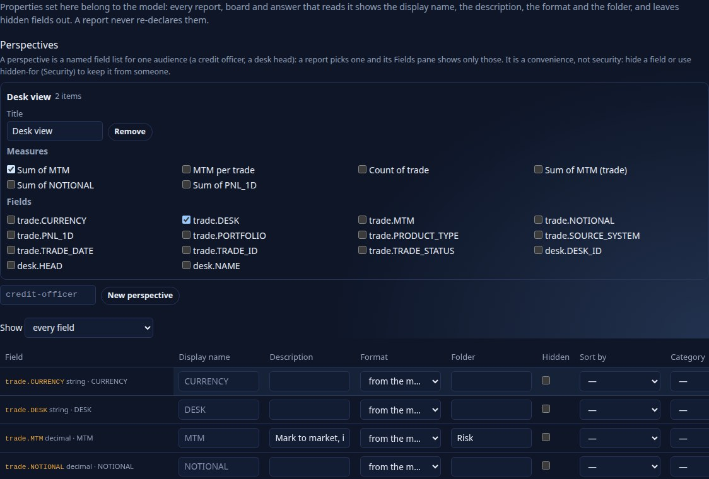

What the designer wrote for a model of trades and desks with a formula measure, two field properties, a hidden field and a perspective (captured):

```yaml
rachana: 2
expressions: 2
model: languages-model
version: 1.0.0
id: md_902e5c84
title: Languages model
datasets:
  trade: {dataset: pack.trading.trade@^1, role: fact}
  desk: {dataset: pack.core.desk@^1, role: dimension}
relationships:
  - {from: trade.DESK, to: desk.id, suggested: {from: pack-reference}}
measures:
  Sum of MTM: {expr: sum(trade.MTM)}
  MTM per trade: {expr: measure('Sum of MTM') / count(trade.TRADE_ID)}
fields:
  trade.MTM: {description: 'Mark to market, in the trade''s currency', folder: Risk}
  trade.PORTFOLIO: {hidden: true}
perspectives:
  desk-view: {title: Desk view, fields: [trade.DESK], measures: [Sum of MTM]}
```

After publishing it, redefining *Sum of MTM* as `sum(trade.PNL_1D)` and saving: the badge reads *Draft changes (v1 published)*, Publish is back, and the
Contract tab says what that change means:

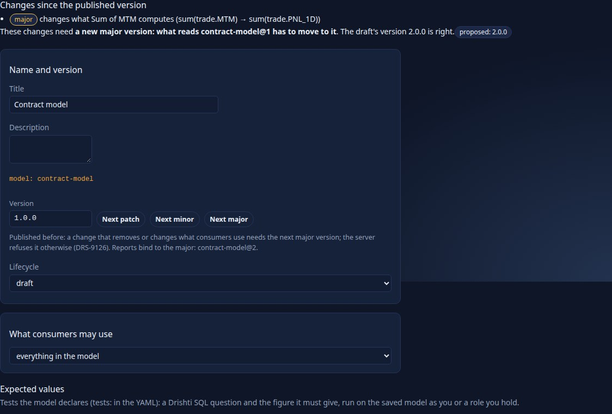

**4. Reports on a model.** The Fields pane shows the model's **display names**, its **folders**, leaves **hidden** fields out, and offers the model's
**perspectives** (the report keeps its choice as `perspective:`); every visual's labels use the display names. **New measure for this report** writes a
measure of this report only in the expression editor (`measures:` in the report, sent with each query as `define`; *Move to the model* offers it to the
model). **Query of the selected visual** shows the question as a **model query (MQ)** or as **SQL**, one switch; **Run as SQL** asks the server and says
whether the plan is the visual's ([REPORTS.md §19](REPORTS.md#19-languages-in-the-report-designer-wave-a)).

**5. Analyse on the server.** A SQL cell is Drishti SQL over the model the extract reads, run by the server as you (the default); *over the extract*
stays selectable until wave B ([ANALYSE.md](ANALYSE.md)).

The console calls behind these (same-origin, deciding no access): `GET/POST /bi/api/expr/*` and `/bi/api/sql*` (passed to the server),
`POST /bi/model-api/contract` (`{id, doc}` to the changes, the version and the consumers), `POST /bi/model-api/report-measures` (a report's own
measures and perspective from its YAML), `POST /bi/model-api/compose` with `base` (the text to patch), `POST /bi/explore/dsql` (a SQL cell).

## 25. Live answers and standing queries (wave B, 2.3.0)

The design is [BI_DESIGN.md §4.5 and §4.6](../architecture/BI_DESIGN.md#46-standing-queries-and-incremental-maintenance); the endpoints are in
[API_GUIDE.md](API_GUIDE.md#models-and-the-model-query-language-apiv1bi-wave-w1); the settings are `drishti.bi.mq.*` ([CONFIGURATION.md](../admin/CONFIGURATION.md)).

**Three times, one plan.** Every question is asked at a time, bound per dataset of the model:

| `time:` | A live dataset reads | A snapshot dataset reads | Subscribable |
|---|---|---|---|
| (none) or `live: true` | its in-memory current state | the current business date (or the latest date it holds) | yes |
| `as-of: 2026-10-09` | its history sampled at the end of that day (refused `DRS-9157` without one) | that date's partition | today only (a past date never changes: `DRS-9183`) |
| `window: { from, to }` / `{ last: 1h }` | its history over the window | the partitions in the window | yes |

So a model can mix a live trades table with snapshot desks: the plan says which scan reads what (`explain`: each scan's `time` is `live`, `current` or the
date). In DEL, `as_of(measure('MTM'), shift_date(asof(), -1))` asks the same measure at another date inside one visual.

**Asking and subscribing.** A board, a report and an alert all subscribe the same way (`POST /api/v1/bi/mq/subscribe` with the model query, a throttle and
`deliver: rows | diff | value`) and read one stream (`GET /api/v1/bi/mq/stream`). Nothing polls: when a model's data moves (a live batch, a data load, a
refresh) the server's **generation bus** names the model, and only the subscriptions on it are evaluated.

```
curl -s -u rita:rita -H 'Content-Type: application/json' localhost:18958/api/v1/bi/mq/subscribe \
  -d '{"query": {"mq": 1, "model": "live-desks", "select": {"fields": ["trades.desk"], "measures": ["MTM", "Trades"]}}, "throttle": "250ms", "deliver": "diff"}'
# {"subscription": "sq_…", "throttle": "250ms", "deliver": "diff", "answer": {…}, "cursor": "g-…", "group": "sg_…", "mode": "incremental", "subscribers": 1}
curl -sN -u rita:rita localhost:18958/api/v1/bi/mq/stream
# event: answer   data: {"subscription": "sq_…", "cursor": "g-…", "diff": {"upsert": [["DESK-A", 12000.0, 7]], "delete": []}, "mode": "incremental"}
# event: status   data: {"subscription": "sq_…", "state": "live", "mode": "incremental", "group": "sg_…", "lagMillis": 41, "cursor": "g-…"}
```

**One evaluation per group.** Subscriptions to the same question by readers with the same effective security (the same rows, masks and hidden fields) are
one **group**: a morning of 500 viewers of one report with 5 distinct securities is 5 evaluations per visual. Each subscriber still has its own throttle and
gets the newest answer when its throttle has passed (latest wins; nothing queues).

**How a group is kept current** (its `mode`):

| Mode | When | What happens on a live change |
|---|---|---|
| `incremental` | `sum`, `count`, `avg` (and arithmetic of them) of the live table's own columns, grouped by its columns; your row rules on that table | each changed row's old contribution is taken out of its group and the new one put in; no query |
| `incremental` | `min`, `max`, `distinct`, `percentile`, or rules only the engine can work out | the groups the changed rows touch are asked again |
| `recompute` | filter contexts (`share_of`, `calc(…, ignore=)`), fields of another table, `top` filters, loads and refreshes | the question is asked again |
| `tick` | windows, time intelligence, Python measures, or a model over its maintenance budget | asked again every `drishti.bi.mq.tick` |

**States.** `live` (current), `throttled` (an evaluation took longer than the throttle three times: the throttle doubled), `tick` (the model's standing
queries spent more than `drishti.bi.mq.maintenance-budget` in a second: they are recomputed on the tick until a quiet second), `failed` (the reason is in the
status event). A change of your roles or `user.*` attributes changes your security signature: your subscriptions are re-planned, never patched.

**Back-dated loads.** A load for an earlier business date moves that date's answers only: an as-of answer of another date keeps its cache entry, and a
standing query that reads later dates is not evaluated again.

### 25.1 In the console: reports, boards and alerts follow pushed answers

Every visual of a report and every tile of a board whose question is a model query **follows** it: the page subscribes the visual's query
(`POST /api/v1/bi/mq/subscribe`, `deliver: rows`, the throttle of `bi.live.min_interval_ms`) and the answers arrive over the console's one live channel
(`mq:<subscription>` on `/api/channel`, which reads `GET /api/v1/bi/mq/stream`). A pushed answer redraws the visual in place; one with totals, highlighted
marks or bins is asked again, quietly. Nothing polls, and a page holds at most 12 standing queries (a board 16); the rest are asked once and say so. A
report on a 2.1 dataset (no model query) keeps the report stream of earlier releases.

**The state chip** under each visual says how it is kept current, in words and an icon, never colour alone:

| Chip | Means |
|---|---|
| **Live** · 41 ms | the server pushes each change; the time is how late the last one was |
| **Throttled** | the visual's evaluations took longer than its throttle: the server doubled it |
| **Every few seconds** | worked out again on the server's tick (windows, time intelligence, Python measures, or a model over its maintenance budget) |
| **Stale** | nothing heard for `bi.live.stale_seconds`; the picture is the last good one |
| **Not updating** | the subscription failed (the reason is the chip's title) |
| **As of 2026-10-09** | a past day: asked once, it never changes |
| **2026-10-01 to 2026-10-09** | a window, followed |
| **Asked once** | the page follows its maximum already |

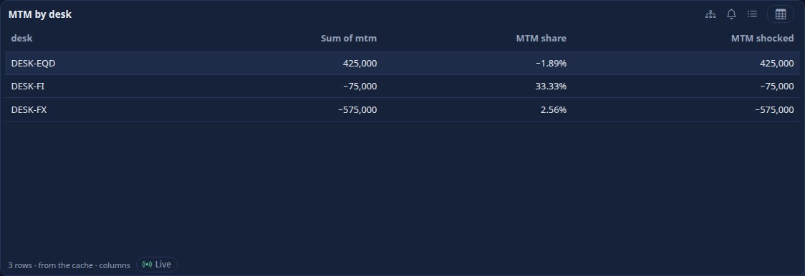

**The time picker** (*Time* in the report's bar, the board's bar and Analyse's extract) asks the same question **now** (live), **as of a date** or over **a
window** of dates: one plan answers all three (§4.5 of the design). *As of* a past date is asked once; *now* and a window are followed.

**Parameter slicers and Show as.** A report on a model with parameters or calculation groups shows them above the page: a what-if number as a slider
(its min, max and step), a field parameter as a choice of fields, text, dates, yes or no, and each calculation group as *Show as*. A value other than the
default is a chip in the filter line; the visuals are asked again with the values (`mq: 2`, `params`, `calc`), and so are their standing queries.

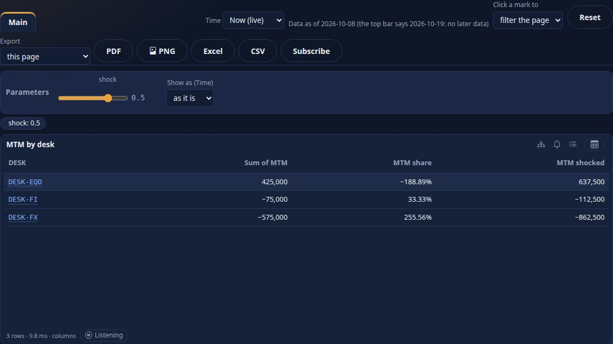

**Explain.** The diagram button of a visual opens *How this was answered* over it: the steps per tier (the data store, the Java server, the console's
Python), each scan's layer (`columns`, `live`, `history`, `direct`, a rollup), the plan hash, whether the cache answered, the engine's and Python's times,
and the plan as text. It shows that a security rule applied, never another reader's rule. **Close** puts the visual back.

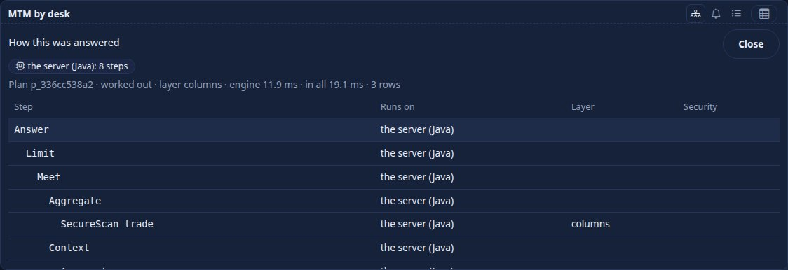

**Alerts.** The Alerts page has a **Now** column: each alert's number as it is, pushed (`deliver: value`), with its chip. The alert itself is still judged
by the server on its own trigger.

**The browser computes nothing** (design principle P3). The Slice of Analyse is worked out by the console (`POST /bi/explore/pivot`), a SQL cell is
Drishti SQL run by the server (a cell over the table `extract` by the console), Python cells and python visuals run in the console's sandbox; no BI page
loads WebAssembly, Pyodide or DuckDB-Wasm, and none has `'wasm-unsafe-eval'` in its policy. A 2.1 report's Perspective grid is drawn as Drishti's grid of
the rows the server sends; the live desk sample's pivot is a matrix and its chart a stacked column.

From the command line the same standing query is `curl -sN` on the stream above; the same explain is any model query with `options: { explain: true }`:

```
$ curl -s -H "Authorization: Bearer $DRISHTI_TOKEN" -H 'Content-Type: application/json' http://localhost:18480/api/v1/bi/mq \
    -d '{"mq": 2, "model": "wave-b-model@1", "select": {"fields": ["trade.desk"], "measures": ["MTM shocked"]}, "params": {"shock": 0.5}, "options": {"explain": true}}'
{"rows": [["DESK-EQD", 637500], ["DESK-FI", -112500], ["DESK-FX", -862500]],
 "meta": {"tiers": {"java": 4}, "timings": {"engineMillis": 4.9, "layer": "columns", "sourceOrJavaMillis": 1.78}, "plan": "p_994bfe46057d176f", "cached": false,
          "millis": 6.3, "explainText": "plan: p_994bfe46057d176f   signature: s_f3056bc6c04cfd95   time: current 2026-10-16\n...", ...}, ...}
```

`explainText` in full (captured on a scratch server with the trading pack and a small file lake; the model was made in the designer as above):

```text
plan: p_994bfe46057d176f   signature: s_f3056bc6c04cfd95   time: current 2026-10-16
timings: {engineMillis=4.9, layer=columns, sourceOrJavaMillis=1.78}
- Answer {binding={params={shock=0.5}}, columns=[trade.desk, MTM shocked], shape=grouped}   tier: java
  - Limit {n=500}   tier: java
    - Aggregate trade by [trade.desk]: [MTM shocked]   tier: java
      - SecureScan trade (pack.trading.trade@1.0.0)  rules: none  columns: [desk, mtm]   tier: java   layer: columns
```

## 26. BI Studio: authoring as one product (wave C, 2.4.0)

The designers share one shell, **BI Studio** (BI_DESIGN.md section 8.1): the report designer (and so the board designer, a report with board pages), the model designer and the theme designer.

* **The Explorer** (left): the items of every workspace where you may add items, by kind (reports, boards, models, datasets, themes, Python), with a search and **New** (report, board, theme, dataset, model).
  The button at its top folds it away (remembered for the session; under 900 px it starts folded).
* **The open items** (top): every item you open in the Studio joins the tabs (the last eight, for the session of this browser tab); a tab opens it, its cross closes it. The work itself is saved on the server: the tabs are only a convenience.
* **The properties** (right): the designer's own panes (Filters, Visualizations with Build and Format, Fields).
* **The dock** (bottom): **Problems**, what the server's Check says about the draft a second after each change (errors and warnings, each linked to its visual; the count is on the tab), and **Query**, the selected visual's
  model query and its SQL (*Run as SQL* asks the server; the plan says whether it is the same question).

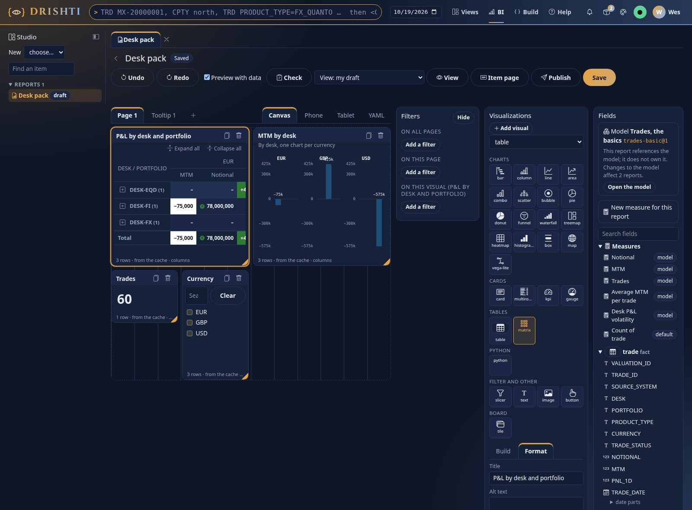

**The Format pane is generated** from the format schemas (`GET /api/v1/bi/reports/format-schemas`, [REPORTS.md section 5](REPORTS.md#5-format)): a section per group in the family's order (Title, Frame, Data labels,
Axes, Legend, Colours, Small multiples, Values, Conditional formatting; for a matrix Layout and Subtotals; for a slicer Slicer), a checkbox for a yes or no, a choice for a closed list, a number with its range, a colour
picker that can be cleared, a group for an object (the value axis, small multiples) and the custom controls (the palette's swatches, a colour per series, data bars, a slicer's windows, the rules). A setting a visual's
type does not use is not shown; whatever the pane offers the server accepts.

| In Power BI | In BI Studio | YAML |
|---|---|---|
| Format, Visual, Values axis (min, max, log, gridlines) | Format, *Axes*, *Value axis* | `format: { valueAxis: { min, max, log, gridlines } }` |
| Format, General, Title, Subtitle; Effects, Border, Shadow | Format, *Title*, *Subtitle*; *Frame*, *Border*, *Shadow* | `format: { subtitle, border: true, shadow: true }` |
| Conditional formatting, Background colour, Gradient | Format, *Conditional formatting*, *Colour scale*, **Add a rule** | `rules: [{ type: gradient, apply: MTM, min, mid, max }]` |
| Conditional formatting, Icons | *Icons*, **Add a rule** | `rules: [{ type: icons, apply: Notional, icons: arrows, thresholds: [0, 1000000] }]` |
| Conditional formatting, Rules, based on another field | *Rule*, *When*: another measure | `rules: [{ type: rule, apply: MTM, on: Trades, op: gt, value: 10, colour }]` |
| Matrix, Row subtotals, Stepped layout, Expand all | Format, *Subtotals*, *Layout* (stepped, opens at level, values on rows); *Expand all* above the matrix | `format: { subtotals: true, stepped: true, expandTo: 0 }` |
| Small multiples well | Build, the **split** well | `wells: { split: [trade.CURRENCY] }`, `format: { multiples: { columns: 3 } }` |
| Edit interactions | Format, *Interactions*, or **Edit on the canvas** | `interactions: { column-1: { matrix-1: none } }` |
| Page information, Allow use as tooltip; Format, Tooltip, Page | Page: *Use as a tooltip page*; visual: Format, *Tooltip*, **New tooltip page** | `tooltip: true` (page), `tooltip: tip1` (visual) |
| Sync slicers | Format, *Slicer*, *Sync group* | `format: { syncGroup: ccy }` |
| View, Themes, Customize current theme | Format, *Report*, *Theme*; **Make a theme** (the theme designer) | `theme: corporate`; a `theme` item ([REPORTS.md section 5.2](REPORTS.md#52-themes)) |

**The theme designer** (`/bi/design/theme/<id>`; *New: theme* in the Explorer, or **Make a theme** in Format) edits a theme item: its series colours (add, remove, move), page, text, good and bad colours, type, and the
format defaults of each kind of visual, drawn by the same generated pane, with a preview of a chart, a table and a card in the theme. Save keeps the draft; Publish makes it what reports read.

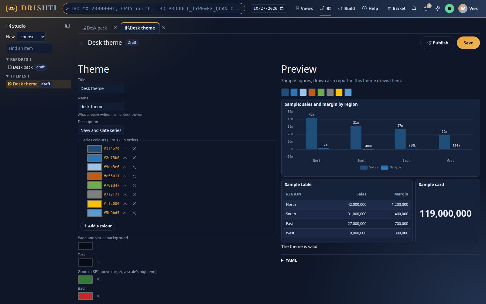

**Boards** are designed here too: a page's *Layout: board*, the *tile* visual and its report, visual and alert ([REPORTS.md section 11](REPORTS.md#2311-designing-a-board)).

From the command line a theme and a report are items like any other (`drishti.py bi item save`, [CLI_GUIDE.md](CLI_GUIDE.md)); `drishti.py bi migrate --boards` converts 2.3 board files and the stored boards
([REPORTS.md section 12](REPORTS.md#2312-from-a-23-board-to-a-board-page)). The acceptance of the wave, a Power BI author's desk pack made without the YAML tab, is the browser test
`drishti-console/tests/test_bi_studio_browser.py` and [REPORTS.md section 20](REPORTS.md#20-report-schema-v2-in-one-report-240).

## 27. Field parameters in the wells, and statements (wave D, 2.6.0)

**Field parameters in a visual's wells.** A model's field parameter (a choice of fields, such as *break down by desk or by portfolio*, or of measures,
*show MTM or Notional*; the Calculations tab of the model designer makes one) can now be put in a visual's well. In the report designer's **Build**, each
well's *Add a field…* list ends with **Field parameters**: a parameter of fields in a field well (axis, legend, rows, columns), one of measures in a measure
well (values), one of both only in a well of either. Its chip in the well is marked as a field parameter, and the canvas draws its default. In the viewer the
parameter slicers above the page (*Parameters*) switch it: choose *PORTFOLIO* in *Break down by* and the chart is asked again by portfolio, its axis named
by what was chosen; the choice is a chip in the filter line and **Reset** puts the defaults back. Masks hold whatever the reader chooses. The YAML is
`wells: { axis: [param.breakdown], values: [param.metric] }`; the report schema refuses a parameter that does not fit its well (`DRS-9037`)
([REPORTS.md section 21](REPORTS.md#21-field-parameters-in-a-well-260)).

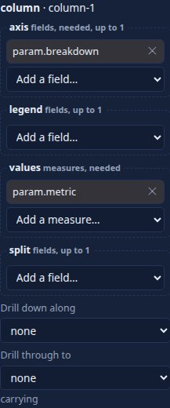

**Statements.** In Format with no visual selected, **Layout → statement** makes a page paper: its visuals are bands (text, cards, tables, matrices) laid out
page by page, with a header and footer on every page. The **Paper** tab beside Canvas sets the paper (size, orientation, margins, text size), the header and
footer (left, centre, right, with tokens such as `{page}`, `{pages}`, `{run-date}`, `{period}`, `{reader}`) and the period the statement covers, and
**Preview pages** shows the statement page by page as the server lays it out for you, with **‹** and **›**. Each band's page break, keep-together, repeated
column titles and grouping are in its Format, under **Statement**. **PDF** and **Excel** download the saved draft; a subscription to the page sends each
recipient their own statement, made as them ([REPORTS.md section 24](REPORTS.md#24-statements-paginated-reports-page-exact-one-per-reader), [DISTRIBUTION.md section 2](DISTRIBUTION.md#2-subscriptions)).

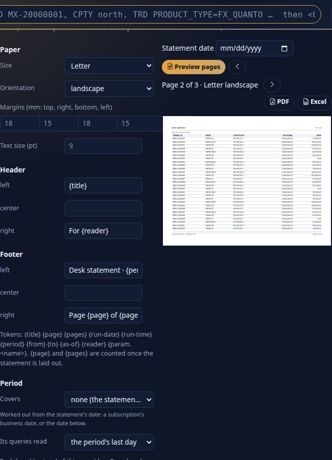

From the command line: `drishti.py bi statement preview <report>` lists the pages with their header and footer, `drishti.py bi statement file <report> -o
statement.pdf` writes the PDF (`--format xlsx` the workbook) ([CLI_GUIDE.md](CLI_GUIDE.md#bi-statement)); tutorial 20 does both in the UI, the CLI and the
YAML ([20-statements-and-field-parameters.md](../tutorials/20-statements-and-field-parameters.md)).

## 28. Background runs: long BI questions

Release 2.6.7. The design, with every rule and the API, is [BI_RUNS.md](../architecture/BI_RUNS.md). This guide is what you see and what you do.

Every BI question (a report visual, a board tile, a model query, SQL) goes through one pipeline. The console waits about two seconds for
the answer. When it comes in time, the visual is drawn exactly as before and nothing else happens. When it takes longer, the question
becomes a **run**: it goes on in the background, the visual shows a run card, and you can keep working. The bell tells you when the run
is ready. A slicer, a cross-filter or a drill on a dashboard never becomes a run: it is answered at once, or it tells you that it needs one.


### The run card

A visual whose question takes longer than the inline wait shows a run card instead of its chart. The rest of the page keeps working.

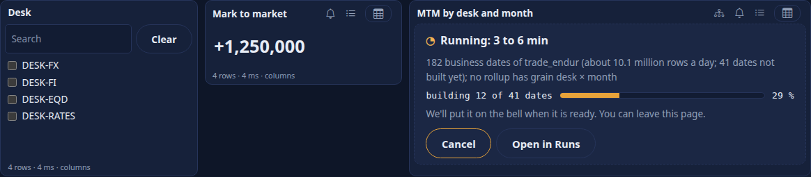

The card says:

* **Running: 3 to 6 min.** The estimate is always a range, with how it was made. It is never a single number that looks more precise than it is.
* **Why it is large.** For example "182 business dates of trade_endur, 41 to build first; no rollup has grain desk × month".
* **Progress**, as a bar with its percentage and what is happening ("building 12 of 41 dates"). Progress is measured, never guessed. When the
  server cannot measure it, the card says "progress is not measured for this one" and shows no bar.
* **Cancel** stops the run and frees everything it holds at once. **Open in Runs** opens the run in the [Runs tab](#the-runs-tab).
* **Export CSV**, **Export Excel** and **Export JSONL** (JSON Lines, a row a line), once the run is done (see [Export](#export)).

When the run finishes while the page is open, the card turns into the chart without a reload. If you have left the page, the bell counts
the run (see [the bell](#the-bell-and-the-inbox)).

### Confirming a large run

A question that would read a great deal of data (above a minute, or 500 million rows, by default) asks you first. Nothing has run yet.

```
 Confirm a background run
 About 1.84 billion rows over 182 business days (Delta statistics). Expected 3 to 6 min on this server.
 A rollup at this grain in the model makes this instant next time.
 [ Run in background ]   [ Narrow the dates ]   [ Not now ]
```

* **Run in background** starts the run, and the card shows its progress.
* **Narrow the dates** puts the focus on the report's date, so you can ask for fewer days.
* **Not now** leaves it. Nothing was read. `Esc` does the same.

When the size of a table is not known, the card says "We cannot estimate this yet: it reads tables whose size we do not know. It may take a
long time." Such a question always asks first, when you ask it yourself (a model query, SQL, the CLI). A report's visual of unknown size does
not ask: it draws as usual and becomes a run card if it takes longer than the inline wait, so a page on such a source never asks for every
visual. A report's visual whose size is known asks as any question does.

### A selection that needs a run

Dashboards stay instant. A slicer, a cross-filter or a drill is answered from the model's rollups and the built layers. When a selection
would need a long scan instead, the visual says so at once, before anything is read:

```
 This selection needs a background run (3 to 6 min)
 [ Run in background ]   [ Not now ]
```

Choosing **Run in background** starts it as a visible run, with its card. The model's owner can add a rollup at that grain, and then the
same selection is instant.

### The Runs tab

Open it from the BI rail (**Runs**, with the number of your runs queued or running), from My workspace's tab strip (**Items · Runs ·
Members**), by typing `BI RUNS <GO>`, or with `g` then `r` on any BI page. The address keeps the tab: `/bi/w/me?tab=runs`.

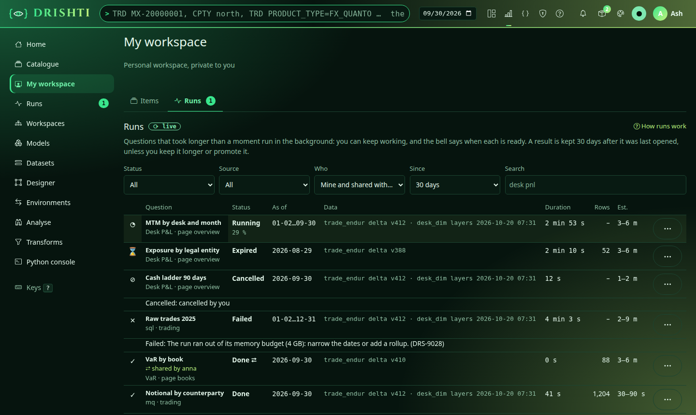

Each row shows the question and where it came from, its status, the dates it is as of, the data version it read (for example
`trade_endur delta v412`), how long it took, its rows and the estimate you were shown. Hover the data version for every table and date it
read, and the estimate for "estimated 3 to 6 min, took 4 min 12 s". A failed run has a second line with its reason in words, and the code
in brackets for support. ⇄ marks a run someone shared with you.

Rows change as the runs do: there is no reload and no polling (**⟳ live**). Screen readers hear each change ("MTM by desk and month: Done ·
4 min 12 s · 4,320 rows").

Filters: **Status** (all, active, waiting for you, done, failed, cancelled, expired), **Source** (reports, boards, model queries, SQL,
statements, schedules), **Who** (mine, shared with me, or both), **Since** (1 to 90 days) and **Search** on the title. A shared workspace's
Runs tab lists the runs of that workspace's items that you may see.

Keys: the arrow keys move between the tabs; `↑` and `↓` move between the rows; `Enter` opens a run; `Esc` closes it and puts the focus
back on its row.

### One run: the drawer

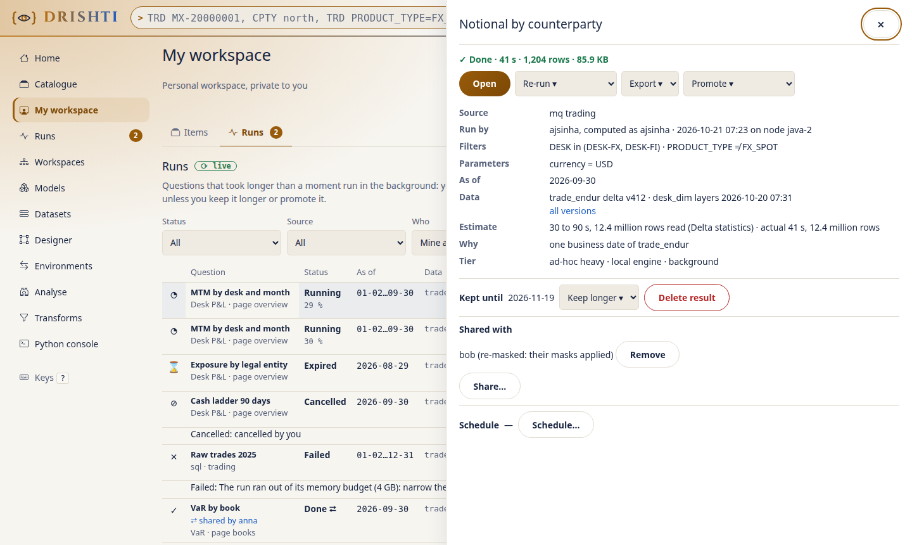

The drawer shows what the run is: its source, who ran it and as whom it was computed, the filters and parameters, the dates, the data
versions (**all versions** lists each table), the estimate next to the actual, the tier and the engine. Then what you can do with it. The
server decides what each person may do with a run, and the drawer shows only those actions:

| Action | What it does |
|---|---|
| **Open** | A report's run opens the report with `?run=<id>`: the visual is drawn from the stored result and a line says so. Any other run opens its result. |
| **Run again** (choose how in **Run again as**, then press the button) | *Same as before (as of D)*: the same question on the same dates and data versions; when the result is still stored it is **reused** at once and the drawer says *Done at once: reused the answer from <time>* with **Open result**. *With the latest data*: relative dates (this year, latest) worked out again. Changing the choice does nothing on its own. While the new run goes the button says *Running…* with a spinner (a still dot with reduced motion); the new run is highlighted at the top of the list, the drawer switches to it and follows it to Done or Failed, and the old run's row says *superseded by* the new run, with a link. |
| **Cancel** | Stops a queued or running run. Its row says *Cancelled: cancelled by you*. |
| **Export CSV** · **Export Excel** · **Export JSONL** | The stored result as a file (JSONL: a row a line, the CSV's column names), your own version of it: nothing is computed again, masked cells stay masked (see [Export](#export)). |
| **Promote…** | A model query's or SQL run's result to a dataset snapshot or a report on it, as a draft for review (see [Promote a run](#promote-a-run)). Offered only when the server says you may (`can.promote`). |
| **Keep longer** | 90 days, 180 days or a year, instead of the 30 days after the last open. |
| **Delete result** | Removes the stored result now. The run stays listed, as expired. |
| **Share…** · **Unshare** | See [Sharing a run](#sharing-a-run). |
| **Schedule…** · **Edit** · **Pause** · **Remove** | See [Schedules](#schedules). |
| **Run in background / Discard** | For a run waiting for your confirmation. |

An expired run says when its result was removed, and offers Run again.

### The same answer for the same access profile

A report visual's answer is shared between everyone with the same **access profile**: the same roles, masks and row rules on the
model it reads. When a colleague with your access profile has already drawn the visual on the same data and dates, you get their
answer at once (**Reused**), or wait for the same run if it is still going; nothing is computed twice. Someone with another mask or
row rule never gets your answer, and you never get theirs. A visual that depends on who is looking (a filter or value naming you,
such as `user.name` or `me`, a row rule by your user name, a personal model) stays yours alone.

### Sharing a run

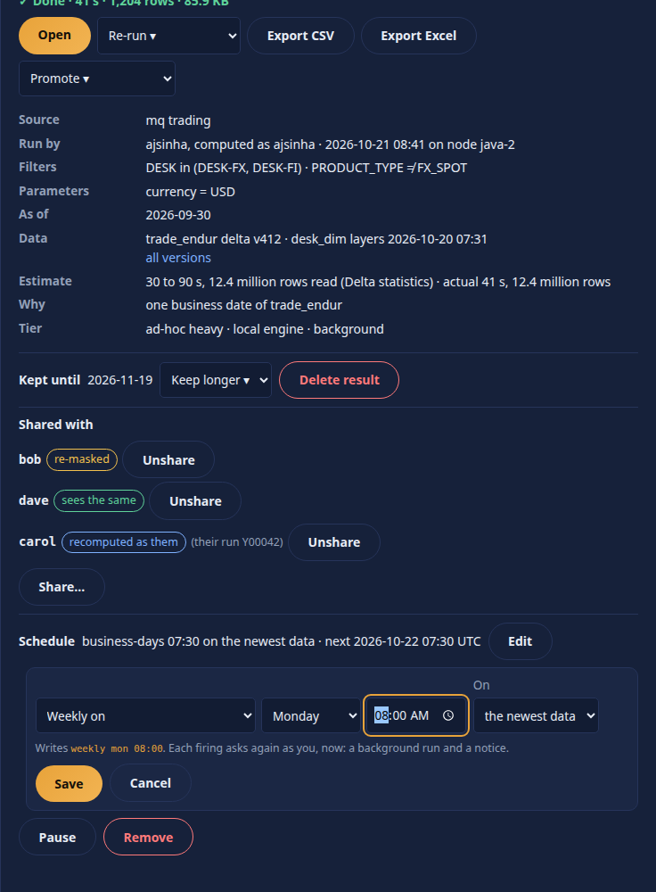

**Share…** opens a box with the people picker: type two letters of a name or a role and choose it (`↑` `↓`, `Enter`), and it becomes a
chip; `×` takes it off. You can also type names, comma separated (`bob, role:risk-team`). A role is expanded to its members when you share.
**Share** sends it. A share never hands over your result as such. The server decides, for each person, what their own rights allow, and
the drawer lists each recipient with that decision:

| Shown as | Meaning |
|---|---|
| **sees the same** | they have exactly your rights: they read your stored result |
| **re-masked** | the same rows with their own extra masks applied: a masked column shows the mask, never a value |
| **recomputed as them** | their rights differ, so the question runs again as them (the drawer names their run), and they are told when it is ready |

A person who may not read the model gets no share, and the drawer says so in words with the code ("Not shared with eve (DRS-9021)").
Ten people of one desk with equal rights cost one recomputation, not ten. The decision is taken again each time they read it, so a
recipient whose rights narrowed since is told to re-run it, never shown the wider answer.

**Unshare** beside a recipient stops sharing with that person. A run recomputed as them stays theirs.

**What a recipient sees.** The run is in their own Runs tab (**Who** set to *shared with me* or *both*), marked **⇄ shared by anna**. Its
drawer says "Shared with you by anna. Masks hold: you see what your own rights allow." They can open and export it (their own version);
sharing on, scheduling and deleting stay with the owner. The bell tells them when it was shared.

### Schedules

**Schedule…** in the drawer asks the same question again on a schedule, as you, at the time it fires (if you lose access, the firing fails
and you are told; it never borrows anyone's rights). Choose how often from the presets and the form writes the schedule for you, shown
under it ("Writes `weekly mon 08:00`"):

| Preset | Writes |
|---|---|
| Daily at | `daily 07:00` |
| Weekdays at | `weekdays 07:30` (Monday to Friday) |
| Business days at | `business-days 07:30` (the calendar's business days) |
| Weekly on | `weekly mon 08:00` |
| Monthly, the last day at | `monthly last 18:00` |
| Monthly, the last business day at | `monthly last 18:00 business` |
| Written out | anything in the same grammar, typed |

The grammar is the subscriptions' one ([API_GUIDE.md](API_GUIDE.md), `POST /api/v1/bi/runs/{id}/schedule`); `after-load` is not offered
for runs. **On** chooses the newest data (relative dates worked out again at each firing) or the same dates. Times are the server's zone.

Once scheduled, the drawer's **Schedule** line says what it is and when it fires next ("business-days 07:30 on the newest data · next
2026-10-22 07:30 UTC"). **Edit** opens the form on it, **Pause** stops the firings until you **Resume**, and **Remove** deletes the
schedule (the runs it made stay listed). Each firing is a visible background run, confirmed in advance, and a notice on the bell.

### Export

**Export CSV**, **Export Excel** and **Export JSONL** download a finished run's result as a file. They are in the drawer, on the run card while a finished
run's result is drawn, and on the line above a report drawn from a run (`?run=<id>`, "Drawn from the run of…"). The file is made by the
server from the stored result, so nothing is computed again, and it is **your** version: a recipient of a share gets their re-masked or
recomputed answer, and masked cells stay masked (the file's note names the masked columns). A very large result is cut at the export row
limit, with a note saying so. Parquet and PDF are not offered for runs yet.

### Promote a run

**Promote…** in the drawer asks for a **Name** (the snapshot's and the dataset's, prefilled from the run's title), a **Title**, and **To**:
*a dataset snapshot* keeps the result as a read-only table and makes a draft dataset in My workspace (`source: {run: …}`,
[DATASETS.md](DATASETS.md)); *a report on it* also makes a draft report with one table of every column. The rows are kept as you see them:
a column masked for you stays masked for every reader. The drawer then says *Promoted to name@1* with links to **the draft dataset** and
**the draft report**. Both follow the normal review before publishing, and the reviewer sees as whom the data was computed.
Only the runner promotes, with the bi-author power, and only a model query or a SQL run (not a report visual): the button appears only when
the server allows it. The same name again is version 2 of the same draft. A name another person promoted is refused: *That snapshot name is
taken by another person's promotion: choose another name (DRS-9004)*. A dataset that points at a snapshot it was not promoted to reads
*This dataset may not read that run snapshot (DRS-9108)*: promote the run again to make your own. On the command line:
`drishti.py bi runs promote RUN --to report --name desk-pnl-2026 --title "Desk P&L 2026"`.

### The bell and the inbox

When a visible run finishes, fails, or is started again after a server restart, the bell counts it once (a page draw that made several runs
rings once, when the last one ends). The notice says "Run finished: MTM by desk and month, 2026-01-02 to 2026-09-30 (182 rows, 3 min 40 s)":
names and counts only, never a value. Opening it goes to `/bi/run/<id>`, which opens the report drawn from the stored result, or the run in
the Runs tab. The inbox has a **Runs** tab of its own (`/inbox?tab=run`).

### On the command line

`drishti.py bi runs` does what the Runs tab does, as the token's user (the full list is in [TOOLS.md](TOOLS.md) section 5.7 and
[BI_RUNS.md](../architecture/BI_RUNS.md) section 14.4):

```
$ python3 tools/drishti.py bi runs list --state running,done --since 7d
r-java-2-01JAC4Q8Z6T3M4R9B0X1Y2Z3W4  MTM by desk and month
    running · building 12 of 41 dates · 29 %  · as of 2026-01-02 to 2026-09-30 (182 dates)  · trade_endur delta v412  · est. 3 to 6 min
$ python3 tools/drishti.py bi runs submit --sql "SELECT desk, MEASURE('MTM') FROM trades GROUP BY desk" --model trading --wait 0 --yes
r-java-2-01JAC4Q8Z6T3M4R9B0X1Y2Z3W5  queued  (expected 3 to 6 min)
  follow it:  drishti.py bi runs wait r-java-2-01JAC4Q8Z6T3M4R9B0X1Y2Z3W5
$ python3 tools/drishti.py bi runs wait r-java-2-01JAC4Q8Z6T3M4R9B0X1Y2Z3W5 --timeout 30m      # exit 0 done, 3 failed, 4 cancelled, 5 still running
$ python3 tools/drishti.py bi runs result r-java-2-01JAC4Q8Z6T3M4R9B0X1Y2Z3W5 --format csv --out pnl.csv     # or --format jsonl: a row a line
$ python3 tools/drishti.py bi runs share r-java-2-01JAC4Q8Z6T3M4R9B0X1Y2Z3W5 --to bob --to carol --to eve
bob: re-masked (your result with their extra masks)
carol: recomputed as them (their rights differ: a run of their own) (run r-java-2-01JAC4Q8Z6T3M4R9B0X1Y2Z3W6)
eve: not shared: eve may not read the model trading (DRS-9021)                      (on stderr)
$ python3 tools/drishti.py bi runs unshare r-java-2-01JAC4Q8Z6T3M4R9B0X1Y2Z3W5 carol
carol: no longer shared
$ python3 tools/drishti.py bi runs schedule r-java-2-01JAC4Q8Z6T3M4R9B0X1Y2Z3W5 "weekly mon 08:00" --data latest
sch-1  weekly mon 08:00  on latest data  next 2026-10-26 08:00
$ python3 tools/drishti.py bi runs schedules edit sch-1 "business-days 07:30"     # also: schedules [list] | disable | enable | delete ID
$ python3 tools/drishti.py bi runs export r-java-2-01JAC4Q8Z6T3M4R9B0X1Y2Z3W5 --format xlsx --out pnl.xlsx
$ python3 tools/drishti.py bi runs suggestions --model trading                    # bi-admin
sg-1  trading  desk x month  suggested  37 runs, about 4 min each
    asked 37 times this week, about 4 min each: make it a rollup refreshed at load
$ python3 tools/drishti.py bi runs suggestions accept sg-1                         # or: dismiss sg-1
sg-1  accepted: the rollup is in the draft of trading (bi-model-...); review it and publish it
```

`bi runs estimate` gives the tier, the engine and the estimate and runs nothing. A large question without `--yes` is refused with its estimate
and exit 2. `drishti.py bi mq FILE --async` and `drishti.py bi sql "…" --model M --async` ask as a run: the answer when it is done within
`--wait` (2 s by default), else the run's id; `--yes` accepts a large one in advance. Without `--async` they behave as before 2.6.7.

### The Admin page for runs

`/admin/bi/runs`, for BI administrators (also linked from Admin → BI). It shows the engine's gate now (slots in use per work class: interactive,
standing and background, with the background cap), the interactive admission wait (the sign that background work is not slowing anyone),
the queue per person, what runs now (with **Cancel**: the person is told an administrator cancelled it), the result store (results and
snapshots, the biggest users), how accurate the estimates were, how many questions were answered inline, the settings file, and the heavy
questions asked often enough that a rollup would answer them at once (see [Rollup suggestions](#rollup-suggestions)). It shows
state, sizes and nodes, never a value. `drishti.py bi runs storage` prints the same.

### Rollup suggestions

The same heavy question asked again and again is better answered by a rollup in the model: then it is instant for everyone. The server
counts the finished heavy model queries per model, grain and the shape of their filters (the field and the operator, never a value). When
one is asked often enough (by default 5 times in 7 days, with a median of a minute or more), it becomes a suggestion with the rollup drafted.

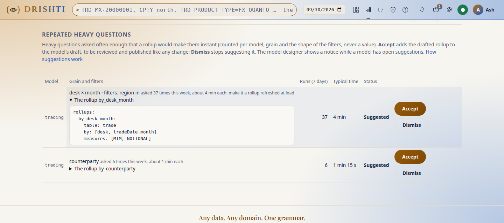

**Repeated heavy questions** on `/admin/bi/runs` lists each one: the model, the grain and filters, how many runs, the typical time, its
status, and **The rollup** (open it to read the YAML that would be added). For a BI administrator:

* **Accept** adds the drafted rollup to the model's **draft**, under `rollups:` (the model's comments and order are kept). Nothing is
  published: the change is reviewed and published like any other, and the message links to the model. For a model shipped in a pack the
  suggestion is accepted with the YAML for you to add by hand.
* **Dismiss** stops suggesting it.

Once the model has a rollup at that grain the status says **Built**, and those questions are answered at once instead of becoming runs.
While a model has open suggestions, its **model designer** shows a notice under the toolbar ("A heavy question on this model was asked 37
times this week: a rollup would answer it at once. Review the suggested rollups") that opens this list for that model
(`/admin/bi/runs?model=trading#suggestions`). The notice shows to BI administrators, who can accept. On the command line:
`drishti.py bi runs suggestions [--model M]`, `suggestions accept ID`, `suggestions dismiss ID`.

### The words for each state

| State | Shown as | Meaning |
|---|---|---|
| `awaiting-confirm` | Waiting for you | it asked you to confirm; nothing has run |
| `queued` | Queued | waiting for a slot |
| `running` | Running, with progress | reading and computing |
| `storing` | Storing | writing the result |
| `done` | Done | the result is stored |
| `reused` | Reused | the same question on the same data was already answered, by you or by someone with the same access profile: nothing ran |
| `failed` | Failed: *reason* (code) | ended with a problem; the reason says what to do |
| `cancelled` | Cancelled: *by whom* | by you, an administrator, a newer selection, or the page closing |
| `expired` | Expired | the result was removed by retention or the storage budget |

The codes `DRS-9080` to `DRS-9089` are listed with their fixes in [TROUBLESHOOTING.md](TROUBLESHOOTING.md).

## 29. AI in BI: report from words, ask the data, explain this number

Rūpaka stage 2 ([RUPAKA.md](../architecture/RUPAKA.md) section 20.1) puts a language model beside business intelligence, in three places and no more. It is **off by default**, it is the
AI layer's ([AI_PROVIDERS.md](../architecture/AI_PROVIDERS.md)) and no other, and the model is never trusted with anything a person could not do by hand: **it writes a draft or a query, and
Drishti checks it, runs it as the reader, and shows it.**

| Where | What you do | What the model does | What Drishti does |
|---|---|---|---|
| Designer | **Describe a report** | drafts report YAML over the report's dataset | checks it with the report checker before you see it; puts it in the YAML tab; saves nothing |
| A report page | **Ask the data** (a question box) | maps the question to a dataset query (fields, measures, filters, dates) | the engine runs it as you (row rules, masks), shows a table and the visual that suits it, and the query used |
| A visual's header | **Explain** (the light bulb) | in `aggregates` mode only: words the breakdown | works out the lineage and the breakdown of the number by its main dimensions on the engine |

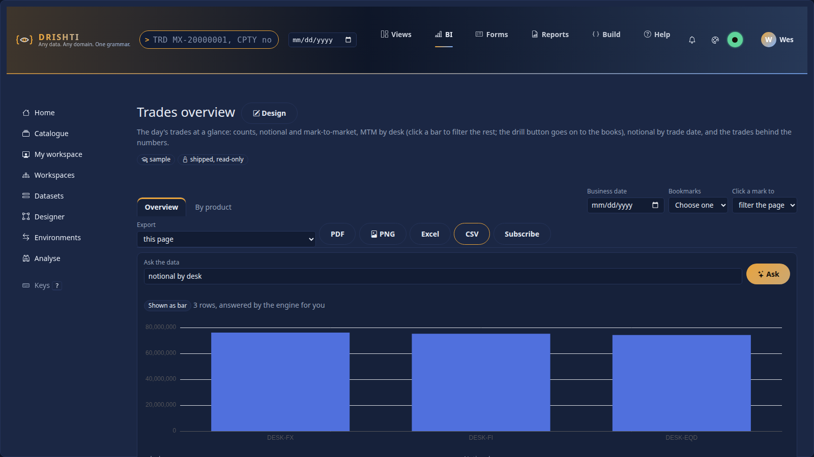

### 29.1 Turn it on

Two switches: the AI layer, with a provider, and (optionally) the BI settings. Nothing else changes for people who do not use it: the buttons are hidden and every call answers
`404 DRS-4015` while `drishti.ai.enabled` is false.

```yaml
# config/ai/mock.yaml  (a deterministic provider for trying it; use config/ai/openai.yaml.example or anthropic.yaml.example for a real model)
type: mock
models:
  - name: m
```

```
DRISHTI_AI_ENABLED=true  DRISHTI_AI_DEFAULT_MODEL=mock/m
```

| Setting (`drishti.bi.ai.*`) | Default | Meaning |
|---|---|---|
| `model` | blank | `provider/model` the hooks use; blank is `drishti.ai.default-model` |
| `values` | `labels-only` | `labels-only`: the model sees names, types and descriptions, **never a value**. `aggregates`: it may also word the reader's own masked aggregate results (section 5) |
| `max-question-chars` | `600` | longest question or description |
| `max-tokens` | `2000` | longest answer asked of the model |
| `timeout-seconds` | `30` | one model call |
| `ask-rows` | `200` | most rows an answer holds, and the most the model sees of them in `aggregates` mode |
| `explain-dimensions` | `3` | dimensions a number is broken down by |
| `explain-members` | `5` | members listed per dimension |
| `suggestions` | `6` | most visuals the designer copilot proposes at once (section 10) |
| `helper-items` | `8` | most items the dataset helper proposes per kind (section 11) |

The policy settings are the AI layer's (`drishti.ai.policy.*`, [CONFIGURATION.md](../admin/CONFIGURATION.md#ai-and-mcp-policy-settings)). The features are named **`bi-draft`**, **`bi-ask`**
and **`bi-explain`**, and for the helpers of sections 9 to 11 **`subscription-narrative`**, **`bi-suggest`**, **`bi-explain-checks`** and **`bi-helper`**, so `drishti.ai.policy.features."[bi-ask]": {roles: [analyst], per-user-per-minute: 10}` limits who asks and how often.

### 29.2 Who may

Two gates, both of which must open. The **BI power** decides first (`bi-author` to describe a report, `bi` to ask or explain: [BI_GUIDE.md](BI_GUIDE.md) section 2); then the **AI policy**
(`features.<name>.roles`; masks, per-user and per-feature limits, the cost limit). An author whose role the policy does not list for `bi-draft` is refused `403 DRS-4018`. A person with no
BI power never reaches the model. Every call is audited twice: the policy's access-log row (action `ai`, feature, model, sizes, tokens, outcome, never the text) and a BI audit row
(`bi-ai-draft`, `bi-ai-ask`, `bi-ai-explain`, with the dataset or report and the outcome). Neither holds a prompt or an answer.

### 29.3 What the model is sent

The prompt is the **model** the report reads (its describe, as the person reads it) and the person's own words, nothing else. For *Ask the data* on the
shipped report **Trades overview** (model `trades-basic@1`) the message is, word for word (rendered from the model as the server reads it):

```text
TASK: ask-query
DATASET trades-basic: The simplest useful model: one table (the trading pack's trade) with four measures (Notional, MTM, Trades and average MTM per trade) and a desk-to-book hierarchy. Start here.
FIELDS (write them as table.column):
  table trade: the dataset trades-basic-trade 1.0.0, a fact
    trade.VALUATION_ID string
    trade.TRADE_ID string
    trade.SOURCE_SYSTEM string
    trade.DESK string
    trade.PORTFOLIO string
    trade.PRODUCT_TYPE string
    trade.CURRENCY string
    trade.TRADE_STATUS string
    trade.NOTIONAL decimal
    trade.MTM decimal
    trade.PNL_1D decimal
    trade.TRADE_DATE date
    trade.MTM_IN_MILLIONS decimal - MTM in millions of USD
MEASURES (write them by name):
  Notional - Total notional of the trades, in the trade's own currency units.
  MTM - Mark-to-market in USD, signed.
  Trades - Number of trades.
  Average MTM per trade - MTM divided by the number of trades (a measure built from measures).
  Desk P&L volatility - Standard deviation of the one-day P&L per desk, computed in Python. Shown by a python visual (docs/guides/PYTHON_BI.md); a query cannot use it.
  Count of trade
HIERARCHIES:
  Desk and book: [trade.DESK, trade.PORTFOLIO]
QUESTION: notional by desk
```

Each table is an alias of the model, described by its dataset and role; each field is `alias.COLUMN type`, with its description when the model gives one.
(Until 2.3.0 a question asked **on a report over a model** sent the model's name and measures but not its fields; it now sends them, as a question asked
of the model by name always did.)

What is **not** in it, in either mode: a row, a value of a field, a measure's definition, a connector or a path, and any field **masked for the reader** (it is left out, so the model cannot be
told it exists). The AI policy then masks `drishti.security.redact` fields and the extra patterns in the prompt as it does for every call. `BiAiTest` records the prompts and checks all of this.

| | `labels-only` (default) | `aggregates` |
|---|---|---|
| Report from words | the model | the model (no change: a draft never involves values) |
| Ask the data | the model maps the question; **the answer is never sent to it** | then a second call words the reader's aggregate result (unmasked columns only, at most `ask-rows` rows) |
| Explain | no model call at all: lineage and breakdown only | one call words the breakdown (totals and members of the main dimensions, as the reader sees them) |

`aggregates` sends **the reader's own figures** to the model's provider. Use it only with a provider you may send such figures to (a model on your own network, or one whose terms allow it);
masked columns and fields hidden by row rules never go, because the engine has already applied them. That is why it is a setting an administrator makes, and not a button.

### 29.4 Report from words

In the designer, **Describe a report** opens a box: say what you want ("notional by desk as a bar chart and the total as a card"), press **Draft it**. The model is told the report grammar
(the visual types and their wells, the 12-column grid) and the dataset model (for a model of the model layer its `describe` as you read it: each alias
a table with its dataset and version, the fields you may see, the measures not hidden from you), and answers with YAML. `dataset` in the request names
a model (`world-economics@1`, its item id), a dataset of the model layer (`dataset:<name>`) or a version 1 dataset. Drishti then:

1. strips a code fence if the model added one, and pins the draft to what the report you are editing reads: on a **model** (2.2) `rachana: 2` and
   `model: <name>@<major>` in place of any `dataset:`, on a version 1 dataset `dataset:` to it;
2. runs the **report parser and checker** on it (the same as *Check* and Save): unknown fields or measures, bad wells, a bad grid, anything;
3. if it fails, tells the model the problems (names only) and asks once more; if it still fails you get `422 DRS-4020` naming the first problems, and the draft is **not shown**;
4. shows the passing draft as text with *Use this draft*, which puts it in the YAML tab like text you typed. **Nothing is saved or published**: the designer's undo, Check and Save are unchanged,
   and publishing still needs a person and the usual review.

```text
POST /api/v1/bi/ai/draft  {"dataset": "world-economics@1", "request": "GDP by region"}                (as an administrator)   200
{ "yaml": "rachana: 2\nreport: gdp-by-region\nversion: 1\ntitle: GDP by region\nmodel: world-economics@1\npages:\n  - id: main\n ...",
  "valid": true, "problems": [], "dataset": "world-economics@1", "model": "world-economics@1", "saved": false }

POST /api/v1/bi/ai/draft  {"dataset": "trades-basic@1", "request": "notional by desk as a bar chart"}   (as an administrator)   422
{ "status": 422, "code": "DRS-4020", "detail": "DRS-4020 the model's draft did not pass the report check, so it is not shown:
  pages[0].visuals[0].wells.values: no measure 'GDP (USD bn)' in dataset 'trades-basic' (measures: Notional, MTM, Trades, Average MTM per trade,
  Desk P&L volatility, Count of trade); pages[0].visuals[1].wells.axis: 'economies.REGION_NAME' is not a table.column of this dataset (tables: trade); ..." }

POST /api/v1/bi/ai/draft  {"dataset": "trades-basic@1", "request": "x"}                                (as rita, no bi-author)   403
{ "status": 403, "code": "DRS-9002", "detail": "DRS-9002 rita does not hold the bi-author power (an administrator grants it on a role)" }
```

(The second call is the checker at work: tutorial 15's mock answers every draft with the same world-economics report, which names nothing of
`trades-basic@1`; it was told the problems once, answered the same, and the draft was refused, not shown.)

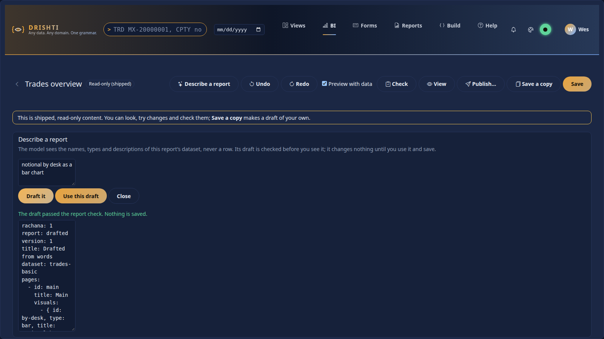

### 29.5 Ask the data

On a report page, the question box under the bar maps a question to a **query on the report's dataset**: `fields` to group by, `measures`, `filters`, `dates`, `orderBy`, `limit`: the same
document the engine's visuals use ([DATASETS.md](DATASETS.md) section 8). The model chooses only names from the model it was shown; the **engine** validates every name and binds every value, and
runs the query **as you**: your row rules and your masks apply, so two people asking the same question get the answers they are each entitled to (`BiAiTest` has a desk head and a risk
analyst ask "notional by desk": one row and three rows; and an analyst asking for a masked measure gets it masked).

The page shows the answer as a **table**, the **visual that suits it** (a card for one number, a line over dates, a bar for a few categories; chosen by Drishti from the shape of the query, not
by the model), a note of how many rows the engine answered, and **the query the model chose** (a disclosure) so you can see, and trust or doubt, what was asked. A refusal by the engine
(a field that is not there, a limit) is shown with its code (`DRS-9020`, `DRS-9025`) and "the query the model chose was refused".

```text
POST /api/v1/bi/ai/ask  {"report": "file:report:trades-overview", "question": "notional by desk"}          (as ann, bi-writer)   200
{ "columns": [{"type": "string", "masked": false, "name": "trade.DESK"}, {"type": "decimal", "masked": false, "name": "Notional"}],
  "rows": [["DESK-COMM", 8.888037427736503E11], ["DESK-RATES", 5.96934185E11], ["DESK-EQD", 4.28542341E11], ...], "rowCount": 10,
  "meta": {"layer": "columns", "rows": 10, "cached": false, "dates": ["2026-10-16"], "tables": ["trade"], "masked": [], ...},
  "question": "notional by desk",
  "query": {"fields": ["trade.DESK"], "measures": ["Notional"], "filters": [], "orderBy": [{"desc": true, "by": "Notional"}], "limit": 200},
  "visual": "bar", "values": "labels-only", "summary": null }

POST /api/v1/bi/ai/ask  {"report": "file:report:trades-overview", "question": "something no rule knows"}   (the mock cannot answer)   422
{ "status": 422, "code": "DRS-4020", "detail": "DRS-4020 the model did not answer with a query" }

POST /api/v1/bi/ai/ask  {"report": "file:report:trades-overview", "question": "notional by desk"}          (as rita, risk)   403
{ "status": 403, "code": "DRS-4018", "detail": "DRS-4018 feature 'bi-ask' is not open to your roles" }
```

(Captured on tutorial 15's stack, whose AI policy opens `bi-ask` to `admin` and `bi-writer` only, hence rita's refusal; with no policy entry for the
feature she would be answered, with her own row rules and masks.)

The body names a `report` (the question is asked of the dataset that report reads, with the report's grants) or a `dataset` (a catalogue id). In `aggregates` mode `summary` is the model's
wording of the result; in `labels-only` it is `null`. A question the model cannot turn into a query on this dataset is `DRS-4020`, not a guess.

### 29.6 Explain this number

The light-bulb button in a visual's header (visuals that show a measure) explains the **first measure** of the visual under the **page's state**: its slicers, selections and date, so the
number explained is the number on the screen. You get:

* **Lineage**, from the dataset model and the packs, no model involved: the dataset, the measure's definition, the columns it reads, and the **sources**: each table's pack kind, connector
  and mode.
* **The breakdown**, computed by the engine as you: the total, then the value by up to `explain-dimensions` dimensions (the visual's own fields first, then the text columns of the tables the
  measure reads), each with its top `explain-members` members and their **share**. A dimension masked for you, or one the engine will not group by, is left out.
* **The narrative** (`aggregates` mode only): three sentences wording that breakdown, from numbers the model was given and told not to add to.

```text
POST /api/v1/bi/ai/explain  {"report": "file:report:trades-overview", "page": "overview", "visual": "notional", "measure": "Notional", "state": {}}   (as rita)   200
{ "measure": "Notional",
  "lineage": { "dataset": {"name": "trades-basic", "title": "Trades, the basics", "version": "1.0.0"}, "model": {"name": "trades-basic", "version": "1.0.0"},
               "measure": {"name": "Notional", "expr": "sum(trade.NOTIONAL)", "description": "Total notional of the trades, in the trade's own currency units."},
               "columns": [{"name": "trade.NOTIONAL", "type": "decimal", "calculated": false, "expr": null}],
               "sources": [{"table": "trade", "dataset": "trades-basic-trade", "version": "1.0.0", "kind": "trade-valuation", "connector": "risk-store", "mode": "cached"}] },
  "value": 3.6170686197736504E12,
  "breakdown": [ {"dimension": "trade.TRADE_ID", "members": [{"member": "1001777", "value": 1.53911817E10, "share": 0.4}, ...]},
                 {"dimension": "trade.SOURCE_SYSTEM", "members": [{"member": "MUREX", "value": 1.56906739E12, "share": 43.4},
                                                                {"member": "CALYPSO", "value": 1.468877391E12, "share": 40.6},
                                                                {"member": "ENDUR", "value": 5.791238387736503E11, "share": 16.0}]},
                 {"dimension": "trade.DESK", "members": [{"member": "DESK-COMM", "value": 8.888037427736503E11, "share": 24.6}, ...]} ],
  "values": "labels-only", "narrative": null }
```

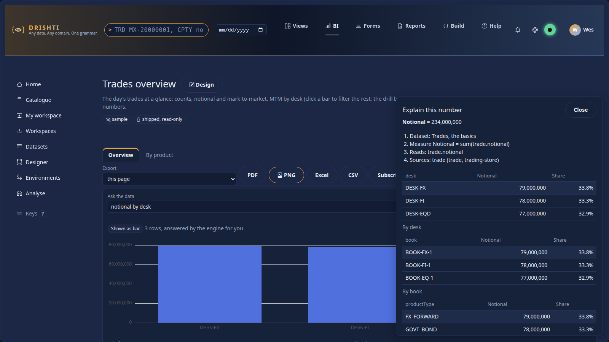

Explain explains **what a number is made of**, not why it moved over time (no comparison between dates is made; that is "not built", section 9).

### 29.7 Errors

| Code | When |
|---|---|
| `DRS-4015` (404) | the AI layer is off |
| `DRS-4016` (502 / 504) | the provider failed or did not answer in time |
| `DRS-4017` (429) | over a per-user, per-feature or cost limit of the AI policy |
| `DRS-4018` (403) | the AI policy does not open `bi-draft` / `bi-ask` / `bi-explain` / `bi-suggest` / `bi-explain-checks` / `bi-helper` to your role (for a subscription's narrative, `subscription-narrative` to the recipient: the summary is left out and the delivery says so) |
| `DRS-4019` (404) | the configured model is not found |
| **`DRS-4020`** (422) | the model's answer could not be used: a draft that did not pass the report check after one repair, or an answer that is not a query. Nothing was changed |
| `DRS-9002` (403) | no BI power for the hook (`bi-author` to draft, `bi` to ask and explain) |
| `DRS-9020` / `DRS-9021` / `DRS-9025` | the engine refused the query the model chose (an unknown field or measure; a masked field you may not group by; you already have the maximum number of queries running) |
| `DRS-9030` .. `DRS-9035` | the report or visual named in an Ask or Explain is not there or does not check |

### 29.8 Tests

`BiAiTest` (server, mock provider only, security on): the draft prompt carries the model and **no row, value or measure definition**; a draft is shown only if the checker passes it (a bad one is
`DRS-4020`); an author the policy does not list is refused; two readers asking the same question get different answers; a masked measure stays masked; the ask prompt in `labels-only` has no
row and in `aggregates` only the reader's own unmasked aggregates; explain's lineage, sources and breakdown; the hooks off with the layer. `tests/test_bi_ai.py` (console routes and the script's
hygiene: no `innerHTML`, no inline handler, same origin) and `tests/test_bi_ai_browser.py` (Chromium, real server and console, the mock provider: ask, explain, describe).
Sections 9 to 11 are tested in `BiAiTest` (suggestions are checked and rename taken ids, explanations pair with the checker's problems and no problem means no model call, the helper drops a name that is
not in the model, a relationship inside one table, a measure over an unknown column and a duplicate; the narrative needs `aggregates`), `SubscriptionServiceTest` (a narrative from each recipient's own
render, left out for a masked one, refused at save while the AI layer is off) and `tests/test_wave_d.py` (the routes and the scripts' hygiene); `tests/test_wave_d_browser.py` runs the
copilot and the helper in Chromium.

### 29.9 A written summary at the top of a subscription's email

A subscription with `narrative: true` (a checkbox on the Subscribe form: *Open the email with a short written summary*) opens each email with two or three sentences that word the report for **that
recipient**. It is the same model call as the others, under the feature name **`subscription-narrative`**, made **as the recipient** (their roles, their per-user limits, `features."[subscription-narrative]".roles`),
and the facts it is given are the recipient's own render of the report: the title, the as-of date and the tables as they see them, **every column masked for them left out**, at most
`drishti.distribution.subscriptions.narrative-rows` (15) rows of each. The prompt asks for three sentences at most and no number that is not in the facts.

It is written only when the AI policy lets the model see values: **`drishti.bi.ai.values: aggregates`**. Under `labels-only` the model never sees a figure, so the email goes without a summary and the delivery
in the run's history says `summary: skipped: the AI policy lets the model see labels only`. It is the same when the AI layer is off, when the policy refuses the feature to the recipient, or when
the provider fails: the email is sent without it (a summary is never a reason to hold a report back) and the history says why. A saved subscription with `narrative: true` is refused while the AI layer is
off (`422 DRS-9061`). The summary is marked as written by an AI model; it is not stored anywhere but in the email, and the audit row (`ai-subscription-narrative`) holds no text.

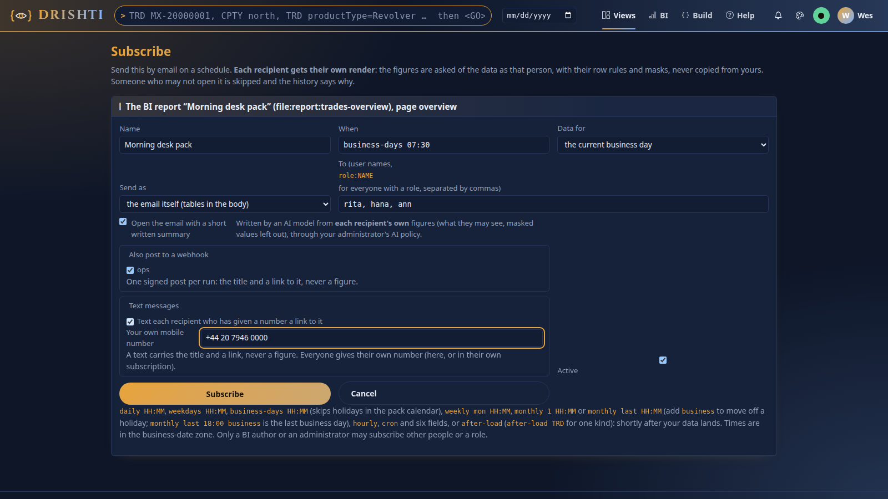

### 29.10 Designer copilot

In the report designer, **Suggest visuals** (beside *Check*; hidden unless the AI layer is on and you have `bi-author`) takes a goal in your words ("where the exposure sits, and a way to filter it by
desk") and the dataset the report reads, and proposes visuals, their wells and filters. The model is sent the dataset's model (names, types and descriptions, never a row) and the titles of what the report
already has; it writes a report in YAML, the report checker runs on it as it does on a hand-written one (one repair attempt, then `DRS-4020`), and each visual in it comes back as a card with its type, its
title, a sentence on why it is useful (the visual's `alt`) and **the YAML that would be added**. A slicer is a *filter*. Nothing is applied: **Add to this page** puts that visual at the bottom of the
page you are on as one undoable edit of the draft (`Ctrl+Z` takes it back), and Save is still yours. An id the report already uses is renamed (`by-desk-2`). `POST /api/v1/bi/ai/suggest`,
feature `bi-suggest`.

**Explain in plain words** is a button in the Check panel. The checker's own problems (codes, paths and messages, nothing else; the dataset's names help the explanation) go to the model, which answers
each with what it means and what to change, using the dataset's names. They are shown under the problems, marked as written by a model, and change nothing. With no problem the model is not called.
`POST /api/v1/bi/ai/explain-checks`, feature `bi-explain-checks`.

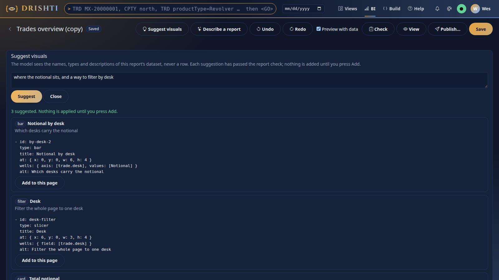

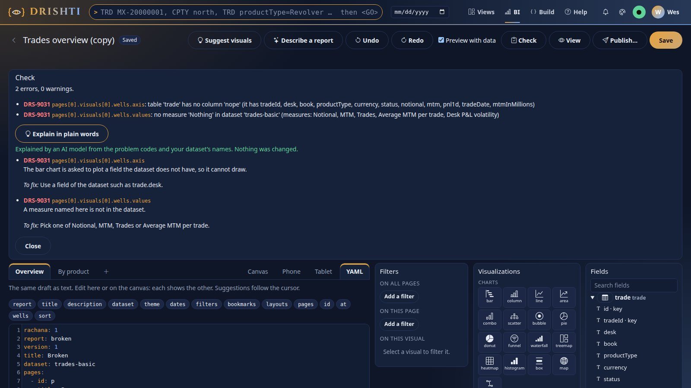

### 29.11 Dataset helper

In the **model designer** (2.2; and on the Model view of a version 1 dataset), **Ask the AI helper** proposes what a model usually lacks, from its names, types and descriptions alone (a column masked for you is left out; no value, no row):

* **relationships** between columns of the same type in different tables, with a cardinality and a reason;
* **measures** with a name, an expression (one aggregate over a column the model has, or `count(table)`) and a one-sentence description;
* **descriptions** for the columns that have none.

Each item is checked against the model before it is shown, and a name that is not there, a relationship inside one table or one that exists, a measure over an unknown column or with a name taken, and a
description for a column that has one are all dropped. Each is shown with the YAML it would add and an **Accept** button of its own: a relationship is added to the diagram and the `relationships:` block, a
measure to the `measures:` block, a description into the column's line (whichever of the three ways it is written; when the line cannot be found the item says *Place it by hand* and the YAML is shown
to copy). Nothing is saved until you press Save, and the draft is checked as you type like any other edit. `POST /api/v1/bi/ai/dataset-helper`, feature `bi-helper`.
On a model the items are written for the model: a measure under `measures:`, a field's description under `fields:` (`economies.regionName: { description: "..." }`,
kind `field`), a relationship under `relationships:`, each Accept one undoable edit of the designer's draft; the answer names the model (`"model": "my-world-economics@1"`).

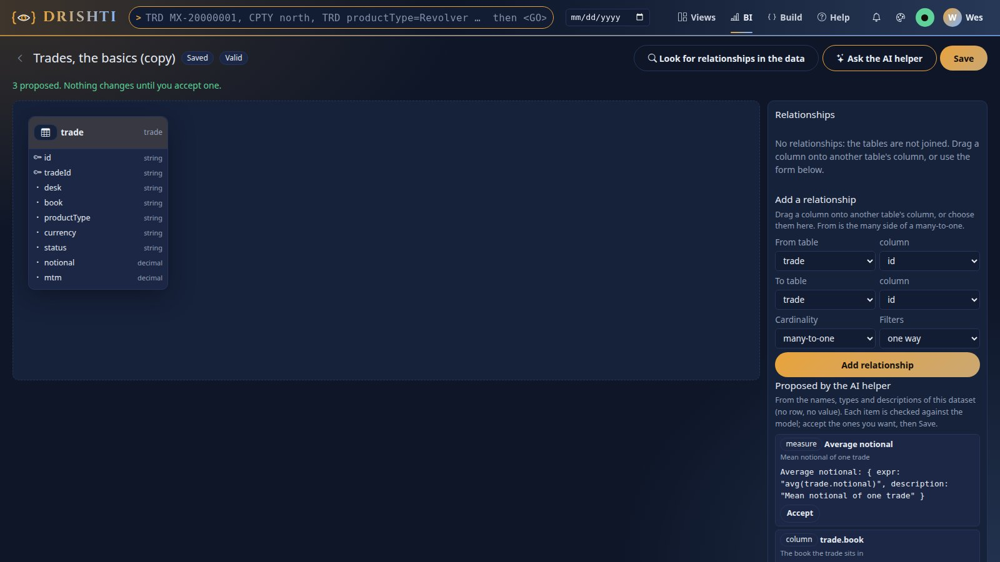

### 29.12 Not built

The narrative, the designer copilot and the dataset helper are built (sections 9 to 11). Not built: "why did it move" between two dates, follow-up questions that remember the last (each question is alone), streaming answers, and a model that calls Drishti's
tools itself (the MCP client exists; no BI hook uses it).
