<!--
  Project Drishti · Any data. Any domain. One grammar.

  Copyright (c) 2026 Ashutosh Sinha <ajsinha@gmail.com>.
  All rights reserved.

  PROPRIETARY AND CONFIDENTIAL.

  This file is the confidential and proprietary property of Ashutosh Sinha.
  Unauthorised copying, use, modification, distribution or disclosure of this
  file, via any medium, is strictly prohibited except with the express prior
  written permission of the copyright holder.

  See the LICENSE file in the root of this repository for the full terms.
-->
# Business intelligence (Rūpaka): the BI pages

Rūpaka is Drishti's business-intelligence layer, called **BI** in the top bar and on the command line (`RUPAKA` is an alias). This guide is the tour of its pages and of who may do what: the menu, the rail, workspaces, the catalogue, items and their lifecycle, and, in sections 13 to 18, datasets, reports, the designer, the Model view, publishing and live reports and boards. The detail of each lives in a reference of its own (below); this guide shows you where things are and how they fit.

**What a person can do today:** open BI, keep drafts in a personal workspace, share workspaces with roles, put typed items in them, publish them through versions (with an optional second-person review), certify them and find what they may open in a catalogue. A **dataset** is parsed, validated and **queried**: tables from pack kinds through connectors, relationships, measures, row rules and masks, answered by an embedded DuckDB. A **report** is **drawn**: pages of visuals that query the dataset as the person looking, with cross-filtering, drill-down and drill-through; the **designer** builds one by dragging fields onto a canvas and the **Model view** draws a dataset's relationships. Datasets can be **live** (kept in memory as the source ticks), reports then redraw in place, Perspective shows a grid or a pivot, and a **board** is a wall of live tiles with alert colours and a kiosk mode. **Python** (phase 6) writes measures and visuals as typed items, run sandboxed on the console or in the browser on the rows the person may see ([PYTHON_BI.md](PYTHON_BI.md); section 20 below). **Analyse** opens a dataset as a masked extract with Slice, SQL and Python cells and saves them as a **notebook** item (section 21). Reports can be **exported and subscribed to**, carry **alerts**, be **embedded** in another application and use **Vega-Lite**, **Perspective** charts and Python visuals; AI helpers (describe a report, ask the data, explain a number, a designer copilot, a dataset helper, narrative summaries) are there when an administrator switches the AI layer on. Section 11 lists the little that is not built.

## Start here

| You want to | Read |
|---|---|
| **Learn by doing** | [tutorial 10](../tutorials/10-first-bi-report.md) (a first report in twelve steps: map, bar, slicer, publish, filters, two datasets, relative dates, a tablet). Then [11](../tutorials/11-bi-that-runs-itself.md) (refresh, subscriptions, alerts, export, expected values), [12](../tutorials/12-live-bi-and-boards.md) (live BI and the board designer), [13](../tutorials/13-govern-bi.md) (governance), [14](../tutorials/14-python-and-analyse.md) (Python, Vega-Lite and Analyse), [15](../tutorials/15-ai-in-drishti.md) (AI) and [16](../tutorials/16-embed-drishti.md) (embedding) |
| Try each step with real answers | [BI_RECIPES.md](BI_RECIPES.md): a stack with four people, querying datasets, row rules and masks at work |
| Find your way round the pages, powers and workspaces | this guide, sections 2 to 12 |
| Write or read a dataset (tables, relationships, measures, row rules, masks, live tables) | [DATASETS.md](DATASETS.md) |
| Write or read a report (visuals, filters, slicers, live visuals, Perspective) | [REPORTS.md](REPORTS.md) |
| Put a wall of live tiles on a screen | [BOARDS.md](BOARDS.md) |
| Export a report or view as PDF, PNG, Excel or CSV; subscribe people by email | [DISTRIBUTION.md](DISTRIBUTION.md) |
| Write measures, visuals and tests in Python; explore a dataset as an extract; ask the AI helpers | [PYTHON_BI.md](PYTHON_BI.md), [ANALYSE.md](ANALYSE.md), [BI_AI.md](BI_AI.md); Calc's `drishti_bi` and Graphic Walker: [PYTHON_CALC.md](PYTHON_CALC.md#19-the-bi-client-and-graphic-walker) |
| Show a report in another web application | [ELEMENTS.md](ELEMENTS.md) (`<drishti-report>`, with `<drishti-search>` and `<drishti-about>`), [tutorial 16](../tutorials/16-embed-drishti.md) |
| Publish, review, certify, trace lineage, move content between servers | [BI_GOVERNANCE.md](BI_GOVERNANCE.md) |
| See what ships in `config/bi` and how the folder is read | [config/bi/README.md](../../config/bi/README.md) |
| Grant the powers, set the limits | [USER_MANAGEMENT.md](../admin/USER_MANAGEMENT.md#bi-powers-rupaka), [CONFIGURATION.md](../admin/CONFIGURATION.md) |
| Call it from a program or the command line | [API_GUIDE.md](API_GUIDE.md#business-intelligence-rupaka-apiv1bi), [CLI_GUIDE.md](CLI_GUIDE.md#bi-workspaces-and-the-catalogue-rupaka) |
| Understand the design and what each phase built | [RUPAKA.md](../architecture/RUPAKA.md) (section 20: every phase and wave as built, ending in the one list of what is not built), [RUPAKA_POC.md](../architecture/RUPAKA_POC.md) (the measurements behind it), [LIVE_BI.md](../architecture/LIVE_BI.md) (heavy continuous aggregation belongs in a producer), [QUANT_SERVICE.md](../architecture/QUANT_SERVICE.md) (server-side pricing, proposed) |
| Fix a problem | section 12 here, [TROUBLESHOOTING.md](TROUBLESHOOTING.md) |

A good first hour: read sections 2 to 4 here (the menu, the powers, the rail), then set up a stack with [BI_RECIPES.md](BI_RECIPES.md) (the *Set up* section) and do tutorial 10.

## Contents

1. [What BI is, and is not](#1-what-bi-is-and-is-not)
2. [Getting in: the BI menu and RUPAKA](#2-getting-in-the-bi-menu-and-rupaka)
3. [Who may do what: the four powers](#3-who-may-do-what-the-four-powers)
4. [The page and its rail](#4-the-page-and-its-rail)
5. [Home](#5-home)
6. [The catalogue](#6-the-catalogue)
7. [Workspaces and their roles](#7-workspaces-and-their-roles)
8. [Items, versions, review and endorsement](#8-items-versions-review-and-endorsement)
9. [Who sees what](#9-who-sees-what)
10. [Shipped content, settings and the command line](#10-shipped-content-settings-and-the-command-line)
11. [Built and not built](#11-built-and-not-built)
12. [Problems](#12-problems)
13. [Datasets and the query engine (phase 2)](#13-datasets-and-the-query-engine-phase-2)
14. [Reports: the viewer (phase 3)](#14-reports-the-viewer-phase-3)
15. [The designer (phase 3)](#15-the-designer-phase-3)
16. [The Model view (phase 3)](#16-the-model-view-phase-3)
17. [Publishing and governance (phase 4)](#17-publishing-and-governance-phase-4)
18. [Live reports and boards (phase 5)](#18-live-reports-and-boards-phase-5)
19. Export, subscriptions and alerts · 20. Python · 21. Analyse · 22. With AI (below)
23. [Models and pack datasets: the model layer (wave W1)](#23-models-and-pack-datasets-the-model-layer-wave-w1)

## 1. What BI is, and is not

**You can**

* open BI from the top bar or with `BI <GO>`; keep drafts in a personal workspace and move them to a shared one; create typed items (`dataset`, `report`, `board`, `notebook`, `python`) with a YAML body;
* open a **dataset**: its model, and a query preview with the server's row rules and masks; start a dataset from the packs' kinds (links across packs, relationships proposed from the data); see and edit its relationships as a diagram (section 13 and 16);
* open a **report**: tabs, slicers, click a bar to filter the page, drill down, drill through, show the rows, open a trade in the terminal; **design** one by dragging fields onto a canvas, with the YAML beside it, real data, Check, undo and redo (sections 14 and 15);
* publish versions, restore an old one, propose for review and approve (four-eyes); compare any two saved states; review with a diff, Check and a data preview; promote and certify; see lineage and what a dataset change breaks; move content between servers as a bundle (section 17);
* open a report over a **live table** and watch it redraw as the data ticks, with a last-update time, pause and resume; open a **Perspective** grid or pivot; open a **board**, a wall of live tiles with alert colours, in kiosk mode (section 18);
* search, filter and sort a catalogue that shows each person only what they may open; read shipped, read-only content from the BI folder.

**Not built** (each is marked where it would matter, and listed in section 11)

* threaded comments on a line of a diff; approval chains of several reviewers; escalation of an alert; the Python Source interface;
* "what changed since your last visit" on Home; searching the catalogue by the fields a dataset uses.

Everything the page does, the server decides: the page is a shell that asks the server's `/api/v1/bi` under your identity.

## 2. Getting in: the BI menu and RUPAKA

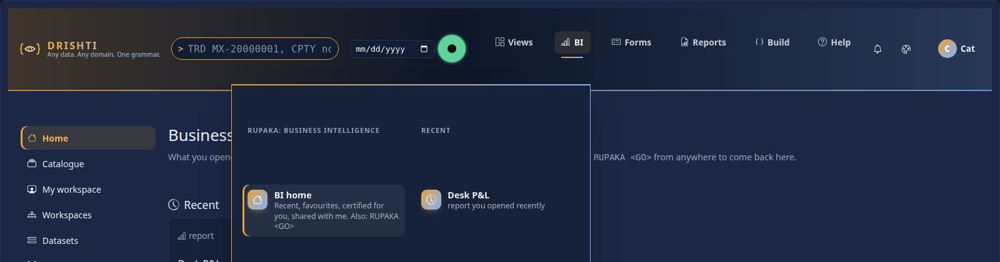

- **The BI menu** is the second entry of the top bar, right after **Views** (the order is Views, BI, Forms, Reports, Build, then Admin and Help for those who have them), with the icon `bar-chart-line`. It lists *BI home*, *My workspace*,
  *Catalogue*, and under *Recent* the three items you opened most recently. It is shown only to people who hold the `bi` power (section 3), and
  not at all when BI is switched off. Administrators with `bi-admin` also see *BI settings* (under *Administer*); an administrator also sees the
  *proof of concept* there when `bi.poc_enabled` is on (section 10).
- **The Reports menu** (the top bar's fourth entry) holds the saved and scheduled reports of the terminal and, for people with the `bi` power, *BI reports* (the catalogue filtered to reports) and the BI reports you opened last. The **Forms** menu beside it is the terminal's query by form, not BI.
- **`BI` on the command line** is a reserved keyword (`RUPAKA` is an alias and works the same). Case does not matter.

| Type | Opens |
|---|---|
| `BI <GO>` | the BI home (`/bi`) |
| `BI WORKSPACE <GO>` | your personal workspace (`/bi/w/me`) |
| `BI CATALOGUE <GO>` | the catalogue (`/bi/catalogue`) |
| `BI <report-or-board> <GO>` | an item by its id or its title (any case); a **report opens drawn** (`/bi/r/<id>`), any other item opens its page; if the words match several items, the catalogue searched for them (a pick list) |
| `BI SETTINGS <GO>` | Admin, BI settings (needs `bi-admin`) |

`BI WORKSPACES` and `BI CATALOG` are accepted too. A board named in `BI <report-or-board> <GO>` opens its item page (use *Open the board* there, or the catalogue); only a report opens drawn.

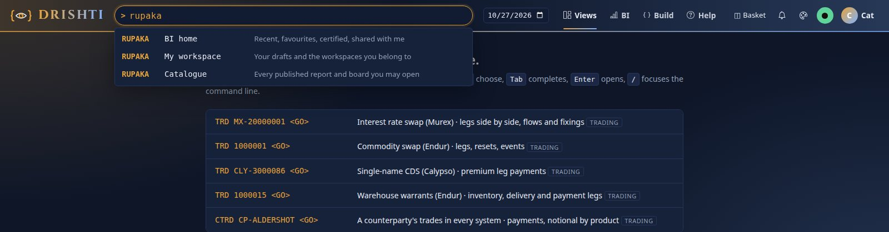

Type-ahead offers the keyword after the first letters (`b`, `ru`), the three pages (`WORKSPACE`, `CATALOGUE`, home) after `BI `, and the items you may open
that match what you type next. Someone without the `bi` power gets no suggestions and, on `<GO>`, a message that says what is
missing. **A pack may not define a mnemonic named `BI` or `RUPAKA`** (or `FORM`, the other reserved word): the pack loader refuses it with
`pack 'x' defines the mnemonic 'BI', which is a reserved command word (BI, FORM, RUPAKA): choose another`, so `pack check` fails
the same way.

URLs: `/bi` (home), `/bi/catalogue`, `/bi/workspaces`, `/bi/w/<workspace>` (`me` is your personal one), `/bi/i/<item>`, `/bi/datasets` and `/bi/d/<dataset>` (phase 2),
`/bi/r/<report>[/<page>]` (the viewer), `/bi/b/<board>` (a board), `/bi/designer` and `/bi/design/<draft>` (the designer), `/bi/m/<dataset>` (the Model view), `/bi/environments` (bundles), and `/bi/explore` (Analyse). Admin: `/admin/bi`.

## 3. Who may do what: the four powers

BI powers are granted on roles, beside `raw`, `author` and `approve` (see [USER_MANAGEMENT.md](../admin/USER_MANAGEMENT.md#bi-powers-rupaka)).

| Power | Lets a holder |
|---|---|
| `bi` | open BI, the catalogue and the published content their audience allows; keep favourites and recents |
| `bi-author` | create, edit, move, propose and publish items, and create shared workspaces (if the policy says authors) |
| `bi-steward` | **certify** published items; **review** (approve or reject) proposals in any workspace; **import bundles**; create shared workspaces when the policy says stewards |
| `bi-admin` | change BI settings, see and manage every shared workspace; always allowed to create workspaces |

A higher power also opens BI, so a role granted only `bi-author` still sees the catalogue. The built-in `admin` role holds all four;
`viewer` holds `bi`; `author` and `approver` hold `bi` and `bi-author`; a role a pack defines holds none until an administrator
grants it. With security off, everyone holds everything. What a power allows is then narrowed by the **workspace role** (section 7).

## 4. The page and its rail

The BI page shares the top bar, sign-in, themes, inbox and help with the terminal, and has its own layout: a left **rail** and a
wide canvas. The terminal's F-key footer is not shown (F1 opens help for BI).

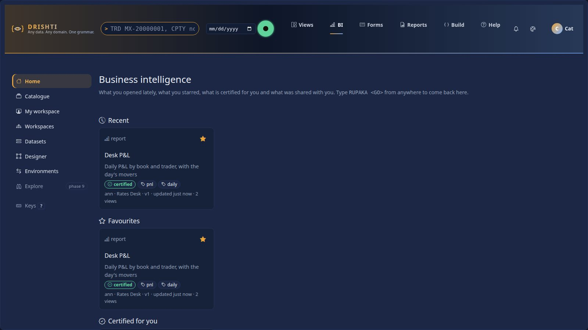

| Rail entry | Opens | State |
|---|---|---|
| Home | recent, favourites, certified for you, shared with me | built |
| Catalogue | search, filters and sort over what you may open | built |
| My workspace | your personal workspace | built |
| Workspaces | the workspaces you belong to; create one | built |
| Datasets | the semantic models, their pages and the Model view | built (phases 2 and 3) |
| Designer | your report drafts, a new report on a dataset, and the designer | built (phase 3) |
| Environments | download a workspace as a bundle; import one with a dry run | built (phase 4) |
| Analyse | open a dataset as your masked extract; Slice, SQL and Python cells; notebooks | `/bi/explore` ([ANALYSE.md](ANALYSE.md), section 21) |

**Keys** (shown by `?`): `/` search the catalogue (from another BI page it takes you to the catalogue with the search focused),
`g h` home, `g c` catalogue, `g w` my workspace, `?` the list, `Esc` closes it. Keys are ignored while you type in a field.

**On a phone** (390 px) the rail becomes a scrolling bar above the page, cards stack in one column, every control is at least
44 px high, and fields use 16 px text so the browser does not zoom.

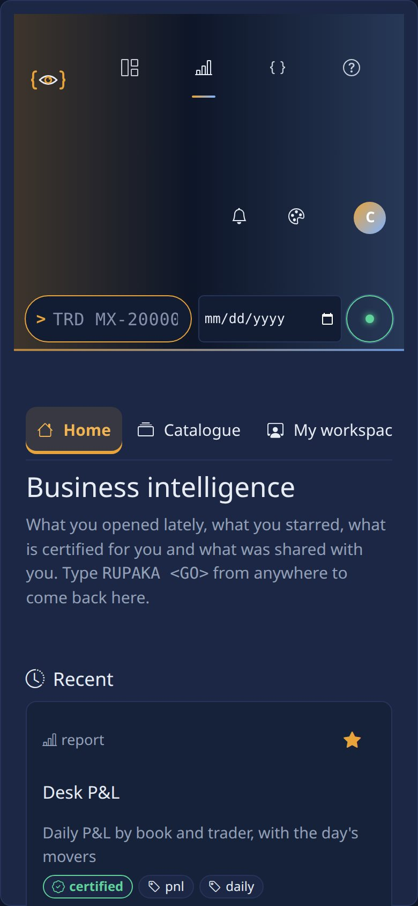

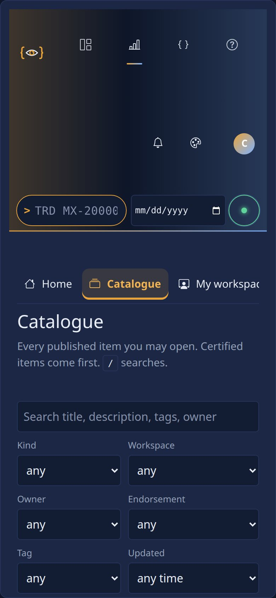 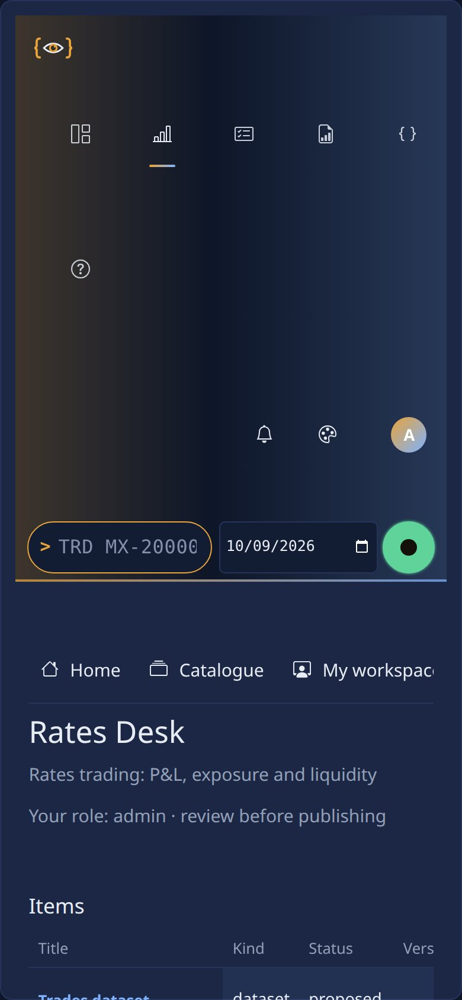

## 5. Home

Four sections, each a set of cards. A card shows the kind, a star (favourite), the title, the description, badges (certified,
promoted, shipped, status, tags) and a line with owner, workspace, version, freshness ("updated 3 days ago") and the views in the
last 30 days.

| Section | Shows |
|---|---|
| **Recent** | what you opened lately (opening an item page counts), newest first |
| **Favourites** | items you starred, by title |
| **Certified for you** | certified items you may open, most used first |
| **Shared with me** | published items in workspaces you belong to that others own, newest first |

"What changed since your last visit", described in the design, is **not built**.

## 6. The catalogue

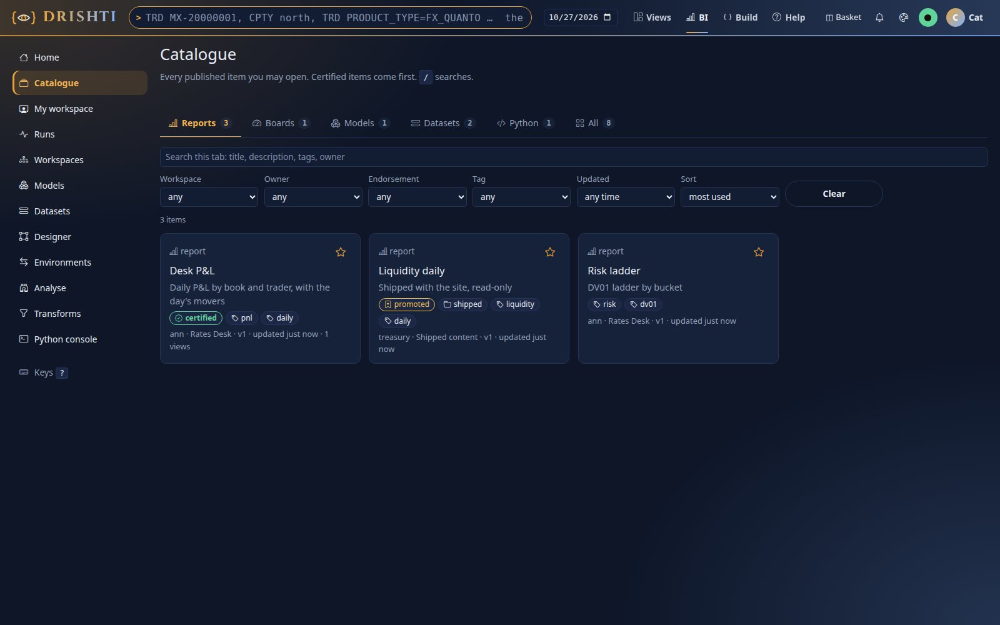

It lists every **published** item you may open (section 9). Typing in the search box searches title, description, tags, owner,
kind and workspace name (every word must match); the filters narrow by kind, workspace, owner, endorsement, tag and how recently
it was published; sort is *most used* (the default), *newest* or *title*. **Certified items are pinned first** except when sorted
by title. The address keeps the state (`?q=daily&kind=report`), so a link reproduces the list. The filter lists show only values that
exist, with counts.

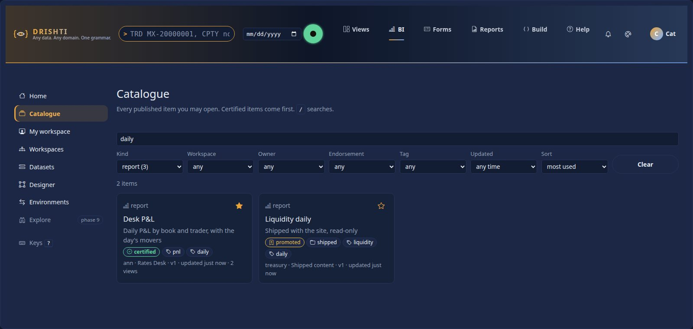

Searching "the fields used" and filtering by *domain or pack* and by *live or cached* need datasets and are not built (an item can
name packs in its audience, and the API filters by `pack`, but no page offers it yet).

## 7. Workspaces and their roles

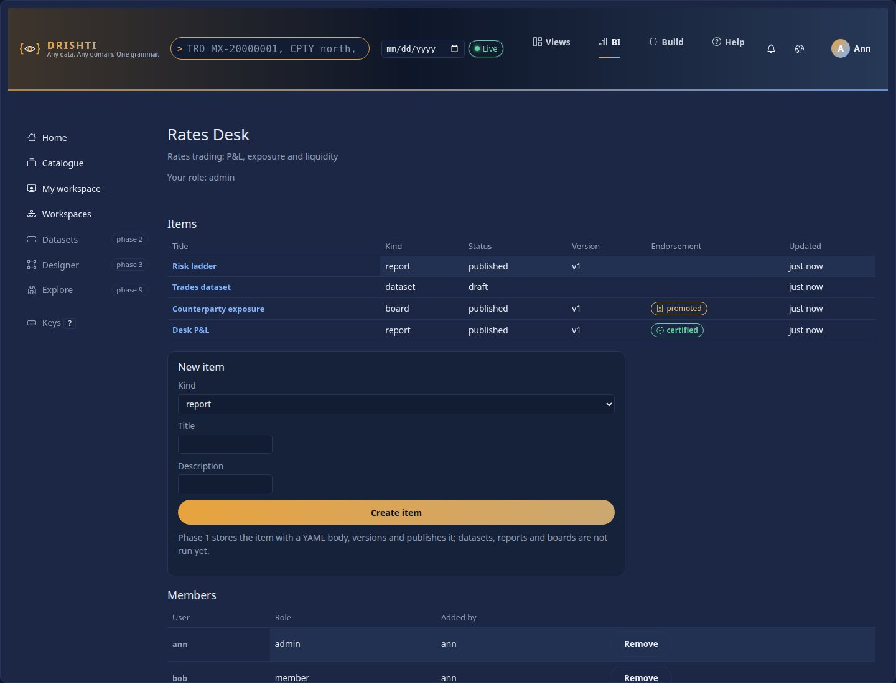

- **Personal workspace** (one per user, created on first use): drafts only you can see. It has no members and cannot publish: move
  an item to a shared workspace first (*Move to workspace*).
- **Shared workspace**: created from **Workspaces** (needs the policy's power, section 10). The creator becomes its admin. It has
  members with a role:

| Workspace role | May |
|---|---|
| `viewer` | open the workspace and its published items |
| `contributor` | also create and edit drafts (needs the `bi-author` power too) |
| `member` | also publish, approve proposals, promote, delete others' drafts (publish needs `bi-author`) |
| `admin` | also add and remove members, rename it, switch review on or off, delete it (when empty) |

**The Items table.** Each row shows the title, a short id and the created time (two items with one title are told apart by them), the kind, status, version, endorsement and when it was updated. Rows you may delete (the server's own rule, `can.delete`: your own items, or any item if you are a member of a shared workspace; never shipped content) have a checkbox and a **Delete** button; **Select all** ticks every such row and **Delete selected (N)** opens one confirmation listing the titles. The items are deleted one by one with the ordinary delete rule, and the message says which were **deleted** and which were **skipped** with the reason the server gave (a refused item stays in the list). A new item left without a title is named with its kind and the time (*Report 2026-10-12 11:32*). The **New item** form asks a **report** for its dataset and opens it in the designer; a **board** opens the board designer; a dataset, a notebook or a Python item starts on the Datasets page or in Analyse (the form says so and takes you there). Without the `bi-author` power the form is replaced by a line telling you to ask an admin for it.

A person who is not a member does not learn that a workspace exists (`404 DRS-9001`). The last admin cannot be demoted or
removed. A workspace can **require review before publishing**: then *Publish* is not offered and an item is *proposed* and approved.
A `bi-admin` is an admin of every shared workspace (but cannot read anyone's personal workspace).

## 8. Items, versions, review and endorsement

**Duplicate, delete and what depends.** Every item page has **Duplicate...**: a draft copy of any kind (report, dataset, board, notebook, Python item) in a workspace you choose among those where you may add items. **Delete**, on an item page and in the workspace list (one or many), first says what depends on it: the reports that read a dataset (and the composed or derived datasets built on it), the boards that show a report; the count is of what you may read (`GET /api/v1/bi/items/{id}/dependants`). Nothing else in BI depends on a board, a notebook or a Python item yet. A **new Python item** starts from a form (a measure, a visual or a Transform) with a valid commented body and opens in its editor. **Add member** on a shared workspace searches the known people as you type. **Export and Subscribe** on a report appear when exports and subscriptions are on and, for Subscribe, you are under your limit; otherwise a line says why.

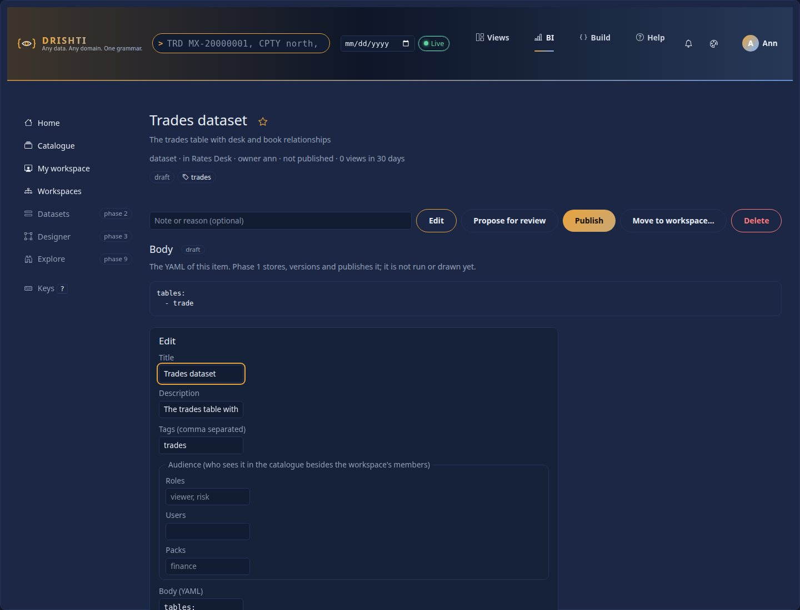

An **item** has a kind (`dataset`, `report`, `board`, `notebook`, `python`), a title, a description, an owner, tags, an audience, a
**YAML body** and a lifecycle. The body must parse as YAML with a mapping at the top; it may be empty; it is at most
`drishti.bi.max-body-bytes` (256 KiB). Nothing runs it.

**Lifecycle.** `draft` → (optional `proposed`) → `published` as version N.

- Editing a **published** item makes the item a draft again; the published version stays what viewers see, and the page shows
  "draft changes not published".
- **Publish** (member, `bi-author`, shared workspace, no review required) writes the next version and makes the item `published`.
- **Propose for review** (contributor) freezes the item; **Approve and publish** needs a **`bi-steward`** (in any workspace), or a workspace `member` who holds the
  **`approve`** power (the same one that approves Sutras) and is not the proposer when four-eyes is on
  (`drishti.governance.four-eyes`, `DRS-9005` otherwise). **Reject** needs a reason and returns the item to draft; the proposer
  may **withdraw**.

- **Two people, one draft.** Every editor saves from the saved state it opened. If someone else saved first, the save is refused (`DRS-9007`, nothing is written) and the editor offers **Reload theirs**, **Save mine as a copy** (into a workspace you choose) or **Overwrite with mine**. This holds in the report designer, the board designer, the Model view, the dataset wizard in edit mode and the item page's Edit form.
- **Frozen items open read-only.** A proposed item opens in a designer with a banner and **Withdraw to edit** (and the item page shows who can approve it). A published item is editable: the edit makes a new draft, and readers keep the published version until you publish again.
- **Publish from the designer.** The designer's **Publish** button (**Propose** in a workspace that requires review) saves first (it asks when there are unsaved changes), then publishes or proposes. A report that cannot be drawn is refused with its errors listed.
- **One bad visual, not a blank report.** A visual with an error of its own shows an error card; every other visual of the report is drawn, in the designer, the viewer, exports and boards.
- **Forms that do not double-submit.** Buttons that send a request are disabled while it is in flight, and the answer (success or error) appears beside the button. That holds for every control that reports one: the catalogue's and the home page's *favourite* star; an item page's *Propose*, *Publish*, *Approve*, *Reject*, *Withdraw*, *Promote* and *Certify* (*Promoted*, *Certified*, *Published* appear beside the button that was pressed, and a refusal in words, e.g. *DRS-9052 ... which is still a draft*); *Delete*, *Duplicate* and *Move*; a workspace's *Delete selected*, *Add member* (*Saved cat as viewer.*) and the *review before publishing* box; the report page's *Export* buttons (the file is fetched, so a refusal is said next to the button instead of replacing the report), *Subscribe* and *Alert me*, which also say when the filters on the screen were too long to carry; a dataset page's *Run the query*, *Refresh now* and *Set a schedule*; the board and report designers' *Check* and *Save*.
- **View as readers see it.** The designers' toolbar has a **View** menu: **my draft** or **as readers see it (published)**. The second opens the report or board page on the published version (a banner says which version and that your draft has changes that are not shown) with data masked for you, standing in for the reader; it is greyed until the item has been published. For the API: `GET /bi/items/{id}/published` and `?as=published` ([API_GUIDE.md](API_GUIDE.md)).

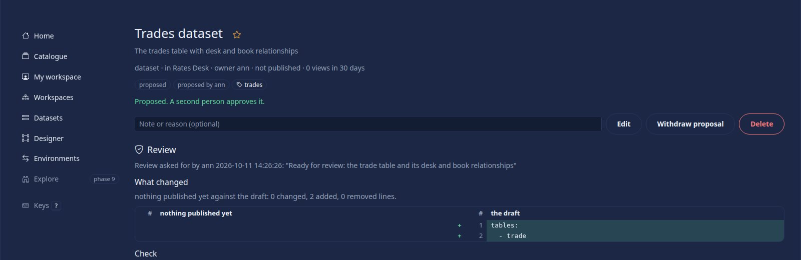

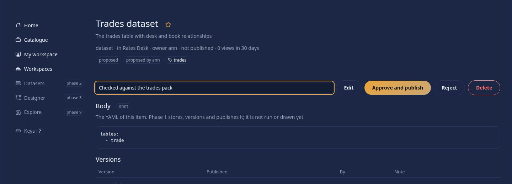

- **Versions** are kept (`drishti.bi.versions-keep`, 50). The page lists them; *View* shows a version's body; *Restore as draft*
  makes an old version the draft again, to be published as a new version. The *History* section (section 17) adds a saved state for every save, a side-by-side diff and restore.
- **Endorsement.** The owner or a member may **promote** a published item; only a `bi-steward` may **certify** it, or remove a
  certification. Certified items are pinned first in the catalogue and listed on Home.
- **Favourites and views.** The star is yours alone. Opening an item counts one view for today; the card shows the views of the last
  `drishti.bi.usage-days` (30).
- **Delete** (owner, or a member) removes the item and its versions. **Move** changes workspace (you need contributor in the target).

Every change is written to the audit log (Admin, Audit log): `bi-workspace-created`, `bi-workspace-updated`, `bi-workspace-deleted`,
`bi-member-set`, `bi-member-removed`, `bi-item-created`, `-updated`, `-moved`, `-deleted`, `-proposed`, `-withdrawn`, `-approved`,
`-rejected`, `-published`, `-restored`, `-endorsed`, `bi-settings-changed`, and in phase 4 `bi-certification-revoked`, `bi-bundle-exported`, `bi-bundle-imported`, `bi-item-imported`, and from the query engine `bi-dataset-refresh` and `bi-query` ([BI_GOVERNANCE.md](BI_GOVERNANCE.md#8-the-audit-trail)).

## 9. Who sees what

An item reaches the **catalogue** and **Home** for you when it is **published**, not in a personal workspace, and at least one holds:

1. you are a `bi-admin`, its owner, or a member of its workspace (any role);
2. its **audience** names one of your roles, you by name, or a pack assigned to you;
3. it is shipped content with no audience (everyone with `bi`).

An item with an empty audience is therefore visible to its workspace's members only. A draft is seen only by the workspace's
contributors and above. Anyone who may not see an item gets `404 DRS-9001` for it, never a hint that it exists. Role names and
packs in an audience are checked when saved. Rows and fields **inside** a dataset are a separate layer: its row rules and masks are applied by the server
to every query, for each reader ([DATASETS.md section 6](DATASETS.md#6-security-row-rules-and-masks)); the catalogue decides only whether you may open the item.

## 10. Shipped content, settings and the command line

**Shipped content.** Files in the BI folder (`drishti.bi.dir`, default `./config/bi`) appear as published, read-only items of the
workspace *Shipped content*: `datasets/<id>.dataset.yaml`, `reports/<id>.report.yaml`, `boards/<id>.board.yaml`,
`notebooks/<id>.notebook.yaml`. The top-level keys `title`, `description`, `owner`, `tags`, `endorsement` (`none`, `promoted`,
`certified`) and `audience` (`roles`, `users`, `packs`) describe the catalogue entry; the file is the body. The folder is read again
**live, with no restart** (`drishti.bi.watch`: `auto` file events with a polling safety net every `folder-refresh` (5 s), `poll`, or `off`, where the
folder is read on the first request after `folder-refresh`): **add** a file and it appears in the catalogue and in *Shipped content*; **change** it and the next
read has the new content as the next version (`v2`, `v3`, counted since the server started; only the current body is kept); **delete** it and it is gone, and an
open item page says so on its next load (`404 DRS-9001`). A file that does not parse (bad YAML, or not a mapping) **keeps its last good version** and is listed
as a problem, with the message, in *Admin, BI settings* and on *Health* (`bi.problems`); fixing the file clears it. A bad file that never parsed has no item, only the
problem. Shipped items cannot be edited here: change the file. Details: [config/bi/README.md](../../config/bi/README.md).

Drishti ships **five datasets** (`trades-basic`, `trading-risk`, `trading-cashflows`, and the live `live-trading` and `live-exposure`), **six reports** (`trades-overview`, `counterparty-risk`, `cashflow-ladder`, `live-trading-desk`, `live-exposure` and `python-desk-risk`), **two Python items** (`desk-pnl-volatility`, `pnl-histogram`) and **one board** (`desk-wall`), each commented line by line and marked `sample: true`. Two map samples sit beside them: `world-economics` (real World Bank data) and `region-economics` (Australian and US states: illustrative figures, rounded from public figures, not for reporting). A sample is hidden from the people who may not see sample packs
(*Admin, Packs, Hide samples from business users* or *from everyone*), exactly as a sample pack is.

```yaml
# config/bi/reports/liquidity-daily.report.yaml
title: Liquidity daily
description: Shipped with the site, read-only
owner: treasury
tags: [liquidity, daily]
endorsement: promoted
pages: []
```

**Admin, BI settings** (`/admin/bi`, needs `bi-admin`):

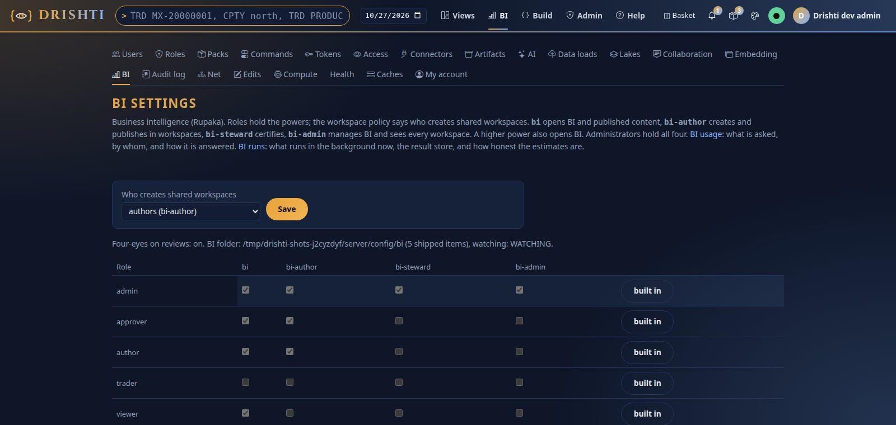

- *Who creates shared workspaces*: `authors` (`bi-author`, the default), `stewards` (`bi-steward`) or `admins` (`bi-admin` only). It
  is kept in the identity database and overrides `drishti.bi.workspace-creation`.
- *The BI folder*: how it is watched (`WATCHING`, `POLLING`, `OFF`), how many shipped items it holds, and any file with a problem.
- *Roles and their powers*: tick `bi`, `bi-author`, `bi-steward`, `bi-admin` per role and **Save**. Roles from configuration or a pack
  (built in) are read-only here; roles defined in Admin, Roles are editable, and only by an administrator (the page calls the
  role-definition API as you).

**Settings** (all in [CONFIGURATION.md](../admin/CONFIGURATION.md#drishtibi--rupaka-business-intelligence-phase-1-the-shell-and-the-catalogue)): `drishti.bi.enabled`,
`dir`, `watch`, `folder-refresh`, `workspace-creation`, `max-body-bytes`, `versions-keep`, `usage-days`, `recent`, `list-limit`; the
console's `bi.enabled` (`DRISHTI_BI_ENABLED`) and `bi.poc_enabled`. Each later phase has a group of its own: `drishti.bi.query.*` (the query engine, [DATASETS.md](DATASETS.md#8-the-query)),
`drishti.bi.report.*` ([REPORTS.md section 11](REPORTS.md#11-settings)), `drishti.bi.governance.*` ([BI_GOVERNANCE.md](BI_GOVERNANCE.md)) and `drishti.bi.live.*` with the console's `bi.live.*` and `bi.board.rotate_seconds` ([BOARDS.md section 8](BOARDS.md#8-settings)).

**The proof of concept.** The phase 0 page `/bi/poc` is kept for administrators, under the BI menu, and exists only while
`bi.poc_enabled` (console) and `drishti.bi.poc.enabled` (server) are on. It is throw-away code; see
[RUPAKA_POC.md](../architecture/RUPAKA_POC.md). `RUPAKA <GO>` no longer opens it.

**The command line.** `drishti.py bi workspace list|get` and `drishti.py bi catalogue list|get|publish` talk to the API as the
token's user ([CLI_GUIDE.md](CLI_GUIDE.md#bi-workspaces-and-the-catalogue-rupaka)):

```
$ drishti.py bi workspace list
id                            role          items  name
u-cat-7fd6                    admin             0  My workspace  [personal]
rates-desk                    viewer            4  Rates Desk
shipped                       viewer            2  Shipped content
$ drishti.py bi catalogue list --q exposure --kind board
id              kind     endorsed  status    ver  title
bi-cd5f8b2cc5   board    promoted  published v1   Counterparty exposure  (Rates Desk, ann)
1 item(s)
```

**The API.** [API_GUIDE.md](API_GUIDE.md#business-intelligence-rupaka-apiv1bi) lists every endpoint and the token scopes
`bi:write`, `bi:approve` and `bi:admin`.

**Disabling and uninstalling a shipped file.** **Admin → Artifacts** (and *Shipped files* on *Admin → BI*) lists the files of `config/bi`. **Disable** hides a file from the catalogue and keeps
it; **Uninstall…** shows the reports, boards, composed datasets, alerts and subscriptions that depend on it, refuses while any do, and otherwise moves the file to
`data/uninstalled/`, from where it is restored. An administrator can also upload a `<name>.<kind>.yaml` file there: it is checked and its impact shown before it is placed. See
[ARTIFACTS.md](../admin/ARTIFACTS.md).

## 11. Built and not built

What each phase built, in one paragraph each, with where the detail is. The authoritative list, with what is **not** built in each phase, is [RUPAKA.md](../architecture/RUPAKA.md) section 20; the references end with their own "built and not built" ([DATASETS.md section 10](DATASETS.md#10-what-is-not-built), [REPORTS.md section 12](REPORTS.md#12-built-and-not-built), [BI_GOVERNANCE.md section 10](BI_GOVERNANCE.md#10-built-and-not-built), [BOARDS.md section 10](BOARDS.md#10-built-and-not-built)).

**Phase 1, the shell and the catalogue.** The BI menu and the `BI` keyword (alias `RUPAKA`) with type-ahead; the shell with its rail and keys; Home and the catalogue; personal and shared workspaces with four roles; typed items with YAML bodies; versions, restore, review with four-eyes, endorsement;
audience-based visibility; shipped files, watched live; Admin, BI settings; four powers on roles; the audit trail; the CLI; `DRS-9001` to `9006`.

**Phase 2, datasets and the query engine.** The dataset YAML with its parser and validation (`DRS-9010` to `9013`); the expression language with aggregation; a dataset started from pack kinds, the packs' links across packs, relationships proposed from the data; the connector SPI `scan` and `sqlTarget` (Delta, DuckDB, PostgreSQL, file); the query engine (an `AnalyticEngine` interface, embedded DuckDB, compiled parameterised SQL), the columns and
rollup layers rebuilt per business date on data-load signals, `direct` tables pushed to a SQL store; row rules and masks; Arrow and JSON answers; the result cache; limits (`DRS-9020` to `9027`); the Datasets list and dataset pages; compressed static files. Reference: [DATASETS.md](DATASETS.md).

**Phase 3, reports, the designer and the Model view.** The report YAML with its parser, validator and writer (`DRS-9030` to `9035`); the viewer with 21 visual types (30 today: see REPORTS.md section 3), three levels of filters with top-N, slicers, cross-filter and highlight, drill-down,
drill-through, show the rows, bookmarks and palettes; the designer (Fields, Visualizations with Build and Format, Filters, pages, the canvas on the 12-column grid with the keyboard, the YAML tab,
real data and query time while designing, Check, undo and redo, save and save a copy); the Model view; `BI <report> <GO>`; `drishti.bi.report.*`. Reference: [REPORTS.md](REPORTS.md).

**Phase 4, publishing and governance.** A saved state for every save and the side-by-side diff; review with the reviewer's diff, Check, impact and data preview; certification only by a steward with automatic revocation; lineage and impact analysis with the refusal `DRS-9040`; bundles between environments with a dry run (`DRS-9041`, `9042`); the audit trail. Reference: [BI_GOVERNANCE.md](BI_GOVERNANCE.md).

**Phase 5, streaming BI.** `mode: live` tables kept in memory and updated by key from the same live machinery as the terminal (with retention and per-reader rows and masks on every update); a live stream per report and visuals that redraw in place (coalesced, with a live indicator, pause and resume, stale and disconnected states); the rolling chart (`live-chart`); the Perspective grid and pivot over masked Arrow with streaming rows, under the narrowest policy; boards with pages, tile alerts, kiosk and rotation; the two live datasets, two live reports and the board shipped as samples; `drishti.bi.live.*`; `DRS-9050` to `9053`. References: [DATASETS.md section 7.1](DATASETS.md#71-live-tables-phase-5), [REPORTS.md section 13](REPORTS.md#13-live-visuals-and-perspective-phase-5), [BOARDS.md](BOARDS.md).

**Wave 3, the BI essentials.** Scheduled refresh of datasets (`refresh:` with a clock, the pack's business-day calendar or `after-load`, retried with the shared policy, its state on the dataset page: [DATASETS.md section 7.2](DATASETS.md#72-scheduled-refresh));
time intelligence in the measure language (`ytd`, `mtd`, `qtd`, `prior_period`, `same_period_last_year`, `running`: [DATASETS.md section 4.1](DATASETS.md#41-time-intelligence)), badged in the designer's Fields pane; the visuals **map** (countries by ISO code, regions by ISO 3166-2 code with a click that drills from the world to a country and its regions, or points by latitude and longitude, from a vendored
country file: no tiles, no CDN), **funnel**, **histogram**, **box plot** and **bubble** in the visual catalogue, the designer, exports and `<drishti-report>`; and **true totals** for the measures of a matrix or table that do not add up, worked out by the engine
([REPORTS.md sections 3.1 and 3.2](REPORTS.md#31-the-map-funnel-histogram-box-plot-and-bubble)). Walk-through: [tutorial 10](../tutorials/10-first-bi-report.md); settings `drishti.bi.refresh.*` and `drishti.bi.report.distribution-rows` and `totals-max-rows`.

**The long tail (wave A).** The measure language has **window functions** (`lag`, `lead`, `rank`, `dense_rank`, `percent_rank`, `moving_avg`, `moving_sum`, `moving_min`, `moving_max`, `cumulative`: [DATASETS.md section 4.3](DATASETS.md#43-window-functions)), badged in the Fields pane;
a query may ask for measures of **several unrelated fact tables** at once (each aggregated alone at the shared fields, then joined, no fan-out: [DATASETS.md 3.1](DATASETS.md#31-several-unrelated-fact-tables-in-one-query)); the rollups of a **live table are kept by group** as rows change ([DATASETS.md 7.1](DATASETS.md#71-live-tables-phase-5));
a dataset's **refresh state and history survive a restart** and its page has **Refresh now** ([7.2](DATASETS.md#72-scheduled-refresh)); a slicer can be **relative-date** (*Last 30 days*, *This quarter to date*, business-day aware: [REPORTS.md 6.1](REPORTS.md#61-the-relative-date-slicer));
a report has **tablet layouts** beside the phone ones ([14.1](REPORTS.md#141-a-tablet)); reports and datasets declare **expected values** that Check runs as a chosen role and that stop a publish while they fail ([REPORTS.md 17](REPORTS.md#17-expected-values-tests)); an **entity view** shows a Drishti view inline for the selected key ([3.4](REPORTS.md#34-the-entity-view));
and the sample *Region economics* drills from the world map to Australian and US regions (illustrative figures, labelled). Walk-throughs: [tutorials 10, 11 and 12](../tutorials/10-first-bi-report.md).

**Several datasets.** Composed datasets (`from:` / `join:`), derived datasets made by a Python Transform, per-visual datasets and links in reports, several extracts in an Analyse notebook, impact and lineage across all of them (`DRS-9014` to `9017`, `9075`; [DATASETS.md section 11](DATASETS.md#11-composed-and-derived-datasets), [RUPAKA.md section 20.10](../architecture/RUPAKA.md)).

**Governance, Python, AI and embedding (waves B to D).** A field renamed with the same meaning is recognised as a rename and the reports are rewritten with the dataset; a changed type or meaning is listed as an impact; every import is kept and can be **rolled back**; BI content travels **inside a pack archive**; lineage goes past the connector to the table or topic; a live table keeps a **history** of its measures; a board tile has alert **hysteresis**; boards have a **designer** ([BI_GOVERNANCE.md](BI_GOVERNANCE.md), [BOARDS.md section 11](BOARDS.md)). **Vega-Lite** visuals, **Python** on boards and in alerts, tests shipped with a Python item, Calc's `drishti_bi` with Graphic Walker, **Perspective charts** and the settings panel ([REPORTS.md](REPORTS.md), [PYTHON_BI.md](PYTHON_BI.md), [PYTHON_CALC.md](PYTHON_CALC.md)). The designer copilot, the dataset helper and narrative summaries ([BI_AI.md](BI_AI.md)); charts in Excel exports, retries of alert email, webhook and text channels ([DISTRIBUTION.md](DISTRIBUTION.md)); `<drishti-about>` and `<drishti-search>` with React, Vue and Angular samples ([ELEMENTS.md](../architecture/ELEMENTS.md)). Measures that mix grains (`[MTM] / [Exposure]`) are worked out at each measure's own grain.

**Not built (and not faked).** The consolidated list is [RUPAKA.md section 20.15](../architecture/RUPAKA.md#2015-as-built-at-210-and-what-is-still-not-built): the Python Source interface and a warm worker pool ([PYTHON_BI.md](PYTHON_BI.md) section 12); a Data tab, Notes and million-row extracts in Analyse ([ANALYSE.md](ANALYSE.md) section 12); escalation of alerts; "what changed since your last visit" on Home; searching the catalogue by the fields a dataset uses.

## 12. Problems

| Code | HTTP | Meaning |
|---|---|---|
| `DRS-9001` | 404 | no such workspace, item or version, **or you may not know it exists** |
| `DRS-9002` | 403 | you lack a BI power or the workspace role the action needs (the message says which) |
| `DRS-9003` | 422 | a name, kind, body (not YAML, too large), tag, audience or endorsement that is not valid |
| `DRS-9004` | 409 | the state forbids it: name taken, nothing new to publish, already proposed, personal workspace (private, cannot publish or be shared), last admin, workspace not empty, shipped content is read-only |
| `DRS-9005` | 403 | four-eyes: you proposed it, so you may not approve or reject it |
| `DRS-9006` | 403 | BI is switched off on this server (`drishti.bi.enabled`) |
| `DRS-9007` | 409 | stale save: someone saved the item since you opened it (the update named the saved state it started from, `baseEtag`, and it is no longer the latest) |
The codes of the later phases are described once, in the reference that raises them, with their HTTP status:

| Codes | About | Where |
|---|---|---|
| `DRS-9010` to `9013` | a dataset: structure, expression, reference, a reserved feature | [DATASETS.md section 9](DATASETS.md#9-problems-and-drs-codes) |
| `DRS-9020` to `9027` | a dataset query: refused, masked, too large, too slow, too many at once, source or engine failure | [DATASETS.md section 9](DATASETS.md#9-problems-and-drs-codes) |
| `DRS-9030` to `9035` | a report: structure, a name it lacks, a visual built wrongly, a reserved visual, its dataset, a visual query's state | [REPORTS.md section 9](REPORTS.md#9-checking-a-report-drs-9030-to-drs-9035) |
| `DRS-9040` to `9042` | publishing and bundles: a change that would break published reports, a bad bundle, an import that conflicts | [BI_GOVERNANCE.md section 9](BI_GOVERNANCE.md#9-api) |
| `DRS-9050`, `9051` | live tables and streams: a table that cannot be kept live, too many streams | [DATASETS.md sections 7.1 and 9](DATASETS.md#71-live-tables-phase-5) |
| `DRS-9052`, `9053` | a board: malformed, or using a reserved, unbuilt setting | [BOARDS.md section 7](BOARDS.md#7-checking-a-board-drs-9052-and-drs-9053) |

Every code is also listed in [TROUBLESHOOTING.md](TROUBLESHOOTING.md#error-codes).

The menu is missing: you hold no BI power (ask an administrator to grant `bi` on one of your roles in Admin, Roles), the console's
`bi.enabled` is off, or the server could not be asked (the menu then hides rather than failing the page). *Publish* is not offered:
the workspace requires review, or you are not a member with `bi-author`. More in [TROUBLESHOOTING.md](TROUBLESHOOTING.md).

## 13. Datasets and the query engine (phase 2)

**Datasets** in the rail lists the datasets you may read (shipped files and published ones; the five samples of `config/bi/datasets/` are marked *sample*: three over stored data, two live). A dataset item is the model
reports will sit on; its page (`/bi/d/<id>`) shows the **model** (tables and columns, relationships, measures and their expressions, hierarchies, row rules and which apply to you, masked
columns, and the layers on disk) and a **query preview**: choose fields, measures, one filter, dates and a row limit, **Run the query**, and the grid shows the answer with the layer it came from
(`rollup`, `columns`, `direct` or `live`), the time, whether the cache answered, the dates read, the columns masked for you and any warnings. Authors may tick *Show the SQL*.

* **Who sees what.** Which dataset you can open is the catalogue's decision (audience, workspace). What its data shows you is the dataset's **row rules** and Drishti's **masks**, evaluated on the
  server for you: a desk-head sees their desk's rows, someone without the raw power sees `•••` where the model masks. See [DATASETS.md section 6](DATASETS.md#6-security-row-rules-and-masks).
* **Start a model from the packs** (authors): choose kinds; each becomes a table, the packs' links become relationships (across packs), and relationships are proposed from the data with their match rate. Save the
  draft YAML to your workspace.
* **The dataset wizard** (authors): **New dataset (guided)** builds the same thing without YAML: a source (the packs' kinds, **a connector** and its kinds, combined datasets, or a Python Transform), the columns with friendly names, types and descriptions, relationships (suggested and editable), measures from an aggregation and a column or a checked formula, hierarchies, a refresh schedule with the row rules shown read-only, and a review of the YAML before it is saved as a draft. **Edit in the wizard** on a dataset's page round-trips the saved text and keeps the keys the wizard has no control for; **Set a schedule** gives a dataset with none a `refresh:`. [DATASETS.md section 12](DATASETS.md#12-build-a-dataset-in-the-browser-the-wizard).
* **Publishing** a dataset checks it: an invalid dataset (`DRS-9010` to `9013`) is refused with the first error. Drafts in your own workspace can be queried by you only; shipped and published
  datasets by everyone who may read them.
* **Refresh.** Layers are rebuilt per business date when a data-load signal names the date ([DATA_LOADS.md](DATA_LOADS.md)); an author can also clear and rebuild the current date from the API
  (`POST /api/v1/bi/datasets/{id}/refresh`). Settings: [CONFIGURATION.md](../admin/CONFIGURATION.md#drishtibiquery--the-dataset-query-engine-phase-2).
* **API.** [API_GUIDE.md](API_GUIDE.md#datasets-and-the-query-engine-apiv1bi-phase-2). Problems: DRS-9010 to 9017 (the dataset, composed and derived datasets included) and 9020 to 9027 (the query) in [TROUBLESHOOTING.md](TROUBLESHOOTING.md).

**Several datasets in BI.** A dataset need not come from a connector: it may be **composed** of other datasets (`from:` and `join:`: each source is asked as the person reading, with *its own* row rules and masks, and the answers are joined, with measures of the dataset's own over the joined columns) or **derived** by a **Python Transform** that receives the sources' answers as masked pandas frames and returns the table. Either is used wherever a dataset is (reports, alerts, subscriptions, refresh, Analyse); its page lists **Built from other datasets** and the Model view draws the sources, the join and the table. A **report** may name a dataset per visual and link fields across datasets, so a slicer on one filters the visuals of another ([REPORTS.md section 16](REPORTS.md#16-reports-over-several-datasets)); **Analyse** loads several extracts in one notebook and joins them in pandas or SQL, and promotes the join to a Transform. A join on a column a source masks for you is refused, and so is a YAML join that would repeat rows (`DRS-9015`: aggregate the many side by the key, swap the ends, or accept it with `allow-repeat: true` on the join, which Check then shows as a warning). The sample *Desk P&L vs counterparty exposure* is built both ways. Reference: [DATASETS.md section 11](DATASETS.md#11-composed-and-derived-datasets); tutorials [10](../tutorials/10-first-bi-report.md) and [14](../tutorials/14-python-and-analyse.md).

**Refresh and time (wave 3).** A dataset page has a **Refresh** section: the dataset's `refresh:` schedule (a clock such as `daily 06:00`, `business-days 07:30` by the pack's holiday calendar, a cron, or `after-load`), its status, the last and next refresh, the rows, the time taken and the failures; a failed refresh is retried
by the shared retry policy. Measures may use `ytd`, `mtd`, `qtd`, `prior_period`, `same_period_last_year` and `running` over a date column. Reference: [DATASETS.md sections 4.1 and 7.2](DATASETS.md#41-time-intelligence); walk-through: [tutorial 10](../tutorials/10-first-bi-report.md).


## 14. Reports: the viewer (phase 3)

A **report** is pages of visuals over one dataset ([REPORTS.md](REPORTS.md) is the reference). Open one from the catalogue (a report's page has **Open the report**), with `BI <report> <GO>`, or at
`/bi/r/<id>` (and `/bi/r/<id>/<page>`). Five samples ship: **Trades overview**, **Counterparty risk** and **Cashflow ladder** over the three stored sample datasets, and the live **Live trading desk** and **Live exposure** (section 18).

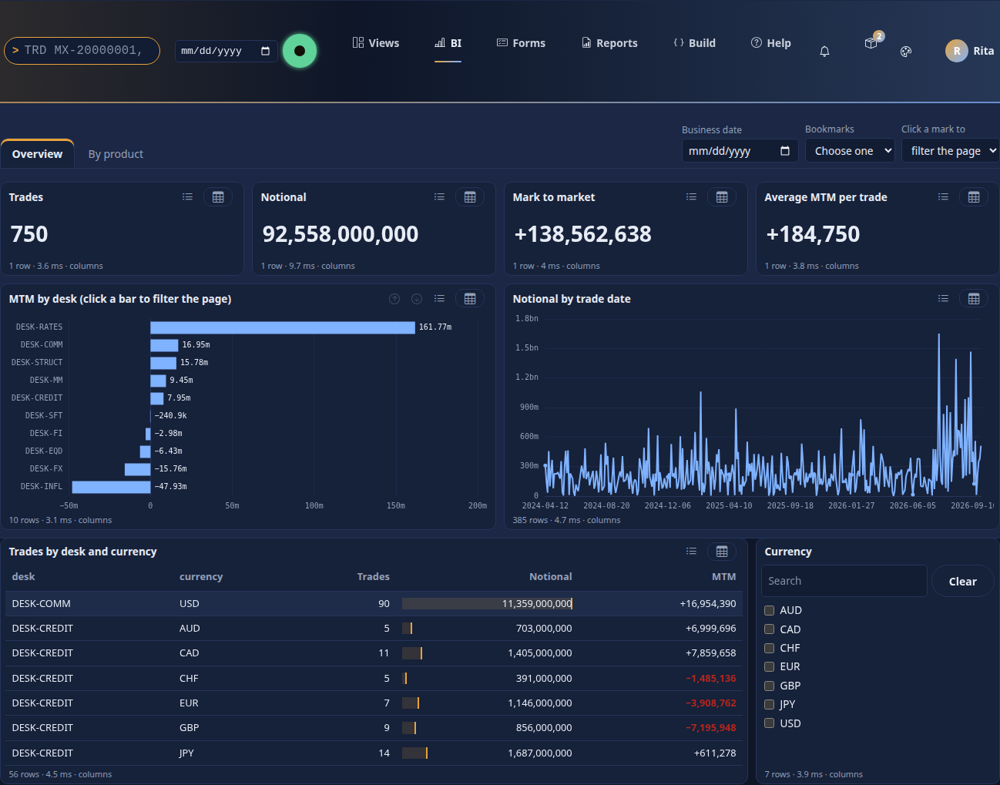

The toolbar holds the **business date** (empty: the latest the data has), **Bookmarks** (saved states of the report), *Click a mark to* **filter the page** or **highlight**, and **Reset**; the filters in force are
chips under the page tabs. Every visual has a header with its title and the buttons that fit it, and a line under it that says how many rows came back, the milliseconds the query took (or "from the cache")
and the layer that answered (`columns`, `rollup`, `direct`, `live`); *masked* is added when the server masked a column for you.

* **Click a mark.** The other visuals filter to it. Here DESK-COMM was clicked: the cards, the line and the table are that desk's, the bar keeps all desks but dims the others, and a chip says what is selected.
  Click it again, press `Esc`, or use the visual's clear button to let go; Ctrl or Shift adds marks. With **highlight** the bar and column charts keep the whole answer and draw the chosen share over it.

  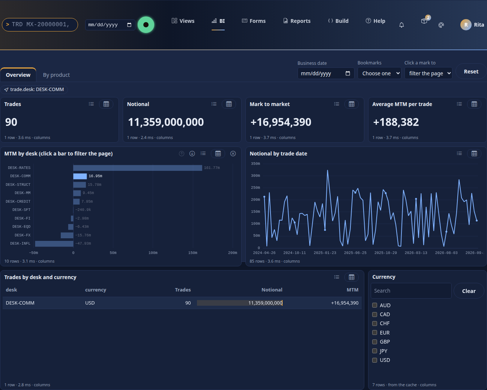

* **Drill down and up.** With a mark selected the drill-down button goes one level down the visual's hierarchy (desk to book); the title shows the path; the up button comes back.

  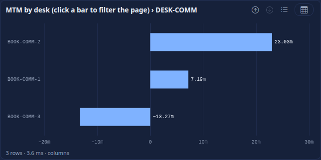

* **Show the rows** (`r`) replaces the visual with a table of the rows behind it (every column of the table it reads, the selected mark's rows when one is selected); **Show as a table** (`t`) shows the visual's own
  numbers (and is what a screen reader reads). Masked columns read `•••` here too.

  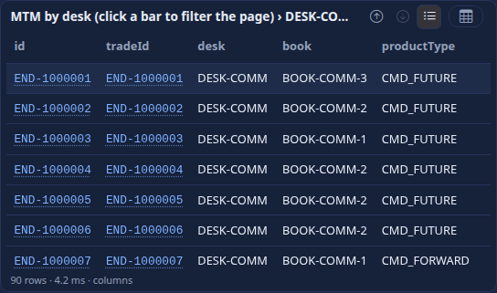

* **Drill through.** In **Counterparty risk**, select a counterparty's bar and press *Drill through to Counterparty*: the page about that counterparty opens with the counterparty carried as a chip (it is in the URL, so the
  link can be shared) and a **Back** button. A trade in its table opens in the terminal (*Open in the terminal*, or the link in the key column).

  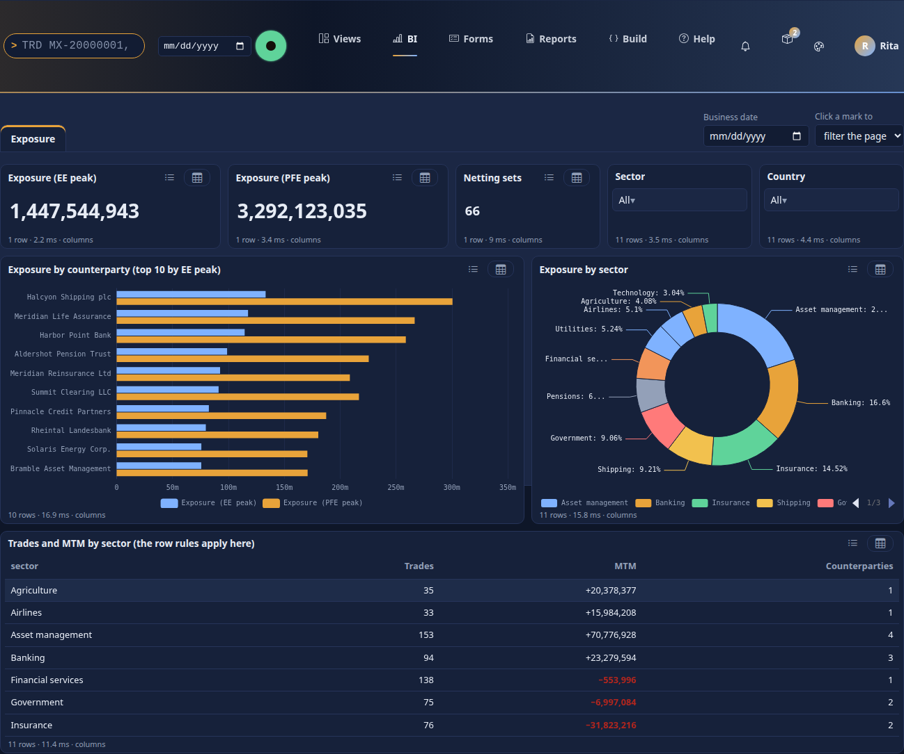

  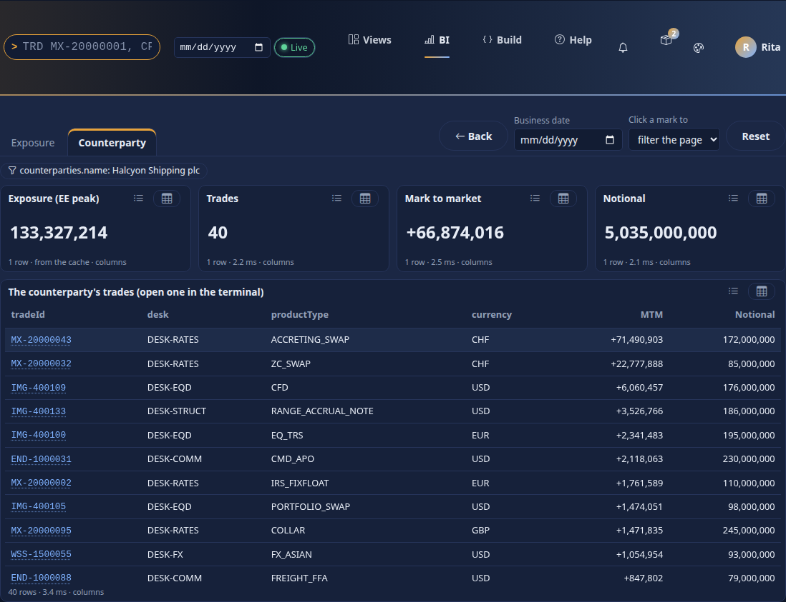

* **The rows you may see are yours.** The report asks the dataset as **you**. A desk head sees the trades of their desk, and the exposure visuals say, with the code, why they cannot be drawn for someone whose row
  rule is on the trades (`DRS-9020`); someone without the raw power sees the counterparty name as `•••`:

  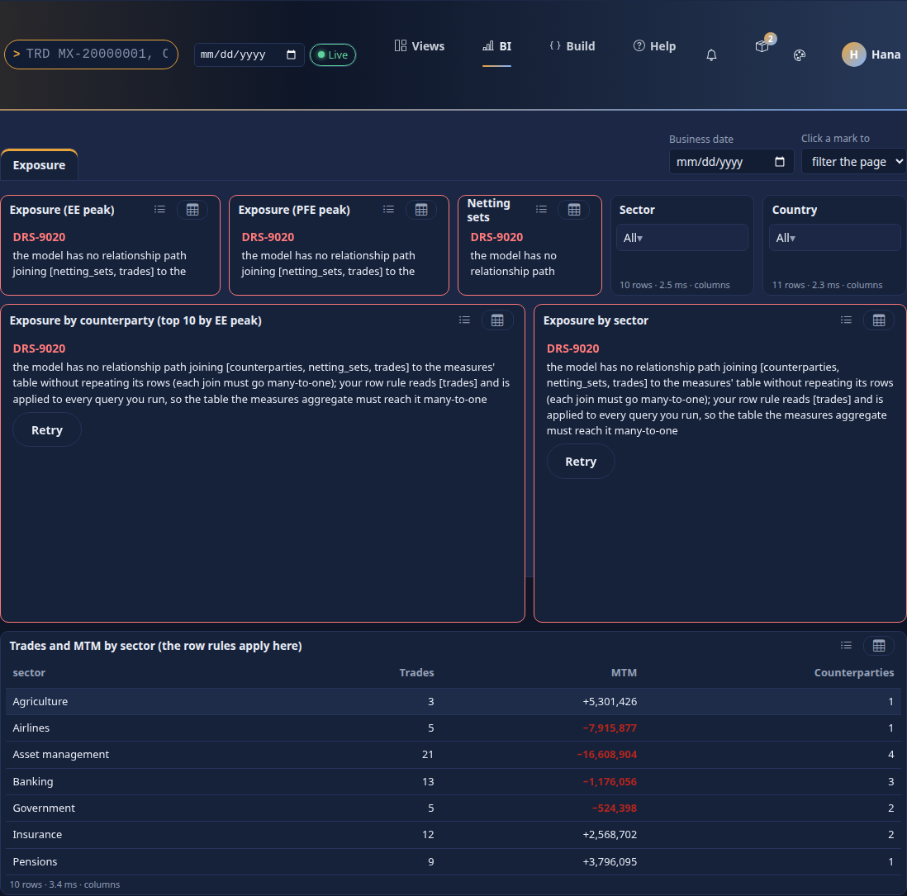

  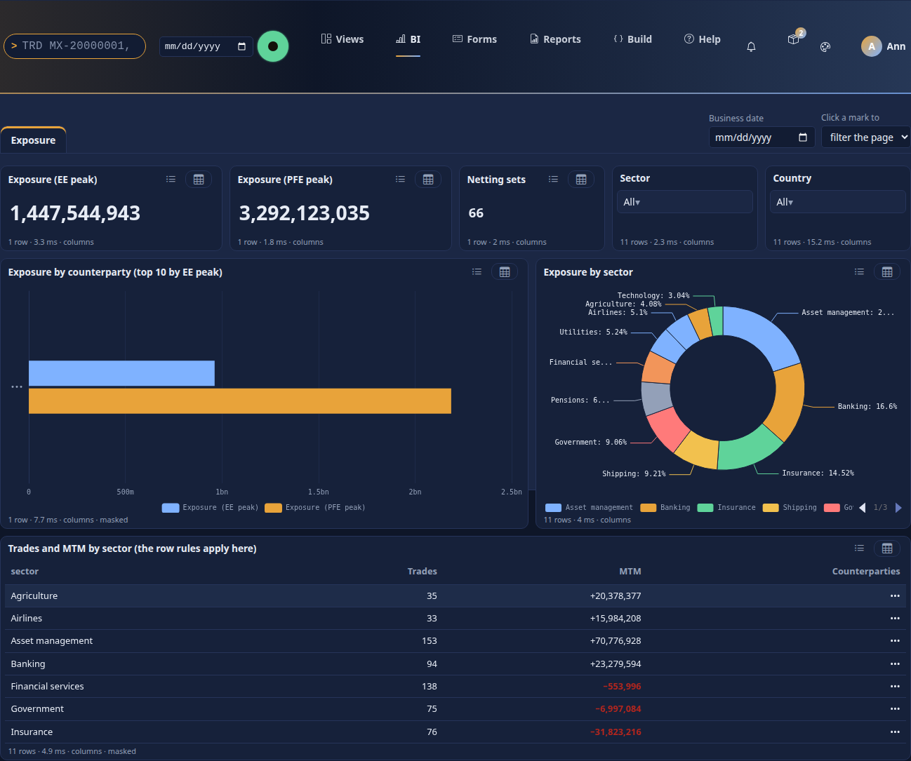

* **Cashflow ladder** drills from the pay year to the quarter, month and day, and lays the legs out as a matrix with totals:

  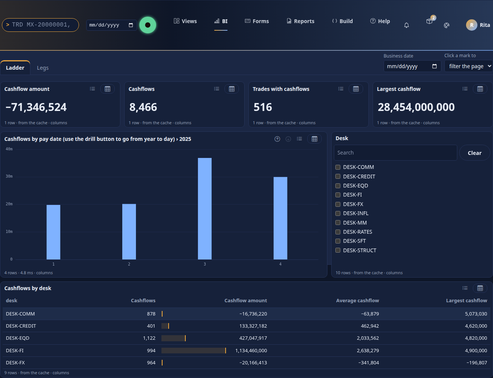

  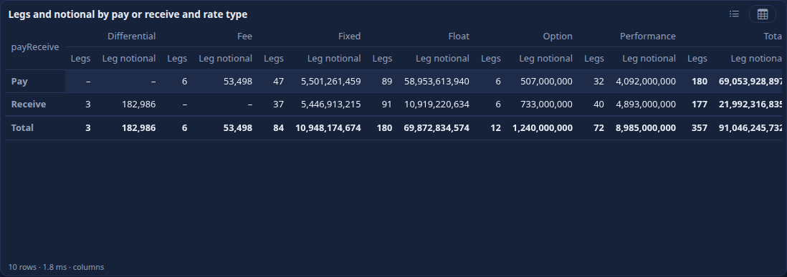

* **Keys.** `Tab` walks the visuals in reading order (top to bottom, left to right); in a chart `Left` and `Right` move between marks and `Enter` selects; `Esc` clears; `t`, `r`, `d`, `u` (table, rows, drill down, up) act
  on the focused visual; `?` lists them.
* **A phone** (390 px) shows one column in reading order, 44 px buttons and no sideways scroll (a **tablet**, up to 1024 px, can have two columns with `layouts.tablet`: [REPORTS.md 14.1](REPORTS.md#141-a-tablet)); a report that declares `layouts.phone` for the page shows **its own arrangement** instead (the visuals in the order the author chose, some hidden, heights set), see section 15
  and [REPORTS.md section 14](REPORTS.md#14-phone-and-tablet-layouts):

  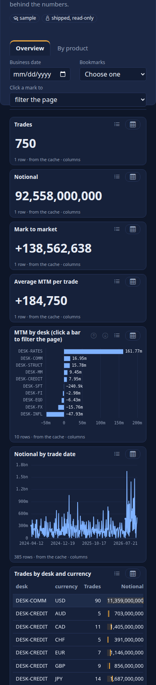

The page asks the server for each visual's data **one query at a time, three at once** (the server allows three a person, and the page retries a refusal for busy); a visual that is refused shows the
code and words in its frame with a Retry button while the others carry on. Nothing is drawn from the data except through the same dataset engine, so the limits and the cache of section 13 apply.

## 15. The designer (phase 3)

**Designer** in the rail lists your report drafts (in every workspace where you may add items, each with its workspace) and starts a new one on a dataset, in the workspace you choose; **Samples to start from** lists the shipped reports, each with **Copy and design**, which asks for the workspace and opens your copy; **Save a copy** of a shipped report or board asks the workspace the same way. A slicer's kinds (list, dropdown, range, relative date with its default and windows), a top-N filter and bookmarks (name, page filters and slicer choices; rename, update, delete) are all controls, as are the Phone and Tablet arrangements ([REPORTS.md](REPORTS.md#61-the-relative-date-slicer)); a draft opens at `/bi/design/<draft>` (a shipped report opens read-only, with **Save a copy**). The panes are where Power BI
authors expect them: the canvas on the left, then **Filters**, **Visualizations** (with **Build** and **Format**) and **Fields**. The rail steps aside so the designer has the whole width.

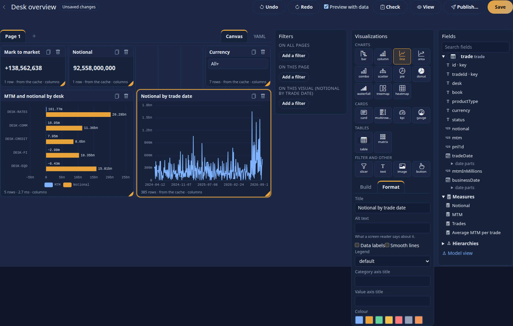

* **Tablet.** The **Tablet** tab beside Phone arranges the page for a tablet (1024 px and narrower): the same list with *Wide* (the whole width instead of half) above a 768 px preview; it writes `layouts.tablet`.
* **Phone.** The **Phone** tab beside Canvas and YAML arranges the page being edited for a phone (640 px and narrower): the visuals in phone order (**drag** a row or use its arrows), a **Hide** box and a **Rows** height for each, and a **390 px preview** drawn to scale beside it. *Back to automatic*
  removes the page's arrangement. It writes `layouts.phone` of the YAML ([REPORTS.md section 14](REPORTS.md#14-phone-and-tablet-layouts); walk-through: [tutorial 16](../tutorials/16-embed-drishti.md)).

  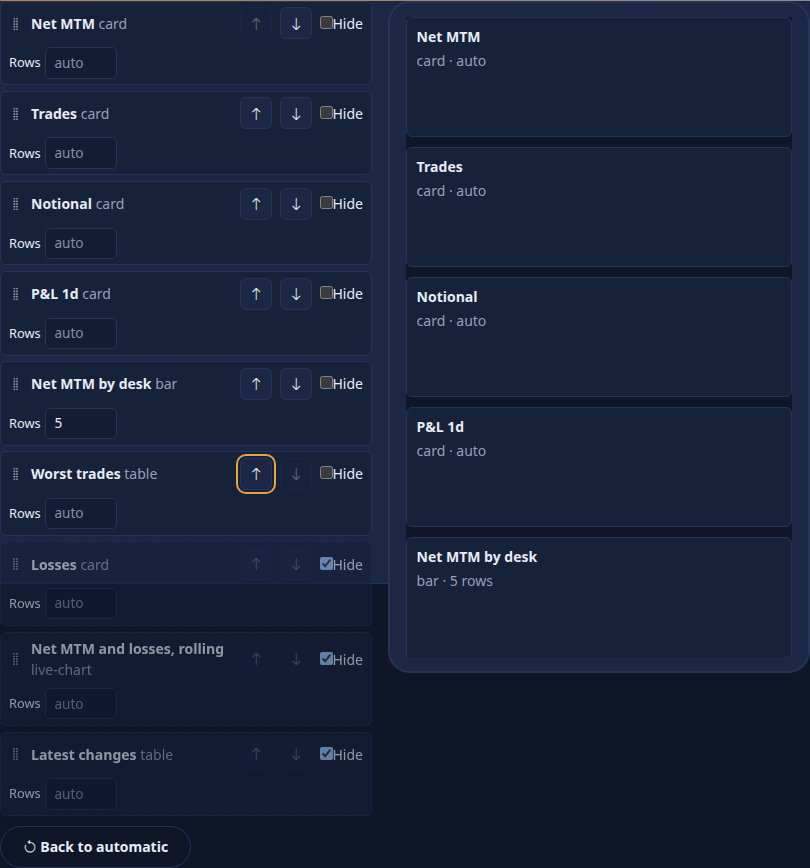
* **Fields.** The dataset's tables, their columns (a date opens into its parts: year, quarter, month, week, day), its measures and its hierarchies, with a search box. **Drag a field onto the canvas** and the best
  visual for it appears: a measure is a card, a column is a table; **drag another onto that visual** and it improves: a category with a measure becomes a bar, a date with a measure a line, two categories with a
  measure a matrix. Without a mouse, the field's button adds it to the selected visual (or makes a new one). A hierarchy added to a chart makes it drillable.
* **Visualizations.** The 26 types the designer offers (`bar` to `button`; the rolling chart, the three Perspective visuals and the entity view are written in the YAML tab and `vega-lite` has a box for its specification: [REPORTS.md section 3](REPORTS.md#3-the-visuals-and-their-wells)); choosing one changes the selected visual (its fields follow where they fit) or adds a new one. **Build** shows the wells of the selected visual: each takes fields or measures, with
  chips you can remove or reorder and a select that adds without dragging; drill down along a hierarchy and drill through to a page are set here too. **Format**: title and alt text, data labels, stacking, legend,
  axis titles, **colours from the theme** (swatches of the report's palette), number format, conditional colours, data bars, subtotals, gauge range, slicer mode and scope, whether other visuals filter it, most rows,
  sort. With no visual selected, Format is the **page** (title, move, delete, the fields it takes as a drill-through target) and the **report** (title, description, palette, business dates, bookmarks).
* **Filters.** *On all pages*, *On this page*, *On this visual*. **Basic** picks values (type them, or *Pick from the data* to tick them), **Advanced** is a condition (is, is not, less than, between, contains, starts with,
  is empty ...), **Top N** keeps the N values with the highest (or lowest) measure.

  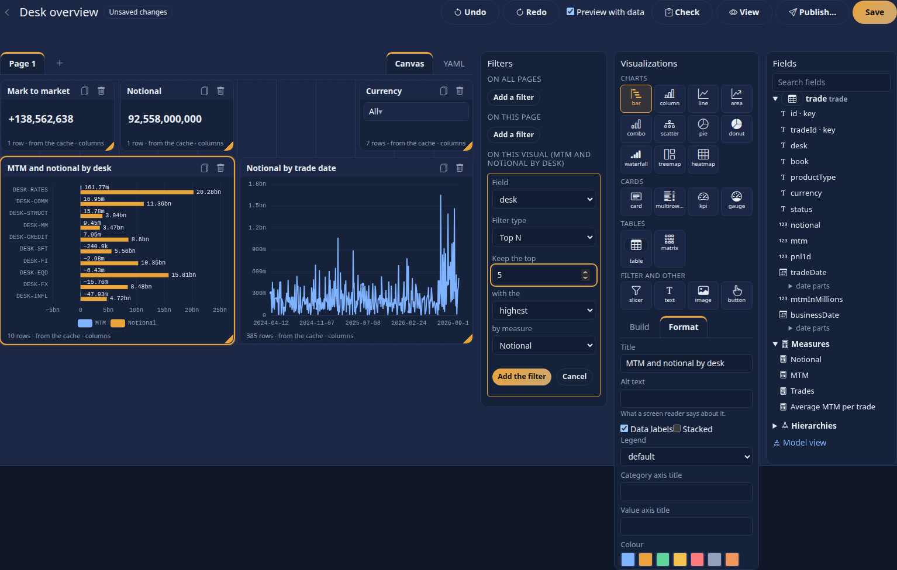

* **The canvas** is the 12-column grid. Drag a visual by its header and drag the corner to resize: both snap to the grid, and what a move would overlap is pushed down. **Keyboard:** focus a visual and `Arrow` moves it a
  cell, `Shift` with an arrow resizes it, `Ctrl+D` duplicates, `Delete` removes, `Enter` goes to its title in Format. A click on the empty canvas lets go of the selection.
* **Real data while you design.** Every visual is drawn from the dataset (as you: your rows, your masks), with the rows and the **query time** under it; **Preview with data** can be turned off to design without queries.
* **YAML.** The tab shows the same draft as text, written the way the sample reports are. Edit either view and the other follows at once; a mistake in the text is reported with its code and path (`DRS-9031`, ...)
  and the canvas keeps the last good draft. A strip of **suggestions** follows the cursor: visual types after `type:`, operators, hierarchies, pages, and the dataset's fields and measures in a well.

  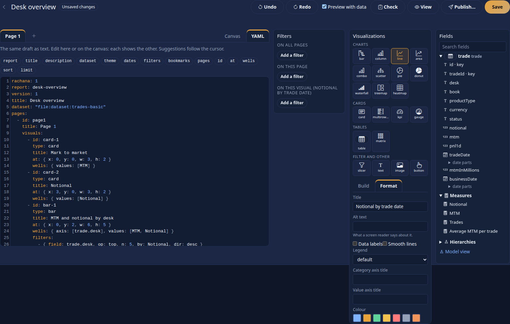

* **Check** validates the draft and adds the quality checks: a chart, table, card or image with no title or alt text, a chosen colour that is too pale for the background, visuals that overlap, a visual whose preview
  took over a second (clicking a finding goes to the visual).

  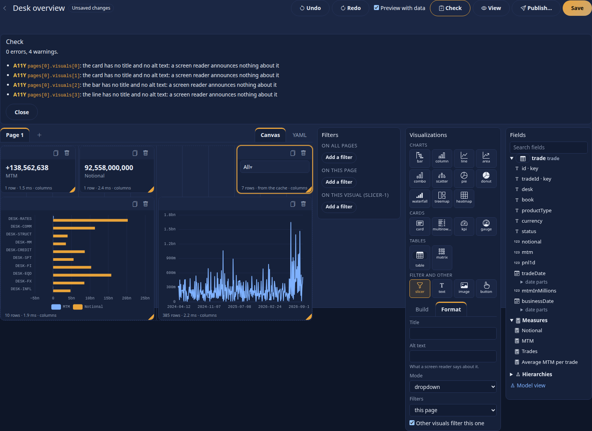

* **Undo and redo** (`Ctrl+Z`, `Ctrl+Y`) walk the last 100 changes; **Save** (`Ctrl+S`) keeps the draft in your workspace; the page warns before you leave with unsaved changes. **Publish** is on the item page
  (review, versions and audience as for any item); a report with errors is refused (`DRS-9030`).

The designer needs the `bi-author` power. Its step-by-step use is [tutorial 10](../tutorials/10-first-bi-report.md) (steps 2 to 5).

**Mistakes while designing.** The canvas preview asks the server for each visual separately and leaves **incomplete visuals** (a required well is empty) out of the question, so one unfinished visual shows its own note (*Add a field to the axis well*) while the others still draw; if the server names another visual's problem the preview leaves that visual out too and asks again. (The published report view keeps its strictness: a report with errors is not drawn.) The Check list names the visual of each problem: its title, its id, its number on the page and the page. A field dropped on a visual says where it fell: *already in the table "Books"* is not an error, and a field that fits no well says which wells the visual has and offers a way out (drop it on a well, or on an empty part of the canvas to start a visual). A report whose YAML names **no dataset** opens with a **Choose a dataset** box (it writes `dataset:` into the draft; save to keep it). From a dataset's page, **New report on this dataset** opens the designer's start with it chosen; with no dataset to read, the start page says so and links to the Datasets page.

**Several datasets.** Add dataset in the Fields pane, one tree for each, the dataset tag on a visual, the refusal of a mixed visual, the Links panel and the composed-dataset draft are described in [REPORTS.md section 16](REPORTS.md#16-reports-over-several-datasets).

**The new visuals (wave 3).** The Charts group of the Visualizations pane also offers `bubble`, `funnel`, `histogram`, `box` and `map`; Build shows each one's wells (a map needs a `location`, or a `latitude` and a `longitude`); Format has **Bars**, for a map **Level** and **Drill into countries** (a histogram's number of bands) and, for a table, **Total row**; a
measure that uses time intelligence carries a small badge (`ytd`, `running total`, ...) in the Fields pane. Reference: [REPORTS.md section 3.1](REPORTS.md#31-the-map-funnel-histogram-box-plot-and-bubble).


## 16. The Model view (phase 3)

On a dataset's page, **Model view** (authors) opens `/bi/m/<dataset>`: the dataset's **tables as boxes** with their columns (keys marked), its **relationships as lines** with `1` and `*` at the ends (hover a line for its
cardinality and filter direction; a dashed line is inactive), and the YAML below. The diagram and the YAML are **two views of one draft**.

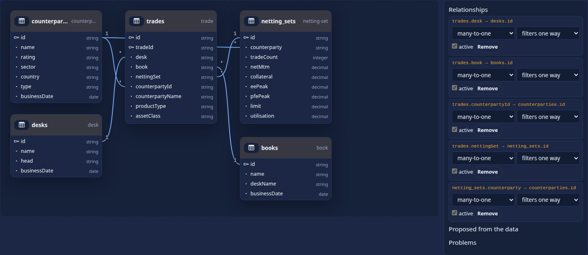

* **Relate by dragging.** Drag a column onto a column of another table: the form on the right fills in (from the many side, to the one side) with a cardinality guessed from the keys. Check it and press **Add
  relationship**; nothing is written before. The form also works without dragging (choose the tables and columns), and from the keyboard (`Enter` on a column, then `Enter` on another).

  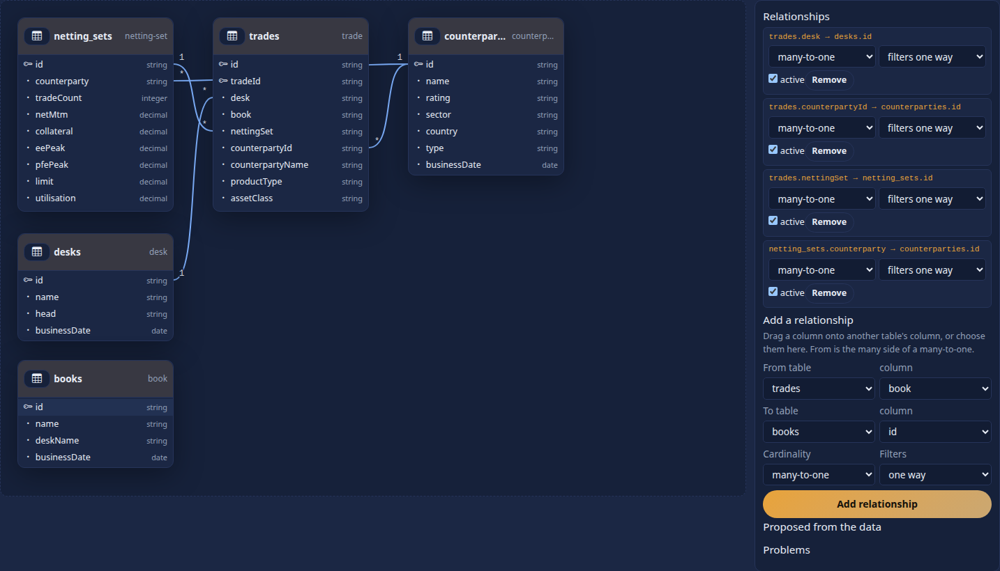

* **Edit a relationship** in the list: its cardinality (`many-to-one`, `one-to-many`, `one-to-one`, `many-to-many`), whether it filters one way or both, whether it is active, or remove it. Each change rewrites the
  `relationships:` block of the YAML (in flow style) and the diagram redraws; edit the YAML and the diagram follows.
* **Proposals from the data.** *Look for relationships in the data* asks the server to find columns whose values are ids of another table (profiling, no AI). Each proposal shows the match rate; **Accept** adds it, nothing
  changes until you do. (Links a pack already declares are not proposed: they are in the model from the start.)

  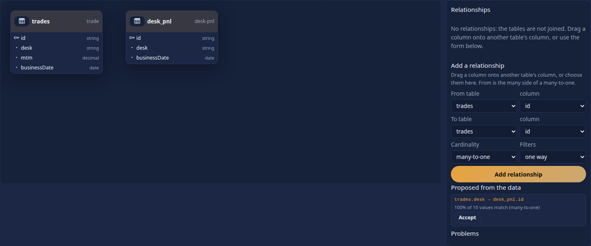

* **Layout.** Drag a box by its header; where each table sits is saved in the YAML under `layout:` (`trades: { x: 24, y: 24 }`), which the dataset language ignores.
* **What it changes, and what it leaves.** Only the `relationships:` and `layout:` blocks are rewritten; the rest of the file, comments included, stays as you wrote it (comments inside those two blocks are not kept).
  A shipped dataset opens read-only with **Save a copy**. The diagram never changes a pack: a model's relationships drive BI joins and cross-filtering only.

The Model view calls the dataset checks (`POST /api/v1/bi/datasets/validate`, which now also returns the model it parsed) and, for proposals, `POST /api/v1/bi/model/infer`; both need `bi-author`.

## 17. Publishing and governance (phase 4)

The reference is [BI_GOVERNANCE.md](BI_GOVERNANCE.md); the walk-through is [tutorial 13](../tutorials/13-govern-bi.md). On an item's page (`/bi/i/<id>`) four sections are new, and the rail has **Environments**.

* **History** (people who may edit the item). Every save of the body is a saved state with who, when and the message you wrote in *What changed* in the Edit form. Pick two (or press *Compare with draft*) and *Show the differences* for the side-by-side diff; *Restore as draft* makes a state the draft again as a new state, so nothing is lost. Below the table is the review record: requests, decisions with their comments, certifications, revocations, imports.
* **Review** (shown while an item is proposed, to the people who may decide, including any bi-steward). The request and its note, what changed, Check, what it does to reports, and a data preview answered with the reviewer's own rows and masks. Write your comment in the note box above and press *Approve and publish* or *Reject*. The author is told in the inbox; four-eyes still applies.
* **Impact on reports** (datasets, for editors). What publishing the draft would break, and a box *What breaks if I remove ...*. A publish that breaks published reports is refused with `DRS-9040` and the callout lists the reports; a **bi-admin** sees *Publish anyway* and, after it, a *Heads up* list that includes any certification that fell.
* **Lineage** (everyone who opens the item). Where a dataset comes from (table, kind, packs, connector) and which reports read it; a report's dataset, what it uses, and the tables behind it.
* **Certified** and **promoted** badges are in the catalogue and search (certified first), on Home and on the item; only a bi-steward certifies, and certification falls on its own when a dataset changes incompatibly.
* **Environments** (`/bi/environments`). Choose a workspace and download a bundle; to import, a bi-steward chooses a bundle file, optionally maps workspaces and owners, runs a **dry run** (the table lists create, update, unchanged, conflict, invalid with the reason) and then *Import*. Changing any choice needs a new dry run.

A phone shows the same sections one column wide with finger-sized buttons; the tables scroll inside their own frame.

## 18. Live reports and boards (phase 5)

The references are [DATASETS.md](DATASETS.md#71-live-tables-phase-5) (live tables), [REPORTS.md](REPORTS.md#13-live-visuals-and-perspective-phase-5) (live visuals, Perspective) and [BOARDS.md](BOARDS.md); the walk-through is [tutorial 12](../tutorials/12-live-bi-and-boards.md).

**A live report.** Open **Live trading desk** from the catalogue (the samples are shipped with the site; a business user sees them unless *Hide samples* is on). Above the pages is the **live indicator**: a dot and a word (**Live**, **Paused**, **Stale**, **Feed failing**,
**Disconnected**, **Paused (tab in background)**), *Last update 07:49:57* (when the table last changed), and **Pause** / **Resume**. The visuals redraw in place as the table changes, at most four times a second; Pause holds the picture, Resume catches up at once.
If the connection to the console drops the indicator says **Disconnected** and the page keeps what it has; when the stream is back every visual is asked again. A tab in the background for ten seconds gives its stream back and takes it again when you return. Nothing here costs the browser
a connection of its own: the page uses the one channel the whole browser shares ([LIVE.md](../architecture/LIVE.md)).

**Pages of the sample:** *Desk* (cards, net MTM by desk, a rolling line, the worst trades, the latest changes), *Every trade* (a Perspective grid of all trades), *Pivot* (a Perspective pivot by desk and currency). In a grid you can sort, scroll and resize columns; in the pivot
the browser re-pivots as rows arrive. For a reader without the `raw` power the `trader` column reads `•••`, in the cards, the tables and the grid alike.

**A board.** Open **Desk wall** (`/bi/b/file:board:desk-wall`; from its item page: *Open the board*). Tabs switch its pages; tiles over live tables change in place; a tile whose number crosses a threshold gets an amber or red border and says "warning" or "critical" in the line
under it. **Kiosk** (button, `k`, or `?kiosk=1`) hides the menus, fills the screen and turns the pages by itself; `Esc` leaves. Keys: `k` kiosk, `Left` and `Right` pages, `p` pause. A phone shows the wall as one column.

**Who may do what.** Opening needs the `bi` power and the right to read the report or board; each tile is the report's answer **to you** (your rows, your masks). A board is edited as YAML (the item's Edit form, or its file); publishing checks its structure.

**Admin.** *Admin, BI settings* is unchanged; the engine page counts live tables and rows (`GET /api/v1/bi/engine`); a dataset's page says how each live table is doing (state, rows, entities that push, last change). Settings: the server's `drishti.bi.live.*` and the console's `bi.live.*`, `bi.board.rotate_seconds`
([CONFIGURATION.md](../admin/CONFIGURATION.md)).

**Not built, and not faked.** Interaction between tiles; a history of every update of a live table (a bounded, sampled history of its measures is built: [DATASETS.md section 7.1](DATASETS.md#71-live-tables-phase-5); the rolling chart's
points live in the browser from the moment the page opened); live tables over arrays and in `direct` queries; boards in bundles, in lineage and in impact analysis. If a live table's feed is quiet, the page says **Stale** only when the source
that pushes has gone silent for 30 s: a source that changes rarely is quiet, not stale, when it does not push at all (its state then reads `pushes: false` and the table is read again every 30 s).

## 19. Export, subscriptions and alerts (phase 7)

A report page, one visual, or a Sutra view leaves Drishti as **PDF, PNG, Excel or CSV** (the *Export* bar under the page tabs) and by **email on a schedule** (*Subscribe*). Both are made for the person who
gets them: the engine is asked as that person, so their row rules and masks apply. A subscription takes a schedule (`business-days 07:30`, `weekly mon 07:30 business`, `monthly last 18:00 business`,
`after-load`), a form (the tables in the email, a PDF or an Excel file) and recipients (users and `role:NAME`; never an outside address). *Run now*, *Pause*, a history with each
delivery's status, retries with the shared retry policy, an audit trail. The list is on **Reports** in the top bar, merged with the scheduled reports. Reference: [DISTRIBUTION.md](DISTRIBUTION.md); walk-through:
[tutorial 11](../tutorials/11-bi-that-runs-itself.md); settings `drishti.distribution.*`; codes `DRS-9060` and `DRS-9061`.

**Alerts.** *Alert me* (the bell in a visual's frame; or click a number on a view) watches one number: a visual of a report, a measure of a dataset or a field of a Sutra entity. It fires when the number crosses a limit
(`above`, `below`, `between`, `outside`), moves too far (a percentage or an amount, against the previous look or the previous business day) or does not arrive by a time. It looks on a schedule, after a data load, or when a live table changes (after a quiet time).
**Each person is judged on their own number**: the engine applies their row rules and masks; a masked number is never judged or shown. It stays quiet after firing until the number is back inside the limit (the *hysteresis*), and not again within the *cooldown*.
It tells you in your inbox (the *Alerts* tab, and the bell), by email to your own address and in the chat bridges (a post with no number); there is a history, an audit trail, pause and resume. A board tile whose colour turns red can tell everyone who reads the board the same way (`notify:`, [BOARDS.md](BOARDS.md#notifications-a-tile-tells-people-when-it-turns-red)). The page is **Alerts** (`/alerts`), linked from **Reports** in the top bar;
the reference is [DISTRIBUTION.md section 4](DISTRIBUTION.md#4-alerts-on-numbers); walk-through: [tutorial 11](../tutorials/11-bi-that-runs-itself.md); settings `drishti.alerts.measure.*`; code `DRS-9062`. Wave D adds retries of a failed alert delivery, webhook and text-message channels ([DISTRIBUTION.md section 6](DISTRIBUTION.md#6-webhooks-and-text-messages)) and, for subscriptions, a written summary ([BI_AI.md section 9](BI_AI.md#9-a-written-summary-at-the-top-of-a-subscriptions-email)). Not built: escalation.

**Embedding.** `<drishti-report>` shows a published report, one page or one visual, in **another web application's** page (a Web Component, no iframe), masked whatever the user's roles, with slicers, cross-filter and live updates; the administrator lists the reports a host application may show (`report:<id>` or `report:*`) in Admin → Embedding. Reference: [DISTRIBUTION.md section 5](DISTRIBUTION.md#5-embedding-a-report-in-another-web-application); developer guide: [ELEMENTS.md](ELEMENTS.md#drishti-report); walk-through: [tutorial 16](../tutorials/16-embed-drishti.md); scope `embed:report`.

## 20. Python in BI (phase 6)

A **Python item** (kind `python`, or a file in `config/bi/python/`) is a function with a manifest: a **Measure** (a number per group: `compute(table, params)`) or a **Visual** (a chart: `render(table, params)`). It is stored,
versioned, reviewed and published like any item; **Check the Python** on its page parses the source and lists every problem. A **dataset** declares a Python measure
(`python:`, `inputs:`, `by:`: [DATASETS.md](DATASETS.md) section 4.2), and a report's **`python` visual** (designer, group *Python*) shows it, or any item named in `format.python`
([REPORTS.md](REPORTS.md) section 3.3). The code runs on the **console**, in a short-lived worker with no network, a scratch folder only and CPU, memory, time and output limits, or **in the browser** (Pyodide, the runtime Calc ships) when the item allows it
and `format.run` says so. It only ever receives the rows the viewer may see, masked as the server masked them. The sample report **Desk P&L risk (Python)** shows both. Reference, the sandbox, the settings and the codes `DRS-9070` to `9074`:
[PYTHON_BI.md](PYTHON_BI.md); a short walk-through: [tutorial 14](../tutorials/14-python-and-analyse.md).

## 21. Analyse (phase 9, lean)

The rail's **Analyse** (`/bi/explore`) opens a dataset as an **extract**: the rows *you* may see, masked as the server masks them for you, at most `bi.explore.max_rows` (10,000). Three tabs work on it:

* **Slice**: drag fields (or use each chip's R, C, V, F buttons) into Rows, Columns, Values and Filters for an instant pivot in the page;
* **SQL**: cells that run one read-only `SELECT` over the table `extract` (limits on text, time and rows);
* **Python**: pandas cells over `df` (and `extract("name")` for any further extract of the notebook), with charts in `result` and `quant.price(...)`; they run in the console's sandbox (or in the browser, Pyodide) and need the `bi-author` power.

**Save as a notebook** keeps the extract's definition and the cells as a BI item of kind `notebook` (versions, review and publishing like any item; *Open in Analyse* on its page reopens it, rebuilt for whoever
opens it). **Promote** turns a Python cell into a Python Measure or Visual draft (or, for a cell that joins several extracts, a Python Transform draft) and a slice into a report draft; nothing is published. Slice and SQL totals are the *extract's*, not the dataset's: use a
report for true totals. Reference: [ANALYSE.md](ANALYSE.md); walk-through: [tutorial 14](../tutorials/14-python-and-analyse.md). Slice and SQL run in the browser in DuckDB-Wasm on the extract the page holds (the console's engines are the fallback) and a slice or a SQL cell can be **promoted into a visual** of a report draft ([ANALYSE.md sections 13 and 14](ANALYSE.md#13-in-the-browser-duckdb-wasm)). Not built: a *Data* tab, *Notes*,
million-row extracts, scheduled notebooks (ANALYSE.md section 12).

## 22. With AI: describe a report, ask the data, explain a number (stage 2)

When your administrator has switched the AI layer on ([BI_AI.md](BI_AI.md)), three things appear; with it off (the default) none does.

* **Describe a report** (designer toolbar, `bi-author`): say what you want in words and the model drafts the report YAML over the report's dataset. The draft is **checked before you see it**,
  appears as text, and goes into the YAML tab only when you press *Use this draft*; nothing is saved or published.
* **Ask the data** (the box under a report's bar): a question becomes a query that the **engine** runs as you (your row rules and masks), shown as a table, the visual that suits it and the query used.
* **Explain** (the light bulb in a visual's header): where the number comes from (dataset, measure definition, columns, sources) and what it is made of (the engine's breakdown by its main
  dimensions); with the administrator's `aggregates` setting also a short wording of it.

The model is told the names, types and descriptions of the dataset and your words; **never a row**, a value, a measure's definition or a field masked for you (unless an administrator chose
`aggregates`, which also lets it word *your own* masked results). It can choose a wrong query: that is why the query is shown. Reference, settings, codes and tests: [BI_AI.md](BI_AI.md).

## 23. Models and pack datasets: the model layer (wave W1)

The model layer ([BI_MODEL_SPEC.md](../architecture/BI_MODEL_SPEC.md)) splits what a version-1 dataset did in one file into two items: a **dataset** is one
governed table (what one row is, its columns with roles and meanings, how it keeps time, its own security), and a **model** puts datasets in a star with
relationships, measures and tighter security. Reports, Analyse and the API ask a model with **one request shape**, the model query (`mq: 1`). Everything in
sections 13 to 22 still works as written: version-1 datasets are read as models by a compatibility reader until the migration wave (W4).

**Models in the rail** (`/bi/models`, "Start from your data"):

* **Datasets from the packs.** Every kind of every pack you may open is already a dataset, named `pack.<pack>.<kind>`, certified by its pack, read-only,
  versioned with the pack. Nobody builds them. A card shows the pack, the time mode and the number of columns; **Use** starts a report on it straight away;
  the title opens the dataset's page.
* **Your datasets**: the `rachana: 2` datasets you may read (a connector query, a Python table, a model's answer, a narrowed pack dataset).
* **Models**: model items, and the version-1 datasets the compatibility reader serves as models. **Open the designer** edits one; **Use** starts a report.
* **New model** asks a title and a workspace and offers every dataset as a tick box; the model opens in the designer. **New dataset** opens the wizard below.

**A dataset's page** (`/bi/ds/<name>`) says what one row is (*One row per trade per business date*), the keys (`id`), the time mode (*snapshot: a query
without a date reads the latest business date with rows*), the source (*the trade kind of the trading pack, through trading-store*), every column with its
type, role, meaning, the kind it references (`desk →`), its unit, whether it adds up and its default measure, the security, and the YAML. Its buttons:
**Start a report on it**, **Make it a model** (its implicit model written out as a draft model, below) and **Narrow it** (a dataset of your own that
`extends` this one: extra calculated columns, a row filter, more masks).

**The model designer** (`/bi/md/<item>`; the item page's *Model view* opens it for a model):

| Part | What it does |
|---|---|
| Datasets list | every dataset you may use; **+** adds one (or drag it onto the canvas). Its alias comes from its name (`pack.trading.trade` is `trade`), its role is inferred: a dataset another one references is a **dimension**, one with amounts a **fact**; the select on its box changes it |
| Canvas | the datasets as boxes (fact: accent bar, dimension: link-coloured bar), relationships as lines (`* → 1`, dashed when inactive). Drag a box by its header, or focus it and use the arrow keys; Enter opens it in the inspector. A problem Check found on a dataset is pinned on its box |
| Suggested relationships | from the packs' entity references: `trade.desk holds desk ids (from the pack)` with **Add** (one click) and **Dismiss**. A second path between two datasets, or one between two facts, is offered **Add as inactive** with the reason |
| Relationships | the list (keyboard-friendly) with **Edit**; *Relate two columns by hand* adds any other |
| Inspector | a dataset: alias (renaming rewrites every field, measure and rule that uses it), grain, keys, time, columns, *Open the dataset*, *Remove from the model*. A relationship: cardinality, filter direction (*both ways* arrives in W2), active, where it came from, *Remove* |
| Measures | **New measure from a column**: pick the dataset and the column; the aggregation, format, additivity and currency come from the dataset (amounts sum, ratios average and never add up, a balance takes its last value over time, `notional` is in `trade.currency`). **Write a formula** offers the fields and `[measures]` as you type. Each row edits name, formula, format and *adds up*; Check's problem shows under the row; **Preview** asks the saved draft by a suggested dimension, as you. The default measures (one per column with an aggregation, and `Count of <alias>`) are listed: reports may use them without anyone writing them |
| Security | each dataset's own rules (read-only), the model's rules, the masks. **Add a rule for this model**: the dataset, the roles, and *the column matches the reader* (`trade.desk in user.desks`), *the column equals a value* or *every row*: no typing of conditions. Rules here can only remove rows. **The safeguard**: when a role is restricted on one dataset but no rule restricts another, the tab shows a ⚠ count and says so, with **Add a rule for desk-head on desk** and **desk-head may see every row of desk** (an audited `may-see-all` note). Until it is answered the model cannot be published (`DRS-9130`) |
| Contract | title, description, version (**Next patch / minor / major**), lifecycle, and what consumers may use (everything, or only the ticked fields and measures). A published model refuses a breaking change without a new major (`DRS-9126`) |
| YAML | the same draft as text; editing it moves the canvas when it parses, else the problem is shown and the canvas keeps the last good version |

Every action is one edit that **Undo** and **Redo** (Ctrl Z, Ctrl Y) take back. After each edit the console writes the YAML and the server checks it (the
*Valid* / *Has errors* badge); **Check** lists every problem with its code and path. Unsaved changes are kept in this browser: a refresh, a crash or Back
offers **Restore my changes**; leaving asks first; a save over someone else's newer save offers *Reload theirs*, *Save mine as a copy* or *Overwrite*.
**Publish** (or **Propose** where the workspace reviews) saves first; a refusal shows beside the button and opens the tab that can fix it. **Start a
report** makes a report on the model. A model's name is unique among the models you can see (`trades-and-desks`, then `trades-and-desks-2`).

What the designer wrote for a model of trades and desks with one accepted suggestion, one measure from a column, a desk-head rule and the safeguard
answered (the server added the stable `id` on save):

```yaml
rachana: 2
model: trades-and-desks
version: 1.0.0
id: md_84db68c3
title: Trades and desks
datasets:
  trade: {dataset: pack.trading.trade@^1, role: fact}
  desk: {dataset: pack.banking-core.desk@^1, role: dimension}
relationships:
  - {from: trade.desk, to: desk.id, suggested: {from: pack-reference}}
measures:
  Sum of mtm: {expr: sum(trade.mtm)}
security:
  rows:
    trade:
      - {role: desk-head, where: trade.desk in user.desks}
      - {role: bi-writer, where: 'true'}
  may-see-all:
    desk: [desk-head]
```

Before `may-see-all` was added, Check answered (as a warning; the publish refuses it):

```
DRS-9130 security: the role 'desk-head' is restricted elsewhere in this model, but no row rule restricts 'desk' (pack.banking-core.desk): that role sees
every one of its rows. Add a rule for it on 'desk', or say so with `may-see-all: { desk: [desk-head] }` under security; until then the model cannot be published
```

A reader no rule matches gets no rows of that dataset (the second rule above lets the author see every trade).

**Reports on a model.** A report started from a dataset or a model says `model:` instead of `dataset:` ([REPORTS.md](REPORTS.md#18-a-report-on-a-model-wave-w1)).
The designer's Fields pane reads the model as you see it (masked fields marked); its header says *Implicit model of Trade* with **Make it a model**, or
*Model Trades and desks* with **Open the model**; *Add dataset* is gone (a report reads one model: add datasets to the model). Every visual's data is one
model query, shown under **Query of the selected visual**. **Make it a model** writes the implicit model out as a draft model (the dataset as the fact, its
pack dimensions with their relationships, the default measures) and moves the report onto it.

**New dataset** (`/bi/datasets/new-layer`), for what a pack does not give, in three steps that keep their draft across a refresh: (1) the source: a pack
dataset narrowed or with extra columns, a query in a SQL connector (its only parameter is the as-of date), a Python Transform, or the answer of a model
(tick its fields and measures); (2) the table: each column's type, role, meaning, referenced kind, currency and additivity (the base's columns are kept
for a narrowed dataset), the grain keys as chips, time and refresh, with the server's Check below; (3) title, name, workspace, masked columns, the YAML for
review, **Save draft** or **Save and publish**, then *Open the dataset*, *Start a report on it* or *Use it in a new model*. In W1 the server answers queries
on pack and narrowed datasets; connector-query, Python and model-answer datasets are saved and checked, and answer once the server's wave W1 package S4
lands (until then a query that reads one is answered `DRS-9013`, 501).

**Analyse** opens a model's rows as one model query of shape `rows` (`{model, fields}` on `/bi/explore/extract`); a dataset extract is unchanged.

