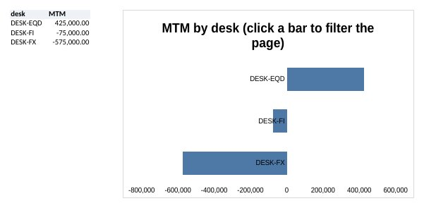
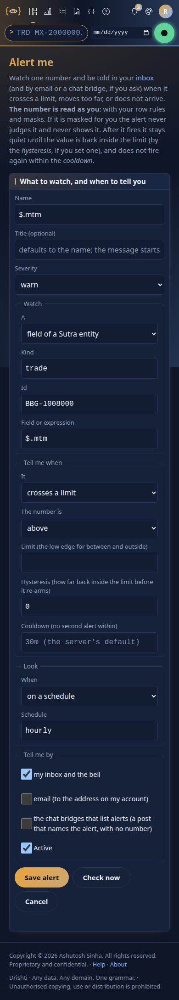
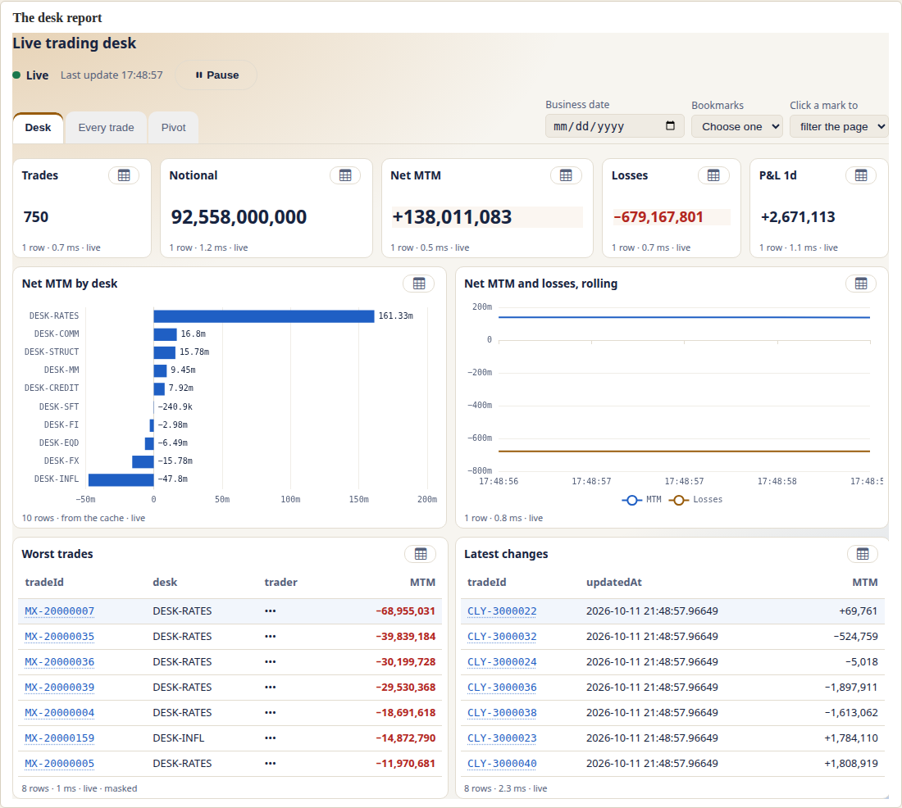
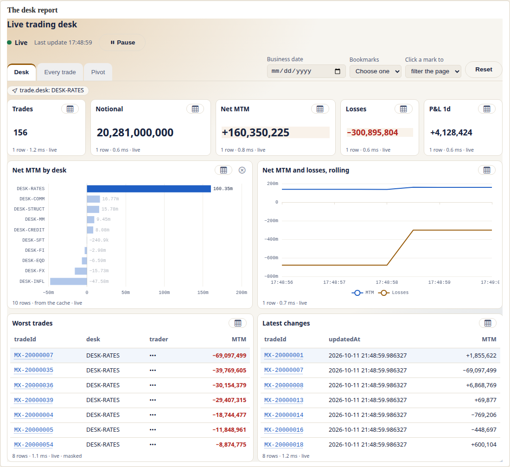
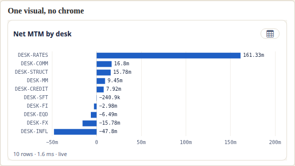

<!--
  Project Drishti · Any data. Any domain. One grammar.

  Copyright (c) 2026 Ashutosh Sinha <ajsinha@gmail.com>.
  All rights reserved.

  PROPRIETARY AND CONFIDENTIAL.

  This file is the confidential and proprietary property of Ashutosh Sinha.
  Unauthorised copying, use, modification, distribution or disclosure of this
  file, via any medium, is strictly prohibited except with the express prior
  written permission of the copyright holder.

  See the LICENSE file in the root of this repository for the full terms.
-->
# Business intelligence (Rūpaka): the BI pages

Rūpaka is Drishti's business-intelligence layer, called **BI** in the top bar and on the command line (`RUPAKA` is an alias). This guide is the tour of its pages and of who may do what: the menu, the rail, workspaces, the catalogue, items and their lifecycle, and, in sections 13 to 18, datasets, reports, the designer, the Model view, publishing and live reports and boards. The detail of each lives in a reference of its own (below); this guide shows you where things are and how they fit.

**What a person can do today:** open BI, keep drafts in a personal workspace, share workspaces with roles, put typed items in them, publish them through versions (with an optional second-person review), certify them and find what they may open in a catalogue. A **dataset** is parsed, validated and **queried**: tables from pack kinds through connectors, relationships, measures, row rules and masks, answered by an embedded DuckDB. A **report** is **drawn**: pages of visuals that query the dataset as the person looking, with cross-filtering, drill-down and drill-through; the **designer** builds one by dragging fields onto a canvas and the **Model view** draws a dataset's relationships. Datasets can be **live** (kept in memory as the source ticks), reports then redraw in place, and a **board** is a report page of live tiles (`layout: board`) with alert colours and a kiosk mode. Since 2.4.0 the designers share one shell, **BI Studio** (section 26): an Explorer of your items, open items as tabs, the Problems and Query dock, a Format pane generated from the format schemas, conditional formatting, **themes** and a theme designer. **Python** (phase 6) writes measures and visuals as typed items, run sandboxed on the console (never in the browser since 2.3.0) on the rows the person may see ([section 34](#34-python-in-bi-measures-visuals-and-data-prep-written-in-python); section 20 below). **Analyse** opens a dataset as a masked extract with Slice, SQL and Python cells and saves them as a **notebook** item (section 21); **BI → Transforms** prepares data in Python step by step, with a preview and a profile after every step ([section 34, its section 17](#17-data-prep-the-transform-editor-240)), and **BI → Python console** runs your own Python in the browser on a masked extract ([USER_GUIDE.md › Analyse: slice, SQL and Python, section 16](USER_GUIDE.md#16-the-browser-python-console)). Reports can be **exported and subscribed to**, carry **alerts**, be **embedded** in another application and use **Vega-Lite** charts and Python visuals; AI helpers (describe a report, ask the data, explain a number, a designer copilot, a dataset helper, narrative summaries) are there when an administrator switches the AI layer on. Section 11 lists the little that is not built.

## Start here

| You want to | Read |
|---|---|
| **Learn by doing** | [tutorial 10](../tutorials/10-first-bi-report.md) (a first report in twelve steps: map, bar, slicer, publish, filters, two datasets, relative dates, a tablet). Then [11](../tutorials/11-bi-that-runs-itself.md) (refresh, subscriptions, alerts, export, expected values), [12](../tutorials/12-live-bi-and-boards.md) (live BI and boards), [13](../tutorials/13-govern-bi.md) (governance), [14](../tutorials/14-python-and-analyse.md) (Python, Vega-Lite and Analyse), [15](../tutorials/15-ai-in-drishti.md) (AI) [16](../tutorials/16-embed-drishti.md) (embedding) and [18](../tutorials/18-several-datasets-in-one-report.md) (several datasets in one report) |
| Try each step with real answers | [section 30, its section 17](#17-worked-examples-the-shipped-models-row-rules-and-the-model-view): a stack with four people, querying datasets, row rules and masks at work |
| Find your way round the pages, powers and workspaces | this guide, sections 2 to 12 |
| Write or read a dataset (tables, relationships, measures, row rules, masks, live tables) | [section 30](#30-datasets-the-yaml-the-expression-language-and-the-security-rules) |
| Write or read a report (visuals, filters, slicers, live visuals) | [section 31](#31-reports-the-yaml-the-visuals-and-how-they-behave) |
| Put a wall of live tiles on a screen (a board page of a report) | [section 31, its section 23](#23-boards-report-pages-of-live-tiles) |
| Follow a long question that runs in the background: the run card, confirming a large run, the Runs tab (`BI RUNS <GO>`), sharing, promoting and scheduling a run (2.6.7) | [section 28](#28-background-runs-long-bi-questions) |
| Author in BI Studio: the Explorer, tabs, the Problems and Query dock, formatting, conditional formatting, themes, interactions, tooltip pages | section 26, [section 31, its section 5](#5-format) |
| Prepare data in Python step by step; run your own Python on a masked extract in the browser | [section 34, its section 17](#17-data-prep-the-transform-editor-240), [USER_GUIDE.md › Analyse: slice, SQL and Python, section 16](USER_GUIDE.md#16-the-browser-python-console) |
| Export a report or view as PDF, PNG, Excel or CSV; subscribe people by email | [section 33](#33-distribution-scheduled-reports-export-subscriptions-alerts-and-embedding) |
| Write measures, visuals and tests in Python; explore a dataset as an extract; ask the AI helpers | [section 34](#34-python-in-bi-measures-visuals-and-data-prep-written-in-python), [USER_GUIDE.md](USER_GUIDE.md#analyse-slice-sql-and-python), [section 29](#29-ai-in-bi-report-from-words-ask-the-data-explain-this-number); Calc's `drishti_bi` and Graphic Walker: [USER_GUIDE.md](USER_GUIDE.md#19-the-bi-client-and-graphic-walker) |
| Show a report in another web application | [CLIENT_RENDERER.md](../architecture/CLIENT_RENDERER.md#19-drishti-elements-developer-guide) (`<drishti-report>`, with `<drishti-search>` and `<drishti-about>`), [tutorial 16](../tutorials/16-embed-drishti.md) |
| Publish, review, certify, trace lineage, move content between servers | [section 32](#32-publishing-and-governance-versions-review-certification-lineage-impact-environments) |
| See what ships in `config/bi` and how the folder is read | [config/bi/README.md](../../config/bi/README.md) |
| Grant the powers, set the limits | [USER_MANAGEMENT.md](../admin/USER_MANAGEMENT.md#bi-powers-rupaka), [CONFIGURATION.md](../admin/CONFIGURATION.md) |
| Call it from a program or the command line | [API_GUIDE.md](API_GUIDE.md#business-intelligence-rupaka-apiv1bi), [CLI_GUIDE.md](CLI_GUIDE.md#bi-workspaces-and-the-catalogue-rupaka) |
| Understand the design and what each phase built | [BI_DESIGN.md](../architecture/BI_DESIGN.md#16-rupaka-the-original-design-and-every-phase-as-built) (section 20: every phase and wave as built, ending in the one list of what is not built), [BI_DESIGN.md](../architecture/BI_DESIGN.md) (the target design), [DATA_ARCHITECTURE.md](../architecture/DATA_ARCHITECTURE.md#results-computed-by-a-streaming-producer) (heavy continuous aggregation belongs in a producer), [AI.md](../admin/AI.md#4-server-side-pricing-the-quant-service-proposed) (server-side pricing, proposed) |
| Fix a problem | section 12 here, [TROUBLESHOOTING.md](TROUBLESHOOTING.md) |

A good first hour: read sections 2 to 4 here (the menu, the powers, the rail), then set up a stack with [section 30, its section 17](#17-worked-examples-the-shipped-models-row-rules-and-the-model-view) (the *Set up* section) and do tutorial 10.

## Contents

1. [What BI is, and is not](#1-what-bi-is-and-is-not)
2. [Getting in: the BI menu and RUPAKA](#2-getting-in-the-bi-menu-and-rupaka)
3. [Who may do what: the four powers](#3-who-may-do-what-the-four-powers)
4. [The page and its rail](#4-the-page-and-its-rail)
5. [Home](#5-home)
6. [The catalogue](#6-the-catalogue)
7. [Workspaces and their roles](#7-workspaces-and-their-roles)
8. [Items, versions, review and endorsement](#8-items-versions-review-and-endorsement)
9. [Who sees what](#9-who-sees-what)
10. [Shipped content, settings and the command line](#10-shipped-content-settings-and-the-command-line)
11. [Built and not built](#11-built-and-not-built)
12. [Problems](#12-problems)
13. [Datasets and the query engine (phase 2)](#13-datasets-and-the-query-engine-phase-2)
14. [Reports: the viewer (phase 3)](#14-reports-the-viewer-phase-3)
15. [The designer (phase 3)](#15-the-designer-phase-3)
16. [The Model view (phase 3)](#16-the-model-view-phase-3)
17. [Publishing and governance (phase 4)](#17-publishing-and-governance-phase-4)
18. [Live reports and boards (phase 5)](#18-live-reports-and-boards-phase-5)
19. Export, subscriptions and alerts · 20. Python · 21. Analyse · 22. With AI (below)
23. [Models and pack datasets: the model layer (wave W1)](#23-models-and-pack-datasets-the-model-layer-wave-w1)
24. [The languages in the console (wave A, 2.2.0)](#24-the-languages-in-the-console-wave-a-220)
25. [Live answers and standing queries (wave B, 2.3.0)](#25-live-answers-and-standing-queries-wave-b-230)
26. [BI Studio: authoring as one product (wave C, 2.4.0)](#26-bi-studio-authoring-as-one-product-wave-c-240)
27. [Field parameters in the wells, and statements (wave D, 2.6.0)](#27-field-parameters-in-the-wells-and-statements-wave-d-260)
28. [Background runs: long BI questions](#28-background-runs-long-bi-questions)
29. [AI in BI: report from words, ask the data, explain this number](#29-ai-in-bi-report-from-words-ask-the-data-explain-this-number)
30. [Datasets: the YAML, the expression language and the security rules](#30-datasets-the-yaml-the-expression-language-and-the-security-rules)
    - [1. The file](#1-the-file)
    - [2. Tables and columns](#2-tables-and-columns)
    - [3. Relationships and how queries join](#3-relationships-and-how-queries-join)
    - [4. Measures and the expression language](#4-measures-and-the-expression-language)
    - [5. Hierarchies](#5-hierarchies)
    - [6. Security: row rules and masks](#6-security-row-rules-and-masks)
    - [7. Modes, layers and rollups](#7-modes-layers-and-rollups)
    - [8. The query](#8-the-query)
    - [9. Problems and DRS codes](#9-problems-and-drs-codes)
    - [10. What is not built](#10-what-is-not-built)
    - [11. Composed and derived datasets](#11-composed-and-derived-datasets)
    - [12. Build a dataset in the browser: the wizard](#12-build-a-dataset-in-the-browser-the-wizard)
    - [13. Model-layer datasets (`rachana: 2`, wave W1)](#13-model-layer-datasets-rachana-2-wave-w1)
    - [14. Derivation: subset, filter, grain, derive, group (2.2, wave A)](#14-derivation-subset-filter-grain-derive-group-22-wave-a)
    - [15. The dataset wizard, version 2 (wave A)](#15-the-dataset-wizard-version-2-wave-a)
    - [16. A run's result as a dataset snapshot (`source: {run}`)](#16-a-runs-result-as-a-dataset-snapshot-source-run)
    - [17. Worked examples: the shipped models, row rules and the Model view](#17-worked-examples-the-shipped-models-row-rules-and-the-model-view)
31. [Reports: the YAML, the visuals and how they behave](#31-reports-the-yaml-the-visuals-and-how-they-behave)
    - [1. Where a report lives](#1-where-a-report-lives)
    - [2. The file](#2-the-file)
    - [3. The visuals and their wells](#3-the-visuals-and-their-wells)
    - [4. Filters](#4-filters)
    - [5. Format](#5-format)
    - [6. Slicers](#6-slicers)
    - [7. How a visual becomes a query](#7-how-a-visual-becomes-a-query)
    - [8. What people can do with a report](#8-what-people-can-do-with-a-report)
    - [9. Checking a report: DRS-9030 to DRS-9036](#9-checking-a-report-drs-9030-to-drs-9036)
    - [10. Security](#10-security)
    - [11. Settings](#11-settings)
    - [12. Built and not built](#12-built-and-not-built)
    - [13. Live visuals](#13-live-visuals)
    - [14. Phone and tablet layouts](#14-phone-and-tablet-layouts)
    - [15. A report in another web application](#15-a-report-in-another-web-application)
    - [16. Reports over several datasets](#16-reports-over-several-datasets)
    - [17. Expected values: `tests:`](#17-expected-values-tests)
    - [18. A report on a model (wave W1)](#18-a-report-on-a-model-wave-w1)
    - [19. Languages in the report designer (wave A)](#19-languages-in-the-report-designer-wave-a)
    - [20. Report schema v2 in one report (2.4.0)](#20-report-schema-v2-in-one-report-240)
    - [21. Field parameters in a well (2.6.0)](#21-field-parameters-in-a-well-260)
    - [22. Statement pages: paper, page by page (2.6.0)](#22-statement-pages-paper-page-by-page-260)
    - [23. Boards: report pages of live tiles](#23-boards-report-pages-of-live-tiles)
    - [24. Statements: paginated reports, page-exact, one per reader](#24-statements-paginated-reports-page-exact-one-per-reader)
32. [Publishing and governance: versions, review, certification, lineage, impact, environments](#32-publishing-and-governance-versions-review-certification-lineage-impact-environments)
    - [1. Saved states and published versions](#1-saved-states-and-published-versions)
    - [2. The diff](#2-the-diff)
    - [3. Review](#3-review)
    - [4. Certification and endorsement](#4-certification-and-endorsement)
    - [5. Lineage](#5-lineage)
    - [6. Impact: what breaks if I change this](#6-impact-what-breaks-if-i-change-this)
    - [7. Environments: bundles](#7-environments-bundles)
    - [8. The audit trail](#8-the-audit-trail)
    - [9. API](#9-api)
    - [10. Built and not built](#10-built-and-not-built)
33. [Distribution: scheduled reports, export, subscriptions, alerts and embedding](#33-distribution-scheduled-reports-export-subscriptions-alerts-and-embedding)
    - [0. Scheduled searches and the Reports page](#0-scheduled-searches-and-the-reports-page)
    - [1. Export](#1-export)
    - [2. Subscriptions](#2-subscriptions)
    - [3. The list in the console](#3-the-list-in-the-console)
    - [4. Alerts on numbers](#4-alerts-on-numbers)
    - [5. Embedding a report in another web application](#5-embedding-a-report-in-another-web-application)
    - [6. Webhooks and text messages](#6-webhooks-and-text-messages)
    - [7. What is not built](#7-what-is-not-built)
34. [Python in BI: measures, visuals and data prep written in Python](#34-python-in-bi-measures-visuals-and-data-prep-written-in-python)
    - [1. At a glance](#1-at-a-glance)
    - [2. The two interfaces](#2-the-two-interfaces)
    - [3. The manifest](#3-the-manifest)
    - [4. Python items are BI items](#4-python-items-are-bi-items)
    - [5. Using them: a Python measure and the python visual](#5-using-them-a-python-measure-and-the-python-visual)
    - [6. Where it runs](#6-where-it-runs)
    - [7. The sandbox, exactly](#7-the-sandbox-exactly)
    - [8. Who sees what](#8-who-sees-what)
    - [9. Settings](#9-settings)
    - [10. Errors: DRS-9070 to DRS-9077](#10-errors-drs-9070-to-drs-9077)
    - [11. Measured](#11-measured)
    - [12. Built and not built](#12-built-and-not-built-1)
    - [13. Transforms: a table in, a table out](#13-transforms-a-table-in-a-table-out)
    - [14. Vega-Lite output](#14-vega-lite-output)
    - [15. Tests shipped with an item](#15-tests-shipped-with-an-item)
    - [16. Python in alerts and on boards](#16-python-in-alerts-and-on-boards)
    - [Wave B (2.3.0): one runner on the console, the Py-node endpoint, columns](#wave-b-230-one-runner-on-the-console-the-py-node-endpoint-columns)
    - [17. Data prep: the Transform editor (2.4.0)](#17-data-prep-the-transform-editor-240)

## 1. What BI is, and is not

**You can**

* open BI from the top bar or with `BI <GO>`; keep drafts in a personal workspace and move them to a shared one; create typed items (`dataset`, `model`, `report`, `notebook`, `python`, `theme`; a `board` is stored as a report with board pages since 2.4.0) with a YAML body;
* open a **dataset**: its model, and a query preview with the server's row rules and masks; start a dataset from the packs' kinds (links across packs, relationships proposed from the data); see and edit its relationships as a diagram (section 13 and 16);
* open a **report**: tabs, slicers, click a bar to filter the page, drill down, drill through, show the rows, open a trade in the terminal; **design** one by dragging fields onto a canvas, with the YAML beside it, real data, Check, undo and redo (sections 14 and 15);
* publish versions, restore an old one, propose for review and approve (four-eyes); compare any two saved states; review with a diff, Check and a data preview; promote and certify; see lineage and what a dataset change breaks; move content between servers as a bundle (section 17);
* open a report over a **live table** and watch it redraw as the data ticks, with a last-update time, pause and resume; open a **board**, a report page of live tiles with alert colours, in kiosk mode (section 18);
* search, filter and sort a catalogue that shows each person only what they may open; read shipped, read-only content from the BI folder.

**Not built** (each is marked where it would matter, and listed in section 11)

* threaded comments on a line of a diff; approval chains of several reviewers; escalation of an alert; the Python Source interface;
* "what changed since your last visit" on Home; searching the catalogue by the fields a dataset uses.

Everything the page does, the server decides: the page is a shell that asks the server's `/api/v1/bi` under your identity.

## 2. Getting in: the BI menu and RUPAKA


- **The BI menu** is the second entry of the top bar, right after **Views** (the order is Views, BI, Forms, Reports, Build, then Admin and Help for those who have them), with the icon `bar-chart-line`. It lists *BI home*, *My workspace*,
  *Catalogue*, and under *Recent* the three items you opened most recently. It is shown only to people who hold the `bi` power (section 3), and
  not at all when BI is switched off. Administrators with `bi-admin` also see *BI settings* (under *Administer*).
- **The Reports menu** (the top bar's fourth entry) holds the saved and scheduled reports of the terminal and, for people with the `bi` power, *BI reports* (the catalogue filtered to reports) and the BI reports you opened last. The **Forms** menu beside it is the terminal's query by form, not BI.
- **`BI` on the command line** is a reserved keyword (`RUPAKA` is an alias and works the same). Case does not matter.

| Type | Opens |
|---|---|
| `BI <GO>` | the BI home (`/bi`) |
| `BI WORKSPACE <GO>` | your personal workspace (`/bi/w/me`) |
| `BI CATALOGUE <GO>` | the catalogue (`/bi/catalogue`) |
| `BI <report-or-board> <GO>` | an item by its id or its title (any case); a **report opens drawn** (`/bi/r/<id>`), any other item opens its page; if the words match several items, the catalogue searched for them (a pick list) |
| `BI SETTINGS <GO>` | Admin, BI settings (needs `bi-admin`) |

`BI WORKSPACES` and `BI CATALOG` are accepted too. A board named in `BI <report-or-board> <GO>` opens its item page (use *Open the board* there, or the catalogue); only a report opens drawn.


Type-ahead offers the keyword after the first letters (`b`, `ru`), the three pages (`WORKSPACE`, `CATALOGUE`, home) after `BI `, and the items you may open
that match what you type next. Someone without the `bi` power gets no suggestions and, on `<GO>`, a message that says what is
missing. **A pack may not define a mnemonic named `BI` or `RUPAKA`** (or `FORM`, `FUNC`, `WHAT` or `DATAMAP`, the other reserved words): the pack loader refuses it with
`pack 'x' defines the mnemonic 'BI', which is a reserved command word (BI, DATAMAP, FORM, FUNC, RUPAKA, WHAT): choose another`, so `pack check` fails
the same way.

URLs: `/bi` (home), `/bi/catalogue`, `/bi/workspaces`, `/bi/w/<workspace>` (`me` is your personal one), `/bi/i/<item>`, `/bi/datasets` and `/bi/d/<dataset>` (phase 2),
`/bi/r/<report>[/<page>]` (the viewer; `/bi/b/<board>` opens it since 2.4.0), `/bi/designer` and `/bi/design/<draft>` (the designer), `/bi/design/theme/<id>` (the theme designer), `/bi/models` (models), `/bi/m/<dataset>` (the Model view), `/bi/environments` (bundles), `/bi/explore` (Analyse), `/bi/transform` (Transforms) and `/pyconsole` (the Python console). Admin: `/admin/bi`.

## 3. Who may do what: the four powers

BI powers are granted on roles, beside `raw`, `author` and `approve` (see [USER_MANAGEMENT.md](../admin/USER_MANAGEMENT.md#bi-powers-rupaka)).

| Power | Lets a holder |
|---|---|
| `bi` | open BI, the catalogue and the published content their audience allows; keep favourites and recents |
| `bi-author` | create, edit, move, propose and publish items, and create shared workspaces (if the policy says authors) |
| `bi-steward` | **certify** published items; **review** (approve or reject) proposals in any workspace; **import bundles**; create shared workspaces when the policy says stewards |
| `bi-admin` | change BI settings, see and manage every shared workspace; always allowed to create workspaces |

A higher power also opens BI, so a role granted only `bi-author` still sees the catalogue. The built-in `admin` role holds all four;
`viewer` holds `bi`; `author` and `approver` hold `bi` and `bi-author`; a role a pack defines holds none until an administrator
grants it. With security off, everyone holds everything. What a power allows is then narrowed by the **workspace role** (section 7).

## 4. The page and its rail

The BI page shares the top bar, sign-in, themes, inbox and help with the terminal, and has its own layout: a left **rail** and a
wide canvas. The terminal's F-key footer is not shown (F1 opens help for BI).


| Rail entry | Opens | State |
|---|---|---|
| Home | recent, favourites, certified for you, shared with me | built |
| Catalogue | search, filters and sort over what you may open | built |
| My workspace | your personal workspace | built |
| Workspaces | the workspaces you belong to; create one | built |
| Models | the data models and the model designer | built (2.2.0) |
| Datasets | the datasets, their pages and the Model view | built (phases 2 and 3) |
| Designer | your report drafts, a new report on a dataset, and the designer | built (phase 3) |
| Environments | download a workspace as a bundle; import one with a dry run | built (phase 4) |
| Analyse | open a dataset as your masked extract; Slice, SQL and Python cells; notebooks | `/bi/explore` ([USER_GUIDE.md](USER_GUIDE.md#analyse-slice-sql-and-python), section 21) |
| Transforms | prepare data in Python step by step: inputs, snippets, a preview and a profile after each step | `/bi/transform`, 2.4.0 ([section 34, its section 17](#17-data-prep-the-transform-editor-240)) |
| Python console | your own Python in the browser on a masked extract of a model; promote it to the server | `/pyconsole`, 2.4.0 ([USER_GUIDE.md › Analyse: slice, SQL and Python, section 16](USER_GUIDE.md#16-the-browser-python-console)) |

**Keys** (shown by `?`): `/` search the catalogue (from another BI page it takes you to the catalogue with the search focused),
`g h` home, `g c` catalogue, `g w` my workspace, `?` the list, `Esc` closes it. Keys are ignored while you type in a field.

**On a phone** (390 px) the rail becomes a scrolling bar above the page, cards stack in one column, every control is at least
44 px high, and fields use 16 px text so the browser does not zoom.


 

## 5. Home

Four sections, each a set of cards. A card shows the kind, a star (favourite), the title, the description, badges (certified,
promoted, shipped, status, tags) and a line with owner, workspace, version, freshness ("updated 3 days ago") and the views in the
last 30 days.

| Section | Shows |
|---|---|
| **Recent** | what you opened lately (opening an item page counts), newest first |
| **Favourites** | items you starred, by title |
| **Certified for you** | certified items you may open, most used first |
| **Shared with me** | published items in workspaces you belong to that others own, newest first |

"What changed since your last visit", described in the design, is **not built**.

## 6. The catalogue


It lists every **published** item you may open (section 9), **split by kind into tabs**: **Reports · Boards · Models · Datasets · Python · All**,
each with its count (*Reports 24*). Boards holds boards and reports with board pages; Python holds Python items (measures, visuals and
Transforms) and notebooks; All shows everything, grouped by kind under small headings. A tab switches in place; the address names it
(`/bi/catalogue?kind=reports&sort=use`), so a link opens the same tab and back and forward walk the tabs. With no `kind` in the address
the catalogue opens on the tab you used last (remembered in this browser), else Reports. The arrow keys move along the tabs; on a
phone the tabs scroll sideways.

Search, filters and sort work **inside the chosen tab**, and every tab's count follows the search. Typing in the search box searches
title, description, tags, owner, kind and workspace name (every word must match); the filters narrow by workspace, owner, endorsement,
tag and how recently it was published; sort is *most used* (the default), *newest* or *title*. **Certified items are pinned first**
except when sorted by title. The address keeps the state (`?kind=python&q=daily`; the older `?kind=report` still opens Reports), so a
link reproduces the list. The filter lists show only values that exist, with counts.


Searching "the fields used" and filtering by *domain or pack* and by *live or cached* need datasets and are not built (an item can
name packs in its audience, and the API filters by `pack`, but no page offers it yet).

## 7. Workspaces and their roles


- **Personal workspace** (one per user, created on first use): drafts only you can see. It has no members and cannot publish: move
  an item to a shared workspace first (*Move to workspace*).
- **Shared workspace**: created from **Workspaces** (needs the policy's power, section 10). The creator becomes its admin. It has
  members with a role:

| Workspace role | May |
|---|---|
| `viewer` | open the workspace and its published items |
| `contributor` | also create and edit drafts (needs the `bi-author` power too) |
| `member` | also publish, approve proposals, promote, delete others' drafts (publish needs `bi-author`) |
| `admin` | also add and remove members, rename it, switch review on or off, delete it (when empty) |

**The Items table.** Each row shows the title, a short id and the created time (two items with one title are told apart by them), the kind, status, version, endorsement and when it was updated. Rows you may delete (the server's own rule, `can.delete`: your own items, or any item if you are a member of a shared workspace; never shipped content) have a checkbox and a **Delete** button; **Select all** ticks every such row and **Delete selected (N)** opens one confirmation listing the titles. The items are deleted one by one with the ordinary delete rule, and the message says which were **deleted** and which were **skipped** with the reason the server gave (a refused item stays in the list). A new item left without a title is named with its kind and the time (*Report 2026-10-12 11:32*). The **New item** form asks a **report** for its dataset and opens it in the designer; a **board** is stored as a report with board pages and opens in the same designer (no model needed); a dataset, a notebook or a Python item starts on the Datasets page or in Analyse (the form says so and takes you there). Without the `bi-author` power the form is replaced by a line telling you to ask an admin for it.

**Items · Runs · Members.** A shared workspace's page has three tabs. **Members** lists the members and, for its admins, the **Add a member**
form (type part of a name to pick a person, choose the role, **Add or change**) and the settings (*Require review before publishing*,
*Delete workspace*). After **Create workspace**, the Workspaces page offers *Next: add the people who share it*, which opens the new
workspace on its Members tab; while you are its only member, the Items tab says so with a link to **Add members**. `?tab=members` in the
address opens that tab.

A person who is not a member does not learn that a workspace exists (`404 DRS-9001`). The last admin cannot be demoted or
removed. A workspace can **require review before publishing**: then *Publish* is not offered and an item is *proposed* and approved.
A `bi-admin` is an admin of every shared workspace (but cannot read anyone's personal workspace).

## 8. Items, versions, review and endorsement

**Duplicate, delete and what depends.** Every item page has **Duplicate...**: a draft copy of any kind (report, dataset, board, notebook, Python item) in a workspace you choose among those where you may add items. **Delete**, on an item page and in the workspace list (one or many), first says what depends on it: the reports that read a dataset (and the composed or derived datasets built on it), the boards that show a report; the count is of what you may read (`GET /api/v1/bi/items/{id}/dependants`). Nothing else in BI depends on a board, a notebook or a Python item yet. A **new Python item** starts from a form (a measure, a visual or a Transform) with a valid commented body and opens in its editor. **Add member** on a shared workspace searches the known people as you type. **Export and Subscribe** on a report appear when exports and subscriptions are on and, for Subscribe, you are under your limit; otherwise a line says why.


An **item** has a kind (`dataset`, `report`, `board`, `notebook`, `python`), a title, a description, an owner, tags, an audience, a
**YAML body** and a lifecycle. The body must parse as YAML with a mapping at the top; it may be empty; it is at most
`drishti.bi.max-body-bytes` (256 KiB). Nothing runs it.

**Lifecycle.** `draft` → (optional `proposed`) → `published` as version N.

- Editing a **published** item makes the item a draft again; the published version stays what viewers see, and the page shows
  "draft changes not published".
- **Publish** (member, `bi-author`, shared workspace, no review required) writes the next version and makes the item `published`.
- **Propose for review** (contributor) freezes the item; **Approve and publish** needs a **`bi-steward`** (in any workspace), or a workspace `member` who holds the
  **`approve`** power (the same one that approves Sutras) and is not the proposer when four-eyes is on
  (`drishti.governance.four-eyes`, `DRS-9005` otherwise). **Reject** needs a reason and returns the item to draft; the proposer
  may **withdraw**.

- **Two people, one draft.** Every editor saves from the saved state it opened. If someone else saved first, the save is refused (`DRS-9007`, nothing is written) and the editor offers **Reload theirs**, **Save mine as a copy** (into a workspace you choose) or **Overwrite with mine**. This holds in the report designer (boards included), the theme designer, the Model view, the dataset wizard in edit mode and the item page's Edit form.
- **Frozen items open read-only.** A proposed item opens in a designer with a banner and **Withdraw to edit** (and the item page shows who can approve it). A published item is editable: the edit makes a new draft, and readers keep the published version until you publish again.
- **Publish from the designer.** The designer's **Publish** button (**Propose** in a workspace that requires review) saves first (it asks when there are unsaved changes), then publishes or proposes. A report that cannot be drawn is refused with its errors listed.
- **One bad visual, not a blank report.** A visual with an error of its own shows an error card; every other visual of the report is drawn, in the designer, the viewer, exports and boards.
- **Forms that do not double-submit.** Buttons that send a request are disabled while it is in flight, and the answer (success or error) appears beside the button. That holds for every control that reports one: the catalogue's and the home page's *favourite* star; an item page's *Propose*, *Publish*, *Approve*, *Reject*, *Withdraw*, *Promote* and *Certify* (*Promoted*, *Certified*, *Published* appear beside the button that was pressed, and a refusal in words, e.g. *DRS-9052 ... which is still a draft*); *Delete*, *Duplicate* and *Move*; a workspace's *Delete selected*, *Add member* (*Saved cat as viewer.*) and the *review before publishing* box; the report page's *Export* buttons (the file is fetched, so a refusal is said next to the button instead of replacing the report), *Subscribe* and *Alert me*, which also say when the filters on the screen were too long to carry; a dataset page's *Run the query*, *Refresh now* and *Set a schedule*; the board and report designers' *Check* and *Save*.
- **View as readers see it.** The designers' toolbar has a **View** menu: **my draft** or **as readers see it (published)**. The second opens the report or board page on the published version (a banner says which version and that your draft has changes that are not shown) with data masked for you, standing in for the reader; it is greyed until the item has been published. For the API: `GET /bi/items/{id}/published` and `?as=published` ([API_GUIDE.md](API_GUIDE.md)).


- **Versions** are kept (`drishti.bi.versions-keep`, 50). The page lists them; *View* shows a version's body; *Restore as draft*
  makes an old version the draft again, to be published as a new version. The *History* section (section 17) adds a saved state for every save, a side-by-side diff and restore.
- **Endorsement.** The owner or a member may **promote** a published item; only a `bi-steward` may **certify** it, or remove a
  certification. Certified items are pinned first in the catalogue and listed on Home.
- **Favourites and views.** The star is yours alone. Opening an item counts one view for today; the card shows the views of the last
  `drishti.bi.usage-days` (30).
- **Delete** (owner, or a member) removes the item and its versions. **Move** changes workspace (you need contributor in the target).

Every change is written to the audit log (Admin, Audit log): `bi-workspace-created`, `bi-workspace-updated`, `bi-workspace-deleted`,
`bi-member-set`, `bi-member-removed`, `bi-item-created`, `-updated`, `-moved`, `-deleted`, `-proposed`, `-withdrawn`, `-approved`,
`-rejected`, `-published`, `-restored`, `-endorsed`, `bi-settings-changed`, and in phase 4 `bi-certification-revoked`, `bi-bundle-exported`, `bi-bundle-imported`, `bi-item-imported`, and from the query engine `bi-dataset-refresh` and `bi-query` ([section 32](#8-the-audit-trail)).

## 9. Who sees what

An item reaches the **catalogue** and **Home** for you when it is **published**, not in a personal workspace, and at least one holds:

1. you are a `bi-admin`, its owner, or a member of its workspace (any role);
2. its **audience** names one of your roles, you by name, or a pack assigned to you;
3. it is shipped content with no audience (everyone with `bi`).

An item with an empty audience is therefore visible to its workspace's members only. A draft is seen only by the workspace's
contributors and above. Anyone who may not see an item gets `404 DRS-9001` for it, never a hint that it exists. Role names and
packs in an audience are checked when saved. Rows and fields **inside** a dataset are a separate layer: its row rules and masks are applied by the server
to every query, for each reader ([section 30, its section 6](#6-security-row-rules-and-masks)); the catalogue decides only whether you may open the item.

## 10. Shipped content, settings and the command line

**Shipped content.** Files in the BI folder (`drishti.bi.dir`, default `./config/bi`) appear as published, read-only items of the
workspace *Shipped content*: `models/<id>.model.yaml`, `datasets/<id>.dataset.yaml`, `reports/<id>.report.yaml`, `python/<id>.python.yaml`, `themes/<id>.theme.yaml`, `boards/<id>.board.yaml` (2.3),
`notebooks/<id>.notebook.yaml`. The top-level keys `title`, `description`, `owner`, `tags`, `endorsement` (`none`, `promoted`,
`certified`) and `audience` (`roles`, `users`, `packs`) describe the catalogue entry; the file is the body. The folder is read again
**live, with no restart** (`drishti.bi.watch`: `auto` file events with a polling safety net every `folder-refresh` (5 s), `poll`, or `off`, where the
folder is read on the first request after `folder-refresh`): **add** a file and it appears in the catalogue and in *Shipped content*; **change** it and the next
read has the new content as the next version (`v2`, `v3`, counted since the server started; only the current body is kept); **delete** it and it is gone, and an
open item page says so on its next load (`404 DRS-9001`). A file that does not parse (bad YAML, or not a mapping) **keeps its last good version** and is listed
as a problem, with the message, in *Admin, BI settings* and on *Health* (`bi.problems`); fixing the file clears it. A bad file that never parsed has no item, only the
problem. Shipped items cannot be edited here: change the file. Details: [config/bi/README.md](../../config/bi/README.md).

Drishti ships **ten models** in `models/` (`trades-basic`, `trading-risk`, `trading-cashflows`, `counterparty-exposure`, `desk-pnl-vs-exposure-py`, the live `live-trading` and `live-exposure`, `world-economics`, `region-economics` and `market-risk-var`) over one-table datasets in `datasets/`, **twelve reports** (`trades-overview`, `counterparty-risk`, `cashflow-ladder`, `live-trading-desk`, `live-exposure`, `python-desk-risk`, `pnl-vs-exposure`, `world-economics`, `region-economics`, `market-risk-var`, and the boards `desk-wall` and `python-wall`, which are reports with board pages since 2.4.0), **four Python items** (`desk-pnl-volatility`, `pnl-histogram`, `pnl-vega` and the Transform `pnl-vs-exposure`), one notebook and two themes, each commented and marked `sample: true` ([config/bi/README.md](../../config/bi/README.md)). The two map samples: `world-economics` (real World Bank data) and `region-economics` (Australian and US states: illustrative figures, rounded from public figures, not for reporting). A sample is hidden from the people who may not see sample packs
(*Admin, Packs, Hide samples from business users* or *from everyone*), exactly as a sample pack is.

**VaR in BI (2.9.0).** The sample report **Market risk: VaR** (`config/bi/reports/market-risk-var.report.yaml`, model `market-risk-var`)
reads the official end-of-day VaR the server publishes ([VAR_GUIDE.md section 19](VAR_GUIDE.md#19-official-end-of-day-results)), never a
stored VaR record: the market-risk pack serves the published table as the read-only kind `var-official` (connector `var-results`). The
dataset `market-risk-var-official` holds every result version; `market-risk-var-latest` keeps the latest version of each node and date
(`grain: { one-row-per: NODE_ID, keep: latest by RESULT_VERSION }`), and the model reads that one. VaR is not additive, so no measure
sums it: `VaR 99%` and `ES 97.5%` are `max()` of a node's one row (over several nodes, the largest, never a total), and `Bank VaR` and
`Bank ES` are the bank node's own figures. The report: the bank's VaR, ES and limit use; VaR by desk (management hierarchy) and by legal
entity (legal hierarchy), each bar drilling through to a **Node** page; the bank over time and, on its own page, a desk chosen in a
slicer over time (pick a window of dates in the toolbar; the demo has one date, 2026-09-30, so one point); every node with VaR, ES,
limit and limit use (over 90% in red). A node id opens the node in the terminal; `VAR NODE:<id> <GO>` opens the VaR explorer (a report
cannot run a command, so the page says so).

```yaml
# config/bi/reports/liquidity-daily.report.yaml
title: Liquidity daily
description: Shipped with the site, read-only
owner: treasury
tags: [liquidity, daily]
endorsement: promoted
pages: []
```

**Exposure in BI (2.9.0).** The netting-set and counterparty records no longer store exposure (`EE_PEAK`, `PFE_PEAK` and the profile were
retired): the exposure engine computes it, and its official end-of-day results are published to `risk-results/exposure-official-cpty`
([EXPOSURE_GUIDE.md section 20](EXPOSURE_GUIDE.md#20-official-end-of-day-results)). The counterparty-risk pack
serves that table as the read-only kind `exposure-official-cpty` (command `XOFC`, connector `exposure-results`). The dataset
`counterparty-exposure-official` holds every row (netting sets, counterparties and groups, every result version);
`counterparty-exposure-official-netting-sets` and `counterparty-exposure-official-counterparties` keep one row type each, the latest version
of each scope and date. The models `counterparty-exposure` and `trading-risk` read them as two more facts, `set_exposure` and
`cpty_exposure`, related to `counterparties.id`, and keep their measure names: **Exposure (EE peak)** is `sum(set_exposure.PEAK_EE)`, the
netting sets' computed peaks summed (a reporting sum of set peaks), and **Exposure (PFE peak)** is `sum(cpty_exposure.PEAK_PFE_95)`, each
counterparty's own peak 95% PFE (its sets netted path by path), never a sum of its sets' PFEs; over several counterparties it is a
reporting sum of theirs. So the reports **Counterparty risk** and **Desk P&L vs counterparty exposure**, the Python Transform behind
`desk-pnl-vs-exposure-py` and the notebook `pnl-vs-exposure-pandas` show computed figures. The live model `live-exposure` keeps only what the
netting set still carries as it ticks (net MTM, collateral, limit, trades): its EE and PFE peak cards (and the *Desk wall* tiles) became
**Collateral** and **Trades** (until 2.9.7 *Max utilisation*: the netting set's stored `UTILISATION` was dropped, its formula unknown to the
source, docs/architecture/COMPUTED_ATTRIBUTES.md decision 13), since the published results change once a day and a live dataset is not joined
to that cached table.

**Admin, BI settings** (`/admin/bi`, needs `bi-admin`):


- *Who creates shared workspaces*: `authors` (`bi-author`, the default), `stewards` (`bi-steward`) or `admins` (`bi-admin` only). It
  is kept in the identity database and overrides `drishti.bi.workspace-creation`.
- *The BI folder*: how it is watched (`WATCHING`, `POLLING`, `OFF`), how many shipped items it holds, and any file with a problem.
- *Roles and their powers*: tick `bi`, `bi-author`, `bi-steward`, `bi-admin` per role and **Save**. Roles from configuration or a pack
  (built in) are read-only here; roles defined in Admin, Roles are editable, and only by an administrator (the page calls the
  role-definition API as you). A change reaches everyone who holds the role at once, on every worker of the console (the shared user stamp): their BI
  menu and their access to `/bi` follow at their next page, as does a role changed in Admin, Roles.

**Settings** (all in [CONFIGURATION.md](../admin/CONFIGURATION.md#drishtibi--rupaka-business-intelligence-phase-1-the-shell-and-the-catalogue)): `drishti.bi.enabled`,
`dir`, `watch`, `folder-refresh`, `workspace-creation`, `max-body-bytes`, `versions-keep`, `usage-days`, `recent`, `list-limit`; the
console's `bi.enabled` (`DRISHTI_BI_ENABLED`). Each later phase has a group of its own: `drishti.bi.query.*` (the query engine, [section 30](#8-the-query)),
`drishti.bi.report.*` ([section 31, its section 11](#11-settings)), `drishti.bi.governance.*` ([section 32](#32-publishing-and-governance-versions-review-certification-lineage-impact-environments)) and `drishti.bi.live.*` with the console's `bi.live.*` and `bi.board.rotate_seconds` ([section 31, its section 8](#238-settings)).

**The proof of concept** (the phase 0 page `/bi/poc`, its routes and `bi.poc_enabled`) was removed in 2.2: the model layer replaced what it proved.
Its findings were in RUPAKA_POC.md, since deleted (in git at tag v2.9.5).

**The command line.** `drishti.py bi workspace list|get` and `drishti.py bi catalogue list|get|publish` talk to the API as the
token's user ([CLI_GUIDE.md](CLI_GUIDE.md#bi-workspaces-and-the-catalogue-rupaka)):

```
$ drishti.py bi workspace list
id                            role          items  name
u-cat-7fd6                    admin             0  My workspace  [personal]
rates-desk                    viewer            4  Rates Desk
shipped                       viewer            2  Shipped content
$ drishti.py bi catalogue list --q exposure --kind board
id              kind     endorsed  status    ver  title
bi-cd5f8b2cc5   board    promoted  published v1   Counterparty exposure  (Rates Desk, ann)
1 item(s)
```

**The API.** [API_GUIDE.md](API_GUIDE.md#business-intelligence-rupaka-apiv1bi) lists every endpoint and the token scopes
`bi:write`, `bi:approve` and `bi:admin`.

**Disabling and uninstalling a shipped file.** **Admin → Artifacts** (and *Shipped files* on *Admin → BI*) lists the files of `config/bi`. **Disable** hides a file from the catalogue and keeps
it; **Uninstall…** shows the reports, boards, models, alerts and subscriptions that depend on it, refuses while any do, and otherwise moves the file to
`data/uninstalled/`, from where it is restored. An administrator can also upload a `<name>.<kind>.yaml` file there: it is checked and its impact shown before it is placed. See
[OPERATIONALISING.md section 18](OPERATIONALISING.md#18-admin--artifacts-install-and-uninstall-safely).

## 11. Built and not built

What each phase built, in one paragraph each, with where the detail is. The authoritative list, with what is **not** built in each phase, is [BI_DESIGN.md](../architecture/BI_DESIGN.md#16-rupaka-the-original-design-and-every-phase-as-built) section 20; the references end with their own "built and not built" ([section 30, its section 10](#10-what-is-not-built), [section 31, its section 12](#12-built-and-not-built), [section 32, its section 10](#10-built-and-not-built), [section 31, its section 10](#2310-built-and-not-built)).

**Phase 1, the shell and the catalogue.** The BI menu and the `BI` keyword (alias `RUPAKA`) with type-ahead; the shell with its rail and keys; Home and the catalogue; personal and shared workspaces with four roles; typed items with YAML bodies; versions, restore, review with four-eyes, endorsement;
audience-based visibility; shipped files, watched live; Admin, BI settings; four powers on roles; the audit trail; the CLI; `DRS-9001` to `9006`.

**Phase 2, datasets and the query engine.** The dataset YAML with its parser and validation (`DRS-9010` to `9013`); the expression language with aggregation; a dataset started from pack kinds, the packs' links across packs, relationships proposed from the data; the connector SPI `scan` and `sqlTarget` (Delta, DuckDB, PostgreSQL, file); the query engine (an `AnalyticEngine` interface, embedded DuckDB, compiled parameterised SQL), the columns and
rollup layers rebuilt per business date on data-load signals, `direct` tables pushed to a SQL store; row rules and masks; Arrow and JSON answers; the result cache; limits (`DRS-9020` to `9027`); the Datasets list and dataset pages; compressed static files. Reference: [section 30](#30-datasets-the-yaml-the-expression-language-and-the-security-rules).

**Phase 3, reports, the designer and the Model view.** The report YAML with its parser, validator and writer (`DRS-9030` to `9035`); the viewer with 21 visual types (30 today: see section 31, its section 3), three levels of filters with top-N, slicers, cross-filter and highlight, drill-down,
drill-through, show the rows, bookmarks and palettes; the designer (Fields, Visualizations with Build and Format, Filters, pages, the canvas on the 12-column grid with the keyboard, the YAML tab,
real data and query time while designing, Check, undo and redo, save and save a copy); the Model view; `BI <report> <GO>`; `drishti.bi.report.*`. Reference: [section 31](#31-reports-the-yaml-the-visuals-and-how-they-behave).

**Phase 4, publishing and governance.** A saved state for every save and the side-by-side diff; review with the reviewer's diff, Check, impact and data preview; certification only by a steward with automatic revocation; lineage and impact analysis with the refusal `DRS-9040`; bundles between environments with a dry run (`DRS-9041`, `9042`); the audit trail. Reference: [section 32](#32-publishing-and-governance-versions-review-certification-lineage-impact-environments).

**Phase 5, streaming BI.** `mode: live` tables kept in memory and updated by key from the same live machinery as the terminal (with retention and per-reader rows and masks on every update); a live stream per report and visuals that redraw in place (coalesced, with a live indicator, pause and resume, stale and disconnected states); the rolling chart (`live-chart`); the Perspective grid and pivot over masked Arrow with streaming rows, under the narrowest policy; boards with pages, tile alerts, kiosk and rotation; the two live datasets, two live reports and the board shipped as samples; `drishti.bi.live.*`; `DRS-9050` to `9053`. References: [section 30, its section 7.1](#71-live-tables-phase-5), [section 31, its section 13](#13-live-visuals), [section 31, its section 23](#23-boards-report-pages-of-live-tiles).

**Wave 3, the BI essentials.** Scheduled refresh of datasets (`refresh:` with a clock, the pack's business-day calendar or `after-load`, retried with the shared policy, its state on the dataset page: [section 30, its section 7.2](#72-scheduled-refresh));
time intelligence in the measure language (`ytd`, `mtd`, `qtd`, `prior_period`, `same_period_last_year`, `running`: [section 30, its section 4.1](#41-time-intelligence)), badged in the designer's Fields pane; the visuals **map** (countries by ISO code, regions by ISO 3166-2 code with a click that drills from the world to a country and its regions, or points by latitude and longitude, from a vendored
country file: no tiles, no CDN), **funnel**, **histogram**, **box plot** and **bubble** in the visual catalogue, the designer, exports and `<drishti-report>`; and **true totals** for the measures of a matrix or table that do not add up, worked out by the engine
([section 31, its sections 3.1 and 3.2](#31-the-map-funnel-histogram-box-plot-and-bubble)). Walk-through: [tutorial 10](../tutorials/10-first-bi-report.md); settings `drishti.bi.refresh.*` and `drishti.bi.report.distribution-rows` and `totals-max-rows`.

**The long tail (wave A).** The measure language has **window functions** (`lag`, `lead`, `rank`, `dense_rank`, `percent_rank`, `moving_avg`, `moving_sum`, `moving_min`, `moving_max`, `cumulative`: [section 30, its section 4.3](#43-window-functions)), badged in the Fields pane;
a query may ask for measures of **several unrelated fact tables** at once (each aggregated alone at the shared fields, then joined, no fan-out: [section 30 3.1](#31-several-unrelated-fact-tables-in-one-query)); the rollups of a **live table are kept by group** as rows change ([section 30 7.1](#71-live-tables-phase-5));
a dataset's **refresh state and history survive a restart** and its page has **Refresh now** ([7.2](#72-scheduled-refresh)); a slicer can be **relative-date** (*Last 30 days*, *This quarter to date*, business-day aware: [section 31 6.1](#61-the-relative-date-slicer));
a report has **tablet layouts** beside the phone ones ([14.1](#141-a-tablet)); reports and datasets declare **expected values** that Check runs as a chosen role and that stop a publish while they fail ([section 31 17](#17-expected-values-tests)); an **entity view** shows a Drishti view inline for the selected key ([3.4](#34-the-entity-view));
and the sample *Region economics* drills from the world map to Australian and US regions (illustrative figures, labelled). Walk-throughs: [tutorials 10, 11 and 12](../tutorials/10-first-bi-report.md).

**Several datasets (2.1).** Composed datasets (`from:` / `join:`) and derived datasets made by a Python Transform (both removed in 2.2: several facts are one model, a Transform feeds a Python dataset), per-visual datasets and links in reports, several extracts in an Analyse notebook, impact and lineage across all of them (`DRS-9014` to `9017`, `9075`; [section 30, its section 11](#11-composed-and-derived-datasets), [BI_DESIGN.md › Rūpaka: the original design and every phase as built, section 20.10](../architecture/BI_DESIGN.md#16-rupaka-the-original-design-and-every-phase-as-built)).

**Governance, Python, AI and embedding (waves B to D).** A field renamed with the same meaning is recognised as a rename and the reports are rewritten with the dataset; a changed type or meaning is listed as an impact; every import is kept and can be **rolled back**; BI content travels **inside a pack archive**; lineage goes past the connector to the table or topic; a live table keeps a **history** of its measures; a board tile has alert **hysteresis**; boards had a **designer** of their own, folded into the report designer in 2.4.0 ([section 32](#32-publishing-and-governance-versions-review-certification-lineage-impact-environments), [section 31, its section 11](#23-boards-report-pages-of-live-tiles)). **Vega-Lite** visuals, **Python** on boards and in alerts, tests shipped with a Python item, Calc's `drishti_bi` with Graphic Walker, **Perspective charts** (drawn as Drishti's grid since 2.3.0) and the settings panel ([section 31](#31-reports-the-yaml-the-visuals-and-how-they-behave), [section 34](#34-python-in-bi-measures-visuals-and-data-prep-written-in-python), [USER_GUIDE.md](USER_GUIDE.md#calc-python-on-any-view)). The designer copilot, the dataset helper and narrative summaries ([section 29](#29-ai-in-bi-report-from-words-ask-the-data-explain-this-number)); charts in Excel exports, retries of alert email, webhook and text channels ([section 33](#33-distribution-scheduled-reports-export-subscriptions-alerts-and-embedding)); `<drishti-about>` and `<drishti-search>` with React, Vue and Angular samples ([CLIENT_RENDERER.md](../architecture/CLIENT_RENDERER.md#20-drishti-elements-the-design)). Measures that mix grains (`measure('MTM') / measure('Exposure')`) are worked out at each measure's own grain.

**Waves A, B and C (2.2.0 to 2.4.0).** Datasets and data models rooted in packs, the Python-like expression language (DEL) and read-only Drishti SQL in one query plan (section 24, [BI_LANGUAGE_REFERENCE.md](BI_LANGUAGE_REFERENCE.md#1-expressions-the-drishti-expression-language-del), [BI_LANGUAGE_REFERENCE.md](BI_LANGUAGE_REFERENCE.md#2-drishti-sql-read-only-sql-over-models)); calculations with filter context, time and balances, standing queries pushed from the server, and the servers computing every number (section 25); **BI Studio**, report schema v2 (typed formats, conditional formatting, themes, the interactions matrix, sync groups, tooltip pages, small multiples, the matrix at every level), **boards as a report layout**, Python data prep step by step with **BI → Transforms**, and the browser **Python console** (section 26, [section 34, its section 17](#17-data-prep-the-transform-editor-240), [USER_GUIDE.md › Analyse: slice, SQL and Python, section 16](USER_GUIDE.md#16-the-browser-python-console)).

**Not built (and not faked).** The consolidated list is [BI_DESIGN.md › Rūpaka: the original design and every phase as built, section 20.15](../architecture/BI_DESIGN.md#2015-as-built-at-210-and-what-is-still-not-built): the Python Source interface and a pool of pre-forked Python children (the fork-server is warm since 2.4.0: [section 34](#34-python-in-bi-measures-visuals-and-data-prep-written-in-python) section 12); a Data tab, Notes and million-row extracts in Analyse ([USER_GUIDE.md](USER_GUIDE.md#analyse-slice-sql-and-python) section 12); escalation of alerts; "what changed since your last visit" on Home; searching the catalogue by the fields a dataset uses.

## 12. Problems

| Code | HTTP | Meaning |
|---|---|---|
| `DRS-9001` | 404 | no such workspace, item or version, **or you may not know it exists** |
| `DRS-9002` | 403 | you lack a BI power or the workspace role the action needs (the message says which) |
| `DRS-9003` | 422 | a name, kind, body (not YAML, too large), tag, audience or endorsement that is not valid |
| `DRS-9004` | 409 | the state forbids it: name taken, nothing new to publish, already proposed, personal workspace (private, cannot publish or be shared), last admin, workspace not empty, shipped content is read-only |
| `DRS-9005` | 403 | four-eyes: you proposed it, so you may not approve or reject it |
| `DRS-9006` | 403 | BI is switched off on this server (`drishti.bi.enabled`) |
| `DRS-9007` | 409 | stale save: someone saved the item since you opened it (the update named the saved state it started from, `baseEtag`, and it is no longer the latest) |
The codes of the later phases are described once, in the reference that raises them, with their HTTP status:

| Codes | About | Where |
|---|---|---|
| `DRS-9010` to `9013` | a dataset: structure, expression, reference, a reserved feature | [section 30, its section 9](#9-problems-and-drs-codes) |
| `DRS-9020` to `9027` | a dataset query: refused, masked, too large, too slow, too many at once, source or engine failure | [section 30, its section 9](#9-problems-and-drs-codes) |
| `DRS-9030` to `9036` | a report: structure, a name it lacks, a visual built wrongly, a reserved visual, its dataset, a visual query's state; a theme (9036) | [section 31, its section 9](#9-checking-a-report-drs-9030-to-drs-9036) |
| `DRS-9040` to `9042` | publishing and bundles: a change that would break published reports, a bad bundle, an import that conflicts | [section 32, its section 9](#9-api) |
| `DRS-9050`, `9051` | live tables and streams: a table that cannot be kept live, too many streams | [section 30, its sections 7.1 and 9](#71-live-tables-phase-5) |
| `DRS-9052`, `9053` | a board: malformed, or using a reserved, unbuilt setting | [section 31, its section 7](#237-checking-a-board-drs-9052-and-drs-9053) |

Every code is also listed in [TROUBLESHOOTING.md](TROUBLESHOOTING.md#error-codes).

The menu is missing: you hold no BI power (ask an administrator to grant `bi` on one of your roles in Admin, Roles), the console's
`bi.enabled` is off, or the server could not be asked (the menu then hides rather than failing the page). *Publish* is not offered:
the workspace requires review, or you are not a member with `bi-author`. More in [TROUBLESHOOTING.md](TROUBLESHOOTING.md).

## 13. Datasets and the query engine (phase 2)

**Datasets** in the rail lists the datasets you may read (shipped files and published ones; the five samples of `config/bi/datasets/` are marked *sample*: three over stored data, two live). A dataset item is the model
reports will sit on; its page (`/bi/d/<id>`) shows the **model** (tables and columns, relationships, measures and their expressions, hierarchies, row rules and which apply to you, masked
columns, and the layers on disk) and a **query preview**: choose fields, measures, one filter, dates and a row limit, **Run the query**, and the grid shows the answer with the layer it came from
(`rollup`, `columns`, `direct` or `live`), the time, whether the cache answered, the dates read, the columns masked for you and any warnings. Authors may tick *Show the SQL*.

* **Who sees what.** Which dataset you can open is the catalogue's decision (audience, workspace). What its data shows you is the dataset's **row rules** and Drishti's **masks**, evaluated on the
  server for you: a desk-head sees their desk's rows, someone without the raw power sees `•••` where the model masks. See [section 30, its section 6](#6-security-row-rules-and-masks).
* **Start a model from the packs** (authors): choose kinds; each becomes a table, the packs' links become relationships (across packs), and relationships are proposed from the data with their match rate. Save the
  draft YAML to your workspace.
* **The dataset wizard** (authors): **New dataset (guided)** builds the same thing without YAML: a source (the packs' kinds, **a connector** and its kinds, combined datasets, or a Python Transform), the columns with friendly names, types and descriptions, relationships (suggested and editable), measures from an aggregation and a column or a checked formula, hierarchies, a refresh schedule with the row rules shown read-only, and a review of the YAML before it is saved as a draft. **Edit in the wizard** on a dataset's page round-trips the saved text and keeps the keys the wizard has no control for; **Set a schedule** gives a dataset with none a `refresh:`. [section 30, its section 12](#12-build-a-dataset-in-the-browser-the-wizard).
* **Publishing** a dataset checks it: an invalid dataset (`DRS-9010` to `9013`) is refused with the first error. Drafts in your own workspace can be queried by you only; shipped and published
  datasets by everyone who may read them.
* **Refresh.** Layers are rebuilt per business date when a data-load signal names the date ([DATA_GUIDE.md](DATA_GUIDE.md#1-telling-drishti-new-data-has-landed)); an author can also clear and rebuild the current date from the API
  (`POST /api/v1/bi/datasets/{id}/refresh`). Settings: [CONFIGURATION.md](../admin/CONFIGURATION.md#drishtibiquery--the-dataset-query-engine-phase-2).
* **API.** [API_GUIDE.md](API_GUIDE.md#datasets-and-the-query-engine-apiv1bi-phase-2). Problems: DRS-9010 to 9017 (the dataset, composed and derived datasets included) and 9020 to 9027 (the query) in [TROUBLESHOOTING.md](TROUBLESHOOTING.md).

**Several datasets in BI.** *(2.1; since 2.2 the composed and derived datasets below are gone: facts from several packs sit in one model with several fact tables, and a Transform feeds a Python dataset, [section 30, its section 11.5](#115-the-samples-as-converted-in-22).)* In 2.1 a dataset need not come from a connector: it may be **composed** of other datasets (`from:` and `join:`: each source is asked as the person reading, with *its own* row rules and masks, and the answers are joined, with measures of the dataset's own over the joined columns) or **derived** by a **Python Transform** that receives the sources' answers as masked pandas frames and returns the table. Either is used wherever a dataset is (reports, alerts, subscriptions, refresh, Analyse); its page lists **Built from other datasets** and the Model view draws the sources, the join and the table. A **report** may name a dataset per visual and link fields across datasets, so a slicer on one filters the visuals of another ([section 31, its section 16](#16-reports-over-several-datasets)); **Analyse** loads several extracts in one notebook and joins them in pandas or SQL, and promotes the join to a Transform. A join on a column a source masks for you is refused, and so is a YAML join that would repeat rows (`DRS-9015`: aggregate the many side by the key, swap the ends, or accept it with `allow-repeat: true` on the join, which Check then shows as a warning). The sample *Desk P&L vs counterparty exposure* is built both ways. Reference: [section 30, its section 11](#11-composed-and-derived-datasets); tutorials [10](../tutorials/10-first-bi-report.md) and [14](../tutorials/14-python-and-analyse.md).

**Refresh and time (wave 3).** A dataset page has a **Refresh** section: the dataset's `refresh:` schedule (a clock such as `daily 06:00`, `business-days 07:30` by the pack's holiday calendar, a cron, or `after-load`), its status, the last and next refresh, the rows, the time taken and the failures; a failed refresh is retried
by the shared retry policy. Measures may use `ytd`, `mtd`, `qtd`, `prior_period`, `same_period_last_year` and `running` over a date column. Reference: [section 30, its sections 4.1 and 7.2](#41-time-intelligence); walk-through: [tutorial 10](../tutorials/10-first-bi-report.md).


## 14. Reports: the viewer (phase 3)

A **report** is pages of visuals over one dataset ([section 31](#31-reports-the-yaml-the-visuals-and-how-they-behave) is the reference). Open one from the catalogue (a report's page has **Open the report**), with `BI <report> <GO>`, or at
`/bi/r/<id>` (and `/bi/r/<id>/<page>`). Five samples ship: **Trades overview**, **Counterparty risk** and **Cashflow ladder** over the three stored sample datasets, and the live **Live trading desk** and **Live exposure** (section 18).


The toolbar holds the **business date** (empty: the latest the data has), **Bookmarks** (saved states of the report), *Click a mark to* **filter the page** or **highlight**, and **Reset**; the filters in force are
chips under the page tabs. Every visual has a header with its title and the buttons that fit it, and a line under it that says how many rows came back, the milliseconds the query took (or "from the cache")
and the layer that answered (`columns`, `rollup`, `direct`, `live`); *masked* is added when the server masked a column for you.

**Which date a report reads** (2.6.7 patch): as of a date, each table reads its latest business date on or before it, so a weekend, a
holiday or a load not yet in never empties a visual. The line under the toolbar says the date the data is as of, and names each table's
date when they differ (*Data as of: prices 2026-10-20, trades 2026-10-16 (asked 2026-10-21)*). A report can ask instead for one date all
its tables hold (`as-of: aligned`), a fixed date, or a relative one such as `previous-month`: [section 31](#31-reports-the-yaml-the-visuals-and-how-they-behave) section 7.1.

* **Click a mark.** The other visuals filter to it. Here DESK-COMM was clicked: the cards, the line and the table are that desk's, the bar keeps all desks but dims the others, and a chip says what is selected.
  Click it again, press `Esc`, or use the visual's clear button to let go; Ctrl or Shift adds marks. With **highlight** the bar and column charts keep the whole answer and draw the chosen share over it.

  

* **Drill down and up.** With a mark selected the drill-down button goes one level down the visual's hierarchy (desk to book); the title shows the path; the up button comes back.

  

* **Show the rows** (`r`) replaces the visual with a table of the rows behind it (every column of the table it reads, the selected mark's rows when one is selected); **Show as a table** (`t`) shows the visual's own
  numbers (and is what a screen reader reads). Masked columns read `•••` here too.

  

* **Drill through.** In **Counterparty risk**, select a counterparty's bar and press *Drill through to Counterparty*: the page about that counterparty opens with the counterparty carried as a chip (it is in the URL, so the
  link can be shared) and a **Back** button. A trade in its table opens in the terminal (*Open in the terminal*, or the link in the key column).

  

  

* **The rows you may see are yours.** The report asks the dataset as **you**. A desk head sees the trades of their desk, and the exposure visuals say, with the code, why they cannot be drawn for someone whose row
  rule is on the trades (`DRS-9020`); someone without the raw power sees the counterparty name as `•••`:

  

  

* **Cashflow ladder** drills from the pay year to the quarter, month and day, and lays the legs out as a matrix with totals:

  

  

* **Keys.** `Tab` walks the visuals in reading order (top to bottom, left to right); in a chart `Left` and `Right` move between marks and `Enter` selects; `Esc` clears; `t`, `r`, `d`, `u` (table, rows, drill down, up) act
  on the focused visual; `?` lists them.
* **A phone** (390 px) shows one column in reading order, 44 px buttons and no sideways scroll (a **tablet**, up to 1024 px, can have two columns with `layouts.tablet`: [section 31 14.1](#141-a-tablet)); a report that declares `layouts.phone` for the page shows **its own arrangement** instead (the visuals in the order the author chose, some hidden, heights set), see section 15
  and [section 31, its section 14](#14-phone-and-tablet-layouts):

  

The page asks the server for each visual's data **one query at a time, three at once** (the server allows three a person, and the page retries a refusal for busy); a visual that is refused shows the
code and words in its frame with a Retry button while the others carry on. Nothing is drawn from the data except through the same dataset engine, so the limits and the cache of section 13 apply.

**JSON, not Arrow, to the page (2.9.7, measured).** A visual's answer can come as Apache Arrow: `POST /bi/reports/{id}/query` with
`Accept: application/vnd.apache.arrow.stream` answers the same answer as an Arrow stream (rows as the record batch, repeated text as
dictionaries, the rest in the schema's metadata), through the console too, for API clients and notebooks that read Arrow
([API_GUIDE.md](API_GUIDE.md#answers-as-arrow-the-accept-header)). The report page itself keeps asking JSON: measured on grids of
5,000 and 50,000 trades, Arrow was 36% smaller raw but only 8 to 14% gzip, parsed slower than the browser's JSON, and painted no sooner
(the DOM of the rows is the cost). The numbers and the reasoning: [DATA_GUIDE.md › Data formats: JSON Lines is the standard, section 6](DATA_GUIDE.md#6-arrow-to-the-browser-where-it-pays).

## 15. The designer (phase 3)

**Designer** in the rail lists your report drafts (in every workspace where you may add items, each with its workspace) and starts a new one on a dataset, in the workspace you choose; **Samples to start from** lists the shipped reports, each with **Copy and design**, which asks for the workspace and opens your copy; **Save a copy** of a shipped report or board asks the workspace the same way. A slicer's kinds (list, dropdown, range, relative date with its default and windows), a top-N filter and bookmarks (name, page filters and slicer choices; rename, update, delete) are all controls, as are the Phone and Tablet arrangements ([section 31](#61-the-relative-date-slicer)); a draft opens at `/bi/design/<draft>` (a shipped report opens read-only, with **Save a copy**). The panes are where Power BI
authors expect them: the canvas on the left, then **Filters**, **Visualizations** (with **Build** and **Format**) and **Fields**. The rail steps aside so the designer has the whole width.


* **Tablet.** The **Tablet** tab beside Phone arranges the page for a tablet (1024 px and narrower): the same list with *Wide* (the whole width instead of half) above a 768 px preview; it writes `layouts.tablet`.
* **Phone.** The **Phone** tab beside Canvas and YAML arranges the page being edited for a phone (640 px and narrower): the visuals in phone order (**drag** a row or use its arrows), a **Hide** box and a **Rows** height for each, and a **390 px preview** drawn to scale beside it. *Back to automatic*
  removes the page's arrangement. It writes `layouts.phone` of the YAML ([section 31, its section 14](#14-phone-and-tablet-layouts); walk-through: [tutorial 16](../tutorials/16-embed-drishti.md)).

  
* **Fields.** The dataset's tables, their columns (a date opens into its parts: year, quarter, month, week, day), its measures and its hierarchies, with a search box. **Drag a field onto the canvas** and the best
  visual for it appears: a measure is a card, a column is a table; **drag another onto that visual** and it improves: a category with a measure becomes a bar, a date with a measure a line, two categories with a
  measure a matrix. Without a mouse, the field's button adds it to the selected visual (or makes a new one). A hierarchy added to a chart makes it drillable.
* **Visualizations.** The 26 types the designer offers (`bar` to `button`; the rolling chart, the three 2.1 `perspective-*` types and the entity view are written in the YAML tab and `vega-lite` has a box for its specification: [section 31, its section 3](#3-the-visuals-and-their-wells)); choosing one changes the selected visual (its fields follow where they fit) or adds a new one. **Build** shows the wells of the selected visual: each takes fields or measures, with
  chips you can remove or reorder and a select that adds without dragging; drill down along a hierarchy and drill through to a page are set here too. **Format** (since 2.4.0 generated from the format schemas,
  section 26): title and alt text, then the sections of the visual's family (title, frame, data labels, axes, legend, colours, small multiples, values, conditional formatting, matrix layout and subtotals, slicer), then
  its tooltip page, its interactions, whether other visuals filter it, most rows and sort. With no visual selected, Format is the **page** (title, move, delete, the fields it takes as a drill-through target, its
  layout and whether it is a tooltip page) and the **report** (title, description, theme, palette, business dates, links, bookmarks, the kiosk rotation of its board pages).
* **Filters.** *On all pages*, *On this page*, *On this visual*. **Basic** picks values (type them, or *Pick from the data* to tick them), **Advanced** is a condition (is, is not, less than, between, contains, starts with,
  is empty ...), **Top N** keeps the N values with the highest (or lowest) measure.

  

* **The canvas** is the 12-column grid. Drag a visual by its header and drag the corner to resize: both snap to the grid, and what a move would overlap is pushed down. **Keyboard:** focus a visual and `Arrow` moves it a
  cell, `Shift` with an arrow resizes it, `Ctrl+D` duplicates, `Delete` removes, `Enter` goes to its title in Format. A click on the empty canvas lets go of the selection.
* **Real data while you design.** Every visual is drawn from the dataset (as you: your rows, your masks), with the rows and the **query time** under it; **Preview with data** can be turned off to design without queries.
* **YAML.** The tab shows the same draft as text, written the way the sample reports are. Edit either view and the other follows at once; a mistake in the text is reported with its code and path (`DRS-9031`, ...)
  and the canvas keeps the last good draft. A strip of **suggestions** follows the cursor: visual types after `type:`, operators, hierarchies, pages, and the dataset's fields and measures in a well.

  

* **Check** validates the draft and adds the quality checks: a chart, table, card or image with no title or alt text, a chosen colour that is too pale for the background, visuals that overlap, a visual whose preview
  took over a second (clicking a finding goes to the visual).

  

* **Undo and redo** (`Ctrl+Z`, `Ctrl+Y`) walk the last 100 changes; **Save** (`Ctrl+S`) keeps the draft in your workspace; the page warns before you leave with unsaved changes. **Publish** is on the item page
  (review, versions and audience as for any item); a report with errors is refused (`DRS-9030`).

The designer needs the `bi-author` power. Its step-by-step use is [tutorial 10](../tutorials/10-first-bi-report.md) (steps 2 to 5).

**Mistakes while designing.** The canvas preview asks the server for each visual separately and leaves **incomplete visuals** (a required well is empty) out of the question, so one unfinished visual shows its own note (*Add a field to the axis well*) while the others still draw; if the server names another visual's problem the preview leaves that visual out too and asks again. (The published report view keeps its strictness: a report with errors is not drawn.) The Check list names the visual of each problem: its title, its id, its number on the page and the page. A field dropped on a visual says where it fell: *already in the table "Books"* is not an error, and a field that fits no well says which wells the visual has and offers a way out (drop it on a well, or on an empty part of the canvas to start a visual). A report whose YAML names **no dataset** opens with a **Choose a dataset** box (it writes `dataset:` into the draft; save to keep it). From a dataset's page, **New report on this dataset** opens the designer's start with it chosen; with no dataset to read, the start page says so and links to the Datasets page.

**Several datasets.** Add dataset in the Fields pane, one tree for each, the dataset tag on a visual, the refusal of a mixed visual, the Links panel and the composed-dataset draft are described in [section 31, its section 16](#16-reports-over-several-datasets).

**The new visuals (wave 3).** The Charts group of the Visualizations pane also offers `bubble`, `funnel`, `histogram`, `box` and `map`; Build shows each one's wells (a map needs a `location`, or a `latitude` and a `longitude`); Format has **Bars**, for a map **Level** and **Drill into countries** (a histogram's number of bands) and, for a table, **Total row**; a
measure that uses time intelligence carries a small badge (`ytd`, `running total`, ...) in the Fields pane. Reference: [section 31, its section 3.1](#31-the-map-funnel-histogram-box-plot-and-bubble).


## 16. The Model view (phase 3)

On a dataset's page, **Model view** (authors) opens `/bi/m/<dataset>`: the dataset's **tables as boxes** with their columns (keys marked), its **relationships as lines** with `1` and `*` at the ends (hover a line for its
cardinality and filter direction; a dashed line is inactive), and the YAML below. The diagram and the YAML are **two views of one draft**.


* **Relate by dragging.** Drag a column onto a column of another table: the form on the right fills in (from the many side, to the one side) with a cardinality guessed from the keys. Check it and press **Add
  relationship**; nothing is written before. The form also works without dragging (choose the tables and columns), and from the keyboard (`Enter` on a column, then `Enter` on another).

  

* **Edit a relationship** in the list: its cardinality (`many-to-one`, `one-to-many`, `one-to-one`, `many-to-many`), whether it filters one way or both, whether it is active, or remove it. Each change rewrites the
  `relationships:` block of the YAML (in flow style) and the diagram redraws; edit the YAML and the diagram follows.
* **Proposals from the data.** *Look for relationships in the data* asks the server to find columns whose values are ids of another table (profiling, no AI). Each proposal shows the match rate; **Accept** adds it, nothing
  changes until you do. (Links a pack already declares are not proposed: they are in the model from the start.)

  

* **Layout.** Drag a box by its header; where each table sits is saved in the YAML under `layout:` (`trades: { x: 24, y: 24 }`), which the dataset language ignores.
* **What it changes, and what it leaves.** Only the `relationships:` and `layout:` blocks are rewritten; the rest of the file, comments included, stays as you wrote it (comments inside those two blocks are not kept).
  A shipped dataset opens read-only with **Save a copy**. The diagram never changes a pack: a model's relationships drive BI joins and cross-filtering only.

The Model view calls the dataset checks (`POST /api/v1/bi/datasets/validate`, which now also returns the model it parsed) and, for proposals, `POST /api/v1/bi/model/infer`; both need `bi-author`.

## 17. Publishing and governance (phase 4)

The reference is [section 32](#32-publishing-and-governance-versions-review-certification-lineage-impact-environments); the walk-through is [tutorial 13](../tutorials/13-govern-bi.md). On an item's page (`/bi/i/<id>`) four sections are new, and the rail has **Environments**.

* **History** (people who may edit the item). Every save of the body is a saved state with who, when and the message you wrote in *What changed* in the Edit form. Pick two (or press *Compare with draft*) and *Show the differences* for the side-by-side diff; *Restore as draft* makes a state the draft again as a new state, so nothing is lost. Below the table is the review record: requests, decisions with their comments, certifications, revocations, imports.
* **Review** (shown while an item is proposed, to the people who may decide, including any bi-steward). The request and its note, what changed, Check, what it does to reports, and a data preview answered with the reviewer's own rows and masks. Write your comment in the note box above and press *Approve and publish* or *Reject*. The author is told in the inbox; four-eyes still applies.
* **Impact on reports** (datasets, for editors). What publishing the draft would break, and a box *What breaks if I remove ...*. A publish that breaks published reports is refused with `DRS-9040` and the callout lists the reports; a **bi-admin** sees *Publish anyway* and, after it, a *Heads up* list that includes any certification that fell.
* **Lineage** (everyone who opens the item). Where a dataset comes from (table, kind, packs, connector) and which reports read it; a report's dataset, what it uses, and the tables behind it.
* **Certified** and **promoted** badges are in the catalogue and search (certified first), on Home and on the item; only a bi-steward certifies, and certification falls on its own when a dataset changes incompatibly.
* **Environments** (`/bi/environments`). Choose a workspace and download a bundle; to import, a bi-steward chooses a bundle file, optionally maps workspaces and owners, runs a **dry run** (the table lists create, update, unchanged, conflict, invalid with the reason) and then *Import*. Changing any choice needs a new dry run.

A phone shows the same sections one column wide with finger-sized buttons; the tables scroll inside their own frame.

## 18. Live reports and boards (phase 5)

The references are [section 30](#71-live-tables-phase-5) (live tables), [section 31](#13-live-visuals) (live visuals) and [section 31, its section 23](#23-boards-report-pages-of-live-tiles); the walk-through is [tutorial 12](../tutorials/12-live-bi-and-boards.md).

**A live report.** Open **Live trading desk** from the catalogue (the samples are shipped with the site; a business user sees them unless *Hide samples* is on). Above the pages is the **live indicator**: a dot and a word (**Live**, **Paused**, **Stale**, **Feed failing**,
**Disconnected**, **Paused (tab in background)**), *Last update 07:49:57* (when the table last changed), and **Pause** / **Resume**. The visuals redraw in place as the table changes, at most four times a second; Pause holds the picture, Resume catches up at once.
If the connection to the console drops the indicator says **Disconnected** and the page keeps what it has; when the stream is back every visual is asked again. A tab in the background for ten seconds gives its stream back and takes it again when you return. Nothing here costs the browser
a connection of its own: the page uses the one channel the whole browser shares ([DATA_ARCHITECTURE.md](../architecture/DATA_ARCHITECTURE.md#1-live-updates)).

**Pages of the sample:** *Desk* (cards, net MTM by desk, a rolling line, the worst trades, the latest changes), *Every trade* (a grid of all trades: Drishti's own grid of the server's answer), *Pivot* (a matrix by desk and currency, grouped and totalled by the server), *Chart* (a stacked column per desk, one series per currency). In a grid you can sort and scroll; the matrix and the chart are asked again on each
tick, as every visual is. For a reader without the `raw` power the `TRADER_ID` column reads `•••`, in the cards, the tables and the grid alike.

**A board.** Since 2.4.0 a board is a report whose pages have `layout: board` ([section 31, its section 23](#23-boards-report-pages-of-live-tiles)). Open **Desk wall** (`/bi/r/file:report:desk-wall`; the old `/bi/b/file:board:desk-wall` opens it too; from its item page: *Open the board*, which opens it in kiosk). Tabs switch its pages; tiles over live tables change in place; a tile whose number crosses a threshold gets an amber or red border and says "warning" or "critical" in the line
under it. **Kiosk** (button, `k`, or `?kiosk=1`) hides the menus, fills the screen and turns the board pages by itself; `Esc` leaves. Keys: `k` kiosk, `p` pause. A phone shows the wall as one column.

**Who may do what.** Opening needs the `bi` power and the right to read the report; each tile is its report's answer **to you** (your rows, your masks). A board is designed in the report designer (a page's *Layout: board*, the *tile* visual); publishing checks its tiles.

**Admin.** *Admin, BI settings* is unchanged; the engine page counts live tables and rows (`GET /api/v1/bi/engine`); a dataset's page says how each live table is doing (state, rows, entities that push, last change). Settings: the server's `drishti.bi.live.*` and the console's `bi.live.*`, `bi.board.rotate_seconds`
([CONFIGURATION.md](../admin/CONFIGURATION.md)).

**Not built, and not faked.** Interaction between tiles; a history of every update of a live table (a bounded, sampled history of its measures is built: [section 30, its section 7.1](#71-live-tables-phase-5); the rolling chart's
points live in the browser from the moment the page opened); live tables over arrays and in `direct` queries (boards travel in bundles and appear in lineage and impact since 2.4.0, as the reports they are). If a live table's feed is quiet, the page says **Stale** only when the source
that pushes has gone silent for 30 s: a source that changes rarely is quiet, not stale, when it does not push at all (its state then reads `pushes: false` and the table is read again every 30 s).

## 19. Export, subscriptions and alerts (phase 7)

A report page, one visual, or a Sutra view leaves Drishti as **PDF, PNG, Excel or CSV** (the *Export* bar under the page tabs) and by **email on a schedule** (*Subscribe*). Both are made for the person who
gets them: the engine is asked as that person, so their row rules and masks apply. A subscription takes a schedule (`business-days 07:30`, `weekly mon 07:30 business`, `monthly last 18:00 business`,
`after-load`), a form (the tables in the email, a PDF or an Excel file) and recipients (users and `role:NAME`; never an outside address). *Run now*, *Pause*, a history with each
delivery's status, retries with the shared retry policy, an audit trail. The list is on **Reports** in the top bar, merged with the scheduled reports. Reference: [section 33](#33-distribution-scheduled-reports-export-subscriptions-alerts-and-embedding); walk-through:
[tutorial 11](../tutorials/11-bi-that-runs-itself.md); settings `drishti.distribution.*`; codes `DRS-9060` and `DRS-9061`.

**Alerts.** *Alert me* (the bell in a visual's frame; or click a number on a view) watches one number: a visual of a report, a measure of a dataset or a field of a Sutra entity. It fires when the number crosses a limit
(`above`, `below`, `between`, `outside`), moves too far (a percentage or an amount, against the previous look or the previous business day) or does not arrive by a time. It looks on a schedule, after a data load, or when a live table changes (after a quiet time).
**Each person is judged on their own number**: the engine applies their row rules and masks; a masked number is never judged or shown. It stays quiet after firing until the number is back inside the limit (the *hysteresis*), and not again within the *cooldown*.
It tells you in your inbox (the *Alerts* tab, and the bell), by email to your own address and in the chat bridges (a post with no number); there is a history, an audit trail, pause and resume. A board tile whose colour turns red can tell everyone who reads the board the same way (`notify:`, [section 31, its section 23](#notifications-a-tile-tells-people-when-it-turns-red)). The page is **Alerts** (`/alerts`), linked from **Reports** in the top bar;
the reference is [section 33, its section 4](#4-alerts-on-numbers); walk-through: [tutorial 11](../tutorials/11-bi-that-runs-itself.md); settings `drishti.alerts.measure.*`; code `DRS-9062`. Wave D adds retries of a failed alert delivery, webhook and text-message channels ([section 33, its section 6](#6-webhooks-and-text-messages)) and, for subscriptions, a written summary ([section 29.9](#299-a-written-summary-at-the-top-of-a-subscriptions-email)). Not built: escalation.

**Embedding.** `<drishti-report>` shows a published report, one page or one visual, in **another web application's** page (a Web Component, no iframe), masked whatever the user's roles, with slicers, cross-filter and live updates; the administrator lists the reports a host application may show (`report:<id>` or `report:*`) in Admin → Embedding. Reference: [section 33, its section 5](#5-embedding-a-report-in-another-web-application); developer guide: [CLIENT_RENDERER.md](../architecture/CLIENT_RENDERER.md#drishti-report); walk-through: [tutorial 16](../tutorials/16-embed-drishti.md); scope `embed:report`.

## 20. Python in BI (phase 6)

A **Python item** (kind `python`, or a file in `config/bi/python/`) is a function with a manifest: a **Measure** (a number per group: `compute(table, params)`) or a **Visual** (a chart: `render(table, params)`). It is stored,
versioned, reviewed and published like any item; **Check the Python** on its page parses the source and lists every problem. A **dataset** declares a Python measure
(`python:`, `inputs:`, `by:`: [section 30](#30-datasets-the-yaml-the-expression-language-and-the-security-rules) section 4.2), and a report's **`python` visual** (designer, group *Python*) shows it, or any item named in `format.python`
([section 31](#31-reports-the-yaml-the-visuals-and-how-they-behave) section 3.3). The code runs on the **console**, in a short-lived worker with no network, a scratch folder only and CPU, memory, time and output limits (never in the browser since 2.3.0: a 2.2 visual's `format.run: browser` runs there too).
It only ever receives the rows the viewer may see, masked as the server masked them. The sample report **Desk P&L risk (Python)** shows a Python measure and a Python visual. Reference, the sandbox, the settings and the codes `DRS-9070` to `9074`:
[section 34](#34-python-in-bi-measures-visuals-and-data-prep-written-in-python); a short walk-through: [tutorial 14](../tutorials/14-python-and-analyse.md).

## 21. Analyse (phase 9, lean)

The rail's **Analyse** (`/bi/explore`) opens a dataset as an **extract**: the rows *you* may see, masked as the server masks them for you, at most `bi.explore.max_rows` (10,000). Three tabs work on it:

* **Slice**: drag fields (or use each chip's R, C, V, F buttons) into Rows, Columns, Values and Filters for an instant pivot in the page;
* **SQL**: cells that run one read-only `SELECT` over the table `extract` (limits on text, time and rows);
* **Python**: pandas cells over `df` (and `extract("name")` for any further extract of the notebook), with charts in `result` and `quant.price(...)`; they run in the console's sandbox (or in the browser, Pyodide) and need the `bi-author` power.

**Save as a notebook** keeps the extract's definition and the cells as a BI item of kind `notebook` (versions, review and publishing like any item; *Open in Analyse* on its page reopens it, rebuilt for whoever
opens it). **Promote** turns a Python cell into a Python Measure or Visual draft (or, for a cell that joins several extracts, a Python Transform draft) and a slice into a report draft; nothing is published. Slice and SQL totals are the *extract's*, not the dataset's: use a
report for true totals. Reference: [USER_GUIDE.md](USER_GUIDE.md#analyse-slice-sql-and-python); walk-through: [tutorial 14](../tutorials/14-python-and-analyse.md). Slice is worked out by the console and SQL is Drishti SQL run by the server (nothing runs in the browser since 2.3.0), and a slice or a SQL cell can be **promoted into a visual** of a report draft ([USER_GUIDE.md › Analyse: slice, SQL and Python, sections 13 and 14](USER_GUIDE.md#13-where-each-cell-runs-no-webassembly-in-bi)). Not built: a *Data* tab, *Notes*,
million-row extracts, scheduled notebooks (USER_GUIDE.md › Analyse: slice, SQL and Python, section 12).

## 22. With AI: describe a report, ask the data, explain a number (stage 2)

When your administrator has switched the AI layer on ([section 29](#29-ai-in-bi-report-from-words-ask-the-data-explain-this-number)), three things appear; with it off (the default) none does.

* **Describe a report** (designer toolbar, `bi-author`): say what you want in words and the model drafts the report YAML over the report's dataset. The draft is **checked before you see it**,
  appears as text, and goes into the YAML tab only when you press *Use this draft*; nothing is saved or published.
* **Ask the data** (the box under a report's bar): a question becomes a query that the **engine** runs as you (your row rules and masks), shown as a table, the visual that suits it and the query used.
* **Explain** (the light bulb in a visual's header): where the number comes from (dataset, measure definition, columns, sources) and what it is made of (the engine's breakdown by its main
  dimensions); with the administrator's `aggregates` setting also a short wording of it.

The model is told the names, types and descriptions of the dataset and your words; **never a row**, a value, a measure's definition or a field masked for you (unless an administrator chose
`aggregates`, which also lets it word *your own* masked results). It can choose a wrong query: that is why the query is shown. Reference, settings, codes and tests: [section 29](#29-ai-in-bi-report-from-words-ask-the-data-explain-this-number).

## 23. Models and pack datasets: the model layer (wave W1)

The model layer ([BI_DESIGN.md](../architecture/BI_DESIGN.md#15-the-model-layer-the-specification-of-wave-w1)) splits what a version-1 dataset did in one file into two items: a **dataset** is one
governed table (what one row is, its columns with roles and meanings, how it keeps time, its own security), and a **model** puts datasets in a star with
relationships, measures and tighter security. Reports, Analyse and the API ask a model with **one request shape**, the model query (`mq: 1`). Everything in
sections 13 to 22 still works as written: version-1 datasets are read as models by a compatibility reader until the migration wave (W4).

**Models in the rail** (`/bi/models`, "Start from your data"):

* **Datasets from the packs.** Every kind of every pack you may open is already a dataset, named `pack.<pack>.<kind>`, certified by its pack, read-only,
  versioned with the pack. Nobody builds them. A card shows the pack, the time mode and the number of columns; **Use** starts a report on it straight away;
  the title opens the dataset's page.
* **Your datasets**: the `rachana: 2` datasets you may read (a connector query, a Python table, a model's answer, a narrowed pack dataset), and your own
  drafts (marked `draft: true` with their owner in `GET /bi/models`: a narrowed dataset is listed as soon as it is saved). A card's description is the
  **kind's** (`kinds.<kind>.description` in the pack's `config/about.yaml`, else *Book: one row per book per business date, from the Banking core pack.*),
  not the pack's.
* **Models**: model items, and the version-1 datasets the compatibility reader serves as models. **Open the designer** edits one; **Use** starts a report.
* **New model** asks a title and a workspace and offers every dataset as a tick box; the model opens in the designer. **New dataset** opens the wizard below.

**A dataset's page** (`/bi/ds/<name>`) says what one row is (*One row per trade per business date*), the keys (`id`), the time mode (*snapshot: a query
without a date reads the latest business date with rows*), the source (*the trade kind of the trading pack, through trade-endur*), every column with its
type, role, meaning, the kind it references (`desk →`), its unit, whether it adds up and its default measure, the security, and the YAML. Its buttons:
**Start a report on it**, **Make it a model** (its implicit model written out as a draft model, below) and **Narrow it** (a dataset of your own that
`extends` this one: extra calculated columns, a row filter, more masks).

**The model designer** (`/bi/md/<item>`; the item page's *Model view* opens it for a model):

| Part | What it does |
|---|---|
| Datasets list | every dataset you may use; **+** adds one (or drag it onto the canvas). Its alias comes from its name (`pack.trading.trade` is `trade`), its role is inferred: a dataset another one references is a **dimension**, one with amounts a **fact**; the select on its box changes it |
| Canvas | the datasets as boxes (fact: accent bar, dimension: link-coloured bar), relationships as lines (`* → 1`, dashed when inactive). Drag a box by its header, or focus it and use the arrow keys; Enter opens it in the inspector. A problem Check found on a dataset is pinned on its box |
| Suggested relationships | from the packs' entity references: `trade.DESK holds desk ids (from the pack)` with **Add** (one click) and **Dismiss**. A second path between two datasets, or one between two facts, is offered **Add as inactive** with the reason |
| Relationships | the list (keyboard-friendly) with **Edit**; *Relate two columns by hand* adds any other |
| Inspector | a dataset: alias (renaming rewrites every field, measure and rule that uses it), grain, keys, time, columns, *Open the dataset*, *Remove from the model*. A relationship: cardinality, filter direction (*both ways* arrives in W2), active, where it came from, *Remove* |
| Measures | **New measure from a column**: pick the dataset and the column; the aggregation, format, additivity and currency come from the dataset (amounts sum, ratios average and never add up, a balance takes its last value over time, `notional` is in `trade.currency`). **Write a formula** is the expression editor (fields, `measure('…')`, functions, the server's check as you type; [section 24](#24-the-languages-in-the-console-wave-a-220)). Each row edits name, formula, format and *adds up*; Check's problem shows under the row; **Preview** asks the saved draft by a suggested dimension, as you. The default measures (one per column with an aggregation, and `Count of <alias>`) are listed: reports may use them without anyone writing them |
| Security | each dataset's own rules (read-only), the model's rules, the masks. **Add a rule for this model**: the dataset, the roles, and *the column matches the reader* (`trade.DESK in user.desks`), *the column equals a value* or *every row*: no typing of conditions. Rules here can only remove rows. **The safeguard**: when a role is restricted on one dataset but no rule restricts another, the tab shows a ⚠ count and says so, with **Add a rule for desk-head on desk** and **desk-head may see every row of desk** (an audited `may-see-all` note). Until it is answered the model cannot be published (`DRS-9130`) |
| Contract | title, description, version (**Next patch / minor / major**), lifecycle, and what consumers may use (everything, or only the ticked fields and measures). A published model refuses a breaking change without a new major (`DRS-9126`) |
| YAML | the same draft as text; editing it moves the canvas when it parses, else the problem is shown and the canvas keeps the last good version |

Every action is one edit that **Undo** and **Redo** (Ctrl Z, Ctrl Y) take back. After each edit the console writes the YAML and the server checks it (the
*Valid* / *Has errors* badge); **Check** lists every problem with its code and path. Unsaved changes are kept in this browser: a refresh, a crash or Back
offers **Restore my changes**; leaving asks first; a save over someone else's newer save offers *Reload theirs*, *Save mine as a copy* or *Overwrite*.
**Publish** (or **Propose** where the workspace reviews) saves first; a refusal shows beside the button and opens the tab that can fix it. **Start a
report** makes a report on the model. A model's name is unique among the models you can see (`trades-and-desks`, then `trades-and-desks-2`).

What the designer wrote for a model of trades and desks with one accepted suggestion, one measure from a column, a desk-head rule and the safeguard
answered (the server added the stable `id` on save):

```yaml
rachana: 2
model: trades-and-desks
version: 1.0.0
id: md_84db68c3
title: Trades and desks
datasets:
  trade: {dataset: pack.trading.trade@^1, role: fact}
  desk: {dataset: pack.core.desk@^1, role: dimension}
relationships:
  - {from: trade.DESK, to: desk.id, suggested: {from: pack-reference}}
measures:
  Sum of MTM: {expr: sum(trade.MTM)}
security:
  rows:
    trade:
      - {role: desk-head, where: trade.DESK in user.desks}
      - {role: bi-writer, where: 'True'}
  may-see-all:
    desk: [desk-head]
```

Before `may-see-all` was added, Check answered (as a warning; the publish refuses it):

```
DRS-9130 security: the role 'desk-head' is restricted elsewhere in this model, but no row rule restricts 'desk' (pack.core.desk): that role sees
every one of its rows. Add a rule for it on 'desk', or say so with `may-see-all: { desk: [desk-head] }` under security; until then the model cannot be published
```

A reader no rule matches gets no rows of that dataset (the second rule above lets the author see every trade). **Check names those readers** (a warning,
`DRS-9131`, never a reason to refuse a publish: leaving a role out may be the point). The readers are the identity's roles that may use BI and open the
dataset's pack kind; a model whose only rule on `trades` is `{ role: [bi-risk], where: "true" }` answers:

```
DRS-9131 security.rows.trades: roles without a rule see no rows of 'trades': admin, analyst, approver, author, ... Add a rule for them (where: "true" lets a
role see every row), or leave them out on purpose: they get "you have no access to rows of trades in this model"
```

Such a reader's answer is empty and says why: the model query's `meta.warnings` holds *you have no access to rows of trades in this model: no row rule names
your roles* and `meta.noAccess` lists the aliases (`["trades"]`; the Arrow answer carries it as `X-Bi-No-Access`), so the viewer shows that instead of *No
rows for this selection*. The security tab's role picker reads `GET /bi/models/roles` (every role that may use BI; `?model=<ref>` keeps those that may read
every dataset of the model).

**Default measures** take their format from the column's meaning when the column names none: amounts `amount2`, counts (`Count of trade`, `count`,
`distinct`) `integer`. Default measures are made for the model's **facts** only.

**Reports on a model.** A report started from a dataset or a model says `model:` instead of `dataset:` ([section 31](#18-a-report-on-a-model-wave-w1)).
The designer's Fields pane reads the model as you see it (masked fields marked); its header says *Implicit model of Trade* with **Make it a model**, or
*Model Trades and desks* with **Open the model**; *Add dataset* is gone (a report reads one model: add datasets to the model). Every visual's data is one
model query, shown under **Query of the selected visual**. **Make it a model** writes the implicit model out as a draft model (the dataset as the fact, its
pack dimensions with their relationships, the default measures) and moves the report onto it.

**New dataset** (`/bi/datasets/new-layer`), for what a pack does not give: since wave A, the wizard of [section 24](#24-the-languages-in-the-console-wave-a-220)
(the source, the columns kept, the rows kept, what one row is, worked-out columns, a grouping, a preview, save; or an SQL view over a model), its draft kept
across a refresh, the server's Check beside each step, then *Open the dataset*, *Start a report on it* or *Use it in a new model*. Every kind of dataset
answers queries: pack and narrowed datasets, connector queries, Python Transforms and other models' answers, each asked as the reader
([section 30, its sections 13 to 15](#15-the-dataset-wizard-version-2-wave-a)).

**Analyse** (`/bi/explore`) offers a **Model or dataset** picker in groups: *Models* (each with its version and state, so a draft and a published copy of
one name are told apart), *Your datasets*, one group per pack (a kind with no columns is left out) and *Other datasets (version 1)*. A model or a pack dataset
opens as one model query of shape `rows` (`POST /bi/explore/extract` with `{dataset: "mq:trades-and-desks@1", fields}` or `{dataset: "dataset:pack.trading.trade",
fields}`; `{model, fields}` also works); slices, SQL and Python cells and the extra extracts of a notebook read the same sources. A slice of a model cannot be
promoted to a report from here yet (`DRS-9070` says so): start a report on the model with **Use** and build the visual in the designer.

**An alert on a model** (`/alerts/new`, *Watch: measure of a model*): pick the model (or a pack dataset), then one of **its measures**, then optional filters
(a field, an operator and values, chosen from the model's fields; nothing is typed as an id). The console writes the model query
(`source: {type: model, model, query: {select: {fields: [], measures: [one]}, where: [...]}, reduce}`); if the query could answer several rows, *watch* says
which row counts (first, sum, largest, ...). The visual source asks the same of a visual with several rows: which column, and which cell or aggregate. A number
masked for you cannot be saved as an alert: Save looks first and says why, as *Check now* does.

**A report references a model, it never owns it.** Many reports, boards, alerts, subscriptions and notebooks share one model. The model designer shows **Used
by** (from the server's consumers list, `GET /models/{ref}/consumers`; where an older server has none the panel says the list is not available) with **New
report on this model** and **New board on this model**. **Make it a model** creates a *shared* model from an implicit one, binds this report to it and offers to
move the other reports on the same dataset onto it too (`POST /bi/model-api/rebind`); the report designer's Fields header says "this report references the
model" and how many reports a change reaches. A measure that belongs to one report only is labelled *this report only* with **Move to the model**, which
opens the model designer with the measure added to the draft to check, save and publish. **Delete** of a model is refused while anything uses it and names
what does; deleting a report never touches its model.

**In the model designer** a model in your **private workspace** shows Publish disabled with the reason and **Move to a workspace** beside it (a workspace
picker; no dead end); a published model with a newer saved version shows Publish again once it checks clean. **Security**: the *Roles* choice lists the roles
the server knows (`GET /bi/model-api/roles`; where the server has no list, the roles your account carries and those the model already names, and any other
role can be typed) with the note *roles without a rule see no rows*. The header badge agrees with the Security tab (*Valid, 1 to fix before publishing*), a
fresh canvas shows hints rather than red errors until you act, and the Datasets list leaves the Security, Measures and Contract tabs (a *Skip to the canvas* link
comes first). The Fields pane lists **Measures first**, labelled *default* (made from a column) or *model* (written in the model) where both exist.
The Models page lists *Your models* and *Your datasets* first, then the packs' datasets in a collapsible group per pack under one full-width search.
**New dataset** is one entry everywhere (`/bi/datasets/new-layer`); its guided tables builder (a version 1 dataset from several kinds) is linked from step 1.
The designer's start and a workspace's *New item* offer **Model or dataset** in groups (a report reads one model; a dataset reads as its own small model).
The Subscribe form's **When** is built from choices (every day, every business day, every week on a day, the last business day of the month, every hour) with the
schedule text under *Advanced*.

## 24. The languages in the console (wave A, 2.2.0)

Wave A ([BI_DESIGN.md §12.2](../architecture/BI_DESIGN.md#wave-a--foundation-and-languages--220)) gives BI one expression language, DEL (Python-like,
[BI_LANGUAGE_REFERENCE.md](BI_LANGUAGE_REFERENCE.md#1-expressions-the-drishti-expression-language-del)), and Drishti SQL over models. In the console that is five things.

**1. One expression editor everywhere.** A model's measures, a report's own measures, the dataset wizard's filter and worked-out columns all use the
same editor: it completes fields, measures (writing `measure('…')`) and the server's functions with their signature and an example, offers a call's
keyword arguments (`where=`, `by=`), shows the server's problems as you type with the fix as a button, and **Try it** answers on the saved draft, as
you ([BI_LANGUAGE_REFERENCE.md §8.1](BI_LANGUAGE_REFERENCE.md#81-in-the-console-the-expression-editor)).

**2. The dataset wizard, version 2** (`/bi/datasets/new-layer`): pick the root, keep some columns, keep some rows, say what one row is and which duplicate
wins, add columns worked out from others (a formula or a Python column item), group to a coarser grain, preview the server's answer, save. Or write an
**SQL view** over a model. Nobody types YAML ([section 30 §15](#15-the-dataset-wizard-version-2-wave-a)).

**3. The model designer, complete** (`/bi/md/<item>`):

| Tab | New in wave A |
|---|---|
| Measures | the formula is written in the expression editor; renaming a measure rewrites every `measure('…')` that names it |
| **Fields** | each field's **display name**, **description**, **format**, **folder**, **hidden**, **sort by**, **data category** and **default summarisation**, and each measure's description, format, folder and hidden: written once in the model (`fields:`), inherited by every report, board and answer, never re-declared. **Perspectives**: a named field list for one audience (`perspectives:`) |
| Security | **Hidden from some roles** (`hidden-for`): for those roles the field or measure does not exist (not in the Fields pane, SQL or AI; naming it is *not found*). **Preview as a role**: the server's answer as that role would get it, rows and masks (`POST /bi/models/{ref}/preview-as`); a server that cannot says so and never shows yours instead |
| Contract | **Changes since the published version**: each change with the version it needs (removing or redefining a measure, hiding a field, removing a relationship: major; adding: minor; a description or a format: patch; security: none, audited), **Use version 2.0.0** in one click, and the items that read the published major |
| YAML | the designer patches the text it opened: comments, key order, blank lines and every entry you did not touch stay exactly as written |

The **state badge** follows the item: *Saved draft*, *Published*, *Proposed*, and *Draft changes (v1 published)* after a save on a published model, when
**Publish** is offered again.


What the designer wrote for a model of trades and desks with a formula measure, two field properties, a hidden field and a perspective (captured):

```yaml
rachana: 2
expressions: 2
model: languages-model
version: 1.0.0
id: md_902e5c84
title: Languages model
datasets:
  trade: {dataset: pack.trading.trade@^1, role: fact}
  desk: {dataset: pack.core.desk@^1, role: dimension}
relationships:
  - {from: trade.DESK, to: desk.id, suggested: {from: pack-reference}}
measures:
  Sum of MTM: {expr: sum(trade.MTM)}
  MTM per trade: {expr: measure('Sum of MTM') / count(trade.TRADE_ID)}
fields:
  trade.MTM: {description: 'Mark to market, in the trade''s currency', folder: Risk}
  trade.PORTFOLIO: {hidden: true}
perspectives:
  desk-view: {title: Desk view, fields: [trade.DESK], measures: [Sum of MTM]}
```

After publishing it, redefining *Sum of MTM* as `sum(trade.PNL_1D)` and saving: the badge reads *Draft changes (v1 published)*, Publish is back, and the
Contract tab says what that change means:


**4. Reports on a model.** The Fields pane shows the model's **display names**, its **folders**, leaves **hidden** fields out, and offers the model's
**perspectives** (the report keeps its choice as `perspective:`); every visual's labels use the display names. **New measure for this report** writes a
measure of this report only in the expression editor (`measures:` in the report, sent with each query as `define`; *Move to the model* offers it to the
model). **Query of the selected visual** shows the question as a **model query (MQ)** or as **SQL**, one switch; **Run as SQL** asks the server and says
whether the plan is the visual's ([section 31 §19](#19-languages-in-the-report-designer-wave-a)).

**5. Analyse on the server.** A SQL cell is Drishti SQL over the model the extract reads, run by the server as you (the default); *over the extract*
stays selectable until wave B ([USER_GUIDE.md](USER_GUIDE.md#analyse-slice-sql-and-python)).

The console calls behind these (same-origin, deciding no access): `GET/POST /bi/api/expr/*` and `/bi/api/sql*` (passed to the server),
`POST /bi/model-api/contract` (`{id, doc}` to the changes, the version and the consumers), `POST /bi/model-api/report-measures` (a report's own
measures and perspective from its YAML), `POST /bi/model-api/compose` with `base` (the text to patch), `POST /bi/explore/dsql` (a SQL cell).

## 25. Live answers and standing queries (wave B, 2.3.0)

The design is [BI_DESIGN.md §4.5 and §4.6](../architecture/BI_DESIGN.md#46-standing-queries-and-incremental-maintenance); the endpoints are in
[API_GUIDE.md](API_GUIDE.md#models-and-the-model-query-language-apiv1bi-wave-w1); the settings are `drishti.bi.mq.*` ([CONFIGURATION.md](../admin/CONFIGURATION.md)).

**Three times, one plan.** Every question is asked at a time, bound per dataset of the model:

| `time:` | A live dataset reads | A snapshot dataset reads | Subscribable |
|---|---|---|---|
| (none) or `live: true` | its in-memory current state | the current business date (or the latest date it holds) | yes |
| `as-of: 2026-10-09` | its history sampled at the end of that day (refused `DRS-9157` without one) | that date's partition | today only (a past date never changes: `DRS-9183`) |
| `window: { from, to }` / `{ last: 1h }` | its history over the window | the partitions in the window | yes |

So a model can mix a live trades table with snapshot desks: the plan says which scan reads what (`explain`: each scan's `time` is `live`, `current` or the
date). In DEL, `as_of(measure('MTM'), shift_date(asof(), -1))` asks the same measure at another date inside one visual.

**Asking and subscribing.** A board, a report and an alert all subscribe the same way (`POST /api/v1/bi/mq/subscribe` with the model query, a throttle and
`deliver: rows | diff | value`) and read one stream (`GET /api/v1/bi/mq/stream`). Nothing polls: when a model's data moves (a live batch, a data load, a
refresh) the server's **generation bus** names the model, and only the subscriptions on it are evaluated.

```
curl -s -u rita:rita -H 'Content-Type: application/json' localhost:18958/api/v1/bi/mq/subscribe \
  -d '{"query": {"mq": 1, "model": "live-desks", "select": {"fields": ["trades.desk"], "measures": ["MTM", "Trades"]}}, "throttle": "250ms", "deliver": "diff"}'
# {"subscription": "sq_…", "throttle": "250ms", "deliver": "diff", "answer": {…}, "cursor": "g-…", "group": "sg_…", "mode": "incremental", "subscribers": 1}
curl -sN -u rita:rita localhost:18958/api/v1/bi/mq/stream
# event: answer   data: {"subscription": "sq_…", "cursor": "g-…", "diff": {"upsert": [["DESK-A", 12000.0, 7]], "delete": []}, "mode": "incremental"}
# event: status   data: {"subscription": "sq_…", "state": "live", "mode": "incremental", "group": "sg_…", "lagMillis": 41, "cursor": "g-…"}
```

**One evaluation per group.** Subscriptions to the same question by readers with the same effective security (the same rows, masks and hidden fields) are
one **group**: a morning of 500 viewers of one report with 5 distinct securities is 5 evaluations per visual. Each subscriber still has its own throttle and
gets the newest answer when its throttle has passed (latest wins; nothing queues).

**How a group is kept current** (its `mode`):

| Mode | When | What happens on a live change |
|---|---|---|
| `incremental` | `sum`, `count`, `avg` (and arithmetic of them) of the live table's own columns, grouped by its columns; your row rules on that table | each changed row's old contribution is taken out of its group and the new one put in; no query |
| `incremental` | `min`, `max`, `distinct`, `percentile`, or rules only the engine can work out | the groups the changed rows touch are asked again |
| `recompute` | filter contexts (`share_of`, `calc(…, ignore=)`), fields of another table, `top` filters, loads and refreshes | the question is asked again |
| `tick` | windows, time intelligence, Python measures, or a model over its maintenance budget | asked again every `drishti.bi.mq.tick` |

**States.** `live` (current), `throttled` (an evaluation took longer than the throttle three times: the throttle doubled), `tick` (the model's standing
queries spent more than `drishti.bi.mq.maintenance-budget` in a second: they are recomputed on the tick until a quiet second), `failed` (the reason is in the
status event). A change of your roles or `user.*` attributes changes your security signature: your subscriptions are re-planned, never patched.

**Back-dated loads.** A load for an earlier business date moves that date's answers only: an as-of answer of another date keeps its cache entry, and a
standing query that reads later dates is not evaluated again.

### 25.1 In the console: reports, boards and alerts follow pushed answers

Every visual of a report and every tile of a board whose question is a model query **follows** it: the page subscribes the visual's query
(`POST /api/v1/bi/mq/subscribe`, `deliver: rows`, the throttle of `bi.live.min_interval_ms`) and the answers arrive over the console's one live channel
(`mq:<subscription>` on `/api/channel`, which reads `GET /api/v1/bi/mq/stream`). A pushed answer redraws the visual in place; one with totals, highlighted
marks or bins is asked again, quietly. Nothing polls, and a page holds at most 12 standing queries (a board 16); the rest are asked once and say so. A
report on a 2.1 dataset (no model query) keeps the report stream of earlier releases.

**The state chip** under each visual says how it is kept current, in words and an icon, never colour alone:

| Chip | Means |
|---|---|
| **Live** · 41 ms | the server pushes each change; the time is how late the last one was |
| **Throttled** | the visual's evaluations took longer than its throttle: the server doubled it |
| **Every few seconds** | worked out again on the server's tick (windows, time intelligence, Python measures, or a model over its maintenance budget) |
| **Stale** | nothing heard for `bi.live.stale_seconds`; the picture is the last good one |
| **Not updating** | the subscription failed (the reason is the chip's title) |
| **As of 2026-10-09** | a past day: asked once, it never changes |
| **2026-10-01 to 2026-10-09** | a window, followed |
| **Asked once** | the page follows its maximum already |


**The time picker** (*Time* in the report's bar, the board's bar and Analyse's extract) asks the same question **now** (live), **as of a date** or over **a
window** of dates: one plan answers all three (§4.5 of the design). *As of* a past date is asked once; *now* and a window are followed.

**Parameter slicers and Show as.** A report on a model with parameters or calculation groups shows them above the page: a what-if number as a slider
(its min, max and step), a field parameter as a choice of fields, text, dates, yes or no, and each calculation group as *Show as*. A value other than the
default is a chip in the filter line; the visuals are asked again with the values (`mq: 2`, `params`, `calc`), and so are their standing queries.


**Explain.** The diagram button of a visual opens *How this was answered* over it: the steps per tier (the data store, the Java server, the console's
Python), each scan's layer (`columns`, `live`, `history`, `direct`, a rollup), the plan hash, whether the cache answered, the engine's and Python's times,
and the plan as text. It shows that a security rule applied, never another reader's rule. **Close** puts the visual back.


**Alerts.** The Alerts page has a **Now** column: each alert's number as it is, pushed (`deliver: value`), with its chip. The alert itself is still judged
by the server on its own trigger.

**The browser computes nothing** (design principle P3). The Slice of Analyse is worked out by the console (`POST /bi/explore/pivot`), a SQL cell is
Drishti SQL run by the server (a cell over the table `extract` by the console), Python cells and python visuals run in the console's sandbox; no BI page
loads WebAssembly, Pyodide or DuckDB-Wasm, and none has `'wasm-unsafe-eval'` in its policy. A 2.1 report's Perspective grid is drawn as Drishti's grid of
the rows the server sends; the live desk sample's pivot is a matrix and its chart a stacked column.

From the command line the same standing query is `curl -sN` on the stream above; the same explain is any model query with `options: { explain: true }`:

```
$ curl -s -H "Authorization: Bearer $DRISHTI_TOKEN" -H 'Content-Type: application/json' http://localhost:18480/api/v1/bi/mq \
    -d '{"mq": 2, "model": "wave-b-model@1", "select": {"fields": ["trade.desk"], "measures": ["MTM shocked"]}, "params": {"shock": 0.5}, "options": {"explain": true}}'
{"rows": [["DESK-EQD", 637500], ["DESK-FI", -112500], ["DESK-FX", -862500]],
 "meta": {"tiers": {"java": 4}, "timings": {"engineMillis": 4.9, "layer": "columns", "sourceOrJavaMillis": 1.78}, "plan": "p_994bfe46057d176f", "cached": false,
          "millis": 6.3, "explainText": "plan: p_994bfe46057d176f   signature: s_f3056bc6c04cfd95   time: current 2026-10-16\n...", ...}, ...}
```

`explainText` in full (captured on a scratch server with the trading pack and a small file lake; the model was made in the designer as above):

```text
plan: p_994bfe46057d176f   signature: s_f3056bc6c04cfd95   time: current 2026-10-16
timings: {engineMillis=4.9, layer=columns, sourceOrJavaMillis=1.78}
- Answer {binding={params={shock=0.5}}, columns=[trade.desk, MTM shocked], shape=grouped}   tier: java
  - Limit {n=500}   tier: java
    - Aggregate trade by [trade.desk]: [MTM shocked]   tier: java
      - SecureScan trade (pack.trading.trade@1.0.0)  rules: none  columns: [desk, mtm]   tier: java   layer: columns
```

## 26. BI Studio: authoring as one product (wave C, 2.4.0)

The designers share one shell, **BI Studio** (BI_DESIGN.md section 8.1): the report designer (and so the board designer, a report with board pages), the model designer and the theme designer.

* **The Explorer** (left): the items of every workspace where you may add items, by kind (reports, boards, models, datasets, themes, Python), with a search and **New** (report, board, theme, dataset, model).
  The button at its top folds it away (remembered for the session; under 900 px it starts folded).
* **The open items** (top): every item you open in the Studio joins the tabs (the last eight, for the session of this browser tab); a tab opens it, its cross closes it. The work itself is saved on the server: the tabs are only a convenience.
* **The properties** (right): the designer's own panes (Filters, Visualizations with Build and Format, Fields).
* **The dock** (bottom): **Problems**, what the server's Check says about the draft a second after each change (errors and warnings, each linked to its visual; the count is on the tab), and **Query**, the selected visual's
  model query and its SQL (*Run as SQL* asks the server; the plan says whether it is the same question).


**The Format pane is generated** from the format schemas (`GET /api/v1/bi/reports/format-schemas`, [section 31, its section 5](#5-format)): a section per group in the family's order (Title, Frame, Data labels,
Axes, Legend, Colours, Small multiples, Values, Conditional formatting; for a matrix Layout and Subtotals; for a slicer Slicer), a checkbox for a yes or no, a choice for a closed list, a number with its range, a colour
picker that can be cleared, a group for an object (the value axis, small multiples) and the custom controls (the palette's swatches, a colour per series, data bars, a slicer's windows, the rules). A setting a visual's
type does not use is not shown; whatever the pane offers the server accepts.

| In Power BI | In BI Studio | YAML |
|---|---|---|
| Format, Visual, Values axis (min, max, log, gridlines) | Format, *Axes*, *Value axis* | `format: { valueAxis: { min, max, log, gridlines } }` |
| Format, General, Title, Subtitle; Effects, Border, Shadow | Format, *Title*, *Subtitle*; *Frame*, *Border*, *Shadow* | `format: { subtitle, border: true, shadow: true }` |
| Conditional formatting, Background colour, Gradient | Format, *Conditional formatting*, *Colour scale*, **Add a rule** | `rules: [{ type: gradient, apply: MTM, min, mid, max }]` |
| Conditional formatting, Icons | *Icons*, **Add a rule** | `rules: [{ type: icons, apply: Notional, icons: arrows, thresholds: [0, 1000000] }]` |
| Conditional formatting, Rules, based on another field | *Rule*, *When*: another measure | `rules: [{ type: rule, apply: MTM, on: Trades, op: gt, value: 10, colour }]` |
| Matrix, Row subtotals, Stepped layout, Expand all | Format, *Subtotals*, *Layout* (stepped, opens at level, values on rows); *Expand all* above the matrix | `format: { subtotals: true, stepped: true, expandTo: 0 }` |
| Small multiples well | Build, the **split** well | `wells: { split: [trade.CURRENCY] }`, `format: { multiples: { columns: 3 } }` |
| Edit interactions | Format, *Interactions*, or **Edit on the canvas** | `interactions: { column-1: { matrix-1: none } }` |
| Page information, Allow use as tooltip; Format, Tooltip, Page | Page: *Use as a tooltip page*; visual: Format, *Tooltip*, **New tooltip page** | `tooltip: true` (page), `tooltip: tip1` (visual) |
| Sync slicers | Format, *Slicer*, *Sync group* | `format: { syncGroup: ccy }` |
| View, Themes, Customize current theme | Format, *Report*, *Theme*; **Make a theme** (the theme designer) | `theme: corporate`; a `theme` item ([section 31, its section 5.2](#52-themes)) |

**The theme designer** (`/bi/design/theme/<id>`; *New: theme* in the Explorer, or **Make a theme** in Format) edits a theme item: its series colours (add, remove, move), page, text, good and bad colours, type, and the
format defaults of each kind of visual, drawn by the same generated pane, with a preview of a chart, a table and a card in the theme. Save keeps the draft; Publish makes it what reports read.


**Boards** are designed here too: a page's *Layout: board*, the *tile* visual and its report, visual and alert ([section 31, its section 11](#2311-designing-a-board)).

From the command line a theme and a report are items like any other (`drishti.py bi item save`, [CLI_GUIDE.md](CLI_GUIDE.md)); `drishti.py bi migrate --boards` converts 2.3 board files and the stored boards
([section 31, its section 12](#2312-from-a-23-board-to-a-board-page)). The acceptance of the wave, a Power BI author's desk pack made without the YAML tab, is the browser test
`drishti-console/tests/test_bi_studio_browser.py` and [section 31, its section 20](#20-report-schema-v2-in-one-report-240).

## 27. Field parameters in the wells, and statements (wave D, 2.6.0)

**Field parameters in a visual's wells.** A model's field parameter (a choice of fields, such as *break down by desk or by portfolio*, or of measures,
*show MTM or Notional*; the Calculations tab of the model designer makes one) can now be put in a visual's well. In the report designer's **Build**, each
well's *Add a field…* list ends with **Field parameters**: a parameter of fields in a field well (axis, legend, rows, columns), one of measures in a measure
well (values), one of both only in a well of either. Its chip in the well is marked as a field parameter, and the canvas draws its default. In the viewer the
parameter slicers above the page (*Parameters*) switch it: choose *PORTFOLIO* in *Break down by* and the chart is asked again by portfolio, its axis named
by what was chosen; the choice is a chip in the filter line and **Reset** puts the defaults back. Masks hold whatever the reader chooses. The YAML is
`wells: { axis: [param.breakdown], values: [param.metric] }`; the report schema refuses a parameter that does not fit its well (`DRS-9037`)
([section 31, its section 21](#21-field-parameters-in-a-well-260)).


**Statements.** In Format with no visual selected, **Layout → statement** makes a page paper: its visuals are bands (text, cards, tables, matrices) laid out
page by page, with a header and footer on every page. The **Paper** tab beside Canvas sets the paper (size, orientation, margins, text size), the header and
footer (left, centre, right, with tokens such as `{page}`, `{pages}`, `{run-date}`, `{period}`, `{reader}`) and the period the statement covers, and
**Preview pages** shows the statement page by page as the server lays it out for you, with **‹** and **›**. Each band's page break, keep-together, repeated
column titles and grouping are in its Format, under **Statement**. **PDF** and **Excel** download the saved draft; a subscription to the page sends each
recipient their own statement, made as them ([section 31, its section 24](#24-statements-paginated-reports-page-exact-one-per-reader), [section 33, its section 2](#2-subscriptions)).


From the command line: `drishti.py bi statement preview <report>` lists the pages with their header and footer, `drishti.py bi statement file <report> -o
statement.pdf` writes the PDF (`--format xlsx` the workbook) ([CLI_GUIDE.md](CLI_GUIDE.md#bi-statement)); tutorial 20 does both in the UI, the CLI and the
YAML ([20-statements-and-field-parameters.md](../tutorials/20-statements-and-field-parameters.md)).

## 28. Background runs: long BI questions

Release 2.6.7. The design, with every rule and the API, is [BI_DESIGN.md](../architecture/BI_DESIGN.md#17-bi-runs-every-bi-query-as-a-bounded-visible-job-built-in-267). This guide is what you see and what you do.

Every BI question (a report visual, a board tile, a model query, SQL) goes through one pipeline. The console waits about two seconds for
the answer. When it comes in time, the visual is drawn exactly as before and nothing else happens. When it takes longer, the question
becomes a **run**: it goes on in the background, the visual shows a run card, and you can keep working. The bell tells you when the run
is ready. A slicer, a cross-filter or a drill on a dashboard never becomes a run: it is answered at once, or it tells you that it needs one.


### The run card

A visual whose question takes longer than the inline wait shows a run card instead of its chart. The rest of the page keeps working.


The card says:

* **Running: 3 to 6 min.** The estimate is always a range, with how it was made. It is never a single number that looks more precise than it is.
* **Why it is large.** For example "182 business dates of trade_endur, 41 to build first; no rollup has grain desk × month".
* **Progress**, as a bar with its percentage and what is happening ("building 12 of 41 dates"). Progress is measured, never guessed. When the
  server cannot measure it, the card says "progress is not measured for this one" and shows no bar.
* **Cancel** stops the run and frees everything it holds at once. **Open in Runs** opens the run in the [Runs tab](#the-runs-tab).
* **Export CSV**, **Export Excel** and **Export JSONL** (JSON Lines, a row a line), once the run is done (see [Export](#export)).

When the run finishes while the page is open, the card turns into the chart without a reload. If you have left the page, the bell counts
the run (see [the bell](#the-bell-and-the-inbox)).

### Confirming a large run

A question that would read a great deal of data (above a minute, or 500 million rows, by default) asks you first. Nothing has run yet.

```
 Confirm a background run
 About 1.84 billion rows over 182 business days (Delta statistics). Expected 3 to 6 min on this server.
 A rollup at this grain in the model makes this instant next time.
 [ Run in background ]   [ Narrow the dates ]   [ Not now ]
```

* **Run in background** starts the run, and the card shows its progress.
* **Narrow the dates** puts the focus on the report's date, so you can ask for fewer days.
* **Not now** leaves it. Nothing was read. `Esc` does the same.

When the size of a table is not known, the card says "We cannot estimate this yet: it reads tables whose size we do not know. It may take a
long time." Such a question always asks first, when you ask it yourself (a model query, SQL, the CLI). A report's visual of unknown size does
not ask: it draws as usual and becomes a run card if it takes longer than the inline wait, so a page on such a source never asks for every
visual. A report's visual whose size is known asks as any question does.

### A selection that needs a run

Dashboards stay instant. A slicer, a cross-filter or a drill is answered from the model's rollups and the built layers. When a selection
would need a long scan instead, the visual says so at once, before anything is read:

```
 This selection needs a background run (3 to 6 min)
 [ Run in background ]   [ Not now ]
```

Choosing **Run in background** starts it as a visible run, with its card. The model's owner can add a rollup at that grain, and then the
same selection is instant.

### The Runs tab

Open it from the BI rail (**Runs**, with the number of your runs queued or running), from My workspace's tab strip (**Items · Runs ·
Members**), by typing `BI RUNS <GO>`, or with `g` then `r` on any BI page. The address keeps the tab: `/bi/w/me?tab=runs`.


Each row shows the question and where it came from, its status, the dates it is as of, the data version it read (for example
`trade_endur delta v412`), how long it took, its rows and the estimate you were shown. Hover the data version for every table and date it
read, and the estimate for "estimated 3 to 6 min, took 4 min 12 s". A failed run has a second line with its reason in words, and the code
in brackets for support. ⇄ marks a run someone shared with you.

Rows change as the runs do: there is no reload and no polling (**⟳ live**). Screen readers hear each change ("MTM by desk and month: Done ·
4 min 12 s · 4,320 rows").

Filters: **Status** (all, active, waiting for you, done, failed, cancelled, expired), **Source** (reports, boards, model queries, SQL,
statements, schedules), **Who** (mine, shared with me, or both), **Since** (1 to 90 days) and **Search** on the title. A shared workspace's
Runs tab lists the runs of that workspace's items that you may see.

Keys: the arrow keys move between the tabs; `↑` and `↓` move between the rows; `Enter` opens a run; `Esc` closes it and puts the focus
back on its row.

### One run: the drawer


The drawer shows what the run is: its source, who ran it and as whom it was computed, the filters and parameters, the dates, the data
versions (**all versions** lists each table), the estimate next to the actual, the tier and the engine. Then what you can do with it. The
server decides what each person may do with a run, and the drawer shows only those actions:

| Action | What it does |
|---|---|
| **Open** | A report's run opens the report with `?run=<id>`: the visual is drawn from the stored result and a line says so. Any other run opens its result. |
| **Run again** (choose how in **Run again as**, then press the button) | *Same as before (as of D)*: the same question on the same dates and data versions; when the result is still stored it is **reused** at once and the drawer says *Done at once: reused the answer from <time>* with **Open result**. *With the latest data*: relative dates (this year, latest) worked out again. Changing the choice does nothing on its own. While the new run goes the button says *Running…* with a spinner (a still dot with reduced motion); the new run is highlighted at the top of the list, the drawer switches to it and follows it to Done or Failed, and the old run's row says *superseded by* the new run, with a link. |
| **Cancel** | Stops a queued or running run. Its row says *Cancelled: cancelled by you*. |
| **Export CSV** · **Export Excel** · **Export JSONL** | The stored result as a file (JSONL: a row a line, the CSV's column names), your own version of it: nothing is computed again, masked cells stay masked (see [Export](#export)). |
| **Promote…** | A model query's or SQL run's result to a dataset snapshot or a report on it, as a draft for review (see [Promote a run](#promote-a-run)). Offered only when the server says you may (`can.promote`). |
| **Keep longer** | 90 days, 180 days or a year, instead of the 30 days after the last open. |
| **Delete result** | Removes the stored result now. The run stays listed, as expired. |
| **Share…** · **Unshare** | See [Sharing a run](#sharing-a-run). |
| **Schedule…** · **Edit** · **Pause** · **Remove** | See [Schedules](#schedules). |
| **Run in background / Discard** | For a run waiting for your confirmation. |

An expired run says when its result was removed, and offers Run again.

### The same answer for the same access profile

A report visual's answer is shared between everyone with the same **access profile**: the same roles, masks and row rules on the
model it reads. When a colleague with your access profile has already drawn the visual on the same data and dates, you get their
answer at once (**Reused**), or wait for the same run if it is still going; nothing is computed twice. Someone with another mask or
row rule never gets your answer, and you never get theirs. A visual that depends on who is looking (a filter or value naming you,
such as `user.name` or `me`, a row rule by your user name, a personal model) stays yours alone.

### Sharing a run


**Share…** opens a box with the people picker: type two letters of a name or a role and choose it (`↑` `↓`, `Enter`), and it becomes a
chip; `×` takes it off. You can also type names, comma separated (`bob, role:risk-team`). A role is expanded to its members when you share.
**Share** sends it. A share never hands over your result as such. The server decides, for each person, what their own rights allow, and
the drawer lists each recipient with that decision:

| Shown as | Meaning |
|---|---|
| **sees the same** | they have exactly your rights: they read your stored result |
| **re-masked** | the same rows with their own extra masks applied: a masked column shows the mask, never a value |
| **recomputed as them** | their rights differ, so the question runs again as them (the drawer names their run), and they are told when it is ready |

A person who may not read the model gets no share, and the drawer says so in words with the code ("Not shared with eve (DRS-9021)").
Ten people of one desk with equal rights cost one recomputation, not ten. The decision is taken again each time they read it, so a
recipient whose rights narrowed since is told to re-run it, never shown the wider answer.

**Unshare** beside a recipient stops sharing with that person. A run recomputed as them stays theirs.

**What a recipient sees.** The run is in their own Runs tab (**Who** set to *shared with me* or *both*), marked **⇄ shared by anna**. Its
drawer says "Shared with you by anna. Masks hold: you see what your own rights allow." They can open and export it (their own version);
sharing on, scheduling and deleting stay with the owner. The bell tells them when it was shared.

### Schedules

**Schedule…** in the drawer asks the same question again on a schedule, as you, at the time it fires (if you lose access, the firing fails
and you are told; it never borrows anyone's rights). Choose how often from the presets and the form writes the schedule for you, shown
under it ("Writes `weekly mon 08:00`"):

| Preset | Writes |
|---|---|
| Daily at | `daily 07:00` |
| Weekdays at | `weekdays 07:30` (Monday to Friday) |
| Business days at | `business-days 07:30` (the calendar's business days) |
| Weekly on | `weekly mon 08:00` |
| Monthly, the last day at | `monthly last 18:00` |
| Monthly, the last business day at | `monthly last 18:00 business` |
| Written out | anything in the same grammar, typed |

The grammar is the subscriptions' one ([API_GUIDE.md](API_GUIDE.md), `POST /api/v1/bi/runs/{id}/schedule`); `after-load` is not offered
for runs. **On** chooses the newest data (relative dates worked out again at each firing) or the same dates. Times are the server's zone.

Once scheduled, the drawer's **Schedule** line says what it is and when it fires next ("business-days 07:30 on the newest data · next
2026-10-22 07:30 UTC"). **Edit** opens the form on it, **Pause** stops the firings until you **Resume**, and **Remove** deletes the
schedule (the runs it made stay listed). Each firing is a visible background run, confirmed in advance, and a notice on the bell.

### Export

**Export CSV**, **Export Excel** and **Export JSONL** download a finished run's result as a file. They are in the drawer, on the run card while a finished
run's result is drawn, and on the line above a report drawn from a run (`?run=<id>`, "Drawn from the run of…"). The file is made by the
server from the stored result, so nothing is computed again, and it is **your** version: a recipient of a share gets their re-masked or
recomputed answer, and masked cells stay masked (the file's note names the masked columns). A very large result is cut at the export row
limit, with a note saying so. Parquet and PDF are not offered for runs yet.

### Promote a run

**Promote…** in the drawer asks for a **Name** (the snapshot's and the dataset's, prefilled from the run's title), a **Title**, and **To**:
*a dataset snapshot* keeps the result as a read-only table and makes a draft dataset in My workspace (`source: {run: …}`,
[section 30](#30-datasets-the-yaml-the-expression-language-and-the-security-rules)); *a report on it* also makes a draft report with one table of every column. The rows are kept as you see them:
a column masked for you stays masked for every reader. The drawer then says *Promoted to name@1* with links to **the draft dataset** and
**the draft report**. Both follow the normal review before publishing, and the reviewer sees as whom the data was computed.
Only the runner promotes, with the bi-author power, and only a model query or a SQL run (not a report visual): the button appears only when
the server allows it. The same name again is version 2 of the same draft. A name another person promoted is refused: *That snapshot name is
taken by another person's promotion: choose another name (DRS-9004)*. A dataset that points at a snapshot it was not promoted to reads
*This dataset may not read that run snapshot (DRS-9108)*: promote the run again to make your own. On the command line:
`drishti.py bi runs promote RUN --to report --name desk-pnl-2026 --title "Desk P&L 2026"`.

### The bell and the inbox

When a visible run finishes, fails, or is started again after a server restart, the bell counts it once (a page draw that made several runs
rings once, when the last one ends). The notice says "Run finished: MTM by desk and month, 2026-01-02 to 2026-09-30 (182 rows, 3 min 40 s)":
names and counts only, never a value. Opening it goes to `/bi/run/<id>`, which opens the report drawn from the stored result, or the run in
the Runs tab. The inbox has a **Runs** tab of its own (`/inbox?tab=run`).

### On the command line

`drishti.py bi runs` does what the Runs tab does, as the token's user (the full list is in [TOOLS.md](TOOLS.md) section 5.7 and
[BI_DESIGN.md](../architecture/BI_DESIGN.md#17-bi-runs-every-bi-query-as-a-bounded-visible-job-built-in-267) section 14.4):

```
$ python3 tools/drishti.py bi runs list --state running,done --since 7d
r-java-2-01JAC4Q8Z6T3M4R9B0X1Y2Z3W4  MTM by desk and month
    running · building 12 of 41 dates · 29 %  · as of 2026-01-02 to 2026-09-30 (182 dates)  · trade_endur delta v412  · est. 3 to 6 min
$ python3 tools/drishti.py bi runs submit --sql "SELECT desk, MEASURE('MTM') FROM trades GROUP BY desk" --model trading --wait 0 --yes
r-java-2-01JAC4Q8Z6T3M4R9B0X1Y2Z3W5  queued  (expected 3 to 6 min)
  follow it:  drishti.py bi runs wait r-java-2-01JAC4Q8Z6T3M4R9B0X1Y2Z3W5
$ python3 tools/drishti.py bi runs wait r-java-2-01JAC4Q8Z6T3M4R9B0X1Y2Z3W5 --timeout 30m      # exit 0 done, 3 failed, 4 cancelled, 5 still running
$ python3 tools/drishti.py bi runs result r-java-2-01JAC4Q8Z6T3M4R9B0X1Y2Z3W5 --format csv --out pnl.csv     # or --format jsonl: a row a line
$ python3 tools/drishti.py bi runs share r-java-2-01JAC4Q8Z6T3M4R9B0X1Y2Z3W5 --to bob --to carol --to eve
bob: re-masked (your result with their extra masks)
carol: recomputed as them (their rights differ: a run of their own) (run r-java-2-01JAC4Q8Z6T3M4R9B0X1Y2Z3W6)
eve: not shared: eve may not read the model trading (DRS-9021)                      (on stderr)
$ python3 tools/drishti.py bi runs unshare r-java-2-01JAC4Q8Z6T3M4R9B0X1Y2Z3W5 carol
carol: no longer shared
$ python3 tools/drishti.py bi runs schedule r-java-2-01JAC4Q8Z6T3M4R9B0X1Y2Z3W5 "weekly mon 08:00" --data latest
sch-1  weekly mon 08:00  on latest data  next 2026-10-26 08:00
$ python3 tools/drishti.py bi runs schedules edit sch-1 "business-days 07:30"     # also: schedules [list] | disable | enable | delete ID
$ python3 tools/drishti.py bi runs export r-java-2-01JAC4Q8Z6T3M4R9B0X1Y2Z3W5 --format xlsx --out pnl.xlsx
$ python3 tools/drishti.py bi runs suggestions --model trading                    # bi-admin
sg-1  trading  desk x month  suggested  37 runs, about 4 min each
    asked 37 times this week, about 4 min each: make it a rollup refreshed at load
$ python3 tools/drishti.py bi runs suggestions accept sg-1                         # or: dismiss sg-1
sg-1  accepted: the rollup is in the draft of trading (bi-model-...); review it and publish it
```

`bi runs estimate` gives the tier, the engine and the estimate and runs nothing. A large question without `--yes` is refused with its estimate
and exit 2. `drishti.py bi mq FILE --async` and `drishti.py bi sql "…" --model M --async` ask as a run: the answer when it is done within
`--wait` (2 s by default), else the run's id; `--yes` accepts a large one in advance. Without `--async` they behave as before 2.6.7.

### The Admin page for runs

`/admin/bi/runs`, for BI administrators (also linked from Admin → BI). It shows the engine's gate now (slots in use per work class: interactive,
standing and background, with the background cap), the interactive admission wait (the sign that background work is not slowing anyone),
the queue per person, what runs now (with **Cancel**: the person is told an administrator cancelled it), the result store (results and
snapshots, the biggest users), how accurate the estimates were, how many questions were answered inline, the settings file, and the heavy
questions asked often enough that a rollup would answer them at once (see [Rollup suggestions](#rollup-suggestions)). It shows
state, sizes and nodes, never a value. `drishti.py bi runs storage` prints the same.

### Rollup suggestions

The same heavy question asked again and again is better answered by a rollup in the model: then it is instant for everyone. The server
counts the finished heavy model queries per model, grain and the shape of their filters (the field and the operator, never a value). When
one is asked often enough (by default 5 times in 7 days, with a median of a minute or more), it becomes a suggestion with the rollup drafted.


**Repeated heavy questions** on `/admin/bi/runs` lists each one: the model, the grain and filters, how many runs, the typical time, its
status, and **The rollup** (open it to read the YAML that would be added). For a BI administrator:

* **Accept** adds the drafted rollup to the model's **draft**, under `rollups:` (the model's comments and order are kept). Nothing is
  published: the change is reviewed and published like any other, and the message links to the model. For a model shipped in a pack the
  suggestion is accepted with the YAML for you to add by hand.
* **Dismiss** stops suggesting it.

Once the model has a rollup at that grain the status says **Built**, and those questions are answered at once instead of becoming runs.
While a model has open suggestions, its **model designer** shows a notice under the toolbar ("A heavy question on this model was asked 37
times this week: a rollup would answer it at once. Review the suggested rollups") that opens this list for that model
(`/admin/bi/runs?model=trading#suggestions`). The notice shows to BI administrators, who can accept. On the command line:
`drishti.py bi runs suggestions [--model M]`, `suggestions accept ID`, `suggestions dismiss ID`.

### The words for each state

| State | Shown as | Meaning |
|---|---|---|
| `awaiting-confirm` | Waiting for you | it asked you to confirm; nothing has run |
| `queued` | Queued | waiting for a slot |
| `running` | Running, with progress | reading and computing |
| `storing` | Storing | writing the result |
| `done` | Done | the result is stored |
| `reused` | Reused | the same question on the same data was already answered, by you or by someone with the same access profile: nothing ran |
| `failed` | Failed: *reason* (code) | ended with a problem; the reason says what to do |
| `cancelled` | Cancelled: *by whom* | by you, an administrator, a newer selection, or the page closing |
| `expired` | Expired | the result was removed by retention or the storage budget |

The codes `DRS-9080` to `DRS-9089` are listed with their fixes in [TROUBLESHOOTING.md](TROUBLESHOOTING.md).

## 29. AI in BI: report from words, ask the data, explain this number

Rūpaka stage 2 ([BI_DESIGN.md](../architecture/BI_DESIGN.md#16-rupaka-the-original-design-and-every-phase-as-built) section 20.1) puts a language model beside business intelligence, in three places and no more. It is **off by default**, it is the
AI layer's ([AI.md](../admin/AI.md#1-model-providers)) and no other, and the model is never trusted with anything a person could not do by hand: **it writes a draft or a query, and
Drishti checks it, runs it as the reader, and shows it.**

| Where | What you do | What the model does | What Drishti does |
|---|---|---|---|
| Designer | **Describe a report** | drafts report YAML over the report's dataset | checks it with the report checker before you see it; puts it in the YAML tab; saves nothing |
| A report page | **Ask the data** (a question box) | maps the question to a dataset query (fields, measures, filters, dates) | the engine runs it as you (row rules, masks), shows a table and the visual that suits it, and the query used |
| A visual's header | **Explain** (the light bulb) | in `aggregates` mode only: words the breakdown | works out the lineage and the breakdown of the number by its main dimensions on the engine |


### 29.1 Turn it on

Two switches: the AI layer, with a provider, and (optionally) the BI settings. Nothing else changes for people who do not use it: the buttons are hidden and every call answers
`404 DRS-4015` while `drishti.ai.enabled` is false.

```yaml
# config/ai/mock.yaml  (a deterministic provider for trying it; use config/ai/openai.yaml.example or anthropic.yaml.example for a real model)
type: mock
models:
  - name: m
```

```
DRISHTI_AI_ENABLED=true  DRISHTI_AI_DEFAULT_MODEL=mock/m
```

| Setting (`drishti.bi.ai.*`) | Default | Meaning |
|---|---|---|
| `model` | blank | `provider/model` the hooks use; blank is `drishti.ai.default-model` |
| `values` | `labels-only` | `labels-only`: the model sees names, types and descriptions, **never a value**. `aggregates`: it may also word the reader's own masked aggregate results (section 5) |
| `max-question-chars` | `600` | longest question or description |
| `max-tokens` | `2000` | longest answer asked of the model |
| `timeout-seconds` | `30` | one model call |
| `ask-rows` | `200` | most rows an answer holds, and the most the model sees of them in `aggregates` mode |
| `explain-dimensions` | `3` | dimensions a number is broken down by |
| `explain-members` | `5` | members listed per dimension |
| `suggestions` | `6` | most visuals the designer copilot proposes at once (section 10) |
| `helper-items` | `8` | most items the dataset helper proposes per kind (section 11) |

The policy settings are the AI layer's (`drishti.ai.policy.*`, [CONFIGURATION.md](../admin/CONFIGURATION.md#ai-and-mcp-policy-settings)). The features are named **`bi-draft`**, **`bi-ask`**
and **`bi-explain`**, and for the helpers of sections 9 to 11 **`subscription-narrative`**, **`bi-suggest`**, **`bi-explain-checks`** and **`bi-helper`**, so `drishti.ai.policy.features."[bi-ask]": {roles: [analyst], per-user-per-minute: 10}` limits who asks and how often.

### 29.2 Who may

Two gates, both of which must open. The **BI power** decides first (`bi-author` to describe a report, `bi` to ask or explain: this document section 2); then the **AI policy**
(`features.<name>.roles`; masks, per-user and per-feature limits, the cost limit). An author whose role the policy does not list for `bi-draft` is refused `403 DRS-4018`. A person with no
BI power never reaches the model. Every call is audited twice: the policy's access-log row (action `ai`, feature, model, sizes, tokens, outcome, never the text) and a BI audit row
(`bi-ai-draft`, `bi-ai-ask`, `bi-ai-explain`, with the dataset or report and the outcome). Neither holds a prompt or an answer.

### 29.3 What the model is sent

The prompt is the **model** the report reads (its describe, as the person reads it) and the person's own words, nothing else. For *Ask the data* on the
shipped report **Trades overview** (model `trades-basic@1`) the message is, word for word (rendered from the model as the server reads it):

```text
TASK: ask-query
DATASET trades-basic: The simplest useful model: one table (the trading pack's trade) with four measures (Notional, MTM, Trades and average MTM per trade) and a desk-to-book hierarchy. Start here.
FIELDS (write them as table.column):
  table trade: the dataset trades-basic-trade 1.0.0, a fact
    trade.VALUATION_ID string
    trade.TRADE_ID string
    trade.SOURCE_SYSTEM string
    trade.DESK string
    trade.PORTFOLIO string
    trade.PRODUCT_TYPE string
    trade.CURRENCY string
    trade.TRADE_STATUS string
    trade.NOTIONAL decimal
    trade.MTM decimal
    trade.PNL_1D decimal
    trade.TRADE_DATE date
    trade.MTM_IN_MILLIONS decimal - MTM in millions of USD
MEASURES (write them by name):
  Notional - Total notional of the trades, in the trade's own currency units.
  MTM - Mark-to-market in USD, signed.
  Trades - Number of trades.
  Average MTM per trade - MTM divided by the number of trades (a measure built from measures).
  Desk P&L volatility - Standard deviation of the one-day P&L per desk, computed in Python. Shown by a python visual (section 34); a query cannot use it.
  Count of trade
HIERARCHIES:
  Desk and book: [trade.DESK, trade.PORTFOLIO]
QUESTION: notional by desk
```

Each table is an alias of the model, described by its dataset and role; each field is `alias.COLUMN type`, with its description when the model gives one.
(Until 2.3.0 a question asked **on a report over a model** sent the model's name and measures but not its fields; it now sends them, as a question asked
of the model by name always did.)

What is **not** in it, in either mode: a row, a value of a field, a measure's definition, a connector or a path, and any field **masked for the reader** (it is left out, so the model cannot be
told it exists). The AI policy then masks `drishti.security.redact` fields and the extra patterns in the prompt as it does for every call. `BiAiTest` records the prompts and checks all of this.

| | `labels-only` (default) | `aggregates` |
|---|---|---|
| Report from words | the model | the model (no change: a draft never involves values) |
| Ask the data | the model maps the question; **the answer is never sent to it** | then a second call words the reader's aggregate result (unmasked columns only, at most `ask-rows` rows) |
| Explain | no model call at all: lineage and breakdown only | one call words the breakdown (totals and members of the main dimensions, as the reader sees them) |

`aggregates` sends **the reader's own figures** to the model's provider. Use it only with a provider you may send such figures to (a model on your own network, or one whose terms allow it);
masked columns and fields hidden by row rules never go, because the engine has already applied them. That is why it is a setting an administrator makes, and not a button.

### 29.4 Report from words

In the designer, **Describe a report** opens a box: say what you want ("notional by desk as a bar chart and the total as a card"), press **Draft it**. The model is told the report grammar
(the visual types and their wells, the 12-column grid) and the dataset model (for a model of the model layer its `describe` as you read it: each alias
a table with its dataset and version, the fields you may see, the measures not hidden from you), and answers with YAML. `dataset` in the request names
a model (`world-economics@1`, its item id), a dataset of the model layer (`dataset:<name>`) or a version 1 dataset. Drishti then:

1. strips a code fence if the model added one, and pins the draft to what the report you are editing reads: on a **model** (2.2) `rachana: 2` and
   `model: <name>@<major>` in place of any `dataset:`, on a version 1 dataset `dataset:` to it;
2. runs the **report parser and checker** on it (the same as *Check* and Save): unknown fields or measures, bad wells, a bad grid, anything;
3. if it fails, tells the model the problems (names only) and asks once more; if it still fails you get `422 DRS-4020` naming the first problems, and the draft is **not shown**;
4. shows the passing draft as text with *Use this draft*, which puts it in the YAML tab like text you typed. **Nothing is saved or published**: the designer's undo, Check and Save are unchanged,
   and publishing still needs a person and the usual review.

```text
POST /api/v1/bi/ai/draft  {"dataset": "world-economics@1", "request": "GDP by region"}                (as an administrator)   200
{ "yaml": "rachana: 2\nreport: gdp-by-region\nversion: 1\ntitle: GDP by region\nmodel: world-economics@1\npages:\n  - id: main\n ...",
  "valid": true, "problems": [], "dataset": "world-economics@1", "model": "world-economics@1", "saved": false }

POST /api/v1/bi/ai/draft  {"dataset": "trades-basic@1", "request": "notional by desk as a bar chart"}   (as an administrator)   422
{ "status": 422, "code": "DRS-4020", "detail": "DRS-4020 the model's draft did not pass the report check, so it is not shown:
  pages[0].visuals[0].wells.values: no measure 'GDP (USD bn)' in dataset 'trades-basic' (measures: Notional, MTM, Trades, Average MTM per trade,
  Desk P&L volatility, Count of trade); pages[0].visuals[1].wells.axis: 'economies.REGION_NAME' is not a table.column of this dataset (tables: trade); ..." }

POST /api/v1/bi/ai/draft  {"dataset": "trades-basic@1", "request": "x"}                                (as rita, no bi-author)   403
{ "status": 403, "code": "DRS-9002", "detail": "DRS-9002 rita does not hold the bi-author power (an administrator grants it on a role)" }
```

(The second call is the checker at work: tutorial 15's mock answers every draft with the same world-economics report, which names nothing of
`trades-basic@1`; it was told the problems once, answered the same, and the draft was refused, not shown.)


### 29.5 Ask the data

On a report page, the question box under the bar maps a question to a **query on the report's dataset**: `fields` to group by, `measures`, `filters`, `dates`, `orderBy`, `limit`: the same
document the engine's visuals use ([section 30](#30-datasets-the-yaml-the-expression-language-and-the-security-rules) section 8). The model chooses only names from the model it was shown; the **engine** validates every name and binds every value, and
runs the query **as you**: your row rules and your masks apply, so two people asking the same question get the answers they are each entitled to (`BiAiTest` has a desk head and a risk
analyst ask "notional by desk": one row and three rows; and an analyst asking for a masked measure gets it masked).

The page shows the answer as a **table**, the **visual that suits it** (a card for one number, a line over dates, a bar for a few categories; chosen by Drishti from the shape of the query, not
by the model), a note of how many rows the engine answered, and **the query the model chose** (a disclosure) so you can see, and trust or doubt, what was asked. A refusal by the engine
(a field that is not there, a limit) is shown with its code (`DRS-9020`, `DRS-9025`) and "the query the model chose was refused".

```text
POST /api/v1/bi/ai/ask  {"report": "file:report:trades-overview", "question": "notional by desk"}          (as ann, bi-writer)   200
{ "columns": [{"type": "string", "masked": false, "name": "trade.DESK"}, {"type": "decimal", "masked": false, "name": "Notional"}],
  "rows": [["DESK-COMM", 8.888037427736503E11], ["DESK-RATES", 5.96934185E11], ["DESK-EQD", 4.28542341E11], ...], "rowCount": 10,
  "meta": {"layer": "columns", "rows": 10, "cached": false, "dates": ["2026-10-16"], "tables": ["trade"], "masked": [], ...},
  "question": "notional by desk",
  "query": {"fields": ["trade.DESK"], "measures": ["Notional"], "filters": [], "orderBy": [{"desc": true, "by": "Notional"}], "limit": 200},
  "visual": "bar", "values": "labels-only", "summary": null }

POST /api/v1/bi/ai/ask  {"report": "file:report:trades-overview", "question": "something no rule knows"}   (the mock cannot answer)   422
{ "status": 422, "code": "DRS-4020", "detail": "DRS-4020 the model did not answer with a query" }

POST /api/v1/bi/ai/ask  {"report": "file:report:trades-overview", "question": "notional by desk"}          (as rita, risk)   403
{ "status": 403, "code": "DRS-4018", "detail": "DRS-4018 feature 'bi-ask' is not open to your roles" }
```

(Captured on tutorial 15's stack, whose AI policy opens `bi-ask` to `admin` and `bi-writer` only, hence rita's refusal; with no policy entry for the
feature she would be answered, with her own row rules and masks.)

The body names a `report` (the question is asked of the dataset that report reads, with the report's grants) or a `dataset` (a catalogue id). In `aggregates` mode `summary` is the model's
wording of the result; in `labels-only` it is `null`. A question the model cannot turn into a query on this dataset is `DRS-4020`, not a guess.

### 29.6 Explain this number

The light-bulb button in a visual's header (visuals that show a measure) explains the **first measure** of the visual under the **page's state**: its slicers, selections and date, so the
number explained is the number on the screen. You get:

* **Lineage**, from the dataset model and the packs, no model involved: the dataset, the measure's definition, the columns it reads, and the **sources**: each table's pack kind, connector
  and mode.
* **The breakdown**, computed by the engine as you: the total, then the value by up to `explain-dimensions` dimensions (the visual's own fields first, then the text columns of the tables the
  measure reads), each with its top `explain-members` members and their **share**. A dimension masked for you, or one the engine will not group by, is left out.
* **The narrative** (`aggregates` mode only): three sentences wording that breakdown, from numbers the model was given and told not to add to.

```text
POST /api/v1/bi/ai/explain  {"report": "file:report:trades-overview", "page": "overview", "visual": "notional", "measure": "Notional", "state": {}}   (as rita)   200
{ "measure": "Notional",
  "lineage": { "dataset": {"name": "trades-basic", "title": "Trades, the basics", "version": "1.0.0"}, "model": {"name": "trades-basic", "version": "1.0.0"},
               "measure": {"name": "Notional", "expr": "sum(trade.NOTIONAL)", "description": "Total notional of the trades, in the trade's own currency units."},
               "columns": [{"name": "trade.NOTIONAL", "type": "decimal", "calculated": false, "expr": null}],
               "sources": [{"table": "trade", "dataset": "trades-basic-trade", "version": "1.0.0", "kind": "trade-valuation", "connector": "risk-store", "mode": "cached"}] },
  "value": 3.6170686197736504E12,
  "breakdown": [ {"dimension": "trade.TRADE_ID", "members": [{"member": "1001777", "value": 1.53911817E10, "share": 0.4}, ...]},
                 {"dimension": "trade.SOURCE_SYSTEM", "members": [{"member": "MUREX", "value": 1.56906739E12, "share": 43.4},
                                                                {"member": "CALYPSO", "value": 1.468877391E12, "share": 40.6},
                                                                {"member": "ENDUR", "value": 5.791238387736503E11, "share": 16.0}]},
                 {"dimension": "trade.DESK", "members": [{"member": "DESK-COMM", "value": 8.888037427736503E11, "share": 24.6}, ...]} ],
  "values": "labels-only", "narrative": null }
```


Explain explains **what a number is made of**, not why it moved over time (no comparison between dates is made; that is "not built", section 9).

### 29.7 Errors

| Code | When |
|---|---|
| `DRS-4015` (404) | the AI layer is off |
| `DRS-4016` (502 / 504) | the provider failed or did not answer in time |
| `DRS-4017` (429) | over a per-user, per-feature or cost limit of the AI policy |
| `DRS-4018` (403) | the AI policy does not open `bi-draft` / `bi-ask` / `bi-explain` / `bi-suggest` / `bi-explain-checks` / `bi-helper` to your role (for a subscription's narrative, `subscription-narrative` to the recipient: the summary is left out and the delivery says so) |
| `DRS-4019` (404) | the configured model is not found |
| **`DRS-4020`** (422) | the model's answer could not be used: a draft that did not pass the report check after one repair, or an answer that is not a query. Nothing was changed |
| `DRS-9002` (403) | no BI power for the hook (`bi-author` to draft, `bi` to ask and explain) |
| `DRS-9020` / `DRS-9021` / `DRS-9025` | the engine refused the query the model chose (an unknown field or measure; a masked field you may not group by; you already have the maximum number of queries running) |
| `DRS-9030` .. `DRS-9035` | the report or visual named in an Ask or Explain is not there or does not check |

### 29.8 Tests

`BiAiTest` (server, mock provider only, security on): the draft prompt carries the model and **no row, value or measure definition**; a draft is shown only if the checker passes it (a bad one is
`DRS-4020`); an author the policy does not list is refused; two readers asking the same question get different answers; a masked measure stays masked; the ask prompt in `labels-only` has no
row and in `aggregates` only the reader's own unmasked aggregates; explain's lineage, sources and breakdown; the hooks off with the layer. `tests/test_bi_ai.py` (console routes and the script's
hygiene: no `innerHTML`, no inline handler, same origin) and `tests/test_bi_ai_browser.py` (Chromium, real server and console, the mock provider: ask, explain, describe).
Sections 9 to 11 are tested in `BiAiTest` (suggestions are checked and rename taken ids, explanations pair with the checker's problems and no problem means no model call, the helper drops a name that is
not in the model, a relationship inside one table, a measure over an unknown column and a duplicate; the narrative needs `aggregates`), `SubscriptionServiceTest` (a narrative from each recipient's own
render, left out for a masked one, refused at save while the AI layer is off) and `tests/test_wave_d.py` (the routes and the scripts' hygiene); `tests/test_wave_d_browser.py` runs the
copilot and the helper in Chromium.

### 29.9 A written summary at the top of a subscription's email

A subscription with `narrative: true` (a checkbox on the Subscribe form: *Open the email with a short written summary*) opens each email with two or three sentences that word the report for **that
recipient**. It is the same model call as the others, under the feature name **`subscription-narrative`**, made **as the recipient** (their roles, their per-user limits, `features."[subscription-narrative]".roles`),
and the facts it is given are the recipient's own render of the report: the title, the as-of date and the tables as they see them, **every column masked for them left out**, at most
`drishti.distribution.subscriptions.narrative-rows` (15) rows of each. The prompt asks for three sentences at most and no number that is not in the facts.

It is written only when the AI policy lets the model see values: **`drishti.bi.ai.values: aggregates`**. Under `labels-only` the model never sees a figure, so the email goes without a summary and the delivery
in the run's history says `summary: skipped: the AI policy lets the model see labels only`. It is the same when the AI layer is off, when the policy refuses the feature to the recipient, or when
the provider fails: the email is sent without it (a summary is never a reason to hold a report back) and the history says why. A saved subscription with `narrative: true` is refused while the AI layer is
off (`422 DRS-9061`). The summary is marked as written by an AI model; it is not stored anywhere but in the email, and the audit row (`ai-subscription-narrative`) holds no text.


### 29.10 Designer copilot

In the report designer, **Suggest visuals** (beside *Check*; hidden unless the AI layer is on and you have `bi-author`) takes a goal in your words ("where the exposure sits, and a way to filter it by
desk") and the dataset the report reads, and proposes visuals, their wells and filters. The model is sent the dataset's model (names, types and descriptions, never a row) and the titles of what the report
already has; it writes a report in YAML, the report checker runs on it as it does on a hand-written one (one repair attempt, then `DRS-4020`), and each visual in it comes back as a card with its type, its
title, a sentence on why it is useful (the visual's `alt`) and **the YAML that would be added**. A slicer is a *filter*. Nothing is applied: **Add to this page** puts that visual at the bottom of the
page you are on as one undoable edit of the draft (`Ctrl+Z` takes it back), and Save is still yours. An id the report already uses is renamed (`by-desk-2`). `POST /api/v1/bi/ai/suggest`,
feature `bi-suggest`.

**Explain in plain words** is a button in the Check panel. The checker's own problems (codes, paths and messages, nothing else; the dataset's names help the explanation) go to the model, which answers
each with what it means and what to change, using the dataset's names. They are shown under the problems, marked as written by a model, and change nothing. With no problem the model is not called.
`POST /api/v1/bi/ai/explain-checks`, feature `bi-explain-checks`.


### 29.11 Dataset helper

In the **model designer** (2.2; and on the Model view of a version 1 dataset), **Ask the AI helper** proposes what a model usually lacks, from its names, types and descriptions alone (a column masked for you is left out; no value, no row):

* **relationships** between columns of the same type in different tables, with a cardinality and a reason;
* **measures** with a name, an expression (one aggregate over a column the model has, or `count(table)`) and a one-sentence description;
* **descriptions** for the columns that have none.

Each item is checked against the model before it is shown, and a name that is not there, a relationship inside one table or one that exists, a measure over an unknown column or with a name taken, and a
description for a column that has one are all dropped. Each is shown with the YAML it would add and an **Accept** button of its own: a relationship is added to the diagram and the `relationships:` block, a
measure to the `measures:` block, a description into the column's line (whichever of the three ways it is written; when the line cannot be found the item says *Place it by hand* and the YAML is shown
to copy). Nothing is saved until you press Save, and the draft is checked as you type like any other edit. `POST /api/v1/bi/ai/dataset-helper`, feature `bi-helper`.
On a model the items are written for the model: a measure under `measures:`, a field's description under `fields:` (`economies.regionName: { description: "..." }`,
kind `field`), a relationship under `relationships:`, each Accept one undoable edit of the designer's draft; the answer names the model (`"model": "my-world-economics@1"`).


### 29.12 Not built

The narrative, the designer copilot and the dataset helper are built (sections 9 to 11). Not built: "why did it move" between two dates, follow-up questions that remember the last (each question is alone), streaming answers, and a model that calls Drishti's
tools itself (the MCP client exists; no BI hook uses it).

## 30. Datasets: the YAML, the expression language and the security rules

Reference for the **dataset** of Drishti Rūpaka (BI), as built (live tables are section 7.1; window functions 4.3; several facts 3.1). For the walk-through see [tutorial 10](../tutorials/10-first-bi-report.md) (step 1, [section 17](#17-worked-examples-the-shipped-models-row-rules-and-the-model-view) for the stored datasets, and [tutorial 12](../tutorials/12-live-bi-and-boards.md) for a live table); for the pages that show a dataset see this document sections 13 and 16; for the 2.1 datasets built from other datasets (composed and derived, removed in 2.2: several facts are now one model, a Transform is a Python dataset) see
[section 11](#11-composed-and-derived-datasets); for the design see [BI_DESIGN.md](../architecture/BI_DESIGN.md#16-rupaka-the-original-design-and-every-phase-as-built) sections 6 and 7, "20.2 Phase 2, as built" and "20.10 Several datasets, as built"; for the HTTP API see
[API_GUIDE.md](API_GUIDE.md#datasets-and-the-query-engine-apiv1bi-phase-2); for the settings see
[CONFIGURATION.md](../admin/CONFIGURATION.md#drishtibiquery--the-dataset-query-engine-phase-2).

A dataset is a YAML document: the **model** reports sit on. Tables come from pack kinds through connectors (by their logical names), relationships
join them, measures compute over them, row rules and masks decide who sees what. It is **stored** as a BI item of kind `dataset` (a draft in a
workspace, published with review like any item) or **shipped** as `config/bi/datasets/<id>.dataset.yaml` (read-only, watched live). Nothing in it
is executed: it is parsed, validated, compiled to SQL with **bound values**, and run by the embedded DuckDB.


### 1. The file

```yaml
rachana: 1                  # language version (1)
dataset: trading-risk       # the model's name: letters, digits, . _ - (up to 64)
version: 1                  # your own version number
title: ...                  # catalogue fields (BI_GUIDE.md): title, description, owner, tags, endorsement, audience
description: ...
sample: true                # sample content: hidden from business users when sample packs are (drishti.packs.samples)
engine: duckdb              # the only engine built
tables: { ... }             # section 2
relationships: [ ... ]      # section 3
measures: { ... }           # section 4
hierarchies: { ... }        # section 5
security: { rows: [...], masked: [...] }   # section 6
rollups: [ ... ]            # section 7
refresh: "daily 06:00"      # when the layers are rebuilt on their own: a schedule or after-load (section 7.2)
layout: { ... }             # where the Model view draws each table (written by the diagram; the language ignores it)
from: { ... }               # 2.1 only, removed in 2.2 (DRS-9190): a composed dataset (section 11.1)
join: [ ... ]               #   ... and how their answers are joined
derived: { ... }            # 2.1 only, removed in 2.2 (DRS-9190): a derived dataset (section 11.2)
columns: { ... }            #   ... and the columns it returns, typed
```

Unknown top-level keys are a warning. The shipped samples are **models** in `config/bi/models/` over datasets in `config/bi/datasets/` (since 2.2 a
multi-table dataset is a model whose tables are datasets of their own: `trading-risk` reads `trading-risk-trades`, `trading-risk-netting-sets` and
the rest), every one commented and in the packs' UPPER_SNAKE column names: `trades-basic` (one table), `trading-risk` (five tables across three packs, a row
rule, masks, a rollup) and `trading-cashflows` (nested arrays as tables), which [section 17](#17-worked-examples-the-shipped-models-row-rules-and-the-model-view) reads, and the live `live-trading` and
`live-exposure` (section 7.1, [tutorial 12](../tutorials/12-live-bi-and-boards.md)); `world-economics` (real World Bank data by country) and
`region-economics` (Australian and US states, illustrative figures rounded from public figures, not for reporting) feed the map reports. The examples
on this page are written in the same names and run on the demo lakes (`drishti.py lake demo`).

### 2. Tables and columns

```yaml
tables:
  trades:                                   # the table's name: letters, digits, underscore (it is written in expressions)
    source:
      connector: trade-endur                # a connector by its LOGICAL name (config/connectors/<name>.yaml); empty: whichever serves the kind
      kind: trade                           # the pack kind
      each: legs                            # optional: one row per element of this array in each document (below)
    mode: cached                            # cached (default) | direct | live  (section 7; live: 7.1)
    refresh:
      on-load: true                         # rebuild the date when a data-load signal for the kind arrives (default true)
      schedule: "0 */15 * * *"              # rebuild this table on a schedule (section 7.2); a five-field cron, or any schedule of section 7.2
    columns:
      TRADE_ID:      { type: string, key: true }
      PORTFOLIO:     string                 # shorthand for { type: string } with the path equal to the name
      LEG_CURRENCY:  { path: LEGS.0.CURRENCY, type: string }    # a path into the document; "$." in front is allowed and dropped
      QUANTITY:      { type: decimal, format: amount0 }
      QUANTITY_K:    { type: decimal, expr: "QUANTITY / 1000" }  # calculated column (below)
```

* **Types:** `string`, `integer`, `decimal`, `boolean`, `date`, `timestamp`. A value that cannot be cast to its type is null (never an error).
* **Every table also has** `id` (the entity's id) and `businessDate` (the date the row is for); do not declare them. A table with `each` also has
  `index` (the element's position from 0), and its `id` is the **parent** entity's id, which is how it joins to the parent. A **live** table also has `updateSeq` and `updatedAt`
  (section 7.1); the five names are reserved (`DRS-9010`).
* **`each`:** the trade's `legs` or `schedule` array becomes a table with one row per element; column paths are relative to the element. It is always built by
  reading the documents (an array cannot come from promoted columns) once per business date.
* **Calculated column:** a row-level expression over the table's own stored columns (section 4); it may not aggregate, use measures or the user, or use another
  calculated column. It is computed at query time.
* **`format`** is a format name of the pack, used for display only. **`key`** marks a column others join to (informational; relationships name columns explicitly).
* A table may have no columns (`columns: {}`): it then has `id` and `businessDate` only, which is enough for a lookup joined on id.

**Reading the data** goes through the same connectors as the rest of Drishti ([CONNECTOR_DEVELOPER_GUIDE.md](../connectors/CONNECTOR_DEVELOPER_GUIDE.md#bulk-reads-for-bi-scan-and-sqltarget)):
if the connector can **scan** every declared path as a column (the paths it promotes in `layout.<kind>.columns`) the table is built from column batches and no
document is parsed; if it cannot, the engine reads documents one by one (at most `drishti.bi.query.record-read-max`) and the answer says so in its warnings. A table
that names its `connector:` reads that connector's documents only (for the newest date it holds when the query names none), never another connector's of the same
kind; a table with no connector named reads whichever serves each entity. *Promote
the columns a dataset uses* in the connector's layout: the tables of the samples that read documents are the reference kinds of the demo lake, which promote none.

### 3. Relationships and how queries join

```yaml
relationships:
  - { from: trades.DESK, to: desks.id, cardinality: many-to-one }      # from = the MANY side, to = the ONE side
  - { from: trades.NETTING_SET, to: netting_sets.id, cardinality: many-to-one, direction: single, active: true }
```

`cardinality` is `many-to-one` (default), `one-to-many`, `one-to-one` or `many-to-many`; `direction` `single` or `both`; `active` true or false. Both columns must exist and have
the same type. **Built:** a query joins along **active** relationships, in the many-to-one direction (and either way for one-to-one), `LEFT JOIN`ed from the table the
measures aggregate (the *base*), so a measure is never counted twice. A query with **no measure** (a list of values) may also join one-to-many and answers distinct rows.
**Grain: a measure is aggregated at its own table.** When one query mixes measures of different tables, even tables a many-to-one path connects (`MTM` from `trades` and `Exposure (EE peak)` from `netting_sets`, which trades reach many-to-one), each measure is computed alone at the query's grouping and the answers are joined on it. A "one"-side measure is therefore never repeated by the many side: in `trading-risk`, exposure by counterparty sector beside MTM used to add each netting set once per trade (763M for a sector whose true figure is 59M); it now adds each netting set once. If a field, filter or row rule is not reachable many-to-one from each measure's table, the query is refused (`DRS-9020`) rather than answered with a repeated figure. A single measure (or several of one table) is unchanged. A measure that only combines other measures (`measure('MTM') / measure('Exposure (EE peak)')`) is worked out **over each measure at its own grain**, so the ratio is right too; a measure with aggregates of its own beside another table's measure in one expression is aggregated at the table that reaches the others (write it as measures to split it).

**Several fact tables in one query:** when the measures of a query aggregate tables that no many-to-one path connects (`trades` and a table of `limits`, both many-to-one to `desks`), each fact is aggregated **alone** at the query's fields and the answers are joined on those fields, so neither fact is repeated by the other's rows (section 3.1). **Refused (`DRS-9020`):** a field one of the facts cannot reach many-to-one, and a measure that mixes the facts in one expression (`measure('MTM') / measure('Limit')`).
`direction: both` and many-to-many are stored; a query still joins as written (many-to-many warns). Inactive relationships are skipped and cannot yet be
turned on by a measure.

#### 3.1 Several unrelated fact tables in one query

Two fact tables that share dimensions (every trade has a desk; every limit has a desk) are not joined to each other: joining them would repeat each desk's limits once per trade. A query that asks for a measure of each, grouped by the shared dimension, is answered **per fact, then joined**:

```yaml
# the shape of config/bi/models/trading-risk.model.yaml (its tables are datasets of their own: trading-risk-trades and the rest)
datasets:
  trades:         { dataset: trading-risk-trades, role: fact }           # risk-store, kind trade-valuation: TRADE_ID, DESK, COUNTERPARTY, MTM, ...
  netting_sets:   { dataset: trading-risk-netting-sets, role: fact }     # credit-store, kind netting-set: COUNTERPARTY, COLLATERAL, LIMIT, ...
  set_exposure:   { dataset: counterparty-exposure-official-netting-sets, role: fact }   # the exposure engine's official results: COUNTERPARTY, PEAK_EE, ...
  counterparties: { dataset: trading-risk-counterparties, role: dimension }   # reference-store, kind counterparty: NAME, SECTOR, ...
relationships:
  - { from: trades.COUNTERPARTY,        to: counterparties.id }
  - { from: netting_sets.COUNTERPARTY,  to: counterparties.id }
  - { from: set_exposure.COUNTERPARTY,  to: counterparties.id }
measures:
  MTM: { expr: "sum(trades.MTM)" }   Trades: { expr: "count(trades)" }   Exposure (EE peak): { expr: "sum(set_exposure.PEAK_EE)" }   Netting sets: { expr: "count(netting_sets)" }
```

`fields: [counterparties.SECTOR]`, `measures: [MTM, Trades, Exposure (EE peak), Netting sets]` (a real answer on the 2.8.0 demo lakes, when exposure was still stored
on the netting set, so its figures and the two-part plan are from then; since 2.9.0 `Exposure (EE peak)` is a third fact, `set_exposure`, and the plan has three
parts the same way; first four sectors, with
`options.explain: true` for the SQL; the table sources are shortened):

```text
Agriculture        568985576.94    576   2063231430.0    4
Airlines           573874414.58    579   2069018990.0    4
Asset management   -45767272.11   2424   7874503708.0   16
Banking             53660470.33   1727   6781678461.0   13
warnings: 2 fact tables, each aggregated alone at the query's fields and then joined: [trades, counterparties, netting_sets]
```
```sql
SELECT "counterparties.SECTOR", "MTM", "Trades", "Exposure (EE peak)", "Netting sets" FROM (
  SELECT coalesce("p0"."counterparties.SECTOR", "p1"."counterparties.SECTOR") AS "counterparties.SECTOR", "p0"."MTM" AS "MTM", "p0"."Trades" AS "Trades",
         "p1"."Exposure (EE peak)" AS "Exposure (EE peak)", "p1"."Netting sets" AS "Netting sets"
  FROM (SELECT "counterparties"."SECTOR" AS "counterparties.SECTOR", (sum("trades"."MTM")) AS "MTM", (count(*)) AS "Trades"
        FROM (trades) AS "trades" LEFT JOIN (counterparties) AS "counterparties" ON "trades"."COUNTERPARTY" = "counterparties"."id" ...) AS "p0"
  FULL OUTER JOIN (SELECT "counterparties"."SECTOR" AS "counterparties.SECTOR", (sum("netting_sets"."EE_PEAK")) AS "Exposure (EE peak)", (count(*)) AS "Netting sets"
        FROM (netting_sets) AS "netting_sets" LEFT JOIN (counterparties) AS "counterparties" ON "netting_sets"."COUNTERPARTY" = "counterparties"."id" ...) AS "p1"
  ON "p0"."counterparties.SECTOR" IS NOT DISTINCT FROM "p1"."counterparties.SECTOR") AS "q" ORDER BY "counterparties.SECTOR" ASC LIMIT 4
```

* Each part is the ordinary query of one fact: its own row rules, filters and masks. The parts are **full-outer-joined** on the fields (a null equals a null), so a sector one fact lacks still shows with the other's figures (and an empty cell for the missing one).
* With **no fields** the totals sit side by side in one row. A **filter on a shared dimension** reaches every fact; a filter on a measure (`LimitTotal gt 50`) is applied to the joined rows, as are the sort and the limit.
* **Refused, safely:** a field one fact cannot reach many-to-one (`trades.DESK` beside a measure of `limits`: `DRS-9020`, no many-to-one path); a measure that mixes the facts (`measure('MTM') / measure('LimitTotal')`); a window measure (4.3) with another fact; and a **row rule that reads a fact table** the other fact cannot reach (a desk-head's `trades.DESK in user.desks` against limits): the query is refused rather than shown unrestricted.
* A rollup does not answer a several-facts query; each part reads its own layers.

### 4. Measures and the expression language

```yaml
measures:
  Notional:   { expr: "sum(trades.NOTIONAL)", format: amount0, description: "..." }
  MTM:        "sum(trades.MTM)"                                   # shorthand: just the expression
  MTM per 1m: { expr: "ratio(sum(trades.MTM), sum(trades.NOTIONAL)) * 1_000_000" }
  Share:      { expr: "measure('MTM') / measure('Notional')" }   # measure('Name') uses another measure
  Open MTM:   { expr: "sum(trades.MTM, where=trades.TRADE_STATUS != 'MATURED')" }   # a condition inside the aggregate
  Vol:        { python: desk-pnl-volatility, inputs: [trades.PNL_1D], by: [trades.DESK] }   # a PYTHON measure: run by the console's runner, shown by a python visual (4.2)
```

The expression language is **DEL** (since 2.2.0): a safe, side-effect-free subset of **Python's expression syntax** extended with aggregation. It compiles
to SQL on the server and is never run as code. **The full reference is [BI_LANGUAGE_REFERENCE.md](BI_LANGUAGE_REFERENCE.md#1-expressions-the-drishti-expression-language-del)**: every function with its examples and edge cases,
the problems with their fixes, and fifty-odd finance and risk recipes; the expression editor completes all of it in the designers. Names: `table.column`,
`table.column.part` (a date part), `measure('Measure name')`, `user.<attribute>` (row rules only), and in a calculated column a bare column of its own table.

| Aggregates | Meaning |
|---|---|
| `sum(x)`, `avg(x)`, `min(x)`, `max(x)` | over the rows of the group; `None` rows are ignored |
| `count(table)` or `count(x)` | rows, or values of `x` that are not `None` |
| `distinct(x)` | number of different values |
| `ratio(a, b)` | `a / b` as a double, `None` when `b` is 0; `a` and `b` are aggregate expressions |
| `percentile(x, p)` | the `p`-quantile (0 to 1, a literal) with interpolation |
| `where=` | `sum(x, where=condition)`: only rows where the condition is `True` (`FILTER (WHERE ...)`); every aggregate takes it |

| Row functions and operators | |
|---|---|
| `+ - * / // % **`, comparisons `== != < <= > >=` (chained: `0 < x <= 10`), `and or not`, `x in [a, b]`, `x not in [...]`, `x is None`, `a if c else b` | `/` is always a floating-point division and `None` on a zero divisor; `and`, `or`, `not` take booleans only |
| `abs`, `round(x, n=0)`, `coalesce(a, b, ...)`, `upper`, `lower`, `len`, `contains(text, part)`, `startswith`, `endswith`, `date('2026-10-09')`, `days_between(a, b)`, `business_days_between(a, b)` | |
| `year(d)`, `quarter`, `month`, `week`, `day`, and the field form `table.dateColumn.year` (also `quarter`, `month`, `day`, `week`) | date parts of a `date` or `timestamp` column |

A measure must aggregate (a column outside an aggregate is `DRS-9127` with the fix *wrap it: `sum(trades.MTM)`*), aggregates do not nest (except
`ratio`'s two arguments), and measures may not refer to each other in a circle. **Window functions** (`lag`, `lead`, `rank`, `dense_rank`,
`percent_rank`, `moving_avg`, `moving_sum`, `moving_min`, `moving_max`, `cumulative`) are built: section 4.3. Time intelligence and running totals:
section 4.1. The older syntax (`[Measure]`, `&&`, `c ? a : b`, a positional condition) is refused with `DRS-9100` and its DEL text as the fix
([BI_LANGUAGE_REFERENCE.md › Expressions: the Drishti expression language (DEL), section 10](BI_LANGUAGE_REFERENCE.md#10-the-old-syntax-and-the-converter)).

Real compiled output (captured on the demo lakes from the `trades-basic` sample model, `fields: [trade.DESK]`, its four measures, by an
administrator with `options.explain: true`; the values are placeholders, never in the text):

```sql
SELECT "trade"."DESK" AS "trade.DESK", (sum("trade"."NOTIONAL")) AS "Notional", (sum("trade"."MTM")) AS "MTM", (count(*)) AS "Trades",
       ((CAST((sum("trade"."MTM")) AS DOUBLE) / NULLIF((count(*)), 0))) AS "Average MTM per trade"
FROM (SELECT t.*, (CAST(t."MTM" AS DOUBLE) / NULLIF(?, 0)) AS "MTM_IN_MILLIONS"
      FROM (SELECT * FROM read_parquet(['<data>/bi-store/columns/file_model_trades-basic/trade/date=2026-10-16/part-<id>.parquet'], union_by_name = true)) AS t) AS "trade"
GROUP BY "trade"."DESK" ORDER BY "trade.DESK" ASC LIMIT 3
-->  DESK-COMM  888803742773.65  -429967635.39  5990  -71780.91      DESK-CREDIT  344825753000.0  360552941.89  1172  307639.03   ...
```

#### 4.1 Time intelligence

A measure may be asked "since the start of the year", "this month so far", "the period before this one" or "running". The function wraps an **aggregate expression** and names a **date column** of a table (`date`
or `timestamp`; `businessDate` is one):

```yaml
measures:
  MTM ytd:      { expr: "ytd(sum(trades.MTM), trades.TRADE_DATE)" }
  MTM mtd:      { expr: "mtd(sum(trades.MTM), trades.TRADE_DATE)" }
  Trades qtd:   { expr: "qtd(count(trades), trades.TRADE_DATE)" }
  MTM prior:    { expr: "prior_period(sum(trades.MTM), trades.TRADE_DATE)" }
  MTM last year: { expr: "same_period_last_year(sum(trades.MTM), trades.TRADE_DATE)" }
  MTM running:  { expr: "running(sum(trades.MTM), trades.TRADE_DATE)" }
  Share of ytd: { expr: "ratio(sum(trades.MTM), ytd(sum(trades.MTM), trades.TRADE_DATE))" }    # inside a ratio, or any expression with other measures
```

| Function | Rows it adds up | Business-day aware? |
|---|---|---|
| `ytd(agg, date)` | the date column from 1 January of the as-of date's year to the as-of date | no: the rows have the dates they have |
| `mtd(agg, date)` | from the 1st of the as-of date's month to the as-of date | no |
| `qtd(agg, date)` | from the first day of the as-of date's quarter to the as-of date | no |
| `prior_period(agg, date)` | the **same number of business days** immediately before the current period | yes: the pack's calendar (`drishti.business-date.calendar`, `USNY` unless changed) skips weekends and holidays |
| `same_period_last_year(agg, date)` | the current period shifted back one year; an end that falls on a weekend or a holiday last year is pulled **in** to the business days inside the window | yes |
| `running(agg, date)` | a running total of a `sum`, `count`, `min` or `max` along the date **field of the visual** | no |

**The as-of date** is the end of the query's dates (`dates.to`, so a report's date range or the business date picker), else their start, else the newest date the query read, else the current business date. The **current period**
of `prior_period` and `same_period_last_year` is the query's own dates (from the first to the as-of date), or the month to date when it names none. The windows are worked out in Java and **bound as parameters**; the SQL compares the
date column with two dates:

```
as-of 2026-07-07, dates from 2026-07-06            weekends only (WEEKENDS)             USNY (Independence Day, observed on Friday 3 July 2026)
ytd                                                2026-01-01 to 2026-07-07             2026-01-01 to 2026-07-07
mtd and qtd                                        2026-07-01 to 2026-07-07             2026-07-01 to 2026-07-07
prior_period  (2 business days: 6 and 7 July)      2026-07-02 to 2026-07-03             2026-07-01 to 2026-07-02
same_period_last_year  (Sun 6 July 2025 is not a business day: the window is Monday the 7th only)
                                                   2025-07-07 to 2025-07-07             2025-07-07 to 2025-07-07
```

Real compiled SQL (a test lake with one trade a weekday for a year; `Ytd` and `Mtd` by desk, as-of 2026-07-07; the four bound dates are 2026-01-01, 2026-07-07, 2026-07-01 and 2026-07-07) and its answer:

```sql
SELECT "trades"."DESK" AS "trades.DESK",
       (sum("trades"."MTM") FILTER (WHERE ("trades"."TRADE_DATE" >= CAST(? AS DATE) AND "trades"."TRADE_DATE" <= CAST(? AS DATE)))) AS "Ytd",
       (sum("trades"."MTM") FILTER (WHERE ("trades"."TRADE_DATE" >= CAST(? AS DATE) AND "trades"."TRADE_DATE" <= CAST(? AS DATE)))) AS "Mtd"
FROM (SELECT t.*, (CAST(t."mtm" AS DOUBLE) / NULLIF(?, 0)) AS "mtmK" FROM (SELECT * FROM read_parquet([...], union_by_name = true)) AS t) AS "trades"
GROUP BY "trades"."DESK" ORDER BY "trades.DESK" ASC LIMIT 100001
-->  DESK-A  2084.0  42.0      DESK-B  2341.0  148.0      DESK-C  2390.0  20.0
```

A running total is a window over the grouped rows, ordered by the date **field the visual groups by** and restarting for each combination of its other fields (a coarser part of the same date, `trades.TRADE_DATE.year` beside
`trades.TRADE_DATE.month`, restarts it each year). By day, 1 to 7 July 2026 (`fields: [trades.TRADE_DATE]`, `measures: [Running]`):

```sql
SELECT "trades"."TRADE_DATE" AS "trades.TRADE_DATE", (sum(sum("trades"."MTM")) OVER (ORDER BY "trades"."TRADE_DATE")) AS "Running"
FROM (...) AS "trades" WHERE ("trades"."TRADE_DATE" BETWEEN CAST(? AS DATE) AND CAST(? AS DATE)) GROUP BY "trades"."TRADE_DATE" ORDER BY "trades.TRADE_DATE" ASC LIMIT 100001
-->  2026-07-01  69.0     2026-07-02  74.0     2026-07-03  116.0     2026-07-06  195.0     2026-07-07  210.0
```

**What it works on, and what it refuses.**

* The functions restrict **the rows the query reads**. With a snapshot lake (every business date holds the whole book) read one date and let the date column do the rest. With a table whose partitions hold only each day's rows,
  the query's dates must reach back to the start of the window (a report's `dates: { from: ... }`), or the earlier days are not there to add up.
* The first argument holds aggregates and nothing else of this family: no nested time function, no `measure('…')` reference. A time function may sit inside an expression with other measures (`ratio(...)`, `measure('A') - measure('B')`) but not inside an aggregate. The date is a column, not a date part.
* A **rollup** cannot hold a time measure (`DRS-9012`, as for a distinct count); the query runs on the columns layer.
* `running` takes one `sum`, `count`, `min` or `max` (an average, ratio, distinct count or percentile has no running total: `DRS-9011`), needs the date as a **field** of the query (`422 DRS-9020` otherwise), cannot be filtered on (`DRS-9020`), and a date masked for the reader is `403 DRS-9021`.
* Masks and row rules apply as for any measure; the as-of date is part of the cached result's key, so a new date is a new answer.

#### 4.3 Window functions

A window function is worked out **over the rows the query returns**, after the reader's row rules, the filters and the grouping, so a rank is a rank among the rows this reader may see and a masked column never decides a position. They are DuckDB window SQL; the numbers in them are checked whole numbers, never text from the query.

| Function | Meaning |
|---|---|
| `lag(agg, n, order, by=[fields])` / `lead(...)` | the aggregate of the row `n` rows **before** / **after** in `order` (empty at the edge); `n` is 1 to 1000 |
| `moving_avg(agg, n, order, by=[fields])`, `moving_sum`, `moving_min`, `moving_max` | the average, sum, minimum or maximum of the aggregate over this row and the `n - 1` before it |
| `cumulative(agg, date)` | a running total (the same as `running`, 4.1) |
| `rank(agg, desc=True, by=[fields])`, `dense_rank(...)`, `percent_rank(...)` | the position of the row by the aggregate (`desc=False`: lowest first); `rank` leaves gaps after a tie, `dense_rank` does not, `percent_rank` is 0 to 1 |

`agg` is an aggregate expression (`sum(trades.MTM)`, `ratio(...)`, `count(trades)`). `order` is a **column** of the dataset (`trades.TRADE_DATE`) and must be a **field of the visual** (its axis), as for `running`; the window runs along its finest part (`trades.TRADE_DATE.month` before `trades.TRADE_DATE`). Without `by=` the window **restarts for each combination of the visual's other fields**; with it (`lag(sum(trades.MTM), 1, trades.TRADE_DATE, by=[trades.DESK])`) it restarts by those fields, which must be fields of the visual too. `rank` with no partition ranks all rows.

```yaml
measures:
  MTM rank:          { expr: "rank(sum(trades.MTM))" }
  MTM 3-day average: { expr: "moving_avg(sum(trades.MTM), 3, trades.TRADE_DATE)", format: signed0 }
  Change on prior:   { expr: "sum(trades.MTM) - lag(sum(trades.MTM), 1, trades.TRADE_DATE)" }
```

Real answers on the Trading and counterparty risk sample over the demo lakes (`fields: [trades.DESK]`, `measures: [MTM, MTM rank]`, five rows;
the rank is answered from the stored rollup `by_desk_currency`), and by trade date with the three-row average, newest five rows (sorted descending,
the window itself runs in date order):

```text
DESK-RATES    4108728089.5   1     SELECT "trades"."DESK" AS "trades.DESK", (sum(m0)) AS "MTM", (rank() OVER (ORDER BY sum(m0) DESC NULLS LAST)) AS "MTM rank"
DESK-MM        393805216.87  2       FROM (... rollups/file_model_trading-risk/by_desk_currency/date=2026-10-16/part-<id>.parquet ...) AS "trades"
DESK-STRUCT    382608464.96  3       WHERE (TRUE) GROUP BY "trades"."DESK" ORDER BY "MTM rank" ASC NULLS LAST LIMIT 5
DESK-CREDIT    360552941.89  4
DESK-SFT        51375248.69  5

2026-09-25    194142159.93     6524586.52     SELECT "trades"."TRADE_DATE" AS "trades.TRADE_DATE", (sum("trades"."MTM")) AS "MTM",
2026-09-24    -12250237.66   -39827321.79       (avg(sum("trades"."MTM")) OVER (ORDER BY "trades"."TRADE_DATE" ROWS BETWEEN 2 PRECEDING AND CURRENT ROW)) AS "MTM 3-day average"
2026-09-23   -162318162.72   -36410881.81     FROM (... columns/file_model_trading-risk/trades/date=2026-10-16/part-<id>.parquet ...) AS "trades" WHERE (TRUE)
2026-09-22     55086435.01    17976990.77     GROUP BY "trades"."TRADE_DATE" ORDER BY "trades.TRADE_DATE" DESC NULLS LAST LIMIT 5
2026-09-21     -2000917.71     -412716.24
```

(The trade dates are the trades' own; the business date read is the latest of the demo lakes, 2026-10-16 here.)

**What they refuse.** The shape is checked when the dataset is read (`DRS-9011` for a wrong number of arguments, an `n` that is not a whole number from 1 to 1000, an `agg` that does not aggregate, another window, time function or `measure('…')` inside `agg`, an order or partition that is not a column). A window needs its order column as a **field** of the visual (`422 DRS-9020` otherwise); it cannot be **filtered on** (`DRS-9020`: filter the rows, then rank); a masked order column makes the whole measure read as masked; a **rollup** can hold only a `rank` with no direction or partition (anything else runs on the columns layer); and it cannot be asked together with the measures of another fact table (3.1).

A "row" is a row of the visual, not a calendar day: `lag(..., 1, trades.TRADE_DATE)` is the previous *date that has trades* (a weekend with none is not a row), and a moving average of three is three rows. Ask for the dates you want (a date dimension, or a filter) when the gaps matter.

#### 4.2 Python measures (phase 6)

A measure may be a **Python item** instead of an expression: `python:` names the item (catalogue id, shipped file name or title), `inputs` the columns its function reads and `by` the columns that
make a group, all `table.column` and all of **one table**:

```yaml
measures:
  Desk P&L volatility:
    python: desk-pnl-volatility       # config/bi/python/desk-pnl-volatility.python.yaml
    inputs: [trade.PNL_1D]
    by: [trade.DESK]                  # one number per desk
    description: Standard deviation of the one-day P&L per desk, computed in Python.
```

The SQL engine **cannot run it**: a query that names a Python measure is refused (`DRS-9013`), and the model says so as a warning when it is checked. A **python visual** shows it
(`wells: { values: [Desk P&L volatility] }`): the server hands the console the rows of `by` and `inputs` that this person may see, and the console's sandboxed runner (or the browser's Pyodide) calls the
item once per group. Checks: the item is named, `inputs` is not empty, every name is a column, all of one table (`DRS-9012`); `expr` and `python` together are `DRS-9010`. The dataset is checked
**without** looking the item up (an item can be published after the dataset), so a wrong item name appears when a report runs it (`DRS-9001`/`9070`). Reference: [section 34](#34-python-in-bi-measures-visuals-and-data-prep-written-in-python).

### 5. Hierarchies

```yaml
hierarchies:
  Trade date: [trades.TRADE_DATE.year, trades.TRADE_DATE.quarter, trades.TRADE_DATE.month, trades.TRADE_DATE]
  Desk and book: [desks.NAME, books.NAME]
```

An ordered list of levels, coarse to fine; each is `table.column` or `table.column.part` (a bare column name is accepted when it is in one table only). They are validated and
returned with the model for the designer and the viewer (phase 3) to drill with: a visual's `hierarchy:` drills down them ([section 31](#31-reports-the-yaml-the-visuals-and-how-they-behave)); a query names the levels as ordinary fields.

### 6. Security: row rules and masks

```yaml
security:
  rows:
    - { role: desk-head, where: "trades.DESK in user.desks" }
    - { role: risk,      where: "True" }
  masked: [counterpartyName, counterparties.NAME]
```

**Row rules** are evaluated **on the server, for each reader**, and added to every query as a predicate the query cannot remove.

* A reader gets the rows allowed by **any** rule whose `role` they hold (rules of one reader are OR-ed). A reader with **no matching rule gets no rows** and the answer
  says why. With server security off (`drishti.security.enabled: false`) rules are not applied.
* `where` is a row condition: no aggregates, no measures. It may use `user.name`, `user.roles`, `user.desk`, `user.desks` (the profile's desk split at `,` and `;`, so a head
  of two desks lists both) and `user.email`; used with `in`, a list attribute binds one parameter per value.
* **Fail closed.** A rule names tables, and the tables of the reader's rules are joined into **every** query they run. If the measures' table cannot reach a rule's
  table many-to-one, the question is refused (`DRS-9020`, the message names the rule's tables) rather than answered with other readers' data. In `trading-risk` a desk-head
  therefore cannot ask for exposure by counterparty: the netting sets do not reach trades.
* A table over a kind the reader may not open (their roles, or a pack not assigned to them) returns **no rows** for them, with a warning; a `direct` table is refused.

**Masked columns.** A column is masked for a reader when it is listed in `masked` (a bare name matches that column in any table, `table.column` names one) and the reader
**lacks the `raw` power**, or when Drishti's own list `drishti.security.redact` names the column's name or the last segment of its path (`counterpartyId`, `trader`, ...). Masks
are applied **before aggregation, column by column**, and the result is built so the mask cannot be probed:

| What | Result for a masked reader |
|---|---|
| a masked field (dimension) | the constant `•••` in every row, and it is **not grouped on**: its values cannot be told apart |
| a measure aggregating a masked column | `null` |
| a filter on a masked column, or a sort on it | refused, `403 DRS-9021` |
| a masked column used in a row rule | fine: rules run on the server before the mask |

Real output (captured in 2.2 on the sample `trading-risk` over the 750 demo trades of the time, the same query, three readers; on the demo lakes the figures are larger and the behaviour the same; `Counterparties` is `distinct(trades.COUNTERPARTY)`, a masked column; `rita` has `risk`, `hana` is a
desk-head whose profile desk is `DESK-FX`, `ann` is an `analyst` without `raw`):

```
rita  (risk)       desks.NAME = 'G10 and EM FX' ... 10 rows   MTM -15,759,419  Trades 84  Counterparties 17
hana  (desk-head)  desks.NAME = 'G10 and EM FX' ... 1 row    MTM -15,759,419  Trades 84  Counterparties 17
ann   (analyst)    10 rows, every MTM and Trades as rita sees them,  Counterparties = null  (masked: Counterparties)
ann asks for counterparties.NAME:   one row  '•••'  MTM 138,562,638  Trades 750     (not grouped: the 18 names cannot be told apart)
ann filters counterparties.NAME:    403 DRS-9021 'counterparties.NAME' is masked for you: it cannot be filtered on
```

### 7. Modes, layers and rollups

| `mode` | The table is | Built |
|---|---|---|
| `cached` (default) | typed Parquet, one file per **business date** in the BI store (`drishti.bi.query.store-dir`): the **columns layer** | read once per date from the connector, on the first query, and again when a data-load signal for the kind names the date |
| `direct` | the source's own SQL table; the compiled query runs in the source | needs a connector with a SQL target (the DuckDB and PostgreSQL connectors); every table of the query must be direct and in one store; `each` tables cannot be direct |
| `live` | the kind's current state, **kept in memory by the engine and updated by key as the source pushes changes**, with a retention window (section 7.1) | built in phase 5. With `drishti.bi.live.enabled: false` it falls back to a short-lived snapshot of the connector's state, kept for `drishti.bi.query.live-ttl` |

**The layers a query is answered from, smallest first:** a **rollup** that covers it, else the **columns layer**, else (direct tables) the **source**. The answer reports which
(`layer`, and `rollup`). Layout in the BI store: `columns/<dataset>/<table>/date=<yyyy-mm-dd>/part-<id>.parquet` with a `meta.json` (the table's signature, rows, how it was read, warnings,
and the `file` that is current), `rollups/<dataset>/<name>/date=.../part-<id>.parquet`. A build writes a file of its own and then the metadata, so a query
reading the previous file finishes on it; replaced files are removed by a later build of the date, ten minutes on. A change of a table's connector, kind, array or columns changes its signature, and the layer is read again.

```yaml
rollups:
  - { name: by_desk_currency, table: trades, by: [DESK, CURRENCY, PRODUCT_GROUP], measures: [MTM, Notional, "P&L 1d", Trades, MTM per 1m notional] }
```

A rollup stores, per date and group, the **components** of its measures: sums, counts, minimums, maximums of expressions over stored columns of its table (`avg(x)` is stored as
`sum(x)` and `count(x)`); a measure built from them (a ratio of sums, a measure of measures) is answered by re-aggregating the components. A query is routed to a rollup when it
uses **one table**, only fields (and filters, and row-rule columns) among the rollup's `by` columns (and `businessDate`), and only measures whose components the rollup holds. Not
rollup material: `distinct`, `percentile`, a condition inside an aggregate, another table, a filter on a measure; validation says so (`DRS-9012`) when a rollup lists such a measure.
`"layer": "columns"` in a query forces the columns layer (the check that both give the same numbers is in the tests).

**When a layer is rebuilt:** a data-load signal (`POST /api/v1/packs/{pack}/loads`, [DATA_GUIDE.md](DATA_GUIDE.md#1-telling-drishti-new-data-has-landed)) with `status: ready` for a kind deletes that date's partitions of
every published dataset table that reads the kind, bumps the dataset's data generation (so cached results can no longer be served), and, with `eager-rebuild` on, reads the date again in the
background; **only that date, only those datasets**. Without a date in the query the **latest** date is used: the current business date when its layer exists, else the newest date the source
holds (the answer's `dates` says which).

#### 7.2 Scheduled refresh

A dataset's layers are rebuilt when a data load arrives (above) and on demand (`POST /datasets/{id}/refresh`). `refresh:` says when they are rebuilt **on their own**:

```yaml
refresh: "business-days 06:30"          # the whole dataset (a mapping works too: refresh: { schedule: "business-days 06:30" })
tables:
  trades:
    refresh: { schedule: "0 */15 * * *" }     # or one table, on its own schedule
```

**Which date a refresh builds.** A refresh (scheduled, after a load, or **Refresh now**) resolves the date the way a query does. It builds the layers for the current business date; **when the source holds no data for that date** (the data ends earlier), it does not keep an empty layer for it: it reads the **latest date the source holds** instead and says so in the status and the history, for example `warning: 0 rows for 2026-10-14; latest data 2026-10-09`, with the rows and date of what was built. A query that names no date reads the layer of the current business date only when it has rows, so a dataset never answers 0 rows from a layer built for a date with no data. If the source holds nothing at all the status is the same warning and no layer is kept.

The words are the ones subscriptions use ([section 33](#33-distribution-scheduled-reports-export-subscriptions-alerts-and-embedding)): `daily 06:00` (also written `daily at 06:00`), `weekdays 18:30`, **`business-days 07:30`** (the pack's holiday calendar: `drishti.business-date.calendar`), `weekly mon 07:00`,
`monthly last 18:00 business`, `hourly`, `cron <six fields>` or a bare **five-field cron** (`0 */15 * * *`), and **`after-load`** (optionally `after-load trade`): not a time but the data load that finished ready for a kind the dataset reads.
Times are in the business-date zone (`drishti.business-date.zone`). A schedule the server cannot read is `DRS-9010` at the path of the key (`refresh`, or `tables.<name>.refresh.schedule`).

**What a refresh does.** For the current business date (the date of the load for `after-load`) it clears that date's partitions of the cached tables (`live` and `direct` tables hold none), drops the dataset's cached results, and reads the columns layer and the
rollups again, **on the scheduler's own thread, so a failure is seen**: a connector that is not running, a source that fails, a layer that cannot be written. A dataset that reads a date the source holds no rows for refreshes with 0 rows.
Only **published** datasets (stored or shipped) are scheduled; a draft is not.

**When it fails.** The refresh is tried again with the shared retry policy (`drishti.retry.bi.*`, falling back to `drishti.retry.*`: 5 s, doubling, up to 5 minutes, 20 percent jitter): the dataset's state is `retrying` with the time of the next try, `failures` and the
error. After `drishti.bi.refresh.max-attempts` tries (4) it is `failed` and left until its next scheduled time; a failure that waiting cannot fix (refused credentials, a setting that is not set) waits the policy's longest interval between tries.

**What the dataset page shows.** The **Refresh** section lists the dataset and each scheduled table: the schedule, the status (`never` before the first run, `waiting` for an `after-load`, `running`, `ok`, `retrying`, `failed`, `invalid` for a schedule that does not read), the last refresh, the next one, rows, how long it took and the failures.


`GET /api/v1/bi/datasets/{id}/refresh` is the same state (any reader of the dataset). Real output (the scheduler looks every `drishti.bi.refresh.tick`, here 2 s; the dataset says `daily 06:00`; it is Sunday evening in New York, so the next run is Monday 06:00, which is 10:00 UTC),
first before a run, then the answer of `POST /datasets/{id}/refresh` (it runs in the background and says so at once), and four seconds later:

```
GET  /api/v1/bi/datasets/file:dataset:nv-demo/refresh
{"enabled": true, "scheduled": true, "zone": "America/New_York", "calendar": "USNY",
 "dataset": {"schedule": "daily 06:00", "status": "never", "trigger": "", "lastRun": null, "nextRun": "2026-10-12T10:00:00Z", "lastDurationMs": 0, "lastRows": 0, "lastDate": null,
             "tables": [], "failures": 0, "retryAt": null, "error": null, "runs": 0}, "tables": []}
POST /api/v1/bi/datasets/file:dataset:nv-demo/refresh
{"dataset": "file:dataset:nv-demo", "date": "2026-10-09", "refreshing": ["trade"], "state": {"schedule": "daily 06:00", "status": "running", "trigger": "manual (wes)", "lastRun": null, "nextRun": "2026-10-12T10:00:00Z", ...}}
GET  /api/v1/bi/datasets/file:dataset:nv-demo/refresh          (the demo lake holds 7 and 8 October, not the 9th: 0 rows)
{"enabled": true, "scheduled": true, ..., "dataset": {"schedule": "daily 06:00", "status": "ok", "trigger": "manual (wes)", "lastRun": "2026-10-11T22:44:35.251467762Z", "nextRun": "2026-10-12T10:00:00Z",
 "lastDurationMs": 4, "lastRows": 0, "lastDate": "2026-10-09", "tables": ["trade"], "failures": 0, "retryAt": null, "error": null, "runs": 1}, "tables": []}
```

**`after-load`.** A data-load signal with `status: ready` for a kind a table reads starts the refresh `drishti.bi.refresh.load-delay` (2 s) later, for the date loaded; the dataset then has the *tracked and retried* version of the rebuild, so the plain on-load rebuild
(background, untracked) leaves it alone. A schedule for one kind (`after-load trade`) ignores the others.

**The state survives a restart.** The state and the last `drishti.bi.refresh.history` (25) runs of every job are kept in `<BI store>/refresh/state.json` (written after each run and each planned time, atomically). After a restart the page shows the same last run, status, rows, duration and history; a run that was in progress when the server stopped shows as `interrupted`; a time that passed while the server was down is run once at start-up (`trigger: schedule (catch-up)`). A file that cannot be read is ignored (a warning in the log) and the jobs start as `never`.

**Refresh now, last and next run, history.** The **Refresh** section has a **Refresh now** button for people with the `bi-author` power (it is `POST /datasets/{id}/refresh`, audited as `bi-dataset-refresh`; the page then asks for the state once a second until the run is no longer `running`), a line *Last refresh ... · Next ...* and **Recent refreshes**, newest first: when, started by (`schedule`, `after-load trade`, `retry`, `manual (<person>)`), result, date, rows, time and the error of a failed run. `GET /datasets/{id}/refresh` carries the same in `dataset.history`. Settings: `drishti.bi.refresh.*` ([CONFIGURATION.md](../admin/CONFIGURATION.md#drishtibirefresh--scheduled-dataset-refresh)). The refresh is audited (`bi-dataset-refresh`).

**A dataset of the model layer (`rachana: 2`, 2.2).** `POST /datasets/{id}/refresh` refreshes it through the models that read it: its kept Python
Transform results are dropped (the next question runs the Transform again, as its reader), and in every published model that reads it, and in its
implicit model (`dataset:<name>`), the tables that read it are cleared and rebuilt for the business date (a staged table, such as a Python dataset's or a
connector query's, has no layer: it is asked again). The answer names them, and the state is kept under the dataset (`GET` answers `dataset.status`,
`lastRows`, `history`; schedules stay with the models' tables):

```
POST /api/v1/bi/datasets/file:dataset:desk-pnl-vs-exposure-py-result/refresh
{"dataset": "file:dataset:desk-pnl-vs-exposure-py-result", "date": "2026-10-13",
 "refreshing": [], "models": ["file:model:desk-pnl-vs-exposure-py", "implicit:desk-pnl-vs-exposure-py-result@1"], "transformResultsDropped": 0,
 "state": {"schedule": "on demand", "status": "running", "trigger": "manual (drishti-dev-admin)", ...}}
```

From the command line `python3 tools/drishti.py bi dataset refresh ID --now` asks for it and waits until the state is no longer `running`.

Its **tests** (`tests:` with `agg`, `unique`, `not-null`, `references-exist`; BI_DESIGN.md › The model layer: the specification of wave W1, section 1.8) run from its page's *Expected values* and
`drishti.py bi item tests ID`, and a failing one refuses its publish (`DRS-9043`).
No new write endpoint: `POST .../refresh` is the one that existed and needs `bi-author` (and, for a personal token, the `bi:write` scope).

#### 7.1 Live tables (phase 5)

A `mode: live` table is the **current state of a kind**, not a copy per business date. The engine reads the kind **once** when the table is first needed (the first query, or the first stream of a report over it), subscribes to
each entity through the same live machinery the terminal's live views use, and then **applies every change to its in-memory table by key**: a new id is inserted, a known id replaces its row, a deletion removes it. Reports and
boards over it redraw as it changes ([section 31](#13-live-visuals), [section 31, its section 23](#23-boards-report-pages-of-live-tiles)). The sample is [config/bi/datasets/live-trading.dataset.yaml](../../config/bi/datasets/live-trading.dataset.yaml):

```yaml
tables:
  trade:
    source:
      kind: trade               # no connector named: whichever running connector serves trades and can push them
    mode: live
    live:                       # retention: the most rows it holds (and, optionally, `age:` how long a row may go without changing, below)
      rows: 5000
    columns:
      TRADE_ID: { type: string, key: true }
      DESK:     string
      MTM:      { type: decimal, format: signed0 }
```

**Where the changes come from.** The connector's `subscribe` for each entity: the demo source ticks its live samples; the Kafka and Redis connectors (and any connector that implements `subscribe`) feed the table the way they feed a live view. `connector:` names
a connector by its logical name when a stream that keeps no state ticks what a store serves (a Kafka connector in `ticks` mode: the entities are listed and read from the store, the changes come from Kafka); empty means the router's choice, as for a live view.
The table follows at most `drishti.bi.live.follow-max` (2,000) entities and says so when it stops there. A connector that **cannot push** is read again every `drishti.bi.live.resync` (30 s): the table still follows it, a row whose values did not change is skipped,
and the table's state says `pushes: false`.

**Incremental, and what that means.** The *table* is maintained incrementally: a batch of changes (merged per entity, every `drishti.bi.live.batch`, 100 ms) is written in **one transaction** with the retention, so a query never sees half a batch, and a row whose declared
columns did not change does not move the table's counters (a source that republishes the same values costs nothing downstream). The *measures* are **incremental too, for the rollups the dataset declares**, and recomputed otherwise (next paragraph).

**Incremental aggregates by group.** A dataset's `rollups:` over a live table are kept **by group** as rows change: for each combination of the rollup's `by` columns and the business date, the engine holds the sums, counts, minimums and maximums its measures are made of, in a small table written in the **same transaction** as the batch. A row that arrives adds to its group; a row replaced, deleted or evicted first takes its old values out, so a **sum or count moves by the difference** (an average is a sum and a count) and nothing is recomputed. A **minimum or maximum** is incremental while values only join the group; when the row that held it leaves or changes, **that group alone** is read again from the table (inside the transaction). A query the rollup can answer (the same rules as a stored rollup: only its `by` columns, only measures made of its components) reads that table: `meta.layer` is `live` and `meta.rollup` names the rollup, and the reader's row rules and masks are applied on top, as ever.

```yaml
rollups:
  - { name: byDeskBook, table: trade, by: [DESK, PORTFOLIO, PRODUCT_TYPE, CURRENCY], measures: [Trades, Notional, MTM, PnL 1d, Worst trade, Best trade] }
```

The Live trading desk sample (`config/bi/datasets/live-trading.dataset.yaml`) declares that. A bar of `Notional`, `MTM` and `Worst trade` by desk, with the demo ticker running (real answer, `?explain=true`, captured in 2.2 over the 750 demo trades of the time, whose columns were lower case; over the demo lakes the columns are `DESK` and the rest), reads 90 trades for `DESK-COMM` from the kept groups, not from the trades:

```text
SELECT "trade"."desk" AS "trade.desk", (CAST(coalesce(sum(m0), 0) AS BIGINT)) AS "Trades", (sum(m1)) AS "Notional", (sum(m2)) AS "MTM", (min(m4)) AS "Worst trade"
FROM (SELECT * FROM live_1_agg0) AS "trade" GROUP BY "trade"."desk" ORDER BY "trade.desk" ASC LIMIT 3
DESK-COMM   90   11359000000.0   16954390.0   -3307013.0         layer: live   rollup: byDeskBook
```

and the dataset's `layers[].live.aggregates` says how it is going (after about a minute of ticks over 750 trades: 572 groups, 5,788 rows moved by difference, 1,826 groups whose minimum or maximum was read again because the row that held it changed):

```json
{"rollup": "byDeskBook", "groups": 572, "incremental": 5788, "recomputedGroups": 1826}
```

**Recomputed instead** (the fallback, and always correct): a measure that is not a plain stored aggregate (`sum(trade.MTM, trade.MTM < 0)` has a condition inside; `percentile`, `distinct`, `ratio` of an expression), a rollup grouped by a calculated column, a query the rollup cannot answer (a column outside its `by`), `layer: columns` asked for, and every table when `drishti.bi.live.incremental-aggregates` is `false`. The tests compare the two for sums, counts, averages, minimums and maximums through inserts, replacements, moves between groups, deletions and eviction. Sums are floating-point: a long run of additions and subtractions can differ from a fresh sum in the last digits (never in what a card shows).

**Retention.** `live: { rows, age }` (both optional). `rows` bounds the table: past it the rows changed longest ago go first (`drishti.bi.live.max-rows`, 50,000, is the ceiling whatever a dataset asks). `age` drops rows that have not changed for that long (`90s`, `15m`, `2h`,
`1d` or ISO `PT15M`); it is applied with every batch and on every resync, so a quiet table forgets too. Whatever leaves (evicted, or deleted by the source) starts a new **epoch** of the table; a client that holds rows (a grid of the table's rows) reads them again.

**Two columns every live table has**, queryable like any other and never declared:

| Column | Type | Meaning |
|---|---|---|
| `updateSeq` | integer | a counter that grows with each row that changes: "what changed since *n*" is `updateSeq > n` |
| `updatedAt` | timestamp | when the row last changed (UTC) |

**Row rules and masks apply on every update.** The table holds the source's rows and knows no reader. Every query, whenever it is asked, is compiled with the asker's row rules as predicates it cannot remove and their masks as `•••` (or null for a measure);
the stream that tells a browser the table changed carries **no data**. Two readers of one table, one with a desk rule and one without `raw`, are each answered as themselves after every update (`LiveTablesTest`, `BiLiveApiTest`).

**How a live table is doing.** `GET /api/v1/bi/datasets/{id}/layers` and the dataset page's Layers table show, per live table, `state` (`starting`, `live`, `stale`, `failed`, `closed`), `rows`, entities followed and how many push, and the time of the last change; the engine page
(`GET /api/v1/bi/engine`, bi-admin) counts live tables and rows. A real answer, a minute after the first query, with the demo source (`tick-ms: 200` here; its default is 400) moving the 765 trade valuations of the market-risk pack:

```json
{"table": "trade", "kind": "trade-valuation", "state": "live", "rows": 765, "entities": 765, "subscribed": 765, "pushes": true, "seq": 17594, "epoch": 0, "generation": 30, "lastUpdate": "2026-10-19T10:34:26.771102073Z", "lastSeen": "2026-10-19T10:34:29.529867267Z", "startedAt": "2026-10-19T10:33:47.976033704Z", "applied": 17594, "skipped": 1, "evicted": 0, "deleted": 0, "error": null, "aggregates": [{"rollup": "byDeskBook", "groups": 584, "incremental": 34423, "recomputedGroups": 12847}]}
```


`stale` means the feed pushes but has delivered nothing for `drishti.bi.live.stale-after` (30 s); `failed` means the first read failed and there are no rows (the queries answer a warning with the reason, or `DRS-9026` when no running connector serves the kind).

**A table nobody uses is closed.** A live table that has not been queried or streamed for `drishti.bi.live.idle-close` (10 minutes) is closed and its subscriptions are given back; the next use starts it again. A dataset edited so that a live table's definition changed
gets a new table.

**History of a live table.** A live table holds only the current state, so a line of "net MTM over the last hour" has nothing to draw from. `live.history` keeps one: every `every` the listed measures are worked out over the live table (grouped by `by`, none by default) and the result is appended to a bounded, time-indexed in-memory table that is queried like any other table of the dataset.

```yaml
tables:
  trade:
    source: { kind: trade }
    mode: live
    live:
      rows: 5000
      history:
        table: history            # the name of the dataset table (default: history)
        every: 10s                # the time between samples, 1s or more (default 10s)
        keep: 360                 # samples kept, 2 to 100000: the newest go on, the oldest go off (default 360: an hour at 10s)
        by: [DESK]                # optional: one row per desk and sample (columns of the live table; default none: one row per sample)
        measures: [MTM, Losses, Trades]     # measures of this dataset that aggregate the live table (not Python, not window or time-intelligence measures)
```

The model gains a table `history` with a `ts` column (when the sample was taken, a timestamp), one column for each `by` column (the live table's own type) and one `decimal` column for each sampled measure (named like the measure, with anything but letters, digits and underscores replaced by underscores), and one **generated measure** for each sampled measure, `<measure> history`, which adds up that column (`sum(history.MTM)`). So a line of the net MTM over time is `axis: [history.ts], values: [MTM history]`, with a second well field `history.desk` for a line per desk when `by: [desk]` is set. A real query against the sample (`live-trading`, sampled every 10 s) a minute after the first use, captured in 2.1 (since 2.2 the same question is a model query, `POST /api/v1/bi/mq`, and the dataset route answers `410 DRS-9150`):

```
POST /api/v1/bi/datasets/file:dataset:live-trading/query
{ "fields": ["history.ts"], "measures": ["MTM history", "Trades history"], "orderBy": [{"by": "history.ts", "desc": true}], "limit": 5 }
200 { "columns": [ {"name": "history.ts", "type": "string"}, {"name": "MTM history", "type": "decimal"}, {"name": "Trades history", "type": "decimal"} ],
      "rows": [ ["2026-10-12 11:01:33.0", 136558646.0, 750.0], ["2026-10-12 11:01:23.0", 135977740.0, 750.0], ["2026-10-12 11:01:13.0", 136217531.0, 750.0] ],
      "meta": { "layer": "live", "tables": ["history"], "masked": [], "warnings": [], ... } }
```

How it behaves:

* **The history lives as long as the live table runs.** It is sampled only while the table is open (someone queries or streams it; an idle table closes after `drishti.bi.live.idle-close`, 10 minutes, and its history goes with it). The sampler's own queries do not count as use, so a history never keeps an unwatched table open. After a restart the history starts empty.
* **Every sample moves the table's generation**, so an open report redraws its history line on the next tick like any live visual; the dataset's Layers table (`GET /datasets/{id}/layers`) shows, for the `history` table, the number of samples held, the newest and the limits, and the live stream's status carries the same:

```json
{"mode": "history", "table": "history", "partitions": [],
 "history": {"table": "history", "every": "PT10S", "keep": 360, "samples": 3, "lastSample": "2026-10-12T11:01:33.364193388Z", "error": null}}
```

A sample is stamped to the second.
* **Nobody's data leaks through it.** The history holds raw values, like the live table, and the **reader's masks apply when it is read**: a `by` column is masked when the live table's column is, and a sampled measure's column is masked when the measure reads a column the reader may not see (the same rule as a query of the measure itself). A **row rule** on the live table (`trades.DESK in user.desks`) cannot be applied to the history (no relationship leads from it to the live table), so a query that touches the history for a reader whose role has such a rule is **refused** (`DRS-9020`, no relationship path) rather than answered with everybody's figures; a role with the rule `true` reads it.
* **A sample that cannot be taken** (the measures fail) is kept as the history's `error` and tried again at the next time; the table keeps what it has. A history needs `drishti.bi.live.enabled`; with live tables off a query of it answers `DRS-9020`.
* **Problems found when the dataset is read:** `history.by` names a column that is not a stored column of the live table, `history.measures` empty or naming a measure that is not an engine measure, a table name that is already a table of the dataset, `every` under 1 s, `keep` outside 2 to 100000 (all `DRS-9050`).

**What cannot be live:** a table over an array (`each`): it follows whole entities (`DRS-9050`). A live table cannot be a `direct` table's neighbour in one query (the same rule as for cached tables).

**Limits and settings:** `drishti.bi.live.*` in [CONFIGURATION.md](../admin/CONFIGURATION.md#drishtibilive--streaming-bi-phase-5).

### 8. The query

Since 2.2 a dataset is asked through its model: `POST /api/v1/bi/mq` ([BI_DESIGN.md](../architecture/BI_DESIGN.md#15-the-model-layer-the-specification-of-wave-w1) section 5); `POST /api/v1/bi/datasets/{id}/query` answers `410 DRS-9150` with the equivalent model query. What follows is the 2.1 body, whose fields, filters and limits the model query keeps:
`POST /api/v1/bi/datasets/{id}/query` with the body of [API_GUIDE.md](API_GUIDE.md#datasets-and-the-query-engine-apiv1bi-phase-2): `fields`, `measures`, `filters` (`eq ne in not-in lt le gt ge between contains
starts-with is-null not-null`; a filter whose field is a measure name filters the aggregate), `dates` (`from`, `to`; one date or a range, at most 400 days, at most 31 not-yet-built dates read per query),
`orderBy`, `limit`, `layer` (`auto`, `columns`, `rollup`). Every name is checked against the model and quoted; **every value is a bound parameter**; a value of the wrong type for its column is refused
(`DRS-9020`), never cast into SQL. Limits and their codes are in [CONFIGURATION.md](../admin/CONFIGURATION.md#drishtibiquery--the-dataset-query-engine-phase-2).

#### 8.1 Expected values: `tests:`

A dataset may declare what a number should be. **Check** (the dataset page's *Expected values* section, or `POST /api/v1/bi/items/{id}/tests`) runs the tests, and **publishing is refused while one fails** (`409 DRS-9043`).

```yaml
tests:
  - name: The book holds 15,000 valuations
    measure: Trades                       # a measure of the dataset (a Python measure cannot be checked)
    expect: 15000                         # a number, a range { min: 14900, max: 15100 } or [14900, 15100]
  - { name: Rates desk, measure: MTM, by: [trades.DESK], row: { trades.DESK: DESK-RATES }, expect: 4108728089.5, tolerance: 0.5% }
  - { name: USD only, measure: Notional, filters: [{ field: trades.CURRENCY, op: eq, values: [USD] }], expect: { min: 1000000 } }
```

`by` groups the answer and `row` picks one row of it by the values of its fields (without `row` the answer must be exactly one row); `filters` are the form of a report filter (`field`, `op`, `values`); `date` is the business date (default the latest); `tolerance` is an amount (`0.01`) or a percentage (`'0.5%'`) and widens a number or the ends of a range. `role` runs the test as a role. Each test comes back as `pass`, `fail` (with the figure found) or `error` (it could not run, and why: a masked figure, an answer of several rows, a role you do not hold). The same list is read by reports (section 31, its section 14), where a test may also name a visual.


### 9. Problems and DRS codes

Validation never throws: it returns every problem with its code and the path of the key (`POST /api/v1/bi/datasets/validate`, the dataset page, and the check on publish, which refuses an invalid dataset).

| Code | Meaning |
|---|---|
| `DRS-9010` | the YAML or a structure is not valid (unknown type, mode or cardinality, a bad name, a missing `source.kind`, a `refresh` schedule the server cannot read) |
| `DRS-9011` | an expression does not parse, names something the model lacks, misuses an aggregate, uses an unknown function, refers to measures in a circle |
| `DRS-9012` | a relationship, hierarchy, masked column, row rule or rollup points at a table or column that does not exist (or a rollup holds a measure it cannot) |
| `DRS-9013` | a Python measure named in a query: **not built** for SQL (a python visual shows a Python measure: 4.2). Time intelligence (4.1) and the window functions (4.3) are built: a wrong shape is `DRS-9011`, a rollup listing a time measure `DRS-9012` |
| `DRS-9014` | a composed dataset names a source, column, measure or join key that does not exist, joins keys of different types, or leaves a source unjoined (11.1) |
| `DRS-9015` | an error: a join repeats rows (many-to-many, or the unique source on the wrong end), so the measures of the repeated side add up too high; Check and publish refuse it. With `allow-repeat: true` on the join it is a warning (11.1) |
| `DRS-9016` | a dataset reads itself, directly or through the datasets it is composed of or derived from (11.1) |
| `DRS-9017` | a derived dataset names no Transform or no inputs, declares a column it cannot have, or (a warning) does not know its columns yet (11.2) |
| `DRS-9020` | a query names a field, measure, operator, value or date the dataset cannot take, or cannot be joined |
| `DRS-9021` | a query filters on, or sorts by, a column masked for the caller, reads a `direct` table of a kind they may not open, or joins a composed dataset on a column a source masks for them (11.3) |
| `DRS-9022` / `9023` | the answer is over the row limit / the byte limit |
| `DRS-9024` | the query ran past its time limit and was cancelled |
| `DRS-9025` | too many queries at once (server or user) |
| `DRS-9026` | a table's connector is not running, or is not a SQL store for a `direct` table |
| `DRS-9027` | the engine failed on the compiled query (the message says how) |
| `DRS-9050` | a live table cannot be kept: it is over an array (`each`) or its `live:` block is wrong (a query over a live table whose kind no running connector serves answers `DRS-9026`) |
| `DRS-9043` | a dataset's (or report's) expected value fails or cannot run, so publishing is refused (HTTP 409); a bi-admin may publish with `force` (8.1) |
| `DRS-9051` | too many live streams are open for the server or the person (`drishti.bi.live.max-streams`, `max-streams-per-user`), HTTP 429 |

### 10. What is not built

**A run's result promoted to a dataset snapshot is built (2.6.7)**: see [section 16](#16-a-runs-result-as-a-dataset-snapshot-source-run). A rollup a
repeated heavy question needs is suggested in Admin → BI → Runs and added to the model's draft when accepted (see [section 7](#7-modes-layers-and-rollups)).

Marked so nothing is mistaken for working: a Python measure **inside a query** (a python visual runs it: 4.2);
a refresh of **an earlier date** than the current business date (a schedule refreshes today; a load refreshes the date it names); a **measure that mixes two unrelated fact tables** in one expression (several facts in one query are built: 3.1);
a window function **in a filter**, with the measures of another fact, or **inside a rollup** other than a plain `rank` (4.3);
**filter direction `both`** and **many-to-many** semantics, and **inactive relationships used by a measure**; **incremental groups for a measure that is not a plain sum, count, minimum or maximum of a stored column** (it is recomputed over the live rows: 7.1), a **history of every update** of a live table (it holds current state with retention; a sampled history of its measures is built: 7.1), **live tables over arrays** (`each`), **live tables in `direct` queries**;
the **BI store as a configured connector** (a folder today; S3 by mounting it); **other engines** than DuckDB (the interface exists); **Delta native deletes/updates** are honoured only as far as the Delta connector
honours them (the engine reads through the connector, not the files); **classification tags** and **per-entry export rules**. (Lineage and impact analysis are phase 4: [section 32](#32-publishing-and-governance-versions-review-certification-lineage-impact-environments).) Reports, the designer and the Model view (a dataset's tables and relationships as a diagram, with the `layout:` key) are built in phase 3: [section 31](#31-reports-the-yaml-the-visuals-and-how-they-behave), this document sections 14 to 16.

The list of what was not built for the 2.1 composed and derived datasets (removed in 2.2) was in DATASETS_2_1_COMPOSED_DERIVED.md, since deleted (in git at tag v2.9.5).

### 11. Composed and derived datasets

> **Removed in 2.2.** Composed and derived datasets no longer run: a `from:` or `derived:` dataset parses with `DRS-9190`, and
> `drishti.py bi migrate --models` (or the server, at start, for stored items) folds a composed one into the model that reads its sources and makes a
> derived one a Python dataset (`source.python`) with a model of the old name ([BI_DESIGN.md 8.3.1](../architecture/BI_DESIGN.md#831-as-built-22-wave-a-task-6)).
> What the 2.1 samples became is 11.5.

The 2.1 description (the YAML of 11.1 and 11.2, who saw what, lineage and the Model view, sections 11.1 to 11.4) was replaced by models with several fact tables ([3.1](#31-several-unrelated-fact-tables-in-one-query)) and Python datasets ([section 34, its section 13](#13-transforms-a-table-in-a-table-out)); it was deleted (DATASETS_2_1_COMPOSED_DERIVED.md, in git at tag v2.9.5).

#### 11.5 The samples (as converted in 2.2)

The 2.1 sample files (`counterparty-exposure.dataset.yaml`, the composed `desk-pnl-vs-exposure.dataset.yaml` and the derived
`desk-pnl-vs-exposure-py.dataset.yaml`) were converted and deleted in 2.2. What ships now:

| File | What |
|---|---|
| `config/bi/models/counterparty-exposure.model.yaml` (tables `counterparty-exposure-netting-sets`, `counterparty-exposure-counterparties` in `config/bi/datasets/`) | the second model: netting sets by counterparty, no row rule, names masked |
| `config/bi/models/trading-risk.model.yaml` | the composed dataset folded in: P&L of the trades and exposure of the netting sets in one model with two facts (3.1), with `P&L per exposure` |
| `config/bi/python/pnl-vs-exposure.python.yaml` + `config/bi/datasets/desk-pnl-vs-exposure-py-result.dataset.yaml` + `config/bi/models/desk-pnl-vs-exposure-py.model.yaml` | the derived one: a Python dataset (`source.python`) whose Transform joins two model queries (inputs `pnl` and `exposure`), and a model of the old name over it |
| `config/bi/reports/pnl-vs-exposure.report.yaml` | a report over `trading-risk@1` with a slicer and a donut that read `counterparty-exposure@1` (section 31, its section 16) |
| `config/bi/notebooks/pnl-vs-exposure-pandas.notebook.yaml` | the join done by hand in pandas over two masked extracts (USER_GUIDE.md › Analyse: slice, SQL and Python, section 2) |

All are `sample: true`. A test compares the Python dataset with an independent join of the two models, as each reader (`test_bi_multi_dataset_browser.py`). Tutorials 10 and 14 walk through them.

### 12. Build a dataset in the browser: the wizard

> **Version 1 tables.** This wizard writes the version 1 (`rachana: 1`) tables document. **New dataset** opens the version 2 wizard of
> [section 15](#15-the-dataset-wizard-version-2-wave-a), which no longer points here; this one is reached at `/bi/datasets/new` (and **Edit in the
> wizard** on a version 1 dataset) until the version 1 datasets are migrated (`drishti.py bi migrate --models`).

A business user builds a dataset without typing YAML: **Datasets → New dataset (guided)** (`/bi/datasets/new`). It is also opened by **My workspace → New item → dataset → Open the dataset wizard** (the same form has **Paste YAML**, for experts: a whole dataset document pasted and saved as a draft) (the workspace is passed along, so the draft is saved there) and by the designer's start page when no dataset exists, and **Edit in the wizard** on a dataset's page (`/bi/datasets/new?edit=<item id>`) opens a draft you may edit. It needs the `bi-author` power.

The wizard keeps the dataset as one document and writes the same YAML sections 1 to 11 describe; every step edits that document in place, so **a key the wizard has no control for is kept and written out again** (`security:`, `tests:`, `layout:`, `rollups:`, a Python measure). Comments in an original file are not kept. The steps:

| Step | What you do | What it writes |
|---|---|---|
| 1 Source | one of four: **the packs' kinds**, **a connector** (choose it, then tick its kinds; the connector's name goes into each table's `source.connector`), **combine datasets** (a composed dataset, section 11.1) or **a Python Transform** (a derived dataset, section 11.2), the last two refused on save since 2.2 (`DRS-9190`); a name, a title, a description | `rachana`, `dataset`, `title`, `description`; for kinds the draft the server starts (`POST /model/start`), for the other two `from:`/`join:` or `derived:`/`columns:` |
| 2 Tables and columns | tick the columns to keep, rename each (the column key), see and change its type, mark a key, describe it | `tables.<t>.columns` (shorthand `name: type` when nothing else is set; `path:` when the name differs from the source path); renaming a column follows it through relationships, measures and hierarchies |
| 3 Relationships | what the packs declare, relationships the values suggest (with the match rate) and same-name-and-type columns, each with **Add**; edit the many side, the one side and the cardinality | `relationships:` |
| 4 Measures | an aggregation (`sum`, `avg`, `min`, `max`, `count`, `distinct`) and a column, or a **formula** typed with a list of fields to pick from; a format and a description; **Check** runs the server's validation (`POST /datasets/validate`) on the whole draft | `measures:` |
| 5 Hierarchies | an ordered list of fields (dates offer their parts) | `hierarchies:` |
| 6 Refresh and security | the schedule as choices (every day at, weekdays at, business days at, every week on, every hour, after a data load, or text you write, section 7.2); row rules and masks the dataset already has are shown **read-only** | `refresh:` (a mapping form keeps its other keys) |
| 7 Review and save | the YAML as written, the server's check (the DRS codes and paths of section 9), **Edit as YAML** for an expert, the workspace to save into | a **draft** item (`POST /workspaces/<id>/items`), or a new saved state of the edited one (`PUT /items/<id>`); a shipped dataset is saved as a copy named `...-copy` |

**Safe to leave, refresh and share.** Each step is a browser history entry (**Back** goes a step back, not off the page); leaving with unsaved work asks first; and the unfinished dataset is kept in this tab's session storage after every step, so a refresh brings it back with a note and a **Discard draft** button. **Edit in the wizard** is offered on the dataset's item page (not while it is proposed) and opens on an **overview** with the list of steps, each a jump button. At **Review and save**, errors are listed with a **Fix it in step n** button each; the draft can still be saved with errors (**Save the draft with errors anyway**) but not proposed or published. The default workspace is the shared one you last saved into where you may publish, else your private workspace with a note that it cannot be published from there. In edit mode a save from an out-of-date state offers **Reload theirs**, **Save mine as a copy** or **Overwrite with mine** (`DRS-9007`).

After saving: **Open the Model view**, **Open the dataset page**, and (when you may publish) **Publish it, then start a report**. A report reads a *published* dataset and a draft in a personal workspace cannot be published, so save into a shared workspace of which you are a member, or **Move to workspace** later. A dataset page with no schedule offers **Set a schedule** to an author who may edit it: a choice and a time, written as `refresh:` into a new saved state (the same conversion, so nothing else changes).

The console's two helper calls (`POST /bi/wizard/yaml` writes a JSON document as YAML, key order kept; `POST /bi/wizard/parse` reads YAML into the document and says whether it is `tables`, `composed` or `derived`) are same-origin and decide no access; saving goes through the BI calls and the server decides. A text over 400,000 characters is refused (`413`), an unparsable one or a text that is not a mapping `422 DRS-9003`. Walk-through: [tutorial 10, step 13](../tutorials/10-first-bi-report.md#step-13--a-dataset-and-a-model-of-your-own-in-the-wizard).

### 13. Model-layer datasets (`rachana: 2`, wave W1)

Everything above describes the version-1 dataset, which is still read as written. Wave W1 adds the **model layer**
([BI_DESIGN.md](../architecture/BI_DESIGN.md#15-the-model-layer-the-specification-of-wave-w1) section 1): a dataset becomes **one table** (a source, a grain, columns with roles, meanings, units
and additivity, a time mode, its own security), and a **model** (`config/bi/models/<id>.model.yaml`, item kind `model`) puts datasets together with
relationships and measures. Version-1 files keep working through a compatibility reader until the migration wave (W4).

**Pack datasets: nothing to build.** Every kind of every pack you may open is a dataset `pack.<pack>.<kind>`, generated from the pack (its promoted
columns, its vocabulary's meanings, its entity references), certified, read-only and versioned with the pack. In the console: **Models** in the BI rail
(`/bi/models`) lists them; a dataset's page (`/bi/ds/pack.trading.trade`) shows what one row is, the keys, the time mode, the source and each column's
type, role, meaning, referenced kind, unit, additivity and default measure, then the YAML Drishti wrote. From the API: `GET /api/v1/bi/pack-datasets`
(the list) and `GET /api/v1/bi/pack-datasets/{name}` (the YAML). An entry of the list on a server with the trading and core packs:

```json
{"name": "pack.core.book", "id": "ds_pack_banking_core_book", "title": "Book", "pack": "core", "kind": "book", "version": "1.0.0",
 "mode": "snapshot", "endorsement": "certified", "columns": 10, "query": "dataset:pack.core.book"}
```

`query` is how a model query names the dataset's **implicit model**: the dataset as a fact, its pack dimensions one hop away (a trade valuation's `DESK`
brings `pack.core.desk` as `desk`, its `COUNTERPARTY` `pack.core.counterparty`), and default measures (`Sum of MTM`, `Count of trade_valuation`;
`drishti.py bi model describe dataset:pack.market-risk.trade-valuation` lists them). So a report can start from a bare dataset: the dataset page's
**Start a report on it** does exactly that, and **Make it a model** writes the implicit model out as a draft model you can extend.

**A dataset of your own** (`/bi/datasets/new-layer`, also *New dataset* on the Models page) is for what a pack does not give: a pack dataset **narrowed**
(`extends:` with extra calculated columns, a row filter and more masks; the pack's own stays read-only), a **query in a SQL connector** (its only
parameter is the as-of date, bound, never text), a **Python Transform** whose inputs are model queries, or **the answer of a model** (pick its fields and
measures). Three steps, no YAML typed: the source; the table (each column's type, role, meaning, referenced kind, currency and additivity, the grain keys
as chips, time and refresh, with the server's Check below); then title, name, workspace, masked columns, the YAML for review and **Save draft** or **Save
and publish**. The draft survives a refresh and Back. What it writes for a connector query:

```yaml
rachana: 2
dataset: desk-limits
version: 1.0.0
title: Desk limits
source: {connector: risk-warehouse, query: 'SELECT desk_id, limit_type, limit_amount, currency FROM limits WHERE as_of = :asOf', params: {asOf: as-of}}
grain: {says: One row per desk and limit type per date, keys: [desk_id, limit_type]}
time: {mode: snapshot}
refresh: {on-load: true}
columns:
  desk_id: {type: string, role: dimension, references: desk}
  limit_type: {type: string, role: dimension}
  limit_amount: {type: decimal, role: amount, unit: {currency: currency}, additive: {over-time: last}}
  currency: {type: string, role: dimension}
```

Check (`POST /api/v1/bi/models/validate` with `{yaml}`) answers the problems with codes `DRS-9100` to `DRS-9108` (BI_DESIGN.md › The model layer: the specification of wave W1, section 1.11). Every source
answers: a **connector query** runs its SQL in its SQL-capable connector (DuckDB, PostgreSQL) with only the four named dates bound, the reader needing the
right to open the connector's kinds; a **Python** dataset runs its Transform over its input model queries asked as the reader (kept per reader and inputs);
a **model-answer** dataset asks its inner query as the reader. Each answer becomes the dataset's rows for the one query that reads it, under the dataset's own
rules and masks. A declared column the answer lacks is `DRS-9108`, a model that reaches itself `DRS-9109`, a connector that is not running or has no SQL
target `DRS-9102`. Models, the model designer and reports on a model:
[section 23](#23-models-and-pack-datasets-the-model-layer-wave-w1) and [section 31, its section 18](#18-a-report-on-a-model-wave-w1).

#### A narrowed dataset reads as its base

A dataset that only says `extends:` is complete: it **inherits** the base's source, grain, keys, columns with their roles and meanings, time mode and every
row rule and mask (its own rules and masks only add). The wizard's *Narrow it* saves exactly this:

```yaml
rachana: 2
dataset: trade-narrowed
version: 1.0.0
id: ds_aafb0350
title: Trade (narrowed)
extends: pack.trading.trade@^1
```

and Check (`POST /bi/models/validate`) answers it valid with the base's columns and grain:
`{"kind":"dataset","name":"trade-narrowed","valid":true,"extends":"pack.trading.trade@^1","chain":["trade-narrowed","pack.trading.trade"],"columns":[...16 columns: BUY_SELL_CODE, COUNTERPARTY, ... TRADE_VERSION...],"grain":{"keys":["id"],"says":"One row per trade per business date"}}`.
`GET /bi/layer-datasets/<item>` returns the item as stored (`yaml`) and **as it reads** (`resolved`: the chain folded in, the base's columns, grain and
time, every layer's row rules under `security.rows`, `chain`), with Check's `problems`; the dataset page and the model designer show the resolved form. The
draft is listed under *Your datasets* at once (`draft: true`); a model can use it once it is published.

### 14. Derivation: subset, filter, grain, derive, group (2.2, wave A)

A dataset that `extends` another narrows it with the derivation keys of [BI_DESIGN.md §3.1](../architecture/BI_DESIGN.md#31-yaml-the-structure-language).
Each answers what the same arithmetic over the base answers, as the reader (the base's rules and masks first), and the plan shows each step above the
dataset's scan (`Dedup`, `Derive`, `Regroup`; `meta.explain` with `options.explain: true`). Expressions are DEL ([BI_LANGUAGE_REFERENCE.md](BI_LANGUAGE_REFERENCE.md#1-expressions-the-drishti-expression-language-del)).

```yaml
rachana: 2
expressions: 2
dataset: live-trades
version: 1.0.0
extends: pack.market-risk.trade-valuation@^1
columns: [TRADE_ID, DESK, PORTFOLIO, CURRENCY, NOTIONAL, MTM, TRADE_STATUS, VALUATION_DATE]   # a subset of the base's columns; its keys cannot be dropped (DRS-9105)
where: "TRADE_STATUS != 'MATURED'"                                                # a row filter (row scope)
grain: { one-row-per: TRADE_ID, keep: latest by VALUATION_DATE }                  # explicit de-duplication: the latest (or earliest) row per key and business date
derive:
  NOTIONAL_K: { expr: "NOTIONAL / 1000", type: decimal }                          # a DEL column, worked out for each row
  BOOK_NAME:  { expr: "related(PORTFOLIO.NAME)", type: string }                   # one hop along a pack reference (PORTFOLIO references the kind book)
  BUCKET:     { python: notional-bucket, inputs: [NOTIONAL], type: string }       # a Python column (a transform item, until wave B's column interface)
```

```yaml
rachana: 2
expressions: 2
dataset: desk-ccy
version: 1.0.0
extends: pack.market-risk.trade-valuation@^1        # any published dataset, by name@major
derive:
  NOTIONAL_K: { expr: "NOTIONAL / 1000", type: decimal }
group:                                                                       # a coarser grain, declared
  by: [DESK, CURRENCY]
  columns: { NOTIONAL: sum, NOTIONAL_K: sum, MTM: sum, TRADES: count }       # sum, avg, min, max, count, distinct of the same-named column; count of a new name counts rows
  grain: { says: One row per desk and currency }
security:
  rows:
    - { role: desk-head, where: "DESK in user.desks" }                       # a grouped dataset's rules name its group-by columns (DRS-9106)
```

| Key | Does | Rules |
|---|---|---|
| `columns: [a, b]` | keeps those columns of the base | the base's grain keys stay (`DRS-9105`); a name the base lacks is `DRS-9105` |
| `where:` | filters the base's rows | row scope DEL; not a security rule (rules are `security.rows`) |
| `grain: { one-row-per, keep }` | one row per key within a business date: `keep: latest by <col>` or `earliest by <col>` | key and order columns exist (`DRS-9104`); never by a masked column (`DRS-9106`); no rollups of its own; not on a live dataset (wave B) |
| `derive: { x: { expr, type } }` | a column worked out per row | `type` is required; no aggregate (a measure); a column derived from a masked one is masked |
| `derive: { x: { expr: "related(col.field)" } }` | the field of the row a pack reference points at, one hop (None when it points at nothing) | `col` has `references: <kind>` and the kind has `field` (`DRS-9101`); not in a grouped dataset (wave B) |
| `derive: { x: { python, inputs, type } }` | a Python column: the base's rows (as the reader) go to the item as the frame `rows`; it returns the frame with `x` added | a `transform` item until wave B's `column` interface; the dataset is read by staging (no rollups); not live |
| `group: { by, columns, grain }` | one row per `by` with the columns aggregated | the dataset's columns become `by` plus the grouped ones (`sum` and `count` add up across groups, `min`/`max` keep their aggregate, `avg` and `distinct` do not add); rules name `by` columns; no rollups; a dataset that is de-duplicated or grouped is not reshaped again (wave B) |

**Roots and lineage.** Check traces every dataset down its `extends` chain to its root (a pack kind and the connector that serves it, a connector query,
a Python item, another model, a SQL view) and refuses one whose root cannot be traced (`DRS-9110`, for example a kind no enabled pack generates). Check of a
dataset answers `lineage`; `GET /api/v1/bi/lineage/{ref}` answers it for a report, a model or `dataset:<name>` (captured):

```
GET /api/v1/bi/lineage/lang-bucket-view@1
{"ref": "lang-bucket-view@1", "path": [{"kind": "model", "name": "lang-bucket-view", "version": "1.0.0"}],
 "datasets": {"trades": [{"kind": "dataset", "name": "lang-bucketed"}, {"kind": "dataset", "name": "lang-trade"},
                         {"kind": "pack-kind", "name": "trade", "pack": "finance", "connector": "lang-lake"}]},
 "problems": []}
```

### 15. The dataset wizard, version 2 (wave A)

**New dataset** (`/bi/datasets/new-layer`; *New dataset* on the Models page and in a workspace) makes a `rachana: 2` dataset without typing YAML, with
the derivation keys of [section 14](#14-derivation-subset-filter-grain-derive-group-22-wave-a): a column subset, a row filter, an explicit grain
with its de-duplication, worked-out columns and a grouping. The steps depend on where the table comes from; the step bar lets you go back to any step
you have seen, Back and Next move one step, and the unfinished dataset is kept in this tab (a refresh brings it back with a note).

| Step | What you do | What it writes |
|---|---|---|
| **Source** | a **pack dataset** (to keep some of it, add columns, group it), an **SQL view over a model** (Drishti SQL, *Check the SQL* asks the server), a **query in a SQL connector**, a **Python Transform**, or **the answer of a model** (tick its fields and measures) | `extends: pack.trading.trade@^1`, or `source: {sql, model}`, `{connector, query}`, `{python}`, `{model, query}` |
| **Columns** | a pack dataset: tick the columns to keep (its keys always stay; *Keep all*, *Only the keys*). Any other source: each column's name, type, role, meaning, referenced kind, currency and whether it adds up; time and refresh | `columns: [tradeId, desk, ...]` (a subset), or `columns: {name: {type, role, ...}}` |
| **Rows** | a condition on each row in the expression editor (row scope: the table's columns, the row functions) | `where: "TRADE_STATUS == 'VALIDATED'"` |
| **One row is** | the keys as chips, in words; and **which duplicate wins**: none (the source has one row per key; Check says when it has not), the **latest** or the **earliest** row of each key by a column | `grain: {one-row-per: TRADE_ID, keep: latest by updatedAt}`, or `grain: {says, keys}` |
| **Worked-out columns** | **A formula column** (a name, a type, a meaning, the formula in the expression editor, e.g. `MTM / NOTIONAL * 10000`) or **A Python column** (a name, a type, the Python column item and the columns it reads; no item yet? **Write one** opens the Python catalogue in a new tab, then **Read the list again**, as for the Python Transform source) | `derive: {notionalUsd: {expr: ..., type: decimal, meaning: amount}, tenorBucket: {python: buckets.by_tenor, inputs: [maturityDate], type: string}}` |
| **Group** (optional) | *Group the rows*: one row per the columns you tick, each other column summed, averaged, its minimum, maximum, count or distinct count, or left out; a count of the rows under a name | `group: {by: [desk], columns: {mtm: sum, trades: count}, grain: {says, keys}}` |
| **Preview** | the server previews a saved draft, so the first **Preview** asks first (*Save the draft and preview*; Cancel saves nothing); later previews update that same draft. Its first rows, answered by the server as you (your row rules and masks), the headers as the dataset names its columns (`mtm`, not `trade.MTM`); for an SQL view, the statement's first rows | — |
| **Save** | title, name (it follows the title until you type one), workspace, masked columns, the YAML for review; **Save draft** or **Save and publish** | the item |

Never a silent distinct: a dataset whose rows repeat a key says which one wins, and the YAML says it too.


**Preview** asks, then saves the draft (under a name nobody you can see uses yet: `trade-narrowed`, else `trade-narrowed-2`) and shows its first rows, answered
by the server as you. The trade pack dataset with `notionalM` worked out and grouped by `DESK` (a draft named `trade-narrowed` was already there):


What the wizard wrote for *Live trades by desk*: the trade pack dataset without `PORTFOLIO`, the validated rows, the latest row of each trade, a
notional in millions, grouped by desk (captured from the Save step):

```yaml
rachana: 2
expressions: 2
dataset: live-trades-by-desk
version: 1.0.0
title: Live trades by desk
extends: pack.trading.trade@^1
columns: [CURRENCY, DESK, MTM, NOTIONAL, PNL_1D, PRODUCT_TYPE, SOURCE_SYSTEM, TRADE_DATE, TRADE_ID, TRADE_STATUS]
where: TRADE_STATUS == 'VALIDATED'
grain: {one-row-per: id, keep: latest by TRADE_DATE, says: One row per trade per business date}
derive:
  notionalM: {expr: NOTIONAL / 1000000, type: decimal}
group:
  by: [DESK]
  columns: {MTM: sum, NOTIONAL: sum, PNL_1D: sum, notionalM: sum, trades: count}
  grain:
    says: One row per DESK
    keys: [DESK]
```


The keys are written in the order they apply: `columns`, `where`, `grain`, `derive`, `group`. The dataset's page and the model designer read the result:
the worked-out columns after the kept ones, and for a grouped dataset the `by` columns then the grouped ones (`desk`, `currency`, `notionalUsd`, `mtm`,
`trades`). **The same from the command line:** check a row filter or a formula before you save it, against the dataset's implicit model:

```bash
drishti.py bi expr validate "TRADE_STATUS != 'MATURED'" --scope row --model dataset:pack.market-risk.trade-valuation
drishti.py bi expr validate "NOTIONAL / 1000000" --scope row --model dataset:pack.market-risk.trade-valuation
# valid  (del2, row scope, type boolean)
# valid  (del2, row scope, type decimal)
```

and save the YAML as a draft with the API (`POST /api/v1/bi/workspaces/<id>/items` with `{kind: dataset, title, body}`) or put the file under
`config/bi/datasets/`.

**An SQL view over a model** is a reviewed Drishti SQL statement whose answer is the table ([BI_LANGUAGE_REFERENCE.md](BI_LANGUAGE_REFERENCE.md#2-drishti-sql-read-only-sql-over-models)): choose the model, write the statement
(in the expression editor: the model's fields, its tables and `MEASURE('…')` completed as you type, and the server's check under it),
**Check the SQL** (the server says what it answers, or what is wrong with the fix), **Preview** (its first rows, as you), **Save**:


What it wrote (captured; the columns step adds each column's type and role, `columns: {desk: {type: string, role: dimension}, mtm: {...}}`, and the
grain `{says: One row per desk, keys: [desk]}` when you set them):

```yaml
rachana: 2
expressions: 2
dataset: desk-mtm
version: 1.0.0
title: Desk MTM
source: {sql: 'SELECT desk.NAME AS desk, MEASURE(''Sum of MTM'') AS mtm FROM trade JOIN desk GROUP BY desk.NAME', model: sql-model@1}
```

The same statement from the command line, as you (captured on the demo lakes, first rows):

```
$ drishti.py bi sql "SELECT desk.NAME AS desk, MEASURE('Sum of MTM') AS mtm FROM trade_valuation JOIN desk GROUP BY desk.NAME" --model dataset:pack.market-risk.trade-valuation
desk                         mtm
---------------------------  -----------------
Bonds and securitised        -30,588,339.35
Commodities                  -395,383,250.53
Credit trading               386,059,702.75
...
```

The console calls: `POST /bi/model-api/dataset-yaml` (the document to YAML and the server's Check, `POST /api/v1/bi/models/validate`),
`POST /bi/api/expr/validate` (each formula, with `model: dataset:<base>` and `alias`), `POST /bi/api/sql/validate` (the SQL view), and for the preview the
draft's implicit model asked with `shape: rows` (`POST /bi/api/mq`).

### 16. A run's result as a dataset snapshot (`source: {run}`)

A finished BI run (a model query or a SQL statement, [BI_DESIGN.md › BI runs: every BI query as a bounded, visible job (built in 2.6.7), section 9.4](../architecture/BI_DESIGN.md#94-promoting-to-a-dataset-snapshot))
can be **promoted**: its result is frozen as a snapshot and becomes a draft dataset you can build models and reports on.

**Through the API** (the run object's `can.promote` is true when you ran it, hold `bi-author` and it is a finished model query or SQL
run; the drafts then appear in your workspace's Items):

```bash
curl -X POST "$DRISHTI/api/v1/bi/runs/r-java-1-01JA…/promote" -H "Authorization: Bearer $TOKEN" \
     -H 'Content-Type: application/json' -d '{"name": "desk-pnl-2026", "to": "report"}'
# 201 {"snapshot": "desk-pnl-2026", "version": 1, "dataset": {"name": "desk-pnl-2026", "item": "bi-…"}, "report": {"item": "bi-…"}, "yaml": "…"}
```

**The YAML it writes** (edit the title, description and columns' roles before you publish; keep `source:` as it is):

```yaml
rachana: 2
dataset: desk-pnl-2026
version: 1.0.0
title: "Desk P&L 2026 (snapshot of run r-java-1-01JA…, as of 2026-09-30)"
source: { run: desk-pnl-2026, version: 1, token: 9f3c… }   # the snapshot, pinned to a version; the token binds it to this dataset
columns:
  desk:   { type: string, path: "trades.desk", role: dimension }
  pnl:    { type: decimal, path: "PnL", role: amount, aggregate: sum }
  trader: { type: string, path: "trades.trader", role: dimension }
grain: { keys: [desk, trader] }
security:
  masked: [trader]          # masked for the promoter: masked always
provenance: { run: "r-java-1-01JA…", computedAs: "ajsinha", signature: "…", dataVersion: "…", asOf: "2026-09-30", question: "…" }
```

* **The rows are what you could see.** A column masked for you holds the mask in the snapshot and is declared `masked`, so it stays masked
  for every reader. Row rules you had are baked in: the snapshot never holds rows you could not read.
* **It is a draft**, yours only, until it is reviewed and published like any dataset. The reviewer sees `provenance` (whose rights computed
  it), so publishing data computed with broad rights to narrow readers is a visible decision. Add `security: rows:` for readers on top.
* **Only this dataset reads the snapshot.** The snapshot is kept under `<data>/bi-runs/snapshots/<name>/v<N>/` with the dataset's name and
  the token; another dataset pointing at it gets `DRS-9108`.
* **Promote again** (after a re-run) under the same name: version N+1, a new draft of the same dataset item. The newest
  `promote.versions-keep` (5, `config/runs/runs.yaml`) versions are kept. Snapshots are outside the result store's budget and sweeper.
* `promote.enabled: false` turns promotion off.

### 17. Worked examples: the shipped models, row rules and the Model view

The tutorials teach BI in order ([tutorial 10](../tutorials/10-first-bi-report.md) to [14](../tutorials/14-python-and-analyse.md)). This page keeps the recipes they do not repeat: a stack with four people
so row rules and masks can be seen at work, reading and querying the shipped models, changing a measure in a copy, seeing a wrong dataset refused, starting a model from the packs, and drawing a relationship in
the Model view. Everything else that used to be in the BI tutorial is now a tutorial: reports and the designer are [tutorial 10](../tutorials/10-first-bi-report.md), subscriptions, alerts and export
[tutorial 11](../tutorials/11-bi-that-runs-itself.md), live BI and boards [tutorial 12](../tutorials/12-live-bi-and-boards.md), governance [tutorial 13](../tutorials/13-govern-bi.md), Python and Analyse
[tutorial 14](../tutorials/14-python-and-analyse.md). The references are [section 30](#30-datasets-the-yaml-the-expression-language-and-the-security-rules), [BI_LANGUAGE_REFERENCE.md](BI_LANGUAGE_REFERENCE.md#1-expressions-the-drishti-expression-language-del), [BI_LANGUAGE_REFERENCE.md](BI_LANGUAGE_REFERENCE.md#2-drishti-sql-read-only-sql-over-models), [section 31](#31-reports-the-yaml-the-visuals-and-how-they-behave), [section 31, its section 23](#23-boards-report-pages-of-live-tiles) and [section 32](#32-publishing-and-governance-versions-review-certification-lineage-impact-environments).

Every answer below was captured on a fresh clone over the **demo lakes** (`drishti.py lake demo`: sixty business days of the seven packs, 5,000 trades for
each of ENDUR, CALYPSO and MUREX, 15,000 trade valuations a day). The demo lakes end on **today's** business date, so your dates differ from the ones
here. The answers of `trades-basic` and `trading-risk` (with its two users) were rerun on the default lake of 2.9.2, ending 2026-10-26, with the
official exposure the server publishes at start; the others were captured on the seven-day lakes of 2.5.0 (2026-10-07 to 2026-10-16), and a figure
there may differ on yours. Some pictures are from the 2.2 demo data and show its lower-case column names; the
steps are the same.

| Sample model | What it teaches | Tables (aliases) |
|---|---|---|
| `trades-basic` | the "hello world": one table, four measures, a calculated column, a hierarchy | `trade` (the trade valuations) |
| `trading-risk` | three packs, relationships from the packs' links, a rollup, a row rule, masks, window and time measures | `trades`, `netting_sets`, `counterparties`, `desks`, `books` |
| `trading-cashflows` | nested documents: legs, cash flows and payments as tables of the trades of three source systems | `trades`, `legs`, `cashflows`, `payments` |

Each is a **model** in `config/bi/models/` whose tables are datasets in `config/bi/datasets/` (`trading-risk` reads `trading-risk-trades`,
`trading-risk-netting-sets` and the rest), commented line by line, with the packs' UPPER_SNAKE column names.

#### Set up

The five-step quick start of [data/testdata/README.md](../../data/testdata/README.md) (clone, install, `lake demo`, start, open). With the IDE: the run
configurations **Build demo lakes**, **Drishti server (demo lakes)** and **Drishti console**. From a terminal, at the repository root:

```bash
drishti-console/.venv/bin/python tools/drishti.py lake demo
DRISHTI_DEMO_ENABLED=false DRISHTI_SECURITY_ENABLED=true DRISHTI_TOKEN_SECRET=drishti-dev-only-token-secret-change-me-0123456789 \
  DRISHTI_SEED_ADMIN=true DRISHTI_SEED_USERNAME=drishti-dev-admin DRISHTI_SEED_PASSWORD=drishti-dev-admin123 \
  java -Xmx4g -jar drishti-server/target/drishti-server-*-exec.jar
```

and, in a second terminal, the console (the run configuration **Drishti console** sets the same token secret):

```bash
drishti-console/.venv/bin/python drishti-console/run_drishti_web.py --server.port=17480 --backend.url=http://127.0.0.1:18480
```

Open http://localhost:17480 and sign in as `drishti-dev-admin` with `drishti-dev-admin123` (change it later; [GETTING_STARTED.md](GETTING_STARTED.md)).
The server reads `data/delta` (the lakes `lake demo` built) and `config/bi` is the BI folder, so the samples are there already. The seven packs are
loaded by default (`DRISHTI_PACKS` unset).

Now make four people. The role names matter: the models' row rules name them (`trading-risk`: `desk-head` sees `DESK in user.desks`; `risk`, `analyst`
and `admin` see every row).

1. **Admin → Roles → New role** where a role is missing: `bi-writer`, `risk`, `desk-head` and `analyst` (the seven packs ship most of them; tick
   **Opens every kind**, and **See every field unmasked** (the raw power) for `bi-writer` and `risk` only).
2. **Admin → BI settings**: in the table of roles tick `bi` for `risk`, `desk-head` and `analyst`, and `bi` and `bi-author` for `bi-writer`, pressing **Save** on each row.
3. **Admin → Users → New user**, four times: `wes` with role `bi-writer`; `rita` with `risk`; `hana` with `desk-head` and **Desk** `DESK-FX`; `ann` with `analyst`. Give each a password of
   at least ten characters with letters and digits (`long-enough-pass-1`), untick *Must change at first sign-in*, and leave the packs ticked.

So: **wes** writes (`bi`, `bi-author`, raw), **rita** is risk (`bi`, raw), **hana** is a desk head (`bi`, no raw, desk `DESK-FX`) and **ann** is an analyst (`bi`, *no* raw).
(`drishti-console/tests/bi_data_stack.py` does exactly this by API.) Sign in as `wes` throughout, switching to the others where a section says so; use a second browser or a private
window to be two people at once.

#### Open the catalogue and the models

Type `BI <GO>` (or `RUPAKA <GO>`) in the command line, or choose **BI** in the top bar, then **Models** (and **Datasets**) in the rail. The samples show as
*promoted* and *sample* (the three above; the two live ones are in [tutorial 12](../tutorials/12-live-bi-and-boards.md); `world-economics` and
`region-economics` feed the map reports). As an author (`wes`) the page also offers **Start a model from the packs** (below).


Over the API: `GET /api/v1/bi/models` lists the models and datasets you may read; `drishti.py bi model list` prints them; `drishti.py bi model
describe trading-risk` prints every table, column and measure.

#### `trades-basic`: read the model, run a query

Open **Trades, the basics**. The page has the model (its table with every column and type; measures with their expressions; security; the layers on
disk) and a **query preview**. Read the YAML first: `config/bi/models/trades-basic.model.yaml` and `config/bi/datasets/trades-basic-trade.dataset.yaml`
explain each part in comments (the source: the risk-store connector's kind `trade-valuation`; `refresh: { on-load: true }`; the columns `TRADE_ID`, `DESK`,
`PORTFOLIO`, `NOTIONAL`, `MTM` and the rest; a calculated column `MTM_IN_MILLIONS`; four measures including one made of two others; a hierarchy).


Preview: group by `trade.DESK`, measures *Notional*, *MTM*, *Trades*, *Average MTM per trade*, **Run the query**.


The same as a model query over the API (`options.format: json` is the default; `arrow` returns an Arrow IPC stream, for a client such as pandas or
pyarrow), captured:

```
POST /api/v1/bi/mq
{"mq": 1, "model": "trades-basic@1", "select": {"fields": ["trade.DESK"], "measures": ["Notional", "MTM", "Trades", "Average MTM per trade"]}}

DESK-COMM     885,017,001,985.25   -395,383,250.53   5990     -66,007.22
DESK-CREDIT   348,350,245,514.15    386,059,702.75   1172     329,402.48
DESK-EQD      430,529,717,922.53    -85,763,784.34   1452     -59,065.97
DESK-FI       403,150,156,232.97    -30,588,339.35   1248     -24,509.89
DESK-FX       372,842,213,118.35   -681,989,221.57   1428    -477,583.49
...                                                                       (10 rows)
meta: asOf=2026-10-26, layer=columns, 10.6 ms, cached=false
```

From a terminal: `drishti.py bi mq --model trades-basic@1 --select trade.DESK --measures Notional,MTM,Trades` (or the same in SQL,
`drishti.py bi sql "SELECT trade.DESK, MEASURE('MTM') FROM trade GROUP BY trade.DESK" --model trades-basic@1`, [BI_LANGUAGE_REFERENCE.md](BI_LANGUAGE_REFERENCE.md#2-drishti-sql-read-only-sql-over-models)).

What happened: the first query **built the columns layer** for the table: the connector scanned the declared columns and the engine wrote
`<data>/bi-store/columns/file_model_trades-basic/trade/date=2026-10-26/part-<id>.parquet`. Run it again and the answer comes from the **result cache**
(`cached: true`, in microseconds). The date is the newest the lake holds; give `time: {as-of: "2026-10-15"}` (a report's date picker) for another day.
If the lake is built again (`lake demo` once more), the server reads it again: `lake demo` tells it, and a changed Delta date is noticed by itself
([TOOLS.md section 4.7](TOOLS.md#47-a-pack-a-connector-and-the-data-load-signal)).

As an author add `options: {explain: true}` to see the SQL the server compiled (see [section 30, its section 4](#4-measures-and-the-expression-language)): names quoted from the model, **no value in the text**.

#### `trading-risk`: relationships from the packs' links

Open **Trading and counterparty risk**. Its five tables read three connectors in three packs (`risk-store` of market-risk for the trade valuations,
`reference-store` of core, `credit-store` of counterparty-risk). Its relationships are the links the packs declare (a valuation's `DESK`, `PORTFOLIO`,
`COUNTERPARTY` and `NETTING_SET`; a netting set's `COUNTERPARTY`), so the tables are already joined.


Group by `desks.NAME` (a column of another pack's table) and ask for *MTM*, *Notional*, *Trades*, *Counterparties* (a distinct count), captured:

```
Bonds and securitised          -30,588,339.35     403,150,156,232.97   1248   18
Commodities                   -395,383,250.53     885,017,001,985.25   5990   24
Credit trading                 386,059,702.75     348,350,245,514.15   1172   17
Equity derivatives             -85,763,784.34     430,529,717,922.53   1452   18
G10 and EM FX                 -681,989,221.57     372,842,213,118.35   1428   17
...                                                                              (10 rows)
```

The join was `trades -> desks` (many to one), so no trade is counted twice. Now **exposure by counterparty**, a measure of the *netting sets* grouped by a
column of the counterparties, the five largest:

```
{"mq": 1, "model": "trading-risk@1", "select": {"fields": ["counterparties.NAME"], "measures": ["Exposure (EE peak)", "Netting sets"]},
 "sort": [{"by": "Exposure (EE peak)", "desc": true}], "limit": 5}
Verdant Agri Holdings           303,824,105   4
Aldershot Pension Trust         278,109,475   4
Tokai Mutual Trust Bank         226,721,872   4
Aurora Sovereign Wealth Fund    202,918,363   4
Cascadia Airlines Inc.          153,151,356   4
```

The reference kinds promote no columns, so the server read their documents once (a warning in `meta.warnings` says so: *connector 'reference-store'
cannot scan counterparty as columns...*); the trade valuations scanned columns.

**A rollup.** The model declares `by_desk_currency` (`by: [DESK, CURRENCY, PRODUCT_GROUP]`). A query that groups by `trades.DESK` and `trades.CURRENCY` and
asks for rollup measures is answered from it:

```
{"mq": 1, "model": "trading-risk@1", "select": {"fields": ["trades.DESK", "trades.CURRENCY"], "measures": ["MTM", "Notional", "Trades"]}, "limit": 3}
DESK-COMM   CAD         875,931.00          99,595,000.00     12
DESK-COMM   EUR      -2,472,465.00       1,465,274,740.12    923
DESK-COMM   USD    -393,786,716.53     883,452,132,245.13   5055
meta: layer=rollup, rollup=by_desk_currency, 13.7 ms
```

Add `"options": {"layer": "columns"}` and you get the same numbers from the columns layer. At 15,000 rows a day the two cost the same (a few
milliseconds each); a rollup is for millions of rows.

#### Row rules and masks with two users

The model says (`security:`): `desk-head` sees `DESK in user.desks` (and every netting set, counterparty, desk and book: `may-see-all`); `risk`,
`analyst` and `admin` see every row; the counterparties' names and the traders are masked for readers without the raw power. Run the **same** query,
group by `desks.NAME`, measures *MTM*, *Trades*, *Counterparties*, as three people.

**rita (`risk`, raw)**: all ten desks, as above (captured as rita: `G10 and EM FX  -681,989,221.57  1428  17` among them).


**hana (`desk-head`, desk `DESK-FX`, no raw)**: one row, her desk. She did not filter; the rule did it, on the server, and she cannot remove it. Her
*Counterparties* is null: a distinct count of a masked column (captured as hana):


```
G10 and EM FX   -681,989,221.57   1428   null        meta: masked=[Counterparties], warnings=["measure Counterparties is masked"]
```

**ann (`analyst`, no raw)**: every desk, but *Counterparties* reads null and the badge says why. Group by `counterparties.NAME` and the names do not
appear at all: one row `•••` with every trade in it, because a masked field is not grouped on, so the names cannot be told apart. A filter on it is
refused:


```
ann: {"mq": 1, "model": "trading-risk@1", "select": {"measures": ["Trades"]},
      "where": [{"field": "counterparties.NAME", "op": "eq", "values": ["Halcyon Shipping plc"]}]}
403 DRS-9161 'counterparties.NAME' is masked for you: it cannot be filtered on      (a report's visual query says DRS-9021, with this as its problem)
```

Last, hana asks for exposure by counterparty. The model lets a desk head see every netting set and counterparty (`may-see-all`), so the question is
answered over all of them; the names are masked for her, so the answer is one row (captured as hana):

```
{"select": {"fields": ["counterparties.NAME"], "measures": ["Exposure (EE peak)"]}}
•••   40,648,705,220        meta: masked=[counterparties.NAME]
```

Without that `may-see-all` the rule that names `trades` would be joined into her query, netting sets do not reach trades many-to-one, and the question
would be **refused rather than answered with other desks' data** (`422 DRS-9020`, [section 30, its section 6](#6-security-row-rules-and-masks)).

A person whose roles no row rule names sees **no rows** and is told so (`you have no access to rows of trades, desks, counterparties, books in this
model: no row rule names your roles`); a person without the `bi` power is refused (`403 DRS-9002 ... does not hold the bi power`).

#### `trading-cashflows`: legs, cash flows and payments

Open **Trade legs and cashflows**. A trade document holds arrays (`LEGS[]`, `LEGS[].CASH_FLOWS[]`, `EVENTS[]`); a table over an array has one row per
element, whose `id` is the trade's id. The scheduled notional and the number of cash flows by payment month (USD equivalent, captured; ten of the
twelve months):

```
{"mq": 1, "model": "trading-cashflows@1", "select": {"fields": ["cashflows.PAYMENT_DATE.month"], "measures": ["Scheduled notional", "Cashflows"]}}
 1   2,037,997,887,202.71   12381       6   3,109,379,357,636.66   15328
 2   2,839,968,374,336.31   16672       7   2,298,276,593,510.71   13332
 3   3,104,150,305,851.04   16666       8   3,195,319,022,342.53   17228
 4   2,094,672,739,313.43   12879       9   3,149,308,826,491.40   16341
 5   2,732,057,197,303.04   15722      10   2,356,727,950,490.45   14398
```


Group cash flows by a column of the trade (`trades.SOURCE_SYSTEM`): the join goes cash flows to trades, many to one; the trades of the three source
systems are one table (the three connectors' union):

```
{"select": {"fields": ["trades.SOURCE_SYSTEM"], "measures": ["Cashflows", "Trades"]}}
CALYPSO   40713   5000
ENDUR     65928   5000
MUREX     75823   5000
```

Legs and cash flows are siblings under the trade; asking for a leg column with a cash-flow measure would repeat each cash flow once per leg, and the
server refuses (`422 DRS-9156 ... no relationship path joining [legs, cashflows] ... Group by a field they all reach (trades.SOURCE_SYSTEM, ...)`).
Because arrays cannot come from promoted columns, these tables read the trade documents once per business date (the warning says so; about a second
for the 15,000 trades here).

#### Change a measure in a copy

Shipped files are read-only. Copy one and edit the copy, which is private to you until you publish it.

1. Open **Trades, the basics** and press **Save a copy** (or, in **My workspace**, **New item** of kind **model**, and paste the YAML of
   `config/bi/models/trades-basic.model.yaml`, changing `model: trades-basic` to `model: my-copy`).
2. Add a measure, for example `Big trades: { expr: "sum(trade.NOTIONAL, where=trade.NOTIONAL > 100000000)" }` under `measures:`, write a note in *What
   changed*, and press **Save draft** (*Draft saved.*).
3. **Check** validates it (`POST /api/v1/bi/models/validate` with `{yaml}` does the same with no item; `drishti.py bi expr validate "..." --model
   trades-basic` checks one expression). A mistake, say `sum(trade.nope)`, is `DRS-9152` *no field 'trade.nope'* with the columns the table does have.
4. Ask *Big trades* by `trade.DESK`. Another person cannot open your draft (`404 DRS-9001`); publish it to a shared workspace (with review, if the
   workspace asks) and it appears in the catalogue. Publishing an invalid model is refused.

#### A dataset that is wrong

```
drishti.py bi expr validate "sum(trades.notional)" --model trading-risk
INVALID  (del2, aggregate scope, type any)
  error   DRS-9152  at 4-19: no field 'trades.notional'; did you mean trades.NOTIONAL?
```

`POST /api/v1/bi/models/validate {"yaml": "..."}` answers a whole model or dataset the same way: `{"valid": false, "problems": [{"level": "error",
"code": ..., "path": ..., "message": ...}]}` ([section 30, its section 13](#13-model-layer-datasets-rachana-2-wave-w1); the codes `DRS-9100` to `DRS-9110`).

#### Start a model from the packs

As an author, on the Models page choose kinds (here `trade-valuation`, `desk`, `counterparty`, `netting-set`) and **Start the model**. Each kind is a pack
dataset (`pack.market-risk.trade-valuation` and the rest, the columns typed from the data or the pack's samples); **the packs' link graph becomes
relationships, across packs**; relationships the data suggests (a column whose values are ids of another kind) are *proposed* with the match rate; the YAML
is a draft you can save to your workspace.


What the packs declare for these four (`drishti.py bi model describe dataset:pack.market-risk.trade-valuation` shows the same as the implicit model's
dimensions):

```
relationships read from the packs (all cross-pack):
  trade_valuation.COUNTERPARTY -> counterparty      many-to-one
  trade_valuation.DESK         -> desk              many-to-one
  trade_valuation.NETTING_SET  -> netting_set       many-to-one
  netting_set.COUNTERPARTY     -> counterparty      many-to-one
proposed from the data: none (the packs declare every link between these four)
```

Inference matters for kinds with no declared link: for each text column of one table and each other table's ids it reports *"3 of 3 distinct values are ids of region"* (rate, count, cardinality, a few unmatched values) when the rate is at least
`drishti.bi.query.infer-min-match` (0.8). It is profiling, not AI, and nothing is accepted on its own.

#### Rank desks and smooth a series with window functions

Window measures are measures like the others. `trading-risk` ships two (`MTM rank`, `MTM 3-day average`); write your own in a copy:

```yaml
measures:
  MTM rank:          { expr: "rank(sum(trades.MTM))" }                                       # 1 for the highest MTM among the rows you may see
  MTM 3-day average: { expr: "moving_avg(sum(trades.MTM), 3, trades.TRADE_DATE)" }           # this row and the two before it, along the date
  Day on day:        { expr: "sum(trades.MTM) - lag(sum(trades.MTM), 1, trades.TRADE_DATE)" }
```

Preview `fields: [trades.DESK]`, `measures: [MTM, MTM rank]` (captured: `DESK-RATES 4,108,728,089.50 1`, `DESK-MM 393,805,216.87 2`, `DESK-STRUCT
382,608,464.96 3`) and `fields: [trades.TRADE_DATE]`, `measures: [MTM, MTM 3-day average]`. A window along a date needs that date as a **field** of the
visual (its axis), and a measure that is a window cannot be filtered on. [section 30, its section 4.3](#43-window-functions).

#### Show "last 30 days" and "this quarter to date"

Add a slicer on a date field with `format: { mode: relative-date, default: last-30-days }` (section 31 6.1). The server works the dates out from the report's date and the business-day calendar, so `last-5-business-days` skips holidays and an export of the page says the same.

#### Say what a number should be

Add `tests:` to a report or a model and press **Check** (section 31, its section 17, [section 30, its section 8.1](#81-expected-values-tests)):
*The book holds 15,000 valuations* passes on the demo lakes, *close to 100* fails and says what was found, and the publish is refused until the
expectation or the data is mended.

#### On a phone

The pages work at 390 px: the rail scrolls sideways, the form stacks, tables scroll inside their frame, targets are 44 px.


#### The Model view: relate tables by dragging

On a model's page choose **Model view** (authors). Open **Trading and counterparty risk**: five tables as boxes, the relationships as lines with `1` and `*` at the ends (hover a line for its cardinality and direction). A shipped model opens
read-only; **Save a copy** makes a draft of your own.


**Remove one and draw it back.** In the list on the right remove `trades.PORTFOLIO -> books.id`: the line goes, the YAML loses the line, and `books` is related to nothing, so it moves to a band of its own. Now drag the column `PORTFOLIO` of `trades` onto
`id` of `books`: the form fills in, with a many-to-one guessed from the keys. Nothing is written until **Add relationship**.


```
relationships:
  - { from: trades.DESK,       to: desks.id }
  - { from: trades.PORTFOLIO,  to: books.id, cardinality: many-to-one }
  ...
```

**Proposals from the data.** For tables with no declared link, **Look for relationships in the data** finds columns whose values are ids of another table. Here a draft with the trades and the desk P&L (two kinds the packs do not link) gets a
proposal with its match rate; nothing changes until you **Accept**:


```
trades.DESK → desk_pnl.id  100% of 10 values match (many-to-one)
accepted: { from: trades.DESK, to: desk_pnl.id, cardinality: many-to-one }   (written into the YAML; the model checks as valid)
```

Drag a box by its header and its place is kept in the YAML under `layout:`. Only the `relationships:` and `layout:` blocks are rewritten; the rest of the file, comments included, stays as you wrote it.

## 31. Reports: the YAML, the visuals and how they behave

A **report** is pages of **visuals** on a 12-column grid, bound to the fields and measures of one **dataset** ([section 30](#30-datasets-the-yaml-the-expression-language-and-the-security-rules)). This is the reference for the file, for the visual
catalogue, for how a visual becomes a query, and for what people can do with a report on the page. To read or build one step by step see [tutorial 10](../tutorials/10-first-bi-report.md) (a first report; [tutorial 12](../tutorials/12-live-bi-and-boards.md) for a live one); for the
pages (viewer, designer, Model view) see this document sections 14 to 16 and 18. The design is [BI_DESIGN.md](../architecture/BI_DESIGN.md#16-rupaka-the-original-design-and-every-phase-as-built) sections 8 and 9; what is built is its sections 20.3 and 20.5.

Three sample reports ship in `config/bi/reports/` (and a fourth for Python, **Desk P&L risk (Python)**, section 3.3), each marked `sample: true` and commented line by line: **Trades overview** (on `trades-basic`), **Counterparty risk** (cross-pack, on
`trading-risk`) and **Cashflow ladder** (deep trades, on `trading-cashflows`); phase 5 adds **Live trading desk** (on the live dataset `live-trading`: cards, a bar, a rolling line, two tables, a grid of every trade, a matrix and a stacked column chart) and
**Live exposure** (on `live-exposure`), and the board **Desk wall** ([section 23](#23-boards-report-pages-of-live-tiles)) that shows tiles of both.

### 1. Where a report lives

* **A file** in the BI folder: `config/bi/reports/<id>.report.yaml` (`drishti.bi.dir`). It is a published, read-only item of the catalogue (workspace *Shipped content*, id `file:report:<id>`), watched
  **live**: add, change or delete the file and the catalogue and the viewer follow, with no restart; a file that does not parse keeps its last good version and is reported (this document section 10).
* **An item** of a workspace: a `report` item whose YAML body is a draft you edit in the designer, then publish like any item (review, versions, endorsement, audience). Publishing checks the structure
  and refuses a report with errors (`DRS-9030`).

The catalogue keys `title`, `description`, `owner`, `tags`, `endorsement`, `audience` and `sample` are read from the same file; the rest is the report.

### 2. The file

```yaml
rachana: 1
report: trades-overview        # the report's name: letters, digits, hyphen, underscore, dot
version: 1
title: Trades overview
description: The day's trades at a glance.
sample: true
dataset: trades-basic          # a catalogue id, a shipped file's name, or the dataset's own name (a visual may name another: section 16)
theme: { palette: default }    # default, colour-blind or mono
dates: { from: 2026-10-01, to: 2026-10-08 }   # optional; without it each query reads the latest business date
filters: []                    # report filters: see section 4
pages:
  - id: overview
    title: Overview
    filters: []                # page filters
    visuals:
      - id: mtm
        type: card
        title: Mark to market
        at: { x: 6, y: 0, w: 3, h: 2 }          # column, row, width in columns, height in rows
        wells: { values: [MTM] }
        format: { conditional: [{ measure: MTM, op: lt, value: 0, colour: "#b3261e" }] }
bookmarks:
  - { name: FX desk only, page: overview, filters: [{ field: trade.DESK, op: in, values: [DESK-FX] }] }
layouts:                       # optional: how a page is arranged on a phone and on a tablet (section 14)
  phone:
    overview: { order: [mtm], span: { mtm: 2 } }
tests:                         # optional: what a number should be (section 17)
  - { name: Trades is not empty, measure: Trades, expect: { min: 1 } }
```

| Key | Meaning |
|---|---|
| `rachana` | the language version, `1` |
| `report` | the report's name (also its file name) |
| `version`, `title`, `description` | your own version number; the catalogue's title and description |
| `sample` | `true`: sample content, hidden from people who may not see samples (like sample packs) |
| `dataset` | the dataset it reads. Found by catalogue id, by file name (`trades-basic` is `file:dataset:trades-basic`), by the dataset's own name or by its title; a draft dataset of your own works too. Not found: `DRS-9034` |
| `theme` | a **theme item**'s name (`theme: corporate`, or `{ use: corporate }`; section 5.2), or a palette: `default` (the console's colours, following light, dark and high contrast), `colour-blind` (Okabe-Ito) or `mono`; optional `palette` and `background` (a `#rrggbb`, used by the contrast check) over the theme's |
| `board` | the settings of the report's **board pages** (2.4.0): `rotate` (kiosk rotation) and `notify` (the tiles' notification defaults); [section 23](#23-boards-report-pages-of-live-tiles) |
| `dates` | `from` and `to` (`yyyy-mm-dd`, inclusive) for every query; a person can pick a business date in the viewer's toolbar instead |
| `filters`, `bookmarks`, `pages` | sections 4, 8 and below |
| `layouts` | `phone: { <page id>: { order, hide, span } }` (640 px and narrower) and `tablet: { <page id>: { order, hide, span, wide } }` (1024 px and narrower): how a page is arranged. Without them a phone stacks the grid in reading order and a tablet keeps the grid (section 14) |
| `tests` | expected values Check and publishing run (section 17) |

A **page** has `id` (letters, digits, hyphen, underscore, up to 40; made from the title when missing), `title`, `filters`, `visuals`, and optionally `drillthrough: { fields: [table.column] }`, which makes it a
**drill-through target** (section 8): it is left out of the page tabs and opened from a visual. At most 30 pages, 60 visuals a page. Since 2.4.0 a page may also have `layout: board` (a wall of tiles, [section 23](#23-boards-report-pages-of-live-tiles)),
`tooltip: true` (a **tooltip page**, drawn over a hovered mark: section 8) and `interactions:` (how a selection on one visual acts on the others: section 8).

A **visual**:

| Key | Meaning |
|---|---|
| `id` | letters, digits, hyphen, underscore; unique on the page (made up, `v1`, when missing) |
| `type` | one of section 3 |
| `title` | shown over the visual |
| `at` | `{ x, y, w, h }`: column `x` (0 to 11), row `y` (0 or more), `w` columns wide (1 to 12, `x + w` at most 12), `h` rows high (1 to 40); a row is 56 px |
| `wells` | by well name, the fields and measures it shows (section 3) |
| `filters`, `sort`, `limit` | the visual's own filters; `sort: { by, desc }` on a field or measure of the visual; most rows (default: section 11) |
| `hierarchy` | a dataset hierarchy the visual drills down (charts, tables, matrices) |
| `drillthrough` | `{ page, field }`: a click on a mark of `field` may open that page carrying the mark's value; the page must list the field under its own `drillthrough: fields` |
| `format` | display settings, section 5 |
| `text`, `src`, `alt`, `interacts`, `action` | the words of a text visual or button; an image's address (this site's `/static/...` or a `data:image/` URI, never another address) and its alt text (also a text alternative for any visual); `interacts: false` stops other visuals' selections from filtering this one; a button's `action: { navigate: <page> }` or `{ bookmark: <name> }` |
| `tooltip` | (2.4.0) the id of a tooltip page drawn over this visual's hovered marks, filtered to the mark (section 8) |
| `from`, `alert` | (2.4.0) a **tile**'s report and visual, and its colour rule ([section 23](#23-boards-report-pages-of-live-tiles)) |

The viewer's keyboard order is the picture's: visuals are read top to bottom, then left to right.

### 3. The visuals and their wells

A **well** holds fields (`table.column`, or `table.column.year|quarter|month|week|day` for a date), measures (names of the dataset) or either, and takes a few items. Charts draw with ECharts
(vendored); everything else is plain elements. Required wells must be filled. The designer's Visualizations pane offers the first 26 types below (`bar` to `button`, with `bubble`, `funnel`, `histogram`, `box` and `map` among the charts); `live-chart`, `perspective-grid`, `perspective-pivot` and `perspective-chart` (phase 5, wave C) are written in the YAML, and the designer's canvas shows a note for a Perspective visual (its page has no WebAssembly). `vega-lite` is in the designer's *Charts* with a box for its specification (JSON) under Format.

| Type | Group | Wells (kind, how many) | What it draws |
|---|---|---|---|
| `bar` | chart | `axis` field (1, required), `legend` field (1), `values` measures (required), `split` field (1) | horizontal bars, ranked by the first measure; one series per measure, or per legend value; with a `split` field, **small multiples**: one small chart per value of it (section 5.4) |
| `column` | chart | as `bar` | vertical columns; `format: { stacked: true }` stacks them, `percent: true` to 100% |
| `line` | chart | as `bar` | lines in axis order (a date axis in date order) |
| `area` | chart | as `bar` | filled lines |
| `combo` | chart | `axis` (1, required), `values` (required), `secondary` measures | columns for `values`, lines for `secondary` on a second axis |
| `scatter` | chart | `details` field (1, required), `x` measure (1, required), `y` measure (1, required), `size` measure (1) | a point per value of `details` |
| `pie`, `donut` | chart | `axis` field (1, required), `values` measure (1, required) | shares of the whole, with the percentage in the tip |
| `waterfall` | chart | `axis` field (1, required), `values` measure (1, required) | each step from the running total, and a total |
| `treemap` | chart | `axis` fields (1 or 2, required), `values` measure (1, required) | nested rectangles |
| `heatmap` | chart | `axis` field (1, required), `legend` field (1, required), `values` measure (1, required) | a grid coloured by the measure |
| `bubble` | chart | `details` field (1, required), `x`, `y` and `size` measures (1 each, required) | a scatter whose points are as large as the `size` measure: a bubble per value of `details` (subsection 3.1) |
| `funnel` | chart | `axis` field (1, required), `values` measure (1, required) | stages from the largest value down, each as wide as its measure |
| `histogram` | chart | `axis` field (1, required), `values` measure (1, required); `format: { bins: 10 }` | how many members of `axis` have a value of the measure in each band: the server asks for the measure of **every** member and bins it |
| `box` | chart | `axis` field (1, the category), `details` field (1, required), `values` measure (1, required) | a box plot of the measure over the members of `details`: median, quartiles, whiskers and outliers, one box per value of `axis` (or one box) |
| `map` | chart | `location` field (1) **or** `latitude` and `longitude` fields; `details` field (1), `values` measure (1, required) | countries shaded by the measure (`location` holds ISO country codes), or a point at each latitude and longitude, as large as the measure |
| `card` | card | `values` measure (1, required) | one number; `format.conditional` colours it |
| `multirow-card` | card | `axis` field (1), `values` measures (required) | a row per value of `axis`, or the measures as rows |
| `kpi` | card | `values` measure (1, required), `target` measure (1), `axis` field (1) | the value, how it stands against the target, a sparkline over `axis` |
| `gauge` | card | `values` measure (1, required), `target` measure (1) | a dial; `format: { min, max }` sets the range |
| `table` | table | `columns` fields and measures (required) | the fields grouped, the measures added up; click a column title to sort; data bars and conditional colours; a key column of a table whose kind is a Drishti kind, and a column that references a kind (its dataset's `references: <kind>`, or a name the packs' link graph knows, such as a valuation's `TRADE_ID`), link to the entity in the terminal; `format: { totals: true }` ends with a **total row** the engine works out over all the rows (not only the rows shown) |
| `matrix` | table | `rows` fields (required, any number), `columns` field (1), `values` measures (required) | rows by columns; `format: { subtotals: true }` adds a subtotal for each group **at every level** of the row fields (each opens and closes; *Expand all* and *Collapse all*), a total per row and a grand total, **true totals** for every measure (below); `stepped`, `expandTo`, `valuesOn`, `rowSubtotals`, `columnSubtotals` (section 5.5) |
| `slicer` | slicer | `field` (1, required) | section 6 |
| `text`, `image`, `button` | static | none | `text`; `src` and `alt`; `text` and `action` |
| `live-chart` | live | `values` measures (1 to 4, required) | a **rolling line**: each update of the live table adds a point per measure; `format: { window: 120 }` keeps the latest 5 to 1,000 points (section 13). The points live in the browser from the moment the page opened; for a line that is there when the page opens, chart the table's **history** instead: a `line` with `axis: [history.ts]` and `values: [MTM history]` ([section 30, its section 7.1](#71-live-tables-phase-5), the sample *Live trading desk* has one, *Net MTM and losses, last hour*) |
| `perspective-grid` | perspective | `columns` fields of **one table** (required) | a 2.1 type, kept so old reports open: since 2.3.0 the table's rows in **Drishti's own grid** of the server's answer (no WebAssembly), masked for the reader and updated as the table changes (section 13) |
| `perspective-pivot` | perspective | `rows` fields (required), `columns` fields, `values` fields (required) | a 2.1 type: since 2.3.0 drawn as Drishti's grid of the rows the server sends, **not pivoted in the browser**; for a pivot use a `matrix` (the server groups and totals) |
| `perspective-chart` | perspective | `rows` fields (required), `columns` fields, `values` fields (required) | a 2.1 type: since 2.3.0 drawn as Drishti's grid of the rows the server sends (`format.plugin` and the settings panel are ignored); for a chart use `column`, `bar`, `line` or another chart type (section 13) |
| `vega-lite` | chart | `axis` fields, `legend` field (1), `values` measures: at least a field or a measure | a **Vega-Lite** specification written in `format.spec`, its data the rows of the wells (section 3.5) |
| `python` | python | `columns` fields (any number), `values` one Python measure of the dataset | what a Python item returns for the rows this person may see: bars of a Python measure, or a chart or image (section 3.3) |


| `entity-view` | entity | `key` (1, required): a field holding an entity's id | the Drishti view of the entity whose key is selected on the page (section 3.4) |
| `tile` | board | none: `from: { report, visual, page }` | (2.4.0) a visual of another report on a board page, with its `alert:` colours ([section 23](#23-boards-report-pages-of-live-tiles)) |

Reserved and **refused with `DRS-9033`** (not built): `shape`.

A measure in a field well, a field in a measure well, an unknown well, a required well left empty or one over its number of items is `DRS-9032`; a name the dataset does not have is `DRS-9031`. A map with neither a `location` nor a `latitude` and `longitude`, or with both,
or with a latitude without a longitude, or with a latitude that is not a number, is `DRS-9032`, and so is a `histogram` with `bins` outside 2 to 100.

#### 3.3 The python visual (phase 6)

```yaml
- { id: volatility, type: python, wells: { values: [Desk P&L volatility] }, format: { run: auto } }       # a Python measure of the dataset
- { id: histogram,  type: python, wells: { columns: [trade.DESK, trade.PNL_1D] }, format: { python: pnl-histogram, params: { bins: 24 }, run: auto } }
```

The visual hands the rows of its wells (the table's own rows, under the page's filters, at most `python-rows`) to a **Python item** and draws what comes back. `format.python` names the item (catalogue id,
file name or title) unless the values well holds a Python measure ([section 30](#30-datasets-the-yaml-the-expression-language-and-the-security-rules) section 4.2); `format.params` overrides the item's parameters; `format.run` is `auto`, `server` or `browser`. A python visual
with neither an item nor a Python measure, a values well that is not a Python measure, or no columns is `DRS-9032`. It has no drill, selection, alert or *show the rows* buttons; an export of it is the table of rows handed to Python. The designer
offers it under *Python* and shows a placeholder (Python runs when the report is opened). Everything about the items, where they run, the sandbox and the codes `DRS-9070` to `9074` is in [section 34](#34-python-in-bi-measures-visuals-and-data-prep-written-in-python); the sample report is
`python-desk-risk`.

#### 3.1 The map, funnel, histogram, box plot and bubble

All five are ECharts charts (vendored), draw from the same query as any other chart, and are built the same way in the designer (Charts group, Build wells, Format), exported, and drawn by `<drishti-report>`. A mask applies as everywhere: a masked measure is a blank
visual that says `•••`, a masked field is one bar or box. Real pictures from `drishti-console/tests/bi_visuals_shots.py` (two days of 60 trades; the demo report is in the test that checks them):


**Map.** `wells: { location: [counterparties.COUNTRY], values: [Exposure (EE peak)] }` shades each country by the measure. `location` holds **ISO 3166-1 codes** (alpha-2 `US` or alpha-3 `USA`) or the English name, or, below the country, **ISO 3166-2 region codes** (`AU-NSW`); it is matched against vendored Natural Earth shapes: the countries at 1:110m
(`static/vendor/echarts/maps/world-countries.json`, 177 shapes) and, for a country the map opens, its regions at 1:10m (`static/vendor/echarts/maps/regions/<ISO3>.json`, one small file per country, loaded when the map first opens that country; [the files](#the-map-shapes)). No tiles, no map service, no CDN: nothing leaves the network.
A country too small for the world shapes (the Cayman Islands, Bermuda ...) is a **clickable dot**, so it is on the map. A value no shape knows is **named under the map** (`Not on the map: CHI, XKX (a country or region code is expected).`) and never dropped silently. A click on a country filters the other visuals by its code, as ever.
**Points:** `wells: { latitude: [trade.LATITUDE], longitude: [trade.LONGITUDE], details: [trade.DESK], values: [Trades] }` puts a point at each position, as large as the measure; `details` names it. The two modes are not mixed.

**Drilling.** A map opens at the world. A click on a country **selects it** (the cross-filter) **and opens its regions**: the shapes of its states, provinces or counties, shaded by the rows whose `location` is a region code of that country, with the breadcrumb **World › Australia** above it (the *World* button goes back; the selection stays). A click on a region selects it in turn.
Rows that name only countries leave the regions blank, and the map says so under it (*No figures at region level for Australia*); rows that name only regions shade their country at the world level with the **sum** of their regions (the tooltip says *all regions*), so use a field with both, or an additive measure, when that matters. A country the files have no regions for stays at the world with a note. In the designer's **Format** pane a map has two settings:

| `format` | Meaning |
|---|---|
| `level` | `world` (the default) or the country the map opens at (`AUS`, `AU` or `Australia`): the report opens already drilled in. |
| `drill` | `true` (the default): a click on a country opens its regions. `false`: the world only (with `level` set, the one country, with no way back). |

`drill` not true or false, or a `level` that is not text, is `DRS-9032`. The sample report **World economics** (`config/bi/reports/world-economics.report.yaml`, dataset `world-economics`, over the world-economy pack's real World Bank data: GDP per head by country, the largest economies, the economies table) is the one to adopt and expand; the counterparty-risk
sample's *Exposure by country* is the same visual over counterparties.

**Sample: Region economics.** The sample report **Region economics** (`config/bi/reports/region-economics.report.yaml`, dataset `region-economics`, over the world-economy pack's `region-economy` kind) shows the map at work below the country: population and GDP for the Australian states and territories and the US states and DC, coded `AU-NSW`, `US-CA` and so on (59 rows). It opens at the world, shading Australia and the United States by the **sum** of their regions' GDP (an additive measure, as above), a click opens the country's states shaded by GDP, and the slicer, the bar of the top regions by GDP per head and the table of regions follow the click. **The figures are illustrative, rounded from public figures, not for reporting**: population to the nearest 10,000, GDP to the nearest US$ billion, the sources named in every row (ABS Australian Demographic Statistics and State Accounts; US Census Bureau 2023 estimates; BEA state GDP 2023); the dataset, the report and a text visual on the page say so. No fetcher for regional series exists in `tools/realdata`, so replace the file `tools/realdata/dataset/regions.json` with fetched figures before any reporting use.

 

**Funnel** (`axis`, `values`): the stages largest first, as wide as the measure; a click filters by the stage. **Bubble** (`details`, `x`, `y`, `size`): the scatter with its fourth measure as the size.

 

**Histogram.** `wells: { axis: [trades.TRADE_ID], values: [MTM] }, format: { bins: 12 }`: the engine is asked for the measure of every member of `axis` (up to `drishti.bi.report.distribution-rows`, 20,000), as the reader (their rows and masks), and the **server** bins it
into equal-width bands between the smallest and the largest value (default 10, 2 to 100); a value on the edge between two bands belongs to the band that starts there. The answer is four columns, `bin`, `count`, `from`, `to`, so the screen, an export and a subscription show the same bars.
**Box plot.** `wells: { axis: [trade.DESK], details: [trade.TRADE_ID], values: [MTM] }`: the measure of every member of `details`, summarised per value of `axis` (one box without it): first quartile, median and third quartile (**linear interpolation**, as the engine's `percentile`),
**whiskers** at the lowest and highest value within 1.5 interquartile ranges of the box, and the members beyond them as outliers (at most 25 listed). The answer's columns are the category, `min` (the lower whisker), `q1`, `median`, `q3`, `max` (the upper whisker), `count` and `outliers`.

 

In the designer the five are in the Charts group of the Visualizations pane; the Build pane shows their wells (the map's four place wells are all optional, the validator asks for a place), and Format has **Bars** for a histogram.

 

##### The map shapes

| File | What | Size |
|---|---|---|
| `static/vendor/echarts/maps/world-countries.json` | the countries: Natural Earth 1:110m, 177 shapes, properties `name`, `iso2`, `iso3` | 176 KB |
| `static/vendor/echarts/maps/world-points.json` | the countries and territories too small for those shapes (Cayman Islands, Bermuda, Monaco ...): one point each, drawn as clickable dots | 6 KB |
| `static/vendor/echarts/maps/regions/<ISO3>.json` | one country's regions: Natural Earth 1:10m admin-1 (states, provinces, counties), simplified, features coded by ISO 3166-2 (`AU-NSW`), regions that are tiny at the country's scale as points; 251 files, about 7 MB in all, none over 200 KB | per country |

The region files are made by `tools/maps/build_regions.py` (download once, simplify with Douglas-Peucker in pure Python, write the files and `regions/README.md` with the source, licence and sizes; a country across the antimeridian such as Russia, Fiji or the United States is shifted so it draws as one block). They are served by
the console from its static folder and, for `<drishti-report>` and `<drishti-panel>`, from `/embed/v1/world-countries.json`, `/embed/v1/world-points.json` and `/embed/v1/regions/<ISO3>.json`. Natural Earth is public domain: [VENDOR.md](../../drishti-console/web/static/vendor/VENDOR.md), [THIRD-PARTY-NOTICES.md](../../THIRD-PARTY-NOTICES.md).
The same shapes draw the Sutra `map` panel ([RACHANA_REFERENCE.md](RACHANA_REFERENCE.md#map)).

#### 3.4 The entity view

`type: entity-view` shows **a Drishti view (a Sutra) inline**, for the row the person picks: click a counterparty in a bar and its netting-set view opens beside it.

```yaml
- { id: ids, type: bar, title: Exposure by counterparty (click one), at: { x: 0, y: 0, w: 5, h: 10 }, wells: { axis: [counterparties.id], values: [Exposure (EE peak)] },
    filters: [{ field: counterparties.id, op: top, n: 10, by: Exposure (EE peak) }] }
- { id: counterparty-view, type: entity-view, title: The counterparty's view, at: { x: 5, y: 0, w: 7, h: 10 }, wells: { key: [counterparties.id] } }
```

The `key` well names the field that holds the entity's id (a table's `id` or key column; the table's pack kind says which view). When a mark of **another visual** selects exactly one value of that field, the visual shows the console's view of that entity (`/v/<kind>/<id>?embed=1`, in a frame of the visual's size); until then it says *Select a counterparty in another visual to see its counterparty here*. `format: { kind: counterparty }` names the kind when the field's table does not. The sample **Counterparty risk** has the page *Counterparty lookup*.


**Whose view it is.** The frame is the view page built **for the person looking**: their masks, row rules and rights apply, not the report author's, and a kind they may not open is refused in the frame as it would be in the terminal. The report's dataset only supplies the id. The visual asks the dataset no query of its own (so it has no *Alert me*, *Show as a table* or export; an export of the page leaves it out), and it is a visual of the **viewer**: the designer's canvas and an embedded `<drishti-report>` (which has no console session to build the view with) show a note of what it will do. Select by **id**, not by a name that may be masked: a bar by `counterparties.NAME` selects a name, which is not a key.

#### 3.5 Vega-Lite visuals

A `vega-lite` visual draws a [Vega-Lite](https://vega.github.io/vega-lite/) specification that you write in the report. Its **data is the rows of its wells**: the page asks the dataset the same grouped query a bar chart would (the `axis` and `legend` fields, the `values` measures, under the page's filters and slicers, **as the person looking**: row rules and masks apply) and puts the rows in the specification as `data.values`. Put no data in the specification.

```yaml
- id: mtm-by-desk
  type: vega-lite
  title: Net MTM by desk (Vega-Lite)
  at: { x: 0, y: 0, w: 8, h: 7 }
  wells: { axis: [trade.DESK], values: [MTM, Trades] }
  format:
    spec:
      mark: { type: bar, cornerRadiusEnd: 3 }
      encoding:
        x: { field: desk, type: nominal, sort: "-y", title: Desk }
        y: { field: MTM, type: quantitative, title: Net MTM }
        color: { condition: { test: "datum.MTM < 0", value: "#b3261e" }, value: "#4f7cff" }
        tooltip: [{ field: desk }, { field: MTM, format: ",.0f" }, { field: Trades }]
  alt: Bars of net mark to market for each desk, red where it is negative
```


* **Field names.** A row is an object keyed by the well's item: a field by the text after the table's dot (`trade.DESK` is `DESK`), the table put back with an underscore when two fields share a name (`trade_DESK`, `desks_DESK`); a measure by its name (`MTM`, `Exposure (EE peak)`). Check warns about a field the specification names that no well supplies, unless the specification has a `transform` (which can make fields of its own).
* **Nothing is loaded.** `data.url` and `url` or `loader` as a plain value anywhere in the specification are refused (`DRS-9032`, with the path); the page's loader refuses every URL too. The specification is limited to 200,000 characters.
* **No `eval`.** The page draws it with the vendored Vega, Vega-Lite and vega-embed and the **vega-interpreter**: vega-embed builds the expression tree and the interpreter walks it, so `test: "datum.MTM < 0"`, `calculate`, `filter` and the like run without `eval`, and the page keeps the **strict content security policy** (a Chromium test asserts the header has no `unsafe-eval` and no violation is reported). The libraries (about 0.9 MB) load the first time a page draws one. vega-embed is told not to write its own `<style>`, to draw on a canvas, to show no actions menu and no tooltip plug-in.
* The theme's colours and the report's palette go underneath the specification's own `config`; `width` and `height` default to `container`, so the chart fills its frame. A Vega-Lite visual has the chart buttons (alert, show the rows, as a table) but no marks to click: a selection does not filter the page.
* The designer's preview draws it (with the preview's rows); `<drishti-report>` (the embedded element) does **not** draw a `vega-lite` visual (it shows the note a visual it cannot draw shows). A visual **drawn by Python** instead is [section 34, its section 14](#14-vega-lite-output).

#### 3.2 True totals

A total of a measure that adds up (a `sum` or a `count`) is the sum of the figures shown. A total of one that does not (a ratio, an average, a distinct count, a percentile, a minimum, a maximum, a time-intelligence measure) is **not** the sum or the average of
the figures shown: the average of the desks' averages is not the average of the trades. So a matrix with `format: { subtotals: true }` and a table with `format: { totals: true }` ask the engine for those totals: **one more query per level**, as the reader, under the same filters, over the rows of the whole group.
The answer carries them as `totals`:

```
POST /api/v1/bi/reports/file:report:nv-demo/query   {"page": "main", "visual": "matrix", "state": {"dates": {"from": "2026-10-07", "to": "2026-10-08"}}}      (the matrix: rows trade.desk, columns trade.currency)
{"columns": ["trade.desk", "trade.currency", "Notional", "Avg MTM", "MTM per notional", "Largest notional"], "rows": [["DESK-EQD", "GBP", 154000000.0, 21250.0, 5519.48, 7000000.0], ...],
 "totals": [{"by": [],                 "columns": ["Avg MTM", "MTM per notional", "Largest notional"], "masked": [], "rows": [[-3750.0, -961.5384615384615, 7000000.0]]},
            {"by": ["trade.currency"], "columns": ["trade.currency", "Avg MTM", ...], "rows": [["EUR", -3750.0, -961.54, 7000000.0], ["GBP", 21250.0, 5519.48, 7000000.0], ["USD", -28750.0, -7278.48, 7000000.0]]},
            {"by": ["trade.desk"],     "columns": ["trade.desk", "Avg MTM", ...], "rows": [...]}]}
```

Each entry is a level: `by` the fields it groups by, the measures that do not add up (the ones that do are summed by the page), and its rows. A matrix asks for the grand total, each value of the first row field (with several row fields), each column, and each row across the columns;
a table asks for one level, the grand total. A level the engine refuses, or a measure masked for the reader, stays `–` with its reason in the cell's title. The caps are `drishti.bi.report.totals-max-rows` (2,000 rows a level).


The grand total of *Largest notional* is the largest, 7,000,000; its sum would have been 21,000,000 (three desks): the cells that the engine worked out are marked (`data-true-total`) and say so in their tip.

### 4. Filters

A filter is `{ field, op, values }` at **report**, **page** or **visual** level. `field` is a column (or date part) of the dataset or, for a comparison on a total, a **measure**.

| `op` | Values |
|---|---|
| `in`, `not-in` | a list |
| `eq`, `ne`, `lt`, `le`, `gt`, `ge` | one value |
| `between` | two values |
| `contains`, `starts-with` | text |
| `is-null`, `not-null` | none |
| `top` | `n`, `by` (a measure), `dir` (`desc` for the highest, `asc` for the lowest): keep the `n` values of `field` with the highest measure |

```yaml
filters: [{ field: counterparties.id, op: top, n: 10, by: Exposure (EE peak) }]   # the ten largest counterparties
```

A `top` filter is resolved first: the server ranks the values of `field` in the context of the other filters (slicers included) and keeps the first `n`, so the answer follows the person's choices.
Rank by a column that is not masked (`counterparties.id`, not the masked name): a filter on a masked column is `DRS-9021`.

### 5. Format

`format` is **typed per visual family** (report schema v2, 2.4.0): one JSON Schema per family, written in YAML in the server
(`drishti-server/src/main/resources/bi/report/format/`: `chart` for bar, column, line, area and combo; `other-chart`; `card` for cards, KPIs and gauges; `table`; `matrix`;
`slicer`; `static` for text, image, button and tile; `code` for python, vega-lite and the live and 2.1 types; `common` for what they share). The server checks every
visual's format against its family: a wrong type or value of a key **new in 2.4.0** is `DRS-9032`, a wrong value of a key a 2.3 report could already hold is a
**warning** (the viewer ignores it, so a stored report never stops opening), and an unknown key, or a key of the family this type does not use, is a warning.
`GET /api/v1/bi/reports/format-schemas` gives the schemas, resolved per family; the designer's **Format pane is generated from them** (a section per group,
the right control for each key, its range and its hint), so whatever the pane offers the server accepts.

| Key | For | Meaning |
|---|---|---|
| `subtitle`, `titleSize` | every visual | a line under the title; the title's size (10 to 32 px) |
| `border`, `shadow`, `background`, `padding` | every visual | the frame: a border, a shadow, a `#rrggbb` background, padding (0 to 32 px) |
| `labels`, `labelDensity`, `labelPosition` | charts | data labels; the share of points labelled (1 to 100 %); outside, inside or centre |
| `stacked`, `percent`, `smooth` | bar, column, area; bar, column, area; line, area, combo | stack the series; 100% stacked; smooth the line |
| `valueAxis` | category charts | `{ min, max, log, gridlines, show }` |
| `categoryAxis` | category charts | `{ rotate (-90 to 90), show }` |
| `axisTitles` | bar, column, line, area, combo, scatter, bubble, waterfall, histogram, box | `{ x, y }` |
| `legend` | charts | `bottom`, `top`, `right`, `none` |
| `colour`, `seriesColours` | charts | one `#rrggbb` for a chart with one series (the designer offers the theme's colours); a colour per series (a measure's name or a legend value) or, for a pie, per category |
| `multiples` | bar, column, line, area with a `split` field | `{ columns (1 to 6), max (2 to 24), sharedAxis }` (section 5.4) |
| `period` | charts on a date axis | `auto`, `day`, `week`, `month`, `quarter`, `year` |
| `numberFormat` | charts, cards, tables | `amount0`, `signed0`, `signed2`, `compact`, `pct` (a value of at most 1 is a fraction, a larger one already a percent), `share` (always a fraction of 1: `share_of` measures, 2.3.0); else the measure's own format from the dataset |
| `rules` | cards, kpis, gauges, tables, matrices, bar, column | conditional formatting (section 5.1) |
| `conditional` | as `rules` | the 2.1 short form: `[{ measure, op: lt, le, gt, ge, eq or ne, value, colour }]` (the text colour) |
| `dataBars` | table, matrix | measures to draw as bars in the cell |
| `calloutSize`, `showLabel`, `goodWhen` | card, kpi; card; kpi | the number's size; show the measure's name; better when `higher` (the default) or `lower` than the target, in the theme's good and bad colours |
| `min`, `max` | gauge | the dial's range |
| `totals`, `rowBanding`, `wrap`, `fontSize` | table | a total row; banded rows; wrap long text; text size |
| `subtotals`, `rowSubtotals`, `columnSubtotals`, `stepped`, `expandTo`, `valuesOn` | matrix | section 5.5 |
| `mode`, `style`, `scope`, `syncGroup`, `default`, `options` | slicer | section 6 |
| `size`, `align` | text, button | `heading`; left, centre, right |
| `bins`, `mode`, `level`, `drill` | histogram; map | section 3.1 |

A theme's visual defaults (section 5.2) are applied under a visual's own format: what the visual says wins.

#### 5.1 Conditional formatting

`format.rules` is a list; each rule names what it colours (`apply`: a measure the visual shows, or a field for `values`) and its `type`:

```yaml
format:
  rules:
    - { type: gradient, apply: MTM, min: "#c62828", mid: "#ffffff", max: "#2e7d32" }       # a colour scale (mid optional), over the visual's own values
    - { type: rule, apply: MTM, on: Trades, op: gt, value: 10, colour: "#b3261e" }         # a rule on ANOTHER measure; background: also takes a colour
    - { type: icons, apply: Notional, icons: arrows, thresholds: [0, 1000000] }             # arrows, traffic, signs or flags: low, middle, high
    - { type: values, apply: trade.DESK, colours: { DESK-FX: "#1565c0" }, target: background } # a colour per value of a field
```

| Type | Keys |
|---|---|
| `rule` | `on` (a measure of the model; else the one coloured), `op` (`lt le gt ge eq ne between`), `value`, `to` (for `between`), `colour` (text), `background` |
| `gradient` | `min`, `max`, optional `mid` (colours); `minValue`, `midValue`, `maxValue` (fixed; else the lowest, the middle and the highest the visual shows); `target`: `background` (the default) or `font` |
| `icons` | `icons` (`arrows`, `traffic`, `signs`, `flags`), `thresholds` (one or two numbers: below the first is low, from the second high, between them middle), `reverse` (low is good), `on` |
| `values` | `colours` (a value of the field to a colour), `target` (`font` or `background`) |

A rule on another measure makes the visual ask for that measure too (it is not shown). A cell with a background takes black or white text, whichever reads; an icon is said in
words to a screen reader (*low*, *middle*, *high*). Charts (bar, column) colour their marks by the rule; tables and matrices their cells; cards their number.
`apply` that is not shown by the visual is `DRS-9031`; a `values` rule on a measure, or another rule on a field, is `DRS-9032`; an `on` the model lacks is `DRS-9031`.

**In the designer:** Format, *Conditional formatting*: choose the kind (*Rule*, *Colour scale*, *Icons*, *Colour per value*) and **Add a rule**; each rule has its own choices,
colour pickers and numbers; nothing is typed but the numbers.

#### 5.2 Themes

A **theme** is a BI item of kind `theme` (shipped in `config/bi/themes`, or stored, versioned, reviewed and published like a report), which a report names with `theme: corporate`:

```yaml
rachana: 1
theme: corporate
title: Corporate
palette: ["#1f4e79", "#2e75b6", "#9dc3e6", "#c55a11", "#70ad47", "#7f7f7f", "#ffc000", "#5b9bd5"]   # 3 to 12 series colours, in order
good: "#2e7d32"                         # a KPI above target, a colour scale's high end
bad: "#c62828"
background: "#ffffff"                   # optional: the visuals' background and text
foreground: "#1b1b1b"
font: { family: sans, size: 12 }        # sans, serif, mono or system (nothing is fetched); 10 to 18 px
visuals:                                # format defaults by family (chart, other-chart, card, table, matrix, slicer, static, code) or type
  chart: { labels: true, legend: bottom, valueAxis: { gridlines: true } }
  matrix: { rowBanding: true, stepped: true }
```

The shipped themes are **Corporate** and **Print**. A report's own `palette` and `background` win over the theme's; a theme that cannot be found is a warning
(`DRS-9036`) and the report draws with the default colours. A theme is checked like a report (`POST /api/v1/bi/themes/validate`): a palette that is not 3 to 12
colours, a colour that is not `#rrggbb`, a font that is not one of the four, or a visual default the format schemas refuse is `DRS-9036`; text on its
background under a contrast of 4.5 is an `A11Y` warning. `GET /api/v1/bi/themes` lists the themes you may use; `GET /api/v1/bi/themes/{name}` reads one.

**In the console:** a report picks its theme in Format with no visual selected (*Report*, *Theme*); **Make a theme** (also *New: theme* in BI Studio's Explorer) opens
the **theme designer** (`/bi/design/theme/<id>`, `/bi/design/theme/new` starts from Corporate in your private workspace): the series colours (add, remove, move),
the page, text, good and bad colours, the type, and the format defaults of each kind of visual, drawn by the same generated Format pane, with a live preview of a chart,
a table and a card; Save, then Publish so that reports read it.

#### 5.3 Number formats

`numberFormat` (table above) or the measure's own format; a calculation group item's format wins in a visual that shows it (a share reads as a percent).

#### 5.4 Small multiples

A bar, column, line or area chart with a field in its **Small multiples** well (`split`) is drawn as one small chart per value of that field, side by side in rows,
from the one answer the server gave (grouped by the axis, the legend and the split field):

```yaml
- { id: mtm-by-ccy, type: column, at: { x: 0, y: 0, w: 12, h: 7 }, wells: { axis: [trade.DESK], values: [MTM], split: [trade.CURRENCY] },
    format: { multiples: { columns: 3, max: 12, sharedAxis: true } } }
```

`columns` is the charts per row (default up to 3), `max` the most charts (default 12; the rest are named under the chart), `sharedAxis` one value axis for all (the
default). A click on a mark selects its axis value, as on any chart.

#### 5.5 The matrix

| Key | Default | Meaning |
|---|---|---|
| `subtotals` | off | subtotals and totals: a subtotal for each group at every level of the row fields, a total per row (across the columns) and a grand total |
| `rowSubtotals` | on | off keeps the grand total and the levels but drops the subtotal figures of the groups |
| `columnSubtotals` | on | the *Total* column of each row |
| `stepped` | on | one indented column for the row fields (Power BI's stepped layout); off: a column per row field, with a total line after each group |
| `expandTo` | every level | the level the matrix opens at: `0` the first row field only, `1` the first two, ...; each group opens and closes, and *Expand all* and *Collapse all* above the matrix open or close every level |
| `valuesOn` | `columns` | `rows` lists the measures down the rows, under each row, with the column field across |

A total of a measure that adds up (`sum`, `count`) is the sum of the figures shown; one that does not is the engine's, worked out over the rows of the group (section 3.2):
the server asks for one level per prefix of the row fields. A click on a row's name selects its value, which filters the other visuals like any mark.

### 6. Slicers

A `slicer` visual lists the values of its field (from the dataset, under the reader's rows and masks) and filters the visuals in its **scope**.

* `format.mode: list` (the default: a checkbox list with a search box), `dropdown` (the shared multi-select) or `range` (two inputs, **From** and **To**, side by side, for a number or a date field; it fits a slicer two grid rows high, and a From after To shows a hint instead of asking for nothing). `relative-date` is a choice of **dates relative to the report's date** (section 6.1).
* `format.scope: page` (the default) filters this page; `report` filters every page, so a choice made on one page holds on the others.
* `format.syncGroup: <name>` (2.4.0, Power BI's sync slicers): the slicers of one group, on any pages, share **one choice**. Choosing on one sets the others; each filters its own page. The slicers of a group slice one field (else `DRS-9032`). A slicer of the group never narrows its own list by the group's choice.
* `format.style: tiles` (2.4.0) draws a list slicer as buttons, pressed when chosen (a tile slicer).
* A slicer never filters itself, and other slicers filter it. A visual a slicer cannot reach through the dataset's relationships answers `DRS-9020` and says so.

### 7. How a visual becomes a query

For each visual the server builds one dataset query ([section 30](#30-datasets-the-yaml-the-expression-language-and-the-security-rules) section 8) from the visual and the state of the page, in this order of authority: the report's filters, the page's, the
visual's, the slicers in scope, the marks selected on **other** visuals of the page, the values carried by a drill-through, the drill-down path. Then it runs it through the engine **as the person looking**: their
row rules, their masks, the layer the planner chooses. A finished answer is shared with everyone of the same **access profile** (the same roles, masks and row rules),
unless the visual depends on who is looking ([section 28](#the-same-answer-for-the-same-access-profile)).

| Part | Rule |
|---|---|
| fields | the `axis`, `legend` (and `rows`, `columns`, `details`) wells in order; a table's `columns` that are not measures |
| measures | the `values`, `secondary`, `target`, `x`, `y`, `size` wells |
| order | a date axis in date order; else the first measure, largest first; a table, matrix, heatmap or slicer has no explicit order (the engine's, which never sorts on a masked column); `sort` overrides |
| rows | `limit`, else the chart, table or slicer default of section 11; a chart says when it was cut |
| dates | the person's business date, else the report's `dates`, else the latest business date; one date is read *as of* it, each table at its latest date on or before it, as the report's `as-of` says (section 7.1) |
| selections | a selected mark on another visual filters this one (`in` on the mark's field); with highlight on, a bar or column chart asks twice, the whole answer and the highlighted one; other types are filtered. A visual with `interacts: false`, and a slicer, is not touched |
| drill-down | the first axis field moves down the visual's hierarchy one level per value clicked, and the values clicked become `eq` filters (past the last level: `DRS-9035`) |
| dataset | the visual's own `dataset:` if it has one, else the report's; a choice made on another dataset reaches the visual only through a `link` (section 16) |
| show the rows | the visual's own filters and selection, and every column of the table it reads (`id` and `index` too), up to the "show rows" limit |

A visual whose query is refused shows the server's code and words in its frame, with a Retry button, and the others carry on.

#### 7.1 Which date a report reads: `as-of` (2.6.7 patch)

"As of D" (a day in the time picker, or **Now**, which is the current business date) means: **each table at its latest business date on
or before D**. Facts and dimensions alike, live or not, on a weekend or a holiday, and before today's load: a report never shows an
empty table for today while yesterday's data is there. An empty partition built for a date that has no data is never kept as the answer.

A report may choose otherwise with the top-level key `as-of`:

| `as-of:` | Each visual reads |
|---|---|
| `per-table` (the default) | each table at its own latest date on or before D; a fact and a dimension may stand at different dates |
| `aligned` | every table at the newest date on or before D that **all** of the visual's tables hold (a reconciliation: no mixing of days) |
| `2026-09-30` | always that date (a month-end pack), whatever the reader picks |
| a relative name | the end of its window at D: `last-business-day` (D, or the business day before when D is a weekend or holiday), `previous-month` (the last day of the month before), `previous-quarter`, `last-5-business-days`, `this-month` (D), ... (section 6.1 lists the names) |

```yaml
report: month-end-reconciliation
model: trading-risk
as-of: aligned
```

A window the reader picks (two dates) is read as it is. Anything else is `DRS-9030` at `as-of` (in the designer, in `bi lint` and at
publish). A visual pinned to a past date by its rule is asked once, never followed live.

Every answer says the date each table was read at (`meta.dataAsOf`: `{asked, tables: {trades: "2026-10-16", prices: "2026-10-20"},
aligned: false}`). The report's line under the toolbar reads **Data as of 2026-10-16** (with *asked 2026-10-21: no later data* when
the data is older than the date asked) or, when the tables differ, **Data as of: prices 2026-10-20, trades 2026-10-16 (asked
2026-10-21)**; a visual (and a board tile) whose tables differ says the same under it, in the theme's warning colour.

### 8. What people can do with a report

**The viewer** (`/bi/r/<id>` and `/bi/r/<id>/<page>`; `BI <report> <GO>` opens it). Pages are tabs; a toolbar holds the business date, bookmarks, *Click a mark to filter the page or highlight* and Reset;
the filters in force are chips under it.

* **Cross-filter and highlight.** Click a mark (or focus a chart, move with the arrows and press Enter) and the other visuals filter to it (or, for bar, column, line, area and combo charts, draw the highlighted
  part over the faded whole). Click it again, press Esc or use the visual's clear button to let go. Ctrl or Shift adds to the selection.
* **Edit interactions** (2.4.0). A page's `interactions: { <source visual>: { <target visual>: filter | highlight | none } }` says, pair by pair, how a selection (or a slicer's choice) on one visual acts on another:
  `none` leaves the target alone, `highlight` highlights it where it can (else filters), `filter` filters it; a pair not listed follows the viewer's *Click a mark to* choice. In the designer: select the source visual,
  then Format, *Interactions* (a choice for each other visual), or **Edit on the canvas** (Filter, Highlight and None over each other visual, as in Power BI).
* **Tooltip pages** (2.4.0). A page with `tooltip: true` is left out of the tabs; a visual with `tooltip: <page id>` opens it in a popover when the pointer rests on one of its marks (or rows), each of its visuals
  asked under the page's state with the mark's value carried (as a drill-through carries it). It closes when the pointer leaves, and on Esc. In the designer: Format, *Tooltip*, **New tooltip page**, then put a few cards
  or a small chart on it.
* **Drill down and up** along the visual's `hierarchy`: select a mark, press the drill-down button (or `d`); `u` goes up. The title shows the path.
* **Drill through.** With a mark selected, a visual offers *Drill through to <page>* for each page whose `drillthrough: fields` lists the mark's field. The page opens with the value carried as a chip, in the
  URL (`?carry=...`, so it can be shared), and a Back button.
* **Show the rows** (`r`): the table of the underlying rows of the visual (masked columns read `•••`); **Show as a table** (`t`): the visual's own numbers as a table. Both are also what a screen reader reads.
* **Open in the terminal.** A cell of a key column (or a selected mark on one) of a table whose kind is a Drishti kind opens `/v/<kind>/<id>`; so does a cell
  of a column that references a kind: its dataset says `references: <kind>`, or, over a pack kind, the packs' link graph names the column (the sample
  valuations are keyed by `VALUATION_ID`, and their `TRADE_ID` opens the trade, `DESK` the desk, `COUNTERPARTY` the counterparty).
* **Bookmarks** (`bookmarks: [{ name, page, slicers: { <slicer id>: [values] }, filters }]`): choose one and the page, slicer choices and filters are applied. In the designer, with nothing selected, the **Bookmarks** box of Format writes them: a name, a choice for each slicer of the page (a relative-date slicer offers its windows and writes `{ relative: name }`), and **Save this page as a bookmark** keeps the page, the filters of its Filters pane and those choices; a saved bookmark can be renamed (a button that applies it follows the new name), **updated from the page's filters** or removed.
* **Keys.** Tab moves through the visuals in reading order; in a chart the arrows move between marks and Enter selects; `Esc` clears; `t`, `r`, `d`, `u` as above; `?` lists them.
* **A phone** (390 px) shows one column in reading order with 44 px targets and no sideways scroll.

#### 6.1 The relative-date slicer

`format.mode: relative-date` on a slicer whose field is a **date or timestamp** column offers named windows instead of values, worked out **on the server** from the report's **as-of date** (the end of its `dates`, or the date picked in the toolbar, else the current business date) and the pack's **business-day calendar**; so the same name means the same dates on a screen, in an export and in a subscription.

```yaml
- { id: when, type: slicer, title: When, at: { x: 0, y: 0, w: 4, h: 3 }, wells: { field: [trade.TRADE_DATE] },
    format: { mode: relative-date, default: last-30-days, options: [last-7-days, last-5-business-days, last-4-weeks, this-month, this-quarter, this-year, previous-month, all] } }
```

| Name | The window |
|---|---|
| `last-N-days` | the N calendar days ending on the as-of date (the as-of date counts as one) |
| `last-N-business-days` | the N business days ending on the as-of date, or on the business day before it when that is a weekend or holiday; holidays are skipped, so it can reach back further than N days |
| `last-N-weeks` | the 7 x N days ending on the as-of date |
| `last-N-months` | from the day after the same date N months earlier, to the as-of date |
| `this-week`, `this-month`, `this-quarter`, `this-year` | from the start of the period (a week starts on Monday) **to date** |
| `previous-week`, `previous-month`, `previous-quarter`, `previous-year` | the whole period before the one the as-of date is in |
| `all` | no restriction ("All dates") |

**In the designer:** select the slicer and, in Format, set **Mode** to *relative date (a date field)*; **Starts as** is the `default` and **Windows it offers** is `options` (a tick for each of the sixteen names; ticking all of them writes no `options`, and unticking the default clears it). A top-N filter (`op: top`, `n`, `by`, `dir`) is *Filter type: Top N* in the Filters pane (all pages, this page or this visual). The Phone and Tablet tabs edit `order`, `hide`, `span` and, for a tablet, `wide` in full.

N is 1 to 3,660. `default` applies until the person chooses (and in exports and subscriptions, which have no one choosing); choosing *All dates* switches it off. `options` lists the names offered (default: the sixteen in `RelativeDates.DEFAULT_OPTIONS`: `last-7-days`, `last-30-days`, `last-90-days`, `last-5-business-days`, `last-4-weeks`, `last-3-months`, `last-12-months`, `this-*`, `previous-*`, `all`). The window becomes a filter `field >= from` and `field < the day after to`, so it holds for a timestamp too. The state the viewer sends is `slicers: { when: { relative: "last-4-weeks" } }`; a name that is not one of the above is `DRS-9035`, a `default` or `options` that is not one is `DRS-9030`, a field that is not a date `DRS-9032`.


(The report above has `dates: { from: 2026-10-07, to: 2026-10-08 }`, so the four weeks end on 8 October; the whole book is 750 trades.) Business-day windows follow the pack calendar: with USNY, 5 business days ending Tuesday 7 July 2026 start on Tuesday 30 June, because Friday 3 July (Independence Day observed) is skipped.

**The designer** (`/bi/design/<draft>`) and the **Model view** (`/bi/m/<dataset>`) are described in this document sections 15 and 16.

### 9. Checking a report: DRS-9030 to DRS-9036

**One bad visual is one error card.** A visual whose own wells, filters or dataset have an error answers `422 DRS-9034` for itself; every other visual of the report is still queried and drawn, in the viewer as in the designer. A draft with errors can be saved; **Propose, Approve and Publish** refuse it with the errors listed (a bi-admin may force it, audited). **Check** in the designer lists the errors with a link to each visual.

**In the designer (2.1.0).** A frozen (proposed) report opens read-only with a banner; two tabs on one draft are protected by the stale-save choices (`DRS-9007`); **+ Add visual** (beside the type list) and dragging a type from the palette onto the canvas make a new, empty visual of that type, while clicking a type with a visual selected converts it and asks first when wells would be dropped; the visual id follows the type (a made-up id such as `card-1`, `slicer-1` or `visual-3` becomes `<new type>-<n>`; an id you chose yourself is kept), and **everything that named the old id follows it** in the same step: the bookmarks' slicer choices, the phone and tablet layouts of that page (`order`, `hide`, `wide`, `span`) and the report's `tests:`; Undo brings the old id and its references back together (a board tile that names a visual by id is not rewritten: its Check names it); a new filter starts on the selected visual's field; the toolbar's **View** menu opens the report page on **my draft** or **as readers see it (published)**, greyed until the report has been published: that page shows a banner with the published version and a link back to the draft, and draws the published visuals with your own masks (`GET /bi/items/{id}/published`, `?as=published`); **Check** and **Save** answer beside their buttons; **Filters** can be hidden; double-click a page tab to rename it; the YAML tab refuses to be left while the YAML does not parse (fix it, or **Discard my YAML edits**); on a phone the toolbar shows icons and the **Canvas / Visuals / Fields / Filters** tabs reach the panes.

The parser never throws for a bad document: it returns every problem with its code and the path of the key, so a person sees all of them at once (`POST /api/v1/bi/reports/validate`, the designer's
YAML tab and Check button, and the viewer when a report cannot be drawn).

| Code | Meaning | Example |
|---|---|---|
| `DRS-9030` | the structure is wrong: not YAML, an unknown visual type, a bad `at`, a duplicate id, an operator that is not one, an image from another address | `pages[0].visuals[1].at: x is 0 to 11 and w is 1 to 12, and x + w is at most 12 ... this is x=8, w=6` |
| `DRS-9031` | a name the dataset or the report lacks: a field, a measure, a hierarchy, a page, a bookmark, a slicer | `pages[0].visuals[0].wells.axis: table 'trade' has no column 'nope' (it has id, tradeId, desk, ...)` |
| `DRS-9032` | a visual built wrongly: a measure in a field well, a field in a measure well, an unknown well, a required well empty, too many items | `...wells.values: 'trade.MTM' is a field; the values well takes measures (Notional, MTM, ...)` |
| `DRS-9033` | reserved, not built: a visual type (`shape`) | `...type: the visual 'shape' is reserved and not built yet` |
| `DRS-9034` | the dataset cannot be found or has errors, so the report cannot be drawn | `no dataset 'x' (a catalogue id, a file name such as trades-basic, or the dataset's name)` |
| `DRS-9035` | a visual query names a page, a visual or a slicer the report lacks, or its state is not valid (a drill path past the last level, dates that are not dates) | `the hierarchy 'Desk and book' has 2 levels; there is nothing below trade.PORTFOLIO` |
| `DRS-9036` | (2.4.0) a theme item is not valid, or (a warning) the report names a theme that cannot be found | `palette[1]: 'red' is not a colour (#rrggbb)` |
| `DRS-9037` | (2.6.0) a well names `param.<name>` that is not a field parameter of the report's model, or a choice of it the well cannot take (section 21) | `pages[0].visuals[0].wells.values: the values well takes measures, and the field parameter 'breakdown' can be trade.DESK, trade.PORTFOLIO, fields: put it in a field well` (one problem per parameter and well, naming every choice that does not fit) |
| `DRS-9038` | (2.6.0) a statement page or the report's `statement:` is not valid (section 22, [section 24.8](#248-checks-drs-9038)) | `statement.paper: paper is one of [A3, A4, A5, Legal, Letter], not 'B5'` |

Report schema v2 adds, among others: `pages[0].visuals[1].format.valueAxis.min: is a number, not 'low'` (`DRS-9032`), `pages[0].visuals[0].format.rules[2].apply: 'Notional' is not shown by this visual` (`DRS-9031`),
`pages[1].visuals[0].format.syncGroup: the slicers of sync group 'ccy' share one choice, so they slice one field (trade.CURRENCY), not trade.DESK` (`DRS-9032`),
`pages[0].visuals[0].tooltip: 'q' is not a tooltip page of this report` (`DRS-9031`) and `pages[0].interactions.bars.trend: 'glow' is not an interaction: filter, highlight or none` (`DRS-9030`).

**Check** (the designer's button, `quality: true` on validate) adds warnings that stop nothing: `A11Y` (a chart, table, card or image with neither title nor alt text; an image without alt text; a chosen
colour with a contrast ratio under 3 against the theme's background), `LAYOUT` (two visuals overlap: the picture and the keyboard order disagree) and `PERF` (a visual whose last preview took over a second).

### 10. Security

* A reader needs the **report** (the catalogue's audience and workspace roles decide); they need not be able to open the dataset's catalogue entry: the report reads its dataset with the grants of the
  people who published it (a published or shipped report), and the engine applies **the reader's own row rules and masks**. A reader is not told the dataset's row rules through the report. A **draft** (and the designer) finds only the
  datasets its author may read in the catalogue, so a report cannot be used to reach a dataset the catalogue hides from its author.
* A row rule is a predicate on the dataset's tables, applied to every query. If a visual reads a table the rule's tables cannot reach many-to-one, that visual answers `DRS-9020`, naming the rule: in the
  sample *Counterparty risk* a desk head's exposure visuals say so, and an analyst sees the counterparty name as `•••` (one bar, since every name is the same mask).
* The report's queries go through the same limits as any query (`drishti.bi.query.*`): three at a time per person (the page asks three at a time and retries a refusal for busy), time, rows and bytes.
* Nothing in a report is executed: it is parsed, validated, turned into parameterised dataset queries (every value is bound) and drawn. No script, style or address from a report reaches the page.
* The designer and draft queries need `bi-author`; viewing needs `bi`. A draft in a personal workspace is private to its owner.

### 11. Settings

`drishti.bi.report.*` ([CONFIGURATION.md](../admin/CONFIGURATION.md#drishtibireport--reports-phase-3)): `chart-rows` (500), `table-rows` (1000), `slicer-values` (1000), `show-rows` (1000),
`top-candidates` (10000), `perspective-rows` (20000: the most rows a 2.1 `perspective-*` visual's grid is sent), `distribution-rows` (20000: the most members a histogram or box plot reads), `totals-max-rows` (2000: rows of one level of true totals), `python-rows` (10000: the most rows a python visual hands to Python), `python-packages`, `python-max-seconds` and `python-max-memory-mb` (what a Python manifest may list and ask for: [section 34](#34-python-in-bi-measures-visuals-and-data-prep-written-in-python) section 9). The query limits are `drishti.bi.query.*`; the live ones `drishti.bi.live.*`; the console's `bi.live.min_interval_ms` and `bi.live.stale_seconds` (section 13).

**Never cut silently (2.3.0).** A visual whose rows reach its limit says so: its footer reads *first 500 of 2,340* (with *more than*
past 50,000) and offers **Show all** (up to 5,000 rows, what one answer in JSON holds). A time series (a line, area, column or combo
over a date axis) is asked again by period instead, week, then month, quarter and year, until the whole range fits, and its footer
says *by week*; `format: { period: auto | day | week | month | quarter | year }` fixes the period (`day` never buckets). A model field
may name a period itself: `trade.TRADE_DATE.month_start` is the first day of the month, a date (also `week_start`, Monday,
`quarter_start`, `year_start`).

**A live chip says Live only when changes flow.** A followed visual says **Listening** while its stream is up and nothing has changed
(a daily snapshot never does), **Live** for a minute after each pushed change, and **Too many live queries: close a tab** when the
server refuses a subscription for want of room (`DRS-9181`, `DRS-9182`), never a bare *Not updating*. A tab that closes ends its
standing queries (`pagehide`, a keepalive `DELETE`); one no stream reads is dropped after `drishti.bi.mq.idle-close` (60 s).

### 12. Built and not built

Built: the report model and its parser, validator and writer (DRS-9030 to 9035); the visual catalogue above; filters at three levels with top-N; slicers (list, dropdown, range); cross-filter, highlight (bar and
column), drill-down, drill-through, show the rows, show as a table, open in the terminal; bookmarks; palettes; the viewer, the designer and the Model view; the three stored sample reports; the API.

Built with several datasets (section 16): a visual's own `dataset:`, `links` across datasets for slicers, cross-filter and carried values, impact analysis and lineage over them, a Dataset and Links field in the designer.

Built in phase 6 (section 3.3): the `python` visual, run on the server in a sandboxed worker or in the browser.

Built in phase 5 (section 13): visuals over live tables redraw in place with a live indicator, pause and resume, stale and disconnected states; the rolling chart; the sample live reports. (Phase 5 also drew Perspective grids, pivots and charts in the browser with WebAssembly; 2.3.0 replaced them with Drishti's own grid of the server's answer: section 13.)

Built later: Vega-Lite visuals (3.5), the relative-date slicer (6.1), tablet layouts (14.1), expected values (17), the entity view (3.4) and *promote to visual* from Analyse ([USER_GUIDE.md](USER_GUIDE.md#14-promote-to-a-report-visual)).

Built in 2.4.0 (report schema v2, section 20): the typed format per family with the generated Format pane (5), conditional formatting rules (5.1), theme items and the theme designer (5.2), small multiples (5.4),
the matrix at every level (5.5), sync groups and tile slicers (6), the interactions matrix and highlight for lines, areas and combos, tooltip pages (8), board pages ([section 23](#23-boards-report-pages-of-live-tiles)).

Built in 2.6.0: field parameters in a visual's wells (section 21) and statement pages, paginated and page-exact, burst one per reader through subscriptions (section 22, [section 24](#24-statements-paginated-reports-page-exact-one-per-reader)).

Not built, and not faked: a `perspective-*` visual over **several tables**; pivoting or charting in the browser (no BI page computes: use a `matrix` or a chart); a `shape` visual; the **entity view in the designer's canvas and in an embedded element** (it shows a note; the viewer shows the view); a python visual in a **subscription** (section 3.3; [section 34](#34-python-in-bi-measures-visuals-and-data-prep-written-in-python) section 12; boards and alerts are built: [section 34, its section 16](#16-python-in-alerts-and-on-boards)); a **tile** map or a map service (nothing is fetched from outside; the shapes are the vendored files), regions **below the first level** (counties inside a state), a
shape-file import, a **choropleth by a field that is not a country code or name**; a histogram with bands of your own (equal-width only), a box plot of **summary** data you already have (it summarises the members the query returns); true totals for a **table's subtotals by group** (a table has one total row); highlight for the charts other than bar, column, line, area and combo, and for tables and matrices (they are filtered); a matrix with **more than one column field**; capturing a bookmark's slicer choices from the page (they are
written in the YAML); per-device layouts for a **large screen** (a phone and a tablet are built: section 14); embedding is built for the report's visuals but not for its drill, alert and export chrome (section 15; export, subscriptions and alerts: [section 33](#33-distribution-scheduled-reports-export-subscriptions-alerts-and-embedding)); Vega-Lite and Python visuals in the embedded `<drishti-report>`;
report-level security beyond the catalogue and the dataset's rules.

### 13. Live visuals

#### Live visuals

Nothing in a report says "live". A report whose dataset has a **live table** ([section 30](#71-live-tables-phase-5)) is live: the viewer opens **one stream** for the report (`GET /api/v1/bi/reports/{id}/live`, over the console's one channel per browser,
[DATA_ARCHITECTURE.md](../architecture/DATA_ARCHITECTURE.md#live-bi-a-reports-live-tables)) and shows a **live indicator** above the pages.


| Part | What it says |
|---|---|
| the dot and word | **Live** (green), **Paused**, **Stale** (amber: nothing heard from the server for `bi.live.stale_seconds`, 30 s, or the source has pushed nothing for `drishti.bi.live.stale-after`), **Feed failing** (red: the table's first read failed), **Disconnected** (red: the stream dropped; the browser retries by itself), **Paused (tab in background)** (the tab was hidden for ten seconds and gave its stream back) |
| *Last update 07:49:57* | the time of the live table's last change (the browser's clock zone), not of the last redraw |
| **Pause** / **Resume** | stops redrawing (the stream stays open); on resume one redraw catches up. 44 px on a phone |

  

**How an update reaches a visual.** The stream says only that the tables **changed** (a `tick`, at most one per `drishti.bi.live.frame`, 250 ms, the latest state: a slow browser skips ticks, never queues them) and how they are doing (a `status` every
`drishti.bi.live.status`, 5 s, which is also its heartbeat). It carries **no data**. A tick makes the page ask its visuals again, **as the person looking**, so their row rules and masks apply to every update. The page:

* **coalesces**: a redraw round runs at most every `bi.live.min_interval_ms` (250 ms) and never two at once; a burst of ticks is one round, and a slow server is not queued behind (back-pressure is "the next round starts when the last one is done");
* **asks three queries at a time** (the per-person limit) for the visuals of the current page, and **quietly**: a visual is not greyed, its picture is drawn over in place (a chart keeps its instance and its keyboard cursor; a table keeps its scroll position; a card flashes when its number changes, unless the person asks for reduced motion);
* keeps the old picture when an update fails, with a dashed border and the reason in words in the line under it (*Not updating · the server no longer holds this live query*), and draws it again on the next good answer; a followed visual whose server restarted says *Reconnecting* while it subscribes again;
* redraws everything when a stream (re)connects (`hello` carries the generation: a page that has the latest does not ask again).

A real stream, first events (abridged; the table's counters are in `tables`):

```text
event:hello
data:{"generation":95,"lastUpdate":"2026-10-11T11:50:03.684098666Z","state":"live","at":"2026-10-11T11:50:04.732755792Z","tables":[{"table":"trade","kind":"trade","state":"live","rows":750,"entities":750,"subscribed":750,"pushes":true,"seq":33503,"epoch":0,"generation":95,...}]}

event:tick
data:{"generation":96,"lastUpdate":"2026-10-11T11:50:04.545007543Z","state":"live","at":"2026-10-11T11:50:05.484058137Z","tables":[{"table":"trade",...,"seq":33863,"epoch":0,"generation":96,...}]}
```

Every JSON answer of `POST /api/v1/bi/reports/{id}/query` over a live dataset also carries `live`: `{generation, lastUpdate, state, at, tables: [...]}` (the counters are read **before** the query, so a client that asks "changed since `seq`" misses nothing).
A real card answer: `"meta": {"layer": "live", "rows": 1, "cached": false, ...}`, `"live": {"generation": 99, "state": "live", ...}`. The result cache is keyed by the live generation, so many readers of one state share an answer.

**Cards, KPIs, bars, columns, lines, tables, matrices and the rest** update this way; slicers do not (they keep their open state; a chosen value still filters every update). **A rolling line** (`live-chart`) adds one point per update of its measures
and keeps the latest `format.window` points (default 120). The points live **in the browser, from the moment the page opened**: the server holds no history of an aggregate (a live table is current state), and a reload starts the line again.

```yaml
- { id: rolling, type: live-chart, title: Net MTM and losses, rolling, at: { x: 6, y: 2, w: 6, h: 5 }, wells: { values: [MTM, Losses] }, format: { window: 120 } }
```

#### A report written for 2.1: `perspective-*` visuals

Wave B made the servers compute every number and the browser only draw ([BI_DESIGN.md](../architecture/BI_DESIGN.md) principle P3): no BI page loads
WebAssembly any more, so Perspective (and its settings panel and saved views) is gone. A report written for 2.1 still opens: its `perspective-grid`,
`perspective-pivot` and `perspective-chart` visuals are drawn as **Drishti's own grid of the rows the server sends** (masked for the reader, as before),
under the strict policy. The rows are not pivoted or added up in the browser: for a pivot or a chart, change the visual's type in the designer (or the
YAML) to a `matrix` (the server groups and totals) or a chart. The live desk sample did so in 2.3.0:

```yaml
- id: desk-currency
  type: matrix                    # was perspective-pivot
  wells: { rows: [trade.DESK], columns: [trade.CURRENCY], values: [MTM, Notional] }
- id: mtm-chart
  type: column                    # was perspective-chart
  wells: { axis: [trade.DESK], legend: [trade.CURRENCY], values: [MTM] }
  format: { stacked: true, labels: false }
```


The checks of a `perspective-*` visual are as before (one table, `format.aggregates` from the list), and `drishti.bi.report.perspective-rows` (20,000)
still caps its rows; `format.view` and `format.plugin` are read and ignored.

### 14. Phone and tablet layouts

*Built in phase 7 ([BI_DESIGN.md › Rūpaka: the original design and every phase as built, section 20.6, part 3](../architecture/BI_DESIGN.md#206-part-3-embedding-and-phone-layouts-as-built-phase-7-complete)).* A phone shows one column. Without anything declared it is the grid in **reading order** (top to bottom, then left to right), each visual at a height its type has by default,
which is a good first answer. When the order is wrong for a small screen (the headline numbers first, the table last), a report may say how each page is arranged at **640 px and narrower**:

```yaml
layouts:
  phone:
    desk:                                   # a page id
      order: [mtm, trades, by-desk, movers] # these first, in this order; every other visual follows in reading order
      hide: [rolling, losses, latest]       # not drawn on a phone, and not queried
      span: { by-desk: 5 }                  # height in grid rows (1 to 40; one row is 56 px, with 10 px between); the width is the whole screen
```

| Key | Meaning |
|---|---|
| `layouts.phone.<page id>` | the arrangement of that page; a page with no entry keeps the automatic one-column layout |
| `order` | visual ids, first on the screen first. A visual not listed follows the listed ones in reading order |
| `hide` | visual ids left out on a phone. Hidden visuals are **not asked for**, so a hidden table costs the phone nothing. A visual may not be both in `order` and in `hide` |
| `span` | visual id to a height in grid rows. Left out: the type's default height (cards 7.5 rem, charts 18 rem, tables 20 rem) |

Mistakes are `DRS-9031` with the path (`layouts.phone.desk.order: page 'desk' has no visual 'nope'`), or `DRS-9030` for a height that is not 1 to 40. The same words are in `GET /api/v1/bi/reports/{id}` (the model's `layouts`) and the YAML the designer writes back.

**Where it applies.** The console's viewer uses it when the **screen** is 640 px wide or narrower (and swaps back to the grid when the window grows, with no reload); `<drishti-report>` uses it when the **element** is that narrow, whatever the host page's width, so a report in a narrow card of a desktop page gets it too
(section 15). Between 641 and 760 px the automatic single column applies. The designer's **Phone tab** edits it: for the page being edited it lists the visuals in phone order (drag a row or use its arrows to reorder, *Hide*, *Rows* for the height) beside a 390 px preview drawn to scale; each change is a step of
the undo history, *Back to automatic* removes the page's entry, and a visual or page deleted later is dropped from the layouts by the designer. The sample *Live trading desk* ships with one (`config/bi/reports/live-trading-desk.report.yaml`); the picture of the tab and of the result is in the tutorial
([tutorial 16](../tutorials/16-embed-drishti.md)).


#### 14.1 A tablet

A tablet (wider than a phone, **1024 px and narrower**) keeps the 12-column grid unless the report says otherwise. `layouts.tablet.<page id>` arranges the page in **two columns**: each visual takes half the width, and the ones listed in `wide` the whole width.

```yaml
layouts:
  tablet:
    main:
      order: [desk, trades, mtm, notional, rows]    # first, in this order; the rest follow in reading order
      wide: [desk, rows]                            # the whole width (the others take half)
      span: { desk: 5, rows: 4 }                    # height in grid rows (1 to 40); left out: the visual's own height in the grid
      hide: []                                      # not drawn on a tablet, and not queried
```

`order`, `hide` and `span` mean what they mean on a phone; `wide` is the tablet's own (on a phone it is ignored with a warning, `layouts.phone.<page>.wide`; an unknown device such as `watch` is ignored with a warning, a page or visual that does not exist is `DRS-9031`, a bad height `DRS-9030`). The viewer chooses by the **screen** (`max-width: 640px` is a phone, `max-width: 1024px` a tablet; a phone with only a tablet layout gets the automatic one-column layout, since half of a phone's width is too little), and `<drishti-report>` by the **element's own width** (the library is 1.3.0). The designer has a **Tablet** tab beside Phone: the visuals in tablet order with *Hide*, *Wide* and *Rows*, above a 768 px preview drawn to scale.


### 15. A report in another web application

`<drishti-report report="file:report:live-trading-desk">` shows a **published** report, one page (`page="grid"`) or one visual (`visual="by-desk"`) in another application's page, signed in as that application's user, masked, with its slicers, cross-filter and live redraws. The attributes, events and the allow-list
(Admin → Embedding: `report:<id>` or `report:*` in the host application's `kinds`) are in [section 33, its section 5](#5-embedding-a-report-in-another-web-application) and the developer guide ([CLIENT_RENDERER.md](../architecture/CLIENT_RENDERER.md#drishti-report)); what the element does not do (drill down and through, alerts, Export,
Subscribe) is listed there.


### 16. Reports over several datasets

A report reads **one dataset** by default (`dataset:`). A visual may name **another** with its own `dataset:`, and the report's `links:` say which fields of different datasets mean the same, so a slicer or a click on one dataset's visual filters the visuals of another. Each visual's query is still run **as the reader** against its own dataset, with that dataset's row rules and masks. (To put the facts of several datasets in *one* table, put them in one model with several fact tables ([section 30 3.1](#31-several-unrelated-fact-tables-in-one-query)) or join them in a Python dataset; the 2.1 composed and derived datasets are gone: [section 30, its section 11](#11-composed-and-derived-datasets). The design is [BI_DESIGN.md › Rūpaka: the original design and every phase as built, section 20.10](../architecture/BI_DESIGN.md#16-rupaka-the-original-design-and-every-phase-as-built).)

The YAML and the query below are the 2.1 shape (`rachana: 1`, `dataset:`), still read. Since 2.2 the shipped sample `pnl-vs-exposure` reads one model, `trading-risk@1`, which holds both facts, so it needs no link; a visual's own `dataset:` and the report's `links:` work as described.

```yaml
report: pnl-vs-exposure
dataset: desk-pnl-vs-exposure           # the default: a visual with no `dataset:` reads this one
links:                                  # fields (table.column) of different datasets that mean the same thing
  - fields: [counterparties.SECTOR, joined.sector]
pages:
  - id: overview
    visuals:
      - { id: pnl, type: card, wells: { values: [Desk P&L] }, at: { x: 0, y: 0, w: 3, h: 2 } }                       # reads desk-pnl-vs-exposure
      - id: sector
        type: slicer
        dataset: counterparty-exposure                                                                                # reads its own dataset
        wells: { field: [counterparties.SECTOR] }
        format: { mode: dropdown, scope: report }
        at: { x: 9, y: 0, w: 3, h: 2 }
```

| Key | Meaning |
|---|---|
| visual `dataset` | the dataset this visual reads: a catalogue id, a file name or the dataset's name; omitted, the report's. Its wells, filters, sort and hierarchy name fields and measures of **that** dataset |
| `links` | a list of `{ fields: [a, b, ...] }`: two or more `table.column`, each a field of at least one dataset the report reads. A link is the author's statement that they mean the same thing (a counterparty's sector, a desk's id) |

**How a choice reaches another dataset.** A choice is made on a field of the dataset of the visual it was made on: a slicer, a click on a mark (the cross-filter), a drill-through's carried value, the report's and the page's filters (those belong to the report's dataset), a bookmark. For each other visual the server asks: does this visual read the same dataset? Then the field is used as it is. Otherwise it looks for a **link** that names the field and, in it, a field the visual's dataset has; that field takes the choice. If there is none, **the choice does not reach that visual** (it is not an error: a visual that no link connects keeps showing everything). A `top` filter ranks by a measure of its own dataset and is not carried to another. Fields of the same name in two datasets are not assumed to be the same: say so with a link (the sample links `counterparties.SECTOR` of the exposure dataset to `joined.sector` of the composed one).

Real query (the sample as `rita`, with the sector slicer, which reads `counterparty-exposure`, set to Banking, for the card that reads the composed dataset; the answer's `query` is what was asked of its dataset):

```
POST /api/v1/bi/reports/file:report:pnl-vs-exposure/query?explain=true   {"page": "overview", "visual": "pnl", "state": {"slicers": {"sector": ["Banking"]}}}
{"query": {"fields": [], "measures": ["Desk P&L"], "filters": ["joined.sector IN [Banking]"], "orderBy": [], "limit": 500}, "rows": [[-1456152.0]]}
```


**Checks.** Each visual is checked against its own dataset (`DRS-9031` for a name that dataset lacks, `DRS-9032` for a well built wrongly, as ever). `no dataset 'x'` for a visual's `dataset:` that cannot be found is `DRS-9034`; a link naming a field no dataset of the report has is `DRS-9031` (`links[0].fields: 'nothing.here' is not a field (table.column) of any dataset the report reads`); a link whose fields are all in one dataset is a warning. `GET /bi/reports/{id}` returns `datasets`: the model of each dataset a visual names (the viewer indexes each visual's fields, formats and hierarchies by it).

**Everywhere else.** Alerts, subscriptions, exports, boards and the embedded report ask each visual through the same server code, so they work over several datasets; a 2.1 `perspective-*` visual shows the rows of one table of its dataset. Governance: **impact analysis** counts only what a report reads of the dataset being changed (a visual's own dataset, else the report's), so a change to `counterparty-exposure` is set against the visuals that read it; lineage shows the report below each dataset it reads. **The designer.** The Fields pane has **Add dataset**: choose any dataset you may read and it gets its own collapsible tree under the report's main one (each tree is labelled; the Remove button of a tree is off while a visual reads that dataset). Drag a field of that tree onto an **empty visual** or onto the canvas and the visual's `dataset:` is set for you (left blank when the field is of the report's main dataset); a small tag with the dataset's title shows on every visual that reads another dataset. A visual reads **one** dataset: dropping a field of another dataset onto a visual that already holds fields is refused with *Refused: this visual reads A; put B fields in another visual, or make a composed dataset.* Once two datasets are in play a **Links between datasets** panel appears under the tree: it suggests fields with the same name and type (or the same stated meaning) in different datasets, a tick box writes the link into `links:` (and removes it again), the links the report already has are listed with a remove button, and **Make a composed dataset from these** shows a `from:` / `join:` draft (section 30, its section 11.1) on the first linked pair for you to read; **Create the draft and review it** is the only thing that saves it, as a dataset draft in your workspace opened in the Model view. The Format tab's free-text **Dataset** box still works. The Model view's link, the Check button and the AI helper keep working with the report's main dataset.

**Starting with several datasets.** The *New report* forms (the designer's start page and **My workspace → New item → report**) ask for a **Main dataset** (the report's `dataset:`) and an optional **Also add** list (hold Ctrl or Shift for several). The report is saved with the main dataset, and the designer opens with every chosen dataset in the **Fields** pane, each with its own tree (the same state as **Add dataset**, which now sits at the top of the Fields pane). A dataset that cannot be used is listed **greyed with the reason** instead of hidden: *draft in a private workspace: publish it first*, *a draft: publish it first*, *has errors: open it*. Through the URL, `/bi/design/<id>?also=a,b` does the same for existing reports. In YAML nothing changes: name the datasets in the visuals' `dataset:` keys and the report's `links:` as above.

Not built: a visual that reads **two datasets at once** (put both facts in one model: section 30, its section 3.1); links **with a transformation** (a code to a name).

### 17. Expected values: `tests:`

A report (or a dataset: [section 30, its section 8.1](#81-expected-values-tests)) may declare what its numbers should be. **Check** runs the tests and shows each as passed, failed or could-not-run; **publishing is refused while one fails** (`409 DRS-9043`) unless a `bi-admin` forces it (`force: true`, audited as `FORCED over N failing test(s)`).

```yaml
tests:
  - { name: The card shows every trade, visual: trades, expect: 750 }                      # what a visual shows: its first measure, one row
  - { name: Rates desk MTM, measure: MTM, by: [trade.DESK], row: { trade.DESK: DESK-RATES }, expect: 161766771, tolerance: 0.5% }
  - { name: A bad day, measure: Trades, filters: [{ field: trade.DESK, op: eq, values: [DESK-FX] }], date: 2026-10-09, expect: { min: 10, max: 90 }, role: desk-head }
```

| Key | Meaning |
|---|---|
| `visual` or `measure` | a visual of the report (asked as the viewer asks it: the page's own filters apply, then the test's), or a measure of the report's dataset (asked directly, grouped by `by`) |
| `row`, `column` | pick one row of the answer by the values of its fields (without it the answer must be one row); the measure column to read (default: the visual's first measure) |
| `filters`, `date` | extra conditions (`field`, `op`, `values`: the form of a report filter) and a business date |
| `expect`, `tolerance` | a number, a range `{ min, max }` or `[low, high]`; an amount or a percentage (`'0.5%'`) that widens it |
| `role` | run as this role (default: the one chosen in Check, else you) |

**As a chosen role.** The figure a test finds is the figure a reader with that role's row rules and masks sees. Check offers **Run the tests as** *yourself* or a role you hold (a `bi-steward` may choose any); the report and dataset are loaded as you, only the query runs as the role. A role you do not hold makes each test `error` (`does not hold the role 'reader'`), never a figure. A figure masked for the role cannot be checked (`error`), and an answer of several rows needs a `row`.

```text
POST /api/v1/bi/items/bi-d73f79cdbc/tests     {"role": "writer"}
{"item": "bi-d73f79cdbc", "kind": "report", "role": "writer", "total": 3, "passed": 2, "failed": 1, "errors": 0, "ok": false, "results": [
  {"name": "card shows the count", "kind": "visual", "target": "n", "expect": "16", "actual": 16.0, "status": "pass", "message": "", "role": "writer"},
  {"name": "card is wrong", "kind": "visual", "target": "n", "expect": "1", "actual": 16.0, "status": "fail", "message": "expected 1, got 16", "role": "writer"},
  {"name": "measure through the report", "kind": "measure", "target": "N", "expect": "1 or more", "actual": 16.0, "status": "pass", "message": "", "role": "writer"}]}
```

The designer's **Check** runs the report's tests (of the text on the screen, saved or not) under *Expected values*, with the role box and *Run again*. The dataset page has *Expected values* with the same box. A report with a test that names a visual or measure it does not have is `DRS-9031` (`tests[0].visual`), a malformed one `DRS-9030`.


`drishti.bi.governance.refuse-failing-tests` (on) turns the publish gate off (a failing test then only shows in Check). A test that cannot run (a source down, a role the publisher lacks) counts as failing at publish. Exports and subscriptions do not run tests.

### 18. A report on a model (wave W1)

With the model layer ([BI_DESIGN.md](../architecture/BI_DESIGN.md#15-the-model-layer-the-specification-of-wave-w1) sections 3, 4 and 9.4; [section 23](#23-models-and-pack-datasets-the-model-layer-wave-w1))
a report binds to **one model** with `model:` in place of `dataset:`:

```yaml
report: trades-and-desks-report
title: Trades and desks report
model: trades-and-desks@1          # a model by name and major; or dataset:pack.trading.trade (that dataset's implicit model)
pages:
  - id: main
    title: Main
    visuals:
      - { id: bar-1, type: bar, at: { x: 2, y: 1, w: 6, h: 5 }, wells: { axis: [trade.DESK], values: [Sum of MTM] } }
```

**Start one** from *Models* (**Use** on a dataset or a model), from a dataset's page (**Start a report on it**), or from the model designer (**Start a
report**): the draft opens in the designer. Everything of sections 2 to 8 applies; what differs:

* **Fields** is the model as you see it: one group per dataset alias (`trade`, `desk`), its measures (the model's and the default ones such as
  `Sum of NOTIONAL`, `Count of trade`), masked fields marked. The header names the model: *Implicit model of Trade* with **Make it a model**, or
  *Model Trades and desks* with **Open the model**. There is no *Add dataset*: a report reads one model, and another dataset is added to the model.
* **Every visual's data is one model query** (`POST /api/v1/bi/mq`) built from its wells (fields and measures, in order), the report's, page's and
  visual's filters (a filter on a measure becomes `having`), its sort and limit, and, in the viewer, the slicers and the other visuals' selections.
  **Query of the selected visual** (under Fields) shows it as YAML, for example:

  ```yaml
  mq: 1
  model: trades-and-desks@1
  select:
    fields: [trade.DESK]
    measures: [Sum of MTM]
  ```
* A filter's value picker lists the field's values from the model, as you.
* **Make it a model** (implicit models only: `model: dataset:<name>`, quoted or not, as the designer saves it) writes a draft model item in the report's
  workspace (the dataset as the fact, its pack dimensions one hop away with their relationships, the default measures; `implicit-from:` says where it came
  from) and rebinds the report to `<model>@1`; the model opens in the designer. **A model is shared, never a per-report copy**: when the workspace already
  has a model written out from the same dataset, the report is rebound to that one (`"reused": true`), and the answer lists the **other reports on the same
  dataset** (`others`) so they can be moved onto the model too (`POST /bi/model-api/rebind {ref, reports}`). Two reports made from `pack.trading.trade`,
  promoted one after the other:

  ```json
  {"dataset":"pack.trading.trade","model":"bi-00e4ef5375","ref":"r-one-model@1","reused":false, ...,"others":[{"kind":"report","id":"bi-d158511020","title":"R two", ...}]}
  {"dataset":"pack.trading.trade","model":"bi-00e4ef5375","ref":"r-one-model@1","reused":true, ...,"others":[]}
  ```

  On a report that already reads a model of its own the answer is `DRS-9140` *this report already reads a model of its own (or none): Make it a model only
  writes out the implicit model of a report made straight from a dataset (model: dataset:<name>). Open the model it reads to change it.*

**The answer is the same as the old path.** A model query over a pack dataset returns the numbers the version-1 dataset query returns over the same rows;
on the browser test's lake (two days of 60 trades), the model query

```json
{"mq": 1, "model": "trades-and-desks@1", "select": {"fields": ["desk.NAME"], "measures": ["Sum of MTM"]}, "sort": [{"by": "Sum of MTM", "desc": true}]}
```

answers `["Equity derivatives", 425000], ["Fixed income", -75000], ["Foreign exchange", -575000]`, and the version-1 query
`{"fields": ["trade.DESK"], "measures": ["MTM"]}` on `trades-basic` answers `["DESK-EQD", 425000], ["DESK-FI", -75000], ["DESK-FX", -575000]`.

**On the server.** The report endpoints read `model:` as they read `dataset:`: Check (`POST /bi/reports/validate`), the report query (its answer's `mq`
names the model), exports, subscriptions, board tiles and embeds ask each visual as one model query on the model, as the reader. A report names `model:` or
`dataset:`, never both (`DRS-9140`). **Publishing** a report on a model needs that model **published** (a draft model is read by its author only) and
passing its Check and the security safeguard; otherwise publish is refused with `DRS-9030`, for example *the model 'wes-draft@1' is not published (a draft
model is read by its author only): publish the model first, where its Check and security safeguard run*. The publisher must also **read the model** (a
member of its workspace, or in its audience): a report uses a model by reference, so *you may not read the model '…' this report reads, so you cannot publish a
report on it* refuses it otherwise; `POST /bi/mq` refuses such a model the same way (`DRS-9151` *no model '…' that you may read*). The sample reports keep
`dataset:` (the migration wave W4 moves them).

**Reports reference a model; they never own it.** Deleting a report never touches its model. A model item is **not deleted while anything reads it**:
`DELETE /bi/items/<model>` answers `409 DRS-9004` *'Shared model' cannot be deleted: 1 report still read it. A model is shared, never owned by what reads it:
rebind or delete those first (its page lists them under Used by; GET /api/v1/bi/models/<id>/consumers)*. `GET /bi/models/{ref}/consumers` (a model item id,
`<name>@<major>` or `dataset:<name>`) lists the reports, boards (through the reports they show), notebooks, datasets read from the model's answer, alerts on
a model query and live subscriptions, as far as the caller may read them (`hidden` counts the rest); the model's `describe` carries the same list as
`usedBy`.

### 19. Languages in the report designer (wave A)

Wave A ([section 24](#24-the-languages-in-the-console-wave-a-220)) adds four things to a report on a model.

**The Fields pane inherits the model.** It is built from the model's description as you see it (`GET /api/v1/bi/models/{ref}/describe`), with the
properties the model gives each field: its **display name** (*Trading desk* for `trade.DESK`; every visual's labels use it too), its **description**
(the tooltip), its **format**, its **folder** (a collapsible group inside the dataset), and **hidden** fields left out. A report never re-declares them:
a change in the model reaches every report on it. When the model has **perspectives**, the header offers **Perspective**: the pane then shows only that
perspective's fields and measures (the report's own measures always show), and the report keeps the choice:

```yaml
report: inherit-model-report
title: Inherit model report
model: inherit-model@1
perspective: "desk-view"
pages: [...]
```


A perspective is a convenience, not security: what a reader may not see the model hides from them (`hidden-for`), and the server leaves it out of
`describe`, SQL and AI.

**A measure of this report only.** *New measure for this report* (above the field search) takes a name and a formula in the expression editor, over
the model's measures and fields; **Try it** asks the model. The measure is written into the report (spec 4.2) and sent with every query that uses it as
`define`, so it never changes the model:

```yaml
measures:
  "MTM in thousands": { expr: "measure('Sum of MTM') / 1000" }
```

```yaml
mq: 1
model: query-model@1
select:
  fields: [trade.DESK]
  measures: [MTM in thousands]
define:
  MTM in thousands: "measure('Sum of MTM') / 1000"
```

In the Fields pane it is marked *this report only*, with **Move to the model** (the model designer opens with the measure added to its draft). A name the
model already has is refused (a report measure cannot shadow one of the model's: `DRS-9154` in Check). The server reads both keys of the report itself: every visual it draws (the viewer, exports, subscriptions, boards) sends the report's own measures as `define`, and `GET /reports/{id}` describes the model through the report's `perspective:` (its `dataset.perspective`).

**Query of the selected visual: MQ or SQL.** The panel under Fields shows the selected visual's question as a **model query** (the YAML the server is
asked) or as **SQL** (Drishti SQL: the model's aliases as tables, `MEASURE('name')` for a measure, `JOIN` without `ON` along the model's relationships),
one switch. **Run as SQL** sends the statement to the server (`POST /api/v1/bi/sql`) and shows its rows, its time and its plan, saying whether the plan is
the one the visual's query ran: one question, one plan, one cache entry, whichever language asks it. The SQL text is written by the console from the
model query (a printer: the server parses, binds and checks it). A report's own measure is written in its SQL form when it has one (`measure('x')`
is `MEASURE('x')`, `sum` is `SUM`, `distinct(x)` is `COUNT(DISTINCT x)`); one with no SQL form (a `where=`, a conditional, a time function) is named
`MEASURE('…')` with its DEL in a comment above. Captured for the bar above (a desk axis and the report's own measure):

```sql
SELECT trade.DESK,
       MEASURE('Sum of MTM') / 1000 AS "MTM in thousands"
FROM   trade
GROUP  BY trade.DESK
ORDER  BY "MTM in thousands" DESC
LIMIT  500
```

**Run as SQL** answered *3 rows from the server in 9.6 ms. Plan p_17ee524ffb* (the same plan as the visual's query). The same holds outside the
designer: on that model, the model query `{select: {fields: [trade.DESK], measures: [Sum of MTM]}}` and the statement
`SELECT trade.DESK, MEASURE('Sum of MTM') AS "Sum of MTM" FROM trade GROUP BY trade.DESK` answer the same rows with the same `meta.plan` (a browser test
checks it).


**Expressions are DEL v2.** Every formula the designer writes uses the Python-like syntax ([BI_LANGUAGE_REFERENCE.md](BI_LANGUAGE_REFERENCE.md#1-expressions-the-drishti-expression-language-del)); a report saved before
2.2.0 with the older syntax is refused (`DRS-9100`, with the DEL v2 text as the fix; stored items are converted when the server starts, and `drishti.py bi migrate --expressions` converts files).

### 20. Report schema v2 in one report (2.4.0)

The parity tasks of a Power BI author (items 6 to 8 and 13 of the 2.1 parity study, [BI_DESIGN.md section 11.1](../architecture/BI_DESIGN.md#111-the-21-studys-item-ids)) in one report on `trades-basic`, every part made in the designer (BI Studio) without
the YAML tab; the YAML is what the designer writes:

```yaml
rachana: 1
report: desk-pack
title: Desk pack
model: trades-basic@1
theme: { use: corporate }                                    # Format, Report, Theme
pages:
  - id: page1
    title: Page 1
    interactions:                                            # Format, Interactions (or Edit on the canvas)
      column-1: { matrix-1: none }
    visuals:
      - id: matrix-1
        type: matrix
        at: { x: 0, y: 0, w: 6, h: 5 }
        wells: { rows: [trade.DESK, trade.PORTFOLIO], columns: [trade.CURRENCY], values: [MTM, Notional] }
        format:                                              # Format, Subtotals, Layout, Conditional formatting
          subtotals: true
          expandTo: 0
          rules:
            - { type: gradient, apply: MTM, min: "#c62828", mid: "#ffffff", max: "#2e7d32" }
            - { type: icons, apply: Notional, icons: arrows, thresholds: [0, 1000000] }
      - id: column-1
        type: column
        at: { x: 6, y: 0, w: 6, h: 5 }
        wells: { axis: [trade.DESK], values: [MTM], split: [trade.CURRENCY] }        # Build, the Small multiples well
        tooltip: tip1                                        # Format, Tooltip, New tooltip page
        format: { subtitle: "By desk, one chart per currency", border: true, valueAxis: { gridlines: false }, multiples: { columns: 3 } }
      - { id: card-1, type: card, at: { x: 0, y: 5, w: 3, h: 2 }, wells: { values: [Trades] } }
      - { id: slicer-1, type: slicer, at: { x: 3, y: 5, w: 3, h: 5 }, wells: { field: [trade.CURRENCY] }, format: { syncGroup: ccy } }
  - id: tip1
    title: Tooltip 1
    tooltip: true                                            # Format with no visual selected: Use as a tooltip page
    visuals:
      - { id: card-1, type: card, at: { x: 0, y: 0, w: 6, h: 2 }, wells: { values: [Trades] } }
  - id: page3
    title: Page 3
    visuals:
      - { id: slicer-1, type: slicer, at: { x: 0, y: 0, w: 3, h: 5 }, wells: { field: [trade.CURRENCY] }, format: { syncGroup: ccy } }
      - { id: card-1, type: card, at: { x: 3, y: 0, w: 6, h: 2 }, wells: { values: [MTM] } }
```

The browser test `drishti-console/tests/test_bi_studio_browser.py` builds this report through the UI, then views it: the matrix opens at the desks and expands and collapses,
coloured and with icons; the small multiples draw a chart per currency; a selection on the chart filters the card and not the matrix; the tooltip page opens over a bar,
filtered to it; a currency chosen on page 1 holds on page 3.

### 21. Field parameters in a well (2.6.0)

A **field parameter** of a model (`parameters: { breakdown: { kind: field, fields: [...] } }`, since 2.3.0, [BI_GUIDE.md section 25](BI_GUIDE.md))
lets the **reader** choose what a visual draws: a well of a report on that model may name `param.<name>` instead of a field or a measure, and the parameter
slicer above the page (*Parameters*) switches it. A field parameter's choices are fields (*break down by desk or by portfolio*) or measures (*show MTM or
Notional*):

```yaml
# the model (excerpt)
measures:
  MTM:      { expr: "sum(trade.MTM)" }
  NOTIONAL: { expr: "sum(trade.NOTIONAL)" }
parameters:
  breakdown: { kind: field, fields: [trade.DESK, trade.PORTFOLIO], default: trade.DESK, title: Break down by }
  metric:    { kind: field, fields: [MTM, NOTIONAL], default: MTM, title: Show }
```

```yaml
# the report
model: fp-desk@1
pages:
  - id: main
    title: Main
    visuals:
      - { id: chart, type: column, title: By the reader's choice, at: { x: 0, y: 0, w: 8, h: 5 },
          wells: { axis: [param.breakdown], values: [param.metric] }, sort: { by: param.metric, desc: true } }
```

* **What is drawn.** Each query of the visual carries the reader's values (the report state's `params`); the server puts the chosen field or measure in
  place of `param.<name>` in the wells and the sort, asks that, and answers the visual's `wells` as drawn, so the axis, the legend and the tooltips name
  what was chosen. Without a choice the parameter's `default` (else its first choice) is drawn: in the designer's canvas, in an export, in a statement.
* **Masks hold.** The choice is only a name: the visual is asked as the reader, so a masked measure chosen stays masked (and a visual sorted by a masked
  measure is refused for that reader, `DRS-9021`, as any sort on it is).
* **In BI Studio.** Build offers the model's field parameters under *Field parameters* in each well that can take them: a parameter of fields in a field
  well, a parameter of measures in a measure well, a parameter of both only in a well of either. A chip of a field parameter is marked as one.
* **The report schema checks it (`DRS-9037`).** The report is on a model (a 2.1 dataset has no parameters); the model has a parameter of that name and it
  is `kind: field` (a what-if value goes in a measure, not a well); every choice fits the well (a field in a measure well is refused, and the reverse); every
  choice is a field or a measure of the model; a slicer's `field` is a field (the reader chooses a field parameter with the parameter slicer). A value the
  parameter does not list is refused when the visual is asked (`422 DRS-9037`).
* **In a model query.** `param.<name>` works in `select.measures` too (a field parameter of measures), and in `sort` ([API_GUIDE.md](API_GUIDE.md)).


The server test `FieldParamsApiTest` switches a column chart from DESK to PORTFOLIO and from MTM to NOTIONAL, each answer equal to an independent sum of the
lake's rows, keeps MTM masked for a reader without raw, and refuses each wrong well; the browser test `drishti-console/tests/test_bi_wave_d_browser.py` builds the
visual in Build and switches it in the viewer.

### 22. Statement pages: paper, page by page (2.6.0)

A page with `layout: statement` is **paper**: its visuals (text, cards, tables, matrices) are bands laid out page by page on the paper the report's
`statement:` sets (size, orientation, margins, a header and footer with page numbers and the run date), with page breaks, the column titles of a table on
every page it runs onto, and groups of rows kept together. It is made as a page-exact PDF or as Excel set to print on that paper, previewed page by page in
BI Studio's **Paper** tab, and a subscription to it sends each recipient their own statement, made as them. A figure on a statement is never cut with an
ellipsis: its column takes the width of its widest figure, the table's font shrinks, its number columns go on in parts below, a card reads in compact units
with the exact figure under it ([section 24.3](#243-how-the-pages-are-laid-out)). The reference is [section 24](#24-statements-paginated-reports-page-exact-one-per-reader).

```yaml
statement: { paper: A4, header: { left: "{title}", right: "{period}" }, footer: { right: "Page {page} of {pages}" }, period: previous-month }
pages:
  - id: statement
    title: Statement
    layout: statement
    visuals:
      - { id: positions, type: table, title: Positions, at: { x: 0, y: 0, w: 12, h: 8 }, wells: { columns: [trade.DESK, trade.TRADE_ID, Notional, MTM] },
          format: { groupBy: trade.DESK, repeatHeader: true } }
```

### 23. Boards: report pages of live tiles

A **board** is a wall of tiles for a screen on the wall of a trading desk, a risk team or an operations room. Each tile is one visual of a report; the board lays them out, keeps them up to date as the data ticks, turns its pages by itself in **kiosk** mode, and colours a tile amber or red when its number crosses a threshold.

**Since 2.4.0 a board is a report page** (item R7 of the 2.1 parity study, [BI_DESIGN.md section 11.1](../architecture/BI_DESIGN.md#111-the-21-studys-item-ids)): a page with `layout: board` holds **tiles** (visuals of other reports, with their alert colours) beside the report's **own visuals**, which take the report's filters, slicers, cross-filter and drill like on any page. The separate `board` kind is gone: stored boards became reports at the first start of 2.4.0, the shipped samples are reports (`config/bi/reports/desk-wall.report.yaml`, `python-wall.report.yaml`), and the old addresses (`/bi/b/<id>`, `/bi/design/board/<id>`) open the report viewer and the report designer (section 12). For the live tables behind tiles see [section 30](#71-live-tables-phase-5); for the visuals see [section 31](#13-live-visuals); for the pages see this document section 18; for a walk-through with pictures see [tutorial 12](../tutorials/12-live-bi-and-boards.md).


#### 23.1 What a board is, and is not

* A board page **holds no query of its own for its tiles**. A tile names a report and one of its visuals; the viewer asks that report for the tile's data, **as the person looking**, so that report's model, the reader's row rules and masks apply to every tile. A tile can never show more than the same visual in its own report.
* Tiles can come from **several reports over several models**: the sample *Desk wall* shows the trading desk and the counterparty exposure on one wall.
* A board page may also hold **ordinary visuals** of its own report (a slicer, a card, a chart over the report's model). Those are report visuals: a slicer filters them, a click on a mark cross-filters them, they drill. Tiles are not filtered by them (a tile is answered by its own report).
* Tiles over a **live table** redraw in place as the table changes; tiles over a cached table show the data as it was read.
* A board is a **report** with board pages: a BI item of kind `report`, stored, versioned, reviewed and published like any report, or **shipped** read-only in `config/bi/reports` (watched live). A report whose pages are all board pages of tiles needs no `model:` (it reads no data of its own).
* A board **sends nothing by itself**. Colouring a tile is what an `alert:` does; a tile tells people only when its alert says `notify:` (section 4, *Notifications*).


Since 2.6.7 a tile asks with the inline wait like any report visual: a tile whose question takes longer shows the run card and is drawn
when its run finishes; live tiles stay streams and never become runs. See [section 28](#28-background-runs-long-bi-questions).

#### 23.2 The file

`config/bi/reports/<id>.report.yaml`, or the body of a `report` item. The sample, `desk-wall` ([config/bi/reports/desk-wall.report.yaml](../../config/bi/reports/desk-wall.report.yaml)), is the reference; the keys:

```yaml
rachana: 1
report: desk-wall                # the name: letters, digits, hyphen, underscore, dot (up to 64)
board: { rotate: "20s" }         # the board pages' settings: kiosk rotation (3s to 1h) and the tiles' notification defaults (notify:)
version: 1
title: Desk wall
description: The trading desk and the counterparty exposure on one live wall.
sample: true                     # shipped sample content: hidden from business users when "Hide samples" is on
endorsement: promoted
pages:
  - id: desk
    title: Trading desk
    layout: board                # a board page: tiles, kiosk, rotation
    visuals:
      - id: net-mtm
        type: tile
        title: Net MTM
        from: { report: live-trading-desk, visual: mtm }
        at: { x: 0, y: 0, w: 3, h: 3 }
        alert: { on: MTM, warn: { op: lt, value: 0 }, crit: { op: lt, value: -1000000000 }, hysteresis: 25000000 }
```

| Key | Meaning |
|---|---|
| `report`, `title`, `description` | as any report ([section 31](#2-the-file)) |
| `board` | `rotate`: seconds (`20s`, `2m`, `1h` or ISO `PT20S`) each board page shows in kiosk mode, 3 s to 1 h; `notify`: the defaults for every tile whose alert says `notify` (section 4) |
| `pages[].layout` | `board` for a board page (`grid`, the default, for a report page). A report may mix both |
| `model` | the model the report's own visuals read; not needed when every visual is a tile or a text, image or button |

Unknown keys are **warnings** (ignored), never errors. A file that does not parse keeps its last good version in the shipped folder and is reported in Admin, BI settings and on Health, like every shipped file.

#### 23.3 Tiles

A tile is a visual of `type: tile`, on a board page:

| Key | Meaning |
|---|---|
| `id` | the tile's id on its page, unique on the page |
| `from.report` | the report the visual is in: its catalogue id (`file:report:live-trading-desk`), its file name (`live-trading-desk`), or its title. Only reports **the caller may open** resolve |
| `from.visual` | the id of a visual of that report |
| `from.page` | the report's page that holds the visual; empty means the first page that has it |
| `title` | replaces the visual's own title on the wall |
| `at` | `{ x, y, w, h }` on the **12-column grid**: `x` 0 to 11, `w` 1 to 12 with `x + w` at most 12, `y` 0 or more, `h` 1 to 40 rows of 56 px |
| `alert` | the thresholds, and `notify:` (section 4) |
| `format` | the frame only: a subtitle, a border, a shadow, a background, padding ([section 31, its section 5](#5-format)) |

Any visual draws as a tile except a **slicer** (a control, not a picture) and another **tile**: both refused, `DRS-9052`. A tile is not interactive: a click on a tile filters nothing; put a report visual on the page for that. Python tiles run Python for you (below). A 2.1 Perspective tile is drawn as Drishti's grid of its rows; a tile on a model follows its pushed answers with a state chip, and the page has the time picker ([section 25.1](#251-in-the-console-reports-boards-and-alerts-follow-pushed-answers)); a **rolling chart** keeps its points in the browser for as long as the page is open.

A tile whose report the reader may not open, or that has lost its visual, shows **Not available** with the reason; the rest of the wall draws. A tile on a grid page is `DRS-9032` (*a tile belongs on a board page: set the page's layout to board*); a tile without `from:` is `DRS-9032`; an `alert:` on a visual that is not a tile is a warning (use conditional formatting, or *Alert me*).

##### Python tiles

A tile may show a **python visual** of its report: a Python measure shown as bars, a Python visual that returns a chart, or one that returns a Vega-Lite specification. The tile runs the item for the person looking, exactly as the report does (the console's sandbox; [section 34](#34-python-in-bi-measures-visuals-and-data-prep-written-in-python)), and shows the line *Python · item · target · ms · rows* under it. The sample `python-wall` ([config/bi/reports/python-wall.report.yaml](../../config/bi/reports/python-wall.report.yaml)) has three:

```yaml
- { id: vol,   type: tile, title: Desk P&L volatility, from: { report: python-desk-risk, visual: volatility }, at: { x: 0, y: 0, w: 6, h: 6 } }
- { id: hist,  type: tile, title: One-day P&L,          from: { report: python-desk-risk, visual: histogram },  at: { x: 6, y: 0, w: 6, h: 6 } }
- { id: strip, type: tile, title: P&L by desk,           from: { report: python-desk-risk, visual: strip },      at: { x: 0, y: 6, w: 12, h: 6 } }
```


A Python tile has **no `alert:` of its own**: the colour rule reads the numbers a query returns, and a Python tile's number is made by code that runs for the person looking. To be told when a Python measure crosses a limit, make an **alert** on it ([section 33, its section 4.1](#41-what-can-be-watched), [section 34, its section 16](#16-python-in-alerts-and-on-boards)).

#### 23.4 Alerts: a tile changes colour

```yaml
alert: { on: MTM, warn: { op: lt, value: 0 }, crit: { op: lt, value: -1000000000 } }
```

| Key | Meaning |
|---|---|
| `on` | the measure or column whose values are compared; empty means the first number column the tile shows |
| `warn`, `crit` | `{ op, value }` with `op` one of `lt le gt ge eq ne` and a number; at least one of them |
| `hysteresis` | a number of 0 or more (default 0): how far back inside a threshold the value must be before the tile **drops a level**, so a value hovering at the edge does not flip the colour (the same idea as a measure alert's hysteresis, [section 33](#33-distribution-scheduled-reports-export-subscriptions-alerts-and-embedding)) |

The browser evaluates the rule on every redraw against the tile's rows: a card or KPI by its one value, a chart or table by **the worst of its rows**. `crit` is tested first, then `warn`. A tile that reaches a level gets a **coloured border** (amber for warn, red for crit, from the theme's tokens), its number takes the colour, and the line under it says **warning** or **critical** in words: the state never depends on colour alone. `data-alert="warn"` or `"crit"` on the tile's element is what tests and scripts read. Nothing is sent.

**Hysteresis, exactly.** With `hysteresis: h` the thresholds are also tried `h` looser (`lt` and `le` thresholds up by `h`, `gt` and `ge` down by `h`; `eq` and `ne` are not moved). A tile's level is the strict level of the value, or the level it had before as far as the looser thresholds still hold it, whichever is higher. So with `warn: lt 100`, `crit: lt 50`, `hysteresis: 10`: a value of 49 is red; 55 is still red; 60 is amber; 105 is still amber; 110 is normal; and a tile that was normal at 105 stays normal. The browser remembers the level of each tile between redraws; the **notification** uses the same rule (the browser's rule is `bi-live.js` `level`, the server's `TileLevel`; a test runs both).

Thresholds are compared with the value the reader's own query returns, so a reader whose row rules show only their desk sees a tile turn colour on **their** numbers. A masked value is `null` and never crosses a threshold.

##### Notifications: a tile tells people when it turns red

Add `notify` to a tile's `alert` and the **server** (not a browser) judges the tile for every person who may read the report and tells them when it enters the colour. It is the same machinery as an alert on a number ([section 33, its section 4.8](#48-board-notifications) is the reference): per-person evaluation under their own masks and row rules, a cooldown, delivery to the inbox, email and the chat bridges, a history, and an administrators' overview at `/alerts/all`.

```yaml
board:
  notify: { channels: [inbox, email], cooldown: 1h }   # optional: defaults for every tile that says `notify`
pages:
  - id: p1
    layout: board
    visuals:
      - id: mtm
        type: tile
        from: { report: trades-overview, visual: mtm }
        at: { x: 0, y: 0, w: 6, h: 3 }
        alert:
          warn: { op: lt, value: -100000 }
          crit: { op: lt, value: -300000 }
          notify: true               # or { level: warn, channels: [chat], trigger: live, severity: critical, cooldown: 30m }
```

| Key | Default | Meaning |
|---|---|---|
| `notify: true` | | take the report's `board.notify` defaults (or the built-in ones) |
| `level` | `crit` | `crit` notifies on red; `warn` on amber or red. `crit` needs a `crit` threshold on the tile; `warn` needs a `warn` or a `crit` one |
| `channels` | `[inbox]` | any of `inbox`, `email`, `chat` |
| `cooldown` | the server's `drishti.alerts.measure.cooldown` (30 min) | no second notification for one person within it |
| `trigger` | `after-load` | `after-load` (shortly after a data load announced ready), `live` (when a live report changes) or a schedule (`business-days 07:30`) |
| `severity` | `critical` for `crit`, else `warn` | `info`, `warn`, `critical` |

A person is told when the tile **enters** the level, and again only after it has dropped below it and the cooldown has passed. A person whose number for the tile is masked is told nothing. The message is the tile and its colour, never a figure (`Desk wall · Mark to market — is now red`); it opens the report, where each person sees their own number. A report with more readers than `drishti.alerts.measure.max-audience` (300) tells nobody and says so in the history. `notify: false` (or no `notify`) keeps a tile silent.

#### 23.5 The viewer, kiosk and rotation

A board page is a page of the **report viewer**, `/bi/r/<id>/<page>` (from the catalogue, where a report with board pages is listed under *Boards* too, or the item page's **Open the board**, which opens it in kiosk). The page has the report's tabs, the **live indicator** with Pause and Resume ([section 18](#18-live-reports-and-boards-phase-5)), the time picker, and the **Kiosk** button (shown when the report has board pages).


**Kiosk.** The Kiosk button (or the key `k`, or `?kiosk=1` on the address) hides the top bar, the left rail and the heading, fills the screen, and **turns the board pages by itself** every `board.rotate` seconds (else `bi.board.rotate_seconds`, 30). Leave with the button or `Esc`. The button also asks the browser for full screen (a browser grants that only to a click, so `?kiosk=1` alone hides the menus but leaves the browser's frame). Rotation stops while the updates are paused and while the tab is hidden.


| Key | Does |
|---|---|
| `k` | enter or leave kiosk; on a focused table or matrix visual `k` opens its chart instead ([Chart any table](USER_GUIDE.md#chart-any-table)) |
| `Esc` | leave kiosk |
| `p` | in kiosk: pause or resume the updates, and the turning of pages |
| `←` `→` | in kiosk: the previous or next board page |

On a phone the wall is **one column** in reading order, the buttons are 44 px, and kiosk is the same wall without the menus.

#### 23.6 Who sees what

* To open a board page a person needs the `bi` power and the right to read the report (workspace role, audience, shipped file), like any item.
* Each tile's data is its report's, so **row rules and masks are the reader's own, on every update**. Two people on one wall see two answers.
* A tile never reveals the existence of a report the reader cannot open: it says "You cannot open the report this tile shows, or it does not exist."
* **A draft report shows only for its author.** In the designer a tile can name a report that is still a draft: the tile draws for you and the people who can open that draft, and for nobody else, so a report whose tile shows one **cannot be published or proposed** until that report is published (`DRS-9052`, below).
* The board's streams are the tiles' **reports'** streams (one per distinct report).

#### 23.7 Checking a board: DRS-9052 and DRS-9053

The report's checks (`POST /api/v1/bi/reports/validate`, the designer's Check and the Studio's Problems, the publish check) list every problem of a board page with its code and the report's path (`pages[0].visuals[1].alert.warn`):

| Code | HTTP | Meaning |
|---|---|---|
| `DRS-9052` | 422 | an alert threshold is not `{ op, value }`, a `notify:` cannot work (a `level` that is not `crit` or `warn`, a channel that is not `inbox`, `email` or `chat`, a `cooldown` or `trigger` that is not readable, a level the tile has no threshold for), `board.rotate` is outside 3 s to 1 h, a tile names a report the caller cannot open or a page or visual it does not have, or its visual is a slicer or a tile |
| `DRS-9032` | 422 | a tile on a page that is not a board page, or a tile without `from:` |
| `DRS-9053` | 501 | a setting the grammar reserves and this server does not build: `notifications` or `subscriptions` on an alert. `notify` is built |

**A report whose tile shows a draft report is refused at publish** (`DRS-9052`; force does not help: readers could not open that report), and the message names the report:

```json
{"status": 422, "code": "DRS-9052", "title": "board invalid",
 "detail": "DRS-9052 'KPI board' cannot be published: it shows the report 'Draft KPIs', which is still a draft that only its author can open. Publish it first, or choose a published report."}
```

`POST /api/v1/bi/boards/validate` still checks a **2.3 board's** YAML (`board:` with `tiles:`), for files not converted yet; its paths are the old ones (`pages[0].tiles[0].at`).

#### 23.8 Settings

| Setting | Default | Meaning |
|---|---|---|
| console `bi.board.rotate_seconds` (`DRISHTI_BI_BOARD_ROTATE_SECONDS`) | 30 | kiosk page time when the report sets no `board.rotate` (3 to 3600) |
| console `bi.live.min_interval_ms`, `bi.live.stale_seconds` | 250, 30 | how often tiles redraw at most, and when the indicator says "Stale" |
| server `drishti.bi.live.*` | | the live tables and streams the tiles' reports use ([CONFIGURATION.md](../admin/CONFIGURATION.md#drishtibilive--streaming-bi-phase-5)) |
| server `drishti.alerts.measure.*` | | notifications from tiles: the load delay, the live debounce, the cooldown, the audience limit, email and chat on or off ([CONFIGURATION.md](../admin/CONFIGURATION.md#drishtialertsmeasure--alerts-on-numbers-and-board-notifications)) |
| server `drishti.bi.migrate.on-start` | `true` | stored 2.3 boards become reports at start (section 12) |

#### 23.9 API

| Method and path | Body, answer |
|---|---|
| `GET /api/v1/bi/reports/{id}` | the report (section 2) and, for a report with board pages, `tiles`: `"<page id>/<tile id>"` to `{report, reportTitle, page, type, live}` (`report` is null for a tile the caller cannot resolve) |
| `GET /api/v1/bi/boards/{id}` | the board of a report with board pages (or of a 2.3 board): `{id, kind, title, status, valid, problems, board, tiles, mayEdit}`, `board` in the 2.3 shape (pages of tiles), for clients written against 2.3 |
| `GET /api/v1/bi/boards/reports` | authors; the reports a tile can name, with the visuals each offers: `[{id, title, draft, status, visuals: [{page, id, type, title}]}]` (published ones you may open, then your own drafts) |
| `POST /api/v1/bi/boards/convert` | `{yaml}` of a 2.3 board; `{converted, yaml}`: the report with board pages it becomes (nothing is stored), or `{converted: false, problems}` |
| `POST /api/v1/bi/boards/validate`, `/format` | a 2.3 board's YAML checked, or a 2.3 board model written as YAML (kept for files not converted) |
| `POST /api/v1/bi/migrate/boards` | bi-admin; `{dryRun}`; the stored 2.3 boards converted (or listed): `{scanned, converted (or wouldConvert), problems, items}` |

The tiles' data comes from the report endpoints (`POST /api/v1/bi/reports/{id}/query`, `GET /api/v1/bi/reports/{id}/live`: [API_GUIDE.md](API_GUIDE.md)).

#### 23.10 Built and not built

**Built:** board pages of a report (`layout: board`) with tiles of other reports' visuals and the report's own visuals side by side; tile alerts with colours, words and **hysteresis**; **notifications from a tile** (inbox, email and chat bridges, each person on their own number, cooldown, history); **Python tiles**; the tile editor and live tile previews in the report designer (section 11); kiosk with auto-rotating board pages; the start-up conversion of stored 2.3 boards and the converter for files (section 12); shipped boards watched as reports; the API; phone layout.

**Not built, and not faked:**

* **A webhook or SMS channel** for a tile (inbox, email and chat bridges only; webhooks and texts are channels of alerts on measures and of subscriptions: [section 33](#33-distribution-scheduled-reports-export-subscriptions-alerts-and-embedding)), **a notification when a tile leaves red** (it re-arms, with hysteresis), and a threshold alert on a Python tile (alert on the measure instead).
* **Filtering a tile**: a tile is answered by its own report, so the board page's slicers and selections reach the page's own visuals, not its tiles.
* **Per-tile refresh settings**: live tiles redraw together, at the console's `min_interval_ms`.
* **A tile of a report that has no live table** is drawn once; it is not re-read on a timer.

#### 23.11 Designing a board

A board is designed in the **report designer** (BI Studio, [section 15](#15-the-designer-phase-3)):

* **Make one.** In the Studio's Explorer, *New: board* (or on the designer's start page, *Boards: Start a board*) makes a report with one empty board page. On any report, Format with no visual selected, *Layout: board* turns the page into a board page.
* **Add a tile.** Choose **tile** in Visualizations (*Board*). In Format, *Tile*: choose the **report** (the ones you may open, then your own drafts, marked *(draft)*) and one of its **visuals** (slicers and tiles are not offered); the tile's title follows the visual's unless you type one. The canvas draws the tile **with its report's data**, as you. Adding a tile on a grid page turns the page into a board page.
* **Alert.** In Format, *Tile*: *Alert on* (the measure the thresholds compare; empty for the first number), *Warning* and *Critical* (a comparison and a number each), *Hysteresis*, and *Notify (the inbox) when it turns red*.
* **Kiosk.** Format with no visual selected, *Report*: *Kiosk: next page every (seconds)* sets `board.rotate`.
* **Your own visuals.** Anything else from Visualizations on a board page reads the report's model, as on a grid page.
* **YAML, Check, Save, Publish** as for any report: the YAML tab shows the same draft; Check and the Studio's Problems list a tile's problems; a report whose tile shows a draft report cannot be published until that report is.

| You do in the designer | It writes |
|---|---|
| *Layout: board* | `layout: board` on the page |
| a tile, its report and visual | `{ id, type: tile, from: { report, page, visual }, at }` |
| *Warning: < 0* | `alert: { warn: { op: lt, value: 0 } }` |
| *Kiosk: 20* | `board: { rotate: 20s }` |

From the command line a board is a report: `drishti.py bi item save` stores its YAML like any report ([CLI_GUIDE.md](CLI_GUIDE.md)).

#### 23.12 From a 2.3 board to a board page

* **Stored boards** (items of kind `board`) are converted **at the first start of 2.4.0** (`drishti.bi.migrate.on-start`), after the expression and model steps: each becomes a report with board pages, **keeping its id**, so links, subscriptions, audit and history stay with it. The board text before is a saved state (*Restore* brings it back), the published text becomes the next published version, a draft stays a draft, and each change is audited (`bi-boards-migrated`). A board whose text does not parse is not changed: it is listed in Admin, BI settings (step `boards`) and on its item page. A bi-admin can run it again: `drishti.py bi migrate --boards [--dry-run]` (or `POST /api/v1/bi/migrate/boards`).
* **Board files** (`config/bi/boards/*.board.yaml`) are read as reports (`file:report:<name>`) with a line in the log, until you convert them: `drishti.py bi migrate --boards config/bi/boards --write` writes `config/bi/reports/<name>.report.yaml` and removes the board file (`--keep-old` keeps it). A report file of the same name wins over a board file.
* **Old addresses** keep working: `/bi/b/<id>` opens `/bi/r/<id>` (`file:board:<name>` becomes `file:report:<name>`, `?kiosk=1` kept) and `/bi/design/board/<id>` opens the report designer. A client that creates an item of kind `board` gets a report with board pages back (an empty one for an empty body).

What the converter writes for a tile:

```yaml
# 2.3
- { id: net-mtm, report: live-trading-desk, visual: mtm, title: Net MTM, at: { x: 0, y: 0, w: 3, h: 3 }, alert: { on: MTM, warn: { op: lt, value: 0 } } }
# 2.4.0
- id: net-mtm
  type: tile
  title: Net MTM
  from: { report: live-trading-desk, visual: mtm }
  at: { x: 0, y: 0, w: 3, h: 3 }
  alert: { on: MTM, warn: { op: lt, value: 0 } }
```

The board's `rotate:` and `notify:` move under the report's `board:`, its pages get `layout: board`, and the comment lines at the top of the file are kept with a line that says where the report came from.

### 24. Statements: paginated reports, page-exact, one per reader

A **statement** is a report page laid out on paper (2.6.0, [BI_DESIGN.md §12.2](../architecture/BI_DESIGN.md#122-the-three-waves), wave D server item 1 and console
item 1): a monthly client statement, a desk's positions at month end, a regulatory schedule. Where a grid page is a screen that people slice, a statement page
is **page-exact**: a paper size and orientation, margins, a header and a footer with the page number and the run date on every page, explicit and automatic
page breaks, a table's column titles repeated on every page it runs onto, and groups of rows kept together. It is made as a **PDF** (and as an Excel
workbook set to print on the same paper), and a subscription **bursts** it: one statement per recipient, each made **as that recipient**, with their own masks
and row rules.

As boards became a report layout in 2.4.0 ([section 23](#23-boards-report-pages-of-live-tiles)), a statement is a page with `layout: statement`; the report's `statement:` sets its paper.
Nothing new is stored: a statement is a report.


#### 24.1 A statement in YAML

```yaml
rachana: 1
report: monthly-statement
title: Monthly statement
model: trades-basic@1
statement:                                   # the paper of every statement page (section 2)
  paper: A4
  orientation: portrait
  margins: { top: 15, right: 12, bottom: 15, left: 12 }        # millimetres
  header: { left: "{title}", center: "{period}", right: "For {reader}" }
  footer: { left: "Run {run-date}", right: "Page {page} of {pages}" }
  period: previous-month                      # what it covers (section 4)
  fontSize: 9
pages:
  - id: statement
    title: Statement
    layout: statement                         # this page is paper
    visuals:                                  # bands, top to bottom by row (at.y), side by side in a row by column (at.x, at.w)
      - { id: intro, type: text, at: { x: 0, y: 0, w: 12, h: 1 }, text: "Positions of {reader} for {period}", format: { size: heading } }
      - { id: notional, type: card, title: Notional, at: { x: 0, y: 1, w: 4, h: 2 }, wells: { values: [Notional] } }
      - { id: mtm, type: card, title: MTM, at: { x: 4, y: 1, w: 4, h: 2 }, wells: { values: [MTM] } }
      - { id: trades, type: card, title: Trades, at: { x: 8, y: 1, w: 4, h: 2 }, wells: { values: [Trades] } }
      - { id: positions, type: table, title: Positions, at: { x: 0, y: 3, w: 12, h: 8 },
          wells: { columns: [trade.DESK, trade.TRADE_ID, trade.PORTFOLIO, Notional, MTM] }, sort: { by: trade.TRADE_ID },
          format: { groupBy: trade.DESK } }                          # each desk's rows kept on one page when they fit
      - { id: books, type: matrix, title: By book and currency, at: { x: 0, y: 11, w: 12, h: 4 },
          wells: { rows: [trade.PORTFOLIO], columns: [trade.CURRENCY], values: [Notional] }, format: { pageBreak: before } }
```

A statement page's visuals are **bands**: `text`, `card`, `multirow-card`, `kpi`, `gauge`, `table` and `matrix`. A table, a matrix and a multirow card run over
pages, so each has its row to itself; text and cards share a row by their columns. A report may mix grid, board and statement pages: the grid pages are the
screen, the statement pages the paper. Every query is the visual's ordinary query, asked as the reader ([section 31, its section 7](#7-how-a-visual-becomes-a-query)),
so a band shows exactly what the same visual shows on a grid page.


#### 24.2 The paper: `statement:`

| Key | Meaning | Default |
|---|---|---|
| `paper` | `A4`, `A3`, `A5`, `Letter` or `Legal` | `drishti.distribution.statements.paper` (`A4`) |
| `orientation` | `portrait` or `landscape` (any case, as `paper`) | `portrait` |
| `margins` | `{ top, right, bottom, left }` in millimetres (0 to 60), or one number for all four | `{ top: 18, right: 15, bottom: 18, left: 15 }` |
| `header`, `footer` | `{ left, center, right }`: the text of each part, with tokens; `header: false` (or `{}`) for none | header `{title}` · `{period}`; footer `{reader} · run {run-date}` · `Page {page} of {pages}` |
| `period` | what the statement covers: `none`, `day`, `month`, `previous-month`, `quarter`, `previous-quarter`, `year`, `previous-year` (section 4) | `none` |
| `dates` | its queries read the period's last day (`end`, a snapshot at the period's end) or every day of it (`window`) | `end` |
| `fontSize` | the text size in points, 7 to 12 (headings and card numbers are larger) | `9` |

**Tokens** in the header, the footer, a text band and a visual's title: `{title}` (the report's), `{page}` and `{pages}` (counted once the statement is laid
out), `{run-date}` and `{run-time}` (when it was made, in the server's business time zone), `{period}` (*September 2026*, *2026-Q3*, *2026*, or the date),
`{from}` and `{to}` (the period's first and last day), `{as-of}` (the date the data is as of), `{reader}` (who it was made for) and `{param.<name>}` (a
parameter of the model, as the run has it: section 4). Each works in all four places; in a text band and a title `{page}` is the page the text is
printed on, so a table's *(continued)* title on page 3 reads `p3`. An unknown token, and a `{param.<name>}` that names no parameter of the report's model,
is refused (`DRS-9038`) when the report is checked.

A **band** adds to its own `format` (the Format pane's **Statement** group):

| Key | Meaning |
|---|---|
| `pageBreak` | `before` starts the band on a new page; `after` starts a new page after it; `none` (the default) |
| `keepTogether` | `true`: the band never splits; it moves to the next page whole when it does not fit in what is left and fits on one page |
| `repeatHeader` | a table's (or a matrix's) column titles on every page it runs onto, under its title marked *(continued)*: `true` by default; `false` starts the next page with rows |
| `groupBy` | a field the table or matrix shows: its rows are grouped by its value (each group under a heading *DESK: DESK-FX*, the column itself not repeated), and a group that fits on a page is never split |

#### 24.3 How the pages are laid out

The server lays the pages out (`StatementLayout`), so the PDF, the preview and the Excel print setup agree: the browser never computes a page.

* Rows of bands go top to bottom; a row is as tall as its tallest band and is never split. Text that is taller than a page flows line by line.
* A **table** holds every row of its query, up to `drishti.distribution.statements.max-rows` (10,000), not the 5,000 rows one answer to the screen
  holds: the statement asks for them all. A longer table stops there and says so in a note above it (*The first 10,000 rows only: the table goes on*), in
  the preview's `cut`, the file's `X-Statement-Cut` headers, the Excel file's notes and `drishti.py bi statement`'s `cut:` lines; narrow it
  with filters or parameters, or raise `max-rows`.
* A table **sorted by a measure masked for the reader** is drawn in the query's own order, with the note *Not sorted: 'MTM' is masked for you, and its order
  would tell the masked figures* (never *No rows.*).
* A **card** with no value follows one rule in the preview, the PDF and Excel: **a count of nothing is `0`**, a value of nothing (a sum of no rows, a day
  with no data) is `–`, as a masked one reads its mask. A count is a measure that is one `count(...)` or `distinct(...)`; in Excel the `0` is a number and
  the dash a text cell. A date **later than the business date** is not read at all: every card, a count too, reads `–` under its whole note
  (*Not available: DRS-9020 the as-of date … is later than the business date …*), never a `0` that would read as "no trades".
* **Notes are never cut.** A card's note and a table's note (*Masked for you: MTM. Not sorted: …*) wrap over as many lines as they need, on the preview and
  the PDF; the card or the table grows to hold them.
* The preview's `rows` (and `drishti.py bi statement`'s *N rows*) counts the rows read: `0` when no band has data (the hint), not the empty cards.
* When **no band has data** for the run's dates, the preview's `hint`, the file's notes (and `X-Statement-Hint`) and `drishti.py bi statement`'s `hint:`
  line say which dates were read and where data is: *No data is held for 2026-10-25, the date this October 2026 statement reads: every band is empty. The
  nearest date with data is 2026-10-20 (before). Choose a date the data covers.* With `dates: end` only the period's last day is read, so the hint names
  that day, never the whole month; with `dates: window` it names the days read (*2026-10-01 to 2026-10-25*). The nearest dates come from what the
  connectors already keep (a lake's dates, a folder per date; nothing is read); a connector that can only tell its first and newest dates gives *The data
  held runs from … to …*. The console's preview shows the hint beside the page count.
* A **table** starts with its title (and a note: rows cut, values masked for the reader), then its column titles and its rows. It never leaves its title and
  column titles alone at the foot of a page: when the first row (or the first group) does not fit, the table starts on the next page. On each page it runs
  onto it repeats its column titles (`repeatHeader`).
* **Keep-together groups** (`groupBy`): when a group does not fit in what is left of the page but fits on a page, it moves to the next page whole, after the
  column titles. A group longer than a page runs over pages like any rows.
* A **matrix** is drawn as a table: its rows fields, then a column per value of its column field (and measure), its numbers to the right.
* **A figure is never cut.** A cut figure reads as another number (`-428,350,58…` reads a thousand times smaller than it is), so a number column is as
  wide as its widest figure (every row measured) and the text columns share what is left. When the figures do not fit, in this order:
  1. the table's font shrinks in half-point steps to a floor (three quarters of `fontSize`, at least 6 pt);
  2. the number columns go on **in parts below the table**, each part repeating the text columns (the row labels) and titled *MTM by desk and currency
     (part 2 of 2: NOK to NZD)*; the first part's note says *Too wide for the paper: the table is in 2 parts, its columns going on below.*;
  3. the text columns narrow to a few letters.

  A **card**'s value shrinks to the statement's font, then reads in compact units (`3.62tn`, `428.4m`, `12.5k`) with the exact figure in a line under it
  (*Exactly 3,617,068,619,773.12*). Only a figure wider than the paper itself is cut: the page then says *Cut: a figure is wider than the paper allows
  and is cut: print it on wider paper or landscape, or read the Excel file*, and the preview's `cut` (and `X-Statement-Cut`) lists it.
* **Text** (a label, a counterparty name) wider than its column is still cut with an ellipsis exactly where the column ends (the widths are the Helvetica
  fonts' own). Numbers: whole numbers with thousands separators, others with two decimals; a masked value reads `•••`, as on the screen.
* The header and the footer are written last, when the number of pages is known, on every page, in the top and bottom margins, each with a thin rule.
* A statement longer than `drishti.distribution.statements.max-pages` (500) is refused, never cut (`DRS-9038`): narrow it with filters or parameters.


#### 24.4 The period, the date and the parameters

A statement has a **date**: the subscription's business date (`date: today`, `previous` or `load`, [section 33, its section 2](#2-subscriptions)),
the date given to a preview or the command line, else the view state's `dates.to`, else the latest business date. Its `period` is worked out from it: a
statement dated 2026-10-01 with `period: previous-month` covers *September 2026*, 2026-09-01 to 2026-09-30. With `dates: end` (the default) every band
reads the snapshot of the period's last day (never a day after the statement's date); with `dates: window` every day of the period (for flows rather than
positions). With `period: none` a given date is the one day read.

**Parameters.** A report on a model reads the model's parameters (what-if values and field parameters, [section 31, its section 21](#21-field-parameters-in-a-well-260)):
the run's view state carries them as `params` (a subscription's `target.state.params`, the preview's and the CLI's `--param name=value`), every band is asked
with them, and `{param.<name>}` writes them in the header or a text. A statement whose positions table names `param.breakdown` in a well is a statement by
desk or by portfolio as its subscription chooses.

#### 24.5 The statement designer (BI Studio)

In the report designer, with no visual selected, **Format → Layout → statement** makes the page a statement. The **Paper** tab appears beside Canvas,
Phone, Tablet and YAML:

* **Paper**: size, orientation, the four margins, the text size; **Header** and **Footer**: the left, centre and right text, with the tokens listed under
  them; **Period**: what it covers and whether its queries read the last day or every day. Each control writes `statement:`; nothing needs the YAML tab.
* **Preview pages** lays the draft out on the server, as you (your masks and row rules), for the **Statement date** you choose: one sheet at a time with
  **‹** and **›** (or Page Up and Page Down, wherever the focus is but in a field), *Page 2 of 3 · Letter landscape* beside them. A change marks the
  preview *changed since: preview again*; a date no data covers adds *No data is held for …* there. When the tab is narrow (the Studio's side panels
  open on a laptop screen), the settings go above the preview, so the sheet keeps the tab's width.
* **PDF** and **Excel** download the saved draft, made as you.
* Each band's **Page break**, **Keep together**, **Repeat the column titles on every page** and **Keep rows together by** are in **Format → Statement** of
  the selected visual.


#### 24.6 PDF, Excel and bursting through subscriptions

* **PDF** (`POST /api/v1/export/pdf` on a statement page, or `/api/v1/bi/reports/statement/file`): PDF 1.4 written by the server itself (the standard
  Helvetica fonts, no library, nothing downloaded), every page exactly the paper's size (`MediaBox`), the document's title set. The export of a statement
  page is always the statement; the export of a grid page is the picture it always was.
* **Excel**: the bands' tables as typed sheets (an *About* sheet first), each set to print on the statement's paper: its orientation and size, its margins,
  the header and footer in Excel's codes (`&P` the page, `&N` the pages, `&D` the date), and the column titles repeated on every printed page
  (`_xlnm.Print_Titles`). The file carries **every note the PDF has**: the *About* sheet lists the run's notes (the no-data hint, the period, the
  filters, what was cut) and, beside each sheet's rows, its **Notes** (*Masked for you: MTM.*, *Not sorted: 'MTM' is masked for you …*, *The first
  10,000 rows only …*); each sheet also has its note next to the table, to the right of the column titles (under the data when a chart sits there).
* **Bursting**: a subscription to a statement page (format `pdf` or `xlsx`) makes **one statement per recipient**: each is asked of the engine **as that
  recipient**, so two people's statements differ only by their masks and row rules (and their name). The file is named after the statement, its period and
  the recipient (*Monthly statement September 2026 hfx1.pdf*); each delivery in the history says `statement: true`, its `pages` and its `file`; the mail's subject ends with the page count (*· 1 page*, *· 3 pages*). A recipient
  who may not open the report is skipped with the reason in words (*may not open the report*), and a disabled user named in the subscription is listed as
  skipped (*the account is disabled*), as for any subscription ([section 33, its section 2](#2-subscriptions)). A table sorted by a
  measure masked for a recipient is drawn unsorted for them, and the delivery's `notes` say so.

The acceptance (`StatementApiTest`): a monthly statement on a model bursts through one subscription to ten recipients of two roles; every PDF is A4 portrait,
has as many pages as its page tree counts and its footer says (*Page k of N* on each), the title, the period and the recipient in the header of every page,
the table's column titles on every page it runs onto and the matrix on a page of its own; a desk head's has only their desk's trades with MTM, an
analyst's every trade with MTM masked; and two recipients of the same role and desk get the same text but their name.

#### 24.7 The API and the command line

| Method | Path | What it does |
|---|---|---|
| `POST` | `/api/v1/bi/reports/statement/preview` | body `{report: <id>` or `yaml: <draft>` (needs `bi-author`)`, page?, state?, date?}`: `{title, period, paper {size, orientation, margins}, width, height, pageCount, pages [{number, ops [...]}], tokens, rows, cut, hint}` (`cut`: each table that stops at `max-rows` and each figure that could not be drawn whole, in words; empty when none; `hint`: *No data is held for …* (the dates read and the nearest dates with data) when no band has data for the dates, else null); each op is a `text` (`x`, `y`, `size`, `bold`, `rgb`, `text`, `role`: `header`, `footer`, `title`, `head`, `group`, `cell`, `text`, `label`, `value`, `exact` (a card's exact figure under its compact units), `note`), a `rule` or a `fill`, in points from the page's lower left corner |
| `POST` | `/api/v1/bi/reports/statement/file` | the same body plus `format: pdf` (default), `xlsx` or `jsonl` (the statement's table rows, one a line): the file, made for the caller, with `X-Statement-Pages`, one `X-Statement-Cut` per line of the preview's `cut` and `X-Statement-Hint` when no data is held (the preview's text, URL-encoded UTF-8); any other format is `422 DRS-9038` *a statement is made as pdf or xlsx* |
| `POST` | `/api/v1/export/pdf` · `/xlsx` | a statement page as for any export (`{type: report, id, page, state?, date?}`): the statement |

Captured on the test stack of `drishti-console/tests/test_bi_wave_d_browser.py` with the report of tutorial 20
([monthly-statement.report.yaml](../tutorials/data/monthly-statement.report.yaml), `period: month`):

```
$ drishti.py bi statement preview bi-39eb12fe47 --date 2026-10-08
Monthly statement: 3 pages, A4 portrait, October 2026, 66 rows
  page 1: Monthly statement | October 2026 | For wes  ...  Run 2026-10-19 · by DESK | Page 1 of 3  (80 cells)
  page 2: Monthly statement | October 2026 | For wes  ...  Run 2026-10-19 · by DESK | Page 2 of 3  (160 cells)
  page 3: Monthly statement | October 2026 | For wes  ...  Run 2026-10-19 · by DESK | Page 3 of 3  (6 cells)
$ drishti.py bi statement preview bi-39eb12fe47 --date 2026-10-08 --param breakdown=trade.PORTFOLIO
Monthly statement: 3 pages, A4 portrait, October 2026, 66 rows
  page 1: Monthly statement | October 2026 | For wes  ...  Run 2026-10-19 · by PORTFOLIO | Page 1 of 3  (80 cells)
  ...
$ drishti.py bi statement file bi-39eb12fe47 --date 2026-10-08 -o statement.pdf
wrote statement.pdf (5,000 bytes)
$ drishti.py bi statement file bi-39eb12fe47 --date 2026-10-08 --format xlsx -o statement.xlsx
wrote statement.xlsx (7,823 bytes)
```

`--file report.yaml` makes the statement of a draft's YAML instead (a BI author). A date no data covers prints the hint after the first line, as the
designer shows it (`preview` and `file` alike); one page reads *1 page*, one cell *1 cell*. On the tutorial's report (its matrix starts a page of its own, so even an empty statement has two pages):

```
$ drishti.py bi statement preview bi-39eb12fe47 --date 9999-12-31
Monthly statement: 2 pages, A4 portrait, December 9999, 3 rows
  hint: No data is held for 9999-12-31, the date this December 9999 statement reads: every band is empty. The nearest date with data is 2026-10-20 (before). Choose a date the data covers.
  page 1: Monthly statement | December 9999 | For wes  ...  Run 2026-10-20 · by DESK | Page 1 of 2  (1 cell)
  page 2: Monthly statement | December 9999 | For wes  ...  Run 2026-10-20 · by DESK | Page 2 of 2  (1 cell)
```

([CLI_GUIDE.md](CLI_GUIDE.md#bi-statement), [API_GUIDE.md](API_GUIDE.md#statements-apiv1bireportsstatement-260).)

#### 24.8 Checks: DRS-9038

The report schema checks a statement when it is validated, saved, proposed and published ([section 31, its section 9](#9-checking-a-report-drs-9030-to-drs-9036)):

| Path | Refused |
|---|---|
| `statement.paper`, `statement.orientation` | not one of the paper sizes; not portrait or landscape |
| `statement.margins.<side>` | not 0 to 60 millimetres, or a side that is not top, right, bottom or left |
| `statement.header.<part>`, `.footer.<part>` | a part that is not left, center or right; an unknown token (`{nope}`), or `{param.<name>}` naming no parameter of the model |
| `pages[i].visuals[j].text`, `.title` | the same tokens in a text band or a title of a statement page |
| `statement.period`, `statement.dates`, `statement.fontSize` | not one of the periods; not end or window; not 7 to 12 |
| `pages[i].visuals[j].type` | a visual a statement does not draw (a chart: put it on a grid page and export that as a picture) |
| `pages[i].visuals[j].at` | a table, matrix or multirow card that shares its row |
| `pages[i].visuals[j].format.groupBy`, `.pageBreak` | a field the band does not show; not before, after or none |
| `pages[i].tooltip` | a statement page that is a tooltip page |

`statement:` without a statement page is a warning. When the margins leave too little paper, or the statement runs past the page limit, making it answers
`422 DRS-9038` with the reason.

#### 24.9 Settings

`drishti.distribution.statements.*` ([CONFIGURATION.md](../admin/CONFIGURATION.md)): `max-pages` (500: a longer statement is refused), `max-rows` (10,000 rows
of one table band, all read even past `drishti.bi.query.json-max-rows`; past it the band says so above itself), `paper` (`A4`: the paper of a statement that names none), `band-queries` (2: the bands of one statement asked
at the same time, each as the reader, within the query limits). A statement is an export: `drishti.distribution.export.timeout` and `max-bytes` apply.

#### 24.10 Built and not built

Built (2.6.0): statement pages and the `statement:` paper; the layout with automatic and explicit page breaks, repeated column titles, keep-together bands and
groups, headers and footers with page numbers, tokens; the period and parameters; page-exact PDF and Excel with its print setup; bursting through
subscriptions, one statement per recipient made as them; the preview and file endpoints, `drishti.py bi statement`; the statement designer (the Paper tab,
Format → Statement); the checks (`DRS-9038`).

Not built, and not faked: charts on a statement page (they belong on a grid page; its PDF export is a picture); fonts other than Helvetica (characters
outside Windows-1252 print as `?`); subtotals per group (a table band has the true total row of `format: { totals: true }` only on the screen); a page's
own orientation inside one statement (the paper is the report's); recipients outside the system (a statement is made as a user, so it goes to users and roles).

## 32. Publishing and governance: versions, review, certification, lineage, impact, environments

This is the reference for Rūpaka publishing and governance (phase 4, extended by rename detection, import rollback, BI inside pack archives and lineage past the connector). A dataset or report is not just a file: it is saved, reviewed, certified, and moved between servers, and a change to a dataset can break the reports built on it. This page says exactly how each of those works, what each person sees, which refusal comes back, and what is **not built**. For the pages see this document section 17; for the walk-through with pictures see [tutorial 13](../tutorials/13-govern-bi.md); the design is [BI_DESIGN.md](../architecture/BI_DESIGN.md#16-rupaka-the-original-design-and-every-phase-as-built) sections 10 and 11 and what is built is its section 20.4. The settings are `drishti.bi.governance.*` in [CONFIGURATION.md](../admin/CONFIGURATION.md#drishtibigovernance--publishing-and-governance-phase-4): `revisions-keep`, `preview-rows`, `refuse-breaking`, `revoke-certification`, `bundle-max-bytes` and `tell-people` (the inbox notices; off, the audit log and the history still record everything).

### 1. Saved states and published versions

Two histories exist side by side, and the page shows both.

| | A **saved state** (history) | A **published version** (Versions) |
|---|---|---|
| Made by | every change of an item's body: creating it, each save, a restore, a publish, an import | publishing (or approving a proposal) |
| Numbered | `#1`, `#2` ... per item, in the order saved | `v1`, `v2` ... |
| Carries | who, when, a message (*What changed* in the Edit form), where it came from (`create`, `save`, `restore`, `publish`, `import`) | who published, when, the note |
| Kept | the newest `drishti.bi.governance.revisions-keep` (200); one that is a published version is never dropped | the newest `drishti.bi.versions-keep` (50) |
| Seen by | people who may **edit** the item (contributor or higher), and a bi-steward while it is proposed | everyone who may read the item |

A change to the title, description, tags or audience alone is not a new saved state: only the body is versioned. Items that existed before phase 4 have no saved states before the upgrade; their published versions are all still in Versions.

**Readers see the published version; authors see their draft.** This is unchanged: the published version is pinned until someone publishes another, whatever the draft says.

**Restore** makes a saved state (or a published version) the draft again **as a new saved state**, so nothing is ever lost and the published version is not touched. It is refused while the item is proposed (`DRS-9004`: withdraw first).

```
GET /api/v1/bi/items/bi-ba49ebcd44/history        (as ann, after two saves)
{ "title": "Positions model", "status": "draft", "publishedVersion": 0,
  "revisions": [
    { "seq": 3, "message": "rename the count measure", "author": "ann", "origin": "save",   "publishedVersion": 0, "draft": true,  "bytes": 339 },
    { "seq": 2, "message": "add the currency column",  "author": "ann", "origin": "save",   "publishedVersion": 0, "draft": false, "bytes": 340 },
    { "seq": 1, "message": "first cut",                "author": "ann", "origin": "create", "publishedVersion": 0, "draft": false, "bytes": 317 } ],
  "events": [], "canRestore": true }
```

A reader who may not edit the item gets `DRS-9002` (the published versions are open to them); someone who may not see the item at all gets `DRS-9001`.


### 2. The diff

A diff compares two **sides**, each one of `draft`, `published`, `vN` (a published version) or `rN` (a saved state). It is a line diff of the YAML, shown side by side: lines only on the left are marked `−`, only on the right `+`, a line replaced `≠`, with line numbers on both sides and the changed rows tinted (the mark, not only the colour, says what changed). A very large change (more than 4 million line pairs in the middle) is shown as one changed block.

```
GET /api/v1/bi/items/bi-ba49ebcd44/diff?from=r1&to=draft
{ "from": { "ref": "r1", "label": "saved state 1 (ann)" }, "to": { "ref": "draft", "label": "the draft" },
  "identical": false, "added": 1, "removed": 0, "changed": 1,
  "rows": [ { "op": "same",  "left": "dataset: positions-model", "right": "dataset: positions-model", "leftNo": 1, "rightNo": 1 },
            ...
            { "op": "added", "left": null, "right": "      currency: string", "leftNo": 0, "rightNo": 10 } ] }
```

Without `from` and `to` the diff is the published version against the draft. A shipped file keeps only its current version, so only `vN` for the current N works for it. A bad side is `DRS-9003`.

### 3. Review

Review extends the phase 1 flow; it does not replace it. A workspace may *require review before publishing* (Workspaces, the workspace's settings); even where it does not, an author may *Propose for review*.

1. **Request.** The author proposes, with a note. The item is frozen (no edits until it is withdrawn). The **reviewers are told** in the inbox (the bell): every bi-steward, and every member of the workspace who holds the `approve` power, except the author.
2. **The review page.** A reviewer opens the item and sees, under *Review*: who asked and what they wrote; **what changed** (the draft against the published version, side by side); **Check** (the dataset's or report's problems, with DRS code and path; a report is checked against its dataset); **what it does to reports** (the impact of section 6, for a dataset); and a **data preview**: for a dataset the first `drishti.bi.governance.preview-rows` (20) rows of its first table and two measures read from the **draft**, for a report a sample of the data it reads. The preview is answered as the reviewer: their row rules and masks apply, so a reviewer never sees through a mask. When the source cannot be read the preview says why instead of failing the review.
3. **Decide.** *Approve and publish* (with a note) publishes the draft as the next version; *Reject* needs a reason and returns the item to draft. Both are recorded with the comment in the item's **review record**, shown under History, and the author is told in the inbox.

**Who may decide.** A **bi-steward** may, in any workspace (a steward reads what is proposed for review, in any shared workspace; what is published stays behind its audience, so to certify an item a steward must be in its audience or its workspace). A workspace **member** may if their role holds the **`approve` power**: it is a flag of the role itself, like the built-in `approver` role has, and not an entry of the role's `bi:` list (`bi: [approve]` is not valid: that list holds `bi-author`, `bi-steward` and `bi-admin`). **Four-eyes** (`drishti.governance.four-eyes`, with security on): the person who proposed may not approve or reject (`DRS-9005`); they may withdraw. An approval that would break published reports is refused like any publish (section 6), and a bi-admin may force it.

**Who is asked, and what is refused.** While an item is proposed its page says who can decide it (the rule, and the list of eligible approvers: every bi-steward and every workspace member whose role has the `approve` power, never the proposer), and that list is exactly who was told in the inbox. A proposed item is **frozen until it is decided**: Edit, Move and **Publish are hidden and refused** (`409 DRS-9004`: it must be approved, rejected or withdrawn first, so nobody can publish past the review, not even the proposer), and asking to propose again (a double click) changes nothing and tells the reviewers once. The proposer's own page hides **Edit** while it is proposed, and the designer opens a proposed report or board **read-only** with a banner (*Proposed for review: it is frozen. Withdraw the proposal to edit it*) and a **Withdraw to edit** button, instead of failing on Save. **Propose, Approve and Publish refuse a report that cannot be drawn** (its dataset is missing or a visual names a field that is gone): `422 DRS-9030` lists the errors, and a bi-admin may force it (`"force": true`; the audit trail says `FORCED over n drawing error(s)`, as it does for failing tests and breaking changes). A draft that cannot be drawn can still be saved.


### 4. Certification and endorsement

* **Promoted**: the owner, or a member of the workspace, marks a published item. **Certified**: only a **bi-steward** (or a bi-admin) marks it, and only a steward may remove it. Both show as a badge on the card in the catalogue, in search results, on Home and on the item, and **certified items come first** in the catalogue's default sort and have a *Certified for you* row on Home. The catalogue filters by endorsement.
* **Certification falls automatically** when it is no longer true (`drishti.bi.governance.revoke-certification`, on by default). Publishing a version of a **dataset** that removes or renames a field, measure or hierarchy (by name; a rename is a removal plus an addition) revokes:
  * the certification of **that dataset**, and
  * the certification of every **certified published report that uses a removed name** (a report that uses none of them stays certified).

  Each revocation is written to the item's review record and the audit log, the **owner and whoever certified it are told** in the inbox, and the publish answers with a `warnings` list. A **shipped** report carries its endorsement in its file; it is listed in the warnings and stays as the file says.
* **Certification does not travel** in a bundle (section 7): it arrives as *promoted*, and a steward of the receiving server certifies after looking.

```
POST /api/v1/bi/items/bi-f99d2f18d5/publish  { "note": "drop book", "force": true }     (as a bi-admin; see section 6)
{ ... "publishedVersion": 2, "endorsement": "none",
  "warnings": [ "This version removes or renames trade.book, Desk and book.",
                "Published report 'Trades report' uses trade.book (page overview, visual rows) and is broken.",
                "Certification of 'Trades model' was revoked: the dataset changed incompatibly. A steward certifies it again after checking it.",
                "Certification of 'Trades report' was revoked: its dataset 'Trades model' changed incompatibly. A steward certifies it again after checking it." ] }
```


### 5. Lineage

*Lineage* on an item's page shows where it comes from and what depends on it.

* A **dataset**: **Comes from**: each table with its pack kind, the packs that define the kind, the connector's logical name (or "whichever serves the kind"), the mode, and whether it is one row per element of an array. **Read by**: the reports (published, and drafts for their authors) that name the dataset, with the fields and measures each uses.
* A **report**: **Reads dataset** (with its endorsement and status), **Uses** (the fields, measures and hierarchies it names), and **Comes from**: the tables, kinds, packs and connectors behind the fields it uses.

A report in a list is named only if you could open it; the rest are counted ("2 more reports you cannot open"). Boards are not in the lineage (a board names reports, and a report that loses a visual a board uses is found when the board is read, [section 31, its section 10](#2310-built-and-not-built)) and notebooks are not run, so they have none.

```
GET /api/v1/bi/items/bi-f99d2f18d5/lineage          (a workspace dataset of 2.1; captured in 2.1, before the model layer)
{ "item": { "title": "Trades model", "kind": "dataset", "endorsement": "certified", "publishedVersion": 1 },
  "upstream":   [ { "table": "trade", "kind": "trade", "packs": ["trading"], "connector": "trade-endur", "each": null, "mode": "cached" } ],
  "downstream": [ { "id": "bi-0ae16dad69", "title": "Trades report", "status": "published", "endorsement": "certified",
                    "uses": { "fields": ["trade.PORTFOLIO", "trade.DESK"], "measures": ["MTM", "Notional"], "hierarchies": [] } } ],
  "hidden": 0 }
```


**Past the connector.** Each table under *Comes from* also says what the connector reads: the settings of its connector file that name the place, in this order: `table`, `schema`, `topic`, `topics`, `queue`, `exchange`, `subject`, `path`, `root`, `directory`, `file`, `bucket`, `prefix`, `container`, `collection`, `keyspace`, `namespace`, `set`, `database`, `dbname`, `index`, `url`, `uri`, `host`, `hosts`, `bootstrap-servers`, `brokers`, as the file declares them. Credentials never appear: a setting whose name holds `password`, `secret`, `token`, `key` or `credential` is left out, and a `user:password@` in a URL is dropped. **An administrator reads the values; everybody else sees the keys with the values replaced by dots**, so lineage shows the *shape* of the source (a table, a topic, a path) without saying where the system is. The same dataset, as an administrator and as a reader (a real answer, a connector `orders-lake` of the `file` plugin):

```
GET /api/v1/bi/items/{id}/lineage            (as the administrator)
"upstream": [ { "table": "o", "kind": "trade", "packs": ["trading"], "connector": "orders-lake", "mode": "cached", "each": null,
                "source": { "connector": "orders-lake", "plugin": "file", "masked": false, "declared": { "root": "/srv/lake/orders" } } } ]

GET /api/v1/bi/items/{id}/lineage            (as a reader)
"upstream": [ { ..., "source": { "connector": "orders-lake", "plugin": "file", "masked": true, "declared": { "root": "\u2022\u2022\u2022" } } } ]
```

**The model layer (2.2).** For a **model**, a **`rachana: 2` dataset** and a **report on a model**, the same `GET /items/{id}/lineage` is computed
from the items as they are now (`"layer": true`): a model lists each alias with the dataset and version it resolves now, the range it asks for, its role
and its chain down to the root (`chain`: the dataset, a pack kind and its connector, a connector query, a Python item, another model, an SQL view), then
what reads it (reports with the fields and measures they use, boards, notebooks bound with `dataset: mq:`, datasets on the model's answer or with it in
their Python inputs, alerts, subscriptions; a reader pinned to an earlier major counts). A dataset lists its root, then the models (published, and your
drafts) that read it, under which alias and at which version, and the datasets that narrow it. A report on a model names the model and its version,
what it uses, and the datasets of the aliases it touches.

```
GET /api/v1/bi/items/file:dataset:trading-risk-trades/lineage          (captured on the demo lakes)
{"item": {...}, "layer": true, "dataset": {"name": "trading-risk-trades", "version": "1.0.0"},
 "upstream": [{"table": "trading_risk_trades", "dataset": "trading-risk-trades", "version": "1.0.0",
               "chain": [{"kind": "dataset", "name": "trading-risk-trades"}, {"kind": "pack-kind", "name": "trade-valuation", "pack": "market-risk", "connector": "risk-store"}]}],
 "downstream": [{"id": "file:model:trading-risk", "kind": "model", "title": "Trading and counterparty risk", "as": "trades", "range": "", "reads": "1.0.0", ...}],
 "hidden": 0}
```

`GET /items/{id}/impact` of a model says which consumers use what a change takes away: the names you give (`?remove=P%26L%201d`), else what the draft
drops against the published version (its `breaking` lines from the contract rules and the `versionProblem`); of a `rachana: 2` dataset, for each model
that reads it, the model's measures over the removed columns and the consumers that use either:

```
GET /api/v1/bi/items/file:dataset:trading-risk-trades/impact?remove=pnl1d
{"applies": true, "layer": true, "hypothetical": true, "dataset": "trading-risk-trades",
 "affected": [{"id": "file:model:trading-risk", "kind": "model", "as": "trades", "measures": ["P&L 1d"],
               "consumers": [{"target": "trades.pnl1d", "consumers": [], "unknown": 2},
                             {"target": "P&L 1d", "consumers": [{"kind": "report", "id": "file:report:pnl-vs-exposure", ...}], "unknown": 2}]}],
 "breaking": [], "remove": ["pnl1d"]}
```

### 6. Impact: what breaks if I change this

Names are compared, not meanings: a field is `table.column`, and a measure or hierarchy is its name. A report names them in its wells, filters, sorts, drill-through and bookmarks; each place is recorded so the answer says *where* ("trade.book (page overview, visual rows)").

* **Ask.** On a dataset's page, *Impact on reports*: the first block is what publishing the **draft** would do; the box *What breaks if I remove ...* answers for names you type (a table name removes its columns). API: `GET /items/{id}/impact` (the draft against the published version) or `GET /items/{id}/impact?remove=trade.book,Notional`. `POST /items/{id}/impact` with `{ "yaml": ... }` answers for YAML you have not saved (the Model view does not call it yet).
* **Published reports versus drafts.** A published report breaks if its **published** text uses a removed name. A draft report (never published, or with unpublished changes) is listed apart: it breaks nothing readers see.
* **Refusal.** With `drishti.bi.governance.refuse-breaking` (on), publishing or approving a dataset change that breaks **published** reports is refused, `409 DRS-9040`, naming the reports you may open (and counting the rest) and what each uses. Fix the reports first, publish the dataset with the old names kept beside the new ones, or ask a **bi-admin** to publish with `force: true` (the page offers *Publish anyway (bi-admin)* after the refusal). A person without `bi-admin` who sends `force` gets `DRS-9002`. A forced publish is audited as such and revokes certification (section 4).
* **Check and publish both use it.** The review page shows it before anyone decides; publishing and approving enforce it; a bundle import enforces it too (section 7).

```
GET /api/v1/bi/items/bi-f99d2f18d5/impact?remove=trade.book          (as ann)
{ "change": { "breaking": true, "removedFields": ["trade.book"], "removedMeasures": [], "removedHierarchies": [] },
  "breaksPublished": true,
  "published": [ { "visible": true, "id": "bi-0ae16dad69", "title": "Trades report", "endorsement": "certified",
                   "uses": ["trade.book (page overview, visual rows)"] } ],
  "drafts": [], "refused": true, "canForce": false,
  "wouldRevokeCertification": ["Trades model", "Trades report"], "hypothetical": true }

POST /api/v1/bi/items/bi-f99d2f18d5/publish  { "note": "drop book" }
409 { "code": "DRS-9040", "detail": "DRS-9040 publishing 'Trades model' would break 1 published report by removing or renaming trade.book, Desk and book:
      'Trades report' (trade.book (page overview, visual rows)). Ask a bi-admin to publish it with force, or keep the names the reports use." }
```


#### Renames

Names are compared, but a renamed field or measure is **recognised as a rename** when the new name has the same meaning as the old one: a column with the same `path:` or the same `expr:` (and the same type) in the same table, or a measure with the same expression. A column declared without a `path:` (it reads the document field of its own name) has no meaning besides its name, so renaming it is a removal and an addition, as before. A recognised rename is still a removal for the reports that use the old name (they break until they are changed), but the impact now says *to what*, and offers to change them:

```
GET /api/v1/bi/items/bi-501131a408/impact          (the draft renames orders.book to orders.desk_book and Gross to Notional total)
{ "breaksPublished": true, "refused": true, "renamable": true,
  "renames": [ { "kind": "field", "from": "orders.book", "to": "orders.desk_book" }, { "kind": "measure", "from": "Gross", "to": "Notional total" } ],
  "published": [ { "title": "Orders report", "uses": [ "orders.book [renamed to orders.desk_book] (page main, visual by-book)",
                                                         "measure Gross [renamed to Notional total] (page main, visual n)" ] } ], ... }
```

`renamable` is true when every published item that loses a name is a **stored report** (not a shipped file, not a composed or derived dataset) that loses only renamed names. Then *Publish and update the reports* (the dataset's page, under *Impact on reports*; `POST /items/{id}/publish` or `/approve` with `{"applyRenames": true}`) does it in one step, after every other check has passed: each such report gets its **published text rewritten** to the new names as its next published version, and its **draft** too (when the draft was the published text it moves with it; a draft with unsaved work of its own is rewritten separately), each as a saved state with origin `rename` and an event `rename` in its review record; then the dataset's new version is published. Without `applyRenames` the publish is refused as before (`DRS-9040`, now saying `[renamed to ...]`).

```
POST /api/v1/bi/items/bi-501131a408/publish  { "note": "rename", "applyRenames": true }
200 { "publishedVersion": 2,
      "warnings": [ "Report 'Orders report': 2 name(s) updated, published as version 2", "This version removes or renames orders.book, Gross." ] }
```

Only the places a report **names** a field or measure are rewritten (the wells of a visual, the `field` and `by` of a filter in the report, a page, a visual or a bookmark, a visual's sort, hierarchy and drill-through, a page's drill-through fields); titles, descriptions and ids are not. A date part after a field (`orders.tradeDate.year`) is kept. The report is written back the way the designer writes one, so **comments in its old text are not kept** and a bare `n` or `y` id is quoted. A report that still breaks for another reason (it also uses a name that was removed outright) is not rewritten and still blocks the publish; a bi-admin may force it.

#### A changed type or meaning

A name that stays but means something else is no longer invisible. Between the published dataset and the draft the impact lists **alters**: a column whose declared `type:` changed, a column whose `path:` or `expr:` changed (or that gained or lost one), and a measure whose expression changed. Each published report that uses such a name is listed with where and what changed. It is **not refused** (the report still draws), it is shown so a reviewer sees that the figures will differ:

```
GET /api/v1/bi/items/bi-501131a408/impact          (the draft counts twice as many orders and makes notional an integer)
"change": { "breaking": false, "alters": [ { "kind": "field",   "name": "orders.notional", "what": "type",    "from": "decimal",           "to": "integer" },
                                           { "kind": "measure", "name": "Orders",          "what": "meaning", "from": "expr count(orders)", "to": "expr count(orders) * 2" } ] },
"altered": [ { "title": "Orders report", "uses": [ "measure Orders: meaning expr count(orders) -> expr count(orders) * 2 (page main, visual by-book)" ] } ],
"refused": false
```

Relationships and row rules are still not compared.

### 7. Environments: bundles

Development, test and production are separate servers; BI content moves between them as a **bundle**, one JSON file (`*.bi-bundle.json`). *Environments* in the BI rail exports and imports; the API is `GET /bundle` and `POST /bundle/import`.

**Export** (needs `bi-author` and the contributor role in each item's workspace): the items you name (`items=a,b`) or a whole workspace (`workspace=rates-desk`), and by default (`dependencies=true`) the **datasets the reports among them read**. Each item carries its kind, title, description, tags, owner, workspace, audience, **sample flag**, endorsement, status, draft body and **every published version** (number, note, author, time, body), each body with its SHA-256; the bundle has a checksum over all of them. Shipped files are not bundled (they are files and travel with the BI folder) and items you may only read are skipped; both are listed under `skipped`.

```
{ "format": "drishti-bi-bundle", "formatVersion": 1, "createdAt": "2026-10-11T07:50:28Z", "createdBy": "ann", "checksum": "706d3dd4...",
  "items": [ { "id": "bi-f99d2f18d5", "kind": "dataset", "title": "Trades model", "owner": "ann", "workspace": "rates-desk", "sample": false,
               "endorsement": "none", "status": "published", "publishedVersion": 2, "versions": [1, 2], "sha256": "089eb358..." }, ... ] }
```
(the summary of a real export; each item also holds its bodies.)

**Import** needs **bi-steward** (an environment's governance act) and a workspace role in the target (member where the bundle brings published items, contributor for drafts). It is a **dry run unless you say otherwise**, and a dry run changes nothing. For each item it says one of:

| Action | Meaning |
|---|---|
| `create` | the id is new here |
| `unchanged` | the draft and the published version are identical to what is here |
| `update` | it exists here in the same workspace and differs; applied only with `overwrite` |
| `conflict` | in the way: it differs and `overwrite` is off; the id exists in another workspace; the workspace does not exist here or you have no role in it; the change would break published reports (and you did not force it as bi-admin) |
| `invalid` | a body is not a valid dataset or report, is over `drishti.bi.max-body-bytes`, or the kind is unknown |

A real import is **all or nothing**: if any item is a conflict or invalid, nothing is written (`409 DRS-9042` for a conflict, `422 DRS-9041` for an invalid item or bundle) and the answer names the first. Every body and version is verified against its checksum, and the bundle against its own: a changed file is `DRS-9041`. The bundle may be at most `drishti.bi.governance.bundle-max-bytes` (8 MiB).

**Mapping.** *Workspaces* `from:to` places a source workspace's items in another (a source personal workspace lands in yours); *Into workspace* names one for all. *Owners* `from:to` maps an owner; an owner who does not exist here becomes the importer, with a warning. **Ownership** is otherwise kept. Audience roles, users and packs that do not exist here are left out, with a warning. **Certification does not travel** (it arrives as promoted; a steward certifies after looking); the sample flag does, so a sample stays hidden from those who may not see samples. The published versions arrive with their numbers; an overwritten item first keeps its old draft as a saved state (*before import by ...*), and the import is a saved state of origin `import` with a review-record entry naming who made the bundle.


```
POST /api/v1/bi/bundle/import  { "bundle": {...}, "dryRun": true }          (as a steward)
{ "dryRun": true, "ok": false, "applied": false, "counts": { "create": 0, "update": 0, "unchanged": 2, "conflict": 1, "invalid": 0 },
  "items": [ { "id": "bi-0ae16dad69", "title": "Trades report", "action": "conflict", "workspace": "rates-desk", "owner": "ann",
               "reasons": ["the draft differs"], "blocks": ["it exists here and differs (the draft differs): import with overwrite to replace it"] }, ... ] }
```

#### Rolling back an import

Every real import keeps what it replaced, in `drishti.bi.governance.imports-dir` (default `<data dir>/bi/imports`, one JSON file per import, the newest `imports-keep`, 20, are kept): who ran it, from what (a bundle, or a pack deploy), and for each item either *created* or the whole earlier state (the row and its published versions), and the saved state and published version the import left it in. *Environments* in the BI rail lists them under **Imports you can roll back**; each row has **Roll back this import** (needs bi-steward).

```
GET /api/v1/bi/imports
{ "imports": [ { "id": "mv543kh5-7a48ae", "at": "2026-10-12T10:31:18Z", "by": "drishti-dev-admin", "source": "bundle", "madeBy": "drishti-dev-admin",
                 "items": 1, "created": 0, "replaced": 1, "rolledBack": false } ] }

GET /api/v1/bi/imports/mv543kh5-7a48ae           { ..., "entries": [ { "id": "bi-e26c13885c", "title": "Orders report", "kind": "report", "created": false, "restoresVersion": 2, "changedSince": false } ] }

POST /api/v1/bi/imports/mv543kh5-7a48ae/rollback  {}
200 { "id": "mv543kh5-7a48ae", "restored": 1, "removed": 0, "forced": false }
```

A roll back puts an overwritten item's row and published versions back (versions the import added are dropped) as a **new saved state** with origin `rollback`, so nothing in the history is lost, and removes an item the import created. If any item was **edited or published since** the import (`changedSince`), the roll back stops with nothing changed (`409 DRS-9004`, naming the items); a **bi-admin** may roll back with `{"force": true}`, which restores them anyway and is audited as `FORCED over N edited since`. An import can be rolled back once (`409 DRS-9004` the second time). Audited as `bi-import-rolled-back`.

#### BI content in a pack archive

A pack archive may carry BI content: `config/bi/datasets/`, `models/`, `reports/`, `boards/`, `notebooks/` and `python/` inside the pack folder, one file per item, named `<name>.<kind>.yaml` (the shapes of the BI folder, this document). Deploying the pack does **not** copy them where readers could use them unchecked: they become a bundle and go through the same import, so the same rules apply.

* **The upload check** adds a `bi` block: how many items by kind, and a dry run of the import (what would be created, changed, left alone or held back, and the published reports a changed dataset would break), so the administrator reads the impact before confirming.
* **The deploy** loads the files as a real import into the shared workspace `packs` (`drishti.bi.governance.pack-workspace`, made if absent), one item per file with a stable id `pk-<pack>-<kind>-<name>`, **published** (version 1; the next version of the pack makes the next published version, and an unchanged file stays unchanged), with **the pack as its audience** (people who have the pack see it), owned by the administrator, tagged `pack:<name>`, never certified. The import is kept like any other, so *Roll back this import* undoes it; the deploy's own roll back of the pack files does not touch it.
* **A refusal does not undo the deploy.** If the import is held back (a file does not parse, or a changed dataset would break a report somebody else published and `acceptBreaking` was not given) the pack is deployed and loaded and the answer says `"bi": { "loaded": false, "problem": "..." }`; the content waits, and the audit log has `pack-bi-held`. Confirming the deploy with `acceptBreaking=true` forces the breaking dataset change (needs bi-admin, as any force).

The upload of that version already said what the deploy would do (a real answer; version 1.0.0 had made both items): the dataset changed (it gained a `format`), the report did not.

```
POST /api/v1/admin/packs/deploy                                                  (the archive as the body)
200 { "ok": true, ..., "bi": { "items": 2, "kinds": { "dataset": 1, "report": 1 }, "counts": { "create": 0, "update": 1, "unchanged": 1, "conflict": 0, "invalid": 0 }, "ok": true,
      "plan": [ { "title": "Desk orders", "action": "update", ... }, { "title": "Desk orders report", "action": "unchanged", ... } ] } }

POST /api/v1/admin/packs/deploy/{uploadId}                                       (the pack bi-demo 1.0.1 carries a dataset and a report)
200 { "deployed": "1.0.1", ...,
      "bi": { "items": 2, "loaded": true, "importId": "mv5494v3-06ad1e", "counts": { "create": 0, "update": 1, "unchanged": 1, "conflict": 0, "invalid": 0 } } }
```

### 8. The audit trail

Every governance act is in the audit log (Admin, Audit log), with the actor and the item:

| Action | When |
|---|---|
| `bi-item-created`, `bi-item-updated` | an item is created, its fields or body saved |
| `bi-item-proposed`, `-withdrawn`, `-approved`, `-rejected` | the review flow (the comment is in the detail) |
| `bi-item-published` | a version is published or approved; the detail says `FORCED over N published report(s)` when forced |
| `bi-item-restored` | a version or saved state is restored as the draft |
| `bi-item-endorsed` | promoted, certified or an endorsement removed (the level is the detail) |
| `bi-certification-revoked` | certification fell automatically (the detail says why) |
| `bi-bundle-exported`, `bi-bundle-imported`, `bi-item-imported` | a bundle left or entered; each item an import wrote |
| `bi-import-rolled-back` | an import was rolled back (the detail says how many items were restored and removed, and `FORCED over N edited since` when forced) |
| `bi-item-renamed-names` | a dataset publish rewrote a report's names to the dataset's renames (the detail lists the renames and the count) |
| `pack-bi-loaded`, `pack-bi-held`, `bi-workspace-created` | the BI content of a deployed pack was imported, or held back (with the reason); the `packs` workspace was made |
| `bi-query` | the reviewer's data preview (`review preview: N rows ...`) and every other dataset query |

The item's own **review record** (under History) lists requests, decisions with comments, certifications, revocations and imports with who and when.

### 9. API

All under `/api/v1/bi`; answers are as the caller. Token scopes: writes need `bi:write`, approvals, endorsements and imports `bi:approve` ([API_GUIDE.md](API_GUIDE.md)).

| Call | Does | Refusals |
|---|---|---|
| `GET /items/{id}/history`, `/history/{n}` | saved states (with the review record); one state's body | 9002, 9001 |
| `POST /items/{id}/history/{n}/restore` | the state becomes the draft (a new state) | 9004 while proposed, 9001, 9002 |
| `GET /items/{id}/diff?from=&to=` | the side-by-side diff | 9003 for a bad side |
| `GET /items/{id}/review` | request, diff, Check, impact, data preview | 9002, 9001 |
| `GET /items/{id}/lineage` | upstream, downstream, uses | 9001 |
| `GET /items/{id}/impact[?remove=a,b]`, `POST /items/{id}/impact {yaml}` | what breaks | 9001 |
| `GET /items/{id}/dependants` | the reports on a dataset (and datasets built on it), the boards showing a report: the count and names the caller may read, for the delete confirmation | 9001, 9002 |
| `POST /items/{id}/publish`, `/approve` with `{note, force, applyRenames}` | publish; `force` is for bi-admin; `applyRenames` rewrites the reports that use renamed names (section 6) | **9040**, 9002, 9004, 9005 |
| `GET /imports`, `/imports/{id}` | the imports whose replaced states are kept; one with its items and whether each changed since (bi-steward) | 9002, 9001 |
| `POST /imports/{id}/rollback {force}` | put back what the import replaced; `force` (bi-admin) restores items edited since | 9004, 9002, 9001 |
| `GET /bundle?items=&workspace=&dependencies=` | the bundle | 9002, 9001 |
| `POST /bundle/import {bundle, dryRun, overwrite, force, workspace, workspaces, owners}` | dry run or import | **9041**, **9042**, 9002 |

The codes this phase adds (the item and workspace codes `DRS-9001` to `9006` are in [section 12](#12-problems)):

| Code | HTTP | Meaning |
|---|---|---|
| `DRS-9040` | 409 | publishing or approving a dataset would break published reports (a field, measure or hierarchy they use is removed or renamed); a `bi-admin` may force it |
| `DRS-9041` | 422 | a bundle is not readable, fails its checksums, is over `bundle-max-bytes`, or holds an invalid item |
| `DRS-9042` | 409 | a bundle import would overwrite what differs here (conflicts), or names a workspace or owner that cannot be mapped |
| `DRS-9043` | 409 | publishing or approving a report or dataset whose expected values (`tests:`) fail or cannot run; a `bi-admin` may force it ([section 31, its section 17](#17-expected-values-tests)) |

### 10. Built and not built

Built: saved states for every save, restore, publish and import, the history list, the side-by-side diff of any two states, restore as a new draft; review with a steward as reviewer, the review page (request, diff, Check, impact, data preview), approve and reject with comments, four-eyes, inbox notifications; promoted and certified badges in the catalogue, search and Home, certification only by a steward, automatic revocation with a warning; lineage of datasets and reports; impact analysis by name, used on publish, approve, the review page and import, the refusal `DRS-9040` and the bi-admin's force; bundles with versions, sample flags, ownership and workspace mapping, checksums and a dry run; the audit trail of all of it.

**Not built, and not faked:**

* **Renames are recognised only from a path or an expression.** A column with no `path:` or `expr:` has only its name for meaning, so its rename is a removal and an addition. A rename is offered for **stored reports** only (a shipped report is a file; a composed or derived dataset that reads the old name is listed as broken, not rewritten), and a rewritten report loses the comments of its old text.
* **A roll back undoes an import, not what happened after it.** An item edited or published since is left alone unless a bi-admin forces it; the imports kept are the newest `imports-keep`. Rolling back a pack's BI content does not roll back the pack files, nor the other way round.
* **Impact is by name, type and meaning.** A changed type, path or expression is shown (not refused); relationships and row rules are not compared. A report's names are read from its wells, filters, sorts, drill-through, hierarchy and bookmarks.
* **Lineage stops at what the connector file declares.** It shows the table, topic, path or bucket the connector's settings name (masked for people who are not administrators), not the system behind it, and boards and notebooks have no lineage. (A board item does travel in a bundle when you name it or export its workspace, but the reports it shows are not added as dependencies and its body is not checked on import: export the reports with it.)
* **Saved states before the upgrade.** History starts at the upgrade; older published versions are in Versions.
* **No comments on a line.** A review has one comment per decision, not threaded comments on diff lines.
* **No scheduled re-certification or expiry**, and no approval chains of more than one reviewer.
* **Impact on boards (a change that removes a visual a board uses is not found at publish) and on notebooks, usage-based impact ("who opened this report last week")** and *what changed since your last visit* on Home.

## 33. Distribution: scheduled reports, export, subscriptions, alerts and embedding

Rūpaka phase 7 ([BI_DESIGN.md › Rūpaka: the original design and every phase as built, section 20.6](../architecture/BI_DESIGN.md#206-phase-7-part-1-as-built)). Part 1: two things leave Drishti as files and mail: an **export** (a BI report, a page, one
visual, or a Sutra view, saved as PDF, a picture, an Excel workbook or CSV) and a **subscription** (the same content sent by email on a schedule, or after the day's data lands).
Part 2 (section 4 here): **alerts** on a number, and notifications from a board tile, to the inbox, email and the chat bridges.
Part 3 (section 5): a report **embedded** in another web application (`<drishti-report>`, with `<drishti-about>` and `<drishti-search>`), and the report's own phone layout ([section 31](#14-phone-and-tablet-layouts)).
Wave D: charts in Excel exports (section 1), a written summary at the top of a subscription's email (section 2), retries of a failed alert delivery (section 4.6), and webhook and text-message channels for alerts and subscriptions (section 6).
The walk-throughs with pictures are [tutorial 11](../tutorials/11-bi-that-runs-itself.md) (export, subscribe and alerts); this is the reference.

**One rule runs through all of it: the file or the mail is made for the person who gets it.** The numbers are asked of the data engine *as that person*, so their row rules and their
masks apply; nothing is copied from the sender's screen. A desk head's export holds her desk; an analyst whose column is masked gets the mask. **A masked
cell reads `•••` in every format** (CSV, Excel, PDF, PNG and the mail's body), as on the screen.

### 0. Scheduled searches and the Reports page

The **Reports** page (`Views`, `Reports`, `/reports`) lists every scheduled report and subscription you have, with a box to find one, and links to your alerts and the BI reports. Learn it by doing in [tutorial 9](../tutorials/09-reports.md) (scheduled searches) and [tutorial 11](../tutorials/11-bi-that-runs-itself.md) (BI subscriptions, alerts, export); this page is the reference.

#### Scheduled reports

A report is a search that runs on its own, on a schedule, and delivers its result as a CSV file or as JSON Lines (one entity a
line, keyed as the CSV's header; [DATA_GUIDE.md](DATA_GUIDE.md#2-data-formats-json-lines-is-the-standard)): **Format** in the dialog, `format: csv | jsonl` over the API. On the search page,
after a search, press **Schedule…** (or open **Reports** in the top bar). Give it a name, check the search, and say when:

| When | Runs |
|---|---|
| `business-days 18:30` | at 18:30 on weekdays that are not holidays in the server's calendar |
| `weekdays 07:00` | at 07:00 Monday to Friday |
| `daily 06:00` | every day at 06:00 |
| `hourly` | on the hour |
| `cron 0 0 8,12,16 * * MON-FRI` | a cron expression: second, minute, hour, day, month, weekday |

Times are in the business-date zone (New York by default). **Data for** chooses the current business day or the
one before (for a morning report on yesterday's close). **Deliver to** is the server's reports folder, or a
webhook (a URL your administrator allows; the CSV is posted as `text/csv`, JSON Lines as `application/jsonl`, with `X-Drishti-Report`
and `X-Drishti-Business-Date` headers); a folder delivery is a `.csv` or a `.jsonl` file. Email needs SMTP settings on the server and is not offered until then.

A report runs **as you**: it sees what your roles let you see when it runs, with the same masked fields. If your
account is disabled or deleted, it stops. The list shows each report's next run and its last run (rows, where the
file went, or the error); **Run now** runs one at once. The walk-through (name, search, when, deliver to, and the file that appears) is [tutorial 9](../tutorials/09-reports.md).

##### Export, and subscriptions

**Export.** On a BI report, *Export* under the page tabs saves **this page** or one visual as **PDF**, a **PNG** picture, an **Excel** workbook (a sheet per visual, numbers as numbers), **CSV** or **JSON Lines** (a row a line, the CSV's column names as keys). On a
view, *Export* in the header does the same for the view. What you save is what **you** may see: your masks and your row rules apply, and the slicers, controls and filters you set are in it, written in the header with the
business date. A file made for you can be shared; it holds no one else's numbers.

**Subscribe.** *Subscribe* (next to Export) sends the report or view to you by email, on a schedule: **Send** offers every day, every business day (07:30 to start with), every week on a day,
the last business day of the month and every hour, at a time you pick; *on a schedule I write (advanced)* and **Advanced: the schedule as text** take any schedule, such as `after-load trade`
(**after the day's data lands**). You choose the form (the tables in the email, a PDF, an Excel file or a JSON Lines file attached). A BI author or an administrator can also subscribe other people or a role; each of them receives a render made for
them. Your subscriptions are on **Reports** in the top bar, in one list with your scheduled reports: *Run now*, *Pause*, *Resume*, *Delete*, and *History* (who was sent what, and if it failed, why). Reference:
[sections 1 and 2](#1-export) below; walk-through: [tutorial 11](../tutorials/11-bi-that-runs-itself.md).

### 1. Export

| Format | What it is | Made from |
|---|---|---|
| **Excel** (`.xlsx`) | a sheet `About` (title, as-of date, the filters, how many rows each sheet holds) and **one sheet per visual** (BI) or per table-like panel (a view); a bold header row that stays in view when you scroll; numbers are numbers (whole, decimal), dates are dates, text is text (never a formula, whatever it starts with); a **chart visual** also gets a **native Excel chart** next to its data (below) | the tables |
| **CSV** | the same tables; with several, each under its title and a blank line between; UTF-8 with a byte-order mark; text a spreadsheet would run as a formula gets a leading apostrophe | the tables |
| **PDF** | landscape A4 (a setting), **paged**: no table row is split by a page edge, a table that continues repeats its header row, a running header (title; as-of date) and a footer (who it was made for, when, "Page n of m") on every page | the tables and bars |
| **PNG** | one picture, as tall as the content needs (to a limit) | the tables and bars |

For a **BI report** the PDF and PNG draw each visual as what it holds: a *card* as its value, a *chart* (bar, column, line, area, pie, donut, waterfall, treemap) as horizontal bars of its first
measure above its data, every other type (table, matrix, a 2.1 `perspective-*` grid, gauge, KPI, heatmap, scatter, combo) as its data table. Static visuals (text, image, button) and slicers are not exported: the
slicers' choices are written in the header as the filters. A **Sutra view** is drawn the way a share's picture is (the panels as the view draws them, charts included) with the sentence "Exported by …"
in the band and across the page; Excel and CSV hold its table-like panels (tables, fields, pivots, metrics, tabs); a note says which graphic panels they leave out.

**Charts in the workbook.** A bar, column, line, area, pie or donut visual is written with a real Excel chart (DrawingML parts in the .xlsx, drawn by Excel and LibreOffice, editable there) on its data sheet, to the right
of the table, reading the sheet's own cells: the first column is the category (a date column is a date axis), each numeric column after it is a series (at most 6; a pie or donut draws the first), and at most 500
categories are plotted. A *bar* is horizontal, a *column* vertical; every other chart type (waterfall, treemap, funnel, histogram, ...) is drawn as columns, and a map, a gauge, a table or a card gets the data
sheet alone. **A column masked for the reader is text (`•••`) in the sheet, so it is never a series**; a visual with nothing numeric left to plot has no chart. The chart is part of the file the reader's own render makes, so
each person of a subscription gets charts of their own figures. The chart sheet is set to print on one page's width. This is the sheet of one visual (*MTM by desk*) of the export in LibreOffice:



**Where.** On a BI report: the *Export* bar under the page tabs (a choice of *this page* or one visual, then PDF, PNG, Excel, CSV). On a view: *Export* in the view's header. Both pass the state of the
screen: a report's slicers, selected marks, drill path, carried values and business date; a view's control values and column filters (`ctl.*`, `f.*`) and its business date.


This is what the PNG of the sample page ("Trades overview", as the person who sees everything) looks like, unedited:


#### Real output

The Excel file of that page: `Trades overview.xlsx`, 6362 bytes, sheets

```
  1. About
  2. Trades
  3. Notional
  4. Mark to market
  5. Average MTM per trade
  6. MTM by desk (click a bar to fil
  7. Notional by trade date
  8. Trades by desk and currency
```

and the sheet `MTM by desk (click a bar to fil` (sheet names are cut at Excel's 31 characters) holds `desk` and `MTM` in bold, then `DESK-EQD 425000`, `DESK-FI -75000`, `DESK-FX -575000` as numbers. The CSV
of that one visual, `Trades overview - MTM by desk -click a bar to filter the page-.csv`:

```
desk,MTM
DESK-EQD,425000
DESK-FI,-75000
DESK-FX,-575000
```

The PDF is 2938 bytes on 2 pages. A view's file is named by its title and date, `FX - FX forward BBG-1008000 2026-10-08.xlsx`.

#### Limits (settings)

`drishti.distribution.export.*` ([CONFIGURATION.md](../admin/CONFIGURATION.md#drishtidistribution-export-and-subscriptions)): rows per table in Excel and CSV (`max-rows`, 50,000: a table or matrix is read whole up to
there, past the 5,000 rows one answer to the screen holds; a table is cut there and its sheet says so, and any other visual the engine cut says *The first
N of M rows*), rows drawn per table in a PDF or PNG (`pdf-max-rows`, 500: the picture is for reading, Excel holds the rest; the table under a chart is cut at `pdf-chart-rows`, 15, with a line saying how many more rows are in the Excel/CSV export. A **line or area chart** is drawn as lines over the whole series, sampled to 200 points; the other chart types are drawn as bars of their first 12 rows), the largest file (`max-bytes`, 25 MB), the longest export (`timeout`, 60 s),
visuals per export (`max-visuals`, 40), the layout width, orientation and the tallest PNG. Over a limit the answer is `422 DRS-9060` and says which setting.

#### The API

`POST /api/v1/export/{format}` (`pdf`, `png`, `xlsx`, `csv`, `jsonl`: one row a line, keyed as the CSV's header, [DATA_GUIDE.md](DATA_GUIDE.md#2-data-formats-json-lines-is-the-standard)), body `{type: "report", id, page?, visual?, state?, date?}` or `{type: "view", id: "kind/id", date?, view?}`. The answer is the file, with
`Content-Disposition: attachment` and `X-Export-Rows`. The console serves it at `/dist/bi/<report id>.<format>?page=&visual=&state=<JSON>&date=` and `/dist/view/<kind>/<id>.<format>` (with the page's
`ctl.*` and `f.*` query). Every export is audited (`export`, who, what, rows, bytes). See [API_GUIDE.md](API_GUIDE.md#export-and-subscriptions-apiv1).

### 2. Subscriptions

A subscription says **what** (a report, a page or one visual, with the view state; or a view with its controls), **when**, **in what form**, and **to whom**.


| Field | Meaning |
|---|---|
| Name | 1 to 64 letters, digits, spaces, dots, dashes, underscores; yours alone |
| When | the schedule, below |
| Data for | `today` (the current business date), `previous` (the business day before: the pack calendar's), or `load` (the business date of the load that triggered an `after-load` run) |
| Send as | `html` (the tables are in the email), `pdf`, `xlsx` or `jsonl` (the file is attached; the body says what it holds; `jsonl`: the rows, one a line, [DATA_GUIDE.md](DATA_GUIDE.md#2-data-formats-json-lines-is-the-standard)) |
| To | user names and `role:NAME` (everyone with the role, today: a role is the group). **Never an email address**: the form refuses it (`DRS-9061`) |
| View state | taken from the report or view you pressed Subscribe on: slicers, selections, drill path, carried values; a view's controls and filters |

#### Schedules

Everything a [scheduled report](#scheduled-reports) takes (`daily HH:MM`, `weekdays HH:MM`, `business-days HH:MM`, `hourly`, `cron` and six fields), and:

| Text | Runs |
|---|---|
| `weekly mon 07:30` | on that weekday (`mon` to `sun`) |
| `monthly 1 07:30` | on that day of the month (`1` to `31`; a short month uses its last day) |
| `monthly last 18:00` | on the last day of the month |
| `weekly …` or `monthly …` followed by `business` | business-day aware: a day that is a **holiday in the server's calendar** (`drishti.business-date.calendar`, for example `USNY`) moves to the next business day; `monthly last 18:00 business` is the **last business day** of the month |
| `after-load` or `after-load TRD` | not at a time but after the data lands: shortly (`load-delay`, 5 s, so the BI layers rebuild first) after a load **finished ready** (for the kind named, or any) |

Times are in the business-date zone. `POST /api/v1/subscriptions/preview` shows the next three runs of a schedule text.

#### Each recipient gets their own

For every recipient the server builds that person's rights (their roles as they are *now*) and asks the report engine as them. The sender never sees, and the mail never carries, a figure the recipient may
not see. Look at what the fake SMTP of the tests received after one *Run now* of the same subscription, for three people.

Hana is a desk head (row rule: her desk) and sees one desk:

```
Trades overview · 2026-10-08

Trades overview
Page: Overview · Data as of 2026-10-08
Filters: none beyond the report's own

Trades
Trades: 20

Notional
Notional: 79,000,000

Mark to market
MTM: -575,000

Average MTM per trade
Average MTM per trade: -28,750

MTM by desk (click a bar to filter the page)
desk | MTM
DESK-FX | -575,000

Notional by trade date
tradeDate | Notional
2026-10-08 | 79,000,000

Trades by desk and currency
desk | currency | Trades | Notional | MTM
DESK-FX | USD | 20 | 79,000,000 | -575,000
```

Ann is an analyst: every desk, but `mtm` is masked for her role:

```
Trades overview · 2026-10-08

Trades overview
Page: Overview · Data as of 2026-10-08
Filters: none beyond the report's own

Trades
Trades: 60

Notional
Notional: 234,000,000

Mark to market
Masked for you: MTM.
MTM: •••

Average MTM per trade
Masked for you: Average MTM per trade.
Average MTM per trade: •••

MTM by desk (click a bar to filter the page)
Not available: DRS-9021 'MTM' is masked for you: it cannot be sorted on
No data

Notional by trade date
tradeDate | Notional
2026-10-08 | 234,000,000

Trades by desk and currency
Masked for you: MTM.
desk | currency | Trades | Notional | MTM
DESK-EQD | GBP | 20 | 77,000,000 | 
DESK-FI | EUR | 20 | 78,000,000 | 
DESK-FX | USD | 20 | 79,000,000 |
```

and the one for Rita (everything) has `MTM by desk` with the three desks and `-225,000`. The same mails as pictures:


The headers are the product's usual: `From: drishti@desk.test`, `Subject: Drishti: Trades overview · 2026-10-08`, `Auto-Submitted: auto-generated`, and a `Message-ID` of its own per mail. A subscription that attaches
a PDF sends a body like this and the file `Trades overview.pdf` (2942 bytes):

```
Trades overview · 2026-10-08

Trades overview
Page: Overview · Data as of 2026-10-08
Filters: none beyond the report's own

The report is attached: Trades overview.pdf
- Trades: 1 rows
- Notional: 1 rows
- Mark to market: 1 rows
- Average MTM per trade: 1 rows
- MTM by desk (click a bar to filter the page): 3 rows
- Notional by trade date: 1 rows
- Trades by desk and currency: 3 rows

Open it in Drishti:
http://127.0.0.1:17950/bi/r/file%3Areport%3Atrades-overview/overview

You are receiving this because you are a recipient of a subscription in Drishti. The figures are the ones you are entitled to see; they are rendered for you, not copied from the sender.
Ask the owner of the subscription, o
```

* **A recipient who cannot open the target** (the role lost the report, the kind, a workspace report not shared with them) is **skipped**, with the reason in
  the history in words (*rita may not open the report: it is not shared with them, or their roles do not reach it*); they are not mailed a refusal.
* **A recipient with no email address**, or a disabled user named in the subscription, is skipped and listed with the reason (*the account is disabled*);
  a role's disabled members are not among its members.
* **Outside addresses are refused.** A person who is not a user has no rights, so no render can be made for them without handing over the owner's view; creating or changing a subscription with an address
  fails with `DRS-9061` and says to name a user or `role:NAME`. (There was an administrator setting for this; it is gone.) A subscription saved earlier with an address **keeps it, but the address is skipped at
  every send** with the reason (`outside address: subscriptions go to users only`) in the history; edit the subscription to remove it.
* **Who may subscribe whom.** Anyone may subscribe **themselves**. Subscribing other people or a role needs a BI author (power `bi-author`) or an administrator (`DRS-9061` otherwise). The subscriber
  must be able to open the target themselves.

#### Statements: one per recipient (2.6.0)

A subscription to a **statement page** (a page with `layout: statement`, [section 31, its section 24](#24-statements-paginated-reports-page-exact-one-per-reader)) in `pdf` or `xlsx` **bursts** it: each recipient gets
their own statement, laid out page by page and made **as them**, so two recipients' statements differ only by their masks and row rules (and their name in
the header). The statement's `period` is worked out from the run's business date (*Data for*: `previous` on the first of the month makes a statement of the
month before), and the subscription's view state may carry the model's parameters (`target.state.params`). The file is named after the statement, its period
and the recipient (*Monthly statement September 2026 hana.pdf*); each delivery in the history has `statement: true`, its `pages` and its `file`. The
acceptance is a monthly statement burst to ten recipients of two roles, every PDF checked for its page count and its header on every page
(`StatementApiTest`, [section 31, its section 6](#246-pdf-excel-and-bursting-through-subscriptions)). A table sorted by a measure that is masked for a
recipient is drawn for them in the query's own order (its order would tell the masked figures), with a note above it, and their delivery says so in
`notes` (*Positions: Not sorted: 'MTM' is masked for you …*). An Excel statement carries the same notes as the PDF (its *About* sheet and beside each
table), and the mail's subject ends with the page count (*· 1 page*, *· 3 pages*). The **Subscribe** form says so when it opens on a statement page
(*This is a statement page: each recipient gets one statement of their own*) and offers a PDF first; on any other report page it says that a statement
page is sent as one statement per person.

An export of a statement page (**Export → PDF** or **Excel** on the page, `POST /api/v1/export/pdf`) is the statement too, made for you.

#### A written summary at the top (`narrative`)

The tick-box *Open the email with a short written summary* appears on the form **only when AI is switched on** for this server (`drishti.ai.enabled`); without AI there is nothing to tick (and `narrative: true` is refused). With it, tick it (or send `narrative: true`). Each recipient's email then opens with two or three sentences by an AI model that word **their own** figures: the model is called **as that recipient**
under the feature `subscription-narrative`, from the tables as that recipient's render holds them with every masked column left out, and **only when the AI policy lets the model see values**
(`drishti.bi.ai.values: aggregates`, [section 9](#299-a-written-summary-at-the-top-of-a-subscriptions-email)). Otherwise (labels-only, the AI layer off, the policy refusing the recipient, the provider failing) the mail
is sent as usual **without** it and the delivery says `summary: skipped: <why>` in the history. The summary is labelled as AI-written.

#### Running, pausing, history


*Run now* makes and sends everything at once (the status line says `Morning desk pack: 3 sent`). *Pause* stops the schedule (a paused subscription has no next run); *Resume* schedules it from **now**: it does not
catch up on what it missed. *History* keeps the last runs (`keep-runs`, 30; the three newest with every recipient's delivery status, older ones their counts). A run's status is `ok`, `partial`
(some failed), `retrying`, `failed`, or `skipped` (nobody could be sent anything). Everything is audited (`subscription.save`, `.run`, `.pause`, `.resume`, `.delete`). Administrators see everyone's at
**Reports, All subscriptions** (`/reports/all`) and can pause, resume or delete any; only the owner can change what one sends.

#### Retries and failures

A subscription can also **post to webhooks** and **text** its recipients (section 6), and can open each email with a **written summary** by an AI model (below); both are checked at save and recorded in the run's history, a webhook post and a text as deliveries of their own (`webhook:NAME`, `sms:USER`) that retry like a mail.

A mail that could not be sent (the server unreachable, a timeout) is **retried with the shared retry policy** (`drishti.retry.distribution.*`, falling back to `drishti.retry.*`: 5 s, doubling, to 5 min, 20 % jitter)
up to `max-attempts` (4) in all; the delivery says `retry`, its attempt count and when it will next try, and the history shows each outcome. A refused address or an SMTP 5xx is **permanent** at once.
Mail goes through the server's mail settings (`spring.mail.*`, `drishti.collab.email.from`, `drishti.collab.console-url`): the same as share and comment mail. With no SMTP host every delivery fails with
"no SMTP host: set spring.mail.host" and is not retried.

#### Where it is kept

A subscription is a document in the owner's preferences (namespace `subscriptions`, with the preferences' size limit of 64 KB: hence history detail for the newest runs only, at most 40 deliveries a run in
detail, problems first). `per-user` (20) caps how many one person keeps (the preference store allows 50 of a kind). Run the scheduler on **one** server of a group (`drishti.distribution.subscriptions.enabled`).

### 3. The list in the console

**Reports** in the top bar leads to `/reports`: your scheduled reports (CSV to a folder or webhook) and your subscriptions in **one list**, by name, with what each is, when it runs, who gets it, its next run
(UTC) and its last run. Existing scheduled reports are unchanged. *Subscribe* is on every BI report (the Export bar) and every view (the header).

### 4. Alerts on numbers

An **alert** watches one number and tells you when it crosses a limit, moves too far or does not arrive. **The number is read as you**: with your row rules and your masks, by the same engine call the screen
makes. An alert never judges, and never says, a figure you may not see; a number that is masked for you is not judged at all.


*Alert me* (the bell in the corner of a visual's frame) opens the form with the report, the page, the visual and the filters on your screen filled in:


On a phone the form is one column, with finger-sized controls:



#### 4.1 What can be watched

| Source | You give | The number is | Live (on change) |
|---|---|---|---|
| **A visual of a BI report** (`type: visual`) | `report`, `page`, `visual`, optionally `measure` (a column; the first number column when blank), `reduce` and `state` (slicers, selections, drill path: the filters you had on the screen; the date is never kept, an alert follows the data's own date) | the column of the visual's answer. A card or KPI is one row; for a visual with many rows `reduce` says how they become one number: `first` (default), `last`, `sum`, `min`, `max`, `avg`, `count` | when the report's dataset has a live table |
| **A measure of a dataset** (`type: dataset`) | `dataset`, `measure`, optionally `filters` (`[{field, op, values}]`, the same as a query) | the measure over the latest business date, no grouping | when the dataset has a live table |
| **A field of a Sutra entity** (`type: field`) | `kind`, `id`, `field` (a path such as `mtm` or `$.limits.utilisation`, or any Rachana expression over the entity) | the field, read through your field masks | when the source pushes changes |
| **A board tile** (from the board's YAML; section 4.8) | the tile | its colour as a level: 0 normal, 1 amber, 2 red | when the report's dataset has a live table |

*Alert me* is on every visual that shows numbers (not text, image, button or slicer), and in the dialog that opens when you click a number on a view (*Alert me*, beside *Discuss*): that is the Sutra
field, with its path. A number that is a **metric tile** or a cell of the view's summary strip is a field too.

##### Python measures in alerts

The `measure` of a dataset source may be a **Python measure** (a dataset measure written `{ python: <item>, inputs, by }`: [section 34](#34-python-in-bi-measures-visuals-and-data-prep-written-in-python)); so may the visual of a visual source, when it is a **python visual** that shows one. It is read **for each person it is judged for**, in the console's sandbox, on the alert's schedule, after a load or by hand, like any other number:

1. the server builds **that person's rows** (their row rules and masks applied by the engine) for the measure's `inputs` and `by` columns, up to `drishti.bi.report.python-rows`;
2. it writes the Python item and the rows to a scratch folder and starts the console's runner (`transform_cli.py`, in `measure` mode: the same sandbox as a report's Python: no network, a scratch folder, CPU, memory and time limits), the way it runs a Transform (`drishti.bi.transform.python`, `.runner`, `.timeout`, `.work-dir`; [CONFIGURATION.md](../admin/CONFIGURATION.md#drishtibitransform--python-transforms-and-composed-datasets));
3. the item's number for each group comes back and is reduced to **one number**: for a dataset source the whole input is one group (no grouping); for a visual source `reduce` (`first` by default; `sum`, `min`, `max`, `avg`, `last`, `count`) is applied to the groups, as for any visual with many rows.

* A column **masked for the person** makes the reading *masked*: nothing is run and no figure is shown. The alert never judges a figure the person cannot see.
  An alert whose number is masked for its owner **when it is saved** is refused (`422`, *the value this alert watches (MTM) is masked for you, so it could
  never be read: an alert only watches a value its owner may see*); a mask added later makes its readings *masked*, as above.
* A visual or model query that answers **several rows** needs the number chosen: one cell (a `state` that filters it to one row) or an aggregate
  (`source.reduce`). Saving one without `reduce` is refused: *this visual answers 3 rows, so say which number to watch: one cell (filter it to one row with
  source.state) or an aggregate of the rows (source.reduce: sum, min, max, avg, count, first or last)*.
* A run that fails (the code raised, a limit, the sandbox refused something, no Python on the machine the server runs on, the runner switched off) is an **error reading** with the DRS code and its words in the history; an error reading never fires and never clears.
* A python visual that draws a **chart** (no `measure` in its wells) has no number to watch: the alert reads as an error that says to watch a Python measure.
* *Live* is as for the dataset behind it. A Python alert is not cheap (it starts a process for each person each time): prefer `schedule` or `after-load` to `live`.

```
PUT /api/v1/me/measure-alerts/Vol
{"title": "Desk P&L volatility", "source": {"type": "dataset", "dataset": "file:dataset:trades-basic", "measure": "Desk P&L volatility"},
 "condition": {"type": "threshold", "op": "above", "value": 5000}, "trigger": {"mode": "after-load"}}
```

A **board tile** that is a Python visual has no threshold alert of its own ([section 31, its section 23](#python-tiles)); an alert like the one above is how to be told. [section 34, its section 16](#16-python-in-alerts-and-on-boards) has the rest, and the tests that read it against the real runner.

#### 4.2 When it fires: the condition

| Condition | Keys | Fires when |
|---|---|---|
| **Threshold** | `op`: `above`, `below`, `between`, `outside`; `value` (the limit, or the low edge); `high` (the high edge, for `between` and `outside`) | the number is above (`>`) or below (`<`) the limit; **between** `value` and `high` (edges included); **outside** them (`<` low or `>` high) |
| **Change** | `mode`: `pct` or `abs`; `op`: `rises`, `falls` or `moves`; `value` (above zero); `against`: `previous-run` or `previous-day` | the number rose by at least `value` (`rises`), fell by at least `value` (`falls`) or did either (`moves`). `pct` is `(now - before) / abs(before) x 100`; `previous-run` compares with what the alert read the last time it looked, `previous-day` with the same source on the previous business day of the data's date |
| **No data** | `by`: a time of day (`09:00`), in the business-date zone | on a business day, from `by` on, the source shows no data for today's business date: no rows, or an as-of date before it. It clears when data lands |

A change with nothing to compare with (the first look, or a before of zero for a percentage) does not fire; the history says so. A reading that **cannot be judged** (masked for you, no data yet, the
source gave an error) never fires and never clears an alert that is active.

#### 4.3 When it looks: the trigger

| Trigger | Keys | The alert looks |
|---|---|---|
| **schedule** (default `hourly`) | `schedule`: `hourly`, `daily 07:00`, `weekdays …`, `business-days 07:30`, `weekly mon 07:30`, `monthly last 18:00 business`, `cron …` (the words of [subscriptions](#schedules-1)) | at those times, in the business-date zone, holiday-aware where the words say so. After a restart it is scheduled from now (it does not catch up) |
| **after-load** | `kind` (optional): only a load of this kind | `load-delay` (5 s) after a data load announced ready ([DATA_GUIDE.md](DATA_GUIDE.md#1-telling-drishti-new-data-has-landed)), so the BI layers have rebuilt. A "no data" alert is looked at after **every** load, whatever its trigger |
| **live** | `debounce` (default 10 s, at least 1 s) | when the source **changes**, once the changes have been quiet for the debounce; and at least every `live-max-wait` (2 min) while changes never stop. Needs a live source (the table above), else the save is refused. A live alert keeps its live table open: it is read by the engine as long as the alert exists |

A new or edited alert is also looked at **once, when you save it**: an alert whose condition already holds fires then (a change alert only takes its starting point). *Look now* (the list and the edit page)
looks at once. Two looks of one alert for one person closer than `min-gap` (5 s) are one.

#### 4.4 No flapping: armed, active, hysteresis, cooldown

An alert is a small state machine for each person it is judged for.

| State | Meaning |
|---|---|
| **armed** | watching; nothing is wrong |
| **active** | it fired and the number has not come back yet; it does **not** fire again while active |
| **paused** | switched off by you (or an administrator); nothing is looked at. *Resume* arms it afresh |

* **Hysteresis** (a number, default 0): once active, the alert re-arms only when the number is back inside the limit by at least this much. `above 100` with hysteresis `10` fires at 101, stays active at 95,
  and re-arms at 90. For `change` it is the same margin on the size of the change; for `between` and `outside` the range is widened or narrowed by it.
* **Cooldown** (default `drishti.alerts.measure.cooldown`, 30 min; `0` for none): after it fires, it will not fire again for this person within the cooldown, even if it re-armed. A breach inside the cooldown is
  written to the history as **held** (once) and fires when the cooldown ends **if the condition still holds**.

#### 4.5 Each person is judged on their own number

An alert is **evaluated as the person it is for**: for your own alert, you. The dataset engine applies your row rules and your masks; a Sutra field is read through your field masks.

* A number **masked for you** is a *masked* reading: the alert records `skipped: masked for you, so it cannot be judged` once, and never fires, never clears, and never shows a figure. *Check now* in the form says so.
* A visual or dataset you can **no longer open** is an error reading; nothing fires.
* The message (inbox, mail, history) carries **your** number, formatted with thousands separators: `MTM floor — now -725,000 (below -300,000)`. A chat bridge post carries **no number** at all.

#### 4.6 Delivery

| Channel | What | Rules |
|---|---|---|
| **Inbox** (always on unless you turn it off) | a row of type `alert` in your inbox (the *Alerts* tab) and a toast and a count on the bell, live. The row is the one line, cut to 100 characters (the full text is in the history), and opens what the alert is about | the same inbox as shares ([COLLABORATION.md](../architecture/COLLABORATION.md)) |
| **Email** | one mail to **the address on your account**, `Drishti alert: <title>` | users only: an alert cannot name an address. No address, no mail (the history says `skipped: no email address on file`). **A send that fails is tried again** by the shared retry policy (`drishti.retry.alerts.*`; `drishti.alerts.measure.max-attempts`, 4 in all): the history says `retrying: attempt 1 of 4 failed (connection refused); next try in 5 s`, then `sent (attempt 3 of 4)` or `failed after 4 attempts: …` (and `emailAttempts: 3`); a refused address is `failed (permanent): … (not retried)`. A pending retry is in memory, so a restart drops it. Off for the server with `drishti.alerts.measure.email` |
| **Webhook** (`delivery.webhooks: [name]`) | a signed JSON post to a webhook an administrator defined | section 6. One post per alert per cooldown (a minute at least), not one per person; it names the alert, its severity, what it watches and the condition and where it opens, **never a number**. Retried like the email; `webhook:NAME` in the history |
| **Text** (`delivery.sms: true`) | a text to **your own** number | section 6. The title, severity and a link; a figure only if the administrator set `sms.include-values`. Retried like the email; `sms` in the history |
| **Chat bridges** | a post to every bridge whose route lists the event `alert` and covers the kind: a Sutra kind for a field alert, `bi` for everything else | the post names the alert, what it watches and the condition, the owner and a link, **never a number**, because a bridge is a room, not a person. At most one post per alert per cooldown (a minute at least), however many people it fired for. Configure with `events: [alert]` in a route ([CONFIGURATION.md](../admin/CONFIGURATION.md#drishticollab--share-with-a-note-and-the-inbox)); off with `drishti.alerts.measure.bridges` |

The **history** (on the edit page; the last `keep-history`, 50) has an entry for each firing, clearing, held breach and skipped reason, with the time, what triggered it (`saved`, `schedule`, `load`, `live`, `by hand`,
`resumed`), the number, the message, and what each channel did:


and **the inbox** has the row, rendered for you when you read it:


The audit log has `alert.save`, `alert.delete`, `alert.pause`, `alert.resume` and `alert.fire` (who, which alert, what triggered it; no number).

#### 4.7 Where it is kept, and limits

An alert is a document in the owner's preferences (namespace `measure-alerts`, 64 KB, so the history is capped), with its state for each person and its history. `per-user` (20) caps how many one person
keeps. Alerts are looked at by the server that runs the scheduler: with several servers, turn `drishti.alerts.measure.enabled` off on all but one. The whole list is on the **Alerts** page (`/alerts`:
*Alerts on numbers*, beside the older rules on one entity, which are unchanged), linked from **Reports** in the top bar and from the inbox. The old per-entity rules ([USER_GUIDE.md](USER_GUIDE.md#alerts)) stay: they watch an
expression on every change of one entity; an alert on a number adds the BI sources, the change and no-data conditions, hysteresis, cooldown and delivery.

#### 4.8 Board notifications

A board tile's colour (`alert:` with `warn` and `crit`; [section 31, its section 4](#234-alerts-a-tile-changes-colour)) can also **tell people** when it turns red. The board's author says so in the YAML:

```yaml
board: desk-alerts
notify:                               # defaults for every tile that says `notify:`
  channels: [inbox, email]            # inbox (always), email, chat (the bridges)
  cooldown: 1h
pages:
  - id: p1
    tiles:
      - id: mtm
        report: trades-overview
        visual: mtm
        at: { x: 0, y: 0, w: 6, h: 3 }
        alert:
          warn: { op: lt, value: -100000 }
          crit: { op: lt, value: -300000 }
          notify: true                 # or { level: warn, channels: [chat], trigger: live, severity: critical }
```

| Key | Default | Meaning |
|---|---|---|
| `level` | `crit` | the colour that notifies: `crit` (red), or `warn` (amber or red). `crit` needs a `crit` threshold on the tile, `warn` a `warn` or `crit` one |
| `channels` | `[inbox]` | `inbox`, `email`, `chat` (the chat bridges, as in 4.6) |
| `cooldown` | `drishti.alerts.measure.cooldown` | no second notification for the same person within it |
| `trigger` | `after-load` | `after-load`, `live` (needs a live report; on change, after the debounce) or a schedule (`business-days 07:30`, `hourly`) |
| `severity` | `critical` for `crit`, else `warn` | `info`, `warn`, `critical` |

`notify: true` takes the board's `notify:` defaults, or the built-in ones. The tile's level is judged exactly as the viewer colours it (the first number, or `on:`; the worst of the rows; `crit` before `warn`).
**Who is told**: everyone who may read the board (the BI power and the right to read the item), each **judged on their own number** by the report's engine call as them: a desk head is told on her desk's number, an
analyst whose number is masked is not told at all. The message is the tile's name and its colour (`Desk wall · Mark to market — is now red`); it opens the board, where each person sees their own figure. A board with more
readers than `max-audience` (300) tells nobody and says so in the history. A person is told when the tile **enters** the colour and again only after it has gone below it (and the cooldown has passed). The board's YAML **is** the
definition: publish a change and the next look uses it; nothing else is stored but the state and the history. Administrators see the tiles that notify, who is alerted now and the history at **Alerts, Everyone's alerts**
(`/alerts/all`):


#### 4.9 Real output

Rita (who sees every figure) makes the alert of the pictures: *the MTM card of Trades overview, below -300,000, after a data load, with hysteresis 25,000, by inbox and email*. *Check now* answers (the server's
`POST /api/v1/me/measure-alerts/preview`, saving nothing):

```
{
  "status": "ok",
  "value": -725000.0,
  "asOf": "2026-10-08",
  "note": "",
  "condition": "below -300,000",
  "holds": true,
  "live": false
}
```

The ETL adds ten losing trades and announces the load (`POST /api/v1/packs/trading/loads`); a second after, the alert as the server holds it (abridged):

```json
{
  "name": "MTM floor",
  "owner": "rita",
  "source": {
    "type": "visual",
    "report": "file:report:trades-overview",
    "page": "overview",
    "visual": "mtm",
    "measure": "",
    "reduce": "first",
    "state": {
      "carry": [],
      "slicers": {},
      "selections": [],
      "drill": []
    }
  },
  "condition": {
    "type": "threshold",
    "op": "below",
    "value": -300000.0
  },
  "trigger": {
    "mode": "after-load"
  },
  "hysteresis": 25000.0,
  "cooldown": "30m",
  "delivery": {
    "inbox": true,
    "email": true,
    "bridge": false
  }
}
```

```json
{
  "state": {
    "rita": {
      "active": true,
      "firedAt": "2026-10-11T20:21:53.529000506Z",
      "lastValue": -725000.0,
      "lastEval": "2026-10-11T20:21:53.529000506Z"
    }
  },
  "history": [
    {
      "at": "2026-10-11T20:21:53.529000506Z",
      "user": "rita",
      "action": "fired",
      "severity": "warn",
      "trigger": "load",
      "value": -725000.0,
      "asOf": "2026-10-08",
      "message": "MTM floor \u2014 now -725,000 (below -300,000)",
      "id": 1791750102507,
      "delivered": {
        "inbox": "ok",
        "email": "sent",
        "bridge": "off"
      }
    }
  ]
}
```

Her inbox (`GET /api/v1/me/inbox?type=alert`, the row is rendered for her as she reads it; the first is the board tile, the others her two alerts):

```json
[
  {
    "seq": 7,
    "type": "alert",
    "kind": "alert",
    "id": "/bi/r/file:report:trades-overview/overview",
    "access": true,
    "title": "MTM floor \u2014 now -725,000 (below -300,000)"
  },
  {
    "seq": 6,
    "type": "alert",
    "kind": "alert",
    "id": "/bi/i/file:dataset:trades-basic",
    "access": true,
    "title": "Trade count moves \u2014 now 70, up 16.67% from 60 (previous run)"
  },
  {
    "seq": 4,
    "type": "alert",
    "kind": "alert",
    "id": "/bi/b/file:board:desk-alerts",
    "access": true,
    "title": "Desk wall \u00b7 Mark to market \u2014 is now red"
  }
]
```

and the mail the fake SMTP received for her alert (the figure is hers; a chat bridge would have got no figure):

```
Subject: Drishti alert: Desk wall · Mark to market
To: rita@desk.test

Desk wall · Mark to market

is now red

Severity: critical
Watching: trades-overview · mtm
Condition: reaches crit
Open it in Drishti:
http://127.0.0.1:17951/bi/b/file:board:desk-alerts

You are receiving this because an alert you own, or one on a board you can read, fired in Drishti. The figure is the one you are entitled to see; it was read for you.
Pause or change the alert on the Alerts page.
```


**Ann**, whose `mtm` column is masked, makes the same alert. *Check now* says `That number is masked for you, so an alert on it would never judge it. Ask for the access, or watch another number.`; after the same load her history holds one entry and her inbox none:

```json
[
  {
    "at": "2026-10-11T20:21:55.707388871Z",
    "user": "ann",
    "action": "skipped",
    "severity": "warn",
    "trigger": "saved",
    "message": "masked for you, so it cannot be judged (MTM)"
  }
]
```


A bad alert is `422 DRS-9062` and names the key:

```
422 {"type": "about:blank", "title": "alert invalid", "status": 422, "detail": "DRS-9062 condition.op is above, below, between or outside", "instance": "/api/v1/me/measure-alerts/Bad", "code": "DRS-9062"}
```

#### 4.10 Phone

The Alerts page, the form, the history and the inbox keep to the screen at 390 px (no sideways scrolling, 44 px targets):


### 5. Embedding a report in another web application

*Phase 7, part 3 ([BI_DESIGN.md › Rūpaka: the original design and every phase as built, section 20.6](../architecture/BI_DESIGN.md#206-part-3-embedding-and-phone-layouts-as-built-phase-7-complete)).* Export and subscriptions send a report **out**; embedding **shows it in place**, in another application's own page, live, for that application's user. It is a Drishti Element,
`<drishti-report>`, in a Shadow DOM, with **no iframe**. The reference of every attribute, property, method and event is the developer guide ([CLIENT_RENDERER.md](../architecture/CLIENT_RENDERER.md#drishti-report)); this is what a BI author and an administrator need to know.

**What the host writes.**

```html
<script type="module" src="https://drishti.bank.example/embed/v1/elements/1.4.3/drishti-elements.js" crossorigin="anonymous"></script>

<drishti-report id="rep" report="file:report:live-trading-desk" theme="light"></drishti-report>
<drishti-report id="one" report="file:report:live-trading-desk" visual="by-desk" chrome="bare"></drishti-report>
```

The host's own code gives the element a token provider (its backend exchanges the host's secret and its signed-in user for a short embed token at the Drishti server, [API_GUIDE.md](API_GUIDE.md#embedding-views-in-another-web-application)) and listens to what it says:

```js
DrishtiElements.configure({ tokenProvider: async () => (await fetch('/api/drishti-token?scope=embed:report')).json() });
document.addEventListener('drishti:filter-changed', (e) => console.log(e.target.id, e.detail.selections));
```

This is the host page of the test (`tools/elements-demo`, its own origin, a strict policy: no inline script or style, no frames, only the console named beyond itself), with the *Live trading desk* report in a card. It is the real page, the real server and the demo source ticking:



**What is in the element.** Everything the console viewer draws from the model: the page tabs, the slicers, the business date, bookmarks, *click a mark to filter or highlight*, **cross-filtering** between the visuals, *show as a table* and the live bar. A report over a live table follows it
over the page's one embed connection, and each tick asks the visuals again **as the person looking**. A click on a bar below filters the other visuals, and the host is told, with the filters in force:



What the host heard (`drishti:filter-changed`, captured from that page):

```json
{
  "page": "desk", "slicers": {}, "dates": null,
  "selections": [ { "visual": "by-desk", "field": "trade.desk", "values": [ "DESK-RATES" ] } ],
  "carry": [], "mode": "filter", "source": "user"
}
```

`visual="by-desk"` shows one visual alone, with no chrome, as a card of the host's own:



**Always masked.** An embedded call masks `drishti.security.redact` fields and the dataset's masked columns **whatever the user's roles** (a user with `raw` still sees `•••`, in the host's card; the same user in the console reads the real names). The element tells the host which columns were masked
(`drishti:masked`, here `{"columns": ["trade.trader"]}`); the *Worst trades* table above shows the mask. Row rules are the user's, per call.

**Which hosts may embed which reports (Admin → Embedding).** Register the host application (exact origins, a secret or a public key) with the scope **`embed:report`**. Its **Kinds and reports it may show** list is the allow-list: `report:file:report:live-trading-desk` allows that one report, `report:*` every report, an
empty list everything the user's roles open. A host whose list names only entity kinds may show no report, and a report off the list is refused `DRS-8005` (the element shows the code and tells the host with `drishti:error`). Only a **published** report is embedded: a draft is refused. The server checks the list on every call.

**Phone.** `<drishti-report>` uses the report's `layouts.phone` when **the element** is 640 px or narrower, so a report in a narrow card of a wide page, or a full-width one on a phone, gets the arranged page; see [section 31, its section 14](#14-phone-and-tablet-layouts):


**Live and tokens.** The report keeps its live stream while the page is visible and gives it back when hidden (and takes it again); a token renews in place on the open channel, so nothing redraws.

**Not in the element.** Drill down and through, *Alert me*, *Show the rows behind this visual*, Export and Subscribe (use the console for those). A 2.1 `perspective-*` visual is drawn there as in the viewer, Drishti's own grid of the server's answer (since 2.3.0 no BI page loads WebAssembly). Two elements of one report do not cross-filter each other.
The full list is in [BI_DESIGN.md › Rūpaka: the original design and every phase as built, section 20.6, part 3](../architecture/BI_DESIGN.md#206-part-3-embedding-and-phone-layouts-as-built-phase-7-complete).

**Also in the library (1.4.0).** `<drishti-about kind entity>` shows the *About this page* layers of a view (sources, lineage, the masks and rules that applied to the reader) in a panel of the host's own; the application needs the scope `embed:about`.
`<drishti-search>` is a search box across Drishti for the host's page: the console's own type-ahead for the signed-in user, **read-only and always masked** (masked fields are neither shown nor matched), cut to the kinds the application may show, at most
`drishti.embed.search.max-results` results, and **rate-limited** per user and application (`drishti.embed.limits.searches-per-user-per-minute`, 30 a minute, `DRS-8004` with `Retry-After`). It needs the scope **`embed:search`**, which opens
`GET /api/v1/embed/search` and nothing else. React, Vue and Angular sample host pages that embed all four elements are in `docs/guides/examples/embed/` ([CLIENT_RENDERER.md](../architecture/CLIENT_RENDERER.md#react-angular-and-vue-sample-pages)).

### 6. Webhooks and text messages

*Wave D.* Alerts and subscriptions can also **post to a webhook** and **send a text**. Both are set up by an administrator (`drishti.notify.*`,
[CONFIGURATION.md](../admin/CONFIGURATION.md#drishtinotify--webhooks-and-text-messages-for-alerts-and-subscriptions)); a person only picks from what exists. Nothing is on until it is defined.

**Webhooks.** An administrator defines a webhook by a **name**, a URL and a secret (`drishti.notify.webhooks.<name>.*`) and lists the hosts webhooks may reach (`drishti.notify.webhook.allowed-hosts`, exact names or `*.suffix`; empty means
none is sent, and the host is checked at every send). A person ticks the names on the alert or Subscribe form (`delivery.webhooks`, `webhooks`); they cannot type a URL. A post is `POST` JSON with
`X-Drishti-Event` (`alert` or `subscription`), `X-Drishti-Timestamp` and **`X-Drishti-Signature: sha256=<hex>`**, the HMAC-SHA256 of `<timestamp>.<body>` with the secret, which the receiver recomputes to check the sender and reject
an old timestamp. TLS and proxy settings are the connectors' (`webhooks.<name>.tls.*`, `.proxy.*`, the site default); redirects are never followed; the answer's body is never read; an error never contains the URL. A
2xx is sent; a timeout, a connection failure, 408, 429 and 5xx are retried by the shared retry policy; any other answer, a host off the allow-list, `http://` without `allow-http`, and a secret whose `${ENV}` variable is not set are permanent.

```
POST https://hooks.corp.example/drishti
X-Drishti-Event: alert
X-Drishti-Timestamp: 1782000000
X-Drishti-Signature: sha256=3c3b0f6c0b6e7f2a0d5c...
{"event":"alert","id":1782000000123,"at":"2026-10-12T14:00:00Z","alert":"Exposure over limit","key":"alice/Exposure","severity":"critical",
 "watching":"Exposure (trading-risk)","condition":"above 100","link":"https://drishti.bank.example/bi/r/file:report:daily/main"}
```

A subscription's post is `{"event":"subscription","subscription","title","owner","trigger","at","recipients","link","target":{type,id,page,visual}}`: the title and where it opens, with the number of recipients and no name or figure.

**Text messages.** The gateway is any HTTP SMS service, described by templates (`drishti.notify.sms.url`, `method`, `body`, `content-type`, headers with `${ENV}` credentials, `sender`): `{to}`, `{text}` and `{sender}` are filled in and
escaped for where they land. No vendor is built in. A person gives **their own** mobile number (the alert or Subscribe form, or `PUT /api/v1/me/phone`; only its last two digits are shown back) and ticks *text me* / *text each
recipient*. A text is cut to `sms.max-chars` (160) with an ellipsis and holds the title, severity or a link, **never a figure** (an alert's own one-line message with the person's number only if the administrator sets
`sms.include-values`; a masked number is never judged or sent). A recipient with no number is skipped with the reason in the history, as is someone who cannot open the report.


Both channels are in the history: an alert's `delivered` has `webhook:NAME` and `sms` (and the attempts), a subscription's run has a delivery for each (`webhook:NAME`, `sms:USER`).

### 7. What is not built

* **In an embedded report** (section 5): drill, alerts, Export and Subscribe, Vega-Lite and Python visuals, and cross-filtering between two elements. Embedding and the hand-made phone and tablet layouts are built.
* **For alerts**: **escalation** (tell someone else if no one reacts), alerts that are **shared** between people (a board's
  audience is the only way an alert reaches more than its owner), a **calendar of quiet hours**, an alert on **several numbers at once** (make one alert each), and **forecast** conditions. An alert on a visual's *number* is a
  threshold on one value: per-row thresholds ("any desk below zero") are a board tile with `crit`, which judges the worst row.
* **A headless-browser rendering** of the page: the PDF and PNG are drawn by the server from the tables (and, for a view, the snapshot layout); they are faithful to the numbers, not to every pixel of the screen
  (chart colours, a heatmap, a scatter, a map are shown as their data).
* **Excel pivot tables** inside the workbook, and charts other than bar, column, line, area, pie and donut in an Excel export (they are drawn as columns; the six are real Excel charts); **XLSX styling** beyond the header, number and date formats.
* **Notifying the owner in the inbox** when a delivery fails for good: the history and the audit say so; the bell does not.
* **Subscribing a live visual's state as it ticks**; a subscription reads the data as of the run.
* **Charts on a statement page** (a statement draws text, cards, tables and matrices; [section 31, its section 10](#2410-built-and-not-built)).
* **Per-recipient pictures of a view with charts in the email body**: a view is sent as its tables (html) or as a PDF.

## 34. Python in BI: measures, visuals and data prep written in Python

Drishti Rūpaka runs **typed Python** where the expression language and the visual catalogue stop: a **Measure** is a Python function that turns the rows of a group into a number
(a desk's P&L volatility, a percentile no aggregate gives, a fitted slope), and a **Visual** is a Python function that turns rows into a chart (a histogram with your own bins, a
regression plot). Authors do not paste scripts into a visual: a Python function is a **BI item** of its own, with a manifest, versions, review and publishing like a dataset or a
report, and a report names it. It runs **sandboxed on the console** (since 2.3.0 never in the browser), always on **the rows the person looking may see**.

A third interface, the **Transform**, turns the answers of several model queries into a table that a **Python dataset** publishes (section 13; the 2.1 *derived dataset* it replaced is gone): it is how Python joins models.

This is the reference. For a walk-through see [tutorial 14](../tutorials/14-python-and-analyse.md); the design is [BI_DESIGN.md](../architecture/BI_DESIGN.md#16-rupaka-the-original-design-and-every-phase-as-built) section 13, what is built is its section 20.8.
Python in the *terminal* (Calc) is a different thing: [USER_GUIDE.md](USER_GUIDE.md#calc-python-on-any-view).

### 1. At a glance

```
 report visual (type: python) ──asks──▶ console ──▶ server: what to run (item + manifest), and the rows this person may see (masked Arrow)
                                          │
                                          │
                       the console's sandbox: a child of its fork-server per call
                (no network, scratch folder, CPU, memory, time and output limits)
                                          │
                   a number per group, or a chart (data, never HTML)
```

| | Python measure | Python visual |
|---|---|---|
| function | `compute(table, params)`, or `compute_groups(frame, by, params)` once over every group (2.3.0) | `render(table, params)` |
| called | once per group, with that group's rows | once, with all the rows handed over |
| returns | one number (or `None`) | an ECharts option or a Vega-Lite specification (a dict, by `output:`), SVG text or PNG bytes |
| drawn as | bars, one per group | the chart or image |

Two samples ship (`config/bi/python/`), and a sample report **Desk P&L risk (Python)** shows both on the trades model:

* `desk-pnl-volatility` (a measure): the standard deviation of one-day P&L, per desk;
* `pnl-histogram` (a visual): a histogram of one-day P&L drawn with numpy.


### 2. The two interfaces

**Measure.** Read `config/bi/python/desk-pnl-volatility.python.yaml`:

```yaml
rachana: 1
python: desk-pnl-volatility
title: Desk P&L volatility
interface: measure
inputs: [pnl1d]                  # the columns the function reads, as the table names them
packages: [pandas]
target: server                   # 2.3.0: always the console (browser and both, from 2.2 items, run there too)
timeout: 10                      # seconds
memory: 256                      # megabytes
params: { min_trades: 2 }
source: |
  def compute(table, params):
      """One number for the rows of one group."""
      pnl = table["pnl1d"].dropna()
      if len(pnl) < int(params.get("min_trades", 2)):
          return 0.0
      return float(pnl.std(ddof=1))
```

`table` is a **pandas DataFrame** holding that group's rows and **only the columns in `inputs`**. The function returns a number (an int or float; `None` or NaN is shown as blank; infinity or
anything else is `DRS-9071`). Which columns make a group comes from where the measure is used (section 5): the dataset's `by`.

**Visual.** `config/bi/python/pnl-histogram.python.yaml`:

```yaml
interface: visual
output: echarts                  # echarts (an option), svg or png
inputs: [pnl1d]
packages: [numpy]
params: { bins: 20 }
source: |
  import numpy as np

  def render(table, params):
      pnl = table["pnl1d"].dropna().to_numpy(dtype=float)
      counts, edges = np.histogram(pnl, bins=int(params.get("bins", 20)))
      ...
      return {"title": {...}, "xAxis": {...}, "yAxis": {...}, "series": [{"type": "bar", "data": [int(c) for c in counts]}]}
```

`table` is a DataFrame of the rows the visual hands over (the columns of its `columns` well; the row `id` is dropped). The function returns **data, never markup**: an ECharts option
drawn by the console's own ECharts (any `formatter`, `valueFormatter`, `extraCssText` and `appendToBody` key is removed: those are the places an option can carry HTML), an SVG (refused
if it holds `<script`, `javascript:`, `<foreignObject`, `<iframe`, `<image`, `xlink:href` or an `on...` handler; shown as an image, which never runs script) or PNG bytes. Colours you leave
out (text, axes, grid lines) take the page's theme, so a chart reads in the dark and the light theme alike. A visual may also return a Vega-Lite specification (`output: vega-lite`, section 14).

### 3. The manifest

The body of a `python` item is YAML:

| Key | Required | Meaning |
|---|---|---|
| `python` | yes | the item's name (letters, digits, hyphen, underscore) |
| `interface` | yes | `measure`, `visual` or `transform` (section 13) |
| `source` | yes | the code; up to 65,536 characters; it must define the entry function |
| `entry` | no | the function's name: `compute` for a measure, `render` for a visual, `run` for a transform (a top-level function, or a method of a class `Transform`) |
| `inputs` | measure: yes; transform: yes | a measure: the columns the function reads, as the table names them (`pnl1d`, not `trade.pnl1d`); a transform: the **datasets** it reads, in the order its function receives their frames (section 13) |
| `packages` | no | what the source imports; each must be on the allow-list (`drishti.bi.report.python-packages`, console `bi.python.packages`) |
| `target` | no | `server` (default). 2.3.0: `browser` and `both` (items of 2.2) are read and run on the console like `server` |
| `timeout` | no | seconds, 1 to `drishti.bi.report.python-max-seconds` (60); default 10 |
| `memory` | no | megabytes the code may add to what Python needs to start, 32 to `python-max-memory-mb` (1024); default 256 |
| `output` | visual | `echarts` (default), `vega-lite` (section 14), `svg` or `png`; a measure's output is `number`, a transform's `frame` |
| `params` | no | defaults the function reads from `params`; a visual of a report overrides them in `format.params` |
| `tests` | no | examples the item must pass: run by Check, and a failing one refuses a publish through the console (section 15) |
| `title`, `description`, `owner`, `tags`, `endorsement`, `audience`, `sample`, `version` | no | the catalogue's keys, as for any item |

Anything else is refused with `DRS-9070` and the path of the key. The server checks the manifest ( `POST /api/v1/bi/python/validate`, and on every publish); the **console** adds the checks
that need Python: the source parses, defines its entry, and imports only what it lists or the safe standard library (`POST /bi/python/check`, the **Check the Python** button on the item page):


### 4. Python items are BI items

A Python item lives where every BI item lives: **shipped** in `config/bi/python/<id>.python.yaml` (a published, read-only item, `file:python:<id>`, watched live), or **in a workspace** (create
it with kind *python*). Nothing about governance is special:

* every save is a saved state (diff, restore); **publish** checks the manifest and refuses a bad one with `DRS-9070`; a workspace that requires review needs a second person to approve it
  ([section 32](#32-publishing-and-governance-versions-review-certification-lineage-impact-environments));
* a report that names the item runs **what was published** for every viewer; someone who edits the item (a contributor or better in its workspace) runs the **draft**, so a change can be tried
  before it is published; the run line under the visual shows the version;
* it has an owner, tags, endorsement and an audience like any item, and appears in the catalogue (`kind=python`) and in bundles ([section 32](#32-publishing-and-governance-versions-review-certification-lineage-impact-environments) section 7).

A report **names an item** by catalogue id, shipped file name (`pnl-histogram`) or title. Anyone who can open a published report can have its Python items run for them: the report is what
names the item, as it is what names the dataset.

### 5. Using them: a Python measure and the python visual

**A Python measure in a dataset** ([section 30](#30-datasets-the-yaml-the-expression-language-and-the-security-rules) section 4.2): a measure whose definition is not an expression but an item, the columns it reads and the groups it makes:

```yaml
measures:
  Desk P&L volatility:
    python: desk-pnl-volatility      # the item
    inputs: [trade.PNL_1D]            # columns of ONE table
    by: [trade.DESK]                 # one number per desk
```

The model checks the item is named, `inputs` is not empty, every name is a column, and all of them are of one table (`DRS-9012`); it also warns (`DRS-9013`) that **a query that names the measure is
refused**: the SQL engine cannot run Python, so the measure is shown by a python visual (below), not mixed into a bar chart's SQL measures.

**The `python` visual** (catalogue group *Python*; wells `columns` and `values`):

```yaml
- id: volatility
  type: python
  title: Desk P&L volatility (Python measure)
  wells: { values: [Desk P&L volatility] }        # a Python measure of the dataset: its columns and groups come from the dataset
  format: { run: auto }

- id: histogram
  type: python
  wells: { columns: [trade.DESK, trade.PNL_1D] }   # the rows handed to Python
  format: { python: pnl-histogram, params: { bins: 24 }, run: auto }
```

| Key | Meaning |
|---|---|
| `wells.values` | one Python measure of the dataset; the rows are its `by` and `inputs` columns |
| `wells.columns` | the columns handed to a Python item named in `format.python` (any number of fields of one table) |
| `format.python` | the item; required unless the values well holds a Python measure. With a measure item and no dataset measure, the groups are the columns that are not `inputs` |
| `format.params` | overrides the item's `params` |
| `format.run` | `auto` (default), `server` or `browser` (section 6): since 2.3.0 every value runs on the console; the key is read so 2.2 reports keep working |

The rows are the table's own rows (not grouped), under the page's slicers, filters and business date, at most `drishti.bi.report.python-rows` (10,000). The report **check** (`DRS-9030` to `9035`)
refuses a python visual with neither an item nor a Python measure, with a values well that is not a Python measure, or without columns. In the designer the visual is under *Python*; its Format pane takes the item and the
parameters (*Run on* is gone since 2.3.0); the canvas shows a placeholder, since Python runs when a report is opened, not while designing.

### 6. Where it runs

| `format.run` | What happens |
|---|---|
| `server` | the console's runner (below) |
| `browser` | (until 2.2) Pyodide in the page; since 2.3.0 the console's runner, as `server` |
| `auto` | (the default) the console's runner; until 2.2 it fell back to the browser when the server could not run the item, and since 2.3.0 such a run answers `DRS-9074` |

**Server.** The console starts a **worker subprocess per call** (`python -I core/pyrunner_worker.py`), at most `bi.python.workers` (2) at once; a call waits `bi.python.queue_seconds` (5) for a place,
then `DRS-9074`. The worker reads the Arrow stream the server built for this person, runs the function, and writes a small JSON answer, size-limited. Nothing is kept between calls: no worker idles,
and there is no state to leak between people. Nothing extra is deployed: it is the console's own Python, with `pandas`, `numpy` and `pyarrow` installed (`requirements.txt`).

**The browser (until 2.2).** Release 2.2 could run a python visual in the page, in Calc's Pyodide worker. Wave B (2.3.0) made the servers compute and
the browser only draw ([BI_DESIGN.md](../architecture/BI_DESIGN.md) principle P3): no report, board or Analyse page loads Pyodide or WebAssembly, and a visual
that says `browser` runs on the console. Pyodide stays for **Calc** only ([USER_GUIDE.md](USER_GUIDE.md#calc-python-on-any-view)), Python you write yourself on a view.

The picture below is from 2.2 and kept for readers of old reports; the line under each visual now always says the console ran it
(`Python · desk-pnl-volatility v1 · server · 240 ms · 60 rows`).


### 7. The sandbox, exactly

The server target is **defence in depth, not a kernel sandbox**; the author is a reviewed colleague, the code is published through review, and the boundary stops the common ways to hurt or leak. What is enforced:

| What | How | Test |
|---|---|---|
| a separate process | `python -I` (isolated mode), a new session so a timeout kills the whole group, an **empty environment** (no tokens, no proxies; only `PATH`, a scratch `HOME` and thread limits) | `test_pyrunner.py` |
| no network | the worker runs in a **network namespace with no interfaces** when the machine allows it (`unshare --user --net`; `network_namespace: auto`, `require` refuses to run without it), and an **audit hook** refuses every `socket.*` event whatever the namespace says | `test_no_network`, `test_a_socket_is_refused_even_through_a_library` |
| a scratch folder only | the working directory is a fresh temporary folder, removed afterwards; the audit hook refuses a **write** anywhere else, and a **read** outside the Python installation and that folder (so not `/etc/passwd`, not the console's files) | `test_files_outside_the_scratch_folder_are_refused` |
| no processes, no loader | the audit hook refuses `subprocess`, `os.system`, `exec*`, `spawn*`, `fork`, `ctypes` loading | `test_processes_and_other_packages_are_refused` |
| CPU time | `RLIMIT_CPU` = `timeout` seconds (after start-up), and the parent kills the group at `timeout + 3` s wall clock: `DRS-9072` (HTTP 504) | `test_wall_clock_and_cpu_limits_kill_the_worker` |
| memory | `RLIMIT_AS` = what Python needs to start + `memory` MB: allocation fails or the process dies: `DRS-9072` (413) | `test_memory_limit` |
| output | the answer is at most `bi.python.max_output_bytes` (1,000,000), files at most four times that: `DRS-9072` (413); the input at most `max_input_bytes` | `test_output_limit`, `test_input_limit_and_busy_pool_and_switched_off` |
| packages | the manifest's `packages` must be on the console's allow-list (and installed) **before a worker starts**; the author's own `import` goes through a guard that allows only those and a short list of safe standard-library modules (`math`, `statistics`, `json`, `datetime`, `re`, `collections`, `itertools`, `functools`, `typing`, `decimal`, `fractions`, `random`, ...); `exec`, `eval`, `compile` are not given | `test_package_allow_list_is_enforced_before_a_worker_starts` |
| the input is what the reader may see | the worker receives only the Arrow stream the server built for this person, and the function only the columns of `inputs` | `test_the_function_sees_only_the_declared_columns` |
| a pool | `bi.python.workers` at once, a bounded wait, `DRS-9074` when full | `test_input_limit_and_busy_pool_and_switched_off` |

Honestly: pure-Python guards (the import guard, the audit hook) can be got round by determined hostile code (the tests include one that reaches `__import__` through a library's own builtins and is still
stopped by the hook). That is why review before publish matters, why the process has nothing to steal (no environment, no network, no files), and why a site that wants a harder wall runs the console in a
container with the usual limits. `GET /bi/python/status` says which isolation is on (`network namespace + audit hook`, or `audit hook`).

### 8. Who sees what

* The rows are the server's answer for **this person**: their row rules, their masks, their business date. A masked column arrives masked (`X-Bi-Masked` lists it; the visual's line says *masked*); Python never receives the real value, so it
  cannot reveal it. The result is derived from those rows only.
* A **traceback** is shown to people with the `bi-author` power; everyone else sees the code and the message (`DRS-9071 ZeroDivisionError: division by zero`) without the source lines.
* Which item runs is decided by the **server** (the report's own dataset and item resolution, as the dataset is); the console passes on the person's identity and decides nothing about access.
* Every non-GET call takes JSON from this console's own pages only (same-origin check and `application/json`, `DRS-5002` / `DRS-5001`): [API_GUIDE.md](API_GUIDE.md).

### 9. Settings

**Server** (`drishti.bi.report.*`, [CONFIGURATION.md](../admin/CONFIGURATION.md#drishtibireport--reports-phase-3)): `python-rows` (10,000), `python-packages` (the manifest allow-list), `python-max-seconds` (60), `python-max-memory-mb` (1024).

**Console** (`bi.python.*` in `application.yaml`, [CONFIGURATION.md](../admin/CONFIGURATION.md)):

| Setting | Default | Meaning |
|---|---|---|
| `enabled` | `true` (`DRISHTI_BI_PYTHON_ENABLED`) | off: the server target answers `DRS-9074` |
| `workers` | `2` | processes at once |
| `queue_seconds` | `5` | how long a call waits for a place |
| `packages` | pandas, numpy, pyarrow, scipy, statsmodels | the allow-list; one not installed is refused when used. Keep it equal to the server's `python-packages` |
| `max_timeout_seconds` / `max_memory_mb` | `60` / `1024` | the most a manifest may ask for |
| `max_input_bytes` / `max_output_bytes` | `16000000` / `1000000` | the size of the rows in and the answer out |
| `max_groups` | `5000` | most groups a measure is called for |
| `network_namespace` | `auto` | `auto`, `require`, `off` |
| `scratch_dir` | system temp | where scratch folders are made |
| `warm` | `true` (`DRISHTI_BI_PYTHON_WARM`) | 2.4.0: start the fork-server when the console starts, so the first call is warm too (section 17.7) |

### 10. Errors: DRS-9070 to DRS-9077

| Code | HTTP | Meaning | Usual cause |
|---|---|---|---|
| `DRS-9070` | 422 | a Python item or its use is not valid | a manifest key, a package off the list, no entry function, a python visual with no item, an item for the browser only asked to run on the server |
| `DRS-9071` | 422 | the code failed | an exception (the message names it; authors also get the traceback), a measure that returned something that is not a number, a visual that returned neither an option, an SVG nor a PNG |
| `DRS-9072` | 413 or 504 | a limit stopped it | over `timeout` (504), over `memory`, input or output size (413) |
| `DRS-9073` | 403 | the sandbox refused something | an `import` that is not on the list, the network, a file outside the scratch folder, a process |
| `DRS-9075` | 422 | a Transform's result is not usable | a column the derived dataset declares is missing from the frame, or the Transform's `inputs` are not the derived dataset's inputs (a Transform only: section 13) |
| `DRS-9074` | 503 | no runner | all workers busy for `queue_seconds`, the runner switched off, `pandas` or `pyarrow` not installed in the console's environment, a package not installed |
| `DRS-9076` | 422 | a test the item ships with fails, so it is not published | `POST /bi/api/items/<id>/publish` (or `approve`) of a Python item whose `tests:` do not all pass; a bi-admin may publish with `force: true` (section 15) |
| `DRS-9077` | 422 | a Vega-Lite specification could not be drawn (shown in the visual's frame; no HTTP call) | a `url` or `loader` in the specification, a library that did not load, an invalid specification (section 14) |

Real output (a measure on 60 trades, then the failures, from `core/pyrunner.py`):

```
{"kind": "measure", "by": ["desk"], "rows": [["DESK-EQD", 0.0], ["DESK-FI", 2043.0156738209967], ["DESK-FX", 2043.0156738209967]], "ms": 213}
DRS-9071 422 ZeroDivisionError: division by zero
  File "<python-item>", line 2, in compute
DRS-9072 504 'desk-pnl-volatility' used more than its 1 s of CPU time and was stopped
DRS-9073 403 Denied: import of 'socket' is not allowed here (this item may use: __future__, bisect, ..., pandas, ...); list the package in the manifest's packages
```

`GET /bi/python/status`:

```
{"enabled": true, "ready": true, "missing": [], "workers": 2, "running": 0, "packages": ["pandas", "numpy", "pyarrow", "scipy", "statsmodels"],
 "installed": ["pandas", "numpy", "pyarrow", "scipy"], "calls": 0, "failures": 0, "isolation": "network namespace + audit hook", ...}
```

More in [TROUBLESHOOTING.md](TROUBLESHOOTING.md).

### 11. Measured

On the development machine (a laptop, Python 3.14, pandas 3, 60 rows): a **server call takes about 220 to 320 ms** (a process start and the `pandas` import dominate; the first is the slowest), 214 to 250 ms warm. The design target was
under 50 ms: **not met** by these figures, taken when each call started a worker. Wave B's fork-server and 2.4.0's warm workers take the start off each call (section 17.7). (Until 2.2 a browser run took about 3.3 s on its first load, the interpreter, numpy and pandas; since 2.3.0 there is no browser run, and wave B's
fork-server takes the worker start off each call: see the end of this guide.) The Chromium test ([test_bi_python_browser.py](../../drishti-console/tests/test_bi_python_browser.py)) checks the sample report's figures against a computation from the same trades.

### 12. Built and not built

Built: the Measure and Visual interfaces; Python items as BI items (versions, review, publish, shipped files, bundles); the manifest and its checks (server and console); Python measures in datasets; the
`python` visual in reports and the designer; the sandboxed server runner with a pool; the shipped samples. (The browser target of 2.2, in Calc's Pyodide worker, was removed in 2.3.0.)

Built with several datasets (section 13): the **Transform** interface, run on the server over the reader's answers and published as a **Python dataset** (2.2: `source.python`, each input a model query; [BI_DESIGN.md › The model layer: the specification of wave W1, section 1.2](../architecture/BI_DESIGN.md#12-sources)), kept per reader and version of the inputs; Analyse promotes a join cell to one.

Built in 2.4.0 (section 17): a Transform's input may be a **pack kind read straight through a connector**, as the reader; the **Transform editor**
(step by step, a preview and a profile after each step, a tested snippets library, no YAML to type); the **profile** of a frame (the editor, Analyse); **warm
workers** (the fork-server starts with the console).

Not built, and not faked: the **Source** interface (BI_DESIGN.md › Rūpaka: the original design and every phase as built, section 13.1; rows from a Python-only source such as an API: a kind through a connector is
built, section 17.1, a Python-only source is not); a Python measure **inside** a SQL query or a bar chart's measures (a query that names one is `DRS-9013`);
Python in **subscriptions** and **embedded** reports (an export of a python visual is the table of rows handed to Python; an embedded report does not draw Vega-Lite or Python visuals); a
**pool of pre-forked children** (the fork-server forks one per call, from a warm parent: section 17.7) and a **separate runner service** (`bi.python.runner-url`: BI_DESIGN.md › Rūpaka: the original design and every phase as built, section 17); a **kernel-level** sandbox (seccomp, containers: use the platform's); **PygWalker** itself (Calc has its front end, Graphic Walker: [USER_GUIDE.md](USER_GUIDE.md#19-the-bi-client-and-graphic-walker)) and notebooks in Calc; **R**; `scikit-learn` and `polars` in the
allow-list (add them to `bi.python.packages` and the server's `python-packages` when installed).


### 13. Transforms: a table in, a table out

The third interface, after the Measure and the Visual, is the **Transform**: Python that turns the frames of one or more answers into **a table**, which a **Python dataset** publishes as its one table (2.2: `source: { python: <item>, inputs: { <name>: <a model query> } }`, [BI_DESIGN.md › The model layer: the specification of wave W1, section 1.2](../architecture/BI_DESIGN.md#12-sources); before 2.2 a derived dataset, replaced; its description, DATASETS_2_1_COMPOSED_DERIVED.md, was deleted: in git at tag v2.9.5), with measures in a model over it. Use it where a join or a reshaping is easier in pandas than in the dataset language (a merge with a tolerance, a rank, a fitted column, a pivot), and you still want the result to be a dataset every report, alert and subscription can use. The design is [BI_DESIGN.md › Rūpaka: the original design and every phase as built, sections 13.1 and 20.10](../architecture/BI_DESIGN.md#16-rupaka-the-original-design-and-every-phase-as-built).

```yaml
rachana: 1
python: pnl-vs-exposure
interface: transform            # a table in, a table out
inputs: [pnl, exposure]         # the inputs of the Python dataset (model queries), in the order its function receives their frames
packages: [pandas]
target: server                  # a Transform runs on the server and its result is kept for the reader
timeout: 20
memory: 512
params: { floor: 1.0 }          # defaults; the dataset may override them
source: |
  def run(pnl, exposure, params):
      m = pnl.merge(exposure, on="counterparty", how="left")
      m = m.rename(columns={"Desk P&L": "desk_pnl", "Exposure (EE peak)": "ee_peak"})
      m["pnl_per_exposure"] = m["desk_pnl"] / m["ee_peak"].clip(lower=float(params.get("floor", 1.0)))
      return m[["counterparty", "name", "sector", "desk_pnl", "ee_peak", "pnl_per_exposure"]]
```

**The contract.**

| | |
|---|---|
| function | `run(*frames)`: one **pandas DataFrame** per input, in the order of `inputs`. A function that has a parameter named `params` receives the parameters (the manifest's `params` over the dataset's); or a class named `Transform` with a method `run(self, *frames)`, which finds the parameters in `self.params` |
| frames | what the reader may see: each input is a model query asked **as the reader**, so row rules and masks are already applied and a masked column is null. Since 2.2 each column is named by the last part of its field or measure name (`counterparties.id` is `id`); the 2.1 derived dataset renamed them with `as` |
| returns | a DataFrame: no more than `drishti.bi.transform.max-rows` rows; column names of letters, digits and underscore; no duplicate names. Anything else is `DRS-9071` |
| column types | typed from the frame: `int` is `integer`, `float` and decimals are `decimal`, `bool` is `boolean`, dates and timestamps are `date` and `timestamp`, everything else `string` |
| `inputs` (manifest) | the names of the Python dataset's inputs (2.1: datasets), not columns: the dataset's `source.inputs` must name the same in the same order (`DRS-9075` otherwise) |
| `target` | `server` only: the browser has no business making a table the server keeps |

**Where it runs, and who sees what.** The server asks each input as the reader, writes the answers as Arrow files and starts the console's runner (`drishti-console/core/transform_cli.py`, which uses `core/pyrunner.py` exactly as a Python measure does): `python -I`, an empty environment, a scratch folder, no network, CPU, memory, wall-clock and output limits, an audit hook, the import guard. The frame comes back as a Parquet file the server keeps for **that reader** and the version of the inputs (`drishti.bi.transform.cache-ttl`, `cache-entries`). The code never sees anything the reader may not, and the result is derived only from it; another reader gets their own run. Real output of the sample's first and second run (an author who may read every row):

```
Python Transform pnl-vs-exposure: 18 rows in 218 ms (first run); the same reader again: kept, 0 ms
```

**Checks.** The server checks the manifest on validate and publish (`DRS-9070`): `interface` is `measure`, `visual` or `transform`; a transform needs `inputs` naming datasets, defines `run` (a top-level function or the method of a class `Transform`), and `target` is `server`. The console adds the source checks (`POST /bi/python/check`: it parses, defines its entry, imports only what it lists). `DRS-9071` to `9074` are the run's, as for any Python item (section 10); `DRS-9075` is a frame that lacks a column the derived dataset declares or inputs that do not match.

**From Analyse.** A notebook that joins several extracts in pandas ([USER_GUIDE.md › Analyse: slice, SQL and Python, section 2](USER_GUIDE.md#2-the-extract)) can **Promote to a Transform**: each `extract("name")` becomes a parameter of `run`, the cell's `result` is returned; the draft is then checked and published, and a Python dataset is written over it (the dataset wizard's source *A Python Transform*), one model query per parameter of `run`.


Settings: `drishti.bi.transform.*` in [CONFIGURATION.md](../admin/CONFIGURATION.md#drishtibitransform--python-transforms-and-composed-datasets). The sample is `config/bi/python/pnl-vs-exposure.python.yaml` with the Python dataset `desk-pnl-vs-exposure-py-result` and the model `desk-pnl-vs-exposure-py` over it ([tutorial 14, step 8](../tutorials/14-python-and-analyse.md#step-8--two-models-a-python-transform-and-a-join-in-analyse)).

### 14. Vega-Lite output

A visual may return a **Vega-Lite** specification instead of an ECharts option: say `output: vega-lite` in the manifest and return the specification as a dict (`mark`, `encoding`, `layer`, `transform` ... as [Vega-Lite](https://vega.github.io/vega-lite/) has them). The sample `config/bi/python/pnl-vega.python.yaml` draws one dot for each trade's one-day P&L, by desk, with each desk's median as a tick:

```python
def render(table, params):
    rows = table.dropna(subset=["pnl1d"]).head(int(params.get("max_points", 400)))
    dots = [{"desk": str(r.desk), "pnl1d": float(r.pnl1d)} for r in rows.itertuples()]
    medians = [{"desk": str(d), "median": float(v)} for d, v in rows.groupby("desk")["pnl1d"].median().items()]
    return {"layer": [
        {"data": {"values": dots}, "mark": {"type": "circle", "opacity": 0.6, "size": 40}, "encoding": {"x": {"field": "pnl1d", "type": "quantitative"}, "y": {"field": "desk", "type": "nominal"}}},
        {"data": {"values": medians}, "mark": {"type": "tick", "thickness": 3, "color": "#d9534f"}, "encoding": {"x": {"field": "median", "type": "quantitative"}, "y": {"field": "desk", "type": "nominal"}}}]}
```


What comes back from the worker is data, as with ECharts: `{"kind": "vega-lite", "spec": {...}, "ms": 258}`. The rules:

* **The data is inside the specification** (`data.values`). A `url` or a `loader` anywhere in it is refused, in the sandbox (`DRS-9073`: "a Vega-Lite specification may not load anything from a URL or name a loader") and again in the page. The page draws it with the vendored Vega, Vega-Lite, vega-embed and **vega-interpreter**
  ([VENDOR.md](../../drishti-console/web/static/vendor/VENDOR.md)): the interpreter walks the expression tree instead of compiling it to a function, so an expression such as `datum.MTM < 0` is evaluated **without `eval`** and the page keeps the strict content security policy (no `unsafe-eval`, no inline style: vega-embed is told not to write its own `<style>`). The loader refuses every URL, there is no actions menu, no editor link and no tooltip plug-in.
* The page puts the theme's colours and the report's palette under whatever the specification's own `config` says, sizes the chart to its frame (`width` and `height` as `container`) and draws it on a canvas.
* The size limit is `bi.python.max_output_bytes`. (`target: browser` items of 2.2 run on the console and answer the same.)
* A **report** can also hold a Vega-Lite visual with **no Python at all**: `type: vega-lite` ([section 31](#35-vega-lite-visuals)).

### 15. Tests shipped with an item

A Python item may carry `tests:`: examples of what its function must return. **Check** runs them in the console's sandbox, one worker each (the same as a report's run), and shows each as passed, failed or could not run; a **publish** through the console is refused while one fails.

```yaml
tests:
  - name: the standard deviation of one desk
    input: { columns: [pnl1d], rows: [[1.0], [2.0], [3.0], [4.0]] }      # a frame written in the test
    expect: 1.2909944
    tolerance: 0.000001
  - name: a desk of its own in a grouped call
    input: { columns: [desk, pnl1d], rows: [[FX, 1.0], [FX, 3.0], [RATES, 10.0], [RATES, 14.0]] }
    by: [desk]                                                                # a measure: the group columns
    expect: { FX: 1.4142136, RATES: 2.8284271 }                              # a number for each group
    tolerance: 0.000001
```

A test may read rows of a dataset instead of a frame it carries: `sample: { dataset: trades-basic, fields: [trade.DESK, trade.PNL_1D], limit: 200 }`.

| Key | Meaning |
|---|---|
| `name` | required, unique in the item |
| `input` | the frame: `{columns: [...], rows: [[...]]}` (up to 1,000 rows). For a **transform**, a mapping of each input dataset to its frame |
| `sample` | instead of `input`: `{dataset, fields: [table.column, ...], limit}` (at most 1,000 rows). The rows are the ones the **person running the test** may see (row rules and masks apply), so such a test can pass for one person and fail for another; a sample is for a check against real data, an `input` for a stable one |
| `params` | values over the item's defaults |
| `by` | a measure: the group columns; without it the whole input is one group |
| `expect` | a **measure**: a number (no `by`) or a number for each group (`by`: no group may be missing and none may be extra). A **visual**: `{kind: echarts \| vega-lite \| svg \| png, has: {<dotted path>: <value>}}`, for example `{kind: vega-lite, has: {layer.0.mark.type: circle}}` (a path steps through keys and list indexes). A **transform**: `{columns: [...], rows: <count>}` |
| `tolerance` | absolute, default `1e-9`; for numbers in `expect` and in `has` |

The server reads the **shape** of `tests:` when the item is validated or published (`DRS-9070`, with the path of the key: `tests[0].expect`); it does not run them, because it has no Python. The console runs them, so:

* **Check** (`POST /bi/python/check`, the item page's *Check the Python*) shows them, each with its result: `passed`, `FAILED` (with what it expected and got) or `could not run` (the code failed, a package is off the list, the runner is switched off: the message has the `DRS` code). Body `{yaml, tests: false}` skips them.
* **Publish and approve** through the console (`POST /bi/api/items/<id>/publish` and `/approve`) run them first; a failing or unrunnable one answers `DRS-9076` with the first three: `'Vol' cannot be published: 1 of its 3 tests fails (bad: expected 9.0, got 1.0). Fix the item or the test; a bi-admin may publish it anyway with force.` A **bi-admin** may send `{"force": true}`. A call made straight to the server's API is not run through the console, so it is **not gated**: the gate is the console's, which is the only place with Python.

Real output of Check on the two samples that ship tests (the results the console returned):

```
desk-pnl-volatility  3 tests: passed 3
  pass  the standard deviation of one desk      1.2909944487358056
  pass  too few trades is zero                  0.0
  pass  a desk of its own in a grouped call     2 groups
pnl-vega             2 tests: passed 2
  pass  a dot for every trade and a median for every desk   vega-lite
  pass  at most max_points dots                             vega-lite
```


### 16. Python in alerts and on boards

**Boards.** A board tile may be a **python visual** (a Python measure shown as bars, or a Python visual that returns a chart or a Vega-Lite specification): the tile runs it for the person looking, as the report does, on the console's runner. The sample board `python-wall` has three. A Python tile has no threshold alert of its own (the colour rule of a tile reads numbers the query returns); to be told when a Python measure crosses a limit, make an **alert** on it. See [section 31, its section 23](#python-tiles).

**Alerts.** An alert's source may be a **Python measure**: a dataset source whose measure is one (`type: dataset`, `measure: Desk P&L volatility`), or a visual source whose visual is a python visual that shows one. The server has no Python, so it does what a Transform does: it **builds the rows the person may see** (their row rules and masks applied by the engine, up to `drishti.bi.report.python-rows`), writes the item and the rows to a scratch folder and starts the console's runner (`drishti-console/core/transform_cli.py`, in `measure` mode), which runs the item in the same sandbox and answers a number for each group; the alert reduces the groups to one number (a dataset source: the whole input is one group; a visual source: the alert's `reduce`, `first` by default). It is read **for each person**, on the alert's schedule or after a load, like any other. What follows from that:

* a column **masked for the person** makes the reading *masked*: nothing is run and no figure is shown;
* a run that fails (the code, a limit, the sandbox, no Python installed on the server's side) is an *error reading* with the DRS code and words; it never fires and never clears;
* the runner is the one the Transforms use: `drishti.bi.transform.enabled`, `python` (the interpreter that has pandas and pyarrow) and `runner` (`transform_cli.py`), `timeout` and `work-dir` ([CONFIGURATION.md](../admin/CONFIGURATION.md#drishtibitransform--python-transforms-and-composed-datasets)); the package list and limits are the server's `drishti.bi.report.python-*`;
* a **python visual that draws a chart** has no number: such an alert reads as an error saying to watch a Python measure.

```
PUT /api/v1/me/measure-alerts/Vol
{"title": "Desk P&L volatility", "source": {"type": "dataset", "dataset": "file:dataset:trades-basic", "measure": "Desk P&L volatility"},
 "condition": {"type": "threshold", "op": "above", "value": 5000}, "trigger": {"mode": "after-load"}}
```

The reader is tested against the real runner ([ProcessMeasureRunnerTest](../../drishti-server/src/test/java/com/ash/drishti/server/bi/transform/ProcessMeasureRunnerTest.java)) and with a stand-in ([PythonAlertReaderTest](../../drishti-server/src/test/java/com/ash/drishti/server/alerts/measure/PythonAlertReaderTest.java): what the runner is handed, a masked column, a failing run).

### Wave B (2.3.0): one runner on the console, the Py-node endpoint, columns

* **No browser target.** Pyodide is no longer loaded by any BI page; `target: browser` and `both` run on the console. The visual's *Run on* setting is gone
  from the designer.
* **The fork-server.** Each console runs one parent that imported pandas, numpy and pyarrow once and forks a child per call; the child gets its own session,
  limits, audit hook and scratch folder, exactly as a fresh process did (`bi.python.fork_server`, [OPERATIONS.md](../admin/OPERATIONS.md#bi-scale-wave-b)).
* **The L4 result cache.** An answer is kept by the item's code, its parameters and the exact input bytes (`bi.python.cache_entries`, `cache_seconds`): the
  same masked rows give the same answer without a call; another reader's masked rows are other bytes, so never their answer.
* **`compute_groups(frame, by, params)`.** A measure may define it instead of `compute`: one vectorised call over every group's rows that returns a
  DataFrame of the group columns and one value column (`value`, else the last). Faster for many groups:

```python
def compute_groups(frame, by, params):
    out = frame.groupby(by, dropna=False)["pnl1d"].std().reset_index()
    return out.rename(columns={"pnl1d": "value"})
```

* **The `column` interface.** `derive(frame, params)` returns one value per row (a Series, an array or a list), for a dataset's `derive: { python: … }`
  (plan node `PyColumn`).
* **The Py-node endpoint.** The server's planner places Python nodes on the console tier and calls `POST /internal/py/transform`, `/measure` and
  `/column` on the console with `X-Drishti-Runner-Token` ([API_GUIDE.md](API_GUIDE.md); `drishti.bi.transform.console-url` and `console-token` on the
  server, the same `DRISHTI_BI_TRANSFORM_CONSOLE_TOKEN` on the console). Without it the server runs `transform_cli.py` itself, as before.

### 17. Data prep: the Transform editor (2.4.0)

Wave C ([BI_DESIGN.md section 12.2](../architecture/BI_DESIGN.md#wave-c--authoring-and-analysis--240); items P1, P2, P3, P5 and P6 of the 2.1 parity study, listed in [BI_DESIGN.md section 11.1](../architecture/BI_DESIGN.md#111-the-21-studys-item-ids)) makes the
Python path the data-prep tool a Power Query author expects, without a step language: **raw rows straight from a connector**, a **step-by-step run with a
preview and a profile after every step**, a **tested snippets library** for the common reshapes, and **warm workers**. The steps are still lines of
pandas, run in the same sandbox as every Python item (section 7), on the rows the person looking may see.

#### 17.1 Inputs straight from a connector

A Python dataset's `source.inputs` (section 13; [BI_DESIGN.md › The model layer: the specification of wave W1, section 1.2 C](../architecture/BI_DESIGN.md#12-sources)) takes, besides a model
query, a **pack kind read through a connector**:

```yaml
source:
  python: fx-book-value-cleaned
  inputs:
    trades:                                   # the name run() receives it by
      kind: trade                             # a pack kind
      pack: trading                           # optional: which pack's definition (default: the first that declares it)
      connector: prep-store                   # optional: a connector by name (default: whichever the pack routes the kind to)
      fields: [TRADE_ID, TRADE_DATE, PORTFOLIO, CURRENCY, QUANTITY, PRICE]   # optional: the kind's columns (default: all)
      where: [{ field: PORTFOLIO, op: in, values: [BOOK-FX-1] }]             # optional: filters, as a model query's
      limit: 50000                            # optional: at most this many rows
    rates: { model: fx-rates@1, select: { fields: [rates.currency, rates.date, rates.rate], measures: [] }, shape: rows }   # a model query, as before
```

A kind input is the rows of the kind's pack-generated dataset (`pack.trading.trade`), asked through its implicit model **as the reader**: the kind's
entitlements, their row rules and their masks apply exactly as in a report on it, and a masked column arrives masked. A role that may not read the kind
gets no rows. Naming a connector reads the same kind through that connector instead of the one the pack routes it to; the input then asks only the fields
it names (and the grain's keys), so **the connector must keep them as columns** (its `layout`), which every lake connector does for the promoted columns.
Its answers are never put in the result cache (whose plan key does not name the connector); the Transform keeps its own result per reader as before.

The server checks the shape on validate and publish (`DRS-9108` with the path: `source.inputs.trades.colour`), a kind no pack declares is `DRS-9102`,
a field the kind lacks `DRS-9108` with the kind's columns, a connector that is not running `DRS-9026`. The lineage of the dataset reaches the kind and the
connector (`pack-kind`, `connector: prep-store`, `input: trades`).

**One input as you.** `POST /api/v1/bi/python/input` with `{input, limit?, asOf?}` answers the rows of one input (either form) as the caller: Arrow with
`?format=arrow` (headers `X-Bi-Rows`, `X-Bi-Masked`, `X-Bi-Model`, `X-Bi-As-Of`, the day the rows came from) or JSON `{model, kind, columns, rows,
rowCount, masked, asOf}`; `limit` defaults to 1,000 and never exceeds `drishti.bi.transform.max-input-rows`. It needs the BI power. This is what the
editor previews, and what `drishti.py bi transform input` prints.

#### 17.2 The editor

**BI → Transforms** (`/bi/transform`, the rail's *Transforms*) builds a Transform in four parts, with **no YAML to type**:

1. **Inputs.** Name it as the code will (`trades`), then *A pack kind, straight through its connector* (pick the kind, optionally type the connector, tick
   the fields) or *A model or a dataset* (a model query of rows). The line under the input says how many rows came, the day they are of and what is masked
   for you.

   

2. **Steps.** The first is *Start from trades* (`df = trades.copy()`). *Add a step from the snippets* opens a form for the snippet you choose (section
   17.3): the columns are those of the step before, the inputs are yours. *Write a step* takes a label and a few lines of pandas over `df`. A step is
   inserted after the one you are looking at; each can be edited (✎), moved (↑ ↓) or removed (×), and *Undo the last step* removes the last.
3. **Preview.** After every change the console runs the steps (section 17.4) and each step shows its rows and columns; pick one to see its **first 20
   rows** (*Rows*) or its **profile** (*Profile*, section 17.5). A step that fails turns red, says its error and line, and the steps before it keep their
   frames.

   

   

4. **Save.** Tick the column(s) that make one row (the grain; a column that was unique in the preview is offered first) and *Save as drafts*: a **Python
   item** (`interface: transform`) and a **Python dataset** that runs it, both drafts in your workspace. Check and publish the Python item first, then the
   dataset (section 13). The page's address then names both (`/bi/transform?item=<id>&dataset=<id>`), and opening it again opens the same steps.

The YAML is shown under *YAML: what is saved* and stays in step with the page; edit either text and *Read the YAML back* to see it as steps again (a
Transform written by hand opens too: its `# step:` comments are the steps, or its whole body is one step).


What is saved, for the sample above:

```yaml
rachana: 1
python: fx-book-value-cleaned
title: FX book value, cleaned
interface: transform
inputs: [trades]
packages: [pandas, numpy]
target: server
timeout: 20
memory: 512
params: {}
source: |
  import re
  import numpy as np
  import pandas as pd


  def run(trades, params):
      # step: Start from trades
      df = trades.copy()
      # step: Filter rows by values (PORTFOLIO)
      df = df[df['PORTFOLIO'].isin(['BOOK-FX-1']) == True].reset_index(drop=True)
      # step: Calculated column (QUANTITY; PRICE)
      df['VALUE'] = (pd.to_numeric(df['QUANTITY'], errors="coerce") * pd.to_numeric(df['PRICE'], errors="coerce")).replace([np.inf, -np.inf], np.nan)
      # step: Group and total (CURRENCY; VALUE)
      df = df.groupby(['CURRENCY'], as_index=False, dropna=False)[['VALUE']].agg('sum')
      return df
```

Running the steps needs the **bi-author** power (it runs Python); without it the page still writes and reads the YAML.

#### 17.3 The snippets library

`drishti-console/config/prep-snippets.yaml` holds 21 snippets, each one step over `df` with parameters filled in a form. **A value is always written as a
Python literal** (`repr`): a column called `x"]; import os` is a column of that odd name, never code; an *input* parameter must be one of the Transform's
inputs and an *operator* one of its options (`DRS-9070` otherwise). Every snippet carries an **example** (frames in, parameters, the frame expected out)
that `tests/test_transform_editor.py` runs in plain pandas **and** in the sandbox, so a snippet is correct out of the box.

| Group | Snippets |
|---|---|
| Columns | keep columns, rename a column, split a column, calculated column (`+ - * /`) |
| Clean | type fix: text to number, type fix: text to date, replace values, fill down (optionally within groups), remove duplicates |
| Rows | filter rows by values, drop rows with an empty value, sort rows |
| Combine | append another input (union), join another input, **as-of join of prices** (the latest price of the instrument on or before the row's date, within *n* days), **as-of FX conversion** (an amount to a base currency at the latest rate on or before the row's date) |
| Reshape | unpivot (columns to rows), pivot (rows to columns), group and total |
| Dates | align to a business day (following, preceding, modified following; weekends and the holidays you list), tenor bucket (`<1Y`, `1-2Y`, ..., `30Y+`) |

More snippets: a file of the same shape named by `bi.transform.snippets_file`. On the command line: `drishti.py bi transform snippets` lists them and
`drishti.py bi transform snippet asof-fx amount=NOTIONAL currency=CURRENCY date=TRADE_DATE fx=rates --inputs trades,rates` prints the step.

#### 17.4 The step-by-step run

`POST /bi/transform/steps` (the console) with the page's spec: each input is asked of the server **as you** (section 17.1, at most
`bi.transform.preview_rows`, 1,000), then `run` runs **once** in the sandbox (a child of the fork-server, its usual limits) with a mark after each step.
The steps are the statements after each `# step: <label>` comment of `run`'s body, or each top-level statement when there is none. After each step the
worker describes the frame that step made (the last DataFrame it assigned, else `df`; after the last step, what `run` returned): its rows, columns and
types, its first 20 rows and its profile. The answer also profiles each input and gives the key hints between them. A step that raises stops the run:
`failed` has its index, label, line, error and traceback (the steps before keep their frames). Measured on the sample (60 rows, four steps): the inputs
asked in about 10 ms, the Python run about 45 to 65 ms in all.

The run is never kept: an author runs it as they edit. The Python dataset itself runs the same `run` as each reader when it is read (section 13).

#### 17.5 Profiling

The **profile** of a frame, worked out in the sandbox over the reader's rows, is one card per column: its type; **what its text looks like** (numbers or
dates kept as text, with *Fix the type*, which adds the right type-fix step; digits in a column named like an identifier, `TRADE_ID` or `..._CODE`, are
not offered a number type: ids are text by design); empty values (count and %, with a bar); distinct values; **key?** when every
row has its own value; min and max (and the mean of a number); the five most common values; a histogram of a number. Between inputs, *looks like a key
of* names a column whose values (90% or more) are the values of another input's unique column, with how many match: the *Join* snippet joins them.

The same panel is Analyse's **Profile** tab ([USER_GUIDE.md › Analyse: slice, SQL and Python, section 15](USER_GUIDE.md#15-profile)), `POST /bi/explore/profile`. No author code runs to profile.

#### 17.6 On the command line

```
drishti.py bi transform input FILE.dataset.yaml [--as-of 2026-10-08]      # each input as you: rows, masked columns, a profile
drishti.py bi transform snippets                                          # the library
drishti.py bi transform snippet filter-values column=PORTFOLIO values=BOOK-FX-1      # one step, its values written as literals
drishti.py bi item new me FILE.python.yaml                                # the drafts, as the editor's Save makes them
drishti.py bi item new me FILE.dataset.yaml
```

Real output of the first on the demo lakes ([tutorial 14, step 12](../tutorials/14-python-and-analyse.md#step-12--prepare-raw-trades-step-by-step-the-transform-editor-240)):

```
trades: 1,000 rows of dataset:pack.trading.trade as of 2026-10-16
  CURRENCY                     text      empty     0  distinct      3  CAD .. USD
  MATURITY_DATE                text      empty     0  distinct     81  2024-11-01 .. 2029-10-31
  NOTIONAL                     float64   empty     0  distinct    971  2,855.8 .. 2.46923e+08
  PORTFOLIO                    text      empty     0  distinct      3  BOOK-COMM-1 .. BOOK-COMM-3
  TRADE_DATE                   text      empty     0  distinct    529  2024-10-10 .. 2026-09-25
  TRADE_ID                     text      empty     0  distinct   1000  1000005 .. 1005000
  TRADE_STATUS                 text      empty     0  distinct      5  AMENDED .. VALIDATED
```

See [CLI_GUIDE.md](CLI_GUIDE.md#bi-transform-a-transforms-inputs-as-you-and-the-snippets).

#### 17.7 Warm workers

Since wave B every call is a child of the fork-server, a parent that imported pandas, numpy and pyarrow once. In 2.4.0 the console **starts the
fork-server when it starts** (`bi.python.warm`, default on), so the first call of the day, a report's python visual or a Transform's step run, does not pay
for the interpreter and the imports either; `GET /bi/python/status` says `forkServer.warm` and `warmedMs`. Isolation is unchanged: one child per call,
its own session, limits, audit hook and scratch folder.

#### 17.8 Settings

| Setting (console) | Default | Meaning |
|---|---|---|
| `bi.transform.preview_rows` | `1000` (`DRISHTI_BI_TRANSFORM_PREVIEW_ROWS`) | rows of each input the step-by-step run starts from (10 to 50,000) |
| `bi.transform.timeout_seconds`, `memory_mb` | `20`, `512` | the step run's limits (also capped by `bi.python.max_timeout_seconds`, `max_memory_mb`) |
| `bi.transform.snippets_file` | empty | more snippets, after the shipped library |
| `bi.python.warm` | `true` | start the fork-server with the console |

The server's `drishti.bi.transform.max-input-rows` (50,000) caps an input, in the editor and in a run.

#### 17.9 Not built

AI-written Transforms (P4, the AI release 2.9.0); a precomputed run on refresh for configured roles (the rest of P6); parameters bound to a report (P7); an incremental
mode (P8); promoting several Analyse cells as steps (P9); a drift warning when a Transform's columns change (P10); a Python-only Source (rows from an API).
