<!--
  Project Drishti · Any data. Any domain. One grammar.

  Copyright (c) 2026 Ashutosh Sinha <ajsinha@gmail.com>.
  All rights reserved.

  PROPRIETARY AND CONFIDENTIAL.

  This file is the confidential and proprietary property of Ashutosh Sinha.
  Unauthorised copying, use, modification, distribution or disclosure of this
  file, via any medium, is strictly prohibited except with the express prior
  written permission of the copyright holder.

  See the LICENSE file in the root of this repository for the full terms.
-->
# BI recipes: models, row rules and the Model view

The tutorials teach BI in order ([tutorial 10](../tutorials/10-first-bi-report.md) to [14](../tutorials/14-python-and-analyse.md)). This page keeps the recipes they do not repeat: a stack with four people
so row rules and masks can be seen at work, reading and querying the shipped models, changing a measure in a copy, seeing a wrong dataset refused, starting a model from the packs, and drawing a relationship in
the Model view. Everything else that used to be in the BI tutorial is now a tutorial: reports and the designer are [tutorial 10](../tutorials/10-first-bi-report.md), subscriptions, alerts and export
[tutorial 11](../tutorials/11-bi-that-runs-itself.md), live BI and boards [tutorial 12](../tutorials/12-live-bi-and-boards.md), governance [tutorial 13](../tutorials/13-govern-bi.md), Python and Analyse
[tutorial 14](../tutorials/14-python-and-analyse.md). The references are [DATASETS.md](DATASETS.md), [EXPRESSIONS.md](EXPRESSIONS.md), [SQL.md](SQL.md), [REPORTS.md](REPORTS.md), [BOARDS.md](BOARDS.md) and [BI_GOVERNANCE.md](BI_GOVERNANCE.md).

Every answer below was captured on a fresh clone over the **demo lakes** (`drishti.py lake demo`: sixty business days of the seven packs, 5,000 trades for
each of ENDUR, CALYPSO and MUREX, 15,000 trade valuations a day). The demo lakes end on **today's** business date, so your dates differ from the ones
here. The answers were captured on the seven-day lakes of 2.5.0 (2026-10-07 to 2026-10-16); the lakes hold sixty business days since 2.6.5, and a
figure may differ on yours. Some pictures are from the 2.2 demo data and show its lower-case column names; the
steps are the same.

| Sample model | What it teaches | Tables (aliases) |
|---|---|---|
| `trades-basic` | the "hello world": one table, four measures, a calculated column, a hierarchy | `trade` (the trade valuations) |
| `trading-risk` | three packs, relationships from the packs' links, a rollup, a row rule, masks, window and time measures | `trades`, `netting_sets`, `counterparties`, `desks`, `books` |
| `trading-cashflows` | nested documents: legs, cash flows and payments as tables of the trades of three source systems | `trades`, `legs`, `cashflows`, `payments` |

Each is a **model** in `config/bi/models/` whose tables are datasets in `config/bi/datasets/` (`trading-risk` reads `trading-risk-trades`,
`trading-risk-netting-sets` and the rest), commented line by line, with the packs' UPPER_SNAKE column names.

## Set up

The five-step quick start of [data/testdata/README.md](../../data/testdata/README.md) (clone, install, `lake demo`, start, open). With the IDE: the run
configurations **Build demo lakes**, **Drishti server (demo lakes)** and **Drishti console**. From a terminal, at the repository root:

```bash
drishti-console/.venv/bin/python tools/drishti.py lake demo
DRISHTI_DEMO_ENABLED=false DRISHTI_SECURITY_ENABLED=true DRISHTI_TOKEN_SECRET=drishti-dev-only-token-secret-change-me-0123456789 \
  DRISHTI_SEED_ADMIN=true DRISHTI_SEED_USERNAME=drishti-dev-admin DRISHTI_SEED_PASSWORD=drishti-dev-admin123 \
  java -Xmx4g -jar drishti-server/target/drishti-server-*-exec.jar
```

and, in a second terminal, the console (the run configuration **Drishti console** sets the same token secret):

```bash
drishti-console/.venv/bin/python drishti-console/run_drishti_web.py --server.port=17480 --backend.url=http://127.0.0.1:18480
```

Open http://localhost:17480 and sign in as `drishti-dev-admin` with `drishti-dev-admin123` (change it later; [GETTING_STARTED.md](GETTING_STARTED.md)).
The server reads `data/delta` (the lakes `lake demo` built) and `config/bi` is the BI folder, so the samples are there already. The seven packs are
loaded by default (`DRISHTI_PACKS` unset).

Now make four people. The role names matter: the models' row rules name them (`trading-risk`: `desk-head` sees `DESK in user.desks`; `risk`, `analyst`
and `admin` see every row).

1. **Admin → Roles → New role** where a role is missing: `bi-writer`, `risk`, `desk-head` and `analyst` (the seven packs ship most of them; tick
   **Opens every kind**, and **See every field unmasked** (the raw power) for `bi-writer` and `risk` only).
2. **Admin → BI settings**: in the table of roles tick `bi` for `risk`, `desk-head` and `analyst`, and `bi` and `bi-author` for `bi-writer`, pressing **Save** on each row.
3. **Admin → Users → New user**, four times: `wes` with role `bi-writer`; `rita` with `risk`; `hana` with `desk-head` and **Desk** `DESK-FX`; `ann` with `analyst`. Give each a password of
   at least ten characters with letters and digits (`long-enough-pass-1`), untick *Must change at first sign-in*, and leave the packs ticked.

So: **wes** writes (`bi`, `bi-author`, raw), **rita** is risk (`bi`, raw), **hana** is a desk head (`bi`, no raw, desk `DESK-FX`) and **ann** is an analyst (`bi`, *no* raw).
(`drishti-console/tests/bi_data_stack.py` does exactly this by API.) Sign in as `wes` throughout, switching to the others where a section says so; use a second browser or a private
window to be two people at once.

## Open the catalogue and the models

Type `BI <GO>` (or `RUPAKA <GO>`) in the command line, or choose **BI** in the top bar, then **Models** (and **Datasets**) in the rail. The samples show as
*promoted* and *sample* (the three above; the two live ones are in [tutorial 12](../tutorials/12-live-bi-and-boards.md); `world-economics` and
`region-economics` feed the map reports). As an author (`wes`) the page also offers **Start a model from the packs** (below).

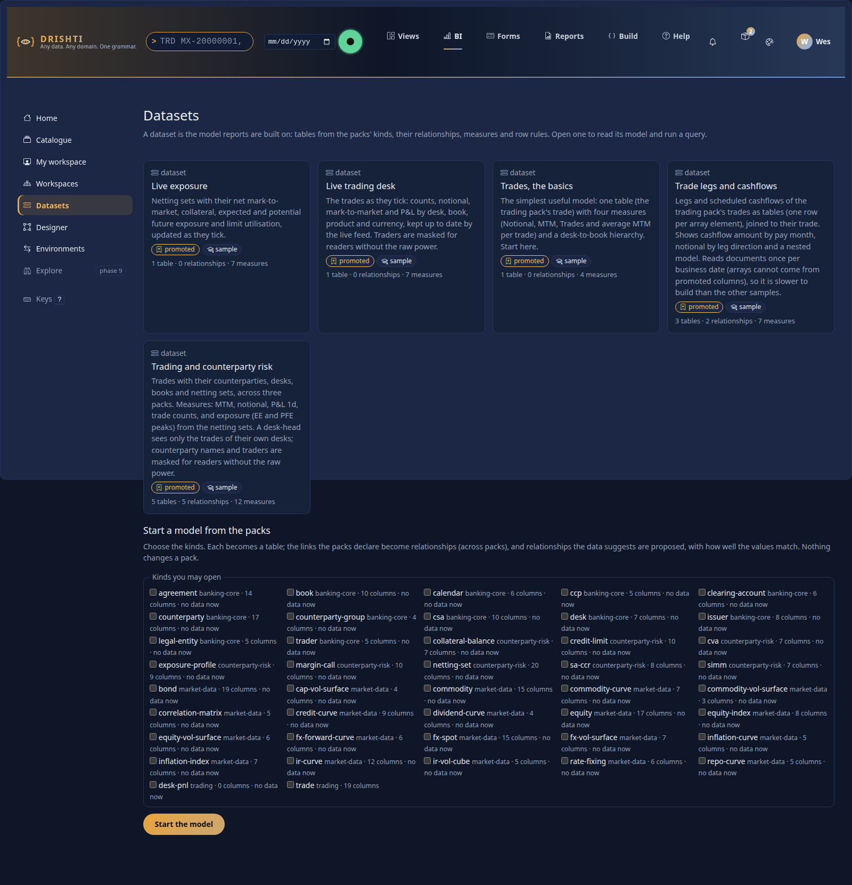

Over the API: `GET /api/v1/bi/models` lists the models and datasets you may read; `drishti.py bi model list` prints them; `drishti.py bi model
describe trading-risk` prints every table, column and measure.

## `trades-basic`: read the model, run a query

Open **Trades, the basics**. The page has the model (its table with every column and type; measures with their expressions; security; the layers on
disk) and a **query preview**. Read the YAML first: `config/bi/models/trades-basic.model.yaml` and `config/bi/datasets/trades-basic-trade.dataset.yaml`
explain each part in comments (the source: the risk-store connector's kind `trade-valuation`; `refresh: { on-load: true }`; the columns `TRADE_ID`, `DESK`,
`PORTFOLIO`, `NOTIONAL`, `MTM` and the rest; a calculated column `MTM_IN_MILLIONS`; four measures including one made of two others; a hierarchy).

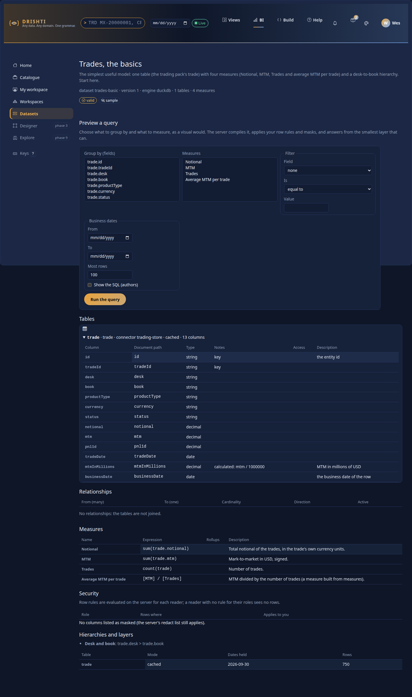

Preview: group by `trade.DESK`, measures *Notional*, *MTM*, *Trades*, *Average MTM per trade*, **Run the query**.

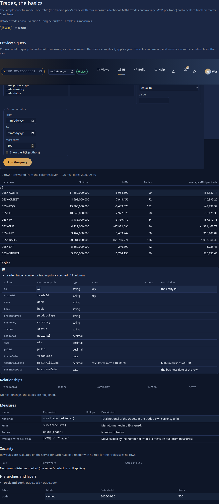

The same as a model query over the API (`options.format: json` is the default; `arrow` returns an Arrow IPC stream, for a client such as pandas or
pyarrow), captured:

```
POST /api/v1/bi/mq
{"mq": 1, "model": "trades-basic@1", "select": {"fields": ["trade.DESK"], "measures": ["Notional", "MTM", "Trades", "Average MTM per trade"]}}

DESK-COMM     888,803,742,773.65   -429,967,635.39   5990     -71,780.91
DESK-CREDIT   344,825,753,000.00    360,552,941.89   1172     307,639.03
DESK-EQD      428,542,341,000.00    -79,395,510.75   1452     -54,680.10
DESK-FI       401,083,619,000.00    -42,949,081.83   1248     -34,414.33
DESK-FX       366,591,303,000.00   -669,248,939.51   1428    -468,661.72
...                                                                       (10 rows)
meta: asOf=2026-10-16, layer=columns, 10.6 ms, cached=false
```

From a terminal: `drishti.py bi mq --model trades-basic@1 --select trade.DESK --measures Notional,MTM,Trades` (or the same in SQL,
`drishti.py bi sql "SELECT trade.DESK, MEASURE('MTM') FROM trade GROUP BY trade.DESK" --model trades-basic@1`, [SQL.md](SQL.md)).

What happened: the first query **built the columns layer** for the table: the connector scanned the declared columns and the engine wrote
`<data>/bi-store/columns/file_model_trades-basic/trade/date=2026-10-16/part.parquet`. Run it again and the answer comes from the **result cache**
(`cached: true`, in microseconds). The date is the newest the lake holds; give `time: {as-of: "2026-10-15"}` (a report's date picker) for another day.
If the lake is built again (`lake demo` once more), the server reads it again: `lake demo` tells it, and a changed Delta date is noticed by itself
([TOOLS.md section 4.7](TOOLS.md#47-a-pack-a-connector-and-the-data-load-signal)).

As an author add `options: {explain: true}` to see the SQL the server compiled (see [DATASETS.md section 4](DATASETS.md#4-measures-and-the-expression-language)): names quoted from the model, **no value in the text**.

## `trading-risk`: relationships from the packs' links

Open **Trading and counterparty risk**. Its five tables read three connectors in three packs (`risk-store` of market-risk for the trade valuations,
`reference-store` of core, `credit-store` of counterparty-risk). Its relationships are the links the packs declare (a valuation's `DESK`, `PORTFOLIO`,
`COUNTERPARTY` and `NETTING_SET`; a netting set's `COUNTERPARTY`), so the tables are already joined.

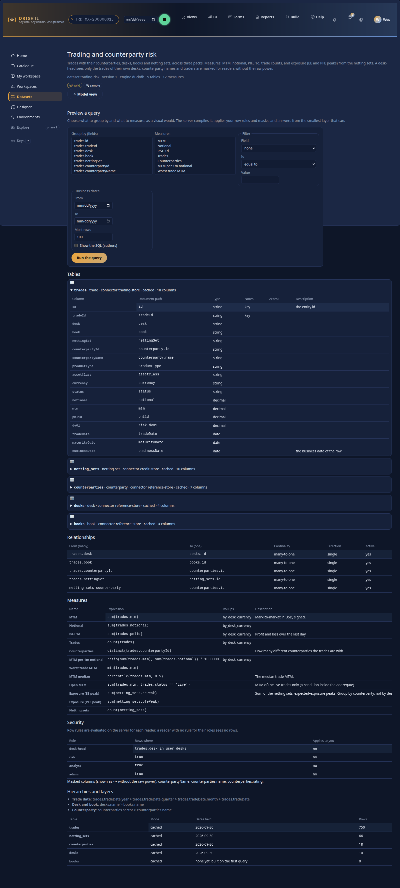

Group by `desks.NAME` (a column of another pack's table) and ask for *MTM*, *Notional*, *Trades*, *Counterparties* (a distinct count), captured:

```
Bonds and securitised          -42,949,081.83     401,083,619,000.00   1248   18
Commodities                   -429,967,635.39     888,803,742,773.65   5990   24
Credit trading                 360,552,941.89     344,825,753,000.00   1172   17
Equity derivatives             -79,395,510.75     428,542,341,000.00   1452   18
G10 and EM FX                 -669,248,939.51     366,591,303,000.00   1428   17
...                                                                              (10 rows)
```

The join was `trades -> desks` (many to one), so no trade is counted twice. Now **exposure by counterparty**, a measure of the *netting sets* grouped by a
column of the counterparties, the five largest:

```
{"mq": 1, "model": "trading-risk@1", "select": {"fields": ["counterparties.NAME"], "measures": ["Exposure (EE peak)", "Netting sets"]},
 "sort": [{"by": "Exposure (EE peak)", "desc": true}], "limit": 5}
Northern Plains Energy Canada   2,846,661,899   1
Summit Clearing LLC             2,638,994,501   2
Aldershot Pension Trust         2,599,390,291   4
Harbor Point Bank               2,552,263,980   4
Tokai Mutual Trust Bank         2,309,006,435   4
```

The reference kinds promote no columns, so the server read their documents once (a warning in `meta.warnings` says so: *connector 'reference-store'
cannot scan counterparty as columns...*); the trade valuations scanned columns.

**A rollup.** The model declares `by_desk_currency` (`by: [DESK, CURRENCY, PRODUCT_GROUP]`). A query that groups by `trades.DESK` and `trades.CURRENCY` and
asks for rollup measures is answered from it:

```
{"mq": 1, "model": "trading-risk@1", "select": {"fields": ["trades.DESK", "trades.CURRENCY"], "measures": ["MTM", "Notional", "Trades"]}, "limit": 3}
DESK-COMM   CAD         931,256.00          99,000,000.00     12
DESK-COMM   EUR      -2,548,307.00       1,454,306,015.60    923
DESK-COMM   USD    -428,350,584.39     887,250,436,758.05   5055
meta: layer=rollup, rollup=by_desk_currency, 13.7 ms
```

Add `"options": {"layer": "columns"}` and you get the same numbers from the columns layer. At 15,000 rows a day the two cost the same (a few
milliseconds each); a rollup is for millions of rows.

## Row rules and masks with two users

The model says (`security:`): `desk-head` sees `DESK in user.desks` (and every netting set, counterparty, desk and book: `may-see-all`); `risk`,
`analyst` and `admin` see every row; the counterparties' names and the traders are masked for readers without the raw power. Run the **same** query,
group by `desks.NAME`, measures *MTM*, *Trades*, *Counterparties*, as three people.

**rita (`risk`, raw)**: all ten desks, as above (captured as rita: `G10 and EM FX  -669,248,939.51  1428  17` among them).

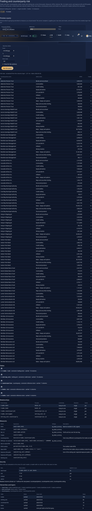

**hana (`desk-head`, desk `DESK-FX`, no raw)**: one row, her desk. She did not filter; the rule did it, on the server, and she cannot remove it. Her
*Counterparties* is null: a distinct count of a masked column (captured as hana):

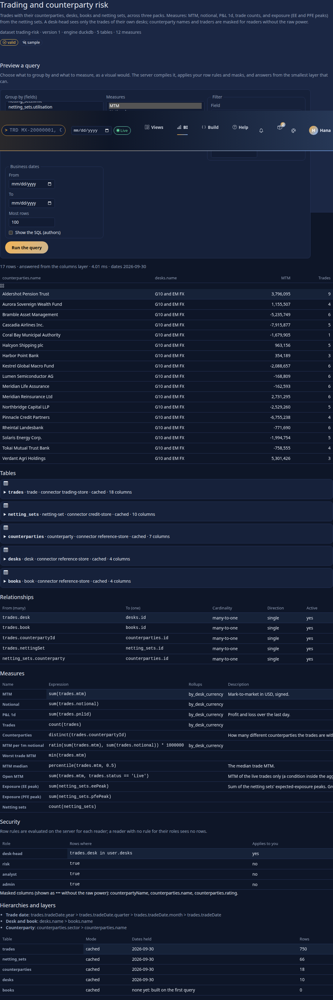

```
G10 and EM FX   -669,248,939.51   1428   null        meta: masked=[Counterparties], warnings=["measure Counterparties is masked"]
```

**ann (`analyst`, no raw)**: every desk, but *Counterparties* reads null and the badge says why. Group by `counterparties.NAME` and the names do not
appear at all: one row `•••` with every trade in it, because a masked field is not grouped on, so the names cannot be told apart. A filter on it is
refused:

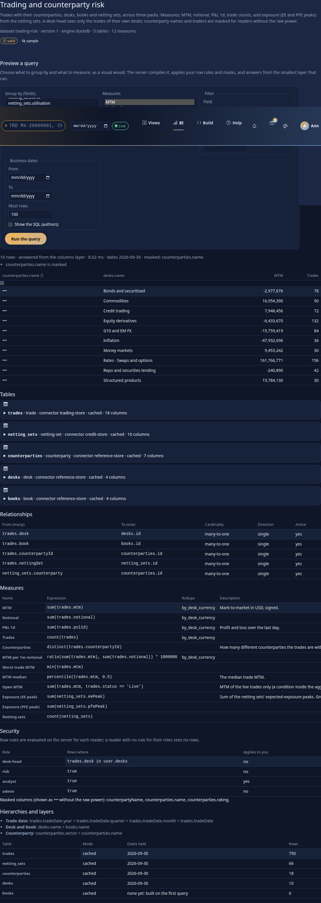

```
ann: {"mq": 1, "model": "trading-risk@1", "select": {"measures": ["Trades"]},
      "where": [{"field": "counterparties.NAME", "op": "eq", "values": ["Halcyon Shipping plc"]}]}
403 DRS-9161 'counterparties.NAME' is masked for you: it cannot be filtered on      (a report's visual query says DRS-9021, with this as its problem)
```

Last, hana asks for exposure by counterparty. The model lets a desk head see every netting set and counterparty (`may-see-all`), so the question is
answered over all of them; the names are masked for her, so the answer is one row (captured as hana):

```
{"select": {"fields": ["counterparties.NAME"], "measures": ["Exposure (EE peak)"]}}
•••   40,648,705,220        meta: masked=[counterparties.NAME]
```

Without that `may-see-all` the rule that names `trades` would be joined into her query, netting sets do not reach trades many-to-one, and the question
would be **refused rather than answered with other desks' data** (`422 DRS-9020`, [DATASETS.md section 6](DATASETS.md#6-security-row-rules-and-masks)).

A person whose roles no row rule names sees **no rows** and is told so (`you have no access to rows of trades, desks, counterparties, books in this
model: no row rule names your roles`); a person without the `bi` power is refused (`403 DRS-9002 ... does not hold the bi power`).

## `trading-cashflows`: legs, cash flows and payments

Open **Trade legs and cashflows**. A trade document holds arrays (`LEGS[]`, `LEGS[].CASH_FLOWS[]`, `EVENTS[]`); a table over an array has one row per
element, whose `id` is the trade's id. The scheduled notional and the number of cash flows by payment month (USD equivalent, captured; ten of the
twelve months):

```
{"mq": 1, "model": "trading-cashflows@1", "select": {"fields": ["cashflows.PAYMENT_DATE.month"], "measures": ["Scheduled notional", "Cashflows"]}}
 1   2,037,997,887,202.71   12381       6   3,109,379,357,636.66   15328
 2   2,839,968,374,336.31   16672       7   2,298,276,593,510.71   13332
 3   3,104,150,305,851.04   16666       8   3,195,319,022,342.53   17228
 4   2,094,672,739,313.43   12879       9   3,149,308,826,491.40   16341
 5   2,732,057,197,303.04   15722      10   2,356,727,950,490.45   14398
```

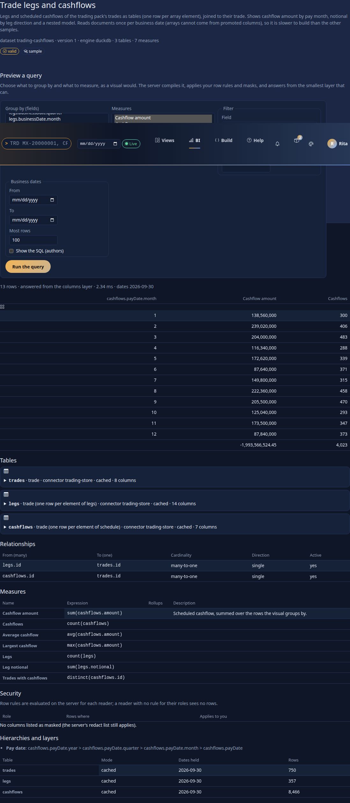

Group cash flows by a column of the trade (`trades.SOURCE_SYSTEM`): the join goes cash flows to trades, many to one; the trades of the three source
systems are one table (the three connectors' union):

```
{"select": {"fields": ["trades.SOURCE_SYSTEM"], "measures": ["Cashflows", "Trades"]}}
CALYPSO   40713   5000
ENDUR     65928   5000
MUREX     75823   5000
```

Legs and cash flows are siblings under the trade; asking for a leg column with a cash-flow measure would repeat each cash flow once per leg, and the
server refuses (`422 DRS-9156 ... no relationship path joining [legs, cashflows] ... Group by a field they all reach (trades.SOURCE_SYSTEM, ...)`).
Because arrays cannot come from promoted columns, these tables read the trade documents once per business date (the warning says so; about a second
for the 15,000 trades here).

## Change a measure in a copy

Shipped files are read-only. Copy one and edit the copy, which is private to you until you publish it.

1. Open **Trades, the basics** and press **Save a copy** (or, in **My workspace**, **New item** of kind **model**, and paste the YAML of
   `config/bi/models/trades-basic.model.yaml`, changing `model: trades-basic` to `model: my-copy`).
2. Add a measure, for example `Big trades: { expr: "sum(trade.NOTIONAL, where=trade.NOTIONAL > 100000000)" }` under `measures:`, write a note in *What
   changed*, and press **Save draft** (*Draft saved.*).
3. **Check** validates it (`POST /api/v1/bi/models/validate` with `{yaml}` does the same with no item; `drishti.py bi expr validate "..." --model
   trades-basic` checks one expression). A mistake, say `sum(trade.nope)`, is `DRS-9152` *no field 'trade.nope'* with the columns the table does have.
4. Ask *Big trades* by `trade.DESK`. Another person cannot open your draft (`404 DRS-9001`); publish it to a shared workspace (with review, if the
   workspace asks) and it appears in the catalogue. Publishing an invalid model is refused.

## A dataset that is wrong

```
drishti.py bi expr validate "sum(trades.notional)" --model trading-risk
INVALID  (del2, aggregate scope, type any)
  error   DRS-9152  at 4-19: no field 'trades.notional'; did you mean trades.NOTIONAL?
```

`POST /api/v1/bi/models/validate {"yaml": "..."}` answers a whole model or dataset the same way: `{"valid": false, "problems": [{"level": "error",
"code": ..., "path": ..., "message": ...}]}` ([DATASETS.md section 13](DATASETS.md); the codes `DRS-9100` to `DRS-9110`).

## Start a model from the packs

As an author, on the Models page choose kinds (here `trade-valuation`, `desk`, `counterparty`, `netting-set`) and **Start the model**. Each kind is a pack
dataset (`pack.market-risk.trade-valuation` and the rest, the columns typed from the data or the pack's samples); **the packs' link graph becomes
relationships, across packs**; relationships the data suggests (a column whose values are ids of another kind) are *proposed* with the match rate; the YAML
is a draft you can save to your workspace.

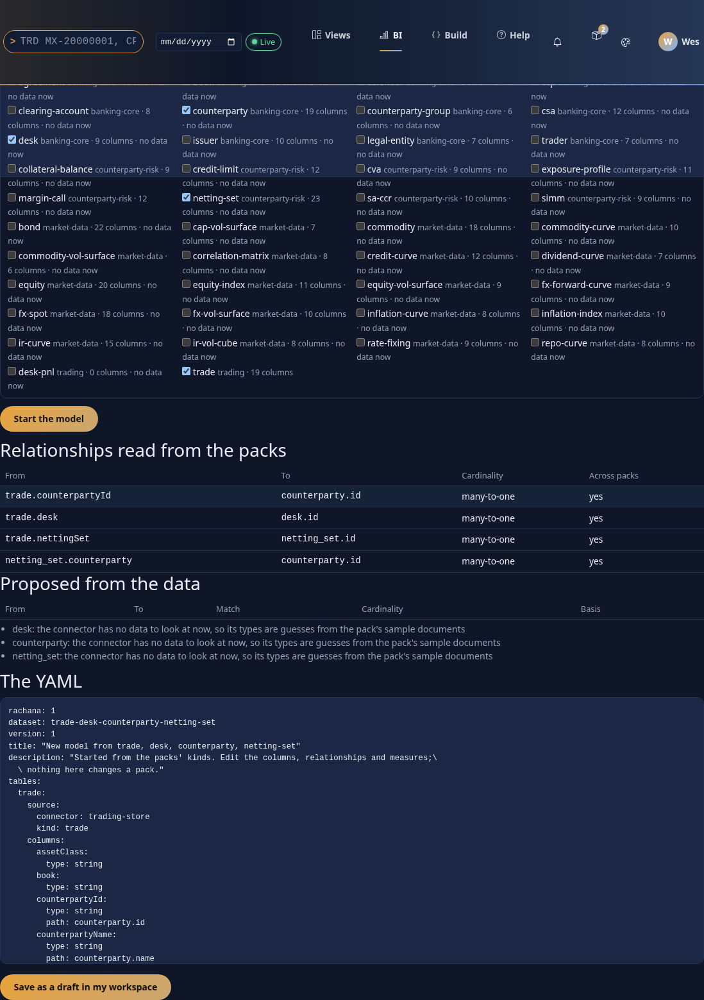

What the packs declare for these four (`drishti.py bi model describe dataset:pack.market-risk.trade-valuation` shows the same as the implicit model's
dimensions):

```
relationships read from the packs (all cross-pack):
  trade_valuation.COUNTERPARTY -> counterparty      many-to-one
  trade_valuation.DESK         -> desk              many-to-one
  trade_valuation.NETTING_SET  -> netting_set       many-to-one
  netting_set.COUNTERPARTY     -> counterparty      many-to-one
proposed from the data: none (the packs declare every link between these four)
```

Inference matters for kinds with no declared link: for each text column of one table and each other table's ids it reports *"3 of 3 distinct values are ids of region"* (rate, count, cardinality, a few unmatched values) when the rate is at least
`drishti.bi.query.infer-min-match` (0.8). It is profiling, not AI, and nothing is accepted on its own.

## Rank desks and smooth a series with window functions

Window measures are measures like the others. `trading-risk` ships two (`MTM rank`, `MTM 3-day average`); write your own in a copy:

```yaml
measures:
  MTM rank:          { expr: "rank(sum(trades.MTM))" }                                       # 1 for the highest MTM among the rows you may see
  MTM 3-day average: { expr: "moving_avg(sum(trades.MTM), 3, trades.TRADE_DATE)" }           # this row and the two before it, along the date
  Day on day:        { expr: "sum(trades.MTM) - lag(sum(trades.MTM), 1, trades.TRADE_DATE)" }
```

Preview `fields: [trades.DESK]`, `measures: [MTM, MTM rank]` (captured: `DESK-RATES 4,108,728,089.50 1`, `DESK-MM 393,805,216.87 2`, `DESK-STRUCT
382,608,464.96 3`) and `fields: [trades.TRADE_DATE]`, `measures: [MTM, MTM 3-day average]`. A window along a date needs that date as a **field** of the
visual (its axis), and a measure that is a window cannot be filtered on. [DATASETS.md section 4.3](../guides/DATASETS.md#43-window-functions).

## Show "last 30 days" and "this quarter to date"

Add a slicer on a date field with `format: { mode: relative-date, default: last-30-days }` (REPORTS.md 6.1). The server works the dates out from the report's date and the business-day calendar, so `last-5-business-days` skips holidays and an export of the page says the same.

## Say what a number should be

Add `tests:` to a report or a model and press **Check** (REPORTS.md section 17, [DATASETS.md section 8.1](DATASETS.md#81-expected-values-tests)):
*The book holds 15,000 valuations* passes on the demo lakes, *close to 100* fails and says what was found, and the publish is refused until the
expectation or the data is mended.

## On a phone

The pages work at 390 px: the rail scrolls sideways, the form stacks, tables scroll inside their frame, targets are 44 px.

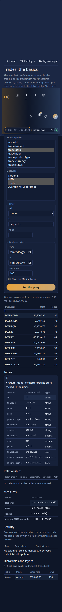

## The Model view: relate tables by dragging

On a model's page choose **Model view** (authors). Open **Trading and counterparty risk**: five tables as boxes, the relationships as lines with `1` and `*` at the ends (hover a line for its cardinality and direction). A shipped model opens
read-only; **Save a copy** makes a draft of your own.


**Remove one and draw it back.** In the list on the right remove `trades.PORTFOLIO -> books.id`: the line goes, the YAML loses the line, and `books` is related to nothing, so it moves to a band of its own. Now drag the column `PORTFOLIO` of `trades` onto
`id` of `books`: the form fills in, with a many-to-one guessed from the keys. Nothing is written until **Add relationship**.


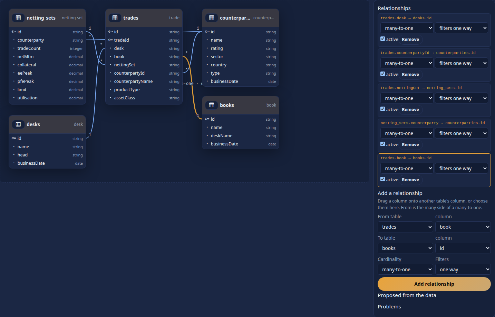

```
relationships:
  - { from: trades.DESK,       to: desks.id }
  - { from: trades.PORTFOLIO,  to: books.id, cardinality: many-to-one }
  ...
```

**Proposals from the data.** For tables with no declared link, **Look for relationships in the data** finds columns whose values are ids of another table. Here a draft with the trades and the desk P&L (two kinds the packs do not link) gets a
proposal with its match rate; nothing changes until you **Accept**:


```
trades.DESK → desk_pnl.id  100% of 10 values match (many-to-one)
accepted: { from: trades.DESK, to: desk_pnl.id, cardinality: many-to-one }   (written into the YAML; the model checks as valid)
```

Drag a box by its header and its place is kept in the YAML under `layout:`. Only the `relationships:` and `layout:` blocks are rewritten; the rest of the file, comments included, stays as you wrote it.
