<!--
  Project Drishti · Any data. Any domain. One grammar.

  Copyright (c) 2026 Ashutosh Sinha <ajsinha@gmail.com>.
  All rights reserved.

  PROPRIETARY AND CONFIDENTIAL.

  This file is the confidential and proprietary property of Ashutosh Sinha.
  Unauthorised copying, use, modification, distribution or disclosure of this
  file, via any medium, is strictly prohibited except with the express prior
  written permission of the copyright holder.

  See the LICENSE file in the root of this repository for the full terms.
-->
# Tutorial: learn BI from the sample datasets and reports

Drishti ships five sample **datasets**, five sample **reports** and one **board** (all in `config/bi`, all read-only), built on the trades, so you can learn what each is by using it and then **building your own**. The tutorial is the walk-through; the pages themselves are described in [BI_GUIDE.md](BI_GUIDE.md) (read its sections 2 to 4 first if you have never opened BI), and the references are [DATASETS.md](DATASETS.md), [REPORTS.md](REPORTS.md), [BOARDS.md](BOARDS.md) and [BI_GOVERNANCE.md](BI_GOVERNANCE.md).

**Start here, in this order.** Chapter 0 sets up a server, a console and four people (about ten minutes). Then:

| Chapters | You learn | Minutes |
|---|---|---|
| 1 to 5 | what a **dataset** is: open the three stored ones, read the model, run preview queries, see relationships across packs, a rollup, nested arrays | 30 |
| 6 to 9 | change a measure in a copy of your own, see an invalid dataset refused, start a model from the packs, row rules and masks with two users, a phone | 30 |
| 10 to 12 | what a **report** is: open the three stored ones, click, drill down, drill through, matrices, row rules at work | 20 |
| 13 to 16 | **build** a report from scratch in the designer, draw a relationship in the Model view, a report on a phone, what to read next | 40 |
| 17 | **publish and govern**: saved states, review, certification, lineage, impact, bundles (its own small stack) | 30 |
| 18, 19 | the **streaming** half: a live dataset, a report that redraws as the trades tick, a Perspective grid and pivot, a wall of live tiles for a screen | 30 |
| 20, 21 | **distribution**: export a page and subscribe people to it by email, each with their own figures; **alerts** on a number, and a board tile that tells people when it turns red | 25 |

Every output below was captured from a real server (the pictures and numbers of chapters 1 to 9 by `drishti-console/tests/bi_data_shots.py`, 10 to 15 by `bi_report_shots.py`, 17 by `bi_gov_shots.py`, 18 and 19 by `bi_live_shots.py`, 20 by `dist_shots.py`, 21 by `alerts_shots.py`) over a generated Delta lake (750 trades a day, three business days: well under the 10,000-a-day local limit), except where a chapter says its data differs. Your numbers are the same for chapters 1 to 15 if you build the lake as chapter 0 says.

| Sample | What it teaches | Tables |
|---|---|---|
| `trades-basic` | the "hello world": one table, four measures, a hierarchy | `trade` |
| `trading-risk` | the real one: three packs, relationships from the packs' links, a rollup, a row rule, masks | `trades`, `netting_sets`, `counterparties`, `desks`, `books` |
| `trading-cashflows` | nested documents: legs and cashflows as tables, one-to-many | `trades`, `legs`, `cashflows` |

| Sample report | What it teaches | Dataset |
|---|---|---|
| `trades-overview` | cards, a bar that drills from desk to book, a line, a table, a slicer, a matrix; the first report to read | `trades-basic` |
| `counterparty-risk` | a cross-pack report: a top-10 filter, report-wide slicers, drill-through to a page about one counterparty, row rules and masks at work | `trading-risk` |
| `cashflow-ladder` | deep trades: a date hierarchy to drill from year to day, a matrix over legs | `trading-cashflows` |

The live ones (`live-trading`, `live-exposure`, the reports **Live trading desk** and **Live exposure**, the board **Desk wall**) are chapters 18 and 19. All are marked `sample: true`: with **Admin, Packs, Hide samples from business users** (or *from everyone*), business users do not see them (as with sample packs).

## 0. Set up

From the repository root, after `./mvnw -q package -DskipTests` (the server jar) and `pip install -r drishti-console/requirements.txt` (or a venv, [QUICKSTART.md](QUICKSTART.md)):

```
uv run --with deltalake --with pyarrow --with pyyaml python tools/packgen/banking/make_data.py --lake data/delta --days 3
export DRISHTI_PACKS=trading,counterparty-risk DRISHTI_SECURITY_ENABLED=true DRISHTI_TOKEN_SECRET=change-me-to-a-long-random-string-0123456789
java -jar drishti-server/target/drishti-server-*-exec.jar
```

and, in a second terminal, the console with sign-in on (the same token secret, and a session secret):

```
export DRISHTI_AUTH_ENABLED=true DRISHTI_TOKEN_SECRET=change-me-to-a-long-random-string-0123456789 DRISHTI_SESSION_SECRET=another-long-random-string-0123456789abcd
python drishti-console/run_drishti_web.py
```

Open http://localhost:17480 and sign in as `drishti-dev-admin` with `drishti-dev-admin123` (change it later; [GETTING_STARTED.md](GETTING_STARTED.md)). The server reads `data/delta` by default, and `config/bi` is the BI folder, so the five datasets are there already. (The numbers in this tutorial were made on other ports and in a scratch folder; yours are the same.)

Now make four people. The role names matter: the dataset's row rules name them.

1. **Admin, Roles, New role**, four times: `bi-writer`, `risk`, `desk-head` (name, tick **Opens every kind** and **See every field unmasked**, the raw power), and `analyst` (**Opens every kind**, *not* raw).
2. **Admin, BI settings**: in the table of roles tick `bi` for `risk`, `desk-head` and `analyst`, and `bi` and `bi-author` for `bi-writer`, pressing **Save** on each row.
3. **Admin, Users, New user**, four times: `wes` with role `bi-writer`; `rita` with `risk`; `hana` with `desk-head` and **Desk** `DESK-FX`; `ann` with `analyst`. Give each the password `long-enough-pass-1`, untick *Must change at first sign-in*, and leave the packs ticked.

So: **wes** writes (`bi`, `bi-author`, raw), **rita** is risk (`bi`, raw), **hana** is a desk head (`bi`, raw, desk `DESK-FX`) and **ann** is an analyst (`bi`, *no* raw). (`drishti-console/tests/bi_data_stack.py` does exactly this by API, which is how the pictures here were made.) Sign in as `wes` for chapters 1 to 15, switching to the others where a chapter says so; use a second browser or a private window to be two people at once.

## 1. Open the catalogue and the datasets

Type `BI <GO>` (or `RUPAKA <GO>`) in the command line, or choose **BI** in the top bar, then **Datasets** in the rail. The five samples show as *promoted* and *sample* (the first three are chapters 2 to 5; the two live ones are chapter 18).
As an author (`wes`) the page also offers **Start a model from the packs** (chapter 8).


Over the API: `GET /api/v1/bi/datasets` lists them with `valid`, `errors`, table, relationship and measure counts.

## 2. `trades-basic`: read the model, run a query

Open **Trades, the basics**. The page has the model (tables with every column, its document path and type; relationships; measures with their expressions; security; the layers on disk) and a
**query preview**. Read the YAML first: `config/bi/datasets/trades-basic.dataset.yaml` explains each part in comments (table, connector by logical name, `mode: cached`, columns, a calculated
column `mtmInMillions`, four measures including one made of two others, a hierarchy).


Preview: group by `trade.desk`, measures *Notional*, *MTM*, *Trades*, *Average MTM per trade*, **Run the query**.


The same call over the API (`format=json` is the default; `format=arrow` returns an Arrow IPC stream for Perspective or DuckDB-Wasm):

```
POST /api/v1/bi/datasets/file:dataset:trades-basic/query
{"fields":["trade.desk"],"measures":["Notional","MTM","Trades","Average MTM per trade"]}

DESK-COMM    11,359,000,000   16,954,390    90     188,382.11
DESK-CREDIT   8,598,000,000    7,948,456    72     110,395.22
DESK-EQD     15,806,000,000   -6,433,670   132     -48,739.92
DESK-FI      10,346,000,000   -2,977,676    78     -38,175.33
DESK-FX       8,485,000,000  -15,759,419    84    -187,612.13
...                                                            (10 rows)
meta: layer=columns, 8.8 ms, dates=[2026-09-30], cached=false
```

What happened: the first query **built the columns layer** for the table: the Delta connector scanned the declared columns (no document was parsed) and the engine wrote
`columns/file_dataset_trades-basic/trade/date=2026-09-30/part.parquet`. Run it again and the answer comes from the **result cache** (`cached: true`, in microseconds). The date is the
newest the lake holds (the data here ends on 2026-09-30); give `dates: {"from": "2026-09-29"}` for another day, or a range.

As an author add `?explain=true` to see the SQL the server compiled (see [DATASETS.md section 4](DATASETS.md#4-measures-and-the-expression-language)): names quoted from the model, **no value in the text**.

## 3. `trading-risk`: relationships from the packs' links

Open **Trading and counterparty risk**. Its five tables read three connectors in three packs (`trading-store` of trading, `reference-store` of banking-core, `credit-store` of counterparty-risk). Its five
relationships are the links the packs declare (a trade's `desk`, `book`, `counterparty.id` and `nettingSet`; a netting set's `counterparty`), so the tables are already joined.


Group by `desks.name` (a column of another pack's table) and ask for *MTM*, *Notional*, *Trades*, *Counterparties* (a distinct count):

```
Bonds and securitised          -2,977,676   10,346,000,000    78   13
Commodities                    16,954,390   11,359,000,000    90   18
Credit trading                  7,948,456    8,598,000,000    72   17
Equity derivatives             -6,433,670   15,806,000,000   132   18
G10 and EM FX                 -15,759,419    8,485,000,000    84   17
...                                                                (10 rows)
```

The join was `trades -> desks` (many to one), so no trade is counted twice. Now **exposure by counterparty**, a measure of the *netting sets* grouped by a column of the counterparties:

```
{"fields":["counterparties.name"],"measures":["Exposure (EE peak)","Netting sets"],"orderBy":[{"by":"Exposure (EE peak)","desc":true}],"limit":5}
Halcyon Shipping plc      133,327,214   3
Meridian Life Assurance   117,599,671   4
Harbor Point Bank         114,560,550   4
Aldershot Pension Trust    98,882,895   4
Meridian Reinsurance Ltd   92,583,568   3
```

The reference kinds here promote no columns, so the server read their documents once (a warning in `meta.warnings` says so); `trades` scanned columns.

**A rollup.** The dataset declares `by_desk_currency`. A query that groups by `trades.desk` and `trades.currency` and asks for rollup measures is answered from it:

```
{"fields":["trades.desk","trades.currency"],"measures":["MTM","Notional","Trades"]}
meta: layer=rollup, rollup=by_desk_currency, 4.6 ms
```

Add `"layer":"columns"` and you get the same numbers from the columns layer. At 750 rows a day the two cost the same (a few milliseconds each, section 11 of
[RUPAKA_POC.md](../architecture/RUPAKA_POC.md) has the numbers); a rollup is 18 times smaller on disk and is for millions of rows.

## 4. Row rules and masks with two users

The dataset says (`security:`): `desk-head` sees `trades.desk in user.desks`; `risk` and `analyst` see everything; `counterpartyName`, `counterparties.name` and `counterparties.rating` are masked
for readers without the raw power; and the server's own redact list masks `counterpartyId`. Run the **same** query, group by `desks.name`, measures *MTM*, *Trades*, *Counterparties*, as three people.

**rita (`risk`, raw)**: all ten desks.


**hana (`desk-head`, desk `DESK-FX`)**: one row, her desk. She did not filter; the rule did it, on the server, and she cannot remove it.


```
G10 and EM FX   -15,759,419   84   17
```

**ann (`analyst`, no raw)**: every desk, but *Counterparties* (a distinct count of a masked column) reads null and the badge says why. Group by `counterparties.name` and the names do not appear at all: one row
`•••` with the 750 trades in it, because a masked field is not grouped on, so the 18 names cannot be told apart.


```
ann: {"measures":["Trades"],"filters":[{"field":"counterparties.name","op":"eq","values":["Halcyon Shipping plc"]}]}
403 DRS-9021 'counterparties.name' is masked for you: it cannot be filtered on
```

Last, hana asks for exposure by counterparty. The rule names `trades`, and every query she runs joins it; netting sets do not reach trades many-to-one, so the question is **refused rather than answered
with other desks' data**:

```
422 DRS-9020 the model has no relationship path joining [counterparties, netting_sets, trades] to the measures' table without repeating its rows (each join must go many-to-one);
your row rule reads [trades] and is applied to every query you run, so the table the measures aggregate must reach it many-to-one
```

## 5. `trading-cashflows`: legs and cashflows

Open **Trade legs and cashflows**. A trade document holds arrays; `source: { each: schedule }` makes each element of the payment schedule a row of the table `cashflows`, whose `id` is the trade's id. Cashflow amount by pay month:

```
{"fields":["cashflows.payDate.month"],"measures":["Cashflow amount","Cashflows"]}
 1   138,560,000   300       5   172,620,000   339       9   205,500,000   470
 2   239,020,000   406       6    87,640,000   371      10   125,040,000   293
 3   204,000,000   483       7   149,800,000   315      11   173,500,000   347
 4   116,340,000   288       8   222,360,000   458      12    87,840,000   373
```


Group cashflows by a column of the trade (`trades.desk`): the join goes cashflows to trades, many to one. Legs and cashflows are siblings under the trade; asking for a leg column with a cashflow measure would repeat each cashflow once per
leg, and the server refuses (`DRS-9020`). Because arrays cannot come from promoted columns, this dataset reads the trade documents once per business date (the warning says so).

## 6. Change a measure in a copy

Shipped files are read-only. Copy one and edit the copy, which is private to you until you publish it.

1. In **My workspace** (rail) fill **New item**: kind **dataset**, title *My copy*, **Create item** (or `POST /api/v1/bi/workspaces/me/items`). The item's page opens with an empty body: press **Edit** and paste the YAML of `trades-basic` (from `config/bi/datasets/`) into **Body (YAML)**, changing `dataset: trades-basic` to `dataset: my-copy`.
2. Change a measure, for example add `Big trades: { expr: "sum(trade.notional, trade.notional > 100000000)" }` under `measures:`, write a note in *What changed*, and press **Save draft** (*Draft saved.*).
3. Open the item, then **Open the model and run a query**. The draft is validated as you open it (`POST /api/v1/bi/datasets/validate` does the same with no item). A mistake, say `sum(trade.nope)`, is `DRS-9011` with the path
   `measures.Big trades` and the columns the table does have.
4. Run *Big trades* by `trade.desk`. Another person cannot open your draft (`404 DRS-9001`); publish it to a shared workspace (with review, if the workspace asks) and it appears in the catalogue. Publishing an invalid dataset is refused.

## 7. A dataset that is wrong

```
POST /api/v1/bi/datasets/validate   {"yaml": "... measures:\n  N: { expr: \"sum(t.nope)\" }\n  M: { expr: \"ytd(sum(t.a))\" }"}
{"valid": false, "problems": [
  {"level":"error","code":"DRS-9011","path":"measures.N","message":"table 't' has no column 'nope' (it has a)"},
  {"level":"error","code":"DRS-9013","path":"measures.M","message":"'ytd' is reserved for time intelligence and window functions and is not built yet (RUPAKA.md section 20.2)"}]}
```

## 8. Start a model from the packs

As an author, on the Datasets page choose kinds (here `trade`, `desk`, `counterparty`, `netting-set`) and **Start the model**. Each kind becomes a table (columns from the connector's promoted columns, typed from the data, else from the pack's
sample documents); **the packs' link graph becomes relationships, across packs**; relationships the data suggests (a column whose values are ids of another kind) are *proposed* with the match rate; the YAML is a draft you can save to your workspace.


```
relationships read from the packs (all cross-pack):
  trade.counterpartyId -> counterparty      many-to-one
  trade.desk           -> desk              many-to-one
  trade.nettingSet     -> netting_set       many-to-one
  netting_set.counterparty -> counterparty  many-to-one
proposed from the data: none (the packs declare every link between these four)
warnings: desk, counterparty, netting_set: the connector promotes no columns to read here, so the types are guesses from the pack's sample documents
```

Inference matters for kinds with no declared link: for each text column of one table and each other table's ids it reports *"3 of 3 distinct values are ids of region"* (rate, count, cardinality, a few unmatched values) when the rate is at least
`drishti.bi.query.infer-min-match` (0.8). It is profiling, not AI, and nothing is accepted on its own.

## 9. On a phone

The pages work at 390 px: the rail scrolls sideways, the form stacks, tables scroll inside their frame, targets are 44 px.


## 10. Open the sample reports: Trades overview

The set-up of chapter 0 is all there is (the same people, the same lake); the reports ship in `config/bi/reports` and appear in the catalogue. The pictures and captured output of chapters 10 to 15 were made from a real stack by
`drishti-console/tests/bi_report_shots.py` (ports 18990 and 17990).

Choose **Catalogue**, filter by kind **report**, and open **Trades overview** (or type `BI trades overview <GO>`: a report opens drawn). Its YAML, `config/bi/reports/trades-overview.report.yaml`, is commented line by line; each visual says where it
sits (`at: { x, y, w, h }` on the 12-column grid) and what it shows (`wells`). The page shows the day's 750 trades: 92,558,000,000 notional, +138,562,638 mark to market, an average of +184,750 a trade.


Under every visual is the line the server gave back: rows, milliseconds (or "from the cache") and the layer that answered. Each visual is **one dataset query, as you**: the page asks for them three at a time. The bar's request is
`POST /api/v1/bi/reports/file:report:trades-overview/query` with `{"page": "overview", "visual": "by-desk", "state": {...}}` and its answer is the dataset engine's, plus the query the server built:

```
"rowCount": 10, "visual": "by-desk",
"query": {"fields": ["trade.desk"], "measures": ["MTM"], "filters": [], "orderBy": ["MTM desc"], "limit": 500}
rows: DESK-RATES 161,766,771 | DESK-COMM 16,954,390 | DESK-STRUCT 15,784,130 | ...
meta: layer columns, 10 rows, answered from the cache the second time
```

**Click a bar.** DESK-COMM was clicked: every other visual now answers for that desk (90 trades, +16,954,390) and the bar dims the others. The request of the card now carries the selection:

```
{"page": "overview", "visual": "mtm", "state": {"carry": [], "slicers": {},
  "selections": [{"visual": "by-desk", "field": "trade.desk", "values": ["DESK-COMM"], "highlight": false}], "drill": []}}
```


Switch *Click a mark to* **highlight** and a bar or column chart keeps the whole answer and draws the chosen share over it (the cards and the line are filtered, since they cannot draw a highlight).

**Drill down.** With the bar selected, the drill-down button moves the axis from the desk to the book (`hierarchy: Desk and book` in the YAML); the title shows the path and the up button comes back.


**Show the rows.** The list button replaces the visual with the rows behind it: every column of the trade table for the selected desk, under the same filters (`"drill": ["DESK-COMM"], "rows": true`).


Open **By product** for a donut, a **matrix** with subtotals and a stacked column, and the bookmark *FX desk only* in the toolbar. Press `?` for the keys: `Tab` walks the visuals, in a chart the arrows move between marks and `Enter`
selects, `t` shows the visual as a table, `r` shows its rows.

## 11. Counterparty risk: slicers, drill-through, row rules

Open **Counterparty risk** (`trading-risk`: trades from the trading pack, counterparties from banking-core, netting sets from counterparty-risk). The two slicers at the top have `scope: report`: a choice filters every page and the visuals
reach it **through the relationships** (a sector chosen on counterparties filters the trades and the netting sets). The bar is the ten counterparties with the highest expected exposure:
`filters: [{ field: counterparties.id, op: top, n: 10, by: Exposure (EE peak) }]`; the server ranks the counterparties first, in the context of the slicers, and keeps ten.


Select **Halcyon Shipping plc**'s bar. The visual's buttons now offer **Drill through to Counterparty**, because the page `counterparty` says `drillthrough: { fields: [counterparties.name] }`.

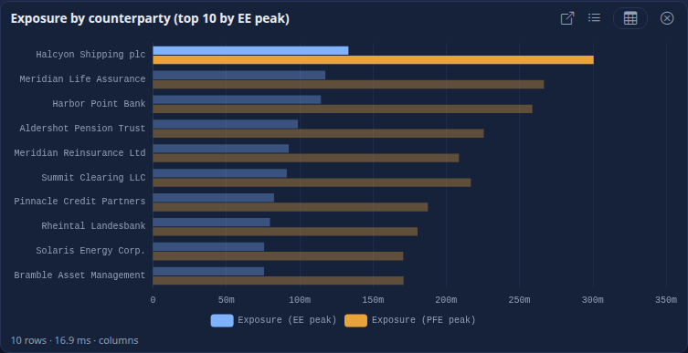

The page opens with the name carried as a chip and in the URL, so the link can be shared, and **Back** returns. Its trades table has a key column: a trade opens in the terminal.

```
/bi/r/file:report:counterparty-risk/counterparty?carry=%5B%7B%22field%22%3A%22counterparties.name%22%2C%22values%22%3A%5B%22Halcyon%20Shipping%20plc%22%5D%7D%5D
```


**Row rules at work.** Open the same report as `hana` (role `desk-head`, desk `DESK-FX`). The dataset's rule `trades.desk in user.desks` is on the trades and applies to every query she runs. The trades table
shows only her desk. A netting set does not reach the trades many-to-one, so the exposure visuals **cannot be answered under her rule and say so** rather than answer too much:

```
ee: DRS-9020 the model has no relationship path joining [netting_sets, trades] to the measures' table without repeating its rows
    (each join must go many-to-one); your row rule reads [trades] and is applied to every query you run, so the table the measures aggregate must reach it many-to-one
```


As `ann` (role `analyst`, no raw power) the counterparty name is masked by the dataset: the bar has **one** category, `•••`, and the visual's line says *masked*. A filter on a masked column would be refused
(`DRS-9021`), which is why the top-10 ranks by `counterparties.id`.


## 12. Cashflow ladder: a hierarchy and a matrix

**Cashflow ladder** (`trading-cashflows`: each trade document holds legs and a payment schedule, both tables of the dataset). The column chart starts at the pay **year** and `hierarchy: Pay date` goes year, quarter, month,
day. Select a year and press drill down: the axis becomes its quarters and the title shows the path. A visual filter, `{ field: cashflows.payDate, op: not-null }`, keeps the cashflows with no date off the ladder.


The **Legs** page is a matrix: rows are pay or receive, columns the rate type, the values the number of legs and their notional, with subtotals (`format: { subtotals: true }`). A total is the sum of the shown figures, so it is shown for a
count and a sum and as `–` for a measure that does not add up.


## 13. Build a report from scratch in the designer

As an author (`wes`), choose **Designer** in the rail. Choose the dataset **Trades, the basics**, a title and **Start designing**. A draft report appears in your workspace.

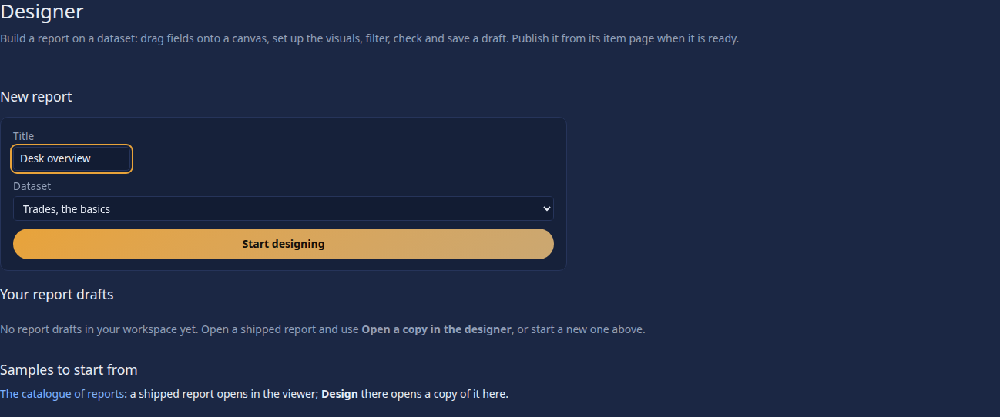

1. **The empty canvas.** Four panes: the canvas (with the page tabs and the Canvas and YAML views), **Filters**, **Visualizations** and **Fields**. The Fields pane is the dataset: the table `trade` with its columns (a date opens into its
   parts), the four measures, the hierarchy.

   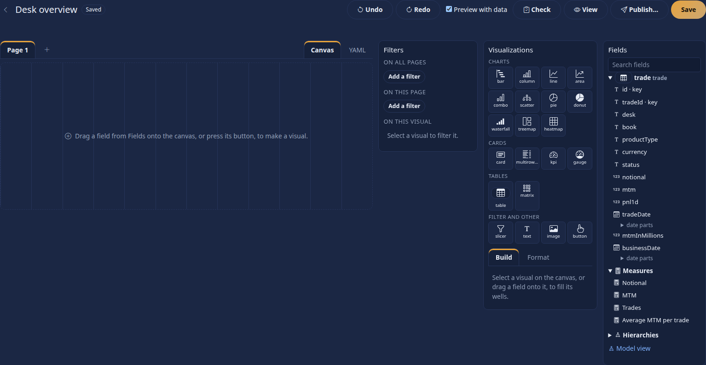

2. **Drag a measure onto the canvas.** *MTM* becomes a **card**, with the real figure from the dataset and the query time under it. A measure alone is a card; a column alone would be a table. Drag *Notional* beside it for a second card.

   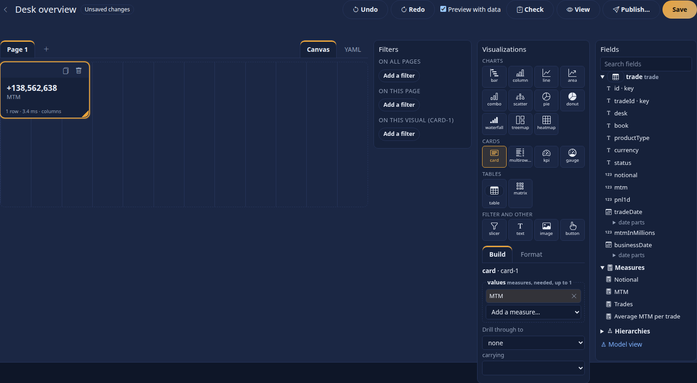

3. **Drag a column onto a visual to improve it.** Drag `trade.desk` onto the canvas (a table), then *MTM* onto that table: a category with a measure becomes a **bar**. **Build** shows the wells: `axis` holds `trade.desk`, `values` holds
   `MTM`. Add *Notional* with the select under `values` (no dragging needed). Add `trade.tradeDate` and *Notional* the same way for a **line**.

   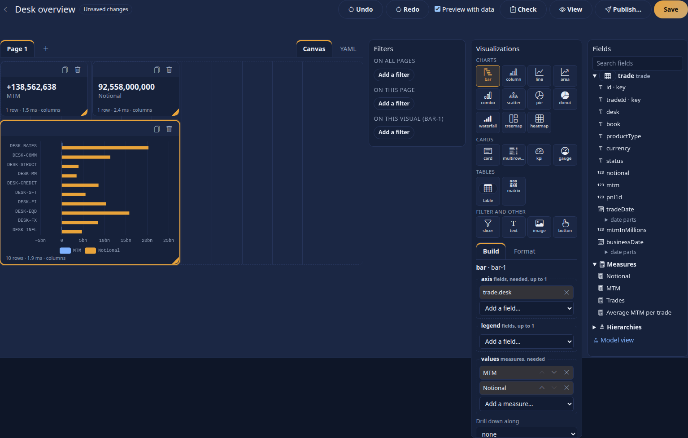

4. **A slicer.** With nothing selected (click an empty part of the canvas) choose **slicer** in Visualizations, add `trade.currency` to its `field` well, and in Format set the mode to **dropdown**; drag it by its header to the top right. The visual snaps
   to the grid and what it would overlap is pushed down.

   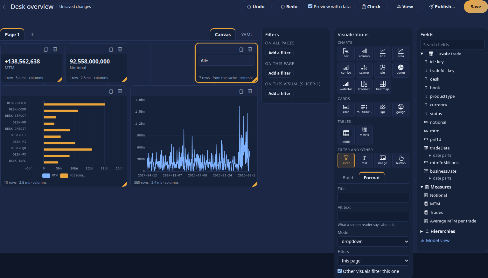

5. **Check.** The button validates the draft and adds the accessibility and layout checks. None of the visuals has a title yet:

   ```
   0 errors, 4 warnings. | A11Y pages[0].visuals[0]: the card has no title and no alt text: a screen reader announces nothing about it || A11Y pages[0].visuals[1]: the card has no title and no alt text: a screen reader announces nothing about it || A11Y pages[0].visuals[2]: the bar has no title and no alt text: a screen reader announces nothing about it || A11Y pages[0].visuals[3]: the line has no title and no alt text: a screen reader announces nothing about it
   ```

   

   Select each visual and give it a **Title** in Format (*Mark to market*, *Notional*, *MTM and notional by desk*, *Notional by trade date*, *Currency*).

6. **Filter.** Select the bar and, under *On this visual*, **Add a filter**: field `trade.desk`, type **Top N**, 5 by *Notional*. The bar keeps the five largest desks; the other filter types are Basic (tick values, or *Pick from the data*) and Advanced
   (a condition). Tick *Data labels* in Format.

   

7. **The result.** Two cards, a bar with its labels, a line, a slicer, each with its title and its real data:

   

8. **The YAML.** The tab shows the same draft as text, written as the sample reports are. Edit the text and the canvas follows; a mistake is reported with its code. A strip of suggestions follows the cursor.

   

   ```yaml
   rachana: 1
   report: desk-overview
   version: 1
   title: Desk overview
   dataset: "file:dataset:trades-basic"
   pages:
     - id: page1
       title: Page 1
       visuals:
         - id: card-1
           type: card
           title: Mark to market
           at: { x: 0, y: 0, w: 3, h: 2 }
           wells: { values: [MTM] }
         - id: card-2
           type: card
           title: Notional
           at: { x: 3, y: 0, w: 3, h: 2 }
           wells: { values: [Notional] }
         - id: bar-1
           type: bar
           title: MTM and notional by desk
           at: { x: 0, y: 2, w: 6, h: 5 }
           wells: { axis: [trade.desk], values: [MTM, Notional] }
           filters:
             - { field: trade.desk, op: top, n: 5, by: Notional, dir: desc }
           format: { labels: true }
         - id: line-1
           type: line
           title: Notional by trade date
           at: { x: 6, y: 2, w: 6, h: 5 }
           wells: { axis: [trade.tradeDate], values: [Notional] }
         - id: slicer-1
           type: slicer
           title: Currency
           at: { x: 9, y: 0, w: 3, h: 2 }
           wells: { field: [trade.currency] }
           format: { mode: dropdown }
   ```

9. **Check again, save, view.** Check now says *Nothing to report: the draft is valid and passes the basic accessibility checks.* **Save** keeps the draft (`Ctrl+S`); **View** draws it as a reader sees it, with the same interactions:

   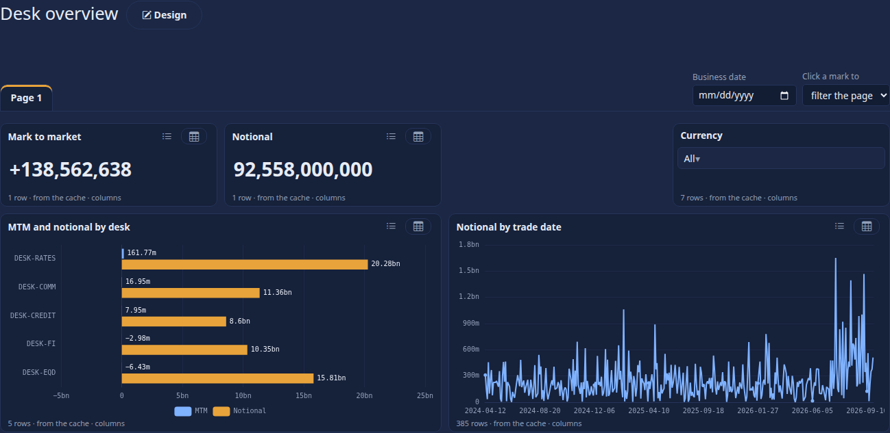

10. **Publish** from the item page: propose, review and approve if the workspace asks for it, and choose the audience. A report with errors is refused at publishing with `DRS-9030`.

**A mistake, with its code.** The validate endpoint returns every problem at once, with the path. This body has a grid that is too wide, a column that does not exist, a field where a measure belongs, and a visual that is reserved:

```
POST /api/v1/bi/reports/validate   {"yaml": "report: x\ndataset: trades-basic\npages:\n  - id: p\n    visuals:\n      - { id: a, type: bar, at: {x: 0, y: 0, w: 14, h: 4}, wells: { axis: [trade.nope], values: [trade.mtm] } }\n      - { id: b, type: map, at: {x: 0, y: 4, w: 4, h: 4} }\n"}
valid: false
DRS-9030 pages[0].visuals[0].at           x is 0 to 11 and w is 1 to 12, and x + w is at most 12 (the grid has 12 columns); this is x=0, w=14
DRS-9033 pages[0].visuals[1].type         the visual 'map' is reserved and not built yet (RUPAKA.md section 20.3); built: bar, column, line, area, combo, scatter, ...
DRS-9031 pages[0].visuals[0].wells.axis   table 'trade' has no column 'nope' (it has tradeId, desk, book, productType, currency, status, notional, mtm, pnl1d, tradeDate, mtmInMillions)
DRS-9032 pages[0].visuals[0].wells.values 'trade.mtm' is a field; the values well takes measures (Notional, MTM, Trades, Average MTM per trade)
```

## 14. The Model view: relate tables by dragging

On a dataset's page choose **Model view** (authors). Open **Trading and counterparty risk**: five tables as boxes, five relationships as lines with `1` and `*` at the ends (hover a line for its cardinality and direction). A shipped dataset opens
read-only; **Save a copy** makes a draft of your own.


**Remove one and draw it back.** In the list on the right remove `trades.book -> books.id`: the line goes, the YAML loses the line, and `books` is related to nothing, so it moves to a band of its own. Now drag the column `book` of `trades` onto
`id` of `books`: the form fills in, with a many-to-one guessed from the keys. Nothing is written until **Add relationship**.


```
relationships:
  - { from: trades.desk,    to: desks.id,          cardinality: many-to-one }
  - { from: trades.book,    to: books.id,          cardinality: many-to-one }
  ...
```

**Proposals from the data.** For tables with no declared link, **Look for relationships in the data** finds columns whose values are ids of another table. Here a draft with the trades and the desk P&L (two kinds the packs do not link) gets a
proposal with its match rate; nothing changes until you **Accept**:


```
trades.desk → desk_pnl.id  100% of 10 values match (many-to-one)
accepted: { from: trades.desk, to: desk_pnl.id, cardinality: many-to-one }   (written into the YAML; the model checks as valid)
```

Drag a box by its header and its place is kept in the YAML under `layout:`. Only the `relationships:` and `layout:` blocks are rewritten; the rest of the file, comments included, stays as you wrote it.

## 15. A report on a phone

At 390 px a report is one column in reading order, the buttons are 44 px, and nothing scrolls sideways. The slicers, the cross-filter and the drill buttons work by touch; a chart's marks are tapped.


## 16. What to look at next

The engine's counters and limits (`GET /api/v1/bi/engine`, BI administrators): after this walk-through the counters count queries, cache hits, layer builds and the layer that answered (`columns`, `rollup`). Reports, the designer and the Model view are phase 3 ([RUPAKA.md](../architecture/RUPAKA.md) section 20.3: what is built and what is not). Publishing and lineage are phase 4 (chapter 17), live tables, Perspective and boards phase 5 (chapters 18 and 19); Python, distribution and the analyst workbench are planned (phases 6, 7 and 9: [BI_GUIDE.md section 11](BI_GUIDE.md#11-built-and-not-built)).
What is not built yet for datasets is listed in [DATASETS.md section 10](DATASETS.md#10-what-is-not-built), for reports in [REPORTS.md section 12](REPORTS.md#12-built-and-not-built).

## 17. Publish and govern: versions, review, certification, impact, environments

Chapters 1 to 16 were about building. This one is about letting other people rely on what you built. It uses a small stack of its own, made by `drishti-console/tests/bi_gov_stack.py`: the trading pack with a 120-trade lake, a shared workspace *Rates Desk*, a published and certified dataset *Trades model* (a copy of `trades-basic`) and a published and certified report *Trades report* on it, and four people: **ann** writes (`bi`, `bi-author`), **sue** is a steward (`bi`, `bi-steward`), **root** is an administrator, **cat** reads (`bi`). Every output is real. To follow along on your chapter 0 stack, make the same people with those powers (chapter 0, steps 1 to 3), create the workspace in **Workspaces**, copy `trades-basic` into it as *Trades model* and publish it, design *Trades report* on it (a card, a bar by `trade.desk` and a table of `trade.desk`, `trade.book`, MTM; chapter 13), publish it, and have **sue** certify both; the YAML bodies the pictures used are at the top of `bi_gov_stack.py`. Your ids, times and row counts will differ.

### 17.1 Save twice, compare, restore

ann opens her unpublished dataset *Positions model*, presses **Edit**, adds a `currency` column with the message *add the currency column*, saves, then renames a measure with the message *rename the count measure*. **History** lists three saved states, newest first:

```
GET /api/v1/bi/items/bi-ba49ebcd44/history
  #3  rename the count measure   ann  save
  #2  add the currency column    ann  save
  #1  first cut                  ann  create
```

She chooses saved state 1 against the draft and presses **Show the differences**. The diff is side by side; the rows that are not the same, from the API:

```
  added    left 0                                      right 10        currency: string
  changed  left 13    Trades: { expr: "count(trade)" } right 14    Deals: { expr: "count(trade)" }
```


*Restore as draft* on state 2 makes it the draft again. The history now has **four** states: the restore is a new one (`origin: restore`), so nothing was lost, and a published version, had there been one, would not have been touched.

### 17.2 Ask for a review

ann writes *ready for a look* and presses **Propose for review**. The reviewers are told: sue's inbox now has

```
ann asks for review of dataset 'Positions model'
```

sue opens the item. Under **Review** she sees who asked and what they wrote, what changed (all fourteen lines are new: nothing is published yet), **Check passed**, what it does to reports (nothing: no report reads it), and a **data preview**: the first rows of the draft's `trade` table read through the file connector, answered with *her* row rules and masks.


She writes *looks right* in the note box and presses **Approve and publish**. The item is version 1, the decision and her comment are in the review record, and ann is told:

```
sue approved dataset 'Positions model': looks right
```

**Four-eyes:** had ann been allowed to approve her own request, `DRS-9005` would have refused it. A person who proposed may only withdraw.

### 17.3 Certified, and where it shows

Only a steward certifies. In the catalogue the certified items come first, with their badge, and the endorsement filter finds them:


### 17.4 Lineage

On *Trades model*, **Lineage** says where it comes from and who reads it:

```
upstream:   {"table": "trade", "kind": "trade", "packs": ["trading"], "connector": "trading-store", "mode": "cached"}
downstream: {"title": "Trades report", "status": "published", "endorsement": "certified", "uses": {"fields": ["trade.book", "trade.desk"], "measures": ["MTM", "Notional"], "hierarchies": []}}
```


### 17.5 What breaks if I remove a field

Before changing a published dataset, ann asks what would break if `trade.book` went (the box under **Impact on reports**, or the API):

```
GET /api/v1/bi/items/bi-f99d2f18d5/impact?remove=trade.book
{
 "change": {
  "breaking": true,
  "removedFields": [
   "trade.book"
  ],
  "removedMeasures": [],
  "removedHierarchies": [],
  "addedFields": [],
  "addedMeasures": []
 },
 "breaksPublished": true,
 "published": [
  {
   "visible": true,
   "id": "bi-0ae16dad69",
   "title": "Trades report",
   "workspace": "rates-desk",
   "endorsement": "certified",
   "published": true,
   "uses": [
    "trade.book (page overview, visual rows)"
   ]
  }
 ],
 "refused": true,
 "wouldRevokeCertification": [
  "Trades model",
  "Trades report"
 ]
}
```

She goes ahead anyway: she removes the `book` column and the hierarchy that uses it, saves, and presses **Publish**:

```
409 DRS-9040 DRS-9040 publishing 'Trades model' would break 1 published report by removing or renaming trade.book, Desk and book: 'Trades report' (trade.book (page overview, visual rows)). Ask a bi-admin to publish it with force, or keep the names the reports use.
```


She may not force it (`force` from her gets `DRS-9002`). **root**, a bi-admin, opens the page, presses **Publish**, is refused the same way, and then **Publish anyway**:


The dataset is version 2, the report is broken, and **the certification of both has fallen**; the page says so, and the steward is told:

```
Certification of report 'Trades report' was revoked: its dataset 'Trades model' changed incompatibly
Certification of dataset 'Trades model' was revoked: the dataset changed incompatibly
```


The review record of the dataset now reads: `sue certify; root revoke: the dataset changed incompatibly`.

### 17.6 Move it to another environment

**Environments** in the rail. ann chooses *Rates Desk* and downloads the bundle: 3 items (the report brings the dataset it reads), each with its published versions, owner and checksums:

```
{"format": "drishti-bi-bundle", "formatVersion": 1, "createdAt": "2026-10-11T07:50:28.008422794Z", "createdBy": "ann", "checksum": "706d3dd46099e2772cf9187a00fb6c86f2aa5c653a344a4ce1e2dc128e1a4d28"}
[{"title": "Trades model", "kind": "dataset", "owner": "ann", "status": "published", "publishedVersion": 2, "versions": [1, 2], "endorsement": "none"}, {"title": "Trades report", "kind": "report", "owner": "ann", "status": "published", "publishedVersion": 1, "versions": [1], "endorsement": "none"}, {"title": "Positions model", "kind": "dataset", "owner": "ann", "status": "published", "publishedVersion": 1, "versions": [1], "endorsement": "none"}]
```

A bundle is a file: copy it to the other server. There **sue** (a steward) chooses it on *Environments* and presses **Dry run**, which changes nothing. If the report has been edited there since the export, it is a conflict:

```
{
 "counts": {
  "create": 0,
  "update": 0,
  "unchanged": 2,
  "conflict": 1,
  "invalid": 0
 },
 "ok": false,
 "conflict": [
  {
   "title": "Trades report",
   "action": "conflict",
   "blocks": [
    "it exists here and differs (the draft differs): import with overwrite to replace it"
   ]
  }
 ]
}
```


Choosing *Overwrite items that exist here and differ* and running the dry run again makes it an *update* and enables **Import**. Certification does not travel: items arrive as promoted at most; a steward certifies after looking. Owners and workspaces that do not exist on the other server are mapped (*Map owners*, *Map workspaces*) or, for an owner, become the importer.


### 17.7 On a phone

The same sections stack in one column, every button is finger-sized, and the tables scroll inside their own frame:

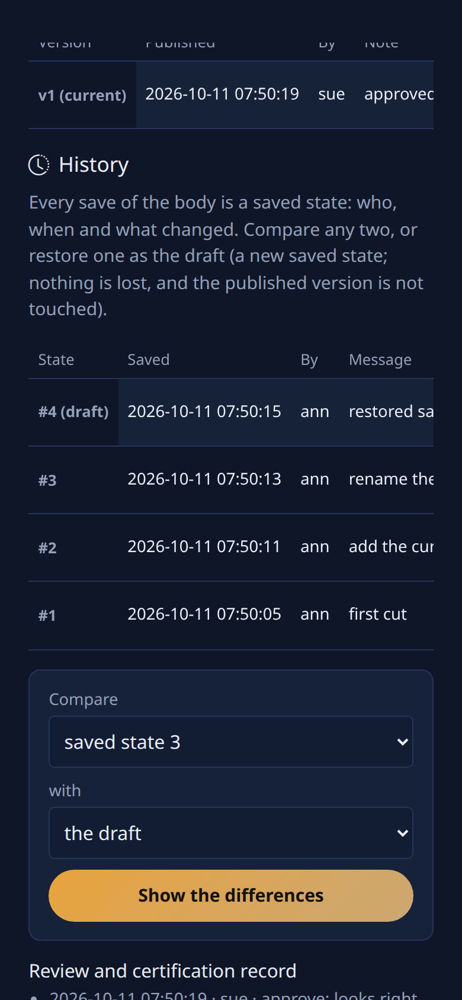

The reference for all of this, with what is not built, is [BI_GOVERNANCE.md](BI_GOVERNANCE.md).

## 18. A live desk: a dataset, a report and a Perspective grid that follow the trades

Everything so far read data **as it was** when a layer was built. Phase 5 adds data **as it is**: a `mode: live` table that the engine keeps in memory and updates as the source pushes changes. This chapter uses the shipped samples `live-trading` (dataset) and
**Live trading desk** (report) over the demo source, whose 360 live trades tick in a batch about twice a second (a few hundred row changes a second). They need no lake of their own: the stack of chapter 0 works as it is (the live table follows the `trade` kind and the demo source changes 360 of the 750 trades in every batch, every 400 ms by default; the pictures were made with `--drishti.sources.plugins.demo.settings.tick-ms=200` for a livelier chart). Sign in as `rita` (`bi`, raw) and `ann` (`bi`, no raw).
The pictures were made by `drishti-console/tests/bi_live_shots.py`.

### 18.1 The dataset

Open **Datasets, Live trading desk**. It is the dataset of chapter 2 with one change: `mode: live`, no connector named, and a retention window.

```yaml
tables:
  trade:
    source:
      kind: trade               # whichever running connector serves trades and can push them (here the demo ticker)
    mode: live
    live:
      rows: 5000                # the most rows it keeps
    columns:
      tradeId: { type: string, key: true }
      desk:    string
      ...
      trader:  string
      mtm:     { type: decimal, format: signed0 }
security:
  masked: [trader]
```

Under *Layers* the table has no dates on disk: it says how the in-memory table is doing.


The same, from the API (`GET /api/v1/bi/datasets/file:dataset:live-trading/layers`, a minute after the first query):

```json
{"table": "trade", "mode": "live", "partitions": [], "live": {"state": "live", "rows": 750, "entities": 750, "subscribed": 750, "pushes": true, "seq": 38239, "epoch": 0, "applied": 38239, "skipped": 8, "evicted": 0, "deleted": 0, "error": null, ...}}
```

750 entities followed and subscribed (the demo source changes 360 of them in every batch), 38,239 row writes so far, 8 skipped because the values did not change. A table starts on first use and is closed after ten idle minutes ([DATASETS.md 7.1](DATASETS.md#71-live-tables-phase-5)).

### 18.2 The report

Open **Catalogue, Live trading desk**. Above the pages is the live indicator, and the cards, the bar and the tables are the visuals of chapter 10, now redrawn in place as the table changes.


What to look at:

* **The indicator** (*Live*, *Last update 13:17:39*): the time the table last changed. Press **Pause**: the pictures hold, the word says *Paused*, the server keeps ticking; **Resume** catches up at once.

 

* **The numbers change, the chart stays.** The bar chart is the same chart drawn over (a test marks the element and finds it after dozens of updates); the cards flash for a moment when their number changes; a table keeps its scroll position. At most four redraws a second however fast the source ticks.
* **The rolling line** (*Net MTM and losses, rolling*) adds one point per update and keeps the latest 120: it shows how the numbers have moved since you opened the page (the browser holds the points, the server holds no history of an aggregate).
* **Latest changes** sorts by `updatedAt`, a column every live table has: the trades that ticked most recently.
* **The line under each visual** says `live`: the layer that answered. The query is the one of any report; the layer is the in-memory table.

**The connection drops.** Stop the console (or lose the network) and the page says so, keeps what it has, and redraws everything when the stream is back:


### 18.3 Row rules and masks on every update

Sign in as `ann` (no raw) and open the same report: *Worst trades* shows the trader as `•••`. Nothing about the stream changes: it carries no data, only "the table changed"; each tick makes **her** page ask again, as her, so the mask is applied to every update. `LiveTablesTest` and `BiLiveApiTest` prove it for several readers
(a desk rule, a mask, a role no rule covers).

### 18.4 Perspective: the grid and the pivot

Open the report's *Every trade* page: **Perspective** (FINOS, vendored) shows all 750 trades and applies each change to its row, by key.

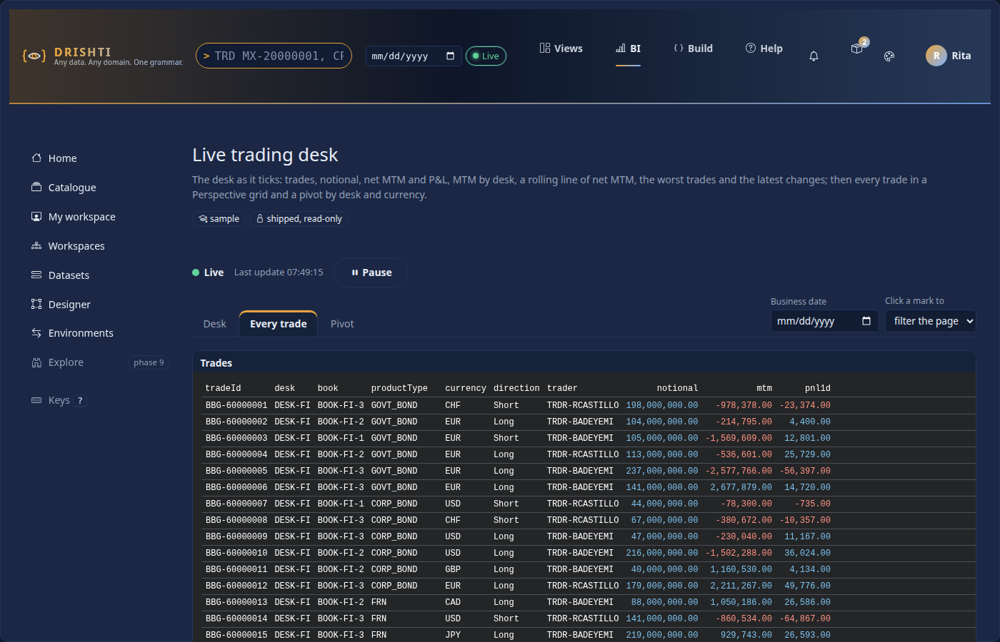

Its first read is the rows as **masked Apache Arrow** (`POST .../query?format=arrow`); after that only the rows that changed since the last answer (`state: { since: <seq> }`). Captured, the same visual for `ann` (the mask is in the bytes) and then the rows that changed:

```
as ann   columns: tradeId, desk, book, productType, currency, direction, trader, notional, mtm, pnl1d, id, updateSeq     masked: ["trader"]
         ["BBG-60000001","DESK-FI","BOOK-FI-3","GOVT_BOND","CHF","Short","•••",198000000.0,-978378.0,-23374.0,"BBG-60000001",1]
as rita  state: {"since": 38239}  ->  rowCount: 360 (every updateSeq above 38239)
```

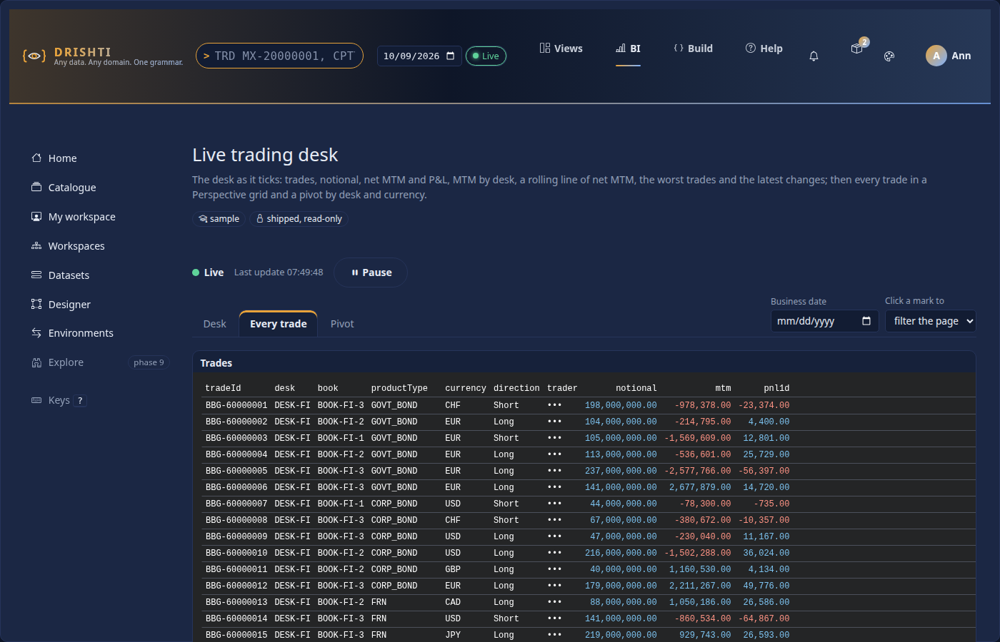

The *Pivot* page is Perspective's own pivot, running in the browser on the rows you may see: desks down, currencies across, MTM and notional summed, re-pivoted as rows arrive.

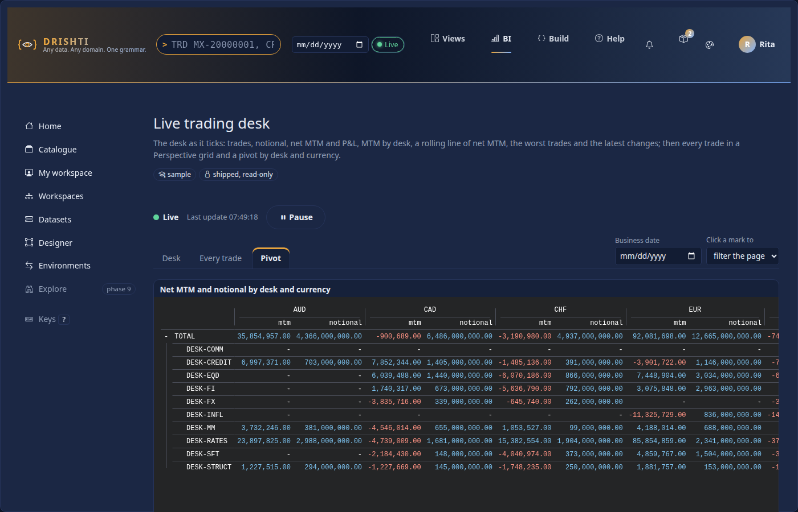

Perspective needs WebAssembly. Only a page that holds a Perspective visual is given it (and the SHA-256 of Perspective's four `<style>` texts, never `unsafe-inline`); the response header of this page and of every other BI page:

```
/bi/r/file:report:live-trading-desk/grid   script-src 'self' 'wasm-unsafe-eval'; style-src 'self' 'sha256-47DE...' 'sha256-5ZnN...' 'sha256-TlH5...' 'sha256-rjC4...'; worker-src 'self'
/bi/r/file:report:live-exposure            script-src 'self'; style-src 'self'; worker-src 'self'
```

If Perspective cannot start in a tab, the grid is Drishti's own table of the first 500 rows with a line that says so; it keeps following the table.

### 18.5 On a phone

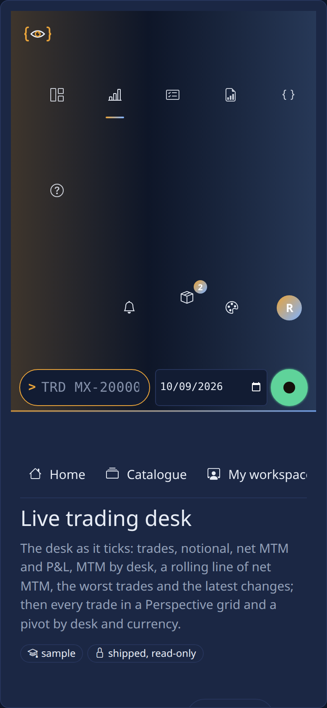

## 19. A wall for the desk: a board

A **board** puts visuals of several reports on one screen. Open **Catalogue, Desk wall** (`/bi/b/file:board:desk-wall`).


* **Tiles from two reports over two datasets**: the trading desk (*Live trading desk*, dataset `live-trading`) and the counterparty exposure (*Live exposure*, dataset `live-exposure`, on the next tab).
* **Alerts colour tiles.** *Net MTM* and *Losses* are amber: their rules (`warn: { op: lt, value: 150000000 }`) were crossed, and the line under each says *warning* in words. The thresholds are in the board's YAML; nothing is sent anywhere (notifications are phase 7).
* **The second page** is another report over another live dataset:


Press **Kiosk** (or `k`, or add `?kiosk=1` to the address). The menus go, the wall fills the screen, and the pages turn by themselves every 20 seconds (the board's `rotate:`); `Esc` leaves, `p` pauses, the arrows turn the page.


The board's file is short; each tile names a report and a visual, and the report supplies the data, as you:

```yaml
pages:
  - id: desk
    title: Trading desk
    tiles:
      - { id: net-mtm, report: live-trading-desk, visual: mtm, title: Net MTM, at: { x: 0, y: 0, w: 3, h: 3 },
          alert: { on: MTM, warn: { op: lt, value: 150000000 }, crit: { op: lt, value: 100000000 } } }
```

A board with a mistake says what and where (`POST /api/v1/bi/boards/validate`):

```json
[{"code": "DRS-9052", "path": "pages[0].tiles[0].at", "message": "x is 0 to 11 and w is 1 to 12, and x + w is at most 12 (the grid has 12 columns); this is x=0, w=13"},
 {"code": "DRS-9053", "path": "pages[0].tiles[1].alert.notify", "message": "'notify' is reserved and not built yet: a tile only changes colour; notifications arrive with distribution (phase 7)"},
 {"code": "DRS-9052", "path": "pages[0].tiles[0].visual", "message": "report 'Live trading desk' has no visual 'nope'"}]
```

On a phone the wall is one column:


The reference for boards, with what is not built, is [BOARDS.md](BOARDS.md); for live tables [DATASETS.md 7.1](DATASETS.md#71-live-tables-phase-5); for live visuals and Perspective [REPORTS.md 13](REPORTS.md#13-live-visuals-and-perspective-phase-5).

## 20. Export and subscribe

This chapter uses the sample report **Trades overview** and three people: **rita** sees every desk and every figure, **hana** is a desk head (her desk only) and **ann** is an analyst whose `mtm` column is masked.
(The dataset got a `security:` block for this chapter: row rules per role and `masked: [mtm]`; wes, a BI author, does the work. The same stack, with a fake mail server, is `drishti-console/tests/dist_stack.py`.)

**1. Export.** Open the report. Under the page tabs is the *Export* bar: choose **this page** (or one visual) and press **PDF**, **PNG**, **Excel** or **CSV**.

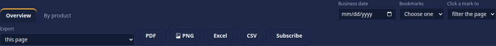

The picture of the page is the server's own drawing of the tables, as the person who asked sees them:

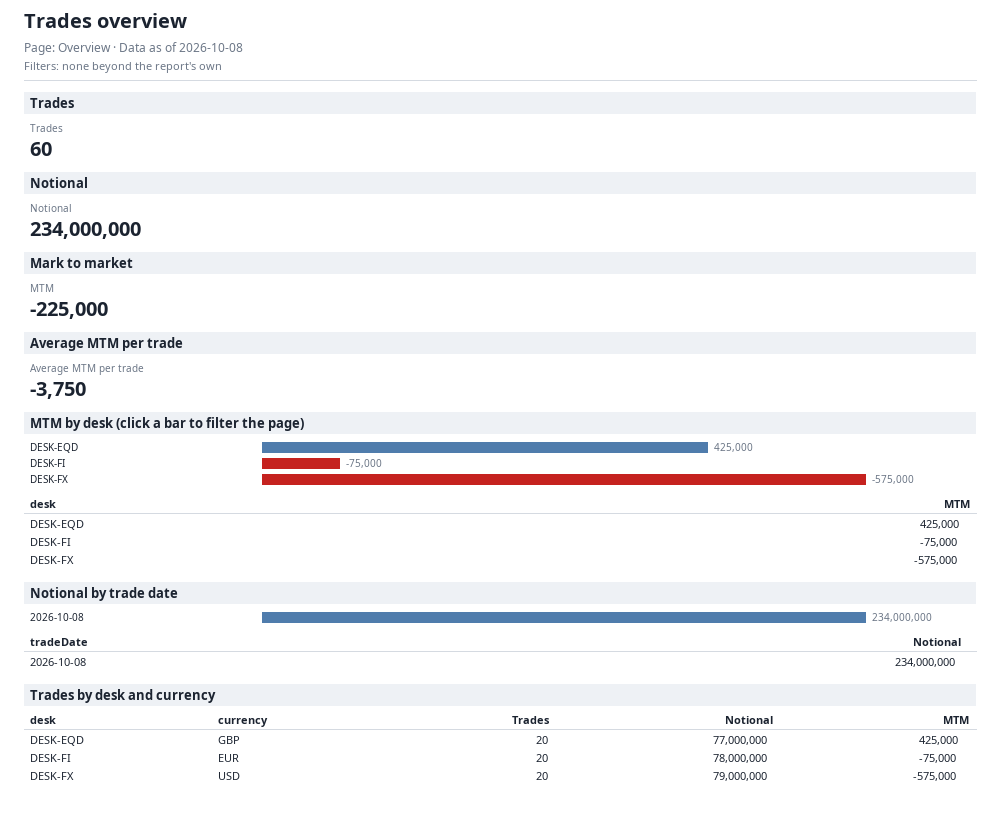

The Excel file is `Trades overview.xlsx`: a sheet `About` with the title, the as-of date and the filters, then one sheet per visual. `Trades`, `Notional` and the cards hold one typed number; `MTM by desk` holds
`desk` and `MTM`; the date column of `Notional by trade date` is a real Excel date. The CSV of one visual, chosen in *Export*:

```
desk,MTM
DESK-EQD,425000
DESK-FI,-75000
DESK-FX,-575000
```

On a view the *Export* menu is in the header (PDF, image, Excel, CSV); a view's file carries the controls and column filters you had set.

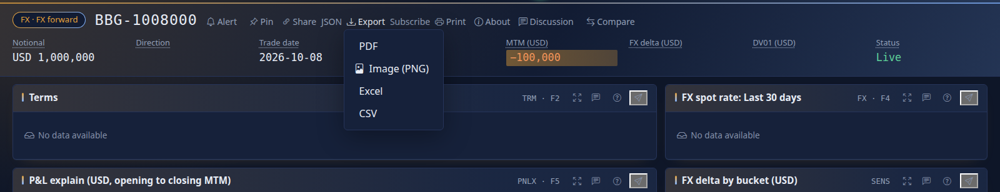

**2. Subscribe.** Press *Subscribe*. The form knows what you were looking at (the page, the slicers you set). Name it, say *when* (`business-days 07:30`, or `after-load` to run after the day's data lands),
*send as* (the tables in the email, a PDF or an Excel file) and *to*: `rita, hana, ann`.

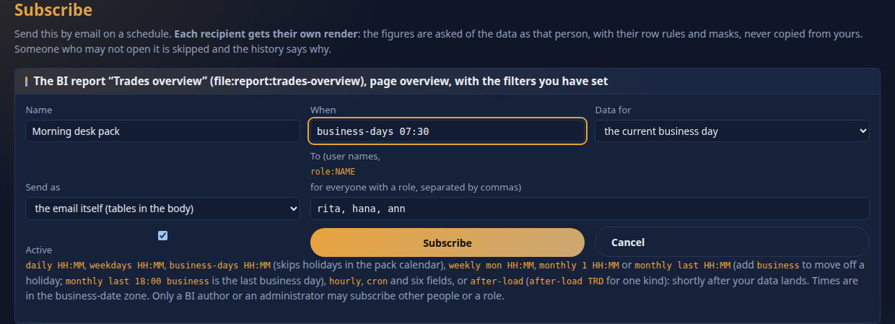

**3. Run now.** Back on **Reports**, the subscription is in the list with your scheduled reports. *Run now* sends it: `Morning desk pack: 3 sent`. The history says who was sent what:

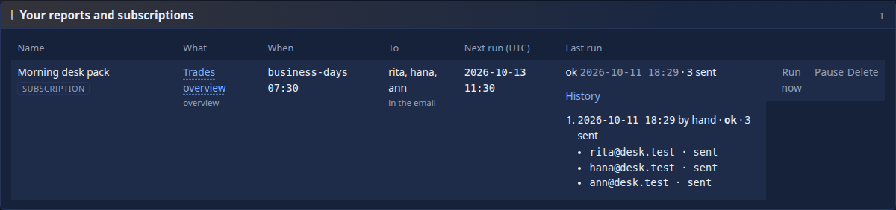

**4. Three mails, three renders.** What arrived, from the test mail server (nothing leaves the machine). Rita's has every desk and `-225,000`; Hana's only DESK-FX (`Trades 20`, notional `79,000,000`); Ann's has
the `MTM` card **masked** ("Masked for you: MTM.") and, honestly, `MTM by desk` as *Not available: DRS-9021 'MTM' is masked for you: it cannot be sorted on*:

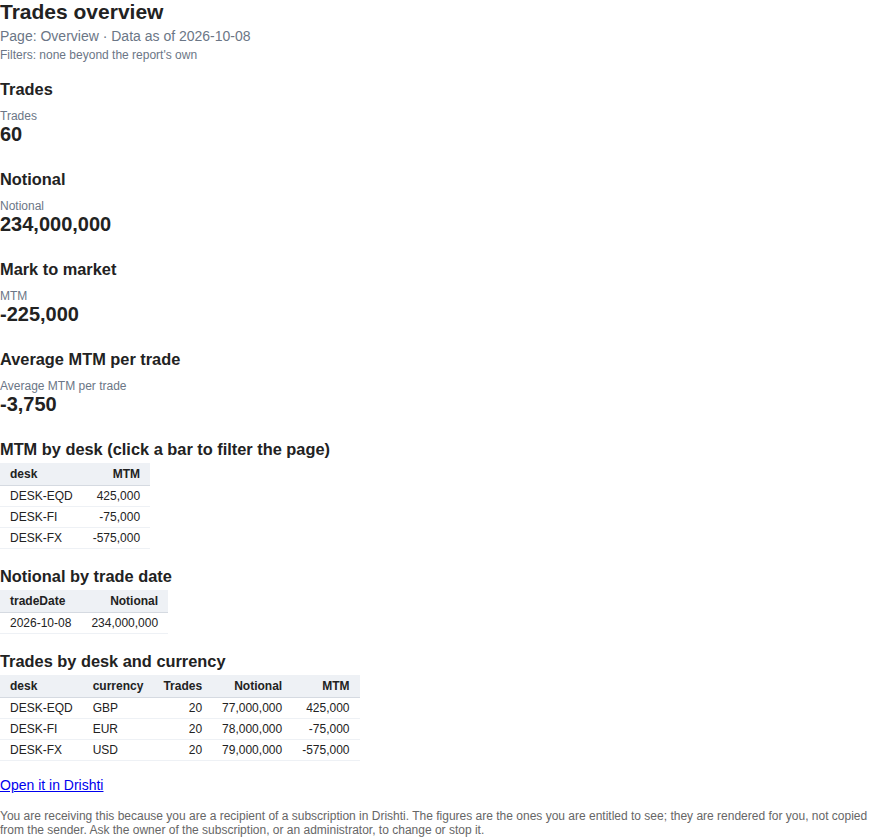

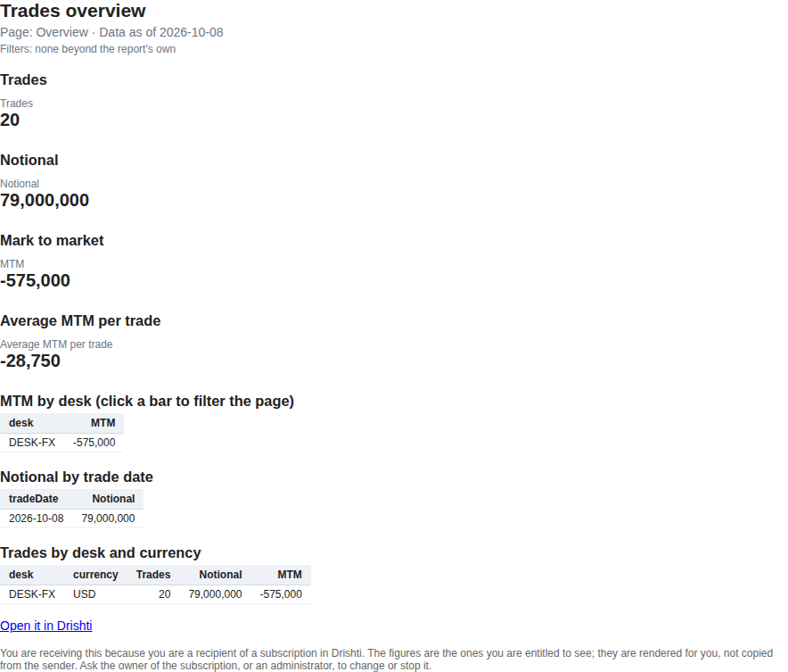

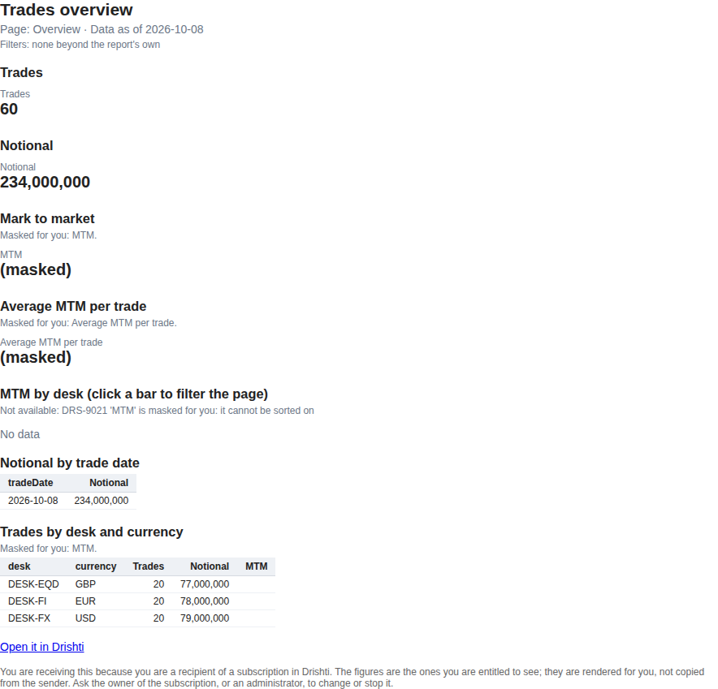

**5. A PDF subscription, a calendar that knows holidays.** A second subscription with `monthly last 18:00 business` and *send as* PDF mails the file (`Trades overview.pdf`, 2942 bytes); "last business day" is
computed with the server's holiday calendar. *Pause* and *Resume* are buttons in the list; a resumed subscription is scheduled from now.

On a phone the list scrolls sideways and every button is 44 px:

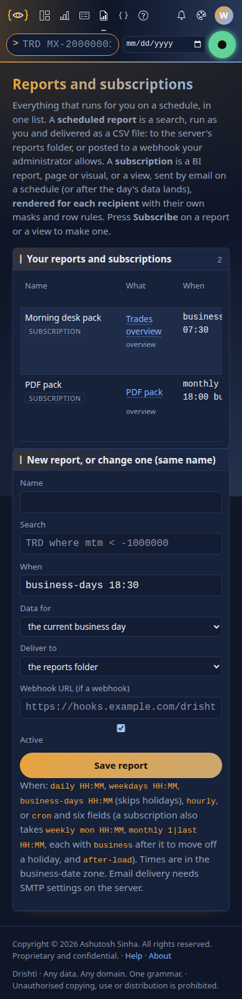

The reference, with the schedule grammar, limits and what is not built, is [DISTRIBUTION.md](DISTRIBUTION.md).

## 21. Alerts on a number

This chapter uses the same stack as chapter 20 (rita sees every figure, hana is a desk head, **ann's `mtm` is masked**; the stack, with a fake mail server, is `drishti-console/tests/alerts_stack.py`) and the sample report
**Trades overview**. Rita wants to be told when the total mark to market falls below -300,000. The full reference is [DISTRIBUTION.md section 4](DISTRIBUTION.md#4-alerts-on-numbers).

**1. Alert me.** Open the report. Every visual that shows a number has a bell in the corner of its frame. Press it on the **Mark to market** card:

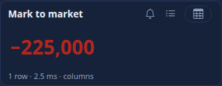

**2. The form.** It knows the report, the page, the visual and the filters on your screen. Name it, choose *crosses a limit*, *below*, `-300000`, look *after a data load*, and tell you by your inbox and email. *Check now* says what the
alert reads for **you** right now, and saves nothing:

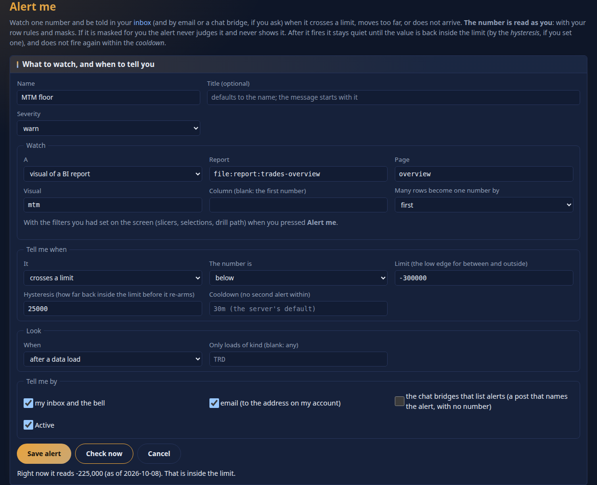

Today it reads `-225,000`, inside the limit. (The same call is `POST /api/v1/me/measure-alerts/preview`.) *Save alert* arms it. Press *Alert me* the same way for a **dataset measure** (`/alerts/new?source=dataset&dataset=…&measure=…`: a *change* alert,
"the number of trades moves by 10 % against the previous look") and for a **Sutra field**: on a view, click a number (`-100,000` on `BBG-1008000`) and choose **Alert me** beside *Discuss*:

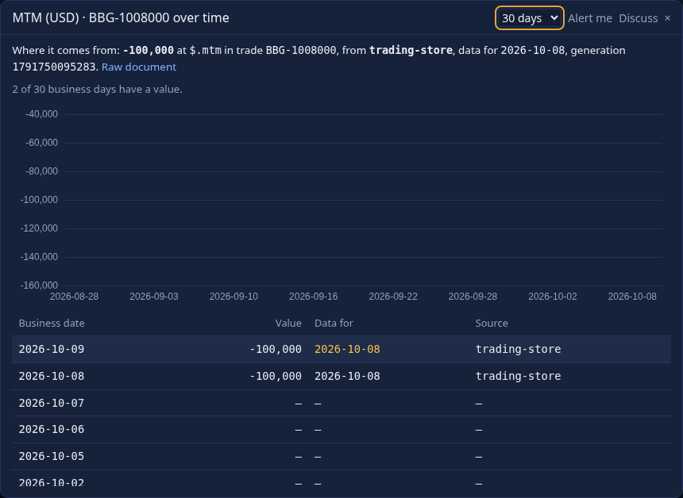

The **Alerts** page (*Reports* in the top bar, *My alerts*; it is also *Views, Alerts*) lists them with the older per-entity rules below. All three are armed:

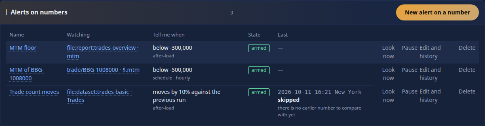

**3. A load fires it.** The ETL adds ten losing trades and announces the load (`POST /api/v1/packs/trading/loads`). A second later (`load-delay`) the alerts look; the total is now `-725,000`, the change alert sees 70 trades against 60,
and the board tile of the sample board `desk-alerts` (chapter 19's idea, with `notify: true` on a tile) turns red for everyone who reads it. The **Alerts** tab of rita's inbox and the bell:

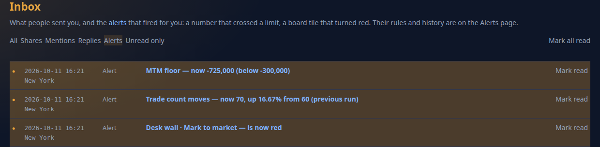

and the list now says `active`, and the history says what was sent where (`inbox: ok`, `email: sent`):

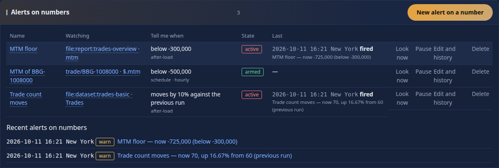

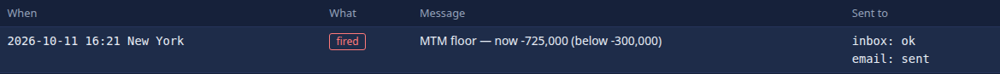

The mail she got (the figure is hers; a chat bridge would have got a post with **no figure**):

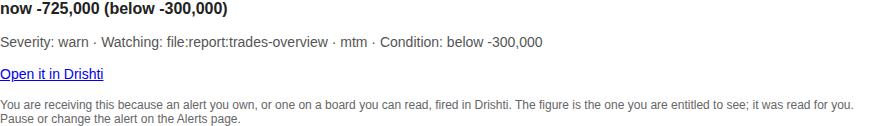

It does **not** fire again while the number stays below the limit, and re-arms when it is back above `-300,000 + 25,000` (the *hysteresis*); it will not fire again within the *cooldown* (30 minutes).

**4. Each person on their own number.** **Ann** makes the same alert. Her `mtm` is masked, so *Check now* says so and her alert never judges the number, never fires and never shows a figure. Her history has one line:

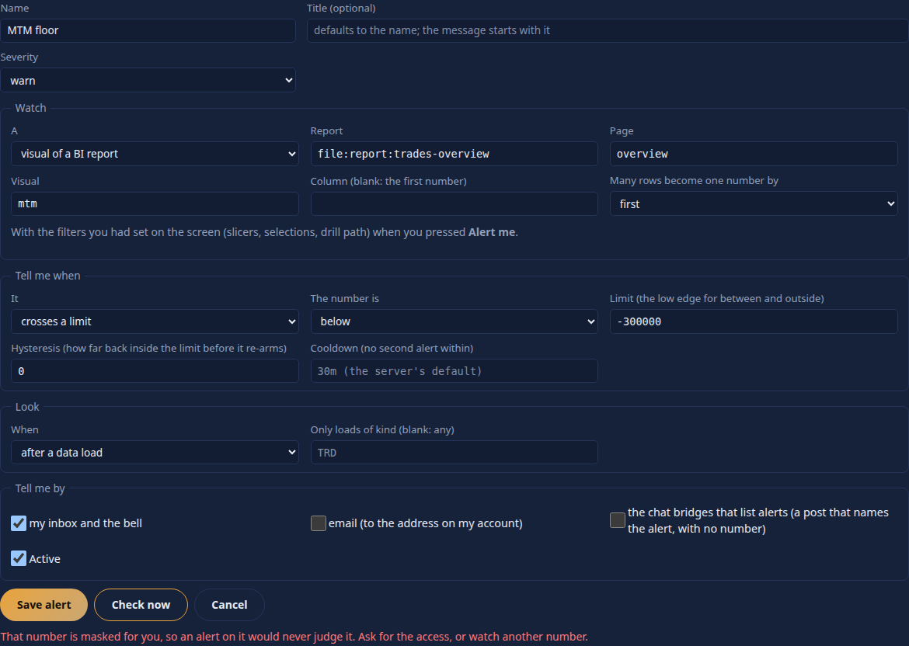

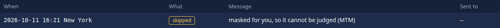

The board tile told rita, wes and hana, each judged on their own report query; ann was told nothing, because for her the tile's number is masked. An administrator sees all of it at **Alerts, Everyone's alerts** (`/alerts/all`):

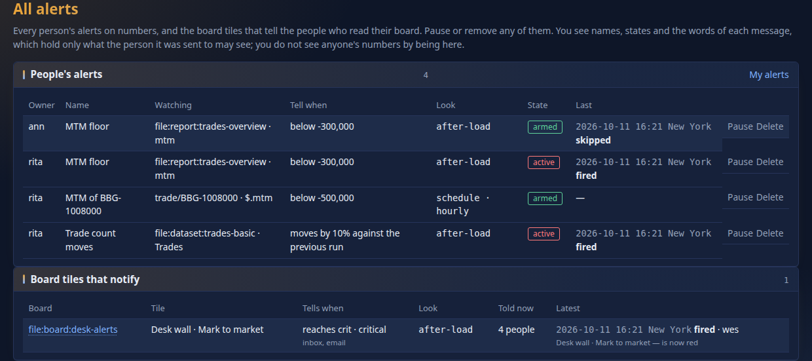

**5. On a phone.** The Alerts page, the form, the history and the inbox keep to the screen at 390 px, with 44 px targets:

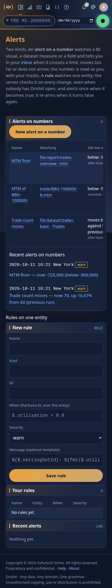

The tile, in the board's YAML, is two lines in a tile's `alert:` (`notify: true`, and optionally `channels: [inbox, email]` for the board); [BOARDS.md](BOARDS.md#notifications-a-tile-tells-people-when-it-turns-red) is the reference, and a real validation of a board with
`notify` mistakes is there too.
