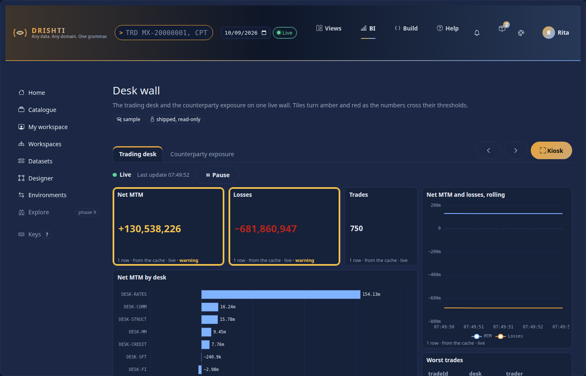
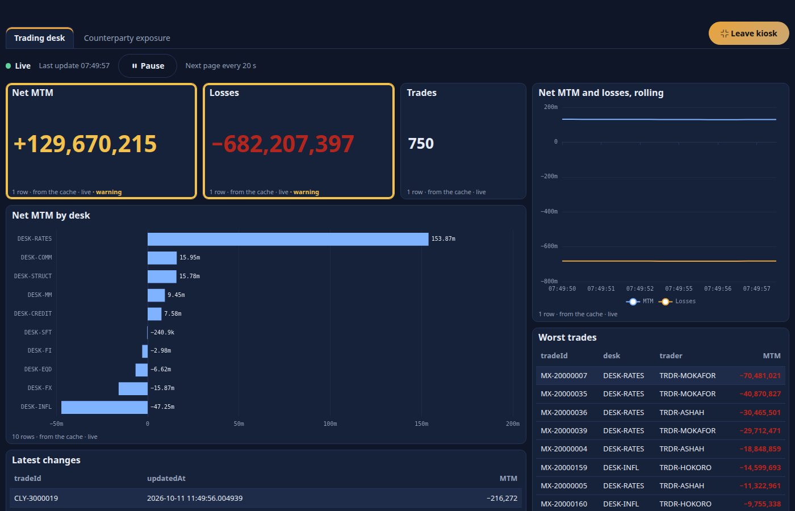
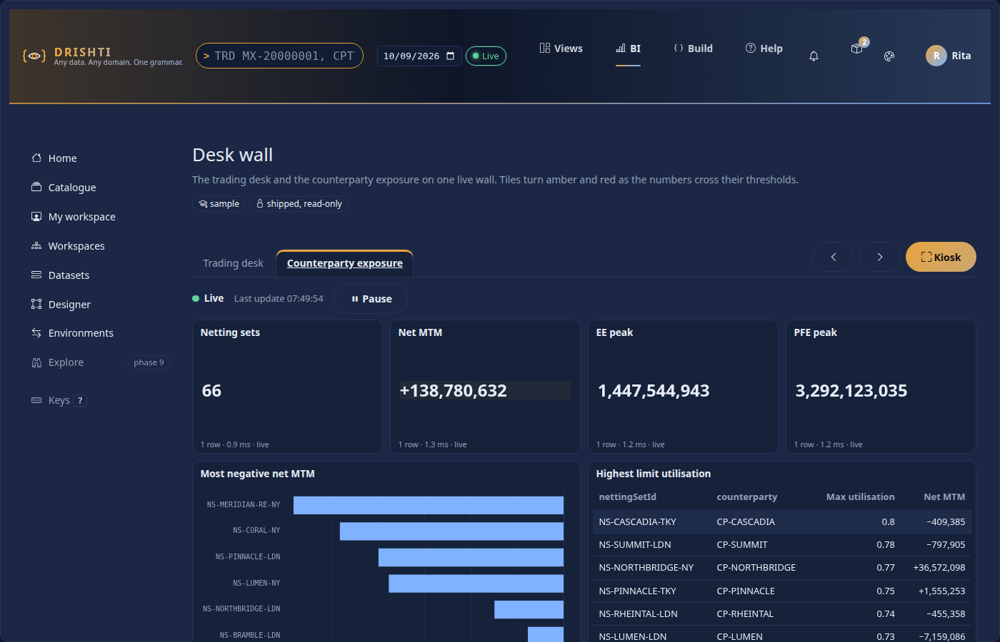
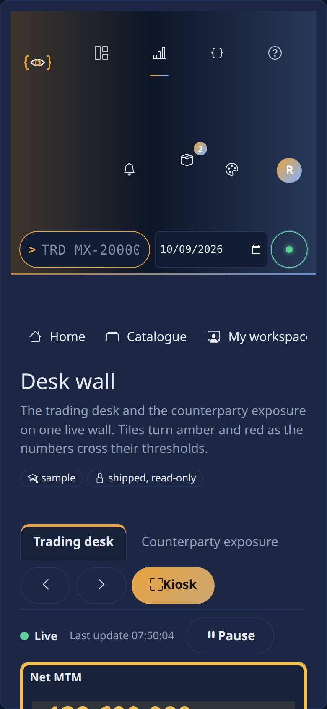

<!--
  Project Drishti · Any data. Any domain. One grammar.

  Copyright (c) 2026 Ashutosh Sinha <ajsinha@gmail.com>.
  All rights reserved.

  PROPRIETARY AND CONFIDENTIAL.

  This file is the confidential and proprietary property of Ashutosh Sinha.
  Unauthorised copying, use, modification, distribution or disclosure of this
  file, via any medium, is strictly prohibited except with the express prior
  written permission of the copyright holder.

  See the LICENSE file in the root of this repository for the full terms.
-->
# Boards: a wall of live tiles

A **board** is a wall of tiles for a screen on the wall of a trading desk, a risk team or an operations room. Each tile is one visual of a report; the board lays them out, keeps them up to date as the data ticks, turns its pages by itself in **kiosk** mode, and colours a tile amber or red when its number crosses a threshold. This is the reference for boards in Rūpaka **phase 5**. For the live tables behind them see [DATASETS.md](DATASETS.md#71-live-tables-phase-5); for the visuals see [REPORTS.md](REPORTS.md#13-live-visuals-and-perspective-phase-5); for the pages see [BI_GUIDE.md](BI_GUIDE.md) section 18; for a walk-through with pictures see [BI_TUTORIAL.md](BI_TUTORIAL.md) chapters 18 and 19; the design is [RUPAKA.md](../architecture/RUPAKA.md) section 12 and what is built is its section 20.5.

## Contents

1. [What a board is, and is not](#1-what-a-board-is-and-is-not)
2. [The file](#2-the-file)
3. [Tiles](#3-tiles)
4. [Alerts: a tile changes colour](#4-alerts-a-tile-changes-colour)
5. [The viewer, kiosk and rotation](#5-the-viewer-kiosk-and-rotation)
6. [Who sees what](#6-who-sees-what)
7. [Checking a board: DRS-9052 and DRS-9053](#7-checking-a-board-drs-9052-and-drs-9053)
8. [Settings](#8-settings)
9. [API](#9-api)
10. [Built and not built](#10-built-and-not-built)

## 1. What a board is, and is not

* A board **holds no data and no query**. A tile names a report and one of its visuals; the viewer asks that report for the tile's data, **as the person looking**, so the report's dataset, the reader's row rules and masks apply to every tile. A tile can never show more than the same visual in its own report.
* Tiles can come from **several reports over several datasets**: the sample board shows the trading desk and the counterparty exposure on one wall.
* Tiles over a **live table** redraw in place as the table changes; tiles over a cached table show the data as it was read (a board is not "live" unless its tiles are).
* A board is a BI item of kind `board`: a YAML document stored, versioned, reviewed and published like a report (phase 1 and 4), or **shipped** read-only in `config/bi/boards` (watched live: add, change or delete a file and the catalogue follows with no restart).
* A board **sends nothing anywhere**. Colouring a tile is all an alert does; notifications (email, chat) arrive with distribution, phase 7, and are refused today (`DRS-9053`).

## 2. The file

`config/bi/boards/<id>.board.yaml`, or the body of a `board` item. The sample, `desk-wall` ([config/bi/boards/desk-wall.board.yaml](../../config/bi/boards/desk-wall.board.yaml)), is the reference; the keys:

```yaml
rachana: 1
board: desk-wall                 # the name: letters, digits, hyphen, underscore, dot (up to 64)
version: 1
title: Desk wall
description: The trading desk and the counterparty exposure on one live wall.
sample: true                     # shipped sample content: hidden from business users when "Hide samples" is on
endorsement: promoted            # the catalogue keys of every shipped file: owner, tags, audience, endorsement
rotate: 20s                      # kiosk mode: how long a page shows before the next one (3s to 1h); default bi.board.rotate_seconds

pages:
  - id: desk
    title: Trading desk
    tiles:
      - { id: net-mtm, report: live-trading-desk, visual: mtm, title: Net MTM, at: { x: 0, y: 0, w: 3, h: 3 },
          alert: { on: MTM, warn: { op: lt, value: 150000000 }, crit: { op: lt, value: 100000000 } } }
```

| Key | Meaning |
|---|---|
| `board` | the board's name (required) |
| `title`, `description` | for the catalogue and the page |
| `rotate` | seconds (`20s`, `2m`, `1h` or ISO `PT20S`) each page shows in kiosk mode; 3 s to 1 h |
| `pages` | 1 to 20 pages; each has an `id` (letters, digits, hyphen, underscore), a `title` and `tiles` |
| `tiles` | 1 to 48 tiles on a page (section 3) |

Unknown keys are **warnings** (ignored), never errors. A file that does not parse keeps its last good version in the shipped folder and is reported in Admin, BI settings and on Health, like every shipped file.

## 3. Tiles

| Key | Meaning |
|---|---|
| `id` | the tile's id on its page (default `t1`, `t2` ...); unique on the page |
| `report` | the report the visual is in: its catalogue id (`file:report:live-trading-desk`), its file name (`live-trading-desk`), or its title. Only reports **the caller may open** resolve |
| `visual` | the id of a visual of that report |
| `page` | the report's page that holds the visual; empty means the first page that has it |
| `title` | replaces the visual's own title on the wall |
| `at` | `{ x, y, w, h }` on the same **12-column grid** as a report: `x` 0 to 11, `w` 1 to 12 with `x + w` at most 12, `y` 0 or more, `h` 1 to 40 rows of 56 px |
| `alert` | the thresholds (section 4) |

Any visual draws as a tile except a **slicer** (a control, not a picture: refused, `DRS-9052`). A tile is not interactive: nothing a person clicks on a tile filters another tile, and there is no drill. Perspective tiles work (the page then has the narrow WebAssembly policy, [REPORTS.md](REPORTS.md#13-live-visuals-and-perspective-phase-5)); a **rolling chart** keeps its points in the browser for as long as the board is open.

A tile whose report the reader may not open, or that has lost its visual, shows **Not available** with the reason; the rest of the wall draws.

## 4. Alerts: a tile changes colour

```yaml
alert: { on: MTM, warn: { op: lt, value: 150000000 }, crit: { op: lt, value: 100000000 } }
```

| Key | Meaning |
|---|---|
| `on` | the measure or column whose values are compared; empty means the first number column the tile shows |
| `warn`, `crit` | `{ op, value }` with `op` one of `lt le gt ge eq ne` and a number; at least one of them |

The browser evaluates the rule on every redraw against the tile's rows: a card or KPI by its one value, a chart or table by **the worst of its rows**. `crit` is tested first, then `warn`. A tile that reaches a level gets a **coloured border** (amber for warn, red for crit, from the theme's tokens), its number takes the colour, and the line under it says **warning** or **critical** in words: the state never depends on colour alone. `data-alert="warn"` or `"crit"` on the tile's element is what tests and scripts read. Nothing is sent.

Thresholds are compared with the value the reader's own query returns, so a reader whose row rules show only their desk sees a tile turn colour on **their** numbers. A masked value (a number the reader may not see) is `null` and never crosses a threshold.

## 5. The viewer, kiosk and rotation

Open a board at `/bi/b/<id>` (from the item page: **Open the board**; `BI` menu, Catalogue; or by typing the address). The page has the title, the **pages as tabs**, previous and next buttons, the **live indicator** with Pause and Resume ([BI_GUIDE.md](BI_GUIDE.md#18-live-reports-and-boards-phase-5)) and the **Kiosk** button.



**Kiosk.** The Kiosk button (or the key `k`, or `?kiosk=1` on the address) hides the top bar, the left rail and the heading, fills the screen with the wall, and **turns the pages by itself** every `rotate` seconds (the board's own, else `bi.board.rotate_seconds`, 30). Leave with the button or `Esc`. The button also asks the browser for full screen (a browser only grants that to a click, so `?kiosk=1` on its own hides the menus but leaves the browser's own frame).



| Key | Does |
|---|---|
| `k` | enter or leave kiosk |
| `Esc` | leave kiosk |
| `Left`, `Right` | previous and next page |
| `p` | pause or resume the updates, and the turning of pages |

Rotation stops while the updates are paused and while the tab is hidden, so a wall does not wander off while someone is reading it. The page is addressable: `/bi/b/<id>#exposure` opens the page with id `exposure`.



On a phone the wall is **one column** in reading order, the buttons are 44 px, and kiosk is the same wall without the menus.



## 6. Who sees what

* To open `/bi/b/<id>` a person needs the `bi` power and the right to read the board (workspace role, audience, shipped file), like any item. Without the power the page is the refusal.
* Each tile's data is the report's, so **row rules and masks are the reader's own, on every update**. Two people on one wall see two answers.
* A tile never reveals the existence of a report the reader cannot open: it says "You cannot open the report this tile shows, or it does not exist."
* The board's stream is the **reports'** streams (one per distinct report): a board of ten tiles over two reports holds two subscriptions on the browser's one channel, not ten.

## 7. Checking a board: DRS-9052 and DRS-9053

`POST /api/v1/bi/boards/validate` (authors), the publish check and the BI settings page list every problem with its code and path. Publishing a board checks its **structure**; what its tiles name inside their reports is checked when the board is read and by the validate call.

| Code | HTTP | Meaning |
|---|---|---|
| `DRS-9052` | 422 | the YAML is malformed, a key or id is wrong, a tile is off the grid, an alert threshold is not `{ op, value }`, a tile names a report the caller cannot open or a page or visual it does not have, or the visual is a slicer |
| `DRS-9053` | 501 | the board uses a setting the grammar reserves and this server does not build: `notify`, `notifications`, `subscriptions` (on the board or an alert) |

A real answer, for a board with a tile off the grid, a visual that does not exist, a report that does not exist and a reserved key:

```json
[
  {"level": "error", "code": "DRS-9052", "path": "pages[0].tiles[0].at",
   "message": "x is 0 to 11 and w is 1 to 12, and x + w is at most 12 (the grid has 12 columns); this is x=0, w=13"},
  {"level": "error", "code": "DRS-9053", "path": "pages[0].tiles[1].alert.notify",
   "message": "'notify' is reserved and not built yet: a tile only changes colour; notifications arrive with distribution (phase 7)"},
  {"level": "error", "code": "DRS-9052", "path": "pages[0].tiles[0].visual",
   "message": "report 'Live trading desk' has no visual 'nope'"},
  {"level": "error", "code": "DRS-9052", "path": "pages[0].tiles[1].report",
   "message": "no report 'no-such' that you can open (a catalogue id, a file name such as live-trading-desk, or the report's name)"}
]
```

## 8. Settings

| Setting | Default | Meaning |
|---|---|---|
| console `bi.board.rotate_seconds` (`DRISHTI_BI_BOARD_ROTATE_SECONDS`) | 30 | kiosk page time when the board sets no `rotate:` (3 to 3600) |
| console `bi.live.min_interval_ms`, `bi.live.stale_seconds` | 250, 30 | how often tiles redraw at most, and when the indicator says "Stale" |
| server `drishti.bi.live.*` | | the live tables and streams a board's reports use ([CONFIGURATION.md](../admin/CONFIGURATION.md#drishtibilive--streaming-bi-phase-5)) |

## 9. API

| Method and path | Body, answer |
|---|---|
| `GET /api/v1/bi/boards/{id}` | `{id, title, description, status, shipped, sample, valid, problems, board, tiles, mayEdit}`; `board` is the model (defaults filled in), `tiles` maps `"<page id>/<tile id>"` to `{report, reportTitle, page, type, live}` (`report` is null for a tile the caller cannot resolve) |
| `POST /api/v1/bi/boards/validate` | `{yaml}`; authors; `{valid, problems, board}` |

A real answer for the sample board (abridged):

```json
{"status": 200, "valid": true, "rotate": "20s",
 "tiles": {"desk/net-mtm": {"report": "file:report:live-trading-desk", "reportTitle": "Live trading desk", "page": "desk", "type": "card", "live": true},
           "desk/losses":  {"report": "file:report:live-trading-desk", "reportTitle": "Live trading desk", "page": "desk", "type": "card", "live": true}}}
```

The tiles' data comes from the report endpoints (`POST /api/v1/bi/reports/{id}/query`, `GET /api/v1/bi/reports/{id}/live`: [API_GUIDE.md](API_GUIDE.md)). The console passes both through `/bi/api/...` and `/api/channel` (subscription `bilive:<report id>`).

## 10. Built and not built

**Built:** the board file and its parser with every problem coded (`DRS-9052`, `9053`); shipped boards (watched) and board items (stored, versioned, reviewed, published; the publish check); the viewer with pages, live redraw in place, the live indicator with pause and resume, per-tile alert colouring by threshold, kiosk mode with auto-rotating pages, Perspective and rolling-chart tiles; the API; phone layout.

**Not built, and not faked:**

* **Notifications from a board or a tile** (email, chat, webhook): phase 7. `notify:` is refused (`DRS-9053`), not ignored.
* **A designer for boards**: edit the YAML (the item's Edit form, or the file); the report designer does not place tiles.
* **Interaction between tiles** (clicking a mark filters other tiles), slicers on a board, drill-down and drill-through from a tile.
* **Lineage and impact for boards**: a report change that removes a visual a board uses is found when the board is read (the tile says so), not at the report's publish; boards are not in the lineage panel or in bundles.
* **Per-tile refresh settings**: a board redraws its live tiles together, at the console's `min_interval_ms`.
* **A tile of a report that has no live table** is drawn once; it is not re-read on a timer.
* **Per-screen layouts**: a phone stacks the grid in reading order; there are no different layouts per device.
