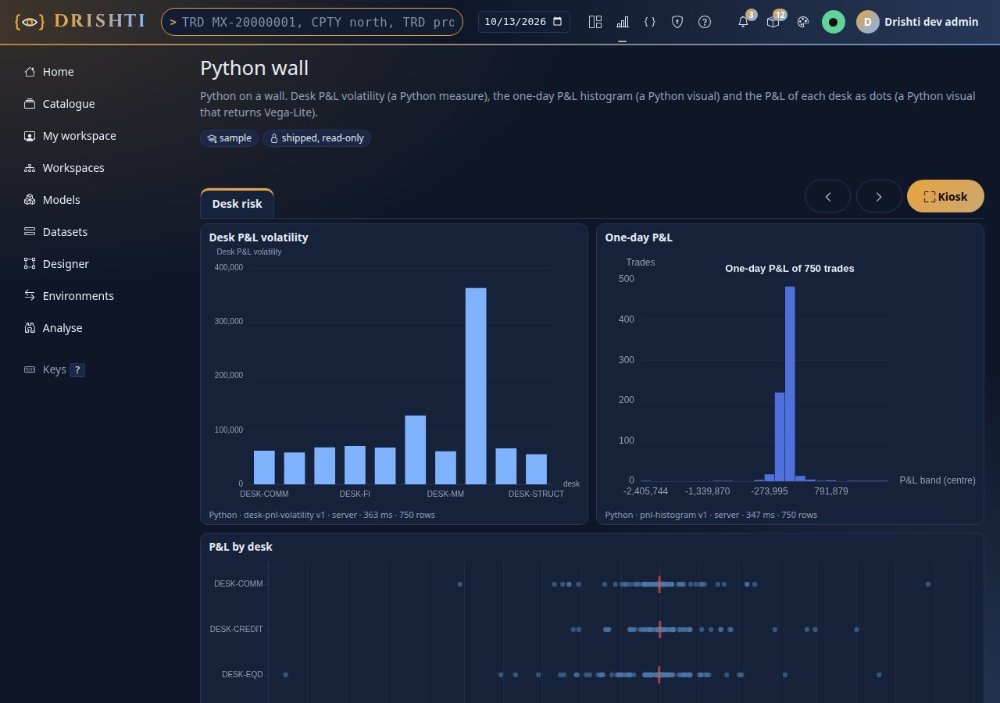

<!--
  Project Drishti · Any data. Any domain. One grammar.

  Copyright (c) 2026 Ashutosh Sinha <ajsinha@gmail.com>.
  All rights reserved.

  PROPRIETARY AND CONFIDENTIAL.

  This file is the confidential and proprietary property of Ashutosh Sinha.
  Unauthorised copying, use, modification, distribution or disclosure of this
  file, via any medium, is strictly prohibited except with the express prior
  written permission of the copyright holder.

  See the LICENSE file in the root of this repository for the full terms.
-->
# Boards: report pages of live tiles

A **board** is a wall of tiles for a screen on the wall of a trading desk, a risk team or an operations room. Each tile is one visual of a report; the board lays them out, keeps them up to date as the data ticks, turns its pages by itself in **kiosk** mode, and colours a tile amber or red when its number crosses a threshold.

**Since 2.4.0 a board is a report page** (docs/architecture/BI_PARITY_PLAN.md R7): a page with `layout: board` holds **tiles** (visuals of other reports, with their alert colours) beside the report's **own visuals**, which take the report's filters, slicers, cross-filter and drill like on any page. The separate `board` kind is gone: stored boards became reports at the first start of 2.4.0, the shipped samples are reports (`config/bi/reports/desk-wall.report.yaml`, `python-wall.report.yaml`), and the old addresses (`/bi/b/<id>`, `/bi/design/board/<id>`) open the report viewer and the report designer (section 12). For the live tables behind tiles see [DATASETS.md](DATASETS.md#71-live-tables-phase-5); for the visuals see [REPORTS.md](REPORTS.md#13-live-visuals-and-perspective-phase-5); for the pages see [BI_GUIDE.md](BI_GUIDE.md) section 18; for a walk-through with pictures see [tutorial 12](../tutorials/12-live-bi-and-boards.md).

## Contents

1. [What a board is, and is not](#1-what-a-board-is-and-is-not)
2. [The file](#2-the-file)
3. [Tiles](#3-tiles)
4. [Alerts: a tile changes colour, and can tell people](#4-alerts-a-tile-changes-colour)
5. [The viewer, kiosk and rotation](#5-the-viewer-kiosk-and-rotation)
6. [Who sees what](#6-who-sees-what)
7. [Checking a board: DRS-9052 and DRS-9053](#7-checking-a-board-drs-9052-and-drs-9053)
8. [Settings](#8-settings)
9. [API](#9-api)
10. [Built and not built](#10-built-and-not-built)
11. [Designing a board](#11-designing-a-board)
12. [From a 2.3 board to a board page](#12-from-a-23-board-to-a-board-page)

## 1. What a board is, and is not

* A board page **holds no query of its own for its tiles**. A tile names a report and one of its visuals; the viewer asks that report for the tile's data, **as the person looking**, so that report's model, the reader's row rules and masks apply to every tile. A tile can never show more than the same visual in its own report.
* Tiles can come from **several reports over several models**: the sample *Desk wall* shows the trading desk and the counterparty exposure on one wall.
* A board page may also hold **ordinary visuals** of its own report (a slicer, a card, a chart over the report's model). Those are report visuals: a slicer filters them, a click on a mark cross-filters them, they drill. Tiles are not filtered by them (a tile is answered by its own report).
* Tiles over a **live table** redraw in place as the table changes; tiles over a cached table show the data as it was read.
* A board is a **report** with board pages: a BI item of kind `report`, stored, versioned, reviewed and published like any report, or **shipped** read-only in `config/bi/reports` (watched live). A report whose pages are all board pages of tiles needs no `model:` (it reads no data of its own).
* A board **sends nothing by itself**. Colouring a tile is what an `alert:` does; a tile tells people only when its alert says `notify:` (section 4, *Notifications*).

## 2. The file

`config/bi/reports/<id>.report.yaml`, or the body of a `report` item. The sample, `desk-wall` ([config/bi/reports/desk-wall.report.yaml](../../config/bi/reports/desk-wall.report.yaml)), is the reference; the keys:

```yaml
rachana: 1
report: desk-wall                # the name: letters, digits, hyphen, underscore, dot (up to 64)
board: { rotate: "20s" }         # the board pages' settings: kiosk rotation (3s to 1h) and the tiles' notification defaults (notify:)
version: 1
title: Desk wall
description: The trading desk and the counterparty exposure on one live wall.
sample: true                     # shipped sample content: hidden from business users when "Hide samples" is on
endorsement: promoted
pages:
  - id: desk
    title: Trading desk
    layout: board                # a board page: tiles, kiosk, rotation
    visuals:
      - id: net-mtm
        type: tile
        title: Net MTM
        from: { report: live-trading-desk, visual: mtm }
        at: { x: 0, y: 0, w: 3, h: 3 }
        alert: { on: MTM, warn: { op: lt, value: 0 }, crit: { op: lt, value: -1000000000 }, hysteresis: 25000000 }
```

| Key | Meaning |
|---|---|
| `report`, `title`, `description` | as any report ([REPORTS.md](REPORTS.md#2-the-file)) |
| `board` | `rotate`: seconds (`20s`, `2m`, `1h` or ISO `PT20S`) each board page shows in kiosk mode, 3 s to 1 h; `notify`: the defaults for every tile whose alert says `notify` (section 4) |
| `pages[].layout` | `board` for a board page (`grid`, the default, for a report page). A report may mix both |
| `model` | the model the report's own visuals read; not needed when every visual is a tile or a text, image or button |

Unknown keys are **warnings** (ignored), never errors. A file that does not parse keeps its last good version in the shipped folder and is reported in Admin, BI settings and on Health, like every shipped file.

## 3. Tiles

A tile is a visual of `type: tile`, on a board page:

| Key | Meaning |
|---|---|
| `id` | the tile's id on its page, unique on the page |
| `from.report` | the report the visual is in: its catalogue id (`file:report:live-trading-desk`), its file name (`live-trading-desk`), or its title. Only reports **the caller may open** resolve |
| `from.visual` | the id of a visual of that report |
| `from.page` | the report's page that holds the visual; empty means the first page that has it |
| `title` | replaces the visual's own title on the wall |
| `at` | `{ x, y, w, h }` on the **12-column grid**: `x` 0 to 11, `w` 1 to 12 with `x + w` at most 12, `y` 0 or more, `h` 1 to 40 rows of 56 px |
| `alert` | the thresholds, and `notify:` (section 4) |
| `format` | the frame only: a subtitle, a border, a shadow, a background, padding ([REPORTS.md section 5](REPORTS.md#5-format)) |

Any visual draws as a tile except a **slicer** (a control, not a picture) and another **tile**: both refused, `DRS-9052`. A tile is not interactive: a click on a tile filters nothing; put a report visual on the page for that. Python tiles run Python for you (below). A 2.1 Perspective tile is drawn as Drishti's grid of its rows; a tile on a model follows its pushed answers with a state chip, and the page has the time picker ([BI_GUIDE.md section 25.1](BI_GUIDE.md#251-in-the-console-reports-boards-and-alerts-follow-pushed-answers)); a **rolling chart** keeps its points in the browser for as long as the page is open.

A tile whose report the reader may not open, or that has lost its visual, shows **Not available** with the reason; the rest of the wall draws. A tile on a grid page is `DRS-9032` (*a tile belongs on a board page: set the page's layout to board*); a tile without `from:` is `DRS-9032`; an `alert:` on a visual that is not a tile is a warning (use conditional formatting, or *Alert me*).

### Python tiles

A tile may show a **python visual** of its report: a Python measure shown as bars, a Python visual that returns a chart, or one that returns a Vega-Lite specification. The tile runs the item for the person looking, exactly as the report does (the console's sandbox; [PYTHON_BI.md](PYTHON_BI.md)), and shows the line *Python · item · target · ms · rows* under it. The sample `python-wall` ([config/bi/reports/python-wall.report.yaml](../../config/bi/reports/python-wall.report.yaml)) has three:

```yaml
- { id: vol,   type: tile, title: Desk P&L volatility, from: { report: python-desk-risk, visual: volatility }, at: { x: 0, y: 0, w: 6, h: 6 } }
- { id: hist,  type: tile, title: One-day P&L,          from: { report: python-desk-risk, visual: histogram },  at: { x: 6, y: 0, w: 6, h: 6 } }
- { id: strip, type: tile, title: P&L by desk,           from: { report: python-desk-risk, visual: strip },      at: { x: 0, y: 6, w: 12, h: 6 } }
```



A Python tile has **no `alert:` of its own**: the colour rule reads the numbers a query returns, and a Python tile's number is made by code that runs for the person looking. To be told when a Python measure crosses a limit, make an **alert** on it ([DISTRIBUTION.md section 4.1](DISTRIBUTION.md#41-what-can-be-watched), [PYTHON_BI.md section 16](PYTHON_BI.md#16-python-in-alerts-and-on-boards)).

## 4. Alerts: a tile changes colour

```yaml
alert: { on: MTM, warn: { op: lt, value: 0 }, crit: { op: lt, value: -1000000000 } }
```

| Key | Meaning |
|---|---|
| `on` | the measure or column whose values are compared; empty means the first number column the tile shows |
| `warn`, `crit` | `{ op, value }` with `op` one of `lt le gt ge eq ne` and a number; at least one of them |
| `hysteresis` | a number of 0 or more (default 0): how far back inside a threshold the value must be before the tile **drops a level**, so a value hovering at the edge does not flip the colour (the same idea as a measure alert's hysteresis, [DISTRIBUTION.md](DISTRIBUTION.md)) |

The browser evaluates the rule on every redraw against the tile's rows: a card or KPI by its one value, a chart or table by **the worst of its rows**. `crit` is tested first, then `warn`. A tile that reaches a level gets a **coloured border** (amber for warn, red for crit, from the theme's tokens), its number takes the colour, and the line under it says **warning** or **critical** in words: the state never depends on colour alone. `data-alert="warn"` or `"crit"` on the tile's element is what tests and scripts read. Nothing is sent.

**Hysteresis, exactly.** With `hysteresis: h` the thresholds are also tried `h` looser (`lt` and `le` thresholds up by `h`, `gt` and `ge` down by `h`; `eq` and `ne` are not moved). A tile's level is the strict level of the value, or the level it had before as far as the looser thresholds still hold it, whichever is higher. So with `warn: lt 100`, `crit: lt 50`, `hysteresis: 10`: a value of 49 is red; 55 is still red; 60 is amber; 105 is still amber; 110 is normal; and a tile that was normal at 105 stays normal. The browser remembers the level of each tile between redraws; the **notification** uses the same rule (the browser's rule is `bi-live.js` `level`, the server's `TileLevel`; a test runs both).

Thresholds are compared with the value the reader's own query returns, so a reader whose row rules show only their desk sees a tile turn colour on **their** numbers. A masked value is `null` and never crosses a threshold.

### Notifications: a tile tells people when it turns red

Add `notify` to a tile's `alert` and the **server** (not a browser) judges the tile for every person who may read the report and tells them when it enters the colour. It is the same machinery as an alert on a number ([DISTRIBUTION.md section 4.8](DISTRIBUTION.md#48-board-notifications) is the reference): per-person evaluation under their own masks and row rules, a cooldown, delivery to the inbox, email and the chat bridges, a history, and an administrators' overview at `/alerts/all`.

```yaml
board:
  notify: { channels: [inbox, email], cooldown: 1h }   # optional: defaults for every tile that says `notify`
pages:
  - id: p1
    layout: board
    visuals:
      - id: mtm
        type: tile
        from: { report: trades-overview, visual: mtm }
        at: { x: 0, y: 0, w: 6, h: 3 }
        alert:
          warn: { op: lt, value: -100000 }
          crit: { op: lt, value: -300000 }
          notify: true               # or { level: warn, channels: [chat], trigger: live, severity: critical, cooldown: 30m }
```

| Key | Default | Meaning |
|---|---|---|
| `notify: true` | | take the report's `board.notify` defaults (or the built-in ones) |
| `level` | `crit` | `crit` notifies on red; `warn` on amber or red. `crit` needs a `crit` threshold on the tile; `warn` needs a `warn` or a `crit` one |
| `channels` | `[inbox]` | any of `inbox`, `email`, `chat` |
| `cooldown` | the server's `drishti.alerts.measure.cooldown` (30 min) | no second notification for one person within it |
| `trigger` | `after-load` | `after-load` (shortly after a data load announced ready), `live` (when a live report changes) or a schedule (`business-days 07:30`) |
| `severity` | `critical` for `crit`, else `warn` | `info`, `warn`, `critical` |

A person is told when the tile **enters** the level, and again only after it has dropped below it and the cooldown has passed. A person whose number for the tile is masked is told nothing. The message is the tile and its colour, never a figure (`Desk wall · Mark to market — is now red`); it opens the report, where each person sees their own number. A report with more readers than `drishti.alerts.measure.max-audience` (300) tells nobody and says so in the history. `notify: false` (or no `notify`) keeps a tile silent.

## 5. The viewer, kiosk and rotation

A board page is a page of the **report viewer**, `/bi/r/<id>/<page>` (from the catalogue, where a report with board pages is listed under *Boards* too, or the item page's **Open the board**, which opens it in kiosk). The page has the report's tabs, the **live indicator** with Pause and Resume ([BI_GUIDE.md](BI_GUIDE.md#18-live-reports-and-boards-phase-5)), the time picker, and the **Kiosk** button (shown when the report has board pages).


**Kiosk.** The Kiosk button (or the key `k`, or `?kiosk=1` on the address) hides the top bar, the left rail and the heading, fills the screen, and **turns the board pages by itself** every `board.rotate` seconds (else `bi.board.rotate_seconds`, 30). Leave with the button or `Esc`. The button also asks the browser for full screen (a browser grants that only to a click, so `?kiosk=1` alone hides the menus but leaves the browser's frame). Rotation stops while the updates are paused and while the tab is hidden.


| Key | Does |
|---|---|
| `k` | enter or leave kiosk |
| `Esc` | leave kiosk |
| `p` | in kiosk: pause or resume the updates, and the turning of pages |
| `←` `→` | in kiosk: the previous or next board page |

On a phone the wall is **one column** in reading order, the buttons are 44 px, and kiosk is the same wall without the menus.

## 6. Who sees what

* To open a board page a person needs the `bi` power and the right to read the report (workspace role, audience, shipped file), like any item.
* Each tile's data is its report's, so **row rules and masks are the reader's own, on every update**. Two people on one wall see two answers.
* A tile never reveals the existence of a report the reader cannot open: it says "You cannot open the report this tile shows, or it does not exist."
* **A draft report shows only for its author.** In the designer a tile can name a report that is still a draft: the tile draws for you and the people who can open that draft, and for nobody else, so a report whose tile shows one **cannot be published or proposed** until that report is published (`DRS-9052`, below).
* The board's streams are the tiles' **reports'** streams (one per distinct report).

## 7. Checking a board: DRS-9052 and DRS-9053

The report's checks (`POST /api/v1/bi/reports/validate`, the designer's Check and the Studio's Problems, the publish check) list every problem of a board page with its code and the report's path (`pages[0].visuals[1].alert.warn`):

| Code | HTTP | Meaning |
|---|---|---|
| `DRS-9052` | 422 | an alert threshold is not `{ op, value }`, a `notify:` cannot work (a `level` that is not `crit` or `warn`, a channel that is not `inbox`, `email` or `chat`, a `cooldown` or `trigger` that is not readable, a level the tile has no threshold for), `board.rotate` is outside 3 s to 1 h, a tile names a report the caller cannot open or a page or visual it does not have, or its visual is a slicer or a tile |
| `DRS-9032` | 422 | a tile on a page that is not a board page, or a tile without `from:` |
| `DRS-9053` | 501 | a setting the grammar reserves and this server does not build: `notifications` or `subscriptions` on an alert. `notify` is built |

**A report whose tile shows a draft report is refused at publish** (`DRS-9052`; force does not help: readers could not open that report), and the message names the report:

```json
{"status": 422, "code": "DRS-9052", "title": "board invalid",
 "detail": "DRS-9052 'KPI board' cannot be published: it shows the report 'Draft KPIs', which is still a draft that only its author can open. Publish it first, or choose a published report."}
```

`POST /api/v1/bi/boards/validate` still checks a **2.3 board's** YAML (`board:` with `tiles:`), for files not converted yet; its paths are the old ones (`pages[0].tiles[0].at`).

## 8. Settings

| Setting | Default | Meaning |
|---|---|---|
| console `bi.board.rotate_seconds` (`DRISHTI_BI_BOARD_ROTATE_SECONDS`) | 30 | kiosk page time when the report sets no `board.rotate` (3 to 3600) |
| console `bi.live.min_interval_ms`, `bi.live.stale_seconds` | 250, 30 | how often tiles redraw at most, and when the indicator says "Stale" |
| server `drishti.bi.live.*` | | the live tables and streams the tiles' reports use ([CONFIGURATION.md](../admin/CONFIGURATION.md#drishtibilive--streaming-bi-phase-5)) |
| server `drishti.alerts.measure.*` | | notifications from tiles: the load delay, the live debounce, the cooldown, the audience limit, email and chat on or off ([CONFIGURATION.md](../admin/CONFIGURATION.md#drishtialertsmeasure--alerts-on-numbers-and-board-notifications)) |
| server `drishti.bi.migrate.on-start` | `true` | stored 2.3 boards become reports at start (section 12) |

## 9. API

| Method and path | Body, answer |
|---|---|
| `GET /api/v1/bi/reports/{id}` | the report (section 2) and, for a report with board pages, `tiles`: `"<page id>/<tile id>"` to `{report, reportTitle, page, type, live}` (`report` is null for a tile the caller cannot resolve) |
| `GET /api/v1/bi/boards/{id}` | the board of a report with board pages (or of a 2.3 board): `{id, kind, title, status, valid, problems, board, tiles, mayEdit}`, `board` in the 2.3 shape (pages of tiles), for clients written against 2.3 |
| `GET /api/v1/bi/boards/reports` | authors; the reports a tile can name, with the visuals each offers: `[{id, title, draft, status, visuals: [{page, id, type, title}]}]` (published ones you may open, then your own drafts) |
| `POST /api/v1/bi/boards/convert` | `{yaml}` of a 2.3 board; `{converted, yaml}`: the report with board pages it becomes (nothing is stored), or `{converted: false, problems}` |
| `POST /api/v1/bi/boards/validate`, `/format` | a 2.3 board's YAML checked, or a 2.3 board model written as YAML (kept for files not converted) |
| `POST /api/v1/bi/migrate/boards` | bi-admin; `{dryRun}`; the stored 2.3 boards converted (or listed): `{scanned, converted (or wouldConvert), problems, items}` |

The tiles' data comes from the report endpoints (`POST /api/v1/bi/reports/{id}/query`, `GET /api/v1/bi/reports/{id}/live`: [API_GUIDE.md](API_GUIDE.md)).

## 10. Built and not built

**Built:** board pages of a report (`layout: board`) with tiles of other reports' visuals and the report's own visuals side by side; tile alerts with colours, words and **hysteresis**; **notifications from a tile** (inbox, email and chat bridges, each person on their own number, cooldown, history); **Python tiles**; the tile editor and live tile previews in the report designer (section 11); kiosk with auto-rotating board pages; the start-up conversion of stored 2.3 boards and the converter for files (section 12); shipped boards watched as reports; the API; phone layout.

**Not built, and not faked:**

* **A webhook or SMS channel** for a tile (inbox, email and chat bridges only; webhooks and texts are channels of alerts on measures and of subscriptions: [DISTRIBUTION.md](DISTRIBUTION.md)), **a notification when a tile leaves red** (it re-arms, with hysteresis), and a threshold alert on a Python tile (alert on the measure instead).
* **Filtering a tile**: a tile is answered by its own report, so the board page's slicers and selections reach the page's own visuals, not its tiles.
* **Per-tile refresh settings**: live tiles redraw together, at the console's `min_interval_ms`.
* **A tile of a report that has no live table** is drawn once; it is not re-read on a timer.

## 11. Designing a board

A board is designed in the **report designer** (BI Studio, [BI_GUIDE.md section 15](BI_GUIDE.md#15-the-designer-phase-3)):

* **Make one.** In the Studio's Explorer, *New: board* (or on the designer's start page, *Boards: Start a board*) makes a report with one empty board page. On any report, Format with no visual selected, *Layout: board* turns the page into a board page.
* **Add a tile.** Choose **tile** in Visualizations (*Board*). In Format, *Tile*: choose the **report** (the ones you may open, then your own drafts, marked *(draft)*) and one of its **visuals** (slicers and tiles are not offered); the tile's title follows the visual's unless you type one. The canvas draws the tile **with its report's data**, as you. Adding a tile on a grid page turns the page into a board page.
* **Alert.** In Format, *Tile*: *Alert on* (the measure the thresholds compare; empty for the first number), *Warning* and *Critical* (a comparison and a number each), *Hysteresis*, and *Notify (the inbox) when it turns red*.
* **Kiosk.** Format with no visual selected, *Report*: *Kiosk: next page every (seconds)* sets `board.rotate`.
* **Your own visuals.** Anything else from Visualizations on a board page reads the report's model, as on a grid page.
* **YAML, Check, Save, Publish** as for any report: the YAML tab shows the same draft; Check and the Studio's Problems list a tile's problems; a report whose tile shows a draft report cannot be published until that report is.

| You do in the designer | It writes |
|---|---|
| *Layout: board* | `layout: board` on the page |
| a tile, its report and visual | `{ id, type: tile, from: { report, page, visual }, at }` |
| *Warning: < 0* | `alert: { warn: { op: lt, value: 0 } }` |
| *Kiosk: 20* | `board: { rotate: 20s }` |

From the command line a board is a report: `drishti.py bi item save` stores its YAML like any report ([CLI_GUIDE.md](CLI_GUIDE.md)).

## 12. From a 2.3 board to a board page

* **Stored boards** (items of kind `board`) are converted **at the first start of 2.4.0** (`drishti.bi.migrate.on-start`), after the expression and model steps: each becomes a report with board pages, **keeping its id**, so links, subscriptions, audit and history stay with it. The board text before is a saved state (*Restore* brings it back), the published text becomes the next published version, a draft stays a draft, and each change is audited (`bi-boards-migrated`). A board whose text does not parse is not changed: it is listed in Admin, BI settings (step `boards`) and on its item page. A bi-admin can run it again: `drishti.py bi migrate --boards [--dry-run]` (or `POST /api/v1/bi/migrate/boards`).
* **Board files** (`config/bi/boards/*.board.yaml`) are read as reports (`file:report:<name>`) with a line in the log, until you convert them: `drishti.py bi migrate --boards config/bi/boards --write` writes `config/bi/reports/<name>.report.yaml` and removes the board file (`--keep-old` keeps it). A report file of the same name wins over a board file.
* **Old addresses** keep working: `/bi/b/<id>` opens `/bi/r/<id>` (`file:board:<name>` becomes `file:report:<name>`, `?kiosk=1` kept) and `/bi/design/board/<id>` opens the report designer. A client that creates an item of kind `board` gets a report with board pages back (an empty one for an empty body).

What the converter writes for a tile:

```yaml
# 2.3
- { id: net-mtm, report: live-trading-desk, visual: mtm, title: Net MTM, at: { x: 0, y: 0, w: 3, h: 3 }, alert: { on: MTM, warn: { op: lt, value: 0 } } }
# 2.4.0
- id: net-mtm
  type: tile
  title: Net MTM
  from: { report: live-trading-desk, visual: mtm }
  at: { x: 0, y: 0, w: 3, h: 3 }
  alert: { on: MTM, warn: { op: lt, value: 0 } }
```

The board's `rotate:` and `notify:` move under the report's `board:`, its pages get `layout: board`, and the comment lines at the top of the file are kept with a line that says where the report came from.
