<!--
  Project Drishti · Any data. Any domain. One grammar.

  Copyright (c) 2026 Ashutosh Sinha <ajsinha@gmail.com>.
  All rights reserved.

  PROPRIETARY AND CONFIDENTIAL.

  This file is the confidential and proprietary property of Ashutosh Sinha.
  Unauthorised copying, use, modification, distribution or disclosure of this
  file, via any medium, is strictly prohibited except with the express prior
  written permission of the copyright holder.

  See the LICENSE file in the root of this repository for the full terms.
-->

# Packs and screens

A **domain pack** teaches Drishti an industry: its kinds of entity, the commands that open them, how they link, how their screens look,
a vocabulary, sample data, roles, the connectors its data comes through, a guide. It is configuration and content: no Java and no Python
the server runs. A **Sutra** is one screen of a pack: a YAML layout in Drishti's screen grammar, Rachana. This guide is for the person who
**builds** them. It builds a help-desk pack end to end with real commands and the real output they gave, covers modelling, generating a
pack from a JSON Schema or from JSON Lines, writing Sutras from the first panel to a tested screen, forms that let people edit records,
and everything around a pack: inheritance, tests, versions, the registry, deploying, the packs that ship and phones.

Who reads what:

| You are | Read |
|---|---|
| a user or administrator: which packs ship, turning them on and off, who sees which | [section 31](#31-the-packs-that-ship-turning-them-on-who-sees-which) |
| writing a pack by hand | sections [1](#1-what-a-pack-is) to [7](#7-modelling-content-vocabulary-about-text-help-facts-roles-calc) |
| turning JSON files or a schema into a pack without writing files | sections [8](#8-the-pack-designer-build--new-pack) to [10](#10-a-pack-from-json-lines-pack-new), [a source system for an existing kind: tutorial 23](../tutorials/23-add-a-source-system.md), [tutorial 19, Part A](../tutorials/19-build-a-pack-and-a-screen.md#part-a--build-a-pack-from-your-data) |
| writing the screens (Sutras) | sections [11](#11-what-a-sutra-is-and-when-one-applies) to [27](#27-common-mistakes-and-their-messages); every key, panel option, format and function is in [RACHANA_REFERENCE.md](RACHANA_REFERENCE.md), the workbench's manual in [RACHANA_REFERENCE.md](RACHANA_REFERENCE.md#screen-designer-and-the-build-workbench) |
| letting people edit records on a screen | [section 28](#28-forms-letting-people-edit-records); what happens to a change after that (submitting, approval, Admin → Edits) is in [APPROVALS_GUIDE.md](APPROVALS_GUIDE.md) |
| connecting a pack to a database, a lake or a queue | [DATA_GUIDE.md section 9](DATA_GUIDE.md#9-connector-files-and-admin--connectors), [DEVELOPER_GUIDE.md](DEVELOPER_GUIDE.md) and the per-connector pages they list |
| changing Drishti's own code | [DEVELOPER_GUIDE.md](DEVELOPER_GUIDE.md) |

Contents:

- **Packs by hand**: [1. What a pack is](#1-what-a-pack-is) · [2. The worked example](#2-the-worked-example-a-help-desk-pack) ·
  [3. Build it, step by step](#3-build-it-step-by-step) · [4. `pack.yaml`, key by key](#4-packyaml-key-by-key) ·
  [5. Modelling data](#5-modelling-data-large-kinds-several-systems-derived-kinds-samples) ·
  [6. Sutras over deep documents](#6-sutras-over-deep-documents) · [7. Modelling content](#7-modelling-content-vocabulary-about-text-help-facts-roles-calc)
- **Packs from data**: [8. From a JSON Schema](#8-the-pack-designer-build--new-pack) · [9. A deep trading JSON](#9-a-deep-trading-json-from-one-file-to-a-deployed-pack) ·
  [10. From JSON Lines](#10-a-pack-from-json-lines-pack-new)
- **Screens**: [11. What a Sutra is](#11-what-a-sutra-is-and-when-one-applies) · [12. Your first Sutra](#12-your-first-sutra-a-counterparty) ·
  [13. Rachana-EL](#13-rachana-el-step-by-step) · [14. A trade view](#14-a-trade-view-built-step-by-step) · [15. Matching](#15-matching-several-sutras) ·
  [16. Saving](#16-saving-a-sutra-the-workbench-and-governance) · [17. How packs ship Sutras](#17-how-packs-ship-sutras-folders-blocks-fragments-coverage) ·
  [18. Labels](#18-labels-and-other-things-to-know) · [19. Panel kinds](#19-the-panel-kinds) · [20. `source:`](#20-reading-other-entities-source) ·
  [21. Row groups](#21-expandable-row-groups-pivot-by-lists-and-tree-tables) · [22. Dates, live data, controls](#22-dates-live-data-imperfect-data-and-controls) ·
  [23. Inference](#23-sutra-and-inference-together) · [24. Testing](#24-testing-expectyaml-sutra-lint-sutra-test-and-pack-check) ·
  [25. The Build workbench](#25-the-build-workbench) · [26. Checklist](#26-checklist) · [27. Common mistakes](#27-common-mistakes-and-their-messages)
- **Forms**: [28. Letting people edit records](#28-forms-letting-people-edit-records)
- **Around the pack**: [29. Inheritance, versions, the registry, live reload, deploy](#29-around-the-pack-inheritance-versions-the-registry-live-reload-deploy) ·
  [30. Generated packs and the README standard](#30-generated-packs-and-the-readme-standard) ·
  [31. The packs that ship](#31-the-packs-that-ship-turning-them-on-who-sees-which) · [32. Designing for phones](#32-designing-for-phones)

Two packs have guides of their own: the funds and ETFs pack ([FUNDS_GUIDE.md](FUNDS_GUIDE.md): FUND, HELD, TRACK, the look-through,
the contracts of `fund`, [`fund-holder`](../contracts/samples/funds.md#fund-holder) ([contract](../contracts/packs/funds.md#held-funds-holding-a-company-fund-holder)) and [`index-funds`](../contracts/samples/funds.md#index-funds) ([contract](../contracts/packs/funds.md#track-funds-tracking-an-index-index-funds)), sources, licences and the refresh script) and the computed groupings and analytics
(LEIG, LEIC, SIC, ECG, CORR, EQB, the USEQ ratios, PXH: [GROUPINGS_ANALYTICS_GUIDE.md](GROUPINGS_ANALYTICS_GUIDE.md)).

## 1. What a pack is

A pack is one folder under `config/packs/<domain>/`. The folder name is the pack's name. Here is the finished help-desk pack of this
guide, `docs/guides/examples/pack/helpdesk/`:

```text
helpdesk/
├── pack.yaml                    the manifest: kinds, commands, links, columns, roles, alerts, connectors, console extras
├── sutras/
│   └── ticket.v1.sutra.yaml     a layout (a Sutra) for tickets
├── tests/
│   └── ticket/                  sample tickets and expect.yaml: what `sutra test` checks about the Sutra
├── config/
│   ├── semantics.yaml           field-name hints and labels for inference
│   ├── formats.yaml             a number format of the pack ("30 h")
│   ├── about.yaml               what a ticket is and what its fields mean (About this page)
│   ├── workspaces.yaml          a starter workspace
│   └── help.yaml                the pack's card in the help centre
├── guides/
│   └── helpdesk.md              the guide that card opens
├── python/
│   └── queue-by-status.py       a Calc snippet (runs in the user's browser, not on the server)
└── samples/
    ├── catalog.jsonl            the list of sample entities (kind, id, title, subtitle)
    ├── ticket.jsonl             the sample tickets, one JSON document a line
    ├── agent.jsonl
    └── client.jsonl
```

The largest shipped pack, `config/packs/banking/trading/`, uses the same parts:

```text
trading/
├── pack.yaml                    5 kinds, 5 mnemonics, 5 connectors (three Delta tables as a union, a Kafka stream, a derived kind)
├── sutras/                      134 Sutras and 6 shared blocks, in folders for people: common/ endur/ calypso/ murex/ pages/
├── tests/                       134 folders: two or more sample trades per Sutra, and expect.yaml
├── config/                      about.yaml, formats.yaml, help.yaml
├── guides/                      trading.md, trading-products.md
├── python/                      9 Calc snippets
└── samples/                     catalog.jsonl and trade.jsonl (765 trades of the three source systems)
```

**Attribute names are UPPER_SNAKE.** Every shipped pack names every attribute the way production systems write them (`TRADE_ID`,
`COUNTERPARTY_ID`, `NET_MTM`, `ZERO_RATE`), and so does the help-desk pack (`TICKET_ID`, `AGE_HOURS`). Nothing in Drishti requires it (a
document's fields are whatever your source holds), but one convention across packs keeps link fields, searches, BI datasets and About text
consistent, and it is what the generators and `pack new` write.

Words used throughout:

| Word | Meaning | Example |
|---|---|---|
| **kind** | a type of entity; a kind belongs to exactly one pack | `ticket`, `agent`, `trade` |
| **mnemonic** | the short command that opens a kind | `TKT` opens a `ticket` |
| **id** | one entity's identifier | `TKT-1001` |
| **Sutra** | a layout for a kind, one YAML file starting `rachana: 1` | `sutras/ticket.v1.sutra.yaml` |
| **block** | panels several Sutras share, one YAML file starting `rachana: 1` with `block:` | `sutras/common/legs.v1.block.yaml` |
| **connector** | a configured source of data; a site resource (one file in `config/connectors/`) that the pack names, and may suggest a template for | `agent-totals` (a derived one) |
| **route** | which connector answers a kind | `agent-load: agent-totals` |
| **template** | a pack's suggestion for a connector, written to the connector file once | the `connectors:` mapping of a shipped pack |
| **union** | several connectors serving one kind together, each holding its own part | `trade-endur`, `trade-calypso`, `trade-murex` |
| **inference** | the layout Drishti works out from a document when no Sutra matches | the agent view below |

A pack with only `pack.yaml` and `samples/` already works: inference lays out every kind. Everything else makes it better, and each piece is
optional.

## 2. The worked example: a help-desk pack

Four kinds: **ticket** (`TKT`), **agent** (`AGT`), **client** (`CLI`) and **agent-load** (`LOAD`), a *derived* kind: nothing stores it, the
server sums each agent's open tickets. The pack has links with badges, impact (F8), pick-list columns and Pivot, two roles, an alert suggestion,
a vocabulary, About text, a Sutra with tests, a guide, a starter workspace and monitor, a Calc snippet, a file connector for real data and a
signed registry entry. It uses every part of a pack except the lake layout ([section 5.1](#51-large-kinds-the-lake-layout)).

The finished pack is in the repository. Open it beside this guide:

| Part | File |
|---|---|
| manifest | [pack.yaml](examples/pack/helpdesk/pack.yaml) |
| Sutra and its tests | [ticket.v1.sutra.yaml](examples/pack/helpdesk/sutras/ticket.v1.sutra.yaml), [tests/ticket/](examples/pack/helpdesk/tests/ticket/expect.yaml) |
| vocabulary | [semantics.yaml](examples/pack/helpdesk/config/semantics.yaml), [formats.yaml](examples/pack/helpdesk/config/formats.yaml) |
| About this page | [about.yaml](examples/pack/helpdesk/config/about.yaml) |
| samples | [catalog.jsonl](examples/pack/helpdesk/samples/catalog.jsonl) and `samples/ticket.jsonl`, `agent.jsonl`, `client.jsonl` |
| guide and starters | [helpdesk.md](examples/pack/helpdesk/guides/helpdesk.md), [help.yaml](examples/pack/helpdesk/config/help.yaml), [workspaces.yaml](examples/pack/helpdesk/config/workspaces.yaml) |

It is not in `config/packs/`, so no server loads it by accident. To follow along, build it yourself in `config/packs/helpdesk/` (steps 1 to 15),
or copy the finished folder there.

**A scratch server to try things on.** Every step ends with something you can see. Use a scratch server and console on ports of their own, with
the seven shipped packs plus the one you are writing (`DRISHTI_PACKS`: [section 31.2](#312-turning-packs-on); the start-up recipe, the token and the
run configurations are in [OPERATIONS_GUIDE.md](OPERATIONS_GUIDE.md#2-install-and-run-on-one-machine)). Keep the demo source on (`DRISHTI_DEMO_ENABLED=true`, the default): it serves
the pack's `samples/`. Security is off unless you turn it on, so the `curl` lines below need no token; on a server with security on add
`-H "Authorization: Bearer $DRISHTI_TOKEN"`.

```bash
export JAVA_HOME=/usr/lib/jvm/java-21-openjdk-amd64
DRISHTI_PORT=18996 DRISHTI_PACKS=core,market-data,trading,counterparty-risk,market-risk,world-economy,news-and-markets,helpdesk \
  java -jar kernel/drishti-server/target/drishti-server-*-exec.jar
DRISHTI_BACKEND_URL=http://127.0.0.1:18996 DRISHTI_CONSOLE_PORT=17996 drishti-console/.venv/bin/python drishti-console/run_drishti_web.py
```

The commands below use `B=http://localhost:18996/api/v1` for the server's API. **Packs follow the folder while the server runs:** a change to
`pack.yaml`, `config/` or `samples/` is picked up within a few seconds, checked with the loaded packs and swapped in; a bad edit keeps the last
good version running and shows on Admin → Packs. A pack folder copied into `config/packs/` of a running server is loaded too, without naming it in
`DRISHTI_PACKS`. No change needs a restart ([section 29.6](#296-live-reload-the-packs-folder-is-watched)).

## 3. Build it, step by step

This is the pack **by hand**, to show every file. If your data is JSON Lines or has a JSON Schema you do not need to write these files:
**Build → New pack** and `drishti.py pack make` ([section 8](#8-the-pack-designer-build--new-pack)) or `drishti.py pack new`
([section 10](#10-a-pack-from-json-lines-pack-new)) turn a schema or a folder into a pack, and [tutorial 19, Part B](../tutorials/19-build-a-pack-and-a-screen.md#part-b--design-a-screen-in-the-workbench-and-on-a-live-page)
designs its screen. Each step says what to type and what you should see; the outputs were produced by running the steps on the finished pack
(your ticking numbers may differ a little: the ticket's age walks up and down).

### 3.1 Step 1: create the folders

```bash
mkdir -p config/packs/helpdesk/{samples,sutras,tests/ticket,guides,config,python}
```

### 3.2 Step 2: the smallest working manifest

`config/packs/helpdesk/pack.yaml`. Every file in the repository carries the copyright header: copy the comment block from the top of any shipped
`pack.yaml`, or run `python3 tools/license_headers.py --fix` when you are done.

```yaml
pack: helpdesk                    # must equal the folder name
version: 0.1.0                    # X.Y.Z
code: HELP                        # typed alone, opens the pack's overview
title: Help desk
description: Support tickets, the agents who work them and the clients who raise them.

kinds: [ticket, agent, client]    # the kinds this pack owns; no other loaded pack may own them

mnemonics:                        # what users type
  TKT: { kind: ticket, label: Ticket }
  AGT: { kind: agent,  label: Agent }
  CLI: { kind: client, label: Client }

graph:
  id-patterns:                    # a bare id is recognised by its prefix
    - { pattern: "^TKT-", kind: ticket }
    - { pattern: "^AGT-", kind: agent }
    - { pattern: "^CLI-", kind: client }

console:
  examples:                       # shown on /t
    - ["TKT TKT-1001", "An open ticket · history, agent and client"]
    - ["AGT AGT-07", "An agent · inferred"]
```

Only `pack` is required; every key is in [section 4](#4-packyaml-key-by-key). Choose kinds and mnemonics no shipped pack uses (`trade`, `TRD`,
`counterparty` and `CPTY` are taken): two packs may not own one kind, and two unrelated packs may not define one mnemonic differently.

### 3.3 Step 3: sample data

The built-in `demo` source serves every loaded pack's `samples/` folder, so the pack works before there is a real data store.
`samples/catalog.jsonl` lists every sample (`kind` and `id` are required; `title` and `subtitle` are what the type-ahead shows):

```json
[
  { "kind": "ticket", "id": "TKT-1001", "title": "TKT-1001", "subtitle": "Ticket · Cannot sign in · High" },
  { "kind": "ticket", "id": "TKT-1002", "title": "TKT-1002", "subtitle": "Ticket · Invoice missing · Normal" },
  { "kind": "ticket", "id": "TKT-1003", "title": "TKT-1003", "subtitle": "Ticket · Export fails · Low" },
  { "kind": "agent",  "id": "AGT-07",   "title": "AGT-07",   "subtitle": "Agent · Priya N. · Identity" },
  { "kind": "client", "id": "CLI-ACME",   "title": "CLI-ACME",   "subtitle": "Client · Acme Freight Ltd" },
  { "kind": "client", "id": "CLI-GLOBEX", "title": "CLI-GLOBEX", "subtitle": "Client · Globex Retail plc" }
]
```

and `samples/<kind>.jsonl` holds the documents of a kind, **one document a line**, in the catalogue's order, each with a `_meta` block
([section 5.4](#54-samples)). `samples/ticket.jsonl`:

```json
{"TICKET_ID":"TKT-1001","SUBJECT":"Cannot sign in","STATUS":"Open","PRIORITY":"High","ASSIGNEE":"AGT-07","CLIENT":"CLI-ACME","CLIENT_NAME":"Acme Freight Ltd","AGE_HOURS":30,"HISTORY":[{"DATE":"2026-09-28","EVENT":"Opened by client"},{"DATE":"2026-09-29","EVENT":"Assigned to AGT-07"},{"DATE":"2026-09-30","EVENT":"Client replied"}],"_meta":{"source":"helpdesk","generation":1,"live":true,"walk":{"AGE_HOURS":1}}}
{"TICKET_ID":"TKT-1002","SUBJECT":"Invoice missing","STATUS":"Waiting on client","PRIORITY":"Normal","ASSIGNEE":"AGT-07","CLIENT":"CLI-GLOBEX","CLIENT_NAME":"Globex Retail plc","AGE_HOURS":6,"HISTORY":[{"DATE":"2026-09-30","EVENT":"Opened by client"}],"_meta":{"source":"helpdesk","generation":1,"live":false}}
{"TICKET_ID":"TKT-1003","SUBJECT":"Export fails on large files","STATUS":"Closed","PRIORITY":"Low","ASSIGNEE":"AGT-07","CLIENT":"CLI-ACME","CLIENT_NAME":"Acme Freight Ltd","AGE_HOURS":52,"HISTORY":[{"DATE":"2026-09-26","EVENT":"Opened by client"},{"DATE":"2026-09-28","EVENT":"Closed: fixed in 4.2"}],"_meta":{"source":"helpdesk","generation":1,"live":false}}
```

`"live": true` with `"walk": {"AGE_HOURS": 1}` makes the age tick while someone watches the ticket: a live view with no code.
`samples/agent.jsonl` holds one agent and `samples/client.jsonl` two clients, written the same way
(`{"AGENT_ID":"AGT-07","NAME":"Priya N.","TEAM":"Identity","OPEN_TICKETS":2,"SHIFT":"EMEA early",…}`,
`{"CLIENT_ID":"CLI-ACME","NAME":"Acme Freight Ltd","TIER":"Gold","COUNTRY":"GB",…}`). A catalogue entry with no document is skipped.

**Never rely on the demo connector to serve a pack's data.** The `demo` source is for building a pack on your own machine; a cluster runs with
it off (`DRISHTI_DEMO_ENABLED=false`), and every page whose data only `samples/` holds then fails with `DRS-1001 no source holds …`. A pack
that ships data puts it on the standard pattern of [step 16](#317-step-16-real-data-a-connector-and-a-route); `samples/` then keeps only a few
reference documents for the README and the guide.

### 3.4 Step 4: load it

Start the scratch server with `helpdesk` in `DRISHTI_PACKS`, or copy the folder into the packs folder of a running server. Check that it loaded:

```bash
B=http://localhost:18996/api/v1
curl -s $B/packs | python3 -c 'import json,sys; [print(p["name"], p["version"]) for p in json.load(sys.stdin) if p["name"]=="helpdesk"]'
```

```text
helpdesk 0.1.0
```

If the server stopped instead (or, on a running server, Admin → Packs shows the pack *refused*), the message says why: a typo in a folder name,
a kind another pack owns, a clash with an unrelated pack ([OPERATIONS_GUIDE.md](OPERATIONS_GUIDE.md#211-building-and-starting)). The console needs no
restart: it asks the server which packs are on.

### 3.5 Step 5: open it (inference only)

In the terminal (`/t`) type `TK`: the dropdown offers `TKT` *Ticket*. Type `TKT TKT-1001` and press Enter. There is no Sutra yet, so
**inference** lays the ticket out. See what it did for the agent, which will never get a Sutra here:

```bash
curl -s $B/views/agent/AGT-07 | python3 -c '
import json,sys; v=json.load(sys.stdin)
print([(s["label"], s["text"]) for s in v["strip"]]); print([(p["id"], p["kind"]) for p in v["panels"]])'
```

```text
[('Agent ID', 'AGT-07'), ('Name', 'Priya N.'), ('Team', 'Identity'), ('Open tickets', '2'), ('Shift', 'EMEA early')]
[('built', 'provenance'), ('refs', 'links')]
```

*How this view was built* says `inference only`; inference turned `OPEN_TICKETS` into *Open tickets* and led with the id field. `TKT TKT-100`
is a **pick list** (`3 of 3 tickets match`), and a bare `TKT-1001` opens the ticket because of the `^TKT-` pattern. How inference decides is in
[RACHANA_REFERENCE.md](RACHANA_REFERENCE.md#inference-the-screens-drishti-draws-with-no-sutra).

### 3.6 Step 6: links and badges

Add to `graph:` in `pack.yaml`:

```yaml
  fields:                         # a field whose value is another entity's id becomes a link
    ASSIGNEE: { kind: agent,  label: Assigned agent }
    CLIENT:   { kind: client, label: Client }
  badges:                         # Rachana-EL, evaluated on the TARGET of the link
    agent:  "$.OPEN_TICKETS + ' open'"
    client: "$.TIER"
```

Save, wait a few seconds for the reload (or press Retry now in Admin → Packs) and open `TKT TKT-1001`. *Linked entities* now lists the agent and
the client, with their badges. The view-model answer (`curl -s $B/views/ticket/TKT-1001`, the `links` panel):

```text
{'label': 'Assigned agent', 'text': 'AGT-07', 'link': {'kind': 'agent', 'id': 'AGT-07', 'mnemonic': 'AGT'}, 'badge': '2 open', 'status': 'resolved'}
{'label': 'Client', 'text': 'CLI-ACME', 'link': {'kind': 'client', 'id': 'CLI-ACME', 'mnemonic': 'CLI'}, 'badge': 'Gold', 'status': 'resolved'}
```

A link field name means **one kind everywhere**: if another loaded pack also declares a `CLIENT` field for a different kind, the pack is refused.
The shipped packs claim `COUNTERPARTY`, `PORTFOLIO`, `BOOK`, `LEGAL_ENTITY`, `TRADER_ID`, `TRADE_ID`, `TRADE_IDS`, `ECONOMY`, `NEWS_ID` and many
more; pick names that fit your domain and are not taken.

A link field links from **every kind's documents** unless it says otherwise. When the name is generic and other packs' documents carry it with
other codes, add `scope: pack`: the field is then a link only in the documents of the declaring pack's own kinds. World-economy does this for
`JURISDICTION` (its values are `JUR-` ids), so a gleif entity's `JURISDICTION` (`US-DE`) shows as text instead of a link to nothing:

```yaml
  fields:
    JURISDICTION: { kind: jurisdiction, label: Country, scope: pack }   # pack: this pack's kinds only; all (the default): every kind
```

### 3.7 Step 7: impact (F8)

Add under `graph:`:

```yaml
  impact:
    follow: [CLIENT]                        # roll dependents up through these link fields
    measures: { ticket: "$.AGE_HOURS" }     # Rachana-EL per dependent kind, summed per group
    formats:  { ticket: amount0 }
```

Save, wait for the reload, open `AGT AGT-07` and press `F8`. The same answer from the API (`curl -s $B/impact/agent/AGT-07`, condensed):

```text
level 1  ticket  TKT-1001 (30)  TKT-1002 (6)  TKT-1003 (52)   total 88
level 2  client  CLI-ACME, CLI-GLOBEX                         via "CLIENT"
```

Tickets depend on the agent directly (they name her in `ASSIGNEE`), with their ages summed; the clients roll up through the tickets' `CLIENT`
field. That answers *which clients are affected if Priya is off sick?* Impact finds dependents through the sources' reverse lookups; the demo
source has them, as do the file, lake and database connectors. See [USER_GUIDE.md](USER_GUIDE.md#f8--impact).

### 3.8 Step 8: pick-list columns and Pivot

```yaml
columns:                          # key fields beside each id in pick lists and searches
  ticket: [SUBJECT, STATUS, PRIORITY, ASSIGNEE, AGE_HOURS]
  agent:  [NAME, TEAM, OPEN_TICKETS]
  client: [NAME, TIER, COUNTRY]

pivot:                            # Pivot on the kind's search results
  ticket:
    fields: [STATUS, PRIORITY, ASSIGNEE, CLIENT, AGE_HOURS]
    rows: [ASSIGNEE]
    columns: [STATUS]
    values: [{ field: AGE_HOURS, agg: sum }]
```

`TKT TKT-100` now answers with exactly those five columns and a `pivot` block for Pivot. The server's reply to `TKT STATUS=open` lists them with
their labels, the field the command names first:

```bash
curl -s -G $B/search --data-urlencode 'q=TKT STATUS=open' | python3 -c 'import json,sys; d=json.load(sys.stdin); print(d["columns"]); print(d["labels"])'
```

```text
['$.STATUS', '$.SUBJECT', '$.PRIORITY', '$.ASSIGNEE', '$.AGE_HOURS']
{'$.STATUS': 'Status', '$.SUBJECT': 'Subject', '$.PRIORITY': 'Priority', '$.ASSIGNEE': 'Agent', '$.AGE_HOURS': 'Age (h)'}
```

(*Agent* and *Age (h)* come from the vocabulary of step 10.) Details: [`columns`](#43-columns-the-key-fields-of-a-pick-list) and
[`pivot`](#44-pivot-pivot-on-search-results).

### 3.9 Step 9: roles, field masks and an alert suggestion

```yaml
roles:
  support:      { kinds: [ticket, agent, client, agent-load] }               # opens the pack's kinds, nothing else
  support-lead: { kinds: [ticket, agent, client, agent-load], raw: true, calc: true }   # sees every field unmasked, may use Calc

alerts:
  - kind: ticket
    name: "Open more than a day"
    when: "$.AGE_HOURS > 24 && $.STATUS != 'Closed'"
    severity: warn
    message: "${$.TICKET_ID}: open ${fmt($.AGE_HOURS, 'age0')} (${$.CLIENT_NAME})"
```

Roles take effect when sign-in is on; they appear in *Admin → Roles* marked **built-in**. The difference between `support` and `support-lead` is
`raw`: a role without it sees every field named in the site's `drishti.security.redact` as `•••`. Masks are a site setting, not a pack key, so a
pack can say who is exempt but not what is hidden ([section 7.5](#75-roles-and-field-masks)). The alert appears in the Alert dialog of every
ticket: open `TKT TKT-1001`, click **Alert**, and pick *Open more than a day*.

### 3.10 Step 10: vocabulary

`config/formats.yaml` (a format of your own) and `config/semantics.yaml` (hints inference and labels use):

```yaml
# config/formats.yaml
formats:
  age0: { type: number, decimals: 0, suffix: " h" }
```

```yaml
# config/semantics.yaml
roles:                              # a field-name pattern (case ignored) → how inference shows such fields
  - { role: age, pattern: "HOURS$", fmt: age0, weight: 80 }
  - { role: label, pattern: "PRIORITY|TEAM|TIER|SHIFT", weight: 64 }
labels:                             # field → label, everywhere (strips, tables, pick-list headings)
  AGE_HOURS: Age (h)
  ASSIGNEE: Agent
  HOURS_OPEN: Hours open
  OLDEST_HOURS: Oldest (h)
idFields: ["TICKET_ID", "AGENT_ID", "CLIENT_ID"]
```

Save and wait for the reload. The age reads `30 h` and the pick-list column is headed *Age (h)* ([section 7.1](#71-vocabulary-labels-formats-and-inference-hints)).

### 3.11 Step 10b: About this page, what a ticket is

Every view has an *About this page* drawer (`?`). It already says where the data came from and why the page looks as it does; the sentence at the
top and the meaning of each field are yours to write, in `config/about.yaml`:

```yaml
about: 1
kinds:
  ticket:
    title: Support ticket
    about: >-
      ${$.TICKET_ID} ("${$.SUBJECT}") is a ${lower($.PRIORITY)}-priority ticket for ${$.CLIENT_NAME}, ${lower($.STATUS)} for
      ${$.AGE_HOURS} hours and assigned to ${$.ASSIGNEE}.
    glossary:
      AGE_HOURS:
        term: Age
        means: Hours since the ticket was opened. It keeps counting while the ticket is open.
        unit: hours
      PRIORITY:
        term: Priority
        means: How soon the team has promised to look at it.
        values:
          High: Within four working hours
          Normal: Within one working day
          Low: Within five working days
      # … SUBJECT, STATUS (with its values), ASSIGNEE, CLIENT, HISTORY.DATE and HISTORY.EVENT the same way
```

Save, wait for the reload and press `?` on `TKT TKT-1001`: the drawer's first section reads *TKT-1001 ("Cannot sign in") is a high-priority ticket
for Acme Freight Ltd, open for 30 hours and assigned to AGT-07.*, and the glossary explains each field the screen shows. The same from the API
(`curl -s $B/views/ticket/TKT-1001/explain`, condensed):

```text
"about": {"pack": {"name": "helpdesk", "title": "Help desk"}, "kindTitle": "Support ticket",
          "text": "TKT-1001 (\"Cannot sign in\") is a high-priority ticket for Acme Freight Ltd, open for 30 hours and assigned to AGT-07."}
"glossary": [{"key": "PRIORITY", "label": "Priority", "shownIn": ["strip"], "term": "Priority", "means": "How soon the team has promised to look at it.",
              "values": {"High": "Within four working hours"}, "origin": "helpdesk:glossary.PRIORITY"}, …]
```

The sentence is a template over the ticket, so it changes when the ticket does; a value's meaning is shown for the value on the page (`High`
only). The keys, rules and checks are in [section 7.2](#72-about-text-and-glossary); `drishti.py pack about-check config/packs/helpdesk` lists
every field a Sutra shows that has no glossary entry (step 17).

### 3.12 Step 11: a Sutra, the layout you want

Inference is a good start; a **Sutra** fixes the layout. `sutras/ticket.v1.sutra.yaml`: the copyright header as `#` comments, then:

```yaml
rachana: 1
sutra: ticket
version: 1
description: A support ticket with its history, agent and client.
match: { kind: ticket, priority: 10 }
title: { pill: "Ticket", id: $.TICKET_ID, with: $.CLIENT_NAME }
strip:
  - { label: Subject, bind: $.SUBJECT }
  - { label: Status, bind: $.STATUS, tone: status }
  - { label: Priority, bind: $.PRIORITY }
  - { label: Age, bind: $.AGE_HOURS, fmt: age0, emphasis: true }
  - { label: Agent, bind: "link($.ASSIGNEE, 'agent')" }
  - { label: Client, bind: "link($.CLIENT, 'client')" }
panels:
  - id: history
    kind: ladder
    title: History
    code: HIST
    key: F2
    rows: $.HISTORY
    highlight: "#index == size($.HISTORY) - 1"
    columns:
      - { label: Date, bind: "@.DATE", fmt: date }
      - { label: Event, bind: "@.EVENT" }
  - { id: built, kind: provenance, title: How this view was built }
  - { id: refs, kind: links, title: Linked entities, code: REFS, area: right }
keys: { F7: "link($.ASSIGNEE, 'agent')", F9: raw }
```

Pack Sutras are watched: the server picks the file up within about a second, no restart. Check it:

```bash
curl -s $B/sutras/problems
```

```text
{}
```

Open `TKT TKT-1001`: the strip reads *Subject Cannot sign in · Status Open · Priority High · Age 30 h · Agent AGT-07 · Client CLI-ACME*.

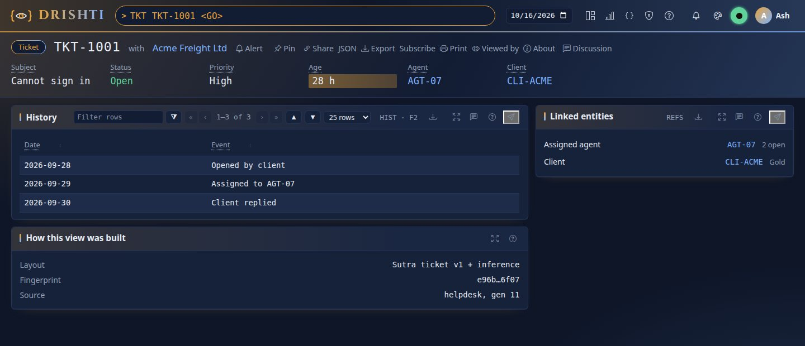

*How this view was built* now says `Sutra ticket v1 + inference`. A mistake (`kind: ladderr`) is reported with its line and the view keeps the last
good version ([OPERATIONS_GUIDE.md › A Sutra is broken](OPERATIONS_GUIDE.md#202-a-sutra-is-broken-or-an-edit-does-not-show)). Writing Sutras is
taught in sections [11](#11-what-a-sutra-is-and-when-one-applies) to [27](#27-common-mistakes-and-their-messages). You can design the Sutra in the
**Build workbench** instead of by hand and export it into your pack as a fragment ([section 25](#25-the-build-workbench)).

### 3.13 Step 12: put the Sutra under test

A Sutra that renders today can break with next month's data. `tests/<sutra>/` holds sample documents and an `expect.yaml`; `sutra test` renders
the Sutra against every sample and checks the expectations, with no server and no port:

```text
tests/ticket/cases.jsonl          two cases, one a line: {"case": "TKT-1001", "document": {...}}
tests/ticket/expect.yaml
```

```yaml
noErrors: true            # no panel in an error state on any sample (the default)
nonEmpty: [history]       # these panels must render with data on every sample
```

```bash
java -jar kernel/drishti-server/target/drishti-server-*-exec.jar sutra test config/packs/helpdesk --junit target/sutra-tests.xml
```

```text
     ticket: help coverage 8/8 (100%)
ok   config/packs/helpdesk/sutras/ticket.v1.sutra.yaml (2 samples)
```

Exit code `0`. *Help coverage* is the share of the fields the Sutra shows that `config/about.yaml` explains (8 of 8 once the glossary of step 10b
is complete). `target/sutra-tests.xml` is JUnit XML for your CI. Now break the expectation on purpose (`nonEmpty: [history, timeline]`):

```text
ticket / TKT-1001: panel timeline is not in the Sutra
ticket / TKT-1002: panel timeline is not in the Sutra
     ticket: help coverage 8/8 (100%)
FAIL config/packs/helpdesk/sutras/ticket.v1.sutra.yaml (2 samples)
```

Exit code `1`. A mistake in the Sutra itself fails `sutra lint`, with the line:

```text
PROBLEM config/packs/helpdesk/sutras/ticket.v1.sutra.yaml
config/packs/helpdesk/sutras/ticket.v1.sutra.yaml:30 DRS-2021 unknown panel kind 'ladderr'; expected one of kv, table, tabs, line, area, hbar, ladder, links, status, provenance, markdown, gauge, surface, waterfall, histogram, scatter, candlestick, graph, timeline, pivot, metric, map
```

Every testing command and convention is in [section 24](#24-testing-expectyaml-sutra-lint-sutra-test-and-pack-check).

### 3.14 Step 13: guide, help card, starters

`guides/helpdesk.md` describes the domain (not the sample records) and has a **Finding things** section; `config/help.yaml` puts it in the help
centre and makes it the guide F1 opens on the terminal; `config/workspaces.yaml` offers a starter workspace ([section 7.3](#73-guides-and-help)).
Then in `pack.yaml`:

```yaml
console:
  examples:
    - ["TKT TKT-1001", "An open ticket · history, agent and client"]
    - ["AGT AGT-07", "An agent · inferred"]
    - ["LOAD AGT-07", "A derived kind · the agent's open tickets summed"]
  workspaces: config/workspaces.yaml
  help: config/help.yaml
  monitors:
    Queue watch: [ { kind: ticket, id: TKT-1001 }, { kind: ticket, id: TKT-1002 } ]
```

Within a minute the help centre has a card *The help-desk pack*, *Views → Workspaces* offers *Ticket desk*, and *Views → Monitors* offers *Queue watch*.

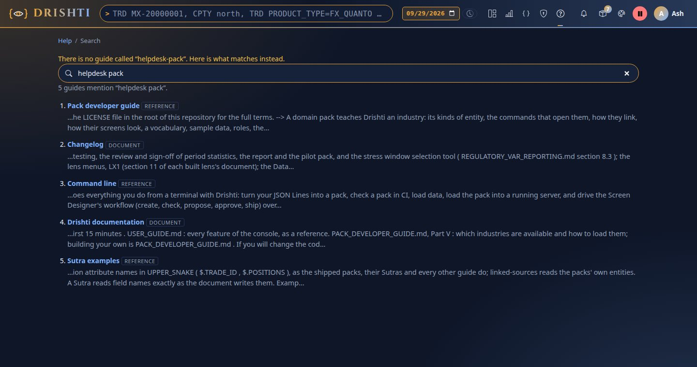

### 3.15 Step 14: a derived kind

*How many tickets does each agent have open, and for how long?* No source holds that; the server computes it. Add to `pack.yaml`:

```yaml
kinds: [ticket, agent, client, agent-load]
mnemonics:
  LOAD: { kind: agent-load, label: Agent workload (derived from tickets) }
connectors:
  agent-totals:
    plugin: derived
    kinds: [agent-load]
    settings:
      refresh: 30s
      agent-load:
        from: ticket
        group-by: $.ASSIGNEE            # one agent-load entity per assignee
        where: $.STATUS != 'Closed'
        id-field: AGENT
        members: TICKET_IDS
        fields:
          TICKET_COUNT: count
          HOURS_OPEN: sum $.AGE_HOURS
          OLDEST_HOURS: max $.AGE_HOURS
routes:
  agent-load: agent-totals
```

and `TICKET_IDS: { kind: ticket, label: Ticket }` under `graph.fields`, so the members show as links, and
`agent-load: [TICKET_COUNT, HOURS_OPEN, OLDEST_HOURS]` under `columns`. Save and wait for the reload: the server writes
`config/connectors/agent-totals.yaml` from the template ([section 4.8](#48-connectors-the-pack-names-them-the-site-owns-them)) and computes the kind.
Type `LOAD AGT-07`:

```bash
curl -s $B/views/agent-load/AGT-07 | python3 -c 'import json,sys; print([(s["label"], s["text"]) for s in json.load(sys.stdin)["strip"]])'
```

```text
[('Agent', 'AGT-07'), ('Derived from', 'ticket'), ('Hours open', '36'), ('Oldest (h)', '30 h'), ('Ticket count', '2'), ('Member count', '2')]
```

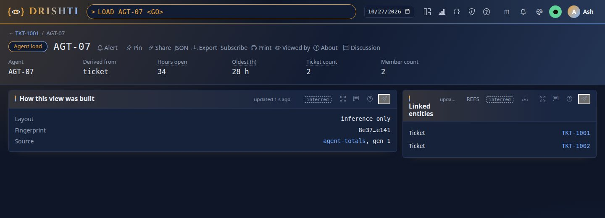

TKT-1003 is closed, so it is not a member: 30 + 6 = 36 hours over two tickets. The first computation runs within `refresh` of the reload, so a
`LOAD AGT-07` typed in the first seconds may still say *no source holds agent-load/AGT-07*. The connector is healthy
(`agent-totals ['agent-load'] UP`). Every option is in [section 5.3](#53-derived-kinds-entities-computed-from-other-kinds).

### 3.16 Step 15: a Calc snippet

Calc is Python in the user's browser (`Alt+C` on a view). A pack switches it on for its kinds and may ship starter code. In `pack.yaml`:

```yaml
python:
  enabled: true
```

and `python/queue-by-status.py` (three comment lines, then the code; the copyright header above them is not shown to the user):

```python
# title: Hours open by status
# description: The ticket's own age and status as a one-row DataFrame, to start a queue analysis from.
# kinds: ticket

import pandas as pd
pd.DataFrame([{"status": view.doc["STATUS"], "hours": view.doc["AGE_HOURS"]}])
```

Only roles with `calc: true` see Calc (here `support-lead`). More in [section 7.6](#76-calc-python-snippets).

### 3.17 Step 16: real data, a connector and a route

**Data a pack ships: the standard pattern.** Every document a shipped pack serves follows one pattern, whatever its origin (generated, or
published public data such as the us-equities and gleif packs):

1. the documents as gzipped JSON Lines under `data/testdata/<pack>/<kind>/`, named by the load rules
   ([DATA_LAKE_GUIDE.md](DATA_LAKE_GUIDE.md#5-routing-business-dates-modes-repeats-and-undo) section 5.2): `<table>.<YYYY-MM-DD>.jsonl.gz`, a
   file a business day (the first the snapshot, then each day's changes), or one dated snapshot the same on every day, or a tar of
   `<table>/<YYYY-MM-DD>/` folders where a date is several files; each dataset listed in `data/testdata/testdata.yaml` with its pack, kind,
   Delta connector and key (`tools/testdata/make_testdata.py` and `tools/testdata/publicsnap.py` write it; never by hand);
2. `python3 tools/drishti.py lake demo` (or `tools/build_demo_lakes.py`) builds them into the demo lake;
3. a Delta connector in the pack's `pack.yaml` serves them (`plugin: delta`, its `domain`, the kinds, `layout.<kind>.columns` for the fields
   searches and the search form filter on, `layout.<kind>.type-ahead` for the columns a name is found by).

**Data a feed fills daily** (the economy module's public-sector packs: [PUBLIC_SECTOR_GUIDE.md](PUBLIC_SECTOR_GUIDE.md#5-the-feeds)) is never
committed: the pack's Delta connector reads the lake its feed loads (`settings.lake: worldlake`, the feed file's `lake: worldlake` and a
`datasets:` entry of the pack and kind), and `samples/` keep only a few reference documents. `PacksServedWithoutDemoTest` fails the build when a
kind of a shipped pack has neither: no Delta connector with committed data, and none reading a lake an enabled feed fills with the kind.

Real tickets live somewhere else; here, the ticketing system exports each business day's tickets as one JSON Lines file, the layout the `file`
plugin reads ([the file connector](../../docs/connectors/types/file/README.md)):

```text
data/files/helpdesk/2026-10-16/ticket.jsonl      one ticket a line, the day's export
```

```json
{"TICKET_ID": "TKT-2001", "SUBJECT": "Password reset loop", "STATUS": "Open", "PRIORITY": "High", "ASSIGNEE": "AGT-07", "CLIENT": "CLI-GLOBEX", "CLIENT_NAME": "Globex Retail plc", "AGE_HOURS": 3, "HISTORY": [{"DATE": "2026-10-16", "EVENT": "Opened by client"}]}
```

Then name the connector, give it a template, and route tickets to it:

```yaml
connectors:
  agent-totals: { … as in step 14 … }
  helpdesk-store:
    plugin: file
    kinds: [ticket]
    settings:
      root: ${HELPDESK_FILES_ROOT:${drishti.data.dir:./data}/files}   # <root>/<domain>/<yyyy-mm-dd>/<kind>.jsonl
      domain: helpdesk
      id-field: TICKET_ID           # a plain document per line: its id is this field
      rescan-seconds: 30
routes:
  agent-load: agent-totals
  ticket: helpdesk-store            # tickets are read from this connector first
```

Save. When the pack reloads the server writes `config/connectors/helpdesk-store.yaml` from the template, starting with the line
`# Generated at first start from the connector template of pack 'helpdesk'. Edit it freely: an edited file is never overwritten; an unedited one follows the pack's template at an upgrade.`
and a stamp line. Check the connector, then open `TKT TKT-2001`:

```bash
curl -s $B/sources | python3 -c 'import json,sys; [print(s["name"], s["kinds"], s["health"]) for s in json.load(sys.stdin)["sources"] if s["name"]=="helpdesk-store"]'
```

```text
helpdesk-store ['ticket'] UP
```

*How this view was built* names `helpdesk-store` as the source, for business date 2026-10-16; the strip reads *Subject Password reset loop · Status
Open · Priority High · Age 3 h · Agent AGT-07 · Client CLI-GLOBEX*. The route makes `helpdesk-store` answer tickets first; a ticket it does not hold
is looked for in the other sources, so the sample tickets still open from the demo source. `TKT AGE_HOURS < 10` now finds a sample and the
exported ticket together:

```text
2 [('TKT-1002', 6), ('TKT-2001', 3)]
```

The derived `LOAD` kind reads tickets through the normal routing, so it counts the exported ones too (at its next `refresh`). Three things worth
knowing before you point a connector at real files:

- **The template is used once.** Changing `helpdesk-store` in `pack.yaml` afterwards does not touch the file already written. Edit the file, or put
  it back to the pack's current template: `drishti.py connector reset helpdesk-store` (or *Reset to pack default* in Admin → Connectors) rewrites
  it and keeps the earlier text in `<data>/connectors/history/`.
- **A dated file is the whole day.** For a business date that has a `<date>/ticket.jsonl`, that file alone answers; an undated
  `<domain>/ticket.jsonl` serves only the dates that have no dated file.
- **A line without the id is skipped and counted**, and Health says so: `UP (1 unreadable line in 2026-10-16/ticket.jsonl (line 1: no id
  ("id" in a row, or the id-field "id" in a plain document)))` is what a missing `id-field` looks like.

For a database, a lake, Kafka or S3 only the `plugin` and `settings` change; see the connector pages. A site can point the connector elsewhere
without touching the pack: edit `root:` in `config/connectors/helpdesk-store.yaml` (or in Admin → Connectors), and the running server restarts
that one connector. The finished example pack in the repository leaves this step out, so that it needs no data folder.

### 3.18 Step 17: check it, and publish it

```bash
python3 tools/license_headers.py --fix                                  # a header on every new file
drishti-console/.venv/bin/python tools/drishti.py pack check config/packs/helpdesk --tail 3
drishti-console/.venv/bin/python tools/drishti.py pack about-check config/packs/helpdesk
```

```text
== helpdesk: sutra lint: exit 0
ok      config/packs/helpdesk/sutras/ticket.v1.sutra.yaml
== helpdesk: sutra test: exit 0
     ticket: help coverage 8/8 (100%)
ok   config/packs/helpdesk/sutras/ticket.v1.sutra.yaml (2 samples)

== helpdesk: 0 field(s) shown without glossary text in 0 Sutra(s); 0 placeholder TODO text(s) in config/about.yaml
```

With only two glossary entries, `about-check` exits `1` and names the gaps: `ticket.v1: SUBJECT, STATUS, ASSIGNEE, CLIENT, HISTORY.DATE,
HISTORY.EVENT`. Then sign it and publish it to a registry ([section 29.1](#291-a-signed-pack-registry-publishing-and-installing)):

```bash
drishti-console/.venv/bin/python tools/drishti.py pack keygen --out ~/drishti-keys/acme          # once per publisher
drishti-console/.venv/bin/python tools/drishti.py pack publish config/packs/helpdesk --registry /srv/drishti-registry \
    --key ~/drishti-keys/acme.pem --publisher acme
```

```text
private key: /home/you/drishti-keys/acme.pem (keep it secret; it signs packs)
public key:  MCowBQYDK2VwAyEAcYvYL5cL9D3XYx6w49WZ4oAnDrhjAfRT95Twju2ug+A=
servers trust it with:  drishti.packs.registry.trusted-keys.<publisher>: <public key>

published helpdesk 0.1.0 (10424 bytes, sha256 1661eb4570b9…) signed by acme
```

An administrator trusts the publisher's key and presses **Install** in *Admin → Packs*:

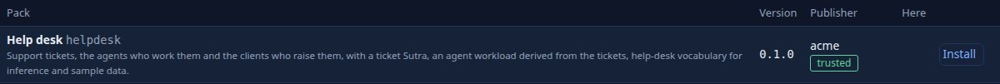

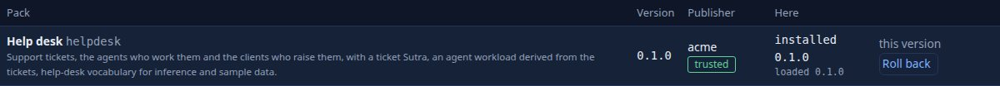

The server checked the archive's SHA-256 and signature, unpacked it, and put it to use at once, without a restart; the pack is on:

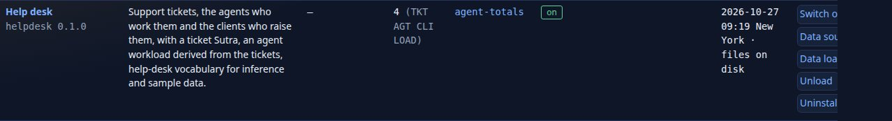

Last, [verify the pack](#295-verifying-a-pack): Admin → Health, `sutras/problems`, the CLI, and the checklist.

### 3.19 What you built, key by key

| Step | Key or file | What the user gets |
|---|---|---|
| 2 | `pack`, `version`, `code`, `title`, `description`, `kinds`, `mnemonics`, `graph.id-patterns`, `console.examples` | `TKT TKT-1001`, `TKT-1001` alone, suggestions, `HELP` for the pack's overview |
| 3 | `samples/catalog.jsonl`, `samples/<kind>.jsonl` | data with no database, a live ticking age |
| 6 | `graph.fields`, `graph.badges` | links between tickets, agents and clients, with badges |
| 7 | `graph.impact` | F8 on an agent: tickets, then clients |
| 8 | `columns`, `pivot` | useful pick lists and Pivot |
| 9 | `roles`, `alerts` | access control, `raw`, Calc rights; one-click alert rules |
| 10 | `config/formats.yaml`, `config/semantics.yaml` | `30 h`, *Age (h)* |
| 10b | `config/about.yaml` | a sentence about the ticket and the meaning of its fields in the *About this page* drawer |
| 11 | `sutras/` | the layout you designed |
| 12 | `tests/` | the Sutra under CI |
| 13 | `guides/`, `console.help`, `console.workspaces`, `console.monitors` | help card, F1, starters |
| 14 | `connectors` (`derived`), `routes` | an entity computed from others |
| 15 | `python` | Calc and a starter snippet |
| 16 | `connectors` (`file`), `routes` | real data |
| 17 | `pack check`, `pack about-check`, the registry | CI checks; install, upgrade, roll back |

## 4. `pack.yaml`, key by key

### 4.1 Every key at a glance

Only `pack` is required; a pack with nothing else loads and does nothing. Keys not listed are ignored. Values may use `${VARIABLE:default}`,
resolved from the environment when the server starts (`root: ${HELPDESK_FILES_ROOT:${drishti.data.dir:./data}/files}`).

| Key | Read by | One-line example | What it does | Details |
|---|---|---|---|---|
| `pack` | server | `pack: helpdesk` | The pack's name; must equal the folder name | |
| `sample` | server | `sample: true` | Marks the pack as a demonstration: an administrator can hide sample packs from business users | [31.5](#315-sample-packs) |
| `loads` | server | `loads: { … }` | Which kinds the ETL is expected to land each business day, by when, and who is told | [DATA_GUIDE.md](DATA_GUIDE.md#6-configuration-reference) |
| `code` | server | `code: HELP` | Typed alone, opens the pack's overview (`/p/<pack>`); must not equal a mnemonic | [31.6](#316-pack-codes) |
| `version` | server | `version: 1.2.0` | **X.Y.Z**; shown in About, Admin → Health and Admin → Packs, checked by deploys and the registry | [29.4](#294-versioning-a-pack) |
| `title`, `description` | both | `title: Help desk` | The pack's name and paragraph in menus, help and admin pages | |
| `extends` (or `requires`) | server | `extends: [market-data, trading]` | Inherit everything from these packs | [29.3](#293-inheritance) |
| `kinds` | server | `kinds: [ticket, agent]` | The kinds this pack owns | |
| `mnemonics` | server | `TKT: { kind: ticket, label: Ticket }` | The commands | [4.5](#45-reserved-command-words) |
| `graph.id-patterns` | server | `- { pattern: "^TKT-", kind: ticket }` | Recognise a bare id's kind | step 2 |
| `graph.fields` | server | `ASSIGNEE: { kind: agent, label: Assigned agent }` | Turn a field's value into a link (`scope: pack`: in this pack's kinds only) | step 6 |
| `graph.badges` | server | `agent: "$.OPEN_TICKETS + ' open'"` | Text shown beside a link, read from the target | step 6 |
| `graph.impact` | server | `follow: [CLIENT]`, `measures: { ticket: "$.AGE_HOURS" }` | What F8 rolls up and sums | step 7 |
| `columns` | server | `ticket: [SUBJECT, STATUS, PRIORITY]` | Key fields in pick lists and searches | [4.3](#43-columns-the-key-fields-of-a-pick-list) |
| `pivot` | server | `trade: { rows: [PRODUCT_TYPE], columns: [SOURCE_SYSTEM] }` | A Pivot on the kind's search results and pick lists | [4.4](#44-pivot-pivot-on-search-results) |
| `form` | server | `trade: [ { path: QUANTITY, type: amount } ]` | The search form of each kind (`FORM <pack>`) | [4.6](#46-form-the-search-form-of-a-kind) |
| `history` | server | `equity: { chart: [PRICE] }` | How a kind looks over time; never needed, any dated kind has a history | [4.7](#47-history-a-kind-over-time) |
| `roles` | server | `support: { kinds: [ticket, agent] }` | Roles this pack adds | [7.5](#75-roles-and-field-masks) |
| `python` | server | `python: { enabled: true }` | Calc on this pack's kinds, and starter snippets | [7.6](#76-calc-python-snippets) |
| `connectors` | server | `[helpdesk-store]`, or `helpdesk-store: { plugin: file, … }` | The connectors the pack reads through: a list names site connectors; a mapping names them **and** suggests each one's definition | [4.8](#48-connectors-the-pack-names-them-the-site-owns-them) |
| `connector-templates` | server | `helpdesk-store: { plugin: file, … }` | Suggested definitions to go with a list of names | [4.8](#48-connectors-the-pack-names-them-the-site-owns-them) |
| `routes` | server | `ticket: helpdesk-store` | Which connector answers a kind | [4.8](#48-connectors-the-pack-names-them-the-site-owns-them) |
| `ingest` | tooling | `trade: { key: TRADE_ID, date: BUSINESS_DATE, flatten: { NOTIONAL: LEGS[0].NOTIONAL } }` | The id and business date of each kind for `data ingest --pack`, `lake build --pack` and `pack check`; `flatten`: values inside lists written as plain fields and columns. Ignored by the server | [5.1](#51-large-kinds-the-lake-layout) |
| `alerts` | server | `- { kind: ticket, name: …, when: "$.AGE_HOURS > 24" }` | Suggested alert rules | step 9 |
| `sutras`, `formats`, `semantics`, `samples`, `about` | server | `sutras: sutras` | Where the pack's folders and files are | below |
| `console.examples` | console | `- ["TKT TKT-1001", "An open ticket"]` | Example commands on `/t` and the landing page | |
| `console.workspaces` | console | `workspaces: config/workspaces.yaml` | Starter workspaces (a `templates:` map), offered on `/w` | |
| `console.help` | console | `help: config/help.yaml` | Help-centre cards and F1 targets | [7.3](#73-guides-and-help) |
| `console.monitors` | console | `Queue watch: [ { kind: ticket, id: TKT-1001 } ]` | Starter monitors, offered on `/m` | |

Five keys say where the pack's folders are. All are optional, relative to the pack folder; a folder or file that does not exist is skipped.

| Key | Default | What is there |
|---|---|---|
| `sutras` | `sutras` | Sutras (`*.sutra.yaml`) and shared blocks (`*.block.yaml`), scanned recursively; any other `.yaml`, `.yml` or `.sutra.md` file there is reported (`DRS-2004`) |
| `formats` | `config/formats.yaml` | extra named formats |
| `semantics` | `config/semantics.yaml` | inference hints: `roles:`, `labels:`, `acronyms:` and `idFields:` |
| `samples` | `samples` | sample documents for the built-in `demo` source (`catalog.jsonl`, `<kind>.jsonl`) |
| `about` | `config/about.yaml` | the words of the *About this page* drawer ([7.2](#72-about-text-and-glossary)) |

### 4.2 The trading pack's manifest, annotated

Abridged; the file is generated by `tools/packgen/banking/make_packs.py`, and its connectors and derived kinds are in
[section 5.2](#52-several-source-systems-for-one-kind).

```yaml
pack: trading                   # REQUIRED. Must equal the folder name, or the pack is refused.
version: 1.0.0                  # X.Y.Z. Shown on About, Admin → Health and Admin → Packs.
code: TRDS                      # typed alone: the pack's overview
title: Trading                  # display name (pack switcher, help, About). Default: the pack name.
description: >-                 # one paragraph for About and the help centre
  Trades from every booking system (Endur, Calypso, Murex) in one production schema …
extends: [core, market-data]    # inherit their kinds, links, roles, connectors … (section 29.3)

kinds: [trade, counterparty-trades, portfolio-trades, legal-entity-trades, index-trades]   # the kinds this pack OWNS
sutras: sutras                  # where the Sutras are (the default); read recursively
formats: config/formats.yaml    # the pack's named formats (the default)

mnemonics:                      # the commands. MNEMONIC: { kind, label }
  TRD:  { kind: trade, label: Trade }                     # "TRD MX-20000001 <GO>" opens kind trade, id MX-20000001
  CTRD: { kind: counterparty-trades, label: Counterparty trades (derived from trades) }
  PTRD: { kind: portfolio-trades, label: Portfolio trades (derived from trades) }
  LTRD: { kind: legal-entity-trades, label: Legal entity trades (derived from trades) }
  ITRD: { kind: index-trades, label: Index trades (derived from trades) }

graph:                          # how entities link to each other
  id-patterns:                  # a bare id typed on its own is recognised by a regex (Endur's numeric ids are not: type TRD 1000001)
    - { pattern: "^(MX|CLY)-\\d+$", kind: trade }
  fields:                       # a document field whose value is an id of another kind becomes a link
    TRADE_ID:  { kind: trade, label: Trade }
    TRADE_IDS: { kind: trade, label: Trade }     # a list of ids: each one a link (a netting set's members)
  impact:                       # F8: what is summed for each dependent kind
    measures: { trade: "first($.LEGS).NOTIONAL" }
    formats:  { trade: compact }

connectors: { trade-endur: …, trade-calypso: …, trade-murex: …, trading-stream: …, trade-pages: … }   # the names and their templates
routes:
  trade: trade-endur            # the union is read whole whichever of its connectors the route names
  counterparty-trades: trade-pages
  # … one line per derived kind

columns:                        # pick-list and search columns per kind
  trade: [SOURCE_SYSTEM, PRODUCT_TYPE, TRADE_STATUS, TRADE_DATE, BUY_SELL_CODE, CURRENCY, QUANTITY, MATURITY_DATE, PORTFOLIO, COUNTERPARTY]
pivot:                          # Pivot on trade searches (4.4)
  trade: { fields: [SOURCE_SYSTEM, PORTFOLIO, CURRENCY, …], rows: [PRODUCT_TYPE], columns: [SOURCE_SYSTEM],
           values: [{ field: QUANTITY, agg: sum }], filters: [PRODUCT_GROUP, TRADE_STATUS] }
form:                           # FORM TRDS: the search form (4.6)
  trade: [ { path: TRADE_ID, label: Trade id, type: id, group: Identity, order: 1 }, … ]

console:                        # read by the console only
  examples:                     # [command, description] pairs on the terminal home and landing page
    - ["TRD MX-20000001", "Interest rate swap (Murex) · legs side by side, flows and fixings"]
    - ["TRD 1000001", "Commodity swap (Endur) · legs, resets, events"]
    - ["CTRD CP-ALDERSHOT", "A counterparty's trades in every system · payments, notional by product"]
  help: config/help.yaml        # help centre cards ("guides:") and F1 targets ("contextual:")
python: { enabled: true }       # Calc on trades; the snippets are python/*.py
roles:                          # ROLE: { kinds, raw?, author?, approve?, admin?, calc? }
  trader: { kinds: [trade, ir-curve, repo-curve, fx-spot, …, counterparty, book, …] }
```

### 4.3 `columns`: the key fields of a pick list

When a command names several entities (`TRD MX-200000`, `CPTY north`, `TRD PRODUCT_TYPE=REVOLVER`), the user gets a **pick list**: one row per
entity. `columns:` says which fields of each kind appear beside the id, in order (document paths, as in a search; `INDEX.NAME` works too):

```yaml
columns:
  counterparty: [NAME, RATING, SECTOR, COUNTRY_OF_RISK, UEN, NET_MTM]
  book: [NAME, DESK_NAME, TRADE_COUNT, MTM, DV01]
```

With the trading pack's columns, `TRD MX-200000 <GO>` on the demo lakes (99 of the 15,000 trades match) shows:

```text
TRD          Source system  Product type   Trade status  Trade date   Buy sell code  Currency  Quantity     Maturity date  Portfolio     Counterparty
MX-20000001  MUREX          IRS_FIXFLOAT   AMENDED       2025-07-25   S              AUD       242,000,000  2032-06-25     BOOK-RATES-3  CP-MERIDIAN-RE
MX-20000002  MUREX          IRS_FIXFLOAT   VALIDATED     2025-02-06   B              EUR       110,000,000  2031-04-15     BOOK-RATES-1  CP-HALCYON
…
```

How the columns are chosen:

1. the fields the command itself uses, in the order they appear (`TRD CURRENCY=USD order by QUANTITY desc` puts *Currency* and *Quantity* first);
2. then the kind's `columns:`, skipping any already shown;
3. if the kind has no `columns:`, the first plain (non-list, non-object) fields of the first document, leaving out `id` and fields starting with `_`,
   up to six columns in all.

Headings come from the label taxonomy (`labels:` in a pack's `semantics.yaml`, else the name in words: *Buy sell code*). A path may be written `MTM`
or `$.MTM`. Choose five to ten fields that tell rows apart at a glance: a type, a direction or status, an amount, a date, an owner. A child pack may
give a parent's kind other columns; the more specific pack wins. In a **generated** pack, set the columns in the generator, never in `pack.yaml`
(`COLUMNS` in `tools/packgen/banking/make_packs.py`; `columns=` of a `PackSpec`). Check what the server uses for a kind:

```bash
curl -s -G $B/search --data-urlencode 'q=BOOK limit 1' | python3 -c 'import json,sys; print(json.load(sys.stdin)["columns"])'
```

You should see `['$.NAME', '$.DESK_NAME', '$.TRADE_COUNT', '$.MTM', '$.DV01']`.

### 4.4 `pivot`: Pivot on search results

A kind's search results and pick lists can offer **Pivot**, the pivot screen on the kind ([PIVOT_GUIDE.md](PIVOT_GUIDE.md),
[USER_GUIDE.md](USER_GUIDE.md#pivot-slice-a-table-your-way)). It is offered **only** for the kinds a pack names under `pivot:`:

```yaml
pivot:                          # KIND: true, or { fields, rows, columns, values, filters, heat, chart }
  trade:
    fields: [SOURCE_SYSTEM, PORTFOLIO, CURRENCY, PRODUCT_GROUP, PRODUCT_TYPE, BUY_SELL_CODE, TRADE_STATUS, COUNTERPARTY,
             LEGAL_ENTITY, MATURITY_DATE, QUANTITY]
    rows: [PRODUCT_TYPE]
    columns: [SOURCE_SYSTEM]
    values: [{ field: QUANTITY, agg: sum }]
    filters: [PRODUCT_GROUP, TRADE_STATUS]
```

The value is the same as a Sutra's [`pivot` option](RACHANA_REFERENCE.md#pivot-pivot-on-a-table-or-ladder), except that fields are **document
paths** (`INDEX.NAME`), never expressions (`bind` is refused). `pivot: { trade: true }` offers the kind's `columns:` as the fields; `false` (or no
entry) offers nothing. The arrangement is the view the pivot screen opens with.

The pivot is computed by the server's pivot engine over every row of the kind on the business date (not only the page shown), through the kind's
connector, or directly from a Delta or Iceberg table's Parquet files when every field is a column the connector keeps
([section 5.1](#51-large-kinds-the-lake-layout)), so choose fields the connector's `layout.<kind>.columns` lists. Fields the user's role may not see
are not read at all. A site may set a declaration itself as `drishti.search.pivot.<kind>` (`true` or a JSON string). A declaration the server cannot
read is logged (*no Pivot for trade: …*) and that kind offers no Pivot; a value that is neither `true`, `false` nor a mapping stops the pack from
loading. A Sutra's tables opt in on their own (`pivot:` on the panel).

### 4.5 Reserved command words

The console owns six command words: `BI`, `RUPAKA` (its alias), `FORM`, `FUNC`, `WHAT` and `DATAMAP`. A pack may not define a mnemonic with any of
those names, in any case: the pack loader refuses it (`pack 'x' defines the mnemonic 'BI', which is a reserved command word (BI, DATAMAP, FORM,
FUNC, RUPAKA, WHAT): choose another`) and `drishti.py pack check` fails the same way.

### 4.6 `form`: the search form of a kind

`FORM <pack> <GO>` opens a form for a pack's kinds: one input per field, typed, which the server compiles to the ordinary search
(`TRD where QUANTITY between 1m and 5m ...`) and runs as any search, so masks, kinds per role and packs per user apply. A kind with no `form:`
entry gets one **inferred**: the kind's search columns, the fields its Sutras' `match.where` reads and the plain fields of their strip, typed from
sample values and from the field's name, labelled with the `term` from `config/about.yaml`. From the trading pack:

```yaml
form:
  trade:                              # a kind of this pack; a list of fields, or {calendar: USNY, fields: [...]}
    - { path: TRADE_ID, label: Trade id, type: id, group: Identity, order: 1, help: "One or many: paste a list. MX-2* is any id starting MX-2; Endur ids are numbers." }
    - { path: SOURCE_SYSTEM, label: Source system, type: enum, group: Identity, order: 2, help: "ENDUR, CALYPSO or MUREX: the booking system the trade comes from." }
    - { path: COUNTERPARTY, label: Counterparty, type: enum, group: Identity, order: 3 }
    - { path: PRODUCT_TYPE, label: Product type, type: enum, group: Product, order: 4 }
    - { path: PRODUCT_SUB_TYPE, label: Product sub type, type: enum, group: Product, order: 5, depends: PRODUCT_TYPE }
    - { path: QUANTITY, label: Quantity, type: amount, group: Money, order: 12, operators: [">=", "<=", between, "="], help: "Amounts take k, m and bn: 250k, 1.5m, 2bn." }
    - { path: MATURITY_DATE, label: Maturity date, type: date, group: Dates, order: 14, help: "Relative ranges work here: next 10 business days." }
```

| Key of a field | Meaning |
|---|---|
| `path` | The document path searched (`QUANTITY`, `INDEX.NAME`, `LEGS[0].NOTIONAL`); a `$.` in front is dropped. Required |
| `label` | The heading; by default the path in words |
| `type` | `text`, `number`, `amount`, `date`, `enum`, `id` or `bool` (default `text`) |
| `operators` | Which operators the person may choose, the first being the default; all of the type's when left out |
| `default` | What the input starts with |
| `order`, `group` | Position (lower first), and a heading the field sits under |
| `help` | One line shown under the field |
| `required` | The form cannot be submitted without it |
| `hidden` | Not offered as an input; kept so a saved or shared search can use it. A required hidden field needs a `default` |
| `values` | For an `enum`: the values offered. Left out, the values found in the data (and the glossary's `values`) |
| `depends` | For an `enum`: another field; only the values that occur with the values chosen there are offered |

| Type | Input | Operators (first is the default) |
|---|---|---|
| `text` | a text box and a *Match case* box | `equals`, `contains`, `starts`, `regex` |
| `number`, `amount` | one box, or two for `between`; amounts take `250k`, `1.5m`, `2bn` | `=`, `between`, `>`, `<`, `>=`, `<=` |
| `date` | a date picker, two for `between`, or a relative range as text | `on`, `between`, `relative` (`today`, `last 5 business days`, `next 3 business days`, `this month`, `year to date` …), `before`, `after` |
| `enum` | a tick box for each known value | `in` |
| `id` | a box to paste a list of ids; `MX-2*` is any id starting `MX-2` | `in` |
| `bool` | Any, Yes, No | `is` |

Business-day ranges run on the server's calendar, or on the calendar a kind names (`trade: { calendar: USNY, fields: [...] }`). A field the kind's
source does not keep as a column is marked **slower: not indexed**. `pack check` reads the section and names the kind and field of any mistake
(`pack.yaml form.trade.fields[2] (QUANTITY): type 'money' is not one of text, number, ...`). In a generated pack, set it in the generator (`TRADE_FORM`
and `forms()` in `make_packs.py`, or `columns` and `form_overrides` for packbuild). `pack new`, `pack make` and *New pack* write a `form:` from the
samples or schemas. A change proposed from the workbench's Form tab is kept on the server, once approved, in front of the pack's own `form:`
until the pack carries it ([The Form tab](RACHANA_REFERENCE.md#the-form-tab)).

### 4.7 `history`: a kind over time

`TRD 1000015 30 <GO>` shows the trade over the last 30 business days it has data; `EQ EQ-CSCA 3M` shows the equity's last three months as a chart
with its high, low and change ([DATA_ARCHITECTURE.md](../architecture/DATA_ARCHITECTURE.md#2-history-queries-an-entity-over-time)). **Any kind read
from a dated store has a history without this key**: a table of its top-level fields, its lists and objects shown as counts, the cells that changed
from the day before marked. `history:` only shapes it, per kind:

```yaml
history:
  trade:                                    # config/packs/banking/trading/pack.yaml
    exclude: [_meta]                        # never shown
    ignore-changes: [SOURCE_UPDATE_TIME, INPUT_DATE]   # shown, but a change here is not "a change"
    parts: [LEGS, EVENTS]                   # top-level lists shown as counts (default: every list or object)
    default-days: 30                        # the range when none is named (at most max-days)
  counterparty-trades: {enabled: false}     # a derived kind: no history (DRS-1012)
  equity:                                   # config/packs/banking/market-data/pack.yaml
    chart: [{path: PRICE, format: price2}]  # the market shape: a chart and the headline numbers (at most 4 fields)
    columns: [PRICE, {path: CHANGE_1D, format: pct2}, {path: MARKET_CAP, format: compact}, BETA, NAME, EXCHANGE, CURRENCY]
    series: {path: HISTORY, date: DATE, value: CLOSE}   # used when no source keeps daily documents
```

| Key | Default | Rule |
|---|---|---|
| `enabled` | `true` | `false`: the kind has no history (`DRS-1012`) |
| `shape` | `market` when `chart` is set, else `document` | |
| `columns` | the kind's `columns`, then every top-level scalar | a top-level path, or `{path \| expr, label, format}` (`expr` is Rachana-EL) |
| `exclude`, `ignore-changes`, `parts` | none; every top-level list or object for `parts` | lists of paths |
| `chart`, `headline` | none; the first `chart` field | numeric fields, at most 4; the headline is the field the change, high and low are taken on |
| `series` | none | `{path, date, value \| values}`: a list inside the newest document with a date per item |
| `default-days`, `max-days` | the server's `drishti.history.*` settings | `max-days` can only lower the server's |

Unknown keys are warnings; a wrong value is an error (`DRS-2061`) that `sutra lint <pack-dir>` and the deploy check report; on a running server the
pack shows the problem on Admin → Packs and in Health and the kind keeps its default history. Every day's row is masked exactly as the kind's view is.
What the shipped packs declare: trading `trade` (derived pages off); market-data `equity`, [`equity-index`](../contracts/samples/market-data.md#equity-index) ([contract](../contracts/packs/market-data.md#eqx-equity-index-equity-index)), [`fx-spot`](../contracts/samples/market-data.md#fx-spot) ([contract](../contracts/packs/market-data.md#fx-fx-spot-rate-fx-spot)), [`ir-curve`](../contracts/samples/market-data.md#ir-curve) ([contract](../contracts/packs/market-data.md#crv-interest-rate-curve-ir-curve)), [`credit-curve`](../contracts/samples/market-data.md#credit-curve) ([contract](../contracts/packs/market-data.md#cds-credit-curve-credit-curve)),
`commodity`, `bond`, [`inflation-index`](../contracts/samples/market-data.md#inflation-index) ([contract](../contracts/packs/market-data.md#inf-inflation-index-inflation-index)) as market charts; counterparty-risk [`netting-set`](../contracts/samples/counterparty-risk.md#netting-set) ([contract](../contracts/packs/counterparty-risk.md#nset-netting-set-netting-set)), [`credit-limit`](../contracts/samples/counterparty-risk.md#credit-limit) ([contract](../contracts/packs/counterparty-risk.md#lim-credit-limit-credit-limit)), `cva` and market-risk `var`,
[`trade-valuation`](../contracts/samples/market-risk.md#trade-valuation) ([contract](../contracts/packs/market-risk.md#tval-trade-valuation-trade-valuation)), [`pnl-explain`](../contracts/samples/market-risk.md#pnl-explain) ([contract](../contracts/packs/market-risk.md#pnl-pl-explain-pnl-explain)) with their measures as columns.

### 4.8 Connectors: the pack names them, the site owns them

A connector is a **site resource**: one YAML file in `config/connectors/` whose file name is the connector's name (`config/connectors/credit-store.yaml`
is `credit-store`). A pack does not carry connection settings that bind a site; it **names** what it reads through and routes its kinds. The file's
reference is [DATA_GUIDE.md section 9](DATA_GUIDE.md#9-connector-files-and-admin--connectors). From the counterparty-risk pack (abridged):

```yaml
pack: counterparty-risk
extends: [trading]              # trading brings core and market-data with it
kinds: [agreement, csa, netting-set, credit-limit, cva, sa-ccr, collateral-balance, margin-call, simm, simulation-run, exposure-path, exposure-result]

connectors:                     # a mapping NAME: { plugin, enabled?, kinds, settings }: the names, and the pack's TEMPLATES
  legal-store:
    plugin: delta               # which source plugin: delta, jdbc, aerospike, kafka, s3, rest, file, feeds, derived, …
    enabled: ${DRISHTI_LAKE_ENABLED:true}
    kinds: [agreement, csa]
    settings:                   # passed to the plugin as-is (credentials only as ${ENV})
      root: ${DRISHTI_DELTA_ROOT:${drishti.data.dir:./data}/delta/demo}
      domain: legal             # reads <root>/legal/<kind>/
  credit-store:
    plugin: delta
    kinds: [netting-set, credit-limit, cva, sa-ccr]
    settings: { root: "${DRISHTI_DELTA_ROOT:${drishti.data.dir:./data}/delta/demo}", domain: credit }

routes:                         # KIND: CONNECTOR — which connector answers each kind
  agreement: legal-store
  netting-set: credit-store
  # … one line per kind

roles:
  credit-risk: { kinds: ["*"], raw: true, calc: true }
```

A pack that only names connectors writes a list, with optional templates beside it (the form `pack new` writes):

```yaml
connectors: [credit-store, collateral-store]
connector-templates:                                # optional: what to suggest if the site has none yet
  credit-store: { plugin: delta, kinds: [netting-set], settings: { root: "${DRISHTI_DELTA_ROOT:${drishti.data.dir:./data}/delta/demo}", domain: credit } }
routes: { netting-set: credit-store, margin-call: collateral-store }
```

- **A template is a suggestion, written once.** When the pack loads, for each connector it names, the server writes `config/connectors/<name>.yaml`
  from the template if no file of that name exists (logged as `connector file credit-store.yaml generated from the template of pack
  'counterparty-risk'`, audited as `connector-generated`). A file the site never edited follows your pack: a later version of the template replaces
  it. Once edited the file is the site's: a later version of your pack never changes a value the site set and only adds the keys it gained
  ([DATA_GUIDE.md section 9, Upgrades](DATA_GUIDE.md#upgrades)). *Reset to pack default* (Admin → Connectors, or
  `drishti.py connector reset <name>`) writes the pack's current template over it, keeping the earlier text in `<data>/connectors/history/`.
- **Kinds go through `routes:`.** How a connector file's `kinds:` adds to and narrows the routes is stated once, in
  [DATA_GUIDE.md section 9, How packs and files fit together](DATA_GUIDE.md#96-how-packs-and-files-fit-together). A connector is
  therefore reusable by other packs.
- **Shared connectors.** Connectors are per data domain, not per pack: the lake is laid out as `<root>/<domain>/<kind>/`, and several packs may name
  the same connector. If two related packs suggest different templates under one name, the more specific pack's template is written; two unrelated
  packs suggesting different definitions of one name is an error. Admin → Connectors shows which packs use a connector and asks before the site
  switches it off or deletes it.
- **Several connectors for one kind.** Connectors with `union: true` that serve the same kind are read together, each holding its own part
  ([section 5.2](#52-several-source-systems-for-one-kind)).
- **A name nobody defined is not a failure of the pack.** The pack loads; its kinds answer `DRS-1011` (connector not configured), Admin → Health shows
  `connectorsNotConfigured`, and Admin → Packs → **Data source** offers a **Create** link pre-filled from your template.
- **Archives carry names and templates only.** `pack make`, `pack bundle` and Deploy archive never ship a site's settings; the deploy preview lists the
  connectors the site lacks, and **Create connectors** writes their files from your templates.
- **Precedence**, highest first: environment variables and `drishti.sources.connectors.<name>.…` in the server's own configuration (they warn), the
  connector file, the pack's template ([CONFIGURATION.md](../admin/CONFIGURATION.md)). `drishti.py connector list|get|apply|test|reset`
  ([CLI_REFERENCE.md](CLI_REFERENCE.md#connector-list-get-apply-delete-test-plugins-enable-disable-reset-history)) does from a terminal what Admin →
  Connectors does.

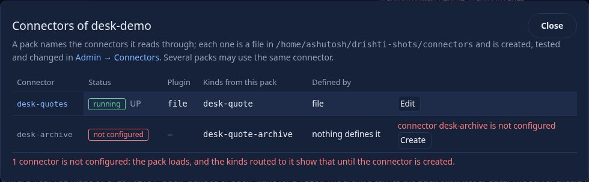

**Checklist for a pack author:**

1. List every connector the pack reads through in `connectors:`, and route every kind that is not served by the demo `samples` in `routes:`.
2. Give each a template with settings that work on a developer machine (`${VAR:default}` for paths and URLs, under `${drishti.data.dir:./data}` for folders).
3. Never write a literal credential, not even in a template: use `${ENV_VAR}` or `file:/path` (the server refuses a literal in a connector file).
4. Do not rename a connector in a later version unless you must: the site's file is named after it.
5. Start a scratch server on an empty `config/connectors/` and check that the files are written and Admin → Health shows no `connectorsNotConfigured`.
6. Your template is only the first suggestion: changes in a later version reach no edited site file; say what a site must change in the pack's guide.

### 4.9 What becomes of each key

The server turns the manifest into ordinary settings, at the lowest precedence (anything the site sets overrides a pack). Knowing this helps when
you read logs or override something:

| `pack.yaml` | Becomes |
|---|---|
| `kinds` | `drishti.packs.kinds.<pack>[i]` |
| `mnemonics.TKT` | `drishti.commands.mnemonics.TKT.kind` / `.label` |
| `graph.id-patterns` | `drishti.graph.id-patterns[i]` |
| `graph.fields.ASSIGNEE` | `drishti.graph.fields.ASSIGNEE.kind` / `.label` (`scope: pack`: `.from[i]`, the pack's kinds) |
| `graph.badges.agent` | `drishti.graph.badges.agent` |
| `graph.impact.*` | `drishti.graph.impact.follow[i]`, `.measures.<kind>`, `.formats.<kind>` |
| `roles.support` | `drishti.security.roles.support.kinds[i]`, `.raw`, `.author`, `.admin`, `.approve`, `.calc` |
| `connectors.x` (mapping) or `connector-templates.x` | a **template** for `config/connectors/x.yaml`, written once if that file does not exist |
| `connectors: [x]` (list) | the name `x`: the pack reads through the site connector `x` |
| `routes.kind` | `drishti.sources.routes.<kind>` |
| `columns.trade` | `drishti.search.columns.trade[i]` |
| `pivot.trade` | `drishti.search.pivot.trade` (`true`, or the mapping as JSON) |
| `sutras`, `formats`, `semantics` | added to `drishti.rachana.pack-dirs`, `drishti.rachana.pack-formats-files`, `drishti.inference.pack-semantics-files` |
| `samples` | added to `drishti.sources.plugins.demo.settings.dirs` |

`alerts`, `form` and `console` are read directly from the manifest.

## 5. Modelling data: large kinds, several systems, derived kinds, samples

### 5.1 Large kinds: the lake layout

A kind with millions of entities a day (a bank's trades) is stored so that readers never load a whole day. The pack declares, on its Delta
connector, which document fields are also stored as columns, and how the table is sorted. From the trading pack's `trade-endur` template
(`trade-calypso` and `trade-murex` are the same but for `table:`):

```yaml
connectors:
  trade-endur:
    plugin: delta
    enabled: ${DRISHTI_LAKE_ENABLED:true}
    kinds: [trade]
    settings:
      root: ${DRISHTI_DELTA_ROOT:${drishti.data.dir:./data}/delta/demo}
      domain: trading
      table: { trade: trade_endur }    # the kind's table under <root>/trading/ (default: the kind's name)
      union: true                      # one part of a kind several connectors serve together (5.2)
      source-name: trade-endur         # the name in provenance and Health
      layout:
        trade:
          columns: [TRADE_ID, SOURCE_SYSTEM, PRODUCT_TYPE, PRODUCT_SUB_TYPE, PRODUCT_GROUP, TRADE_STATUS, TRADE_VERSION,
                    BUY_SELL_CODE, CURRENCY, QUANTITY, TRADE_DATE, MATURITY_DATE, COUNTERPARTY, LEGAL_ENTITY, PORTFOLIO, TRADER_ID]
          sort-by: id               # each business day sorted by id, cut into files of file-rows
          file-rows: 250000
          row-group-rows: 1000      # the Python writers only; lake build sizes row groups in bytes
```

- **The writers follow it.** `drishti.py lake build` (and `lake demo`, which calls it for every table) writes `id`, the document (`doc`),
  `business_date`, the partition columns it is given (`--partition-by PRODUCT_TYPE` for the trade tables) and one column per promoted field (a
  nested path such as `INDEX.NAME` is the column `INDEX__NAME`; numbers as `float64`, everything else as text). A bank's own loader (Spark,
  Databricks) writes the same columns; `drishti.py lake maintain relayout` rewrites an existing table into the layout a day at a time.
- **The server uses it.** Opening a trade reads one row group of one file. Type-ahead indexes the id column alone. Searches, pick lists, the search
  form's drop-downs, derived kinds, impact (F8) and BI datasets read the columns, over every trade of the day, without parsing a document; a query
  on a field that is not a column reads documents. Field masks apply to column values exactly as to documents.
- **Health tells you.** A table that lacks a declared column shows in Admin → Health:
  `UP (not laid out as the pack declares: trade (12 of 16 columns); searches read documents)`.
- **Choose the columns** a desk searches and lists by: the pick-list `columns:`, the `pivot` and `form` fields, the fields in alerts, impact measures
  and derived kinds, and the link fields reverse lookups follow (`COUNTERPARTY`, `PORTFOLIO`, `LEGAL_ENTITY`). Repeated values compress to almost nothing.
- **Flattened fields.** A value inside a list (the first leg's notional) cannot be a promoted column as it stands. The pack's `ingest` block names
  such values, and `lake build --pack` writes each as a plain field of the document and a promoted column:

  ```yaml
  ingest:
    trade:
      key: TRADE_ID                    # lake build --pack needs no --key
      flatten:
        NOTIONAL: LEGS[0].NOTIONAL
        INDEX_NAME: LEGS[0].INDEX.NAME
  ```

  A field the document already has is never replaced. A table that exists keeps its columns: rebuild it (`--mode replace`, or a new lake) to add
  flattened columns. (`layout.<kind>.flatten` on a Delta connector is read the same way.)
- **Business dates.** Each table is partitioned by `business_date`; `lake build` writes one date per run (`--as-of`) or the dates a field names
  (`--date`), and a later run for the same date replaces it. The data-load signal tells a server a date landed
  ([DATA_GUIDE.md](DATA_GUIDE.md#1-telling-drishti-new-data-has-landed)).

The measured effect for 1,000,000 trades a day is in [BENCHMARK.md section 8.1](../admin/BENCHMARK.md#81-a-million-trades-a-day-on-delta); every
option of `lake build`, `lake demo` and `lake maintain` is in [CLI_REFERENCE.md](CLI_REFERENCE.md).

### 5.2 Several source systems for one kind

Production rarely has one system of record for a kind. The trading pack serves `trade` from three booking systems, kept apart from the source to the
screen, and is the pattern to copy:

1. **One schema.** Every system's trade has the same 47 UPPER_SNAKE top-level attributes, nested the same way, with `SOURCE_SYSTEM` saying where it
   came from (below). An extract that names an attribute otherwise is mapped on load (`tools/packgen/trades/schema.py`, `RENAMED`).
2. **Ids unique across systems.** Endur deal numbers (`1000001`…), Calypso `CLY-…`, Murex `MX-…`: an id opens one trade whichever system holds it.
3. **One table and one connector per system**, each partitioned by `business_date` and `PRODUCT_TYPE`, each with `union: true` and its own `table:`;
   the partition and promoted field names are the same in every table. A system's load touches only its own table.
4. **One kind.** All three connectors serve `trade`, so a read finds a trade in whichever holds it, and a search, a type-ahead, the form's drop-downs
   and a BI table read the three together ([DATA_GUIDE.md section 8](DATA_GUIDE.md#83-several-connectors-for-one-kind-a-union)). The route names
   one of them (`trade: trade-endur`); the union is read whole whichever it names.
5. **One Sutra per system and product type**, matching on both fields, with sub types as `when:` panels and the shared panels in blocks
   ([section 17](#17-how-packs-ship-sutras-folders-blocks-fragments-coverage)); **Sutra coverage** proves every combination has exactly one.
6. **Derived pages across systems.** `CTRD`, `PTRD`, `LTRD`, `ITRD` are derived kinds over `trade`, so a counterparty's page gathers its trades from
   every system ([section 5.3](#53-derived-kinds-entities-computed-from-other-kinds)).

### Trading: one schema, three source systems

**Ids are text.** `TRADE_ID` and every other id (`LEG_ID`, `FLOW_ID`, `RESET_ID`, `EVENT_ID`, `TRADE_IDS`) is a string in the test data and
samples (Endur's are digits, `"1000008"`). A real extract that writes an id as a JSON number is read as `"1000008"`, never `1000008.0`; text ids
keep their leading zeros; no id prefix or shape is assumed.

| Level | Attributes |
|---|---|
| deal | `SOURCE_SYSTEM` (ENDUR, CALYPSO or MUREX), `SOURCE_UPDATE_TIME`, `TRADE_ID`, `TRADE_STATUS`, `TRADE_ACTION`, `TRADE_VERSION`, `TRANSACTION_ID`, `PACKAGE_ID`, `PRODUCT_TYPE` (picks the deal's screen), `PRODUCT_SUB_TYPE`, `PRODUCT_GROUP`, `PRODUCT_SUB_GROUP`, `QUANTITY`, `PRICE`, `BUY_SELL_CODE`, `OPTION_TYPE`, `STRIKE_PRICE`, `COUNTERPARTY` (a `core` counterparty id), `COUNTERPARTY_UEN`, `COUNTERPARTY_COUNTRY_OF_RISK`, `ORIGINAL_COUNTERPARTY`, `LEGAL_ENTITY`, `PORTFOLIO` (a `core` book), `TRADER_ID` and the trader's names, the dates (`TRADE_DATE`, `INPUT_DATE`, `START_DATE`, `MATURITY_DATE`, `SETTLEMENT_DATE` …), `CURRENCY` and the flags (`DELIVERY_VERSUS_PAYMENT`, `PRECIOUS_METAL_FLAG` …), then `LEGS` and `EVENTS` |
| `LEGS[]` | one per leg: `LEG_ID`, `LEG_TYPE` (FIXED, FLOAT, PHYSICAL, OPTION), `LEG_ECONOMIC_TYPE` (Pay, Receive), `NOTIONAL`, `PRICE_UNIT`, `DISCOUNT_INDEX`, reset conventions, `SETTLEMENT_TYPE`, `INDEX {NAME, GROUP, SUB_GROUP}`, `CASH_FLOWS[]` |
| `LEGS[].CASH_FLOWS[]` | one per calculation period: `FLOW_ID`, `NOTIONAL`, `RATE`, `FLOAT_SPREAD`, `START_DATE`, `END_DATE`, `PAYMENT_DATE`, `RATE_DETERMINATION_DATE`, `STRIKE_PRICE`, `RESETS[]` (`RESET_ID`, `RESET_DATE`, `RATE` …: one per observation of the index) |
| `EVENTS[]` | cash and lifecycle events: `LEG_ID` (blank for the deal's own), `EVENT_ID`, `EVENT_TYPE`, `PAYMENT_TYPE`, `EVENT_DATE`, `AMOUNT` (signed: paid is negative), `CURRENCY` |

Endur books the commodity desk's own deals (five product types: `ComSwap`, `ComFut`, `Cash`, `CallNot`, `Commodity`); Calypso (51 product types)
and Murex (74) book the rest of the taxonomy. Each system lands in a Delta table of its own (`<root>/trading/trade_endur`, `trade_calypso`,
`trade_murex`), read by its own connector. On the demo lakes `TRD MX-200000 <GO>` finds 99 trades among the 15,000 of the three systems, with the
pick-list columns of [section 4.3](#43-columns-the-key-fields-of-a-pick-list). `drishti.py lake demo` builds the three tables from the committed test
data (`data/testdata/trades/{endur,calypso,murex}/`: 5,000 trades per system over sixty business days, a day-1 snapshot and daily changes, generated
by `tools/packgen/trades/`); for your own extracts, `drishti.py lake build --connector trade-murex …` writes one ([CLI_REFERENCE.md](CLI_REFERENCE.md)).

**The deal screen** (one per product type, the same layout for all): **F2 DES** the deal ticket; **F3 LEGS** the legs side by side, each with its
terms, its notional profile, its fixings and its cash flows opening to their resets; **F4 FLOWS** every flow of every leg; **F5 EVT** the events by
leg, filtered by leg and by dates (the header's controls); **F6 PAY** the netted payment ladder and payments by month; **F7** the counterparty's
trades; **F8** impact; **F9** the raw document. **Pages over many trades** (`CTRD <counterparty>`, `PTRD <book>`, `LTRD <legal entity>`,
`ITRD <index>`) show the live trades (at most 1,000 listed; counts and totals cover all), payments in the next 7, 30 and 90 days, notional by product
type, by index, the maturity ladder and payments by month. On the demo lakes the pack overview (`TRDS <GO>`) counts 15,000 trades, 24
counterparties, 30 portfolios, 4 legal entities and 57 indexes. **Values are the risk engine's**: a booking carries no mark-to-market;
`market-risk`'s trade valuation (`TVAL TVAL-<trade id>`) carries each trade's MTM, P&L 1d and DV01.

### 5.3 Derived kinds: entities computed from other kinds

A derived kind is a kind no source holds: the server computes it from another kind by grouping and adding up. A pack declares one as a connector of
the built-in plugin `derived` and routes the kind to it. The trading pack ships four (`CTRD`, `PTRD`, `LTRD`, `ITRD`); the counterparty one:

```yaml
connectors:
  trade-pages:
    plugin: derived
    kinds: [counterparty-trades, portfolio-trades, legal-entity-trades, index-trades]
    settings:
      store: disk               # the pages on disk, the heap keeping each group's totals only (default heap)
      refresh: 60s              # rebuild age, only when a source cannot say its data's version (default 30s)
      counterparty-trades:
        from: trade             # the kind it is built from (read through the normal routing: here the three systems' union)
        group-by: $.COUNTERPARTY  # Rachana-EL over a member: its group, which is the derived entity's id
        id-field: COUNTERPARTY  # a field holding the key besides `id` (default: id only)
        members: TRADE_IDS      # the members' ids, sorted (default: members)
        max-members: 1000       # members listed (and rows); TRADE_COUNT and the totals count every member
        rows-field: TRADES      # where the per-member rows go (default: rows)
        fields:
          TRADE_COUNT: count
          NOTIONAL: sum first($.LEGS).NOTIONAL
          SOURCE_SYSTEMS: distinct $.SOURCE_SYSTEM
          LAST_MATURITY: max $.MATURITY_DATE
          PAY_7D: "sum sum(flatten($.EVENTS)[?nonblank(@.AMOUNT) && nonblank(@.EVENT_DATE)][?days(today(), @.EVENT_DATE) >= 0 && days(today(), @.EVENT_DATE) <= 7], 'AMOUNT')"
          # … PRODUCT_TYPES, CURRENCIES, PAY_30D, PAY_90D and their _EVENTS counts
        rows:                   # optional: one row per member, for the page's tables
          TRADE_ID: $.TRADE_ID
          SOURCE_SYSTEM: $.SOURCE_SYSTEM
          NOTIONAL: first($.LEGS).NOTIONAL
          INDEX_NAME: nonblank($.LEGS[0].INDEX.NAME, $.LEGS[1].INDEX.NAME, '')
          EVENTS: $.EVENTS
          # … TRADE_STATUS, BUY_SELL_CODE, CURRENCY, COUNTERPARTY, PORTFOLIO, MATURITY_DATE
routes:
  counterparty-trades: trade-pages
```

- **Keys.** Each value of `group-by` is one entity (a member whose `group-by` is empty, or whose `where` is false, counts in no group). The document
  has `id`, the `id-field`, `derivedFrom` (*Derived from*), each field, the members' ids (at most `max-members`), `memberCount` (*Member count*) and the
  rows when declared.
- **Fields.** `count`; `sum`, `avg`, `min`, `max`, `median` over an expression (missing values and values that are not numbers are skipped);
  `distinct` (the sorted distinct values); `first` (the first member's value, members in id order). **`where`** keeps only the members that count.
- **Beyond grouping.** `also-group-by` puts a member in further groups (a region, `'ALL'`); `then` works fields out over the page (a ratio, a
  weighted average); `sort` orders a list field; `tree` builds the group's own hierarchy from a parent column; `unlisted` keeps a page over everything
  to its figures; `search-fields` lets the type-ahead find a group by a page field. The gleif, us-equities and world-economy packs compute LEIG, LEIC,
  SIC and ECG this way ([GROUPINGS_ANALYTICS_GUIDE.md](GROUPINGS_ANALYTICS_GUIDE.md); every setting in
  [the derived connector's README](../connectors/types/derived/README.md)).
- **Links.** Declare the members field under `graph.fields` (`TRADE_IDS: { kind: trade, label: Trade }`); an `id-field` that is already a link field
  (`COUNTERPARTY`) links the derived entity to its key's.
- **Business dates and `today()`.** A picked date is computed from that date's members, so a derived kind has history wherever its members do.
  `today()` in a field's expression is the date the pages are computed for.
- **Cost and rebuilds.** One computation reads every member once per business date, shared by every reader and by all the derived kinds of the
  connector built on the same kind; it reads the columns where the source keeps every field it needs, else the day's documents in one pass. Every
  `version-check` the computation asks the sources for their data's version; a new version (a load) rebuilds it in the background while the old pages
  serve.
- **Where the pages live.** `store: heap` (the default) builds every page in memory; `max-stream` bounds the members it keeps, and Health says
  DEGRADED when it cuts. `store: disk` writes each member's key and row to a sorted store under `<data dir>/derived/<connector>` and keeps only each
  group's totals in the heap, so the pages are complete at any number of members (1.16 million trades a day in an 8 GB heap), kept across restarts.
- **Failures.** Health shows `DOWN` with the reason when a computation fails; one that runs out of memory fails cleanly (DEGRADED, the old pages
  serving). Admin → Caches → Purge (or `drishti.py server caches purge trade-pages`) drops the pages. A missing `group-by`, an unknown aggregate, an
  expression that does not parse or a kind built from itself puts the connector under *failed to start* in Admin → Health. Settings:
  [the derived connector's README](../connectors/types/derived/README.md).
- **Everything else is a kind like any other**: a mnemonic, a Sutra (or inference), roles, alerts, a form and pick-list columns. It shows in search
  (`CTRD TRADE_COUNT > 500`) and the type-ahead.

### 5.4 Samples

The built-in `demo` source serves every enabled pack's `samples/` folder (when `DRISHTI_DEMO_ENABLED` is `true`, the default). `samples/catalog.jsonl`
lists every sample (`kind` and `id` needed; `title` and `subtitle` for the type-ahead):

```json
[
 { "kind": "trade", "id": "1000001", "title": "1000001", "subtitle": "Trade · ENDUR · ComSwap · CP-HARBORPT · USD 168.0m" },
 { "kind": "trade", "id": "1000002", "title": "1000002", "subtitle": "Trade · ENDUR · ComSwap · CP-LUMEN · USD 22.1m" }
]
```

`samples/<kind>.jsonl` holds the documents of one kind, **one document a line**, in the catalogue's order; each is the document itself plus a `_meta`
block that becomes its provenance (shown in *How this view was built* and in `F9`):

```json
{"DESK_ID":"DESK-COMM", …,"_meta":{"source":"ENDUR","generation":3,"live":true,"walk":{"MTM":25000}}}
```

A line's id is its catalogue entry: the entry at its position when the document holds that id as a top-level value, else the first top-level value
the catalogue lists as an id of the kind. A kind whose file would pass 50 MB is split into `samples/<kind>.part-001.jsonl`, `part-002` …
(`--sample-part-mb N` of the generators and `pack new`). One `samples/<kind>/<id>.json` file per document is read too.

| `_meta` key | Meaning |
|---|---|
| `source` | the name shown as the source system |
| `generation` | a version number shown with the source |
| `live` | `true`: the document ticks while someone watches it |
| `walk` | `{ field: step }`: numeric fields, top level or a dotted path into the document (`LEGS.1.CASH_FLOWS.0.RATE`), that random-walk on each tick by a normal draw whose standard deviation is `step`; a step of 1 or more keeps whole numbers |

An entry with no document is skipped; one whose path would lead outside the pack's `samples/` folder is skipped too.

**Samples, test data and lakes are three things.** `samples/` is a small, hand-checked set that makes the pack work on its own (765 trades);
`data/testdata/` is the committed, production-sized test data the demo lakes are built from; the lakes are what the connectors read. With the demo
source on, a sample answers before the lake for an id both hold.

Realistic samples matter. `tools/samplegen` is a small, standard-library-only toolkit (checked by `tools/samplegen/test_samplegen.py`):

| Module | What it gives |
|---|---|
| `ids` | LEI (ISO 17442 check digits), ISIN (Luhn), CUSIP, UTI, UPI, BIC |
| `dates` | business-day calendars (USNY, GBLO, EUTA, JPTO, CATO and joint calendars), tenors, schedules with stubs, day counts (ACT/360, ACT/365F, 30/360, 30E/360, ACT/ACT) |
| `curves` | zero curves with log-linear discount factors, forwards and the published pillar table |
| `legs` | fixed and floating legs with every calculation period: fixing dates, year fractions, fixings or projected rates, amounts, DFs, PVs and status |
| `blocks` | execution, lifecycle and audit, confirmation, clearing, regulatory reporting, settlement instructions, valuation and P&L history |

### 5.5 Modelling deep documents: legs, cash flows and fixings

A trading system holds a trade as a tree: the **deal**, its **legs**, each leg's **cash flows**, each floating flow's **resets** (fixings), with the
deal's **events** beside them (tranches with their payments, shipments with their stops are the same shape). Keep that shape in the document: a flat
list of every cash flow with a leg number loses what belongs to what, and a Sutra can show the nesting directly. The trading pack's schema
([above](#trading-one-schema-three-source-systems)) is the worked example. Rules that keep such a document honest (`tools/packgen/trades/test_trades.py`
checks them on every product and sub type):

1. **Write what the extract writes.** Missing values as the system spells them (mostly `""`, a few `null`, `0` for amounts), numbers that arrive as
   text left as text; Sutras read them with `nonblank(...)`. A real extract can have zero notionals and empty events: the screen must still read.
2. **Fixed flows simply have no resets.** A floating flow's rate lies among its resets (the average, for a commodity average).
3. **Signs mean something.** An event's `AMOUNT` is negative when the bank pays it; the payment ladder nets by date on that sign.
4. **Every leg and flow has its id** (`LEG_ID`, `FLOW_ID`, `RESET_ID`), so events, Compare and the legs-side-by-side tabs can name them.
5. **Size.** A twelve-month commodity swap with daily resets is tens of kilobytes. That is fine for a view; keep local test data small (10,000 trades
   or fewer on a laptop).

Show it as the trading pack's `legs` block does: one `tabs` panel with `each: $.LEGS` and `layout: columns`, each leg holding its terms, its notional
profile, its resets and its cash flows as a tree table ([section 6.3](#63-tables-and-tabs-over-nested-arrays)); make the demo tick a nested cell with
a path in `_meta.walk`. For more than a handful of legs, use a `table` of the legs with `children`.

## 6. Sutras over deep documents

Real documents are trees. Rachana reads any depth with the same short paths. Every example below runs against the trading pack's interest rate swap
**`MX-20000001`**, booked in Murex. To follow along:

1. Open **Build → New screen**, bring the stored entity `trade` `MX-20000001`, and start from *an empty Sutra*.
2. Open the **YAML** tab to write, and the **Design** tab to see the result; the left pane's *shape* lists every path of the document.

The path, filter and function basics are in [section 13](#13-rachana-el-step-by-step); this section is about how they behave **deep in a tree**.

### 6.1 The shape of the document

The part of `MX-20000001` that the examples read (abridged):

```json
{
  "SOURCE_SYSTEM": "MUREX", "TRADE_ID": "MX-20000001", "TRANSACTION_ID": "20000001002", "TRADE_VERSION": "2",
  "PRODUCT_TYPE": "IRS_FIXFLOAT", "PRODUCT_SUB_TYPE": "Interest rate swap (fixed/float)",
  "COUNTERPARTY": "CP-MERIDIAN-RE", "COUNTERPARTY_UEN": "UEN0100407", "COUNTERPARTY_COUNTRY_OF_RISK": "BM",
  "LEGAL_ENTITY": "LE-NY", "TRANSIT": "00107", "PORTFOLIO": "BOOK-RATES-3", "TRADER_ID": "TRDR-ASHAH",
  "TRADER_FIRST_NAME": "A.", "TRADER_LAST_NAME": "Shah", "SOURCE_UPDATE_TIME": "2026-09-30T18:30:00Z",
  "LEGS": [
    { "LEG_ID": 1, "LEG_TYPE": "FIXED", "LEG_ECONOMIC_TYPE": "Receive", "NOTIONAL": 242000000.0, "INDEX": { "NAME": "", … },
      "CASH_FLOWS": [
        { "FLOW_ID": 20000001001, "RATE": 0.040829, "START_DATE": "2025-07-28", "PAYMENT_DATE": "2026-06-29", "RESETS": [] },
        { "FLOW_ID": 20000001002, "PAYMENT_DATE": "2027-06-29", … }, …
      ] },
    { "LEG_ID": 2, "LEG_TYPE": "FLOAT", "LEG_ECONOMIC_TYPE": "Pay", "INDEX": { "NAME": "AONIA", "GROUP": "Rates", "SUB_GROUP": "Monthly" },
      "CASH_FLOWS": [
        { "FLOW_ID": 20000001008, "RATE": 0.035377, "PAYMENT_DATE": "2025-09-29",
          "RESETS": [ { "RESET_ID": "R-1", "RESET_DATE": "2025-07-28", "RATE": 0.035376 }, { "RESET_ID": "R-2", … } ] },
        … 28 periods … ] }
  ],
  "EVENTS": [
    { "LEG_ID": "", "EVENT_TYPE": "BOOKED", "EVENT_DATE": "2025-07-25", "AMOUNT": "" }, …,
    { "LEG_ID": "", "EVENT_TYPE": "MATURITY", "EVENT_DATE": "2032-06-25", "AMOUNT": "" },
    { "LEG_ID": 1, "EVENT_TYPE": "CASH_SETTLEMENT", "PAYMENT_TYPE": "Interest", "EVENT_DATE": "2026-06-29", "AMOUNT": 8987301.85 }, …
  ]
}
```

Missing values are written the way extracts write them: mostly an empty text `""` (the fixed leg's `INDEX.NAME`, a deal event's `LEG_ID` and
`AMOUNT`), sometimes `null`.

### 6.2 Paths and filters deep in a tree

A path goes as deep as the data (`$.LEGS[1].CASH_FLOWS[0].RESETS[0].RATE` is *0.035376*, four levels down), and a filter picks elements by content
rather than position (`$.LEGS[?@.LEG_TYPE == 'FLOAT'][0].INDEX.NAME` is *AONIA* wherever the floating leg sits): both are tabled on this document in
[section 13](#13-rachana-el-step-by-step). Try one: add `- { label: Trader, bind: "$.TRADER_FIRST_NAME + ' ' + $.TRADER_LAST_NAME + ' (' + $.TRADER_ID + ')'" }`
to the strip in the YAML tab and press **Ctrl+Enter**: you should see *Trader: A. Shah (TRDR-ASHAH)*. A path that runs into a branch the document does
not have (`$.LEGS[5]`; `$.EVENTS` on a deal whose extract left the key out) is simply empty: the cell shows a dash, a panel with nothing to show says
*No data available*, and the rest of the view renders.

### 6.3 Tables and tabs over nested arrays

`rows` can point at an array anywhere in the tree; inside the rows, `@` is the current row:

```yaml
- id: flows
  kind: ladder
  title: Fixed leg cash flows
  rows: $.LEGS[0].CASH_FLOWS          # an array inside an array element
  highlight: "@.PAYMENT_DATE > '2026-09-30' && #index > 0 && $.LEGS[0].CASH_FLOWS[#index - 1].PAYMENT_DATE <= '2026-09-30'"   # the next payment
  columns:
    - { label: Start, bind: "@.START_DATE", fmt: date }
    - { label: Payment, bind: "@.PAYMENT_DATE", fmt: date }
    - { label: Rate, bind: "@.RATE", fmt: pct4 }
    - { label: Notional, bind: "@.NOTIONAL", fmt: amount0 }
```

You should see seven rows from *2026-06-29* to *2032-06-29*, the *2027-06-29* row highlighted. To list only what is still to come, filter the rows
(`today()` is the business date the view is built for): `rows: "$.LEGS[0].CASH_FLOWS[?days(today(), @.PAYMENT_DATE) >= 0]"`.

A `tabs` panel repeats a layout for every element of an array. Inside, `@` is that element, including everything nested inside it. A tab can hold
whole panels with `panels:`; here each leg shows its notional profile, its fixings and its own cash flows, each flow opening to its resets, in a
column for every leg (this is how the trading pack's deal screens show legs side by side):

```yaml
- id: legs
  kind: tabs
  title: Legs
  each: $.LEGS
  layout: columns
  tabTitle: "'Leg ' + @.LEG_ID + ' · ' + @.LEG_TYPE"
  panels:
    - id: leg-notional
      kind: line
      title: Notional profile
      rows: "@.CASH_FLOWS"
      x: START_DATE
      y: NOTIONAL
      step: true
    - id: leg-fixings
      kind: line
      title: Fixings
      rows: "flatten(@.CASH_FLOWS[*].RESETS)[?nonblank(@.RATE)]"
      x: START_DATE
      y: RATE
    - id: leg-flows
      kind: table
      rows: "@.CASH_FLOWS"
      children: "@.RESETS"          # a flow that has resets opens to them (omit this for a plain table)
      columns:
        - { label: Flow / reset, bind: "nonblank(@.FLOW_ID, @.RESET_ID)" }
        - { label: Payment, bind: "nonblank(@.PAYMENT_DATE, @.RESET_DATE)" }
        - { label: Rate, bind: "@.RATE", fmt: pct4 }
```

You should see two columns, *Leg 1 · FIXED* and *Leg 2 · FLOAT*: the first with a flat notional line, no fixings (*No data available*: a fixed leg
has none) and 7 flows; the second with its notional line, the AONIA fixings known so far, and 28 flows, each opening (▸) to its two resets. A panel
inside a tab is a `kv`, `status`, `table`, `ladder`, `hbar`, `markdown`, `metric`, `line`, `area` or `timeline`, needs an `id`, and cannot have
`span`, `height` or Pivot ([Panels inside a tab](RACHANA_REFERENCE.md#panels-inside-a-tab)).

### 6.4 A whole Sutra over a nested trade

An operations view of any trade: who booked it where, its version, its parties, its events and what is paid when. Paste it into the YAML tab of the
design you started above and preview it:

```yaml
rachana: 1
sutra: trade-operations
version: 1
description: Operations view of any trade, from any source system, read from its legs, flows, resets and events.
match: { kind: trade, priority: 1 }
title: { pill: "Trade · operations", id: $.TRADE_ID, with: "link($.COUNTERPARTY, 'counterparty')" }
strip:
  - { label: Product, bind: $.PRODUCT_SUB_TYPE }
  - { label: Source, bind: $.SOURCE_SYSTEM }
  - { label: Transaction, bind: $.TRANSACTION_ID }
  - { label: Version, bind: "nonblank($.TRADE_VERSION, '–')" }
  - { label: Status, bind: $.TRADE_STATUS, tone: status }
  - { label: Legal entity, bind: "link($.LEGAL_ENTITY, 'legal-entity')" }
  - { label: Transit, bind: $.TRANSIT }
  - { label: Updated, bind: "nonblank($.SOURCE_UPDATE_TIME, '–')", emphasis: true }
panels:
  - id: parties
    kind: kv
    title: Parties and booking
    key: F2
    columns:
      - { label: Counterparty, bind: "link($.COUNTERPARTY, 'counterparty')" }
      - { label: UEN, bind: "nonblank($.COUNTERPARTY_UEN, '–')" }
      - { label: Country of risk, bind: "nonblank($.COUNTERPARTY_COUNTRY_OF_RISK, '–')" }
      - { label: Portfolio, bind: "link($.PORTFOLIO, 'book')" }
      - { label: Trader, bind: "link($.TRADER_ID, 'trader', $.TRADER_FIRST_NAME + ' ' + $.TRADER_LAST_NAME)" }
      - { label: Internal or external, bind: $.INTERNAL_EXTERNAL_CODE }
  - id: history
    kind: ladder
    title: Lifecycle
    key: F3
    rows: "$.EVENTS[?!nonblank(@.LEG_ID)]"
    highlight: "#index == size($.EVENTS[?!nonblank(@.LEG_ID)]) - 1"
    columns:
      - { label: Event, bind: "@.EVENT_TYPE" }
      - { label: Date, bind: "@.EVENT_DATE", fmt: date }
  - id: cash
    kind: table
    title: Cash events
    rows: "$.EVENTS[?nonblank(@.AMOUNT)]"
    columns:
      - { label: Leg, bind: "@.LEG_ID" }
      - { label: Date, bind: "@.EVENT_DATE", fmt: date }
      - { label: Type, bind: "@.PAYMENT_TYPE" }
      - { label: Amount, bind: "@.AMOUNT", fmt: signed2, tone: sign, total: true }
  - id: by-year
    kind: hbar
    title: Cash by year (paid − / received +)
    area: right
    rows: "group($.EVENTS[?nonblank(@.AMOUNT)], 'EVENT_DATE', 'AMOUNT', 'year')"
    fmt: signed0
    tone: sign
  - { id: built, kind: provenance, title: How this view was built }
keys: { F7: "link($.COUNTERPARTY, 'counterparty-trades')", F9: raw }
notes: |
  Priority 1, so any product's own Sutra wins; this one is for operations staff who open a trade by hand.
  Every path reaches into a nested branch; a trade without one of them shows a dash, not an error.
```

You should see:

- the strip: *Product Interest rate swap (fixed/float)*, *Source MUREX*, *Transaction 20000001002*, *Version 2*, *Status AMENDED*, *Legal entity LE-NY*
  (a link), *Transit 00107*, and *Updated 2026-09-30T18:30:00Z* highlighted;
- **Parties and booking** (F2), with *Counterparty*, *Portfolio* and *Trader* as links;
- **Lifecycle** (F3): *BOOKED*, *CONFIRMED*, *CLEARED*, *AMENDED*, *CASH_SETTLED*, *NEXT_PAYMENT*, *MATURITY*, the last highlighted;
- **Cash events**: the 36 settlements of both legs with their total, and on the right **Cash by year**, received in green and paid in red.

Why `priority: 1`: the product Sutras (such as `irs-fixfloat`) match with priority 10, so they stay the default view of a trade; this one lays out
only trades no product Sutra matches. To make it the default where operations staff work, give it a higher priority in that installation.

### 6.5 When inference meets a tree

With no Sutra, inference also walks the tree. Open `trade` / `MX-20000001` with *auto-design* as the start and you get, among others: a `tabs` *Legs*
for `LEGS` (two similar objects), a `table` of the first leg's cash flows, a `table` or `ladder` of the events (rows with a date), and `kv` panels
for the deal's own fields. Keep what is useful, delete the rest, and add labels and keys
([Inference](RACHANA_REFERENCE.md#inference-the-screens-drishti-draws-with-no-sutra)).

!!! tip "Finding the path"
    Press **F9** on any view to see its raw JSON. In the workbench, the **shape** in the left pane lists the document the Sutra
    reads. A path is exactly the keys you see there, joined with dots, with `[n]` for list positions.

## 7. Modelling content: vocabulary, About text, help, facts, roles, Calc

### 7.1 Vocabulary: labels, formats and inference hints

Two optional files teach every screen the pack's words. They are read when the pack loads (and again whenever packs change) and join the site's
configuration at the lowest precedence; a more specific pack's entry wins over a parent's. `config/formats.yaml` names formats a Sutra can use as
`fmt:` (`age0: { type: number, decimals: 0, suffix: " h" }`; every key of a format and the built-in ones are in
[RACHANA_REFERENCE.md](RACHANA_REFERENCE.md#formats)). `config/semantics.yaml` has four parts:

| Part | What it does | Example |
|---|---|---|
| `roles` | a field-name **regex** (case ignored) → how *inference* shows such fields (`role`, `fmt`, `tone`, `weight` for the strip, `dateOnly`), tried before the core roles | `{ role: age, pattern: "HOURS$", fmt: age0, weight: 80 }` shows `AGE_HOURS` as `30 h` |
| `labels` | field → label, **everywhere** (strips, tables, pick-list headings, a Sutra that gives no label) | `AGE_HOURS: Age (h)` |
| `acronyms` | words kept in capitals when a field is put in words (`NET_MTM` → *Net MTM*) | `core` lists `MTM`, `PV`, `DV01`, `CVA`, `ISDA` … |
| `idFields` | document fields that hold the id, so inference leads with it | `["TICKET_ID", "AGENT_ID", "CLIENT_ID"]` |

The roles only steer **inference**; labels reach both ([RACHANA_REFERENCE.md](RACHANA_REFERENCE.md#adding-hints-for-your-pack)). A `labels` entry is
global to the server: `STATUS: Ticket status` would relabel `STATUS` in every loaded pack. Name labels for fields that are yours (`AGE_HOURS`), and
give a Sutra's strip entry an explicit `label:` for the shared ones.

### 7.2 About text and glossary

The *About this page* drawer (`?` on a view; [how a user reads it](USER_GUIDE.md#about-this-page)) always shows where the data came from and why the
layout is what it is. What only **you** can say is what a kind is and what its figures mean: the pack's optional `config/about.yaml`.

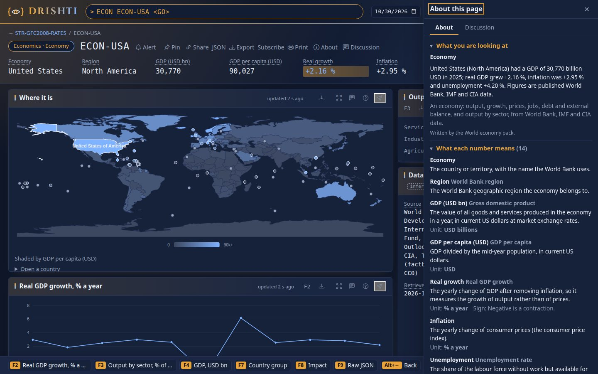

From `config/packs/banking/market-risk/config/about.yaml` (generated; shortened):

```yaml
about: 1                           # the file's version, required
vocabulary:                        # entries to reuse, each under a name of your choosing
  var99:
    term: "Value at risk, 99%, 1 day"
    means: "The loss the portfolio is expected not to exceed on 99 of 100 trading days, read from the 1st percentile of the revalued scenario P&L (historical simulation)."
    unit: "USD"
    sign: "A loss, written as a positive number."
kinds:
  var:                             # a kind of this pack, or of a pack it extends
    title: Value-at-risk result
    about: >-                      # the sentence at the top of the drawer: a ${...} template over the document
      ${$.RESULT_ID} is a 1-day 99% historical VaR for ${coalesce($.DESK_NAME, $.DESK, 'this portfolio')}:
      ${fmt($.VAR_99, 'compact')} USD, ${fmt($.VAR_99 / $.LIMIT, 'pct0')} of its ${fmt($.LIMIT, 'compact')} limit,
      with ${$.EXCEPTIONS} exception(s) in 250 days.
    guide: market-risk             # slug[#anchor] of the pack's guide, linked from the drawer
    glossary:                      # one entry per field, keyed by its path (dots between names)
      VAR_99: { use: "var99" }     # reuse a vocabulary entry
      EXCEPTIONS:
        term: "Backtesting exceptions"
        means: "The days in the last 250 on which the day's loss was larger than the 99% VaR. Basel's traffic lights count them to judge the model."
        unit: "days"
        note: "0-4 is the Basel green zone, 5-9 amber and 10 or more red."
```

| Key | Where | Rule |
|---|---|---|
| `about` (file) | top | required, `1` (`DRS-2040` otherwise) |
| `vocabulary.<name>` | top | `<name>` is a name without dots |
| `kinds.<kind>` | top | the kind must belong to this pack or a pack it `extends` (`DRS-2041`) |
| `title` | kind | plain text |
| `about` | kind, `panels.<id>` | a template of `${...}` expressions, compiled when the pack loads (`DRS-2042`, with line and column) |
| `guide` | kind | `slug[#anchor]` of a help-centre guide |
| `glossary.<key>` | kind | an entry or `{ use: <name> }`; the key is a field path, dots between names, arrays not a step (`HISTORY.DATE`); `use` must name a visible `vocabulary` entry (`DRS-2043`) |
| `term`, `means`, `unit`, `sign`, `note` | entry | plain text, at most `drishti.about.max-text` characters each (`DRS-2044`); never evaluated |
| `formula` | entry | shown as written; a derived kind's own fields get theirs automatically |
| `values` | entry | the meaning of each value of an enumerated field, shown for the value on the page |
| `panels.<id>` | kind | `{ about }`: a note for that panel (`DRS-2046` warns when no Sutra of the kind has the id) |

Unknown keys are errors (`DRS-2040`). A broken entry is left out (the view and the drawer still work) and is reported with file, line and column on the
admin *Sutras* page and in `GET /api/v1/sutras/problems`, under `<pack>/<file>`.

**What the template sees.** `about` text is rendered over the document **as the person asking may see it**: a field named in
`drishti.security.redact` reads `•••` for a role without `raw`; do not put values in a glossary entry. An expression that fails renders `—` and is
counted, never shown as an error. A rendered text is capped at `drishti.about.max-rendered` characters. Formats are the pack's named formats.


**Inheritance.** The catalogue is built from every loaded pack's file in the order `extends` defines, most specific pack first. A child can replace any
entry by its key and cannot delete one; there is no inheritance between kinds. Put a shared word in the lowest pack that owns the concept (`MTM` in
`trading`) as a `vocabulary` entry, and point to it with `use:`. A field's entry is found in the kind's `glossary` of the most specific pack, then a
`vocabulary` entry with the field's last name, then, for a derived kind, the entry generated from its definition, then nothing
([About this page](RACHANA_REFERENCE.md#about-this-page-the-design-of-context-help)). The explain answer
(`GET /api/v1/views/<kind>/<id>/explain`) lists each shown field's entry with its `origin` (`helpdesk:glossary.PRIORITY`).

**Translations.** `config/about.<lang>.yaml` beside `about.yaml` (`fr`, `fr-CA`) has the same shape and strict parse and is laid over the English file
**key by key**: whatever it does not translate stays English. For a regional tag the plain language fills in before English. The language of an
answer is `?locale=` on the explain request, else the user's *Language of help text*, else the browser's `Accept-Language`. The shipped example is
`config/packs/banking/market-risk/config/about.fr.yaml`.

**Generated packs.** A generated pack's `config/about.yaml` is copied from a hand-kept source in the generator folder
(`tools/packgen/banking/about/<pack>.yaml`, `tools/packgen/<generator>/about.yaml`): edit that source and regenerate. A pack built on public data
has its refresh script in `tools/feeds/` ([EXTERNAL_DATA.md](EXTERNAL_DATA.md#8-writing-a-feed)).

**Check it.** Load the pack: a file with a problem lists it (`DRS-2040` to `DRS-2044`). Press `?` on an entity, also as a user whose role is not `raw`.
`sutra lint config/packs/<domain>/<pack>` warns (`DRS-2046`, `DRS-2047`) about a `panels.<id>` that matches no panel and each field a Sutra shows that
has no glossary entry (`ticket.v1.sutra.yaml:15 warning DRS-2047 field 'ASSIGNEE' is shown but has no glossary entry (kinds.ticket.glossary in
config/about.yaml, or a vocabulary entry)`); `sutra test` reports *help coverage n/m*; `drishti.py pack about-check` lists the gaps and exits `1`
while any remain; `pack check --strict` fails on them; `expect.yaml` takes `help: { coverage: 0.9, about: true }`. The Build workbench's **About** tab
writes and previews this text over your samples and exports it as `config/about.yaml` in the pack fragment
([The About tab](RACHANA_REFERENCE.md#the-about-tab)); it is a draft until you put the file in the pack.

### 7.3 Guides and help

A pack's help appears in the help centre (`/help`) next to the core guides. `config/help.yaml`, from the help-desk pack:

```yaml
guides:
  - { slug: helpdesk-pack, category: start, title: "The help-desk pack", kind: guide, icon: headset,
      file: guides/helpdesk.md, summary: "Tickets, agents and clients." }
contextual:                     # optional: which guide F1 opens on a screen
  terminal: helpdesk-pack
```

| Key | Meaning |
|---|---|
| `slug` | the guide's address: `/help/helpdesk-pack`. Unique across all packs |
| `category` | the help section the guide joins, in its group *From the packs*: a section id of `drishti-console/config/help.yaml` (`get-started`, `data`, `build`, …) or a name its `aliases:` maps (`start`, `packs`, `layouts`); the shipped packs use `packs` (the **Data** section) |
| `title`, `summary`, `icon` | the card; `icon` is a Bootstrap Icons name without the `bi-` prefix |
| `kind` | `guide` or `tutorial`: the badge beside the title |
| `file` | the Markdown file, relative to the pack folder |

Screens for `contextual` include `landing`, `terminal`, `view`, `studio`, `workspace`, `monitor`, `alerts`, `impact`, `admin`, `account` and `help`.
Write the guide in Markdown with the copyright header comment at the top. Describe the domain (what each kind is, how they link, where the data comes
from) rather than listing sample records, and include a **Finding things** section with the commands that work for every kind of the pack
([pick lists](USER_GUIDE.md#pick-lists-when-a-command-names-several-entities)):

| Command | Does |
|---|---|
| `CPTY <id> <GO>` | Opens that counterparty. A bare identifier works too: its prefix (`CP-…`) tells Drishti the kind |
| `CPTY <start of an id> <GO>` | A pick list: one match opens, several give a table with the kind's key fields. `*` is a wildcard; case never matters |
| `CPTY <field>=<value> <GO>` | Lists by field value (`CPTY COUNTRY_OF_RISK=US`). Compare with `<` and `>`, combine with `and`, sort with `order by <field> desc` |
| `CPTY <GO>` | Lists every counterparty |

Links to other help documents with a relative path (`[the build guide](BUILD_GUIDE.md)`) open inside the help centre.

### 7.4 Facts for Home

A pack can give the console's Home page **Did you know** facts ([USER_GUIDE.md](USER_GUIDE.md#home-the-fact-of-the-day)): surprising things its data
says on the business date. They live in `config/facts.yaml` (no `pack.yaml` key: the console reads the file when it is there) and carry no numbers:
each fact fetches what it needs from the server's APIs as the user, picks the row that makes the point, and says when the point holds. Shipped
examples: `config/packs/banking/market-risk/config/facts.yaml`, `counterparty-risk/config/facts.yaml`, `funds/config/facts.yaml`.

```yaml
facts: 1
items:
  - id: book-over-limit-desk-within        # letters, digits, hyphens; unique in the file
    domain: Market risk                    # the tile's label
    needs: [counterparty-risk]             # other packs it needs (its own pack always); one off for the user: not shown
    steps:                                 # run in order; each binds its result to the name in `as`
      - { as: tree, var: /tree, params: { hierarchy: LEGAL } }      # GET /api/v1/risk/var/tree?hierarchy=LEGAL&asOf=<date>
      - as: book                                                    # the best row: where filters, order ranks (largest first)
        pick: tree.nodes
        where: "book.limitStatus == 'breach' and find(tree.nodes, 'id', book.parent).limitStatus != 'breach'"
        order: book.limitUse
      - { as: parent, let: "find(tree.nodes, 'id', book.parent)" }  # a value
    when: "book.limitStatus == 'breach'"   # what makes it surprising; false: not shown today
    text: "{book.name} is at **{book.limitUse|pct}** of its VaR limit."       # **…** is drawn highlighted
    why: "Its VaR is {book.var|money} against {book.limit|money}; …"
    picture: { type: bars, caption: "Share of the limit used, {asOf}",
               bars: [ { label: "{book.name}", value: book.limitUse, format: pct, tone: alert },
                       { label: "{parent.name}", value: parent.limitUse, format: pct } ] }
    open: "VAR NODE {book.id}"             # the command the primary button opens
    what: VaR limit                        # the WHAT term (docs/knowledge/glossary.yaml)
    knowledge: market-risk.md#4-a-worked-example-on-the-demo-data     # "Read more": a Knowledge page and anchor
```

| Step | Fetches or computes |
|---|---|
| `var: <path>`, `exposure: <path>` with `params` | `GET /api/v1/var<path>`, `/api/v1/exposure<path>`, dated by the user's business date |
| `search: "<query>"` | a structured search (`HELD where PCT_OF_SHARES > 0 order by TOTAL_VALUE desc limit 1`): `{rows: [{ref, values: {"$.FIELD": …}}]}` |
| `raw: {kind, id}` | one record as stored: `{data: {…}}` |
| `each: <list>` on a fetch | once per element (`it` in its templates; at most `limit`, 100 by default, 500 at most): a list of `{it, ans}` |
| `let: <expression>` | a value |
| `pick: <list>`, `where`, `order` | the first row by `order` (largest first; `desc: false` for smallest) among those `where` keeps; none: the fact is not shown |

**Expressions** are Python's expression syntax cut down to reading data: names bound by earlier steps (and `asOf`), `a.b` and `a['$.X']` (a missing
key is `None`), `a[0]`, arithmetic, comparisons, `and or not`, `x if c else y`, lists and one-`for` comprehensions, and the functions
`len sum min max abs round first find pluck flat top ratio overlap common pairs index upper`. `sum` and `overlap(a, b, key, weight)` are computed by
the server's pivot engine as the user, so they belong in a `let` step, outside a comprehension. `None` is forgiving: missing data hides the fact
instead of failing. **Templates** fill `{expression}` or `{expression|format}`: `money`, `int`, `num1`, `num2`, `pct`/`pct1`/`pct2` (a ratio),
`pctv`/`pctv1`/`pctv2` (a value already in percent), `signpct`, `times`; an empty field hides the sentence. **Pictures:** `bars` (2 to 6 bars, each
`label`, `value`, `format`, `tone`: `base`, `alert` or `muted`), `share` (`value` of `of`) and `line` (`values`, optional `labels` and `mark`).

Check a file before you ship it: from `drishti-console/`,
`python3 -c "from pathlib import Path; from core.facts import check; print(check(Path('../config/packs')))"` prints each pack's problems;
`tests/test_home_facts.py` runs the same check on every shipped pack and fails when a sentence carries a figure of its own. A fact with a problem is
left out and logged. Results are cached per server, user, business date and set of packs for `ui.facts.cache_seconds`; a fact slower than
`ui.facts.timeout_seconds` is left out.

### 7.5 Roles and field masks

A pack can add roles. A role says which kinds its holder may open and what else they may do:

```yaml
roles:
  trader:      { kinds: [trade, ir-curve, repo-curve, fx-spot, …, counterparty, book, …] }    # trading
  credit-risk: { kinds: ["*"], raw: true, calc: true }                                        # counterparty-risk
```

| Field | Meaning |
|---|---|
| `kinds` | the kinds the role may open; `"*"` means all. Links to other kinds show disabled, with the reason |
| `raw` | sees every field: nothing in `drishti.security.redact` is masked for the role |
| `author` | may use the Build workbench and propose Sutras |
| `approve` | may approve Sutra proposals |
| `admin` | may administer users |
| `calc` | may use Calc ([USER_GUIDE.md](USER_GUIDE.md#9-roles-who-may-use-calc)) |

The core always has `viewer`, `author`, `approver` and `admin`. Roles are given to users by an administrator
([ADMIN_GUIDE.md](ADMIN_GUIDE.md)); they take effect when security is on. A pack's roles appear in *Admin → Roles* marked
**built-in**, read-only: change them in the pack (or its generator); an administrator can also define new roles there, with *Add every kind of a
pack* buttons ([USER_GUIDE.md](USER_GUIDE.md#admin--roles-what-a-role-may-do)). Roles work on top of packs ([section 31.4](#314-who-sees-which-pack)).

**Field masks.** What is hidden is **site** configuration, not a pack key: `drishti.security.redact` names fields, and a role without `raw` sees every
such field as `•••` on every path that shows or computes from its value (raw JSON, views, search, Impact, the type-ahead, alert rules, Calc, the
workbench's previews, BI datasets). A pack decides *who is exempt* and *which kinds a role may open*; the site decides *which fields are sensitive*.
Write your pack so that it works with any set of masked fields (a test against sample documents always sees unmasked values). A `redact` entry with
dots names a field by the end of its path (`lifecycle.timeline.description`); masks work on fields, so a sensitive value copied into free text stays
readable unless the site turns on `drishti.security.mask-copies` (a site that masks the help desk's `CLIENT_NAME` should, because `HISTORY` events may
name the client). Names match in any case and convention (`counterpartyId` masks `COUNTERPARTY_ID`); an entry that names no field of the loaded packs is
logged at start-up as `DRS-6011`. The shipped setting masks the trader's identity on a trade (`TRADER_ID`, `TRADER_FIRST_NAME`, `TRADER_LAST_NAME`)
and the counterparty's identifier. Packs that carry personal or confidential fields should say so in their guide. Settings:
[CONFIGURATION.md](../admin/CONFIGURATION.md) (`drishti.security`); what masks deliberately do not hide: [DEVELOPER_GUIDE.md](DEVELOPER_GUIDE.md).

### 7.6 Calc: Python snippets

Calc is a Python panel on any view (`Alt+C`): code that runs in the user's browser, reads the screen and Drishti with the user's own rights, and
draws tables and charts ([USER_GUIDE.md](USER_GUIDE.md#calc-python-on-any-view)). A pack decides whether its kinds offer it, and may ship starters:

```yaml
python:
  enabled: true                 # Calc on the views of this pack's kinds
  snippets:                     # optional starters, offered in the panel's Snippets list
    - title: Member trades, summed from the screen
      description: The netting set's member trades as a DataFrame, notional by product.
      kinds: [netting-set]      # where it is offered; none: every kind of this pack
      code: |
        trades = view.tables["Member trades"]
        trades.groupby("Product", as_index=False)["Notional"].sum()
  dir: python                   # optional: the folder of snippet files (default python/)
```

Longer snippets read better as files: `python/<name>.py`, in name order after the inline ones, each starting with three comment lines (after the
copyright header, which is not shown). From `config/packs/banking/market-risk/python/stress_heatmap.py`:

```python
# title: Stress results: scenarios by desk, limits and the worst case
# description: Every stress result in one search, pivoted scenario by desk with totals; each desk's worst scenario and its use of the stress limit (results read in full for their limits), the scenarios ranked by firm-wide loss, and a heatmap of the matrix (matplotlib).
# kinds: stress-result, stress-scenario

import numpy as np
import pandas as pd
import matplotlib.pyplot as plt
...
```

| Rule | |
|---|---|
| Where Calc is offered | on a view whose kind is owned by a pack with `python.enabled: true`, to users with a role with `calc` |
| Which snippets a view lists | from every active pack that enables Calc: those naming the view's kind in `kinds`, and those naming no kind from the pack that owns it |
| Limits | a file over 64 KB is skipped; at most 100 snippets a pack |
| When changes apply | when the pack reloads |
| Roles | give the pack's analyst roles `calc: true`; otherwise Calc is offered only to roles that have it elsewhere |

The banking packs enable Calc with a library of 71 snippets (curves, FX, vol surfaces, options, bonds, credit, VaR and its backtest, stress, FRTB,
exposure, CVA, collateral, SA-CCR, desks, books and counterparties), written by their generator from `tools/packgen/banking/snippets/<pack>/*.py`.
Every one, with the sample entity it runs on, is in [USER_GUIDE.md › Snippet catalogue](USER_GUIDE.md#18-snippet-catalogue).

### Unbuilt work: the under-construction registry

**Rule:** a figure, panel, menu item, help page, contract or decision that depends on work not built yet (a figure stored rather than computed by its
engine) is registered in `config/under-construction.yaml` in the same change that adds it, with the release that builds it and its treatment:
`under-construction` (shown, the words *Under construction* in place of its value) or `hidden`. Never a number that looks computed and is not.
Register a Sutra's figure by its kind and `bind` (strip items, kv and table columns) or a whole panel by its `id`; a menu item by its id; a help page
by its slug. Then run `python3 tools/under_construction.py` (it writes [UNDER_CONSTRUCTION.md](../admin/UNDER_CONSTRUCTION.md); `--check` fails when
a place it names does not exist). The server rewrites the Sutra when it is matched, the console hides or marks the menu items and help pages, and the
data stays in the lake. When the engine is built, remove the item in the change that ships it.

```yaml
  - id: sa-ccr-figures
    what: field
    about: "SA-CCR EAD, RC, add-ons and RWA: stored, not computed by an SA-CCR engine"
    release: 2.9.11.k
    treatment: under-construction
    sutras:
      - kind: sa-ccr
        binds: [$.EAD, $.RWA]
        panels: [hedging]
```

## 8. The Pack designer: Build → New pack

You have **JSON Lines files** (a trade book, a set of counterparties, one file per source system or one per day) and want a pack: its kinds, one
screen (Sutra) per kind or per combination of discriminator columns, its data binding, tests and a module to deploy. **Build → New pack**
(`/build/pack/designer`; the old `/build/pack/new` redirects to it) is a workspace for that, with the same engine as the command line
(`drishti.py pack new`): the files go up to the server, **every record is read there**, and what it finds is shown at once.

```text
.jsonl / .jsonl.gz / .ndjson files or a folder ── upload ──▶ the server reads every record (tools/packgen/packprofile.py)
        │                                                     kinds, fields, one Sutra per discriminator combination, ID check, dates
        ▼
Design: a Sutra's YAML beside its live screen on real rows, drawn again as you edit
        ▼
Finalize: the module written, its pack linted and tested, packed as a .dmod, the fifteen checks
        ▼
Deploy: the one module deploy (a single node installs; a cluster plans, then applies)
```

### 8.1 The six steps

The left rail lists the steps with a one-line summary of each (rows read, kind and discriminators, the connector, Sutras and their checks, checks
passed, deployed or not); click one to go there. Starting a pack needs the **author** power, deploying a module an administrator. At phone width the
rail becomes a row above the step.

**1. Data.** Drop `.jsonl`, `.jsonl.gz` or `.ndjson` files, a folder of them, or choose them. Each file is uploaded to a workspace on the server
(a folder under the console's data folder, removed after `builder.pack_designer_ttl_hours` untouched) and then **every record of every file is
analysed there**, with progress (rows read, seconds); the work runs as a job of its own that you can cancel. Nothing is sampled: the counts below are
the files' true counts. A workspace is resumed in the same browser tab.

**2. Kind and keys.** *Kind* names the records of every file (files `trade_endur.jsonl`, `trade_murex.jsonl` are the kind `trade` when you say so;
blank, each file's name is its kind). *Discriminators* are the columns whose values tell the records apart, **any combination**: every combination
present becomes one Sutra, listed with its row count and share, a **rare** mark on a combination that is a tiny part of the data, and the Sutra name.
*ID* is the key column; it is checked for duplicates **over the whole of every file** (one entity per ID per business date) and the result is said in
words. *Business date* is the column holding the date, or none: then each file's name carries it (`trade.2026-07-08.jsonl.gz`). The columns are
inferred from the data first (the same candidates `drishti.py data profile` shows); change any and press **Apply and read again**, which reads the files
again with your choice and redraws the combinations. *Child tables* has a switch for each array of records of the kind (`LEGS`, `CASHFLOWS`): on, the
array becomes a kind of its own, one row per element (section 8.1.4).

**3. Source.** Pack name (lower-case letters, digits, `-`), title, version, a *kind prefix* (put before every kind, so a kind another module provides
is not taken: such a clash is refused when the module is made), the files root, and the connector. By default a **file connector** `<name>-files` is
made; with *Write the records to the files store* on, the uploaded records are written to `<files root>/<name>/<date>/<kind>.jsonl` so the connector
can read them. An existing connector may be named instead. At Deploy the binding goes through the one bindings path: the file connector is saved on
the server (Admin → Connectors) and each kind's binding is proposed to **Admin → Data bindings**, where a second administrator approves it.

**4. Design.** The list on the left holds every Sutra with its rows and a **check badge** (`8/8`: the server's checker, every panel against the real
rows of the combination); in the middle the Sutra's YAML in the code editor; on the right its **live screen**, drawn by the server from the YAML on one
of the combination's **real rows** (choose the row). Edit the YAML and the screen is drawn again after a short pause, with the badge updated and the
Sutra marked *edited*; a YAML the server refuses shows its problems in place of the screen. Edits are kept for the module.

**5. Finalize.** **Make the module** runs `pack new`'s write: the pack (kinds, contracts, your Sutras, samples, tests, About text), the module around it
(`module.yaml`, needs, console page routes, docs), `sutra lint` and `sutra test`, then `module pack` and `module check`: the **fifteen conformance
checks** are listed as they pass. The `.dmod` can be downloaded.

**6. Deploy.** **Install on this node** copies the `.dmod` to the server's modules folder, where auto-deploy checks, installs and loads it. **Plan for the cluster** uploads the `.dmod` to the module store (the server checks it once more) and shows the plan per node; **Apply the
plan** installs it: the server requires a second administrator to apply a plan (four eyes, as in Admin → Modules → Deploy). **Open the screen** opens a trade of the module, `/m/<module>/<module>/<kind>/<id>`.

### 8.1.1 The same on the command line

```bash
python3 tools/drishti.py pack new data/jsonl --name my-bank --kind trade --key TRADE_ID --match PRODUCT_TYPE,SOURCE_SYSTEM \
    --date BUSINESS_DATE --kind-prefix my- --deploy
```

`--dry-run` reads every record and prints the plan; `--sutra-edits FILE` (a JSON `{sutra name: YAML}`) replaces drafted Sutras, which is what the designer
sends. Both routes run `tools/packgen/module_from_jsonl.py`; the page runs it as the job `tools/packgen/designer_job.py`.

### 8.1.2 Settings

`builder.pack_designer_max_mb` (uploaded bytes per workspace, 4096), `builder.pack_designer_max_files` (500), `builder.pack_designer_ttl_hours` (72),
`builder.pack_designer_jobs_per_user` (2 running jobs), `builder.pack_designer_workers` (processes reading the files; 0: the tool's default),
`builder.pack_designer_modules_dir` (where **Install on this node** puts the `.dmod`) and `builder.tools_dir` (the repository's `tools/` folder the job runs from).

### 8.1.3 From JSON Schema

A pack from **JSON Schema** files is the command line's: `drishti.py pack make --schema` and `drishti.py sutra design --schema` (rules in 8.2 to 8.4 and
8.6 to 8.8 below, with their quick start):

```bash
# schemas alone: samples are synthetic, every Sutra is checked, one folder comes out
python3 tools/drishti.py pack make --schema docs/guides/examples/schemas --name desk-pack --yes

# schemas plus real documents: real samples win, the schemas add labels, descriptions and links
python3 tools/drishti.py pack make --schema docs/guides/examples/schemas docs/guides/examples/schemas/data --name desk-pack --store files --yes
```

> **Real data wins.** A schema says what a document *may* be; real documents say what it *is*. Where both are given the key must be unique in the
> data, the business date is found in the data, a field the schema does not know is reported, and every Sutra is tested on real documents.

### 8.1.4 Child tables: an array of records as a kind of its own

A document often holds **arrays of records**: a trade's `LEGS`, its `CASHFLOWS`. The parent's screen shows such an array as a sub-table, which is
enough to read one trade; to add up legs across trades ("notional by leg currency") or to ask for "trades having any leg in EUR", the array is
made a **child kind**: `LEGS` of `trade` becomes the kind `trade-leg`, one row per element, with

| | What it is | Example |
|---|---|---|
| its own **id** | the parent's id, `:`, then the element's natural key when every element has a unique one named like an id (`LEG_ID`), else its index in the array | `LEG_KEY` = `T00012:2` |
| a **link** to the parent | the parent's id field, carrying the parent's id (a bare `id` key becomes `<KIND>_ID`) | `TRADE_ID` = `T00012` |
| its **promoted columns** | the link first, then the element's own fields, as for any kind | `TRADE_ID`, `LEG_ID`, `CURRENCY`, `NOTIONAL` |
| its **own table** | written by the same loader in the same run, beside the parent, under the parent's business date | `<files root>/<pack>/2026-11-03/trade-leg.jsonl`, `<lake>/<pack>/trade-leg/` |
| its **own Sutra** | one entity screen per leg, its `TRADE_ID` a link back to the trade (beside the title and on F7) | `trade-leg-default` |
| a **BI relationship** | a model in the site's `tables/<pack>/` relating every leg to its trade, many-to-one and both ways | section 5.3 of the [Reports guide](REPORTS_GUIDE.md#53-relationships-and-how-a-question-joins) |

The parent is unchanged: it keeps the whole array in its document and its screen still shows it as a sub-table.

**Which arrays.** Automatically, every top-level array of records with at least **2 elements on average** in the first rows (`--child-min-avg N`; `0`
turns it off), or by choice: `--child LEGS,CASHFLOWS` (or per kind `trade=LEGS;quote=TICKS`), `--child none` for none. In the designer, step 2
(**Kind and keys**) lists each array of the kind under **Child tables** with its average, the child kind it would be and its natural key, and a
switch: switch it on or off and press **Apply and read again**; every record is read again and the child kind appears in the kind list, with its rows,
id check and Sutra. A child kind's own step 2 says whose rows it is.

**One profiler, every loader, every store.** The full pass (`tools/packgen/packprofile.py`) explodes each parent's array as it reads the parent, so the child kind's
rows, fields, dates and id check are the whole files', not a sample; its id is checked within each parent. Every loader that writes the parent
writes the child rows by the rules of the pack's `ingest:` block (below), into the parent's own store: Delta, Iceberg or the files store. The Python
loaders (`tools/ingest_jsonl.py`: `pack new --load`, the designer's *Write the records to the store*, `data ingest --pack` with `--lake`,
`--store iceberg --lake` or `--store files --root`; and `lake build --pack`, with `--format iceberg` too) split by one function
(`tools/packgen/childkinds.py`), the parallel loader (`lake build --engine java`, or `LakeLoad` with `source.pack`) by its Java reading of the same block
(`ChildKinds`), both checked against one fixture ([DATA_LAKE_GUIDE section 5.7](DATA_LAKE_GUIDE.md#57-child-kinds)). A folder already laid out for the file connector is not read in place when there are child kinds: the
records go to the files store. The pack says it all in its `ingest:` block, which `drishti.py pack check` checks:

```yaml
ingest:
  trade: { key: TRADE_ID, date: BUSINESS_DATE }
  trade-leg: { key: LEG_KEY, child-of: { kind: trade, field: LEGS, link: TRADE_ID, natural: LEG_ID } }
graph:
  fields:
    TRADE_ID: { kind: trade, label: Trade }       # a leg's TRADE_ID opens its trade; BI reads it as a ready-made relationship
```

`--dry-run` prints the child kinds planned before anything is written. On the MUREX file of the test data, automatically only `EVENTS` (16 a trade)
qualifies (`LEGS` averages 1.4), so both are chosen:

```bash
python3 tools/drishti.py pack new data/testdata/trades/murex/trade_murex.2026-07-08.jsonl.gz --name murex-book --kind trade --key TRADE_ID \
    --match PRODUCT_TYPE --kind-prefix murex- --child LEGS,EVENTS --dry-run
```

```text
kind murex-trade: 4,198 rows, 107 fields
  child kind from LEGS (--child)
  child kind from EVENTS (--child)
  child kind LEGS -> murex-trade-leg: one row per element, id LEG_KEY (TRADE_ID:LEG_ID), link TRADE_ID -> murex-trade: 5,777 rows, 1.38 per murex-trade that has it
  child kind EVENTS -> murex-trade-event: one row per element, id EVENT_KEY (TRADE_ID:EVENT_ID), link TRADE_ID -> murex-trade: 67,228 rows, 16.01 per murex-trade that has it
  ...
kind murex-trade-leg: 5,777 rows, 51 fields (child of murex-trade: one row per element of its LEGS)
  id LEG_KEY: unique within each parent; link TRADE_ID -> murex-trade
  date: its parent's: 1 business date(s), 2026-07-08 .. 2026-07-08
  match: (none: one Sutra for the kind): 1 combination(s)
         5,777  (all)                                                         -> murex-trade-leg-default

binding (config/bindings.yaml): murex-trade, murex-trade-event, murex-trade-leg -> read: [murex-book-files]
BI (the site's tables/): murex_book/murex-book.model.yaml, murex_book/murex_trade_events.table.yaml, murex_book/murex_trade_legs.table.yaml, ...
```

The BI model (`<site>/tables/<pack>/<pack>.model.yaml`, with a table per kind beside it) relates `trade_leg.TRADE_ID` to `trade.TRADE_ID`
(`cardinality: many-to-one, direction: both`) and has a count per kind and a sum of each numeric column: *Trade leg NOTIONAL* by
`trade_leg.CURRENCY` sums every leg once, by `trade.PRODUCT_TYPE` joins each leg to its trade, and a filter on `trade_leg.CURRENCY` keeps the
trades having any such leg, each counted once (`kernel/drishti-server/src/test/java/com/ash/drishti/server/bi/engine/ChildTablesModelTest.java`).
Only top-level arrays become child kinds; an array inside an element (a leg's resets) stays in the child row and is a sub-table of its screen.

### 8.2 The rules, one by one

Every decision is shown with its reason in the page's cards and in the command line's summary, and can be changed there (page), with a flag or with an
annotation (anywhere).

**The kind** is the name of the thing a document describes, in this order: `x-drishti-kind` at the top of the schema; the schema's `title` when it is
at most three words (`"Netting Set"` → `netting-set`, `"TradeConfirmation"` → `trade-confirmation`); the last segment of `$id`; the file name. Kinds are
letters, digits and `. _ -` (up to 64); two schemas giving one kind get `-2` and a warning. A JSON Lines file with no schema becomes a kind named after
its file (`trades.jsonl` is first matched to a schema kind: `trade`, `trades` and `Trades` all fit). A kind belongs to one pack: if the server already
runs a pack that defines the kind, the page says so and refuses to go on until you rename it, unless the new pack **is** that pack (a new version).

**The key** names one document and becomes the id in the title and pick lists:

1. a property with `x-drishti-role: key` (or `x-drishti-key: true`);
2. otherwise the top-level string or integer properties named `id`, `_id`, `*Id`, `*_id`, `*Key`, `uuid`, or with `format: uuid`, in any case
   (`TRADE_ID`, `trade_ref` too), **required** ones first and, with real documents, only those **unique** in them; an integer id is a label, never an
   amount or a total;
3. of those, in order: one named `id`; one named `<kind>Id` or `<kind>_id`; one named after what such a document usually is (`TRADE_ID`, `dealId`,
   before a `TRANSACTION_ID` that changes on every amendment); the **only** one that does not refer to another kind of the batch;
4. several left: **ambiguous**; the first is used, the card is amber, and the command line **asks** in a terminal (`--yes` takes the first). Choose with
   `x-drishti-role: key`, `--key kind=FIELD` or the card. None at all: the page will not go on, and `pack make` stops and says `--key`.

**Links** go into `pack.yaml` under `graph.fields`. A field is a link when it has `x-drishti-link: <kind>` (or the card says so); when it is a string
(or array of strings) named `<kind>Id`, `<kind>_id`, `<kind>Ids`, `<kind>Key`, `<kind>Ref` … for **another kind of the batch**, or named exactly like one
(`book`); or when, with real documents, at least 90% of its distinct values (three or more) are keys of another kind. A link field name means one kind
everywhere, so the page warns when one name is used for two kinds.

**Labels and words.** A field's label is `x-drishti-label`, else `title`, else the name made readable (`tradeDate` → *Trade date*, `TRADE_ID` →
*Trade ID*, `mtm` → *MTM*), plus ` (unit)` from `x-drishti-unit`. A panel's title is the array or object field's title; the Sutra's `description`
the kind's (or variant's) description. *About this page* gets the kind's `description` as its sentence (`${$.tradeId}: A bilateral derivative trade …`)
and a glossary entry for every field the Sutra shows (`title` the term, `description` the meaning, `x-drishti-unit`, `x-drishti-values`). A field with
no description gets `TODO: what this field means.`, so the coverage checks (`DRS-2045` to `2047`) name it: fix it in the schema and generate again.

**Formats.** `x-drishti-format: <name>` is always applied (`money` is `amount2`, `percent` is `pct2`, or any named format); `format: date` or
`date-time` is `date`; a number between 0 and 1 (`minimum`/`maximum`) or unit `%` is `pct2`. These three override the auto-designer's own choice; a
guess from the name (`pnl`, `mtm`, `delta` → `signed0`; `price`, `rate`, `amount`, `notional` → `amount2`; else `amount0`; integers `amount0` except
years, versions and counts) does not.

**Enumerations and statuses.** A property with `enum` is a dimension; one named `status`, `state`, `stage`, `phase` or `lifecycle` is a **status**:
first in the strip, coloured by the status tone. Every enumerated top-level field is listed as a dropdown control suggestion in the plan and in
`MANIFEST.json`; `x-drishti-control: radio|dropdown|text` records another.

**Arrays and maps.** The auto-designer decides panel kinds from the samples' shape; the schema makes sure the samples have it: an **array of objects**
gets 2 or 3 rows in every sample (a table, a ladder or tabs); a **nested object** becomes a group of fields (its numbers can reach the strip); a **map
of numbers** (`additionalProperties: {type: number}`) gets keys from `propertyNames.enum` or `x-drishti-keys`, else `1M 3M 6M 1Y 2Y 5Y 10Y`, so it
can become a curve or bars; an array of numbers gets three values.

**The strip** holds up to six figures (`--strip N`, *Figures in the strip*): the first status field; numbers, required and described first, ties by
depth then schema order; one required date. `x-drishti-strip: true|false` forces a field in or out, `x-drishti-importance: N` adds to its weight;
references, years and versions are not figures. The first figure is emphasised.

**Splitting a kind into several Sutras.** One Sutra per variant or per value, each with its own `match.where` and its own samples:

- **`oneOf` / `anyOf` of objects with a discriminator** (`discriminator.propertyName`, `x-drishti-discriminator`, or a property every branch fixes to a
  different `const`): one Sutra per branch (`instrument-bond`, `instrument-equity`), each tested on documents of its own branch.
- **A match column**: `x-drishti-match: true`, the card's *Split into Sutras by*, or `--match`. A column named like a type (`PRODUCT_TYPE`,
  `productType`, `recordType`, `assetClass`) with 2 to 40 values is chosen by itself; a second column (under *Advanced*) makes the cross product (up to 40).
- Otherwise **one Sutra** per kind, `<kind>-default`.

With real data, every row of every file is counted: N types make exactly N Sutras, each designed from its own type's rows, and a catch-all
`<kind>-default` at priority 1 is added only when some rows have no value in the split column (the card says how many). 

**The business date** partitions real data by day: `x-drishti-role: date`; else a date field named like a business date (`businessDate`, `asOf`,
`reportingDate`, `date`, `valuationDate`, `tradeDate`); else the one required date field. Real documents with **no business-date field** (the book as
it is now) are a **snapshot**: the pack writes `ingest: {key: TRADE_ID, snapshot: true}`, and every load is stored under the day it is loaded
(`--as-of 2026-10-16` loads under another day; `--date kind=FIELD` files each document under its own date). With a date field the tool writes one
file per business date (`<kind>.<YYYY-MM-DD>.jsonl.gz`), which loads by the [load rules](DATA_LAKE_GUIDE.md#5-routing-business-dates-modes-repeats-and-undo).
Schemas alone with no date: no dated store; the pack serves its samples.

**Mnemonic and connectors.** The mnemonic is the initials of a multi-word kind or its first three letters, made unique within the batch and against
the packs on the server. A kind with real, dated data gets a `file` or `delta` connector named `<pack>-store`; the pack names it and suggests its
definition ([section 4.8](#48-connectors-the-pack-names-them-the-site-owns-them)):

```yaml
connectors: [desk-pack-store]            # the logical names the pack reads through
routes: {trade: desk-pack-store}         # which connector answers each kind
connector-templates:                     # the connection settings, as the pack's suggestion
  desk-pack-store:
    plugin: delta
    settings: {root: "${DRISHTI_DELTA_ROOT:${drishti.data.dir:./data}/delta/demo}", domain: desk-pack, ...}
```

**Reported rather than decided:** unresolved `$ref`s (an open object), a schema file that is not JSON or YAML, kinds with the same name, an ambiguous
key, a link to a kind not in the batch, fields in real documents the schema does not describe, fields with no description, Sutras tested on synthetic
samples only.

### 8.3 Annotations: `x-drishti-*`

Put these on a property (or the top of the schema). Both spellings work: `"x-drishti-role": "key"` and `"x-drishti": {"role": "key"}`. Unknown ones are
ignored.

| Annotation | On | Meaning |
|---|---|---|
| `x-drishti-kind` | top | the kind's name |
| `x-drishti-role` | property | `key` (the id), `date` (the business date), `match` (a split column) |
| `x-drishti-key` | property | `true`: the key |
| `x-drishti-link` | property | the kind this field refers to |
| `x-drishti-match` | property | `true`: split the kind by this field's values |
| `x-drishti-discriminator` | `oneOf` | the property that tells the branches apart |
| `x-drishti-label` | property | the label (overrides `title`) |
| `x-drishti-unit` | property | the unit, shown in the label and the glossary (`USD`, `bp`, `%`) |
| `x-drishti-format` | property | a named Sutra format, always applied |
| `x-drishti-hidden` | property | `true`: leave it out of the Sutra and the glossary |
| `x-drishti-strip` | property | `true` always in the strip, `false` never |
| `x-drishti-importance` | property | an integer added to the field's weight when ordering the strip |
| `x-drishti-keys` | map | the keys of a numeric map in synthetic samples (`["1M", "3M", "1Y"]`) |
| `x-drishti-values` | enum | `{value: meaning}` for the glossary |
| `x-drishti-control` | enum | the suggested control: `dropdown`, `radio` or `text` |

The example `trade` schema, shortened:

```json
{
  "title": "Trade",
  "description": "A bilateral derivative trade between the bank and a counterparty, booked in one book.",
  "required": ["tradeId", "counterpartyId", "bookId", "status", "notional", "currency", "tradeDate"],
  "properties": {
    "tradeId":        {"type": "string", "description": "The trade identifier."},
    "counterpartyId": {"type": "string", "description": "The counterparty the trade is with."},
    "status":         {"type": "string", "enum": ["PENDING", "LIVE", "MATURED", "CANCELLED"]},
    "productType":    {"type": "string", "enum": ["IRS", "FXS", "FUT"], "x-drishti-match": true},
    "notional":       {"$ref": "#/$defs/money", "title": "Notional", "x-drishti-unit": "USD"},
    "curve":          {"type": "object", "additionalProperties": {"type": "number"}, "x-drishti-keys": ["1M", "3M", "1Y", "5Y"]}
  }
}
```

**What is read from a schema:** `title`, `description`, `$id`; `type` (also a list with `"null"`), `format`, `pattern`, `minimum`, `maximum`,
`minLength`; `properties`, `required`; `$ref` to `#/$defs/x`, `#/definitions/x`, `#` or another file of the batch (a recursive `$ref` stops at an open
object); `allOf` (merged); `oneOf`, `anyOf` (objects: variants; `[X, null]`: X; consts: an enum); `enum`, `const`; `items`, `prefixItems` (first);
`additionalProperties`, `patternProperties`, `propertyNames.enum`; `examples`, `example`, `default` (synthetic values; whole-document `examples` become
tests); `discriminator.propertyName`. `if/then`, `not`, `dependentSchemas`, `unevaluatedProperties` and remote `$ref`s are ignored (a remote `$ref` warns).

### 8.4 Samples and tests: real, example, synthetic

Each Sutra has its own samples, up to the count you choose (5 by default): **real** documents matching its `where`, spread over the key
(`sample-N.json`); the schema's own whole-document `examples` that match it (`sample-example-N.json`); **synthetic** documents made from the schema, only
to make up the count (at least two for a Sutra with no real match; `sample-synthetic-N.json`). Synthetic documents are **deterministic**, valid against
the schema's types, enums, ranges, patterns (`^[A-Z]{3}$` gives `ABC`) and formats, and their keys and links **agree across kinds** (`TRA-0001` links to
`COU-0001`, which exists in `samples/`). They are **marked synthetic** everywhere (file name, page, README, `MANIFEST.json`'s `syntheticSutras`, the
catalogue's subtitle): they prove a Sutra renders, nothing about your data. Each Sutra's `tests/<sutra>/expect.yaml` is `noErrors: true`, plus
`nonEmpty: [details]` for a specific Sutra.

### 8.5 Samples to a pack: the designer

Real documents reach a pack through the Pack designer (8.1): it reads JSON Lines only, and the schema rules above apply to `pack make --schema`.

### 8.6 The command line

| Option | Meaning |
|---|---|
| `--schema FILE\|DIR ...` | the schemas; a folder takes its `*.schema.json` / `*.schema.yaml`, else every `.json` / `.yaml` in it. A `.jsonl` file or folder after it is data |
| `INPUT ...` | JSON Lines files or folders |
| `--kind K` | rename the kind of **one** schema (several: use `x-drishti-kind`) |
| `--key`, `--date`, `--match` | `FIELD` for every kind or `kind=FIELD,kind2=FIELD2` (`--match` as `kind=a,b;kind2=c`); `--match none` makes one Sutra per kind |
| `--mnemonic` | `kind=MN,kind2=M2` |
| `--count N` / `--samples N` | samples per Sutra (`sutra design` / `pack make`), default 5 |
| `--strip N` | figures in the strip, default 6 |
| `--store delta\|files`, `--connector NAME`, `--code`, `--description`, `--title`, `--version`, `--out`, `--force` | as in `pack make` |
| `--yes` | never ask which field is the key |

One schema's Sutras, printed (stdout is the Sutras, separated by `---`; with `--out DIR` they are written under `DIR/<kind>/`, their samples under
`DIR/tests/<sutra>/`, and `sutra lint` runs on the result):

```text
$ python3 tools/drishti.py sutra design --schema docs/guides/examples/schemas/instrument.schema.json --yes
instrument: key instrumentId (named <kind>Id, required); date (none); match type; 3 Sutra(s); synthetic samples
  warning: no real documents for instrument: their previews and tests use synthetic samples generated from the schema, marked synthetic
  warning: instrument: 4 field(s) have no description (About-this-page text will say TODO): instrumentId, type, maturity, ticker
drafting 3 Sutra(s) with one `sutra design --each` run ...
```

```yaml
rachana: 1
sutra: instrument-bond
version: 1
description: "Instrument documents where Type BOND. Generated from instrument.schema.json."
match: { kind: instrument, where: "$.type == 'BOND'", priority: 10 }
title: { pill: "Instrument · ${$.type}", id: "$.instrumentId" }
strip:
  - { label: "Coupon", bind: "$.coupon", fmt: "pct2", emphasis: true }
panels:
  - id: details
    kind: kv
    title: "Details"
    key: "F2"
    columns:
      - { label: "Name", bind: "$.name" }
      - { label: "Type", bind: "$.type" }
      - { label: "Coupon", bind: "$.coupon", fmt: "pct2" }
      - { label: "Maturity", bind: "$.maturity", fmt: "date" }
  - id: built
    kind: provenance
    title: "How this view was built"
  - id: coupon
    kind: metric
    title: "Coupon"
    area: right
    value: "$.coupon"
    fmt: "pct4"
  ...
```

Its strip holds the bond's own figure (`coupon`, `pct2` because the schema says so); the equity branch has `dividendYield` and `ticker` and no `coupon`.
A whole pack, schemas and real documents:

```text
$ python3 tools/drishti.py pack make --schema docs/guides/examples/schemas docs/guides/examples/schemas/data \
      --name desk-pack --store files --yes
book: key bookId (named <kind>Id, required); date businessDate; match (none); 1 Sutra(s); synthetic samples
counterparty: key id (named id, required, unique in all 5 sample documents); date (none); match (none); 1 Sutra(s); links parentId->counterparty; real samples: 5
instrument: key instrumentId (named <kind>Id, required); date (none); match type; 3 Sutra(s); synthetic samples
trade: key tradeId (named <kind>Id, required, unique in all 30 sample documents); date tradeDate; match productType; 3 Sutra(s); links counterpartyId->counterparty, bookId->book; real samples: 30
  warning: no real documents for book, instrument: their previews and tests use synthetic samples generated from the schema, marked synthetic
  warning: book: 3 field(s) have no description (About-this-page text will say TODO): businessDate, createdBy, createdAt
  warning: counterparty: 3 field(s) have no description (About-this-page text will say TODO): headOffice.city, parentId, email
  warning: instrument: 4 field(s) have no description (About-this-page text will say TODO): instrumentId, type, maturity, ticker
  warning: trade: 2 field(s) have no description (About-this-page text will say TODO): executedAt, terms.index
  warning: trade: fields in the samples that the schema does not describe: extra
drafting 8 Sutra(s) with one `sutra design --each` run ...
  trade 2026-03-01: 10 rows -> data/build/desk-pack-1.0.0/data/files/desk-pack/2026-03-01/trade.jsonl
  trade 2026-03-02: 10 rows -> data/build/desk-pack-1.0.0/data/files/desk-pack/2026-03-02/trade.jsonl
  trade 2026-03-03: 10 rows -> data/build/desk-pack-1.0.0/data/files/desk-pack/2026-03-03/trade.jsonl
kind                business date        rows
trade               2026-03-01             10
trade               2026-03-02             10
trade               2026-03-03             10
total rows: 30

== pack check
== desk-pack: sutra lint: exit 0
== desk-pack: sutra test: exit 0

== pack bundle
bundled desk-pack 1.0.0: 66 files
  data/build/desk-pack-1.0.0/bundle/desk-pack-1.0.0.tar.gz
  sha256 6c9a2b925676f946740e95b870056731199217acb2dbf73e4a2297a89559d643

== pack verify
verify data/build/desk-pack-1.0.0/bundle/desk-pack-1.0.0.tar.gz: desk-pack 1.0.0
  checksums ok
  schema    ok
  server    ok
  sutra     ok
verified

pack make: data/build/desk-pack-1.0.0
  8 Sutra(s) for 4 kind(s) (4 tested on synthetic samples only); pack check passed, pack verify passed
next: read data/build/desk-pack-1.0.0/README.txt, then  DRISHTI_JAR=<exec jar> DRISHTI_PORT=18480 data/build/desk-pack-1.0.0/run-server.sh
```

The trade's three Sutras are its three `productType` values (`trade-irs`, `trade-fxs`, `trade-fut`); the instrument's are `instrument-bond`,
`instrument-equity` (the `oneOf` variants) and `instrument-default`. The example schemas are camel case; the same run on UPPER_SNAKE schemas finds the
same keys, dates, matches and links. The `extra` field of `trades.jsonl` is reported, shown in the Sutra and given a `TODO` glossary entry. Exit codes:
0, 1 (made but a check failed), 2 (usage: no key, a missing file, the folder exists without `--force`).

### 8.7 The pack that comes out

The folder `pack make` writes ([CLI_REFERENCE.md](CLI_REFERENCE.md#quickest-path-pack-make)) holds `README.txt`, `pack/<name>/`, `data/` (only when real,
dated documents were given), `bundle/`, `config/`, `run-server.sh`, `run-server.ps1` and `MANIFEST.json` (per kind the key and why, the date, the match
fields, the number of Sutras and the links; `controls`, `syntheticSutras`, the warnings, the bundle's checksum and `checks`). In the pack:

```text
pack/desk-pack/
├── pack.yaml                 kinds, mnemonics, columns, graph.fields (the links); connectors, connector-templates, routes and ingest when real dated data was given
├── sutras/<kind>/<sutra>.v1.sutra.yaml
├── tests/<sutra>/            sample-N.json / sample-example-N.json / sample-synthetic-N.json and expect.yaml
├── samples/                  documents per kind and catalog.jsonl, so the pack opens before any data source
├── config/about.yaml         About this page: a sentence per kind, a glossary entry per shown field
└── README.md                 what was generated, which Sutras are synthetic, next steps
```

`config/about.yaml` (the start; real output), the words from the schema's descriptions and `TODO` where there were none:

```yaml
about: 1
kinds:
  book:
    title: Book
    about: '${$.bookId}: A trading book: the unit risk and profit are reported on.'
    glossary:
      bookId:
        term: Book ID
        means: Book code.
      dv01:
        term: DV01
        means: Rate sensitivity per basis point.
      businessDate:
        term: Business date
        means: 'TODO: what this field means.'
```

The designer's limits (`builder.pack_designer_*`) are in [CONFIGURATION.md](../admin/CONFIGURATION.md); a request over a limit is refused with `413 DRS-5005`.

### 8.8 Troubleshooting

| You see | Meaning |
|---|---|
| *Another pack on the server already defines the kind* | rename the kind on its card, or name the pack as the one that defines it (a new version) |
| *no key could be chosen* | no field looks like an id: mark one with `x-drishti-role: key`, `--key`, or the card |
| a card in amber, *ambiguous key* | several fields look like ids; choose |
| *no date field ... no dated store* | none named like a business date; choose one on the card to get a dated store |
| *no real documents ... synthetic* | no data was given for that kind; the Sutra is tested on documents made from the schema |
| *fields in the samples that the schema does not describe* | the schema is behind the data; they appear in the Sutra with a `TODO` entry |
| *$ref points at a schema that is not in this batch* | add that file to the batch |
| a Sutra *refused by the server* | the Sutra tab shows the located problems; usually a field name that is not a valid path |
| *501 packbundle.py is not available* | the console cannot find `tools/` (`builder.tools_dir`); the page still plans and previews |
| *429 DRS-5005* | too many preview jobs running: cancel one |
| *N types → N + 1 Sutras* on the card | some rows have no type; the extra one is the catch-all, for the rows the card counts |
| a field shown as *TODO* everywhere | blank in every row read: it is hidden; a field blank in some rows is shown where it has a value |
| Load data: *types with no Sutra* | rows whose type the pack was not built with; they are stored and open with the catch-all if there is one: make the pack again from a file that has them |
| *DRS-1001 no source holds deals-counterparty/...* right after a load | the pages per value are rebuilt by the load; check the load result's steps say the pack's `-pages` connector was refreshed |

### 8.9 A source for an existing kind

The designer's second mode. A file from a booking system that is not yet in Drishti is, most of the time, not a new kind: it is another
source of a kind that exists (`trade`). After the files are read (step 1), the page asks what they are: **A new kind** (steps 2 to 6 above) or
**A source for an existing kind**, with the kinds whose fields overlap the file's fields suggested first. For a source the steps are
Data, **Map**, **Layout**, Finalize and Deploy.

- **Map.** Name the system in upper case (`SWAPONE`). The server reads every record again and proposes, for each field of the kind, the native
  field that fits, with a confidence and the evidence (the names, the types, the values; a value map such as `N` to `NO` where the kind
  has an enum). The grid shows the kind's fields in rows: change a native field in its cell, remove one, or give a constant (`= value`), then
  **Propose again**. The native fields no canonical field takes are listed under the grid: the module shows them on the kind's page.
- **Layout.** *Its own table* (a lake table for this system) or *a shared table + where* (one table for several systems, read with
  `where: SOURCE_SYSTEM = '<SYS>'`: `trading.trades_shared`); optionally a Kafka listener, off until the site sets its servers.
- **Finalize.** The module `source-<system>` is written and checked: `module.yaml`, the connector, the map (`mappings/`), the inbox rule
  (`dataload.yaml`: `<system>-*.jsonl*`, the date from the name) and the module's **section** of the kind's page (`sections:`). **Deploy** is the
  one module deploy of step 6.

The module's `sections:` entry names a fragment (`sutras/trade-swapone.v1.fragment.yaml`) and the kind it joins. While the module runs, the
fragment's panels are appended to every Sutra of that kind and shown when their own `when:` holds (here `$.SOURCE_SYSTEM == 'SWAPONE'`: the
native fields with no canonical field); when the module is switched off or removed they leave the page. One implementation serves every module
(`SutraBlocks.contribute`).

The same on the command line: `drishti.py pack new --source-for trade --system SWAPONE --shared-table trading.trades_shared <file>` prints
the map, `--map-edits` fixes it, `--deploy` installs the module. The whole path, from the file to the blotter and a row rule, is
[tutorial 23](../tutorials/23-add-a-source-system.md).

## 9. A deep trading JSON, from one file to a deployed pack

A trading system's export is often **one large JSON array** with no schema: each element a deal, its legs inside it, each leg's cash flows inside the
leg, each cash flow's resets inside that, events beside the legs, names in `UPPER_SNAKE`, blanks written as `""`, and no field that says which day the
file describes. Several products share the file and one column (`PRODUCT_TYPE`) tells them apart. This section takes such a file to a deployed pack
with its data, every step in the browser, with the command line and the YAML beside it.

Every value here is **synthetic** (`tools/packgen/comswap_synth.py`: counterparties `CPTY-ALPHA` …, traders *Trader A* …, portfolios `PF-ENERGY-01` …).
Never put a real export's values in a pack, a test, a sample or a screenshot: **Anonymise samples** (below) exists for that.

```bash
# a whole book in one file: 5,000 deals of five types (ComSwap, ComFut, Cash, Commodity and a rare CallNot), about 66 MB
# --array writes the export's own shape, one pretty-printed JSON array, as a booking system does
python3 tools/packgen/comswap_synth.py --mix --deals 5000 --array --out deals.json
# without --array: JSON Lines, one deal a line
python3 tools/packgen/comswap_synth.py --mix --deals 5000 --out deals.jsonl
# small ones are committed: docs/guides/examples/comswap/book-sample.jsonl (40 mixed) and comswap-sample.jsonl (40 swaps)
# another deep shape, four levels, camelCase: a structured note (coupon periods, observations, fixings), one a line
python3 tools/packgen/note_synth.py --notes 30 --out notes.jsonl
```

One deal, shortened:

```json
{ "TRADE_ID": 100004, "TRANSACTION_ID": 700000021, "TRADE_STATUS": "Amended", "PRODUCT_TYPE": "ComSwap",
  "PRODUCT_SUB_TYPE": "Fixed float swap", "COUNTERPARTY": "CPTY-PRAIRIE", "PORTFOLIO": "PF-ENERGY-01", "LEGAL_ENTITY": "LE-SOUTH",
  "TRADE_DATE": "2026-02-17", "START_DATE": "2026-05-01", "MATURITY_DATE": "2027-10-31", "QUANTITY": 180000, "PRECIOUS_METAL_FLAG": "",
  "LEGS": [
    { "LEG_ID": 1, "LEG_TYPE": "Fixed", "NOTIONAL": 10000, "CASH_FLOWS": [ { "FLOW_ID": 5000099, "PAYMENT_DATE": "2026-06-05", "RESETS": [] } ] },
    { "LEG_ID": 2, "LEG_TYPE": "Float", "INDEX": { "NAME": "IDX-NATGAS-TTF", "GROUP": "Energy" },
      "CASH_FLOWS": [ { "FLOW_ID": 5000119, "PAYMENT_DATE": "2026-08-05",
                        "RESETS": [ { "RESET_ID": 1, "RESET_DATE": "2026-07-01", "ACCRUAL_START_DATE": "", "RATE": "31.8669" } ] } ] } ],
  "EVENTS": [ { "EVENT_ID": 9000011, "LEG_ID": 1, "EVENT_TYPE": "Reset", "EVENT_DATE": "2026-06-05", "AMOUNT": 142210.64 } ] }
```

### 9.1 Read the file (Build → New pack, step 1)

Drop `deals.json` on the **Data** step. It is uploaded to the server and **every row is read there**, the columns that could tell record types apart are counted over the whole file, and the fields' presence, the types and the size of every array at every depth are profiled; a few real documents of each combination are kept to draw its screen. Measured: 66 MB / 5,000 deals in under a second of reading; 2 GB / 500,000 rows in about 20 s.

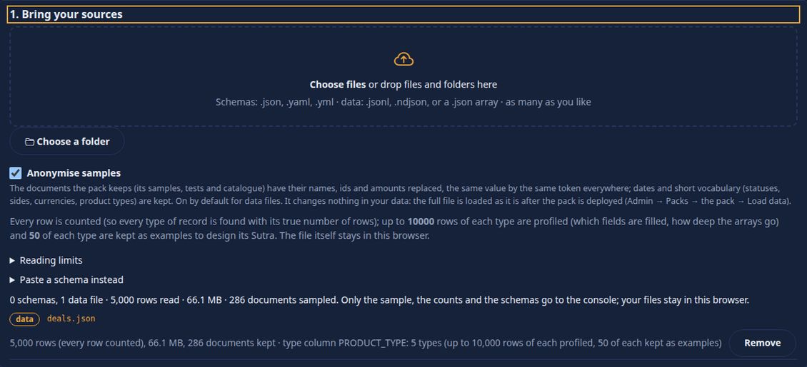

**Anonymise samples** is on by default for data files: before anything leaves the browser's sample, names and ids are replaced the same way
everywhere (`CPTY-0007`), digits by other digits of the same length, amounts scaled; dates and short vocabularies (`Buy`, `Float`) are kept, so the
design is the same. Turn it off only for data you may share.

### 9.2 The card (step 2)

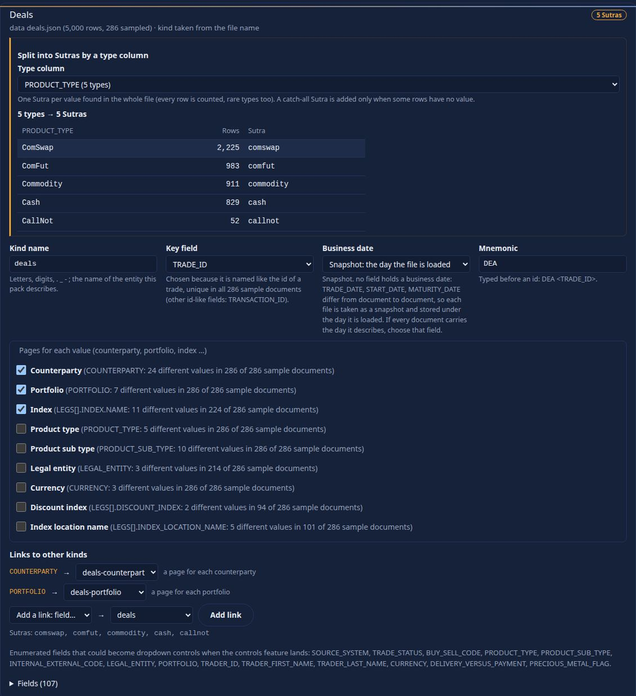

Without choosing anything you should see:

- **Split into Sutras by a type column**: `PRODUCT_TYPE (5 types)`, and *5 types → 5 Sutras*: `ComSwap 2,225 → comswap` … `CallNot 52 → callnot`. The
  rare type is there with its true count. No catch-all: every row has a type.
- **Key field** `TRADE_ID`, *named like the id of a trade, unique in all documents (other id-like fields: TRANSACTION_ID)*.
- **Business date**: *Snapshot: the day the file is loaded* (`TRADE_DATE`, `START_DATE` and `MATURITY_DATE` differ from deal to deal, so none is the
  day of the file). Choose one if every document carries its own day.
- **Pages for each value**: *Counterparty*, *Portfolio* and *Index* (`LEGS[].INDEX.NAME`, found inside the legs) are ticked; each becomes a kind of its
  own, built by the server from the deals (a derived kind), linked both ways.
- **Fields**: `UPPER_SNAKE` read as words; a field blank in every row (`PRECIOUS_METAL_FLAG`) is hidden; a field filled in a few rows shows its *Filled* share.

The same plan from the command line, where every choice has a flag:

```bash
python3 tools/drishti.py pack make deals.json --name book --kind deals --store files --yes
#   deals: key TRADE_ID (named like the id of a trade, unique in all 5000 sample documents (other id-like fields: TRANSACTION_ID));
#   date (none); match PRODUCT_TYPE; 5 Sutra(s); links COUNTERPARTY->deals-counterparty, PORTFOLIO->deals-portfolio
#   deals-counterparty / deals-portfolio / deals-index: key id (the value the documents share); links dealsIds->deals
#   deals 2026-10-16: 5000 rows -> data/build/book-1.0.0/data/files/book/2026-10-16/deals.jsonl   (the day: today's business date)
#   pack make: data/build/book-1.0.0   8 Sutra(s) for 4 kind(s); pack check passed, pack verify passed
# --match COL          another type column
# --key TRADE_ID       --date FIELD (instead of a snapshot)       --as-of 2026-10-16 (the day a snapshot is stored under)
# --related none       no pages per value; --related COUNTERPARTY,PORTFOLIO for these only
# --no-anonymise       keep the samples as they are
```

### 9.3 Pack, preview, deploy (steps 3 to 5)

Name the pack `book` and press Next. The preview drafts the five Sutras and the three page kinds against the server and checks each one.

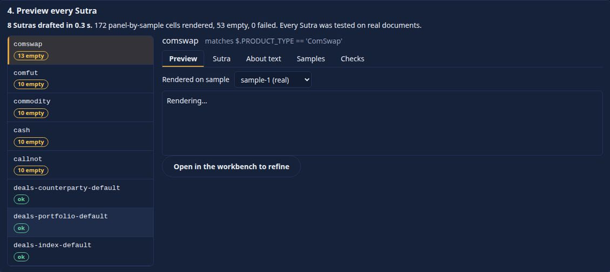

Step 5 downloads the pack or deploys it. What comes out, in `pack.yaml` (shortened):

```yaml
pack: book
kinds: [deals, deals-counterparty, deals-portfolio, deals-index]
connectors: [book-pages, book-store]
routes: {deals: book-store, deals-counterparty: book-pages, deals-portfolio: book-pages, deals-index: book-pages}
ingest:
  deals: {key: TRADE_ID, snapshot: true}       # no business-date field: stored under the day it is loaded
connector-templates:
  book-store:                                  # the File connector the data goes into
    plugin: file
    kinds: [deals]
    settings:
      root: ${DRISHTI_FILES_ROOT:${drishti.data.dir:./data}/files}
      domain: book
      layout:
        deals:
          columns: [TRADE_STATUS, BUY_SELL_CODE, QUANTITY, PRODUCT_SUB_TYPE, COUNTERPARTY, PORTFOLIO, START_DATE, TRADE_ID, ...]
          title: [PRODUCT_TYPE, COUNTERPARTY, PORTFOLIO]
  book-pages:                                  # the pages per value, built from the deals
    plugin: derived
    kinds: [deals-counterparty, deals-index, deals-portfolio]
    settings:
      deals-counterparty:
        from: deals
        group-by: $.COUNTERPARTY
        fields: {count: count, totalQuantity: sum $.QUANTITY, portfolios: distinct $.PORTFOLIO}
      deals-index:
        from: deals
        group-by: first($.LEGS[?@.INDEX.NAME != '']).INDEX.NAME
graph:
  fields:
    COUNTERPARTY: {kind: deals-counterparty, label: Counterparty}
    PORTFOLIO: {kind: deals-portfolio, label: Portfolio}
```

`layout.deals.title` puts the type, counterparty and portfolio after the id in the search title, so typing `CPTY-PRAIRIE` in the command bar offers that
counterparty's deals as well as its page. The pack also carries `sutras/deals/{comswap,comfut,commodity,cash,callnot}.v1.sutra.yaml`, one Sutra for each
page kind, anonymised samples and tests, and `config/bi/` (9.7).

### 9.4 Load the data (Admin → Packs → book → Load data)

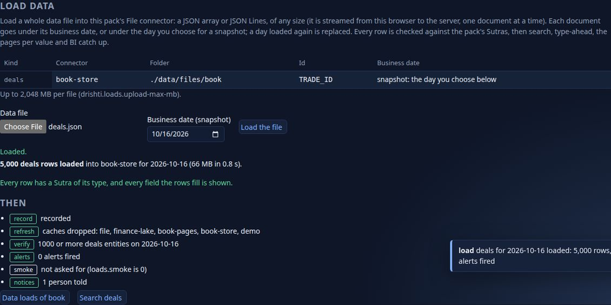

Choose the same `deals.json` and press **Load the file**. It is streamed from the browser to the server (up to `drishti.loads.upload-max-mb`), written
into `book-store` under the business date (a snapshot: today's, or the day you choose; a day loaded again is replaced), and **every row is checked**
against the pack's Sutras: *types with no Sutra* and *fields no Sutra shows* are listed with their counts. Then the load is announced like any other
([DATA_GUIDE.md](DATA_GUIDE.md#1-telling-drishti-new-data-has-landed)): caches are dropped (the pages per value are rebuilt), the day is verified, alerts
and subscriptions run. 5,000 deals take about a second. The same from a script, or offline:

```bash
# over REST, with a token that has packs:admin (a JSON array or JSON Lines)
curl -sS -X POST "http://HOST:18480/api/v1/admin/packs/book/data?kind=deals&date=2026-10-16" \
     -H "Authorization: Bearer $DRISHTI_TOKEN" -H "Content-Type: application/json" --data-binary @deals.json
# offline, into the File connector's folder (JSON Lines)
python3 tools/drishti.py data ingest --from deals.jsonl --pack data/build/book-1.0.0/pack/book --store files --root /path/to/files --as-of 2026-10-16
```

### 9.5 A deal

Type `DEA 100004 <GO>` (or the counterparty's name, and pick the deal).

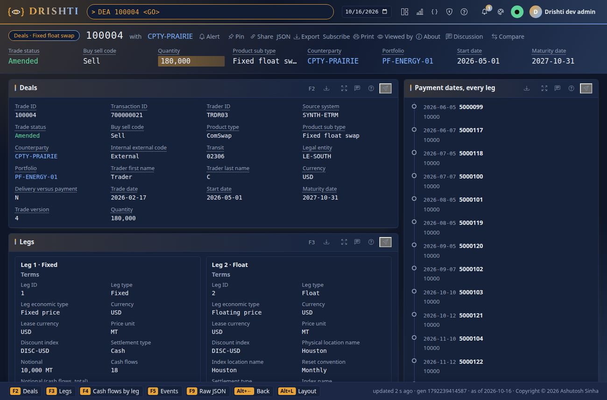

The **strip** (status, side, quantity, sub type, counterparty and portfolio as links, start and maturity); **Deals** (F2): every field the deal fills;
**Legs** (F3): the legs side by side with their own terms; **Cash flows by leg** (F4): a tab per leg, drilling down level by level; **Events** (F5), or
*No events*; on the right the **payment dates of every leg** as one timeline (`flatten($.LEGS[*].CASH_FLOWS)`) and the other deals of the same
counterparty. A ComFut, a Cash payment and a CallNot open with their own Sutras made from their own fields (a cash deal has no legs panel).

### 9.6 Drill down: leg → cash flow → resets

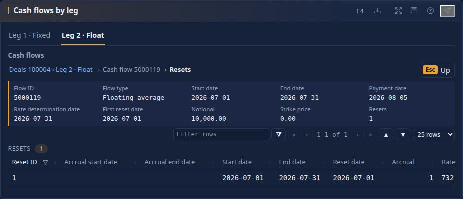

In **Cash flows by leg**, choose *Leg 2 · Float*, then a cash flow's link (`5000119 1 ▸`: one reset). The breadcrumb reads *Deals 100004 › Leg 2 · Float ›
Cash flow 5000119 › Resets*, the cash flow's values sit above as a ticket, and its resets fill the table. Keyboard: ↑ ↓ to a row, Enter or → to open,
**Esc**, Backspace or ← to go up; the browser's Back goes up too, and the address keeps the level and the tab. The Sutra behind it (shortened):

```yaml
  - id: legs-cash-flows
    kind: tabs
    title: Cash flows by leg
    each: "$.LEGS"
    tabTitle: "'Leg ' + @.LEG_ID + ' · ' + @.LEG_TYPE"
    panels:
      - id: legs-cash-flows-rows
        kind: table
        title: Cash flows
        rows: "@.CASH_FLOWS"
        crumb: "'Cash flow ' + @.FLOW_ID"
        root: "'Deals ' + $.TRADE_ID + ' › ' + 'Leg ' + @.LEG_ID + ' · ' + @.LEG_TYPE"
        empty: "No cash flows"
        columns:
          - { label: "Payment date", bind: "@.PAYMENT_DATE", fmt: "date" }
          - { label: "Notional", bind: "@.NOTIONAL", fmt: "amount2", total: true }
          - { label: "Resets", bind: "size(@.RESETS)", fmt: "amount0" }
        levels:
          - rows: "@.RESETS"
            title: "Resets"
            crumb: "'Reset ' + @.RESET_ID"
            columns:
              - { label: "Reset date", bind: "@.RESET_DATE", fmt: "date" }
              - { label: "Rate", bind: "@.RATE", fmt: "price4" }
```

Nothing in it is about trades: any array whose elements hold arrays is drawn this way, to any depth (the structured note of `note_synth.py` drills
*coupon period → observations → fixings*). `levels`, `crumb`, `root` and `empty` are in
[RACHANA_REFERENCE.md](RACHANA_REFERENCE.md#levels-drill-down-level-by-level).

### 9.7 A counterparty, the phone, and BI

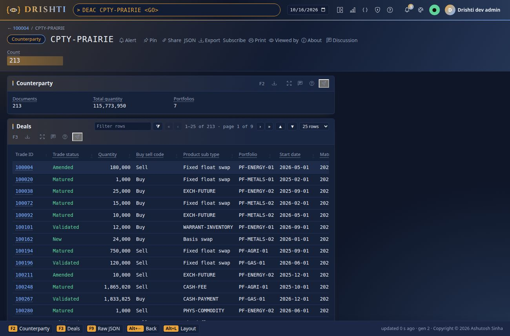

The counterparty link opens `DEAC CPTY-PRAIRIE`: how many deals, the total quantity, how many portfolios, and every deal (filter, sort, page). On a phone
the same deal stacks: the strip in two columns, panels one under another, the function keys along the bottom, nothing wider than the screen.

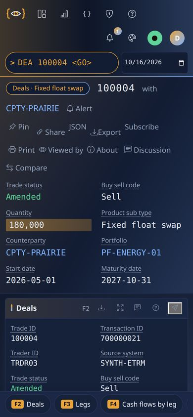

For analysis the pack ships a **BI model** with a table of the table layer for every level, each row carrying the keys above it, so a cash flow can be
counted by its deal's counterparty or its leg's index ([TABLES_GUIDE.md](TABLES_GUIDE.md), [REPORTS_GUIDE.md](REPORTS_GUIDE.md)):

```yaml
# config/bi/models/book-deals.model.yaml (shortened)
rachana: 3
model: book-deals
tables:
  deals: {table: book.deals_deals, role: dimension}
  legs: {table: book.deals_legs, role: fact}              # grain: $.LEGS[*]
  cash_flows: {table: book.deals_cash_flows, role: fact}  # grain: $.LEGS[*].CASH_FLOWS[*], with ^.LEG_ID
  resets: {table: book.deals_resets, role: fact}          # grain: $.LEGS[*].CASH_FLOWS[*].RESETS[*], with ^.FLOW_ID and ^^.LEG_ID
  events: {table: book.deals_events, role: fact}
relationships:
  - {from: legs.id, to: deals.id}
  - {from: cash_flows.id, to: deals.id}
measures:
  Leg notional: {expr: sum(legs.NOTIONAL), format: amount0}
  Cash flows: {expr: count(cash_flows)}
```

```bash
python3 tools/drishti.py bi mq --model book-deals@1 --select deals.PRODUCT_TYPE --measures "Deals documents,Cash flows,Resets" --server http://HOST:18480 --token-file my-token.txt
```

The deal screen is generic: valuation, curve or fixing history beside a floating leg, and a cash-flow ladder netted by date need a quant engine or a
hand-written Sutra on top of the generated one.

## 10. A pack from JSON Lines: `pack new`

`drishti.py pack new` turns existing data (one JSON document per line, or the loader envelope `{"kind","id","doc"}`) into a complete pack without
writing a generator: kinds, Sutras (one per value combination of the fields you name), samples, tests, a form, an About skeleton, a lake or files
store, and a README. Input is a folder of `*.jsonl` (`-r` for subfolders) and/or single `.jsonl` files; the kind is the file stem unless `--kind` is
given. It uses the `sutra design --each` command of the server's exec jar (build the server first; `--jar`/`--java` to choose). The whole command line
(`pack make`, `pack check`, `pack about-check`, `pack regenerate`, loading into a running server) is in [CLI_REFERENCE.md](CLI_REFERENCE.md); shipping a finished
pack as a versioned, checksummed bundle (`pack bundle`, `verify`, `deploy`, `rollback`) is in [OPERATIONS_GUIDE.md](OPERATIONS_GUIDE.md#8-deploy-promote-and-roll-back-by-copying).

Worked example, run as written: 300 ENDUR trades on two business days (600 rows, with a `BUSINESS_DATE` added) and the 22 counterparties they name,
taken from `data/testdata/` into a folder `jsonl/` (`trade.jsonl`, `counterparty.jsonl`):

```bash
drishti-console/.venv/bin/python tools/drishti.py pack new jsonl/ --name my-bank --title "My bank" \
    --key trade=TRADE_ID,counterparty=COUNTERPARTY_ID --match trade=PRODUCT_TYPE --date BUSINESS_DATE \
    --samples 3 --fallback --out packs/my-bank --lake lake/
```

```text
622 documents, 2 kind(s), 7 group(s)
drafting 7 Sutra(s) with one `sutra design --each` run ...
kind            group                                          docs samples  sutra
counterparty    (all)                                            22       3  counterparty-default
trade           PRODUCT_TYPE=CallNot                             12       3  trade-callnot
trade           PRODUCT_TYPE=Cash                               112       3  trade-cash
trade           PRODUCT_TYPE=ComFut                             110       3  trade-comfut
trade           PRODUCT_TYPE=ComSwap                            290       3  trade-comswap
trade           PRODUCT_TYPE=Commodity                           76       3  trade-commodity
trade           (all)                                           600       3  trade-default
kind                business date        rows
counterparty        2026-09-23             22
trade               2026-09-22            300
trade               2026-09-23            300
total rows: 622
Dated store (delta): 622 rows written to lake/ (domain my-bank); 0 document(s) without a date or id skipped
pack written to packs/my-bank
```

It then runs `sutra lint` and `sutra test` on the new pack (both exit `0`, with help warnings for the fields the About skeleton does not explain yet:
`trade-comswap: help coverage 19/35 (54%)`). What it wrote:

```text
packs/my-bank/
  pack.yaml                 code MB, mnemonics COU and TRA (initials; --mnemonic kind=ABC to choose), columns, form, connectors: [my-bank-store]
                            with its connector-templates (delta, domain my-bank, layout columns per kind), routes, ingest
  sutras/trade/             trade-callnot, trade-cash, trade-comfut, trade-commodity, trade-comswap, trade-default (.v1.sutra.yaml)
  sutras/counterparty/      counterparty-default.v1.sutra.yaml
  tests/<sutra>/            three samples each and expect.yaml
  samples/                  catalog.jsonl, trade.jsonl, counterparty.jsonl (--catalog-samples, 25 a kind by default)
  config/about.yaml         TODO glossary entries for every field the Sutras show
  generated/                what pack new generated: the base `pack regenerate` merges your edits against (keep it with the pack)
  README.md
```

```bash
DRISHTI_PACKS=my-bank DRISHTI_DELTA_ROOT=$PWD/lake java -jar kernel/drishti-server/target/drishti-server-*-exec.jar     # alone: see below
```

**What each generated Sutra shows**, from the data's shape (the server's auto-designer; the same rules draft Build's auto-design):

| The data | The screen |
|---|---|
| the id, a link to a party | the title: `id: $.TRADE_ID`, `with: link($.COUNTERPARTY, 'counterparty')` (a party first: counterparty, client, issuer); F7/F8 open the links |
| key figures | the strip, in the order of `drishti.builder.key-figures`: currency, side (`B`/`S` read as Buy/Sell), notional, value (MTM, PV: emphasised), quantity, trade date, maturity, status, book; a figure not at the top comes from the first record of a list (`first($.LEGS).NOTIONAL`); `strip-max` 8 |
| top-level fields | **Details**: every field with a value in the samples (up to `details-max`), grouped by `detail-groups` (identity, product, parties), then links, dates and amounts; links open their entity, a list of plain values (`["CFTC", "EMIR"]`) reads as one line |
| a nested object | its own section of labelled values (`SETTLEMENT_INSTRUCTIONS` -> *Settlement instructions*) |
| a list of records holding lists (at most `tabs-max`) | tabs, side by side for up to three: *Terms* (with the record's nested objects, `INDEX.NAME` -> *Index name*), per inner list a chart (amounts by date as a ladder, a notional or balance as a step line: *Notional profile*) and a table (*Cash flows and resets*, opening to the inner list, first column *Flow / reset*), and a chart of the innermost dated values (*Resets (rate)*, shown only when there are any); plus the inner list across all records (*Cash flows, every leg*) |
| a list of dated amounts with a label | a table (dates first, amounts signed with a total), a ladder of the amounts by date (by month past 24 dates) on the right, a timeline (`EVENT_TYPE` as the label) |

Labels come from the field names in the house style (`TRADE_DATE` -> *Trade date*, with the packs' acronyms: *SSI ID*, *Our agent BIC*);
formats from names and values: dates, amounts, signed amounts, rates as percentages (`pct4`), prices and rates above 1 to four places
(`price4`). A field blank (`""`) in some records and a number or a date in others, or a decimal written as text (`"2332.9131"`), is typed
by its values; a field blank in every sample is left out. `tools/test_sutragen_quality.py` generates Endur-, Calypso- and Murex-like nested
trades and scores the generated screens against the hand-built trading Sutras (panel kinds, sub-tables of the arrays, charts of the dated
amounts, key strip, title, keys) with a bar of 90%, `sutra lint` and `sutra test` passing; what a screen cannot match is what its data
does not carry (a quantity that is always null, resets that are always empty, a single cash flow is no chart).

- **The folder name is the pack name.** `--out` defaults to `config/packs/<domain>/<name>`; a folder with another name makes `sutra lint` refuse the pack
  (`pack.yaml declares pack 'my-bank', expected 'mybank'`).
- **Kinds must be free.** This example's kinds are `trade` and `counterparty`, which the shipped `trading` and `core` own, so it loads alone
  (`DRISHTI_PACKS=my-bank`). For a pack that joins the seven, name your kinds yourself (`--kind`) or extend the shipped pack and serve its kind from your
  connector ([section 29.3](#293-inheritance)).
- **`--key`, `--date`, `--match`** are dotted paths, one value for every kind or per kind (`--match trade=PRODUCT_TYPE,SOURCE_SYSTEM;counterparty=TYPE`).
  A match value is quoted by type in the generated `where` (`$.PRODUCT_TYPE == 'ComSwap'`, `$.SIZE == 3`, `$.LIVE == true`); a document lacking a match
  field forms a `$.F == null` group (`--skip-missing` leaves it out). `--min-docs`, `--priority` (default 10), `--fallback` (adds `<kind>-default`,
  priority 1), `--name-prefix` and `--samples N` (deterministic; with `--date` spread across dates, newest first).
- **`--date`** names the business-date field: it is kept out of the match; the pack gets a Delta (or File) connector, `routes` and an `ingest:` block;
  the lake is partitioned by `business_date`. Documents without the date are reported and left out; kinds without `--date` are served from `samples/`.
- **`--store files --files-root DIR`** writes the File layout (`DIR/<pack>/<date>/<kind>.jsonl`, served with `DRISHTI_FILES_ROOT=DIR`) instead of a lake.
  `--force` overwrites an existing `--out`.
- **New days later:** `drishti.py data ingest --from new/trade.jsonl --pack config/packs/my-bank --lake lake/` replaces only the dates in the input
  (`--mode overwrite-dates`, the default; `append` adds, `replace` rewrites the table; `--dry-run` prints counts per kind and date); a running server
  picks the new data up at its next refresh, or at once with the data-load signal. For large exports, `drishti.py lake build` streams the input with
  flat memory ([CLI_REFERENCE.md](CLI_REFERENCE.md)).
- **New data, new shapes:** `drishti.py pack regenerate` drafts Sutras, About text and tests from the new data and three-way merges them into the pack
  against `generated/`, keeping your edits.
- **Version rule.** `version:` is **X.Y.Z** (optionally `-pre-release` and `+build`, such as `2.0.0-rc.1`); `pack bundle`, `pack make --version`,
  Build → New pack and the server's deploy check refuse anything else. For your own JSON Lines files the New pack page's default source is the **File
  connector** (its generated template tells you to set `root`).

## 11. What a Sutra is, and when one applies

A **Sutra** is one YAML file, `<name>.v<N>.sutra.yaml`, that holds one layout: which panels to draw, in which order, bound to which parts of a JSON
document. Its first key is always `rachana: 1`, the version of the Rachana language it is written in. It says nothing about pixels or code. One Sutra
lays out a whole *family* of entities: every counterparty, or every Murex fixed/float swap. Sections 11 to 27 teach Sutras by doing, against the demo
lakes; every key, option, format, tone, function and problem code is in [RACHANA_REFERENCE.md](RACHANA_REFERENCE.md), and twelve small working Sutras
with their own documents, together using every panel kind, are in [examples](examples/README.md) (in the workbench, Build → New screen → Examples opens
each as your own copy).

**What you need:** the quick-start stack of [OPERATIONS_GUIDE.md](OPERATIONS_GUIDE.md#2-install-and-run-on-one-machine) (the demo lakes built with `drishti.py lake demo`, the server on
`http://localhost:18480` with the seven packs, the console on `http://localhost:17480`); for the command-line checks, `curl`, `python3` and a personal
API token with the scope `design:write` (**My account → API tokens**):

```bash
export DRISHTI=http://localhost:18480/api/v1
AUTH="Authorization: Bearer $DRISHTI_TOKEN"
```

When you open an entity (`CPTY CP-MERIDIAN-RE <GO>`, or `/v/counterparty/CP-MERIDIAN-RE`), Drishti:

1. fetches its document (here from the `reference-store` Delta connector of the `core` pack);
2. looks for a Sutra whose `match.kind` is the entity's kind and whose `where` condition holds, highest `priority` first;
3. if it finds one, lays out the view by it and lets **inference** fill only what it leaves out; if none, lays out the whole view by inference
   ([RACHANA_REFERENCE.md](RACHANA_REFERENCE.md#inference-the-screens-drishti-draws-with-no-sutra)).

The bottom panel of every view, *How this view was built*, tells you which case applied. So does the API:

```bash
curl -s -H "$AUTH" $DRISHTI/views/counterparty/CP-MERIDIAN-RE | python3 -c "import json,sys; print(json.load(sys.stdin)['provenance']['layout'])"
```

You should see `Sutra counterparty v1 + inference`. You write a Sutra when inference is not good enough: when the identifier, the headline figures, the
formats or the choice of chart should be what a person who knows the domain would choose.

### 11.1 Anatomy at a glance

```yaml
rachana: 1                           # the language version, always first
sutra: irs-fixfloat                  # name: lower-case kebab
version: 1
description: Exchanges fixed for floating RFR-compounded payments.
match: { kind: trade, where: "$.SOURCE_SYSTEM == 'MUREX' && $.PRODUCT_TYPE == 'IRS_FIXFLOAT'", priority: 10 }
title: { pill: "Rates · Interest rate swap (fixed/float)", id: $.TRADE_ID, with: "link($.COUNTERPARTY, 'counterparty')" }
strip: [ ... up to eight header figures ... ]
controls: [ ... up to twelve choices the reader makes ... ]
panels: [ ... the panels, in reading order (or { use: <block> } for shared ones) ... ]
keys: { F7: "link($.COUNTERPARTY, 'counterparty-trades')", F8: impact, F9: raw }
```

| Part | What it does |
|---|---|
| `rachana` | The Rachana language version: `1`. Without it, or with one this server does not read, the file is refused (`DRS-2009`) |
| `sutra`, `version` | The identity, `name@version`, unique. Keep old versions: saved views and history reproduce with the version they used |
| `description`, `notes` | Plain text for people (not Markdown): one paragraph, and longer notes for the next author and the reviewer. Never change the view |
| `match` | Which documents this Sutra lays out: a `kind`, an optional `where` over the document, and a `priority` ([section 15](#15-matching-several-sutras)) |
| `title` | The title line: a `pill`, the identifier (`id`), and `with` (usually the counterparty, as a link) |
| `strip` | The header figures, at most eight. `emphasis: true` highlights the one the desk watches |
| `controls` | Dropdowns, date ranges, sliders the reader sets; panels read them as `ctl.<id>` ([section 22.4](#224-controls-let-the-reader-choose)) |
| `panels` | The body. Each has an `id`, a `kind` and the options of that kind; `area: right` puts one in the side column; `{ use: legs@1 }` inserts a shared block |
| `keys` | Function keys: `F2`-`F12` go to panels (a panel's own `key:`), links (`link(...)`), `impact` (F8) or `raw` (F9) |

A Sutra lives in a Sutra folder of a pack (`config/packs/<domain>/<pack>/sutras/`, any sub-folders) or of the site (`./sutras`, setting
`drishti.rachana.dirs`). Problems report the file's own line and column. Every key and its default: [the reference](RACHANA_REFERENCE.md#top-level).

## 12. Your first Sutra: a counterparty

### 12.1 Look at the data

Always start from the document itself: open `CPTY CP-MERIDIAN-RE <GO>` and press **F9** (*Raw JSON*), or
`curl -s -H "$AUTH" $DRISHTI/entities/counterparty/CP-MERIDIAN-RE/raw | python3 -m json.tool`. Under `data` (shortened):

```json
{
  "COUNTERPARTY_ID": "CP-MERIDIAN-RE",
  "NAME": "Meridian Reinsurance Ltd",
  "LEI": "549300HGCM5CFCB6ZB96",
  "RATING": "A",
  "SECTOR": "Insurance",
  "TYPE": "Insurer",
  "COUNTRY_OF_RISK": "BM",
  "UEN": "UEN0100407",
  "ECONOMY": "ECON-BMU",
  "NET_MTM": -191313445.24,
  "NETTING_SETS": [
    { "ID": "NS-MERIDIAN-RE-FRA", "AGREEMENT": "AGR-MERIDIAN-RE-ISDA", "TRADES": 45, "NET_MTM": 10804024.63 },
    { "ID": "NS-MERIDIAN-RE-LDN", "AGREEMENT": "AGR-MERIDIAN-RE-ISDA", "TRADES": 191, "NET_MTM": -316071571.84 },
    …
  ],
  "KYC": { "STATUS": "Approved", "RISK_RATING": "Standard", "LAST_REVIEW": "2026-02-11", "EMIR_CLASSIFICATION": "FC", "PD_1Y": 0.0006 },
  "GROUP": "GRP-MERIDIAN",
  "CREDIT_LIMIT": "LIM-MERIDIAN-RE",
  "LEGAL_ENTITY": "LE-NY"
}
```

Read it the way a Sutra will: `$` is this whole document, `$.NAME` is `Meridian Reinsurance Ltd`, `$.KYC.STATUS` is `Approved`, `$.NETTING_SETS` is a
list of four objects, and `$.NETTING_SETS[0].ID` is `NS-MERIDIAN-RE-FRA`. A path names fields exactly (`$.net_mtm` is empty).

### 12.2 The smallest Sutra that works, and its preview

```yaml
rachana: 1
sutra: counterparty-mine
version: 1
match: { kind: counterparty, priority: 20 }
panels:
  - id: identity
    kind: kv
    title: Identity
    columns:
      - { label: Name, bind: $.NAME }
      - { label: LEI, bind: $.LEI }
```

`sutra:` is lower-case letters, digits and hyphens, starting with a letter; `version:` a plain integer; `priority: 20` puts it ahead of the `core` pack's
`counterparty` Sutra (priority 10); `kind: kv` is a label/value grid, and each column's `bind` says where its value comes from.

**In the UI.** Open **Build → New screen**, bring `CP-MERIDIAN-RE` as a stored entity (kind `counterparty`; [Start: bring data](RACHANA_REFERENCE.md#1-start-bring-data))
and choose *an empty Sutra*. In the **YAML** tab replace the text with the YAML above and press **Ctrl+Enter**. The **Design** tab shows a view titled
`CP-MERIDIAN-RE` with one panel, *Identity*: `Name Meridian Reinsurance Ltd`, `LEI 549300HGCM5CFCB6ZB96`. A preview always uses the text in the editor,
whatever its `match` says, and writes no file.

**From the command line.** The preview is one call, `POST /api/v1/studio/preview` with the YAML, a kind and an id (`design:write` scope):

```bash
python3 -c "import json,sys; print(json.dumps({'yaml': open(sys.argv[1]).read(), 'kind': 'counterparty', 'id': 'CP-MERIDIAN-RE'}))" \
    counterparty-mine.v1.sutra.yaml > preview.json
curl -s -H "$AUTH" -H 'Content-Type: application/json' --data @preview.json $DRISHTI/studio/preview \
  | python3 -c "import json,sys; v=json.load(sys.stdin); [print(p['id'], [(f['label'], f.get('text')) for f in p['data'].get('fields', [])]) for p in v['panels']]"
```

You should see `identity [('Name', 'Meridian Reinsurance Ltd'), ('LEI', '549300HGCM5CFCB6ZB96')]`.

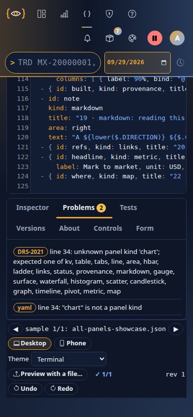

If the text has a problem, the **Problems** tab lists each one with its code, line and reason (`DRS-2021 line 7: unknown panel kind 'chart'`); click one
to jump to the line, and the design keeps its last good Sutra. The preview call answers `422` with the same list
([section 27](#27-common-mistakes-and-their-messages)).

### 12.3 A title, a description, a strip

```yaml
title: { pill: "Counterparty · ${$.SECTOR}", id: $.COUNTERPARTY_ID, with: $.NAME }
description: Counterparties for the credit desk.
notes: |
  Who the bank faces, how much is netted where, and the KYC state.
  Priority 20 puts it ahead of the core pack's own counterparty Sutra (priority 10).
strip:
  - { label: Rating, bind: $.RATING, emphasis: true }
  - { label: Country of risk, bind: $.COUNTRY_OF_RISK }
  - { label: UEN, bind: $.UEN }
  - { label: Net MTM, bind: $.NET_MTM, fmt: signed0, tone: sign }
  - { label: Credit limit, bind: $.CREDIT_LIMIT, fmt: compact }
  - { label: Netting sets, bind: "size($.NETTING_SETS) + ' sets, ' + fmt(sum($.NETTING_SETS, 'TRADES'), 'amount0') + ' trades'" }
```

- The title line is `[pill] ID with <something>`. `pill` is a **template**: `${…}` is replaced by the value of an expression. You should see
  `[Counterparty · Insurance] CP-MERIDIAN-RE with Meridian Reinsurance Ltd`. Without a `title:` the identifier is `$.id`, else the entity's own id.
- `description` is one paragraph; the workbench, the catalogue and the *About this page* drawer show it as written. Text that has to change with the
  entity belongs in the pack's `config/about.yaml` ([section 7.2](#72-about-text-and-glossary)). `notes` is longer text for the next author and for
  reviewers, a YAML block (`notes: |`). A panel can have its own `description`. None of these change the view; `notes:` followed by a list is
  `DRS-2012 'notes' is plain text`.
- The strip: you should see `Rating A` (highlighted), `Country of risk BM`, `UEN UEN0100407`, `Net MTM −191,313,445` in the negative colour, `Credit
  limit 3.5bn` and `Netting sets 4 sets, 596 trades`. `fmt: signed0` gave a sign, no decimals and a true minus; `fmt: compact` reads `3.5bn` (the core
  formats are `amount0`, `amount2`, `signed0`, `signed2`, `pct0`, `pct2`, `price2`, `compact`, `date`, `dmy` and `text`; packs add `pct4`, `price4`, `bp1`
  …: [formats](RACHANA_REFERENCE.md#formats)); `tone: sign` coloured it; `size`, `sum`, `fmt` and `+` make the last figure (an expression in double
  quotes for YAML, text inside it in single quotes). Use `emphasis: true` once.

### 12.4 Key/value panels, written and inferred

```yaml
  - id: identity
    kind: kv
    title: Identity and classification
    key: F2
    columns:
      - { label: LEI, bind: $.LEI }
      - { label: Type, bind: $.TYPE }
      - { label: Legal entity, bind: "link($.LEGAL_ENTITY, 'legal-entity')" }
      - { label: Probability of default (1y), bind: $.KYC.PD_1Y, fmt: pct2 }
  - id: kyc
    kind: kv
    title: KYC
    area: right
    rows: $.KYC
```

You should see *Identity and classification* with `LEI 549300HGCM5CFCB6ZB96`, `Type Insurer`, `Legal entity LE-NY` (a link: `link(id, kind)` makes any
value navigable) and `Probability of default (1y) 0.06%`; and on the right *KYC* with `Status Approved`, `Risk rating Standard`, `Last review
2026-02-11`, `EMIR classification FC` and `PD 1y 0`. The second panel lists no columns: `rows: $.KYC` points it at an object, and inference fills one
field per scalar, labelled from the field names in words. That picks up new fields when the source adds them, but shows `0.0006` with no format: list
columns when you want to choose labels, order and formats.

`key: F2` binds F2 to the panel; `area: right` puts it in the side column. `span: 6` (of a 12-column grid) makes a panel half as wide and `height: 8`
gives it a fixed height; users may also arrange a view for themselves in layout mode (`Alt+L`), which never changes the Sutra
([keys every panel takes](RACHANA_REFERENCE.md#keys-every-panel-takes)).

### 12.5 A table with links and totals, and a chart

```yaml
  - id: sets
    kind: table
    title: "Netting sets (${size($.NETTING_SETS)})"
    key: F3
    rows: $.NETTING_SETS
    columns:
      - { label: Netting set, bind: "@.ID", link: true }
      - { label: Agreement, bind: "@.AGREEMENT", link: true }
      - { label: Trades, bind: "@.TRADES", fmt: amount0, total: true }
      - { label: Net MTM, bind: "@.NET_MTM", fmt: signed0, tone: sign, total: true }
  - id: by-set
    kind: hbar
    title: Net MTM by netting set
    key: F4
    area: right
    rows: $.NETTING_SETS
    label: ID
    value: NET_MTM
    fmt: compact
    tone: sign
```

Inside a table, `@` is the current row. You should see `Netting sets (4)`, four rows from `NS-MERIDIAN-RE-FRA · AGR-MERIDIAN-RE-ISDA · 45 ·
+10,804,025`, the ids as links that open `NSET …` and `AGR …`, and a `Total` row of `596` trades and `−191,313,445`. `link: true` made the ids links
(the packs declare that `NS-` ids are netting sets and `AGR-` agreements); a column bound to a plain path whose last field ends in `_ID` or `_REF` is
linked without it. A table can also offer its rows as an interactive pivot: `pivot: true` (or `pivot: { fields, rows, values }`) gives the panel a
**Table | Pivot** switch ([the pivot option](RACHANA_REFERENCE.md#pivot-pivot-on-a-table-or-ladder)).

For an `hbar` (and a `line` or `area`), `label` and `value` are **field names** of each row, written exactly as the document writes them: not
expressions (no `@.`), and `id` would not find `ID`. You should see four bars, `NS-MERIDIAN-RE-LDN −316.1m` in the negative colour. The key bar shows
`F4 Net MTM`: a panel key is labelled with the first two words of the title, cut at ` (` or ` · `, so write titles whose first words make sense alone.

### 12.6 Linked entities, provenance and keys: the whole Sutra

```yaml
rachana: 1
sutra: counterparty-mine
version: 1
description: Counterparties for the credit desk.
match: { kind: counterparty, priority: 20 }
title: { pill: "Counterparty · ${$.SECTOR}", id: $.COUNTERPARTY_ID, with: $.NAME }
strip:
  - { label: Rating, bind: $.RATING, emphasis: true }
  - { label: Country of risk, bind: $.COUNTRY_OF_RISK }
  - { label: UEN, bind: $.UEN }
  - { label: Net MTM, bind: $.NET_MTM, fmt: signed0, tone: sign }
  - { label: Credit limit, bind: $.CREDIT_LIMIT, fmt: compact }
  - { label: Netting sets, bind: "size($.NETTING_SETS) + ' sets, ' + fmt(sum($.NETTING_SETS, 'TRADES'), 'amount0') + ' trades'" }
panels:
  - id: identity
    kind: kv
    title: Identity and classification
    key: F2
    columns:
      - { label: LEI, bind: $.LEI }
      - { label: Type, bind: $.TYPE }
      - { label: Legal entity, bind: "link($.LEGAL_ENTITY, 'legal-entity')" }
      - { label: Probability of default (1y), bind: $.KYC.PD_1Y, fmt: pct2 }
  - id: sets
    kind: table
    title: "Netting sets (${size($.NETTING_SETS)})"
    key: F3
    rows: $.NETTING_SETS
    columns:
      - { label: Netting set, bind: "@.ID", link: true }
      - { label: Agreement, bind: "@.AGREEMENT", link: true }
      - { label: Trades, bind: "@.TRADES", fmt: amount0, total: true }
      - { label: Net MTM, bind: "@.NET_MTM", fmt: signed0, tone: sign, total: true }
  - { id: built, kind: provenance, title: How this view was built }
  - { id: by-set, kind: hbar, title: Net MTM by netting set, key: F4, area: right, rows: $.NETTING_SETS, label: ID, value: NET_MTM, fmt: compact, tone: sign }
  - { id: refs, kind: links, title: Linked entities, code: REFS, area: right }
  - { id: kyc, kind: kv, title: KYC, area: right, rows: $.KYC }
keys: { F7: "link($.GROUP, 'counterparty-group')", F8: impact, F9: raw }
notes: |
  Who the bank faces, how much is netted where, and the KYC state.
  Priority 20 puts it ahead of the core pack's own counterparty Sutra (priority 10).
```

`links` lists every entity the document refers to, found from the packs' reference fields: `Economy ECON-BMU` with the badge `+1.89 % growth`, `Group
GRP-MERIDIAN`, `Credit limit LIM-MERIDIAN-RE` and others. `provenance` says how the view was built (`Layout Sutra counterparty-mine v1 + inference`, a
fingerprint of the document's shape, the source). `keys` adds function keys that are not panels; panel keys and these share F1–F12, and F1 is the
console's help. You should see the key bar `F2 Identity and`, `F3 Netting sets`, `F4 Net MTM`, `F7 Counterparty group`, `F8 Impact`, `F9 Raw JSON`.
Preview it against another counterparty (`CP-NORTHPLAINS`): the same layout serves every counterparty.

## 13. Rachana-EL step by step

Every `bind`, `rows`, `where` and `highlight` is a Rachana-EL expression. This section builds them up against the Murex swap `MX-20000001` (look at it
with `curl -s -H "$AUTH" $DRISHTI/entities/trade/MX-20000001/raw | python3 -m json.tool`; its shape is in [section 6.1](#61-the-shape-of-the-document)).
Every function is in [FUNCTIONS.md](FUNCTIONS.md) and the [reference](RACHANA_REFERENCE.md#functions).

**Paths.**

| You write | You get | Why |
|---|---|---|
| `$.QUANTITY` | `242000000` | a field of the document |
| `$.LEGS[0].LEG_TYPE` | `FIXED` | `[0]` is the first element |
| `$.LEGS[-1].INDEX.NAME` | `AONIA` | `[-1]` is the last; `.` walks into objects |
| `$.LEGS[0].CASH_FLOWS[1].PAYMENT_DATE` | `2027-06-29` | array, object, array, field: as deep as the data goes |
| `$.LEGS[1].CASH_FLOWS[0].RESETS[0].RATE` | `0.035376` | four levels down: the first fixing of the floating leg |
| `$.COUNTERPARTY` | `CP-MERIDIAN-RE` | a reference: `link($.COUNTERPARTY, 'counterparty')` opens it |
| `$['TRADE_ID']` | `MX-20000001` | brackets: for a field whose name has a hyphen (`$['day-count']`; `$.day-count` would subtract) |
| `$.QUANTTY` | *(empty)* | a misspelt field is empty, never an error: check spelling in the preview |

**Rows: `@` and `#index`.** Inside `rows:`, `each:` or a filter, `@` is the current element and `#index` its position (from 0): `bind: "@.RATE"` is each
row's own rate; `highlight: "@.PAYMENT_DATE == first($.EVENTS[?@.EVENT_DATE > today()]).EVENT_DATE"` lights the next payment;
`tabTitle: "'Leg ' + @.LEG_ID"` reads `Leg 1`, `Leg 2`.

**Filters.** `[?condition]` keeps the elements for which the condition holds:

| Expression | Result for `MX-20000001` |
|---|---|
| `size($.EVENTS)` | `42` |
| `size($.EVENTS[?@.EVENT_TYPE == 'CASH_SETTLEMENT'])` | `35`: one per payment of either leg |
| `size($.EVENTS[?!nonblank(@.LEG_ID)])` | `7`: the deal's own events (booked, confirmed, cleared, amended…) |
| `size($.EVENTS[?nonblank(@.AMOUNT) && @.EVENT_DATE > today()])` | `29` on the business date 2026-10-16: the cash events still to come |
| `first($.LEGS[?@.LEG_TYPE == 'FLOAT']).INDEX.NAME` | `AONIA`: the floating leg, wherever it sits (`$.LEGS[?…][0]` is the same) |
| `$.LEGS[?@.LEG_ECONOMIC_TYPE == 'Pay'][0].LEG_ID` | `2`: the first leg we pay |
| `$.LEGS[?@.LEG_TYPE == 'FLOAT'].INDEX.NAME` | *(empty)*: a filter gives a list; take an element first (`first(...)`, `[0]`) |
| `$.LEGS[*].LEG_ID` | the list `[1, 2]`: **projection**, a field of every element (what a control's `options` read) |
| `size(flatten($.LEGS[*].CASH_FLOWS))` | `35`: every period of every leg as one list (`size($.LEGS[1].CASH_FLOWS)` is `28`) |
| `size(flatten($.LEGS[1].CASH_FLOWS[*].RESETS))` | `90`: every fixing of the floating leg |
| `size(flatten($.LEGS[1].CASH_FLOWS[*].RESETS)[?!nonblank(@.RATE)])` | `75`: fixings of the floating leg not yet known |

The extracts write a missing value as empty text (`"AMOUNT": ""`), so test for a value with `nonblank(...)`, which skips `""` and spaces as well as null,
not with `coalesce`, which keeps it.

**Functions.**

| Before | After | Shows |
|---|---|---|
| `bind: $.QUANTITY, fmt: amount0` | `bind: "$.CURRENCY + ' ' + fmt(first($.LEGS).NOTIONAL, 'amount0')"` | `AUD 242,000,000` |
| `bind: "$.LEGS[0].NOTIONAL + $.LEGS[1].NOTIONAL"` | `bind: "sum($.LEGS, 'NOTIONAL')", fmt: amount0` | `484,000,000` |
| `bind: "coalesce($.PACKAGE_ID, 'none')"` (empty text is kept) | `bind: "nonblank($.PACKAGE_ID, 'none')"` | `none` |
| `where: "$.TRADE_STATUS == 'amended'"` (never true: case matters) | `where: "lower($.TRADE_STATUS) == 'amended'"` | true for `AMENDED` |
| `where: "$.PRODUCT_SUB_TYPE == 'swap'"` | `where: "contains($.PRODUCT_SUB_TYPE, 'swap')"` | `contains` and `startsWith` ignore case |
| `bind: $.TRADER_ID` | `bind: "link($.TRADER_ID, 'trader', $.TRADER_FIRST_NAME + ' ' + $.TRADER_LAST_NAME)"` | `A. Shah`, a link to the trader |
| a total per year the data does not carry | `rows: "group($.EVENTS[?nonblank(@.AMOUNT) && nonblank(@.LEG_ID)], 'EVENT_DATE', 'AMOUNT', 'year')"` | one row a year, `2025 −3,713,969` first |
| days to maturity | `bind: "days(today(), $.MATURITY_DATE)"` | `2079` on 2026-10-16 |

There is no list literal (`['AUD', 'NZD']` does not compile).

**Formats and tones.** `fmt:` decides how a value reads; `tone:` its colour:

| Value | `fmt` | `tone` | Shows |
|---|---|---|---|
| `242000000` | `amount0` | | `242,000,000` |
| `242000000` | `signed0` | `sign` | `+242,000,000`, positive colour |
| `-155245` | `signed0` | `sign` | `−155,245`, negative colour (a true minus sign) |
| `0.040829` | `pct4` | | `4.0829%` |
| `0.040829` | `price4` | | `0.0408` (a price per unit: no scaling) |
| `242000000` | `compact` | | `242.0m` |
| `2025-07-25` | `dmy` | | `25 Jul 2025` |
| `AMENDED` / `Pending` | | `status` | `ok` colour / `warn` colour |

`tone: status` reads the words: *fail*, *reject*, *dispute*, *breach* are bad; *pending*, *unmatched*, *warn* a warning; anything else fine. So it suits
confirmation and settlement statuses, not a credit rating (`CCC` would show as fine).

**Conditions** combine with `&&`, `||` and `!`, and choose with `? :` (`bind: "$.BUY_SELL_CODE == 'B' ? 'Buy' : 'Sell'"`). Three things to know:
`<`, `>`, `<=`, `>=` compare numbers as numbers and texts as text, so ISO dates order correctly (`@.PAYMENT_DATE < today()` tells a paid flow from one to
come), and anything against empty is false; `||` gives `true` or `false`, not a value (`$.STRATEGY || 'n/a'` shows `true`: use `nonblank`); `+` adds
only when both sides are numbers, otherwise it joins text (`'1' + 1` is `11`), and a missing value in arithmetic gives `NaN` (wrap it,
`nonblank($.QUANTTY, 0) * 2`).

## 14. A trade view, built step by step

Now a bigger layout: the swap `MX-20000001` in the common schema of all source systems ([section 5.2](#trading-one-schema-three-source-systems)). Open
the workbench on it (Build → New screen, the stored entity `trade` `MX-20000001`, an empty Sutra) and grow the Sutra one block at a time in the YAML
tab, previewing each.

### 14.1 Identity, title and strip

```yaml
rachana: 1
sutra: swap-desk
version: 1
description: Fixed/float swaps for the rates desk.
match:
  kind: trade
  where: "$.SOURCE_SYSTEM == 'MUREX' && $.PRODUCT_TYPE == 'IRS_FIXFLOAT'"
  priority: 20
title:
  pill: "${$.PRODUCT_GROUP} · ${$.PRODUCT_SUB_TYPE}"
  id: $.TRADE_ID
  with: "link($.COUNTERPARTY, 'counterparty')"
strip:
  - { label: Notional, bind: "$.CURRENCY + ' ' + fmt(first($.LEGS).NOTIONAL, 'amount0')" }
  - { label: Side, bind: "$.BUY_SELL_CODE == 'B' ? 'Buy' : 'Sell'" }
  - { label: Fixed rate, bind: $.PRICE, fmt: pct4 }
  - { label: Maturity, bind: $.MATURITY_DATE, fmt: date }
  - { label: Status, bind: "$.TRADE_STATUS + ' v' + $.TRADE_VERSION", tone: status, emphasis: true }
  - { label: Source, bind: $.SOURCE_SYSTEM }
  - { label: Trader, bind: "link($.TRADER_ID, 'trader', $.TRADER_FIRST_NAME + ' ' + $.TRADER_LAST_NAME)" }
  - { label: Portfolio, bind: "link($.PORTFOLIO, 'book')" }
panels: []
```

You should see `[Rates · Interest rate swap (fixed/float)] MX-20000001 with CP-MERIDIAN-RE` and the strip `Notional AUD 242,000,000 · Side Sell · Fixed
rate 4.0829% · Maturity 2032-06-25 · Status AMENDED v2 · Source MUREX · Trader A. Shah · Portfolio BOOK-RATES-3` (on the last business days of the
sixty-day demo lakes the trade reads `CANCELLED`, version 7). `panels: []` is valid. A booking carries no mark-to-market: the trade's MTM, P&L and DV01
are market-risk's trade valuation (`TVAL TVAL-MX-20000001`).

### 14.2 The ticket, and legs side by side

```yaml
panels:
  - id: terms
    kind: kv
    title: Deal ticket
    code: DES
    key: F2
    columns:
      - { label: Transaction, bind: $.TRANSACTION_ID }
      - { label: Trade date, bind: $.TRADE_DATE, fmt: date }
      - { label: Start, bind: $.START_DATE, fmt: date }
      - { label: Legal entity, bind: "link($.LEGAL_ENTITY, 'legal-entity')" }
      - { label: Discount curve, bind: "link($.LEGS[0].DISCOUNT_INDEX, 'ir-curve')" }
  - id: legs
    kind: tabs
    title: Legs
    key: F3
    each: $.LEGS
    layout: columns
    tabTitle: "'Leg ' + @.LEG_ID + ' · ' + @.LEG_ECONOMIC_TYPE + ' ' + @.LEG_TYPE"
    body:
      kind: kv
      columns:
        - { label: Index, bind: "nonblank(@.INDEX.NAME, 'Fixed')" }
        - { label: Notional, bind: "@.NOTIONAL", fmt: amount0 }
        - { label: Frequency, bind: "@.RESET_CONVENTION" }
        - { label: Periods, bind: "size(@.CASH_FLOWS)" }
```

You should see the *Deal ticket* (`Transaction 20000001002`, `Trade date 2025-07-25`, `Start 2025-07-28`, `LE-NY` and `CRV-AUD-OIS` as links) and two
boxes side by side, `Leg 1 · Receive FIXED` (`Index Fixed`, `Notional 242,000,000`, `Frequency Annual`, `Periods 7`) and `Leg 2 · Pay FLOAT` (`Index
AONIA`, `Frequency Monthly`, `Periods 28`). With `layout: tabs` (the default) they would be tabs. The `body` is a `kv` without an `id`; to put whole
panels in each leg use `panels:` instead ([section 6.3](#63-tables-and-tabs-over-nested-arrays)).

### 14.3 Cash flows with totals and "more", and a ladder

```yaml
  - id: cashflows
    kind: table
    title: "Cash flows · leg ${$.LEGS[0].LEG_ID}"
    key: F4
    rows: $.LEGS[0].CASH_FLOWS
    limit: 5
    moreLabel: "(size($.LEGS[0].CASH_FLOWS) - 5) + ' later flows'"
    totalLabel: Total
    columns:
      - { label: Flow, bind: "@.FLOW_ID" }
      - { label: Payment, bind: "@.PAYMENT_DATE", fmt: date }
      - { label: Rate, bind: "@.RATE", fmt: pct4 }
      - { label: Notional, bind: "@.NOTIONAL", fmt: amount0, total: true }
  - id: schedule
    kind: ladder
    title: Cash events
    code: CF
    rows: "$.EVENTS[?nonblank(@.AMOUNT) && nonblank(@.LEG_ID)]"
    highlight: "#index == 0"
    columns:
      - { label: Date, bind: "@.EVENT_DATE", fmt: date }
      - { label: Leg, bind: "@.LEG_ID == 1 ? 'Fixed' : 'Float'" }
      - { label: Amount, bind: "@.AMOUNT", fmt: signed0, tone: sign, total: true }
```

The table shows five of the seven fixed periods, a total row (`1,694,000,000`: totals cover all seven rows, not just the five shown) and `2 later flows`
under it; numeric columns are right-aligned. The ladder shows the 35 cash settlements of both legs (`2026-06-29 · Fixed · +8,987,302` first), signed
from the bank's side, the first highlighted, and their net, `+1,170,846`. A ladder always shows every row (it takes no `limit`); to list only what is
still to come, add `&& @.EVENT_DATE > today()` to its filter.

### 14.4 Charts: the trade's own data and another entity's

```yaml
  - id: notional
    kind: line
    title: Notional profile, leg 1
    area: right
    rows: $.LEGS[0].CASH_FLOWS
    x: START_DATE
    y: NOTIONAL
    step: true
    fmt: amount0
  - id: curve
    kind: line
    title: Discount curve
    code: CRV
    key: F5
    area: right
    source: "link($.LEGS[0].DISCOUNT_INDEX, 'ir-curve')"
    rows: $.POINTS
    x: TENOR
    y: ZERO_RATE
    mark: "'5Y'"
    fmt: price2
    unit: "%"
  - id: payments
    kind: hbar
    title: Payments by year (paid − / received +)
    code: PAY
    area: right
    rows: "group($.EVENTS[?nonblank(@.AMOUNT) && nonblank(@.LEG_ID)], 'EVENT_DATE', 'AMOUNT', 'year')"
    fmt: signed0
    tone: sign
```

You should see a flat step line at 242,000,000 over seven periods; the AUD OIS curve from `1M` (3.5837) to `30Y` (4.2533) with the `5Y` point marked,
beside a `CRV-AUD-OIS` link; and one bar a year from 2025 to 2032 (`2025 −3,713,969`, `2027 +1,016,708`…). `group(list, key, value, by)` sums a field by
another into rows of `label`, `value` and `count`, the field names an `hbar` reads by default. `source:` makes the second chart read **the curve's**
document ([section 20](#20-reading-other-entities-source)); `mark` is evaluated against the trade.

### 14.5 Operations, a gauge, links, keys, and the lifecycle

```yaml
  - id: operations
    kind: status
    title: Booking
    code: OPS
    fields:
      - { label: Status, bind: $.TRADE_STATUS, tone: status }
      - { label: Last action, bind: "$.TRADE_ACTION + ' (version ' + $.TRADE_VERSION + ')'" }
      - { label: Delivery versus payment, bind: $.DELIVERY_VERSUS_PAYMENT }
      - { label: Transit, bind: $.TRANSIT }
  - { id: built, kind: provenance, title: How this view was built }
  - id: guideline
    kind: gauge
    title: Notional used of a 500m guideline
    area: right
    value: "first($.LEGS).NOTIONAL"
    max: "500000000"
  - { id: refs, kind: links, title: Linked entities, code: REFS, area: right }
  - id: lifecycle
    kind: timeline
    title: Events by leg
    code: EVT
    key: F6
    rows: "$.EVENTS[?nonblank(@.EVENT_DATE)]"
    date: EVENT_DATE
    label: "@.EVENT_TYPE + (nonblank(@.LEG_ID) ? ' · leg ' + @.LEG_ID : ' · deal')"
keys:
  F7: "link($.COUNTERPARTY, 'counterparty-trades')"
  F8: impact
  F9: raw
```

You should see `Status AMENDED` in its colour, `Last action AMEND (version 2)`, `Delivery versus payment NO`, `Transit 00107`; a gauge reading `48%` (the
gauge formats value ÷ max, with `pct0` unless you say otherwise); the linked counterparty (with its rating `A` as a badge), legal entity, portfolio and
trader; the events in date order from *BOOKED · deal* to the last of 2032-06-25 (a timeline sorts by date on the server; its `label` and `detail` take a
field name or an expression starting with `@`); and the key bar `F2 Deal ticket` … `F7 Counterparty trades`, `F8 Impact`, `F9 Raw JSON`. F7 opens every
trade with that counterparty, from every source system.

### 14.6 Panels for one sub type: `when:`

Some products book several sub types that read differently. An Endur `ComSwap` is fixed against floating (`ENGY-SWAP`) or a basis swap of one index
against another (`ENGY-B-SWAP`). Keep **one** Sutra for the product type and show a sub type's own panels with `when:`, an expression over the document;
when it is not true the panel is left out, with no empty box. The shipped `endur-comswap` Sutra's pair:

```yaml
  - id: fixed-float
    kind: kv
    title: "Fixed against floating"
    code: SWAP
    when: "$.PRODUCT_SUB_TYPE == 'ENGY-SWAP'"
    columns:
      - { label: "Fixed price", bind: "$.LEGS[?@.LEG_TYPE == 'FIXED'][0].CASH_FLOWS[0].STRIKE_PRICE", fmt: price4 }
      - { label: "Floating index", bind: "nonblank($.LEGS[?@.LEG_TYPE == 'FLOAT'][0].INDEX.NAME, '–')" }
  - id: basis
    kind: kv
    title: "Basis: one index against another"
    code: BAS
    when: "$.PRODUCT_SUB_TYPE == 'ENGY-B-SWAP'"
    columns:
      - { label: "Index, leg 1", bind: "nonblank($.LEGS[0].INDEX.NAME, '–')" }
      - { label: "Index, leg 2", bind: "nonblank($.LEGS[1].INDEX.NAME, '–')" }
```

`TRD 1000001` (an `ENGY-SWAP`) has the panel `fixed-float` and no `basis`; `TRD 1000003` (an `ENGY-B-SWAP`) the other way round. The coverage matrix
([section 17](#17-how-packs-ship-sutras-folders-blocks-fragments-coverage)) lists which `when` panels each sub type shows.

### 14.7 Placing panels: `layout:` and phones

Without `layout:` panels flow (main column, `area: right` column, `span` and `height`). To place them yourself, draw the screen as named areas and put
each panel in one (`area: trades`):

```yaml
layout: { areas: ["head head", "trades detail"], columns: [7, 5], split: { between: [trades, detail] }, tabs: [detail], phone: [head, detail, trades] }
```

Or keep the flow and group panels in folding **sections** (`layout.sections`, `section:` on a panel); `order:` sorts panels; `user-can-arrange: true` lets
each reader drag and resize panels for themselves. `sutra lint` checks it (`DRS-2059`); every key is in
[RACHANA_REFERENCE.md](RACHANA_REFERENCE.md#layout-the-grid-areas-split-tabs-sections). **On a phone** a reader gets only the panels that matter there:
give each heavy panel a phone tier (`phone: must`, `phone: { tier: glance, rows: 5, columns: [Trade, MTM], sort: -MTM }`, `phone: more`, `phone: desk`)
and the screen a `phone: { order, default, summary }` ([section 32](#32-designing-for-phones),
[RACHANA_REFERENCE.md](RACHANA_REFERENCE.md#phone-what-goes-to-a-phone)).

Put the blocks of 14.2 to 14.6 under one `panels:` and you have a complete trade view. The [reference's annotated example](RACHANA_REFERENCE.md#a-complete-example-annotated)
is the same layout with every line commented, and `config/packs/banking/trading/sutras/murex/irs-fixfloat.v1.sutra.yaml` is the one the server uses,
built from shared blocks.

## 15. Matching several Sutras

Many Sutras can apply to one kind. The engine takes the latest version of each Sutra of the kind, tries them by `priority` (highest first, equal
priorities in name order), and uses the first whose `where` holds. There is no automatic "most specific wins": give the special case a higher priority.

```yaml
# irs-matured.v1.sutra.yaml: matured Murex swaps get a short layout
match: { kind: trade, where: "$.SOURCE_SYSTEM == 'MUREX' && $.PRODUCT_TYPE == 'IRS_FIXFLOAT' && $.TRADE_STATUS == 'MATURED'", priority: 30 }

# swap-desk.v1.sutra.yaml: every other Murex fixed/float swap
match: { kind: trade, where: "$.SOURCE_SYSTEM == 'MUREX' && $.PRODUCT_TYPE == 'IRS_FIXFLOAT'", priority: 20 }

# trade-fallback.v1.sutra.yaml: any trade at all
match: { kind: trade, priority: 0 }
```

| Document | `irs-matured` (30) | `swap-desk` (20) | `trade-fallback` (0) | Chosen |
|---|---|---|---|---|
| `MUREX`, `IRS_FIXFLOAT`, `AMENDED` | `where` false | `where` true | not reached | `swap-desk` |
| `MUREX`, `IRS_FIXFLOAT`, `MATURED` | `where` true | not reached | not reached | `irs-matured` |
| `CALYPSO`, `GOVT_BOND` | false | false | no `where`: true | `trade-fallback` (or, without it, the pack's `govt-bond` at priority 10) |
| a `trade` with no `SOURCE_SYSTEM` | false (a missing field compares false, never an error) | false | true | `trade-fallback` |

Always name the **source system** with the product type: Murex and Calypso both book bonds, and a Sutra that says only `$.PRODUCT_TYPE == 'IRS_FIXFLOAT'`
would take the other system's documents too. Good conditions are cheap and read stable fields; they run for every view and on every live tick. Give
every kind a catch-all with a low priority, so a document of an unexpected shape still gets a layout you chose. The full rule:
[Matching](RACHANA_REFERENCE.md#matching-choosing-a-sutra-for-a-document).

**Checking which Sutra applies.** *How this view was built* names the winner; **Admin → Packs → trading → Sutra coverage** lists every combination of
the data with the Sutra that lays it out; and the Sutras of a kind with their conditions:

```bash
curl -s -H "$AUTH" $DRISHTI/sutras | python3 -c "
import json, sys
for s in json.load(sys.stdin):
    if s['kind'] == 'trade' and 'MUREX' in (s['where'] or '') and 'SWAP' in (s['where'] or ''): print(s['priority'], s['name'], s['where'])" | head -3
```

You should see `10 accreting-swap $.SOURCE_SYSTEM == 'MUREX' && $.PRODUCT_TYPE == 'ACCRETING_SWAP'`, then `amort-swap` and `basis-swap`.

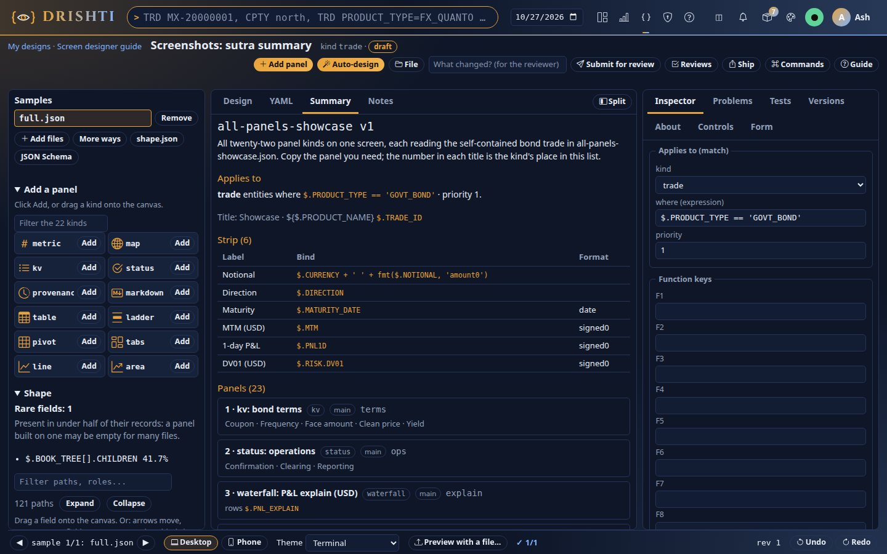

In the workbench the **Summary** tab states what the Sutra *applies to* before you save it. A preview ignores `match`, so to see a Sutra win against its
siblings, publish it and open entities in the terminal, or read `GET /api/v1/sutras`.

**Versions.** To change a published Sutra, publish the next version (`swap-desk.v2.sutra.yaml` with `version: 2`) and keep version 1 on disk. Matching
uses only the **latest** version of each name; the older one stays readable (`GET /api/v1/sutras/swap-desk/1/source`), so you can compare or roll back by
removing version 2. Two files may not define the same `name@version` (`DRS-2028`).

## 16. Saving a Sutra: the workbench and governance

Designing is open to everyone; **saving to the registry** is the author right with studio saving on (`drishti.rachana.studio-save`, env
`DRISHTI_STUDIO_SAVE`), and with governance on a save is a **proposal**. Check what this server lets you do: `curl -s -H "$AUTH"
$DRISHTI/studio/settings` answers `{"save": true, "approve": true, "review": true, "author": true}` for the seeded administrator.

1. In the workbench, type a note for the reviewer (*What changed?*) and press **Submit for review** (or **Ctrl+S**). The Sutra is checked as it stands;
   with problems nothing is submitted. Otherwise the status line says `Submitted counterparty-mine v1 for review as <id>`
   ([Saving and proposing](RACHANA_REFERENCE.md#22-saving-and-proposing)).
2. An approver opens **Views → Approvals** (`/approvals`), sees the proposal with a diff against the live version, and approves or rejects it (a
   rejection needs a reason). Panel blocks that only changed place are listed as moves, with the remaining edits as a line diff.
3. With security on and `drishti.governance.four-eyes` on (the default), the author cannot approve their own proposal (`DRS-2007`). If someone changed
   the live Sutra after you proposed, approval is refused (`DRS-2006`): propose again from the live version (the workbench's *base moved* flow).
4. On approval the file is written to `<first site Sutra directory>/<domain>/<name>.v<N>.sutra.yaml` (here
   `./sutras/studio/counterparty-mine.v1.sutra.yaml`, unless the Sutra says `domain:`) and goes live at once.

From the command line the same proposal is one call with the YAML as the body (`design:write`); an approver answers with
`POST /api/v1/approvals/sutra/{id}/approve` (`design:approve`):

```bash
curl -s -H "$AUTH" -H 'Content-Type: text/yaml' --data-binary @counterparty-mine.v1.sutra.yaml $DRISHTI/sutras
```

You should see `202` and `{"proposal": {"id": …, "name": "counterparty-mine", "version": 1, "status": "pending"}}`. With governance off the button reads
**Save** and publishes directly ([Governance](RACHANA_REFERENCE.md#governance)).

You can also skip the workbench: put the file in a Sutra directory (`drishti.rachana.dirs`, `./sutras` by default; env `DRISHTI_SUTRAS`). The server
notices within a quarter of a second; an invalid file is reported and, if it had a valid version before, that version stays live
(`curl -s -H "$AUTH" $DRISHTI/sutras/problems` prints `{}` when everything loaded). Only `*.sutra.yaml` and `*.block.yaml` files are read; any other
`.yaml` file in a Sutra directory, and a Markdown Sutra (`*.sutra.md`), is reported as `DRS-2004` with the fix: rename the YAML file, or convert the
Markdown one with `python3 tools/rachana/md_to_yaml.py sutras/ --delete` (its prose becomes `notes:`).

**Editing outside the workbench.** Any editor that reads JSON Schema can complete and check a Sutra as you type. The server publishes the schema of the
language, with this server's kinds and format names filled in (`GET /api/v1/rachana/schema`: title `Rachana Sutra, language 1`, required
`['rachana', 'sutra', 'version', 'match']`). With the YAML extension of VS Code, a first line

```text
# yaml-language-server: $schema=http://localhost:18480/api/v1/rachana/schema
```

gives completion of keys, panel kinds, options, formats and kinds (on a server with security on, save the schema to a file once and point the comment
at the file). The server's checks remain the final word: `sutra lint` before you commit, `GET /api/v1/sutras/problems` after the file is live.

## 17. How packs ship Sutras: folders, blocks, fragments, coverage

A pack's Sutras live in `sutras/` (or the folder its `sutras:` key names), in sub-folders of your choosing. **Folders are for people only**: the
directory is read recursively and Drishti infers nothing from a folder name ([Folders mean nothing](RACHANA_REFERENCE.md#folders-mean-nothing)). The
trading pack keeps:

```text
config/packs/banking/trading/sutras/
  common/      deal-ticket, legs, flow-schedule, events, payments, deal-footer  (*.v1.block.yaml, shared panels)
  endur/       one Sutra per Endur product type (5): endur-comswap matches "$.SOURCE_SYSTEM == 'ENDUR' && $.PRODUCT_TYPE == 'ComSwap'"
  calypso/     one Sutra per Calypso product type (51): govt-bond, repo, fx-forward, cds-single …
  murex/       one Sutra per Murex product type (74): irs-fixfloat, basis-swap, cmd-swap, eq-barrier …
  pages/       counterparty-trades, portfolio-trades, legal-entity-trades, index-trades, book-desk: pages over many trades
```

Each product Sutra is a title, a strip, the two controls of the events table, and its panels, most of them shared blocks. The shipped `irs-fixfloat`,
its strip shortened:

```yaml
rachana: 1
sutra: irs-fixfloat
version: 1
description: "Exchanges fixed for floating RFR-compounded payments."
match: { kind: trade, where: "$.SOURCE_SYSTEM == 'MUREX' && $.PRODUCT_TYPE == 'IRS_FIXFLOAT'", priority: 10 }
title: { pill: "Rates · Interest rate swap (fixed/float)", id: $.TRADE_ID, with: "link($.COUNTERPARTY, 'counterparty')" }
strip:                          # (eight figures: source, side, notional, quantity, trade date, maturity, status, portfolio)
  - { label: Side, bind: "$.BUY_SELL_CODE == 'B' ? 'Buy' : ($.BUY_SELL_CODE == 'S' ? 'Sell' : nonblank($.BUY_SELL_CODE, '–'))" }
  - { label: Notional, bind: "$.CURRENCY + ' ' + fmt(first($.LEGS).NOTIONAL, 'amount0')", emphasis: true }
  - …
controls:                       # the events by leg and by date: a trader's 'what is paid when, on which leg'
  - { id: legs, kind: multi-select, label: Legs, options: "$.LEGS[*].LEG_ID", default: all, placement: header, panel: event-list, remember: user }
  - { id: when, kind: date-range, label: Between, placement: header, panel: event-list }
panels:
  - { use: deal-ticket@1, with: { rate-fmt: pct4, product: "Interest rate swap (fixed/float)" } }
  - { use: legs@1, with: { rate-fmt: pct4 } }
  - { use: flow-schedule@1, with: { rate-fmt: pct4 } }
  - { use: events@1 }
  - { use: payments@1 }
  - { use: deal-footer@1 }
keys: { F7: "link($.COUNTERPARTY, 'counterparty-trades')", F8: impact, F9: raw }
```

- **Shared blocks.** `{ use: legs@1, with: { rate-fmt: pct4 } }` is replaced by the panels of `common/legs.v1.block.yaml`, with every `%{rate-fmt}` in it
  filled in (`pct4` for a rate, `price4` for a commodity price per unit, the block's default). A block is a file `<name>.v<N>.block.yaml` with `block:`,
  `version:`, `params:` (each with its default) and `panels:` ([Shared panel blocks](RACHANA_REFERENCE.md#shared-panel-blocks-use)). Change a block and
  every Sutra that uses it changes; write `legs.v2.block.yaml` when some must not follow, and move them one at a time.
- **Sub types** are `when:` panels in the product's one Sutra ([section 14.6](#146-panels-for-one-sub-type-when)), never a Sutra of their own, so every
  trade matches exactly one Sutra.
- **The coverage matrix.** **Admin → Packs → trading → Sutra coverage** (`GET /api/v1/packs/{name}/coverage?kind=<kind>`) lists every source system ×
  product type × sub type in the data with how many trades, an example id, the Sutra that lays it out and the `when` panels it shows, flagging *none*
  (laid out by inference) and *several* (two Sutras tie: raise one's priority):

  ```bash
  curl -s -H "$AUTH" $DRISHTI/packs/trading/coverage | python3 -c "
  import json, sys
  k = json.load(sys.stdin)['kinds'][0]
  print(k['kind'], k['combinations'], 'combinations, none', k['none'], 'several', k['several'])
  for r in k['rows']:
      if r['values']['SOURCE_SYSTEM'] == 'ENDUR': print(r['values'], r['count'], r['sutras'], r['shown'])"
  ```

  You should see `trade 132 combinations, none 0 several 0`, then the Endur combinations, for example
  `{'SOURCE_SYSTEM': 'ENDUR', 'PRODUCT_TYPE': 'ComSwap', 'PRODUCT_SUB_TYPE': 'ENGY-B-SWAP'} 208 ['endur-comswap'] ['basis']`.
- **Generated Sutras.** A Sutra that begins `# Generated by tools/packgen/... Edit the taxonomy, not this file.` is rewritten by its generator: change the
  generator's input and run it ([section 30](#30-generated-packs-and-the-readme-standard)).
- **Pack rules.** A pack's Sutras load when the pack is enabled, alongside the site's. A pack that `extends:` another may redefine a parent's Sutra with
  the same `name@version`. A site file with the same `name@version` as a pack's keeps the site's and reports the pack's as `DRS-2028`; to change a pack's
  layout for your site, prefer a new name with a higher priority, or a higher version.

### 17.1 Fragments and docstrings

A Sutra's panels need not be written out. The **fragment library** holds generic, parameterised panels named after what they show: the **Drishti UI
kit** (`config/ui-kit/fragments`, `drishti.ui-kit.dir`), which the server and `sutra lint|test` always load whatever packs are enabled, so every Sutra may
use them like a shared block:

```yaml
# config/packs/banking/market-data/sutras/market-data/ir-curve.v1.sutra.yaml
panels:
  - { use: curve-overview@1, with: { curve-code: CRV, curve-key: F2, table-key: F3 } }    # the zero-rate line, then the pillars
  - { use: series-line@1, with: { id: forwards, title: "1Y forward rates (%)", area: right, rows: $.FORWARDS, x: TENOR, y: RATE, fmt: price2 } }
  - { use: data-provenance@1 }
  - { use: linked-entities@1 }
```

The kit holds `series-line`, `curve-table`, `curve-overview` (a composite of the two), `field-list`, `ranked-bars`, `cashflow-ladder`, `event-timeline`,
`key-figure`, `linked-entities`, `risk-links` (a trade's P&L vector, VaR and exposure, or why not), `data-provenance`, `explainer-note`, `measure-table`,
`region-map`, `source-footer` (data source, how the view was built, linked entities) and `row-picker` (a table whose rows, clicked, fire an event: the
master of a master-detail screen). What each one shows, its parameters with their types and defaults, and examples are in its docstring:
`curl -s localhost:18480/api/v1/ui-kit | jq '.fragments[] | {ref, summary}'`. The kit also holds icons, images, logos and the brand
([The Drishti UI kit](RACHANA_REFERENCE.md#3a-the-drishti-ui-kit)).

**Your pack's own fragments are namespaced.** A fragment or block in your pack's `sutras/` is `<pack>/<name>@N` (`trading/deal-ticket@1`) and also
answers to its plain name. Do not name one like a kit fragment: the kit's wins the plain name, and loading warns (`DRS-2048 warning: pack trading's
key-figure has the name of a Drishti UI kit fragment: the kit's wins; use trading/key-figure@1 for the pack's`). The pack fragments that ship: trading's
`deal-ticket`, `legs`, `flow-schedule`, `events`, `payments`, `payments-metrics` and `trade-table`; news-and-markets' `quote-ranges`, `price-bars`,
`headlines`, `headline-pipeline` and `snapshot-note`.

**Writing a fragment.** A file `<name>.v<N>.fragment.yaml` with `fragment: <name>`, `version`, `params:` (each with its default; an empty default `''`
leaves an optional key such as `code`, `key` or `area` out), `panels:` whose text reads `%{param}`, and a complete **`doc:`**:

```yaml
rachana: 1
fragment: ranked-bars
version: 1
description: "Horizontal bars, one a row, labelled and sized by a value: the largest contributors at a glance."
params: { id: bars, title: By contribution, rows: $.ROWS, label: LABEL, value: VALUE, fmt: signed0, code: '', key: '', area: '' }
doc:
  summary: "Horizontal bars, one a row, labelled and sized by a value: the largest contributors at a glance."
  description: >-
    One horizontal bar a row of a list, labelled by one field and sized by another. Bars keep the order of the list.
  params:
    id:    { type: id, default: bars, meaning: "The panel id, unique on the screen" }
    title: { type: text, default: By contribution, meaning: "The title over the bars" }
    rows:  { type: expression, default: $.ROWS, meaning: "The list of rows, one bar each" }
    label: { type: field, default: LABEL, meaning: "The field of a row naming its bar" }
    value: { type: field, default: VALUE, meaning: "The field of a row giving its bar length" }
    fmt:   { type: format, default: signed0, meaning: "The named format of the value" }
    code:  { type: key, default: '', meaning: "The panel's mnemonic code; none when empty" }
    key:   { type: key, default: '', meaning: "The function key that brings the panel forward; none when empty" }
    area:  { type: area, default: '', meaning: "main (the default when empty) or right" }
  emits: []
  expects: []
  examples:
    - { use: ranked-bars@1, with: { id: by-book, title: "P&L by book", rows: $.BY_BOOK, label: BOOK, value: PNL, key: F2 } }
  since: "2.7.0"
panels:
  - id: %{id}
    kind: hbar
    title: "%{title}"
    code: %{code}
    key: %{key}
    area: %{area}
    rows: %{rows}
    label: %{label}
    value: %{value}
    fmt: %{fmt}
```

The docstring is checked strictly (`DRS-2055`; a fragment without a complete one is not loaded, so its uses fail with `DRS-2048`): a one-line `summary`
(at most 120 characters), a `description`, every parameter under `doc.params` with `type` (`text`, `expression`, `field`, `format`, `key`, `area`, `id`,
`number`, `boolean`, `kind`, `columns`), `default` (the same as under `params:`) and `meaning`, and none it does not declare; `emits` and `expects`
(the events its panels fire, and that its panels read `@parent`); at least one example that uses this fragment with declared parameters (written with
the plain name, even for a pack's own); `since`.

- **A list as a parameter (`columns`).** Declare it with a list default (`columns: []`), document it as `type: columns`, and write `columns: %{columns}` in
  the panel; the Sutra passes the columns as a table panel writes them. A text parameter is filled in as written: quote it in the fragment
  (`title: "%{title}"`) when a value may start with `@`, a quote or a brace.

  ```yaml
    - use: trading/trade-table@1
      with:
        title: "Trades (${size($.TRADES[?oneOf(@.TRADE_STATUS, ctl.status)])} of ${$.TRADE_COUNT})"
        code: TRD
        key: F2
        where: "oneOf(@.TRADE_STATUS, ctl.status)"
        columns:
          - { label: Trade, bind: "link(@.TRADE_ID, 'trade')" }
          - { label: Notional, bind: "@.NOTIONAL", fmt: amount0, total: true }
  ```

- **Composite fragments.** A fragment may use other fragments at a **pinned** version and pass parameters explicitly; it lists them under `doc.uses`. At
  most three fragments deep, no cycles (`DRS-2048`):

  ```yaml
  fragment: curve-overview
  params: { rows: $.POINTS, curve-title: Zero rates (%), ... }
  doc: { uses: [series-line@1, curve-table@1], ... }
  panels:
    - use: series-line@1
      with: { title: "%{curve-title}", rows: "%{rows}", ... }
    - use: curve-table@1
      with: { rows: "%{rows}", ... }
  ```

- **A Sutra's docstring.** A Sutra carries a `doc:` too (`summary`, `description`, `params` for its controls, `emits`, `expects`, `examples` as URLs or
  commands that open it, `since`). It is a warning, shown on request: `sutra lint <pack> --docs` prints an incomplete one and counts the Sutras without
  one (`warning DRS-2055 19 of 20 Sutras have no doc: block`); the run still passes. Write one whenever you touch a Sutra.
- **Generated Sutras use fragments.** The pack generators turn a panel into a kit fragment use only when the fragment draws it exactly (a plain line →
  `series-line@1`, plain bars → `ranked-bars@1`, a key/value list over an object → `field-list@1`, a curve's pillars → `curve-table@1`, provenance and
  links → `data-provenance@1` / `linked-entities@1`, the source and licence last → `source-footer@1`); anything else stays written in place. Lint a pack
  (`sutra lint config/packs/banking/trading`) or the whole root (`sutra lint config/packs`): each pack folder loads its fragments under its own
  namespace either way, and a pack may use another pack's fragment by its qualified name when both are linted together.
- **Changing a fragment.** Never change what a released version draws: write `name.v2.fragment.yaml` and move Sutras one at a time; to prove a move
  changes nothing, compare the view models before and after for a full and a masked reader.

## 18. Labels and other things to know

**Labels: name what you must, the rest names itself.** Every strip item and column may have a `label`. Leave it out and the label is the field it reads,
in words (`@.PAYMENT_DATE` → **Payment date**). First match wins: `label:` in the Sutra; the pack taxonomy (`labels:` in the pack's
`config/semantics.yaml`); the global taxonomy (the core semantics, or the site's replacement file); the field name in words, with the packs' `acronyms:`
spelled right (`UEN` → **UEN**, `KYC.EMIR_CLASSIFICATION` → **EMIR classification**, `PEAK_PFE` → **Peak PFE**). So write a `label:` only where this
layout needs different words, and fix a label that is wrong everywhere in the taxonomy, not in thirty Sutras ([Labels](RACHANA_REFERENCE.md#labels)).
What a field *means* is the pack's `config/about.yaml` ([section 7.2](#72-about-text-and-glossary)).

- **A field missing from one document is not an error.** The cell is empty; a panel whose data is missing says *No data available* (or its `empty:`
  words). One Sutra can serve documents with optional parts.
- **Empty text is not nothing.** Extracts write a missing value as `""`; `nonblank(...)` treats it as missing, `coalesce(...)` does not.
- **A markdown panel shows plain text**: `**bold**` is not rendered inside a panel. Explanations for maintainers belong in `description` and `notes`.
- **Sizes are not fixed.** `highlight: "#index == size($.EVENTS) - 1"` lights the last row of any length; `#index == 19` lights row 20 only.
- **Options that are field names take no `@.`:** `x: TENOR`, `label: ID`, `value: NET_MTM` on a `line`, `area` or `hbar`, written exactly as the
  document writes the field. Options that are expressions take full paths: `rows: $.POINTS`. The later chart kinds (`waterfall` to `pivot`) take a
  field name, a dotted path or an `@` expression.

## 19. The panel kinds

There are 22 panel kinds. Each has one catalogue entry in [RACHANA_REFERENCE.md](RACHANA_REFERENCE.md#panels-the-twenty-two-kinds-and-developing-a-new-one):
what it shows, when to use it, its key options, what it does when its data is empty, in error, masked or live, a complete YAML and a screenshot. Pick a
kind by what you need to show:

| You want to show | Kind | You want to show | Kind |
|---|---|---|---|
| fields as label/value pairs | [`kv`](RACHANA_REFERENCE.md#kv) | one number against a maximum | [`gauge`](RACHANA_REFERENCE.md#gauge) |
| one big figure with its change | [`metric`](RACHANA_REFERENCE.md#metric) | a grid over two axes | [`surface`](RACHANA_REFERENCE.md#surface) |
| rows, with totals and "N more" | [`table`](RACHANA_REFERENCE.md#table) | steps from a start to an end | [`waterfall`](RACHANA_REFERENCE.md#waterfall) |
| a dated schedule, the next row lit | [`ladder`](RACHANA_REFERENCE.md#ladder) | a distribution with marker lines | [`histogram`](RACHANA_REFERENCE.md#histogram) |
| one layout per element, as tabs or side by side | [`tabs`](RACHANA_REFERENCE.md#tabs) | two measures per row | [`scatter`](RACHANA_REFERENCE.md#scatter) |
| a curve over an axis | [`line`](RACHANA_REFERENCE.md#line) | daily bars with volume | [`candlestick`](RACHANA_REFERENCE.md#candlestick) |
| bands against a limit | [`area`](RACHANA_REFERENCE.md#area) | entities and their relations | [`graph`](RACHANA_REFERENCE.md#graph) |
| bars scaled to the largest, or a donut | [`hbar`](RACHANA_REFERENCE.md#hbar) | dated events in order | [`timeline`](RACHANA_REFERENCE.md#timeline) |
| the entities the document points to | [`links`](RACHANA_REFERENCE.md#links) | a total by one field across another | [`pivot`](RACHANA_REFERENCE.md#pivot) |
| states coloured by meaning | [`status`](RACHANA_REFERENCE.md#status) | a note with values in it | [`markdown`](RACHANA_REFERENCE.md#markdown) |
| how the view was built | [`provenance`](RACHANA_REFERENCE.md#provenance) | a country on the map, or its regions | [`map`](RACHANA_REFERENCE.md#map) |

The other chart kinds work like those of section 14: `waterfall` (a P&L explain, market-risk's `PNL`), `histogram` (a VaR scenario vector with VaR and
ES lines), `scatter` (books' VaR against P&L), `candlestick` (daily bars), `graph` (a counterparty's group, agreement and netting sets), `pivot` (MTM by
book and currency), `metric` and `map`. To see them working together, open an [example](examples/README.md) in the workbench (the all-panels showcase
uses every kind on one bond trade), or the shipped Sutras: the trading pack's blocks (tabs holding panels, tree tables, timelines, donuts), `core`'s
`counterparty` (a graph), `counterparty-risk`'s `netting-set` (an area against a limit, controls), `market-risk`'s `var` and `pnl-explain` (histogram,
waterfall), `market-data`'s vol surfaces. A new panel kind of your own: [Developing a panel kind](RACHANA_REFERENCE.md#developing-a-panel-kind).

## 20. Reading other entities: `source:`

A document usually points at others: a trade at its discount curve and its counterparty, a counterparty at its netting sets. `source:` lets a panel read
the **linked** entity's document instead of this one, so `$` inside that panel's options is the other entity:

```yaml
panels:
  # tabs: one tab per netting set, read from the counterparty
  - id: sets
    kind: tabs
    title: The counterparty's netting sets
    source: "link($.COUNTERPARTY, 'counterparty')"
    each: $.NETTING_SETS
    tabTitle: "@.ID"
    body:
      kind: kv
      columns:
        - { label: Agreement, bind: "@.AGREEMENT", link: true }
        - { label: Trades, bind: "@.TRADES", fmt: amount0 }
        - { label: Net MTM, bind: "@.NET_MTM", fmt: signed0, tone: sign }

  # a pivot over the desk's positions, again from a link (TT_GROUP is the trade's desk)
  - id: grid
    kind: pivot
    title: "The desk's MTM by book and family"
    source: "link($.TT_GROUP, 'desk')"
    rows: $.POSITIONS
    by: BOOK
    across: FAMILY
    value: MTM
    heat: true
    fmt: compact
    tone: sign
```

Previewed on `MX-20000001`, you should see four tabs, `NS-MERIDIAN-RE-FRA` to `NS-MERIDIAN-RE-TKY`, the London one with `Trades 191` and `Net MTM
−316,071,572`; and the rates desk's grid, three books (`BOOK-RATES-1` `6.0bn`, `BOOK-RATES-2` `−1.5bn`, `BOOK-RATES-3` `−393.7m`) across `swap`,
`linear`, `future`, `option` and `exotic`, the desk `4.1bn` in all. The runnable version is the [linked-sources example](examples/linked-sources.md).

- `source` is an expression that gives a `link(id, kind)`. Then write `rows`, `each` and the other options as if the linked document were the page's own;
  `@` is still the row. The title line still reads this entity.
- The linked entity is read through the **same sources, business date and field masks** as the page. A kind the viewer may not open is not fetched: the
  panel says *no access to <kind>*. A missing link leaves the panel empty with a reason; a slow one lets the other panels draw first.
- A `line` with a `source` also refreshes live when the linked entity changes; other kinds refresh with the view. `links` and `provenance` do not take
  `source`. Entities of a pack that is not enabled cannot be read, so `sutra test` needs the same `DRISHTI_PACKS` as the server.

### 20.1 Fragments, events, children, refresh and forms

Pack screens are written with fragments that talk to each other through events
([Sutra Next](RACHANA_REFERENCE.md#sutra-next-fragments-events-children-sources-layout-and-forms)). The trading pack's book desk
(`config/packs/banking/trading/sutras/pages/book-desk.v1.sutra.yaml`; open `/v/portfolio-trades/BOOK-RATES-2?sutra=book-desk`) shows all of it, shortened:

```yaml
panels:
  - use: row-picker@1                      # a UI-kit fragment, name@version; a pack's own is pack/name@N (trading/trade-table@1)
    with: { id: trades, title: Trades of the book, rows: $.TRADES, event: open, key: TRADE_ID, ref: COUNTERPARTY }
    refresh: 30                            # fetched again every 30 s (or { every: 30, user-can-pause: false })
    form: { key: trade_id, edit: beside, new: drawer, fields: [ ... ] }      # people may edit (section 28)
    children:                              # what a click on a row opens, under the row
      - place: expand-row
        source: { pack: trading, kind: trade, id: "@parent.open.id" }     # read the clicked trade: $src
        panels:
          - use: cashflow-ladder@1
            with: { id: flows, title: "Cash flows of ${@parent.open.id}", rows: $src.EVENTS, date: EVENT_DATE, amount: AMOUNT }
  - id: counterparty                       # another pack's record, filled when a trade is picked
    kind: kv
    area: right
    waits: Pick a trade to see its counterparty and credit limit
    source: { pack: core, kind: counterparty, id: "@trades.open.ref" }
    columns: [ { label: Name, bind: $src.NAME }, { label: Rating, bind: $src.RATING } ]
  - { use: data-provenance@1 }
```

(The shipped book desk has no `refresh:`; it is added here to show where it goes.)

- **Events and sources.** A panel `emits` an event (`open` on a row click, with a payload); another panel reads it as `@trades.open.ref` and, through its
  own `source:` written as a mapping (`{ pack, kind, id | where | search }`, read as `$src`), any enabled pack's kind; until then it says its `waits:`
  text. A child reads its parent's event as `@parent.open.<field>` (places: under the row, beside, below, as tabs). Problems are `DRS-2057`; children
  nest at most three deep (`DRS-2056`) ([Events, sources and children](RACHANA_REFERENCE.md#events-sources-and-children-sutra-next),
  [Sources over several packs](RACHANA_REFERENCE.md#6-sources-over-several-packs)).
- **Refresh and freshness.** `refresh:` on a panel, a use or the whole Sutra; each panel says how fresh it is and the reader may pause or slow it
  ([Live panels](RACHANA_REFERENCE.md#9-live-panels-refresh-control-and-freshness)).
- **Forms.** `form:` lets people edit a table's records beside it, in its cells or in a New drawer ([section 28](#28-forms-letting-people-edit-records)).

You rarely need to write these by hand: the **Sutra designer** ([section 25](#25-the-build-workbench)) writes them from plain choices, and
[tutorial 19 (the Sutra designer)](../tutorials/19-build-a-pack-and-a-screen.md#on-a-live-page-the-sutra-designer) builds such a screen step by step.

## 21. Expandable row groups: pivot `by` lists and tree tables

Two opt-in features let rows hold rows; both open one level at a time with a ▸/▾ toggle, and `expand` sets how many levels show at first.

**Row groups of a pivot.** `by` takes one field, or a **list** (at most six) for nested groups:

```yaml
  - id: nested
    kind: pivot
    title: The desk's MTM by book, family and currency
    source: "link($.TT_GROUP, 'desk')"
    rows: $.POSITIONS
    by: [BOOK, FAMILY]            # two levels: the book, then its product families
    across: CURRENCY
    value: MTM
    fmt: compact
    tone: sign
    expand: 1                     # only the books, closed; 2 opens one level; all opens every level
```

You should see one row per book with its subtotal (`BOOK-RATES-1 6.0bn`), each opening to its families (`swap 6.2bn`, `linear −161.2m`…), across `EUR`,
`USD`, `CHF`, `GBP`, `JPY` and `CAD`. Group rows aggregate the underlying rows (an `avg` subtotal is the average of all its rows). Heat shading is not
drawn on nested pivots. A number, an empty list or a list of non-names as `by` is `DRS-2029`.

**A tree table.** When each row *carries its own children*, say which with `children`, an expression over the row:

```yaml
  - id: flows
    kind: table
    title: Floating leg, cash flows opening to their resets
    rows: $.LEGS[1].CASH_FLOWS
    children: "@.RESETS"          # the rows nested under this one, to any depth (limit 12)
    expand: 1
    columns:
      - { label: Flow / reset, bind: "nonblank(@.FLOW_ID, @.RESET_ID)" }
      - { label: Start, bind: "@.START_DATE", fmt: date }
      - { label: Payment / reset date, bind: "nonblank(@.PAYMENT_DATE, @.RESET_DATE)", fmt: date }
      - { label: Rate, bind: "@.RATE", fmt: pct4 }
```

You should see the 28 floating periods (`20000001008 · 2025-07-28 · 2025-09-29 · 3.5377%` first), each with a ▸ that opens its fixings (`R-1 ·
2025-07-28 · 2025-07-28 · 3.5376%` …). Child rows are another kind of row, so a column reads whichever field is there with `nonblank`. `total: true` sums
only the rows **without** children. A tree table is not sorted, paged or given per-column filters, and its filter keeps the ancestors of matching rows.
`ladder` takes the same two keys. When each level is a different thing with its own columns, use **`levels`** instead (one level at a time with a
breadcrumb: [section 9.6](#96-drill-down-leg--cash-flow--resets),
[levels](RACHANA_REFERENCE.md#levels-drill-down-level-by-level)).

A pivot **aggregates** rows by fields you name; a tree table or `levels` **shows** a hierarchy the document already has. Runnable versions:
[pivot-row-groups](examples/pivot-row-groups.md) and [tree-table](examples/tree-table.md). Do not confuse the **`pivot` panel kind** with the **`pivot:`
option** that gives a table a user-driven Pivot.

## 22. Dates, live data, imperfect data and controls

### 22.1 Dates

Nothing to write. The top bar's business date applies to every read; a Sutra never mentions dates, and the same layout shows today's data or any past
business day's snapshot (the footer says which). Dates *in* the document are data: format them with `fmt: date` or `dmy`, compare them as ISO text
(`@.PAYMENT_DATE < today()`), count days with `days(from, to)`. `today()` is the business date the view is built for, so "still to come" answers for the
date the reader picked.

### 22.2 Live data

When the source streams, strip figures and table cells update in place; nothing to declare ([DATA_ARCHITECTURE.md](../architecture/DATA_ARCHITECTURE.md#1-live-updates)).
After a Sutra changes on disk every cached layout is dropped, so the next tick uses the new one. A source that does not stream can be fetched again:
`refresh: 30` (or `{ every: 30, user-can-pause: false }`) on a panel, a use or the Sutra; the reader may pause or slow it, never speed it past `every` or
the console's `views.refresh_min_seconds`.

### 22.3 Imperfect data

A missing field shows a dash; a panel with no data says *No data available* (or its `empty:` text); a value of the wrong type is shown as text; an
extract's empty text is nothing to `nonblank`. A Sutra never breaks a screen, which is also why a misspelt path is silent: preview against a thin
document and a rich one, and read the Tests tab's *empty* cells.

### 22.4 Controls: let the reader choose

A Sutra may declare up to 12 **controls** (`controls:` beside `panels:`): dropdowns, a multi-select, a date range, a slider, a top-N, a search box. Panels
read the values as `ctl.<id>`. Controls only choose: they never write data. The keys, the eleven kinds, the relative dates and the problem codes
(`DRS-2034` to `DRS-2039`) are in [Controls](RACHANA_REFERENCE.md#controls). The shipped `netting-set` Sutra (counterparty-risk), trimmed:

```yaml
controls:
  - { id: asset, kind: dropdown, label: Asset class, options: "$.BY_ASSET[*].ASSET", placement: header, panel: trades }
  - { id: product, kind: multi-select, label: Product, options: "$.TRADES[*].PRODUCT", placement: header, panel: trades }
  - { id: minNotional, kind: slider, label: Notional at least, min: 0, max: "max($.TRADES[*].NOTIONAL)", step: 1000000, placement: header, panel: trades }
  - { id: status, kind: multi-select, label: Status, options: "$.TRADES[*].STATUS", default: all, placement: header, panel: trades }
panels:
  - id: trades
    kind: table
    title: "Member trades (${size($.TRADES)} of ${$.TRADE_COUNT})${ctl.asset ? ' · ' + ctl.asset : ''}"
    rows: $.TRADES
    where: "(ctl.asset == '' || @.ASSET_CLASS == ctl.asset) && oneOf(@.PRODUCT, ctl.product) && oneOf(@.STATUS, ctl.status) && (ctl.minNotional == '' || @.NOTIONAL >= ctl.minNotional)"
  - id: byAsset
    kind: hbar
    title: Net MTM by asset class
    rows: $.BY_ASSET
    on-select: { by: asset, field: ASSET, filter: [trades] }
    label: ASSET
    value: MTM
```

1. A control is `{ id, kind, label, ... }`. `options` is a list or an expression (`"$.TRADES[*].PRODUCT"`: every trade's product, without repeats);
   `placement: header` with `panel: trades` puts it in that panel's header (the default, `strip`, puts it under the title; `side` is a bar at the side).
2. A panel reads the value with `where:` (a condition on each row), `limit:`, `rows:` or a `${ctl.id}` in its `title`. The server computes the rows with
   the value. `oneOf(@.PRODUCT, ctl.product)` treats an empty multi-select as "everything"; `within(@.EVENT_DATE, ctl.when)` tests a date or number against
   a `from..to` range.
3. A dropdown value is text, a multi-select a list, a one-handle `slider` a **number** (empty when the slider has no scale; with `range: true` it is
   `from..to` text), a `top-n` a whole number.
4. Using a control you did not declare is `DRS-2036`; a default that does not fit the kind is `DRS-2039`.
5. `on-select: { by: asset, field: ASSET, filter: [trades] }` on a `table`, `ladder` or `hbar` lets a click set a control: click the *Rates* bar and the
   member trades show only rates.

**Try it.** Open `NSET NS-MERIDIAN-RE-NY <GO>`: the table reads *Member trades (343 of 343)* with a net of `+99,704,064`; choose *Asset class Rates* and set
the slider to 250m, and the title gains `· Rates`. From the command line, with the values in the address:

```bash
curl -s -H "$AUTH" "$DRISHTI/views/netting-set/NS-MERIDIAN-RE-NY?panels=trades&ctl.asset=Rates&ctl.minNotional=250000000" \
  | python3 -c "import json,sys; p=json.load(sys.stdin)['panels'][0]; print(p['title'], len(p['data']['rows']))"
```

You should see `Member trades (343 of 343) · Rates 55`.

**View state.** The values live in the address (`?ctl.asset=Rates&ctl.minNotional=250000000`, written once the reader has set one), so a link or the Share
button reproduces the screen; `remember: user` keeps the last choice in the browser. A sent share keeps the control values and the column filters
(`f.<panel>.<column>`), up to `drishti.collab.share.max-view-state` characters; the recipient opens the same view under their own rights. The search form of
a kind (`FORM trading <GO>`) is not a Sutra feature: it is the pack's `form:` section ([section 4.6](#46-form-the-search-form-of-a-kind)).

**When a Sutra is not enough.** A Sutra is a fixed layout everyone sees. For a one-off question about the screen in front of you, `Alt+C` opens Calc,
Python in the browser with the view's document and tables loaded ([USER_GUIDE.md](USER_GUIDE.md#calc-python-on-any-view)); for questions across many
entities, use BI ([REPORTS_GUIDE.md](REPORTS_GUIDE.md)).

## 23. Sutra and inference together

A Sutra says what matters; inference fills in only what it leaves out:

- a `table` or `ladder` with `rows:` and no `columns:` gets columns from the data;
- a `kv` with `rows:` and no `columns:` gets the fields of the object ([section 12.4](#124-keyvalue-panels-written-and-inferred));
- the body of a `tabs` panel with no columns gets the fields of the first element;
- a label nobody wrote reads as the field's name in words ([section 18](#18-labels-and-other-things-to-know)).

Inference never adds to columns you wrote: list one column and the panel shows exactly what you listed. *How this view was built* says
`Sutra irs-fixfloat v1 + inference` whenever inference helped, and an *inferred* tag on a panel says why; a document no Sutra matches is laid out entirely
by inference ([the rules and their scoring](RACHANA_REFERENCE.md#sutra-and-inference-together)). To start a Sutra from what inference made, use the
workbench's **auto-design** ([Auto-design](RACHANA_REFERENCE.md#7-auto-design-and-its-alternatives)) or `sutra design` and `sutra gen`
([CLI_REFERENCE.md](CLI_REFERENCE.md)).

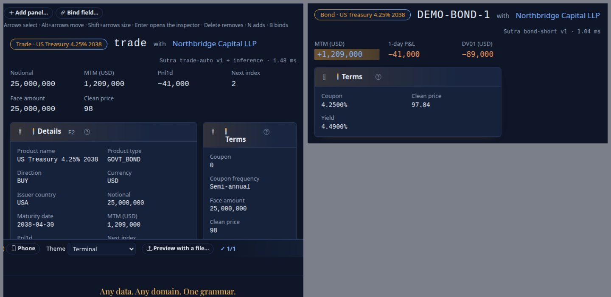

*Left: what inference makes of the all-panels showcase's bond document: every figure present, none chosen, the coupon shown as `0` and the clean price as
`98`. Right: a 17-line Sutra on the same document: the strip leads with MTM, P&L and DV01 in signed colours, and the terms read `4.2500%` and `97.84`.*

## 24. Testing: `expect.yaml`, `sutra lint`, `sutra test` and `pack check`

Four layers, from the cheapest; the first three need no server.

| Layer | Command | What it proves |
|---|---|---|
| Sutra lint | `sutra lint config/packs/<domain>/<pack>` (or the whole `config/packs`) | every Sutra and block parses and its keys, expressions and panel options are valid (`DRS-…` codes with the line); help warnings |
| Sutra tests | `sutra test config/packs/<domain>/<pack>` | each Sutra renders against the samples in `tests/<sutra>/` with no panel in error, the panels `expect.yaml` names are filled, and the help coverage |
| Both, for CI | `drishti.py pack check config/packs/<domain>/<pack> [--strict] [--junit DIR]` | lint and test in one command, exit `0` / `1` / `2` |
| A scratch server | the [checklist](#295-verifying-a-pack) | links resolve, connectors are up, commands open, the guide renders |

`sutra lint` and `sutra test` are commands of the server's exec jar (`java -jar kernel/drishti-server/target/drishti-server-*-exec.jar sutra …`); `pack check`
finds the jar itself (`--jar`, `DRISHTI_JAR`). Both read the pack overlay of the checkout they run in (`<data>/packs/added.yaml`), so run them where it
names only packs that exist (or set `DRISHTI_DATA_DIR` to an empty folder). Every command and option (`--junit`, `--out` snapshots, the shape and design
commands) is in [CLI_REFERENCE.md, Testing Sutras](CLI_REFERENCE.md#testing-sutras-expectyaml-the-tests-convention-and-ci).

**`tests/` and `expect.yaml`:**

```text
config/packs/<domain>/<pack>/tests/<sutra>/        one folder per Sutra, named by the Sutra's name (the `sutra:` line)
    cases.jsonl                    the cases, one a line: {"case": "TKT-1001", "document": {...}} (the kind comes from the Sutra's match.kind)
    expect.yaml                    optional
```

```yaml
noErrors: true            # no panel in an error state on any sample (the default)
nonEmpty: [history]       # these panels must render with data on every sample
help: { coverage: 0.9, about: true }   # optional: the share of shown fields with a glossary entry, and that `about` renders
samples:                  # optional: more expectations for one sample
  TKT-1002.json: { nonEmpty: [history] }
```

Any other key in `expect.yaml` is a usage error (exit `2`), so a typo cannot silently pass. Without a `tests/<sutra>/` folder a Sutra is reported
`skip (no samples)`, which is not a failure. Choose samples that differ: a ticket with one history entry and one with many, a closed one, one with a
missing field. A shipped pack also keeps `tests/help-coverage.txt`, a ratchet the help coverage may not fall below. `pack check` on a shipped pack
(`--tail 2` keeps the last two lines of each step):

```text
$ drishti-console/.venv/bin/python tools/drishti.py pack check config/packs/banking/market-risk --tail 2
== market-risk: sutra lint: exit 0
ok      config/packs/banking/market-risk/sutras/market-risk/trade-valuation.v1.sutra.yaml
ok      config/packs/banking/market-risk/sutras/market-risk/var.v1.sutra.yaml
== market-risk: sutra test: exit 0
     var: help coverage 5/5 (100%)
ok   config/packs/banking/market-risk/sutras/market-risk/var.v1.sutra.yaml (2 samples)
```

**In CI:**

```sh
drishti.py pack check config/packs/helpdesk --strict --junit build/reports          # lint + test, help warnings fail, JUnit XML
java -jar drishti-server-exec.jar sutra preview config/packs/helpdesk --out target/snapshots   # HTML snapshots to attach as build artifacts
```

Publish the JUnit files with your CI's report step. A Sutra whose panels read other entities with `source:` needs those entities' packs enabled for the
run (`DRISHTI_PACKS=…` in the job). The Build workbench writes the same layout when you export a fragment, so an exported fragment passes `sutra test`
unchanged.

**In this repository's build.** Every shipped pack is checked on every build: the loader's rules and every pair of shipped packs loading together
(`PackLoaderTest`, `AllShippedPacksTest`), every pack's Sutras parsing with unique `name@version` (`PackSutrasTest`), `sutra test` over every pack with a
`tests/` folder (`SutraCliTest`), every Sutra surviving missing fields, wrong types and flipped shapes (`ImperfectDataTest`), every advertised example
command opening a full view (`DomainPacksTest`), the trading coverage (`SutraCoverageTest`), every shipped BI item reading only what the packs serve
(`ShippedExamplesPacksTest`), every documented example previewing (`ExamplePreviewTest`, `ConnectorExamplesTest`), the generators' `--check`, and the
copyright header (`LicenseHeaderTest`). Running them is in [DEVELOPER_GUIDE.md](DEVELOPER_GUIDE.md). A pack of your own outside this repository gets the
same guarantees from `pack check` in its CI and the checklist on a scratch server.

## 25. The Build workbench

You can write every Sutra in this guide in a text editor. The **Build workbench** (**Build → New screen**) is the same language with the engine in the
loop: the screen you see is the real one, every edit is an operation the server applies to the Sutra text (your comments and key order are kept), and
the checks run as you type. Its full manual is [RACHANA_REFERENCE.md](RACHANA_REFERENCE.md#screen-designer-and-the-build-workbench); a guided build is
[tutorial 19, Part B](../tutorials/19-build-a-pack-and-a-screen.md#part-b--design-a-screen-in-the-workbench-and-on-a-live-page).

| You are doing | In the workbench | Section |
|---|---|---|
| starting from data, a schema, an example or an existing Sutra | **Build → New screen** | [§1](RACHANA_REFERENCE.md#1-start-bring-data) |
| changing a live page in plain words (move, hide, columns, what a click opens, refresh, let people edit), or a screen from one line | the **Sutra designer** (`ui.designer`): **Customize** on the page, **Describe**, **Outline**, **Grid** | [§31](RACHANA_REFERENCE.md#31-the-sutra-designer-customize-describe-outline-and-grid), [tutorial 19 (the Sutra designer)](../tutorials/19-build-a-pack-and-a-screen.md#on-a-live-page-the-sutra-designer) |
| writing the YAML by hand, with completion and a check as you type | the **YAML** tab (or **Split**, with the screen beside it) | [§9](RACHANA_REFERENCE.md#9-the-yaml-tab-the-split-view-and-the-summary) |
| seeing what is wrong, with the code and the line | the **Problems** tab | [§10](RACHANA_REFERENCE.md#10-problems) |
| checking every panel against every sample | the **Tests** tab: ok / empty / error / no access | [§11](RACHANA_REFERENCE.md#11-tests-as-you-type) |
| trying a layout on a document that is not a sample | **Preview with a file…** | [§12](RACHANA_REFERENCE.md#12-preview-with-a-file) |
| reading what the Sutra applies to, its strip and panels | the **Summary** tab | [§9](RACHANA_REFERENCE.md#9-the-yaml-tab-the-split-view-and-the-summary) |
| comparing with the live version, rebasing when it moved | **Versions** | [§21](RACHANA_REFERENCE.md#21-diff-and-versions) |
| going live | **Submit for review**, then an approver | [§22](RACHANA_REFERENCE.md#22-saving-and-proposing) |

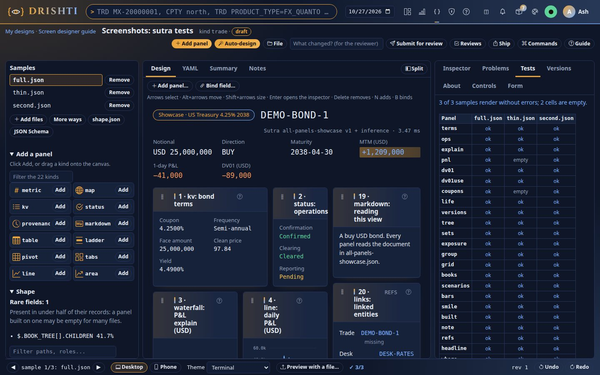

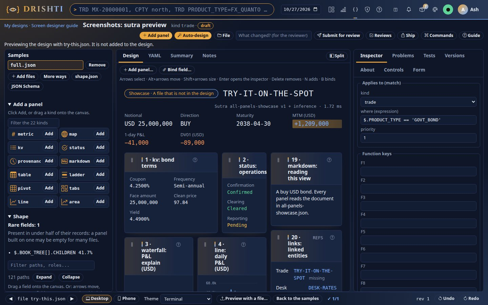

(The pictures are taken on the all-panels showcase example, whose own document is a small camel-case bond.) Two things the workbench does not do for
you: a preview ignores `match`, so it never tells you whether this Sutra wins ([section 15](#15-matching-several-sutras)); and a green Tests tab means
your *samples* render, not that every real document will: keep a thin sample.

### 25.1 Pack fragments from the Build workbench

Design a Sutra in the workbench (from JSON samples, a JSON Schema, or an existing Sutra) and **ship** it as a pack fragment: *Ship → Export as a pack
fragment* downloads a zip you can put in `config/packs/` ([Pack fragments: export and import](RACHANA_REFERENCE.md#24-pack-fragments-export-and-import)).
An export of the help-desk ticket Sutra:

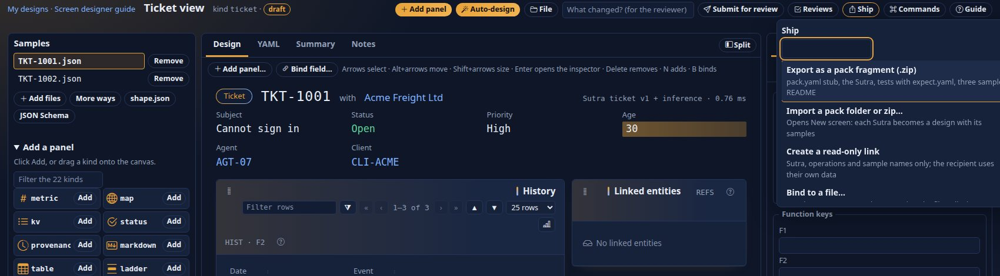

```text
ticket-view/pack.yaml
ticket-view/sutras/studio/ticket.v1.sutra.yaml
ticket-view/tests/ticket/cases.jsonl
ticket-view/tests/ticket/expect.yaml
ticket-view/samples/ticket.jsonl
ticket-view/samples/catalog.jsonl
ticket-view/README.md
```

A design with About text also writes `ticket-view/config/about.yaml` and an `about:` line in the `pack.yaml`. The generated `pack.yaml` is a **stub** (the
kind, a mnemonic suggestion, an id pattern from the id field of your samples), and `expect.yaml` records what `sutra test` found on your samples:

```yaml
pack: ticket-view
version: 0.1.0
code: TICK
title: "Ticket view"
kinds:
- ticket
sutras: sutras
mnemonics:
  TICK:
    kind: ticket
    label: "ticket"
graph:
  id-patterns:
  - pattern: "^TICK-"
    kind: ticket
```

```yaml
noErrors: true
nonEmpty:
- "history"
- "built"
- "refs"
```

From a fragment to a pack: **rename it** (the folder name, `pack:` and the title; set the real `version` and `code`); **fix the stub** (the mnemonic your
users type, `TKT` not `TICK`; an id pattern matching your real ids; add links, columns, roles and connectors as in [section 3](#3-build-it-step-by-step);
`kinds:` must be a kind no other pack owns); **keep the tests** and add a sample for each shape your data really has; **load it** from
*Admin → Packs → Load*, or list it in `DRISHTI_PACKS`.

The other way round: *New screen → Or import a pack* takes a zip or a folder (any pack) and turns each `*.sutra.yaml` into a design, with the pack's
`tests/` and `samples/` documents as its samples. Use it to revise a shipped pack's Sutra in the workbench, then bring the new version back as a fragment
(or propose it, for the live registry: *Ship → Propose* puts it through review). Stored-entity samples are references, not data, so they are not
exported; export from synthetic or uploaded samples.

## 26. Checklist

Before you propose a Sutra:

- `match.where` names the source system and the product type (or whatever makes the family), and `priority` is higher than any general Sutra for the
  kind; a low-priority catch-all exists.
- A product's sub types are `when:` panels in its one Sutra, and the coverage matrix shows *one* Sutra for every combination.
- Panels another product shares come from a block or fragment (`use:`), not a copy.
- The strip leads with what the reader checks first, and has at most eight figures.
- Every panel a user reaches often has a `key` (F2–F6); F7 opens the parent entity, F8 impact, F9 raw JSON.
- Money has `fmt: signed0` or `amount0`, and `tone: sign` where the sign matters; rates `pct4`, prices `price4`.
- Missing values from an extract are tested with `nonblank`, not `coalesce`.
- Labels are left to the taxonomy unless the Sutra needs different words.
- `source:` expressions give a `link(id, kind)`, and the packs of those kinds are enabled where the Sutra runs.
- `description` says what the layout is for; `notes` say why it is what it is.
- Heavy panels have a phone tier.
- It previews against a thin document and a rich one; the Tests tab has no *error* and every `nonEmpty` panel is *ok*.
- `tests/<sutra>/` has samples and an `expect.yaml`, and `sutra lint` and `sutra test` pass.
- Problems is empty (`GET /api/v1/sutras/problems` returns `{}` after the file is live).

## 27. Common mistakes and their messages

All the problems of a file are reported at once. `sutra lint` and the server log give `<file>:<line> <code> <message>`; the workbench lists them as
`<code> line <n>: <message>`, and `GET /api/v1/sutras/problems` as a map from file to problems with line and column. Every message below is what
`sutra lint` printed for the mistake. The full list of codes is in the [reference](RACHANA_REFERENCE.md#problem-codes).

| You wrote | You see | Fix |
|---|---|---|
| `bind: @.ID` (unquoted) | `DRS-2001 YAML syntax: while scanning for the next token found character '@' that cannot start any token. (Do not use @ for indentation)` | quote it: `bind: "@.ID"` |
| `highlight: #index == 0` | no error, and no row is highlighted (`#` starts a YAML comment) | `highlight: "#index == 0"` |
| `version: "2"` | `DRS-2020 version must be a positive integer up to 2147483647, not '2'` | `version: 2` |
| `sutra: Counterparty_Mine` | `DRS-2020 name 'Counterparty_Mine' must be lower-case kebab, 2-64 characters` | `sutra: counterparty-mine` |
| no `match:` | `DRS-2010 missing 'match' mapping with at least 'kind'` | `match: { kind: counterparty }` |
| `pannels:` | `DRS-2011 unknown key 'pannels' in top level` | `panels:` |
| `version:` written twice | `DRS-2033 duplicate key 'version' (first written at line 3): YAML would keep only the last, so write each key once` | one of each key |
| `kind: chart` | `DRS-2021 unknown panel kind 'chart'; expected one of kv, table, tabs, line, area, hbar, ladder, links, status, provenance, markdown, gauge, surface, waterfall, histogram, scatter, candlestick, graph, timeline, pivot, metric, map` | `kind: line` |
| a `table` without `rows` | `DRS-2022 'table' panel 'sets' needs option 'rows'` | add `rows: $.NETTING_SETS` |
| `limit: 5` on a `ladder` | `DRS-2023 option 'limit' is not valid for 'ladder' panels` | use a `table`, or drop `limit` |
| `body:` on a `kv` | `DRS-2023 only 'tabs' panels take a 'body'` | make it `kind: tabs` with `each:` |
| two panels with `id: sets` | `DRS-2024 duplicate panel id 'sets'` | rename one |
| `key: F3` on a panel and in `keys:` too | `DRS-2025 function key F3 is used twice` | one key per action |
| `key: F13` | `DRS-2025 'F13' is not a function key (F1-F12)` | `F2`–`F12` |
| nine strip items | `DRS-2026 the strip holds at most 8 figures, found 9` | move some into a `kv` panel |
| `area: left` | `DRS-2027 area must be 'main' or 'right'` | `area: right` |
| `span: 13` | `DRS-2030 span must be a whole number from 1 to 12 (columns of the 12-column grid), not '13'` | `span: 12` (or leave it out) |
| `pivot: { rows: [DESK] }` on a table with columns `@.ID` and `@.TRADES` | `DRS-2031 pivot rows name 'DESK', which is not one of its fields (ID, TRADES)` | use a name the message lists, or add the field to `fields` |
| `{ id: group, kind: graph, title: Group, agreements and netting sets, … }` | `DRS-2023 option 'agreements and netting sets' is not valid for 'graph' panels` (in `{ }` a comma ends the value) | quote it: `title: "Group, agreements and netting sets"` |
| `where: "@.ID == ctl.set"` with no control `set` | `DRS-2036 'ctl.set' reads a control the Sutra does not declare (it has no controls:)` | declare the control ([22.4](#224-controls-let-the-reader-choose)) |
| `{ use: deal-ticket@3 }` | `DRS-2048 no block deal-ticket@3 (blocks: deal-footer, deal-ticket, events, legs, flow-schedule, payments)` | a version that exists, or `use: deal-ticket` for the newest |
| saving `counterparty@1` from the workbench | `DRS-2028 counterparty@1 is already defined in …/config/packs/core/core/sutras/…/counterparty.v1.sutra.yaml` | new name, or `version: 2` |
| no `rachana:` line | `DRS-2009 missing 'rachana: 1' (the Rachana language version) at the top` | add `rachana: 1` as the first key |
| `rachana: 2` | `DRS-2009 'rachana: 2' is not a language version this server reads (it reads 1)` | `rachana: 1` |
| `notes:` followed by a list | `DRS-2012 'notes' is plain text` | `notes: \|` and indented text |
| `counterparty-mine.v1.sutra.md` (a Markdown Sutra) | `DRS-2004 Markdown Sutras are no longer read (Sutras are YAML): convert it with python3 tools/rachana/md_to_yaml.py … --delete` | run the converter |
| `counterparty-mine.yaml` in a Sutra folder | `DRS-2004 a Sutra file is named <name>.v<N>.sutra.yaml; rename counterparty-mine.yaml` | `counterparty-mine.v1.sutra.yaml` |
| `bind: "size($.NETTING_SETS, 'TRADES')"` | `DRS-2101 expression 'size($.NETTING_SETS, 'TRADES')': size takes 1 argument(s), got 2 at 0` | `sum($.NETTING_SETS, 'TRADES')` |
| `bind: "round(@.TRADES)"` | `DRS-2101 expression 'round(@.TRADES)': unknown function 'round'; known: abs, ceiling, clamp, … (alphabetical) at 0` | `fmt: amount0` rounds for display; `round_up`, `round_down` or `mround` for a value |
| `title: "Sets ${size($.NETTING_SETS)"` | `DRS-2101 template 'Sets ${size($.NETTING_SETS)': unclosed '${' at 5` | close the brace |
| `bind: $.net_mtm` | no error; the cell is empty | the field is `NET_MTM`: names are exact; preview catches these |
| `label: id` on an `hbar` over rows with `ID` | no error; no bars | `label: ID`: field names are exact on `line`, `area` and `hbar` |
| `where: "$.TRADE_STATUS == 'amended'"` | no error; the Sutra never matches (`AMENDED` ≠ `amended`) | `lower($.TRADE_STATUS) == 'amended'`, or the case the data uses |
| `where: "matches($.TRADE_ID, '^MX-\d+$')"` | `DRS-2001 YAML syntax: … found unknown escape character d(100)`; without the YAML double quotes, no error and never true (Rachana-EL reads `\d` as the letter `d`) | `'^MX-[0-9]+$'` |
| `fmt: compact` on a gauge | the gauge reads `0.5` | leave `fmt` out (the gauge shows value ÷ max as `48%`) |
| a status field without `label` | the label reads `null` | give every status field a `label` |
| a form's rule reading a field it does not have | `DRS-2058 rule 'notionl <= 30000000' reads 'notionl', which is not a field of the form` | [section 28.6](#286-checking-a-form) |

## 28. Forms: letting people edit records

A panel's `form:` lets people change the records it shows, or start new ones, without leaving the screen. Three ways in, chosen in the Sutra:

| Way | Write | What people get |
|---|---|---|
| A form beside the table | `edit: beside` | Click a row: a form opens beside the table with typed fields |
| The table's cells | `edit: cells` | A ✎ marks the editable columns; people type into the cells, like a spreadsheet |
| A guided drawer | `new: drawer` | **New** opens a drawer over the dimmed page, one step at a time |

Saving keeps a **draft** for each person, on the server. A form whose Sutra has `save:` also **submits** the draft as a change (a correction kept beside
the source, an owned record, or an amendment sent through a connector, after approval where the policy asks): drafts, submitting, approval, Admin →
Edits and switching write-back on are in [APPROVALS_GUIDE.md](APPROVALS_GUIDE.md). This section is the author's side: declaring the form. The design is
[Forms and data entry](RACHANA_REFERENCE.md#10-forms-and-data-entry); every key is in [Forms](RACHANA_REFERENCE.md#forms-form-on-a-panel).

### 28.1 A form beside the table

The book desk's trades (`config/packs/banking/trading/sutras/pages/book-desk.v1.sutra.yaml`) carry this form. Open
`/v/portfolio-trades/BOOK-RATES-2?sutra=book-desk` and click a trade.

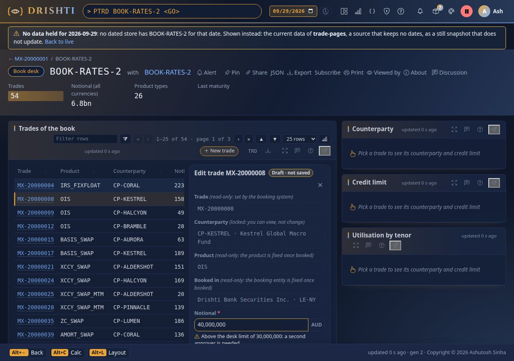

```yaml
panels:
  - use: row-picker@1
    with: { id: trades, rows: $.TRADES, key: TRADE_ID, ... }
    form:
      title: Edit trade
      key: trade_id                        # the field that names a record
      edit: beside
      fields:
        - { id: trade_id, label: Trade, bind: TRADE_ID, readonly: true, reason: "set by the booking system", new: false }
        - { id: counterparty, label: Counterparty, bind: COUNTERPARTY, type: lookup, readonly: true, required: true, options: { ... } }
        - { id: notional, label: Notional, bind: NOTIONAL, type: money, currency: currency, min: 0, required: true, fmt: amount0 }
        - { id: maturity_date, label: Maturity, bind: MATURITY_DATE, type: date, min: today, required: true }
        - { id: trade_status, label: Status, bind: TRADE_STATUS, type: enum, options: [PENDING, VALIDATED, AMENDED], editable-by: [middle-office] }
        - { id: comment, label: Comment, bind: COMMENT, type: textarea, max-length: 500, placeholder: Reason for the change }
      rules:
        - { rule: "notional <= 30000000", severity: warn, fields: [notional],
            message: "Above the desk limit of 30,000,000: a second approver is needed." }
        - { rule: "not (notional > 30000000 and empty(comment))", fields: [comment],
            message: "Say why the trade is above the desk limit: the second approver reads it." }
```

What people see:

- **Typed fields.** A number or an amount of money takes `40,000,000`, `40m` or `1.5bn`; a date opens the date picker; an enum is a list; a lookup is a
  list of what its source offers; `textarea` is several lines.
- **Locked fields say why.** `readonly: true` shows the value with "(read-only: set by the booking system)", or "(locked: you can view, not change)" when
  there is no `reason`. A field whose `editable-by` names roles the person does not hold is locked the same way. A masked field says **Hidden for you**
  and is never editable.
- **Messages in words, under the field.** An error (`severity: error`, the default) stops the draft; a warning (`severity: warn`) is said and kept with
  it.
- **Draft · not saved** while there are changes; **Save draft** keeps them; **Discard** throws them away (and the saved draft too). Leaving the page with
  changes not saved asks first. A panel being edited is not refreshed under the person's hands.

### 28.2 Money, a date and time, a linked record, a worked-out default

The same form has four fields of the richer kinds:

```yaml
        - id: legal_entity
          label: Booked in
          bind: LEGAL_ENTITY
          type: entity                        # a linked record of another pack's kind
          readonly: true
          reason: "the booking entity is fixed once booked"
          step: who
          options: { source: { pack: core, kind: legal-entity }, label: NAME }
        - { id: notional, label: Notional, bind: NOTIONAL, type: money, currency: currency, min: 0, required: true, fmt: amount0 }
        - { id: currency, label: Currency, bind: CURRENCY, type: enum, options: [USD, EUR, GBP, JPY, CHF, CAD, AUD] }
        - { id: upfront_fee, label: Upfront fee, bind: UPFRONT_FEE, type: money, currency: currency, min: 0, default: "=notional * 0.001" }
        - { id: executed_at, label: Executed, bind: EXECUTED_AT, type: datetime, tz: Europe/London }
```

- **`money`** is an amount and its currency. People type `1.5m`, `250k`, `2bn` or `1,000,000`; it shows grouped once they leave the field. The currency
  is fixed (`currency: USD`) or the one another field holds (`currency: currency`, which changes as people pick a currency). A value that does not read
  says *Notional is an amount (1,000,000, 1.5m or 250k)*.
- **`datetime`** is a date and a time (`2026-10-23T14:05`) with the browser's picker; the time zone (`tz`, UTC when absent) is shown beside it and with
  the value (*2026-10-23 14:05 Europe/London*). `min` and `max` are a date and time or `today`.
- **`entity`** links the record to a record of any pack's kind: a search box over the records of `options.source` (a `where` or a `search` narrows them),
  read as the viewer may see them. Type part of a name or an id, pick with the arrows and Enter; the record's **id** is kept and its **label** shown
  (*Drishti Bank Europe AG · LE-FRA*), with **Open** beside it. The box searches the server as people type (`/api/v1/forms/lookup`), so every record of
  the kind can be found; a record whose kept value is masked is never offered. On saving, the server reads the kept id once: an unknown one is refused
  (*Booked in: no legal entity 'LE-NOWHERE' was found*).
- **`default`** starts a new record: a value (`default: PENDING`), or an expression written `=...` over the other fields (`=notional * 0.001`), worked out
  as people type (*Worked out: notional * 0.001 · type to change it*) until they type over it. The server fills it too when a new record leaves the field
  empty.

### 28.3 Editing in the cells

A credit limit's buckets (`/v/credit-limit/LIM-ALDERSHOT`) are edited straight in the table:

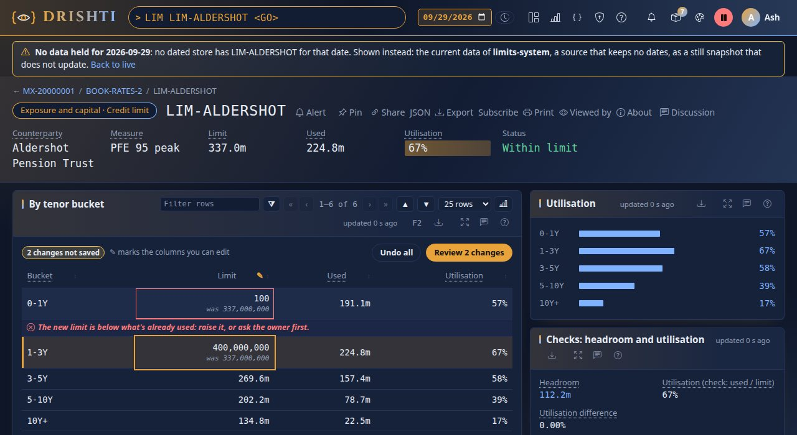

```yaml
  - id: buckets
    kind: table
    rows: $.BUCKETS
    columns:
      - { label: Bucket, bind: "@.BUCKET" }
      - { label: Limit, bind: "@.LIMIT", fmt: compact }
      - { label: Used, bind: "@.USED", fmt: compact }
    form:
      key: bucket
      edit: cells
      fields:
        - { id: bucket, label: Bucket, bind: BUCKET, readonly: true, reason: "the tenor buckets are set by the limits policy" }
        - { id: limit, label: Limit, bind: LIMIT, type: number, min: 0, required: true, fmt: amount0 }
        - { id: used, label: Used, bind: USED, type: number, readonly: true, reason: "measured by the exposure engine" }
      rules:
        - { rule: "limit >= used", fields: [limit], message: "The new limit is below what's already used: raise it, or ask the owner first." }
        - { rule: "limit <= used * 3", severity: warn, fields: [limit], message: "More than three times what's used: the credit committee reviews it." }
```

A field edits the column whose `bind` names the same record field (`LIMIT` edits the column bound to `@.LIMIT`). **Enter** (or F2, or a click) opens a
cell and **Enter** keeps the value in the draft; **Esc** undoes it; **Tab** keeps it and moves to the next editable cell (Shift+Tab back). A changed cell
is tinted and says "was 337,000,000"; a bad one has a red border and the reason under its row. The bar above the table counts "2 changes not saved",
with **Undo all** and **Review 2 changes** (which lists every change and saves the draft; it says "Fix 1 problem first" while one is wrong).

### 28.4 New records in a guided drawer

```yaml
    form:
      new: drawer
      new-label: New trade
      steps: [ { id: who, label: Who }, { id: what, label: What }, { id: check, label: Check } ]
      fields:
        - id: counterparty
          type: lookup
          step: who
          options:
            source: { pack: counterparty-risk, kind: credit-limit, where: "nonblank(@.COUNTERPARTY)" }
            value: COUNTERPARTY            # what is kept
            label: COUNTERPARTY_NAME       # what is shown beside it
            carry: [LIMIT, USED]           # what the hints read: counterparty.LIMIT
        - { id: notional, type: number, step: what, ... }
      hints:
        - { label: "PFE limit after this trade", value: "counterparty.USED + notional", of: "counterparty.LIMIT", fmt: amount0, step: what }
```

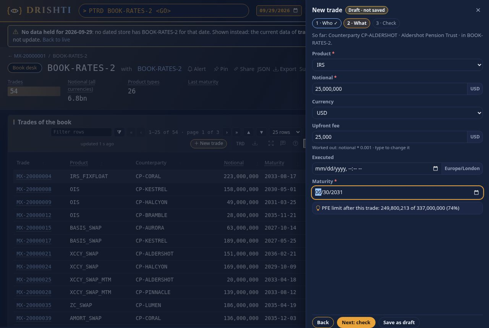

**New trade** opens the drawer; the page stays visible behind it, dimmed. **Next** checks the step's fields first ("Counterparty is required"); a done
step is ticked; **Back** returns; the last step (Check) shows what was entered and every message. A hint is worked out as people type: "PFE limit after
this trade: 102,400,000 of 120,000,000 (85%)". **Save as draft** keeps it from any step. A field is asked in the drawer unless it says `new: false`; a
`readonly` field is one a record keeps once it exists, so the drawer may set it. A lookup's choices are read as the viewer: an entity whose value is
masked is not offered, and a carried value that is masked makes the hint say *Hidden for you*.

### 28.5 The expressions

Rules and hints use a small language, the same in the browser (instantly) and on the server (the authority): the fields by id, a lookup's carried values
(`counterparty.LIMIT`), numbers (`30_000_000` and `1e6` too), `'text'`, `true`, `false`, `null`, `today`; `+ - * /`; `== != < <= > >=` (numbers as
numbers, anything else as text, so ISO dates compare); `and or not`; brackets; `empty(x)`, `len(x)`, `abs(x)`, `min(a, b)`, `max(a, b)`. An empty value
makes a sum or a comparison empty, and a rule that comes out empty holds: `required` says what is missing, not every rule. A rule that reads a lookup's
carried value is checked in the browser only; the server checks it again when it writes.

### 28.6 Checking a form

`sutra lint` and the editor check a form as `DRS-2058`, in words: an unknown key, a type, a `min` that is not a number for a number field, a `step` or
`key` that names nothing, a rule that reads a field the form does not have (`rule 'notionl <= 30000000' reads 'notionl', which is not a field of the
form`), a pattern that is not a regular expression, a money field without its currency (or a `currency` that is neither a code nor a field), a `tz` that
is not a time zone, a `default` expression that reads a missing field. The JSON schema (`/api/v1/rachana/schema`) describes `form:` for editors.

### 28.7 With the Sutra designer

- **Customize › Let people edit**: pick a table, *in a form beside it* or *in its cells* (or *not at all*), tick the columns people may edit, and *start
  new ones in a guided drawer*; **Set** writes the `form:` (the first column names the record and is read-only). Each column is *as guessed* or what you
  pick: text, a number, money, a date, a date and time, or a linked record (offered when the packs say the column names one, such as COUNTERPARTY). The
  guess: a number format or a name like NOTIONAL is a number, money when the table has a CURRENCY column too; a date format or `*_DATE` a date; `*_AT` or
  `*_TIME` a date and time; a column the packs link a linked record.
- **Describe**: `TRD BOOK-RATES-2 · click a trade → cash flows · edit trades beside · new trade in a drawer` (or `edit trades in the cells`) gives the
  trades the form above, with the lookup and the limit hint. The notional is `money`: in the trades' own currency when they carry one, else in the
  book's currency, else USD.

See [The Sutra designer](RACHANA_REFERENCE.md#31-the-sutra-designer-customize-describe-outline-and-grid).

## 29. Around the pack: inheritance, versions, the registry, live reload, deploy

### 29.1 A signed pack registry: publishing and installing

Packs can be published to a **registry** and installed from Admin → Packs, with a version history and a rollback. Every archive is signed; a server
installs only what a publisher it trusts signed. `drishti.py pack keygen|publish|verify` call `tools/packreg/packreg.py`.

1. **Make a signing key** once per publisher (it needs `openssl`): `drishti.py pack keygen --out ~/drishti-keys/acme` (output in
   [step 17](#318-step-17-check-it-and-publish-it)).
2. **Publish a pack** to a registry folder (put it on a web server or a shared drive): `drishti.py pack publish config/packs/helpdesk --registry
   /srv/drishti-registry --key ~/drishti-keys/acme.pem --publisher acme`. The folder then has `helpdesk-0.1.0.zip` and `index.json`. Publishing the same
   folder again makes the same archive, byte for byte: bump `version:` for each release; old versions stay in the registry.
3. **Trust the publisher on a server**, and point it at the registry:

   ```yaml
   drishti:
     packs:
       registry:
         url: https://packs.bank.example/drishti/     # or a folder: /srv/drishti-registry
         trusted-keys:
           acme: MCowBQYDK2VwAyEAcYvYL5cL9D3XYx6w49WZ4oAnDrhjAfRT95Twju2ug+A=
   ```

4. **Install.** Admin → Packs shows **From the registry**: every pack version, its publisher (*trusted* or *not trusted*), and what is installed and loaded
   here. **Install** (or `drishti.py pack install`) downloads the archive and checks its SHA-256, its signature, that its files stay inside the pack, and
   that its `pack.yaml` names the same pack and version; then it is unpacked into `<data>/packs/installed/<name>/` and loaded at once. Installing another
   version upgrades; **Roll back** puts the replaced version back. Installed packs are looked for before the shipped ones, so an installed `trading` 1.1.0
   replaces the shipped `trading`.

Check a registry from the command line:

```bash
drishti-console/.venv/bin/python tools/drishti.py pack verify --registry /srv/drishti-registry --publisher acme \
    --public-key MCowBQYDK2VwAyEAcYvYL5cL9D3XYx6w49WZ4oAnDrhjAfRT95Twju2ug+A=
```

```text
ok   helpdesk 0.1.0
```

| Refused because | Message (Admin → Packs) |
|---|---|
| the publisher's key is not in `trusted-keys` | `refused to install 'x': its publisher 'y' is not trusted on this server` |
| the archive changed after it was indexed | `… its SHA-256 is …, the index says …` |
| it was signed with another key | `… its signature does not verify with y's key` |
| a file would land outside the pack (`../`) | `… it has a file outside the pack: …` |
| `pack.yaml` names another pack or version | `… its pack.yaml says …, the index says …` |
| the registry is plain `http:` | `plain http registries are refused` |

### 29.2 Loading a pack while the server runs

Admin → Packs → **Load** brings in a pack that is on disk but not loaded, without anyone touching the machine and **without a restart**. Every way a pack
changes while the server runs (Load, Unload, a deploy, a registry install or rollback, an edit in the packs folder) takes the same path:

1. The server runs the same check it runs at start-up on the loaded packs plus the new one (inheritance, clashes, the manifest, the YAML files the pack
   points at). A pack that would not load is refused with the reason, and nothing changes. So **a pack that loads on your scratch server loads on
   theirs**: test with the packs the site runs.
2. For Load, it records the pack in the **pack overlay**, `<data>/packs/added.yaml` (`DRISHTI_PACKS_OVERLAY`), which the server imports at every start:

   ```yaml
   # Packs loaded by an administrator from Admin → Packs. Written by the Drishti server: change them there.
   # Read at every start, together with drishti.packs.enabled.
   drishti:
     packs:
       added:
         - helpdesk
   ```

3. It puts the pack to use **now**: its kinds, mnemonics (the command line, type-ahead and menus), Sutras and connectors (a template becomes a connector
   file by the usual rule, and the connector starts); then the roles, the link graph, search columns and pivots, forms, formats, semantic hints, About
   pages, guides, routes and the demo source's folders. Each is built first from the new packs; if one cannot be used the whole change is refused and
   nothing is swapped. A request sees the old settings or the new ones, never a mixture.

**Unload** does the same in reverse for a pack loaded here; packs named in `DRISHTI_PACKS` stay. A pack another loaded pack extends cannot be unloaded.
Unloading stops the connectors only that pack used (their files stay), and a view open for one of its kinds says **pack removed** (`DRS-1002`). Both are
audited (`pack-loaded`, `pack-unloaded`). The API: `POST /api/v1/admin/packs/{name}/load` and `…/unload`; the answer lists what was `loaded`, `reloaded`
and `unloaded`, and any `problems` by pack.

### 29.3 Inheritance

`extends: [a, b]` means: this pack has everything `a` and `b` have (their kinds, mnemonics, id patterns and link fields, badges, roles, connectors and
routes, Sutras and blocks, labels and formats, About vocabulary, samples, alert suggestions, workspaces and help), and turning this pack on turns them on
too. When two **related** packs define the same thing differently, **the more specific definition wins**, for every user:

1. a child wins over its parents;
2. among parents, **the rightmost wins**: with `extends: [market-data, trading]`, `trading` beats `market-data`;
3. a pack reached through several parents counts once, below all of them (C3 linearisation, the rule Python uses to order classes).

**The order for the shipped packs** (`core: []`, `market-data: [core]`, `trading: [core, market-data]`, `counterparty-risk: [trading]`,
`market-risk: [market-data, trading]`):

| Pack | Order (most specific first) | Why |
|---|---|---|
| `trading` | trading → market-data → core | rightmost parent first; `core` once, after `market-data` (which also extends it) |
| `counterparty-risk` | counterparty-risk → trading → market-data → core | one parent, then its order |
| `market-risk` | market-risk → trading → market-data → core | rightmost parent (`trading`) first; `market-data` once, after `trading` |

On the shipped packs nothing is overridden: *Admin → Health* lists `overrides: []`.

**Overriding a parent.** Say your bank wants `NSET` to read "Netting set (CSA)" and netting sets read from its own PostgreSQL connector, without editing
the shipped pack. Create `config/packs/my-bank/pack.yaml`:

```yaml
pack: my-bank
version: 1.0.0
title: My bank
extends: [counterparty-risk]
mnemonics:
  NSET: { kind: netting-set, label: Netting set (CSA) }      # same name as the parent's: replaces it
connectors:
  bank-credit-db:
    plugin: jdbc
    kinds: [netting-set]
    settings:                                                # table mode; see the jdbc connector's page
      url: ${BANK_CREDIT_JDBC_URL}                           # e.g. jdbc:postgresql://db:5432/credit
      user: ${BANK_CREDIT_DB_USER}
      password: ${BANK_CREDIT_DB_PASSWORD}
      table: credit.entities                                 # (kind, id, business_date, doc jsonb)
routes:
  netting-set: bank-credit-db                                # replaces counterparty-risk's route
```

When the pack loads the server writes `config/connectors/bank-credit-db.yaml` from the template (a literal password would be refused). Start the server
with `DRISHTI_PACKS=my-bank` (or copy the folder in): `counterparty-risk`, `trading`, `market-data` and `core` come with it. *Admin → Health* (and
`overrides` in `GET /api/v1/admin/health`) lists every override, one per line:

```text
mnemonic NSET: my-bank overrides counterparty-risk
route netting-set: my-bank overrides counterparty-risk
```

**A child of two parents.** Four small packs, the ones `PackLoaderTest` builds and checks on every build:

```yaml
# config/packs/base/pack.yaml
pack: base
kinds: [curve]
mnemonics: { CRV: { kind: curve, label: Curve } }
roles: { viewer: { kinds: [curve] } }
graph: { badges: { curve: "'base'" } }
```

```yaml
# config/packs/left/pack.yaml
pack: left
extends: [base]
kinds: [trade]
mnemonics: { TRD: { kind: trade, label: Left trade } }
roles: { trader: { kinds: [trade] } }
graph: { badges: { curve: "'left'" } }
```

```yaml
# config/packs/right/pack.yaml
pack: right
extends: [base]
kinds: [quote]
mnemonics: { TRD: { kind: trade, label: Right trade } }
roles: { trader: { kinds: [trade, quote] } }
```

```yaml
# config/packs/child/pack.yaml
pack: child
extends: [left, right]
kinds: [var]
roles: { viewer: { kinds: [curve, trade, var] } }
```

With `DRISHTI_PACKS=child` (and no shipped pack), the order is `child → right → left → base`:

| Defined by | Thing | Result | Why |
|---|---|---|---|
| `left` and `right` | mnemonic `TRD` | label *Right trade* | rightmost parent wins |
| `left` and `right` | role `trader` | kinds `[trade, quote]` | rightmost parent wins |
| `base` and `child` | role `viewer` | kinds `[curve, trade, var]` | the child wins over everything |
| `base` and `left` | badge for `curve` | `'left'` | `left` is more specific than `base` |
| `base` only | mnemonic `CRV` | `curve` | inherited untouched |

The override report includes `mnemonic TRD: right overrides left` and `role viewer: child overrides base`. With `DRISHTI_PACKS=left,right` instead,
`left` and `right` are **unrelated**, and their different `TRD` stops the server:

```text
mnemonic TRD is defined by both pack 'left' and pack 'right', which do not inherit from each other; declare it identically, or make one pack extend the other
```

Two packs may disagree only when some pack has said which of them it prefers, by listing both in its `extends:`.

| Thing | A more specific pack may |
|---|---|
| mnemonic, link field, badge, role, connector, route | define the same name again; its definition replaces the parent's |
| Sutra | ship a Sutra with the same `name` and `version` (it replaces the parent's), or another name with a higher `match.priority` |
| block | ship a block with the same name and a higher version, and `use:` it |
| labels and formats | define the same label or format |
| impact measures and formats | define the same kind |
| About entries | replace an entry by its key ([section 7.2](#72-about-text-and-glossary)) |

Two rules never bend: **a kind belongs to exactly one pack** (a child re-lays a parent's kind out with a Sutra, it cannot redefine it); and **unrelated
packs may not disagree** (`counterparty-risk` and `market-risk` both extend `trading` but not each other, so they may not define one role differently).

### 29.4 Versioning a pack

**The pack's `version`** (**X.Y.Z**, optionally `-pre-release` and `+build`) is a label: shown on About, *Admin → Health* and *Admin → Packs*, and used by
the registry, the deploy check and the install checks; nothing in the pack depends on it. Raise it whenever the pack changes
(`curl -s $B/packs | python3 -c 'import json,sys; [print(p["name"], p["version"]) for p in json.load(sys.stdin)]'` shows what a server runs).
**Sutras carry their own versions** ([section 15](#15-matching-several-sutras)). `drishti.py pack diff OLD NEW` says what changed between two versions
(folders or bundles) and marks removed or renamed kinds and mnemonics as **BREAKING**.

| You changed | It takes effect |
|---|---|
| a Sutra or block (`sutras/`) | within about a second, on every server reading that folder |
| `pack.yaml` (any key), `config/formats.yaml`, `config/semantics.yaml`, `config/about.yaml` | within a few seconds (`drishti.packs.poll`), all swapped in live; a bad edit keeps the last good version. A connector template change does not touch an existing connector file ([reset it](#48-connectors-the-pack-names-them-the-site-owns-them)) |
| `samples/` | within a few seconds (the demo source is restarted on its new folders) |
| `console:` keys, `guides/`, `config/help.yaml`, `config/workspaces.yaml` | in the console within a minute |
| data behind a connector | at once, or at the connector's next rescan |

**Before you rename a kind, a mnemonic, an attribute or a link field**: saved monitors, workspaces, alert rules and BI items refer to kinds, fields and
ids, so a rename leaves them pointing at nothing. Add the new name and keep the old one for a release where you can.

### 29.5 Verifying a pack

After any change, one minute on a scratch server tells you the pack is sound.

| Where | Look for |
|---|---|
| *Admin → Packs* | the pack, its version, **on**; *Needed by* shows what builds on it; its own page shows its kinds, Sutras, Sutra coverage and connectors |
| *Admin → Health* | the pack **OK**, with its kinds, Sutras and connectors; no Sutra problems, no connector down or not configured, and only the *Overrides* you expect |
| `HELP` (the pack's `code`) on the command line | the pack's overview: every kind you may open, its mnemonic, how many entities the sources hold, an example, the key fields |
| *Help → Help centre* | the pack's guide card |

```bash
B=http://localhost:18996/api/v1
curl -s $B/sutras/problems                                  # {}
curl -s $B/admin/health | python3 -c 'import json,sys; d=json.load(sys.stdin); print(d["overrides"]); print([(p["name"], p["status"], p["version"]) for p in d["packs"] if p["name"]=="helpdesk"])'
curl -s $B/packs/HELP/overview | python3 -c 'import json,sys; d=json.load(sys.stdin); print(d["name"], d["code"], [(k["mnemonic"], k["count"]) for k in d["kinds"]])'
curl -s $B/sources | python3 -c 'import json,sys; [print(s["name"], s["kinds"], s["health"]) for s in json.load(sys.stdin)["sources"] if s["name"] in ("helpdesk-store", "agent-totals")]'
drishti-console/.venv/bin/python tools/drishti.py pack check config/packs/helpdesk --tail 1
```

The output for the finished help-desk pack, with the file connector of step 16 on:

```text
{}
[]
[('helpdesk', 'OK', '0.1.0')]
helpdesk HELP [('TKT', 4), ('AGT', 1), ('CLI', 2), ('LOAD', 1)]
agent-totals ['agent-load'] UP
helpdesk-store ['ticket'] UP
== helpdesk: sutra lint: exit 0
ok      config/packs/helpdesk/sutras/ticket.v1.sutra.yaml
== helpdesk: sutra test: exit 0
ok   config/packs/helpdesk/sutras/ticket.v1.sutra.yaml (2 samples)
```

`[]` is the list of overrides. The four counts are the entities each kind has for the business date: three sample tickets and the exported one.

**The checklist:**

1. `sutras/problems` prints `{}`, and `pack check` passes (`--strict` too, if you keep every shown field explained).
2. *Admin → Health* shows the pack **OK**, the overrides you expect and no others, and no connector *down* or *not configured*; `ls config/connectors`
   has a file for each connector the pack names.
3. Each `console.examples` command opens, and its *How this view was built* names a Sutra (or says `inference only` where you meant it to).
4. `<MN> <GO>` for each mnemonic gives a pick list with sensible columns; the type-ahead offers the mnemonics; `FORM <code>` opens a usable form.
5. The links of one entity of each kind resolve, and F8 on a central entity lists what depends on it.
6. A role without `raw` sees `•••` for the fields the site masks, and the views still make sense.
7. The guide renders in the help centre and its links open; `?` on a view shows your About sentence.
8. The pack's **version** is bumped, and the registry archive (`pack verify --registry`) is current.

### 29.6 Live reload: the packs folder is watched

The server watches `drishti.packs.dir` (and `drishti.packs.installed-dir`) the way it watches Sutras and connector files: `drishti.packs.watch` is `auto`
(file events, with a poll every `drishti.packs.poll` as the safety net), `poll`, or `off` (only Admin → Packs acts). A burst of changes (a copy in
progress) is acted on once the folder has been quiet for `drishti.packs.reload-debounce`; one reload runs at a time. Copying the help-desk pack into
`config/packs/` of a running server loads it within about ten seconds.

| What you do in the folder | What happens, with no restart |
|---|---|
| **Add** a pack folder (one with a `pack.yaml`) | Checked together with the loaded packs, then loaded and remembered in the overlay. A folder that does not check out is not loaded; Admin → Packs and Health say why, and it is tried again |
| **Edit** `pack.yaml`, `about.yaml`, a Sutra or a sample | Checked again and swapped in; a mnemonic you renamed stops working under its old code. A template change does not rewrite an existing connector file |
| **Make a bad edit** (invalid YAML, a kind another pack owns, a missing parent) | **The last good version keeps running.** The problem shows on the pack's row in Admin → Packs and on Health (DEGRADED), and in the audit log (`pack-problem`). Fix the file and it clears |
| **Delete** a pack folder | The pack is unloaded; connectors only it used stop; open views of its kinds say *pack removed*. If another loaded pack extends it, it stays as last loaded until that one goes. If `DRISHTI_PACKS` names a deleted pack, the server will not start until that is changed |

**A pack that was refused is tried again by itself.** A refusal can go away without anyone touching the pack's own folder (the pack it clashed with is
unloaded, the pack it extends is added, a connector file appears). Every refused pack is listed as **failing** and checked again as soon as something it
may depend on changes, and on a schedule with exponential backoff (`drishti.retry.packs.*`: [CONFIGURATION.md](../admin/CONFIGURATION.md#retry-settings),
[OPERATIONS_GUIDE.md](OPERATIONS_GUIDE.md#138-retries-what-failed-is-tried-again-by-itself)). Admin → Packs shows *failed — next retry in 20 s (attempt 3)* and
the last error; **Retry now** (or `POST /api/v1/admin/retry/packs`, `packs:admin` scope) checks at once. With `drishti.packs.watch: off` nothing retries
on a timer: use Retry now. Every change is audited (`pack-loaded`, `pack-reloaded`, `pack-unloaded`, `pack-problem`, `pack-recovered`).

### 29.7 Deploying an archive, history and roll back

Each is written up step by step, with pictures, in [OPERATIONS_GUIDE.md, section 17](OPERATIONS_GUIDE.md#9-admin--packs-deploy-an-archive-history-and-roll-back).

- **Deploy an archive.** Upload a `.tar.gz` made by `drishti.py pack bundle` or `pack make` (the pack only, never data) on Admin → Packs. The server checks
  the checksums and manifest, that no path leaves the pack folder, the server version it needs, the Sutras (lint and tests), the packs it extends, and an
  optional signature by a trusted publisher; shows what it **changes** from the running version (breaking first: kinds or mnemonics removed or renamed);
  and, once you confirm, swaps it into `drishti.packs.installed-dir`, keeps the version it replaces and puts the new version to use at once. If the pack
  cannot be used, the old files are put back. A pack may carry BI items in `config/bi/` inside its folder; deploying imports them into the shared
  workspace `packs` ([REPORTS_GUIDE.md](REPORTS_GUIDE.md)).
- **History and roll back.** Every deployment, rollback and reverted attempt is listed, with the kept versions (`drishti.packs.deploy.keep-versions`) and
  a **Roll back to this** button; `shipped` goes back to the copy that ships with the server.
- **Data source.** Per loaded pack, a read-only view of the connectors it names: each one's state, plugin, the kinds this pack takes from it, and what
  defines it (a connector file, the pack's template, or nothing: *not configured*, with a **Create** link). **Edit** goes to Admin → Connectors.

The same from the terminal: `drishti.py server packs deploy|history|rollback|datasource get`
([CLI_REFERENCE.md](CLI_REFERENCE.md#server-packs-deploy-history-rollback-and-datasource)); a personal API token needs the `packs:admin` scope.

### 29.8 Upgrading and removing a pack

**Upgrading a pack on a running installation:**

1. Read the pack's change notes, and run `drishti.py pack diff OLD NEW` for renamed kinds, mnemonics, attributes or link fields (saved monitors,
   workspaces, alert rules and BI items refer to them).
2. Replace the folder `config/packs/<domain>/<name>/` with the new version (for a checkout: `git pull`), or deploy its archive from Admin → Packs. Parents
   it now extends load with it.
3. No restart: the server notices the new folder within the poll interval (or press Retry now). A refused pack keeps its last good version.
4. Check *Admin → Health*: the new version, no Sutra problems, its connectors up and none *not configured* (a new version may name a connector this site
   has no file for yet: create it in Admin → Connectors). Existing connector files are not changed by an upgrade; a pack switched off stays off.
5. Open one of its example commands from `/t`.

**Removing a pack:** prefer *Uninstall…* (Admin → Packs or Admin → Artifacts), which first lists what depends on the pack (packs that extend it,
connectors only it uses, BI datasets and reports over its kinds, monitors, alert rules, subscriptions, workspaces, shares, embed hosts), refuses while
anything does and offers *Disable instead*, and otherwise moves the folder to `<data>/uninstalled/`, where it can be restored for 30 days
([OPERATIONS_GUIDE.md section 18](OPERATIONS_GUIDE.md#10-admin--artifacts-install-and-uninstall-safely)). Deleting its folder (or Unload) works too; a pack
named in `DRISHTI_PACKS` can only be disabled in Artifacts. To hide a pack without removing it, switch it off ([section 31.3](#313-switching-packs-off-and-on-admin--packs)).

## 30. Generated packs and the README standard

### 30.1 How the shipped packs are generated

The shipped packs are **generated**: a Python program writes their `pack.yaml`, Sutras, samples, guides and help cards from one description. Each
generated file says so near the top (`# Generated by tools/packgen/banking/make_packs.py from the taxonomy. Edit the generator, not this file.`).

| Packs | Generator |
|---|---|
| `core`, `market-data`, `trading`, `market-risk`, `counterparty-risk` | `tools/packgen/banking/`: `make_packs.py` the manifests and the Calc snippets, `make_sutras.py` the Sutras and blocks (the trading pack's from `tools/packgen/trades/sutras.py`), `make_docs.py` the guides, `make_data.py` the documents |
| the trades (`trading`'s samples and tests, `data/testdata/trades/`) | `tools/packgen/trades/`: `schema.py` the common schema, `endur.py` the Endur deals, `convert.py` the Calypso and Murex deals, `amend.py` the daily amendments, `make_trades.py` the files and tables |
| `world-economy` | `tools/packgen/world/make.py` (economics and politics halves, real public data through `tools/realdata/`), on the common builder `tools/packgen/common/packbuild.py` |
| the test data (`data/testdata/`) | `tools/testdata/make_testdata.py` (deterministic; `--check` says whether the files are current) |
| the example packs in `examples/packs/` | `tools/packgen/<area>/make.py`, on the same builder with `retired=True` |
| `news-and-markets` | hand-written; its samples come from `config/packs/economy/news-and-markets/tools/make_samples.py` |

The banking and world-economy generators build documents with short internal names and turn them into UPPER_SNAKE at one boundary,
`tools/packgen/common/upper.py`; a new field in a generator is written in UPPER_SNAKE without more work. The connectors that build their own documents
(news, yfinance, the public feeds) write UPPER_SNAKE too.

**Never edit a generated file by hand.** A hand edit is lost the next time the generator runs, and before that it fails the build: every generator runs in
check mode (`python3 tools/packgen/banking/make_packs.py --check` prints `5 pack manifests up to date (71 Calc snippets)`; `make_sutras.py --check`
`186 Sutras up to date`). After a hand edit to `config/packs/banking/trading/pack.yaml` the first stops with `pack manifests out of date; run
make_packs.py: ['config/packs/banking/trading/pack.yaml']`; the packbuild generators also refuse files they did not write
(`<pack> pack out of date; run tools/packgen/<area>/make.py. stale=[] extra=[…]`). A top-level section of a banking pack's manifest the taxonomy does not
say (the `history:` sections, the trading pack's `ingest:`) is kept in `tools/packgen/banking/kept/<pack>.yaml` and appended as written.

**Changing a generated pack, step by step.** Example: show the trader in trade pick lists.

1. Find the generator named in the file's comment: `tools/packgen/banking/make_packs.py`.
2. Change its input: add `"TRADER_ID"` after `"COUNTERPARTY"` in the trade columns of the `COLUMNS` table.
3. Run the generator without `--check`: `python3 tools/packgen/banking/make_packs.py`.
4. `git diff config/packs/banking/trading/pack.yaml` shows `- TRADER_ID` added under `columns: trade:`.
5. Wait for the reload, type `TRD MX-200000`: the pick list has a *Trader ID* column (`•••` for a role without `raw`: the shipped setting masks it).
6. Commit the generator **and** the files it wrote, together.

**Changing a pack you do not own.** To change a shipped pack for your site without touching its files:

| You want | Do this |
|---|---|
| A different layout for one kind | A Sutra with a higher `version` or priority in the site Sutra folder (`./sutras`, `DRISHTI_SUTRAS`), or designed in the Build workbench |
| Other mnemonics, labels, columns, connectors or routes | A small pack of your own that `extends` the shipped one ([section 29.3](#293-inheritance)) |
| A connector pointed elsewhere, or switched off | Its connector file, `config/connectors/<name>.yaml` (or Admin → Connectors, `drishti.py connector apply`), applied without a restart ([DATA_GUIDE.md section 9](DATA_GUIDE.md#9-connector-files-and-admin--connectors)) |
| A pack hidden from everyone | *Admin → Packs* → **Switch off** ([section 31.3](#313-switching-packs-off-and-on-admin--packs)) |

### 30.2 Writing your own generator

A pack with many kinds and many consistent documents is better **generated**: you describe kinds and documents in a short Python script, and the common
pack builder checks them and writes the manifest, Sutras, samples, guide, help card and (optionally) a Delta Lake. This walk-through generates a small
library pack with two kinds (book titles and authors); it was run as written and printed the lines shown. You need the repository and Python 3 with
`pyyaml` (the console's virtual environment has it). For a handful of kinds, writing the pack by hand is simpler, and for existing data `pack new` is quicker.

**Step 1. The script.** Create `tools/packgen/library/make.py` (with the copyright header, or run `python3 tools/license_headers.py --fix`):

```python
# tools/packgen/library/make.py: the top of the file
"""The library pack: book titles and authors.

    python3 tools/packgen/library/make.py            write config/packs/library
    python3 tools/packgen/library/make.py --check    fail if config/packs/library differs from what would be written
"""
from __future__ import annotations

import sys
from pathlib import Path

HERE = Path(__file__).resolve().parent
sys.path.insert(0, str(HERE.parent / "common"))
sys.path.insert(0, str(HERE.parent / "banking"))
import packbuild as PB  # noqa: E402  the common pack builder
import taxonomy as T  # noqa: E402  the banking packs' link fields, so yours cannot clash with them
from risk_model import Kind, Panel as P  # noqa: E402
```

**Step 2. The kinds.** A `Kind` names an entity type and describes its screen. Its arguments, in order:

| Argument | Example | Meaning |
|---|---|---|
| kind | `"book-title"` | The kind's name: lower-case, unique across all enabled packs (`book` is already a `core` kind) |
| mnemonic | `"TITLE"` | What users type: `TITLE TITLE-0001` |
| prefix | `"TITLE-"` | Every id starts with it; it becomes the id pattern |
| label | `"Book"` | The human name |
| group | `"Library"` | Groups the Sutras (`sutras/library/`) |
| desc | `"A title in the catalogue…"` | One sentence, used in the Sutra and the guide |
| id_field | `"TITLE_ID"` | The document field that holds the id |
| strip | list of `(label, path, format, tone, emphasis)` | The header figures, at most eight |
| panels | list of `Panel` | The body |
| `links=` | `{"AUTHOR": ("author", "Author")}` | Document field → (kind it points at, label) |
| `badge=` | `"$.ON_LOAN + ' on loan'"` | The short text shown beside a link to this kind |

A `Panel` is `P(kind, id, title, rows, columns, …)` with `kind` one of `kv`, `table`, `line`, `area`, `hbar`, `ladder` or `surface`; columns are
`(label, path, format, tone, total)`; and `x=`, `y=`, `label=`, `value=`, `fmt=`, `key=`, `area=` as in a Sutra.

```python
# the two kinds
G = "Library"
KINDS = [
    Kind("book-title", "TITLE", "TITLE-", "Book", G, "A title in the catalogue: author, copies and loans.", "TITLE_ID",
         [("Title", "$.TITLE", None, None, True), ("Author", "$.AUTHOR_NAME", None, None, False),
          ("Copies", "$.COPIES", "amount0", None, False), ("On loan", "$.ON_LOAN", "amount0", None, False)],
         [P("line", "loans", "Loans per month", "$.LOANS_BY_MONTH", x="MONTH", y="LOANS", fmt="amount0", key="F2"),
          P("table", "copies", "Copies", "$.COPY_LIST", [("Barcode", "@.BARCODE", None, None, False),
            ("Branch", "@.BRANCH", None, None, False), ("Status", "@.STATUS", None, "status", False)], key="F3")],
         links={"AUTHOR": ("author", "Author")}, badge="$.ON_LOAN + ' on loan'"),
    Kind("author", "AUTH", "AUTH-", "Author", G, "An author and their titles.", "AUTHOR_ID",
         [("Name", "$.NAME", None, None, True), ("Titles", "$.TITLE_COUNT", "amount0", None, False)],
         [P("table", "titles", "Titles", "$.TITLES", [("Title", "@.TITLE", None, None, False)], key="F2")]),
]
```

Every generated Sutra ends with *How this view was built* and binds **F8** and **F9**; a kind with `links` also gets *Linked entities* and **F7** to its
first link.

**Step 3. The documents.** One function returns every document, by kind and then by id. They must be **consistent** (every link points at a document
that exists) and **deterministic** (seed any random generator from the id), so `--check` can tell whether the committed pack is current:

```python
# the sample documents
def build() -> dict[str, dict[str, dict]]:
    meta = {"source": "catalogue", "generation": 1}
    docs = {"book-title": {}, "author": {}}
    docs["author"]["AUTH-001"] = {
        "AUTHOR_ID": "AUTH-001", "NAME": "Ada Okafor", "TITLE_COUNT": 1,
        "TITLES": [{"TITLE": "Rivers of Light"}], "_meta": meta}
    docs["book-title"]["TITLE-0001"] = {
        "TITLE_ID": "TITLE-0001", "TITLE": "Rivers of Light", "AUTHOR": "AUTH-001", "AUTHOR_NAME": "Ada Okafor",
        "COPIES": 4, "ON_LOAN": 3,
        "LOANS_BY_MONTH": [{"MONTH": "2026-07", "LOANS": 9}, {"MONTH": "2026-08", "LOANS": 11}, {"MONTH": "2026-09", "LOANS": 14}],
        "COPY_LIST": [{"BARCODE": "31000451", "BRANCH": "Central", "STATUS": "On loan"},
                      {"BARCODE": "31000452", "BRANCH": "Central", "STATUS": "Available"}],
        "_meta": {**meta, "live": True, "walk": {"ON_LOAN": 1}}}
    return docs
```

**Step 4. The pack, and the builder.**

```python
# the pack itself
def spec() -> PB.PackSpec:
    return PB.PackSpec(
        name="library", title="Library", description="Titles, authors and loans.",
        requires=[],                                    # packs this one extends; written as extends: in pack.yaml
        generator="tools/packgen/library/make.py",
        domains={"library": KINDS},                     # data domain -> kinds; one Delta Lake connector each
        examples=[("TITLE TITLE-0001", "A book · loans and copies"), ("AUTH AUTH-001", "An author · titles")],
        roles={"librarian": {"kinds": [k.kind for k in KINDS], "raw": True}})


if __name__ == "__main__":
    PB.main(spec(), build(), T.graph_fields())
```

| `PackSpec` field | Meaning |
|---|---|
| `name`, `title`, `description` | The pack's id (its folder name and what `DRISHTI_PACKS` lists), display name and summary |
| `requires` | Packs this one builds on, e.g. `["core"]` to link to counterparties |
| `domains` | Data domain → kinds; each domain becomes a Delta connector `<domain>-store` reading `<root>/<domain>/<kind>/` |
| `examples` | Commands shown on the landing page and in the pack's guide |
| `roles` | Roles the pack adds |
| `code=`, `sample=` | The pack's code; a demonstration pack |
| `columns=`, `layouts=`, `form_overrides=` | Pick-list columns, the Delta columns per kind, form field types and labels |
| `impact=` | Optional F8 configuration (`follow`, `measures`, `formats`) |
| `external_ids=` | Ids that live in a required pack, so links to them pass the check |
| `overview=` | Extra prose for the generated guide |
| `retired=` | Write under `examples/packs/` instead of `config/packs/` |

**Step 5. Run it.**

```bash
# write config/packs/library
python3 tools/packgen/library/make.py
```

```text
library: wrote 8 files (2 documents, 2 kinds)
```

`--check` then prints `library: 8 files up to date`. Before writing anything the builder checks that every id field matches its key, every link resolves
(to this pack or, through `external_ids`, to a pack it requires), every path a strip or panel's rows reads exists in every document, and no link field
already means another kind in the banking packs. With `AUTHOR` pointing at `AUTH-002`:

```text
library data is inconsistent:
  book-title/TITLE-0001: AUTHOR -> author/AUTH-002 does not exist
```

```bash
# fail if config/packs/library differs from what the script would write
python3 tools/packgen/library/make.py --check

# write somewhere else (a scratch folder, a review): the pack goes to $DRISHTI_PACKS_OUT/library
DRISHTI_PACKS_OUT=/tmp/review python3 tools/packgen/library/make.py

# also build ten business days of history in the Delta Lake, for the date picker
drishti-console/.venv/bin/python tools/packgen/library/make.py --lake data/delta/demo
```

**Step 6. What you get.**

```text
config/packs/library/
  pack.yaml                            kinds, mnemonics, id patterns, link fields, badges, roles, connector, routes, examples
  sutras/library/book-title.v1.sutra.yaml   one YAML Sutra per kind (rachana: 1, with a description)
  sutras/library/author.v1.sutra.yaml
  samples/book-title.jsonl             the documents, one a line, for the built-in demo source
  samples/author.jsonl
  samples/catalog.jsonl                the list the demo source and suggestions read
  guides/library.md                    an overview guide: kinds, fields, links and "Try it" commands
  config/help.yaml                     the guide's card in the help centre
```

The `pack.yaml` names the link field `AUTHOR`, the badge `$.ON_LOAN + ' on loan'` and one connector template, `library-store` (`plugin: delta`, `domain:
library`), with both kinds routed to it.

**Step 7. Open it.** Copy (or write) the folder into the packs folder of a running server, or start one with it (`DRISHTI_PACKS=library java -jar
kernel/drishti-server/target/drishti-server-*-exec.jar`, or `DRISHTI_PACKS=market-risk,library`). Then type `TI` (you see `TITLE` *Book* in the suggestions);
type `TITLE TITLE-0001`: the pill *Library · Book*, the strip *Title Rivers of Light* (highlighted), *Author Ada Okafor*, *Copies 4*, *On loan 3* (it
ticks), the panels *Loans per month* (F2) and *Copies* (F3), and *Linked entities* with *Author AUTH-001*; **F7** opens the author; the help centre has
the *Library pack* guide. If an admin assigns packs per user, add `library` to your user under **Admin → Users**. Real history for the date picker needs
the Delta Lake built with `--lake`; without it, a picked date shows the samples as they are, with a note that the source is not dated.

**Step 8. Make it part of the build.** Commit `tools/packgen/library/make.py` and `config/packs/library/` together; add `library` to the default pack list
if it should ship, so the build checks that every example command opens with no empty panel and no missing link, and that it loads with the others; the
generators' `--check` runs on every build.

### 30.3 The README standard

Every pack has a `README.md` in its folder: one or two pages that say what the pack holds, for people, for the console (Admin → Packs → the pack, and the
pack's overview) and for AI (`GET /api/v1/packs/{pack}/readme`). It is **generated**, never edited: `tools/packgen/common/readme.py` reads `pack.yaml`,
the samples, the Sutras and `config/about.yaml`, and adds a short hand-written **intro**. `tools/test_readmes.py` fails when a pack has no README, a
missing or invalid front matter, an empty section, a kind missing from *Data structures*, or a README its generator would write differently.

```markdown
---
pack: library                 # the folder's name
version: 1.0.0
code: LIBS
title: Library
summary: One line.
kinds: [book-copy, loan]
commands: {BKC: book-copy, LOAN: loan, LIBS: pack overview}
depends-on: {packs: [core], connectors: [library-store], plugins: [delta], settings: [DRISHTI_LAKE_ENABLED]}
sources:
- {name: The library's catalogue, licence: Proprietary, internal-only: false, used-for: book-copy}
refresh: tools/feeds/library.py      # or the generator, when the data has no refresh script
generated-by: tools/packgen/library/make.py
---
# The library pack
## What it is
## Data structures            # per kind: ### `kind`, its id rule, a field table (Field | Type | Example | Description),
                              # nested structures by path (LEGS[].CASH_FLOWS[]) and the links to other kinds
## Screens and commands
## Data sources and licences
## Enabling and dependencies
## Refreshing the data
## See also
```

**Where the words come from.** Types and examples from the samples (up to 4,000 documents a kind; a field present in only part of them says so), ids
from the catalogue and `graph.id-patterns`, links from `graph.fields`, descriptions from `config/about.yaml` glossaries, then the Sutras' labels, then
the intro's `fields:`. A kind without samples lists the fields its screens show. **The intro**, `tools/packgen/<generator>/readme/<pack>.intro.md` (or
`tools/packgen/intros/<pack>.intro.md` for a pack without a generator), holds what cannot be read from the files:

```markdown
<!-- licence comment -->
---
generator: tools/packgen/library/make.py
sources:
- name: The library's catalogue
  licence: Proprietary
  internal-only: false
  used-for: book-copy, loan
fields:
  loan:
    _: One loan of one copy to one member.          # a line under the kind's heading
    DUE: The day the copy is due back
---
## What it is

Two or three sentences: what the pack is for and who uses it.

## Data sources and licences

Anything the table of sources does not say (an internal-only source and why).
```

Any of the seven sections may have intro text; it comes before the generated part. A generator calls `readme.render_pack(pack_dir, files=out)` with the
files it is about to write and adds `README.md` to them (so its `--check` covers it); a pack without a generator runs
`python3 tools/packgen/readme.py <pack>`, and `python3 tools/packgen/readme.py --all --check` checks every pack.

**Every command needs a data contract too.** Each kind that has a mnemonic gets `contracts/<kind>.contract.yaml` in the pack: its class and status,
source, grain, key, dating, cadence, storage, every field (type, presence, unit, description, example, values, link) and its validation rules
([docs/contracts/README.md section 16](../contracts/README.md#16-contracts-of-every-command)). Unlike the README, a contract is drafted once and then owned
by people: `drishti.py contract bootstrap <kind> --write` reads the pack, its samples and test data, its glossary and its Sutras, and lists what it
inferred under `review` to confirm; `drishti.py contract docs` regenerates the pages; `drishti.py contract check` fails when a mnemonic has no contract, a
contract is invalid, or the samples and test data drift from it, so regenerating samples with new fields means updating the contracts in the same change.

**Every pack guide ends with its data contracts and its data retrieval.** A generator that writes a pack's guide appends
`guide_data.sections(pack_dir)` (`tools/packgen/common/guide_data.py`): *Data contracts*, every kind's contract with every column, and *Data retrieval*,
where each kind's data comes from (an external source with its licence, internal-only flag and refresh script; a generator of synthetic data; or a
Drishti engine), how it reaches the lake, checking and offline. The origin is configured in `tools/packgen/common/data_retrieval.yaml`. A pack without a
guide generator is kept by `python3 tools/packgen/common/guide_data.py` (`--check`). External sources are documented on the
[External data](EXTERNAL_DATA.md) page.

## 31. The packs that ship: turning them on, who sees which

Drishti's core knows no industry. Everything that belongs to one industry (the commands, the screens, the sample data, the lakes, the help pages, the BI
datasets) arrives in a pack. This section is for users and administrators as much as for authors.

### 31.1 The packs that ship

Each pack's README (what it holds, every kind's fields, its sources and licences, how to enable and refresh it) and its data contracts are the reference;
this table is the map. Seven packs are on by default; the others are turned on by adding them to `DRISHTI_PACKS`.

| Pack | Code | Extends | Mnemonics | Try | README |
|---|---|---|---|---|---|
| `core` | `CORE` | — | `CPTY` `GRP` `ISS` `CCP` `LE` `BOOK` `DESK` `TRDR` `CAL` `CLR` | `CPTY CP-NORTHBRIDGE`, `LE LE-NY` | [core](../../config/packs/core/core/README.md) |
| `market-data` | `MKT` | `core` | `CRV` `REPO` `FX` `FXF` `FXV` `IRV` `CPV` `EQ` `EQX` `DIV` `EQV` `CDS` `INF` `INFC` `CMD` `CMDC` `CMDV` `FIX` `BND` `CORR` | `CRV CRV-USD-OIS`, `FXV FXV-EURUSD` | [market-data](../../config/packs/banking/market-data/README.md) |
| `trading` | `TRDS` | `core`, `market-data` | `TRD` (three source systems) · `CTRD` `PTRD` `LTRD` `ITRD` (derived) | `TRD MX-20000001`, `TRD 1000001`, `CTRD CP-ALDERSHOT` | [trading](../../config/packs/banking/trading/README.md) |
| `counterparty-risk` | `CCR` | `trading` | `AGR` `CSA` `NSET` `LIM` `EXP` `CVA` `SACCR` `COLL` `MC` `SIMM` | `AGR AGR-NORTHBRIDGE-ISDA`, `NSET NS-SUMMIT-NY` | [counterparty-risk](../../config/packs/banking/counterparty-risk/README.md) |
| `market-risk` | `MRSK` | `market-data`, `trading` | `VAR` `SCN` `STR` `FRTB` `PNL` `TVAL` | `VAR VAR-RATES`, `TVAL TVAL-MX-20000001` | [market-risk](../../config/packs/banking/market-risk/README.md) |
| `world-economy` | `WRLD` | — | `ECON` `MACRO` `FCST` `LABR` `FISC` `ECG` `REGE` `JUR` `PARTY` `OFFC` `ELEC` `REGN` `SOCI` (real public data; the IMF part is for internal demonstrations only) | `ECON ECON-IND` | [world-economy](../../config/packs/economy/world-economy/README.md) |
| `news-and-markets` | `NWMK` | — | `TOPIC` `NEWS` `CO` `QUOTE` (a sample pack; its news and yfinance connectors are off as shipped) | `TOPIC TOPIC-FED` | [news-and-markets](../../config/packs/economy/news-and-markets/README.md) |
| `us-equities` | `USEQS` | — | `USEQ` `IDX` `SIC` `EDGAR` `FILING` `FACT` `PXH` (off by default; prices live only and internal) | `USEQ AAPL`, `IDX SP500` | [us-equities](../../config/packs/capitalmarkets/us-equities/README.md) |
| `gleif` | `GLEIF` | — | `LEI` `LEIG` `LEIR` `LEIC` `LEIM` (off by default; with `us-equities` on, a company and its LEI link both ways) | `LEI 8I5DZWZKVSZI1NUHU748`, `LEIG ALL` | [gleif](../../config/packs/core/gleif/README.md) |
| `funds` | `FUNDS` | — | `FUND` `HELD` `TRACK` (off by default, after `us-equities`; [FUNDS_GUIDE.md](FUNDS_GUIDE.md)) | `FUND QQQ`, `HELD AAPL` | [funds](../../config/packs/capitalmarkets/funds/README.md) |
| `compute-demo` | `CMPD` | — | `PBOOK` `PSTRIP` `PSUM` `PSUMJ` (a sample pack for reactive connectors; [tutorial 19, Part C](../tutorials/19-build-a-pack-and-a-screen.md#part-c--computed-panels-a-reactive-connector)) | `PSUM …` | [compute-demo](../../config/packs/core/compute-demo/README.md) |
| public sector (economy module) | `WDEV` `CBNK` `STCAN` `OECDP` `ONEWS` `GDLT` | — | world development, central banks, national statistics, OECD, official news, GDELT events ([PUBLIC_SECTOR_GUIDE.md](PUBLIC_SECTOR_GUIDE.md)) | | [world-development](../../config/packs/economy/world-development/README.md), [central-banks](../../config/packs/economy/central-banks/README.md), [national-statistics](../../config/packs/economy/national-statistics/README.md), [oecd](../../config/packs/economy/oecd/README.md), [official-news](../../config/packs/economy/official-news/README.md), [gdelt-events](../../config/packs/economy/gdelt-events/README.md) |

**Links between packs.** A `core` counterparty carries its country of risk and two link fields that open other packs when they are on: `ECONOMY`
(`ECON-<alpha-3>`, its economy in `world-economy`) and `NEWS_ID` (its headlines in `news-and-markets`). Agreements and CSAs belong to `counterparty-risk`,
so `CPTY CP-NORTHBRIDGE` shows its master agreement as a link only when that pack is on. A pack never has to list `core`, `market-data` or `trading`: the
packs that extend them bring them in.

| You want | `DRISHTI_PACKS=` |
|---|---|
| Everything on by default | `core,market-data,trading,counterparty-risk,market-risk,world-economy,news-and-markets` |
| The risk packs only | `market-risk,counterparty-risk` |
| Trades and their reference data | `trading` |
| Everything, with US equities and their LEIs | `core,market-data,trading,counterparty-risk,market-risk,world-economy,news-and-markets,us-equities,gleif` |
| Everything, with the 200 largest US funds and ETFs too | the line above plus `,funds` |

**Example packs.** `examples/packs/` holds example packs that are not shipped in the images (`finance`, `logistics`, `genomics`, `retail-banking`,
`operational-risk`, `climate-risk`, `liquidity-risk`); they keep their own attribute names. Name the folder in `drishti.packs.extra-dirs`
(`DRISHTI_PACKS_EXTRA_DIRS=examples/packs`) and the pack in `DRISHTI_PACKS`; `finance` defines `trade` and `counterparty` itself, so it is an
alternative to the seven, not an addition.

### 31.2 Turning packs on

The server reads `drishti.packs.enabled` from `DRISHTI_PACKS` (a comma-separated list; default the seven). Packs are looked for in `drishti.packs.dir`
(`DRISHTI_PACKS_DIR`, default `./config/packs`), then in `drishti.packs.extra-dirs`.

1. Start the server with the packs you want (or the IDE run configuration **Drishti server** with `DRISHTI_PACKS` changed;
   [OPERATIONS_GUIDE.md](OPERATIONS_GUIDE.md#3-other-ways-to-build-and-run-maven-intellij-idea-and-pycharm)):

   ```bash
   export JAVA_HOME=/usr/lib/jvm/java-21-openjdk-amd64
   DRISHTI_PACKS=market-risk,world-economy java -jar kernel/drishti-server/target/drishti-server-*-exec.jar
   ```

2. Check what loaded (with security on, add an API token: [DEVELOPER_GUIDE.md](DEVELOPER_GUIDE.md)):

   ```bash
   curl -s http://localhost:18480/api/v1/packs -H "Authorization: Bearer $DRISHTI_TOKEN" \
     | python3 -c 'import json,sys; [print(p["name"], p["version"]) for p in json.load(sys.stdin)]'
   ```

   You see one line per loaded pack that is switched on, parents included: with `DRISHTI_PACKS=market-risk,world-economy`, `market-risk`, `core`,
   `market-data`, `trading` and `world-economy`. *Admin → Packs* lists every pack with its status, and *Admin → Health* each pack with what it extends,
   its kinds, Sutras, connectors and problems.
3. Open the terminal (`/t`) and type a command from the new pack, for example `ECON ECON-IND <GO>`.

The console needs no setting: it asks the server which packs are on. If you moved the packs folder, set `DRISHTI_PACKS_DIR` (and
`DRISHTI_PACKS_EXTRA_DIRS`) for both processes. A pack's contents become **lowest-precedence** configuration: anything the site sets overrides it. The
server **refuses to start**, with a message naming the packs, when a listed pack folder or its `pack.yaml` is missing
(`pack 'x' not found at config/packs/x/pack.yaml (required by 'y')`), `pack:` does not match the folder name, packs extend each other in a cycle, two
packs own the same kind (`kind trade is defined by both pack 'finance' and pack 'trading'`), or two **unrelated** packs define the same mnemonic, link
field, badge, role, connector or route differently.

### 31.3 Switching packs off and on (Admin → Packs)

`DRISHTI_PACKS` decides which packs the server **loads**. Once it runs, an administrator can switch any loaded pack **off** for everyone, and back **on**,
without a restart, on *Admin → Packs* (`/admin/packs`):

| Status | Meaning | What an admin can do |
|---|---|---|
| **on** | Loaded and in use | **Switch off** (unless another switched-on pack needs it) |
| **off** | Loaded, but switched off for everyone | **Switch on** |
| **not loaded** | A folder under `config/packs/` that `DRISHTI_PACKS` did not name | **Load** ([section 29.2](#292-loading-a-pack-while-the-server-runs)) |
| **refused** | Could not be loaded, with the reason and the retry state | fix it, or **Retry now** |

Switching off, at every user's next click: the pack's kinds cannot be opened (`DRS-5002`) and links to them show disabled; its mnemonics, suggestions,
examples, guides, starter workspaces and monitors disappear; `GET /api/v1/packs` stops listing it. Its Sutras, connectors and routes stay loaded, so
switching it back on is instant. **A pack that a switched-on pack builds on cannot be switched off** (*Needed by …: switch those off first*;
`DRS-5001 'trading' is needed by [counterparty-risk, market-risk]; switch those off first`); **switching a pack on switches on everything it builds on**;
a pack that is not loaded cannot be switched on. The choice is kept in the identity database (`drishti_pack_state`), survives restarts, reaches the
other servers sharing that database within `drishti.identity.refresh-seconds`, and is audited (`pack-enabled`, `pack-disabled`). For programs:
`GET /api/v1/admin/packs` lists each pack with `loaded`, `enabled` and `requiredBy`; `PUT /api/v1/admin/packs/<name>` with `{"enabled": false}`
switches one ([API_REFERENCE.md](API_REFERENCE.md)).

### 31.4 Who sees which pack

Four lists decide what a user sees; each narrows the one before it:

| List | Set by | Meaning |
|---|---|---|
| **Loaded** | `DRISHTI_PACKS`, at start-up (and **Load**) | what the server runs (the listed packs and their parents) |
| **Switched on** | an administrator, for everyone (*Admin → Packs*) | which loaded packs are in use |
| **Assigned** | an administrator, per user (*Admin → Users*) | what this user may use. A user never given a list gets `drishti.packs.default-for-users` (`DRISHTI_DEFAULT_PACKS`; empty means every switched-on pack). An **empty list** (`"packs": []`) means no pack: every kind answers `DRS-5002` |
| **Active** | the user, with the pack menu in the top bar | which of their assigned packs they want to see now |

Example: the server loads the seven packs; an admin switches `news-and-markets` off; Priya is assigned `trading`, `counterparty-risk` and
`news-and-markets`; she ticks only `counterparty-risk`. Priya sees counterparty risk, plus the kinds of the packs it extends, and nothing of news and
markets, because it is off for everyone.

**To assign packs to a user:** *Admin → Users* → **Edit** (or **New user**), tick the packs under **Packs** (none means *default packs*), **Save**; the
user's row shows the list, the change is audited, and at the user's next click their pack menu lists only those packs. The API takes a `packs` list on
`POST /api/v1/admin/users` and `PUT /api/v1/admin/users/<name>` ([ADMIN_GUIDE.md](ADMIN_GUIDE.md)). **To choose which packs you see**
(any user with more than one): the round box tool in the top bar, tick the packs, **Apply**; the choice is saved to your account
(`GET`/`PUT /api/v1/me/packs`). **Enforcement is on the server**: a kind owned by a pack that is not active for you cannot be opened, and its mnemonics,
suggestions, examples, starter workspaces, guides and alert suggestions disappear. A user who may see `market-risk` may also open the kinds of the packs
it extends. Roles work on top of packs ([section 7.5](#75-roles-and-field-masks)).

### 31.5 Sample packs

A pack that exists to demonstrate Drishti is marked `sample: true`. The shipped ones are **compute-demo** and **news-and-markets** (its Google News and
Yahoo Finance connectors are off as shipped, the Yahoo endpoint is unofficial and restricted, and names and tickers leave the network when they are on:
internal demonstrations only); `genomics` and `logistics` in `examples/packs/` are samples too. `world-economy` carries real public data and is not a
sample; the banking, markets and risk packs are the reference packs real ones build on. Who sees sample packs is `drishti.packs.samples`
(`DRISHTI_PACKS_SAMPLES`):

| Mode | Who sees sample packs |
|---|---|
| `visible` (default) | Everyone with the pack assigned, as any pack |
| `developers` | Only users with the **author** or **admin** power; for everyone else they are filtered exactly as a pack switched off |
| `hidden` | Nobody. Sample packs are not loaded (unless a loaded pack extends one), and the connectors only they use do not start |

Once your own packs exist, set `developers`. On Admin → Packs sample packs carry a **Sample** badge, and a *Sample packs* section offers **Hide samples
from business users**, *Show samples to everyone* and *Hide samples from everyone*; the choice is saved on the server, **overrides** the property until
you press *Use the configuration*, applies at once and is audited (`pack-samples`; the API: `GET`/`PUT /api/v1/admin/packs/samples`). Sample
*documents* (every pack's `samples/`) are a different thing ([section 5.4](#54-samples)).

### 31.6 Pack codes

Every shipped pack has a short `code:` (the table in 31.1); typed alone on the command line it opens the pack's overview: every kind you may open, its
mnemonic, how many the sources hold for the business date, an example and the key fields; each row's mnemonic opens that kind's pick list. Typing the
pack's name works too. Below the kinds the page shows the pack's README (its summary, its sources and, folded, the *Data structures* of the kinds you may
open). The example packs' codes are `FIN`, `LOGI`, `GENO`, `RTL`, `OPR`, `CLI` and `LIQ`. The same answer as JSON, for the trading pack on the demo lakes:

```bash
curl -s localhost:18480/api/v1/packs/TRDS/overview -H "Authorization: Bearer $DRISHTI_TOKEN" | python3 -c '
import json,sys; d=json.load(sys.stdin); print(d["name"], d["code"], [(k["mnemonic"], k["count"], k["example"]) for k in d["kinds"]])'
```

```text
trading TRDS [('TRD', 15000, 'CLY-3000001'), ('CTRD', 24, 'CP-ALDERSHOT'), ('PTRD', 30, 'BOOK-COMM-1'), ('LTRD', 4, 'LE-FRA'), ('ITRD', 57, 'AONIA')]
```

### 31.7 The demo lakes: where the seven packs read their data

Every kind of the seven packs (except live news headlines and quotes) is served by a **Delta connector**: a folder of Delta tables, one per kind, under
`<root>/<domain>/`, the root `${DRISHTI_DELTA_ROOT:<data>/delta}`:

| Connector | Domain folder | Pack |
|---|---|---|
| `reference-store` | `reference/` | core |
| `market-store` | `market/` | market-data |
| `trade-endur`, `trade-calypso`, `trade-murex` | `trading/trade_endur`, `trade_calypso`, `trade_murex` | trading |
| `legal-store`, `credit-store`, `collateral-store` | `legal/`, `credit/`, `collateral/` | counterparty-risk |
| `risk-store` | `risk/` | market-risk |
| `macro-store`, `civic-store` | `macro/`, `civic/` | world-economy |
| `news-store` | `news/` | news-and-markets (topics, companies, and the captured market snapshot) |

The committed test data (`data/testdata/`, sixty business days of every dataset, 5,000 trades per source system) becomes those tables with one command
(or the IDE run configuration **Build demo lakes**):

```bash
drishti-console/.venv/bin/python tools/drishti.py lake demo
```

```text
  trading/trade_endur: … rows over 60 days
  trading/trade_calypso: … rows over 60 days
  trading/trade_murex: … rows over 60 days
  legal/agreement: … rows over 60 days
  …
Demo lake ready: …/data/delta/demo: 87 tables, 60 business days 2026-07-08 to 2026-09-30, built in 943 s
Connector files:
  civic-store: generated by the server at its first start (reads …/data/delta/demo)
  …
```

(About 3.4 GB on disk.) By default the sixty days are moved to end on today's business date, so every page opens on data; `--as-of data` keeps the test
data's own dates. Start the server with the samples off so that every page reads the lakes: the run configuration **Drishti server (demo lakes)**, or
`DRISHTI_DEMO_ENABLED=false`. Running `lake demo` again while a server runs is safe: it sends the data-load signal for every table and date it wrote, and a
running server also sees each rebuilt Delta date by itself. The steps and timings are in [data/testdata/README.md](../../data/testdata/README.md); every
option in [CLI_REFERENCE.md](CLI_REFERENCE.md).

**news-and-markets and world-economy offline.** A demonstration often runs with no internet; both packs then work from the repository. news-and-markets'
quotes and headlines are computed live, so the repository keeps a **real snapshot** of them (`data/testdata/news-and-markets/quote/` and `news/`,
captured through the pack's own connectors by `drishti.py testdata capture-market`), which `lake demo` builds into `news/quote` and `news/news` for
`news-store`; every page reads the same documents as live, a quote's *As of* and the headlines' *Fetched* end in *(snapshot captured <date>)*, and the
pages add a **Snapshot** note. The data belongs to its providers and is shown for demonstration only. world-economy is already offline: all thirteen kinds
are real figures captured when the pack was built ([EXTERNAL_DATA.md](EXTERNAL_DATA.md#the-world-economy-data-in-detail); refresh with
`drishti.py feed run world-economy`). **Offline mode** (`DRISHTI_OFFLINE=true`, set by the run configuration **Drishti server (demo lakes)**) never
starts the `news`, `yfinance` and public-data `feed` connectors, so nothing waits on the network
([CONFIGURATION.md](../admin/CONFIGURATION.md#drishtioffline--offline-mode-no-internet)). Refresh the snapshot on a machine with internet:
`drishti.py testdata capture-market` (about four minutes), then `drishti.py lake demo`, and commit `data/testdata`
([data/testdata/README.md](../../data/testdata/README.md#the-market-snapshot-news-and-markets-offline)).

### 31.8 What Admin → Packs shows about a pack

Each pack title on **Admin → Packs** links to its own page, `/admin/packs/<name>`:

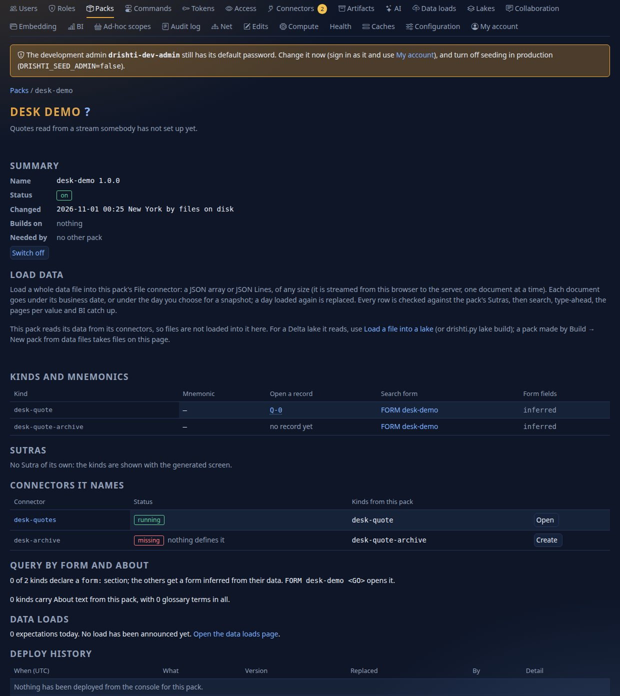

The title, version, code, description, the **Sample** badge, who changed the pack and when, and the status (**on**, **off**, **not loaded** or
**refused**, with the reason and the retry state). Under it: what the pack **builds on** and what **needs** it; the **kinds with their mnemonics**, a
link that opens a record of each kind and one to `FORM <pack>` for the kind with its form fields; the **Sutras** with their versions and **Open in
Build**; the **Sutra coverage** of a kind whose Sutras match on its fields; the **connectors it names**, a name nothing defines flagged **missing** with
**Create**; how many kinds carry About text; today's **data-load expectations** and the last load; and the pack's **deploy history** with **Roll back to
this**. A Sutra that does not parse is listed as `file:line:column DRS-2010 message` (the pack stays on, the Sutra is not in use); a `pack.yaml` with a
syntax error says `<pack>/pack.yaml has a syntax error at line L, column C: ...` and is not retried until the file changes. The page notices changes on disk
within seconds and offers **Refresh**; on a phone each pack is a card. Server side: `GET /api/v1/admin/packs/{name}/detail` and
`GET /api/v1/packs/{name}/coverage?kind=<kind>`.

### 31.9 BI over the packs' kinds, and data loads

Every kind of every pack you may open is a BI **dataset** named `pack.<pack>.<kind>` (`pack.trading.trade`), certified by its pack, read-only, versioned
with the pack, its columns, keys, meanings and masks taken from the pack ([REPORTS_GUIDE.md](REPORTS_GUIDE.md)); every BI model is rooted in packs
([ARCHITECTURE.md](../architecture/ARCHITECTURE.md#28-business-intelligence-on-the-table-layer)). `config/bi/` holds the BI samples over the seven packs
(models such as `trades-basic`, `trading-risk`, `trading-cashflows`, `counterparty-exposure`, `world-economics`), and a test checks that each reads only
what the packs serve.

A pack can say which kinds its ETL is expected to land each business day, by when, and who is told, in a `loads:` section (an administrator can override
it from Admin → Packs → *Data loads*). The ETL announces each batch with one call (`POST /api/v1/packs/{pack}/loads` or `drishti.py data landed`);
Drishti refreshes, verifies, evaluates alert rules and notifies, and flags a late batch on Admin → Health
([DATA_GUIDE.md](DATA_GUIDE.md#6-configuration-reference)).

**What stays in the core**, whatever packs are on: the engine (sources, the view pipeline, Rachana and Rachana-EL, inference, the entity graph, live
updates, identity, BI); neutral formats and semantic roles; the `viewer`, `author`, `approver` and `admin` roles and the powers a role can hold; Calc's
runtime; the generic help.

## 32. Designing for phones

On a phone a page does not get every panel. Each panel has a **phone tier**, set in configuration, never in code. The `phone:` keys of a Sutra are in
[RACHANA_REFERENCE.md › Phone](RACHANA_REFERENCE.md#phone-what-goes-to-a-phone); what the reader sees is in [USER_GUIDE.md › On a phone](USER_GUIDE.md#on-a-phone).

### 32.1 Phone tiers: must, glance, more, desk

| Tier | On a phone | Loaded | Live | Typical panels |
|---|---|---|---|---|
| **must** | in full, at the top in the phone order | with the page | yes | the header, key figures, status and breaches, the one table the page is about |
| **glance** | a compact form with *Show all* | with the page, the compact data only | yes, staying compact | ranked bars, a history chart as a sparkline, a long table as its first rows |
| **more** | a row under *More on this page*, loaded in place when tapped (bound as the viewer, with the page's controls, Sutra and date) | on tap | once loaded | contributions, cash-flow ladders, provenance, checks, secondary tables, notes |
| **desk** | named under *On desktop*, with the page's link to copy | never on a phone | no | designers, wide pivot grids, multi-chart dashboards, wide editing forms |

- A page always has a **must** panel: with none configured, its first panel is must.
- A **tablet** (640 to 1000 px) keeps the page's layout less the desk panels, which wait under *More on this page*. A **desktop** is unchanged, and *Show
  everything* gives a phone the whole page for the session.
- Masks, roles and entitlements are unchanged: a tier never shows what the viewer may not see.
- The **device class** is the `X-Drishti-Device` header (`phone`, `tablet`, `desk`), else the `drishti-device` cookie the browser keeps from its width
  (phone below 640 px), set at load and on rotation; never the user agent. A workspace pane or an embedded page never sets it. `ui.phone.enabled: false`
  (`DRISHTI_UI_PHONE`) gives every screen every panel.
- The phone page reads: the Sutra's summary line, the must panels, the glance panels, *More on this page*, *On desktop*. A screen's `phone.order` arranges
  must and glance; *more* rows keep the desktop order. *Why these panels* lists each panel with its tier and the layer that set it.

### 32.2 Where the tier is set: the layers

Each panel's tier is resolved by the console from the view model, **the most specific layer winning**:

| Layer (most general first) | Where | Who |
|---|---|---|
| 1. Kind default | built in: `kv`, `status`, `metric`, `gauge` must; tables, charts, bars, timelines, links, maps and tabs glance; `provenance`, `markdown`, `surface`, `graph` more; `pivot` desk; `ui.phone.kinds` changes a kind's default for the site (`{ table: more, map: desk }`) | Drishti, administrator |
| 2. Fragment | the fragment's `doc.phone` (put on every panel it brings) | pack author |
| 3. Sutra | `phone:` on a panel or a use, and the screen's `phone: { order, default, summary }` | pack or screen author |
| 4. Site | `ui.phone.rules` in the console's `application.yaml`: `[{ kind: provenance, tier: desk }, { panel: "*contrib*", max: more }]` (keys `panel`, `kind`, `title`, `sutra`, `entity` as globs; `tier` or `max`) | administrator |
| 5. Pack | `ui.phone.packs`: `{ market-risk: [{ panel: "*contrib*", tier: more }] }`, for the entity kinds the pack owns | administrator |
| 6. Lens | the lens file's `phone: { rules, pages }` (`config/lenses/<module>/<lens>.yaml`; the risk lens puts every VaR contribution panel under *More*) | administrator |

A `max:` from the site, a pack or a lens **caps** every layer: a Sutra cannot make a capped panel must. That is how a site protects phone performance.

**Shipped defaults.** Every UI-kit fragment that draws a panel and the trading pack's shared fragments carry `doc.phone`: a ticket and key figures must;
tables, ladders, bars, timelines, maps and charts at a glance; legs as their first tab; provenance, notes, links, events and payments under *More*. The
netting set's, the counterparty's and the Endur commodity swap's Sutras give their phone order, summary line and tiers (a counterparty's group graph on the
desktop). A generated pack's phone defaults come from its generator (`tools/packgen/banking/phone_display.py`, `tools/packgen/trades/sutras.py`). Give
every fragment you write that draws a table or a chart a `doc.phone`.

**Compact forms.** A glance panel is cut on the console before it is sent: a table's first N rows in its chosen columns and sort, a chart as a sparkline
with its last value and change, the first N bars, events, links or figures, the first tab, a map as a list of its places. The phone downloads only must
and glance panels in that form.

### 32.3 Beyond Sutra pages

The same tiers apply to pages that are not Sutra pages, set and capped by `ui.phone.pages.<page>`, a lens's `phone.pages.<page>` and a landing's
`home.phone` (`{ var: { contrib: glance, tiles: { max: glance } } }`):

| Page | Phone default |
|---|---|
| VaR page | headline tiles and the method must; the scenario P&L distribution at a glance; the worst scenarios, the path, the history, contributions, captures, other currencies, the scope tree and provenance under *More*; what-if and the basket on the desktop |
| Exposure page | the tiles must; the profile at a glance; the tabs, the tree and provenance under *More*; the paths on the desktop |
| Lens landings | the command line, the tiles and the first card must; other tables at a glance; charts, maps and quick links under *More* |
| BI reports | the report's `layouts.phone`, and `phone: desk` on a visual |
| Admin → Capacity | the four states and what breaks first must; the headroom bars at a glance; this server beside the plan and growth under *More*; editing the plan, the JVM arguments, the command line, the sliders and the download on the desktop |
| Admin pages, designers, the Build workbench | desk, with a short *Open on desktop* page |

On a phone the bar keeps its five menus as finger-sized buttons; Domains opens as a list with a heading per column.
