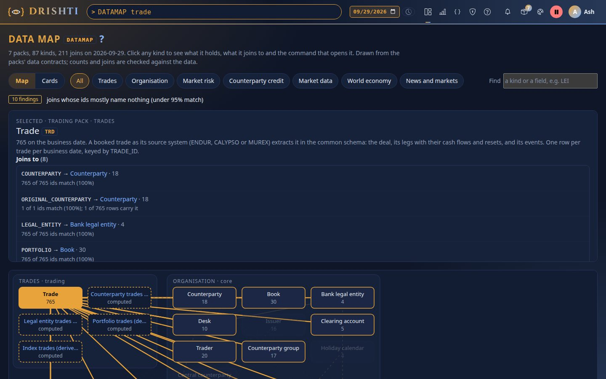
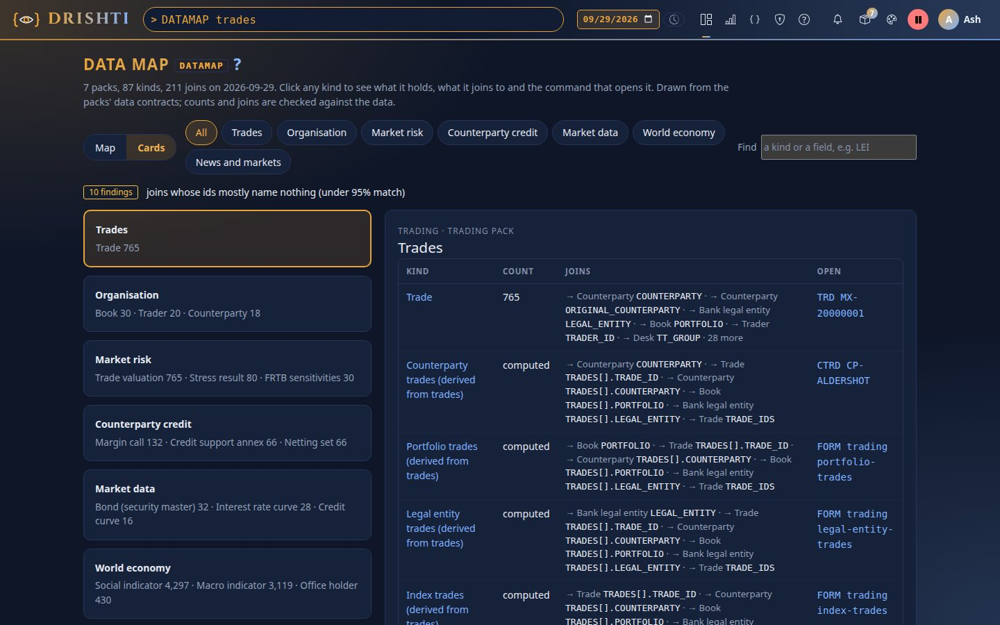

<!--
  Project Drishti · Any data. Any domain. One grammar.

  Copyright (c) 2026 Ashutosh Sinha <ajsinha@gmail.com>.
  All rights reserved.

  PROPRIETARY AND CONFIDENTIAL.

  This file is the confidential and proprietary property of Ashutosh Sinha.
  Unauthorised copying, use, modification, distribution or disclosure of this
  file, via any medium, is strictly prohibited except with the express prior
  written permission of the copyright holder.

  See the LICENSE file in the root of this repository for the full terms.
-->

# Command line

For pack authors, data engineers, risk users who script, and the people who run Drishti: everything you do with Drishti from a
terminal, a scheduler or a CI job. It explains the one command-line program, `tools/drishti.py`, installs it, connects it to a
server, and then takes every command group in turn with real examples and real output: Sutras and packs, your JSON Lines into a
lake, the lake builder for large exports, the server and its connectors, views and history, designs and approvals, BI, the risk
engines, the store loaders, the generators and the developer tools. It ends with recipes, the JSON formats, the exit codes and a
troubleshooting table. Every command also prints its own options: `drishti.py <group> <command> --help`.

Scheduling these tools, lake maintenance, the console pages that run them and sizing a large load are in
[OPERATIONS_GUIDE.md](OPERATIONS_GUIDE.md). The console's own command line (the mnemonics you type in the browser, such as
`TRD 1000015`) is a different thing: every one of its commands is in [COMMAND_CATALOG.md](COMMAND_CATALOG.md).

All the data in this guide is invented, and every example runs on a fresh clone as it is: the files are the committed test data
under `data/testdata/` (the ENDUR trade book `data/testdata/trades/endur/`, a day-one snapshot and one file of changes per later day,
JSON Lines gzipped; trades with legs, cash flows, resets and events in the UPPER_SNAKE attributes of the trading pack, blanks spelt
four ways: the *shape* of a booking-system export, none of its values), the interpreter is the one you run Drishti with
(`python3`; `py` on Windows), its libraries installed by you from the offline wheel pack with the two pip commands (`python tools/drishti.py setup` only checks them), and the commands run from the repository root. Scratch output (`lake`, `lake2`, `data/build/...`) goes into the clone; delete it
afterwards.

## Contents

1. [What it is](#1-what-it-is)
2. [Install and prerequisites](#2-install-and-prerequisites)
3. [Connecting to a server: URL, tokens and permissions](#3-connecting-to-a-server-url-tokens-and-permissions)
4. [`sutra`: shape, design, gen, lint, test, preview](#4-sutra-shape-design-gen-lint-test-preview)
5. [`pack`: make, new, regenerate, diff, catalogue, i18n, check, about-check, bundle, verify, deploy, rollback, publish, keygen, install](#5-pack-make-new-regenerate-diff-catalogue-i18n-check-about-check-bundle-verify-deploy-rollback-publish-keygen-install)
6. [`data`: profile, ingest and load](#6-data-profile-ingest-and-load)
7. [`lake`: a large JSON export into a Delta lake](#7-lake-a-large-json-export-into-a-delta-lake)
8. [`server`: health and packs](#8-server-health-and-packs)
   - [`setup`, `build jar`, `start`, `stop` and `status`](#setup-build-jar-start-stop-and-status-install-build-run-and-stop-drishti)
9. [`connector` and `net`](#9-connector-and-net)
10. [`view`, `history` and `convert`](#10-view-history-and-convert)
11. [`design`: the Screen Designer over REST](#11-design-the-screen-designer-over-rest)
12. [`bi` and `tables`](#12-bi-and-tables)
13. [The risk engines: `var`, `exposure`, `sens`, `frtb`, `simm`, `pivot`](#13-the-risk-engines-var-exposure-sens-frtb-simm-pivot)
14. [`compute`, `contract` and `feed`](#14-compute-contract-and-feed)
15. [Store loaders: `data load`](#15-store-loaders-data-load)
16. [Generators: `tools/packgen`, `tools/samplegen`, `tools/realdata`](#16-generators-toolspackgen-toolssamplegen-toolsrealdata)
17. [Developer tools](#17-developer-tools)
18. [Recipes](#18-recipes)
19. [JSON output, exit codes and troubleshooting](#19-json-output-exit-codes-and-troubleshooting)
20. [The command line: the box in the top bar](#20-the-command-line-the-box-in-the-top-bar)

## 1. What it is

`tools/drishti.py` is a thin, honest front door. It adds no new engine: each command either runs something that already exists
(the Java `sutra` and `tables` tools in the server's jar, the lake builder, the generators and loaders under `tools/`) or calls a
REST endpoint the server already has. What it adds is one place to look, one `--help` per command
(`drishti.py <group> --help` lists a group's commands, `<group> <command> --help` every option with examples), one set of exit
codes and, where it helps scripts, `--json`.

| Group | Commands | Runs | Section |
|---|---|---|---|
| `sutra` | `shape`, `design`, `lint`, `test`, `preview`, `gen` | the Java tool in the exec jar; `tools/sutragen.py` (JDK 21+) | [4](#4-sutra-shape-design-gen-lint-test-preview) |
| `pack` | `make`, `new`, `regenerate`, `diff`, `catalogue`, `i18n`, `check`, `about-check`, `bundle`, `verify`, `deploy`, `rollback`, `publish`, `keygen`, `install` | `tools/packgen/pack_from_jsonl.py`, the Java tool, `tools/packreg/packreg.py`; REST for `install` | [5](#5-pack-make-new-regenerate-diff-catalogue-i18n-check-about-check-bundle-verify-deploy-rollback-publish-keygen-install) |
| `data` | `profile`, `ingest`, `load`, `landed`, `loads`, `get` | `tools/ingest_jsonl.py`, `tools/storeload.py`; REST for `landed`, `loads`, `get` | [6](#6-data-profile-ingest-and-load) |
| `dataload` | `status`, `run`, `retry`, `ready`, `undo` (the data inbox) | REST | [6](#dataload-the-data-inbox) |
| `testdata` | `capture-market` | a scratch server and the market connectors | [6](#testdata-capture-market-the-market-snapshot-for-offline-demos) |
| `lake` | `build`, `scan`, `status`, `publish`, `demo`, `show`, `check`, `maintain`, `undo`, `memory` | `tools/lake/`; the server jar's writer and parallel loader | [7](#7-lake-a-large-json-export-into-a-delta-lake) |
| `server`, `admin` | `server health`, `caches`, `packs`, `commands`, `smoke`, `engines`, `blas`; `admin capacity` (also `admin engines`, `admin blas`) | REST `/api/v1/admin/...` (an administrator) | [8](#8-server-health-and-packs) |
| `doctor` | `drishti.py doctor` | this machine, and with `--server` the server | [8](#doctor-is-this-machine-ready) |
| `upgrade` | `check <new-release-dir>` | read-only: the new release's folder, Python pins and libraries, site settings keys and modules against the running release | [8](#upgrade-check-before-switching-to-a-new-release) |
| `connector` | `list`, `get`, `apply`, `delete`, `test`, `plugins`, `enable`, `disable`, `reset`, `history` | REST (Admin → Connectors) | [9](#connector-list-get-apply-delete-test-plugins-enable-disable-reset-history) |
| `net` | `list`, `check`, `add-peer`, `set`, `members` | the `config/net/` folder; REST for `members` | [9](#net-drishtinets-confignet-folder) |
| `view`, `history`, `convert` | `view get`, `view explain`; `history KIND ID`; `convert FILE` | REST; `tools/convertcmd.py` | [10](#10-view-history-and-convert) |
| `design` | `list`, `create`, `get`, `save`, `check`, `autodesign`, `propose`, `proposals`, `export`, `import`, `bind`, `delete` | REST `/api/v1/builder/designs` | [11](#11-design-the-screen-designer-over-rest) |
| `approvals`, `change`, `edits` | `approvals` list, show, approve, reject, withdraw, ask; `change` propose, submit, list, show, history; `edits status` | REST | [11](#approvals-the-one-approvals-queue) |
| `bi`, `tables` | `bi workspace`, `catalogue`, `expr`, `migrate`, `sql`, `model`, `mq`, `transform`, `item`, `dataset`, `runs`, `statement`; `tables` list, check, preview, lineage, offer, migrate | REST; the Java `tables` tool | [12](#12-bi-and-tables) |
| `var`, `exposure`, `sens`, `frtb`, `simm`, `play`, `pivot` | the VaR, exposure, FRTB-SA, SIMM and pivot engines | REST | [13](#13-the-risk-engines-var-exposure-sens-frtb-simm-pivot) |
| `compute`, `contract`, `feed` | reactive connectors; data contracts; the data feeds | REST; `tools/contracts.py`; `tools/loaders/common/` | [14](#14-compute-contract-and-feed) |
| `docs` | `docs generate [--check]`, `docs shots` | `tools/docs/generate.py`; `tools/docs/screenshots.py` (Playwright) | [17](#docs-generate-every-generated-document); [17](#docs-shots-screenshots) |
| `calc`, `dev` | `calc install` (Calc's Python runtime); `dev bicompute-unit` (the pivot engine without Maven) | `tools/calcruntime.py`; `tools/dev/bicompute_unit.py` | [17](#17-developer-tools) |
| `completion` | `completion bash`, `zsh`, `powershell` | the command tree | [2](#shell-completion) |

Concepts used throughout (each is explained in its own guide; this one only links to them):

- A **pack** is a folder: `pack.yaml`, Sutras, samples, tests, help text.
  [BUILD_GUIDE.md](BUILD_GUIDE.md).
- A **Sutra** is the YAML that says how one kind of document is shown. [BUILD_GUIDE.md](BUILD_GUIDE.md#11-what-a-sutra-is-and-when-one-applies).
- A **design** is a Sutra in progress in the Screen Designer, with its samples and its history of edits.
  [RACHANA_REFERENCE.md](RACHANA_REFERENCE.md#screen-designer-and-the-build-workbench).
- A **dated store** is where a pack reads documents *per business date*: a Delta lake or the file connector's
  `<root>/<domain>/<date>/<kind>.jsonl` files.
- A pack becomes known to a running server in **four ways**: its folder is copied into the packs folder the server watches (`pack deploy`, `pack make`'s `pack/<name>`: the server checks it and loads it by itself, no restart), the server is started with it in `DRISHTI_PACKS` (a restart),
  an administrator loads it in **Admin → Packs** (at once), or it is installed from a registry.
  `drishti.py pack new --load`, `server packs load` and `pack install` are the command-line forms of the last two.
  [BUILD_GUIDE.md#292-loading-a-pack-while-the-server-runs](BUILD_GUIDE.md#292-loading-a-pack-while-the-server-runs) has the rules.

### Which tool for which job

The browser column names the console page that runs the same engine; those pages are described in
[OPERATIONS_GUIDE.md](OPERATIONS_GUIDE.md).

| You want to | In a browser | In a terminal or a scheduler |
|---|---|---|
| Turn a large JSON export (an array or JSON Lines, gzipped or not) into a Delta lake a pack reads | Admin → Data loads → **Load a file into a lake** (`/admin/lakes`) | `drishti.py lake build` |
| Load millions of JSON Lines rows (scenario PVs) into Delta or Iceberg, from a folder or S3, on every core | | `drishti.py lake build --engine java`, or the loader on its own ([7.13](#713-the-parallel-lake-loader)) |
| See what an export holds and which fields make a good id, date and classifier | the same page, step 2 | `drishti.py lake scan`, `drishti.py data profile` |
| Make a pack from schema files or JSON | Build → **New pack** (`/build/pack/designer`) | `drishti.py pack make`, `drishti.py pack new` |
| Check a pack in CI | | `drishti.py pack check --junit` |
| Ship a pack to a server | Admin → Packs → Deploy | `drishti.py pack bundle`, `pack deploy`, `server packs deploy` |
| Tell the server that a batch landed | the Lakes page does it after a build | `drishti.py data landed`, or `lake build --signal` |
| Take a day of a dataset out as a file | Views → Export data (`EXPORT <GO>`): columns, filter lines, Download | `drishti.py data get <dataset> --date D --columns ... --where ...` |
| Change where a connector reads | Admin → **Connectors** | `drishti.py connector apply` |
| Install or uninstall a pack, connector or BI file safely | Admin → **Artifacts** | `drishti.py server packs`, `connector delete` |
| Keep a lake small and fast | | `drishti.py lake maintain` (on a timer) |
| Load the demo data into Postgres, DuckDB, MongoDB, Redis, Aerospike, Cassandra, Iceberg, files or Delta | | `drishti.py data load` |
| Check a machine before a demo | Admin → **Health** | `drishti.py doctor`, `drishti.py server smoke` |
| Run VaR's many-scope sums on the bundled OpenBLAS or on the pure-Java path, live | Admin → **Engines** → Linear algebra: OpenBLAS | `drishti.py server blas status`, `server blas java --reason ...`, `server blas native --reason ...` (also as `admin blas`; [OPERATIONS_GUIDE.md section 2.1](OPERATIONS_GUIDE.md#149-native-libraries-blas)) |
| Make, check or remove the AWS side of the S3 Tables or Delta Lake on S3 connector (bucket, namespace or prefix, IAM policy) | | `deploy/aws/s3-tables/s3-tables.sh`, `deploy/aws/delta-s3/delta-s3.sh` (`.ps1` on Windows; [7.14](#714-the-aws-connectors-tool-scripts-s3-tables-and-delta-lake-on-s3)) |
| See or check the shape of a command's data (its data contract), or draft the contract of a new kind | | `drishti.py contract list`, `contract show`, `contract check`, `contract docs`, `contract bootstrap` |
| Pin the Python libraries code people write may use on the server's compute pool `python` (every file's sha256, for `pip --require-hashes`) | | `python tools/python_lock.py config/compute/locks/python.in --out config/compute/locks/python.lock` ([bi/NOTEBOOK_AND_PYTHON.md section 19](../architecture/ARCHITECTURE.md#291-one-python-runtime)) |

Use the page for a one-off file, a first look at new data, or when you want to see each choice before it is made. Use the command
line for anything that repeats, runs at night, or lives in a pipeline: it has exit codes, a lock, a log line and a JSON summary,
and it is the same engine the page runs.

### Quickest path: `pack make`

You have a folder of JSON Lines (or one file). **One command** turns it into **one folder you take and deploy**: the pack with its
Sutras, the data in a Delta lake partitioned by business date, a checksummed bundle, a server configuration, start scripts and a
`README.txt` with your real values filled in.

Run these from the Drishti folder (the repository root, or the install folder of a release).

```bash
python3 tools/drishti.py pack make data/testdata/trades/endur/trade_endur.2026-07-08.jsonl.gz \
    --kind trade --match PRODUCT_TYPE --name my-bank
```

The input here is the committed test data: the ENDUR trades of the first business day ([data/testdata/README.md](../../data/testdata/README.md));
put your own folder of JSON Lines (or one file, `.jsonl`, `.jsonl.gz` or a `.json` array) in its place.

| Option | Meaning |
|---|---|
| `INPUT...` | folder(s) of `*.jsonl` and/or file(s) (required) |
| `--kind KIND` | the kind of every document, e.g. `trade` (required) |
| `--match COL[,COL]` | the column(s) whose values split the kind: **one Sutra per value** (required) |
| `--name NAME` | the pack name, lower case, digits and `-` (required) |
| `--key FIELD` | the id field. Default: **detected**: a field present and unique in every document, `<KIND>_ID`, `<kind>Id` or `id` first; it prints what it chose and why, and **refuses** (naming `--key`) when none is unique |
| `--date FIELD` | the business-date field. Default: **detected**: a date-valued field present in at least 95% of the documents, one named like a business date first (`BUSINESS_DATE`, `AS_OF`, `DATE`, `VALUATION_DATE`, in any case); else the date field with the fewest distinct dates, **which may not be a business date at all** (on the test data it is `START_DATE`): check the `date:` line it prints and pass `--date`. None found: no data folder, the pack serves its samples |
| `--title`, `--version` | the pack title; the version (default `1.0.0`) |
| `--store delta\|files` | the dated store: `delta` (default) or the File connector's files |
| `--out DIR` | the folder to create (default `data/build/<name>-<version>`, under `DRISHTI_DATA_DIR`); `--force` replaces it |
| `--fallback` / `--no-fallback` | a catch-all Sutra for documents matching no group (default on) |

What it makes (everything the server needs is in this one folder):

```text
data/build/my-bank-1.0.0/
├── README.txt                  step by step: what is inside, deploy, verify, LIFT DATA FROM DELTA, update, roll back, troubleshooting
├── pack/my-bank/               pack.yaml, sutras/, tests/, samples/, config/about.yaml, README.md
├── data/delta/my-bank/trade/   the documents, one Delta table, partitioned by business_date=YYYY-MM-DD   (data/files/ with --store files)
├── bundle/                     my-bank-1.0.0.tar.gz  +  .sha256     (the pack alone, for `pack deploy`)
├── config/drishti-site.yaml    a server configuration overlay (packs on; the data root explained)
├── run-server.sh               start a server on this folder alone: DRISHTI_HOME=<install> DRISHTI_PORT=18480 ./run-server.sh
├── run-server.ps1              the same for Windows
└── MANIFEST.json               counts per date, the chosen key and date, tool versions, checksums
```

It ends by running `pack check` and `pack verify` on what it made and prints a summary and the next command. Open `README.txt`:
deploying is "copy `pack/my-bank` into the server's packs folder (or `drishti.packs.installed-dir`), copy `data/delta` to its lake
root or set `DRISHTI_DELTA_ROOT`, switch the pack on with `DRISHTI_PACKS`". New days later:
`data ingest --from new-days --pack data/build/my-bank-1.0.0/pack/my-bank --lake <the lake>`. The details are in
[section 5](#pack-make-everything-in-one-folder) and [OPERATIONS_GUIDE.md](OPERATIONS_GUIDE.md#812-pack-make-one-folder-to-deploy).

Run the program from the repository root, or from anywhere with its path, with the Python you run Drishti with (its libraries,
PyYAML, deltalake and pyarrow among them, installed with the two pip commands; `setup` checks them). Many examples write
`python3 tools/drishti.py`: any Python 3.10+ with PyYAML runs every command that does not write a Delta lake; `drishti.py` in the
output is the same program.

**`drishti.py --help`** (captured on a fresh clone)

```text
usage: drishti.py [-h] GROUP ...

drishti: one command line for building, checking, loading and shipping Drishti packs and Sutras.

positional arguments:
  GROUP
    sutra       The Sutra tool: shape, design, lint, test, preview (Java) and
                gen (one Sutra per group of JSON Lines)
    module      Modules: pack a folder into a reproducible .dmod, verify a
                package and run the conformance checks C1-C14, inspect one;
                run one module alone (the server jar's own packer and
                verifier)
    pack        Packs: generate from JSON Lines, check in CI, find missing
                help text, publish and install
    data        Data: ingest your own JSON Lines into a lake or files store;
                load the demo data into any store
    server      A running server over REST: health and pack management
                (administrator)
    connector   Connectors over REST (Admin -> Connectors): list, get, apply a
                YAML file, test, enable, delete (administrator; a token needs
                packs:admin)
    net         Drishti*net's config/net/ folder: list, check, add a peer, set
                a setting (local files); members of a running server
    design      Screen Designer designs over REST: create, edit, check,
                propose, ship (anyone may design; a proposal is decided in
                approvals)
    docs        Documentation tooling
    doctor      doctor: is this machine ready (Java, jar, Python, directories,
                ports, and with --server the token)
    bi          Business intelligence (Rupaka) over REST: workspaces and the
                catalogue, as the token's user sees them (a write needs the
                bi:write scope)
    history     history: one entity over business days (a table newest first,
                changed cells marked *)
    convert     convert: CSV, a JSON array or a folder of .json files into
                JSON Lines (one object a line)
    compute     compute: reactive connectors (ask for a computed kind, cancel,
                send an event, sandboxes)
    change      change: write-back (propose a change, submit a form's draft,
                list, history; decide in approvals)
    edits       edits: Admin -> Edits (where the edit log lives, lanes,
                warnings, connector writes)
    approvals   approvals: the one queue of four-eyes items (list, show,
                approve, reject, withdraw, ask)
    var         var: the VaR engine as you see it (show, parts, path, history,
                tree, status, captures, baskets, what-if)
    exposure    exposure: the exposure engine as you see it (show, parts,
                tree, profile, distribution, captures, what-if)
    sens        sens: position sensitivities summed for any scope, and the
                factor dictionary
    frtb        frtb: FRTB-SA of any scope (SBM by class and scenario, DRC,
                RRAO), its steps and contributions
    play        play: the playgrounds from the command line (play frtb, play
                simm; PLAY VAR is drishti.py var playground)
    simm        simm: ISDA SIMM per netting set (collect and post), the list,
                the steps, against the counterparty's call
    pivot       pivot: any table or VaR as a pivot computed by the server:
                run, estimate, export, saved views
    admin       Administration over REST (administrators): the capacity
                planner, the compute engines
    dataload    dataload status|run|retry|ready|undo: the data inbox (files
                dropped in <data>/dataload/inbox, loaded into the lake)
    feed        feed list|run|status|schedule: pull external data (GLEIF, SEC,
                IMF, ...) and load it into the lakes
    calc        calc install: the Python runtime of Calc (Pyodide), pinned and
                verified, served by the console itself
    dev         dev bicompute-unit: developer checks that need no Maven
    contract    contract: the data contract of every command (list, show,
                check, docs, bootstrap)
    tables      Virtual tables and models: list, check, preview, lineage,
                offer
    view        A rendered entity view in the terminal, as the caller's token
                sees it (masks apply)
    setup       setup [drishti|libs]: prepare this machine and CHECK the
                libraries of the Python you run Drishti with (setup installs
                nothing and makes no virtual environment)
    build       build jar|modules|all|sdk: the server jar (copied into
                <home>/lib) and the modules (packages in <home>/modules), with
                Maven, never install
    start       start server|console|all|cluster: start Drishti (Java 21+, the
                jar of <home>/lib, logs and pid files under the data folder)
    stop        stop server|console|all|cluster: stop by the pid files only
                (never by name)
    node        node drain|undrain|status|wait-ready: one server's drain
                before a stop and its readiness (CLUSTER_GUIDE.md 4.6)
    upgrade     upgrade check <new-release-dir>: read-only; what to do before
                switching to a new release (Python pins, settings keys,
                modules)
    launchers   launchers [--check|--machine|--list|--run NAME]: the IDE
                launchers and IDE_GUIDE section 4 from
                tools/launch/launchers.yaml; this machine's JVM arguments
                files
    status      status: the resolved home, data, modules and java; then every
                process started with drishti.py start
    lake        Delta lakes: build one from a large JSON export (memory flat,
                safe to re-run), scan an export, status, maintain
    testdata    The committed test data (data/testdata): capture the news-and-
                markets pack's real market snapshot for offline demos
    completion  completion: print a shell completion script (bash, zsh,
                powershell)

options:
  -h, --help    show this help message and exit

    python3 tools/drishti.py <group> <command> [options]          (Windows: py tools\drishti.py ...; the one Python, its libraries from setup)

Groups: setup (prepare this machine), build (jar: the server jar into <home>/lib), start, stop and status (server, console, all, cluster;
every OS, by pid files), sutra (the Java `sutra` tool, plus `sutra gen`), module (pack a folder; verify, check, inspect a .dmod with the server jar's verifier; deploy, plan, apply, list, remove, disable, enable, upgrade, run), pack (make, new, regenerate, diff, catalogue, i18n, check, about-check, bundle, verify, deploy, rollback,
publish, keygen, install), data (profile and ingest your own JSON Lines or watch a drop folder, load the demo data), server (health, packs, smoke),
lake (build a Delta lake from a large JSON export, scan, status, maintain), feed (pull external data into the lakes: list, run, status, schedule), testdata (capture-market: a real offline snapshot), view (get, explain), history (an entity over business days), doctor, completion, design (the Screen Designer's designs over
REST: create, save, check, propose, approve, export, import, bind) and docs (screenshots).
Needs Python 3.11+ (3.13 is what the wheel packs target) and PyYAML; deltalake and pyarrow only for `--store delta` ingests. The guide with every command,
recipes and real output is docs/guides/CLI_REFERENCE.md.

Exit codes: 0 ok, 1 problems found (a failing check, a server that said no, an unreachable server), 2 usage (a bad option,
a missing file or jar). Commands that talk to a server read it from --server or DRISHTI_SERVER (default
http://localhost:18480) and the token from DRISHTI_TOKEN or --token-file; the token is never printed.
```

## 2. Install and prerequisites

| You need | For | How to check |
|---|---|---|
| Python 3.13 | everything | `python3 --version` |
| PyYAML | `pack`, `data ingest`, `design create --from-sutra` | `python3 -c "import yaml"` |
| `deltalake` and `pyarrow` | `data ingest --store delta`, `pack new --lake` | only when you write a Delta lake |
| JDK 21 or newer | `sutra`, `pack new`, `pack check`, `pack about-check` | `java -version` (the tool prefers `drishti.java.home` of the settings file, then `JAVA_HOME`, then `/usr/lib/jvm/java-21-openjdk-amd64`, then `java`) |
| the exec jar `lib/drishti-server-<version>-exec.jar` | the same | `python tools/drishti.py build jar` (Maven builds it and installs it into `<home>/lib`), or pass `--jar` for a one-off run |
| `openssl` | `pack keygen` | `openssl version` |
| Playwright | `docs shots` | see [RACHANA_REFERENCE.md](RACHANA_REFERENCE.md#screen-designer-and-the-build-workbench) |

The program uses only the standard library plus PyYAML. It imports `deltalake` and `pyarrow` **only** when a command writes
a Delta lake, so a machine without them runs everything else.

**The one Python.** `setup` only CHECKS the libraries of the Python you run Drishti with (the system's, a dedicated one, or a virtual environment you made yourself; Drishti makes none) and installs nothing: you install them yourself with two pip commands (Windows `py -3.13`, Linux and macOS `python3.13`), from the offline wheel pack unzipped into `~/drishti-wheels` (Windows `%USERPROFILE%\drishti-wheels`), in `drishti-console`: `-m pip install --no-index --find-links <wheel folder> -r requirements.txt`, then the same with `-r ../config/compute/locks/python.lock` (Windows `..\config\compute\locks\python.lock`); [DEPLOYMENT_AND_QA_GUIDE.md 1.6](../DEPLOYMENT_AND_QA_GUIDE.md#16-the-settings-file-and-drishtipy-setup) shows both per system. The IDE launchers use the project interpreter, the same
Python ([Running the tools from PyCharm](#running-the-tools-from-pycharm-and-the-java-sutra-from-intellij)):

```bash
python3 tools/drishti.py setup            # Windows: py -3.13 tools\drishti.py setup
python3 tools/drishti.py --help
```

Run the program from the repository root, or from anywhere with its path, with that Python. Many examples write `python3 tools/drishti.py`: any Python 3.10+ with PyYAML runs every command that
does not write a Delta lake; `drishti.py` in the output is the same program. The shell tools under `tools/` are bash; the Python commands (`tools/drishti.py`, `tools/rolling.py`, `tools/pvgen/*.py`) run on every system.

The Java commands (`sutra`, `pack check`, `tables` and Drishti Lake's loader) run from the server's exec jar, found as `--jar`,
then the newest `lib/drishti-server-*-exec.jar` of the install (`<home>/lib`; make it with `python tools/drishti.py build jar`).

**Environment variables** the program reads:

- `JAVA_HOME`: the JDK that runs it (default `/usr/lib/jvm/java-21-openjdk-amd64`, then `java` on the `PATH`).
- `DRISHTI_SERVER`: the server's base URL (default `http://localhost:18480`).
- `DRISHTI_TOKEN`: the bearer token (never printed; default none).
- `DRISHTI_USER`: the user name sent when the server has sign-in off (default none).

The Java commands run **from the repository root** (the engine reads `./config/packs` and `./sutras` relative to it), so every path
you give is made absolute first: use paths relative to *your* current directory as you normally would.

### Shell completion

`drishti.py completion bash|zsh|powershell` prints a completion script generated from the command tree (groups, commands,
options, the choices of options that have them, files for options that take a value, and the folders of `config/packs/` for `--pack`),
so it is always current. Install:

```bash
# bash: for this shell, or save the output as ~/.local/share/bash-completion/completions/drishti.py
source <(python3 tools/drishti.py completion bash)
# zsh: in ~/.zshrc (uses bashcompinit)
source <(python3 tools/drishti.py completion zsh)
# PowerShell: add this line to $PROFILE
python tools/drishti.py completion powershell | Out-String | Invoke-Expression
```

The script is registered for the names `drishti.py` and `drishti`, so an alias or a symlink called `drishti` completes too.

```
$ python3 tools/drishti.py completion bash | head -n 3
# bash completion for drishti.py: generated by `drishti.py completion bash`
#   source <(drishti.py completion bash)         or save it as ~/.local/share/bash-completion/completions/drishti.py
_drishti_complete() {
```

## 3. Connecting to a server: URL, tokens and permissions

Commands in `server`, `design`, `pack install` and `pack new --load` call a running server over REST.

```bash
export DRISHTI_SERVER=http://localhost:18480        # or --server URL on each command
export DRISHTI_TOKEN=...                            # or --token-file /path/to/file
python3 tools/drishti.py server health
```

The token comes from `--token-file` (the file's text, trimmed), else the `DRISHTI_TOKEN` environment variable. It is sent as
`Authorization: Bearer <token>` and **never printed**, not even in an error.

| The server | What to send |
|---|---|
| sign-in **off** (the default for local development) | nothing, or `--user NAME` (header `X-Drishti-User`) to be a named user. Every role is granted. |
| sign-in **on** | a **signed token** whose `sub` is you and whose `roles` carry what you need; see [API_REFERENCE.md](API_REFERENCE.md) ("Security on" and "Minting a token for a script"). |

**Personal API tokens (`drk_…`, from My account → API tokens) read by default, and write only with a scope.** A token made
without scopes only reads: it is enough for `server health`, `server packs list`, `design list|get|proposals` and
`pack install --list`. To let a tool, a CI job or a GitOps pipeline change things, make the token with the scopes it needs
and nothing more (least privilege). On **My account → API tokens** tick the scopes, set **Days** (a token with a write scope
must expire: 90 days at most by default) and copy the secret once:

| Scope | Opens | Also needs the user to hold |
|---|---|---|
| `read` (always) | everything you may read | nothing |
| `design:write` | `design create\|save\|check\|autodesign\|import\|delete\|bind\|propose` (the Designs and Studio writes) | a role with `author` |
| `design:approve` | `approvals approve\|reject sutra` | a role with `approve` (or admin), and never your own proposal with four-eyes on |
| `approve` | `approvals approve\|reject\|withdraw` for every kind your roles let you decide (report sign-offs, stress windows and compute packages stay a person's) | the kind's own rules |
| `packs:admin` | `server packs load\|unload\|on\|off`, `pack install` | the admin role |
| `loads:write` | `data landed` | a role that opens the kind (or the admin role) |

A token never exceeds its user: the server checks the scope **and** the roles the user holds at the moment of each call, so
a scope on an author's token does not make them an approver, and a disabled or deleted user's tokens stop at once. A token can
never make tokens, manage users or change personal and collaboration state. Every write done with a token is in the audit log
(`token-write`, with the token id and never the secret; refused attempts are `token-denied`). Use it in CI like this:

```bash
# one token per pipeline, scope design:write only, 30 days; stored as a CI secret, never in the repository
echo "$DRISHTI_CI_TOKEN" > "$RUNNER_TEMP/drishti.tok"
drishti design propose my-design --server https://drishti.bank.example:18480 --token-file "$RUNNER_TEMP/drishti.tok"
```

Without the scope the server answers `403 DRS-5002 this token lacks the scope design:write`. Rotate by making a new token
and revoking the old one. A signed token (API_GUIDE "Minting a token for a script") works too.

**Permissions follow the screens.** The command line asks the same endpoints the screens do, so it can do exactly what you
could do there and nothing more:

| Command | Who may |
|---|---|
| `design list|create|get|save|check|autodesign|export|import|delete` | any user (your own designs) |
| `design propose` | a user who may save: a role with `author`, and the server's `drishti.rachana.studio-save: true` (`DRISHTI_STUDIO_SAVE`) |
| `design proposals` | any user |
| `approvals approve|reject sutra` | a role with `approve` (or an administrator); with sign-in on and four-eyes on (the default) not your own proposal |
| `design bind` | a user, when the server has file binding on (a development directory per user) |
| `server health`, `server packs ...`, `pack install` | an administrator |

A refusal is exit code 1 with the server's own words, for example `the server said 403 DRS-5002: ...`.

## 4. `sutra`: shape, design, gen, lint, test, preview

`sutra shape|design|lint|test|preview` run the **Java tool** in the exec jar (`java -jar ... sutra <command>`) with your
arguments; its output, its `--junit` report and its exit code (0 ok, 1 problems, 2 usage) come straight through. What each
does, `expect.yaml`, `tests/<sutra>/` and CI are [below](#testing-sutras-expectyaml-the-tests-convention-and-ci).
Options this program does not know are passed on to the Java tool unchanged.

**Lint a pack** (the shipped help-desk example; it prints the Sutra's absolute path, shortened here). The pack the command line names is loaded with
the packs `DRISHTI_PACKS` names (and the packs it extends), never with the packs an administrator added to the server in this folder
(`<data dir>/packs/added.yaml`; set `DRISHTI_PACKS_OVERLAY` to use another list):

```bash
python3 tools/drishti.py sutra lint docs/guides/examples/pack/helpdesk
```

```text
ok      docs/guides/examples/pack/helpdesk/sutras/ticket.v1.sutra.yaml
```

A field a Sutra shows without a glossary entry in `config/about.yaml` is a warning (DRS-2047), not an error, so the exit code stays 0. With
only the `AGE_HOURS` and `PRIORITY` entries the same command adds lines such as:

```text
docs/guides/examples/pack/helpdesk/sutras/ticket.v1.sutra.yaml:15 warning DRS-2047 field 'ASSIGNEE' is shown but has no glossary entry (kinds.ticket.glossary in config/about.yaml, or a vocabulary entry)
docs/guides/examples/pack/helpdesk/sutras/ticket.v1.sutra.yaml:15 warning DRS-2047 field 'HISTORY.EVENT' is shown but has no glossary entry (kinds.ticket.glossary in config/about.yaml, or a vocabulary entry)
```

**Lint every pack at once:** `sutra lint config/packs` takes the whole packs root. Each pack is read with its own fragments under
its namespace (`trading/deal-ticket@1` resolves, beside the UI kit's `config/ui-kit/` fragments), each pack's `tests/` folder is
skipped and each pack's `history:` block is checked. `--docs` adds the docstring warnings (`DRS-2055`).

`--strict` turns those DRS-2045 to 2047 help warnings into failures (exit 1). `sutra test <pack>` renders every Sutra against
its `tests/<sutra>/` samples and checks `expect.yaml`; `--junit report.xml` writes a JUnit file; `sutra preview <pack> --out
build/html` writes an HTML snapshot per sample.

**Infer a shape** (a JSON Schema with Drishti's role annotations) and **draft a Sutra** from sample documents (a folder of JSON
files, one document each: here the help-desk example's test tickets):

```bash
python3 tools/drishti.py sutra shape docs/guides/examples/pack/helpdesk/tests/ticket
python3 tools/drishti.py sutra design docs/guides/examples/pack/helpdesk/tests/ticket --kind ticket
```

```text
{
  "$schema" : "https://json-schema.org/draft/2020-12/schema",
  "type" : "object",
  "properties" : {
    "TICKET_ID" : {
      "type" : "string",
      "x-drishti" : {
        "role" : "link",
        "reason" : "every value is the id of a ticket",
        "kind" : "ticket"
      }
    },
    "SUBJECT" : {
      "type" : "string"
    },
    "STATUS" : {
      "type" : "string",
      "x-drishti" : {
        "role" : "status",
        "reason" : "named 'STATUS' with 2 distinct value(s)"
...
  "required" : [ "TICKET_ID", "SUBJECT", "STATUS", "PRIORITY", "ASSIGNEE", "CLIENT", "CLIENT_NAME", "AGE_HOURS", "HISTORY", "_meta" ],
  "x-drishti" : {
    "samples" : 2
  }
}
```

```text
rachana: 1.2
sutra: ticket-auto
version: 1
description: Drafted by auto-design from 2 samples. Edit freely.
match: { kind: ticket, priority: 1 }
title: { pill: "Ticket · ${$.PRIORITY}", id: "'ticket'", with: "link($.TICKET_ID, 'ticket')" }
strip:
  - { label: "Status", bind: "$.STATUS", tone: "status" }
  - { label: "Client name", bind: "$.CLIENT_NAME" }
  - { label: "Age (h)", bind: "$.AGE_HOURS", fmt: "age0", emphasis: true }
  - { label: "Generation", bind: "$._meta.generation", fmt: "pct0" }
panels:
  - id: details
    kind: kv
    title: "Details"
    key: "F2"
...
  - id: history
    kind: timeline
    title: "History"
    key: "F3"
    rows: "$.HISTORY"
    date: "DATE"
    label: "EVENT"
...
```

A draft is a start, not a screen: here the id was read as a link to a ticket, so the title shows the word `ticket` and links the id;
change it to `id: $.TICKET_ID` before you keep it.

`sutra design --each DIR` drafts one Sutra per subfolder of samples in a single run (`<out>/<subfolder>.sutra.yaml`; the
kind is `--kind`, else the folder's one-line `kind` file, else the folder name).

### `sutra gen`: one Sutra per group of JSON Lines

`sutra gen` (`tools/sutragen.py`) reads folders or files of JSON Lines, splits each kind into groups by the fields you name
with `--match`, drafts one Sutra per group in one Java run, writes samples for each, and lints the result.

On the three trade sources of the test data (every `*.jsonl` and `*.jsonl.gz` of each folder: the first day's snapshot and the six days of
changes), one run:

```bash
python3 tools/drishti.py sutra gen data/testdata/trades/endur data/testdata/trades/calypso \
    data/testdata/trades/murex --kind trade --key TRADE_ID --match PRODUCT_TYPE --out data/build/sutras
```

```text
19523 documents, 1 kind(s), 130 group(s)
drafting 130 Sutra(s) with one `sutra design --each` run ...
kind            group                                          docs samples  sutra
trade           PRODUCT_TYPE=ABS                                131       5  trade-abs
trade           PRODUCT_TYPE=ACCRETING_SWAP                      91       5  trade-accreting-swap
trade           PRODUCT_TYPE=AMORT_BOND                         129       5  trade-amort-bond
...
trade           PRODUCT_TYPE=ZC_INFL_SWAP                        89       5  trade-zc-infl-swap
trade           PRODUCT_TYPE=ZC_SWAP                             92       5  trade-zc-swap
trade           PRODUCT_TYPE=ZERO_BOND                          136       5  trade-zero-bond
...
ok      data/build/sutras/trade/trade-zc-swap.v1.sutra.yaml
ok      data/build/sutras/trade/trade-zero-bond.v1.sutra.yaml
```

19,523 documents are the 15,000 trades and their amended versions of the later days (a trade counts once per file it is in). Each
Sutra is `data/build/sutras/<kind>/<kind>-<group>.v1.sutra.yaml` with its `where` clause, and `data/build/sutras/tests/<sutra>/cases.jsonl`
holds samples drawn across the dates (with `--date FIELD`; the test data's trades carry no business-date field, their business date is the
file's day). The `--out` folder is created when missing; it must not hold files of yours. A per-kind form names the field for each kind when
one run reads several kinds: `--key trade=TRADE_ID,counterparty=COUNTERPARTY_ID`. The generator is described in
[BUILD_GUIDE.md](BUILD_GUIDE.md#11-what-a-sutra-is-and-when-one-applies); `--fallback` also writes a `<kind>-default` Sutra for documents no group matches.

#### Many product types in many files: one command, one Sutra per product type

A common case: a folder of JSON Lines files where every line is a trade with a unique `TRADE_ID` and a product type, with
the products mixed across files in any way. **One run does it all**: `sutra gen` reads every file, groups the trades by
the `--match` field across all of them, and writes **one Sutra per distinct product type**. There is no need to split the
files by product or to run the command once per product.

```bash
python3 tools/drishti.py sutra gen data/testdata/trades/endur data/testdata/trades/calypso \
    data/testdata/trades/murex --kind trade --key TRADE_ID --match PRODUCT_TYPE --out data/build/sutras
```

Two things decide whether it does what you expect:

1. **The kind comes from the file name** unless you say otherwise. `trade.jsonl` is kind `trade`; the test data's
   `trade_endur.2026-07-08.jsonl.gz` is kind `trade_endur` (the name's first part, the load rules' table), and the per-kind form
   `--key trade=TRADE_ID` would not apply to it. When every line is a trade, pass **`--kind trade`**; then the plain forms `--key TRADE_ID` and
   `--match PRODUCT_TYPE` are enough. (Loader envelope lines carry their own `kind` and need no `--kind`.)
2. **Use the field name exactly as it is in the data** (`PRODUCT_TYPE`, `product_type` and `productType` are three different fields). A
   misspelt match field puts every trade in one group without the field, so you would get a single Sutra; add
   `--skip-missing` to leave out documents that lack a match field instead.

What comes out, for the 130 product types of the three sources:

| Output | Where |
|---|---|
| 130 Sutras, each with `match: { kind: trade, where: "$.PRODUCT_TYPE == 'IRS_FIXFLOAT'", priority: 10 }` and the title id `$.TRADE_ID` | `data/build/sutras/trade/trade-<product>.v1.sutra.yaml` |
| up to 5 sample trades per Sutra (`--samples N`; chosen deterministically, across dates with `--date`) | `data/build/sutras/tests/<sutra>/cases.jsonl` (cases `sample-1` ...) |
| a lint of everything written | exit code 1 if any Sutra has a problem |

Options that help here: `--fallback` adds a low-priority `trade-default` Sutra so a product type that appears later still
gets a designed screen (rather than an inferred one); `--min-docs N` skips product types with fewer documents;
`--date BUSINESS_DATE` (your data's business-date field) picks samples across business dates, newest first; several match fields
(`--match PRODUCT_TYPE,CURRENCY`) give one Sutra per combination. To get a whole pack (kinds, mnemonics, tests, About
skeleton, optionally a Delta lake or files) instead of Sutra files only, use `pack new` with the same options
([below](#pack-new-a-complete-pack-from-json-lines)).

It needs the built server jar (`./mvnw package -DskipTests`) and a JDK 21: all groups are designed in one Java run.

### A Sutra of a retired language level

Drishti runs Rachana language level 1.2, the one level of Rachana 1.x, and every Sutra it ships declares `rachana: 1.2`. A Sutra that
declares a retired level (`rachana: 1.0` or `rachana: 1.1`) is refused with `DRS-2009`, whose words name the tool that moves it:
Rachana 0.12's `rachana upgrade` (the same meaning at 1.2; every place to review is listed). Move a Sutra and the fragments it uses
together, then `sutra lint` reads it here.

### Testing Sutras: `expect.yaml`, the tests convention and CI

The workbench checks a screen against your sample files as you type. The `sutra` command runs **exactly the same engine** (the Sutra checker, the sample checker behind the Tests tab, the shape
extractor, auto-design and the view pipeline) without a browser and without a web server, so a pack author gets the same answer in CI. Run it through the command line program, or the server jar:

```
python3 tools/drishti.py sutra <command> <path>... [options]
java -jar lib/drishti-server-<version>-exec.jar sutra <command> <path>... [options]
```

| Command | Takes | Does |
|---|---|---|
| `lint` | a pack folder, the packs root (`config/packs`: every pack, each with its own fragments), a folder of Sutras or one `.sutra.yaml` | parses and checks every Sutra (with its blocks expanded); problems print with file, line and DRS code; `--strict` makes the help warnings (`DRS-2045` to `DRS-2047`) fail the run; `--docs` adds the docstring warnings (`DRS-2055`, a Sutra or block without a complete `doc:`; never fails the run) |
| `test` | the same | renders each Sutra against its samples, checks `expect.yaml`, and reports the help coverage of the fields it shows |
| `preview` | the same | renders the samples; with `--out dir` writes one HTML snapshot per Sutra and sample |
| `shape` | JSON sample files or a folder | infers the JSON Schema with roles (to the console, or `--out dir/shape.json`) |
| `design` | JSON sample files or a folder | drafts a Sutra with auto-design (`--kind trade` names it; `--out dir` writes `trade.sutra.yaml`) |
| `design --each` | a folder of subfolders of samples | one draft per subfolder in one run (`<out>/<subfolder>.sutra.yaml`; kind: `--kind`, else the subfolder's `kind` file, else its name) |
| `gen` | folders or files of JSON Lines | `tools/sutragen.py`: one Sutra per group of documents, with samples ([below](#drafting-many-sutras-from-json-lines)) |

Options: `--junit file` writes a JUnit XML report (on every path, including a usage error, so a CI report step always finds the file); `--out dir`; `--samples path` (repeatable) to use those JSON
files instead of the Sutra's own samples; `--kind name` for a drafted Sutra; `--strict` for `lint`. **Exit codes:** `0` everything passed (a Sutra without samples is reported as skipped); `1` problems
(a Sutra that does not parse, a panel in error, an expectation not met, an unreadable or invalid sample, which is a failed test case and never a pass); `2` usage (an unknown command or option, a path
that does not exist, an unknown key in `expect.yaml`).

What it prints (a Sutra with a mistake, then a pack's own tests):

```text
$ python3 tools/drishti.py sutra lint counterparty-mine/
PROBLEM counterparty-mine/counterparty-mine.v1.sutra.yaml
counterparty-mine/counterparty-mine.v1.sutra.yaml:7 DRS-2021 unknown panel kind 'chart'; expected one of kv, table, tabs, line, area, hbar, ladder, links, status, provenance, markdown, gauge, surface, waterfall, histogram, scatter, candlestick, graph, timeline, pivot, metric, map
$ echo $?
1

$ python3 tools/drishti.py sutra test modules/banking/packs/market-risk
     frtb-sensitivity: help coverage 9/9 (100%)
ok   modules/banking/packs/market-risk/sutras/market-risk/frtb-sensitivity.v1.sutra.yaml (2 samples)
     pnl-explain: help coverage 4/4 (100%)
ok   modules/banking/packs/market-risk/sutras/market-risk/pnl-explain.v1.sutra.yaml (2 samples)
…    (stress-result and stress-scenario likewise)
skip modules/banking/packs/market-risk/sutras/market-risk/trade-valuation.v1.sutra.yaml (no samples)
     var: help coverage 5/5 (100%)
ok   modules/banking/packs/market-risk/sutras/market-risk/var.v1.sutra.yaml (2 samples)
```

`sutra lint modules/banking/packs/trading` prints `ok` for each of the pack's 134 Sutras (blocks expanded) in about seven seconds; `sutra test modules/banking/packs/trading` renders each against the samples in its
`tests/` folder.

#### The tests convention

```
modules/<module>/packs/<pack>/
  sutras/.../irs-fixfloat.v1.sutra.yaml
  tests/irs-fixfloat/         <- one folder per Sutra, named by the Sutra's name (the `sutra:` line)
    cases.jsonl               <- the cases, one a line: {"case": "MX-20000001", "document": {...}}; the kind comes from the Sutra's `match.kind`
    expect.yaml               <- optional
  tests/help-coverage.txt     <- optional: a floor of help coverage per Sutra (irs-fixfloat=0.9), never lowered
```

A Sutra's cases are **one file, `cases.jsonl`, one case a line** (`{"case": "<name>", "document": {...}}`;
[DATA_GUIDE.md](DATA_GUIDE.md#2-data-formats-json-lines-is-the-standard)); each case is reported by its name. A line that is not such an object is a failed case
(`cases.jsonl:3: a case is one line {"case": ...`). **The older layout, one `<name>.json` file per case, is deprecated**: it is still read,
with `warning: <folder>: one .json file per case is deprecated ...` on standard error; `drishti.py convert` does not write cases, so convert a folder by hand or regenerate it. Other `.jsonl` files in the folder
are plain documents, one a line (reported as `file.jsonl:1`, `file.jsonl:2`...). Without a `tests/<sutra>/` folder, a Sutra file is tested
against the `.json` beside it with the same name (that is how the documented examples work). The trading pack's `tests/irs-fixfloat/expect.yaml`:

```yaml
noErrors: true            # no panel in an error state on any sample (the default)
nonEmpty: [legs, ticket]  # these panels must render with data on every sample
help: { about: true }     # the About this page text renders for every sample
```

The keys: `noErrors`, `nonEmpty` (panel ids), `samples` (per case: `PF-RATES-DESK: { nonEmpty: [definition] }`; the older `PF-RATES-DESK.json` key still matches) and `help` (`coverage`: the share, 0 to 1, of the fields the Sutra shows that must
have a glossary entry; `about: true`: the page text renders). Any other key is a usage error (exit 2), so a typo cannot silently pass. The workbench's *pack fragment export* writes this layout, so an
exported fragment passes `sutra test` unchanged. Choose samples like a tester: a rich document, a thin one that lacks the optional parts, and one with an empty list; `nonEmpty` then names the panels
that must never silently vanish. For a trading product, take the samples from the demo lakes (`curl … /entities/trade/<id>/raw`, the `data`), one per sub type.

#### Drafting many Sutras from JSON Lines

`sutra design --each <dir>` drafts one Sutra per immediate subfolder of `<dir>` that holds `.json` or `.jsonl` samples, in one JVM (a JVM start costs about 5 s). `sutra gen` (`tools/sutragen.py`) builds on it: it
splits JSON Lines files into groups by the values of the `--match` fields, writes each group's samples, calls `design --each` once, edits the name, description, `match` line and title id, writes
`tests/<sutra>/cases.jsonl` (cases `sample-1` ...), and runs `sutra lint`. On 400 Endur trades of the committed test data:

```bash
mkdir -p /tmp/gen && zcat data/testdata/trades/endur/trade_endur.2026-07-08.jsonl.gz | head -400 > /tmp/gen/trade.jsonl
python3 tools/drishti.py sutra gen /tmp/gen --kind trade --key TRADE_ID \
    --match SOURCE_SYSTEM,PRODUCT_TYPE --date TRADE_DATE --fallback --out /tmp/genout
```

You should see, in about 20 seconds:

```text
400 documents, 1 kind(s), 6 group(s)
drafting 6 Sutra(s) with one `sutra design --each` run ...
kind            group                                          docs samples  sutra
trade           SOURCE_SYSTEM=ENDUR, PRODUCT_TYPE=CallNot         6       5  trade-endur-callnot
…               (Cash 65, ComFut 74 and ComSwap 198 documents likewise)
trade           SOURCE_SYSTEM=ENDUR, PRODUCT_TYPE=Commodity      57       5  trade-endur-commodity
trade           (all)                                           400       5  trade-default
ok      /tmp/genout/trade/trade-default.v1.sutra.yaml
…
```

and `/tmp/genout/trade/trade-endur-comswap.v1.sutra.yaml` begins `match: { kind: trade, where: "$.SOURCE_SYSTEM == 'ENDUR' && $.PRODUCT_TYPE == 'ComSwap'", priority: 10 }`, with a `kv` of details, the
legs as tabs, a pivot and the footer panels: a draft to edit, not a finished screen (it formats a numeric `TRADE_ID` with `amount0` in the strip, for one). Remove `/tmp/gen` and `/tmp/genout` when you
are done. The whole workflow, including a complete pack and loading the data, is in [Generating a pack from JSON Lines](BUILD_GUIDE.md#10-a-pack-from-json-lines-pack-new).

#### In CI

```sh
python3 tools/drishti.py sutra lint config/packs/my-pack --strict
python3 tools/drishti.py sutra test config/packs/my-pack --junit target/sutra-tests.xml
python3 tools/drishti.py sutra preview config/packs/my-pack --out target/snapshots   # attach as build artifacts
```

Publish `sutra-tests.xml` with your CI's JUnit report step. A Sutra whose panels read other entities with `source:` needs those entities' packs enabled for the run: set
`DRISHTI_PACKS=core,market-data,trading` (the same setting as the server) in the job. The command keeps nothing: its identity, governance and design data live in a temporary folder that is removed
when it ends, and no port is opened.

`sutra test docs/guides/examples` passes with the seven packs (the `linked-sources` example reads `CP-SUMMIT`, `NS-SUMMIT-NY` and `DESK-FI` from them); without them its failure line says `NS-SUMMIT-NY
not found`, which means the pack holding that entity is not enabled. `sutra test modules/<module>/packs/<pack>` reports `skip (no samples)` for a Sutra with no `tests/<sutra>/` folder; that is not a failure.

**Limits.** The CLI keeps the server's input limits: a file over `drishti.builder.max-file-mb` (5 MB by default) is refused with one line that names it, text that is not UTF-8 says so, an engine that
cannot start (for example a pack that is not found: set `DRISHTI_PACKS_DIR`) ends with `sutra: ...` and exit `1`, never a stack trace. `--kind` is a name (letters, digits, `.`, `_`, `-`, up to 64),
not a path. `test` looks for `tests/<sutra>/` only inside the paths you gave it.

**In this repository**, `SutraCliTest` runs `sutra test` over every shipped pack that has a `tests/` folder (counterparty-risk, market-risk, trading, world-economy) and over the documented examples,
so the Maven build fails when a Sutra change breaks a pack's own tests. Add a `tests/<sutra>/` folder with one or two sample documents and an `expect.yaml` to any pack to put its Sutra under the same
guard.

### The headless Sutra tool

`sutra lint|test|preview|shape|design` is the Java tool behind `drishti.py sutra` (section 4): it needs no running server and is what CI runs.
It writes nothing to the site it runs in, even from the repository folder beside a running server: the engine starts with a scratch data
folder made for the command and deleted after it (identity database, content store, caches, derived pages, temp files; its JVM temp
folder is `DRISHTI_TMP_DIR`, else a fresh folder in the system temp folder), the packs' connector templates are read in memory (nothing
in `config/connectors/`), and the official VaR and exposure captures, the demo ticker, hot reload, compute workers, write-back and
Drishti*net are off. The site's lakes (`DRISHTI_DELTA_ROOT`, `DRISHTI_ICEBERG_ROOT`, `DRISHTI_FILES_ROOT`, `DRISHTI_FEEDS`, each
defaulting under `DRISHTI_DATA_DIR` or `data/`) and its added and installed packs are still read. The `tests/<sutra>/` convention, `expect.yaml`, the exit codes and
CI wiring are also in section 15 of the [Sutra developer guide](BUILD_GUIDE.md#24-testing-expectyaml-sutra-lint-sutra-test-and-pack-check); the workbench's own use of the same command is in
[RACHANA_REFERENCE.md](RACHANA_REFERENCE.md#326-the-command-line-and-ci).

## 5. `pack`: make, new, regenerate, diff, catalogue, i18n, check, about-check, bundle, verify, deploy, rollback, publish, keygen, install

| Command | What it does | In the console |
|---|---|---|
| `pack make` | JSON Lines (or `--schema`) in, ONE deployable folder out: the pack, Delta data, a bundle, server config, run scripts | Create → New pack |
| `pack new` | a complete pack from JSON Lines (kinds, Sutras, samples, tests, About text, a lake or files store; `--load` loads it) | Create → New pack |
| `pack regenerate` | new data, new Sutras, none of your edits lost | |
| `pack diff` | what changed between two versions of a pack, and what breaks | |
| `pack catalogue` | a readable catalogue (Markdown or HTML) for business review | |
| `pack i18n` | `pack i18n export` / `pack i18n import`: translate the About text through a spreadsheet | |
| `pack check` | `sutra lint` + `sutra test` + help coverage, JUnit for CI | |
| `pack about-check` | fields the Sutras show that the About text does not explain | |
| `pack bundle` / `pack verify` / `pack deploy` / `pack rollback` | a versioned, checksummed archive; verify offline; copy into a packs folder atomically; put the previous one back | Admin → Packs → Deploy |
| `pack publish` / `pack keygen` / `pack install` | sign into a registry (`tools/packreg/packreg.py`); make a key; install from the registry on a server | Admin → Packs |

The console's Pack designer (Create → New pack) runs the same code as the job `tools/packgen/designer_job.py` (`analyse` and `finalize` over a workspace folder); you do not start it by hand.

`pack check` belongs in CI (exit `1` fails the build; `--junit DIR` for the report); `pack deploy` is idempotent (the same bundle twice
changes nothing) and keeps the replaced version for `pack rollback`. Schema files to a pack: [BUILD_GUIDE.md](BUILD_GUIDE.md#8-the-pack-designer-create--new-pack).

### `sutra design --schema` and `pack make --schema`

Both take **JSON Schema** (draft 2020-12 or 07, JSON or YAML) and run the rules of [Schema to pack](BUILD_GUIDE.md#8-the-pack-designer-create--new-pack): kind, key, links, labels, formats, match column, strip, About text,
tests. `sutra design --schema FILE... [--kind K] [--out DIR]` prints the Sutras (or writes `<out>/<kind>/<name>.v1.sutra.yaml` and `<out>/tests/`); `pack make --schema FILE|DIR... [DATA] --name N`
writes the same folder as `pack make` below, for many kinds, with synthetic samples (named `sample-synthetic-N.json`) where no real documents are given. A JSON Lines file or folder after `--schema` is data.
Flags: `--key`, `--date`, `--match` (as `kind=FIELD`; `--match none`), `--mnemonic`, `--strip N`, `--count N` (design) / `--samples N` (make), `--code`, `--description`, `--connector`, `--yes` (never ask which
field is the key). The example schemas are in `docs/guides/examples/schemas/`; real output is in [Schema to pack](BUILD_GUIDE.md#86-the-command-line).

### `pack make`: everything in one folder

`pack make` is `pack new` + `data ingest` + `pack check` + `pack bundle` + `pack verify` in one run, writing a single
folder (the tree and the options are in [Quickest path](#quickest-path-pack-make) at the top). It adds no logic of its own to
those tools (`tools/packmake.py` only chooses the key and the date, lays the folder out and writes `README.txt`,
`config/drishti-site.yaml`, `run-server.sh`, `run-server.ps1` and `MANIFEST.json`).

```text
$ python3 tools/drishti.py pack make data/testdata/trades/endur/trade_endur.2026-07-08.jsonl.gz --kind trade --match PRODUCT_TYPE --name my-bank
read 4407 trade document(s)
key:   TRADE_ID  (named <kind>_id, present and unique in all 4407 documents)
date:  START_DATE  (the date-valued field with the fewest distinct dates (24); pass --date to choose another)
4407 documents, 1 kind(s), 6 group(s)
drafting 6 Sutra(s) with one `sutra design --each` run ...
kind            group                                          docs samples  sutra
trade           PRODUCT_TYPE=CallNot                             50       5  trade-callnot
trade           PRODUCT_TYPE=Cash                               723       5  trade-cash
trade           PRODUCT_TYPE=ComFut                             883       5  trade-comfut
trade           PRODUCT_TYPE=ComSwap                           1994       5  trade-comswap
trade           PRODUCT_TYPE=Commodity                          757       5  trade-commodity
trade           (all)                                          4407       5  trade-default
...
== pack bundle
bundled my-bank 1.0.0: 47 files
...
== pack verify
  checksums ok / schema ok / server ok / sutra ok
verified

pack make: data/build/my-bank-1.0.0
  6 Sutra group(s) for 4407 trade document(s), 24 date(s) in data/delta; pack check passed, pack verify passed
next: read data/build/my-bank-1.0.0/README.txt; for a new server  DRISHTI_HOME=<install> ...
```

Read the `date:` line. The test data's trades carry no business-date field (a file is one business day), so `pack make` took the date
field with the fewest distinct values, `START_DATE`, and stored each trade under its start date: 24 "business dates" that are not business
dates. For such snapshots, build the lake with [`lake build --as-of`](#7-lake-a-large-json-export-into-a-delta-lake) (or the demo lakes, `drishti.py lake demo`) and use
`pack make` for the pack alone; for documents that carry their business date, pass `--date` with that field.

Try it without touching anything of yours: `DRISHTI_HOME=<install> DRISHTI_PORT=18974 data/build/my-bank-1.0.0/run-server.sh`, then
`curl 'http://localhost:18974/api/v1/views/trade/<an id>?asOf=<a date>'`. Documents of another day are added with `data ingest`
(default mode `overwrite-dates`) into the same `data/delta`. Exit codes: 0 made and both checks passed, 1 made but a check failed
(the folder is still written), 2 usage (no unique key, a missing field, `--out` exists without `--force`).

### `pack new`: a complete pack from JSON Lines

Writes `modules/<module>/packs/<name>/` (or `--out`): `pack.yaml` (kinds, mnemonics, columns, and with a date a connector, routes and the
optional `ingest:` block), `samples/`, one Sutra per kind or `--match` group, `tests/<sutra>/` with `expect.yaml`,
`config/about.yaml` (kind titles and glossary entries with `TODO` text for you to fill in) and a `README.md`; then it runs
`sutra lint` and `sutra test` on it. With a dated store option it also **writes your documents into that store**, so the pack
has data on the day it is created.

**What a generated Sutra holds** (the server's auto-designer, one rule set for `pack new`, `pack make` and Build's auto-design): a
title with the id and the party the document is with (`link($.COUNTERPARTY, 'counterparty')`); a strip of key figures in the order
of `drishti.builder.key-figures` (currency, side as Buy/Sell, notional, value, quantity, trade date, maturity, status, book; a
figure missing at the top is read from the first record of a list, `first($.LEGS).NOTIONAL`); **Details**, every top-level field
with a value grouped as a ticket groups it (identity, product, parties, dates, amounts; links open their entity, a list of plain
values reads as one line); a **nested object** as its own section; a **list of records holding lists** (legs with cash flows and
resets) as tabs, each with its terms, a chart (a notional profile or amounts by date), a table opening to the inner list and a chart of
the inner list's dated values (fixings), plus every record's list in one schedule; a **list of dated amounts** (events, payments)
as a table with totals, a ladder of the amounts by date and a timeline; F7 and F8 open the linked entities. Formats come from the field
names and values (dates, amounts, rates as percentages, prices to four places); fields blank in the samples are left out, and a field
blank in some records and a number or a date in others is typed by its values. [BUILD_GUIDE §10](BUILD_GUIDE.md#10-a-pack-from-json-lines-pack-new)
has the rules; `tools/test_sutragen_quality.py` measures them against the hand-built trading Sutras.

On the MUREX snapshot of the test data (it has no business-date field, so no `--date`: the pack serves its samples and no dated store
is written), with `--out` outside `config/packs` so nothing of the server's changes:

```bash
python3 tools/drishti.py pack new data/testdata/trades/murex/trade_murex.2026-07-08.jsonl.gz --name murex-book \
    --title "MUREX book" --kind trade --key TRADE_ID --match PRODUCT_TYPE --out data/build/murex-book
```

```text
4198 documents, 1 kind(s), 68 group(s)
drafting 68 Sutra(s) with one `sutra design --each` run ...
kind            group                                          docs samples  sutra
trade           PRODUCT_TYPE=ACCRETING_SWAP                      72       5  trade-accreting-swap
trade           PRODUCT_TYPE=AMORT_SWAP                          72       5  trade-amort-swap
...
trade           PRODUCT_TYPE=RANGE_ACCRUAL_NOTE                  55       5  trade-range-accrual-note
...
pack written to data/build/murex-book
sutra lint: exit 0
sutra test: exit 0
```

**The dated store.** `--date FIELD` names each document's business-date field (in the examples below `BUSINESS_DATE` stands for yours). Where the documents go is `--store`:

| `--store` | Writes | The pack declares | Needs |
|---|---|---|---|
| `delta` (default) | a Delta lake `<lake>/<pack>/<kind>/` partitioned by `business_date`, with `--lake DIR` | a `delta` connector (`DRISHTI_DELTA_ROOT`) | `deltalake`, `pyarrow` |
| `files` | `<files-root>/<pack>/<date>/<kind>.jsonl` with `--files-root DIR` | a `file` connector (`DRISHTI_FILES_ROOT`) | nothing extra |

Serve it by starting the server with `DRISHTI_DELTA_ROOT=<lake>` or `DRISHTI_FILES_ROOT=<root>`. The pack is read from the
store for every date you ingested; the business-date picker and history work.

The interest-rate curves of the test data carry their business date in `AS_OF` (seven files, one a day, 28 curves each), so they
fill a dated store:

```bash
python3 tools/drishti.py pack new data/testdata/market-data/ir-curve --name curves-demo --title "Curves demo" \
    --kind ir-curve --key CURVE_ID --date AS_OF --match CURVE_TYPE --store files --files-root data/build/files --out data/build/curves-demo
```

```text
196 documents, 1 kind(s), 4 group(s)
drafting 4 Sutra(s) with one `sutra design --each` run ...
kind            group                                          docs samples  sutra
ir-curve        CURVE_TYPE=Cross-currency basis                  49       5  ir-curve-cross-currency-basis
ir-curve        CURVE_TYPE=Discount (OIS)                        49       5  ir-curve-discount-ois
ir-curve        CURVE_TYPE=Government                            49       5  ir-curve-government
ir-curve        CURVE_TYPE=Projection                            49       5  ir-curve-projection
  ir-curve 2026-09-22: 28 rows -> data/build/files/curves-demo/2026-09-22/ir-curve.jsonl
  ir-curve 2026-09-23: 28 rows -> data/build/files/curves-demo/2026-09-23/ir-curve.jsonl
  ...
  ir-curve 2026-09-30: 28 rows -> data/build/files/curves-demo/2026-09-30/ir-curve.jsonl
kind                business date        rows
ir-curve            2026-09-22             28
...
ir-curve            2026-09-30             28
total rows: 196
Dated store (files): 196 rows written to data/build/files (domain curves-demo); 0 document(s) without a date or id skipped
pack written to data/build/curves-demo
sutra lint: exit 0
sutra test: exit 0
```

The same, into a **Delta lake** (`deltalake` and `pyarrow` are in the console's requirements):

```bash
python3 tools/drishti.py pack new data/testdata/market-data/ir-curve --name curves-lake --kind ir-curve \
    --key CURVE_ID --date AS_OF --match CURVE_TYPE --lake data/build/delta --out data/build/curves-lake
```

```text
196 documents, 1 kind(s), 4 group(s)
...
  ir-curve 2026-09-22: 28 rows
  ...
  ir-curve 2026-09-30: 28 rows
total rows: 196
Dated store (delta): 196 rows written to data/build/delta (domain curves-lake); 0 document(s) without a date or id skipped
pack written to data/build/curves-lake
sutra lint: exit 0
sutra test: exit 0
```

**`--load --server URL`** asks the running server to load the pack straight away (it calls `POST /api/v1/admin/packs/<name>/load`;
you must be an administrator, and it takes effect at once, with no restart: the server answers `Applied now; no restart.`). The pack has
to be where the server reads packs from: its `drishti.packs.dir` (default `./config/packs`) or its installed-dir. If `--out` is somewhere
else the command says so.

```bash
python3 tools/drishti.py pack new data/testdata/market-data/ir-curve --name curves-demo --kind ir-curve \
    --key CURVE_ID --date AS_OF --match CURVE_TYPE --store files --files-root data/files --load --server http://localhost:18480
```

**The `ingest:` block.** `pack new` records which field is each kind's id and which is its business date in `pack.yaml` (here,
`data/build/curves-demo/pack.yaml`):

```yaml
ingest:
  ir-curve:
    key: CURVE_ID
    date: AS_OF
```

It is an optional **tooling key**: `data ingest --pack` and `pack check` read it, the server ignores it (it is listed in the
key table of [BUILD_GUIDE.md](BUILD_GUIDE.md)). Delete it and the pack loads exactly the same.

**Bulk recipe: a folder of files to a deployed module, unattended.** For a folder of JSON Lines files (any number, any size, `-r` for
subfolders) `pack new` writes a content module (a `.dmod`), binds its kinds, loads the documents and installs the module in one command:

```bash
python3 tools/drishti.py pack new /data/incoming --name deals --kind-prefix deals- \
    --key DEAL_ID --match PRODUCT_TYPE,SOURCE_SYSTEM --workers 4 \
    --files-root /data/files --load --deploy --modules-dir /srv/drishti/data/modules
```

- **Every record of every file is read** (no sampling), so a combination of the match fields held by one row at the end of the last
  file still gets its Sutra. `--workers N` reads files in parallel; `--dry-run` prints the plan (kinds, combinations and the Sutra each
  becomes, the id check, the business dates from the file names, the binding) and writes nothing.
- **`--kind-prefix`** puts a prefix before every kind (`deal` becomes `deals-deal`). A server that has a product module providing the same kind
  refuses a module that claims it; `pack new` lists such kinds in the plan and stops unless you prefix them (or pass `--allow-shared-kinds`
  for a server without that module).
- **Child kinds**: an array of records (`LEGS`) becomes a kind of its own (`deal-leg`: one row per element, its own id, a `TRADE_ID` link to its
  parent, its own Sutra, BI tables and a model in the site's `tables/`) when it has at least `--child-min-avg N` elements on average (2; `0`
  for none), or as `--child LEGS,CASHFLOWS` (`kind=LEGS;kind2=none`, `none`) says; the plan lists them, `--load` writes their rows beside the
  parent's ([BUILD_GUIDE section 8.1.4](BUILD_GUIDE.md#814-child-tables-an-array-of-records-as-a-kind-of-its-own)).
- **`--load`** writes the documents under `--files-root` as `<name>/<business date>/<kind>.jsonl` (the date comes from the file name,
  `deal.2026-11-03.jsonl.gz`), and the generated file connector names that root as an absolute path. **`--deploy`** copies the checked
  `.dmod` into `--modules-dir` (the server's modules folder); restart the server to load it (a cluster: every node, one after another).
- Measured on one machine: 60 files, 300,000 rows, 26 Sutras (one of them for a combination of a single row): about 35 s for the
  generation and the 15 checks of the `.dmod`; 6 files, 20,000 rows, one rare row: 33 s in all (generation, load, checks, deploy), and
  the server showed the module and opened the rare row's screen (`GET /api/v1/views/<kind>/<id>`, HTTP 200) after a restart.

### `pack check`: lint + test + help coverage, for CI

For each pack: `sutra lint` (with `--strict`: help warnings fail), then `sutra test` (renders every sample, checks `expect.yaml`
and reports help coverage per Sutra), and a check of the pack.yaml tooling keys: the `ingest:` block names real kinds with a `key` and a `date`, and the `form:` section (the search form of each kind, see [BUILD_GUIDE.md](BUILD_GUIDE.md#46-form-the-search-form-of-a-kind)) is valid: a path that is not a path, an unknown
`type`, an operator the type lacks, a duplicate field, `values` on a field that is not an `enum` or a kind the pack does not have is reported with the kind and the field, and fails the run:

```text
pack.yaml form.trade.fields[2] (mtm): type 'money' is not one of text, number, amount, date, enum, id, bool
pack.yaml form.trade.fields[0] (counterparty.name): operator 'between' does not suit type text (allowed: equals, contains, starts, regex)
```

```bash
python3 tools/drishti.py pack check data/build/curves-demo --junit data/build/reports
```

```text
== curves-demo: sutra lint: exit 0
data/build/curves-demo/sutras/ir-curve/ir-curve-government.v1.sutra.yaml:1 warning DRS-2047 field 'POINTS.ZERO_RATE' is shown but has no glossary entry (kinds.ir-curve.gl...
...
data/build/curves-demo/sutras/ir-curve/ir-curve-projection.v1.sutra.yaml:1 warning DRS-2047 field 'POINTS.DF' is shown but has no glossary entry (kinds.ir-curve.glossary...
== curves-demo: sutra test: exit 0
     ir-curve-cross-currency-basis: help coverage 9/15 (60%)
ok   data/build/curves-demo/sutras/ir-curve/ir-curve-cross-currency-basis.v1.sutra.yaml (5 samples)
     ir-curve-discount-ois: help coverage 9/15 (60%)
ok   data/build/curves-demo/sutras/ir-curve/ir-curve-discount-ois.v1.sutra.yaml (5 samples)
     ir-curve-government: help coverage 9/15 (60%)
ok   data/build/curves-demo/sutras/ir-curve/ir-curve-government.v1.sutra.yaml (5 samples)
     ir-curve-projection: help coverage 9/15 (60%)
ok   data/build/curves-demo/sutras/ir-curve/ir-curve-projection.v1.sutra.yaml (5 samples)
```

The exit code is 0 here; with `--strict` the generated pack's unexplained fields fail the run:

```bash
python3 tools/drishti.py pack check data/build/curves-demo --strict --tail 3
```

```text
== curves-demo: sutra lint --strict: exit 1
data/build/curves-demo/sutras/ir-curve/ir-curve-projection.v1.sutra.yaml:1 warning DRS-2047 field 'POINTS.QUOTE' is shown but has no glossary entry (kinds.ir-curve.glossa...
data/build/curves-demo/sutras/ir-curve/ir-curve-projection.v1.sutra.yaml:1 warning DRS-2047 field 'POINTS.ZERO_RATE' is shown but has no glossary entry (kinds.ir-curve.gl...
data/build/curves-demo/sutras/ir-curve/ir-curve-projection.v1.sutra.yaml:1 warning DRS-2047 field 'POINTS.DF' is shown but has no glossary entry (kinds.ir-curve.glossary...
== curves-demo: sutra test: exit 0
ok   data/build/curves-demo/sutras/ir-curve/ir-curve-government.v1.sutra.yaml (5 samples)
     ir-curve-projection: help coverage 9/15 (60%)
ok   data/build/curves-demo/sutras/ir-curve/ir-curve-projection.v1.sutra.yaml (5 samples)
```

`--junit DIR` writes `DIR/<pack>-lint.xml` and `DIR/<pack>-test.xml` (here `data/build/reports/curves-demo-lint.xml` and
`curves-demo-test.xml`), which any CI shows as test results.

### `pack about-check`: fields shown without help text

Lists, per Sutra, the fields it shows that `config/about.yaml` does not explain (the DRS-2047 warnings of `sutra lint`), and the
`TODO` placeholders `pack new` left in `config/about.yaml`. Exit 1 when a field is unexplained; with `--strict` a `TODO` counts too.

```bash
python3 tools/drishti.py pack about-check data/build/curves-demo
```

```text
== curves-demo: 24 field(s) shown without glossary text in 4 Sutra(s); 10 placeholder TODO text(s) in config/about.yaml
  ir-curve-cross-currency-basis.v1: POINTS.TENOR, POINTS.MATURITY, POINTS.INSTRUMENT, POINTS.QUOTE, POINTS.ZERO_RATE, POINTS.DF
  ir-curve-discount-ois.v1: POINTS.TENOR, POINTS.MATURITY, POINTS.INSTRUMENT, POINTS.QUOTE, POINTS.ZERO_RATE, POINTS.DF
  ir-curve-government.v1: POINTS.TENOR, POINTS.MATURITY, POINTS.INSTRUMENT, POINTS.QUOTE, POINTS.ZERO_RATE, POINTS.DF
  ir-curve-projection.v1: POINTS.TENOR, POINTS.MATURITY, POINTS.INSTRUMENT, POINTS.QUOTE, POINTS.ZERO_RATE, POINTS.DF
  TODO: ir-curve, ir-curve.CURVE_TYPE, ir-curve.INDEX, ir-curve.TEN_Y, ir-curve.SLOPE_2S_10S, ir-curve.AS_OF, ir-curve.BUILT_AT, ir-curve.CURRENCY, ir-curve.INTERPOLATION, ir-curve.DAY_COUNT
24 gap(s): add glossary entries under kinds.<kind>.glossary (or vocabulary) in config/about.yaml; see PACK_DEVELOPER_GUIDE.
(exit 1)
```

Fix each by adding the field under `kinds.<kind>.glossary` (or a pack-wide `vocabulary` entry) in `config/about.yaml`; the
format is in [BUILD_GUIDE.md](BUILD_GUIDE.md).

### `pack regenerate`: new data, new Sutras, none of your edits lost

A generated pack is a starting point you then edit (About text, labels, priorities). When the data grows (a new product type, a new
field), `pack regenerate` generates again and **three-way merges** the result into your pack. `pack new` and `pack make` store what
they generated in `<pack>/generated/` (a `.base` copy of every generated file and the options used); that copy is the *base*, your
pack is *ours*, the fresh generation is *theirs* (`tools/packregen.py`). Commit `generated/` with the pack; the bundle leaves it out.

| Situation | What happens |
|---|---|
| only the new generation changed a file | `refresh`: the file is replaced |
| only you changed it | `keep`: your edit stays |
| a group or file that is new | `add` |
| no longer generated, you never edited it | `remove`; edited: `stale`, kept and listed |
| both changed, in different places | `merge`: a line-level three-way merge (difflib), written |
| both changed the same lines | `conflict`: both texts in the file between `| you deleted a file the generator still makes | `deleted`: it stays deleted |
| no `generated/` (a pack made without it) | nothing is merged: differing files are `no-baseline` (kept, exit 1), new files are added |

A worked run on the test data: a pack made from the ENDUR snapshot (five product types), two hand edits (the `ComSwap` Sutra's
priority set to 15, the About sentence of the kind written), then the data grows: the CALYPSO snapshot joins it.

```text
$ python3 tools/drishti.py pack new data/testdata/trades/endur/trade_endur.2026-07-08.jsonl.gz --name mb \
    --kind trade --match PRODUCT_TYPE --key TRADE_ID --out data/build/mb
4407 documents, 1 kind(s), 5 group(s)
...
$ python3 tools/drishti.py pack regenerate data/build/mb data/testdata/trades/endur/trade_endur.2026-07-08.jsonl.gz \
    data/testdata/trades/calypso/trade_calypso.2026-07-08.jsonl.gz --dry-run
pack regenerate --dry-run: data/build/mb
  add         sutras/trade/trade-abs.v1.sutra.yaml
  add         sutras/trade/trade-amort-bond.v1.sutra.yaml
  add         sutras/trade/trade-callable-bond.v1.sutra.yaml
  add         sutras/trade/trade-cds-index.v1.sutra.yaml
  add         sutras/trade/trade-cds-single.v1.sutra.yaml
  add         sutras/trade/trade-cds-swaption.v1.sutra.yaml
  add         ... and 267 more
  refresh     README.md
  refresh     pack.yaml
  refresh     samples/catalog.jsonl
  refresh     samples/trade.jsonl
  merge       config/about.yaml   (your edit and the new text merged cleanly)
  keep        sutras/trade/trade-comswap.v1.sutra.yaml   (your edit kept; the generated text did not change)
summary: 273 add, 1 keep, 1 merge, 4 refresh; 34 unchanged
(exit 0)
```

The priority edit is kept, the About edit is merged with the regenerated skeleton. Without `--dry-run` the same plan is written, then
`generated/` is replaced by what was just generated (not by the merged result, so the next run still sees your edits as yours). A real
conflict, here the generator now writes `priority: 20` on the line you changed to 15:

```text
$ python3 tools/drishti.py pack regenerate data/build/mb data/testdata/trades/endur/trade_endur.2026-07-08.jsonl.gz \
    data/testdata/trades/calypso/trade_calypso.2026-07-08.jsonl.gz --priority 20
pack regenerate: data/build/mb
  add         sutras/trade/trade-abs.v1.sutra.yaml
  ...
  add         ... and 267 more
  refresh     README.md
  refresh     pack.yaml
  refresh     sutras/trade/trade-callnot.v1.sutra.yaml
  refresh     sutras/trade/trade-cash.v1.sutra.yaml
  refresh     sutras/trade/trade-comfut.v1.sutra.yaml
  refresh     sutras/trade/trade-commodity.v1.sutra.yaml
  refresh     ... and 2 more
  merge       config/about.yaml   (your edit and the new text merged cleanly)
  conflict    sutras/trade/trade-comswap.v1.sutra.yaml   (1 conflict(s): markers written, resolve them by hand)
summary: 273 add, 1 conflict, 1 merge, 8 refresh; 30 unchanged
attention: 1 file(s) need you (search for '<<<<<<<'), then  drishti.py pack check data/build/mb
(exit 1)

$ grep -n -A4 '<<<<<<<' data/build/mb/sutras/trade/trade-comswap.v1.sutra.yaml
5:<<<<<<< yours (the pack)
6-match: { kind: trade, where: "$.PRODUCT_TYPE == 'ComSwap'", priority: 15 }
7-```

Options not given on the command line (`--key`, `--date`, `--match`, `--priority`, `--samples`, `--version`...) are taken from the
ones the pack was generated with. The command takes the same options as `pack new` (it writes no data: use `data ingest` for the
lake) plus `--dry-run` and `--json`. It needs the jar like `pack new`, because it lints and tests the regenerated pack in a scratch
folder first. Exit codes: 0 merged cleanly, 1 conflicts (or `no-baseline` files), 2 usage.

### `pack diff`: what changed between two versions, and what breaks

The same pack, bundled before the CALYPSO data joined it (`pack bundle data/build/mb --out data/build/dist`), against the folder
after `pack regenerate ... --priority 20 --version 1.1.0` (no hand edits this time, so no conflict):

```text
$ python3 tools/drishti.py pack diff data/build/dist/mb-1.0.0.tar.gz data/build/mb
pack diff: mb 1.0.0 -> mb 1.1.0

SELECTION (56)
  sutra added                trade-abs   sutras/trade/trade-abs.v1.sutra.yaml: match $.PRODUCT_TYPE == 'ABS', priority 20
  sutra added                trade-amort-bond   sutras/trade/trade-amort-bond.v1.sutra.yaml: match $.PRODUCT_TYPE == 'AMORT_BOND', priority 20
  ...
  screen selection changes   trade-callnot   priority 10 -> 20
  screen selection changes   trade-cash   priority 10 -> 20
  screen selection changes   trade-comfut   priority 10 -> 20
  screen selection changes   trade-commodity   priority 10 -> 20
  screen selection changes   trade-comswap   priority 10 -> 20

CHANGE (12)
  version                    mb   1.0.0 -> 1.1.0
  sutra changed              trade-callnot   content changed
  ...
  glossary added             trade.COUNTERPARTY_COUNTRY_OF_RISK
  glossary added             trade.COUNTERPARTY_UEN
  ...
summary: 56 selection, 12 change  (fail-on breaking: ok)
(exit 0)
```

A pack with conflict markers still in it cannot be diffed (`drishti: ...: while scanning a simple key`, exit 2): resolve them first.

`OLD` and `NEW` are pack folders, `pack make` output folders or bundles (`.tar.gz`). Findings have four levels: **breaking** (a kind or
a mnemonic removed or renamed: monitors, workspaces and alerts name them), **selection** (a Sutra added or removed, its match `where`,
`kind` or `priority` changed: other documents get other screens), **layout** (`connectors`, `routes`, `ingest`, `columns` of
`pack.yaml`: the data layout) and **change** (Sutra content, About text, glossary, panel notes, version). `--unified` adds the unified
diff of each changed Sutra; `--fail-on breaking|any|none` (default `breaking`) decides the exit code (1 when a finding of that level
exists); `--json` prints `{counts, findings: [{level, what, name, detail}], failed}`. Use it in CI before `pack deploy`.

### `pack catalogue`: a readable catalogue for business review

```text
$ python3 tools/drishti.py pack catalogue data/build/curves-demo --out data/build/catalogue
pack catalogue: 1 kind(s), 4 Sutra(s) -> data/build/catalogue/catalogue.md
```

The page (or `catalogue.md` with the default `--format md`; `--format html` writes `index.html`) lists, per kind, the About sentence and
mnemonic, the glossary (term, meaning, unit, sign, notes, values) and the fields the Sutras show that no entry explains yet; then every
Sutra with what it shows (description, key figures, panels with their kind and title) and the rule that selects it. The start of the
Markdown:

```text
# Curves demo

Pack `curves-demo` version 1.0.0. Generated from ir-curve by tools/packgen/pack_from_jsonl.py.

1 kind(s), 4 Sutra(s). Text in `${...}` is filled in from the document when a screen is shown.

## Ir curve (`ir-curve`, mnemonic IC)

TODO: one sentence about a ir-curve, e.g. ${$.CURVE_ID}.

### Fields and glossary

| Field | Term | Meaning | Unit | Sign, notes |
|---|---|---|---|---|
| AS_OF | AS_OF | TODO: what this field means. |  |  |
| BUILT_AT | BUILT_AT | TODO: what this field means. |  |  |
...

Shown but not yet explained: `CURVE_ID`

### Screens for ir-curve

#### ir-curve-cross-currency-basis

Sutra for ir-curve documents where CURVE_TYPE=Cross-currency basis.

- **Selected when:** `$.CURVE_TYPE == 'Cross-currency basis'`, priority 10
- **Key figures:** Curve type, Index, Ten y, Slope 2s 10s, As of, Built at
- **Panels:** Details (kv), Points (ladder), Forwards (line), How this view was built (provenance), Linked entities (links)
```

`--shots` runs `sutra preview` over the pack (needs the jar) and links each Sutra's HTML snapshots from `previews/`. About text not yet
written shows as its `TODO` placeholder, so the catalogue doubles as a review checklist.

### `pack i18n`: translate the About text through a spreadsheet

```text
$ python3 tools/drishti.py pack i18n export data/build/curves-demo --lang fr --out data/build/fr.csv
pack i18n export: 20 texts of curves-demo -> data/build/fr.csv  (0 already translated, 20 to do)
next: fill the 'translation' column, then  drishti.py pack i18n import data/build/curves-demo data/build/fr.csv --lang fr

$ python3 tools/drishti.py pack i18n import data/build/curves-demo data/build/fr.csv --lang fr
pack i18n import: 0 of 20 texts -> data/build/curves-demo/config/about.fr.yaml
  missing (shown in English): 20
    kinds/ir-curve/title
    kinds/ir-curve/about
    kinds/ir-curve/glossary/AS_OF/term
    kinds/ir-curve/glossary/AS_OF/means
    ...
    ... and 12 more
(exit 0)
```

(Imported before any translation was filled in: every text is missing, which is a warning, so the exit code is 0; an extra key or a
`${...}` expression changed in a translation is an error, exit 1.)

`export` writes a CSV with the columns `key`, `source` (the English text) and `translation` (prefilled from an existing
`config/about.<lang>.yaml`). Keys are `/`-separated paths: `kinds/<kind>/title`, `.../about`, `.../glossary/<field>/<term|means|unit|sign|note>`,
`.../glossary/<field>/values/<value>`, `.../panels/<panel>/about` and `vocabulary/<term>/...`. Keep every `${...}` expression as it is. `import`
writes `config/about.<lang>.yaml`, the overlay the server merges over `about.yaml` key by key (the same kind of file the market-risk pack ships
as `about.fr.yaml`); what is written is read back and must give exactly the imported keys. It reports **missing** keys (they show in
English; an error only with `--strict`), **extra** keys (not in `about.yaml`: an error), a **changed source** column (the English text
changed since the export) and translations whose `${...}` expressions differ from the English (an error). `--dry-run` writes nothing.
Exit codes: 0 ok, 1 problems, 2 usage (bad `--lang`, no `about.yaml`).

### `pack bundle`, `pack verify`, `pack deploy`, `pack rollback`: artifacts you ship by copying

The offline path: no server API and no token. Full guide with real output, promotion, CI, Docker and Windows:
[OPERATIONS_GUIDE.md](OPERATIONS_GUIDE.md#8-deploy-promote-and-roll-back-by-copying).

```bash
drishti.py pack bundle modules/banking/packs/trading --out dist                  # trading-1.0.0.tar.gz + .sha256 + .manifest.json (runs pack check first)
drishti.py pack verify dist/trading-1.0.0.tar.gz                # sha256, manifest checksums, schema, server version, sutra lint + test
drishti.py pack deploy dist/trading-1.0.0.tar.gz --to /opt/drishti/packs --backup /opt/drishti/backups [--dry-run]
drishti.py pack rollback trading --to /opt/drishti/packs --backup /opt/drishti/backups [--version 1.0.0]
# real output of each, on the shipped trading pack: OPERATIONS_GUIDE.md sections 3 to 5 and 10
```

`pack bundle` also takes `--no-check` (skip the `pack check` that runs first), `--requires-server VERSION` (the minimum server version written into the manifest; default this checkout's) and `--json`.
`pack verify` also takes a folder (drift check of a deployed pack) and `--no-sutra` (no Java), `--server-version V`, `--json`.
`pack deploy` copies to a temporary sibling, swaps by rename and keeps the previous version in the backup folder; it never
touches a running server. `pack verify --registry R --publisher P --public-key K` is still the registry check below.
Exit codes: 0 ok, 1 not verified or refused, 2 usage.

### `pack publish`, `pack keygen`, `pack verify --registry`: the registry (tools/packreg)

A registry is a folder (or a web location) of signed pack archives. `keygen` makes an Ed25519 key, `publish` zips a pack,
signs it and adds it, `verify` re-checks a registry against a publisher's public key.

```bash
python3 tools/drishti.py pack keygen --out data/build/keys/me.pem
python3 tools/drishti.py pack publish data/build/curves-demo --registry data/build/registry \
    --key data/build/keys/me.pem --publisher me
```

```text
private key: data/build/keys/me.pem (keep it secret; it signs packs)
public key:  MCowBQYDK2VwAyEAaCsj0I61FgZt234CuN6tg+juf4VrdSiinu2kgDgYXJ0=
servers trust it with:  drishti.packs.registry.trusted-keys.<publisher>: <public key>
```

```text
published curves-demo 1.0.0 (53987 bytes, sha256 d0c68128a431…) signed by me
```

(Your key, and so the public key and the checksum, differ: a new key pair is made each time.)

A server trusts a publisher by being configured with the public key
(`drishti.packs.registry.trusted-keys.<publisher>`); see [BUILD_GUIDE.md](BUILD_GUIDE.md#31-the-packs-that-ship-turning-them-on-who-sees-which).

### `pack install`: install from the registry on a running server

`pack install --list` shows what the server's registry offers; `pack install NAME VERSION` installs (or upgrades to) that
version after the server's checks, then loads it. Administrator only; needs a signed token (not a personal one).

```text
registry:   (not configured)
```

(Here the scratch server has no registry configured; with one, each row shows the version, whether the publisher is trusted, and
the installed and loaded versions.)

### `module pack`, `module verify`, `module check`, `module inspect`, `module visual`: a module package without Maven

`pack` turns a module folder (`module.yaml` at its root, its jar under `java/` or given with `--jar`) into `<out>/<id>-<version>.dmod` and
its `.sha256`. It is the one packer, `module pack` of the server jar (`ModuleCli`, the same Java the Maven build runs; `java -jar
lib/drishti-server-<version>-exec.jar module pack …` does exactly what this command does), and the package is reproducible, the same
bytes on every run (`module.yaml` first and stored, every other entry sorted by name, every entry timed 1980-01-01 00:00, mode 0644, the hash
list `META-INF/DMOD.MF` last). `--jar` may be given more than once (a jar is placed by the name `module.yaml` gives in `java.jars` or
`java.lib`; the first unnamed one is the module's own); `--out` defaults to `<module>/target/dmod`. A first-party module with a
`kernel-internals:` allowance is stamped with one kernel build: `--kernel-build BUILD`, or `--kernel-jar FILE` (the server jar whose
`build-info.properties` says it), by default the build of the server jar that packs.

`verify` is the one verifier, `ModuleCli` inside the same server jar (`<Drishti folder>/lib`, made by `build jar`; `--jar` names another): it
checks a `.dmod` against the package rules and this kernel's API ranges (the hash list, no executables, the licence, the data needs, the origin
and the kernel-internals allowance), and with `--conformance` runs the checks C1–C14 (`--project DIR` gives C10 the Java sources, `--with FILE`
the modules it requires, `--first-party FILE` and `--kernel-build ID` the list and build to check against; `--json` prints the verdict). On a
folder `verify --manifest-only [--id ID] [--version V]` reads the manifest only. `check` is `verify --conformance`; `inspect` says what a
package is and whether its files match its hash list; `visual FOLDER --id ID --name NAME` adds a visual kind to a module folder. Exit 0 verified,
1 refused or a check failed, 2 usage. `verify` never packs a folder; `pack` takes a folder, never a package.

```bash
python3 tools/drishti.py module pack modules/trading --jar build/drishti-trading.jar
python3 tools/drishti.py module pack build/greet --jar build/libs/greet.jar --out dist
python3 tools/drishti.py module verify dist/greet-0.1.0.dmod --conformance --project .
python3 tools/drishti.py module inspect dist/greet-0.1.0.dmod
```

Exit: 0 done (every check passed), 1 a check failed or the module was refused, 2 usage.

The server jar's `module` command has four more verbs, the ones the Maven build and the launchers run (`java -jar lib/drishti-server-<version>-exec.jar module …`):

| Verb | What it does |
|---|---|
| `first-party FOLDER [--out FILE]` | writes `first-party.yaml` for every `.dmod` in a folder: id, version and the SHA-256 of its `META-INF/DMOD.MF`, under the licence header of the nearest `config/license-header.txt` above it |
| `fresh MODULES [--kernel-jar JAR]` | the packages of a modules folder against their module folders, by content, never by time (a changed, new or removed file; with `--kernel-jar`, a package stamped for another kernel build); one line each with the command that mends it, exit 1 when there is one. `start server`, `start cluster` and the test sessions ask it |
| `install DMODS --into MODULES [--only ID,ID]` | the packages of a folder into an install's modules folder, each through a `.part` file and one replace, an older version of the same module removed (`banking-1.0.0`, never `banking-risk-1.0.0`), then `first-party.yaml` of that folder |
| `install-jar JAR --into LIB` | the server's exec jar into an install's `lib/` the same way, any other `drishti-server-*-exec.jar` there removed; `lib/ext` is never touched |

### `module list` and `module run`: the modules folder, and one module alone

A module is a file beside the server and a restart: nothing deploys, upgrades or removes a module on a running server.

```bash
python3 tools/drishti.py module list                           # the .dmod files of the modules folder: module, version, size, hash
python3 tools/drishti.py module list --loaded --json           # the server's own list (an administrator): loaded or on, and why not
python3 tools/drishti.py module run dist/greeter-1.0.0.dmod    # the kernel's thin jar with this module only, on a free port
```

`module list` is a file operation: it reads `--modules-dir` (default `$DRISHTI_MODULES_HOME`, else `<Drishti folder>/modules`) and needs no
server; `--loaded` asks the server instead. `module run` is the developer's loop:

It lays out a run folder (the package alone in its own modules folder, every part placed on this node; `--dir` keeps it, otherwise it
is removed on exit) and starts the newest `lib/drishti-server-*-exec.jar` (or `--jar`) on a free port (never 18480) with
`--drishti.modules.home` naming that folder; `--dry-run` prints the command. Unknown options are passed to the server. To install a
module on a server, copy its `.dmod` into the server's modules folder (beside the jar) and restart it; on a cluster, into every node's,
one node after another. Admin → Modules lists what each server booted. The commands live in `tools/modulecli.py`.

## 6. `data`: profile, ingest and load

### `data profile`: what is in your JSON Lines

Before `pack make`, look at the data. `data profile` (`tools/dataprofile.py`) reads the files once, a document at a time, and reports
per kind (the file name, or `--kind`): the document count; every field (dotted path; `[]` marks array elements, e.g.
`sensitivities[].bucket`) with its types, coverage, distinct values and examples; and the candidates for the three choices `pack make`
needs. Memory is bounded: `--max-distinct` (default 10,000) values are tracked per field; beyond it the distinct count reads
`>=10000` and the field cannot be a key or a match column.

```text
$ python3 tools/drishti.py data profile data/testdata/trades/murex/trade_murex.2026-07-08.jsonl.gz --kind trade
data profile: 1 file(s), 4198 document(s), 1 kind(s)

== trade: 4198 document(s), 107 field(s)
  field                                           type            cover  distinct  examples
  SOURCE_SYSTEM                                   string           100%         1  MUREX
  SOURCE_UPDATE_TIME                              string           100%         1  2026-07-08T18:30:00Z
  TRADE_DATE                                      string           100%       258  2025-07-25, 2025-02-06, 2025-04-28
  INPUT_DATE                                      string           100%       258  2025-07-25, 2025-02-06, 2025-04-28
  TRADE_ID                                        string           100%      4198  MX-20000001, MX-20000002, MX-20000004
  TRADE_STATUS                                    string           100%         3  AMENDED, VALIDATED, MATURED
  ...
  LEGS[].CASH_FLOWS[].RESETS                      array            100%         0
  EVENTS                                          array            100%         0
  ...
  key candidates (present and unique everywhere):
    TRADE_ID                     exact     present in all 4198 documents, 4198 different values
    TRANSACTION_ID               exact     present in all 4198 documents, 4198 different values
  date candidates (ISO dates in at least 95% of the documents):
    SOURCE_UPDATE_TIME           1 date(s) 2026-07-08 .. 2026-07-08, coverage 100%
    TRADE_DATE                   258 date(s) 2024-04-16 .. 2026-07-07, coverage 100%
    INPUT_DATE                   258 date(s) 2024-04-16 .. 2026-07-07, coverage 100%
    START_DATE                   227 date(s) 2024-04-18 .. 2026-07-09, coverage 100%
    MATURITY_DATE                308 date(s) 2026-09-30 .. 2038-02-01, coverage 100%
  match candidates (split the kind into screens; score 0..1):
    PRODUCT_TYPE                 1.000  coverage 100%, 68 values over 4198 documents (average 61.7 per value, evenness 1.00; largest group OIS = 72); name suggests a category
    PRODUCT_SUB_TYPE             1.000  coverage 100%, 68 values over 4198 documents (average 61.7 per value, evenness 1.00; largest group Overnight index swap = 72); name suggests a category
    COUNTERPARTY                 0.993  coverage 100%, 18 values over 4198 documents (average 233.2 per value, evenness 1.00; largest group CP-SUMMIT = 385)
    COUNTERPARTY_UEN             0.993  coverage 100%, 18 values over 4198 documents (average 233.2 per value, evenness 1.00; largest group UEN0100592 = 385)
    PORTFOLIO                    0.963  coverage 100%, 15 values over 4198 documents (average 279.9 per value, evenness 0.93; largest group BOOK-RATES-3 = 526)
    TT_BOOK                      0.963  coverage 100%, 15 values over 4198 documents (average 279.9 per value, evenness 0.93; largest group BOOK-RATES-3 = 526)
  suggested:
    python3 tools/drishti.py pack make data/testdata/trades/murex/trade_murex.2026-07-08.jsonl.gz --kind trade --match PRODUCT_TYPE --key TRADE_ID --date SOURCE_UPDATE_TIME --name trade-pack
```

Here `SOURCE_UPDATE_TIME` (the extract's time stamp: one date in the file, the snapshot's business day) is the right business date, and
`PRODUCT_TYPE` the match column; on the ENDUR file, whose `SOURCE_UPDATE_TIME` is empty, no field holds the business date (see the
`pack make` note above).

A **key** is a scalar present in every document with a different value in each (`exact` while the values fit in `--max-distinct`,
`probable` beyond; id-like names first). A **date** is a field whose every value is an ISO date, present in at least 95% of the
documents. A **match** column splits the kind into screens; the score (0 to 1) is `coverage x (1 - distinct/documents) x min(1,
average group size/5) x min(1, distinct/8) x (0.5 + 0.5 x evenness)`, times 1.15 when the name ends in type, class, category, kind,
family, product, segment, region or status, times 0.9 per nesting level; each line says why. It is a ranking, not a decision: here
`PRODUCT_TYPE` gives 74 screens (one per product), `COUNTERPARTY` 18 and `PORTFOLIO` 15, and you choose. `--json` prints every field and
candidate; exit 0, or 2 when nothing could be read.

### `data ingest`: your JSON Lines into a lake or files

`data ingest` (`tools/ingest_jsonl.py`) writes JSON Lines documents into the dated store a pack reads. Inputs are folders of
`*.jsonl` or single files, repeatable with `--from`. With `--pack` the domain, the columns promoted in the lake and the key field come
from the pack's `pack.yaml` (including the `ingest:` block); without it give `--domain` (and `--key`, `--columns`). Each file goes under
its business date by the load rules ([DATA_LAKE_GUIDE.md](DATA_LAKE_GUIDE.md#5-routing-business-dates-modes-repeats-and-undo)): `--as-of`, else its `.ready` file's
`business-date:`, else the date in its name (`trade.2026-11-03.jsonl`, kind `trade`), else the business today; the run says which, in
`lake build`'s words (*trade.2026-11-03.jsonl: business date 2026-11-03 from the file name*). `--date FIELD` (or the pack's ingest
`date`) is optional: it names the field the documents carry their own date in, and rows that say another date are only counted.

`--mode overwrite-dates` (the default) replaces only the dates in your input, so re-running a day is safe; `append` adds;
`replace` rebuilds the kind. Documents without a date or id are counted and left out, never silently dropped.

`--store iceberg --lake DIR` writes Apache Iceberg tables instead of Delta ones (the same rows and promoted columns, by Drishti's Iceberg loader
in the server's exec jar; `--jar`, `--java`, `--iceberg-set KEY=VALUE`); each business date of the input replaces that date, so `--mode` is
`overwrite-dates` only. A pack's child kinds (arrays of records, [BUILD_GUIDE section 8.1.4](BUILD_GUIDE.md#814-child-tables-an-array-of-records-as-a-kind-of-its-own))
are written beside their parent in all three stores.

**The business date from outside.** Each file is one kind and one business date: `--as-of`, else its `.ready` file's `business-date:`,
else its name's date (`trade.2026-11-03.jsonl`: kind `trade`, 2026-11-03), else the business today. A document's own date field never
decides; documents whose own date differs are loaded and counted (*1 row of trade.2026-11-03.jsonl carried another date in AS_OF; loaded
under 2026-11-03*). `--date-from name` refuses a file whose name carries no date. `--mode` defaults to `append`. `lake build` and the data
inbox follow the same rules ([DATA_GUIDE.md section 2.8](DATA_GUIDE.md#28-feeds-the-table-and-business-date-of-a-file)).

The curves of the test data into the files store of the `curves-demo` pack made [above](#pack-new-a-complete-pack-from-json-lines)
(its `ingest:` block gives the key `CURVE_ID` and the date `AS_OF`; `--kind` because the file names are not kinds):

```bash
# look first
python3 tools/drishti.py data ingest --from data/testdata/market-data/ir-curve --kind ir-curve \
    --pack data/build/curves-demo --store files --root data/build/files2 --dry-run
```

```text
kind                business date        rows   (dry run)
ir-curve            2026-09-22             28
ir-curve            2026-09-23             28
...
ir-curve            2026-09-30             28
total rows: 196
```

```bash
python3 tools/drishti.py data ingest --from data/testdata/market-data/ir-curve --kind ir-curve \
    --pack data/build/curves-demo --store files --root data/build/files2
```

```text
  ir-curve 2026-09-22: 28 rows -> data/build/files2/curves-demo/2026-09-22/ir-curve.jsonl
  ir-curve 2026-09-23: 28 rows -> data/build/files2/curves-demo/2026-09-23/ir-curve.jsonl
  ...
  ir-curve 2026-09-30: 28 rows -> data/build/files2/curves-demo/2026-09-30/ir-curve.jsonl
kind                business date        rows
ir-curve            2026-09-22             28
...
ir-curve            2026-09-30             28
total rows: 196
```

For Delta (`--store delta --lake DIR`, the default store) the console's interpreter has `deltalake` and `pyarrow` already.

### `data ingest --watch`: a drop folder that feeds the lake

Instead of `--from`, point `--watch` at a folder where files arrive (an export job, an SFTP drop). The watcher polls for
`*.jsonl`, waits until a file has stopped growing (size and mtime unchanged for `--stable-seconds`, default 2, so a file still being
written is never read), ingests each file **once** with the options you gave (`--pack` or `--domain`, `--store`, `--lake` or
`--root`...), and writes a state file (path, size, mtime, sha256) **only after the ingest succeeded**: a crash re-ingests the file
that was in flight and never skips one. A file whose content later changes (another sha256) is ingested again; one that was only
touched is not. A file that fails (a bad option, a full disk) is left where it is, logged, and tried again when it changes or on
the next run; bad lines are logged and make `--once` exit 1.

| Option | Meaning |
|---|---|
| `--watch DIR` | the drop folder (`-r` also looks in subfolders) |
| `--once` | one pass and exit, for cron; exit 1 if any file failed or had bad lines |
| `--interval S` | seconds between passes when watching (default 10) |
| `--stable-seconds S` | how long a file must stay unchanged before it is read (default 2) |
| `--done-dir DIR` | move each finished file here (a name clash gets a timestamp); without it the file stays and the state file marks it |
| `--state FILE` | the state file (default `<lake or files root>/.drishti-ingest-state.json`) |

The default mode of a watcher is `append` (each file is a new batch); use `--mode overwrite-dates` when every file holds complete
days, so a corrected file replaces its dates instead of adding to them. Real output:

```bash
python3 tools/drishti.py data ingest --watch drop --once --domain demo --key id --store files --root files --done-dir done
2026-10-05T16:44:48 INFO  watching drop for *.jsonl (mode append, state files/.drishti-ingest-state.json)
2026-10-05T16:44:48 INFO  new file trade.2026-10-05.jsonl (72 bytes): ingesting
2026-10-05T16:44:48 INFO  trade.2026-10-05.jsonl: 2 row(s) ingested
2026-10-05T16:44:48 INFO  trade.2026-10-05.jsonl: moved to done/trade.2026-10-05.jsonl
2026-10-05T16:44:48 INFO  pass finished: 1 file(s) ingested, 0 with problems
```

Cron: `*/5 * * * * cd /opt/drishti && python3 tools/drishti.py data ingest --watch /data/drop --once --pack config/packs/my-bank --lake /data/delta --done-dir /data/done`.
As a service run it without `--once`; Ctrl-C stops it cleanly.

### `data landed` and `data loads`: tell the server a batch landed

Your ETL loads the data; Drishti reads it where it lives. When a batch is in place, **one call** makes the server refresh what it caches, check
the data is readable for the date, evaluate the alert rules on it and tell the people the pack names. See
[DATA_GUIDE.md](DATA_GUIDE.md#1-telling-drishti-new-data-has-landed) for the concepts, the API, expectations and late data, and recipes (Airflow, cron, DishtaYantra).

```
drishti.py data landed --pack P --kind K --date D [--status ready|failed] [--rows N] [--rejected N]
                       [--batch ID] [--source S] [--note TEXT] [--json]
drishti.py data loads  --pack P [--kind K] [--date D] [--status ready|failed] [--limit N] [--expectations] [--json]
```

`--date` is `yyyy-MM-dd`, or `today` / `yesterday`. The same pack, kind, date and batch announced twice is recorded once (safe to retry). Exit
`1` when a `ready` load is **not verified** (the data is not readable for that date) or the server refuses it; `0` otherwise. It needs an
administrator, or a personal token with the `loads:write` scope (`403 DRS-5002 this token lacks the scope loads:write` otherwise).

```
$ python tools/drishti.py data landed --pack market-risk --kind stress-result --date 2026-10-05 --rows 840 --rejected 0 --batch eod-20261005-1
stress-result for 2026-10-05 loaded: 840 rows, 0 rejected; 0 alerts fired
  load muwrjavp-5  status ready  verified verified  attempt 1
  record  ok      recorded
  refresh ok      caches dropped: demo, file, risk-store
  verify  ok      80 stress-result entities on 2026-10-05
  alerts  ok      0 alerts fired
  smoke   ok      opened 2 of 2 sample entities
  notices ok      1 person told
$ python tools/drishti.py data loads --pack market-risk --limit 2 --expectations
received             kind              date        status        rows    rej  verified  alerts told  batch / source
2026-10-06 14:17:28  stress-result     2026-10-05  ready          840      0  verified       0    1  eod-20261005-1
...
expectations:
  2026-10-06  var               by 23:59 America/New_York    failed
```

> `data ingest`, `data ingest --watch` and `pack make` stage data for a demo, a small team or a proof of concept. They are **not** a production
> ETL: in production your own ETL loads the store and ends by calling `data landed`.

### `data get`: a dataset as `.jsonl.gz` (Export data)

Export data (`EXPORT <GO>`) from a terminal: a dataset's rows on a date, the columns you choose and filter lines joined by AND, streamed to
a `.jsonl.gz` file (never held whole), as the token's user sees them. The rules (operators, masks, internal-only datasets, pushdown, the
audit) are in [DATA_GUIDE.md](DATA_GUIDE.md#6-export-data-download-a-dataset).

```
drishti.py data get [--json]                                    the datasets you may download: pack, format, dates held
drishti.py data get DATASET [--date D] [--columns A,B,C] [--where "LINE"]... [-o FILE | -o -] [--count [--json]] [--wait]
```

- `--date` is `yyyy-MM-dd` (or `today` / `yesterday`), one the dataset holds; without it, its latest date.
- `--columns` comma-separated; without it, every column you may see (a masked column is left out).
- `--where` once per line: `"DESK = DESK-COMM"`, `"STATUS != DEAD"`, `"PRODUCT_TYPE in ComSwap,ComFut"`, `"NAME contains bank"`,
  `"PORTFOLIO starts BOOK-COMM"`, `"MTM > 1000000"`, `"PNL_1D < 0"`, `"DV01 between 1 and 5"`, `"NETTING_SET is empty"`,
  `"COUNTERPARTY is not empty"`.
- `-o` the file (default `<dataset>_<date>.jsonl.gz`; `-` writes to standard output). The file appears only when the download is
  complete (it is written as `<file>.part` first); a refusal leaves no file.
- `--count` prints the selection in words, the SQL-like line, the row count and the estimated size, and downloads nothing.
- `--wait`: when the server is busy (`503 DRS-9503`, busy protection) the download waits the server's `Retry-After` and starts again by
  itself, three times at most, saying so in the server's words. `DRISHTI_WAIT_BUSY=1` does the same for every command
  ([OPERATIONS_GUIDE.md section 12.5](OPERATIONS_GUIDE.md#147-busy-protection-refuse-politely-never-fall-over)).

```
$ python tools/drishti.py data get trade-valuation --date 2026-09-30 --columns TRADE_ID,PRODUCT_TYPE,DESK,MTM \
      --where "DESK = DESK-COMM" --where "PRODUCT_TYPE in ComSwap,ComFut" --where "MTM > 1000000" --count
From trade-valuation on 2026-09-30: 4 columns, rows where DESK is DESK-COMM, PRODUCT_TYPE is one of ComSwap or ComFut, and MTM is greater than 1000000.
SELECT TRADE_ID, PRODUCT_TYPE, DESK, MTM
FROM trade-valuation  -- 2026-09-30
WHERE DESK = 'DESK-COMM' AND PRODUCT_TYPE IN ('ComSwap', 'ComFut') AND MTM > 1000000
rows 412 of 12,076; about 9,870 bytes as .jsonl.gz; pushed down to the connector
$ python tools/drishti.py data get trade-valuation --date 2026-09-30 --columns TRADE_ID,PRODUCT_TYPE,DESK,MTM \
      --where "DESK = DESK-COMM" --where "PRODUCT_TYPE in ComSwap,ComFut" --where "MTM > 1000000"
trade-valuation_2026-09-30.jsonl.gz: 9,912 bytes. From trade-valuation on 2026-09-30: 4 columns, rows where DESK is DESK-COMM, ...
```

Exit `0`, `1` when the server refuses (an internal-only dataset where it is refused: `403 DRS-5002`; a date the dataset does not hold:
`400 DRS-4003`; a line it cannot read: `400 DRS-5001`; the server busy and no `--wait`, or still busy after three tries: `503 DRS-9503`),
`2` for a usage error. Every download is audited on the server.

### `testdata capture-market`: the market snapshot for offline demos

On a machine with internet, captures the news-and-markets pack's real quotes (the twenty companies, a year of daily bars) and
headlines (the companies and the fifteen topics) through Drishti's own `yfinance` and `news` connectors, on a scratch server it starts
from the built jar (`--server URL` uses yours), two seconds apart with backoff on 429, into
`data/testdata/news-and-markets/{quote,news}/<kind>.<date>.jsonl.gz` (`quote.2026-10-18.jsonl.gz`); `lake demo` then builds them into the tables `news-store`
serves offline (`DRISHTI_OFFLINE=true`). `--dry-run` lists the 91 ids without fetching. Everything else:
[data/testdata/README.md](../../data/testdata/README.md#the-market-snapshot-news-and-markets-offline).

```bash
python3 tools/drishti.py testdata capture-market
```

### `data load`: the demo data, at three sizes

`data load --store <store>` builds the **shipped banking packs' demo data** (1,791 sample documents x 10 business days) in that
store, and with `--trades N` a generated trade book of N trades a day for `--days` days (`tools/storeload.py`). Stores: `delta`,
`files`, `postgres`, `duckdb`, `iceberg`, `mongodb`, `redis`, `aerospike`, `cassandra`. A relative root or database means what it means
where you type the command. Each store's own options are in [section 15](#15-store-loaders-data-load); an option the store does not
take is refused (exit 2). Everything about the stores and the sizes is in [BANK_DATA_GUIDE.md section 9](BANK_DATA_GUIDE.md#9-the-demo-data).

| Size | Command | Use |
|---|---|---|
| small | `data load --store files` | the samples only, a few seconds |
| medium | `data load --store files --trades 10000 --days 3` | a realistic local demo |
| large | `data load --store delta --trades 1000000 --days 3` | the scale test; **not on a laptop**: about 1.6 GB a day of Delta |

Keep local runs to 10,000 trades; a million-trade run needs a machine sized for it. `--dry-run` prints each step (the generators
with the Python that runs `drishti.py`, the loader as a main class of the server jar in `<home>/lib`, through the one Java of every
tool) and runs nothing:

```bash
python3 tools/drishti.py data load --store files data/demo-files --trades 1000 --days 2 --dry-run
```

```text
python3 /opt/drishti/tools/packgen/banking/make_data.py --jsonl /opt/drishti/data/build/loader-rows/banking.tar
/usr/lib/jvm/temurin-21/bin/java -Djava.io.tmpdir=/opt/drishti/data/tmp/server -Djdk.nio.maxCachedBufferSize=262144 -Ddrishti.home=/opt/drishti -Ddrishti.modules.home=/opt/drishti/modules -Xmx4g -Dloader.main=com.ash.drishti.plugin.file.JsonlLoader -jar /opt/drishti/lib/drishti-server-<version>-exec.jar /opt/drishti/data/build/loader-rows/banking.tar /opt/drishti/data/demo-files
python3 /opt/drishti/tools/samplegen/bulk_trades.py --trades 1000 --days 2 --jsonl /opt/drishti/data/build/loader-rows/bulk-trades.tar
/usr/lib/jvm/temurin-21/bin/java ... -Dloader.main=com.ash.drishti.plugin.file.JsonlLoader -jar /opt/drishti/lib/drishti-server-<version>-exec.jar /opt/drishti/data/build/loader-rows/bulk-trades.tar /opt/drishti/data/demo-files
```

A real small run (200 trades, one day) into a scratch folder; the generators write under the data folder (`DRISHTI_DATA_DIR`, else
the repository's `data/`, which is not tracked) and never rewrite the shipped packs' samples. Each loader's heap is
`DRISHTI_LOADER_HEAP` (default `4g`). Its input is loader rows by the load rules ([DATA_LAKE_GUIDE.md](DATA_LAKE_GUIDE.md#5-routing-business-dates-modes-repeats-and-undo)):
`make_data.py` and `bulk_trades.py` write tars of `<kind>/<YYYY-MM-DD>/` folders under `data/build/loader-rows/`, removed after the
load, and the loader files each row under its folder's date and says so:

```text
feeds: data/feeds/fixing.jsonl
jsonl: 25430 rows in data/build/loader-rows/banking.tar (<kind>/<YYYY-MM-DD>/rows.jsonl; drishti.py data load --store postgres, aerospike and the other stores load it)
files: banking.tar: business dates 2026-09-17 to 2026-09-30 (10 dates) from the archive's folders
files: wrote 25,430 rows into 450 files under data/demo-files in 1 s

200 of 200 trade-days written (3 s)
200 trade-days as JSON lines in 3 s
files: bulk-trades.tar: business date 2026-09-30 from the archive's folders
files: wrote 200 rows into 1 files under data/demo-files in 0 s
```

**Which loader when.** `data ingest` is for a demo or a small team: use [`lake build`](#7-lake-a-large-json-export-into-a-delta-lake) instead for JSON
arrays, large files, classifier partitions or a lock and a run summary, and `data ingest --store files` for the File connector. The
store loaders `data load` runs are listed in [section 15](#15-store-loaders-data-load). From cron, `data ingest --watch DIR --once`
is a drop folder polled every few minutes (exit `1` when a file failed); `data landed` is the last step of any ETL job that loads a
store itself.

### `dataload`: the data inbox

The data inbox from the command line ([DATA_GUIDE.md section 7](DATA_GUIDE.md#7-the-data-inbox-drop-files-and-they-load): files
dropped in a folder, loaded by the server; module `tools/dataloadcli.py`). Administrators; a token needs `loads:write` for `run`, `ready`,
`retry` and `undo`.

| Command | What it does |
|---|---|
| `dataload status [--json]` | the inbox on or off, the node, the next cycle, the folder lock's holder; every file waiting and why (ready, not stable yet, no `.ready` yet, refused at the next cycle), markers without a file; the failed files with their reasons; the last cycles (done, skipped and why, failed) with their files' outcomes and notices |
| `dataload run` | Load now: a cycle starts at once; while a run still loads none starts and it says *skipped: run 20261103T150000Z-drishti-main still loading (12 min)* (runs never overlap). `--wait` waits for the cycle and prints each file's outcome, rows and rejects with their reasons: exit 0 all loaded, 2 loaded with rejected rows, 1 a file failed (`--wait-seconds`, default 3600) |
| `dataload retry FILE` | a failed file and its `.ready` back into the inbox (an empty `.ready` when it had none); the next cycle, or `run`, loads it |
| `dataload ready --file F \| --inbox NAME [--table T --lake L --date D --mode append\|replace --key K --hold] [--new-table --pack P --kind K] [--check] [--push] [--yes-replace]` | Uploads a file (or takes one in `inbox/`), prints its exact `.ready`; `--check` prints the checks, `--push` pushes it (a refusal stops it, exit 1). `--yes-replace` says yes to a replace of rows already in the table. The token comes from the environment. Same endpoints as Admin → Data loads → Upload ([DATA_LAKE_GUIDE.md](DATA_LAKE_GUIDE.md) section 3.5) |
| `dataload undo LOAD [--lake NAME] [--yes]` | removes one load's rows from the lake it went to, found in the ledger |

```bash
python3 tools/drishti.py dataload status
python3 tools/drishti.py dataload run
python3 tools/drishti.py dataload retry trades-endur-2026-11-03.jsonl.gz
```

Exit codes: `0` done, `1` the server said no (a file that is not in `failed/`), `2` usage, `3` the inbox is off on every server (`DRS-1020`).

## 7. `lake`: a large JSON export into a Delta lake

| Command | What it does |
|---|---|
| `lake build` | a JSON export of any size into a Delta (or Iceberg) table, as a stream, with a lock, a log line and a summary (this section) |
| `lake scan` | what an export holds, and which fields make a good id, date and classifier ([7.1](#71-look-first-lake-scan)) |
| `lake status` | a lake's tables, its lock and its last runs ([7.7](#77-exit-codes-the-lock-the-log-and-the-summary)) |
| `lake publish` | a built day committed into a Delta table in S3 ([7.11](#711-lake-publish-a-built-day-into-a-delta-table-in-s3)) |
| `lake demo` | every demo lake from the committed test data ([7.10](#710-the-demo-lakes-lake-demo)) |
| `lake show`, `lake check` | the lakes and tables as the server reads them; connectors that name known lakes and lake files that match the disk |
| `lake maintain` | keeps a lake small and fast, on a timer ([OPERATIONS_GUIDE.md](OPERATIONS_GUIDE.md)) |
| `lake undo` | one load's rows removed by its load id ([DATA_LAKE_GUIDE.md section 5.5](DATA_LAKE_GUIDE.md#55-undo-a-load)) |
| `lake delete` | whole business dates removed from one table, one commit, then the server told ([7.15](#715-lake-delete-whole-business-dates-out-of-a-table)) |
| `lake memory` | the in-memory lake's stores, jobs and refills (`status`, `jobs`, `refill`; [DATA_LAKE_GUIDE.md](DATA_LAKE_GUIDE.md#13-the-in-memory-lake)) |

The commands above are built from these scripts in `tools/lake/`; a person runs a command, and the script is the file to read when one does not behave:

| Script | What it is |
|---|---|
| `tools/lake/lakewheel.py` | finds the pinned Drishti Lake Python wheel (`lib/lake-wheel.pin`, the wheel in `lib/wheels`, or `LAKE_PYTHON` for development), checks its SHA-256 and puts it on the path; `python tools/lake/lakewheel.py` checks the install |
| `tools/lake/deltaread.py` | how the Python tools read a Delta table's rows: through Delta Kernel, the reader the server uses |
| `tools/lake/hostdates.py` | Drishti's half of the business-date rule: the calendar day of a moment and the date of a load input (the rest of the rule is the Lake wheel's) |
| `tools/lake/ownership.py` | the record of the tables `lake build` made (`_drishti-lake/tables-built.json`), so maintenance touches only those |
| `tools/lake/maintain.py` | `lake maintain` for Delta: retention, relayout, compaction, checkpoint and vacuum, through Drishti Lake's `LakeMaintain` |
| `tools/lake/maintain_iceberg.py` | the same steps for an Iceberg lake, each one Iceberg commit |
| `tools/lake/maintain_rows.py` | row retention (`retention: {ttl, on, max-rows}`) as a step of `lake maintain` |
| `tools/lake/maintconfig.py` | the maintenance YAML (`lake maintain --config`, Admin -> Lakes) and the history of runs |
| `tools/lake/maintschedule.py` | the one scheduler of `lake maintain --daemon` and of Admin -> Lakes: cron text or `after-build` |

`drishti.py lake build` reads an export of any size (a JSON array, pretty-printed or on one line, JSON Lines, either gzipped, one
file or a folder of them, or a `.zip`, `.tar.gz`, `.tgz` or `.tar` archive of them) **as a stream**, and writes it as a Delta table
the Delta connector reads:

* one row per document: `id` (`--key`, a dotted path), `doc` (the **whole** document as JSON: nested arrays such as `LEGS[]` and
  `LEGS[].CASH_FLOWS[]` stay inside it, as the Sutras expect), `business_date` (each file's: `--as-of`, else its `.ready` file's
  `business-date:`, else its name's date, `trades.2026-11-03.jsonl.gz`, else the business today; a document's own `--date` field is only
  counted when it differs: [DATA_GUIDE.md section 2.8](DATA_GUIDE.md#28-feeds-the-table-and-business-date-of-a-file));
* partitioned by `business_date` and then any number of **classifier** columns (`--partition-by PRODUCT_TYPE[,DESK...]`, up to
  four), as Hive folders `business_date=2026-10-16/PRODUCT_TYPE=ComSwap/`;
* **promoted** columns (`--promote COUNTERPARTY,PORTFOLIO,QUANTITY`): real columns a reader filters on without parsing the
  document (DOUBLE when every value is a number, else STRING);
* at `<lake>/<domain>/<kind>/`, the folder a Delta connector with `root: <lake>` and `domain: <domain>` reads for that kind.

**With a lake file** (`--lake NAME`, a lake of `config/lakes/`: [DATA_LAKE_GUIDE.md](DATA_LAKE_GUIDE.md)) the table's place, partitions, promoted
columns, vectors, id, date, latest-by and load mode come from the file, read by the one lake reader (`tools/lake/lakeconfig.py` runs
lake-io's `LakesCli`). A pack's own recommended entries (its `pack.yaml` `lake:` block) and its templates' `lake: demo` and `lake-tables:` are read and written by `tools/packlake.py`, the one module the pack generators and every tool that reads a template's layout share. A `--partition-by`, `--promote`, `--vector` or `--key` that says otherwise is refused, naming both; a kind
the file has no entry for is refused. `--lake-root DIR` writes the same layout under another folder (a scratch or test lake). `--lake DIR`
alone is the older form: the options and the pack decide. A table whose lake file says `load-mode: append` is written by the parallel
loader only (`--engine java --batch-id ID`: the batch recorded in each date's commit, never appended twice); the Python path refuses it.

```bash
python3 tools/drishti.py lake build --from drop/endur-2026-10-28.jsonl.gz --as-of 2026-10-28 --pack modules/banking/packs/trading \
    --connector trade-endur --lake demo                  # partitioned by business_date and PRODUCT_TYPE, as config/lakes/demo.yaml says
python3 tools/drishti.py lake show                       # every lake and table as the server reads them
python3 tools/drishti.py lake check                      # connectors name known lakes; lake files match the tables on disk
```

Memory stays flat: documents are decoded one at a time, staged on disk per business date and partition, and written in batches
bounded by rows (`--batch-rows`, 50,000) and bytes (`--batch-mb`, 128). The staged rows, and the Java writer's own temporary
files, go in a folder beside the lake (never the system temp folder), removed when the run ends. Sizing a large load: [OPERATIONS_GUIDE.md](OPERATIONS_GUIDE.md).

**Archives.** An archive is read in place, its JSON Lines members in name order, by the rule every loader shares
([DATA_GUIDE.md section 2.7](DATA_GUIDE.md#27-archives-zip-and-tarballs)): other members are skipped with a note; a build writes one
table, so an archive's folders, if it has any, must all be that table's name (`--table`, else the kind), and any other folder is
refused and named; an archive that breaks Lake's archive rule is refused whole before a row is read ([LOADER.md](https://github.com/drishti-platform/drishti-lake/blob/main/docs/guides/LOADER.md#rules-that-apply-to-every-load)). A reject names its member:
`trades.zip!/part-2.jsonl:14`. `tools/build_demo_lakes.py --endur-dir` takes the same feeds (`trade_endur.2026-10-28.jsonl.zip`, or a tar
of `trade_endur/<date>/` folders), and `tools/samplegen/load_rows.py --rows` a tar of lake rows, a `<table>/<YYYY-MM-DD>/` folder per table and date.

### 7.1 Look first: lake scan

`lake scan` reads the export as a stream and lists every field (dotted paths to depth 3; arrays are counted, not entered), how
often it is present, its types and most frequent values, then suggests an id, a business date and classifiers:

```
$ python3 tools/drishti.py lake scan data/testdata/trades/endur/trade_endur.2026-07-08.jsonl.gz --limit 500 | tail -n 8
PRECIOUS_METAL_FLAG                    500         2  text  (456), Y(44)
TT_GROUP                               500         1  text  (500)
TT_BOOK                                500         1  text  (500)
LEASE_PERPETUITY_FLAG                  500         3  text  (477), N(12), Y(11)
SETTLEMENT_DATE                        500         1  text  (500)
LEGS                                   500         0  array
EVENTS                                 500         0  array
suggested --key TRADE_ID   --partition-by: PRODUCT_TYPE, PRODUCT_SUB_TYPE, PORTFOLIO   the rows' date field: START_DATE (counted only: the business date is the file name's or --as-of)
```

`(456)` is a blank value counted 456 times. The id is a field present in (nearly) every document with every value different;
the rows' date field ranks names such as *business*, *cob*, *as of* and *snapshot* first, and is only reported: a load takes its
business date from outside the rows ([DATA_LAKE_GUIDE.md](DATA_LAKE_GUIDE.md#5-routing-business-dates-modes-repeats-and-undo)), the file's name
(`trade_endur.2026-07-08`) or `--as-of`; the classifiers are text fields rarely blank with 2 to 40 values, *product* and *type* first.
The walk-through below uses `--as-of` for another day, 2026-09-22.

### 7.2 The first load

```
$ python3 tools/drishti.py lake build --from data/testdata/trades/endur/trade_endur.2026-07-08.jsonl.gz \
    --kind trade --key TRADE_ID --as-of 2026-09-22 --partition-by PRODUCT_TYPE --promote COUNTERPARTY,PORTFOLIO,QUANTITY \
    --lake lake --domain trading
engine: java-loader (the parallel lake loader (the default engine))
business date  PRODUCT_TYPE           rows
2026-09-22     CallNot                  50
2026-09-22     Cash                    723
2026-09-22     ComFut                  883
2026-09-22     ComSwap                1994
2026-09-22     Commodity               757
documents read: 4407, rows written: 4407, rejected: 0
summary: lake/_drishti-lake/runs/20261017T174352-1339862.json
2026-10-17T17:43:55-04:00 lake-build ok exit=0 run=20261017T174352-1339862 domain=trading kind=trade engine=java-loader mode=overwrite-dates rows=4407 rejected=0 dates=1 partitions=5 seconds=3.614
```

The last line is **the** log line of the run (also appended to `<lake>/_drishti-lake/runs.log`): one line per run, whatever
happened, for a scheduler's log and for `grep`. `--dry-run` reads and counts and writes nothing; `-q` prints only the log line;
`--json` prints the whole summary. With the server jar built (a fresh clone after step 2 of the quick start) the builder picks
Drishti's own writer; without it, `deltalake` (section 7.6).

The run also leaves `<data>/bi-store/lake-rebuilt.json` (it was given no `--signal`): a server started afterwards clears the BI columns and
rollups it had read from a lake, so it never answers from the data before this build; `--no-stamp` leaves none (section 7.8).

### 7.3 The next day, with rejects

The next file of the book holds the day's changes (159 trades). Two bad lines added at its end show what a reject looks like:

```
$ (zcat data/testdata/trades/endur/trade_endur.2026-09-23.jsonl.gz; echo '{"PRODUCT_TYPE": "Cash"}'; echo 'not json') | gzip > day2.jsonl.gz
$ python3 tools/drishti.py lake build --from day2.jsonl.gz --kind trade --key TRADE_ID --as-of 2026-09-23 --partition-by PRODUCT_TYPE \
    --promote COUNTERPARTY,PORTFOLIO,QUANTITY --lake lake --domain trading
engine: java-loader (the parallel lake loader (the default engine))
business date  PRODUCT_TYPE           rows
2026-09-23     Cash                     27
2026-09-23     ComFut                   29
2026-09-23     ComSwap                  75
2026-09-23     Commodity                28
documents read: 161, rows written: 159, rejected: 2
  rejected 1: no id (field 'TRADE_ID' is missing or empty)
  rejected 1: not JSON (Expecting value)
    e.g. day2.jsonl.gz:160: no id (field 'TRADE_ID' is missing or empty)
    e.g. day2.jsonl.gz:161: not JSON (Expecting value)
summary: lake/_drishti-lake/runs/20261017T174355-1339986.json
2026-10-17T17:43:57-04:00 lake-build partial exit=2 run=20261017T174355-1339986 domain=trading kind=trade engine=java-loader mode=overwrite-dates rows=159 rejected=2 dates=1 partitions=4 seconds=2.201
```

A reject never stops the run: it is counted per reason, the first 50 are kept with where they were (`file:line` for JSON Lines,
`file[n]` for an element of an array), and the run exits `2` so a scheduler can tell "loaded, look at the rejects" from "all
good". The reasons: not JSON, not a JSON object, no id, an id that is an object, no business date, a date that is not a date
(ISO dates and date-times, `yyyymmdd` as text or a number are dates).

**Duplicates: one rule for both paths.** When the same record (the same id on the same business date) appears more than once in
one load, **the latest wins**: the copy with the latest `COMPUTED_AT` is kept (`--latest-by FIELD` or the pack's `ingest.<kind>.latest-by`
names another ISO-timestamp field; `--latest-by ''` turns it off); without one, or on a tie, **the last one read** is kept, in one
deterministic order: the input files sorted by their path (whatever order `--from` names them; `day.jsonl` sorts before
`day.jsonl.gz`), then line order. A copy with a timestamp beats one without. The other copies are dropped and **counted**:
`duplicates` (per date) in the summary, with up to ten `duplicateExamples` (`date`, `kept` and `dropped` as `file:line`), and a line
each on the console. Duplicates **never fail a load** and do not change the exit code; `accepted` still counts every valid document,
`rows` counts what was written. The parallel loader (section 7.13) applies the identical rule, so both paths write the same table.
The timestamp is ISO-8601 text (a date, or a date-time with optional seconds, fraction and offset; no offset is UTC); any other value
counts as none.
(The table holds what each file holds: the changes file is a day's changes, so the 2026-09-23 date has 159 trades. `lake demo`
applies each day's changes to the previous day by key and writes the whole book every day: section 7.10.)

### 7.4 Re-running a day replaces that day only

```
$ python3 tools/drishti.py lake build --from data/testdata/trades/endur/trade_endur.2026-07-08.jsonl.gz ... --lake lake --domain trading -q
2026-10-17T17:44:01-04:00 lake-build ok exit=0 run=20261017T174358-1340108 domain=trading kind=trade engine=java-loader mode=overwrite-dates rows=4407 rejected=0 dates=1 partitions=5 seconds=3.14
$ find lake -maxdepth 4 -type d | sort
lake
lake/_drishti-lake
lake/_drishti-lake/runs
lake/trading
lake/trading/trade
lake/trading/trade/business_date=2026-09-22
lake/trading/trade/business_date=2026-09-22/PRODUCT_TYPE=CallNot
lake/trading/trade/business_date=2026-09-22/PRODUCT_TYPE=Cash
lake/trading/trade/business_date=2026-09-22/PRODUCT_TYPE=ComFut
lake/trading/trade/business_date=2026-09-22/PRODUCT_TYPE=Commodity
lake/trading/trade/business_date=2026-09-22/PRODUCT_TYPE=ComSwap
lake/trading/trade/business_date=2026-09-23
lake/trading/trade/business_date=2026-09-23/PRODUCT_TYPE=Cash
lake/trading/trade/business_date=2026-09-23/PRODUCT_TYPE=ComFut
lake/trading/trade/business_date=2026-09-23/PRODUCT_TYPE=Commodity
lake/trading/trade/business_date=2026-09-23/PRODUCT_TYPE=ComSwap
lake/trading/trade/_delta_log
```

| `--mode` | What a run does to the dates in its input | Re-run safe |
|---|---|---|
| `overwrite-dates` (default) | replaces every partition of each business date present; every other date is kept | yes |
| `overwrite-partitions` | replaces only the (date, classifier values) present: a file per product type per day replaces only its own product | yes |
| `append` | adds the rows | no: a re-run adds them again |

A table keeps the partitioning it was created with; a run that asks for another fails before reading anything:

```
$ ... lake build --from data/testdata/trades/endur/trade_endur.2026-07-08.jsonl.gz --kind trade --key TRADE_ID --as-of 2026-09-22 --partition-by PORTFOLIO --lake lake --domain trading
lake build: lake/trading/trade is partitioned by business_date, PRODUCT_TYPE; this run asks for business_date, PORTFOLIO (give --partition-by PRODUCT_TYPE or write a new table)
summary: lake/_drishti-lake/runs/20261017T174401-1340283.json
2026-10-17T17:44:01-04:00 lake-build failed exit=1 run=20261017T174401-1340283 domain=trading kind=trade mode=overwrite-dates seconds=0.0 error="lake/trading/trade is partitioned by business_date, PRODUCT_TYPE; this run asks for business_date, PORTFOLIO (give --partition-by PRODUCT_TYPE or write a new table)"
```

### 7.5 Iceberg instead of Delta: `--format iceberg`

Delta is the default format of `lake build` and of every pack. `--format iceberg` writes the same staged rows into an Apache Iceberg
table `<lake>/<domain>/<table>` with Drishti's Iceberg loader (in the server's exec jar; `LAKE_CLASSPATH` in development):
the documents, the promoted columns and the vector columns (`--vector PNL`: `list<double>`) exactly as for Delta. Only
`overwrite-dates` (each business date of the input replaces that date in one Iceberg commit); `--partition-by` columns are kept as
columns, the table being partitioned by business date alone. `--lake s3://bucket/prefix` writes to S3 (staged in a local scratch
folder, no run record in the lake), and `--iceberg-set KEY=VALUE` (repeatable) passes any loader setting (`s3.region`, or a REST catalog
such as AWS Glue: `catalog=rest`, `uri=…`, `warehouse=…`, `catalog.rest.signing-name=glue`). The build record makes the table Drishti's
to maintain ([OPERATIONS_GUIDE.md › Lake maintenance: Admin → Lakes → Maintain and `lake maintain`, section 8](OPERATIONS_GUIDE.md#163-iceberg-lakes)).

```bash
python3 tools/drishti.py lake build --from data/testdata/market-risk/pnl-vector/ --pack modules/banking/packs/market-risk --connector risk-store \
    --kind pnl-vector --lake data/iceberg --format iceberg
```

### 7.6 The lake writers: `--engine`

`lake build` and `lake demo` take `--engine` with the choices `auto` (the default: the parallel Java loader first), `deltalake` and `java` (the loader required: it fails when the jar is missing); the first line of the
output says which ran and why.

| Value | What writes the table |
|---|---|
| `java` | the parallel lake loader, Drishti Lake's Java loader started from the server's exec jar: every stage multi-threaded, memory bounded, one commit per business date, Delta or Iceberg, from a folder or `s3://` (section 7.13) |
| `deltalake` | the Python path (Drishti Lake's `drishti_lake` and the `deltalake` package), for a machine without the jar |
| `auto` (default) | the parallel Java loader when the exec jar (or `LAKE_CLASSPATH`) carries it, else `deltalake`, in both `lake build` and `lake demo`. `lake build` goes straight to the Python-side engines for an input that is not JSON Lines or a `--mode` other than `overwrite-dates` or `append`. When the jar is missing the first line names the jar looked for (for example `<home>/lib/drishti-server-*-exec.jar (no jar matches)`) and the engine it fell back to |

All of them write the same table and obey the same rules and guards (the business date of a file, replace and append, the future-date, zone and drop
guards, one archive rule): they are written once, in Lake's [LOADER.md](https://github.com/drishti-platform/drishti-lake/blob/main/docs/guides/LOADER.md) and [PYTHON.md](https://github.com/drishti-platform/drishti-lake/blob/main/docs/guides/PYTHON.md). The Delta protocol itself
is Lake's ([DATA_LAKE_GUIDE.md section 14](DATA_LAKE_GUIDE.md#14-delta-protocol-compliance)).

### 7.7 Exit codes, the lock, the log and the summary

| Exit | Meaning | What a scheduler should do |
|---|---|---|
| `0` | written, nothing rejected (and, with `--signal`, the server was told) | nothing |
| `2` | written, but some documents were rejected, or the data-load signal failed | alert someone to read the summary's `rejects` (or re-send the signal: `drishti.py data landed`) |
| `1` | failed: nothing was committed for the table (a bad option, an unreadable file, another partitioning, the engine failed) | alert; fix and re-run (safe) |
| `3` | another load of the same table is running (or `lake maintain` holds the lake) | try again later; never kill the other run |

**The lock.** One load per **table** at a time; loads of different tables of one lake run side by side (ENDUR's and CALYPSO's
trades as they land, under one root). A load takes a shared lock on `<lake>/_drishti-lake/lock` and an exclusive one on
`<lake>/_drishti-lake/locks/<domain>/<table>.lock`; `lake maintain` takes the lake's lock exclusively, so it waits for every load
and no load starts while it runs. The operating system releases a lock when the process ends, so a run that crashed or was killed
never blocks the next one; the table's lock file names the holder. On Windows, whose file locks have no shared mode, a load takes
the whole lake (loads there run one after another). A second load of the same table started 0.5 s after the first
(captured 2026-10-18):

```
2026-10-18T14:52:08-04:00 lake-build locked exit=3 run=20261018T145208-2322240 domain=trading kind=trade mode=overwrite-dates seconds=0.026 error="table trading/trade_endur is locked by {\"pid\": 2322204, \"host\": \"oryxpro\", \"since\": \"2026-10-18T14:52:08-04:00\"}"
```

and ENDUR and CALYPSO loaded side by side into one lake, finishing a second apart:

```
2026-10-18T14:52:00-04:00 lake-build ok exit=0 run=20261018T145157-2322020 domain=trading kind=trade engine=java-loader mode=overwrite-dates rows=4407 rejected=0 dates=1 partitions=5 seconds=3.31
2026-10-18T14:52:01-04:00 lake-build ok exit=0 run=20261018T145158-2322023 domain=trading kind=trade engine=java-loader mode=overwrite-dates rows=4936 rejected=0 dates=1 partitions=51 seconds=3.624
```

**The log and the summary.** Every run appends its log line to `<lake>/_drishti-lake/runs.log` and writes its summary to
`<lake>/_drishti-lake/runs/<run>.json` and `<lake>/_drishti-lake/last-run.json` (and `--summary FILE`). Staged rows go to
`<lake>/_drishti-lake/staging/<run>/` while the run lasts and are removed after it (`--keep-staging` keeps them); a crashed run's are
removed by the next run, which holds the lock. With `--lake NAME` (a lake of `config/lakes/`) a run refused before its table is known (a `--partition-by` that contradicts the lake file, a kind it has no entry for, a lake file that cannot be read) keeps its summary in the lake's own folder (`--lake-root`, else the root of the lake file) or, when that is not known, under `<data>/lakes/<name>/_drishti-lake/`: never in a folder of the current directory. A summary (the run of 4.3, two of its four partitions shown):

```json
{
 "run": "20261017T174355-1339986",
 "status": "partial",
 "mode": "overwrite-dates",
 "pack": null,
 "domain": "trading",
 "kind": "trade",
 "key": "TRADE_ID",
 "promote": ["COUNTERPARTY", "PORTFOLIO", "QUANTITY"],
 "partitionBy": ["PRODUCT_TYPE"],
 "asOf": "2026-09-23",
 "table": "lake/trading/trade",
 "rows": {"2026-09-23": 159},
 "partitions": [
  {"date": "2026-09-23", "values": {"PRODUCT_TYPE": "Cash"}, "rows": 27},
  {"date": "2026-09-23", "values": {"PRODUCT_TYPE": "ComFut"}, "rows": 29}
 ],
 "documents": 161, "accepted": 159, "rejected": 2,
 "rejects": {
  "byReason": {"no id (field 'TRADE_ID' is missing or empty)": 1, "not JSON (Expecting value)": 1},
  "first": [{"where": "day2.jsonl.gz:160", "reason": "no id (field 'TRADE_ID' is missing or empty)"},
            {"where": "day2.jsonl.gz:161", "reason": "not JSON (Expecting value)"}]
 },
 "duplicates": {}, "duplicateExamples": [], "latestBy": "COMPUTED_AT",
 "files": [{"file": "day2.jsonl.gz", "bytes": 148726}],
 "sampleId": "1000029", "sampleDate": "2026-09-23",
 "timings": {"readSeconds": 0.035, "writeSeconds": 2.159, "totalSeconds": 2.201},
 "engine": "drishti",
 "engineWhy": "the Python deltalake package",
 "batchRows": 10565, "averageDocumentBytes": 12703,
 "commit": {"commits": 1, "version": 1, "files": 4},
 "columns": {"partition": ["PRODUCT_TYPE"], "promoted": {"COUNTERPARTY": "string", "PORTFOLIO": "string", "QUANTITY": "double"}},
 "stamp": "<data>/bi-store/lake-rebuilt.json",
 "exitCode": 2,
 "peakMemoryMb": 35.6
}
```

`lake status` reads them back, lists the lake's tables and says whether a run holds the lock now:

```
$ python3 tools/drishti.py lake status --lake lake
tables (1):
  table          rows   files  size    partitions        dates  latest date  last build
  trading/trade  5,169  9      7.5 MB  9 (PRODUCT_TYPE)  2      2026-09-23   2026-10-17 21:54:10Z
lock: free
runs (5 logged, last 5):
  2026-10-17T17:43:55-04:00 lake-build ok exit=0 run=20261017T174352-1339862 domain=trading kind=trade engine=java-loader mode=overwrite-dates rows=4407 rejected=0 dates=1 partitions=5 seconds=3.614
  2026-10-17T17:43:57-04:00 lake-build partial exit=2 run=20261017T174355-1339986 domain=trading kind=trade engine=java-loader mode=overwrite-dates rows=159 rejected=2 dates=1 partitions=4 seconds=2.201
  2026-10-17T17:44:01-04:00 lake-build ok exit=0 run=20261017T174358-1340108 domain=trading kind=trade engine=java-loader mode=overwrite-dates rows=4407 rejected=0 dates=1 partitions=5 seconds=3.14
  2026-10-17T17:44:01-04:00 lake-build failed exit=1 run=20261017T174401-1340283 domain=trading kind=trade mode=overwrite-dates seconds=0.0 error="lake/trading/trade is partitioned by business_date, PRODUCT_TYPE; this run asks for business_date, PORTFOLIO (give --partition-by PRODUCT_TYPE or write a new table)"
  2026-10-17T17:54:10-04:00 lake-build ok exit=0 run=20261017T175408-1353448 domain=trading kind=trade engine=java-loader mode=overwrite-dates rows=4407 rejected=0 dates=1 partitions=5 seconds=2.575
last run: ok (exit 0), summary lake/_drishti-lake/last-run.json
```

### 7.8 A pack, a connector and the data-load signal

With `--pack DIR` the builder takes from the pack's `pack.yaml` what it declares: the domain and the promoted columns of its Delta
connector (`settings.domain`, `settings.layout.<kind>.columns`), and the key, date and flattened fields of its `ingest:` block
(written by `pack make` and `pack new`; the trading pack has `ingest.trade.key: TRADE_ID`, so `--key` may be left out, and
`ingest.trade.flatten` adds `NOTIONAL` and `INDEX_NAME` from the first leg, [7.6](#76-the-lake-writers---engine)). Options on the command line win.

```yaml
# modules/banking/packs/trading/pack.yaml (the parts lake build reads; one Delta connector per source system)
pack: trading
connectors:
  trade-endur:
    plugin: delta
    kinds: [trade]
    settings:
      root: "${DRISHTI_DELTA_ROOT:${lake.data.dir:${drishti.data.dir}}/delta/demo}"
      domain: trading
      table.trade: trade_endur
      layout.trade.columns: "TRADE_ID,SOURCE_SYSTEM,PRODUCT_TYPE,...,COUNTERPARTY,LEGAL_ENTITY,PORTFOLIO,TRADER_ID"
      union: "true"
  trade-calypso: ...
  trade-murex: ...
```

The pack has three Delta connectors for `trade`, so the run names one with `--connector` (it picks the table, `trade_endur`, and the
sixteen promoted columns); captured as a dry run:

```bash
python3 tools/drishti.py lake build --from data/testdata/trades/endur/trade_endur.2026-07-08.jsonl.gz --pack modules/banking/packs/trading \
    --kind trade --connector trade-endur --key TRADE_ID --as-of 2026-09-22 --partition-by PRODUCT_TYPE --lake lake3 --dry-run --json
# "pack": "trading", "domain": "trading", "kind": "trade", "table": "lake3/trading/trade_endur", "promote": ["TRADE_ID", "SOURCE_SYSTEM",
# "PRODUCT_TYPE", ... "TRADER_ID"] (16), "documents": 4407, "status": "dry-run", "exitCode": 0
```

In production the same run names the real lake and tells the server (the ETL's last step):

```bash
python3 tools/drishti.py lake build --from /srv/drop/endur-2026-10-16.json.gz --pack modules/banking/packs/trading --kind trade --connector trade-endur \
    --key TRADE_ID --as-of 2026-10-16 --partition-by PRODUCT_TYPE --lake /srv/drishti/delta \
    --signal http://drishti.internal:18480 --token-file /etc/drishti/loads.token
```

The connector reads the lake once its file says so (Admin → Connectors, or `drishti.py connector apply trade-endur.yaml`):

```yaml
# config/connectors/trade-endur.yaml (written from the pack's template at the first start; yours to edit)
plugin: delta
settings:
  root: /srv/drishti/delta
  domain: trading
  table.trade: trade_endur
  union: "true"
```

`--signal URL` then tells **that** server (it is never a default) that each business date landed: `POST /api/v1/packs/{pack}/loads`
with the rows, the rejects and the run as the batch id, so the server refreshes, verifies, checks its expectations and alerts, and
tells people ([DATA_GUIDE.md](DATA_GUIDE.md#1-telling-drishti-new-data-has-landed)). The pack's name comes from `--pack`, or `--pack-name` without a pack folder. The
token needs the `loads:write` scope; it is read from `--token-file` or `DRISHTI_TOKEN` and never printed or written to the summary.
A signal that fails leaves the data written and makes the run exit `2`. Without `--signal`, or when it fails, the run leaves
`<bi-store>/lake-rebuilt.json` (the BI store: `DRISHTI_BI_STORE`, else `<data>/bi-store`), so the server's next start clears the BI columns
and rollups it read from the lakes; a running server also notices a rebuilt date by itself (its Delta files changed) and reads it again.
`--no-stamp` leaves no stamp.

### 7.9 The same in the browser

Admin → Data loads → **Load a file into a lake** ([OPERATIONS_GUIDE.md](OPERATIONS_GUIDE.md)) runs this builder on the console's machine with the choices made on
the page, then binds the lake to the pack's connector and sends the signal as the administrator who started it.

### 7.10 The demo lakes: lake demo

`drishti.py lake demo` (run configuration **Drishti: build demo lakes**) is `lake build` run for every dataset and business day of the
committed test data, `data/testdata`: the seven packs' tables under `data/delta/demo` (the demo lake's own folder) in about 15 minutes (943 s measured, about 3.4 GB), the sixty days moved to end on today's
business date (`--as-of data` keeps the files' own dates), the connector files checked, the next steps printed. `--only PREFIX` builds
some datasets, `--keep-other-dates` keeps a dated table's other business dates (each date written is replaced) instead of
rebuilding the table (the VaR data's three dates are 2026-09-28 to 2026-09-30; `--as-of 2026-09-25 --keep-other-dates --only market-risk/...`
adds them again moved back, as 2026-09-23 to 2026-09-25, the scenario window moved with it: [the VaR tutorial, step 16](VAR_GUIDE.md#step-16--the-scenario-matrix-scenarios-across-the-days)), `--lake DIR` another folder (the connector files then point there), `--with-real FILE[,FILE]` adds real extracts to the
local lake only. The sample feed the `file` connector serves (`feeds/`) and the staging go to the server's data folder: `--data-dir DIR`, else
`DRISHTI_DATA_DIR`, else the folder holding the lakes' `delta/` folder (`--lake /srv/data/delta/demo`: `/srv/data`), else `data/`, so a
server on another data folder finds its feeds (`make_data.py --data-dir DIR` does the same). It then tells the server the lakes changed: the data-load signal for every table and date to `--server` (default
`DRISHTI_SERVER`, then `http://localhost:18480`; a token with `loads:write` from `--token-file` or `DRISHTI_TOKEN`), or, with no server
there, the stamp of section 7.8; `--no-signal` does neither, and `--signal-once` tells each table once, for its newest date, instead of
each table and date (what `tools/build_demo_lakes.py --server URL` uses; a running server reads the older dates again by itself). The
summary says how many signals the server took, how many it **refused** (an HTTP error; the token hint only for 401 and 403) and how
many it **did not answer** within 30 s (busy, not a refusal), and how long the signals took beside the build (`built in 193 s, the
server told in 12 s`). `tools/build_demo_lakes.py` tells no server unless `--server` names one. Its closing line says what came of the signals: *was told once per table it reads* only when every signal was taken; *was not told: nothing answered there* (with the stamp left for its next start), *was not told: it refused the signals* (a token with `loads:write`), *did not answer the signals in time* (busy) or *was told of only some tables* otherwise, and *would be told* in a dry run. Everything about the data and the five-step quick start is in [data/testdata/README.md](../../data/testdata/README.md).

**The exposure run.** `--exposure demo` (the default) does not load the committed exposure run of eight netting sets: it
generates the run `XR-2026-09-30-01` for every netting set of the counterparties that fit in 9,500 trades, smallest first and always
whole (23 of the 24 counterparties, 74 netting sets, 8,022 live trades on the data's date, 200 paths, about a minute and 100 MB in the staging folder,
nothing downloaded, never committed) with `tools/packgen/ccr/make_ccr_data.py --demo` from the committed netting sets and CSAs. Each
trade's paths are seeded by its id, so the eight committed sets keep exactly their committed figures; CP-SUMMIT and CP-NORTHPLAINS stay
without paths (the 10,000-trade local limit). `--exposure committed` loads the committed run alone. See
[EXPOSURE_GUIDE.md section 23](EXPOSURE_GUIDE.md#23-test-data-and-generators).

**Each source system in Delta or Iceberg.** `tools/build_demo_lakes.py --store <system>=delta|iceberg` (repeatable; `all=`
first, then each system over it) chooses where each source system's trades are stored:

```bash
python3 tools/build_demo_lakes.py --store calypso=iceberg                     # CALYPSO in Iceberg, ENDUR and MUREX in Delta
python3 tools/build_demo_lakes.py --store all=iceberg                         # every system in Iceberg
python3 tools/build_demo_lakes.py --only trades/calypso --store calypso=iceberg --as-of 2026-10-16
python3 tools/build_demo_lakes.py --source-dir ~/calypso --system calypso --files-only --store calypso=iceberg
python3 tools/build_demo_lakes.py --store all=delta                           # every system back in Delta
```

A system in Iceberg is built as Delta first (`lake demo`, or `lake build` of your files into `<data>/build/iceberg-stage`), so its
documents and promoted columns are exactly a Delta build's, then copied by `tools/lake/stores.py` with Drishti Lake's loader
(`DrishtiLakeCli load`, loader rows: `tools/lake/loaderows.py`, from the server's exec jar: build it first, or `LAKE_CLASSPATH`; `DRISHTI_LAKE_LOADER_HEAP`, default 4g) into
`<data>/iceberg/trading/trade_<system>` (beside `--lake`'s folder; `DRISHTI_ICEBERG_ROOT` moves it). Its Delta table is removed, and its
connector file `trade-<system>.yaml` is written with `plugin: iceberg` and `table: {trade: trade_<system>}` (back to the
pack's Delta template when the system returns to Delta; the replaced text is kept in `<data>/connectors/history/`), so one connector
serves each system, never two. A full build without `--store` puts every system in Delta; a partial one (`--only`,
`--files-only`) keeps each system it does not name in the store it has, and `--only` with a `--store` that moves another system adds that
system's `trades/<system>` to the rebuild. `--files-only` cannot move a system it does not load (it says to use `--only trades/<system>`
first). The loader's own progress lines (`iceberg: … rows read`, `written in … s`) and the 30-second heartbeat show while it copies; the
closing lines list the store and table of every system and what was done to each connector file. A running server restarts a switched
connector by itself (live reload); with `--server` it is also told once (trading, `trade`, the newest date). The equality test,
`tools/lake/stores_equality.py --work <empty folder> --port <port>`, builds the same synthetic days all-Delta and mixed and compares
trade pages, `TRD <id> 10`, counterparty-trades pages, searches and a BI query through a running server
([BANK_DATA_GUIDE.md section 9](BANK_DATA_GUIDE.md#92-mixed-delta-and-iceberg-storage)).

`drishti.py testdata capture-market` refreshes the committed market snapshot that `lake demo` builds for offline demos
(`data/testdata/news-and-markets/{quote,news}`): it starts a scratch server (or uses `--server`) and fetches the twenty companies'
quotes with a year of daily history (`--range`) and the companies' and topics' headlines through Drishti's own yfinance and news
connectors, politely (`--delay`); `--only quote|news` takes one of the two, `--dry-run` says what it would fetch. It needs internet;
the snapshot it writes is real data from Yahoo Finance and Google News, for internal demos only.

A nightly `lake build` from cron or a systemd timer, safe re-runs and what a scheduler does with each exit code are in
[OPERATIONS_GUIDE.md](OPERATIONS_GUIDE.md).

### 7.11 lake publish: a built day into a Delta table in S3

`lake build` writes tables on local disk or a network file system (EFS) only: its lock, its staging and Drishti's Java writer are
local. A lake in Amazon S3 is loaded in two steps: `lake build` into a fresh scratch lake, then the scratch table's data files are
copied to the S3 table's folder (`aws s3 sync`, without `_delta_log/`) and `lake publish` commits them:

```bash
python3 tools/drishti.py lake publish --from /scratch/run-1/trading/trade_endur \
    --to s3://acme-drishti-prod-lake/lake/trading/trade_endur --dates 2026-10-20 --storage-option AWS_REGION=eu-west-2
lake publish: ok exit=0 published <n> file(s), <bytes> bytes, dates 2026-10-20 to s3://acme-drishti-prod-lake/lake/trading/trade_endur version=<v>
```

It reads the scratch table's log (paths, sizes, partition values, row counts, the id and promoted-column statistics), checks that
every file is in the target with its size, and makes **one** commit: with `--mode overwrite-dates` (the default) the dates' old
files are removed and the new ones added, so a reader sees the old day or the new day; `overwrite-partitions` replaces only the
partitions carried; `append` adds. A new table is created with the scratch table's schema, partitioning and statistics columns, a
checkpoint every `--checkpoint-interval` (10) commits, and `--log-retention-days` (30) and `--deleted-file-retention-days` (7).
Commits use S3 conditional writes (deltalake 1.x; no DynamoDB lock) and retry a lost race `--commit-retries` (20) times;
`AWS_S3_ALLOW_UNSAFE_RENAME=true` is refused. A day whose columns differ from the table's is refused, naming the columns.
`--dry-run` checks everything and commits nothing; `--list-files` prints the data files the publish needs; `--signal` sends the
data-load signal as `lake build` does. Exit: 0 ok, 1 failure (nothing committed), 2 committed but the signal failed, 3 nothing to
publish for the dates asked.

`deploy/aws/delta-lake/load-day.sh` runs the three steps per table under a per-table lock; the whole AWS setup, sizing past 200 TB
and the runbooks are [CLUSTER_GUIDE.md](CLUSTER_GUIDE.md#13-the-delta-lake-in-s3-at-scale). Tested by `tools/lake/test_publish.py` (a local
folder stands in for S3) and on S3 simulators by `tools/lake/test_s3_simulators.py` (section 7.12). With `--storage-option
AWS_ENDPOINT_URL=…` (MinIO, an S3-compatible store) the file check goes to that endpoint with those keys, as the commit does.

### 7.12 The S3 tests: S3Mock, moto and MinIO

`tools/lake/s3sim.py` starts the S3 simulators (moto, MinIO) for these tests.

Three S3 simulators, none needing Docker. Each suite prints which conditional writes its simulator covered
(`[S3 conditional writes] …: create-only covered, update-if-match covered, delete-if-match covered, racing writers …`) and skips,
with the reason, what the simulator does not honour.

| Simulator | What it tests | Runs on |
|---|---|---|
| Adobe S3Mock 4.12.4, in the test JVM (Maven test dependency) | the content store's S3 contract; the Iceberg native engine's table on S3 | Linux and Windows |
| moto 5.2.3 (`moto[server]`, pure Python, started with the tests' own Python) | Delta on S3 through deltalake's storage options; `lake publish` on S3 (new table, a day restated, a missing file refused, three publishes at once) | Linux and Windows |
| the MinIO server binary | all of the above, the most faithful | Linux only: skipped on Windows, offline, or when no binary can be had |

```bash
# Java: the content store and the Iceberg table on S3Mock (and MinIO when it can run)
./mvnw -q -pl :drishti-identity,plugins/drishti-plugin-iceberg -am test \
  -Dtest='S3ContentStoreTest,S3MockContentStoreTest,MinioContentStoreTest,NativeOnS3SimulatorTest' -Dsurefire.failIfNoSpecifiedTests=false
# Python: moto (once, into the Python you test with: python3 -m pip install "moto[server]==5.2.3")
python3 -m unittest -v tools/lake/test_s3_simulators.py
```

On Windows: `mvnw.cmd` and `py` instead (see the QA guide). MinIO: give the tests a binary
with `DRISHTI_MINIO_BIN=/path/to/minio` or put one in `tools/cache/minio/` (git-ignored); MinIO no longer serves its community
binaries, so the default download answers `410 Gone` and the MinIO tests skip saying so. The drill runs all three (the Java ones in its
verify, the Python one with uv).

### 7.13 The parallel lake loader

The parallel loader (`--engine java`, and what `--engine auto`, the default of `lake build` and `lake demo`, tries first) is made for loads the Python path cannot carry (the bank's scenario PVs: 2.3 million positions of 510 scenarios, 20+ GB of JSON Lines), the
**parallel lake loader** (module `lake-load`, in the server's exec jar) does the whole build in Java: readers, parsers and writers
on every core, memory bounded by `memory.budget-mb` whatever the input's size (rows that do not fit are sorted and spilled to disk), Delta
or Iceberg, from a folder or `s3://`, **one commit per business date**. It writes exactly the tables `lake build` writes (the same
documents byte for byte, columns and vectors; the connectors and the VaR loader read them unchanged). The design, the memory model and
the 2.3M sizing: [PARALLEL_LOADER.md](../architecture/DATA_ARCHITECTURE.md#10-the-parallel-lake-loader-lake-load). `tools/lake/javaload.py` is `lake build`'s side of it.

The Python tools read a Delta table's rows through Drishti Lake's read API ([READ.md](https://github.com/drishti-platform/drishti-lake/blob/main/docs/guides/READ.md)), whatever the table's features.

**Through lake build** (the lock, the run log, the summary, the signal as always):

```bash
python3 tools/drishti.py lake build --engine java --from /data/pv/2026-10-28/ --as-of 2026-10-28 --pack modules/banking/packs/market-risk --kind scenario-pv \
    --key SCENARIO_PV_ID --mode overwrite-dates --lake /var/lib/drishti/delta \
    --loader-set memory.budget-mb=16384 --loader-set memory.spill-dir=/mnt/nvme/spill
```

**The loader is the default** (`--engine auto` tries it first when the exec jar carries it; `--engine java` requires it and fails without it; the same command line otherwise).

**Through a lake file**: `target.lake: <name>` and `target.kind` (and `target.table` where a kind has several tables) take the table's
location, partitions, promoted columns, vectors, id, date, latest-by, file layout and load mode from `config/lakes/<name>.yaml` (the
folder: `-Dlake.lakes.dir` or `LAKE_LAKES_DIR`); a key of the load file that says otherwise is refused with both named.
`load-mode: append` in the lake file (or `target.mode: append`) adds the rows instead of replacing the dates, and needs
`target.batch-id`: the batch is recorded in each date's commit and a batch already committed for a date is skipped, never appended twice
([DATA_LAKE_GUIDE.md section 5.3](DATA_LAKE_GUIDE.md#53-modes-replace-and-append)).

**On its own** (a scheduler, a container, a machine without the console's Python):

```bash
java -Xmx40g -Djava.io.tmpdir=/mnt/nvme/tmp -Dloader.main=com.ash.drishti.lakehost.DrishtiLakeCli \
    -jar lib/drishti-server-<version>-exec.jar load --config /etc/drishti/load-pv.yaml
# development: java -cp <the module's class path> com.ash.drishti.lakehost.DrishtiLakeCli load --config load.yaml
```

```powershell
# Windows (PowerShell; Java only, no .exe)
java -Xmx8g "-Djava.io.tmpdir=C:\drishti\data\tmp\server" "-Dloader.main=com.ash.drishti.lakehost.DrishtiLakeCli" `
    -jar C:\drishti\kernel\drishti-server\target\drishti-server-<version>-exec.jar load --config C:\drishti\load-pv.yaml
```

Options: `--config FILE`, `--set key.path=value` (repeatable; overrides the file), `--summary FILE`, `--progress FILE`, `--dry-run`
(read and count only), `--dataset NAME` (`source.dataset`), `--no-lock`, `--no-run-log`, `--json` (the summary on standard output), `-q`. Exit codes as section 7.7: `0`,
`2` (rejects), `1` (failed: no date that was not committed changed), `3` (locked). A local lake gets the run log and summary under
`<lake>/_drishti-lake` and the lock of section 7.7.

**Every key** (YAML or JSON; `${ENV}` and `${ENV:-default}` are expanded; an unknown key is refused with the list of the section's keys):

| Key | Default | Meaning |
|---|---|---|
| `source.files` | (required) | a file, a folder (its `*.jsonl`, `*.ndjson`, `*.json`, `*.gz`, `*.zst` and archives `*.zip`, `*.tar.gz`, `*.tgz`, `*.tar`), or a glob (`/data/pv/*.jsonl.gz`, `C:\pv\cob-*.jsonl`, `**` for any depth; on S3 in the last segment: `s3://bucket/pv/2026-10-28/*.jsonl.gz`); a list for several. An archive is read in place by the archive rule ([DATA_GUIDE.md section 2.7](DATA_GUIDE.md#27-archives-zip-and-tarballs)): its JSON Lines members in name order, one reader taking the archive in one pass |
| `source.dataset` | the archive's name | an archive without folders is one dataset named after the file (`trade.tar.gz` → `trade`); this names it instead (`--dataset NAME`) |
| `source.archive.max-mb`, `max-ratio`, `max-members` | `lake.archive.*` | the archive caps; the rule and the defaults are Lake's ([LOADER.md](https://github.com/drishti-platform/drishti-lake/blob/main/docs/guides/LOADER.md#rules-that-apply-to-every-load)) |
| `source.archive.validate` | `rows` | with several datasets: `rows` reads and checks every dataset (a dry run) before the first commit, so one that would fail stops the run with nothing loaded; `structure` checks the archives' listing only |
| `datasets` | none | the datasets an archive's folders may hold, each loaded into its own table `<lake>/<domain>/<name>` (its `target.kind` the name): a list (`[trade, position]`) or a mapping of name to its own `source:`, `target:` and `rejects:` keys over the file's. A folder (or a folderless archive's name) not listed is refused, every one named; without `datasets:` an archive's folders must all be the one table's. Each dataset's summary, manifest, progress and rejects files get its name (`summary-trade.json`); `report.summary` is the run's, every dataset in it; the run prints each dataset's rows, files and version |
| `source.recursive` | `false` | a folder's subfolders too |
| `source.storage-options` | none | S3: `region`, `endpoint`, `path-style`, `read-block-kb`, `tls.*`, `proxy.*`. Credentials only from the AWS default chain (environment, profile, instance or task role); a key here is refused |
| `source.format` | `jsonl` | JSON Lines (the data standard); `.gz` and `.zst` decompressed as streams, multi-member gzip included |
| `source.pack`, `source.connector` | none | a pack folder (as `--pack`): the connector's domain and table, `layout.<kind>.columns`, `vectors`, `flatten`, `ingest.<kind>.key` and `date`; the keys below win |
| `source.id` | `id` (or the pack's) | the id field (`--key`), a dotted path |
| `source.as-of` | none | one business date for every file of the input; else each file's: its `.ready` file's `business-date:`, its name's date (`<table>.<YYYY-MM-DD>.jsonl.gz`), the business today; a tar's members their folders' ([DATA_GUIDE.md section 2.8](DATA_GUIDE.md#28-feeds-the-table-and-business-date-of-a-file)) |
| `source.date` | the pack's | a row's own date field: never the partition, only counted when it differs from its file's date (`fileDates`, `otherDateRows`, `dateNotes` in the summary) |
| `--as-of`, `--table`, `--pack`, `--kind`, `--mode`, `--key`, `--date-from`, `--plan`, `--run-id` | | the command line's options over the file: `source.as-of`, `target.table`, `source.pack`, `target.kind`, `target.mode` (`append`, the default, or `replace`), `source.id`, `source.date-from`, a dry run; `--run-id` gives the run's id (its rows' `_load_id` is `<run-id>.<n>`; the data inbox passes one for every table of an archive) |
| `source.date-from` | `auto` | `auto` as above; `name`: a file whose name carries no date (and no `as-of`, no `.ready` date) refuses the load |
| `source.promote` | the pack's | fields kept as columns (`layout.<kind>.columns`) |
| `source.vectors` (`vector`) | the pack's | list-of-numbers fields as `list<double>` columns, the document keeping a `{"$vector": …}` marker (VAR_GUIDE.md section 29.3) |
| `source.flatten` | the pack's | `NAME: LEGS[0].NOTIONAL`: fields added to the document and promoted |
| `source.partition-by` | none | Delta partition folders after `business_date` (Iceberg: keep them as `promote`) |
| `source.latest-by` | `COMPUTED_AT` (or the pack's `ingest.<kind>.latest-by`) | duplicates (one id twice on one date): the copy with the latest of this ISO timestamp is kept, else the last read (files sorted by path, then line order); the others dropped and counted (`duplicates`, `duplicateExamples`), never a failure; `''` keeps the last read. The same rule as lake build's Python path (section 7.3) |
| `target.format` | `delta` | `delta` or `iceberg` (Iceberg written by Drishti Lake's loader: no Hadoop) |
| `target.lake`, `target.domain`, `target.kind`, `target.table` | (lake, domain, kind) | the table `<domain>/<table or kind>` under the root of lake file `<lake>`; `lake` is the name of a lake file |
| `target.path` | none | the table's location instead of the four above |
| `target.storage-options` | `source.storage-options` | the target's S3 options |
| `target.mode` | `replace-date` | each business date of the input replaced in one commit (`overwrite-dates` is the same word) |
| `target.properties` | none | Delta table properties for a new table (`delta.logRetentionDuration`, …) |
| `target.iceberg` | none | Iceberg catalog settings as the connector's: `catalog: rest`, `uri`, `warehouse`, `token: ${ICEBERG_TOKEN}` (a secret only as `${VAR}`) |
| `target.layout.sort-by` | the pack's `layout.<kind>.sort-by`, else `[LEGAL_ENTITY, DESK, id]` | the order of each date's rows (those of the fields the rows promote; `id` the row id); `[id]` is lake build's order |
| `target.layout.file-size-mb` | `256` | Parquet files of about this size |
| `target.layout.shard-aligned` | `true` | also a new file where `LEGAL_ENTITY`/`DESK` (the sort fields before the id) change, once a file holds a quarter of its size |
| `target.layout.row-group-mb` | the format's | Parquet row groups (Delta: `LAKE_PARQUET_ROW_GROUP_KB`, 256 KB; Iceberg: the table's, 1 MB) |
| `target.layout.compression` | the format's | `snappy` (Delta), `zstd` (Iceberg) |
| `target.layout.vector-compression` | `zstd` | the vector column's codec |
| `target.layout.byte-stream-split` | `true` | the vector column BYTE_STREAM_SPLIT encoded (ZSTD packs it far better) |
| `parallel.readers` | the cores | files (or ranges) read at once; never more files open than this |
| `parallel.parsers` | the cores | parser threads |
| `parallel.writers` | 8 (at most the cores) | writer threads (key ranges written at once) |
| `parallel.split-mb` | `256` | a plain file larger than this is read as byte ranges in parallel (ranged GETs on S3) |
| `parallel.queue-mb` | 15 % of the budget | lines read but not parsed yet (back-pressure) |
| `memory.budget-mb` | half of `-Xmx` | everything the load holds: the queue, the sort buffers, the writers |
| `memory.sort-buffer-mb` | 55 % of the budget | the parsers' rows before they are sorted and spilled |
| `memory.spill-dir` | `java.io.tmpdir` | where sorted runs spill (local disk, EBS, Fargate ephemeral storage); removed however the load ends |
| `memory.check-spill-space` | `true` | stop before reading when the spill folder has less free space than the estimate |
| `rejects.file` | none | every reject as a JSON line: `where` (`file:line`), `reason`, `line` |
| `rejects.max-pct` | `100` | more of the documents rejected than this: nothing is written, exit 1 |
| `rejects.keep` | `50` | rejects kept in the summary |
| `report.summary` | `<lake>/_drishti-lake/runs/<run>.json` | the JSON summary (lake build's keys, plus `throughput` per stage and `memory`) |
| `report.manifest` | beside the summary | the load manifest: per date and file, rows and the first and last sort key (PARALLEL_LOADER.md section 7) |
| `report.progress` | none | a JSON file rewritten twice a second (phase, bytes, documents, rejects, dates) |
| `report.run-log`, `report.dry-run`, `lock` | `true`, `false`, `true` | as `--no-run-log`, `--dry-run`, `--no-lock` |

**Local folder to S3, Delta** (the scenario PVs of the day, the pack's layout):

```yaml
source:
  files: /data/pv/2026-10-28/*.jsonl.gz
  pack: modules/banking/packs/market-risk
  id: SCENARIO_PV_ID
  as-of: 2026-10-28                       # the day's folder: its business date, given (a row's own date is only counted)
target:
  format: delta
  lake: s3://bank-lake/delta
  kind: scenario-pv                       # the table s3://bank-lake/delta/risk/scenario-pv (domain from the pack)
  mode: replace                           # the date replaced on a re-run (append is the default)
  storage-options: {region: us-east-1}
  layout: {sort-by: [LEGAL_ENTITY, DESK, id], file-size-mb: 256, shard-aligned: true}
parallel: {writers: 16}
memory: {budget-mb: 32768, spill-dir: /mnt/nvme/spill}
rejects: {file: /var/log/drishti/rejects-2026-10-28.jsonl, max-pct: 1}
```

**S3 to S3, Iceberg** (MinIO here; on AWS leave out `endpoint` and `path-style`):

```yaml
source:
  files: s3://landing/pv/2026-10-28/*.jsonl.zst
  storage-options: {region: us-east-1, endpoint: '${MINIO_ENDPOINT}', path-style: true}
  id: POSITION_ID
  as-of: 2026-10-28
  promote: [LEGAL_ENTITY, DESK, TT_BOOK, CCY]
  vectors: [PV]
target:
  format: iceberg
  lake: s3://bank-lake/iceberg
  domain: risk
  kind: scenario-pv
memory: {budget-mb: 8192, spill-dir: /scratch}
```

**A REST catalog** (AWS Glue's Iceberg endpoint): add `target.iceberg: {catalog: rest, uri: 'https://glue.us-east-1.amazonaws.com/iceberg',
warehouse: '<account id>', catalog.rest.signing-name: glue}` (the domain is the namespace).

**An archive with a folder per dataset** (`bundle.tar.gz` holding `trade/2026-10-28/…jsonl.gz` and `position/2026-10-28/…jsonl`: each
table folder its own table, each date folder its business date ([DATA_LAKE_GUIDE.md](DATA_LAKE_GUIDE.md#5-routing-business-dates-modes-repeats-and-undo) section 5.2);
every dataset read and checked before the first commit; a folder not listed under `datasets:` refuses the run):

```yaml
source:
  files: /landing/2026-10-28/bundle.tar.gz
  id: id
target:
  lake: /var/lib/drishti/delta
  domain: trading
datasets:
  trade: {}                               # trading/trade
  position: {source: {id: POSITION_ID}}   # trading/position, its own id field
```

It ends with a line per dataset:

```
datasets: 2
  position             3 rows  1 file  version 0  (ok)
  trade                4 rows  2 files  versions 0 to 1  (ok)
```

**On Windows** (`C:\drishti\load-pv.yaml`; paths in single quotes keep their backslashes):

```yaml
source:
  files: 'C:\drishti-private\pv\scenario-pv.2026-10-28.jsonl.gz'      # dated by its name
  pack: 'C:\drishti\config\packs\banking\market-risk'
  id: SCENARIO_PV_ID
target:
  format: delta
  lake: 'C:\drishti\data\delta'
  kind: scenario-pv
memory: {budget-mb: 4096, spill-dir: 'C:\drishti\data\tmp\spill'}
```

What it prints: the market-risk pack's scenario PVs of `data/testdata` (three gzip files, 1,339 positions), the first config above
pointed at them and at a scratch lake, `-Xmx2g`, `budget-mb: 512`, captured 2026-10-28 (a cold JVM: a load this small is mostly start-up;
warm rates are in PARALLEL_LOADER.md section 11). `-q` leaves only the last line.

```
loader: delta table /scratch/demo/lake/risk/scenario-pv
  2026-09-30  1,339 rows  (version 0, 1 files)
documents read: 1,339, rows written: 1,339, rejected: 0
  read         3 threads       0.0 s    1,585.3 MB/s in
  decompress   3 threads       0.0 s    141.6 MB/s in
  parse       24 threads       0.2 s  5,666 rows/s  31.4 MB/s in
  sortSpill   24 threads       0.0 s
  write        8 threads       0.4 s  3,005 rows/s  6.6 MB/s out
  commit       1 threads       0.1 s  16,038 rows/s
  memory: budget 512 MB, peak heap used 150 MB of 2,048 MB, spilled 0 MB
summary: /scratch/demo/lake/_drishti-lake/runs/20261028T085451-1591296.json
load manifest: /scratch/demo/lake/_drishti-lake/runs/20261028T085451-1591296.manifest.json
2026-10-28T08:54:52-04:00 lake-build ok exit=0 run=20261028T085451-1591296 domain=risk kind=scenario-pv engine=java-loader mode=overwrite-dates rows=1339 rejected=0 dates=1 partitions=1 seconds=1.42
```

(The scratch folder's path shortened to `/scratch`.)

The tests: Drishti Lake's `lake-load` tests (its repository) (equality with the Python path on both formats, through the connectors; one commit a
date; a stopped load; S3 on S3Mock, a zip and a .tgz on S3 included; gz, multi-member gz, many gz, zstd, byte ranges, 1 vs many threads,
a tiny budget: identical tables; the 10K throughput; `ArchivesTest`: the shared archive cases, datasets, refusals) and
`python3 -m pytest tools/lake/test_javaload.py`.

### 7.14 The AWS connectors' tool scripts: S3 Tables and Delta Lake on S3

Two Python scripts make, check and remove the AWS resources of the two AWS connectors, with `boto3` (no AWS CLI, so Windows works the
same); `.sh` and `.ps1` wrappers start them with the Python you run Drishti with (`DRISHTI_PYTHON`, else `python3`; `py` on Windows):

| Script | Connector | `create` | `check` | `remove` |
|---|---|---|---|---|
| `deploy/aws/s3-tables/s3-tables.sh` (`.ps1`) | `iceberg` with `catalog: s3tables` ([ICEBERG_CONNECTOR.md section 20](../../plugins/drishti-plugin-iceberg/README.md#aws-s3-tables)) | the table bucket, a namespace, the policy `drishti-s3tables-<bucket>` | the resources, then one table read end to end through the Iceberg REST endpoint signed as Drishti signs it, its metadata, manifests and first data file | the namespace and the policy; tables with `--delete-tables`, the bucket with `--delete-bucket` |
| `deploy/aws/delta-s3/delta-s3.sh` (`.ps1`) | `delta` with `root: s3://<bucket>/<prefix>` ([DELTA_CONNECTOR.md section 17](../../plugins/drishti-plugin-delta/README.md#delta-lake-on-aws-s3)) | a private, encrypted bucket, the prefix, the policy `drishti-delta-s3-<bucket>` | the resources, then one table read end to end: the log replayed from its last checkpoint, the first live file's footer and first row group | the policy; the prefix's objects with `--purge`, the bucket with `--delete-bucket` |

Each also has `policy` (the IAM document printed, no AWS call). Every command takes `--region` and `--profile` (else `AWS_REGION`
and `AWS_PROFILE`), `--env FILE` and `--dry-run`; a removal needs `--yes`. Credentials come from the AWS default chain and are never
printed. Exit codes: 0 done or the check passed, 1 a step failed (named), 2 usage.

```bash
deploy/aws/s3-tables/s3-tables.sh create --bucket drishti-risk --namespace risk --role drishti-server --dry-run
deploy/aws/delta-s3/delta-s3.sh check --bucket acme-drishti-lake --prefix delta --table risk/pnl-vector
```

Their tests need no AWS account (`python -m pytest -q -p no:cacheprovider deploy/aws/s3-tables deploy/aws/delta-s3`: botocore's
Stubber, an in-memory S3, Delta tables written by the deltalake package). They have not been run against AWS: no AWS account is
available to the build, and the live run waits for an AWS sandbox account. The guides: [`docs/guides/CLUSTER_GUIDE.md`](CLUSTER_GUIDE.md#deployawss3-tables-the-s3-tables-connectors-aws-resources)
and [`docs/guides/CLUSTER_GUIDE.md`](CLUSTER_GUIDE.md#deployawsdelta-s3-the-delta-lake-on-s3-connectors-aws-resources).

### 7.15 lake delete: whole business dates out of a table

```text
drishti.py lake delete --lake NAME|DIR (--kind KIND | --table DOMAIN/TABLE) (--date YYYY-MM-DD ... | --from YYYY-MM-DD --to YYYY-MM-DD)
                       [--format delta|iceberg|files] [--dry-run] [--yes] [--json]
                       [--server URL] [--token-file FILE] [--user NAME] [--no-signal] [--pack NAME] [--jar FILE] [--java FILE]
```

| Option | Meaning |
|---|---|
| `--lake` | a lake of `config/lakes/` by its name (`risklake`, where its lake file says), or the lake's folder |
| `--kind` / `--table` | the table: the pack's table of the kind (`scenario-pv` is `risk/scenario-pv`), or its path in the lake |
| `--date` | a business date to delete; repeatable, or comma separated. A date the table does not hold is refused, nothing deleted |
| `--from`, `--to` | every date of the table in the range, both ends included (one end alone: open on the other side) |
| `--format` | the table's store; default: read from the table on disk (a `_delta_log`, Iceberg `metadata/`, or day files) |
| `--dry-run` | the rows per date it would delete, and the dates the table keeps; nothing changed |
| `--yes` | no question (scripts); without it, the table's name must be typed; without a terminal and without `--yes`, refused |
| `--server`, `--token-file`, `--user` | the server told (default `DRISHTI_SERVER`; the token `DRISHTI_TOKEN`, with `loads:write`): one data-load signal with status `deleted` per date |
| `--no-signal` | tell no server (a running server notices within its version check, 30 s) |
| `--pack` | the pack for the signal when no pack has the kind |

```bash
python3 tools/drishti.py lake delete --lake risklake --kind scenario-pv --date 2026-11-16 --dry-run
python3 tools/drishti.py lake delete --lake risklake --kind scenario-pv --date 2026-11-16 --server http://localhost:18480 --yes
python3 tools/drishti.py lake delete --lake data/delta/demo --table risk/pnl-vector --from 2026-10-01 --to 2026-10-03 --no-signal
```

```text
deleted risk/scenario-pv 2026-11-16: 15,000 rows
risk/scenario-pv keeps 59 business dates (newest 2026-11-13)
one commit, version 61 (the files stay for time travel until the table's vacuum)
  signal 2026-11-16: sent: the server dropped the date
run 20261118T093000.123-4242 logged in data/delta/risklake/_drishti-lake/runs.log
```

The dates are removed by the lake loader's `LakeRetention --dates` (the writer of row retention and undo): one Delta commit, one Iceberg
partition delete, or the files store's day files. What the server does with the signal, how to bring a date back, and why `lake undo`
cannot: [DATA_LAKE_GUIDE.md section 5.8](DATA_LAKE_GUIDE.md#58-delete-business-dates). Exit codes: 0 deleted (or a dry run), 1 refused
or failed (nothing changed), 2 deleted but the signal failed, 3 another run holds the table's lock. The tests: `tools/lake/test_delete.py`,
`DeleteDatesParityTest` (lake-load: the three stores), `VarDeletedDateTest` (the VaR engine) and `LoadsApiTest` (the signal).

## 8. `server`: health and packs

The Admin pages of a running server from the terminal (an administrator; a personal token needs the scope each write names):

| Command | What it does | In the console |
|---|---|---|
| `server health` | the server's health, every source's state; exit `1` unless OK | Admin → Health |
| `server caches [list\|purge NAME\|all]` | what the engine and each connector hold; drop a cache | Admin → Caches |
| `admin capacity` | the single-node capacity planner, evaluated (`--live` with this server's figures), or its formula workbook | Admin → Capacity |
| `server packs list\|load\|unload\|on\|off\|deploy\|history\|rollback\|datasource` | packs on a running server | Admin → Packs |
| `server commands list\|off\|on\|history` | the commands of Functions (`FUNC`) switched on or off | Functions |
| `server engines list\|show\|on\|off\|history` (also `admin engines`) | the compute engines on or off | Admin → Engines |
| `server blas status\|java\|native` (also `admin blas`) | VaR's linear algebra on the bundled OpenBLAS or the pure-Java path, live | Admin → Engines → Linear algebra |
| `server smoke` | opens sample views of every kind on two dates; exit `1` on any failure | |
| `doctor` | is this machine ready (no server needed) | Admin → Health |

`server smoke --json` every few minutes is a cheap synthetic monitor (exit `1` pages someone), and `server health` fits a load
balancer's check script.

### `server health`

```bash
python3 tools/drishti.py server health
```

On the quick-start server (the demo lakes, sign-in on, the token in `DRISHTI_TOKEN`) after tutorials 10 and 22, which add the
`desk-quotes` pack and its connectors, and with a connector file of [DATA_GUIDE.md section 9](DATA_GUIDE.md#9-connector-files-and-admin--connectors) that points
at a folder this machine does not have:

```text
status DEGRADED  version <version>  java 21.0.12.1  uptime 2111s
packs 8  sources 17 (degraded 0, down 2)  packs with problems 1  failed to start 0
  desk-quotes-store           DOWN      DOWN: cannot reach <repository>/data/delta/desk-quotes (engine: native)
  orders-lake                 DOWN      DOWN: no directory /srv/lake/orders
  civic-store                 UP        UP (engine: native)
  collateral-store            UP        UP (engine: native)
  credit-store                UP        UP (engine: native)
  desk-quotes                 UP        UP
  file                        UP        UP
  legal-store                 UP        UP (engine: native)
  macro-store                 UP        UP (engine: native)
  market-store                UP        UP (engine: native)
  news-store                  UP        UP (engine: native)
  reference-store             UP        UP (engine: native)
  risk-store                  UP        UP (engine: native)
  trade-calypso               UP        UP (engine: native)
  trade-endur                 UP        UP (engine: native)
  trade-murex                 UP        UP (engine: native)
  trade-pages                 UP        UP
(exit 1)
```

The other 14 sources are the seven packs' own, all `UP`.

The exit code is 1 unless the status is `OK` (here two sources are down, so `DEGRADED`). `--json` prints the server's own
`GET /api/v1/admin/health` document.

### `server caches`

`server caches` (or `server caches list`) prints the memory and disk totals, then one line per cache (also VaR's,
exposure's, BI's and pack access) with where it lives and its size against its limit, the same as **Admin → Caches**
(`GET /api/v1/admin/caches`); `--json` prints the server's document. `server caches --dates var.hot-files` lists the business dates a
cache holds (open or on disk, size, data versions, digest); `server caches purge var.hot-files --date 2026-09-29` purges one date only,
and `--cluster` purges on every live member too. `server caches
purge NAME` drops one: for a Delta connector its entries in the shared memory caches, its document cache on disk, its id map files
and the parsed Parquet footers; for a derived connector (`trade-pages`) its grouped pages, the latest date rebuilt from the lake at
once while the old pages serve. `purge all` drops every cache. Everything purged is rebuilt from the data at the next read, so a
purge is safe at any time; it needs an administrator and is written to the audit log.

```bash
python3 tools/drishti.py server caches purge trade-pages
python3 tools/drishti.py server caches purge var.hot-files --date 2026-09-29 --cluster
```

### `admin capacity`: Admin → Capacity from a terminal

`admin capacity` is **Admin → Capacity** from a terminal ([OPERATIONS_GUIDE.md 14.6](OPERATIONS_GUIDE.md#146-admin--capacity-today-against-the-plan)): it reads the planner the server serves (`GET /api/v1/admin/capacity`, administrators) and evaluates it here with the evaluator the workbook is checked with, then prints the answers (`-Xmx`, the collector, `drishti.var.open-heap-mb`, RAM, disk, cores), the warnings that are not OK, the YAML block of the settings for `./application.local.yaml` and the whole JVM command line. `--set Name=value` changes any input by its workbook name (repeat it); `--live` puts this server's measured figures into the inputs and prints them (`GET /api/v1/admin/capacity/live`); `--all` prints every result line band by band; `--json` the inputs, the live figures and every result. `--xlsx FILE` downloads the formula workbook instead (`--inputs plan`, `live` or `both`), audited on the server as `capacity-workbook-downloaded`.

```bash
python3 tools/drishti.py admin capacity --set Trades=450000 --set Positions=450000
python3 tools/drishti.py admin capacity --live
python3 tools/drishti.py admin capacity --xlsx capacity.xlsx --inputs both
```

### `server packs`: list, load, unload, on and off

`server packs list|load|unload|on|off` manage packs. **load** and **unload** edit the overlay file
(`data/packs/added.yaml`) after the server checks the pack the same way it does at start, then put the pack to use at once, with no restart;
**on**/**off** switch a loaded pack for users without a restart. Unloading only works for packs an administrator loaded
(packs in `DRISHTI_PACKS` stay).

```bash
python3 tools/drishti.py server packs list
```

```text
pack                  version  loaded  on   added  kinds
core                  1.0.0    yes     yes         10
market-data           1.0.0    yes     yes         20
trading               1.0.0    yes     yes         5
counterparty-risk     1.0.0    yes     yes         10
market-risk           1.0.0    yes     yes         6
world-economy         1.0.0    yes     yes         13
news-and-markets      1.0.0    yes     yes         4
desk-quotes           1.0.0    yes     yes  yes    1
(exit 0)
```

The seven packs come from `DRISHTI_PACKS`; `desk-quotes` was **added** by an administrator (tutorial 22, Part A) and is in the overlay file.

```bash
python3 tools/drishti.py server packs load my-bank       # POST /api/v1/admin/packs/my-bank/load
python3 tools/drishti.py server packs off  my-bank       # PUT  /api/v1/admin/packs/my-bank  {"enabled": false}
```

### `server commands`, `server engines` and `server blas`: the administrator's switches

`server commands list|off|on|history` are the administrator's switches of Functions (`FUNC`) from the terminal: commands, or with
`--pack` whole packs, on or off for everyone, each change with `--reason`
([ADMIN_GUIDE.md (Functions)](ADMIN_GUIDE.md#20-functions-func-every-command-and-turning-one-on-or-off)). As the admin
endpoints are never for a personal token, it runs as an administrator's signed token, or where sign-in is off with `--user`.
`server engines list|show|on|off|history` (also `admin engines`) switches a compute engine on or off for this instance, and
`server blas status`, `server blas java --reason ...` and `server blas native --reason ...` (also `admin blas`) run VaR's many-scope
sums on the bundled OpenBLAS or on the pure-Java path, live ([OPERATIONS_GUIDE.md section 2.1](OPERATIONS_GUIDE.md#149-native-libraries-blas)).

### `server smoke`: does the server serve what it should

One command that opens real views: health `UP`; each pack (`--pack`, repeatable; default every enabled pack) loaded and enabled;
no Sutra problems (the list the Admin pages show); then, for every kind of those packs, `--ids N` sample ids (from the search API)
opened on the latest business date and on `--dates N - 1` earlier ones, each expected to answer 200 with at least one panel that has
content. Prints a table (timings per view) or `--json`; exit 1 on any failure. A view that does not exist on an *earlier* date is
a skip, not a failure. The pack list is the administrator's API; with a read-only token pass `--kind K` instead.

```
$ python3 tools/drishti.py server smoke --pack counterparty-risk --ids 1 --dates 2
OK   health                      status UP
OK   pack counterparty-risk      loaded, enabled, v1.0.0, 8 kinds, no Sutra problems

kind                  id                        date        panels  empty  ms       result
netting-set           NS-ALDERSHOT-FRA          2026-10-05  5       0      61.4     OK
netting-set           NS-ALDERSHOT-FRA          2026-10-02  5       0      27.5     OK
credit-limit          LIM-ALDERSHOT             2026-10-05  4       0      9.2      OK
credit-limit          LIM-ALDERSHOT             2026-10-02  4       0      9.0      OK
...

16 views, p50 10.2 ms, max 61.4 ms
smoke: passed
```

### `upgrade check`: before switching to a new release

`python3 tools/drishti.py --settings /etc/drishti/prod.ini upgrade check /opt/drishti/releases/<new> --python /opt/drishti/python/<new>/bin/python3.13`
(run it with the **new** release's tools; `--current <folder>` names the running release when the settings do not; `--json` for a script).
It reads, and never writes, installs, starts or stops anything:

| Line | Meaning |
|---|---|
| the release folder is complete | `drishti-console/requirements.txt`, `config/compute/locks/python.lock`, `lib/lake-wheel.pin`, `tools/`, `modules/` are there |
| the Python pins | the new release's pins against the running release's: unchanged (one Python may serve both) or changed (the new release needs a Python of its own; the running one is never touched) |
| `[FAIL]` the Python is the running release's | the new pins would change libraries under the running console: make another prefix |
| `[FAIL]` a library is missing or at the wrong version | the pip commands are printed for you to run; Drishti never runs them |
| site settings keys | a key of your settings files that the new release's `CONFIGURATION.md` does not list: if the release retired it, the server refuses to start and names the replacement; fix it before the switch |
| modules | modules the new release lacks (switch them off first) or adds (off until you switch them on) |

Exit 0: nothing blocks the switch (the `[TODO]` lines are confirmations); 1: at least one `[FAIL]`. The whole procedure:
[OPERATIONS_GUIDE.md, Upgrades and rollback](OPERATIONS_GUIDE.md#18-upgrades-and-rollback).

### `doctor`: is this machine ready

**`doctor --acceptance`** is the end-to-end proof the release workflow and the launcher **Drishti: check acceptance** run once the demo
stack is up: it signs in to the console (`--console URL`, default `http://127.0.0.1:<console.server.port, else 17480>`) as the development
administrator, types `VAR BANK` and asks the VaR screen's figures through the console (so the console and the server are proved to share
their secrets), and compares them with the release's demo figures, VaR 167,372,692 and ES 210,131,972 (`--expect-var`, `--expect-es` for
others); `--wait SECONDS` waits for the console; exit 0 only when both agree. `--server URL` names the server it checks (default the settings files' `server.port`, else 18480). It signs in as the development administrator only on a demo stack: `--profile demo`, or a server whose `/public/about` says `"profile": "demo"` (started with `--demo`); otherwise it stops with one `[FAIL]` and the command that fixes it. Its calls never go through a proxy.

Green, yellow and red lines, each with a fix; exit 1 on any red. It checks Java (on `JAVA_HOME` or the PATH, 21 or newer, vendor),
the server jar (and its version), Python and the optional libraries (`pyyaml`, `deltalake`, `pyarrow`, with install hints), the
repository layout (`config/packs/`), the directories you configured (`DRISHTI_DELTA_ROOT`, `DRISHTI_FILES_ROOT`,
`DRISHTI_PACKS_INSTALLED`, `DRISHTI_PACKS_DIR`: readable, writable), and ports 18480 and 17480 (override with `DRISHTI_DOCTOR_PORTS=18971:server,17971:console` to check other ports instead; free, or in use by Drishti; only a
GET of `/actuator/health` on localhost, nothing is killed or changed). With `--server` it also checks reachability, the version
and whether the token is accepted, with the exact id, scopes and expiry of the token the call used (`GET /api/v1/me/token`; a signed-in session has none).

```
$ python3 tools/drishti.py doctor --server http://localhost:18971
GREEN  java                    /usr/lib/jvm/java-21-openjdk-amd64/bin/java: Java 21.0 (Ubuntu)
GREEN  server jar              ~/drishti/lib/drishti-server-<version>-exec.jar (version <version>)
GREEN  python                  /usr/bin/python3: Python 3.14.4
GREEN  python pyyaml           installed
YELLOW python deltalake        not installed (needed for data ingest --store delta)
                               fix: python3.13 -m pip install --no-index --find-links ~/drishti-wheels -r requirements.txt   (in drishti-console; Drishti installs nothing)
YELLOW python pyarrow          not installed (needed for data ingest --store delta)
                               fix: python3.13 -m pip install --no-index --find-links ~/drishti-wheels -r requirements.txt   (in drishti-console; Drishti installs nothing)
GREEN  repo config/packs/             ~/drishti/packs
GREEN  configured directories  none of DRISHTI_DELTA_ROOT, DRISHTI_FILES_ROOT, DRISHTI_PACKS_INSTALLED is set
GREEN  port 18971              in use by Drishti: status UP
GREEN  port 17971              free (the default console port)
YELLOW server                  http://localhost:18971: version <version>, java 21.0.12.1, status DEGRADED
YELLOW token                   none given: calls run anonymously or as --user
                               fix: set DRISHTI_TOKEN or --token-file (My account, API tokens)
doctor: 0 red, 5 yellow
```

### `server packs deploy`, `history`, `rollback` and `datasource`

Admin → Packs from the terminal ([the whole story with pictures: OPERATIONS_GUIDE.md, section 17](OPERATIONS_GUIDE.md#9-admin--packs-deploy-an-archive-history-and-roll-back)).
You need an administrator; a personal API token needs the **packs:admin** scope. The archive carries the pack only, never data.

**`server packs deploy ARCHIVE [--preview] [--accept-breaking] [--sha256 HEX] [--signature-file F --publisher P] [--wait SECONDS]`**
uploads the `.tar.gz` (or `.zip`) as the raw request body and prints what the server checked (archive, checksum, signature, unpack safety, `pack.yaml`,
manifest and every file's checksum, the server version it needs, Sutra lint and tests, the packs it extends) and the **preview**: the difference from the
running version at four levels, breaking first. A `.sha256` file beside the archive (`pack bundle` writes it) is sent too, so the server checks it arrived intact.

- `--preview` stops there and discards the upload: nothing changes.
- Without it the pack is deployed: the replaced version is kept, the new version is put to use at once (no restart) and the old files are put back if it cannot be used. A **breaking** change
  (a kind or mnemonic removed or renamed) makes the command print the preview and exit 1 until you add `--accept-breaking`.
- `--wait N` waits up to N seconds for the server to answer again after the restart (exit 1 if it does not).
- Exit: 0 deployed or previewed; 1 refused by a check, breaking changes not accepted, or the server not back; 2 usage (no such file).
- `--json` prints `{verification, result}`; the verification is the server's own answer ([API_REFERENCE.md](API_REFERENCE.md#220-deploying-a-pack-archive-and-the-packs-connectors)).

```text
$ python3 tools/drishti.py server packs deploy dist/helpdesk-0.2.0.tar.gz
archive helpdesk-0.2.0.tar.gz (5819 bytes, sha256 aee6b807bb8149e8...)
  ok    archive         5819 bytes, sha256 aee6b807bb8149e8...
  ok    checksum        matches the sha256 you gave
  warn  signature       not signed; sign it with a publisher key listed in drishti.packs.registry.trusted-keys to prove where it came from
  ok    unpack          21 files, 18 KB; no path leaves the pack folder, no links
  ok    pack.yaml       helpdesk 0.2.0
  ok    manifest        20 files listed; every checksum matches; nothing unlisted
  ok    server version  needs >=1.0.0, this is <version>
  ok    sutra lint      1 Sutra file(s) passed
  ok    sutra test      1 Sutra file(s) passed
  ok    dependencies    extends no other pack

Preview: helpdesk 0.1.0 (loaded) -> 0.2.0 (newer)
  BREAKING (2)   <- monitors, workspaces, alerts or saved links may stop working
    kind removed               agent-load   monitors, workspaces and alerts that name it stop working
    mnemonic removed           LOAD   kind agent-load
  CHANGE (1)
    version                    helpdesk   0.1.0 -> 0.2.0
  summary: 2 breaking, 1 change

not deployed: 2 breaking change(s); read them above, then run again with --accept-breaking
$ python3 tools/drishti.py server packs deploy dist/helpdesk-0.2.0.tar.gz --accept-breaking --wait 90
...
deployed helpdesk 0.2.0 (replacing 0.1.0): Applied now; no restart.
the server is back
```

**`server packs history [--pack P] [--limit N]`** lists deployments, rollbacks and reverted attempts, newest first, and the versions kept for a rollback;
**`server packs rollback NAME [--version V]`** puts a kept version back (`--version shipped`: the copy that ships with the server; none: the newest kept).

```text
$ python3 tools/drishti.py server packs history
  when (UTC)           action  pack      version  replaced  by
  -------------------  ------  --------  -------  --------  ---------
  2026-10-05 21:45:22  deploy  helpdesk  0.2.0    0.1.0     anonymous
  2026-10-05 21:45:13  deploy  helpdesk  0.1.0              anonymous
  kept for rollback, helpdesk: 0.1.0
$ python3 tools/drishti.py server packs rollback helpdesk --version 0.1.0
rolled helpdesk back to 0.1.0 (replacing 0.2.0): Applied now; no restart.
```

**`server packs datasource get PACK`** is the pack's connectors, **read only**: which connectors the pack names, the state of each, the plugin, the kinds
this pack takes from it and what defines it (a file in the connector folder, the pack's own template, the server's configuration, or nothing). A pack names its
connectors and routes its kinds to them; the settings belong to the site, in one YAML file per connector in `config/connectors/`, and are changed with the
[`connector` commands](#connector-list-get-apply-delete-test-plugins-enable-disable-reset-history) below or in Admin → Connectors. More: [OPERATIONS_GUIDE.md, 17.5](OPERATIONS_GUIDE.md#66-connectors-where-a-pack-reads-its-data).
Exit: 0 every connector the pack names is configured; **1 while one is not** (or the server refused); 2 usage.

```text
$ python3 tools/drishti.py server packs datasource get desk-demo
connectors of desk-demo   [files in /srv/drishti/config/connectors; change them with `drishti.py connector ...`]
  connector     state           plugin  kinds from this pack  defined by          problems
  ------------  --------------  ------  --------------------  ------------------  ----------------------------------------
  desk-quotes   running         file    quote                 file
  desk-archive  not configured          quote-archive         nothing defines it  connector desk-archive is not configured
  desk-archive is not configured: create it with `drishti.py connector apply desk-archive.yaml` or in Admin -> Connectors
[exit 1]
```

### `setup`, `build jar`, `start`, `stop` and `status`: install, build, run and stop Drishti

One command, `tools/drishti.py`, prepares the machine, builds the server jar, and starts, stops and shows the server, the console and a
cluster. It is the same on Linux, macOS and Windows; on Windows write `py -3.13 tools\drishti.py ...` and backslash paths. The
settings file goes **before** the command: `python tools/drishti.py --settings ~/drishti-envs/dev.ini start all --demo`; with no
`--settings`, every command but `setup` takes `~/drishti-envs/dev.ini` (Windows `%USERPROFILE%\drishti-envs\dev.ini`) by itself when that
file names this checkout as `drishti.home` (another copy's file is never taken), so `python tools/drishti.py start all --demo` is enough. A
**profile** goes before the command too: `--profile NAME` adds the install's `config/profiles/<NAME>.ini` (`demo`, `samples`, `qa`) after the settings files, so it
wins over them (`python tools/drishti.py --settings ~/drishti-envs/dev.ini --profile qa start all`: the QA pair on 18580 and 17580;
`--demo` is `--profile demo`). **The trust rule**: with no `--settings`, a `DRISHTI_HOME`, `DRISHTI_DATA_DIR`, `DRISHTI_MODULES_HOME`,
`DRISHTI_LIB_PATH` or `DRISHTI_TMP_DIR` naming a folder outside this checkout (an old `setx`) is ignored by every command, in one `[WARN]`
line; a settings file named with `--settings` may point anywhere. **`start` makes no data folder**: before setup it stops with
`[FAIL] this checkout is not set up ... Fix: <the setup line>`; `--demo` with no demo lake built stops with the `lake demo` line; `start
all` checks the console's Python and both ports before the server starts, and gives the console the server's loopback address. Every
failure is one `[FAIL] <what>: <why>. Fix: <command>` line (an unexpected one names a log file with the details; no traceback), and every
printed command is pasteable: the running interpreter (`py -3.13` on Windows), quoted paths. Setup ends with `Drishti is ready.` or
`Drishti is NOT ready: N to fix (above).`. The tools' `--server` default follows the files too (`console.backend.url`, else a profile's `server.port`).

**The roots.** One order for every root, as on the Java side: an explicit option, else the settings file, else the environment, else this
checkout. The install folder (`DRISHTI_HOME`) is `--home`, else `drishti.home` of the settings file, else `DRISHTI_HOME`, else the
folder `tools/drishti.py` lives in; a named one must be an absolute path (a relative one is refused as relative); `--home` naming another
folder is refused, a settings file or `DRISHTI_HOME` naming one is a WARNING and the tools' own folder is used. The data folder is `--data-dir`, else `drishti.data.dir` of the settings file, else `DRISHTI_DATA_DIR`, else
`<home>/data`; the modules folder is `drishti.modules.home` of the settings file, else `DRISHTI_MODULES_HOME`, else `<home>/modules`; its `run/` (pid files), `logs/` and `tmp/` hold what a started process leaves. Drishti's own server jar (exactly one; `start` refuses two) is in
`<home>/lib`; the site's jars (JDBC drivers, connector plugins) are in `<home>/lib/ext` (`drishti.lib.path`, `DRISHTI_LIB_PATH`), kept on an upgrade. **Java** is found in one order:
`--java FILE`, `--java-home`, `drishti.java.home` of the settings file, `DRISHTI_JAVA_HOME`, `JAVA_HOME`, `java` on the `PATH`; a Java older than 21 is refused.

**`drishti.py setup`** prepares the machine and is safe to repeat. It has two parts and a command for each:

| Command | What it does |
|---|---|
| `setup` | the Drishti part, then the check of the libraries of the Python running it |
| the Drishti part | checks Python 3.13 and Java 21+, makes the data folder's layout (`run/ logs/ tmp/ dumps/ delta/ dataload/`), copies `config/settings.examples/dev.ini` to `~/drishti-envs/dev.ini` with its paths filled in (one whose `drishti.home` names this checkout is kept as it is, also when its data folder is elsewhere: setup then makes nothing there unless `--data-dir` is passed; one whose `drishti.home` names another folder, or that names none and a folder outside this checkout, is moved into a dated folder, `~/drishti-envs/replaced-YYYY-MM-DD-HHMM`, and a fresh one written; `--check` says what it would move), writes the IDE server launchers' JVM options (`~/drishti-envs/jvm-<profile>.args`; one that differs is moved into the same dated folder: setup never overwrites a file (it adds only `drishti.python`, once, to a kept `dev.ini`) and makes no folder outside this checkout, the settings folder and an explicit `--data-dir`; a `DRISHTI_*` folder variable naming another folder is a WARNING and never used), checks the server jar and the modules |
| the library check | the libraries of the Python running setup: the pinned Lake wheel first, then `drishti-console/requirements.txt` and `config/compute/locks/python.lock`, checked name by name; **nothing is installed**. Missing or wrong: one `[FAIL] libraries` line naming them and the pip command to run (exit 1); all in order: `[  ok] libraries` and the closing line "Drishti is ready." |

Drishti never makes a virtual environment: the Python is yours (the system's, a dedicated one, or a virtual environment you made yourself; run setup with it, or name it in `drishti.python`).
**Drishti never installs Python packages**: not `setup`, not `start`, not the server's compute environments (they run with `drishti.python` as it is; a missing library is an error naming it and the pip command). The command is yours: you install them yourself with the two pip commands above. The settings file, `drishti.python` and the JVM argument files are written in either case. An operating system's own Python (PEP 668, *EXTERNALLY-MANAGED*, as Debian's and
Ubuntu's `python3`) is one `[FAIL]` line, *this Python is managed by the operating system: run setup with a Python you prepared for Drishti ... your own
virtual environment is fine*, and pip
never runs (never `--break-system-packages`); a wheel pack built for another Python version (`cp313` wheels on a 3.14) is one `[FAIL]` line
naming both versions. The **next steps** list `start` only when no `[FAIL]` or `[todo]` remains: until then the
fixes come first, then `setup` again.

The check covers both `drishti-console/requirements.txt` and `config/compute/locks/python.lock` (the server's compute pool checks its interpreter against the lock; a missing pin names its file; the two files must agree on every pin) and prints the missing list as one `py -3.13 -m pip install name==ver ...` line.

`--check` changes nothing; it verifies the libraries name by name (every requirement's installed version against its
spec, the Lake wheel against `lib/lake-wheel.pin`) and names what is missing or wrong (exit 1). The Python setup ran with is written into the settings file as `drishti.python` (`dev.ini`; with `--settings <file>` that file, and no `dev.ini` is made;
a value naming another Python that is there is kept; one naming a missing file is replaced, and setup says so): `start console`, the cluster and the feed schedules run it, and the server uses it for its Python
work wherever that work's own setting is blank ([CONFIGURATION.md](../admin/CONFIGURATION.md): `drishti.python`; `DRISHTI_PYTHON` overrides it). On
Windows pip uses the Windows certificate store (pip's `truststore`), so it works behind a company proxy as Maven does.

| Option | Meaning |
|---|---|
| `--check` | only report, change nothing; exit 1 when something needs doing |
| `--home HOME`, `--data-dir DIR` | the install and data folders to use |
| `--envs-dir DIR` | the settings folder (default `~/drishti-envs`; Windows `%USERPROFILE%\drishti-envs`) |
| `--java-home DIR` | the JDK to check |

**`build jar|modules|all`** refuses in one line while a server of this install runs (from an IDE, a terminal or `start`): *stop the server
first: pid N on port P runs the jar and the modules this build replaces* (Windows keeps a running jar locked). **`build jar`** runs one Maven command, `clean package -DskipTests -pl :drishti-app -am` (never `install`), with the install's Maven
wrapper; the build itself installs the server's exec jar into `<home>/lib` (`-Ddrishti.home.lib`), where every start finds it, replacing
any other server jar there (`lib/ext` is never touched). Options: `--java-home DIR`, `--offline` (Maven `-o`), `--no-copy`
(`-Ddrishti.install.skip=true`: the jar stays in `kernel/drishti-server/target`), `--dry-run` (print the Maven command, build nothing). It
says which modules are missing or stale for the new jar.

**`build sdk`**: the Module SDK folder `<home>/sdk` (`repo/`, a Maven file repository with the kernel API, the product's parent pom, `drishti-module-parent` and the archetype; `settings.xml` naming it by absolute path; `drishti-module-parent/pom.xml`), so a module is built from it with no Drishti source ([DEVELOPER_GUIDE.md section 1.6](DEVELOPER_GUIDE.md#16-the-module-sdk)). Maven runs `package`, never `install`. Options: `--java-home DIR`, `--offline`, `--dry-run`.

**`build modules [ID ...]`** and **`build all`**: the server jar holds no module; each is a package `<id>-<version>.dmod` in `<home>/modules` with `first-party.yaml` beside them. Each is one Maven command (no Python runs in it): `build modules` is `clean package -DskipTests -pl :drishti-modules -am -Pmodules-only` (the packages stamped for the jar already in `<home>/lib`; no new jar), `build all` is `clean package -DskipTests -pl :drishti-app,:drishti-modules -am` (the jar and the packages, everything stamped for the jar it builds). `packaging/dist` packs every module with the one packer (`module pack`), runs the conformance checks of the modules with a server part, and installs the packages into `<home>/modules` (`-Ddrishti.home.modules`): each through a `.part` file and one replace, an older file of the same module removed, then `first-party.yaml`; `build all` installs the jar into `lib/` too. Named ids install only those packages (`-Ddrishti.modules.ids=a,b`). Options: `--java-home DIR`, `--offline`, `--dry-run`, `--no-copy` (`-Ddrishti.install.skip=true`: nothing installed; the jar stays in `kernel/drishti-server/target`, the packages in `packaging/dist/target/dmod`). IntelliJ IDEA runs `build all` and `build modules` as the Maven configurations **Drishti: build all** and **Drishti: build modules** ([IDE_GUIDE.md](IDE_GUIDE.md#13-the-maven-build-launchers)). A package whose module folder changed, or that is stamped for another jar, is *stale*: `start server`, `start cluster` and a test session refuse it, naming the module and the command.

**`start server|console|all|cluster`** and **`stop server|console|all|cluster`**:

| Command | What it does |
|---|---|
| `start server` | the server, alone or as a cluster node (with no settings file, neither `--settings` nor `~/drishti-envs/dev.ini` of this checkout, and no `--data-dir`, it refuses with the `setup` line, even when a data folder is there): temp folder, memory settings and logs under the data folder, waits for health, prints the LAN address |
| `start console` | the console on the one Python (`DRISHTI_PYTHON`, else `drishti.python` of the settings file, else the Python running `drishti.py`), pointed at `--server`; waits for `/healthz`. It never makes an environment or installs anything: a Python lacking the console's libraries is refused with the list and the pip command, before anything is made (`start all` asks before the server starts) |
| `start all` | one server and one console on this machine, in the background |
| `start cluster` | a cluster on one machine from a cluster file (`--cluster FILE`, default `deploy/stack/stack.yaml`): the nodes, then the console; or only the nodes named (`console` names the console) |
| `stop server`, `stop console`, `stop all`, `stop cluster` | stop by the pid file only, never by name: graceful first, forced after `--timeout` |

Options of `start server`, `start console` and `start all`:

| Option | Meaning |
|---|---|
| `--home`, `--data-dir`, `--java-home` | the roots and the JDK, as above (`start console` has no `--java-home`) |
| `--env-file FILE` | `KEY=VALUE` lines put into the process's environment; secrets stay off the command line and are never printed |
| `--demo` | the demo profile, `config/profiles/demo.ini` (the offline demo on the lakes; the file **Drishti: run server (demo)** names), with development secrets and the `drishti-dev-admin` account: not for production |
| `--distribution NAME` | `risk`, `finance`, `genomics`, `all` or a file path (`DRISHTI_DISTRIBUTION`; [KERNEL_AND_MODULES.md](../architecture/KERNEL_AND_MODULES.md)) |
| `--background` | detach: log and pid file under `logs/` and `run/` |
| `--port PORT` | the server's port (default `server.port` of the settings files, else `DRISHTI_PORT`, else 18480); the console's (default `DRISHTI_CONSOLE_PORT`, else `console.server.port`, else 17480). `start all` has `--server-port` and `--console-port` |
| `--heap SIZE` | the server's `-Xmx` (default `drishti.launch.heap` of the settings files: 4g in the demo profile; else 2g) |
| `--jar FILE` | a server jar for one run (default the newest in `<home>/lib`) |
| `--packs LIST`, `--engine ENGINE`, `--lake-root DIR` | the packs to load (beats a profile's `drishti.packs.enabled`; default the packs of the modules that are on), the Delta engine `native`, `hadoop` or `auto`, the Delta root |
| `--iceberg`, `--iceberg-root DIR` | serve the stores from Iceberg tables: copies `config/connectors.examples/iceberg/*.yaml` into `config/connectors` |
| `--java-opt FLAG`, `--server-arg ARG`, `--workdir DIR` | one more JVM flag, one more server argument (both repeatable); the server's working folder |
| `--wait SECONDS` | how long to wait for the health answer (server 300, console 90) |
| `--node NODE`, `--node-dir DIR`, `--node-data DIR`, `--seed HOST:PORT`, `--advertise IP` | a cluster node: its id (pid, log and temp folder are named after it), its Drishti\*net folder, its own data folder, a member to join through, the address it advertises (default this machine's real address, never a loopback one) |
| `--server URLS` | `start console`: the server, or a cluster's entry nodes, comma-separated (default `DRISHTI_SERVER_URL`, else `console.backend.url` or a profile's `server.port`) |
| `--name NAME` | `start console`: a name when several consoles run from one data folder (`run/console-<name>.pid`) (start makes no environment; `setup` checks the libraries) |

`stop` takes `--data-dir`, `--env-file` and `--timeout SECONDS`; `stop server` takes `--node NODE` and `--all-nodes` (every server pid
file of the data folder), `stop console` takes `--name NAME`, `stop all` takes `--all-nodes`, `stop cluster` takes `--cluster FILE` and node
names. Exit codes of `start`: 0 ok, 1 failed, 2 a wrong option, 3 already running or the port in use.

**`drishti.py status`** shows pid, state, port, health answer, distribution and LAN address of every process started from the data
folder, and every server or console of this install started elsewhere (an IDE's launcher, by hand) as `server (elsewhere)`, found by its
command line, its port from the settings files it names; `--cluster FILE` adds the members each node sees and the console's servers. Options: `--home`, `--data-dir` (repeatable),
`--env-file`, `--cluster`. Exit 0 when every process found runs and answers (or none was started), 1 when one is not running or not
answering.

**`drishti.py launchers`** writes the IDE launchers (into each project's own `run-configs/`: IntelliJ's (`drishti`: the Maven and JAR Application launchers, folders `IntelliJ-drishti-build`, `-run`, `-test`) and PyCharm's (`drishti-console/run-configs/`: the Python ones, `PyCharm-console-setup`, `-data`, `-run`, `-check`); no `.idea` is in the source; every Python launcher runs on the project interpreter you choose) and the tables of IDE_GUIDE section 4
from one table, `tools/launch/launchers.yaml`; the files are committed. `launchers --check` changes nothing and exits 1 naming each file
that differs (the drill's gate runs it). `launchers --machine` writes this machine's `~/drishti-envs/jvm-<profile>.args`, the JVM options
of the server launchers: `serverstart.jvm_flags`, the function `start server` runs, with the data folder of `dev.ini` and the profile.
`launchers --list` prints every committed launcher by group with the exact command it runs and its working folder (Maven: `mvnw` + goals; Python: the one
Python (`DRISHTI_PYTHON`, else `drishti.python`, else the running Python) + script + parameters; JAR Application: `java` + VM options, `@` files included,
+ `-jar` + arguments), read from the `run-configs/*.run.xml` files themselves. `launchers --run "<name>"` (the whole name or a prefix that names one launcher,
e.g. `--run "Drishti: run server (demo)"`) runs exactly that command in that folder with the launcher's environment variables, streams the output and returns
the exit code; an unknown or ambiguous name is one `[FAIL] launcher "<x>": <why>. Fix: <the --list command>` (exit 1). A launcher that asks for a value in the IDE (the file of **Drishti: run loader (file into the lake)**) takes it from `--input`, e.g.
`launchers --run "Drishti: run loader" --input C:\data\trades.jsonl`.

```
python tools/drishti.py setup                                                        # once per machine
python tools/drishti.py build all                                                    # the server jar into <home>/lib, the module packages into <home>/modules
python tools/drishti.py --settings ~/drishti-envs/dev.ini start all --demo           # server, then console
python tools/drishti.py status
python tools/drishti.py stop all
python tools/drishti.py start cluster --cluster deploy/stack/stack.yaml drishti-b console
```

## 9. `connector` and `net`

### `connector`: list, get, apply, delete, test, plugins, enable, disable, reset, history

Admin → Connectors from the terminal ([the model, the file format and every store's example: DATA_GUIDE.md section 9](DATA_GUIDE.md#9-connector-files-and-admin--connectors)).
A **connector** is one YAML file in the connector folder (`config/connectors/`, `drishti.sources.connectors-dir`), and **the file name is the connector's name**.
Packs only name the connectors they read through. You need an administrator; a personal API token needs the **`packs:admin`** scope. All commands take the usual
`--server`, `--token-file`, `--user`, `--timeout` and `--json` (machine-readable output). Exit: **0** done; **1** refused by the server (with the `DRS-` code) or, for `test`, the
connector does not work; **2** usage (no such file, unknown option). The server applies a change to that one connector without a restart.

| Command | Does | Options |
|---|---|---|
| `connector list` | every connector: where it is defined, plugin, kinds, state, which packs use it, problems | `--origin file\|pack\|application`, `--status running\|disabled\|failed\|idle\|not_loaded` |
| `connector get NAME` | the effective settings (credentials masked), the file's path, kinds, state and **version** (the ETag) | `--yaml` prints only the file's text |
| `connector apply FILE` | create or change a connector from a YAML file; the name is the file name without `.yaml` | `--name N` (override), `--if-match V` (the version you expect; default: read it now), `--test-first` (try the settings on the real source and apply only if they work), `--confirm` (go ahead although it switches off a connector packs use) |
| `connector delete NAME` | remove the file (its text is kept in `<data dir>/connectors/history/`); refused for a connector a pack's template suggests (reset or disable it) | `--if-match V`, `--confirm` |
| `connector test [NAME]` | start a throwaway instance on the saved settings, or the settings of `--file`, ask it what it holds, close it; exit 1 when it fails | `--file F` |
| `connector plugins [NAME]` | the installed plugins; with a name, the settings that plugin reads (type, default, required, secret) | |
| `connector enable NAME`, `disable NAME` | switch on or off, keeping the rest of the file | `--confirm` |
| `connector reset NAME` | put the pack's suggested default back as the file (your text is kept in the history) | |
| `connector history NAME` | the kept earlier versions of the file (restore them in the page or with `POST .../restore/{id}`) | |

`apply` reads the connector's current version and sends it as `If-Match`, so it is safe in a GitOps job: someone else's edit in between makes the job fail with
`DRS-5032` instead of being overwritten. A new connector needs no version. A literal credential in the file is refused with `DRS-5031`; write `${ENV_VAR}` or `file:/path`.

```text
$ python3 tools/drishti.py connector list
24 connector(s) in <repo>/config/connectors   (watching: WATCHING)
  name               origin  plugin    kinds                                                        state           used by            problems
  -----------------  ------  --------  -----------------------------------------------------------  --------------  -----------------  --------
  civic-store        file    delta     jurisdiction,party,office-holder +3                          running         world-economy
  collateral-store   file    delta     collateral-balance,margin-call,simm                          running         counterparty-risk
  credit-store       file    delta     netting-set,credit-limit,cva +1                            running         counterparty-risk
  desk-ledger        file    jdbc      ledger-entry                                                 down, retrying
  desk-quotes        file    file      desk-quote                                                   running
  desk-quotes-store  file    delta     desk-quote                                                   down, retrying  desk-quotes
  ecb-estr-feed      file    feed      rate-fixing                                                  disabled        market-data
  ecb-fx-feed        file    feed      fx-spot                                                      disabled        market-data
  fred-feed          file    feed      rate-fixing                                                  disabled        market-data
  legal-store        file    delta     agreement,csa                                                running         counterparty-risk
  macro-store        file    delta     economy,macro-indicator,economic-forecast +4                 running         world-economy
  market-store       file    delta     ir-curve,repo-curve,fx-spot +17                              running         market-data
  news               file    news      news                                                         disabled        news-and-markets
  news-store         file    delta     news-topic,listed-company                                    running         news-and-markets
  nyfed-sofr-feed    file    feed      rate-fixing                                                  disabled        market-data
  reference-store    file    delta     counterparty,counterparty-group,issuer +7                    running         core
  risk-store         file    delta     var,stress-scenario,stress-result +3                         running         market-risk
  trade-calypso      file    delta     trade                                                        running         trading
  trade-endur        file    delta     trade                                                        running         trading
  trade-murex        file    delta     trade                                                        running         trading
  trade-pages        file    derived   counterparty-trades,portfolio-trades,legal-entity-trades +1  running         trading
  trading-stream     file    kafka     trade                                                        disabled        trading
  us-treasury-feed   file    feed      ir-curve                                                     disabled        market-data
  yfinance           file    yfinance  quote                                                        disabled        news-and-markets
```

(Captured on a fresh clone after `lake demo` with the seven packs, and two packs a tutorial added: `desk-quotes` and its JDBC `desk-ledger` are down
because their stores are not there. The feeds, `news`, `yfinance` and `trading-stream` (Kafka) ship disabled.) The `origin` is `file` (a file in the folder), `pack` (a
pack's template that has no file yet) or `application` (the deprecated `drishti.sources.connectors` of the server's own configuration, then flagged
`deprecated` under the table).

```text
$ python3 tools/drishti.py connector get site-quotes
connector site-quotes   origin file   plugin file   running   version 3e4b312691e95f5c
  file /srv/drishti/config/connectors/site-quotes.yaml
  kinds quote
  settings (credentials masked):
  setting        value
  -------------  ---------------------
  root           /srv/desk/lake
  lookback-days  10
$ python3 tools/drishti.py connector get site-quotes --yaml
# A site connector: no pack suggests it.
plugin: file
kinds: [quote]
description: Quotes from the desk's drop folder
settings:
  root: /srv/desk/lake
  lookback-days: '10'
```

```text
$ python3 tools/drishti.py connector plugins
  plugin     tls  settings
  ---------  ---  --------
  derived         0
  demo            7
  file            12
  delta           26
  aerospike  yes  26
  redis      yes  36
  mongodb    yes  31
  iceberg         23
  duckdb          17
  feed       yes  19
  kafka      yes  22
  activemq   yes  18
  rabbitmq   yes  19
  s3         yes  23
  rest       yes  17
  jdbc       yes  32
$ python3 tools/drishti.py connector plugins file
plugin file
  setting            type                default    what it is
  -----------------  --------  --------  -------    ------------------------------------------------------------------------------
  root               path      required             Folder of documents
  domain             string                         Domain
  id-field           string                         Field holding the entity id
  rescan-seconds     int                            Rescan interval
  lookback-days      int                            Days of history to index
  max-load-rows      int                            Documents to load at most
  max-document-mb    int                            Largest document
  max-nesting-depth  int                            Deepest nesting
  index-cache-mb     int                            Index cache size
  source-name        string                         The name documents carry as their provenance (default: the connector's name)
  mode.*             string                         Per-kind read mode (mode.<kind>)
  stale-after        duration                       Mark the source stale when it has received nothing for this long (15m, 2h, 1d)
```

`test` reports whether the source is reachable, its health and how long it took, then per kind the newest business dates and how many entities the source holds
(`≥` marks a count that hit the search cap). A failure is explained in words, with a hint for TLS and network errors, and exits 1:

```text
$ python3 tools/drishti.py connector test site-quotes
site-quotes (file): reachable, health UP, 7 ms
  kind   business date  rows  note
  -----  -------------  ----  ----
  quote  2026-10-05     4
  quote  2026-10-02     3
$ python3 tools/drishti.py connector test ledger-db
ledger-db (jdbc): PROBLEM: DOWN: Connection to 127.0.0.1:59997 refused. Check that the hostname and port are correct and that the postmaster is accepting TCP/IP connections. (reconnecting)
  note: kinds: kind 'ledger-entry' is not owned by a loaded pack (loaded: agreement, bond, book, calendar, cap-vol-surface, ccp, clearing-account, commodity, and 28 more)
[exit 1]
```

Applying a file. The first file below holds a literal password and is refused before anything is written; with a reference it is accepted, and applying it
again with a changed value says which settings changed:

```text
$ python3 tools/drishti.py connector apply orders-lake.yaml
drishti: the server said 422 DRS-5031: DRS-5031 the connector is not valid: settings.password: a credential is never written into a connector file; use an environment reference such as ${PASSWORD} or a file: reference such as file:/run/secrets/password
[exit 1]
$ python3 tools/drishti.py connector apply orders-lake.yaml --test-first
applied orders-lake: running; changed (new connector), root; version 3694fd093d970a61
$ python3 tools/drishti.py connector get orders-lake
connector orders-lake   origin file   plugin file   running   version 3694fd093d970a61
  file /srv/drishti/config/connectors/orders-lake.yaml
  kinds quote
  settings (credentials masked):
  setting  value
  -------  -----
  root     /tmp
$ python3 tools/drishti.py connector apply orders-lake.yaml
applied orders-lake: running; changed lookback-days; version 3ec110fbdf22d988
$ python3 tools/drishti.py connector history orders-lake
  version             kept at                         bytes
  ------------------  ------------------------------  -----
  20261010T140558502  2026-10-10T14:05:58.501804365Z  90
```

Switching off or deleting a connector packs use asks first (`DRS-5032`, exit 1) and goes ahead with `--confirm`; a connector a pack's template suggests is never deleted:

```text
$ python3 tools/drishti.py connector disable trade-endur
drishti: the server said 409 DRS-5032: DRS-5032 disabling connector 'trade-endur' would stop serving pack trading (trade); repeat with confirm=true to go ahead
[exit 1]
$ python3 tools/drishti.py connector disable trade-endur --confirm
trade-endur is off (disabled)
$ python3 tools/drishti.py connector enable trade-endur
trade-endur is on (running)
$ python3 tools/drishti.py connector delete trade-endur
drishti: the server said 409 DRS-5032: DRS-5032 connector 'trade-endur' is named by pack trading's template, so it is not deleted: reset it to the pack's default, or disable it
[exit 1]
$ python3 tools/drishti.py connector delete orders-lake
deleted orders-lake (its text is kept in the connector folder's history/ folder)
```

`connector reset NAME` prints `NAME is back to the pack's default (running)` and keeps your previous text in `connector history`. With `--json` every command prints
the server's answer unchanged. Errors: `DRS-5031` invalid (422), `DRS-5032` stale version, existing file without `--if-match`, or in use without `--confirm`
(409), `DRS-5033` no such connector (404); see [API_REFERENCE.md](API_REFERENCE.md#222-connectors-apiv1adminconnectors).

**Try a connector file before you apply it.** `connector test --file F` starts a throwaway instance on the server with that file's
settings and saves nothing. The lake of [section 7](#7-lake-a-large-json-export-into-a-delta-lake), tried as a connector:

```
$ cat tools-trade.yaml
plugin: delta
description: the ENDUR trades of the command-line guide (lake build)
kinds: [trade]
settings:
  root: <repo>/lake
  domain: trading
$ python3 tools/drishti.py connector test --file tools-trade.yaml --server http://127.0.0.1:19590
tools-trade (delta): reachable, health UP (engine: native), 38 ms
  kind   business date  rows  note
  -----  -------------  ----  ----
  trade  2026-09-23     159
  trade  2026-09-22     4407
```

Applying that file would add a fourth connector serving `trade` beside the three of the trading pack; to read the lake in place of the
demo lake, edit `trade-endur.yaml`'s `root` instead (Admin → Connectors, or `connector get trade-endur --yaml`, edit, `connector apply`).

### `net`: Drishti*net's config/net/ folder

`drishti.py net list | check | add-peer | set` work on the folder of Drishti*net's files ([OPERATIONS_GUIDE.md](CLUSTER_GUIDE.md#1-several-servers-as-one-drishtinet)) on this machine, with no
server needed: they check every file as the server does (the same rules, the same line numbers) and refuse to write a file the server would
refuse. `net members` reads the member table of a running server. The folder is `--dir`, else `DRISHTI_NET_DIR`, else `./config/net` (the server's
`drishti.net.dir`); a write is atomic and keeps the previous text under `<data dir>/net/history/` (`--data-dir`, else `DRISHTI_DATA_DIR`, else
`./data`), and a running server picks it up by itself. The cluster key is only ever written as a reference; a key in clear is refused.

| Command | What it does |
|---|---|
| `net list [--json]` | The files (in force, refused, absent), whether the cluster is on, this node's address, tags and key state, the seeds |
| `net check [FILE ...] [--json]` | Checks every file (or those named); exit 1 when one would be refused, with each problem's file, line and setting |
| `net add-peer NAME URL [--tags a,b]` | Writes `peers/NAME.yaml`, a seed (`URL` is `host:port` or an address) |
| `net set KEY [VALUE]` | Changes one setting: `node.enabled true`, `node.tags region:emea,tier:risk`, `gossip.interval 2s`, `access.roles.risk.nodes n-a,region:emea`, `peers.drishti-a.url http://host:port`; an empty value removes it |
| `net members` | The member table of a running server (`GET /api/v1/net/members`; an administrator's token) |

Real output, on an empty folder:

```text
$ drishti.py net list
config/net at ~/drishti/config/net: Drishti*net is off (a single server, as without the cluster)
  node.yaml     absent (defaults)
  gossip.yaml   absent (defaults)
  routing.yaml  absent (defaults)
  access.yaml   absent (defaults)

$ drishti.py net set node.enabled true
drishti: node.yaml was not written: enabled: true needs the cluster key: secret: ${DRISHTI_NET_SECRET} with the variable set (at least 32 bytes)
  error   node.yaml  secret: enabled: true needs the cluster key: secret: ${DRISHTI_NET_SECRET} with the variable set (at least 32 bytes)
(exit 1)

$ drishti.py net set node.secret '${DRISHTI_NET_SECRET}'
wrote ~/drishti/config/net/node.yaml
$ drishti.py net set node.advertise-url http://127.0.0.1:18784
drishti: node.yaml was not written: 'http://127.0.0.1:18784' is a loopback or wildcard address (loopback): the address this node advertises must be an address other machines can call (this machine's address is 192.168.1.20: use http://192.168.1.20:18784); or leave advertise-url out and the node advertises that address with its port
  error   node.yaml:3  advertise-url: 'http://127.0.0.1:18784' is a loopback or wildcard address (loopback): [the same message]
(exit 1)
$ drishti.py net set node.advertise-url http://192.168.1.20:18784
wrote ~/drishti/config/net/node.yaml
$ drishti.py net set node.tags region:emea,tier:risk
wrote ~/drishti/config/net/node.yaml
$ export DRISHTI_NET_SECRET=...            # at least 32 bytes, from your secret store
$ drishti.py net set node.enabled true
wrote ~/drishti/config/net/node.yaml
$ drishti.py net add-peer drishti-a 192.168.1.20:18783 --tags region:emea
wrote ~/drishti/config/net/peers/drishti-a.yaml

$ drishti.py net check
3 file(s) checked in ~/drishti/config/net: 1 error(s); those files would be refused
  error   gossip.yaml:1  fanout: 'lots' is not a whole number
(exit 1)
```

Members advertise only a real address ([OPERATIONS_GUIDE.md › Drishti*net: running several servers as one, section 2](CLUSTER_GUIDE.md#2-a-cluster-of-three)): `localhost`, `127.x.x.x`, `::1`,
`0.0.0.0` and `::` are refused in `advertise-url` and in a seed's URL, and the message names this machine's address. `advertise-url` may be
left out: the node then advertises this machine's primary IPv4 address with the server's port (Admin → Cluster → Members shows it as *detected*).

The file `net set` wrote:

```yaml
# config/net/node.yaml (Drishti*net, docs/guides/OPERATIONS_GUIDE.md)
secret: ${DRISHTI_NET_SECRET}
advertise-url: http://192.168.1.20:18784
tags:
- region:emea
- tier:risk
enabled: true
```

Exit: 0 done, 1 refused or a file has an error, 2 usage (a bad peer name, a key that names no file).

## 10. `view`, `history` and `convert`

### `view get` and `view explain`: a view in the terminal

`view get KIND/ID [--date D] [--table|--json]` prints the strip and every panel as text tables (key/value fields, tables and ladders, timelines,
waterfalls and bars, series summarised as first/last/min/max, graphs and links); `--json` prints the server's view unchanged.
`view explain KIND/ID [--date D] [--panel ID]` prints the About answer: what you are looking at, the glossary of every field
shown, where the data came from, and why this layout (the Sutra that matched and the match trace). Both are the **caller's**
view: field masks and entitlements of your token apply exactly as in the browser.

```
$ python3 tools/drishti.py view get counterparty/CP-ALDERSHOT
Counterparty and legal · Counterparty  CP-ALDERSHOT   [CPTY]

Key figures
  figure    value
  --------  -----------------------
  Name      Aldershot Pension Trust
  LEI       549300H5KZ2QJHEAMB55
  Rating    AA-
  Sector    Pensions
  Country   GB
  Type      Pension fund
  Net MTM   +13,812,754
  PFE peak  145.5m

Netting sets  (table, nettingSets, F2)
  Netting set       Agreement           Trades      Net MTM
  ----------------  ------------------  ------  -----------
  NS-ALDERSHOT-FRA  AGR-ALDERSHOT-ISDA       3     −339,550
  NS-ALDERSHOT-LDN  AGR-ALDERSHOT-ISDA      20   −4,886,451
  NS-ALDERSHOT-NY   AGR-ALDERSHOT-ISDA      22  +18,471,892
  NS-ALDERSHOT-TKY  AGR-ALDERSHOT-ISDA       1     +566,863

KYC and classification  (kv, kyc)
  field                value
  -------------------  ----------
  Status               Approved
...
$ python3 tools/drishti.py view explain counterparty/CP-ALDERSHOT
What you are looking at: counterparty CP-ALDERSHOT
  A legal entity the bank trades with: identifiers, rating, sector, country and parent group.

Glossary
  field        shown in     means
  -----------  -----------  --------------------------------------------------------------------
  Name         strip        What the record is called, for people to read.
  Country      strip        The country, as a two-letter ISO 3166 code where the data holds one.
  Type         strip        The class of thing the record is, within its kind.
  Netting set  nettingSets  The value that names this record uniquely within its kind.
  Status       kyc          Where the record is in its life, such as open, closed or pending.

Where the data came from
  item        value
  ----------  ------------------------------
  source      counterparty-master
  generation  1
  fetchedAt   2026-10-05T21:47:04.727572297Z
  updatedAt   2026-10-05T21:47:04.411564680Z
  current     True
  live        False
  stale       False
  health      up

Why this layout: Sutra counterparty v1 + inference (a Sutra plus inference for what it left out)
  Sutra counterparty v1 of pack core, priority 10, where (no where: matches every document of the kind)
  Match trace: counterparty (priority 10) is the chosen Sutra; 0 other Sutra(s) were tried and did not match (first 10 shown)
  sutra           priority  where  result
  --------------  --------  -----  ------
  * counterparty  10               true

Next: F2 Netting sets; F3 Group hierarchy; F7 Counterparty group; F8 Impact; F9 Raw JSON
```

### `history`: an entity over time

`drishti.py history KIND ID` prints one row per business day the entity has data, newest first, a changed cell marked `*`: the same
answer as the console's history page (`TRD 1000015 30 <GO>`, [USER_GUIDE › History](USER_GUIDE.md#history-an-entity-over-time)),
read from `GET /api/v1/history/{kind}/{id}` with your token, so masks apply.

```text
drishti.py history trade 1000015 --days 30                        the last 30 business days with data (the default)
drishti.py history equity EQ-CSCA --range 3M --fields PRICE,CHANGE_1D
drishti.py history trade 1000015 --from 2026-09-01 --to 2026-09-30 --diff
drishti.py history trade 1000015 --days 30 --changes-only --json
drishti.py history trade 1000015 --days 30 --csv > trade-1000015.csv
drishti.py history trade 1000015 --days 30 --jsonl > trade-1000015.jsonl  # a day a line, keyed as the CSV's header
```

| Option | Does |
|---|---|
| `--days N` | the last N business days on which the entity has data |
| `--range R` | a calendar range: `30D`, `2W`, `3M`, `1Y`, `YTD`, `MTD`, `QTD` |
| `--from D`, `--to D` | between two business dates (`--to` defaults to the latest) |
| `--fields A,B` | only these top-level fields |
| `--known-at T` | the history as it was known at an instant (stores with time travel: Delta, Iceberg) |
| `--diff` | each day's changes against the day before, listed after the table |
| `--changes-only` | only the days on which something changed |
| `--json`, `--csv`, `--jsonl` | the server's answer as JSON; the table as CSV (UTF-8 with a BOM, CRLF, formulas kept as text); the table as JSON Lines (a day a line, the CSV's column names, numbers as numbers) |

`drishti.py history trade 1000015 --days 30 --changes-only` (the contract's fixture trade):

```text
TRD 1000015  HISTORY  2026-09-07 -> 2026-10-19  30 days with data, 7 changed, no data on 2026-09-14
ComSwap ENGY-SWAP · CP-HARBORPT
Date           Trade status  Trade version  Quantity  Price        Maturity date  Portfolio     Counterparty  Trader  Legs  Events
-------------  ------------  -------------  --------  -----------  -------------  ------------  ------------  ------  ----  ------
2026-10-19     VALIDATED     3              72K       2,341.0500*  2028-07-31     BOOK-COMM-2   CP-HARBORPT   •••     2     5
2026-10-16     VALIDATED     3              72K*      2,336.1200*  2028-07-31     BOOK-COMM-2   CP-HARBORPT   •••     2     5
2026-10-15 ⟲2  VALIDATED     3*             75K*      2,338.4000*  2028-07-31     BOOK-COMM-2   CP-HARBORPT   •••     2     5*
2026-10-07     VALIDATED     2              72K       2,332.9131   2028-07-31     BOOK-COMM-2*  CP-HARBORPT   •••     2     4
2026-10-01     VALIDATED     2              72K       2,332.9131   2028-07-31     BOOK-COMM-3*  CP-HARBORPT   •••     2     4
2026-09-22     VALIDATED     2*             72K       2,332.9131   2028-07-31     BOOK-COMM-2   CP-HARBORPT   •••     2     4*
2026-09-09     VALIDATED*    1              72K       2,332.9131   2028-07-31     BOOK-COMM-2   CP-HARBORPT   •••     2     3
7 of 30 days changed
```

`⟲2` marks a day the store kept two versions of (the latest shown); `•••` is a field masked for you. Exit codes: 0; 1 when the server
refused (the code and its message on standard error) or some days could not be read (`partial`); 2 for usage.

### `convert`: CSV, a JSON array or a folder of `.json` files into JSON Lines

JSON Lines is Drishti's data format ([DATA_GUIDE.md](DATA_GUIDE.md#2-data-formats-json-lines-is-the-standard)), and **CSV input is deprecated**. `drishti.py convert FILE` (`tools/convertcmd.py`) turns what you have into JSON Lines, one object a line, streaming (a large
JSON array is never read whole):

```text
drishti.py convert trades.csv                          trades.jsonl: one line per CSV row, cells typed (numbers, true/false; empty: null)
drishti.py convert book.json --out book.jsonl.gz       a JSON array: one line per element (one object: one line); .gz gzips
drishti.py convert data/feeds/settlement               settlement.jsonl beside the folder: one line per <id>.json, the file name as "id"
drishti.py convert data/feeds/fixing/SOFR-HISTORY.csv --rows-document --out data/feeds/fixing.jsonl
                                                       one line {"id": "SOFR-HISTORY", "rows": [...]}: the file connector's reading of a
                                                       CSV feed file, so FIX SOFR-HISTORY opens the same document
drishti.py convert big.json --out -                    to standard output
drishti.py convert trade.tar.gz                        trade.jsonl: an archive's JSON Lines, its members in name order
drishti.py convert book.zip --dataset trade            trade.jsonl: the archive's one dataset, named
drishti.py convert bundle.zip                          bundle/trade.jsonl, bundle/position.jsonl: one file per folder (each a dataset)
```

| Option | Does |
|---|---|
| `--out FILE` | where to write (default: the input's name with `.jsonl`; a folder: `<folder>.jsonl` beside it; `-`: standard output) |
| `--rows-document` | a CSV file becomes one line, `{"id": <file name>, "rows": [...]}`, as the file connector serves a CSV feed file |
| `--force` | replace an existing output file |
| `--dataset NAME` | an archive without folders: the name of its one dataset, so of the output (default: the archive's name, `trade.tar.gz` → `trade.jsonl`) |

An archive (`.zip`, `.tar.gz`, `.tgz`, `.tar`) is read by the loaders' archive rule ([DATA_GUIDE.md section 2.7](DATA_GUIDE.md#27-archives-zip-and-tarballs)):
without folders, its JSON Lines members become one file; with folders one level deep, one file per folder in the folder `--out` names
(default: the archive's name beside it); other members are skipped with a note, and an unsafe or mixed archive is refused.

`drishti.py convert data/feeds/fixing/SOFR-HISTORY.csv --rows-document --out data/feeds/fixing.jsonl` prints
`data/feeds/fixing.jsonl: 1 lines from data/feeds/fixing/SOFR-HISTORY.csv`. A line that cannot be read stops the run and names it
(`bad.ndjson:2: ...`); nothing is written then. Exit codes: 0 converted; 1 a file could not be read or the output exists (without
`--force`); 2 usage or no such file.

## 11. `design`: the Screen Designer over REST

The same designs the **Build** workbench shows, from a terminal or a pipeline: create one from samples and/or a Sutra file,
check it against every sample, save edits made in your editor, send it for review, and let an approver decide. Everything the
screens do about review is in [RACHANA_REFERENCE.md](RACHANA_REFERENCE.md#322-saving-and-proposing); the endpoints are in
[API_REFERENCE.md](API_REFERENCE.md).

| Command | Does | Endpoint |
|---|---|---|
| `design list` | your designs | `GET /api/v1/builder/designs` |
| `design create` | a design from `--samples` (files or folders of `.json`) and/or `--from-sutra FILE` or `--base name@version`; `--autodesign` drafts a Sutra from the samples | `POST /designs`, `/designs/{id}/samples`, `/designs/{id}/autodesign` |
| `design get ID` | summary; `--yaml` prints only the Sutra; `-o FILE` writes it | `GET /designs/{id}` |
| `design save ID FILE` | replaces the Sutra with a file (a new revision) | `PATCH /designs/{id}` |
| `design check ID` | runs it against every sample; exit 1 on any problem | `POST /designs/{id}/check` |
| `design autodesign ID` | drafts a Sutra from the samples | `POST /designs/{id}/autodesign` |
| `design propose ID` | sends it for review (governance on), or saves it (off) | `POST /designs/{id}/propose` |
| `design proposals` | proposals, `--status pending` | `GET /api/v1/sutras/proposals` |
| `approvals approve|reject sutra PROPOSAL` | decides it in the one queue (`--comment`; a rejection needs one) | `POST /api/v1/approvals/sutra/{id}/approve|reject` |
| `design export ID -o f.zip` | the design as a pack-fragment zip | `GET /designs/{id}/export` |
| `design import f.zip` | zip of a pack folder (or Sutras, tests, samples) as designs | `POST /designs/import` |
| `design bind [ID]` | with no id: is file binding on; with `--file F` / `--sync` / `--save` / `--unbind` | `GET /designs/binding`, `POST /designs/{id}/bind|sync|save-file`, `DELETE .../bind` |
| `design delete ID` | deletes one | `DELETE /designs/{id}` |

**Create, check, hand over.** Against the quick-start server (sign-in on, `DRISHTI_STUDIO_SAVE=true`, the development administrator's
token in `DRISHTI_TOKEN`), with the all-panels showcase document of the Sutra examples as the sample:

```bash
export DRISHTI_SERVER=http://localhost:18480
python3 tools/drishti.py design create --name swap-demo --kind trade --samples docs/guides/examples/all-panels-showcase.json --autodesign
python3 tools/drishti.py design list
python3 tools/drishti.py design check bdc51fed0ce7
python3 tools/drishti.py design propose bdc51fed0ce7 --note "first cut"
python3 tools/drishti.py design proposals
python3 tools/drishti.py approvals reject sutra P-000002 --comment "not this time"      # or: approvals approve sutra P-000002 --comment "looks right"
```

```text
created bdc51fed0ce7  swap-demo  kind trade  status draft  rev 1
  samples: all-panels-showcase.json
bdc51fed0ce7  swap-demo                   trade         draft     rev 1   1 sample(s)
...
check of rev 1: all samples ok
proposed: proposal P-000002 for trade-auto v1 is pending; an approver decides it
P-000002  trade-auto v1  pending  by drishti-dev-admin
P-000001  counterparty-mine v1  withdrawn  by drishti-dev-admin
sutra P-000002  REJECTED
```

`design list` also lists your other designs (the drafts of **Create → New pack** are designs too); the ids and proposal numbers are your
own. `approvals approve sutra` answers the same way (`sutra P-000002  APPROVED`) and puts the Sutra live: on a
shared server, reject or delete what you only tried (`design delete bdc51fed0ce7`).

(`design check` exits 1 and lists each failing sample when something does not render.)

A rejection without a comment is refused before it is sent (and the server would refuse it too):

```text
$ python3 tools/drishti.py approvals reject sutra P-000001
drishti: say why it is rejected: --comment "..."      (exit 2)
```

**Ship a design as a pack fragment** and take it somewhere else:

```bash
python3 tools/drishti.py design export f0bc597072b6 -o swap-fragment.zip
python3 tools/drishti.py design import swap-fragment.zip        # on another server, or into your own designs
```

**Work in your editor** (file binding): `design bind ID --file my.sutra.yaml` binds the design to a file in your server-side
development directory, `design bind ID --sync` reads the file (an editor save becomes a step of the design),
`design bind ID --save` writes the Sutra back. `design bind` with no id says whether binding is on:

```text
$ python3 tools/drishti.py design bind
binding off; development directory: dev-sutras/anonymous
```

### `approvals`: the one Approvals queue

The one Approvals queue from the terminal (`tools/approvalscli.py`; [USER_GUIDE.md › Approvals](USER_GUIDE.md#approvals), the API
[API_REFERENCE.md › Approvals](API_REFERENCE.md#13-approvals-apiv1approvals)), as the caller: every four-eyes kind is decided here (`sutra`,
`change`, `bi`, `compute`, `function`, `stress-window`, `var-report`). A token needs the kind's scope (`edit`, `design:approve`, `bi:approve`,
`pivot:approve`) or `approve`; report sign-offs, stress windows, compute packages and questions are a person's, never a token's.

- `approvals list [--box inbox|sent|done|all] [--group data|screens|risk|access] [--kind KIND]`: waiting for you (the default), sent by you,
  decided, or everything; due-soon items first (marked `!`), then the newest.
- `approvals show KIND ID`: what changes, its effect if approved, the rules, the questions and what you may do.
- `approvals approve|reject|withdraw KIND ID [--comment TEXT] [--param NAME=VALUE ...]`: decide (a reason is required to reject; never your
  own) or withdraw your own. `--param` carries what a kind needs: `scope=group:rates` (a pivot function), `step=checker` (a report run),
  `force=true` or `applyRenames=true` (a BI item).
- `approvals ask KIND ID TEXT`: a question on the item (or an answer); the maker is told.

Exit codes are `0`, `1` (the server said no) and `2` (usage; a rejection without `--comment` is refused before it is sent).

```bash
python3 tools/drishti.py approvals list
python3 tools/drishti.py approvals show sutra P-000042
python3 tools/drishti.py approvals approve function asha:wret@1 --comment reviewed --param scope=group:rates
python3 tools/drishti.py approvals ask change chg-01M5V6GM7NCKSR506RQ86M7YVV "Which ticket?"
```

### `change` and `edits`: write-back

Write-back from the terminal (`tools/changecli.py`, [ARCHITECTURE.md › 31 Collaboration, write-back and approvals](../architecture/ARCHITECTURE.md#31-collaboration-write-back-and-approvals),
[USER_GUIDE.md › Submitting a change](USER_GUIDE.md#submitting-a-change)), as the caller's token (it needs the `edit` scope):

- `change propose --kind KIND --id ID --set FIELD=VALUE [...] [--from FIELD=VALUE ...] [--reason TEXT] [--sutra S --panel P] [--date YYYY-MM-DD] [--override]`
  proposes a change to a record's fields: the same request as a form's Submit. A field must be editable by a Sutra's form with `save:`;
  `--from` is the value you saw (a field that moved since is conflicted, never written over).
- `change submit DRAFT [--reason TEXT]` submits one of your form drafts (`d-...`): one change per record.
- `change list [--state awaiting|queued|applied|refused|conflicted|rejected|withdrawn] [--kind] [--entity] [--mine]` lists changes, newest first.
- `change show CHANGE` shows one change (exit `1` when it was refused, conflicted or rejected).
- `approvals approve change CHANGE [--comment TEXT]`, `approvals reject change CHANGE --comment TEXT`, `approvals withdraw change CHANGE`:
  decide (an approver, never your own change) or withdraw your own while it awaits approval.
- `change history KIND ID` lists a record's changes from the edit log and its version.
- `edits status` shows Admin → Edits: where the edit log lives and why, the lanes, warnings, unconfirmed source commands and each
  connector's `writes:` (administrators).

Exit codes are `0`, `1` (refused, conflicted, or the server said no) and `2` (usage).

```bash
python3 tools/drishti.py change propose --kind trade --id MX-20000012 --set NOTIONAL=28001250 --from NOTIONAL=28000000 --reason "booking typo"
python3 tools/drishti.py change list --state awaiting
python3 tools/drishti.py approvals approve change chg-01M5V6GM7NCKSR506RQ86M7YVV --comment "ticket 4411"
python3 tools/drishti.py edits status
```

## 12. `bi` and `tables`

### `bi`: workspaces and the catalogue (Rupaka)

Business intelligence over REST ([README.md](bi/README.md), [API_REFERENCE.md](API_REFERENCE.md#3-business-intelligence-apiv1bi)), as the token's user sees it: the
server shows only what that person may open. Reads need no scope; `publish` needs a token with `bi:write` (and the user the `bi-author` power and the member role).

```
drishti.py bi workspace list|get [ID]                      the workspaces you may open; one with its members and items ('me' is your personal one)
drishti.py bi catalogue list [--q T] [--kind K] [--workspace W] [--owner O] [--endorsement E] [--tag T] [--sort use|date|title] [--fresh DAYS] [--limit N]
drishti.py bi catalogue get ID [--body]                    one item (--body also prints its YAML)
drishti.py bi catalogue publish ID [--note TEXT]           publish the draft as the next version
drishti.py bi dax "DAX"                                   DAX to Rachana; names what it cannot convert (exit 2 then)
```

All take `--json`, `--server`, `--token-file` and `--user` like the other REST commands. With a review-required workspace, `publish` answers `403 DRS-9002`; propose
and approve in the BI page. Real output from a scratch server with a reader's token:

```
$ drishti.py bi workspace list
id                            role          items  name
u-cat-7fd6                    admin             0  My workspace  [personal]
rates-desk                    viewer            4  Rates Desk
shipped                       viewer            2  Shipped content
$ drishti.py bi catalogue list
id                           kind     endorsed  status    ver  title
bi-27def70913                report   certified published v1   Desk P&L  (Rates Desk, ann)
bi-cd5f8b2cc5                board    promoted  published v1   Counterparty exposure  (Rates Desk, ann)
file:report:liquidity-daily  report   promoted  published v1   Liquidity daily  (Shipped content, treasury)
bi-0185621d8e                report   none      published v1   Risk ladder  (Rates Desk, ann)
file:dataset:trades          dataset  none      published v1   Trades (shipped)  (Shipped content, treasury)
5 item(s)
$ drishti.py bi catalogue get bi-27def70913 --body
bi-27def70913   report   certified published v1   Desk P&L  (Rates Desk, ann)
  Daily P&L by book and trader, with the day's movers
  tags: pnl, daily   views: 0   audience: {'users': [], 'roles': ['bi-reader', 'bi-steward'], 'packs': []}
pages:
  - title: Overview

$ drishti.py bi catalogue publish bi-27def70913 --note x
drishti: the server said 403 DRS-9002: DRS-9002 cat does not hold the bi-author power (an administrator grants it on a role)
```

`drishti.py pack check` also refuses a pack that defines a mnemonic named `BI`, `RUPAKA`, `FORM`, `FUNC`, `WHAT`, `DATAMAP`, `DATA`, `EXPORT` or `ADMIN` (reserved command words).

### `bi expr`, `bi sql`: the BI languages

Rachana, BI's expression language ([RACHANA_REFERENCE.md](RACHANA_REFERENCE.md#rachana-el-expressions); the functions in [FUNCTIONS.md](FUNCTIONS.md)),
and Drishti SQL over REST, as the token's user (the server owns the one parser of each; [API_REFERENCE.md](API_REFERENCE.md#6-expressions-apiv1biexpr)). Reads
need no scope.

```
drishti.py bi expr functions [--scope row|rule|aggregate]                 the function catalogue, by family
drishti.py bi expr validate EXPR [--scope S] [--model M] [--alias A]       check one expression as you see the model; exit 1 on an error
drishti.py bi sql "SELECT ..." --model M [--explain] [--format table|json|csv|jsonl] [--file F]   Drishti SQL over a model
```

BI reads tables and models of the table layer and Rachana only; a dataset or model file in an older form is refused where it is read (`DRS-9196`).

```bash
python3 tools/drishti.py bi expr validate "sum(trades.NOTIONAL) / count(trades)" --model trading-risk
python3 tools/drishti.py tables check
```

Captured, with a lower-case name the second time (the model's columns are the packs' UPPER_SNAKE names):

```
valid  (del2, aggregate scope, type decimal)
INVALID  (del2, aggregate scope, type any)
  error   DRS-9152  at 4-19: no field 'trades.notional'; did you mean trades.NOTIONAL?
```

The expressions themselves: [RACHANA_REFERENCE.md › Rachana-EL expressions](RACHANA_REFERENCE.md#rachana-el-expressions). In the
console the migration's state is on Admin → **BI** (items that could not be converted, with why).

### `bi model`, `bi mq`: models and model queries

What the model designer and a report's visuals do, over REST as the token's user (the server checks every model and answers every query with your row
rules and masks; [TABLES_AND_MODELS.md section 23](bi/TABLES_AND_MODELS.md#1-models-and-datasets-what-a-report-reads)). Reads need no scope.

```
drishti.py bi model list [--kind model|implicit|compat]          the models and datasets you may read, with the name@major a query uses
drishti.py bi model describe REF                                 a model as you see it: fields with type, meaning, display name, folder, format, masks; measures; perspectives
drishti.py bi model check FILE                                   the server's Check of a model or dataset YAML; exit 1 on an error (the safeguard's findings listed)
drishti.py bi model consumers REF                                what reads the model: reports, boards, alerts, notebooks, datasets
drishti.py bi mq FILE                                            ask one model query written as YAML or JSON
drishti.py bi mq --model REF --select F,... --measures M,... [--define "Name=DEL"]... [--where field=value]... [--sort[=-]BY]... [--limit N] [--as-of DATE]
```

`REF` is `name@major` (`trading-risk@1`), a model item id or `dataset:<name>` (a dataset's implicit model). `bi mq --define` adds a measure of this query
only, in DEL (`--define "Live MTM=calc(sum(trades.MTM), where=trades.TRADE_STATUS != 'MATURED')" --measures "Live MTM"`), as a report's own measure travels. `--sort BY`
sorts by a field or measure, `--sort=-BY` descending (the `=` keeps the minus from reading as an option), repeatable: `--sort=-MTM --limit 3` is the top three. The answer is
a table with its plan, its as-of date and the columns masked for you; `--json` prints the server's answer as it is.

### `bi transform`: a Transform's inputs as you, and the snippets

What the Transform editor's inputs and snippets picker do (`tools/bitransform.py`, loaded by `drishti.py`; [NOTEBOOK_AND_PYTHON.md › Data prep: the Transform editor](bi/NOTEBOOK_AND_PYTHON.md#5-data-prep-the-transform-editor)). `input`
asks the server, as the token's user, for each input of a Python dataset (`POST /api/v1/bi/python/input`: a model query, or a pack kind read through a
connector) and prints its rows, what is masked for you and a short profile of every column; `snippets` and `snippet` read the console's library
(`drishti-console/config/prep-snippets.yaml`, no server) and print the step a snippet makes, each value written as a literal.

```
drishti.py bi transform input FILE [--input NAME] [--limit N] [--as-of DATE] [--rows N] [--json]   each input of FILE.dataset.yaml as you
drishti.py bi transform snippets [--json]                                                     the data-prep snippets
drishti.py bi transform snippet ID [NAME=VALUE ...] [--inputs a,b]                              one step (a list: a,b; a mapping: from:to,from:to)
```

Captured, the steps of [the Notebook tutorial, step 12](bi/NOTEBOOK_AND_PYTHON.md#step-12--prepare-raw-trades-step-by-step-the-transform-editor):

```text
$ python3 tools/drishti.py bi transform input docs/tutorials/data/endur-trades-cleaned.dataset.yaml --rows 2
trades: 1,000 rows of dataset:pack.trading.trade as of 2026-10-16
  CURRENCY                     text      empty     0  distinct      3  CAD .. USD
  MATURITY_DATE                text      empty     0  distinct     81  2024-11-01 .. 2029-10-31
  NOTIONAL                     float64   empty     0  distinct    971  2,855.8 .. 2.46923e+08
  ...
$ python3 tools/drishti.py bi transform snippet filter-values column=TRADE_STATUS values=MATURED keep=false
# step: Filter rows by values (TRADE_STATUS)
df = df[df['TRADE_STATUS'].isin(['MATURED']) == False].reset_index(drop=True)
```

The steps themselves run on the server's compute pool (the editor's step-by-step run, and the dataset when it is read); save the drafts with `bi item new`.

### `bi item`, `bi dataset`: items from files, tests and refresh

What My workspace's **New item**, the item page's **Edit**, **Check**'s expected values and a dataset page's **Refresh now** do, over REST as the token's
user. A write needs the `bi:write` scope and the `bi-author` power; the server checks every text and decides who may do what.

```
drishti.py bi item new WORKSPACE FILE [--kind K] [--title T] [--audience ROLE,...]   a draft from a YAML file; the kind is read from the file name (x.model.yaml)
drishti.py bi item save ID FILE [--message M]                                       a new saved state of the draft (the history shows the message)
drishti.py bi item tests ID [--role R]                                              run the item's expected values (tests:) as you or a role you hold; exit 1 on a failure
drishti.py bi dataset refresh ID [--now] [--wait S]                                 the refresh state; --now refreshes and waits until it ends (a rachana 2 dataset: through the models that read it)
```

Publishing is `bi catalogue publish ID` (above). Captured, the steps of [the reports tutorial, Part D, Part D](bi/DISTRIBUTION_AND_ALERTS.md#part-d--bi-that-runs-itself):

```text
$ python3 tools/drishti.py bi item new economics-desk docs/tutorials/data/trades-daily.dataset.yaml
bi-03f88abb6f  dataset  Trades refreshed daily  draft in Economics desk
$ python3 tools/drishti.py bi dataset refresh bi-03f88abb6f --now
scheduled  (America/New_York, calendar USNY)
  dataset   business-days 06:30   ok  last run 2026-10-13 06:23:07 UTC by manual (drishti-dev-admin): 750 rows in 13 ms
$ python3 tools/drishti.py bi item tests bi-6027da28fe
pass  The book holds 750 trades: expected 750, found 750
fail  Close to 100 trades: expected 100 ± 1%, found 750
...
3 passed, 1 failed
```

### `bi runs`, `bi mq --async`, `bi sql --async`: BI runs

`drishti.py bi runs list|get|submit|estimate|wait|result|cancel|rerun|export|share|unshare|promote|keep|schedule|schedules|storage|suggestions` does what the BI
Runs tab does (sharing, schedules, CSV and Excel export, and for a bi-admin the rollup suggestions), as the token's user (`tools/biruns.py`); `bi mq` and `bi sql` take `--async [--wait 2s] [--yes]`. Examples, exit codes and output: [LIVE_REPORTS_AND_BOARDS.md section 28](bi/LIVE_REPORTS_AND_BOARDS.md#312-on-the-command-line)
and [CLI_REFERENCE.md section 5.7](#12-bi-and-tables).

### `bi statement`

A report's statement pages ([REPORT_FILE_FORMAT_STATEMENTS.md › Reports: the YAML, the visuals and how they behave, section 24](bi/REPORT_FILE_FORMAT_STATEMENTS.md#4-statements-paginated-reports-page-exact-one-per-reader)) made for the token's user, with their own masks and row rules: what the BI Studio's Paper
tab previews and a subscription mails.

```
drishti.py bi statement preview REPORT|--file F [--page P] [--date D] [--param NAME=VALUE ...]   the pages: count, paper, period, each page's header and footer
drishti.py bi statement file REPORT|--file F [--format pdf|xlsx|jsonl] [-o OUT] [--page P] [--date D] [--param NAME=VALUE ...]   the PDF (page-exact), the Excel workbook or the rows as JSON Lines
```

`REPORT` is the report's id (`file:report:<name>` for a shipped file); `--file` sends a draft's YAML (a BI author). `--date` is the statement's date: its
`period` is worked out from it. `--param` gives a parameter of the report's model (a field parameter's choice, a what-if value). Captured, tutorial 1, Part D, Part C:

```text
$ python3 tools/drishti.py bi statement preview bi-39eb12fe47 --date 2026-10-08
Monthly statement: 3 pages, A4 portrait, October 2026, 66 rows
  page 1: Monthly statement | October 2026 | For wes  ...  Run 2026-10-19 · by DESK | Page 1 of 3  (80 cells)
  page 2: Monthly statement | October 2026 | For wes  ...  Run 2026-10-19 · by DESK | Page 2 of 3  (160 cells)
  page 3: Monthly statement | October 2026 | For wes  ...  Run 2026-10-19 · by DESK | Page 3 of 3  (6 cells)
$ python3 tools/drishti.py bi statement file bi-39eb12fe47 --date 2026-10-08 -o statement.pdf
wrote statement.pdf (5,000 bytes)
```

A table that stops at `drishti.distribution.statements.max-rows` (10,000) is named on a `cut:` line by both commands, as the PDF's note
above the table says it, so a script can tell a whole statement from a cut one:

```text
$ python3 tools/drishti.py bi statement file bi-39eb12fe47 -o full.pdf
wrote full.pdf (646,896 bytes)
  cut: Positions: The first 10,000 rows only: the table goes on (drishti.distribution.statements.max-rows).
```

A date no data covers is named on a `hint:` line by both commands (the preview's `hint`, the file's `X-Statement-Hint`), as the designer shows it beside
the page count: the dates the statement read and the nearest dates with data. Counts read in the singular for one (*1 page*, *1 row*, *1 cell*):

```text
$ python3 tools/drishti.py bi statement preview bi-39eb12fe47 --date 9999-12-31
Monthly statement: 2 pages, A4 portrait, December 9999, 3 rows
  hint: No data is held for 9999-12-31, the date this December 9999 statement reads: every band is empty. The nearest date with data is 2026-10-20 (before). Choose a date the data covers.
  page 1: Monthly statement | December 9999 | For wes  ...  Run 2026-10-20 · by DESK | Page 1 of 2  (1 cell)
  page 2: Monthly statement | December 9999 | For wes  ...  Run 2026-10-20 · by DESK | Page 2 of 2  (1 cell)
$ python3 tools/drishti.py bi statement file bi-39eb12fe47 --date 9999-12-31 -o empty.pdf
wrote empty.pdf (2,093 bytes)
  hint: No data is held for 9999-12-31, the date this December 9999 statement reads: every band is empty. The nearest date with data is 2026-10-20 (before). Choose a date the data covers.
```

### `tables`: virtual tables and models

The table layer's definitions under `config/tables` (`tools/tablescli.py`; [TABLES_AND_MODELS.md](bi/TABLES_AND_MODELS.md)): listed, checked, previewed over sample documents,
traced, and BI's datasets and models migrated into them. The commands run in Java from the server's exec jar
(`java -jar drishti-server-*-exec.jar tables ...`) without starting a server and write nothing under the data folder; paths are read from
the folder you run them in (`--root` for another catalogue folder). Every command takes `--json`.

```
drishti.py tables list                                              every table and model: source, grain, columns, materialisation
drishti.py tables check [--sample TABLE=FILE.jsonl]... [--stored NAME,...]   every definition and the catalogue; exit 1 on an error
drishti.py tables preview TABLE --sample FILE.jsonl [--related TABLE=FILE.jsonl]... [--fx FILE.jsonl] [--limit N]
                                                                    the table's first rows over sample documents (JSONL, .gz too);
                                                                    related() reads another table's sample, fx() spot rates (PAIR_NAME, MID)
drishti.py tables lineage NAME                                      who uses a table or a model
drishti.py tables offer NAME --sample FILE.jsonl (--kind KIND | --lake LAKE --table TABLE) [--grain '$.LIST[*]'] [--write]
                                                                    the flat virtual table offered for a new table, columns from a sample
```

## 13. The risk engines: `var`, `exposure`, `sens`, `frtb`, `simm`, `pivot`

Every figure these commands print is the server's, computed for the token's user with their nodes, counterparties and masks; the
terminal only displays it.

### `var`: the VaR engine

The VaR engine from the terminal (`tools/varcli.py`; [VAR_GUIDE.md](VAR_GUIDE.md), the API `/api/v1/risk/var`), as the token's user sees
it (their nodes, their masks). A scope is the scope grammar's text: quote it in the shell (`'BANK - DESK:CREDIT'`). `--date YYYY-MM-DD`
picks the business date (default the newest with vectors); `--json` prints the server's answer.
- `var show SCOPE` prints the headline: VaR and ES with their ranks, the limit and its use, the parts and diversification, the backtest,
  the trades counted and hidden, the vectors' batch and where the vector came from (`node aggregate (float64)`, `hot file …`).
- `var parts SCOPE [--by child|node|position|trade|desk|book] [--scenario DATE] [--top N]` prints the contributions: standalone,
  component (and its share of the VaR), incremental VaR and component ES per part.
- `var path SCOPE [--page N] [--size N]` prints the scenario days worst first, and the part that lost most on each.
- `var history SCOPE` prints the history and backtest (the official record for a node, else the replay of today's vector) with the
  traffic light, Kupiec and Christoffersen.
- `var tree [--hierarchy MGMT|LEGAL]` prints every node with its VaR, ES and limit use, indented.
- `var stress-window [SCOPE] [--hierarchy H] [--date D] [--length DAYS] [--confidence Q] [--propose [--first D] [--note T]] [--proposals]`: the stress window selection ([VAR_GUIDE.md section 18.9](VAR_GUIDE.md#189-choosing-the-stress-window)): every window of the node's long-history P&L as a stressed VaR, the current and the worst, the alert, the candidates and every node's own worst window; `--propose` freezes it and proposes a window, `--decide` approves or rejects a proposal (another person than its proposer).
- `var matrix ID [--days N] [--by trade [--scenario D]] [--confidence Q] [--es-confidence Q] [--window N] [--top N] [--csv]`: the
  scenario matrix of a trade, a position, a P&L vector's or scenario PV's id, or a scope over its last N business dates (20; at most 60):
  each date's source (`open`, `lake`, `official`, `engine`), VaR with its rank, ES, base PV and gap, then the scenarios worst on the
  newest date (`*` in a tail, `—` no value); `--csv` writes the whole matrix as the console's export does
  ([VAR_GUIDE.md section 3.9](VAR_GUIDE.md#39-the-scenario-matrix-smat)).
- `--ccy EUR` (`show`, `parts`, `path`, `history`, `tree`, `capture`, `official`, `whatif`) asks every figure in a reporting
  currency; the headline says the currency and where its FX came from ([VAR_GUIDE.md section 15.10](VAR_GUIDE.md#1510-reporting-currency)).
- `var status` prints the engine's settings, its tiered memory (hot files on disk, dates open, how this JVM maps) and the dates loaded.
- `var shards [--date D] [--json]`: VaR sharding across Drishti*net: the settings, the members, the shards held here, and the
  date's shard map with each shard's range, owners and the members ready for it ([DATA_ARCHITECTURE.md section 13](../architecture/DATA_ARCHITECTURE.md#13-var-sharding-how-it-is-built));
  `--drain` / `--undrain` (administrators) hand this member's shards over before it stops, or take shards again.
- `var capture SCOPE [--note TEXT]`, `var captures [--scope SCOPE]`, `var compare A [B|now]`: captures (writing needs `risk:write`).
- `var basket NAME SCOPE [--title] [--description] [--share USER|role:NAME ...]`, `var baskets`: saved baskets; `var baskets --all [--owner TEXT]`: every person's (administrators). `var baskets export [--scope system|mine]` writes the system baskets as the YAML import file (or your own baskets); `var baskets import FILE [--apply] [--date D]` shows the difference (add, change field by field, same, invalid with the reason) and writes it only with `--apply` (the permission `var:system-baskets`; exit 1 when an entry is invalid) ([VAR_GUIDE.md section 5.7](VAR_GUIDE.md#57-system-baskets)). `var basket-delete NAME [--owner USER] [--reason TEXT] [--version N]`: deletes your basket, or with `--owner` anyone's (administrators; the reason goes to the audit log and the owner's inbox); captures of it are kept ([VAR_GUIDE.md section 3.5](VAR_GUIDE.md#35-construct-your-basket)).
- `var official [--date] [--capture]`: a date's official end-of-day record; `--capture` takes it now (administrators).
  `--synthetic-history DAYS` seeds a demo server's synthetic official history (VAR_GUIDE.md section 18.10).
- `var backtest [SCOPE] [--date] [--xlsx FILE]`: the regulatory backtest of a node (VAR_GUIDE.md section 18.11).
- `var stats [SCOPE] [--period FY2026] [--measure var]`: a node's period statistics over the official records (VAR_GUIDE.md section 18.10).
- `var explain SCOPE [--from D] [--to D] [--confidence Q] [--matrix] [--xlsx FILE]`: why VaR moved (`VAR EXPLAIN`, VAR_GUIDE.md section 3.11): the change between two business dates (default the one before the newest, and the newest) in steps that add up exactly, printed as sentences, the waterfall as aligned lines, the states and each step's drivers; `--matrix` every child node, the steps across; `--xlsx` the working as a workbook of formulas.
- `var playground [SCOPE | --ids ...] [--estimate] [--xlsx FILE --count N]`: the VaR Playground (`PLAY VAR`, VAR_GUIDE.md section 3.10): the scope's VaR worked out position by position; `--estimate` states a workbook's size and recalculation time first, `--xlsx` writes the workbook of formulas.
- `var report list|run|show|sign|file [REPORT] [PERIOD]`: report runs, their sign-off (`--step`, `--do`, `--comment`) and files
  (`--format`, `--draft`) (VAR_GUIDE.md section 18.14).
- `var reload [--date D]`: drops the loaded dates (administrators); with `--date` only that business date.
- `var intraday [--date D]`: each loaded date's intraday layer (updates, trades, batches, what was ignored or refused); `var intraday --load FILE.jsonl [--date D] [--lake DIR] [--no-signal] [--dry-run]` appends an intraday batch to the lake (`lake build --mode append`) and raises its data-load signal ([VAR_GUIDE.md section 8.4](VAR_GUIDE.md#84-what-if-pricing-and-intraday-recomputes)); a file mixing scenario PVs and P&L vectors is routed by each record's `VALUE_TYPE`.
- `var convert FILE.jsonl [--set FIELD=VALUE ...] [--infer] [--out F]`: makes an older PV or vector file say what each record is (`VALUE_TYPE`, `GRAIN`, `CURRENCY`, `SOURCE_SYSTEM`, leading each line), e.g. `--set VALUE_TYPE=PNL --set GRAIN=TRADE --set CURRENCY=USD --set SOURCE_SYSTEM=MUREX`; `--infer` takes `VALUE_TYPE` from the payload and `GRAIN` from the id; exit 1 when a record still lacks one ([VAR_GUIDE.md section 15.13](VAR_GUIDE.md#1513-inputs-any-form-any-grain)).
- `var whatif SCOPE [--copy TRADE=FACTOR ...] [--trades FILE.json]`: the scope's VaR, ES and stressed VaR before and after
  hypothetical trades, by the server's VaR engine (`POST /api/v1/risk/var/what-if`, no compute workers needed): `--copy` a booked trade or any
  scope scaled (`--copy MX-30000121=-1`, its unwind; `--copy BOOK:BOOK-RATES-3=-0.5`), `--trades` trades priced elsewhere (a JSON list of
  `{LABEL, PNL: [one number per scenario day], FACTOR}`); each trade's standalone, incremental and component VaR
  ([VAR_GUIDE.md section 8.2](VAR_GUIDE.md#82-the-what-if-the-java-engine)).

Examples on the demo data:

```text
drishti.py var show 'DESK:RATES'                                   the headline: VaR, ES, limit use, parts, backtest, provenance and tier
drishti.py var show 'BANK - DESK:CREDIT' --date 2026-09-30         any scope of the grammar (+ - & and parentheses)
drishti.py var parts 'DESK:RATES' --by position --top 10           standalone, component, incremental VaR and component ES per part
drishti.py var path 'DESK:RATES' --size 10                         the scenario days worst first, and what lost most on each
drishti.py var history 'DESK:RATES'                                VaR history, exceptions, traffic light, Kupiec and Christoffersen
drishti.py var tree --hierarchy LEGAL                              every node with its VaR, ES and limit use
drishti.py var stress-window BANK                                 the stress window selection (SWIN): the worst 250-day window against the current, the candidates
drishti.py var stress-window BANK --propose --first 2007-11-30     freeze the analysis and propose that window; another person decides it
drishti.py approvals approve stress-window SWP-000001   approve a proposal (not its proposer)
drishti.py var matrix 'DESK:RATES' --days 20                       the scenario matrix (SMAT): each date's VaR, ES, source and gap, the worst scenarios
drishti.py var matrix POS-BOOK-1~SEC-A --by trade                  a position's trades under the newest VaR scenario, across the dates
drishti.py var matrix MX-30000121 --days 30 --csv > t.csv          the whole matrix as CSV (a gap's cells empty, never 0)
drishti.py var explain BANK                                        why VaR moved since the previous business date: steps that add up exactly, their drivers
drishti.py var explain DESK:DESK-RATES --from 2026-08-31 --to 2026-09-30   a month's change; --matrix: every child node; --xlsx FILE: the working in formulas
drishti.py var playground BOOK:BOOK-RATES-1                        the VaR Playground (PLAY VAR): the headline, the checks, the largest positions' figures
drishti.py var playground BANK --estimate                          each export size: file size, recalculation time, the applications that open it
drishti.py var playground BANK --count 1000 --xlsx bank.xlsx       the workbook of real formulas (100, 500, 1000, 10000 or all; the rest in Rest of scope)
drishti.py var status                                              settings, the tiered memory (hot files, open dates) and loaded dates
drishti.py var backtest BANK                                       the regulatory backtest: exceptions at 99% and 97.5%, zone, multiplier, the desks
drishti.py var stats BANK --period FY2026                          period end, average, high, low; the 60-day and 12-week stressed averages
drishti.py var report run annual-report-var FY2026                 generate and freeze a report run (checks, lineage); show, sign, file, list
drishti.py var official --synthetic-history 259                    a demo server's synthetic official history (administrators)
drishti.py var shards --date 2026-09-30                            VaR sharding: the date's shard map, owners, members ready
drishti.py var shards --drain                                      hand this member's shards over before it stops (administrators)
drishti.py var basket hedges "WHERE:'hedge' in TAGS" --share role:market-risk
drishti.py var basket-delete hedges                                delete your own basket (captures of it are kept)
drishti.py var basket-delete unwind --owner asha --reason 'left the desk'   an administrator deletes anyone's, audited, the owner told
drishti.py var baskets --all --owner asha                          every person's baskets (administrators), filtered by owner
drishti.py var capture 'BASKET:asha/hedges' --note 'before the unwind'
drishti.py var compare CAP-20260930-7 now
drishti.py var whatif 'DESK:RATES' --trades new-swap.json --stress-window 250   the server's engine: before and after hypothetical trades
drishti.py var show BANK --horizon 10d                             the 10-day VaR by the default method (ten-day-method: sqrt10)
drishti.py var show BANK --horizon 10d --method sum                the sum of 10 consecutive days: 500 overlapping windows of 509
drishti.py var show BANK --horizon 10d --method sqrt10             the 1-day figures × √10
drishti.py var show BANK --confidence 95                           VaR at 95% (one of drishti.var.confidences), ES with --es-confidence
drishti.py var parts DESK:RATES --horizon 10d --method sum         parts, path, history, tree and capture take the same lens
drishti.py var show BANK --stressed                                stressed VaR: the date's stress scenario set, in USD (213,637,794 on the demo)
drishti.py var show NODE:MGMT~BANK --stressed --horizon 10d --method sum   the same at 10 days; a node's 12-week average printed too
drishti.py var show DESK:DESK-RATES                                prints the parametric line under the historical one (PVAR's cross-check, never official)
drishti.py var show BANK --no-parametric                           leaves it out (parametric=false)
drishti.py var parts DESK:DESK-RATES --matrix                      the parametric components (they add up to the parametric VaR) and the parts' correlations
drishti.py var parts DESK:DESK-RATES --no-parametric               the historical columns only
drishti.py var playground DESK:DESK-RATES --measure parametric     the Parametric tab: the parametric steps; with --xlsx FILE the workbook gains its Parametric tab
```

While parametric VaR is on (`drishti.var.parametric.enabled`), `show` prints `parametric VaR 58,409,229 USD = z·σ − μ = 2.3263 ×
24,792,909 − (-732,297)   ES 58,693,229   fat-tail gap +16,224,451 (+27.8%)   a cross-check, not official` for `DESK:DESK-RATES` on the
demo data; `parts` adds the *Param. component* and *ρ* columns and, with `--matrix`, the correlation matrix and the engine that computed
it (`openblas` or `java`); `--json` carries the API's `parametric` block ([the VaR tutorial, Part B](VAR_GUIDE.md#part-b--parametric-var-beside-historical-the-fat-tail-gap)).

`--horizon`, `--method`, `--confidence` and `--es-confidence` read any answer through a lens: the headline then says
`horizon    10-day (sum)` and `VaR 99%   274,544,283 USD   (the 5th worst of 500 overlapping windows)` on the demo data; limit use is
printed only when the lens is the limit's own (else *limit is for 1-day 99%: not comparable*), the backtest only at 1 day. `show`
with `--window` keeps the comparison ([VAR_GUIDE.md section 18.6](VAR_GUIDE.md#186-horizons-the-two-10-day-methods-and-the-confidence-chosen)).

The same designs the **Build** workbench shows, from a terminal or a pipeline: create one from samples and/or a Sutra file,
check it against every sample, save edits made in your editor, send it for review, and let an approver decide. Everything the
screens do about review is in [RACHANA_REFERENCE.md](RACHANA_REFERENCE.md#322-saving-and-proposing); the endpoints are in
[API_REFERENCE.md](API_REFERENCE.md).

### `exposure`: the exposure engine

The exposure engine from the terminal (`tools/expcli.py`; [EXPOSURE_GUIDE.md](EXPOSURE_GUIDE.md), the API `/api/v1/risk/exposure`),
as the token's user sees it (their counterparties, groups and legal entities; trades, aggregate or none). A scope is the scope grammar's
text (`BANK`, `LE:LE-NY`, `GROUP:GRP-ALDERSHOT`, `CPTY:CP-ALDERSHOT`, `NSET:NS-ALDERSHOT-LDN`, `TRD:<id>`, `DESK:`, `BOOK:`,
`WHERE:<rule>`, with `+ - &`): quote it in the shell. The scoped subcommands take `--date YYYY-MM-DD` (default the newest date with
paths), `--q Q` (the PFE confidence, default 0.95) and `--collateral lagged|current|none` (default `lagged`); every subcommand takes
`--json` (the server's answer).
- `exposure show SCOPE` prints the figures (peak PFE and its date, EPE, EEPE, CE, EAD under the internal model, informational), the
  stored credit limit's use where one applies, and the profile (EE, ENE, EEE, PFE, PFE 99%, EE without collateral per primary date).
- `exposure parts SCOPE [--by child|netting-set|counterparty|legal-entity|trade|asset] [--figure PFE|EE|EPE] [--at TENOR|DATE]
  [--top N]` prints the contributions (to the peak PFE they add up; EE at a date; EPE) with the incremental PFE of each part.
- `exposure tree [--date] [--q]` prints the bank, legal entities, counterparties and netting sets with peak PFE, EPE and limit use.
- `exposure profile SCOPE [--csv]` prints the profile at every primary date (`--csv`: `tenor,date,t,ee,ene,eee,pfe,pfe_99,ee_uncoll`).
- `exposure distribution SCOPE [--at TENOR|DATE]` prints the exposure distribution at a primary date (the peak by default) and the
  path fan at every date.
- `exposure status` prints the engine's settings, its hot files and the dates loaded.
- `exposure capture SCOPE [--note TEXT]`, `exposure captures [--scope SCOPE]`, `exposure compare A [B|now]`: captures, immutable
  (writing needs `risk:write`).
- `exposure official [--date] [--capture]`: a date's official end-of-day record; `--capture` takes it now (administrators).
- `exposure retention`: what the retention keeps of each date held, and the dates whose trade paths are beyond their window.
- `exposure reload [--date D]`: drops the loaded dates (administrators), or with `--date` only that business date; the next
  request maps the hot file again or reads the lake.
- `exposure whatif SCOPE [--like TRADE] [--factor F] [--set NETTING_SET] [--candidates FILE.json] [--method paths|addon]`: the
  scope's exposure before and after candidate trades. `--like` copies a booked trade's paths on the run (`--factor -1` is its unwind),
  `--set` the netting set it joins (default a set of its own); `--candidates` is a JSON list of `{tradeId, nettingSet, paths:
  {copyOf, factor} or {runId, mtm}, assetClass, notional, maturityDate, mtm}`. `paths` (the default) is exact, the candidates' paths
  added to their netting sets path by path; `addon` is the conservative proxy; both computed by the server's exposure engine.
- `exposure predeal WORDS… [--date D]`: the pre-deal check, the command as typed (`PREDEAL <counterparty> LIKE <trade> [<notional>]
  [REVERSE] [IN <netting set>]`, or `PREDEAL <counterparty> <asset class> <notional> <maturity> [MTM <amount>]`; the word `PREDEAL` may
  be left out): the server's decision approve, refer or decline with its reasons, the method, the template, the limit and its tenor
  buckets before and after ([EXPOSURE_GUIDE.md section 18.9](EXPOSURE_GUIDE.md#189-the-pre-deal-check)).

Examples on the demo data:

```text
drishti.py exposure show CPTY:CP-ALDERSHOT                           peak PFE, EPE, EEPE, CE, EAD, limit use and the profile
drishti.py exposure show NSET:NS-ALDERSHOT-LDN --q 0.99 --date 2026-09-30
drishti.py exposure parts CPTY:CP-ALDERSHOT                          contributions to the peak PFE by netting set (they add up)
drishti.py exposure parts NSET:NS-ALDERSHOT-NY --by trade --figure EE --top 10
drishti.py exposure tree                                             bank, legal entities, counterparties, netting sets
drishti.py exposure profile NSET:NS-ALDERSHOT-NY --csv > ns-ny.csv   the profile as CSV
drishti.py exposure profile NSET:NS-ALDERSHOT-NY --jsonl > ns-ny.jsonl   the profile as JSON Lines (a grid date a line)
drishti.py exposure distribution NSET:NS-ALDERSHOT-NY --at 1Y        the distribution at a date and the path fan
drishti.py exposure status                                           settings, hot files and loaded dates
drishti.py exposure capture CPTY:CP-ALDERSHOT --note 'before the unwind'
drishti.py exposure captures --scope CPTY:CP-ALDERSHOT
drishti.py exposure compare XCAP-20260930-1 now
drishti.py exposure official --date 2026-09-30                       the official end-of-day record (--capture: administrators)
drishti.py exposure retention                                        what is kept of each date held
drishti.py exposure reload [--date D]                                drop the loaded dates, or one date (administrators)
drishti.py exposure whatif CPTY:CP-ALDERSHOT --like CLY-4003028 --factor -1 --set NS-ALDERSHOT-FRA   exact, the paths method
drishti.py exposure whatif CPTY:CP-ALDERSHOT --candidates new-swap.json --method addon               the conservative proxy
drishti.py exposure predeal "PREDEAL CP-ALDERSHOT LIKE CLY-4003028 250M"   the pre-deal check: approve, refer or decline (EXPOSURE_GUIDE.md 18.9)
drishti.py exposure predeal "PREDEAL CP-ALDERSHOT RATES 250M 5Y"           described, the proxy: it only refers
```

Exit codes: 0; 1 when the server said no (the code and its message on standard error); 2 for usage. Both what-if methods (`--method
paths`, the default and exact, and `addon`) are the server's exposure engine's.
[The exposure tutorial](EXPOSURE_GUIDE.md) walks through them with the test data.

### `sens`, `frtb` and `play frtb`

Position sensitivities and FRTB-SA as the token's user sees them (`tools/frtbcli.py`; [FRTB_SA_GUIDE.md](FRTB_SA_GUIDE.md)):

- `sens show SCOPE [--by RISK_FACTOR|BUCKET|RISK_CLASS|TENOR|MEASURE|<attribute>]`: a scope's sensitivities summed in the reporting currency;
  `sens factors [--q TEXT]`: the factor dictionary, its buckets and source names, and the load's refusals.
- `frtb sa SCOPE`: SBM per class, measure and scenario, the binding one, DRC, RRAO and the total; `frtb explain SCOPE [--class GIRR]`: the
  buckets, factors, WS, K_b and S_b; `frtb contributions SCOPE [--by DESK]`: contributions that add up to the total. Every one takes the
  switches (`--curvature-source`, `--girr-curvature-shock`, `--fx-curvature-divisor`, `--girr-correlation`, `--scenario`), `--override
  PATH=VALUE` (repeatable; not the regulatory figure), `--ccy` and `--date`. `EXAMPLE` is the design's hand-built cases.
- `play frtb SCOPE [--compare SWITCH=VALUE] [--xlsx FILE] [--save]`: the playground: the switches, a comparison explained by step, the
  workbook of live formulas, a recipe; `play frtb --recipe FR-...` replays a recipe and exits 1 when it does not reproduce to the cent.

```bash
python3 tools/drishti.py frtb sa DESK:DESK-RATES
python3 tools/drishti.py play frtb EXAMPLE --compare girr-correlation=exact
python3 tools/drishti.py play frtb EXAMPLE --xlsx frtb-cases.xlsx
```

### `simm` and `play simm`

ISDA SIMM as the token's user sees it (`tools/simmcli.py`; [SIMM_GUIDE.md](SIMM_GUIDE.md)):

- `simm show NETTING-SET`: IM to collect and post, by product class and by risk class (delta, vega, curvature), the binding regimes, the
  add-ons; `EXAMPLE` is the hand-built examples, any VaR scope an analytic. `simm list [--counterparty CP-...]`: every netting set
  (computed, stored and labelled, or why not computed) and the sums. `simm explain NETTING-SET [--direction post] [--class Equity]`: the
  buckets, factors, CR, WS, K_b and S_b. `simm against NETTING-SET`: the margin against the counterparty's call. `simm versions`: the
  installed parameter files and the refused ones with why. Every one takes `--version`, `--concentration on|off`, `--hvr on|off`,
  `--override KEY=VALUE` (repeatable; not the regulatory figure) and `--date`.
- `play simm NETTING-SET [--side post] [--compare SWITCH=VALUE] [--xlsx FILE] [--save]`: the playground: the switches, a comparison in
  words, the workbook of live formulas (a recipe saved with it), a recipe; `play simm --recipe SM-...` replays a recipe and exits 1 when it
  does not reproduce to the cent.

```bash
python3 tools/drishti.py simm versions
python3 tools/drishti.py simm show NS-ALDERSHOT-LDN
python3 tools/drishti.py play simm NS-ALDERSHOT-LDN --compare concentration=off
python3 tools/drishti.py play simm NS-ALDERSHOT-LDN --side post --xlsx aldershot.xlsx
```

### `pivot`: the pivot engine

The pivot engine as the token's user sees it (`tools/pivotcli.py`; [PIVOT.md](bi/PIVOT.md)); every figure is the server's:

- `pivot sources`: the tables (and `var`) you may pivot. `pivot fields SOURCE [--date]`: its fields with their types, its own measures,
  the built-in functions, what is masked for you.
- `pivot run`: a view's answer, the rows as shown (indented by level, `+` on a closed member), every column's figures and the totals. The
  view is `--view owner/name` (a saved one), `--json-view FILE` (the API's JSON), or flags: `--source`, `--date`, `--rows A,B` (a date
  groups as `TRADE_DATE:month`), `--cols`, `--values "sum(X)"` (repeatable), `--filter FIELD=V1,V2`, `--open DIM=V[/DIM=V]` (a node
  opened, lazily computed), `--level N`, `--top FIELD=N`. `--csv FILE` writes the grid; `--json` the whole answer. `--exact` asks
  every sketch exactly (exact on request); `--approximate` answers distinct counts and percentiles by their sketches at any size and
  chooses a level's top N by a count with a Space-Saving summary; `--no-rollups` reads the table even when a rollup covers the view; the
  line `computed as:` says how the answer was computed
  ([PIVOT_SCALE_AND_CUBES.md sections 23 and 24](bi/PIVOT_SCALE_AND_CUBES.md#2-the-screens-switches-exact-or--progressive-rollups)).
- `pivot live start [view flags] [--approximate]`: a live pivot (its id, the node that holds it, how it is kept current);
  `pivot live list` (yours: recomputes, unchanged checks, streaming or not); `pivot live stop ID`
  ([PIVOT_SCALE_AND_CUBES.md section 25](bi/PIVOT_SCALE_AND_CUBES.md#3-live-pivots)).
- `pivot comments OWNER/NAME [--cell DIM=V,...] [--open]`: a saved view's cell comments; `--add TEXT --cell DIM=V,... [--measure M]`
  adds one (`--cell '*'`: the grand total); `--resolve ID`, `--reopen ID`, `--delete ID` (its author or the view's owner)
  ([PIVOT_SCALE_AND_CUBES.md section 26](bi/PIVOT_SCALE_AND_CUBES.md#4-cell-comments)).
- `pivot estimate`: what the view reads before it runs.
- `pivot export --format xlsx|csv|arrow [--what pivot|rows|definition] [--cell DIM=V,...] -o FILE`: the Excel workbook with its outline
  and `SUM` formulas only where a figure adds up and a Provenance sheet; CSV; Arrow; a cell's rows; the view as YAML. Audited.
- `pivot views`; `pivot save NAME [view flags] [--share role:risk]`.
- `--option KEY=V` (repeatable): a provider's option; the VaR source's (the MR cube, [PIVOT_SCALE_AND_CUBES.md section 29](bi/PIVOT_SCALE_AND_CUBES.md#7-the-mr-cube-preset)) are `scope`,
  `horizon`, `method`, `confidence`, `esConfidence`, `set` and `ccy`.
- `pivot mr headline|cell|versions|explain|ladder|heat|whatif`: the MR cube's lens (`/api/v1/risk/mr`): the view's headline, a cell's
  tail (`--cell DIM=V,...`), the slider's dates, why a scope moved (`--scope`, `--from`, `--to`), the DV01 ladder (`--grid`), the heat
  map (`--by QUALIFIER,TENOR`), the what-if side by side (`--copy TRADE --factor -1`).
- `pivot functions list`; `pivot functions test FILE --sample ROWS.csv [--group COL]` (the harness's checks and the states part by part;
  exit 1 when it fails); `pivot functions save FILE --sample ROWS.csv`; `pivot functions submit|approve|revoke owner/name@v [--reason]
  [--scope everyone|group:NAME]` (`tools/pivotfncli.py`; a function file is YAML or JSON: `name, language, code, entry, inputs, kind`).
- `pivot explain [view flags] --cell DIM=V [--other-cell DIM=V | --from DATE --to DATE] --by FIELD [--order member|size]
  [--price P --quantity Q]`: the steps, the residual and the difference.
- `pivot whatif [view flags] [--exclude FIELD=V1,V2] [--scale FIELD=X@DIM=V] [--set FIELD=X@DIM=V] [--add-json ROWS.json]`: the cells
  that change, what-if minus original.
- `pivot rollups list` (the rollups, their rows, version and last refresh, and the advice); `pivot rollups define ID --source S --grain
  DESK,TRADE_DATE:month --functions "sum(NOTIONAL_USD)" [--functions ...] [--dates latest|all]`, `pivot rollups refresh ID [--date]`,
  `pivot rollups remove ID` (administrators; audited).

```bash
python3 tools/drishti.py pivot fields trade
python3 tools/drishti.py pivot run --source trade --rows productType,counterparty --values "count()" --open productType=IRS
python3 tools/drishti.py pivot run --source var --rows DESK --cols CURRENCY --values "var()" --values "es()"
python3 tools/drishti.py pivot export --view asha/desk-risk --format xlsx -o desk-risk.xlsx
python3 tools/drishti.py pivot run --source var --rows MGMT.DESK --cols RISK_CLASS --values "comp_var()" --option horizon=10d
python3 tools/drishti.py pivot mr ladder --scope DESK:RATES --grid FRTB-GIRR
python3 tools/drishti.py pivot functions test wret.yaml --sample rows.csv --group DESK
python3 tools/drishti.py pivot live start --view asha/desk-risk
python3 tools/drishti.py pivot comments asha/desk-risk --cell DESK=RATES --add "checked with the desk" --measure Notional
python3 tools/drishti.py pivot explain --source trade --rows productType --values "sum(notional)" --cell productType=IRS --other-cell productType=FXFWD --by counterparty
```

## 14. `compute`, `contract` and `feed`

### `compute`: reactive connectors

Reactive connectors from the terminal (`tools/computecli.py`, [REACTIVE_CONNECTOR.md](../connectors/types/reactive/README.md#the-http-api)), as
the caller's token:
- `compute run CONNECTOR KIND ID [--param NAME=VALUE ...] [--wait MS] [--date YYYY-MM-DD]` asks for a computed kind. It prints the answer, or
  `computing` with the request id when the result is not ready within `--wait` (default 5000 ms).
- `compute cancel REQUEST` cancels one of the caller's requests.
- `compute event TYPE ID [--kind] [--entity] [--date] [--payload NAME=VALUE ...] [--watermark LANE=SEQ ...]` sends an event to the
  connectors' triggers (`write-back`, `live`, `data-version`, `schedule`). Administrators only; an id already processed is ignored.
- `compute sandboxes` lists the caller's what-if sandboxes.
- `compute reactive` shows Admin's view of the reactive connectors: kinds, engine, cache, computations and latency.

Examples:

```text
drishti.py compute run path-sum-java path-sum-java BOOK-FX --param delay-ms=20     the answer: state, request id, headline fields, stamp
drishti.py compute run path-sum-python path-sum BOOK-RATES --wait 15000 --json      the whole answer
drishti.py compute cancel req-mvnbo42x-554223c23f7e
drishti.py compute event write-back chg-77 --kind path-strip --entity STRIP-FX-001 --payload BOOK_ID=BOOK-FX --watermark L3=12
drishti.py compute sandboxes
drishti.py compute reactive
```

```text
path-sum-java BOOK-FX~delay-ms=900  REFUSED  (req-mvncbpgc-b05a980336d9)
  delay-ms for path-sum-java is 900: it must be at least 0 and at most 500
```

Exit codes: 0 (`ready`, `computing` or `stale`); 1 when the answer is `failed` or `refused`, or the server said no; 2 for usage.
[Tutorial 19, Part C](../tutorials/25-computed-panels.md) walks through them.

### `contract`: data contracts and the command catalog

The data contract of every command (`tools/contracts.py`, also run on its own as `python3 tools/contracts.py ...`;
[docs/contracts/README.md section 16](../contracts/README.md#16-contracts-of-every-command)). Each mnemonic's contract is
`modules/<module>/packs/<pack>/contracts/<kind>.contract.yaml`, checked against `tools/contracts.schema.json`. No server is needed.
- `contract list` prints every command with its kind, pack, class, status and the number of points still to review.
- `contract show NSET` prints one contract (by command or kind; `--json` as JSON).
- `contract check` fails when a command has no contract, a contract is invalid or no longer matches its pack (identity, id pattern,
  links, the retirements in `tools/contracts.policy.yaml`) and its samples and test data (fields added or gone, a required field empty,
  a value outside an enum, a changed type). `--no-data` skips the data and takes a second.
- `contract docs` writes `docs/contracts/packs/<pack>.md` and the index `docs/contracts/packs/README.md`; `--check` fails when they are stale.
- `contract bootstrap KIND` drafts a contract from the pack, its samples and test data, its `config/about.yaml` glossary and its Sutras,
  and prints it; `--write` saves it (`--force` replaces one that exists), `--all` drafts every command without one. What the draft infers
  rather than reads is listed under `review` for a person to confirm.

Exit codes are `0`, `1` (a problem found, or the contract exists) and `2` (usage). `--packs DIR` and `--testdata DIR` point at other folders.

```bash
python3 tools/drishti.py contract show NSET
python3 tools/drishti.py contract check
python3 tools/drishti.py contract bootstrap my-kind --write && python3 tools/drishti.py contract docs
```

**The command catalog.** `python3 tools/command_catalog.py` writes [COMMAND_CATALOG.md](COMMAND_CATALOG.md): every command of the command
line with what it does and an example, from the packs, their contracts and `tools/commands.builtin.yaml` (the command line's own words and
forms). `--check` fails when it is stale; a console test runs the same check.

### Drishti Elements

Drishti Elements (the JavaScript libraries the console draws with) is a separate project vendored at a pinned version; its own
`tools/elements/cli.py pack|dist` builds a packed pair of files or the release tree
([USING.md](https://github.com/drishti-platform/drishti-elements/blob/main/docs/USING.md)). Drishti has no `elements` command; how the console
holds the pin and how to move it: [THIN_CONSOLE_DESIGN.md](../architecture/THIN_CONSOLE_DESIGN.md).

### `feed`: the data feeds

drishti-feeds, the data feeds that pull external data and load it into the lakes (the loaders' READMEs: [tools/loaders/README.md](../../tools/loaders/README.md); `tools/loaders/common/`, one file a feed in `config/feeds/`;
the guide [WORLD_DATA_GUIDE.md](WORLD_DATA_GUIDE.md)). The pull is Python; the load is `lake build` (the parallel loader by default) or the data
inbox. `python tools/drishti.py feed run <feed>` runs it on every system; cron, systemd and Task Scheduler run it with the one Python (`drishti.python` of the settings file, its full path; `DRISHTI_PYTHON` overrides).

- `feed list [--json]`: every feed: its lake, load route, schedule, licence (internal only or not) and datasets.
- `feed run <feed>|--all [--date D | --since D] [--load java|python|inbox|none] [--lake L] [--dry-run] [--snapshot [--internal-ok]]
  [--offline] [--set NAME=VALUE] [-- SOURCE ARGS]`: pull (incrementally, from the feed's state), write
  `<data>/datafeeds/<feed>/<date>/<table>.<date>.jsonl.gz` with a manifest, load into the feed's lake, replacing the dates it brings; one
  log line and one ledger line (`<data>/datafeeds/ledger.jsonl`) per run. `--snapshot` refreshes the committed demo snapshot in
  `data/testdata` instead. Exit codes: 0 ok, 1 failed, 2 refused, 3 locked, 4 partial.
- `feed status [<feed>] [--runs N] [--json]`: per feed the last run, the last success, rows, duration and failures (exit 1 when a
  feed's last run failed).
- `feed schedule --cron | --systemd | --windows [<feed> ...] [--log-dir DIR] [--root DIR]`: ready-to-use daily entries, one per enabled
  feed (`--root`: the Drishti folder on the machine that will run them).

```bash
python3 tools/drishti.py feed list
python3 tools/drishti.py feed run gleif --dry-run
python3 tools/drishti.py feed run --all
python3 tools/drishti.py feed schedule --cron
```

## 15. Store loaders: `data load`

`python tools/drishti.py data load --store <store> [target ...] [--trades N --days D] [options]` (`tools/storeload.py`) writes the
banking packs' demo data (1,791 sample documents x 10 business days, and with `--trades N --days D` a generated trade book) into one
store, **in the layout that store's connector reads at scale**. The generators run with the Python that runs `drishti.py`; the
loader is a main class of the server jar in `<home>/lib` (`-Dloader.main`), started with the one Java of every tool (`--java`,
`drishti.java.home`, `DRISHTI_JAVA_HOME`, `JAVA_HOME`, the PATH; `--jar` names another jar) at the heap `DRISHTI_LOADER_HEAP` (default
`4g`). It runs the same on Windows, Linux and macOS. Keep local runs small (`--trades 10000`).

| Store | Targets (defaults) | Store and layout | Its own options | Retention |
|---|---|---|---|---|
| `delta` | root (`DRISHTI_DELTA_ROOT`, else `<data>/delta/demo`) | Delta Lake, the demo lake, the pack's layout (no Java) | none | `drishti.py lake maintain` |
| `files` | root (`<data>/files`) | the File connector's JSON Lines, `<root>/<domain>/<yyyy-MM-dd>/<kind>.jsonl`, each file replaced whole | | delete old day folders |
| `postgres` | JDBC URL (`DRISHTI_PG_URL`, else `jdbc:postgresql://localhost:5432/drishti`) | PostgreSQL, `<domain>.entities` partitioned by month, promoted columns; the samples with `--recreate` | `--user`, `--password` (default `DRISHTI_PG_USER` / `DRISHTI_PG_PASSWORD`), `--writers`, `--batch` | `--keep-months N` |
| `duckdb` | database (`DRISHTI_DUCKDB_PATH`, else `<data>/duckdb/drishti.duckdb`) | one DuckDB file, written beside and renamed over the old one; the samples with `--recreate` | `--memory-limit`, `--parsers`, `--threads` | `--keep-days N` |
| `iceberg` | root (`<data>/iceberg`, or `s3a://…`) | Apache Iceberg tables (a folder or a REST catalog); written by Drishti Lake's one loader (`samplegen/load_rows.py --format iceberg`, the samples and the book in one run, one load a table, each business day replaced), no Hadoop | `--catalog`, `--uri`, `--warehouse`, `--credential`, `--token`, `--set k=v` (the loader's settings) | the loader's own date rule |
| `mongodb` | URI (`mongodb://localhost:27017`), database (`drishti`) | MongoDB, a collection per domain, zstd, the `day_ids` index | `--doc-format string\|bson`, `--batch`, `--in-flight` | `--keep-days N` or `--ttl-days N` |
| `redis` | URI (`redis://localhost:6379`) | Redis, a compressed document per entity per day, each day replaced atomically (`--merge` adds instead; with `--trades` the samples merge and the book replaces); `--days` defaults to 1 | `--codec`, `--level`, `--chunk-rows`, `--in-flight`, `--threads`, `--keep-replaced-seconds`, `--cluster`, `--publish`, `--retrain`, `--replace`, `--merge` | `--ttl-days N` |
| `aerospike` | hosts (`localhost:3000`), namespace (`test`) | Aerospike, a set per domain, promoted fields as bins | | `--ttl-days N` |
| `cassandra` | contact points (`localhost:9042`), datacenter (`datacenter1`) | Apache Cassandra or ScyllaDB, a keyspace per domain, a partition per day per bucket, each day under a new generation (appears whole) | `--create` (makes the tables; without it the CQL is printed), `--create-keyspace RF`, `--keyspace`, `--buckets`, `--in-flight`, `--batch-rows`, `--consistency`, `--username`, `--password`, `--setting k=v` | `--ttl-days N` or `--keep-days N` |

Every store but `delta` also takes the date guard's `--future-days N` and `--zone Z`, and every one but `files` and `aerospike` the
retention guard's `--max-drop-share F` and `--force-drop`. Iceberg and Cassandra load the samples and the book in one run (each business
day written once); the others load the samples, then the book. A failed step ends the command with exit 1 and the line
`data load <store>: the load did not finish: see the line above`; the loader rows are removed either way.

```bash
python tools/drishti.py data load --store duckdb /tmp/demo.duckdb --trades 10000 --days 3
python tools/drishti.py data load --store cassandra localhost:9042 datacenter1 --create --create-keyspace 1
python tools/drishti.py data load --store files /tmp/demo-files --trades 1000 --days 1 --dry-run
```

**Dates.** The generators write loader rows as tars of `<kind>/<YYYY-MM-DD>/` folders under `<data folder>/build/loader-rows/`
(removed after the load), and every loader files each row under its folder's date, or a plain file's (`--as-of`, its `.ready` file,
its name, the business today), never the row's own `date`, which it only counts when it differs: the load rules of
[DATA_LAKE_GUIDE.md](DATA_LAKE_GUIDE.md#5-routing-business-dates-modes-repeats-and-undo), the same as `lake build`'s.

**Scheduling.** The loaders apply Lake's guards ([LOADER.md](https://github.com/drishti-platform/drishti-lake/blob/main/docs/guides/LOADER.md#rules-that-apply-to-every-load): future dates, the zone, the drop share) and replace each day they reach in one step, so a nightly cron entry
that re-runs is safe; the details are in `tools/storeload.py` and [BANK_DATA_GUIDE.md section 9](BANK_DATA_GUIDE.md#9-the-demo-data). The connectors.
guides are listed in [DATA_GUIDE.md section 8](../guides/DATA_GUIDE.md#8-connectors).

## 16. Generators: `tools/packgen`, `tools/samplegen`, `tools/realdata`

| Tool | What it makes |
|---|---|
| `tools/packgen/comswap_synth.py` | **The synthetic Endur-like commodity-swap book**: deals with 1 to 4 legs, monthly cash flows, resets, events, packages and novations; upper-case keys in a fixed order, digit-string codes that must stay text, blanks spelt as `""`, `null`, `0` and a missing key. `--mix` makes a whole book (ComSwap, ComFut, Cash, Commodity and a rare CallNot by `PRODUCT_TYPE`). Deterministic (`--seed`); at most 10,000 deals. Every value is invented. |
| `tools/packgen/note_synth.py` | a synthetic structured note of another shape (camelCase keys; note, coupon periods, observations, fixings; a call schedule and a basket of underlyings), to show the pack generator is generic. Every value is invented. |
| `tools/packgen/pack_from_jsonl.py` | the engine of `drishti.py pack new`: a complete pack from a folder of JSON Lines |
| `tools/packs_to_modules.py` | the one-off that moved the first-party packs into their modules and rewrites every path naming them (idempotent: run again over later-added text) |
| `tools/packgen/source_module.py` | `drishti.py pack new --source-for <kind> --system <SYSTEM>`: a source-system module (connectors, field map, inbox rule, section, docs) from a sample file |
| `tools/packgen/sourcemap.py` | proposes the native-to-canonical field map of a source system from a sample file (used by `source_module.py`) |
| `tools/packgen/swapone_synth.py` | a synthetic SwapOne-style trade file with invented names, to show and test `--source-for` |
| `tools/packgen/module_from_jsonl.py` | `drishti.py pack new` as a content module: the plan, the binding, the load, the checked `.dmod`, `--deploy` |
| `tools/packgen/packprofile.py` | reads every record of the files (parallel with `--workers`): kinds, fields, combinations, dates, id check |
| `tools/packgen/childkinds.py` | child kinds: an array of records as a kind of its own (the plan, the one explode the full pass and the loader share, the BI tables and model relating it to its parent) |
| `tools/contracts.py` | the data contract of every command (`drishti.py contract`, [section 14](#contract-data-contracts-and-the-command-catalog)): drafts one from a pack and its data, checks them all, writes `docs/contracts/packs`; the schema `tools/contracts.schema.json` and the product owner's decisions `tools/contracts.policy.yaml` beside it |
| `tools/knowledge.py` | the Knowledge pages' glossaries (`docs/knowledge/`): writes each page's terms and the home's A to Z from `docs/knowledge/glossary.yaml`; `--check` fails when a page differs or the glossary is invalid (`tools/test_knowledge_pages.py`) |
| `tools/tmpguard.py` | gives each test session a private temp folder, removed at the end (`tools/conftest.py` and the console tests' `conftest.py` install it); `DRISHTI_TMP_STRICT=1` fails a session that leaves its own paths in `/tmp` |
| `tools/lane_servers.py` | one Drishti server and console per test lane, shared by every pytest worker: the first worker starts them under a lock, the others attach through a state file, a watchdog stops them when no worker is left (`DRILL_TEST_SERVER_HEAP`, default 12g); docs/architecture/TEST_HARNESS.md section 3.32 |
| `tools/packgen/module_readme.py` | a module's `docs/README.md`, generated whole from its `module.yaml` and its `docs/about.yaml` (`front`, `body`); `--all --check` fails on a stale one |
| `tools/packgen/readme.py` | a pack's `README.md` (the README standard, [BUILD_GUIDE.md Part IV](BUILD_GUIDE.md#303-the-readme-standard)) for a pack without a generator of its own; `--all --check` fails on any pack whose README is missing, stale or breaks the standard |
| `tools/packgen/common/guide_data.py` | every pack guide's *Data contracts* and *Data retrieval* sections (from the contracts and `data_retrieval.yaml`; the pack generators call it); run alone it writes compute-demo's guide and the generated block of the news-and-markets guide; `--check` fails when they are stale ([BUILD_GUIDE.md Part IV](BUILD_GUIDE.md#303-the-readme-standard)) |
| `tools/connector_readmes.py` | the settings tables of every connector README (from `plugin-settings.yaml`) and the file tables of the template folders' READMEs; `--check` fails when one is stale ([DEVELOPER_GUIDE.md](DEVELOPER_GUIDE.md#1014-the-readme-standard-for-connectors)) |
| `tools/packgen/banking/make_data.py`, `make_packs.py`, `make_sutras.py`, `make_docs.py` | the banking packs: their sample data and lake, manifests, Sutras and guides, from one taxonomy |
| `tools/packgen/climate/make.py`, `liquidity/make.py`, `oprisk/make.py`, `retail/make.py` | the climate-risk, liquidity-risk, operational-risk and retail-banking packs, built on the banking data |
| `tools/packgen/genomics/make.py` | the genomics pack (public reference facts, synthetic samples) |
| `tools/packgen/world/make.py` (the halves `economics/make.py`, `politics/make.py`) with `tools/realdata/realdata.py` | the world-economy pack from real public data (World Bank, IMF; internal demos only) |
| `tools/packgen/trades/make_trades.py` | **The trading pack's trades of three source systems** in the common schema (upper-snake, `LEGS` → `CASH_FLOWS` → `RESETS`, `EVENTS`): `--trades N` per system (ENDUR, CALYPSO, MUREX), `--days D` business days with about 6% amended each day, one `<out>/<system>/trade_<system>.<date>.jsonl.gz` a day; with `--lake <root>` each goes through `lake build --connector trade-<system>` into that system's table (`trade_endur`, `trade_calypso`, `trade_murex`). Deterministic; 10,000 trades or fewer on a laptop. `python3 tools/packgen/trades/make_trades.py --trades 50 --days 2 --out data/build/trades` prints `ENDUR: 50 trades x 2 days -> data/build/trades/endur` and the same for CALYPSO and MUREX. |
| `tools/packgen/var/make_var_data.py` | **The VaR engine's inputs** ([VAR_GUIDE.md Part II](VAR_GUIDE.md#14-the-contract-at-a-glance)) from the committed trades and desks, as an upstream risk batch delivers them: per position by default, each record a position's 509 scenario PVs (7,993 records of 9,572 live trades; `--position-systems ""` and `--pv-systems` give trade grain and P&L vectors) with the terms the server derives positions from (a synthetic `SECURITY_ID` shared by several trades for securities and listed products, by the market-risk pack's `positions:` rules), the scenario set and the limits (of the nodes and the system baskets), written to `data/testdata/market-risk/<kind>/` with their `testdata.yaml` entries, the pack's samples and Sutra tests, and the demo's 28 system baskets (a desk's, a legal entity's, rules and baskets, overlapping) as the pack's seed, `seeds/system-baskets.yaml` (not data: imported once into the basket store, [VAR_GUIDE.md section 5.7](VAR_GUIDE.md#57-system-baskets)). No position, VaR or node history is written: the server derives and computes them. `--budget N` values at most N trades per book (default 0: every live trade), `--out` writes elsewhere, and `--check` fails when the committed files differ. The form is a choice per system: `--pv-systems ENDUR` (the default: Endur's trades as scenario PVs in their own currency, with the scenario FX), `--pnl-systems` (as P&L vectors), `--all-vectors` (every trade a P&L vector: the bank 112,035,906 / 160,132,107). `--position-systems MUREX` sends those systems per position (`GRAIN: POSITION`, naming their trades in `TRADE_IDS`); `--inputs-config` prints the `drishti.var.inputs` pins matching the data. Deterministic; `tools/packgen/var/test_var_data.py` checks the data. |
| `tools/packgen/sensitivity/make_sensitivity_data.py` | **The demo position sensitivities and the factor dictionary** (the planned kinds [`position-sensitivity`](../contracts/packs/market-risk.md#example-market-risk-position-sensitivity) ([contract](../contracts/packs/market-risk.md#sens-position-sensitivities-position-sensitivity)) and [`risk-factor`](../contracts/packs/market-risk.md#example-market-risk-risk-factor) ([contract](../contracts/packs/market-risk.md#rfac-risk-factor-dictionary-risk-factor)), [SENSITIVITIES_AND_FRTB_SA.md](FRTB_SA_GUIDE.md)) from the VaR factor model, into `data/testdata/market-risk/`; run by `tools/testdata/make_testdata.py` |
| `tools/pvgen/morning.py`, `intraday.py`, `publish_kafka.py`, `check.py` (each with a `.sh` beside it; the Python files run on every system with the console's Python) | **A stand-in pricing system** ([VAR_GUIDE.md section 15.12](VAR_GUIDE.md#1512-producing-pl-vectors-and-scenario-pvs)): JSONL only, every line one row of its kind's contract. Every record leads with what it is (`VALUE_TYPE`, `GRAIN`, its id, `CURRENCY`, `SOURCE_SYSTEM`); `--grain position` (or `--position-systems SYS`) sends per position instead of per trade. `morning.py` writes a full day's [`scenario-pv`](../contracts/packs/market-risk.md#example-market-risk-scenario-pv) ([contract](../contracts/packs/market-risk.md#spv-scenario-pvs-of-a-position-or-trade-one-pv-per-scenario-its-currency-scenario-pv)), [`pnl-vector`](../contracts/packs/market-risk.md#example-market-risk-pnl-vector) ([contract](../contracts/packs/market-risk.md#pnlv-pl-vector-one-pl-per-scenario-pnl-vector)) and [`fx-scenario`](../contracts/packs/market-risk.md#example-market-risk-fx-scenario) ([contract](../contracts/packs/market-risk.md#fxs-scenario-fx-of-a-currency-one-rate-per-scenario-fx-scenario)) (per-system forms as above, `--date`, `--lake`, `--server`); `intraday.py` N small batches of amended, new and cancelled trades (`--batches 20 --trades-per-batch 15`, `--seed`, `--first` for a second run, `--lake`, `--server`, `--every 30s`); `publish_kafka.py` the same to the PV topic, each message JSONL text of `--per-message` records, a cancel a cancel line (`--rate`, `--seconds`; kafka-python); `check.py` recomputes the bank's and the desks' VaR and ES from the files and compares them with the server. Each has `--help` and `--dry-run`; `tools/pvgen/test_pvgen.py` checks them. `python3 tools/pvgen/morning.py --dry-run` prints `morning run of 2026-09-30: 1,339 trades as scenario PVs (ENDUR), 8,233 as P&L vectors, scenario FX for 6 currencies; computed at 2026-09-30T06:00:00Z`. |
| `tools/packgen/ccr/make_ccr_data.py` | **The exposure engine's inputs** ([EXPOSURE_GUIDE.md](EXPOSURE_GUIDE.md)) from the committed netting sets, as an upstream exposure simulator delivers them: a simulation run ([`simulation-run`](../contracts/packs/counterparty-risk.md#example-counterparty-risk-simulation-run) ([contract](../contracts/packs/counterparty-risk.md#xrun-exposure-simulation-run-simulation-run)): 200 paths, 13 primary dates 1W .. 10Y and their 10-business-day look-back dates) and every live member trade's MtM on every path at every grid date up to its maturity ([`exposure-path`](../contracts/packs/counterparty-risk.md#example-counterparty-risk-exposure-path) ([contract](../contracts/packs/counterparty-risk.md#xpath-exposure-path-a-trades-mtm-on-every-path-at-a-grid-date-exposure-path))) for eight netting sets, written to `data/testdata/counterparty-risk/<kind>/` with their `testdata.yaml` entries, the pack's samples and `drishti-compute`'s parity reference (`ccrmath.py`'s figures). No exposure figure is written. `--check` fails when the committed files differ, `--full --out DIR` writes every netting set that fits in 10,000 trades with 500 paths (local benchmarks), `--demo --out DIR` writes the demo lake's run (whole counterparties within 9,500 trades, 200 paths: 74 netting sets, 8,022 live trades on the data's date; what `lake demo --exposure demo` loads), `--reconcile I/N --stored DIR` compares stored profiles with the computed ones. Deterministic; `tools/packgen/ccr/test_ccr_data.py` checks the data. |
| `tools/testdata/sample_docs.py` | **The data samples** ([docs/contracts/packs/README.md](../contracts/packs/README.md)): one page per data type of `data/testdata` (and per kind a bank or a public source produces that has only pack samples), each with a real record pretty-printed as JSON, long arrays folded, one record per sub-type (a trade's product type, a P&L or PV form, a curve type), every field explained from the kind's data contract, the fields only other rows have, and a checklist for the production query; the index groups them by what the bank produces and lists the kinds Drishti computes. Reads every row of the test data (four worker processes, about 25 s). `--check` fails when a page is stale; `audit` compares every contract with all its committed rows (fields missing from the contract, required fields null, types and enums that differ). `tools/test_sample_docs.py` runs both. |
| `tools/samplegen/bulk_trades.py` | a large trade book for scale tests, N trades over D business days: one JSONL file a day under `data/build/bulk/<system>/`, then each through `lake build` into the system's trade table (`data load --store delta --trades`; `--no-lake` writes the JSONL only, `--jsonl FILE.tar` loader rows for the other stores: a tar of `trade/<YYYY-MM-DD>/` folders; a plain file or `-` only with `--days 1`) |
| `tools/demonames.py` | the bank's own names in the demo data (`config/demo/names.yaml`): the mapping `lake demo --names` and `build_demo_lakes.py --names` apply as they load, and the pack generators as they write samples ([BANK_DATA_GUIDE.md section 9](BANK_DATA_GUIDE.md#914-your-banks-names)) |
| `tools/convertcmd.py` (`drishti.py convert FILE`) | CSV (deprecated input), a JSON array or a folder of per-entity `.json` files into JSON Lines ([section 10](#convert-csv-a-json-array-or-a-folder-of-json-files-into-json-lines)) |
| `tools/samplegen/lake.py`, `tools/samplegen/load_rows.py` | one pack's sample history as dated JSONL loader rows (`<name>-history.tar`, `<name>-restated.tar`), and the loader that puts such rows into Delta ([DATA_GUIDE.md](DATA_GUIDE.md#2-data-formats-json-lines-is-the-standard)) |

The examples in this guide read the committed test data (`data/testdata`, written by `tools/testdata/make_testdata.py`). It writes the
same bytes on every Python version and machine: amounts that are sums (a netting set's `NET_MTM`, a counterparty's) are added with
`math.fsum` to the cent, never the built-in `sum()`, whose float result differs at the last bit between Python 3.13 and 3.14
(`tools/testdata/test_deterministic.py`; give `DRISHTI_OTHER_PYTHON=<another python>` to compare two versions), so
`make_testdata.py --check` passes wherever it runs. For a book
of another size, or a JSON array as a booking system exports it (`--array`; without it, JSON Lines), the generators write one:

```
$ python3 tools/packgen/comswap_synth.py --deals 2000 --mix --array --out build/tools-walk/book-2026-10-16.json
wrote 2000 synthetic deals to build/tools-walk/book-2026-10-16.json
```

2,000 deals are 27 MB of pretty-printed JSON (about 14 KB a deal); the lake of section 7 holds the 5,169 rows of two days in 7.5 MB
of Parquet.

## 17. Developer tools

| Tool | What it is for |
|---|---|
| `tools/drill.sh` | "Drill it" ([BUILD_GUIDE.md §2.6](DEVELOPER_GUIDE.md#26-the-drill-toolsdrillsh)): first a gate of a few minutes (licence headers, the generated documents and data that must be current, the docs and help console tests, the quick file checks (every test marked `static`), and one Java 21 build of the working tree with Javadoc, doclint and Spotless that runs only the rule tests), stopping at its first failure; then at once the console suite in a browser lane (handed out by test on as many workers as the memory available holds, its memory sampled, files over the 300 s per-file budget flagged; [TEST_HARNESS.md](../architecture/TEST_HARNESS.md)) and an other lane (by file), each longest first, the Python tool tests in two lanes (every `tools/**/test_*.py` and `tests/` folder, found rather than listed, one pytest process a file, a failed file listed after all have run), and the Java 21 verify and the Java 25 lane (the whole tree compiled, the tests of what a JDK version can change: `tools/drill-java25.txt`), each in a copy of the committed tree, and the containers lane (both images built and booted on the host network beside the browser lane: health, the VaR golden through the API, four console pages; every Testcontainers test after the browser lane only when the diff since the last release touches the Dockerfiles, the JDK, native code or a module with container tests, or with `DRILL_CONTAINERS=full`; `tools/drillkit/container_smoke.py`); failed console tests run once more file by file (flakes logged, `tools/drill-known.txt` lists accepted failures); a check that the tests left no file under `config/` and wrote nothing to the data folder (a server running from the repository turns the data check into a listed warning); then push develop, merge into main, push main; nothing is pushed unless all pass. `--docs` for a docs-only change, `--no-push` to verify only, `--keep-going` to see every failure, `--gate` for the gate alone, `--affected [--base REF]` for only what a diff can reach (a builder's iterations). **Fix drills:** `--fix` runs the gate and then only the lanes that have not passed at an ancestor of HEAD or that the commits since their last pass can reach (each lane's last pass is kept in `<data>/drill/lanes-state.json`; a path no rule names reaches every lane; a console lane that failed in some files runs those files and the files the fix reaches); it never skips a lane the commits touch, and pushes like a full drill when everything it ran passed. `--lanes browser,java21` runs the gate and those lanes only, to verify (no push). The release drill is the full one (`--full`). Once per release wave. |
| `tools/drillkit/drill_plan.py` | the drill's console planner: `lanes` (the browser lane holds every file that drives a browser or uses the scratch ports, the other lane the rest; each longest first from `data/drill/durations.json`), `merge` (a run's per-file seconds into the durations), `rerun` (each failed test once more, file by file, under a time limit of twice the file's recorded time and at least ten minutes; every outcome reported; known failures from `tools/drill-known.txt` accepted), `workers` (the browser lane's workers from the memory available, the CPU threads and the scratch ports' limit of 12), `budget` (the browser files of a run over the 300 s per-file budget; `tools/drill-budgets.txt` lists the files allowed over it with their reasons), `static` (the quick file checks the gate runs: the console files with a test marked `static`, or `--kind tools` the tools files marked so) |
| `tools/drillkit/drill_monitor.py` | what a test run holds in memory: `watch` samples, every few seconds, the server JVMs, other JVMs, Chromium processes, consoles and pytest processes (count and resident memory) and the machine's available memory into a CSV (`--under PID` for one lane); `summary` prints the peaks. The drill samples its browser lane into `data/drill/monitor-browser.csv` |
| `tools/drillkit/drill_timings.py` | the drill's pytest plugin (`-p drill_timings`): the seconds each test file took, written to the file `DRILL_TIMINGS_OUT` names when the session ends |
| `tools/dev/bicompute_unit.py` (`python tools/drishti.py dev bicompute-unit [--server] [TEST ...]`) | a light check of the pivot engine while a drill or a benchmark holds the machine: `javac` and the JUnit launcher at `-Xmx768m`, no Maven, against the jars of the last release installed in `~/.m2` (`DRISHTI_M2_VERSION`) and this checkout's `ErrorCode`, with the one Java of every tool (`javac` beside it); with test class names (`LivePivotTest ScaleSwitchesTest`) it runs them; `--server` also compiles the server's pivot package; its temporary folder is removed on exit. Never instead of the Maven build |
| `tools/drill-known.txt` | the console tests the drill accepts when they fail: one line each, its pytest id, a `|` and the reason; reported at the end of the lane, never hidden |
| `tools/sizing_planner.py` | reads the planner's one file, `kernel/drishti-server/src/main/resources/capacity/planner.yaml`, and writes the single-node sizing planner workbook `docs/architecture/Drishti-Sizing-Planner.xlsx` (inputs, results with the settings and JVM arguments, coefficients, explanation: [CLUSTER_GUIDE.md section 9.7](CLUSTER_GUIDE.md#155-the-sizing-planner)), the server's workbook template (`kernel/drishti-server/src/main/resources/capacity/template/`, for Admin → Capacity's download) and the shared test vectors (`kernel/drishti-server/src/test/resources/capacity/test-vectors.json`); `--check` exits 1 when any of them is not a fresh build; PyYAML |
| `tools/capacitycli.py` | `drishti.py admin capacity`: Admin → Capacity from a terminal, the server's planner evaluated with `sizing_planner.py`'s evaluator (`--live`, `--set Name=value`, `--all`, `--xlsx FILE --inputs plan\|live\|both`): [section 8](#admin-capacity-admin--capacity-from-a-terminal) |
| `tools/domain_strings.py` | the domain boundaries' rule 4 ([KERNEL_AND_MODULES.md](../architecture/KERNEL_AND_MODULES.md) section 4): counts the banking names (command words, engine ids, connectors, API and console paths, packages) in the core's code against `tools/domain_strings_allowed.yaml`, which only shrinks; `--write` lowers the list after names moved into the module (a quick file check in the drill: `tools/test_domain_strings.py`) |
| `tools/version.py` | the product version from its one home, `.mvn/maven.config`: `python3 tools/version.py` prints it (`<version>`), `--tag` the release tag (`v<version>`, an i-step written `i_<n>`), `--check <tag>` fails when a tag is not the version's; every tool that names the version reads it here |
| `tools/code_cap.py` | the one line cap of a code file (`CODE_LINE_CAP`, 2,500): the Python guards import it and the Java `SourceFileSizeTest` reads it; a documentation page has its own cap |
| `tools/resolved.py` | where every pack, module and connector is, as the server's resolver says (`java -jar <server jar> resolve --json`, no server running): the tools and generators ask it, never a folder of their own; the answer is kept under `<data>/tmp/resolved/` until an input changes (the packs and modules folders, the switch files, the connectors, the override folders of `drishti.overrides.dir`) |
| `tools/packgen/elements_range.py` | the Elements API range a module is built for (`>=<major>.<minor> <<major+1>` of the pinned Drishti Elements, the folder under `static/vendor/drishti-elements/`): the pack generators write it into a module's `elements:` |
| `tools/duplicates.py` | the copy-paste detector (PMD CPD through `tools/cpd/pom.xml`, 100 tokens) over Java, JavaScript and Python, excluding tests, generated files, `static/vendor`, `render/1.2.0` and `web/embed`; fails if a language has more duplicated lines than `tools/cpd/baseline.txt` (the gate runs it); `--report [N]` lists the biggest groups, `--write` lowers the baseline, never raising it |
| `tools/code_volume.py` | lines of Java main and test, console Python and console JavaScript per release tag from git; `--write` replaces the table in [BENCHMARK.md](../admin/BENCHMARK.md#22-code-volume-by-release) |
| `tools/license_headers.py` | checks (exit `1` naming the files) or, with `--fix`, inserts the copyright header in every source file |
| `tools/render_sheet.py` | builds the renderer's stylesheet and integrity record from the shared CSS (`--check` fails when they are stale) |
| `tools/make_icons.py` | the console's favicon and app icons from the logo mark |
| `python tools/drishti.py calc install` (`tools/calcruntime.py`; `--tarball FILE` offline, `--dest DIR`, `--cache DIR`, `--force`) | installs the pinned, checksummed Pyodide runtime Calc serves from its own origin (no CDN); standard library only, so the console's Docker image runs it alone as `python tools/calcruntime.py` |
| `tools/docs/screenshots.py` | regenerates the guides' screenshots (Playwright, scratch ports); `drishti.py docs shots` runs it |
| `tools/rachana/md_to_yaml.py` | converts Markdown Sutras into YAML Sutras |
| `tools/maps/build_regions.py` | builds the vendored region maps from Natural Earth |
| `tools/packreg/packreg.py` | the signed pack registry behind `pack publish`, `pack keygen` and `pack install` |
| `tools/bench/trades.py` | synthetic trades of the real ENDUR, CALYPSO and MUREX shapes at scale (`--min`/`--max` a day per system, `--days`, `--counterparties`, with netting sets), trades repeat across days and change like a full daily dump (about 5 % amended a day, a few cancelled), loaded day by day through `lake build`; `--parallel` loads a day's tables side by side, `--order random` loads the days in a shuffled order, `--skip`/`--start` resume a run; writes only under `--lake` and `--tmp`; `--dry-run` says the days and counts ([BENCHMARK.md section 2.3](../admin/BENCHMARK.md#23-trades-at-scale)) |
| `tools/bench/users.py` | simultaneous users against a server's API (`--server`, `--token-file`) or a console's pages (`--console`, `--user`, `--password`) for `--seconds`: a mix of single trades, counterparty pages, netting sets and searches, and with `--history-share` that share of histories (30 and 60 days, 3M, DIFF, now and then *known at*; `--equities` adds equities); one JSON line with requests a second, p50/p95/p99 and failures per kind of request, and the failures per 10 s (`failedBuckets`); with `--var-share` that share of VaR questions of the standard mix (60% nodes, 20% the bank minus a desk, 10% 50,000-position baskets, 10% contributions and P&L paths) on a `vargen.py` lake; `--server` may name several servers (user n asks server n mod k) |
| `tools/bench/vargen.py` | synthetic VaR inputs at benchmark size (`--positions`, `--portfolios`, `--dates`): P&L vectors of 509 scenarios from a 40-factor model, the scenario set, the MGMT and LEGAL hierarchies' columns and limits, as JSON Lines outside the repository, and `system-baskets.yaml` (hierarchy, rule and basket system baskets, `--big-baskets` of `--basket-size` positions) to import with `drishti.py var baskets import … --apply` ([BENCHMARK.md section 4](../admin/BENCHMARK.md#4-the-200000-position-var-and-cluster-run)) |
| `tools/bench/var_bench.py` | the VaR benchmark with profiling: `load` times each kind into a lake with the Python path or the Java loader (peak memory of the loader's process tree); `run` starts one server or a three-node sharded cluster (`--mode`, `--java 21/25`, `--gc g1/zgc`, ports from 19480) with JFR, GC logs and NMT, takes heap histograms after a full GC at start, with one and two dates open, warm and at the end, times each date's first open under its own recording, measures log bytes at rest and under load, runs `users.py` at each `--users` level and records swap activity; one JSON line per measure ([BENCHMARK.md section 4](../admin/BENCHMARK.md#4-the-200000-position-var-and-cluster-run)) |
| `tools/bench/jfr_summary.py` | what a benchmark's JFR recordings say: `stages` splits a VaR date's first open into read, intake, sort, aggregate and write from its CPU samples (the lake read's own threads count as read); `views` writes the JDK's views (allocation by class and site, survivors, hot methods, GC pauses and CPU, pinned threads, contention) and counts pinned events and GC pauses |
| `tools/bench/pivot_bench.py` | the pivot engine's benchmark ([BENCHMARK.md section 16](../admin/BENCHMARK.md#16-the-pivot-engine-at-scale)): `plan` (the run matrix and the disk it needs), `generate --data-dir D --gb N` (synthetic 40-column trades as JSON Lines loaded into Delta day by day; the lake grows by appending days; refuses /tmp, a tmpfs, the repository and a disk under 150 GB free), `run` (V1 to V5 against one server or a cluster, cold or warm, with or without a rollup; time to the first ≈ and the exact answer, the estimate against the reading; one JSON line each), `report` (the measured tables and 100 GB, 1 TB and 3 TB EXTRAPOLATED, labelled so), `clean`, `all` (5, 25 and 75 GB, every configuration, the data deleted at the end unless `--keep`); `test_pivot_bench.py` runs it small with the tool tests |
| `tools/bench/charts.py` | the charts of [BENCHMARK.md](../admin/BENCHMARK.md#4-the-200000-position-var-and-cluster-run), drawn from the VaR run's results files (`var_bench.py`'s JSON lines) as plain SVG into `docs/admin/images/benchmark/` (`--to` another folder): requests a second by users, p99 by request type, a first open by stage, heap against the sizing formulas, GC pauses, the hottest CPU frames, disk and load time; transparent background, readable on light and dark pages; only measured cells are drawn; standard library only, rerun after every run |
| `tools/bench/net_soak.py` (with `tools/bench/soak_check.py`) | the Drishti\*net soak on real processes: three servers (each with only the packs and connectors its lake holds, the others off by connector file), a console, `users.py` load, a shard and the seed killed and restarted, every answer (views, searches, about 140 distinct histories with ten ranges as administrator and as viewer, whose `PRICE` or `NAME` must read masked on every row and in every diff) checked against one server holding all the data; samples memory, heap, open files and threads every minute (the console with all its worker processes, summed and one by one) and ends with a verdict (no wrong answers: each one kept with its time, request and the rule that failed, the first 200 with `partial`, `problems` and a compact diff; errors only in kill windows, p95/p99 per action, memory flat after warm-up: the slope in the steady spans outside the kill windows and `--settle` seconds after each, the whole-run slope reported beside it), exit `0` only when it passes ([CLUSTER_GUIDE.md › Drishti*net: many servers, one Drishti, section 17.1](../admin/BENCHMARK.md#215-drishtinet)) |
| `tools/bench/scale.sh`, `tools/bench/pinning.sh` | the scale benchmark per store and size, and the virtual-thread pinning comparison (Java 21 / 25); they start and stop their own servers by process id |
| `tools/drishti.py setup`, `build jar`, `start`, `stop`, `status` | preparing the machine, building the server jar, and starting, stopping and showing the server, its cluster nodes and the console on Windows, Linux and macOS ([above](#setup-build-jar-start-stop-and-status-install-build-run-and-stop-drishti); [DEPLOYMENT_AND_QA_GUIDE.md › section 7](../DEPLOYMENT_AND_QA_GUIDE.md#7-start-the-server-and-the-console)) |
| `tools/rolling.py` (`python tools/rolling.py --inventory my-cluster.yaml --version X [--dry-run]`, any system; needs PyYAML, which the console's environment has) | the rolling upgrade runner (CD3): a cluster upgraded one node at a time from an inventory (`deploy/rolling.example.yaml`), BI and data-serving, coordinators, owners zone by zone, then the consoles; each drained, waited for until safe to stop, stopped, upgraded, started and waited for until ready, on VMs or ECS; `--dry-run`, `--from`, `--only` ([CLUSTER_GUIDE.md section 10.1](CLUSTER_GUIDE.md#82-rolling-upgrades)) |
| `drishti.py node` (`tools/launch/nodecmd.py`) | one server's drain before a stop and its readiness (CD1, CD2): `drain [--wait S]`, `undrain`, `status`, `wait-ready` (`--server`, `DRISHTI_NODE_URL`; the token `DRISHTI_DRAIN_TOKEN`). The server drains itself on a stop (`drishti.node.drain.on-stop`), so the service unit and the images need no hook ([OPERATIONS_GUIDE.md section 5.3](OPERATIONS_GUIDE.md#53-running-as-services-systemd)) |
| `tools/smoke.py` | the engine of `drishti.py server smoke` |
| `tools/entitypath.py` | the one way the tools name an entity in a server path: an id with `/` or `\` (or `.`, `..`, `~`) goes in the query as `id` with `~` in the path (`smoke`, `view`, `history`, `change history`) |
| `tools/javacmd.py` | `java_cmd()`: the one helper every Python launcher of a JVM uses, so each java it starts gets `-Djava.io.tmpdir=` (native libraries unpack in Drishti's own temp folder, not `/tmp`); a guard test fails on a tool that starts java without it ([CONFIGURATION.md](../admin/CONFIGURATION.md)) |
| `tools/module_layout.py` | the one module layout read in Python: `lists()` gives the names a module's top may hold (the .dmod content, then what only builds it), from `module-layout.yaml` in the kernel's API jar, the list the packer and the server read too ([KERNEL_AND_MODULES.md](../architecture/KERNEL_AND_MODULES.md) section 8.10); `leftovers()` names what under `modules/` is no part of it (an older checkout's build folders), which `drishti.py setup` reports and never deletes |
| `tools/settingsfile.py` | `--settings /abs/a.ini[,/abs/b.ini]` before a `drishti.py` command: the settings files read with the server's rules (the format itself in `drishti-console/core/settings_ini.py`, shared with the console), the launch roots they name put into the tools' environment, and the files passed to every JVM the command starts as `-Ddrishti.settings.file` ([DEPLOYMENT_AND_QA_GUIDE.md › The settings file](../DEPLOYMENT_AND_QA_GUIDE.md#51-the-settings-file)) |
| `tools/clitable.py` | `money()` and `table()`: how `drishti.py var` and `drishti.py exposure` print a figure and a table. |
| `tools/settings_catalogue.py`, `tools/settings_sources.py` | the one configuration document: `settings_catalogue.py` writes every setting of every kind into [CONFIGURATION.md](../admin/CONFIGURATION.md) (and the console's Help → Configuration) from the files themselves, with `tools/settings_schemas.yaml` for the content files; `--check` (in the drill) fails when the document is not current or a key has no meaning; `settings_sources.py` holds its readers (a commented YAML's keys and comments, the connector settings catalogue, the shared `tls.*` and `proxy.*` specs) |
| `tools/under_construction.py` | the under-construction registry's document: writes [UNDER_CONSTRUCTION.md](../admin/UNDER_CONSTRUCTION.md) from `config/under-construction.yaml` (what depends on unbuilt work, where it shows, the release that builds it, hidden or *Under construction*, the screenshots to retake); `--check` fails when the document is stale or a place it names does not exist |
| `tools/docs/guide_data.py` (with `tools/docs/guide_data.yaml`) | the guides' data sections: per guide (VaR, exposure, FRTB-SA, SIMM, the market-risk cube, funds, groupings and analytics, pivot) every dataset the feature reads, what it is for (written in the spec), whether it is required, its sample files under `data/testdata`, and links to its two homes, never a copy: its data contract (the pack's contract page and its `<kind>.contract.yaml`, with the key and the field counts) and its example (the data-sample section `docs/contracts/samples/<domain>.md#<table>`, a real record with every field explained). Written between `<!-- guide-data:begin <id> -->` and `<!-- guide-data:end -->`; text outside the markers is never touched. `--check` (a static test, so in the drill's gate checks) fails when a section is stale, a kind has no contract, a sample glob matches no file, a sample folder has no data-sample section, or a link names a heading the guide does not have. To change a section, edit the spec and run `python3 tools/docs/guide_data.py`. `tools/test_guide_contract_links.py` checks every guide and tutorial the same way: a named input kind links its example and its contract, and no JSON block copies a contract record |
| `tools/docs/code_volume.py` | the README's *By the numbers* section from the files git tracks: lines and files by language, rounded, and what the product holds (Maven and domain modules, lenses, functions, console routes, server REST handlers, Elements libraries and their ES modules, packs by domain, Sutras, connector plugins, feeds, lake files, test files by kind, documents), counted, dated; `--check` fails when a line count is more than 10% off (the drill's gate); `--compare <tag>` prints the console's screen code against the Elements libraries' at a tag and now; run in each release's preparation |
| `tools/api_docs.py` (with `tools/api_docs.yaml`) | the Java and Python API references **Help → Developer** serves, generated at build time and never committed (see [API references](#api-references) below): `check-java`, `check-python` and `check` (in the drill), `build [--maven] [--out DIR]`, `zip [--to FILE]` |

```
$ python3 tools/license_headers.py
$ echo $?
0
```

A two-hour soak, the shard killed at 20 minutes and the seed at 60 (on a workstation with no other heavy job running; nothing is written
outside `--work`):

```bash
python3 tools/bench/net_soak.py --work ~/drishti-scale-test/net-2h --users 20 --seconds 7200 --days 10 \
    --kill-shard-at 1200 --restart-shard-at 1500 --kill-seed-at 3600 --restart-seed-at 3900 \
    --history-share 0.15 --sample-every 60 --warmup 600 --max-growth 64
```

It prints the latency and error table (one line per action, `history` its own) and the verdict, and keeps them in
`<work>/soak-report.txt` beside the full `<work>/soak.json` (the per-minute samples are its `resources`).

### `docs generate`: every generated document

One command runs every documentation generator, in the order that is right (a page that lists other pages comes after them): the
settings catalogue (`CONFIGURATION.md`), the under-construction page, the command catalogue, the data contracts' pages, the CSV formats,
the feed pages, the glossaries, the pack, module and connector READMEs, the IDE launchers and their guide table, the guides' data
sections, the pinned Rachana and Elements documents under `docs/products/` (copied from the product clones at the pinned tags; Help shows them offline), the Help map and the corpus tables. Run it after changing a pack, a setting, a contract, a mapping or a registry.

```bash
python3 tools/drishti.py docs generate                       # write every generated document
python3 tools/drishti.py docs generate --check               # write nothing; exit 1 naming each stale document and the command that fixes it
python3 tools/drishti.py docs generate --only CONFIGURATION   # the generators whose name contains the text (repeatable)
```

It reads the built server jar (`build jar`). CI and the drill run `--check`; the list of generators is `tools/docs/generate.py`
(`GENERATORS`), the one place a new generator is added, and `tools/test_docs_generated.py` checks each of them.

### `docs shots`: screenshots

`docs shots` regenerates the screenshots of the guides (Playwright, against a scratch server and console on their own ports,
never the usual ones): `--list` shows the pictures, `--guide NAME` and `--only FRAGMENT` narrow it.

### API references

The Java and Python API references are built from the code and served by the console at **Help → Developer** (`/help/developer`),
beside the server's REST API (OpenAPI) and the renderer's TypeScript API. `tools/api_docs.yaml` lists what is documented: the Java modules
`drishti-api` (the plugin and connector SPI), `drishti-compute` (the shard machinery) and `drishti-server` (`ShardedMeasure`), each naming
its packages in its `pom.xml` (`drishti.apidocs.packages`), and the Python surfaces (the compute worker SDK, BI Python items, `drishti.py`
and its client library, the pack and test-data generator helpers).

```bash
./mvnw -o -P api-docs -pl :drishti-api,:drishti-compute,:drishti-server -am process-classes   # Javadoc with doclint, into <module>/target/reports/apidocs
python3 tools/api_docs.py check            # every public Java member and Python function, class and method documented (exit 1 naming them)
python3 tools/api_docs.py build --maven    # both references into drishti-console/web/apidocs/<version>/ (the Maven step included)
python3 tools/api_docs.py zip              # drishti-console/web/apidocs/drishti-api-reference-<version>.zip, for the GitHub release
```

* **Doclint**: the `api-docs` profile runs Javadoc right after a documented module compiles, with `-Xdoclint:all,-missing` and warnings
  failing the build, so a broken `{@link}`, bad HTML or a malformed tag stops it there. It adds a few seconds to a build. The drill's
  Java 21 verify runs with the profile.
* **Undocumented members**: `check-java` reads the built Javadoc and names each public or protected type, member or package without a
  comment; `check-python` reads each Python module without importing it and names each public function, class or method without a
  docstring or a type hint on a parameter or the return (a module's `__all__` says what is public).
* **Output**: one folder per version under `help.api_docs_dir` (default `drishti-console/web/apidocs`, never committed), with `index.html`,
  `manifest.json`, `java/<module>/` and `python/`; self-contained (scripts, styles and the search index are files beside the pages). pdoc
  runs from the interpreter when it has it, else through `uv` at the version `tools/api_docs.yaml` pins.

### Where each command lives

`tools/drishti.py` is one program; its groups are in [section 1](#1-what-it-is). The command tree (every group, command and option) is built in `tools/drishti_parser.py`, the commands
themselves in `tools/drishti.py` and the group modules it registers (`datacli.py`, `pivotfncli.py`, ...), each file well under the
2,000-line cap.

The group modules live beside it and are not run on their own: `tools/authoring.py` (`data profile`, `pack regenerate|diff|catalogue|i18n`),
`tools/dataprofile.py`, `tools/packmake.py`, `tools/packregen.py`, `tools/packdiff.py`, `tools/packcatalogue.py`, `tools/packi18n.py`,
`tools/packform.py` (the `form:` section a pack check reads), `tools/schemapack.py` (`--schema`), `tools/sutragen.py` (`sutra gen`),
`tools/ingest_jsonl.py` and `tools/ingest_watch.py` (`data ingest`), `tools/packbundle.py` (`pack bundle|verify|deploy|rollback`),
`tools/serverpacks.py`, `tools/serverconnectors.py`, `tools/servernet.py` (`net`), `tools/hostaddr.py` (this machine's real address for Drishti*net members), `tools/matrix_oracles.py` (the three checks of the first-run tests: files written, output lines, no network), `tools/build_demo_lakes.py` (every demo lake start to finish: `lake demo` over all sixty days, then your own ENDUR files one per date, `--store calypso=iceberg` for a source system in Iceberg, `--dry-run` to look first; the Windows QA guide's step 3.0), `tools/smoke.py`, `tools/doctor.py`, `tools/viewcmd.py`, `tools/completion.py`,
`tools/approvalscli.py` (`approvals`), `tools/bilang.py`, `tools/bimodel.py`, `tools/biitem.py`, `tools/bistatement.py` (`bi statement preview|file`), `tools/historycmd.py` (`history`), `tools/varcli.py` (`var`), `tools/datacli.py` (`data get`), `tools/expcli.py` (`exposure`), and `tools/lake/cli.py` with `tools/lake/build.py`, `tools/lake/scan.py`,
`tools/lake/jsonstream.py`, `tools/lake/stage.py`, `tools/lake/writers.py`, `tools/lake/icebergwrite.py` (`lake build --format iceberg`, section 7.5), `tools/lake/childload.py` (child kinds in `lake build`: each array the pack declares is built as a table of its own after its parent), `tools/test_child_parity.py` (child tables give the same rows in Delta, Iceberg and files), `tools/lake/demo.py` (`lake demo`), `tools/lake/undo.py` (`lake undo`), `tools/lake/delete.py` (`lake delete`), `tools/lake/feedroute.py` (a feed file paired with its `.ready` file and routed to a pack and kind), `tools/lake/feedfiles.py` (our own generators' dated feed files, by the load rules), `tools/lake/memory_cli.py` (`lake memory status|jobs|refill`), `tools/enginescli.py` (`server engines list|show|on|off|history`), `tools/dataloadcli.py` (`dataload status|run|retry`), `tools/lake/memory_caps.py` (the launchers' direct-memory limit from the stores' caps), `tools/lake/compare_lakes.py` (two Delta lakes compared table by table, partition by partition, by row counts from their logs: `compare_lakes.py LAKE_A LAKE_B [--out result.json]`, exit 1 on any difference), `tools/lake/stores.py` (a source system's trades copied into Iceberg, its connector file switched; `build_demo_lakes.py --store`) and `tools/lake/laketables.py` (the tables `lake status` lists). `tools/connector_upgrade_fixture.py` is not a `drishti.py` group: it writes the connector files an older release's server generated, the fixture of the connector upgrade drill (`ConnectorUpgradeTest`, [DATA_GUIDE.md section 9](../guides/DATA_GUIDE.md#9-connector-files-and-admin--connectors) "Upgrades").

### Running the tools from PyCharm (and the Java `sutra` from IntelliJ)

Run and debug the tools from PyCharm, and the Java `sutra` from IntelliJ IDEA: [IDE_GUIDE.md › Run and debug the command-line tools](IDE_GUIDE.md#7-run-and-debug-the-command-line-tools).

## 18. Recipes

### 18.1 JSONL folder or file to a pack, a lake or files, a running server and a live view

You have JSON Lines: one file per kind (`trade.jsonl`, `counterparty.jsonl`), or a file mixing kinds with an envelope
`{"kind": "...", "doc": {...}}`, or (as here) files named by day with `--kind`; every document has an id and a business date. Run on the
quick-start server (the demo lakes, sign-in on, an administrator's token in `DRISHTI_TOKEN`) with the test data's interest-rate curves
as a pack of its own. Its kind is `demo-curve`: a kind name is unique across the loaded packs, and [`ir-curve`](../contracts/packs/market-data.md#example-market-data-ir-curve) ([contract](../contracts/packs/market-data.md#crv-interest-rate-curve-ir-curve)) is market-data's.

```bash
# 1. build the pack in the server's packs folder and put the documents in the files store the server reads (<data>/files)
python3 tools/drishti.py pack new data/testdata/market-data/ir-curve --name curves-demo --title "Curves demo" \
    --kind demo-curve --key CURVE_ID --date AS_OF --match CURVE_TYPE --store files --files-root data/files

# 2. check it, and list the help text still to write
python3 tools/drishti.py pack check config/packs/curves-demo
python3 tools/drishti.py pack about-check config/packs/curves-demo
```

```text
196 documents, 1 kind(s), 4 group(s)
drafting 4 Sutra(s) with one `sutra design --each` run ...
kind            group                                          docs samples  sutra
demo-curve      CURVE_TYPE=Cross-currency basis                  49       5  demo-curve-cross-currency-basis
demo-curve      CURVE_TYPE=Discount (OIS)                        49       5  demo-curve-discount-ois
demo-curve      CURVE_TYPE=Government                            49       5  demo-curve-government
demo-curve      CURVE_TYPE=Projection                            49       5  demo-curve-projection
...
Dated store (files): 196 rows written to data/files (domain curves-demo); 0 document(s) without a date or id skipped
pack written to config/packs/curves-demo
sutra lint: exit 0
sutra test: exit 0
== curves-demo: sutra lint: exit 0
config/packs/curves-demo/sutras/demo-curve/demo-curve-government.v1.sutra.yaml:15 warning DRS-2047 field 'POINTS.ZERO_RATE' is shown but has no glossary entry (kinds.demo-curve.glossary in config/about.yaml, or a vocabulary entry)
...
== curves-demo: sutra test: exit 0
```

3. **The server picks the pack up by itself.** It watches its packs folder (`drishti.packs.dir`, default `./config/packs`): a new
   pack folder is loaded within seconds, with no restart and no command. `server packs load` is for a pack on disk the server did not
   load (one switched off, or one in `drishti.packs.installed-dir`); for this one it answers that it is loaded already:

```text
$ python3 tools/drishti.py server packs load curves-demo
drishti: the server said 400 DRS-5001: DRS-5001 'curves-demo' is already loaded
```

With a **Delta lake** instead: `--lake data/delta/demo` in step 1 (the server's `DRISHTI_DELTA_ROOT`, default `<data>/delta`).

4. Open the console, type `DC CRV-USD-OIS` and press Enter (`DC` is the mnemonic `pack new` chose, the kind's initials; see the pack's
   `README.md`). Pick a business date in the top bar: each date you ingested has its documents. The same from a shell:

```bash
curl -s -H "Authorization: Bearer $DRISHTI_TOKEN" "$DRISHTI_SERVER/api/v1/views/demo-curve/CRV-USD-OIS?asOf=2026-09-30" | head -c 300
```

```text
{"ref":{"kind":"demo-curve","id":"CRV-USD-OIS"},"mnemonic":"DC","title":{"pill":"Demo curve · USD","id":"CRV-USD-OIS","with":{"text":"CRV-USD-OIS","link":{"kind":"ir-curve","id":"CRV-USD-OIS","mnemonic":"CRV"}}},"strip":[{"label":...
```

The title links to market-data's own `ir-curve` of the same id (the link graph knows `CURVE_ID` values are curves). New documents
tomorrow: `data ingest --from new-day/ --kind demo-curve --pack config/packs/curves-demo --store files --root data/files`; the default
mode replaces only the dates in the input, and the server picks the new files up on its next rescan. To take the pack away again:
`server packs unload curves-demo` (`unload curves-demo: Applied now; no restart.`), then delete `config/packs/curves-demo` and
`data/files/curves-demo`.

**Three ways a pack becomes known** to a server (the third is [18.4](#184-registry-publish-and-install)): start with `DRISHTI_PACKS=...,curves-demo` and a
restart, or put it in the watched packs folder as above; `server packs load curves-demo` (or **Admin → Packs → Load**; it takes effect at
once, with no restart, and is remembered in `data/packs/added.yaml`); install from a registry. See
[BUILD_GUIDE.md#292-loading-a-pack-while-the-server-runs](BUILD_GUIDE.md#292-loading-a-pack-while-the-server-runs).

### 18.2 A CI pipeline: lint, test, JUnit

```bash
set -e
python3 tools/drishti.py pack check config/packs/my-bank --strict --junit data/build/reports  # exit 1 fails the job
python3 tools/drishti.py pack check config/packs/my-bank --json > data/build/pack-check.json  # for a dashboard
```

A GitHub Actions job (the jar is built once and reused):

```yaml
- uses: actions/setup-java@v4
  with: { distribution: temurin, java-version: 21 }
- run: ./mvnw -B -q -DskipTests package    # the jar and the modules
- uses: actions/setup-python@v5
  with: { python-version: "3.13" }
- run: python -m pip install pyyaml    # a CI runner you control; Drishti itself never installs
- run: python tools/drishti.py pack check config/packs/my-bank --strict --junit build/reports
- uses: actions/upload-artifact@v4
  if: always()
  with: { name: pack-reports, path: build/reports }
```

`--strict` also makes a field that is shown but unexplained a failure, so help text cannot rot. `build/reports/<pack>-test.xml`
is a standard JUnit file: one test case per Sutra and sample.

### 18.3 GitOps: create, propose, approve

A design is made and checked by anyone, reviewed by an approver, and only then live. From a pipeline or a terminal:

```bash
# the author (a role with `author`, on a server with DRISHTI_STUDIO_SAVE=true)
python3 tools/drishti.py design create --name trade-swap --from-sutra sutras/trade/trade-swap.v1.sutra.yaml \
    --samples tests/trade-swap --json | jq -r .id > /tmp/design-id
python3 tools/drishti.py design check "$(cat /tmp/design-id)"                       # exit 1 stops the pipeline
python3 tools/drishti.py design propose "$(cat /tmp/design-id)" --note "swap strip: add MTM"

# the approver (a role with `approve`; with four-eyes on, not the author)
python3 tools/drishti.py design proposals --status pending
python3 tools/drishti.py approvals approve sutra P-000042 --comment "checked against 5 samples"
```

With review off (`drishti.governance.enabled: false`) `design propose` saves the Sutra live straight away.

### 18.4 Registry: publish and install

```bash
python3 tools/drishti.py pack keygen --out keys/me.pem                      # once; keep the private key secret
python3 tools/drishti.py pack publish config/packs/my-bank --registry /srv/registry --key keys/me.pem --publisher me
# the server trusts the publisher (drishti.packs.registry.trusted-keys.me = the public key keygen printed), then:
python3 tools/drishti.py pack install --list
python3 tools/drishti.py pack install my-bank 1.0.0
```

### 18.5 Demo data at sizes

```bash
python3 tools/drishti.py data load --store files                                   # the samples, 10 days: seconds
python3 tools/drishti.py data load --store delta --trades 10000 --days 3           # a realistic local demo
```

Larger books (hundreds of thousands to a million trades a day) are for a machine sized for them: see
[BANK_DATA_GUIDE.md section 9](BANK_DATA_GUIDE.md#9-the-demo-data) for the sizes and what each store needs.

## 19. JSON output, exit codes and troubleshooting

### JSON output formats

`--json` is available where a machine reader makes sense. Output is one pretty-printed JSON document on stdout; diagnostics
stay on stderr.

| Command | Shape |
|---|---|
| `pack check --json` | `{ok, packs: [{pack, path, steps: {lint: {exit, output, error}, test: {...}}, packYaml: [problems], ok}]}` (`output` is the step's text, lines joined) |
| `pack about-check --json` | `{ok, strict, gaps, packs: [{pack, sutras: {<sutra>: {missing: [fields], other: [warnings]}}, todo: [...], gaps, lintExit}]}` |
| `pack publish --json` | `{published, pack, registry, publisher}` |
| `server health --json`, `server packs list --json`, `pack install [--list] --json` | the server's own JSON |
| every `design ... --json` | the server's own JSON (`design export` prints `{file, bytes}`) |

On the help-desk example pack (`docs/guides/examples/pack/helpdesk`, fully explained):

```text
$ python3 tools/drishti.py pack check docs/guides/examples/pack/helpdesk --json
{
  "ok": true,
  "packs": [
    {
      "pack": "helpdesk",
      "path": "docs/guides/examples/pack/helpdesk",
      "steps": {
        "lint": {
          "exit": 0,
          "output": "ok      docs/guides/examples/pack/helpdesk/sutras/ticket.v1.sutra.yaml",
          "error": ""
        },
        "test": {
          "exit": 0,
          "output": "     ticket: help coverage 8/8 (100%)\nok   docs/guides/examples/pack/helpdesk/sutras/ticket.v1.sutra.yaml (2 samples)",
          "error": ""
        }
      },
      "packYaml": [],
      "ok": true
    }
  ]
}
```

```text
$ python3 tools/drishti.py pack about-check docs/guides/examples/pack/helpdesk --json
{
  "ok": true,
  "strict": false,
  "gaps": 0,
  "packs": [
    {
      "pack": "helpdesk",
      "sutras": {},
      "todo": [],
      "gaps": 0,
      "lintExit": 0
    }
  ]
}
```

On a generated pack (the `curves-demo` of section 5) `about-check --json` has `"ok": false`, `"gaps": 24` and, per Sutra,
`{"missing": ["POINTS.TENOR", ...], "other": []}`.

`design check --json` is the server's matrix, for example `{"ok": true, "samples": [{"name": "sample-1.json", "layout":
"Sutra trade-auto v1", "status": "ok"}, ...], "panels": [...], "rev": 1}`.

### Exit codes

| Code | Meaning | Examples |
|---|---|---|
| **0** | ok | a clean lint; a design that checks; a server whose health is `OK`; a `connector apply` that was saved |
| **1** | problems found | a failing lint or test; `--strict` warnings; an unexplained field (`about-check`); a design with a failing sample; the server refused (401, 403, 404, 400...); the server cannot be reached; `server health` not `OK`; `server smoke` with a failing view or pack; `doctor` with a red line; `connector test` that cannot reach the source; `server packs datasource get` while a connector is not configured; a `connector` change refused (`DRS-5031`, `5032`, `5033`); `data ingest --watch --once` with a failed file |
| **2** | usage | a missing or unknown option or file (a `view` reference that is not KIND/ID); the exec jar not found; PyYAML or `deltalake` not installed; `--load` without `--server`; a pack folder without `pack.yaml` |

The Java `sutra` commands keep their own 0/1/2 and pass them through.

Some commands add codes of their own, each named in its section:

| Command | Adds |
|---|---|
| `lake build`, `lake publish`, the parallel loader | `2` written but with rejects (or the data-load signal failed); `3` another run holds the table's or the lake's lock (`lake publish`: nothing to publish for the dates asked); [7.7](#77-exit-codes-the-lock-the-log-and-the-summary) |
| `dataload` | `3` the inbox is off on every server |
| `feed run` | `2` refused, `3` locked, `4` partial |
| `bi runs wait` | `3` failed, `4` cancelled, `5` the `--timeout` passed; `bi runs submit` `2` on a large question without `--yes` |
| `pack make` | `1` made but a check failed (the folder is still written) |
| `play frtb --recipe`, `play simm --recipe` | `1` when the recipe does not reproduce to the cent |

### Troubleshooting

| You see | Why | Do |
|---|---|---|
| `no server jar in <home>/lib: run python tools/drishti.py build jar` | the Java commands need the exec jar | `python tools/drishti.py build jar` |
| `drishti: jar not found: ...` | `--jar` names a missing file | fix the path |
| `drishti: cannot run java: ...; pass --java or set drishti.java.home in the settings file` | no JDK found | set `drishti.java.home` in your settings file (or `JAVA_HOME`) to a JDK 21+ |
| `drishti: PyYAML is not installed ...` | the Python you run Drishti with lacks its libraries | the pip command above for that Python (`setup` then checks; Drishti installs nothing) |
| `drishti: deltalake is not installed in this Python ...` | a Delta write needs them | `python tools/drishti.py setup` (from the offline wheel pack), or `--store files` |
| `drishti: cannot reach http://localhost:18480: [Errno 111] Connection refused; is the server running?` | nothing listens there | start the server; check `--server` / `DRISHTI_SERVER`; the port is `DRISHTI_PORT` |
| `drishti: the server said 401 ...: (no or bad token: set DRISHTI_TOKEN or --token-file)` | sign-in is on and the token is missing, expired or unsigned | send a signed token ([section 3](#3-connecting-to-a-server-url-tokens-and-permissions)) |
| `the server said 403 DRS-5002: DRS-5002 API tokens only read` | a personal `drk_` token on a write | use a signed token, or sign-in off with `--user` |
| `the server said 403 DRS-5002: DRS-5002 saving from the workbench is disabled (drishti.rachana.studio-save)` | `design propose` while saving is off | start the server with `DRISHTI_STUDIO_SAVE=true` |
| `the server said 403 DRS-5002 ...` on `server packs ...` or `pack install` | you are not an administrator | use an administrator's token |
| `the server said 404 DRS-5006: DRS-5006 no design 'x'` | a wrong or someone else's design id | `design list` |
| `the server said 400 DRS-5001: DRS-5001 say why the proposal is rejected` | a rejection needs a reason | add `--comment` |
| `the server said 400 ...: cannot load 'x': ...` | the pack on disk fails the server's start-up check | run `pack check` on it; the message names the problem |
| `pack_from_jsonl: <dir> exists; pass --force to overwrite it` | the output folder is not empty | `--force`, or another `--out` |
| `pack_from_jsonl: --lake needs --date (the business-date field)` | a dated store needs each document's date | add `--date FIELD` |
| `drishti: --load needs --server URL (or DRISHTI_SERVER)` | `pack new --load` has no server | add `--server` |
| `pack.yaml ingest: 'x' is not one of the pack's kinds` / `ingest.trade: needs key: <field> and date: <field>` | a hand-edited `ingest:` block | fix it as in [section 5](#pack-new-a-complete-pack-from-json-lines) |
| `drishti: <path> is not a pack folder (no pack.yaml)` | `pack check` needs a pack folder | pass the folder with `pack.yaml` |
| `sutra lint` shows `DRS-2047 field 'x' is shown but has no glossary entry` | a field has no help text | `pack about-check`, then `config/about.yaml` |
| a view says `DRS-1001 <pack>-store holds trade for <date> and does not list trade/<id>` | the document is not in the store for that business date | pick a date you ingested; check with `data ingest --dry-run` |

## 20. The command line (the box in the top bar)

The command line is the box beside the brand in the top bar. Press `/` anywhere to jump to it.

### 20.1 The form of a command

```text
<MNEMONIC> <ID> <GO>
```

- The **mnemonic** names a kind of entity: `TRD` is a trade, `NSET` a netting set, `ECON` an economy.
- The **id** names one entity of that kind: `MX-20000001`.
- `<GO>` means "press Enter".

Examples:

```text
TRD MX-20000001      an interest rate swap (MUREX)
TRD 1000001          a commodity swap (ENDUR)
TRD CLY-3000025      an FX option (CALYPSO)
TRD CLY-3000157      a government bond (CALYPSO)
NSET NS-SUMMIT-NY    a netting set
CRV CRV-USD-OIS      the USD SOFR discount curve
CPTY CP-NORTHBRIDGE  a counterparty
ECON ECON-USA        an economy (world-economy)
```

**A bare id** works when its shape tells Drishti the kind. Type `MX-20000001` and press Enter: it opens
the same trade as `TRD MX-20000001`.

**Case** never matters: `trd mx-20000001` opens `MX-20000001`.

**One match opens; several give a pick list.** If what you typed names exactly one entity, it opens. If it
names several (`TRD MX-200000`, the start of an id), you get a table to pick from. See
[Pick lists](USER_GUIDE.md#pick-lists-when-a-command-names-several-entities).

**A range after the id shows the entity over time.** `TRD 1000015 30` opens the trade's
[History](USER_GUIDE.md#history-an-entity-over-time): one row per business day it has data, the last 30 such days.

```text
TRD 1000015 30            the last 30 business days on which the trade has data
EQ EQ-CSCA 3M             the last 3 months (also 30D, 2W, 1Y): every business day in the span that has data
FX FX-AUDUSD YTD          since 1 January (also MTD, QTD)
CRV CRV-USD-SOFR FROM 2026-09-01 TO 2026-09-30
TRD 1000015 30 DIFF       only what changed, day by day
```

The range is always the last words, never the first word after the mnemonic: `TRD 30` still opens trade `30`, and an id that really
contains the words (`BOND UST 2030`) opens the entity. A search (`TRD desk=rates 30`, `TRD MX-2* 30`) stays a search. A prefix that names
several trades (`TRD MX-2000 30`) gives the pick list, and each of its rows opens that trade's history. Aliases keep the range:
`MYBOOK 30` is `BOOK BOOK-RATES-1 30`.

Mnemonics come from the packs that are switched on. Every command, with what it does and an example, is in
[COMMAND_CATALOG.md](COMMAND_CATALOG.md); the packs themselves are in [BUILD_GUIDE.md](BUILD_GUIDE.md#311-the-packs-that-ship). The most used ones, from the seven default packs:

| Mnemonic | Kind | Example |
|---|---|---|
| `TRD` | trade | `TRD MX-20000001` |
| `CPTY` | counterparty | `CPTY CP-NORTHBRIDGE` |
| `BOOK` | book | `BOOK BOOK-RATES-1` |
| `NSET` | netting set | `NSET NS-SUMMIT-NY` |
| `LIM` | credit limit | `LIM LIM-SUMMIT` |
| `CRV` | interest rate curve | `CRV CRV-USD-OIS` |
| `FXV` | FX volatility surface | `FXV FXV-EURUSD` |
| `VAR` | VaR / expected shortfall | `VAR VAR-RATES` |
| `TVAL` | trade valuation (MTM, P&L, DV01) | `TVAL TVAL-MX-20000001` |
| `ECON` | economy | `ECON ECON-USA` |

**VaR in another currency.** The VaR explorer (`VAR BANK`, `VAR DESK DESK-RATES`) has a **Reporting currency** select at the
right end of its status line: the configured currencies (USD, EUR, CAD, JPY, GBP by default) and **More…** for any other currency with
scenario FX on the date. Every figure of the page follows it (the tiles say `VaR 99% · 1 day · EUR`), the choice stays while you work in
that browser tab, and it goes into the page's link (`&ccy=EUR`), so a link you send opens in the same currency. Type it too: any VAR
command ends with `IN <currency>`, `VAR DESK DESK-RATES IN EUR <GO>`. The tab **In other currencies** (loaded when you open it) shows the
scope's VaR and ES in each configured currency side by side, with each one's VaR in the page's currency at today's rate; click a row to
move the page to it. A currency's VaR is never the USD VaR at a rate: the currency move on each scenario day is part of its risk
([VAR_GUIDE.md section 15.11](VAR_GUIDE.md#1511-reporting-currencies-built-ahead-per-trade-currency-totals-and-the-picker)).

**10-day VaR and another confidence.** Beside **Reporting currency** the VaR explorer has **Horizon** (*1-day*, *10-day (√10)*,
*10-day (sum)*), **Confidence** (95%, 97.5%, 99%, 99.5%: the configured list, 99% the default) and **ES** (its own, 97.5% by default).
*10-day (√10)* is the 1-day figures × √10; *10-day (sum)* adds 10 consecutive scenario days of the scope's own P&L (509 days give 500
overlapping windows). Every panel follows the choice, the strip under the tiles says the horizon, the method and the confidences, the
link keeps it (`&h=10d&m=sum&q=0.95`), and the next VaR page you open remembers it. **Limit use** shows only at the limit's own horizon
and confidence (1-day 99%), otherwise the tile says *limit is for 1-day 99%: not comparable*; **backtest exceptions** only at 1 day.
Type it too: `VAR BANK 10D`, `VAR BANK 10D SUM`, `VAR BANK 10D SQRT`, `VAR BANK 95`, `VAR BANK 10D SUM 97.5`, `VAR BANK ES 95`; the
type-ahead offers them once a scope is typed. Official end-of-day records stay 1-day at 99% ([VAR_GUIDE.md section 18.6](VAR_GUIDE.md#186-horizons-the-two-10-day-methods-and-the-confidence-chosen)).
**Stressed VaR.** The **Scenarios** picker beside Horizon chooses *Normal* or *Stressed*: stressed VaR is today's positions revalued
under the market moves of a 12-month stress period (in the demo, a synthetic 2008-07-01 to 2009-06-30, said on the page), in USD. Every
panel follows; the third tile shows the 12-week average of the node's official stressed VaR; limit use and backtest exceptions are not
shown for it. Horizon and Confidence work the same. The link keeps it (`&set=stressed`); type `VAR BANK SVAR` or `VAR BANK SVAR 10D SUM`.
A date without a stress set says so ([VAR_GUIDE.md section 18.8](VAR_GUIDE.md#188-stressed-var)).
**The scenario matrix.** `SMAT <trade, position or VaR scope> [N] <GO>` (`SMAT DESK RATES 20`, `SMAT POS <position>`,
`SMAT TRD <trade> 30`) shows one trade, position or node across its last N business dates (20 by default, at most 60): the scenarios
down, by historical day, the dates across, each cell its scenario P&L. Each date's VaR scenario and ES tail are outlined and marked **V**
and **E**; the foot of the table keeps each date's VaR (with its rank), ES and base PV. Switch to **PV** (base PV plus the P&L) or
**Change vs day before**, show **Only tail scenarios**, sort by the worst on any date, or, for a position, see it **By trade**. The chart
beside the matrix has two views: **Scenarios** (the default) charts the selected date's column, every scenario day in the order of its
date, in the values shown (scenario P&L, scenario PV or the change), with the tail marked and the selected scenario larger (click a point
to select that scenario in the matrix); **Across dates** charts the selected row across the business dates (it needs two or more dates
open: with one it shows the value and says so). The reference line follows the values: **−VaR** for the P&L, **PV at VaR** (base PV less
VaR) and the base PV for the PV, none for the change; the legend names what is drawn. **Line · Dots · Area · Bars** switches the chart
type for both views (your choice is remembered in this browser); points beyond VaR or in the tail are diamonds, never colour alone. The matrix and the chart fill the window's height, and follow it when the window is resized. The
details give the cell's rank that day, its PV, the FX used, its days in the tail and where the
numbers came from (open in memory, read from the lake by id, the official capture, or the engine), linked to the record. A date with no
values says why in its column header (`DRS-5203`, refused) and never shows zeros. **Export CSV · Arrow** downloads the whole matrix. A
**Scenario matrix** link opens it from a trade, a position, a P&L vector (`PNLV`), a scenario PV (`SPV`) and the VaR page; on a phone it
is the selected scenario's line and its tail count. It is part of Drishti Risk and Drishti Trading
([VAR_GUIDE.md section 3.9](VAR_GUIDE.md#39-the-scenario-matrix-smat); [the VaR tutorial, step 16](VAR_GUIDE.md#step-16--the-scenario-matrix-scenarios-across-the-days)).

**The VaR Playground.** `PLAY VAR <scope> <GO>` (`PLAY VAR DESK RATES`, `PLAY VAR BANK 10D SUM`, `PLAY VAR POS-10442 T-1001` for a few
positions or trades), or **Playground** on the VaR page, works the scope's VaR out cell by cell: a spreadsheet-like grid of each
position's scenario P&L (positions across, the 509 scenarios down, Portfolio, Rank and the **V** and **E** marks at the right, each
position's standalone, component and incremental figures below), a formula bar with the selected cell's formula as the workbook writes
it, and a tall explanation that walks through the selected cell's calculation with the real numbers. Click a cell or use the arrow keys.
At most 500 positions are shown; a larger scope keeps the 500 largest by |component VaR| and combines the rest in one **Rest of scope**
column, so its VaR is still the VaR page's. **Export to Excel** downloads the same calculation as a workbook of real formulas (100, 500,
1,000, 10,000 or All positions, each choice's size, recalculation time and applications stated first) whose **ALL CHECKS PASS** band
says it equals the engine to the cent. On a phone: the headline and the explanation. Part of Drishti Risk and Drishti Trading
([VAR_GUIDE.md section 3.10](VAR_GUIDE.md#310-the-var-playground-play-var); [the VaR tutorial, step 18](VAR_GUIDE.md#step-18--work-the-var-out-by-hand-the-var-playground)).

**The VaR page's layout.** The hierarchy tree is on the left (click **▸** to open a node, its name to see its VaR); the toolbar above
the figures has two searchable drop-downs, **System baskets** (key **B**: the bank's own, kept in Drishti) and **My baskets** (key **M**: the
baskets you saved and those shared with you), where you type to search by name or description, move with ↑ ↓ and open with Enter;
**Explain ›** (key **E**) opens the Explain drawer of the scope's VaR ([Explain: one for every number](USER_GUIDE.md#explain-one-for-every-number);
[VAR_GUIDE.md section 3.2](VAR_GUIDE.md#32-the-screen)).

**Construct your basket.** On the VaR page, **+ New basket** in the toolbar (or `Alt+B`) opens the basket's sheet across its top, one
sheet like Excel: the VaR of any mix of trades, positions, system baskets, books, desks, limit letters and counterparties, a column per kind
and the Op column (+ adds, − takes away). Type in a cell, pick a hint (it lands in its kind's column), use **+ basket** on any row, or
paste whole columns from Excel; **Start from the whole bank** makes the basket the bank and the rows refine it. The server checks every
cell (a red cell says why it is not found) and computes the basket's VaR, ES, sum of the parts and diversification under the sheet; then
a pre-deal what-if, **Save basket and open VaR** and **Download as .xlsx**. It is on the VaR page only; what it holds stays in your
browser, so it is there when you come back ([VAR_GUIDE.md section 3.5](VAR_GUIDE.md#35-construct-your-basket)).

**Editing your baskets.** In the toolbar's *My baskets* drop-down (key **M**; *System baskets*, key **B**, lists the bank's own: whoever holds `var:system-baskets` changes those under the sheet, [VAR_GUIDE.md section 5.7](VAR_GUIDE.md#57-system-baskets)) each basket of yours has **Edit**: it opens in the sheet and **Save as version *n***
keeps its name as a new version. A portfolio (the bank's) and a basket shared with you have **Edit a copy**: it opens as your own basket,
to save under your own name. An administrator may edit anyone's basket; you get a notice in your inbox saying who.

**Deleting your ad-hoc scopes.** The baskets you saved are listed in *My baskets* on the VaR page. Open it and point at one (or
Tab to it) and press **Delete**: a dialog names the basket and whom you shared it with (they lose it too) and asks first; **Keep it** or
**Esc** keeps it. The list refreshes at once; a view of the basket that was open says it was deleted. Captures you took of it are kept and
still open, saying the basket no longer exists. You can delete only your own; an administrator may delete anyone's (you get a notice in
your inbox saying who and why). On the command line: `drishti.py var basket-delete <name>`.

**Many positions in one scope.** The **Contributions** tab lists at most `drishti.var.max-parts` rows (5,000): when a scope has more
positions or trades, it lists the largest by gross size and says so above the table, for example *5,000 of 18,567 positions shown (the
largest by gross size); totals are over all 18,567*. The **Total** row, the sum of standalone VaRs and the diversification are always
over every position ([VAR_GUIDE.md section 27a](VAR_GUIDE.md#27a-how-scopes-parts-and-totals-are-computed-and-why-it-scales)).

**One year or two; 99% or 95%.** The page's labels say the confidence the figures are at (*VaR 95% · 1 day* when the
server is set to 95%), and Explain's *Inputs & lineage* says the scenario window (*newest 250 of 509 scenarios*);
`drishti.py var show BANK --window 250 --confidence 0.95` compares on the command line, never official.

**The top of the tree.** The VaR tree's top node shows the hierarchy data's name (*Drishti Bank* in the demo); an administrator
can set any name with `drishti.module.banking.var.root-name` (or one per hierarchy with `drishti.var.root-names`), and the page, the command line and new
captures follow it ([CONFIGURATION.md](../admin/CONFIGURATION.md)).

**Hierarchies and limit letters.** The select above the tree lists the date's hierarchies by name: *Management*, *Legal
entities* and, in the demo, *Limit letters*: the letter of authority each trade's VaR limit is granted under, then its desks. A letter
may hold part of a book: its VaR is exactly that of its own trades. Choose one and the tree, the breadcrumbs and the contributions
follow it, and the link keeps it (`&hierarchy=LL`); a letter's limit bar reads its own limit (blank when it has none). Type a letter in
the scope box (`LL:LL-0003`, `LL:LL-0003/DESK-RATES`) or search for it. Which hierarchies exist, and from which columns, is set by an
administrator ([VAR_GUIDE.md section 15.14](VAR_GUIDE.md#1514-hierarchies-from-promoted-columns)).

**Any form, any grain.** Explain's *Inputs & lineage* says, per source system, whether its figures came as scenario PVs or P&L
vectors, per trade or per position. A position its system sends whole answers `POS:<id>`; its trades have no VaR of their own on that
date (the trade page says so and links the position).

**Intraday.** When pricing systems re-send trades during the day (amended, new or cancelled), the VaR page applies them as they
land and shows an **intraday** badge in its status line (*intraday · 5 trades · 2026-09-30 11:00*): its figures are the morning run with
those trades updated; point at the badge for the batches. The official end-of-day records stay the morning run's. `drishti.py var
intraday` lists what each date holds; the updates may come as files or from a Kafka topic (the `pv-updates` connector, off by default:
an administrator's **Apply now** on its Admin page applies the waiting window at once) ([VAR_GUIDE.md section 8.4](VAR_GUIDE.md#84-what-if-pricing-and-intraday-recomputes)).

**Trade currency.** Every trade page's strip says **Trade currency**: the currency the trade's PVs come in (`EUR · as priced`) when the
VaR engine holds it as scenario PVs, else the trade's own currency (`USD · as booked`). Its **Risk** group adds where it comes from and
the trade's **Base PV** in it. (The strip holds eight figures: the source system moved from the strip to the deal ticket, F2 DES.) The
VaR explorer's contributions and worst scenarios, a position's trades and the trade tables of the counterparty, portfolio, legal
entity and index pages list it too.

### 20.2 Reserved words

Six words are keywords of the console itself, not mnemonics of a pack, and no pack may define a mnemonic with
their name. They work in any case, and each has type-ahead.

| Type | You get | More |
|---|---|---|
| `WHAT <GO>` | Knowledge, the home of the [Knowledge pages](#203-knowledge-what-the-words-mean): what the words of your data mean and how the data connects | `WHAT PFE <GO>`, `WHAT netting set <GO>`, `WHAT value at risk <GO>` open the term's glossary entry (its long name or a synonym works too, any case); other words (`WHAT collateral posted <GO>`) search the Knowledge pages. The type-ahead lists the terms as you type |
| `FUNC <GO>` | Functions, `/func`: every command you can use, by pack, with what it does and an example ([ADMIN_GUIDE.md (Functions)](ADMIN_GUIDE.md#20-functions-func-every-command-and-turning-one-on-or-off)) | `FUNC exposure <GO>` opens it filtered (every word must appear in a command's code, title, description or its pack); `FUNC trading` lists one pack's commands. Click a command to open it with its example, a pack to open its search form |
| `DATAMAP <GO>` | the [data map](#205-the-data-map), `/datamap`: every kind of data your packs hold, how much of it there is, and how the kinds join | `DATAMAP trade <GO>` opens it on one kind (its name, mnemonic or label: `DATAMAP CPTY`), `DATAMAP organisation` or `DATAMAP counterparty-risk` on one domain; other words fill its Find box |
| `EXPORT <GO>` | the [Export data](#206-export-data), `/data`: every dataset you may open, its format and the dates it holds; download a day as `.jsonl.gz` | `EXPORT trade-valuation 2026-09-30 <GO>` opens it on a dataset (its kind or its command: `EXPORT TVAL`) and a date; other words fill its Filter box |
| `FORM <GO>` | the forms home, `/forms` | `FORM trading <GO>` opens the trading pack's search form, `FORM trading trade <GO>` its form for trades ([Search with a form](USER_GUIDE.md#search-with-a-form-form-pack)) |
| `BI <GO>` | the Build home, `/build` (`/bi` opens it too; only with the `bi` power; otherwise the terminal says what is missing) | `BI WORKSPACE`, `BI CATALOGUE`, `BI SETTINGS`, `BI <report-or-board>` ([README.md](bi/README.md)) |
| `RUPAKA <GO>` | the same as `BI`, the older name | everything that works after `BI` works after `RUPAKA` |

A pack's code typed alone (`MKT <GO>`) opens that pack's overview ([A pack at a glance](#2010-a-pack-at-a-glance)). Anything else
that is not a command but reads as words (`live trades over 5m`) is offered as a question
([Asking in plain words](USER_GUIDE.md#asking-in-plain-words)).

### 20.3 Knowledge: what the words mean

*See what your data hasn't told you yet.* The **Knowledge** section at the top of the help centre has one page per domain:
[Market risk](../knowledge/risk.md#1-market-risk), [Counterparty credit risk](../knowledge/risk.md#2-counterparty-credit-risk),
[Trades and products](../knowledge/risk.md#3-trades-and-products), [Entities and ownership](../knowledge/data.md#2-entities-and-ownership),
[Market data](../knowledge/data.md#1-market-data), [Data and contracts](../knowledge/data.md#3-data-and-contracts),
[Economies](../knowledge/world.md#2-economies) and [Companies, funds and ETFs](../knowledge/world.md#1-companies-funds-and-etfs). Each says what the domain is in plain words, gives a glossary with the command that shows each
term, draws how the kinds connect (with their id conventions), works an example through on the demo data, lists ready-made questions to
ask your data, and clears up the common confusions (VaR against ES, why PFE does not add up, why posted collateral raises exposure).
The [Knowledge home](../knowledge/README.md) lists every term A to Z.

Reach it three ways: `WHAT <GO>` (or `WHAT <term> <GO>` for one entry), **Create → Learn → Knowledge** or **Help → Knowledge**, and
the **What does this mean?** link on a data page: the VaR explorer, `VRES` and `DESK` open Market risk; `CPTY`, `NSET`, `CSA` and the
exposure explorer open Counterparty credit risk. F1 and **?** open the page's help.

### 20.4 The pre-deal check

*Does this new trade fit the counterparty's credit limit?* **Counterparties → Pre-deal check** (`PREDEAL <GO>`, or **Pre-deal check ›**
in the exposure explorer at a counterparty or a netting set) asks the server. On the right, the trade: the counterparty, the netting set
it goes into, a booked trade to copy (the exact method) or the trade described by asset class and maturity (a proxy, which only
refers), the notional (`250m`, `1.5bn`) and the side; **Check**. The answer: **approve**, **refer** or **decline** with the reason; the
limit and each tenor bucket **within**, **near the limit** (from 80% of it, a setting) or **over the limit**, with the numbers before and
with the trade, the increment and the headroom; EPE and EAD before and after; the profile with the trade over the profile before against
the limit, the incremental PFE per tenor, and the table by tenor. **Explain ›** (or **E**, or a tile) shows how each number was made.
Typed with its words the check is made at once: `PREDEAL CP-ALDERSHOT LIKE MX-30001587 250M <GO>`; the same on the command line:
`drishti.py exposure predeal "PREDEAL CP-ALDERSHOT LIKE MX-30001587 250M"`. Every check is audited. On a phone the verdict comes first.
Details: [EXPOSURE_GUIDE.md section 7](EXPOSURE_GUIDE.md#7-pre-deal-what-if) and [section 18.9](EXPOSURE_GUIDE.md#189-the-pre-deal-check).

### 20.5 The data map

**Views → Data map** (`/datamap`, or `DATAMAP <GO>`) shows every kind of data your packs hold, how much of it there is on the business
date, and how the kinds join. Nothing on it is drawn by hand; it is inferred each time from what is loaded:

- **Domains and kinds** come from the packs switched on for you: each pack's kinds, titled by their data contracts
  (`modules/<module>/packs/<pack>/contracts/<kind>.contract.yaml`). A kind whose contract says `class: computed` (VaR and ES, EE and PFE, the
  what-ifs) is drawn as a **diamond** (a stored kind is a square): it is computed on demand and never stored, so it has no count.
- **Joins** are what the contracts declare: their `links:`, their fields' `link:` and the fields a pack's `graph.fields` names (the
  trade's `COUNTERPARTY` → counterparty, `PORTFOLIO` → book, `TRADER_ID` → trader; the P&L vector's and the exposure paths' `TRADE_ID`
  → trade). Each join is **checked against the data**: the server reads the field over the kind's rows (as columns where the lake keeps
  them so, else from the documents; at most 20,000 rows a kind, `drishti.datamap.max-rows`) and counts how many of the ids name an
  entity that exists, so a join reads *15,000 of 15,000 ids match (100%)*. A join under 95% is a **finding**, listed above the map,
  drawn thin, its kind badged in the warning colour: the contract promises a link the data does not keep.
- **Counts** are read from the lake when you open the page (the server keeps them for the business date for 15 minutes,
  `drishti.datamap.ttl`). The first visit of a day may say *Counting and checking the data*: the map fills in as the server goes.
- **Positions** come from an automatic layout (the map is a Drishti Elements graph, drishti-graph): each domain a frame, its kinds in
  a grid, the most joined first. **Layered** draws the joins as a lineage DAG instead (what refers to what, top to bottom);
  force, radial and circular are there too, and the layout you pick is in the address (`layout=layered`).

Two views share one selection, the domain chips and the **Find** box (a kind, a mnemonic or a field: `LEI`, `PORTFOLIO`); the view
and the selection are in the address, so a link opens the same picture.

- **Map** (the default): click a kind to light its joins and dim the rest. The side panel shows its join fields with their coverage,
  the kinds that join to it, the commands that open it (its example from Functions, its search form) and its *Data contract*, its pack's
  guide and its *WHAT* entry. Double-click a kind to open it directly; Esc clears the selection. The wheel zooms, a drag pans, the
  minimap moves the view, the arrow keys walk from a kind to the kinds it joins, and ▦ lists every kind with what it joins to and what
  joins to it (the text alternative). Find marks the kinds that match and dims the rest.
- **Cards**: one card per domain with its largest counts. Open one for a table of its kinds with their counts, joins (→ to, ← from,
  with the field) and the command that opens each, **Comes from** (the pack README's sources) and **Crosses into** (the other domains
  its joins reach, and through which fields).





Domains follow `drishti-console/config/datamap.yaml`, which is presentation only: their names, their order and which packs they hold
(and, rarely, a kind to draw dashed that its contract does not mark computed). A pack the file does not name appears as a domain of its
own under its pack title, with its kinds and joins, with no configuration at all.

### 20.6 Export data

**Views → Export data** (`/data`, or `EXPORT <GO>`; `DATA`, the older word, works too) lists every data source and its datasets, and downloads a day of one of them as JSON Lines,
gzip-compressed (`.jsonl.gz`). It is **download only**: it never shows the rows in a grid. `EXPORT <dataset> [date] <GO>` opens it on
that dataset and date (`EXPORT trade-valuation 2026-09-30`; the dataset's command works too: `EXPORT TVAL 2026-09-30`).

- **The list** (left): the datasets you may open, grouped by pack, each with its **format** (Delta, Iceberg, JSON Lines, Database ...)
  and the number of **dates** it holds. *internal only* marks a dataset whose source's terms restrict reuse (the IMF figures, the Yahoo
  prices, the news headlines); where the edition or the server refuses them, they stay listed but cannot be downloaded. *not dated*
  marks a source that holds current rows only: its download is those rows. Type in **Filter** to narrow the list.
- **The dataset** (right): its source (connector and table), format, the dates it holds and its column count, with links to its data
  contract, Knowledge and `DATAMAP`. A column masked for you is left out and counted (*1 masked for you, left out*).
- **Date**: a month calendar with the dates that hold data filled; only those can be picked (or choose one in the list under it).
- **Columns**: every column as a chip, all ticked by default; *all* and *none*; the count (*9 of 21*).
- **Filter lines**: *attribute · operator · value*, as many as you need, every line joined by AND. The operators are **equals**,
  **not equals**, **one of** (values separated by commas: OR within one attribute), **contains**, **starts with**, **greater than**,
  **less than**, **between** (two values, both included), **is empty** and **is not empty**. Numbers compare as numbers, everything
  else as text; *contains* and *starts with* ignore case. It is deliberately not SQL: no joins, no grouping, no expressions.
- **Your selection**: the selection read back in plain words (*From trade-valuation on 2026-09-30: 9 columns, rows where DESK is
  DESK-COMM, and MTM is greater than 1000000.*) and as a SQL-like line, for reference only (it cannot be edited or run). Under it, how
  the rows are read: *pushed down* when the connector filters as it reads its columns (Delta Lake and Iceberg tables whose columns are
  promoted), else filtered on the way as the rows stream.
- **Download**: the **row count before you download** (*412 of 12,076 on the date*) and the estimated size; **Download
  trade-valuation_2026-09-30.jsonl.gz**; **Copy link**; and the same download as a [`drishti.py data get`](CLI_REFERENCE.md#data-get-a-dataset-as-jsonlgz-export-data)
  command. A selection that matches no row shows 0 and leaves Download off.

The selection lives in the address (`/data?kind=trade-valuation&date=2026-09-30&columns=TRADE_ID,DESK,MTM&where=DESK+%3D+DESK-COMM`),
so a link is the selection: whoever opens it sees the same choice, through their own entitlements and masks. The download is streamed from
the connector and never held whole, on the server or in the console, so a dataset of any size downloads; each line is one row with the
chosen columns in order. Every download is audited (who, the dataset, the date, the selection and the rows written: Admin → Audit,
action `data.download`). On a phone the list and the facts show; choosing and downloading are for the desk.

The word (`EXPORT`, and its alias `DATA`) and the page follow the edition (`commands.words.DATA` switches both, `features.data`) and the site (`features.data` in the console,
`drishti.data-view.enabled` on the server); [DATA_GUIDE.md](DATA_GUIDE.md#6-export-data-download-a-dataset) has the API, the rules for
masks, internal-only datasets and pushdown, and the settings.

### 20.7 Suggestions as you type

The command line suggests as you type, in a dropdown, like the Bloomberg terminal. The dropdown holds up to
**25 suggestions** and scrolls when there are more than fit.

| You have typed | You see |
|---|---|
| nothing (click in the box) | the entities you opened recently, marked `recent ·` |
| `T` | mnemonics that start with T (`TFLOW` Trade flow, `TRD` Trade, `TRDR` Trader, `TRIAL` Clinical trial), then recent entities |
| `TRD ` (with a space) | trades: `MX-20000001`, `MX-20000002`, … |
| `TRD MX-2000010` | trades whose id starts that way: `MX-20000100`, `MX-20000101`, … |
| `NSET SUMMIT` | netting sets whose id or title contains it: `NS-SUMMIT-LDN`, `NS-SUMMIT-NY` |
| `XYZ Q` | `No matches for "XYZ Q"` |
| `B`, `BI` (with the `bi` power) | the `BI` keyword, then `BI ` lists *Catalogue*, *My workspace* and the published reports whose id or title match |
| `FORM `, then `FORM tra` | the packs you may open that have a form, then (after a space) their kinds: `FORM trading trade` |

Each suggestion shows the mnemonic, the id (the letters you typed are highlighted) and a subtitle, for
example:

```text
TRD   MX-20000002   Trade · MUREX · IRS_FIXFLOAT · CP-HALCYON · EUR 110.0m
```

If your role sees some fields masked ([Masked fields](USER_GUIDE.md#masked-fields)), the subtitle is the entity's view title as you
see it (`Rates · Interest rate swap (fixed/float) · •••` when the counterparty is masked), and typing a masked value
(`Meridian`) finds nothing through it.

| Key in the command line | Does |
|---|---|
| `↓` / `↑` | Highlight the next / previous suggestion (the list scrolls with you) |
| `Tab` | Copy the highlighted suggestion into the box (the first one if none is highlighted). For an entity the box then reads `CPTY CP-NORTHBRIDGE <GO>`; for a mnemonic it reads `TRD ` and the dropdown refreshes |
| `Enter` | With a suggestion highlighted: open it straight away. With none highlighted: run what you typed as a command (it opens one entity or a pick list) |
| `Esc` | Close the dropdown |

Worked example:

1. Press `/` and type `CPTY north`.
2. The dropdown shows one line: `CPTY  CP-NORTHBRIDGE  Counterparty · Northbridge Capital LLP`. Press `↓` to
   highlight it.
3. Press `Tab`: the box now reads `CPTY CP-NORTHBRIDGE <GO>`.
4. Press `Enter`: the counterparty opens.

Without steps 2 and 3, pressing `Enter` on `CPTY north` gives the same result: the command names one
counterparty, so it opens at once.

The number of suggestions is a server setting (`drishti.commands.suggest-limit`, environment
`DRISHTI_SUGGEST_LIMIT`, default 25). A program can ask for a different number, up to 50:
`curl -s 'http://localhost:18480/api/v1/command/suggest?q=TRD%20T-1&limit=50'`.

### 20.8 Earlier commands and your own aliases

- **History.** Press `↑` in the empty command line to bring back your last command, again for the one before (up to
  50); `↓` goes forward. The server keeps your history, so it follows you to another browser. Only commands that
  could be read are kept.
- **Aliases.** On **My account → Aliases**, give a command a short word: `MYBOOK` for `BOOK BOOK-RATES-1`, or `REVS`
  for `TRD PRODUCT_TYPE=FX_QUANTO`. Typing `MYBOOK <GO>` then does the same as the command; anything you add after
  the word is kept (`MYBOOK F3`). A mnemonic or a pack code cannot be an alias. The same through the API:
  `GET` / `PUT /api/v1/command/aliases` and `GET /api/v1/command/history`.
- **A range that cannot be read.** After an id, what reads as a range but is none answers with its code and what to type, on the
  terminal page: `TRD 1000001 0` gives *DRS-4022 a history of 0 days is empty: ask for 1 or more (TRD 1000001 30)*; `-5`, `1.5M`,
  `3X`, `30.`, `1e3`, `FROM yesterday`, `FROM 2026-02-30`, `FROM 2026-10-01 TO` (*TO needs a date*), `TO 2026-10-01` (*TO follows
  FROM*), `DIFF DIFF`, a bare `DIFF`, `DIFF 30` (*DIFF follows a range: TRD 1000001 30 DIFF*) and two ranges (`30 30`) are `DRS-4022`
  too, and a number of days past the limit (`99999`) is `DRS-4021`. The same after a bare id (`1000015 -5`, `1000015 since yesterday`).
  Full-width digits are read as digits (`３0` is `30`). It never opens today's view as if the range was not typed, nor a search that
  drops the id. A lone word after the mnemonic stays an id, never a range (`TRD 0` looks up the id `0`).

### 20.9 When a command does not work

| You see | Meaning | What to do |
|---|---|---|
| `DRS-4001 cannot read command 'XYZ MX-20000001'; type <MNEMONIC> <ID> <GO> with a mnemonic such as AGR, BOOK, CPTY, …` on the terminal page (the mnemonics are those of the packs loaded) | The first word is not a mnemonic, and the text is not an id any pack recognises | Type the first letter and pick from the suggestions; check the pack is switched on ([Domain packs](USER_GUIDE.md#domain-packs-choosing-what-you-see)) |
| A page headed *Pick a trade* that says `0 of 0 trades match` and *Nothing matches.* | The mnemonic is fine, but no trade's id starts with what you typed (`TRD MX-29999999`) and no title contains it | Type less of the id (`TRD MX-2`) and pick from the list |
| `DRS-1001 no source holds trade/MX-29999999` | You opened an address such as `/v/trade/MX-29999999` directly, and no source has that id | Check the id; use the command line to find it |
| `DRS-4004 'XYZ' is neither a mnemonic nor a kind; type it alone to see suggestions` | A pick list or search started with an unknown word | Type the first letter and pick a mnemonic |
| `DRS-4004 no trade has a field 'producttyp'; did you mean PRODUCT_TYPE, PRODUCT_GROUP?` | A pick list or search names a field the kind does not have (case does not matter, spelling does) | Use the name it suggests |
| `DRS-4004 limit must be a whole number from 1 to 1000, not '0'` | `limit` outside its range | A number from 1 to 1000 |
| `DRS-5002 <you> may not open trade-valuation entities` | Your roles, or the packs you have switched on, do not include that kind | Switch the pack on in the box menu; otherwise ask an administrator |
| `DRS-4023 the command TRD (trade) is not part of the edition 'world'`, and under it *You are inside the Drishti World lens, which does not include trades: leave the lens (Views → Leave) or choose an entity it shows* | You opened an entity (a link, a bookmark, a shared view) whose kind the lens you are inside leaves out. The id is right: the lens hides it, for you only | **Views → Leave Drishti World** shows everything your roles open again; or open something the lens shows. On a server that runs an edition (not a lens) the line says so, and an administrator can add the command |
| A page that says **FRTB is not active on this server**, *Off since 2026-10-24* | An administrator turned the command off for everyone (on Functions, `FUNC`, [ADMIN_GUIDE.md (Functions)](ADMIN_GUIDE.md#20-functions-func-every-command-and-turning-one-on-or-off)). It is not active anywhere: typed, by its page, in search and type-ahead (it is not suggested), in exports and AI; a link to it on another page is struck through and says *not active*, and a panel that reads it says *not active (turned off by an administrator)* | Ask an administrator if you need it; an open page follows when it is turned on again |

### 20.10 A pack at a glance

Type a pack's code alone, for example `MKT <GO>`, to see what the market-data pack holds: each kind with its mnemonic
(`CRV`, `FXV`, `IRV`, …), how many there are, an example you can open, and the fields its pick list shows. Click a
mnemonic to list that kind. Below the kinds, **What the pack holds** gives the pack README's summary, its data sources (with
any internal-only flag) and, folded, its *Data structures*: each kind's id rule, fields with an example and a description, and
nested structures by path, for the kinds you may open only. Every pack has a code (`CORE`, `MKT`, `TRDS`, `CCR`, `MRSK`, `WRLD`,
`NWMK`, … see [BUILD_GUIDE.md](BUILD_GUIDE.md#316-pack-codes)); the pack's name (`market-data`) works too.

## 14. Running the tools from PyCharm (and the Java `sutra` from IntelliJ)

Run and debug the tools from PyCharm, and the Java `sutra` from IntelliJ IDEA: [IDE_GUIDE.md › Run and debug the command-line tools](IDE_GUIDE.md#7-run-and-debug-the-command-line-tools).
