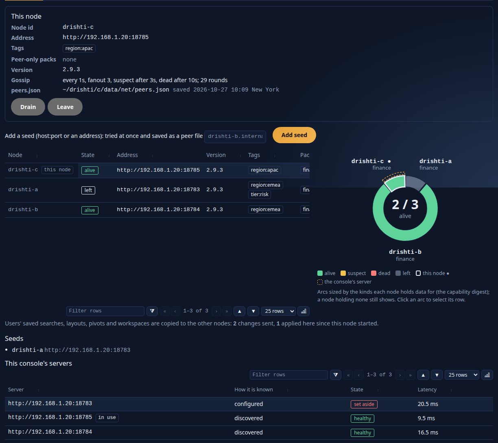
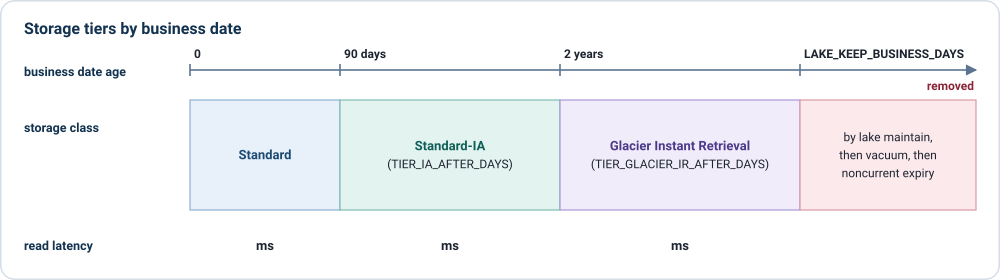

<!--
  Project Drishti · Any data. Any domain. One grammar.

  Copyright (c) 2026 Ashutosh Sinha <ajsinha@gmail.com>.
  All rights reserved.

  PROPRIETARY AND CONFIDENTIAL.

  This file is the confidential and proprietary property of Ashutosh Sinha.
  Unauthorised copying, use, modification, distribution or disclosure of this
  file, via any medium, is strictly prohibited except with the express prior
  written permission of the copyright holder.

  See the LICENSE file in the root of this repository for the full terms.
-->
# Clusters and scale

For operators who run Drishti on more than one server, or on one large one. It covers Drishti\*net (several servers acting as one),
a cluster of three from the first seed to production, Admin → Cluster, the roles of a larger estate and how many of each, VaR sharding from
the operator's side, high availability, load balancing, zero-downtime upgrades and loads, security zones, operations and disaster
recovery, Drishti on AWS (ECS, EFS, S3), the Delta lake in S3 at scale, the scale strategy for one server, sizing memory, CPU and disk,
and tuning. Installing and running one server is the [operations guide](OPERATIONS_GUIDE.md); every setting named here is in
[CONFIGURATION.md](../admin/CONFIGURATION.md); every measured figure is in [BENCHMARK.md](../admin/BENCHMARK.md); how the cluster works
inside is [HOW_IT_FITS.md](../../HOW_IT_FITS.md#part-ii--architecture). The hands-on walk-through is
[tutorial 22, a cluster of three](../tutorials/22-a-cluster-of-three.md).

## Contents

1. [Several servers as one: Drishti\*net](#1-several-servers-as-one-drishtinet)
2. [A cluster of three](#2-a-cluster-of-three)
3. [Admin → Cluster](#3-admin--cluster)
4. [Roles and how many](#4-roles-and-how-many)
5. [Sharding](#5-sharding)
6. [High availability](#6-high-availability)
7. [Load balancing](#7-load-balancing)
8. [Zero downtime](#8-zero-downtime)
9. [The daily cycle across the cluster](#9-the-daily-cycle-across-the-cluster)
10. [Consoles, users and security zones](#10-consoles-users-and-security-zones)
11. [Operations and disaster recovery](#11-operations-and-disaster-recovery)
12. [Drishti on AWS: ECS, EFS and S3](#12-drishti-on-aws-ecs-efs-and-s3)
13. [The Delta lake in S3 at scale](#13-the-delta-lake-in-s3-at-scale)
14. [Scale strategy for one server](#14-scale-strategy-for-one-server)
15. [Sizing: memory, CPU and disk](#15-sizing-memory-cpu-and-disk)
16. [Tuning](#16-tuning)
17. [Glossary](#17-glossary)

---

## 1. Several servers as one: Drishti\*net

Drishti\*net makes several Drishti servers act as one. Each server (a **node**) tells the others, by gossip over HTTP, which packs, kinds
and data it serves. A request one node cannot answer is answered by another, and the console never knows which: a person connected to any
node sees the same pages. Nodes may host different packs or overlapping ones, and may share a lake or read lakes of their own.


**It is off by default.** A server with no `config/net/` folder, or whose `node.yaml` does not say `enabled: true`, is a single server: no
thread gossips, no peer is asked, nothing is forwarded, and the cluster's endpoints answer `404 DRS-5050`. Every server process is the same
jar; what a node does (its packs, edition, settings and tags) is configuration.

**What it writes.** `<data dir>/net/node-id`, `<data dir>/net/peers.json` (atomically), `<data dir>/net/history/` (earlier texts of the
files), `<data dir>/net/identity-deleted.json` (deletion tombstones). Nothing outside the data folder.

### 1.1 Before you start

| Need | Why |
|---|---|
| The same Drishti version on every node (the same Drishti\*net protocol, `1`) | A node that speaks another protocol is listed but never sent a request |
| One **cluster key**, at least 32 bytes, in the environment of every node (`DRISHTI_NET_SECRET`) | Every call between nodes is signed with it; a node without it cannot join or read |
| The same **token secret** (`DRISHTI_TOKEN_SECRET`) or the same OIDC issuer on every node | A person signed in on one node is signed in on all, so a console can move between them |
| Each node reachable by the others on its own port, at a real address (section 1.2) | Gossip, digests and forwarded requests are HTTP(S) calls to that address |
| Clocks within 60 seconds of each other (NTP) | A signed call is refused outside a 60 s window, so a replay cannot be sent later |
| In a cluster that shares users, sessions or BI run leases: one PostgreSQL identity database (`DRISHTI_IDENTITY_DB_URL`) | Never the single-node SQLite default in a production cluster (section 6.4) |

Generate the key, do not invent it, and keep it where only the service user can read it:

```bash
openssl rand -hex 32          # the same value goes into DRISHTI_NET_SECRET on every node
```

The key is never written in a file of `config/net/` in clear: the file names the variable (`secret: ${DRISHTI_NET_SECRET}`), and a file
with a key in clear is refused. Admin → Cluster shows only whether it is set.

### 1.2 Real addresses only

**Members advertise a real address, never a loopback one.** A node is called at the address it advertises by every other node and every
console, on any machine, so `localhost`, `127.x.x.x`, `::1`, `0.0.0.0` and `::` are refused wherever an address is given, in any spelling
(`localhost.`, `ip6-localhost`, `0`, `127.1`, `2130706433`, `0x7f000001`), as are link-local addresses (`169.254.x.x`, `fe80::…`), the
addresses of this machine's container and VM bridges (`172.17.0.1` on `docker0`) and a host name that resolves here to any of them (on
Debian and Ubuntu the machine's own name is `127.0.1.1` in `/etc/hosts`; the message says so). The rule holds for `advertise-url` in
node.yaml, a seed's `url` in `peers/*.yaml` (checked by `drishti.py net check|set|add-peer`, by Admin → Cluster → Files and by the server when
it loads the folder), and every member address learned by gossip, which is never kept nor passed on. Even three nodes on one machine use
the machine's real address. There is no escape hatch. The refusal names the address to use:

```text
$ drishti.py net set node.advertise-url http://127.0.0.1:18784
drishti: node.yaml was not written: 'http://127.0.0.1:18784' is a loopback or wildcard address (loopback): the address this node advertises must be an address other machines can call (this machine's address is 192.168.1.20: use http://192.168.1.20:18784); or leave advertise-url out and the node advertises that address with its port
  error   node.yaml:2  advertise-url: 'http://127.0.0.1:18784' is a loopback or wildcard address (loopback): [the same message]
```

**An address is an address.** `advertise-url` and a seed's `url` are `http` or `https`, a host, an optional port and path, nothing else:
a host name (letters, digits and dashes between dots, no dot at the end), an IPv4 address in four decimal parts (`192.168.2.77`) or an
IPv6 address in brackets (`http://[2001:db8::5]:18611`); the port 1 to 65535. A port of `0` or past 65535, a `%`-escaped or trailing-dot
host, a user part, a query or a fragment are refused with the reason (*port 0 is not a port: the port must be 1 to 65535*), and a member
gossiping such an address is never kept. `drishti.py net` and the server apply the same rules.

**Without `advertise-url`** a node advertises this machine's primary IPv4 address with the server's port (`server.port`; `https` when
`server.ssl.enabled`): the address of the interface the default route leaves by, else the first interface that is up and is not a
loopback, a container bridge (`docker0`, `br-…`, `veth…`) or a virtual link. Set `advertise-url` on a machine with several interfaces,
behind a load balancer or with a DNS name. To see the address a node would take: `ip -4 route get 1.1.1.1` (Linux: the `src` address),
`ipconfig getifaddr en0` (macOS) or `ipconfig` (Windows); Admin → Cluster → Members shows it as *detected*. A machine with no address but
loopback cannot be a member: `enabled: true` without `advertise-url` is refused there. The console's own `backend.urls` may name
`127.0.0.1` for a server on its machine (its own choice, not an advertisement); what it discovers never does.

### 1.3 The files of config/net/

Drishti\*net is configured the way connectors are ([DATA_GUIDE.md section 9](DATA_GUIDE.md#9-connector-files-and-admin--connectors)): one folder of small YAML files,
watched, each checked against its schema before use. `application.yaml` holds only where the folder is and how it is watched
([CONFIGURATION.md](../admin/CONFIGURATION.md#drishtinet--drishtinet-the-cluster-folder)):

```yaml
drishti:
  net:
    dir: ${DRISHTI_NET_DIR:./config/net}     # created on first write; ready-made files in config/net.examples/
    watch: ${DRISHTI_NET_WATCH:auto}         # auto (file events, polling as a fallback) | poll | off
    poll: 5s
```

| File | What it holds | A change |
|---|---|---|
| `node.yaml` | this node: `enabled`, `node-id` (empty: generated once), `advertise-url`, `tags`, `peer-only-packs`, `secret: ${DRISHTI_NET_SECRET}` and `previous-secret: ${DRISHTI_NET_PREVIOUS_SECRET}`, `tls.*` for mutual TLS, `gossip-port` (`auto`, a number, or `off`) ([settings](../admin/CONFIGURATION.md#drishtinet-confignet)) | live: `enabled` false → true joins, true → false leaves cleanly |
| `peers/<name>.yaml` | one file per seed, the file name its logical name (lower-case letters, digits, dashes): `url`, the `tags` it is expected to carry, `tls.*` overrides | a new file is contacted at once; a deleted one is no longer a seed (gossip may still know the node) |
| `gossip.yaml` | the protocol's timings: `interval`, `fanout`, `suspect-after`, `indirect-probes`, `dead-after`, `forget-after`, `persist-every` ([settings](../admin/CONFIGURATION.md#gossipyaml)) | the next round |
| `routing.yaml` | `forward-timeout`, `scatter-budget`, `suggest-budget`, `link-budget`, `join-grace`, `join-wait`, the hop limit, peer-choice weights, `user-state`, `peer-protocol` ([settings](../admin/CONFIGURATION.md#routingyaml)) | the next request |
| `access.yaml` | nodes per role: `roles: { <role>: { nodes: [<node id or tag>, …] } }` (empty: every node) | the next request; told to the others in the digest |

```yaml
# config/net/node.yaml
enabled: true
advertise-url: https://10.20.1.33:18480
tags: [region:emea, tier:risk]
peer-only-packs: [market-risk]
gossip-port: 7946
secret: ${DRISHTI_NET_SECRET}
```

**A refused file keeps the previous settings in force.** A file with an error (a value that is not a duration, a key in clear, `enabled:
true` without a key, a loopback address) is refused as a whole: the settings it held stay, Admin → Cluster → Files shows it **refused** with each
problem and its line, and the log names the file and line. An unknown setting is a warning. Every write (Admin → Cluster or `drishti.py net`) is
atomic and keeps the previous text in `<data dir>/net/history/`. What gossip learns at run time is state, not configuration: it goes to
`<data dir>/net/peers.json`, never into this folder. Ready-made files with every setting explained are in
[config/net.examples/](../../config/net.examples/). From a terminal, `drishti.py net` lists, checks and edits the files (`net list`,
`net check`, `net add-peer <name> <url>`, `net set node.tags region:emea`, `net members`) like `drishti.py connector`
([CLI_REFERENCE.md](CLI_REFERENCE.md)).

### 1.4 Membership: how nodes find each other

SWIM-style membership, carried over HTTP:

- **Every `interval`** (1 s) a node raises its own heartbeat and swaps member tables with `fanout` (3) random members. News reaches 100
  nodes in about five rounds.
- **Failure detection:** a member whose heartbeat has not risen for `suspect-after` (5 s) is probed directly, then through
  `indirect-probes` (2) others; still silent it is **suspect**; suspect for `dead-after` (30 s) it is **dead**. A crashed node is dead
  everywhere within about 40 seconds. A node that hears it is suspected refutes it and stays `alive`.
- **Joining:** a node contacts its seeds, and failing those the members its `peers.json` lists; one exchange gives it the whole table. With
  no seed and no file it is a cluster of one, and keeps trying. A server joins only once it is ready (its web server answers and its
  connectors have started), so a restarting node is never routed to before its port opens. The log says `net: Drishti*net is on; this node
  joins once the server is ready`, then `joined Drishti*net`.
- **Joining until the digests:** a node that has just joined is *joining* until it has its peers' digests, usually a few tenths of a
  second, at most routing.yaml's `join-grace` (30 s). Meanwhile a read nothing here holds waits up to `join-wait` (2 s) and is answered from
  the peer; still joining, the answer is `502 DRS-5052` "this node is still joining Drishti\*net …; try again in a moment", which the console
  retries once on another server; never `404 DRS-1001`. Log: `net: node … has joined: it has its peers' digests (2), 270 ms after joining`;
  Admin → Health → Drishti\*net says `state: joining` until then.
- **Leaving:** a server stopping cleanly, or switched off in node.yaml, gossips `left` before it stops, so its peers drop it at once.
- **Persistence:** `<data dir>/net/peers.json` holds this node's id and every member with its last-known state, written atomically every
  `persist-every` (10 min), on every join or leave and at shutdown. A restarted node rejoins from it with no seed at all; an unreadable file
  is ignored with a warning.
- **Forgetting:** dead and left members are kept `forget-after` (24 h), then dropped.

**Gossip off the busy path.** A server busy with queries is never wrongly suspected. Each node opens a **gossip port** as it joins
(`gossip-port: auto`, a free port; a number for a firewall; `off` uses the server's port), advertises it, and serves only gossip, probes and
digests there, on threads of its own; on either port those calls are answered first, from memory, past every admission gate. The log says
`net: gossip port 41234 open (8 platform threads of its own; gossip, probes and digests only)`; Admin → Health shows `gossipPort`. With
`auto` the port changes at each start: between machines behind a firewall set a number on every node and open it between them. A gossip
port that refuses while the server's port answers is skipped for 5 minutes (gossip uses the server's port meanwhile, and the log says so).
A node of an older release advertises no gossip port: its peers gossip on its server port. Seeds are always called on their server port
first. How it works inside: [HOW_IT_FITS.md](../../HOW_IT_FITS.md#a13a-several-servers-as-one-drishtinet).

### 1.5 What each node offers: the capability digest

Each node publishes a **digest** of what it serves (`GET /api/v1/net/digest`) and gossips its hash; a peer pulls the digest again when the
hash changes (and once a minute for the load). A pack switched on at one node is in every node's table within about a second.

| Part | What it says |
|---|---|
| `packs` | every pack switched on: name, code, version, a hash of its files, peer-only or not |
| `kinds` | every kind: its mnemonic, its pack, its sources (connector, plugin, **table identity**, the oldest and newest business dates held, data version, columnar, dated, live) |
| `load` | requests a second and average latency over the last minute, for choosing between peers |
| `calendar` | the business calendar (`DRISHTI_CALENDAR`): an as-of date must mean the same day on both nodes |
| `tags`, `redact`, `access` | the node's tags, masked fields and nodes per role, so Admin → Cluster can show where nodes differ |
| `services` | the compute engines running here (a request for an engine's API reaching a node that does not run it goes to the least loaded node that does; none: `404 DRS-1020`) and the VaR shard state |

**Replicas and shards.** A source names where its data lives, the same on every server that reads the same data: a Delta table by the id
in its log (else its location; a local path counts only on its own machine); a `file` connector by its folder and a fingerprint of the
kind's files. Two nodes whose sources name the same table are **replicas** for that kind: a search asks one, and a read of one entity goes
to the same replica each time (a stable hash of its id), so its caches stay warm. Different tables of the same kind (ENDUR's trades on one
node, CALYPSO's on another) are **shards**: a search asks every one. A source that cannot say where its data lives is a shard of its node,
which is always safe; a source that holds nothing of a kind never makes its node a holder of it. A shared lake needs no forwarding between
nodes that both read it; separate lakes are joined by forwarding and scatter-gather.

**The newest pack is served.** When nodes hold different versions of a pack, a request for its kinds goes to a node with the newest; equal
versions with different contents are flagged on Admin → Cluster.

**Commands and packs switched on or off** (Functions, Admin → Packs) are the same on every node, even when each node has a database of its
own: the switches travel with gossip and a node that was down catches up when it rejoins
([ADMIN_GUIDE.md](ADMIN_GUIDE.md#205-several-servers)). **Editions** (`drishti.edition`) are per node and must be equal on all
(Admin → Cluster warns).

### 1.6 Security: the key, mutual TLS, nodes per role

**The cluster key.** Every call between nodes carries the calling node's id, the time and an HMAC-SHA256 of the method, path and query, time,
node and body, made with the cluster key. A call is refused (`401 DRS-5051`, listed on Admin → Cluster → Security with address and reason) when
it has no signature, another key made it, or it was signed more than 60 seconds away from this node's clock.

**Rotating the key with no downtime** takes three rolling steps (restart or reload the nodes one by one in each; the cluster keeps working):

| Step | node.yaml on every node | The environment | What it does |
|---|---|---|---|
| 1 | `secret: ${DRISHTI_NET_SECRET}` and `previous-secret: ${DRISHTI_NET_PREVIOUS_SECRET}` | `DRISHTI_NET_SECRET` = old, `DRISHTI_NET_PREVIOUS_SECRET` = **new** | every node also accepts the new key |
| 2 | the same | `DRISHTI_NET_SECRET` = **new**, `DRISHTI_NET_PREVIOUS_SECRET` = old | every node signs with the new key and still accepts the old |
| 3 | remove `previous-secret` | `DRISHTI_NET_SECRET` = new | the old key is refused everywhere |

`previous-secret` is never used to sign, only also accepted. Admin → Cluster → Security shows, per peer, when it last signed with the previous
key: when none has for a while, do step 3. On-behalf-of tokens live 30 seconds, so none outlives a rollover.

**Mutual TLS.** Between nodes on an untrusted network, give each node a certificate: inbound the server's own TLS with client certificates
(`server.ssl.*`, `server.ssl.client-auth: need`), outbound `tls.*` in node.yaml (the shared settings of [DATA_GUIDE.md section 10](DATA_GUIDE.md#10-tls-and-the-outbound-proxy):
`keystore`, `truststore`, passwords as `${ENV}` references), with `https://` addresses; the gossip port uses the same certificate. Mutual
TLS comes on top of the cluster key, never in its place. Admin → Cluster → Security lists the certificates and their expiry.

**The user is carried, not trusted blindly.** A forwarded request carries an **on-behalf-of token** (user, roles, embed application, the
forwarding node, the request id, the node it is for; signed, valid 30 s). The receiving node serves it as that person: their masks, kinds and
packs. With `drishti.security.registered-users-only` on (the default) the user must exist and be enabled there too; the nodes copy users
to each other (section 1.7), so that holds everywhere. **Masks twice:** the node that reads the data masks it for that person, the node that
shows the page masks again; the stricter wins, and Admin → Cluster → Capability map warns when two nodes mask different fields.

**Nodes per role** (`access.yaml`, or Admin → Cluster → Access): a role may name the nodes it may reach, by node id or tag; a role not listed,
or with no nodes, reaches every node; a person reaches a node when any of their roles does.

```yaml
# config/net/access.yaml
roles:
  trader:
    nodes: [region:emea]        # the EMEA nodes only
  risk:
    nodes: []                   # every node
```

Before any request leaves a node, the capability table is cut to the nodes the caller's roles reach: a search, type-ahead or forwarded
request never reaches another node, and a kind held only outside the list is answered as not held. The receiving node checks again (`403
DRS-5054`). The person's own node always answers them.

**Audit.** A forwarded request is in the access log of both nodes (`net:to <node> request <id>` and `net:from <node> request <id>`), in Admin
→ Net → Routing's traffic, and in `drishti_net_forwarded_total{peer,kind,outcome}`. Every management action is in the audit log with the
node it was made on.

### 1.7 Where a request goes

Every request a node's own clients make (a view, its panels, About this page, the raw document, history, a live view, a search, a form) goes
through three questions, in order, considering only nodes the caller's roles reach; a forwarded request is answered from the receiving node
itself only (one hop).

1. **Can this node answer it?** The kind's pack is on here, it is the newest version among the reachable nodes, and it is not peer-only
   here: answered here, as without the cluster.
2. **Is the pack missing, older or peer-only here?** The **whole request is forwarded** to a node that renders the kind, and its answer
   passed back unchanged (a live view's events streamed as they come): the page, its help and its links are that node's. Nodes whose sources
   hold the data come first, then the lowest latency, then a stable hash of the entity id. A node that does not hold the entity or fails passes
   the read to the next (at most three); a write goes to one node and is never repeated.
3. **Is the pack here but not the data?** The view is built here and the document read from a peer that holds it (masked there, masked
   again here); replicas of this node's own tables are never asked. A local source that failed is never replaced by a peer's data. A view's
   **linked entities** are read side by side: this node's sources within `drishti.graph.link-budget` (40 ms), peers within routing.yaml's
   `link-budget` (1 s from the read's start); only a slower peer leaves a link *pending*. A **history** reads the dates its own sources do not
   cover from a peer in one call; dates two peers answer keep the higher generation.

**When the node that serves it is down** the answer says so: `502 DRS-5052 ... cannot be reached now: n-a (left)`, or `504 DRS-5053` when
it did not answer within `forward-timeout`; never a wrong page, never "no data". A down node counts only for the dates its last digest said
it holds, so a history reaching back before its lake began is complete.

**Peer-only packs** (`peer-only-packs`) are loaded and served to peers but hidden from this node's own users (not in their packs, forms,
type-ahead or command line; their requests forwarded or answered `404 DRS-1002`): a node can be a pure data or rendering server behind
others.

**Searches and type-ahead are scattered.** A search is asked of every node that holds data of the kind and is not a replica of one already
asked, within `scatter-budget` (3 s), and merged as one: rows by kind and id (counted once), re-sorted, cut to the `limit`; `scanned` and
`matched` summed without double counting. A node that failed, was late or is down is named in `failed` and the answer is `partial`: never
silently smaller. Administrators see `nodes` (each node's scanned, matched and time). The type-ahead asks every reachable node within
`suggest-budget` (150 ms): a slow node's suggestions are missing, the list never late.

**Live views are relayed.** A live view of an entity a peer holds ticks here: this node opens one stream from the peer per role set and
feeds every viewer with those roles; a broken stream reopens a second later.

**BI.** A report's requests are answered where its datasets' kinds are held; otherwise by a node that lists the report and holds them. A
model spanning nodes is not joined across them. A heavy **BI run** runs on its model's owner among the members alive; its id names its
node (`r-<node id>-…`) and its result and actions are answered from any node; the Runs tab lists your runs of every node. To have a dead
node's unfinished runs adopted, give the cluster one identity database (PostgreSQL); the lease is `config/runs/runs.yaml` `lease.renew`
(10 s) and `lease.ttl` (45 s). With a database per node, re-run them on another node.

**Grouped pages are gathered** (a counterparty's trades, a book's P&L, a netting set over several systems) from every node that holds the
kind they group, as a search is. When every node lists all its members of the group (up to the connector's `max-members`, 1,000), the page
equals what one node holding every member builds; in a larger group each node's totals are combined and a member two nodes hold is counted
on each, so keep overlapping systems on one node or in a shared lake. A missing node makes the page partial, with a **Partial** banner
naming the server.

**A user's state follows them.** Saved searches, layouts, pivots, workspaces, settings and console sign-in sessions written on one node are
copied to every other within a second (the newest write wins); a node that was down catches up when it rejoins. **The identity follows
too:** users (with the password hash, never a password), roles defined in Admin → Roles and personal API tokens (the token's hash) are
copied, each change audited on the receiving node as `net:<node>` (`user-created`, `user-updated`, `user-deleted`, `role-updated`,
`token-copied`, `token-revoked`). Disabling a user ends their sessions everywhere; deleting leaves a tombstone kept 90 days, so a node that
was down deletes too and a stale copy never brings the user back. Two users of one name made apart (each node's seeded administrator) are
settled by the older. **The cluster never ends with no enabled administrator:** a peer's change that would leave a node with none is
repaired where it is applied (the same administrator re-enabled on every node), audited `last-admin-kept` and shown on Admin → Health.
Alerts, monitors and scheduled reports are not copied (they act, and would act once per node). Everything travels over signed calls; on an
untrusted network add mutual TLS so password hashes are not readable on the wire. With one shared identity database set `user-state: off`
in routing.yaml.

**Which node answered, for administrators.** A view's *How this view was built* panel has, for an administrator only, a line **Node**:
`drishti-a · local`, `… · built here, data from drishti-c`, `… · forwarded from drishti-a`, or `… · scatter-gather from …` with the nodes
missing.

**Business calendars.** A peer whose calendar differs is used only for live reads.

**HTTP/2 between nodes.** The server's port speaks HTTP/2 as well as HTTP/1.1 (`server.http2.enabled: true`, `DRISHTI_HTTP2`); with
routing.yaml's `peer-protocol: http2` (the default) a node keeps one multiplexed connection per peer (measured: one connection instead of
hundreds, and a p99 a third of HTTP/1.1's: [BENCHMARK.md](../admin/BENCHMARK.md#21-measuring-one-installation)); `http1` switches back,
live. A peer without HTTP/2 is answered in HTTP/1.1.

### 1.8 The console and several servers

With the cluster on, give the console several servers instead of one ([CONFIGURATION.md](../admin/CONFIGURATION.md#the-console-and-several-servers-drishtinet)):

```yaml
# drishti-console/config/application.yaml
backend:
  urls: ${DRISHTI_BACKEND_URLS:}       # http://192.168.1.20:18783 (one is enough; empty: backend.url)
  discover: true
  discover_every: 60s
  check_every: 5s
  fail_after: 2
```

- **It learns the cluster.** Every minute it asks its server for the member list (`GET /api/v1/net/members`) and keeps it, so one configured
  server is enough. The list is saved to `<console data dir>/net/servers.json` (atomically, and at shutdown), so a console restarted while its
  configured server is down still knows where else to go; nothing to back up. Dead and left members are dropped; the configured `urls`
  never are; a loopback address is never discovered.
- **One server per session**, the configured ones first, then the discovered ones, nearest first; each checked every `check_every`.
- **Falling over.** A server that refuses connections, times out or answers 502/503 `fail_after` times in a row is set aside and the session
  moves. A 502/503 that is the server's own answer about another node (`DRS-5050` to `DRS-5059`, such as `DRS-5052` while a holder is down)
  and a peer's time-out (`504 DRS-1014`) never count. A **read** that failed on the way is tried once on another server; a **write** never
  is (the page says it did not save; saving again works). A live stream that broke never counts; the console checks health instead.
- **Nothing to sign in again.** Every node accepts the same tokens and knows the console's sessions. An open live view reopens on the next
  server (up to 12 times, a second apart and growing) and keeps ticking.
- **Coming back.** A set-aside server is used for new sessions after a minute of health, never moved under a running session; a session
  that moved because its server restarted returns to it.
- **One server per screen.** A screen with clickable rows keeps what the reader picked on the server that drew it; its clicks go there.
  When that server stops, the next click says *Your selections were reset because server X went away. Pick again.*
- **Visible to administrators.** Admin → Cluster and Admin → Health show the server the console is on, its list, and the failovers of the last
  hour; each failover is audited on the server it moved to (`net-console-failover`).

Without Drishti\*net `backend.urls` still works as a plain list of identical servers (same packs, same lakes).

**Designs and other user content** are kept in the content store, so a console that fails over still finds them. **Every member must use
the same `config/store/store.yaml`**: the default file-system store needs a shared mount (NFS, EFS, SMB) at the same path on every member;
PostgreSQL or S3 need none. A member that finds another recorded with a different store root logs `content store roots differ`
([HOW_IT_FITS.md](../../HOW_IT_FITS.md#d5-the-content-store-user-content-every-node-reaches)).

### 1.9 Module placement

A module's **parts** (its API, compute, pages, feeds) run on the nodes the site places them on, in **`config/placement.yaml`** (beside the
connectors' folder; `drishti.placement.file` moves it). The design is
[KERNEL_AND_MODULES.md section 4.11](../architecture/KERNEL_AND_MODULES.md#411-modules-in-a-cluster).

```yaml
format: 1
version: 4                       # raised by every applied change; every member adopts the highest
modules:
  sample:
    parts:
      api:     { roles: [web] }                     # every node labelled web (node.yaml tags: web, or role:web)
      compute: { roles: [heavy], max-nodes: 1 }     # heavy: one node at most
      feeds:   { nodes: [drishti-main, drishti-b] } # one runner, elected among these two
```

- **By node name or role.** `nodes:` names members; `roles:` matches a node label (a resource class such as `heavy` or `web`, or
  `role:<name>`), so a new node with the label is placed without changing the file.
- **No all-nodes default in a cluster.** A module or part not listed runs nowhere; Health (`placement`) and Admin → Cluster → Modules say
  *not placed*. A single node (no cluster) places a module the file does not name on itself and notes *single node: placed here*.
- **Resource classes** come from the module's manifest (`parts:`): `light`, `heavy` (with `memory-mb`), `feed`, `singleton`.
- **Singletons.** A `feed` or `singleton` part has exactly one owner: the **first live placed node by name**. Every node sees the same
  placement and the same members, so all agree without a vote; when the owner stops, the next placed node takes over, never a node outside
  the placement. With no placed node up the part is *unavailable*.
- **Heavy-work guards.** A request for a part (`/api/v1/<module>/…`, the part by the paths its manifest declares) runs on a node only when
  the part is placed there; any other node forwards it once, for the same person, to a placed node that is up (the owner of a one-runner
  part), and the answer's `X-Drishti-Placement` header names the node that ran it. With none up it is refused with `503 DRS-1032`. A plan
  that puts a heavy part over its `max-nodes`, or on every node of the cluster without `allow-all: true`, is refused with `DRS-1030`.
- **Plan, then apply.** A change is a plan (`POST /api/v1/admin/cluster/placement/plans` `{placement, reason}`: the matrix before and after,
  warnings), applied by a second administrator (`…/plans/{id}/apply`; the proposer gets `DRS-2007`). An apply after the cluster changed (a
  member or its labels, a module, the placement) is refused with `DRS-1031`: plan again. The apply writes the file (the old one kept as
  `.bak`), takes effect at once without a restart and is sent to every member; a member that was away adopts it from the version in the
  digest. Audited as `placement-planned`, `placement-applied`, `placement-rejected`, `placement-withdrawn`, `placement-adopted`.
- **Today's built-in modules** (banking and the others still inside the server) count as placed on every node, unguarded, until each
  becomes a module: their behaviour is unchanged, and a placement that names one is refused.

### 1.10 Deploying a module

A module (`.dmod`) is deployed once for the whole cluster, from Admin → Modules → Deploy or `drishti.py module deploy`, both over one API
(`/api/v1/admin/modules/…`, [API_REFERENCE.md](API_REFERENCE.md#2-entities-views-search-and-administration)):

- **Built once, stored once.** The upload goes to the module store of the node you talk to (`modules/store/<id>/<version>/` under
  `drishti.module-deploy.dir`, by default `<data>/modules`; on AWS with EFS every node reads the same folder). It is checked there with the
  fifteen conformance checks (C15 with `drishti.module-deploy.conformance-cycles` cycles); a version is never rebuilt: the same version with
  other bytes is refused. Plans and applies are made on that node (the coordinator).
- **The plan follows the placement.** Place the module's parts first (section 1.9). The plan lists every node: a placed node stages and
  activates it; a node where no part is placed receives nothing (it forwards the module's requests) and only records the module in its
  registry. A module placed on no node is refused (`DRS-1033`).
- **Four eyes, then two phases.** Another administrator applies (`DRS-2007` for the proposer; `DRS-1031` when the cluster changed since the
  plan). Phase 1 sends the package to each placed node in chunks over Drishti\*net; each node checks the SHA-256 and runs V1–V9 itself.
  Phase 2 activates on every placed node; any refusal or failure rolls every node back to what it ran before and the deployment ends
  `failed` with the node and the reason.
- **Rolling upgrade.** A newer version of an active module is staged everywhere first, then switched node by node; the other nodes serve
  the old version until their turn, and requests that reach a node while it switches wait for it (`drishti.module-deploy.swap-wait-seconds`).
  A failure puts the switched nodes back to the old version.
- **Switch off and remove.** Switching off unloads it on every placed node (its API answers `404 DRS-1025`); removing unloads it hot
  (with the class loader leak check), writes the tombstone, and every node answers its API `410 DRS-1028` and its console paths with the
  *no longer installed* page. Saved work that uses it (alert rules, saved views and reports whose text names its API, pages, functions or
  kinds) is kept and marked *needs module X*; a reinstall (a plan of the same or a newer version) restores everything.
- **Audit.** `module-stored`, `module-deploy-planned`, `module-deploy-applying`, `module-deploy-applied|failed|rejected|withdrawn`.

---

## 2. A cluster of three

### 2.0 Starting the nodes

Each node is a server started with `bin/start-server --node <name>` (`.sh` on Linux and macOS, `.ps1`/`.cmd` on Windows): `--node-dir`
names its Drishti\*net folder (made when missing), `--seed <host:port>` the member it joins through, `--advertise` the address it
advertises (by default the machine's real LAN address, never a loopback one), `--node-data` its own data folder when several nodes share a
machine; the cluster key comes from an `--env-file`. The console is started with `bin/start-console --server <the entry node>` (or several,
comma-separated) and learns the other members from the cluster. The commands for three nodes on one machine and on three machines, and
every option: [DEPLOYMENT_AND_QA_GUIDE.md › section 10.6](../DEPLOYMENT_AND_QA_GUIDE.md#106-start-order-and-joining) and
[section 6.1](../DEPLOYMENT_AND_QA_GUIDE.md#61-the-start-and-stop-scripts-bin).

### 2.1 The ready-made local cluster: deploy/stack

For a cluster on one machine without the steps below, the repository's `deploy/stack/` starts three servers and a console from one file,
`stack.yaml` ([deploy/stack/README.md](../../deploy/stack/README.md)):

```bash
bin/start-cluster.sh       # start what is not running: the three servers, then the console
bin/status.sh --cluster deploy/stack/stack.yaml      # the processes and ports, the members, the console's servers
bin/stop-cluster.sh        # stop everything the cluster file started (by process id, never by name)
```

It starts each node and the console through the scripts of `bin/` (2.0), so their pid files and logs are in `data/run/` and `data/logs/`.

`drishti-main` (18480) serves the seven default packs, the demo lakes and live news; `drishti-b` (18791) synthetic ENDUR and CALYPSO
trades; `drishti-c` (18792) synthetic MUREX trades with `counterparty-risk` and `market-risk`; the console (17480) is given `drishti-main`
alone, learns the others and fails over to them.

Each node's net folder is checked in (`advertise-url: http://${DRISHTI_STACK_HOST}:<port>`, `secret: ${DRISHTI_NET_SECRET}`: references,
never the key or an address). `start.sh` finds this machine's real address (the default route's interface, never a docker bridge) and gives
it to every node as `DRISHTI_STACK_HOST`; on a machine with several interfaces set `host:` in `stack.yaml`. The secrets
(`DRISHTI_TOKEN_SECRET`, `DRISHTI_SESSION_SECRET`, `DRISHTI_NET_SECRET`) are made on the first start in the git-ignored `secrets.env`
(mode 600). Open the console at the address `start.sh` prints and go to **Admin → Cluster**: the three members are alive. The stack runs G1
with `-XX:G1PeriodicGCInterval=60000` and a faster failover for a lab (`suspect-after: 3s`, `dead-after: 10s`). It is for trying a cluster,
not for production.

### 2.2 Three nodes step by step

Three nodes, `a`, `b` and `c`. Only `a` needs to be named anywhere: `b` and `c` are given `a` as their seed. The examples run the three on
one machine (ports 18783, 18784, 18785) at its address, `192.168.1.20`; on three machines use each machine's own address.

**Step 1 · node.yaml on each node**, with its own address and tags:

```yaml
# config/net/node.yaml on node b
enabled: true
advertise-url: http://192.168.1.20:18784  # left out: this machine's address
tags: [region:emea, tier:risk]
secret: ${DRISHTI_NET_SECRET}
```

From a terminal, `drishti.py net` writes and checks the same file and refuses `enabled: true` until the key is there:

```text
$ drishti.py net set node.enabled true
drishti: node.yaml was not written: enabled: true needs the cluster key: secret: ${DRISHTI_NET_SECRET} with the variable set (at least 32 bytes)
(exit 1)
$ drishti.py net set node.secret '${DRISHTI_NET_SECRET}'
wrote ~/drishti/config/net/node.yaml
$ drishti.py net set node.advertise-url http://192.168.1.20:18784
$ drishti.py net set node.tags region:emea,tier:risk
$ drishti.py net set node.enabled true
```

In the UI: **Admin → Cluster → Files**, open `node.yaml`, type the settings, **Check**, **Save**.

**Step 2 · the seed.** On `b` and `c`, one peer file naming `a`:

```text
$ drishti.py net add-peer drishti-a 192.168.1.20:18783 --tags region:emea
wrote ~/drishti/config/net/peers/drishti-a.yaml
$ drishti.py net list
config/net at ~/drishti/config/net: Drishti*net is ON
  node (generated)  at http://192.168.1.20:18784  tags region:emea,tier:risk  key set
  seed drishti-a  http://192.168.1.20:18783
  node.yaml             in force
  gossip.yaml           absent (defaults)
  peers/drishti-a.yaml  in force
```

```yaml
# config/net/peers/drishti-a.yaml
url: http://192.168.1.20:18783
tags: [region:emea]
```

In the UI: **Admin → Cluster → Members**, **Add a seed**, type `192.168.1.20:18783`, **Add seed**; it is saved as `peers/192-168-1-20-18783.yaml`
and tried at once.

**Step 3 · start them**, each with `DRISHTI_NET_SECRET` in its environment. A running server picks up a change of the folder within
`drishti.net.poll` (5 s): it joins as soon as `enabled: true` is saved, and leaves cleanly when switched back.

```text
INFO  net: Drishti*net is on; this node joins once the server is ready (its web server answers and its connectors have started)
INFO  Tomcat started on port 18784 (http) with context path '/'
INFO  net: node n-1ace3ceb60 joined Drishti*net at http://192.168.1.20:18784 (incarnation 1, seeds [http://192.168.1.20:18783], 0 saved members)
INFO  net: member n-3d5a69faa3 joined
```

**Step 4 · check.** On any node, **Admin → Cluster → Members** lists the three, each `alive`, with version, tags and latency. From a terminal
(an administrator's token in `DRISHTI_TOKEN`): `drishti.py net members --server http://192.168.1.20:18784` prints one line per member (node
id, this node marked, state, address, version, tags, latency, incarnation; `--json` for all of it).

**Step 5 · the console.** Give it `DRISHTI_BACKEND_URLS=http://192.168.1.20:18783` (section 1.8); it learns `b` and `c` within a minute.
Stop `a`: the console moves to another server and the open page carries on without a new sign-in.

### 2.3 Three machines in production

The smallest highly available Drishti is **three identical machines**, each running one server (shard owner and coordinator at once) and
one console, with the lake, the database and the load balancer shared and highly available outside them.

**Why three.** With `replicas: 2` every shard is on two members; when one machine fails the other holder answers at once and the survivors
rebuild the second copy from the lake. Each of three holds about two thirds of the shards on average (smaller shards even it out). One
machine drained for an upgrade still leaves two copies of everything, so a second, unplanned failure during the upgrade costs no answer. Two
machines work for pilots and UAT but leave no spare: a failure leaves one copy and no machine to rebuild a second. More than three is
section 4's estate.


| Piece | On premises | On AWS | Why it must be shared |
|---|---|---|---|
| **The lake** | an S3-compatible object store with conditional writes (`s3.endpoint` and a private CA: [the Delta connector](../../plugins/drishti-plugin-delta/README.md#security-tls-and-credentials)), or a NAS/SAN mounted at the same path on every machine | S3 (Delta or Iceberg), gateway endpoint | every member builds its shards and opens dates from the same data at the same version; a lost shard is rebuilt from it |
| **The Drishti database** | PostgreSQL primary + streaming standby (Patroni or the bank's operator) | RDS PostgreSQL **Multi-AZ** | users, sessions, edits, run leases on every member; never SQLite in a cluster |
| **The load balancer** | a pair (HAProxy + keepalived VIP, or F5) | an ALB across three zones | routes on readiness (`GET /readyz` on the consoles) |
| **Consoles** | one on each machine behind the balancer, the relay across hosts on | the same, or a Fargate console service | each lists all three servers and moves after two failures |
| **Secrets** | the bank's vault | Secrets Manager | one `DRISHTI_TOKEN_SECRET`, `DRISHTI_NET_SECRET`, session and embed key on all three |

What is **not** shared: each machine's hot files and caches (local NVMe, or EBS), rebuilt from the lake when lost.

**Failover and maintenance with three.** Readiness routes, liveness restarts (section 7.1): a member is ready only when it has joined, its
newest dates are open and the shards it owns are ready. An upgrade drains one machine first (section 8.1). When one machine fails, the other
holder of each of its shards answers at once; after 35–40 s the survivors build the missing copies; its console drops out of the balancer
and its users' pages reload on another. Every member keeps every node's aggregate, so hierarchy figures answer on any machine while shards
move. A network split leaves each side reading the same lake at the same versions, so read answers are identical; a scope needing a shard
held only across the split is refused (`DRS-5215`) until this side builds it, never answered in part; sign-in, edits and run leases go to the
one PostgreSQL primary. Sizing one of the three machines is section 15.3; what to buy is section 4.7; on AWS, section 12.11.

---

## 3. Admin → Cluster

**Admin → Cluster** (`/admin/net`, administrators) is the cluster as the node the console is on sees it. Its summary line says whether the
cluster is on, this node's id, how many members are in each state, whether the key is set (never the key) and whether this node is drained.



**Members.** This node (id, address, tags, peer-only packs, version, the gossip timings and rounds run, where `peers.json` is and when it was
saved), then every member: state, address, version (and protocol when it differs), tags, packs, last heard, latency, incarnation; refreshed
every 5 seconds. Beside it the **hash ring**: one arc per member coloured by state (green alive, amber suspect, red dead, grey left), this
node outlined and marked ●, the console's server with a dashed band, each arc labelled with node id and packs and sized by the kinds it holds
data for; clicking an arc selects its row and back. Actions:

| Action | What it does | API | Audited as |
|---|---|---|---|
| **Add a seed** | `host:port` or an address, saved as `peers/<host>-<port>.yaml` and tried at once | `POST /api/v1/net/seeds` | `net-seed-added` |
| **Remove** (a dead or left member) | takes it out of the table; an alive one is refused (the next round would bring it back) | `DELETE /api/v1/net/members/{id}` | `net-member-removed` |
| **Drain** / **Undrain** | this node takes no forwarded work and tells its peers; its own users are served | `POST /api/v1/net/drain`, `/undrain` | `net-drain`, `net-undrain` |
| **Drain for a stop** / **Undrain** | before stopping or upgrading this server: forwarded work **and** its VaR shards go to other members, readiness turns `OUT_OF_SERVICE`; the card says **Handing work over**, then **Safe to stop**; beside it this node's **Readiness** and what it waits for. Shown on a single server too | `POST /api/v1/admin/node/drain` `{"on": true\|false}`, `GET /api/v1/admin/node` | `node-drain`, `node-undrain` |
| **Leave** / **Rejoin** | gossips `left` and serves its peers nothing, without switching the cluster off; Rejoin comes back with a higher incarnation | `POST /api/v1/net/leave`, `/rejoin` | `net-leave`, `net-rejoin` |

**Capability map.** For each kind: mnemonic and pack (with the newest version in the cluster), the nodes that render it (**newest** or
**older**, **peer-only**, **not routed** for a drained or suspect node), the nodes that hold its data (connector, plugin, **replica** or
**shard**, the newest business date) and which nodes a search asks. **Filter** narrows it. Above it the **warnings**: one pack version with
different contents, different calendars, different masked fields. The same at `GET /api/v1/net/capabilities`.

**Routing.** **Explain a request**: type a kind and an id (or a search), pick a role, and see where the request would go and why (answered
here; forwarded, to which nodes in order; the peers its document would be read from; the peers a search asks; the nodes the role may not
reach; the nodes that would serve it but are down). Below, the **forwarded traffic** per peer a minute at a time for the last hour (failed in
red), the slowest peers and the latest calls. API: `GET /api/v1/net/explain?kind=&id=&q=&role=&dated=`, `GET /api/v1/net/traffic`.

**Access.** Each role with the nodes it may reach (node ids or tags) and the nodes it reaches now; this node's tags and peer-only packs.
**Save access** checks and writes `access.yaml` and those two settings of `node.yaml`, applies them at once (`net-access-saved`); the other
nodes learn them with this node's digest. API: `GET`/`PUT /api/v1/net/access`.

**Security.** Whether the key is set, whether a previous key is accepted and which peers last signed with it, mutual TLS and certificate
expiry, and refused calls (when, address, node, why). API: `GET /api/v1/net/security`.

**Modules.** The node × part matrix (`GET /api/v1/admin/cluster/modules`): one row per module part with its resource class, max-nodes and
memory, one column per node with its labels and whether it is up; each cell in words and colour: **active**, **standby** (a placed node
waiting while another owns the one-runner part), **down**, **not placed**, **in process** (built into the server). The owner of a feed or
singleton is starred. Below: the problems (*not placed*, *unavailable*), **Plan a placement** (the whole file and why) and the **plans
waiting**, which another administrator applies or rejects (section [1.9](#19-module-placement)).

**Files.** Every file of the folder, **in force**, **refused** (with its problems) or **not there (defaults)**. **Check** says what the
server would make of the text without writing it; **Save** writes it with the version you read (`If-Match`), so two administrators cannot
overwrite each other; **Delete** removes it (its text stays in the history); the history shows earlier texts with a line diff. **New peer
file** starts `peers/<name>.yaml`.

Every action and every save is in the audit log with the node it was made on. The endpoints are in [API_REFERENCE.md](API_REFERENCE.md).

---

## 4. Roles and how many

### 4.1 The estate in one picture


All servers are members of one Drishti\*net and any of them answers any request: a request reaching the "wrong" server is forwarded or
scattered to shard owners. Roles exist to size and isolate work (a whole-bank BI run must never slow a VaR answer), not for correctness.

### 4.2 The roles at a glance

| Role | Runs | Key settings | Count: pilot / 2.3M / 10M | Must not share a host with |
|---|---|---|---|---|
| **Edge** | load balancer pair, TLS, optional OIDC pre-auth | no stickiness; health `GET /readyz` on the console | 2 / 2 / 2 | app servers |
| **Console** | `drishti-console`, 4 workers | `DRISHTI_CONSOLE_WORKERS=4`, `backend.urls`, `discover: true`, the same `DRISHTI_SESSION_SECRET`, token secret and relay key | 2 / 3 / 4–6 | shard owners, loaders |
| **VaR coordinator** | full packs or the `risk` edition; sharding on, `coordinator-only: true` | `drishti.var.threads` half the cores when BI also runs | 0 (all-in-one) / 2 / 3 | loaders |
| **VaR shard owner** | `market-risk` (and what it needs); `peer-only-packs: [market-risk]` optional | the sharding block, `zone-tag: az`, `drishti.var.threads: 0` (every core), BI off | 3 / 6 / 16 | BI, loaders, consoles |
| **Exposure server** | `counterparty-risk` | `drishti.ccr.exposure.*` | 1 / 1 / 1 (exposure runs on one server) | VaR owners (page cache) |
| **BI and reporting** | Rūpaka, BI runs, scheduled reports | `config/runs/runs.yaml` workers, `drishti.bi.query.*` | 0 / 2 / 3 | VaR owners |
| **Data-serving** | entity pages, search, type-ahead, data map, World, Market | connector caches, `index.max-disk` | 0 / 2 / 3 | VaR owners |
| **Loader** | `drishti-lakeload` jobs, `lake maintain` | `memory.budget-mb`, `parallel.writers`, spill on NVMe | 1 / 1 + standby / 2 + standby | any server, during the load window |
| **Python compute** | `config/compute/compute.yaml` pools (`risk`, `exposure`) | `workers`, `memory` per worker | on servers / on the exposure server / hosts of their own | VaR owners |
| **Database** | PostgreSQL (identity, sessions, edit log, run leases) | `DRISHTI_IDENTITY_DB_URL`; pools per `drishti.db.pool.size` | 1 (SQLite allowed) / 1 + standby / 1 + standby | app servers |
| **Lake** | S3 (Delta or Iceberg) or a shared file system | `DRISHTI_DELTA_ROOT` | managed | — |
| **Kafka** | the PV topic for intraday | `DRISHTI_KAFKA_BOOTSTRAP`, `DRISHTI_VAR_PV_STREAM` | optional / 3 brokers / 3 brokers | — |

Pilot means about 200,000 positions and 1,500 portfolios with up to 50 active people: three all-in-one servers (each owner and
coordinator) and two consoles. A pilot console may share a host with a coordinator.

### 4.3 Sizing per role

The VaR rows hold 1,518 values a position (1-day, 10-day and stressed), two dates open, four listed currencies; the skeleton of each date
(everything but the positions' numbers) is on the heap of every member, so sharding divides a member's page cache and disk but not its heap.
Estimates from the capacity model (section 15.4) unless marked.

| Role | Scale | `-Xmx` | RAM | vCPU | Local disk |
|---|---|---|---|---|---|
| All-in-one server | pilot (200K) | 8g (12g for 1,518 values) | 32 GB | 8 | 200 GB NVMe |
| VaR shard owner (of 6, replicas 2) | 2.3M | 36g | 128 GB (need 69) | 16 | ~650 GB NVMe (need 394) |
| VaR shard owner (of 16, replicas 2) | 10M | 118g: impractical; 10M needs the skeleton off the heap | 256 GB (need 146) | 16–24 | ~1 TB NVMe (need 643) |
| VaR coordinator | 2.3M | 36g (the whole skeleton, no rows) | 64 GB | 8–16 | 50 GB |
| BI and reporting | any | 16g | 64 GB | 16 | 500 GB SSD (`bi-store`, `bi-runs` 20 GB) |
| Data-serving | any | 24g | 64 GB | 16 | 1 TB NVMe (id maps, index, documents) |
| Loader | 2.3M in 10 minutes | 40g | 64 GB | 32 | 50 GB NVMe spill |
| Console | 300–500 people | — | 8 GB | 4 | 20 GB |
| PostgreSQL | any | — | 32 GB | 8 | 500 GB SSD |

RAM is the need ÷ 0.61 (39% headroom) rounded up to a machine size. The loader's figure: `-Xmx40g`, `memory.budget-mb` 32768, 16 writers,
about 1 to 2 minutes for 2.3M positions on 32 vCPU ([BENCHMARK.md section 7.3](../admin/BENCHMARK.md#73-loading-23m-positions-extrapolated)).
A console serves about 40 pages a second a worker (measured).

### 4.4 JVM flags per role

| Role | Java 21 | Java 25 |
|---|---|---|
| VaR owner, coordinator, large single server (heap ≥ 16 GB) | `-XX:+UseZGC -XX:+ZGenerational -XX:SoftMaxHeapSize=<0.8 × Xmx>` | `-XX:+UseZGC -XX:+UseCompactObjectHeaders` |
| BI, data-serving (heap 16–24 GB) | the same | the same |
| Small server, pilot, stack node (≤ 8 GB) | G1 (the default), `-XX:G1PeriodicGCInterval=60000` | G1, plus `-XX:+UseCompactObjectHeaders` |
| Loader, batch tools | G1 or `-XX:+UseParallelGC` (throughput) | the same |
| Every role | `-XX:MaxDirectMemorySize=256m -Djdk.nio.maxCachedBufferSize=262144 -XX:TrimNativeHeapInterval=60000`, `MALLOC_ARENA_MAX=2`, heap dumps to a capped folder | the same |

The server images (`deploy/docker/server.Dockerfile`, `deploy/docker/ecs/server-entrypoint.sh`) run ZGC and add `-XX:+ZGenerational` on 21
and `-XX:+UseCompactObjectHeaders` on 25 by themselves; every tool that starts a JVM through `tools/javacmd.py` (the stack, the loaders)
adds `-XX:+UseCompactObjectHeaders` on 25, never on 21. Why each flag: section 15.6.

### 4.5 Disk and cache budgets per role

| Role | `var/hot` | `ccr/hot` | connector caches | `bi-store`, `bi-runs` |
|---|---|---|---|---|
| VaR owner | about 60% of the disk (`drishti.var.tier.max-disk-gb` set explicitly) | 0 (exposure off) | small (hierarchies, scenario sets) | off |
| Exposure server | 0 | about 60% | small | off |
| Coordinator | aggregates only | 0 | small | optional |
| BI, data-serving | 0 | 0 | 50–70% (id maps 5 GB a connector, index 2 GB, documents 1 GB) | 50 GB, 20 GB |

Keep hot files across restarts in production (`DRISHTI_VAR_KEEP_HOT_FILES=true`, `DRISHTI_EXPOSURE_KEEP_HOT_FILES=true`; the server images
set both). The free-space guard and every cap: section 15.8.

### 4.6 How each role scales

| Role | Scales by | Limit that binds first |
|---|---|---|
| Console | adding processes behind the LB | CPU (about 40 pages a second a worker, measured) |
| VaR owner | adding owners: each holds replicas ÷ owners of the rows | the skeleton heap, copied to every member |
| VaR coordinator | adding coordinators | the skeleton heap; CPU for many ad-hoc scopes |
| Exposure | one server | its heap while a date loads (`memory-budget-gb`) and the page cache of the set matrices |
| BI | more BI servers; heavy runs go to the model's owner | DuckDB memory and threads |
| Data-serving | more servers; same-table replicas are asked once | page cache for id maps and segments |
| Loader | more writer threads, then a second loader per kind | spill disk speed |

### 4.7 Two concrete targets and the bill of materials

**On-premises VMs, 2.3M positions:**

| Node | Count | vCPU / RAM / disk | Key settings |
|---|---|---|---|
| `lb-1`, `lb-2` | 2 | 4 / 8 GB | HAProxy + keepalived VIP, TLS, health `GET /readyz` on 17480, no stickiness |
| `con-1..3` | 3 | 4 / 8 GB / 20 GB | `DRISHTI_CONSOLE_WORKERS=4`, `DRISHTI_BACKEND_URLS=https://coord-1:18480,https://coord-2:18480`, `DRISHTI_CONSOLE_RELAY_ACROSS_HOSTS=true`, one `DRISHTI_CONSOLE_RELAY_KEY`, ports 17490–17493 open between the consoles |
| `coord-1..2` | 2 | 16 / 64 GB / 100 GB | `-Xmx36g`, `drishti.var.sharding.coordinator-only=true`, tags `az:dc1-a` / `az:dc1-b` |
| `var-1..6` | 6 | 16 / 128 GB / 800 GB NVMe | `-Xmx36g`, `drishti.var.threads=0`, tags split over two racks or halls |
| `exp-1` | 1 | 16 / 128 GB / 2 TB NVMe | counterparty-risk |
| `bi-1..2` | 2 | 16 / 64 GB / 500 GB | Rūpaka, `config/runs/runs.yaml` workers 2–4 |
| `data-1..2` | 2 | 16 / 64 GB / 1 TB NVMe | entity pages, search, World, Market |
| `load-1` (+ standby) | 1 + 1 | 32 / 64 GB / 100 GB NVMe | `drishti-lakeload`, cron or the bank's scheduler |
| `pg-1`, `pg-2` | 2 | 8 / 32 GB / 500 GB SSD | PostgreSQL 16, streaming replication, Patroni |

```yaml
# config/net/node.yaml on var-3 (every member: its own advertise-url and tags)
enabled: true
advertise-url: https://10.20.1.33:18480
tags: [az:hall-b, role:var-owner]
gossip-port: 7946
secret: ${DRISHTI_NET_SECRET}
previous-secret: ${DRISHTI_NET_PREVIOUS_SECRET}
```

```ini
# /etc/systemd/system/drishti-server.service (excerpt; the full unit is in the operations guide)
Environment=MALLOC_ARENA_MAX=2
ExecStart=/usr/bin/java -Xmx36g -XX:+UseZGC -XX:+ZGenerational -XX:MaxDirectMemorySize=256m \
  -Djdk.nio.maxCachedBufferSize=262144 -XX:TrimNativeHeapInterval=60000 -jar /opt/drishti/drishti-server.jar
Environment=DRISHTI_DRAIN_WAIT=840
ExecStop=-/opt/drishti/bin/drishti-node.sh drain   # drain, wait for safeToStop (at most DRISHTI_DRAIN_WAIT), then SIGTERM
TimeoutStopSec=900
```

**AWS for 2.3M** is section 12.11.

**The bill of materials:**

| Role | Pilot (200K) | 2.3M, 15K portfolios | 10M |
|---|---|---|---|
| Load balancers | 2 × (4 vCPU, 8 GB) or ALB | 2 or ALB | 2 or ALB |
| Consoles | 2 × (4, 8 GB) | 3 × (4, 8 GB) | 4–6 × (4, 8 GB) |
| Coordinators | in the servers | 2 × (16, 64 GB, `-Xmx36g`) | 3; heap per section 15.4 |
| VaR owners | 3 all-in-one × (8, 32 GB, 200 GB NVMe) | 6 × (16, 128 GB, 800 GB NVMe) | 16 × (24, 192–256 GB, 1 TB NVMe) |
| Exposure | on the all-in-one servers | 1 × (16, 128 GB, 2 TB) | 1, sized by its sets |
| BI and reporting | — | 2 × (16, 64 GB, 500 GB) | 3 |
| Data-serving | — | 2 × (16, 64 GB, 1 TB) | 3 |
| Loaders | 1 × (8, 32 GB) | 1 + standby × (32, 64 GB, 100 GB NVMe) | 2 + standby |
| Python compute | on the servers | on the exposure server | 4 × (16, 64 GB) |
| PostgreSQL | SQLite or 1 | 2 × (8, 32 GB, 500 GB) | 2 × (16, 64 GB) |
| Kafka | optional | 3 brokers (bank's or MSK) | 3 |
| **Drishti servers** | **3** | **13 + loader** | **about 30** |

Request capacity (estimated): 140 requests a second measured on 24 cores, so about 93 a 16-vCPU and 47 an 8-vCPU server; 6 owners and 2
coordinators about 650 a second at peak, about 330 sustained with half kept free. At 10M the skeleton on every member's heap is the limit
(section 15.4): plan 10M with the measured heap of your own run, not the table alone.

---

## 5. Sharding

VaR sharding spreads each business date's position rows over the members, so adding a server lowers each member's disk and page cache.
It is built and **off by default**. The full measure-side description (what is sharded, the partial and the combine, horizons, intraday,
official records) is in the [VaR guide](VAR_GUIDE.md); the operator's facts are also in
[HOW_IT_FITS.md](../../HOW_IT_FITS.md#part-iii--data-architecture); how placement works inside is
[HOW_IT_FITS.md](../../HOW_IT_FITS.md#part-ii--architecture). Exposure runs on one server.

### 5.1 What is sharded and what is copied

| Data | Placement | Size at 2.3M (1,518 values) |
|---|---|---|
| trade and position rows ([`scenario-pv`](../contracts/samples/market-risk.md#scenario-pv) ([contract](../contracts/packs/market-risk.md#spv-scenario-pvs-of-a-trade-509-scenarios-its-currency-scenario-pv)), [`pnl-vector`](../contracts/samples/market-risk.md#pnl-vector) ([contract](../contracts/packs/market-risk.md#pnlv-pl-vector-509-scenarios-pnl-vector)), a trade never split from its PVs) | **sharded** by `[LEGAL_ENTITY, DESK]`, a desk never split; `replicas` 2 | 16.3 GB a date hot; 5.4 GB an owner of 6 |
| the **skeleton** (ids, columns, positions, books, nodes and their aggregates) | **copied to every member**, owners and coordinators | 2.23 GB a date on the heap |
| hierarchies, scenario sets, FX scenarios; the system baskets (from the basket store) | read whole by every member | MB |
| the intraday layer | every member, from the lake on its own signal | thousands of rows |

**Every member answers every VaR scope**; only the rows are spread. A node's figures come from its aggregate on any member (under a
millisecond); any other scope gathers one partial a shard and equals one server's answer. **Never a partial VaR**: a shard nobody can
answer fails the scope with `503 DRS-5215` naming it.

### 5.2 Which roles own shards, and switching it on

- **Owners** are members with sharding on that are not `coordinator-only`: every member of a three-machine cluster; the `var-*` servers
  of a larger estate.
- **Coordinators** set `drishti.var.sharding.coordinator-only: true`: they take questions, gather partials and hold the skeleton, never
  rows. Point the consoles at the coordinators (`backend.urls`), never at owners; owners are never behind the load balancer.
- **Every member must set the same sharding block**: a member reading another cut, or another version of the lake, refuses partials
  (`409 DRS-5216`). The settings are read at start: a change is a rolling restart.

```yaml
# config/packs/banking/market-risk/pack.yaml (or drishti.var.sharding.* in application.yaml, which wins)
sharding:
  enabled: true
  key: [LEGAL_ENTITY, DESK]
  kinds: [scenario-pv, pnl-vector]
  target-shard-mb: 512          # 2.3M; 1024 at 10M (section 5.5)
  replicas: 2
```

```yaml
# application.yaml of an owner (environment variables work as for any setting)
drishti:
  var:
    threads: 0                  # every core
    tier: { mode: mapped, max-disk-gb: 600, keep-on-shutdown: true }
    sharding: { zone-tag: az, stable-seconds: 30, grace-seconds: 30, call-timeout-seconds: 30, rebalance-seconds: 2 }
# a coordinator: the same, plus  drishti.var.sharding.coordinator-only: true  and  drishti.var.threads: <half the cores>
```

Every key: [CONFIGURATION.md](../admin/CONFIGURATION.md#drishtivarsharding--var-sharding-across-drishtinet).

### 5.3 Placement, replicas and zones

Each shard ranks the eligible members by a hash of the member and the shard, and takes the top `replicas`; every member computes the same
owners with nothing to agree on. **Zones:** with `zone-tag: az` and a tag `az:<zone>` on every member, a shard's second owner is in another
zone whenever one exists, so a zone outage leaves every shard a ready replica. Members without the tag are chosen only when no zoned
candidate remains: tag all members or none. **Pins** (`pins`: a shard owned first by a named member) keep one large desk on a bigger machine
or serve tests; not an everyday placement tool. Keep `replicas: 2` or more in production; `replicas: 3` for many owners and frequent
maintenance costs 50% more disk and page cache.

### 5.4 Adding and removing shard owners

**Adding an owner.** Start it with the same sharding block and its zone tag. Once the membership has been the same for `stable-seconds` (30),
the new member wins about R × S ÷ (N + 1) of the R × S owner slots (S shards, R replicas, N members before it) and every other member gives
up about 1 ÷ (N + 1) of its share; it builds only those shards from the lake (only their files are read) and announces them; the old owners
keep serving until it has been ready for `grace-seconds` (30), then release them. Nothing else moves. *Worked example* (estimate): 6 → 7
owners at 2.3M, 1,518 values, `target-shard-mb: 512`: 27 shards of about 0.52 GB, 54 slots, 9 an owner; the seventh takes about 7.7 slots,
builds about 4 GB of shard books; each owner's page cache falls from 26.1 to 22.4 GB and its NVMe need from 394 to 338 GB.

**Removing an owner.** **Drain for a stop** first (section 8.1): its shards' next owners build them and it reports `safeToStop`; then stop
it. A member removed without a drain is handled as a failure: its shards' other holders answer at once and new owners build the copies after
35–40 s. A member started with `drishti.var.sharding.drain: true` takes no shard. `drishti.py var shards --drain` drains the shards alone
(`POST /api/v1/risk/var/shards/drain`; the flag is in memory, so a restart takes shards again).

**Commands.** `drishti.py var shards --date D` lists the date's shards, their owners and the members ready for each; `GET
/api/v1/risk/var/shards` the same as JSON, with `safeToStop`. A member that owns shards is not ready (readiness `DOWN`) until the shards it owns
of the dates in use are built. Disk: each member keeps its shards' hot files under `<data folder>/var/hot/<date>-shard-<i>/` (and
`<date>-<CCY>-shard-<i>/`); a book of a date nobody has open for `release-after-seconds` (900) is unmapped and left to the disk cap.

### 5.5 Shard sizes

The default `target-shard-mb` is 2048. At 2.3M and 1,518 values that is 7 shards: 14 owner slots over 6 members, a 50% imbalance and a 2 GB
rebuild a shard after a failure. Use **512 at 2.3M** (about 27 shards, 9 slots an owner) and **1024 at 10M** (about 60 shards, 120 slots over
16 owners): smaller shards balance better and rebuild faster, at the price of more partial calls a whole-bank scope (one a shard, 4 KB to
12 KB each). A desk larger than the target is a shard of its own.

### 5.6 Other aggregations in a cluster

| Aggregation | Where it runs | How it scales |
|---|---|---|
| Stress P&L, sensitivities, P&L explain | on the server holding the pack | small (desks × scenarios, books) |
| Exposure | one server | its heap and page cache; size it as a VaR owner of the whole bank |
| BI rollups and caches | on DuckDB layers per server; a heavy run on the model's owner | add BI servers; runs spread by model |
| Official VaR captures | every member that receives a full-run signal runs the capture; it is idempotent by its inputs | — |
| Scheduled reports, alerts | each server's scheduler | run them on one member (the BI servers) so a cluster sends one email, not one a member |
| Intraday PV stream (Kafka) | the member that reads it; one reader, every partition | run it on one member only |

---

## 6. High availability

### 6.1 Role by role

| Role | What fails | What users see | Recovers automatically | Operator does |
|---|---|---|---|---|
| Edge | one LB node | nothing (pair, VIP or ALB across zones) | yes | replace |
| Console | a console process or host | a page reload; live tabs reconnect to another console | LB health `GET /readyz` takes it out | restart |
| Coordinator | process or host | the console fails over in ≤ 10 s; reads retried once | yes | restart |
| VaR owner | one | nothing for nodes; one slower call | the replica answers; rebuilt after 35–40 s + the build | restart |
| VaR owner | both of a shard | `DRS-5215` on scopes needing it for 35–40 s + the build | rebuilt from the lake | restore; tag zones |
| Exposure server | the server | exposure unavailable until restart; hot files reopened (kept) | ECS or systemd restarts it | restart |
| BI server | one | runs on it fail; new runs go elsewhere; unfinished runs adopted after the lease lapses | yes, with PostgreSQL | none |
| Data-serving | one | forwarded reads go to the other replica of the same table | yes | restart |
| Loader | a job | the date stays as it was (one commit a date: whole or nothing) | the scheduler re-runs; a re-run replaces the date | re-run if the scheduler did not |
| PV stream | the member reading it | updates wait | the restarted reader skips what it already wrote | restart it |
| Kafka | a broker | nothing (replication factor 3) | yes | — |
| Database | primary | sign-in and writes fail until the standby is promoted | RDS Multi-AZ, Patroni | promote |
| Lake | S3 region or the file system | open dates answer; new dates do not | S3: managed | restore |
| Content store | its backend | Designs unavailable | with PostgreSQL or S3 behind it | — |
| Secrets | the vault | nothing while running (read at start) | — | restore before restarts |

### 6.2 Every failure, its timing and what people see

Defaults throughout (gossip 1 s / 5 s / 30 s; `stable-seconds` 30, `grace-seconds` 30, `call-timeout-seconds` 30; the console's
`check_every` 5 s, `fail_after` 2). *T_b* is the time to build a shard book from the lake (minutes at 2.3M).

| Failure | Detected after | Automatic recovery | What users see | Operator |
|---|---|---|---|---|
| **One VaR owner down** | 5–8 s (suspect) | its replica answers its shards; at 35–40 s new owners build the shards (T_b) | node figures never stop; at most one slow call (a black-holed host waits up to `call-timeout-seconds` before the replica) | replace or restart |
| **Both owners of a shard down** | 5–8 s | node aggregates keep answering; new owners build from the lake | `503 DRS-5215` naming the shard for 35–40 s + T_b | restore one owner; zones prevent it |
| **A slow owner** | per call | after `call-timeout-seconds` the next member is asked | one slow answer | Admin → Cluster latency |
| **A flapping node** | each flap 5–8 s | a flap shorter than `stable-seconds` moves no shard | nothing, or one retried call | find the cause (GC pauses, network); raise `stable-seconds` if flaps come near 30 s |
| **Network partition** | 5–8 s each side | each side builds the shards it lacks from the lake; both answer correctly | brief `DRS-5215`; searches partial, naming missing nodes | heal the network; both sides may run singleton jobs meanwhile |
| **Partition heals** | ≤ 30 s | tables merge; extra shard copies released after `grace-seconds` | nothing | put a seed in every zone |
| **A coordinator down** | console: 2 failures in a row (≤ 10 s) | the console moves to the next healthy server; reads retried once | a page may reload; screen selections reset (`DRS-5052` with words) | restart; writes in flight are never retried |
| **Seed nodes down** | — | running members keep gossiping; restarting members rejoin from `peers.json` | nothing | name 2–3 seeds in different zones |
| **A bad data version on one node** | per call | partials at another version refused (`409 DRS-5216`); dates put together again at the new version | brief 409s | announce the load (forwarded to every member) |
| **A stale shard book** | the version watch (30 s) or the signal | owners build the newer version; the old goes after the grace | old figures with a warning until swapped | `drishti.py var reload --date D` |
| **Disk full** | before the write | least recently used hot files freed first; else the build refused `503 DRS-5218` naming free and needed space | the new date refused with the reason | free disk or raise the cap; Health → Disk is red |
| **Clock skew** | at the first signed call | none: calls outside 60 s refused; the skewed member becomes suspect, then dead | as one node down | NTP everywhere; Admin → Cluster → Security lists refusals |
| **Lake outage** | at the next read | open dates answer from hot files; new loads and rebuilds fail | figures of open dates only | restore the lake |
| **Database primary down** | at the next query | reconnects once the standby is promoted (RDS Multi-AZ about a minute) | sign-in, user and session writes, edits, BI run leases fail meanwhile; VaR and exposure reads with a valid token continue | promote the standby |

### 6.3 Timelines

**A node failure** (owner A of shards S2 and S5, replicas B and C; T_b = 2 min for illustration):


A rolling upgrade of one node is section 8.2.

### 6.4 The database

The identity database is SQLite by default (`jdbc:sqlite:${drishti.data.dir}/identity/drishti.db`); a cluster needs PostgreSQL
(`DRISHTI_IDENTITY_DB_URL`) so users, sessions, edit lanes and run leases are shared and failover works
([APPROVALS_GUIDE.md](../../HOW_IT_FITS.md#a31-collaboration-write-back-and-approvals)). Size its `max_connections` for every member's pool
(`drishti.db.pool.size`, 20 a member); run a streaming standby (synchronous in one site, asynchronous to the recovery site); minor upgrades by
standby switchover. The schema files are complete, with no migrations.

---

## 7. Load balancing

### 7.1 Health endpoints

| Endpoint | Process | Means | Used by |
|---|---|---|---|
| `GET /actuator/health/liveness` | server | the JVM answers | container health checks: a restart decision |
| `GET /actuator/health/readiness` | server | ready means ready (below) | load balancers, the rolling runner, `drishti-node.sh wait-ready` |
| `GET /actuator/health` | server | the server's own health (sources, disk …); never waits for readiness's gates | monitoring, tools that wait for a start |
| `GET /healthz` | console | the process answers | the console container's health check |
| `GET /readyz` | console | the console can reach a server (`503` otherwise) | the ALB target group, the rolling runner |
| `GET /api/v1/admin/node` | server | readiness with what it waits for, and the drain (`drained`, `safeToStop`, each part) | stop hooks, the runner, Admin → Cluster |

**Readiness that means ready.** `/actuator/health/readiness` answers `OUT_OF_SERVICE` (503) when the node is drained; `DOWN` (503) while it is
**joining** Drishti\*net, while an enabled engine's (VaR, exposure) **newest business date is not open** here (the check starts opening it; a
date that cannot open is not waited for), or while a **VaR shard this member owns** of a date in use is not ready (including until the shard
view has been stable once); `UP` (200) otherwise. Each gate can be switched off (`drishti.node.readiness.joining`, `.engines`, `.shards`;
`.enabled: false` is Spring's readiness alone). Liveness never includes these gates, so a node that waits for a date or is drained is never
restarted for it: container health checks use liveness, routing uses readiness. `GET /api/v1/admin/node` lists what it waits for:

```text
"readiness":{"status":"DOWN","enabled":true,"waitingFor":{"var":["var: the newest business date 2026-10-30 is opening"],
  "var-shards":["var-shards: S3 of 2026-10-30 is owned here and not ready yet"]}}
```

### 7.2 Routing per role

- **Users → consoles:** the LB, round robin over healthy consoles (`/readyz`), no stickiness (section 7.4).
- **Consoles → servers:** each console holds the whole cluster's list and sends a session to one healthy server, configured first then
  nearest; point `backend.urls` at the coordinators.
- **Coordinators → owners:** never through the LB: signed member calls to advertised addresses. Shard owners are never behind the LB;
  `peer-only-packs: [market-risk]` hides their kinds from users of that node.

### 7.3 Spreading heavy work

A shard's partial goes to its first ready owner; the replica serves when the first refuses or fails, so the first owners carry the partial
load. Ad-hoc whole-bank scopes ("the bank without desk X") from many people at once share every owner's memory bandwidth: about 10 to 25
such scopes a second over 6 owners (estimate). Give coordinators that also serve BI half the cores for VaR (`drishti.var.threads`), and keep
BI off the owners. BI queries are bounded on their own (`drishti.bi.query.max-concurrent`, `max-concurrent-per-user`).

### 7.4 No sticky sessions: the console relay

A browser's live channel (`GET /api/channel`, or an embedded element's `/embed/v1/channel`) is held by the console worker that opened it; the
browser's later calls on it (adding and removing panes, an embed's token renewal, the pack wizard's job calls) reach whichever worker on
whichever console the balancer picks. **The relay** passes each such call to the worker that holds the channel, so **the load balancer needs
no stickiness**:

- **The channel id names its holder**: `<random>.<port>` within a host, `<random>~<host>.<port>` across hosts (`<host>` the console's
  advertised address, `live.relay.advertise`, else the machine's LAN address; never a loopback).
- **Across hosts** set `live.relay.across_hosts: true` (`DRISHTI_CONSOLE_RELAY_ACROSS_HOSTS=true`): each worker listens on `live.relay.bind`
  at the first free port of `live.relay.port` .. `port + server.workers - 1` (17490 to 17493 with four workers). Open those ports between the
  consoles only (the console tier's security group), never behind the load balancer.
- **Every message is signed** with `DRISHTI_CONSOLE_RELAY_KEY` (HMAC-SHA256 over the message and its time; a message older than
  `live.relay.window_seconds`, 30, or seen before is refused). Give **every console the same key** from the secret store; a console whose
  launcher made its own key keeps the relay on its host and says so in its log. The relay carries the call's checked caller and subscription
  names, never data.
- **Cost:** one extra hop inside the console tier (a few milliseconds); a holder that stopped answers nothing and the browser opens a new
  channel (`DRS-5001`).
- **Watching it:** Admin → Health, *Console watch*: the relay's address, calls passed on, answered for others, refused (not signed, too old,
  replayed) and unanswered.

Settings: `live.relay.*` ([CONFIGURATION.md](../admin/CONFIGURATION.md)).

---

## 8. Zero downtime

### 8.1 Drain before a stop

One action drains a node for a stop: `POST /api/v1/admin/node/drain {"on": true}` (Admin → Cluster → **Drain for a stop**;
`bin/drishti-node.sh drain`; administrators, or a personal API token with the `node:drain` scope). It stops Drishti\*net forwarding to
the node (a forwarded request that reaches it is answered `503` so the caller tries the next peer), hands its VaR shards to their next owners
and turns readiness `OUT_OF_SERVICE`; `GET /api/v1/admin/node` reports `safeToStop` once every part has handed its work over (the forwarding
after `drishti.node.drain.settle-seconds`, 5 s; the shards once it holds none). `{"on": false}` takes it back; a restart does too.

```text
POST /api/v1/admin/node/drain {"on":true}
{"node":"var-3","drained":true,"since":"2026-10-31T09:12:03Z","safeToStop":false,
 "parts":[{"name":"net","draining":true,"detail":"drained: peers forward nothing here","safeToStop":true},
          {"name":"var-shards","draining":true,"detail":"drained: 2 shard book(s) still held until their next owners are ready","safeToStop":false}],
 "readiness":{"status":"OUT_OF_SERVICE","enabled":true,"waitingFor":{}}}
```

Net's own **Drain** (`POST /api/v1/net/drain`) stops forwarded work only, for maintenance that keeps the node running. **The stop hooks call
the drain:**

| Where | The drain before a stop | How long it may wait |
|---|---|---|
| systemd (`deploy/systemd/drishti-server.service`) | `ExecStop=-/opt/drishti/bin/drishti-node.sh drain` | `DRISHTI_DRAIN_WAIT` (240 s), within `TimeoutStopSec` (300 s) |
| Docker (`deploy/docker/server.Dockerfile`) | the entry point `drishti-node.sh run java …`, on `docker stop` | 90 s; `stop_grace_period: 120s` in `compose.yaml` (or `docker stop -t 120`) |
| ECS (`deploy/docker/ecs/`) | the same entry point, on the task's SIGTERM | 90 s within `stopTimeout` of **120 s, Fargate's most**: a shard rebuild can take longer, so drain before the stop (the rolling runner does) |
| Windows | `bin\drishti-node.ps1 drain -Wait 240`, before stopping the process | `-Wait` |

The token: `DRISHTI_DRAIN_TOKEN` (or `DRISHTI_DRAIN_TOKEN_FILE`); with sign-in off none is needed. A drain that is refused, or not safe in
time, never holds the stop: the replicas answer and the next owners build the shards, as after a crash. On ECS with EC2 capacity raise the
agent's `ECS_CONTAINER_STOP_TIMEOUT`, `stopTimeout` and `DRISHTI_DRAIN_WAIT` together. A clean stop with live views open takes up to 30
seconds (graceful shutdown waits for open streams); the console moves at once. **Taking a node out for a while:** **Leave**, then **Rejoin**.
For good: `enabled: false` in its node.yaml (it leaves cleanly), then **Remove** it or let `forget-after` pass.

### 8.2 Rolling upgrades

One node at a time, in this order: **consoles**, then **BI and data-serving**, then **coordinators**, then **owners one zone at a time**.
For each: drain (a console: deregister from the LB and wait for connections to close) → `safeToStop` → stop → upgrade → start → readiness →
next. **The rolling upgrade runner**, `tools/rolling-upgrade.sh` (Windows: `tools/windows/rolling-upgrade.ps1`), does exactly this from an
inventory (`deploy/rolling.example.yaml`):

```bash
export DRISHTI_DRAIN_TOKEN=drk_...                    # an administrator's personal API token with the node:drain scope
tools/rolling-upgrade.sh --inventory my-cluster.yaml --version <version> --dry-run    # every step printed, nothing called
tools/rolling-upgrade.sh --inventory my-cluster.yaml --version <version>              # the upgrade
tools/rolling-upgrade.sh --inventory my-cluster.yaml --version <version> --from var-3 # resume after a stop
```

- **Order:** `console` nodes, then `bi` and `data`, then `coordinator`, then `owner` nodes zone by zone (`zones:` gives the order; owners
  without a zone last).
- **A server:** drain → `GET /api/v1/admin/node` until `safeToStop` (`waits.drain`, 600 s) → `stop` → `upgrade` → `start` → readiness 200
  (`waits.ready`, 1800 s). **A console:** `deregister` (optional) → `waits.console-drain` (30 s) → `console-stop`, `console-upgrade`,
  `console-start` → `/readyz` 200 → `register`.
- **VMs** (`platform: vm`): `stop`, `upgrade` and `start` are shell commands of the inventory with `{node}`, `{host}`, `{url}`, `{version}`,
  `{role}`, `{zone}` filled in (`ssh {host} sudo systemctl stop drishti-server`). **ECS** (`platform: ecs`): `aws ecs update-service
  --force-new-deployment` to the node's new task definition (registered first by `deploy/aws/ecs/register.sh`), `aws ecs wait
  services-stable`, then readiness.
- **Any failure stops the run**, names the node and says how to resume (`--from`) or undrain it (`drishti-node.sh undrain`). `--only a,b`
  upgrades only those, in order. The URLs are the nodes' real addresses (or their Cloud Map names on ECS), never `localhost`.

### 8.3 Versions side by side

During a rolling upgrade a release runs beside the previous one: gossip ignores unknown fields and lists a member of another protocol
without routing to it; partials and skeletons are labelled with their map and data digests and refused when they differ; hot files of the
previous format stay readable; an older node without a gossip port is gossiped with on its server port, and one without HTTP/2 is answered
in HTTP/1.1. A release that needs every node on it at once says so in its release notes and is deployed by stopping every node first.

### 8.4 Data loads, configuration and maintenance without downtime

**A new date** is committed whole by the loader (one Delta commit or one Iceberg overwrite a date), then announced (`POST
/api/v1/packs/{pack}/loads`, or Admin → Packs → Data loads → **Announce a load**) to one member, which forwards it once to every live member;
each builds the date in the background and swaps it in when complete, the previous date answering meanwhile. A **restatement** is a re-load:
a new data version, rebuilt and swapped the same way; without a signal the **version watch** notices within `version-check` (30 s,
`drishti.var.version-check`, `drishti.ccr.exposure.version-check`; 0 off) and answers meanwhile with the warning "the lake's data of D
changed at T; a new version is loading". Official records keep every result version.

| Change | Applies |
|---|---|
| packs, Sutras, connector files, BI files, AI and MCP files, admin switches | live on each member |
| `config/net/*.yaml` (gossip, routing, access, peers) | live (watched) |
| `application.yaml`, the environment (ports, TLS, token secret, OIDC, database URL, `drishti.packs.enabled`, the edition, VaR and exposure settings, sharding) | rolling restart |
| the cluster key | the three rolling steps of section 1.6 |

Which setting needs what: [CONFIGURATION.md](../admin/CONFIGURATION.md). Packs, Sutras and data ship by copying a versioned bundle to each node
([OPERATIONS_GUIDE.md](OPERATIONS_GUIDE.md#8-deploy-promote-and-roll-back-by-copying)); with Drishti\*net a pack deployed to one node is served cluster-wide by the newest-version rule.
**The lake:** vacuum, compaction and Iceberg snapshot expiry run beside readers (`lake maintain`, `deploy/lake-maintenance.yaml`); keep the
retention above the longest open date's age.

---

## 9. The daily cycle across the cluster


Timing (estimate): the loader's 2.3M load 1 to 5 minutes; shard books in parallel across owners, each about 1/6 of a single server's build.

---

## 10. Consoles, users and security zones

**How many consoles.** 300–500 active people (1,500–5,000 named) need 100 to 140 page loads a second; one console of 4 workers serves 69–70
(measured): deploy **three** for N+1, four to six for 10M-scale user counts.

- **Sign-in:** OIDC (`DRISHTI_OIDC_ENABLED`, issuer, client id) at the console or at the LB; one `DRISHTI_TOKEN_SECRET` (or one issuer) for
  the cluster, so every member accepts every token; one `DRISHTI_SESSION_SECRET` for every console.
- **Embedding:** the embed signing key (`DRISHTI_EMBED_KEY_FILE`) must be the same file on every member; an empty setting makes a key at
  start that a second server cannot verify.
- **Lenses** are per person and session; **editions** per member, equal on all.


| Control | Production rule |
|---|---|
| TLS at the edge | required (ALB with ACM, or a reverse proxy) |
| TLS console → server and member ↔ member | required in a bank: `server.ssl.*`, `https://` advertise URLs, mutual TLS with `tls.*` in node.yaml; the gossip port follows the server's TLS |
| Member calls | signed with `DRISHTI_NET_SECRET`, 60 s window, on-behalf-of tokens 30 s; rotate with `previous-secret` |
| Segmentation | three zones (edge, app, data): LB → consoles; members → members; members → data; owners unreachable from users |
| Gossip port | a fixed port (`gossip-port: <n>`) for firewalls |
| Secrets | a vault or Secrets Manager, never on disk; `${DRISHTI_NET_SECRET}` in node.yaml |
| The token secret | `DRISHTI_TOKEN_SECRET` is a master key: the same on every member, rotated with a rolling restart |
| Audit | every member's audit log (forwarded requests record both nodes), shipped to the bank's SIEM |

---

## 11. Operations and disaster recovery

### 11.1 Start-up order

1. Database (primary, then standby), Kafka, the lake reachable.
2. Seeds (two or three members named in every node's `peers/`), then the other owners, then coordinators, BI, data-serving.
3. Consoles last (they wait for `/readyz`).

Each with `bin/start-server --node …` and `bin/start-console --server …` ([2.0](#20-starting-the-nodes)).

A cold start of the whole cluster: owners build the open dates' shard books (or map kept hot files); coordinators put dates together once
skeletons are available. A whole-cluster stop: in reverse.

### 11.2 Monitoring per role

| Role | Look at | Alert |
|---|---|---|
| every server | Admin → Health (net, disk, direct memory), Admin → Caches, `/actuator/prometheus` | heap after GC > 85% for 10 min; disk red; direct > 80% |
| owners | `drishti.py var shards` (shards held and ready, refusals) | any `DRS-5215` in 5 min; a shard with one ready owner for more than 10 min |
| cluster | Admin → Cluster; `drishti_net_members{state}`, `drishti_net_gossip_rounds_total`, `drishti_net_forwarded_total{peer,kind,outcome}`, `drishti_net_peer_latency_seconds{peer}` | `drishti_net_members{state="suspect"} > 0` for 5 min; `dead` > 0; the share of `outcome!="ok"` among forwarded requests |
| consoles | `/readyz`, CPU, pages a second | p95 page > 300 ms |
| loader | job exit code, the manifest | missed expectation (Data loads page) |
| database | replication lag, connections against `max_connections` | lag > 10 s; connections > 80% |

Admin → Health has a Drishti\*net line (members alive and suspect, requests forwarded and failed over ten minutes, `gossipPort`,
`peerProtocol`, *Last administrator kept*). Logs go to standard output (CloudWatch, journald) and rotated files under `data/logs`; `net:` lines
name every join, suspicion, death and refused call, one WARN a change of state and a count once a minute, never a stack trace a call. The
platform metrics and alert rules: [the operations guide](OPERATIONS_GUIDE.md#135-platform-metrics-and-alert-rules).

### 11.3 Backups and disaster recovery

| What | How | RPO |
|---|---|---|
| Lake | S3 versioning + cross-region replication, or the file system's snapshots | minutes |
| Database | PostgreSQL base backup + WAL archive (or RDS automated backups) | seconds to minutes |
| Members' data folders | only configuration and small state matter (`config/`, `data/net/`, `data/identity` on SQLite): nightly; hot files and caches rebuild from the lake | a day |
| Content store | with its backend | as the backend |

**A second site** is a warm standby cluster of its own, never part of the first site's Drishti\*net (WAN gossip only slows failover):

| Component | Replication | RPO | RTO |
|---|---|---|---|
| Lake | S3 CRR or storage replication | minutes | none (read in place) |
| PostgreSQL | asynchronous streaming replica | seconds | minutes (promote) |
| Configuration, packs, Sutras | the same artefacts deployed to both | none | none |
| Servers | the second cluster at minimum size, or stopped (desired count 0 on ECS) | — | 10–30 min: start, join, build the newest dates |
| Consoles, LB | DNS (Route 53 or the bank's GSLB) | — | the DNS TTL |

Exercise the failover twice a year. On AWS: section 12.10.

### 11.4 When something is wrong

| Symptom | Look at | Fix |
|---|---|---|
| A node lists no members | its log (`net: node ... joined ... seeds [...]`); Admin → Cluster → Files: is `node.yaml` **refused**? | the seed's address and port, the firewall, `enabled: true` with the key |
| `node.yaml was not written: 'http://127.0.0.1:...' is a loopback or wildcard address` | `advertise-url` or the seed's `url` | the machine's real address, which the message names; or leave `advertise-url` out |
| A member is missing that its own log says joined at `127.0.0.1` or `0.0.0.0` | that node's `advertise-url` | a real address: a loopback advertisement is never kept |
| `401 DRS-5051 cluster credential refused: bad signature`, the caller on Admin → Cluster | the two nodes' `DRISHTI_NET_SECRET` | the same key on every node (during a rollover, section 1.6's steps) |
| `... signed 75 s away from this node's clock` | the clocks | NTP on every node |
| A member flaps between `alive` and `suspect` | latency on Admin → Cluster; long pauses in its log; `gossipPort` on Admin → Health (0: shares the server's port) | `gossip-port` on `auto` or a number, not `off`; raise `suspect-after`; fix the network or the pauses |
| `net: the gossip port ... cannot be reached ... but ... answers` | a firewall between the nodes | a numbered `gossip-port` on every node, opened between them |
| `404 DRS-5050 Drishti*net is off on this node` | its `node.yaml` | `enabled: true` (and Rejoin if it left) |
| A page says `502 DRS-5052 ... cannot be reached now: n-a (left)` | Admin → Cluster → Members | start or Rejoin that node; the page works again by itself |
| While a node is down the log has `WARN request refused: DRS-5052 … n-a (dead)`, then a count a minute | nothing: the expected answers; a node just back is named `(rejoining)` | start the node; a `request failed:` line with a stack trace is a real fault |
| Admin → Health shows *Last administrator kept* | the audit log | nothing to repair; review who disabled whom |
| The console moves between servers often | Admin → Health, *Console servers*; the console's log | the server it leaves; raise `backend.fail_after` on a flaky network |
| Links say *pending* on one node and not another | the holding peer's latency on Admin → Cluster | the peer's health; raise routing.yaml's `link-budget` |
| A view is answered by an older pack | Admin → Cluster → Capability map | the newest is served only from reachable, undrained nodes |
| `503 DRS-5215` naming a shard | `drishti.py var shards --date D` | restore an owner; the shard is rebuilt after `stable-seconds` |
| `409 DRS-5216` | members reading different lake versions | announce the load; every member reads the same lake |

More in [OPERATIONS_GUIDE.md](OPERATIONS_GUIDE.md#2112-drishtinet). The measured soak of a three-node cluster on real processes (kills, failover
times, zero wrong answers) and how to run a long soak: [BENCHMARK.md](../admin/BENCHMARK.md#21-measuring-one-installation).

---

## 12. Drishti on AWS: ECS, EFS and S3

Drishti runs in AWS on **ECS** with **S3** and **EFS**; the server and the console are separate containers. The images and entry points are
in [`deploy/docker/ecs/`](../../deploy/docker/ecs); the EFS access points, Cloud Map, task and service definitions are scripts and templates
in [`deploy/aws/ecs/`](../../deploy/aws/ecs); the lake in S3 is section 13 and [`deploy/aws/delta-lake/`](../../deploy/aws/delta-lake). Every
script reads `deploy/aws/env` (copy it from `deploy/aws/env.example`; it holds ids and names, never a secret) and takes `--help` and
`--dry-run`, tested that way (`tools/test_deploy_aws.py`); run each with `--dry-run` first in a development account. Docker and Kubernetes
outside AWS: [OPERATIONS_GUIDE.md](OPERATIONS_GUIDE.md#55-kubernetes-ecs-and-mounted-packs).

### 12.1 The rule: every written path is on EFS, at the same path

> **Whatever path a container writes must be mapped to EFS at the identical path, so that everything is durable.**

| Mechanism | What it guarantees |
|---|---|
| Every written path is an **EFS access point mounted at the same path** | a task that stops, restarts, moves zone or gets a new image comes back to exactly its files |
| The container's **root file system is read-only** (`readonlyRootFilesystem: true`) | a write anywhere else fails at once, naming the path, instead of being lost |
| `/tmp`, `HOME`, the JVM's temp folder, crash files and heap dumps point at EFS | the usual hidden writers write durably too |
| The **entry point refuses to start** if a writable path is not mounted, not writable or not NFS (exit 78) | a task with a wrong mount never runs |
| The **image** holds only what never changes: the server jar, the console's code, the shipped packs, the help documents | an image is a version in ECR, not data |
| **S3 holds the lakes**, read directly by the connectors | business data needs no file system |

**One ECS service per Drishti node**, each running exactly one task with two containers, server and console, sharing the task's address and
mounting the same EFS folders. A node has a fixed name, its own EFS folders and its own place in Drishti\*net, so it must be a service of its
own (a service of several tasks gives them no stable identity). A console service of its own (`register.sh --consoles N`) suits larger user
counts, so a node's restart does not take its console.

### 12.2 The path map

On EFS each node's paths sit under `/drishti/<environment>/<node>`; below that prefix the path is identical to the container's:

| Container path | Written by | Content |
|---|---|---|
| `/opt/drishti/data/identity`, `governance`, `bi-store`, `reports`, `collab`, `loads`, `packs/installed`, `uninstalled`, `derived`, `cache`, `designs`, `dev-sutras`, `net`, `logs` | server | users and tokens, certification, BI layers, reports, collaboration, load history, deployed packs, grouped pages, caches, designs, Drishti\*net state, logs and heap dumps |
| `/opt/drishti/data/lakes`, `/opt/drishti/data/console` | console | lake maintenance settings and history; `net/servers.json` |
| `/opt/drishti/data/tmp/{server,console}`, `/opt/drishti/data/home/{server,console}` | both | temp folders (`java.io.tmpdir`, unpacked native libraries, Python's `TMPDIR`) and `HOME` |
| `/opt/drishti/config/connectors`, `net`, `ai`, `mcp`, `bi` | server (and console for AI, MCP) | connector files, `node.yaml` and `peers/`, AI providers, MCP servers, Rūpaka files |
| `/opt/drishti/sutras` | server | site Sutras |
| `/opt/drishti/app.jar`, `/opt/drishti/shipped/packs`, `/opt/drishti/console`, `/opt/drishti/docs`, `/opt/drishti/bin` | image | read-only, never written |

Both images set `DRISHTI_DATA_DIR=/opt/drishti/data`, `DRISHTI_CONNECTORS_DIR`, `DRISHTI_NET_DIR`, `DRISHTI_AI_DIR`, `DRISHTI_MCP_DIR`,
`DRISHTI_BI_DIR`, `DRISHTI_SUTRAS`, `DRISHTI_PACKS_DIR=/opt/drishti/shipped/packs` (outside the EFS mounts, so a mount never hides them),
`DRISHTI_CONSOLE_DATA_DIR`, `DRISHTI_CONSOLE_TMP_DIR`, `TMPDIR` and `HOME`, so nothing depends on a working directory. Installed packs (Admin →
Packs, `pack deploy`) go to `data/packs/installed` and are searched first. A folder added later is under one of the three roots by
construction (every path setting defaults to the data folder or `./config`).

### 12.3 EFS

| Setting | Value | Why |
|---|---|---|
| Type | **Regional** (Multi-AZ) | a task restarted in another zone finds its files |
| Performance, throughput | General Purpose, **Elastic** | lowest latency; throughput follows the load |
| Encryption | at rest with a customer-managed KMS key; TLS on every mount (`transitEncryption: ENABLED`) | bank policy |
| Lifecycle (Infrequent Access) | **off** | caches are read rarely but must be fast when they are |
| Mount targets | one per private subnet, security group `drishti-efs` | section 12.6 |
| File system policy | deny access without TLS; mounts only through the access points, only by the task role | section 12.7 |
| Backups, replication | AWS Backup plan `drishti-efs-daily`; EFS replication to the recovery Region | section 12.10 |

**Access points.** `deploy/aws/ecs/setup-efs.sh` creates one per node per path (`data`, `config`, `sutras`), each rooted at
`/drishti/<env>/<node>/opt/drishti/<path>` and enforcing uid/gid 10001 (owner 10001:10001, 0750), plus `data` for the `loader` and
`maintenance` tasks and the three for `consoles`. Both images run as uid 10001, so a node's server and console share the files.

**One node, one writer.** Two tasks on one node's folders would open the same RocksDB stores and DuckDB files. Three guards: the service
allows at most one running task (`maximumPercent: 100`, `minimumHealthyPercent: 0`: ECS stops the old task before starting the new); a second
process refuses a RocksDB store in use (NFSv4.1 byte-range locks); the entry point writes `data/net/task.lock` with the task's ARN and
refuses to start while another task's lock is fresh.

**What EFS costs in speed.** An EFS operation takes about a millisecond, local NVMe tens of microseconds. For files read and written whole
(users, settings, reports, designs) it does not matter; for the caches (RocksDB pages and documents, DuckDB files, memory-mapped id maps
and type-ahead segments) it slows first reads and builds, softened by Drishti's memory caches, RocksDB's block cache, DuckDB's buffer pool and
the page cache (give the task memory beyond the heap). The caches can move to the instance's NVMe on EC2 (section 13.6).

### 12.4 The images and starting a node

```bash
./mvnw -q package -DskipTests
docker build -f deploy/docker/ecs/server.Dockerfile  -t "$ECR_REGISTRY/drishti-server-ecs:<version>" .   # Java 25: --build-arg BASE_IMAGE=eclipse-temurin:25-jre
docker build -f deploy/docker/ecs/console.Dockerfile -t "$ECR_REGISTRY/drishti-console-ecs:<version>" .
docker build -f deploy/docker/ecs/loader.Dockerfile  -t "$ECR_REGISTRY/drishti-loader-ecs:<version>" .   # carries deploy/aws/env
docker push …                                         # each of the three, after aws ecr get-login-password
```

**The server's entry point** (`server-entrypoint.sh`), before Java starts: checks that `/opt/drishti/data`, `/config` and `/sutras` are
writable NFS mounts (exit 78; `DRISHTI_REQUIRE_EFS=false` only for a local check of the image); refuses to start while another task's
`task.lock` is fresh; finds the task's real IPv4 address (never `127.*`, `0.0.0.0` or `localhost`); on the node's first start writes
`config/net/node.yaml` (`advertise-url: http://${DRISHTI_NODE_IP}:18480`, `secret: ${DRISHTI_NET_SECRET}`, both resolved at every start) and a
peer file per seed of `DRISHTI_NET_SEEDS`; starts Java with ZGC, `-XX:-UsePerfData`, the temp folder, home, crash files and heap dumps on EFS,
and the flags of section 4.4. On SIGTERM `drishti-node.sh run` drains for at most `DRISHTI_DRAIN_WAIT` (90 s), then Spring finishes requests
in flight (`stopTimeout: 120`). Health check: **liveness** on the task's own address every 15 s, 4 retries, 180 s start period. Logs:
standard output to CloudWatch Logs (`/drishti/<env>`, stream prefix the node id).

**The console's entry point** checks the same mounts, finds the task's address and reaches its own task's server at `http://<task
IP>:18480` unless `DRISHTI_BACKEND_URL` is set. Pyodide and DuckDB-Wasm are fetched at build time (pinned, SHA-256 checked) so a running
console needs no internet; the Python is compiled at build time for the read-only root. The console listens on every interface of its task
(so the balancer reaches it) and never advertises an address. 2 vCPU, 4 GB, `DRISHTI_CONSOLE_WORKERS=4`; it starts once its server is healthy
(`dependsOn … HEALTHY`); health `/healthz`.


### 12.5 S3 and Drishti\*net on ECS

**Reading S3.** The Delta, Iceberg and S3 connectors take `s3://` roots in their connector files; credentials come from the **task role**
through the default chain (no keys in files, variables or EFS); a **gateway VPC endpoint** keeps the traffic inside AWS, and the lake
bucket's policy allows only that endpoint and the Drishti roles, TLS only. The node task sets `DRISHTI_DELTA_ROOT=s3://<lake bucket>/lake`, so
every shipped Delta connector reads the lake in S3 with no edit:

```yaml
# /opt/drishti/config/connectors/trade-endur.yaml
plugin: delta
kinds: [trade]
settings:
  root: s3://acme-drishti-prod-lake/lake        # DRISHTI_DELTA_ROOT
  domain: trading
  union: true
  table: {trade: trade_endur}
  engine: native
  s3.region: eu-west-2
```

Servers only read the lake; loader tasks with their own role write it (section 13.4). The buckets themselves: section 13.3. The connectors'
own AWS tools (a bucket, a prefix or a table bucket, the IAM policy, a check that reads a table end to end) are
[`deploy/aws/delta-s3/`](../../deploy/aws/delta-s3/README.md) for Delta Lake on S3 and [`deploy/aws/s3-tables/`](../../deploy/aws/s3-tables/README.md)
for AWS S3 Tables: Python with `boto3`, so they run on Windows too.

**Drishti\*net on ECS.** `deploy/aws/ecs/setup-cloud-map.sh` creates the namespace `drishti.local` and a service per node (run it twice: the
namespace takes a minute); `register.sh` sets each server's `DRISHTI_NET_SEEDS` from `DRISHTI_NET_SEED_NODES`.


Seeds are named by Cloud Map names, which resolve to task addresses; what members advertise stays an IP, resolved at every start, so a task
that comes back with a new address advertises the new one. A node's identity is its service (node id, access points, Cloud Map name), so a
restarted task keeps its share. The cluster secret comes from Secrets Manager and never lands on EFS. Users, roles and tokens replicate
between nodes and are also kept on each node's EFS folders, so a whole-cluster restart loses nothing.

### 12.6 Network

| Security group | Inbound | Outbound |
|---|---|---|
| `drishti-alb` | 443 from the users' networks | 17480 to `drishti-node` |
| `drishti-node` | 17480 from `drishti-alb`; 18480 (and the gossip port, if fixed) from `drishti-node`; 17490–17493 from `drishti-node` for the console relay | 18480 to `drishti-node`; 2049 to `drishti-efs`; 443 to the endpoints |
| `drishti-efs` | 2049 from `drishti-node` | none |

A VPC with private subnets in three zones; endpoints for S3 (gateway) and Secrets Manager, ECR (api, dkr), CloudWatch Logs and STS
(interface); no internet route from the private subnets (a NAT gateway only if a connector needs the internet, such as news or market data).
Only the load balancer is reachable from users. TLS at the balancer with an ACM certificate; a bank that requires TLS inside the VPC runs the
servers with their own certificate and `https://` advertise URLs. Sign-in: the console's own, or OIDC (the ALB can authenticate first).

### 12.7 Roles and secrets

- **Task role** (what the containers may do): read the lake prefix (`s3:GetObject`, `s3:ListBucket`), `kms:Decrypt` on the lake key,
  `elasticfilesystem:ClientMount` and `ClientWrite` through the node's access points. The scripts create one shared role,
  `drishti-<env>-server-task` (`deploy/aws/delta-lake/setup-iam.sh`); a role per node, limited to its own access points, is a tightening for
  the platform team's template.
- **Execution role** (what ECS does for the task): pull from ECR, write log streams, `secretsmanager:GetSecretValue` on `drishti/<env>/*`,
  `kms:Decrypt` on the secrets' key.

| Secret (Secrets Manager) | Variable | Container |
|---|---|---|
| `drishti/prod/token` | `DRISHTI_TOKEN_SECRET` (at least 32 characters; a master key) | server, console |
| `drishti/prod/session` | `DRISHTI_SESSION_SECRET` (at least 32 characters) | console |
| `drishti/prod/relay` | `DRISHTI_CONSOLE_RELAY_KEY` (the same for every console task) | console |
| `drishti/prod/net` | `DRISHTI_NET_SECRET` (the cluster key) | server |
| `drishti/prod/admin` (`username`, `password`) | `DRISHTI_SEED_USERNAME`, `DRISHTI_SEED_PASSWORD` (the first administrator, first start only) | server |
| `drishti/prod/drain` | `DRISHTI_DRAIN_TOKEN` (an administrator's API token with only the `node:drain` scope) | server |

Nothing secret is in an image, a task definition's plain environment, or EFS. Rotation: a new secret version and a rolling restart;
rotating the token secret signs everyone out.

### 12.8 Task and service definitions

[`deploy/aws/ecs/templates/node-task.json`](../../deploy/aws/ecs/templates/node-task.json) and `node-service.json`, filled by
`deploy/aws/ecs/register.sh` from `deploy/aws/env` and the access points of `setup-efs.sh` (a console service: `console-task.json`,
`console-service.json`; the lake jobs: `lake-task.json`, `schedule-target.json`). As rendered for `drishti-a`, in short:

| Part | Value |
|---|---|
| task | `family: drishti-prod-drishti-a`, `networkMode: awsvpc`, `FARGATE` or `EC2`, 6 vCPU and 16 GB; three EFS volumes (`data`, `config`, `sutras`) through their access points with IAM and transit encryption |
| `server` container | 4 vCPU, 12 GB (8 GB heap; RocksDB, DuckDB, Arrow and ZGC off the heap), `readonlyRootFilesystem`, `stopTimeout: 120`, port 18480, the three mounts; environment `DRISHTI_NODE_ID`, `DRISHTI_NET_SEEDS`, `DRISHTI_SECURITY_ENABLED=true`, `DRISHTI_SEED_ADMIN=true`, `DRISHTI_PACKS`; secrets token, net, admin, drain; health `curl …/actuator/health/liveness` (15 s, 5 s, 4 retries, start period 180 s); `awslogs` |
| `console` container | 2 vCPU, 4 GB, `readonlyRootFilesystem`, `stopTimeout: 30`, `dependsOn` the server `HEALTHY`, port 17480, the three mounts; `DRISHTI_AUTH_ENABLED=true`, `DRISHTI_CONSOLE__PACKS__ENABLED`; secrets token, session; health `/healthz` |
| service | `desiredCount: 1`, `maximumPercent: 100`, `minimumHealthyPercent: 0` (never two tasks on one node's folders), the deployment circuit breaker with rollback, private subnets, no public IP, the consoles' target group, the node's Cloud Map registry, `healthCheckGracePeriodSeconds: 240`, `enableExecuteCommand: false` (no shell into production: logs, metrics and Admin) |

For a VaR owner add `DRISHTI_HEAP` (`36g`), `DRISHTI_VAR_HOT_DIR=/opt/drishti/nvme/var/hot`, `DRISHTI_VAR_MAX_DISK_GB` and
`DRISHTI_VAR_KEEP_HOT_FILES=true`: by default the hot files sit under the data folder, which on ECS is EFS; at bank scale put them on the
instance's NVMe (`register.sh --cache nvme` on EC2 mounts the host's `/mnt/nvme/drishti/<node>` at `/opt/drishti/nvme`).

### 12.9 Everyday operations on ECS

**A new version**, one node at a time in the rolling order of section 8.2: register task definition revisions with the new image tags
(`register.sh`), then for each node drain and wait for `safeToStop`, update its service (ECS stops the old task, starts the new on the same EFS
folders), wait for readiness. `tools/rolling-upgrade.sh --inventory <file> --version <v>` with `platform: ecs` runs these steps:

```bash
tools/rolling-upgrade.sh --inventory prod-ecs.yaml --version <version> --dry-run
tools/rolling-upgrade.sh --inventory prod-ecs.yaml --version <version>
# one owner by hand, the same steps
DRISHTI_NODE_URL=http://var-3.drishti.local:18480 DRISHTI_DRAIN_WAIT=1800 bin/drishti-node.sh drain
aws ecs update-service --cluster "$ECS_CLUSTER" --service var-3 --task-definition "drishti-$ENV-var-3:$REV" --force-new-deployment
aws ecs wait services-stable --cluster "$ECS_CLUSTER" --services var-3
DRISHTI_NODE_URL=http://var-3.drishti.local:18480 bin/drishti-node.sh wait-ready --wait 1800
```

| Event | What happens, what to do |
|---|---|
| Task or host failure | ECS starts a new task, possibly in another zone, on the same folders; it rejoins with its new address; another node's console keeps its users |
| Adding a node | three access points, a task definition and a service for `drishti-d`; its first start writes its Drishti\*net files and joins through the seeds; Admin → Cluster shows it |
| Removing a node | drain it, scale its service to 0, delete it; **Remove** it on Admin → Cluster; its EFS folders are kept until the backup retention passes, then deleted by hand |
| A pack | `drishti.py pack deploy … --to /opt/drishti/data/packs/installed` from the administration host, or Admin → Packs upload; per node, or once and let the newest-version rule serve it |
| Connector files, Sutras, `config/net/*.yaml` | edited in the console (written to EFS) or copied from the administration host; watched, no restart |
| Secrets rotation | a new secret version, then a rolling restart |
| Certificates | ACM renews the balancer's by itself |

**The administration host**: a small EC2 instance (or a Systems Manager session) in a private subnet that mounts EFS through an
administrator's access point rooted at `/drishti`, for pack deployment, inspecting files and restores; the only place people touch EFS.

**Observability.** CloudWatch Logs `/drishti/<env>` (a stream per node and container), log files in `data/logs` on EFS; `/actuator/prometheus`
(`DRISHTI_METRICS_TOKEN`) scraped by Amazon Managed Service for Prometheus or the CloudWatch agent, the Grafana dashboard in `deploy/grafana`;
Container Insights; EFS `PercentIOLimit`, `ClientConnections`, `MeteredIOBytes`. Alarms: a node's service with no running task for 5 minutes,
a console target unhealthy, server heap above 90% for 10 minutes, EFS `PercentIOLimit` above 80%, a Drishti\*net member dead for over 5
minutes, a failed backup job.

### 12.10 Backup, restore and disaster recovery on AWS

| | |
|---|---|
| Back-up | AWS Backup plan `drishti-efs-daily`: daily at 01:00 kept 35 days, monthly kept 13 months; vault locked against deletion |
| Restore one node | desired count 0; restore `/drishti/prod/<node>` from the recovery point to the same path; start the service |
| Restore everything | stop every service; restore `/drishti/prod`; start the seeds first, then the rest |
| What is lost | changes since the recovery point; users, roles and tokens come back from the other nodes |

The recovery Region holds S3 Cross-Region Replication of the lake bucket, an EFS replica (read-only until failover), ECR and Secrets Manager
replication, and the same task and service definitions at desired count 0. Failover: make the EFS replica writable, set the recovery services'
desired count to 1, point Route 53 at the recovery Region. RPO: the replication lag (minutes); RTO: start and warm the nodes (tens of minutes).

### 12.11 EC2, ECS or Fargate; disks; the three-machine reference and its cost

| | Plain EC2 | ECS with EC2 capacity (or ECS Managed Instances) | ECS on Fargate |
|---|---|---|---|
| Hosts | yours: AMI, patching, the systemd unit | yours through a capacity provider; Managed Instances: AWS patches them, for a fee (about 12% of `m7i`) | none |
| Largest member | any instance type | any, one task a host | 32 vCPU with 60, 120 or 244 GiB (16-vCPU tasks: 32–120 GiB) |
| Local disk | instance-store NVMe | instance-store NVMe mounted into the task | none: ephemeral storage at most 200 GiB; an EBS volume at launch |
| Stop time | `TimeoutStopSec` | `stopTimeout` up to `ECS_CONTAINER_STOP_TIMEOUT` | at most 120 s: the 90 s drain plus 30 s of shutdown fit |
| A replacement | the same disk unless the instance moved | a new host's NVMe is empty | always a cold member: shards handed over, hot files rebuilt on first open |
| Suits | any role; simplest for three machines | **VaR members**, coordinators, BI, data-serving | consoles; scheduled loads and maintenance; roles with no NVMe need |

**Recommendation.** VaR members on **ECS with EC2 capacity** (or Managed Instances) on NVMe instances, one task a host; consoles and the
scheduled loads and maintenance on **Fargate**; for three machines, plain EC2 with the systemd unit is as good and simpler. A Fargate member
is possible when hot files on EBS are acceptable (a 32 vCPU, 244 GiB task carries a three-machine member for 1-day VaR to 10 million
positions; ephemeral storage alone holds hot files only to about 1 million); a 16-vCPU, 128 GB owner needs a 32-vCPU task.

**Disks.** Hot files are memory-mapped and read at random when a date opens; the lake is read in large sequential ranges.

| Disk | Speed | Durability | For Drishti |
|---|---|---|---|
| **Instance-store NVMe** (`m8id`, `m7gd`, `r7gd`, `r6id`, `i4i`, `i7ie`) | about 100 µs, hundreds of thousands of IOPS | survives a reboot; wiped on stop or replacement | **the hot files**: a rebuildable cache (a date at 1 million positions rebuilds in about 20 s, measured) |
| **EBS gp3** | 3,000 IOPS and 125 MB/s included; up to 80,000 IOPS and 2,000 MiB/s | survives stop and start | hot files that must survive a stop; the database |
| **EBS io2 Block Express** | up to 256,000 IOPS | 99.999% | not worth it for a rebuildable cache (about seven times gp3) |
| **FSx for Lustre** | shared, hundreds of GB/s | | not needed: each member keeps its own hot files |
| **S3 Express One Zone** | single-digit ms | one zone | optional for the newest dates |
| **S3 Standard** | 10–100 ms to the first byte, high throughput | 11 nines | **the lake** |

**The three-machine reference** (section 2.3):

| Piece | Choice |
|---|---|
| Machines | 1-day VaR to 2M: 3 × **m7i.4xlarge** (16 vCPU, 64 GB); every horizon to 1M: 3 × **m7i.8xlarge** (32 vCPU, 128 GB); `r7i.8xlarge` (256 GB) for 2M with every horizon; one per zone |
| Hot files | EBS gp3, 500 GB or 1 TB a machine, 6,000 IOPS, 500 MiB/s; or the NVMe variant `m8id.8xlarge` (1.9 TB NVMe) |
| Lake, database, balancer | S3 with a gateway endpoint; RDS PostgreSQL Multi-AZ; an ALB across the three zones on the consoles' `/readyz` |
| Cheaper | Graviton (`m7g`, `r7g`) once the native libraries Drishti loads (RocksDB, DuckDB, zstd, lz4) are confirmed on ARM |

Monthly cost, Canada (Central), on-demand list prices read 2026-10-27, 730 hours (estimates: check every price in the AWS Pricing
Calculator before quoting):

| Item | 1-day VaR to 2M (3 × m7i.4xlarge) | every horizon to 1M (3 × m7i.8xlarge) |
|---|---|---|
| 3 machines | 1,968 | 3,937 |
| EBS gp3 (3 × 500 GB / 3 × 1 TB, raised IOPS and throughput) | 231 | 363 |
| S3 lake, 2 TB Standard | 60 | 60 |
| RDS PostgreSQL Multi-AZ (an assumption: db.m7g.xlarge to 2xlarge) | 600–1,300 | 600–1,300 |
| ALB, data between zones, loads and maintenance on Fargate | 82 | 82 |
| NAT gateways, interface endpoints | 173 | 173 |
| CloudWatch logs and metrics, Secrets Manager, KMS | 221 | 221 |
| **Total, USD a month on demand** | **about 3,300–4,000** | **about 5,400–6,100** |
| with a 1-year / 3-year Compute Savings Plan (EC2 −26.9% / −49.5%) | about 2,800–3,500 / 2,350–3,050 | about 4,400–5,100 / 3,500–4,200 |

Not included: Kafka (only for intraday PV streaming), a recovery copy, support plans and taxes. The NVMe variant costs about USD 800 a
month more than gp3; Graviton would save about USD 750 a month. AWS offers far larger machines and volumes (m7i to 768 GB, r7i to 1.5 TB, a
gp3 volume to 64 TiB) if a member must grow.

**For 2.3M with separate roles:** VaR owners on ECS with EC2 capacity (`r7gd`/`r6id`-class 16 vCPU, 128 GB, local NVMe, one task a host,
tags `az:<zone>`); coordinators, BI and data-serving on EC2 (`m7i`/`r7i`) or Fargate; a Fargate `consoles` service of 3 tasks, the relay
across hosts on; RDS PostgreSQL Multi-AZ; MSK with 3 brokers over 3 zones; the loader as an ECS scheduled task on EC2 with NVMe for the spill;
Secrets Manager for every secret.

### 12.12 Iceberg on AWS and official results in S3

Delta Lake stays the default. A deployment that keeps some tables in Apache Iceberg (the risk domain, a source's trades) lists them in
`ICEBERG_TABLES_FILE` and runs [`deploy/aws/iceberg/`](../../deploy/aws/iceberg/README.md), the Iceberg twins of the Delta scripts (its README
lists each file): `setup-iam.sh`, `check-conditional-writes.sh`, `load-day.sh --date D`, `backfill.sh --from D1 --to D2`, `maintain.sh`,
`setup-lifecycle.sh`, `setup-alarms.sh`, `report.sh` and `check-glue.sh`. Settings in `deploy/aws/env`: `ICEBERG_PREFIX`, `ICEBERG_CATALOG`
(`hadoop`: path-based tables in S3; `glue`: the AWS Glue Iceberg REST catalog, the domain being the Glue database), `GLUE_CATALOG_ID`,
`ICEBERG_TABLES_FILE`, `ICEBERG_KEEP_BUSINESS_DAYS`, `ICEBERG_EXPIRE_HOURS`, `ICEBERG_ORPHAN_HOURS`. A path-based table commits by a
conditional create of its next metadata file (two writers are safe when `check-conditional-writes.sh` passes; the scripts also lock per table
on EFS); with Glue the catalog commits and Athena and Spark see the same tables. The connector side:
[the Iceberg connector](../../plugins/drishti-plugin-iceberg/README.md#aws-glue) and [S3 Tables](../../plugins/drishti-plugin-iceberg/README.md#aws-s3-tables).

**Proving Glue in a sandbox account:** `cp deploy/aws/env.example deploy/aws/env` and fill in `AWS_REGION`, `AWS_ACCOUNT_ID`, `LAKE_BUCKET`
and `ICEBERG_PREFIX`; credentials in the default chain allowed what `iam/loader-policy.json` allows plus `glue:DeleteTable`,
`glue:DeleteDatabase` and `s3:DeleteObject` under `<ICEBERG_PREFIX>/_drishti-glue-check/`; then `deploy/aws/iceberg/check-glue.sh --dry-run`
and `check-glue.sh`: it creates a Glue database and a table of 25 P&L vectors written by Drishti's loader, reads it back bit for bit and drops
it (`--keep` keeps it); exit 0 means Glue works end to end. S3 Tables: `deploy/aws/s3-tables/s3-tables.sh create --bucket <name> --namespace
risk`, then `check-glue.sh --s3-tables arn:aws:s3tables:<region>:<account>:bucket/<name>`.

**Official results to S3.** The official VaR and exposure tables can be written straight to the bucket, in Delta (the default) or Iceberg:

```yaml
drishti:
  var:
    official:
      root: s3://LAKE_BUCKET/risk          # tables at s3://LAKE_BUCKET/risk/risk-results/<table>
      format: delta                        # or iceberg
      storage: { s3.region: us-east-1 }    # no keys: the task role through the default chain
  ccr:
    exposure:
      official: { root: s3://LAKE_BUCKET/risk, format: delta, storage: { s3.region: us-east-1 } }
```

The task role needs `s3:GetObject`, `s3:PutObject` and `s3:ListBucket` on that prefix (no delete: the tables are append-only). Two servers
publishing at once both land (exclusive create of each commit file); the lifecycle rules never touch `_delta_log/` or `metadata/`, and
nothing expires inside the 7 years.

---

## 13. The Delta lake in S3 at scale

> **The lake lives in Amazon S3: every table's Parquet data files and its `_delta_log`.** Nothing of the lake is on EFS. EFS holds only what
> a node must find again after a restart (configuration, users and tokens, Drishti\*net state, warm caches) and the loader's scratch folder,
> one day of one table for the minutes of a load.

### 13.1 The picture, and why S3


| | Amazon S3 | Amazon EFS |
|---|---|---|
| **200 TB a month** (list prices) | about USD 1,400 tiered by business date; 4,600 all Standard | USD 60,000 in Standard; 3,200 in IA plus a charge on every byte read |
| **Request rate** | at least 3,500 writes and 5,500 reads a second **per prefix**; every `business_date=…/PRODUCT_TYPE=…/` folder is a prefix | one file system's limits, shared by every node, loader and job |
| **One read** | 10–30 ms to the first byte; Drishti reads one row group | about 1 ms in Standard |
| **Tiers** | by business date, still read in milliseconds | by last access only |
| **Other readers** | Athena, Trino, Spark, EMR and Glue read the same Delta tables | only what mounts it |
| **Writers** | conditional writes make concurrent commits safe | POSIX hard links |

Drishti's reads are built for object storage: one day's files, one row group of one file, by byte ranges. So the lake is in S3, and EFS
keeps the small, hot, per-node state. How Drishti reads a Delta table: [the Delta connector](../../plugins/drishti-plugin-delta/README.md).

### 13.2 First-time setup, step by step

Run the steps from a workstation or the administration host with the AWS CLI v2, the repository, Java 21 and the console's virtual
environment. Each script prints its AWS calls with `--dry-run` (each changing call as `+ aws …`, each read as `? aws …`): read it, then run
without. Every script is safe to run again.

**Step 0 · prerequisites** (the platform team's CloudFormation or Terraform; the scripts take their ids): a VPC with private subnets in three
zones, a gateway endpoint for S3, interface endpoints for ECR, CloudWatch Logs, Secrets Manager and STS, an EFS file system (Regional,
encrypted, Elastic, a mount target per subnet), a KMS key for the lake, an ECS cluster, an ALB with a target group for the consoles on 17480,
an SNS topic for alarms, and the secrets of section 12.7.

**Step 1 · the settings.**

```bash
cp deploy/aws/env.example deploy/aws/env        # git-ignored; holds account ids and names, never a secret
$EDITOR deploy/aws/env                          # replace every <placeholder>
cp deploy/aws/delta-lake/tables.example deploy/aws/delta-lake/tables.conf   # optional: your tables; set LAKE_TABLES_FILE
```

A script run with a placeholder left says which: `setup-buckets.sh: LAKE_KMS_KEY_ARN is still a placeholder (<arn:aws:kms:…>) in
deploy/aws/env`. The tables file has one line per table: folder, kind, pack, the pack's connector, the landing prefix (`{date}` is the
business date), the business-date field (`-` for the day being loaded) and the partition column:

```text
trading/trade_endur      trade   config/packs/banking/trading   trade-endur     {date}/endur/           -      PRODUCT_TYPE
```

**Step 2 · the buckets.** `deploy/aws/delta-lake/setup-buckets.sh --dry-run`, then without. **You should see** each call, ending
`setup-buckets.sh: done: acme-drishti-prod-lake, acme-drishti-prod-landing, acme-drishti-prod-logs`; run again, `… exists: kept, settings
applied again`.

**Step 3 · who may do what.** `deploy/aws/delta-lake/setup-iam.sh`. **You should see** `setup-iam.sh: done: three policies, five roles`.

| Role | Policy (`deploy/aws/delta-lake/iam/`) | May |
|---|---|---|
| `drishti-<env>-server-task` | `server-policy.json` | read the lake prefix, decrypt; mount EFS through access points |
| `drishti-<env>-loader-task` | `loader-policy.json` | read the landing bucket; write data files and commits; **never delete** (an explicit deny) |
| `drishti-<env>-maintenance-task` | `maintenance-policy.json` | checkpoints, retention and vacuum: the only role that deletes; the lifecycle rules |
| `drishti-<env>-execution` | AWS's `AmazonECSTaskExecutionRolePolicy` and the `drishti/<env>/*` secrets | ECS pulls images, writes logs, injects secrets |
| `drishti-<env>-scheduler` | inline | EventBridge Scheduler runs the lake tasks |

**Step 4 · prove that commits are safe.** `deploy/aws/delta-lake/check-conditional-writes.sh`. **You should see** `ok: the second create was
refused (412 PreconditionFailed): concurrent commits are safe`. Any other answer: stop (section 13.9, *Limits*).

**Step 5 · storage tiers by business date.** `setup-lifecycle.sh --print | head -20` (the rules, no AWS call), then `setup-lifecycle.sh`.
**You should see** `setup-lifecycle.sh: 129 rules for acme-drishti-prod-lake` (three tables from 2019).

**Step 6 · EFS access points.** `deploy/aws/ecs/setup-efs.sh`. **You should see** one `fsap-…` id a line and `setup-efs.sh: 14 access points
on fs-…` for three nodes; running it again returns the same ids.

**Step 7 · Cloud Map for the seeds.** `deploy/aws/ecs/setup-cloud-map.sh` once (`namespace requested: it takes a minute; run this script
again to create the services`), then again for one service per node.

**Step 8 · the images** (section 12.4). The loader image copies `deploy/aws/` with your `env` (no secret), so its tasks read the same
settings (`DRISHTI_AWS_ENV=/opt/drishti/app/deploy/aws/env`); rebuild it when the settings change.

**Step 9 · task definitions, services and schedules.** `deploy/aws/ecs/register.sh` (`--nodes --lake-jobs`; `--consoles 4` for a console
service of its own). **You should see** a task definition and a service per node, the `loader`, `maintenance` and `report` task definitions
and three schedules (`drishti-prod-load-day`, `-maintain`, `-report`), then `register.sh: done`.

**Step 10 · the first load.**

```bash
deploy/aws/delta-lake/load-day.sh --dry-run --date 2026-10-20 --tables trading/trade_endur
deploy/aws/delta-lake/load-day.sh --date 2026-10-20 --tables trading/trade_endur
```

**You should see** the five steps, then `lake publish: ok exit=0 published <n> file(s), <bytes> bytes, dates 2026-10-20 to
s3://…/lake/trading/trade_endur version=0 (new table)` and `load-day.sh: business date 2026-10-20: exit 0`. On ECS the same runs as the
`loader` task (`aws ecs run-task --task-definition drishti-prod-loader --overrides
'{"containerOverrides":[{"name":"loader","command":["deploy/aws/delta-lake/load-day.sh","--date","2026-10-20"]}]}' …`). In the console:
`TRD <id>` on 2026-10-20 opens the trade; Admin → Health shows `trade-endur` `UP (engine: native)`.

**Step 11 · alarms and the report.** `setup-alarms.sh` (**you should see** `17 alarms put`: four a table, two for the bucket and EFS, one a
node), then `report.sh` (section 13.7).

### 13.3 The layout: buckets, tables, partitions, files

| Bucket | Holds | Settings (`setup-buckets.sh`) |
|---|---|---|
| `<org>-drishti-<env>-lake` | every Delta table: data files and `_delta_log` | versioning **on**; SSE-KMS with Bucket Keys; Block Public Access; bucket-owner objects; TLS only; only through the VPC endpoint (and the `drishti-<env>-admin*` roles); access logs; request metrics on `lake/`; noncurrent versions expire after 14 days (`NONCURRENT_KEEP_DAYS`); incomplete uploads abort after 2 days |
| `<org>-drishti-<env>-landing` | the sources' dumps | the same protections; dumps expire after 30 days |
| `<org>-drishti-<env>-logs` | S3 access logs | SSE-S3; expire after 400 days |

Versioning is a safety net, not history (Delta keeps its own): a file deleted by mistake stays recoverable for 14 days. A site that keeps pack
bundles and release artifacts in S3 adds its own `-artifacts` bucket.

```text
s3://acme-drishti-prod-lake/lake/                 LAKE_PREFIX: DRISHTI_DELTA_ROOT = s3://acme-drishti-prod-lake/lake
├── trading/                                      the domain (the connector's domain)
│   ├── trade_endur/                              one table per source system and kind
│   │   ├── _delta_log/                           commits, a checkpoint every 10 commits   (S3 Standard, always)
│   │   └── business_date=2026-10-20/PRODUCT_TYPE=IRS_FIXFLOAT/part-00000-<uuid>.c000.snappy.parquet …
│   ├── trade_calypso/ …   trade_murex/ …
├── counterparty/ …                               reference data: small tables
└── market/ …
```

- **One table per source system and kind** (`trade_endur`, `trade_calypso`, `trade_murex`, read as a union): each source loads, restates and
  fails on its own, and each log stays a third the size.
- **Partitions:** `business_date` always first (every interactive read names a date; a load, restatement and retention work on whole days;
  tiers follow the folder's date); `PRODUCT_TYPE` second for trades (spreads a day over S3 prefixes, keeps each partition small enough to
  sort, lets a source restate one product type); nothing finer (two keys for trades, one for everything else). A `503 Slow Down` is retried
  with back-off and counted in Health; the alarm `lake-s3-5xx` fires on a sustained rate.
- **Columns:** `id`, `doc` (the whole JSON document), `business_date`, the partition columns, and **promoted columns** (copies of every
  field searches, lists, links and BI read: the pack's `layout.<kind>.columns` and `ingest.<kind>.flatten`). A search on a field that is not
  promoted reads documents up to `drishti.search.max-scan` and says `partial`. Statistics (`delta.dataSkippingStatsColumns`) cover `id`,
  `business_date` and the promoted columns, never `doc`. Choosing what to promote is a pack decision
  ([the Delta connector](../../plugins/drishti-plugin-delta/README.md#declaring-the-layout-in-a-pack)); `lake publish` refuses a day whose
  columns differ from the table's (runbook *a slow table*, section 13.8).

| File setting | Value | Why |
|---|---|---|
| rows per file | `layout.<kind>.file-rows` (250,000) | few files a day, each hundreds of MB |
| row group | **1 MB** on AWS (`LAKE_ROW_GROUP_KB=1024`; [row-group sizes](../../plugins/drishti-plugin-delta/README.md#row-group-size)); pages 64 KB | a single read fetches one row group: 1 MB balances bytes against GETs |
| compression | Snappy (the native engine also reads ZSTD, GZIP, LZ4_RAW) | |
| checkpoint | every 10 commits (`delta.checkpointInterval`) and after every maintenance run | a reader replays at most a few commits |
| log retention | 30 days (`delta.logRetentionDuration`) | |
| removed files kept | 7 days (`delta.deletedFileRetentionDuration`, `LAKE_VACUUM_HOURS` 168) | readers in flight and *known at* reach back a week |

**Sorted by id.** A file holds a contiguous id range and each row group a smaller one, so one id skips every other row group. `lake build`
sorts each partition that fits a batch (`LAKE_BATCH_ROWS`, 250,000) and warns for each it writes in the dumps' order. Remedies, best first:
ask the source to export sorted by id; partition finer; raise `LAKE_BATCH_ROWS` with the loader's memory (about rows × document size × 3:
250,000 trades of 10 KB need about 8 GB). A table written by Spark sorts with `repartitionByRange(…, "id").sortWithinPartitions("id")`.
**One commit a day a table:** `lake build` writes the day into a fresh scratch table, `aws s3 sync` copies the files (new names: nothing is
overwritten), `lake publish` commits them and removes the day's previous files in one commit: a reader sees the old day or the new, never a
mixture.

### 13.4 Loading: the daily load, backfill and restatement

```text
 EventBridge Scheduler (LOAD_SCHEDULE, LOAD_SCHEDULE_ZONE) ─► ECS RunTask drishti-<env>-loader ─► load-day.sh
   for each table of LAKE_TABLES_FILE:
     flock  /opt/drishti/data/lake-locks/<domain>--<table>.lock     (another load, backfill or maintenance: exit 3)
     aws s3 sync   s3://landing/<date>/<source>/  →  scratch/in/<table>/
     drishti.py lake build   --from scratch/in/<table> -r --kind trade --pack config/packs/banking/trading --connector trade-endur
                             --lake scratch/lake --domain trading --table trade_endur --mode overwrite-dates
                             --batch-rows 250000 --as-of <date> --partition-by PRODUCT_TYPE --no-stamp --summary …
     aws s3 sync   scratch/lake/trading/trade_endur/  →  s3://lake/lake/trading/trade_endur/   --exclude "_delta_log/*"
     drishti.py lake publish --from scratch/lake/trading/trade_endur --to s3://…/lake/trading/trade_endur
                             --dates <date> --mode overwrite-dates --storage-option AWS_REGION=<region> [--signal …]
     CloudWatch Drishti/Lake: LoadSucceeded, PublishedBusinessDate, LoadSeconds
   scratch removed (always)
```

The date defaults to today in `LOAD_SCHEDULE_ZONE` (an evening load in New York is already tomorrow in UTC). Exit codes: 0 every table
published, 2 published with rejected documents (the summary says which), 1 a table failed (its S3 table unchanged), 3 a table was locked.
**The data-load signal:** with `DRISHTI_SIGNAL_URL` (a node's Cloud Map name) and `DRISHTI_TOKEN_SECRET_ID` (an API token with `loads:write`
in Secrets Manager), `lake publish` announces each date ([DATA_GUIDE.md](DATA_GUIDE.md#1-telling-drishti-new-data-has-landed)); without it,
servers see the new version at their next refresh (`refresh-seconds`, 10).

**Why concurrent commits are safe.** A Delta commit is the creation of `_delta_log/<version>.json`. `lake publish` and `lake maintain` (the
Python `deltalake` package) create it with a **conditional PUT** (`If-None-Match: *`): S3 refuses the second writer with 412, which re-reads
the log and retries (`--commit-retries`, 20); there is no DynamoDB lock table, and `AWS_S3_ALLOW_UNSAFE_RENAME=true` is refused. Drishti's
Java writer (`lake build`) writes only local disk and EFS; Drishti's native Iceberg writer uses the same conditional PUT. On top, the scripts
take a lock per table on EFS, so a load, a backfill and maintenance of one table never overlap; different tables load side by side.

```bash
deploy/aws/delta-lake/backfill.sh --from 2026-01-02 --to 2026-10-16 --skip-missing           # weekdays; dates without dumps skipped
deploy/aws/delta-lake/backfill.sh --from 2025-01-02 --to 2025-12-31 --from-dir /opt/drishti/data/history   # an export on EFS
```

**Backfill:** oldest date first, one `load-day.sh` a date; it stops at the first failure and prints the command that resumes; re-running a date
replaces it. For a large backfill run several loader tasks side by side on different tables (`--tables`). **Restatement:** whole days with
`backfill.sh --dates 2026-10-14,2026-10-15`; one product type with `load-day.sh --date 2026-10-15 --tables trading/trade_endur --mode
overwrite-partitions`. Readers switch at the commit; *known at* before it still shows the day as it was for `LAKE_VACUUM_HOURS`; a restated
old day's files move to its date's tier at the next lifecycle run.

### 13.5 Maintenance and storage tiers

`maintain.sh` runs nightly (`MAINTAIN_SCHEDULE`, Tuesday to Saturday 02:30) as the `maintenance` task, per table under its lock:
`drishti.py lake maintain --config <lake-maintenance.s3.yaml rendered> --once --force-foreign --tables trading/trade_endur`, then
`setup-lifecycle.sh`. The settings ([`deploy/aws/delta-lake/lake-maintenance.s3.yaml`](../../deploy/aws/delta-lake/lake-maintenance.s3.yaml)):
`keep-business-days` = `LAKE_KEEP_BUSINESS_DAYS` (1800, about seven years; a delete by partition, refused over `max-drop-share` 0.5 of a
table); `checkpoint: true`; `vacuum-hours` = `LAKE_VACUUM_HOURS` (168; S3 keeps vacuumed files 14 more days as noncurrent versions);
`compact: false` (each day arrives laid out and sorted, and a plain compaction would merge files out of id order: restate a day that needs
re-laying instead). `--force-foreign` is needed because `lake maintain` treats every `s3://` table as foreign; these are Drishti's (written by
`lake publish`), and the history marks the runs *forced*. `lake maintain` itself: [the operations guide](OPERATIONS_GUIDE.md#16-lake-maintenance-and-scheduling).



S3 lifecycle rules move objects at an age since writing, which is wrong for a restated or backfilled day, so `setup-lifecycle.sh` writes
per table one rule a business month with **dates** (a month's files move when its last day is 90 days old, to Glacier IR at two years; a year
already past two years is one rule), three months ahead, rewritten nightly:

```json
{"ID": "tier-trading-trade_endur-2026-03", "Status": "Enabled",
 "Filter": {"And": {"Prefix": "lake/trading/trade_endur/business_date=2026-03", "ObjectSizeGreaterThan": 131072}},
 "Transitions": [{"Date": "2026-06-29T00:00:00Z", "StorageClass": "STANDARD_IA"},
                 {"Date": "2028-03-30T00:00:00Z", "StorageClass": "GLACIER_IR"}]}
```

`_delta_log/` never matches; objects under 128 KB stay put. S3 allows 1,000 rules (about 30 tables over seven years); the script refuses
more. Never Glacier Flexible Retrieval or Deep Archive (hours to restore), never an S3 expiry of current lake objects (only `lake maintain`
removes table files). Standard-IA keeps an object at least 30 days, Glacier IR 90; reads cost about USD 0.01 and 0.03 a GB.

### 13.6 Caches: EFS or local NVMe

| Cache | Where | After a restart |
|---|---|---|
| file list of each table | heap | re-read from the checkpoint |
| Parquet footers | heap (`-Ddrishti.parquet.footer-cache-mb`, 64) | re-read on first use (one ranged GET) |
| id maps of days | heap and disk (`id-map-disk.dir`) | memory-mapped from disk: no scan |
| column sets of days | heap | re-read (the newest day in the background) |
| documents | heap and RocksDB on disk (`doc-disk-cache.dir`) | warm from disk |
| type-ahead | heap and segment files | rebuilt from id maps |

The disk caches default to `<data dir>/cache/<connector>/…`, which on ECS is **EFS**: about 1 ms an operation, Elastic throughput charges,
warm after a task moves host or zone. Local NVMe (EC2 only, instances with instance store) gives tens of microseconds but is empty after a
move (rebuilt as users read). The caches are rebuildable from the lake, so they may sit off EFS:

```yaml
# register.sh --nodes --cache nvme, then in the connector file (on EFS), settings:
  id-map-disk.dir: /opt/drishti/nvme/cache/trade-endur/idmaps
  doc-disk-cache.dir: /opt/drishti/nvme/cache/trade-endur/docs
  doc-disk-cache.max-gb: "50"
```

Start on EFS; move the document cache to NVMe if Admin → Caches shows cold reads dominate and EFS latency shows in the connector's `p99Ms`.

### 13.7 Staying fast past 200 TB

| Request | Reads | Grows with history? |
|---|---|---|
| open one entity on a date | the snapshot (in memory, refreshed from the last checkpoint every 10 s), the day's id map, **one row group of one file** (one ranged GET, about 1 MB) | no |
| history of one entity over N days | the snapshot's partitions, one single read a day, eight at once | with N |
| type-ahead | the newest day's ids in memory | no |
| search, pick list, derived kind, impact | that day's column set (never documents), files and row groups skipped by statistics | no |
| load, restatement, retention | one day's files and one commit; a delete by partition | no |
| vacuum (weekly is enough) | a listing of the table's prefix | with the file count |
| questions over all of history | not interactive: Athena, Trino or Spark on the same tables | — |

**Spread the work over Drishti\*net:** give each node (or pair) its own tables (`drishti-a`, `drishti-b` read `trade_endur`; `drishti-c`,
`drishti-d` read `trade_calypso` and `trade_murex`): different tables are shards, so each node caches only its tables; nodes reading the same
table are replicas, and an entity goes to the same replica each time. Every node can read every table from S3, so a failed node costs speed,
never answers.

**The numbers to watch** (`report.sh`, scheduled daily by `REPORT_SCHEDULE`, also sent to CloudWatch):

```text
bucket acme-drishti-prod-lake (CloudWatch daily storage metrics):
  StandardStorage                         10412.3 GB
  StandardIAStorage                       46120.8 GB
  GlacierInstantRetrievalStorage         143998.1 GB
table                        version  checkpoint  behind   dates       newest   files GB(newest)    <32MB
trading/trade_endur             4512        4510       2    1764   2026-10-20     128      41.37        0
```

| Number | Healthy | If not |
|---|---|---|
| `behind` (commits since the checkpoint) | under 10 | a checkpoint failed: `maintain.sh --tables …`; alarm `log-long` above 50 |
| files of the newest day, `<32MB` | about rows ÷ `file-rows` a partition; small files 0 | tiny dumps or partitions too fine |
| live files a table | under about 100,000 | the checkpoint and every refresh grow with it: split the table |
| S3 5xx | rare | reads concentrated on one prefix: spread with partitions |
| Admin → Health per connector: `p50Ms`, `p99Ms`, cold reads | a single read p95 under 300 ms on the newest days, under 1 s on any day | footers and id maps not warm (heap too small: Admin → Caches), or EFS latency |
| Admin → Caches: the memory budget | under its cap | raise the heap (8 GB per million entities a day), or shard tables over more nodes |
| `LoadSeconds` | well inside the window | more tables loaded in parallel, or larger loader tasks |

**Alarms** (`setup-alarms.sh`, all to `ALARM_SNS_TOPIC_ARN`): `drishti-<env>-<table>-load-failed`, `-not-loaded` (three days running),
`-load-slow` (over `ALARM_PUBLISH_DEADLINE_HOURS`), `-log-long` (over `ALARM_COMMITS_SINCE_CHECKPOINT`), `drishti-<env>-lake-s3-5xx` (over
`ALARM_S3_5XX_PER_5MIN`, twice in 15 minutes), `drishti-<env>-efs-io-limit` (above 80%) and `drishti-<env>-<node>-down` (no running task for 5
minutes).

### 13.8 Sizing, cost and runbooks

Estimates for 200 TB of Parquet kept seven years: about 113 GB of Parquet a business day (about 100 million trade documents at 1.1 KB
compressed), about 350 files a day, about 620,000 live files after seven years (200,000 a trade table: split tables before the seventh year),
one commit a table a day. The deployment: 3 to 6 server tasks sharded by table (6 vCPU, 16 GB with the console; larger nodes for larger
volumes), a loader task per table at load time (4 vCPU, 30 GB, 21 GB ephemeral), nightly maintenance and report tasks, EFS of 50–300 GB a node.
Monthly (list prices, one Region): S3 200 TB tiered about USD 1,400 (4,600 all Standard); requests USD 500–700; retrievals tens to a few
hundred; three Fargate nodes USD 650–750; loader and maintenance USD 50–150; EFS 1 TB about USD 300 plus throughput; CloudWatch, Secrets
Manager, Cloud Map, endpoints, balancer USD 200–400.

| Runbook | Steps |
|---|---|
| **The daily load** | it ran: CloudWatch Logs stream prefix `loader`, `LoadSucceeded` 1 a table; it published: `report.sh --tables <t>` shows today as `newest`, `TRD <id>` opens; exit 2: the summary names the rejects, fix the source and restate; exit 1: `lake build failed` or `lake publish failed` says why, the table is unchanged, rerun `load-day.sh --date <d> --tables <t>`; exit 3: another job held the lock, rerun after |
| **A backfill** | `backfill.sh --dry-run --from … --to … --tables <t>`; run it as a loader task per table (`aws ecs run-task … --overrides` with the command); fix and resume at a failing date; `setup-lifecycle.sh` tiers the backfilled years |
| **A restatement** | the source re-sends the day's dumps; `backfill.sh --dates <d>` or `load-day.sh --date <d> --tables <t> --mode overwrite-partitions`; readers switch at the commit, the signal refreshes servers at once |
| **A slow table** | first read of a day slow then fast: normal (`warm-dates`, 3, warms the newest at start); every read slow: the day not sorted by id or large row groups, restate after fixing the order; searches slow or `partial`: promote the field, write the new layout into a new table folder (`trade_endur_v2`) with `backfill.sh` and switch the connector's `table.trade`; snapshot refresh slow: `report.sh`, `maintain.sh`, split the table; `503 Slow Down`: partition finer |
| **Disaster recovery** | a wrong commit: time travel to the previous version, restate from landing (30 days); files deleted by mistake: restore noncurrent versions within 14 days (`aws s3api list-object-versions`, `copy-object`); a Region lost: Cross-Region Replication with Replication Time Control, EFS and ECR replication; replication copies objects one by one, so fail over once `ReplicationLatency` and `OperationsPendingReplication` are empty (a commit arriving before its data file makes that day read `DEGRADED … a truncated or missing Parquet file` until it lands); node state lost: AWS Backup of EFS, caches rebuild |

### 13.9 The scripts and their limits

```text
deploy/
├── docker/ecs/                   the ECS images: server, console, loader Dockerfiles and entry points
├── aws/
│   ├── env.example               every setting; copy to deploy/aws/env (git-ignored)
│   ├── lib/common.sh             --help, --dry-run, --env, the printed AWS calls, templates
│   ├── delta-lake/               setup-buckets.sh (step 2) · setup-iam.sh (3) · check-conditional-writes.sh (4) ·
│   │                             setup-lifecycle.sh (5) · setup-alarms.sh (11) · load-day.sh · backfill.sh · maintain.sh ·
│   │                             report.sh · lake-maintenance.s3.yaml · tables.example · iam/*.json
│   ├── ecs/                      setup-efs.sh (6) · setup-cloud-map.sh (7) · register.sh (9) · templates/*.json
│   ├── iceberg/                  the Iceberg twins (README)        delta-s3/, s3-tables/: the connectors' Python tools (READMEs)
├── grafana/                      the Grafana dashboard
└── lake-maintenance.yaml         lake maintain's example for a local lake
```

Every bash script uses `set -euo pipefail`, the AWS CLI v2 and nothing else (Python only through `tools/drishti.py`), takes its settings from
one file and is safe to run again. **Limits:** a bucket without conditional writes (an S3-compatible store or a proxy that drops the header:
`check-conditional-writes.sh` exit 1) allows one writer per table at a time, which the per-table locks give as long as nothing else writes;
`lake build` sorts a partition only when it fits a batch; one table holds every year, so watch live files per table; maintenance cannot
re-sort per-source tables, so `compact` stays off. The design for 500 GB of JSON a day kept seven years (tables by year, range maps, a loader
fleet, slices owned across servers) is in [HOW_IT_FITS.md](../../HOW_IT_FITS.md#part-ii--architecture) and not built.

---

## 14. Scale strategy for one server

One server carries millions of trades a day, with a year or more of history, fast, in a bounded heap: ENDUR, CALYPSO and MUREX at 300,000
to 600,000 trades a day each, every day a full dump, 10,000 counterparties and 30,000 netting sets a day, a trade, a form search and a
counterparty page in under a second on any date, with an 8 GB heap whatever the volume. Measured: 8.2 million trades over seven days
(1.16 million on the latest) in 1.2 to 1.8 GB of heap with 50 users, and 35.7 million over 30 days
([BENCHMARK.md section 8](../admin/BENCHMARK.md#8-trades-at-scale)).

### 14.1 The rules that make it scale

1. **The lake is the only truth.** Everything kept beside it (heap caches, memory-mapped files, RocksDB) is rebuildable from it at any
   moment, keyed by the table version it came from, and capped in size.
2. **Name the date, read one day.** Every read carries a business date and touches that day's partition: a year of history costs disk, not
   speed. A full partition a day (`mode: snapshot`), because the dumps change too many fields to store only changes.
3. **The heap holds ids and numbers, never documents in bulk.** A document is decoded for the one entity on the screen, then dropped.
4. **Read columns for everything that is not one entity's page.** Searches, forms, lists, grouped pages and BI read promoted columns,
   including values flattened from arrays at load time (the first leg's notional as `NOTIONAL`).
5. **Compute in one pass or when loading, never one entity at a time in bulk.**
6. **Interactive work never waits behind background work** (warm-up and rebuilds read on their own threads and slots).
7. **Freshness follows the table version**, never a timer.
8. **Never the system temp folder**: temporary files go under `<data dir>/tmp`.
9. **Every limit is a setting, and every limit that bites says so** in the log and Admin → Health; a build that runs out of memory fails
   cleanly and never leaves readers waiting.

### 14.2 How a read works

- **One trade on a date:** the date picks one partition folder; the connector's **id map** for that table and date (every id → its file,
  memory-mapped from disk) points at one file sorted by id; the reader skips to the row group (and page) that can hold the id. About 15 to
  50 ms at a million trades a day.
- **A form search over one day:** the day's promoted columns, held in memory once read, are filtered; no document is read.
- **Grouped pages** (counterparty, portfolio, legal-entity and index trades: the `derived` connector `trade-pages`) are built in one pass
  over each source's day when its data version changes. With `store: disk` (the trading pack's default) each member's row goes to a sorted
  store on disk (`<data dir>/derived/<connector>/<build>`) and the heap keeps only each group's totals; a page is assembled when asked, its
  first 1,000 members listed (`<kind>.max-members`), its counts and totals over all. Kept across restarts (`pages.json`): served at once
  while the data is unchanged. With `store: heap` the members are capped by `max-stream` (100,000), and a build that runs out of memory is
  logged (`derived pages … ran out of memory: lower its max-stream setting or raise -Xmx`), shown DOWN in Health, and the rest of the server
  keeps working.
- **History** of a field over up to 260 business days and the diff between two dates cost disk pages, not heap.
- **BI** reads the BI store (Parquet columns and rollups under `<data dir>/bi-store`, queried with DuckDB), each partition rebuilt when the
  data version it came from changes.

### 14.3 Memory and caches

| Holder | Grows with | Bounded by |
|---|---|---|
| id map (table × date) | trades of a date (~60 B an id) | memory-mapped from disk (`id-map-disk`); the heap budget's id-map share |
| columns of a date | trades × promoted columns | the heap budget's column share |
| recent documents | documents read | heap (`doc-cache-mb` share) and the RocksDB document cache on disk |
| type-ahead | ids of the kept days (~40 B an id) | `index.max-memory` (600 MB), then segment files |
| whole days for reverse links | trades of a day | `cache-mb` and `max-load-rows` (200,000); only for tables without promoted link columns |
| grouped pages | groups (`store: disk`) | the number of groups (about 1 KB a group) |
| BI store reads | rows of a query | DuckDB, spilling to `<data dir>/tmp` |

Three tiers, all disposable: **hot** (heap: id maps and columns of today and the dates being looked at, recent documents) under one memory
budget (section 15.6); **warm** (memory-mapped id-map files, one per table version and date, under `id-map-disk.max-gb`); **documents** (a
RocksDB cache per connector, filled only by reads, keyed by table version, date and id: 1 GB cap, 12 h TTL, cleared daily at 02:00, no
write-ahead log, kept across restarts). Admin → Caches shows every one with its size against its cap, and purges it.

### 14.4 Freshness

| | How far behind the lake the screen can be |
|---|---|
| single entities, searches, linked entities | about 10 s after the commit (`refresh-seconds`) |
| with the data-load signal (Admin → Packs → Data loads, `--signal`, `drishti.py data landed`) | at once: the signal drops the caches |
| grouped pages | about 10–20 s (they follow the data version, asked every `version-check`, 10 s) |
| BI reports and boards | the next query |
| the RocksDB TTL | no effect on freshness (it limits disk) |
| a page open in the browser | until reloaded (the page offers a refresh when a newer generation exists) |

### 14.5 Running it

- **Hardware:** SSD, not a network share; 16–32 GB RAM for an 8 GB heap plus the file cache; on Windows the data folder excluded from
  antivirus real-time scanning.
- **The business day:** load the day (`lake build`, one system at a time or in parallel by system), maintenance (Admin → Lakes), then send the
  load signal or let the server pick the version up (10 s).
- **Watch:** Admin → Health (connector p50/p99, errors, DOWN with a reason; Pages per kind; Activity), Admin → Caches, and the log lines `…
  loaded, N ids in F files (T ms)`, `derived pages … built in … s` and any `WARN … has more than … documents`.
- **Disk:** the lake (about 1.5 KB a trade a day), `<data dir>/tmp` (DuckDB spill), the BI store, type-ahead segments (`index.max-disk`),
  `<data dir>/cache/<connector>` (id maps about 15 bytes a trade a date; documents at most `doc-disk-cache.max-gb`), `<data dir>/derived`
  (about 0.55 KB a trade a cached date).
- **Limits on a read:** single-entity reads take one of `max-concurrent-reads` (16) a connector; a single read is cut at
  `drishti.sources.fetch-timeout` (10 s, `DRS-1004`; keep the console's `backend.timeout_seconds`, 15, longer); searches and column reads at
  20 s (`drishti.search.budget`, `columns-budget`).
- **Provision for 1.5 million trades a day, a year kept:** 8–16 cores, 32 GB RAM (8 GB heap), about 1 TB of SSD
  ([BENCHMARK.md section 8.4](../admin/BENCHMARK.md#84-sizing-for-millions-of-trades-a-day)). The connector settings: [CONFIGURATION.md](../admin/CONFIGURATION.md#the-delta-and-iceberg-disk-caches)
  and [the Delta connector](../../plugins/drishti-plugin-delta/README.md#memory).

---

## 15. Sizing: memory, CPU and disk

A bank runs Drishti for weeks without a restart on hardware sized from this section, and an administrator can see at any moment where every
gigabyte of memory and disk went. The principles: compute on demand and never store derived figures (official records are records, not
caches); every cache bounded by size and age and keyed by data version, so it is never stale, only cold; bulk off the heap (vectors and paths
in memory-mapped files and the page cache), maps on the heap; shard what grows with the bank; everything visible in Admin → Caches and Admin
→ Health → Disk. There is no distributed answer cache: each server's caches are local and disposable, and the cluster shares data only through
the lake and Drishti\*net.

### 15.1 Where each kind of data lives


| Tier | Holds | Bounded by | Survives a restart |
|---|---|---|---|
| **Heap** | maps and small arrays: the skeleton, statistics, answers, connector caches | `-Xmx`; one cache budget; the open dates' safety net | no |
| **Off-heap, mapped** | the bulk: vectors, paths, id maps, type-ahead segments | the files' sizes; resident pages are the OS's choice | the files, when kept |
| **Direct** | I/O buffers | `-XX:MaxDirectMemorySize=256m` (plus the in-memory lake stores' caps) | no |
| **Native** | RocksDB, DuckDB, the JVM | RocksDB per cache, DuckDB `memory-limit`; `MALLOC_ARENA_MAX=2` | no |
| **Page cache** | pages of mapped and read files | the machine's free RAM | no |
| **Local disk** | hot files, caches, spills, BI layers | a cap per folder and the free-space guard (section 15.8) | yes |
| **The lake** | everything authoritative | the lake's own retention | yes |

A VaR node question reads one float64 aggregate from the heap (under 1 ms). An ad-hoc scope resolves its positions on the heap skeleton,
then sums float32 rows from the mapped hot file: page-cache hits at memory bandwidth, page faults at disk speed the first time. A trade page
reads the mapped id map, one Parquet row group, then caches the document on the heap and in RocksDB. A BI visual reads a Parquet layer
through DuckDB (native memory).

### 15.2 Sizes at bank scale

The reference bank: **2.3 million positions**, **1,518 values a position** (509 for 1-day VaR, 509 for 10-day, 250 each for stressed 1-day
and 10-day), **15,000 portfolios**, 5,700 nodes, two dates open, four listed currencies, 60 hot dates on disk; the constants scaled from the
measured 100,000-trade benchmark (estimates).

| Item | Per position | At 2.3M, 1-day (509) | At 2.3M, 1,518 values | Where |
|---|---|---|---|---|
| vectors in the lake, float64 | 4,072 B (509) | 9.37 GB a date | 27.9 GB a date | the lake |
| the hot file (float32 rows and the rest) | 2,377 B (509) | 5.47 GB a date | 16.3 GB a date | local disk, page cache |
| **the skeleton** (ids, columns, links, aggregates) | about 800 B | 1.84 GB a date | 2.23 GB a date | **heap, on every member** |
| a listed currency's book | 2,500 B | 5.75 GB a date | 17.1 GB a date | local disk, page cache |
| a load's spill and new file | | 14.8 GB transient | 44.2 GB transient | local disk |
| 15,000 portfolios' memberships | 16 B a member id | 31 MB | the same | heap |

One server at 2.3M with 1,518 values: live heap 2 × 2.23 + 2 × 1.84 + 2 (a load's sort) + 4 (the server) = 14.1 GB, × 1.5 for the collector
= 21.2 GB, ÷ 0.61 = `-Xmx36g`; page cache 78.4 GB; RAM 151 GB; NVMe 1,183 GB (60 hot dates, five currency dates, a load). A shard owner of 6
holds a third of the page cache, the load and the disk; its heap is not divided.

### 15.3 A machine of three

Per member of three (section 2.3), replicas 2, two dates open, about 15,000 portfolios. The 1M heap is measured (`-Xmx6g` held two dates and
200 users); the rest extrapolated from it ([BENCHMARK.md section 12](../admin/BENCHMARK.md#12-scaling-fits-and-extrapolation-to-23m-and-10m-positions)).
The first block is 1-day VaR (509 values, the USD book); the second adds 10-day and stressed VaR and four currency books (1,518 values), the
conservative case.

| A machine of three | 200K positions | 1M | 2M | 10M |
|---|---|---|---|---|
| heap a date, on every member | 0.14 GB | 0.72 GB | 1.44 GB | 7.2 GB |
| heap after GC, two dates open | 0.54 GB | 2.2 GB (measured) | 4.3 GB | 21.0 GB |
| `-Xmx`: need 2.7 × that → setting | 1.5 → 4g | 6.0 → **6g** (measured) | 11.7 → 12g | 56.9: over the 32 GB line |
| hot file a date, whole bank (2,783 B a position) | 0.56 GB | 2.8 GB | 5.6 GB | 27.8 GB |
| page cache: two thirds of two open dates | 0.7 GB | 3.7 GB | 7.4 GB | 37.1 GB |
| RAM: need → provisioned (÷ 0.61) | 9 → 16 GB | 18 → 32 GB | 28 → 48 GB | 111 → 192 GB |
| local NVMe: 60 dates + a load → provisioned | 23 → 200 GB | 116 → 200 GB | 232 → 500 GB | 1,159 GB → 2 TB |
| **every horizon, four currencies:** `-Xmx` need | 12.0 → 16g | 20.7 → 24g | 31.5: at the line | 118: not practical |
| RAM need → provisioned | 21 → 48 GB | 55 → 96 GB | 97 → 192 GB | 435: not three machines |
| local NVMe need → provisioned | 69 → 200 GB | 343 GB → 1 TB | 686 GB → 2 TB | 3.4 TB → 8 TB |
| lake: vectors a date, shared (1,362 B a position) | 0.27 GB | 1.4 GB | 2.7 GB | 13.6 GB |
| lake: a year of 252 dates, measured / design compression | 0.07 / 0.15 TB | 0.34 / 0.77 TB | 0.69 / 1.54 TB | 3.4 / 7.7 TB |

The heap is H₀ + 2 × h × P (128 MB + 641 B a position at start, 722 B a position a date, measured at 1,000,000 positions with 27,024 nodes);
it is not divided by members. RAM is heap need + page cache + a load + 7 GB for the OS, native memory and the console. **Keep `-Xmx` below 32
GB with G1**, where the JVM compresses object pointers: just above the line a heap holds no more than one of 31 GB; ZGC never compresses them,
so the line does not apply but the same data takes more heap. **Reading it:** 16 cores, 64 GB and 500 GB of NVMe carry 1-day VaR to 2 million
positions; 24–32 cores, 128 GB and 1–2 TB of NVMe carry every horizon to about 1 million (192 GB or more at 2 million). At 10 million, every
horizon needs separate roles (section 4). The lake is not tens of terabytes: at 1–2 million positions with 1-day vectors, about 1–3 TB covers
several years.

### 15.4 Capacity per server

From the capacity model, 1,518 values, two dates open, four currencies (estimates, except the first row):

| | Heap need | `-Xmx` (÷ 0.61) | Page cache | A load | RAM need | Local NVMe need |
|---|---|---|---|---|---|---|
| 1M, one server, 509 values, USD only (**measured**) | 2.2 GB (0.72 GB a date) | 6 GB | 6.3 GB | | 11.2 GB RSS | 6.3 GB |
| 2.3M, one server | 21.2 GB | 36 GB | 78.4 GB | 44.2 GB | 151 GB | 1,183 GB |
| 2.3M, a shard owner of 6 (replicas 2) | 21.2 GB | 36 GB | 26.1 GB | 14.7 GB | 69 GB | 394 GB |
| 10M, one server | 72.2 GB | 118 GB | 341 GB | 192 GB | 612 GB | 5,144 GB |
| 10M, a shard owner of 16 (replicas 2) | 72.2 GB | 118 GB | 42.6 GB | 24.0 GB | 146 GB | 643 GB |

At 2.3M sharding makes the disk and page cache affordable; the heap stays the skeleton's, on every member. With the default `hot-dates`
of 10 at 1,000,000 positions (USD only) the books would take about 7.2 GB: the byte safety net (`drishti.var.open-heap-mb`, automatic: 0.4 ×
the heap − 512 MB − `load-threads` × 1.6 GB, at least a tenth of it) closes the least recently used dates' currency and stress books, then
dates, never one read in the last two minutes.

### 15.5 The sizing planner

**[`Drishti-Sizing-Planner.xlsx`](../architecture/Drishti-Sizing-Planner.xlsx)** plans one server before a large deployment. Type the
expected loads into the yellow cells of **Inputs** (positions, trades, portfolios, nodes, scenarios, dates in memory and pinned, reporting
currencies and the stress set, intraday batches, exposure, trade rows a day, users and requests a second, Java 21 or 25, load threads).
**Results** gives, each line with its formula and why: the heap of one VaR book term by term, the dates in memory, exposure, every cache at its
budget, loads and users; the recommended `-Xmx` (with the compressed-oops line); page cache, resident memory and RAM; the disk by folder with
the free-space guard's margin; cores; every setting with its exact key in its three forms (YAML for `./application.local.yaml`, the
environment variable, the `--key=value` argument) and one YAML block to paste; every JVM argument and the whole command line; warnings in
words. **Coefficients** lists every constant with its unit, source and status (measured, formula, calibrated to the 1,000,000-position
benchmark, or estimate); **Explain** says it in plain words with examples; the **Calibration check** reproduces the benchmark.

The same planner is **Admin → Capacity** in the console (it evaluates as you type and offers **Download the working (.xlsx)** with every
formula live; [the operations guide](OPERATIONS_GUIDE.md#146-admin--capacity-today-against-the-plan)) and `drishti.py admin capacity`.
All three read one file, `kernel/drishti-server/src/main/resources/capacity/planner.yaml`; to calibrate to your servers change a coefficient there
and run `python3 tools/sizing_planner.py` (`--check` exits 1 when the workbook, its template or the test vectors are stale). It plans one
server: a sharded cluster divides the hot files, page cache and loads among members but copies each date's skeleton to every member.

### 15.6 Memory

- **One cache budget.** Half the heap (`drishti.memory.cache-share`, 0.5) is shared by the caches in weighted pools (connector id maps 20,
  columns 20, documents 6, day parts 4, engine answers 20, layouts 10, small 20; `drishti.memory.weights.<pool>`), each weighed in bytes. The
  Delta connectors without sizes of their own share day parts 5%, id maps 20%, columns 20% and documents 5% of the heap; a connector's own
  `cache-mb`, `id-map-mb`, `columns-cache-mb` or `doc-cache-mb` gives it its own. When the heap after a collection passes `squeeze-at` (0.85),
  the connectors' and small pools are halved for a minute. The start-up log states the budget and warns when caches' own limits add up to
  more. Admin → Caches shows the budget, its use and each pool. Still outside a pool, each with its own bound: Iceberg connectors' caches,
  other connectors' column caches (1 GB each), Parquet footers, Iceberg manifests and deletes, history answers, BI plan answers. Settings:
  [CONFIGURATION.md](../admin/CONFIGURATION.md#logs-the-cache-budget-heap-dumps-and-the-disk-guard-drishtilogging-drishtimemory-drishtidisk).
- **Open dates.** VaR and exposure keep `hot-dates` dates open, bounded in bytes by the safety net (section 15.4); a date over
  `memory-budget-mb` is refused. Date loads run on pools of their own (`drishti.var.load-threads`, `drishti.ccr.exposure.load-threads`, 2).
- **Busy protection.** One gate refuses new heavy work politely before the heap runs out: new sign-ins, VaR and exposure date loads,
  exports, BI runs and bulk loads, judged on the heap after the last collection, loads in flight, open dates, requests in flight and free
  disk. Past a wait level new heavy work is answered `503` with `Retry-After` (`DRS-9501` to `DRS-9505`); past the highest level new sign-ins
  wait too; reads of open dates are never gated. Under pressure, in order: the cache budget squeezes, the safety net closes least recently
  used dates, then new heavy work waits. Levels, the console's message and the override: [the operations guide](OPERATIONS_GUIDE.md#147-busy-protection-refuse-politely-never-fall-over).
- **Direct memory.** `-XX:MaxDirectMemorySize=256m` and `-Djdk.nio.maxCachedBufferSize=262144` on every launcher; I/O goes through a pool of at
  most 64 reusable 128 KB buffers; Kafka fetches are capped. Admin → Health shows direct memory against its limit (amber from 80%). Mapped
  files do not count against it. Memory-only (in-memory lake) stores are direct memory too, each its own hard cap, and the launchers raise
  the limit by their caps ([the operations guide](OPERATIONS_GUIDE.md#143-direct-memory-and-the-diagnostics-of-a-long-run)).
- **Resident memory.** RSS levels off at about `-Xmx` plus 0.9 to 1 GB with glibc's default allocator, and about `-Xmx` plus 0.4 GB with
  `MALLOC_ARENA_MAX=2` (measured: [BENCHMARK.md](../admin/BENCHMARK.md#21-measuring-one-installation)). A server with VaR or exposure dates
  open also counts the page cache of its mapped hot files in RSS (at 1,000,000 positions and `-Xmx6g`: 6.9 GB with two dates open, 11.2 GB after
  200 users); the OS takes those pages back when it needs them. Budget the machine or container for that (section 16.3).
- **The collector per role** (section 4.4): generational ZGC on owners, coordinators and large single servers (pauses under a millisecond
  whatever the heap; it needs headroom, hence the 1.5 ×); G1 on small servers (less overhead on a small heap; the periodic collection returns
  memory); G1 or ParallelGC for one-shot loaders. Java 25's compact object headers save about 10% of heap on many small objects (5% on the VaR
  heap, mostly arrays): on Java 21 give the server a little more `-Xmx`. `-XX:+AlwaysPreTouch` is not recommended.

### 15.7 CPU

- **The console is the first limit.** One worker process serves about 40 pages a second; one console of 4 workers 69–70 pages a second at
  50 users, against 140–150 requests a second for one server. Two consoles of 4 vCPU carry 300 to 500 active people.
- **VaR sums** run on `drishti.var.threads` (0: every core), split above `drishti.var.parallel-rows`; the whole bank from float32 rows runs at
  memory bandwidth (about 55 to 70 GB/s on 24 threads). Any scope's bits are the same whatever the core count. On a shard owner give VaR every
  core and turn BI off; on a coordinator that serves BI, half the cores.
- **A date's first open** decodes its files on `drishti.var.read.threads` (half the cores, at most 8), bounded by `drishti.var.read.buffer-mb`
  (64 MB); the date is the same to the bit ([VAR_GUIDE.md](VAR_GUIDE.md)).
- **Pools and read slots:** requests and fetches on virtual threads (a fetch cut at `drishti.sources.fetch-timeout`); panel binding on
  `drishti.engine.bind-parallelism` (0: a thread a core); Delta reads `max-concurrent-reads` 16 and `max-queued-reads` 4,096; BI queries
  `drishti.bi.query.max-concurrent` 8 and `max-concurrent-per-user` 3, DuckDB `drishti.bi.query.threads` 2 and `memory-limit` 768 MB; BI runs
  `workers` 2 (`config/runs/runs.yaml`); history `drishti.history.max-concurrent` 16 and `parallel-days` 8; the database pool
  `drishti.db.pool.size` 20; the console 4 processes and 64 connections to the servers (`backend.pool_size`).

### 15.8 Disk

| Folder (under the data folder) | Bound | At 2.3M positions (estimate) |
|---|---|---|
| `var/hot` (VaR hot files, currencies, shard books, spills) | `drishti.var.tier.max-disk-gb` (0: half the disk); `disk-dates` 60 as a second bound | 1-day 443 GB, 1,518 values 1,183 GB on one server; 394 GB a shard owner |
| `ccr/hot` (exposure hot files) | `drishti.ccr.exposure.max-disk-gb` (0: a quarter of the disk); the cap wins over the retention (a retained date beyond it is read from the lake) | 60 to 80 GB a date at 100,000 sets |
| `cache/<connector>/idmaps` | `id-map-disk.max-gb` (5) a connector, idle release, optional TTL | about 15 bytes a trade a date |
| `cache/<connector>/docs` (RocksDB) | `doc-disk-cache.max-gb` (1), 12 h, daily clear | 1 GB a connector |
| `index` (type-ahead) | `index.max-disk` (2 GB) a connector | 2 GB a connector |
| `derived/<connector>` (grouped pages) | 16 dates | about 0.55 KB a trade a date |
| `bi-store` (layers) | `drishti.bi.query.store-max-gb` (50) and `store-max-dates` (260) | grows with datasets × dates |
| `bi-runs` | 20 GB, 2 GB a user | 20 GB |
| `tmp/server`, `tmp/console` | per use; the console removes crash leftovers at start | a load's spill: 9.4 to 27.9 GB while a date builds |
| logs, dumps | rotated logs (`drishti.logging.max-file-mb` 100, `max-total-mb` 1024, 30 days); `drishti.disk.max-dumps` (2) | a heap dump of an owner up to 36 GB |

**The free-space guard** (`drishti.disk.min-free-percent` 10 and `min-free-gb` 20, both must hold). Before anything large is written (a hot
file and its spill, a shard book), the writer reserves room: the folder first frees its least recently used items down under its cap; if the
disk's free space would still fall under the guard, every folder frees down to 90% of its cap; if it still does not fit, the write is
**refused** before anything is written (`503 DRS-5218` "not enough free disk to build …: X free, Y needed, guard Z"). A date already open
keeps answering, the lake is never touched, Health turns red. A folder near its cap is amber at 80%, red at the cap. Folders are checked every
`drishti.disk.check-interval` (60 s). With a restatement storm or intraday versions, at most the current and previous id-map version of a
date are kept; a crash's `.part` files are deleted at the next start; a write that finds the disk filled by another process fails with an I/O
error. **The lake's own retention** is the lake's (official results 7 years, `retention-years`; VaR input vectors as the bank's loaders keep
them: about 12.4 TB of Parquet at 2.3M over 7 years at 1-day, 37 TB at 1,518 values). Sizing caches and disk per connector:
[the operations guide](OPERATIONS_GUIDE.md#145-disk-caches-per-connector).

### 15.9 Seeing it: Admin → Caches, Health → Disk, metrics and alerts

**Admin → Caches** shows two totals (memory: the budget's use and limit and the heap; disk: every folder's use and limit and the free space)
and one row per cache: where it lives (heap, mapped, native, disk), size and limit, entries, TTL and oldest entry, hit rate, the dates it
holds, how it learns of new data, the last purge (when, by whom, which date). A row with dates opens a drill-down per date (open or on disk,
size, data versions and digest, built, last used). Actions: **Purge**, **Purge a date**, **Dates**, and the **whole cluster** switch (by
default a purge acts on this server; with the switch it is forwarded once to every live member). Every purge is audited (`cache-purged`).
API `GET /api/v1/admin/caches`, `GET …/{name}/dates`, `POST …/{name}/purge[?date=D][&scope=cluster]`; CLI `drishti.py server caches [--dates
NAME] [purge NAME [--date D] [--cluster]]`. **Reload one date:** `drishti.py var reload --date D`, `drishti.py exposure reload --date D`
(`POST /api/v1/risk/var/reload?date=D`). The console's own caches are per worker and not on the page.

**Admin → Health → Disk** lists every folder with its size, cap and oldest item, and free space against the guard (amber, red; red makes the
server `DEGRADED`; the alert goes to the `admin` role).

**Metrics** at `/actuator/prometheus`: `drishti_cache_bytes`, `drishti_cache_limit_bytes`, `drishti_cache_entries`, hits and misses per
cache; `drishti_memory_budget_bytes`, `drishti_memory_budget_used_bytes` per pool; `drishti_disk_folder_bytes`, `drishti_disk_folder_limit_bytes`,
`drishti_disk_free_bytes`, `drishti_disk_guard_bytes`; `drishti_mapped_files`, `drishti_mapped_deleted_files` (Linux); the JVM's direct and
mapped buffers. **Alerts** (`config/alerts/platform-alerts.yaml`, the same rules in PromQL in `deploy/prometheus/drishti-alerts.yaml`): a cache
near its limit, heap after GC over 85% for 10 minutes, direct memory over 80%, a folder at its cap, free disk under the guard. The full list:
[the operations guide](OPERATIONS_GUIDE.md#135-platform-metrics-and-alert-rules).

---

## 16. Tuning

Change one thing at a time and measure again ([BENCHMARK.md section 21](../admin/BENCHMARK.md#21-measuring-one-installation): the `timings`
of a view, a `curl` latency loop, Prometheus, live latency, search, type-ahead). Set any key in `application.local.yaml` next to the server
jar, as an environment variable, or as a `--key=value` argument ([CONFIGURATION.md](../admin/CONFIGURATION.md)).

### 16.1 The server's knobs

| Key | Default | Raise it when | Lower it when |
|---|---|---|---|
| `drishti.sources.fetch-timeout` | `10s` | a healthy but slow source makes views fail with `DRS-1004`; keep the console's `backend.timeout_seconds` (15) longer | you prefer a fast failure to a slow view |
| `drishti.graph.link-budget` | `40ms` | linked entities often show *pending* although their source is fine (each step adds that much to a view's worst case) | views must appear faster even if more links are pending |
| `drishti.engine.layout-cache-size` | `10000` | `timings.layout` is high on warm views (many data shapes or Sutra versions) | memory is tight and you have few shapes |
| `drishti.engine.fingerprint-cache-size` | `100000` | many live entities tick at once (one entry per entity and generation) | memory is tight |
| `drishti.engine.bind-parallelism` | `0` (cores) | — | the server shares its cores; set a fixed number |
| `drishti.live.frame` | `50ms` | CPU is high under many fast-ticking entities | you need fresher frames and have CPU |
| `drishti.live.max-streams` | `20000` | a big server with many viewers | protect a small server from a burst of tabs |
| `drishti.commands.suggest-budget` | `30ms` | type-ahead misses entities from a slow source | typing feels sluggish |
| `drishti.commands.suggest-limit` (`DRISHTI_SUGGEST_LIMIT`) | `25` | users want a longer list | many users type at once on a small server |
| `drishti.search.max-scan` | `20000` | searches report `partial` because a kind has more entities | searches over huge kinds load the source too much |
| `drishti.search.budget` | `3s` | searches over slow sources report `partial` | — |

Which stage is slow tells you which knob: `fetch` (the source: a disk cache or a larger cache helps lake and stream connectors), `layout`
(the layout cache), `links` (the link budget), `bind` (a Sutra with very large tables or heavy expressions).

**Example 1, a slow database behind a pack** (views fail with `DRS-1004 … timed out`, counterparty links *pending*):

```yaml
# application.local.yaml
drishti:
  sources:
    fetch-timeout: 20s
  graph:
    link-budget: 100ms
```

and in the console's `application.local.yaml`, `backend: { timeout_seconds: 25 }`. Restart and check that `timings.fetch` is below the new
timeout and the pending links are gone.

**Example 2, many fast-ticking entities on a small server:**

```bash
java -XX:+UseZGC -XX:+ZGenerational -jar drishti-server-<version>-exec.jar \
  --drishti.live.frame=100ms --drishti.live.max-streams=5000
```

Each busy entity now costs at most ten frames a second instead of twenty; `p99Ms` in `/api/v1/health/live` rises by up to 50 ms, CPU drops.

**Example 3, connector caches.** Their settings live under the connector's `settings` and are overridden by the connector's name:

| Plugin | Setting | Default | What it holds |
|---|---|---|---|
| `delta` | `cache-mb`, `id-map-mb`, `columns-cache-mb`, `doc-cache-mb` | the shared budget: 5%, 20%, 20%, 5% of the heap | whole days of small tables, id maps, promoted columns, recent documents; set one and the connector keeps its own |
| `delta` | `id-map-disk.enabled`, `doc-disk-cache.enabled`, `doc-disk-cache.max-gb` | `true`, `true`, `1` | id maps mapped from `<data dir>/cache/<connector>/idmaps`; documents in RocksDB under `…/docs` (12 h, cleared daily at 02:00) |
| `derived` | `store`, `max-stream` | `heap` (`disk` in the trading pack), `100000` | grouped pages |
| `kafka` | `cache-mb`; `disk-cache.enabled`, `disk-cache.max-gb` | `256`; `false` (the trading pack turns it on), `10` | latest documents; a RocksDB disk cache (root `DRISHTI_CACHE_ROOT`) cleared nightly |
| `s3` | `cache-entries`, `cache-seconds` | `10000`, `30` | documents read from S3, and for how long |

```yaml
drishti:
  sources:
    connectors:
      trade-endur:
        settings:
          columns-cache-mb: 2048        # the ENDUR connector's own 2 GB of columns, outside the shared budget
```

**About this page** (the explain drawer) is derived again for the caller and cached per user, page, date and generation for
`drishti.explain.cache-ttl` (60 s). By default the console asks for it once the page is idle, so glossary labels are underlined before the
drawer opens: one explain per page view. Where view latency or server CPU matters more, set `DRISHTI_ABOUT_PREFETCH=false` (console
`ui.about_prefetch`): labels are underlined the first time the drawer opens.

**BI runs are sized from metadata before anything is read** (built partitions' metadata, the lake's row statistics, earlier builds), so a
refusal (`DRS-9029`, `drishti.bi.exec.max-estimated-rows`) costs a log read; a question too large to answer inline becomes a background run
that never takes more than `background-share` of the slots.

**Multi-day type-ahead** (`index.days` above 1) costs memory or disk, not latency: a prefix lookup is 0.002 ms from the heap tier and 0.045
ms from a segment file, both far below the 30 ms budget ([the operations guide](OPERATIONS_GUIDE.md#144-the-multi-day-type-ahead-index)).

### 16.2 JVM settings

The server image runs `-XX:MaxRAMPercentage=75 -XX:+UseZGC` and adds `-XX:+ZGenerational` on Java 21 and `-XX:+UseCompactObjectHeaders` on
25; when you run the jar yourself on Java 21:

```bash
JAVA_TOOL_OPTIONS="-XX:MaxRAMPercentage=75 -XX:+UseZGC -XX:+ZGenerational" java -jar drishti-server-<version>-exec.jar
```

The collector per role is section 4.4. Check heap use under load in Admin → Health (`server.heapUsedMb`, `heapMaxMb`) or with
`curl -s http://<server>:18480/actuator/metrics/jvm.memory.used`. Java 21 and 25 serve the same load within noise; on 21 the code never
blocks inside `synchronized` (a virtual thread would pin its carrier), and a guard test keeps it so.

### 16.3 Resident memory: two settings

```bash
export MALLOC_ARENA_MAX=2                      # glibc: two malloc arenas, not one per busy thread (about 500 MB less RSS)
JAVA_TOOL_OPTIONS="-Xmx2g -XX:MaxDirectMemorySize=256m -XX:TrimNativeHeapInterval=60000 -Djdk.nio.maxCachedBufferSize=262144" \
  java -jar drishti-server-<version>-exec.jar
```

`-XX:MaxDirectMemorySize` caps direct buffers (the default cap is the heap size); `-XX:TrimNativeHeapInterval` (Java 21.0.1 and later)
returns freed native memory every minute; `-Djdk.nio.maxCachedBufferSize=262144` stops Java keeping a large temporary direct buffer cached on
every thread. Every launcher Drishti ships sets them (`deploy/stack`, the Docker and ECS server images and `compose.yaml`, the IntelliJ run
configurations, `bin/start-server.sh` and `bin/start-server.ps1`, which on Windows sets the JVM flags only: Windows' allocator has no arenas); the production
launchers also keep a heap dump on OutOfMemoryError, a rotated GC log and native memory tracking. To look at a running server: start it with
`-XX:NativeMemoryTracking=summary`, take `jcmd <pid> VM.native_memory baseline`, later `jcmd <pid> VM.native_memory summary.diff scale=MB`,
and compare with `VmRSS` in `/proc/<pid>/status`: a category that keeps rising after the heap is fully committed is a leak; RSS that NMT does
not see and that `jcmd <pid> System.trim_native_heap` gives back is the allocator's.

### 16.4 The cluster's knobs

| Situation | Change | Trade-off |
|---|---|---|
| **Larger clusters** (30+ members) | `suspect-after` 8–10 s; `fanout` 4; `target-shard-mb` 512–1024 | slower detection; more gossip bytes (still under 1 MB/s at 100 members) |
| **WAN or multi-site in one cluster** (not recommended: use a standby cluster per site) | `interval` 2 s, `suspect-after` 15 s, `dead-after` 60 s, `stable-seconds` 120, `call-timeout-seconds` 10; zones = sites | minutes to fail over; cross-site partials pay the round trip |
| **Faster failover** (one data centre, low latency) | `suspect-after` 3 s, `dead-after` 10 s, `stable-seconds` 10, `grace-seconds` 15 | a GC pause or network blip can move shards: only with generational ZGC and a quiet network |
| **Many owners, frequent maintenance** | `replicas: 3` | 50% more disk and page cache across the cluster |
| **Large shards slow to rebuild** | lower `target-shard-mb` | more partial calls a whole-bank scope |
| **Firewalls** | `gossip-port: 7946` (a number) on every member | one more port to open |
| **A crashed node should drop sooner** | lower `dead-after` | a node that paused (a long collection) is declared dead and has to refute |

Gossip is small: one round sends the member table (about 300 to 450 bytes a member) to `fanout` members and gets theirs back; with 10
members each node makes 3 exchanges a second of about 3 KB each way. Raise `interval` (with `suspect-after` and `dead-after`) on a large
cluster over a slow network. Gossip timings are applied on the next round, routing settings on the next request.

---

## 17. Glossary

| Term | Plain words |
|---|---|
| **member, node** | one Drishti server process in the cluster |
| **gossip** | members telling a few others, every second, what they know of everyone; the news reaches all in a few seconds |
| **heartbeat, incarnation** | a counter a member raises every second to show it is alive; a counter it raises to say "I am alive, ignore that rumour" |
| **suspect, dead, left** | not heard from for a few seconds; not heard from for longer; stopped on purpose |
| **seed** | a member a new one contacts first to learn the rest |
| **capability digest** | what a node serves: its packs, kinds, sources and their dates, load and calendar |
| **replica, shard (of a kind)** | two nodes reading the same table; nodes reading different tables of one kind |
| **shard (of VaR)** | a slice of the positions (a range of legal entities and desks) held and summed by its owners |
| **owner, coordinator** | a member holding a shard; the member that takes a question, asks each shard for its part, adds them and computes the figure |
| **partial** | one shard's sum for a question: a vector of scenarios |
| **skeleton** | everything about a VaR date but its numbers, copied to every member |
| **drain** | asking a member to hand its work to others before it stops |
| **stable seconds, grace seconds** | how long the membership must stay still before shards move; how long a new holder must be ready before the old lets go |
| **readiness, liveness** | "send me work now"; "the process answers" |
| **hot file** | a file on the server's own disk holding one date's VaR or exposure numbers laid out for fast sums; a copy of lake data |
| **page cache** | free memory where the operating system keeps recently read file pages |
| **memory-mapped, off-heap** | a file read as if it were memory; memory outside the Java heap, never scanned by the collector |
| **data version, digest** | a stamp that changes when the data changes; a short fingerprint of a list of inputs |
| **RPO, RTO** | how much recent data a disaster may lose; how long until service is back |
| **zone** | a failure domain: a rack, a hall or a cloud availability zone |
