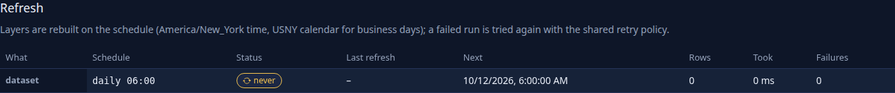
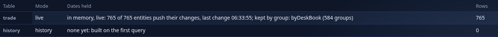
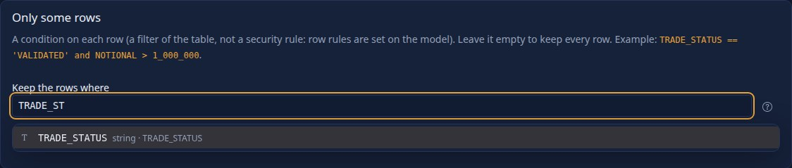
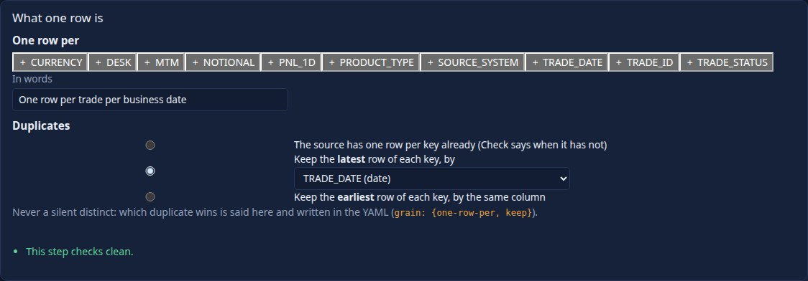
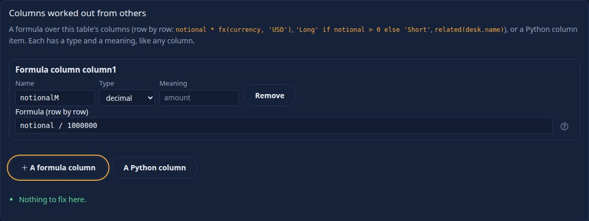
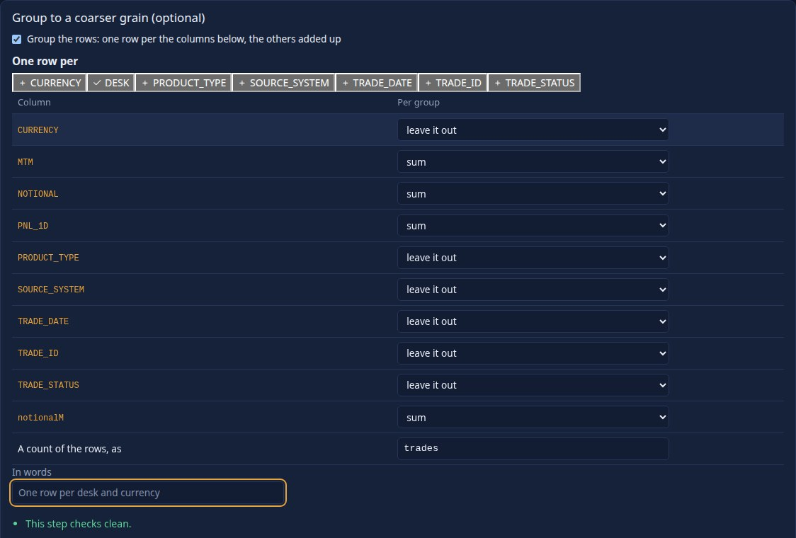
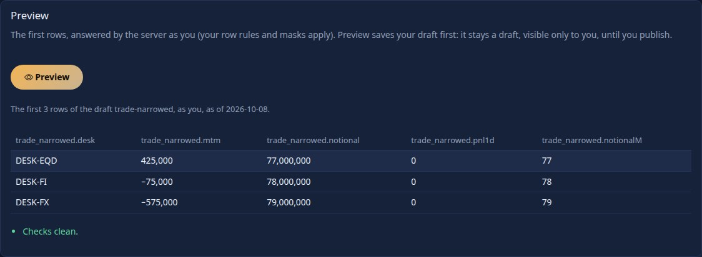
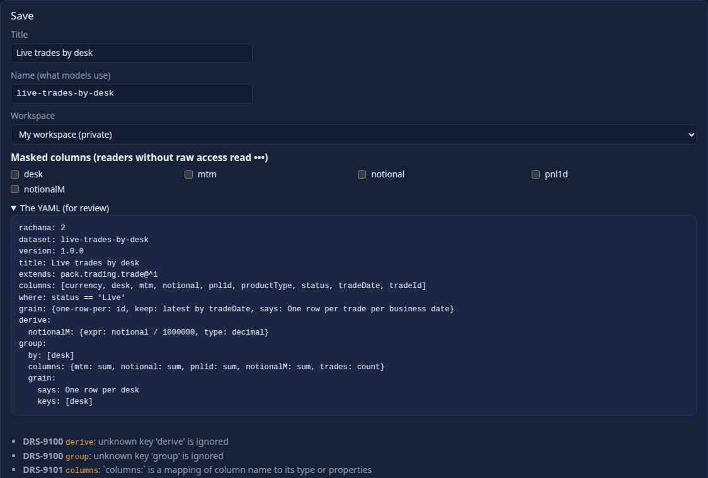
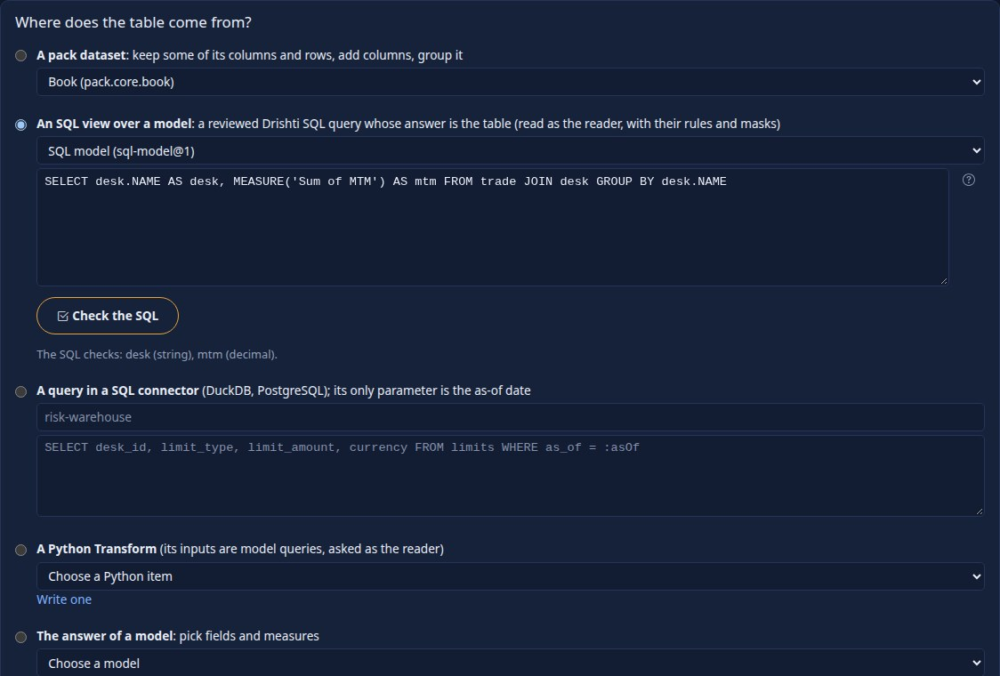
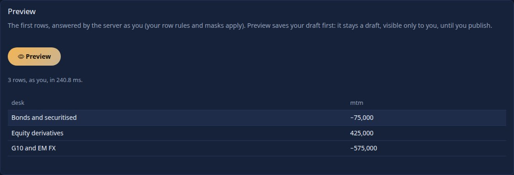

<!--
  Project Drishti · Any data. Any domain. One grammar.

  Copyright (c) 2026 Ashutosh Sinha <ajsinha@gmail.com>.
  All rights reserved.

  PROPRIETARY AND CONFIDENTIAL.

  This file is the confidential and proprietary property of Ashutosh Sinha.
  Unauthorised copying, use, modification, distribution or disclosure of this
  file, via any medium, is strictly prohibited except with the express prior
  written permission of the copyright holder.

  See the LICENSE file in the root of this repository for the full terms.
-->
# Datasets: the YAML, the expression language and the security rules

Reference for the **dataset** of Drishti Rūpaka (BI), as built (live tables are section 7.1; window functions 4.3; several facts 3.1). For the walk-through see [tutorial 10](../tutorials/10-first-bi-report.md) (step 1, [BI_RECIPES.md](BI_RECIPES.md) for the stored datasets, and [tutorial 12](../tutorials/12-live-bi-and-boards.md) for a live table); for the pages that show a dataset see [BI_GUIDE.md](BI_GUIDE.md) sections 13 and 16; for the 2.1 datasets built from other datasets (composed and derived, removed in 2.2: several facts are now one model, a Transform is a Python dataset) see
[section 11](#11-composed-and-derived-datasets); for the design see [RUPAKA.md](../architecture/RUPAKA.md) sections 6 and 7, "20.2 Phase 2, as built" and "20.10 Several datasets, as built"; for the HTTP API see
[API_GUIDE.md](API_GUIDE.md#datasets-and-the-query-engine-apiv1bi-phase-2); for the settings see
[CONFIGURATION.md](../admin/CONFIGURATION.md#drishtibiquery--the-dataset-query-engine-phase-2).

A dataset is a YAML document: the **model** reports sit on. Tables come from pack kinds through connectors (by their logical names), relationships
join them, measures compute over them, row rules and masks decide who sees what. It is **stored** as a BI item of kind `dataset` (a draft in a
workspace, published with review like any item) or **shipped** as `config/bi/datasets/<id>.dataset.yaml` (read-only, watched live). Nothing in it
is executed: it is parsed, validated, compiled to SQL with **bound values**, and run by the embedded DuckDB.

Contents: [1](#1-the-file) the file · [2](#2-tables-and-columns) tables and columns · [3](#3-relationships-and-how-queries-join) relationships ·
[4](#4-measures-and-the-expression-language) measures and expressions (4.1: time intelligence, 4.2: Python measures) · [5](#5-hierarchies) hierarchies · [6](#6-security-row-rules-and-masks) security ·
[7](#7-modes-layers-and-rollups) modes, layers and rollups (7.2: scheduled refresh) · [8](#8-the-query) the query · [9](#9-problems-and-drs-codes) problems and codes ·
[10](#10-what-is-not-built) what is not built (live tables: [7.1](#71-live-tables-phase-5)) · [11](#11-composed-and-derived-datasets) composed and derived datasets · [12](#12-build-a-dataset-in-the-browser-the-wizard) the wizard · [13](#13-model-layer-datasets-rachana-2-wave-w1) model-layer datasets (W1) · [14](#14-derivation-subset-filter-grain-derive-group-22-wave-a) derivation: subset, filter, grain, derive, group · [15](#15-the-dataset-wizard-version-2-wave-a) the dataset wizard v2, SQL views (wave A) · [16](#16-a-runs-result-as-a-dataset-snapshot-source-run) a run's result as a snapshot.
Expressions (measures, derived columns, filters, row rules) are DEL v2 since 2.2.0: [EXPRESSIONS.md](EXPRESSIONS.md); the older syntax in the examples
below is refused since 2.2.0 (`DRS-9100`, with the DEL v2 text as the fix); `drishti.py bi migrate --expressions` converts a file.

## 1. The file

```yaml
rachana: 1                  # language version (1)
dataset: trading-risk       # the model's name: letters, digits, . _ - (up to 64)
version: 1                  # your own version number
title: ...                  # catalogue fields (BI_GUIDE.md): title, description, owner, tags, endorsement, audience
description: ...
sample: true                # sample content: hidden from business users when sample packs are (drishti.packs.samples)
engine: duckdb              # the only engine built
tables: { ... }             # section 2
relationships: [ ... ]      # section 3
measures: { ... }           # section 4
hierarchies: { ... }        # section 5
security: { rows: [...], masked: [...] }   # section 6
rollups: [ ... ]            # section 7
refresh: "daily 06:00"      # when the layers are rebuilt on their own: a schedule or after-load (section 7.2)
layout: { ... }             # where the Model view draws each table (written by the diagram; the language ignores it)
from: { ... }               # 2.1 only, removed in 2.2 (DRS-9190): a composed dataset (section 11.1)
join: [ ... ]               #   ... and how their answers are joined
derived: { ... }            # 2.1 only, removed in 2.2 (DRS-9190): a derived dataset (section 11.2)
columns: { ... }            #   ... and the columns it returns, typed
```

Unknown top-level keys are a warning. The shipped samples are **models** in `config/bi/models/` over datasets in `config/bi/datasets/` (since 2.2 a
multi-table dataset is a model whose tables are datasets of their own: `trading-risk` reads `trading-risk-trades`, `trading-risk-netting-sets` and
the rest), every one commented and in the packs' UPPER_SNAKE column names: `trades-basic` (one table), `trading-risk` (five tables across three packs, a row
rule, masks, a rollup) and `trading-cashflows` (nested arrays as tables), which [BI_RECIPES.md](BI_RECIPES.md) reads, and the live `live-trading` and
`live-exposure` (section 7.1, [tutorial 12](../tutorials/12-live-bi-and-boards.md)); `world-economics` (real World Bank data by country) and
`region-economics` (Australian and US states, illustrative figures rounded from public figures, not for reporting) feed the map reports. The examples
on this page are written in the same names and run on the demo lakes (`drishti.py lake demo`).

## 2. Tables and columns

```yaml
tables:
  trades:                                   # the table's name: letters, digits, underscore (it is written in expressions)
    source:
      connector: trade-endur                # a connector by its LOGICAL name (config/connectors/<name>.yaml); empty: whichever serves the kind
      kind: trade                           # the pack kind
      each: legs                            # optional: one row per element of this array in each document (below)
    mode: cached                            # cached (default) | direct | live  (section 7; live: 7.1)
    refresh:
      on-load: true                         # rebuild the date when a data-load signal for the kind arrives (default true)
      schedule: "0 */15 * * *"              # rebuild this table on a schedule (section 7.2); a five-field cron, or any schedule of section 7.2
    columns:
      TRADE_ID:      { type: string, key: true }
      PORTFOLIO:     string                 # shorthand for { type: string } with the path equal to the name
      LEG_CURRENCY:  { path: LEGS.0.CURRENCY, type: string }    # a path into the document; "$." in front is allowed and dropped
      QUANTITY:      { type: decimal, format: amount0 }
      QUANTITY_K:    { type: decimal, expr: "QUANTITY / 1000" }  # calculated column (below)
```

* **Types:** `string`, `integer`, `decimal`, `boolean`, `date`, `timestamp`. A value that cannot be cast to its type is null (never an error).
* **Every table also has** `id` (the entity's id) and `businessDate` (the date the row is for); do not declare them. A table with `each` also has
  `index` (the element's position from 0), and its `id` is the **parent** entity's id, which is how it joins to the parent. A **live** table also has `updateSeq` and `updatedAt`
  (section 7.1); the five names are reserved (`DRS-9010`).
* **`each`:** the trade's `legs` or `schedule` array becomes a table with one row per element; column paths are relative to the element. It is always built by
  reading the documents (an array cannot come from promoted columns) once per business date.
* **Calculated column:** a row-level expression over the table's own stored columns (section 4); it may not aggregate, use measures or the user, or use another
  calculated column. It is computed at query time.
* **`format`** is a format name of the pack, used for display only. **`key`** marks a column others join to (informational; relationships name columns explicitly).
* A table may have no columns (`columns: {}`): it then has `id` and `businessDate` only, which is enough for a lookup joined on id.

**Reading the data** goes through the same connectors as the rest of Drishti ([CONNECTOR_DEVELOPER_GUIDE.md](../connectors/CONNECTOR_DEVELOPER_GUIDE.md#bulk-reads-for-bi-scan-and-sqltarget)):
if the connector can **scan** every declared path as a column (the paths it promotes in `layout.<kind>.columns`) the table is built from column batches and no
document is parsed; if it cannot, the engine reads documents one by one (at most `drishti.bi.query.record-read-max`) and the answer says so in its warnings. A table
that names its `connector:` reads that connector's documents only (for the newest date it holds when the query names none), never another connector's of the same
kind; a table with no connector named reads whichever serves each entity. *Promote
the columns a dataset uses* in the connector's layout: the tables of the samples that read documents are the reference kinds of the demo lake, which promote none.

## 3. Relationships and how queries join

```yaml
relationships:
  - { from: trades.DESK, to: desks.id, cardinality: many-to-one }      # from = the MANY side, to = the ONE side
  - { from: trades.NETTING_SET, to: netting_sets.id, cardinality: many-to-one, direction: single, active: true }
```

`cardinality` is `many-to-one` (default), `one-to-many`, `one-to-one` or `many-to-many`; `direction` `single` or `both`; `active` true or false. Both columns must exist and have
the same type. **Built:** a query joins along **active** relationships, in the many-to-one direction (and either way for one-to-one), `LEFT JOIN`ed from the table the
measures aggregate (the *base*), so a measure is never counted twice. A query with **no measure** (a list of values) may also join one-to-many and answers distinct rows.
**Grain: a measure is aggregated at its own table.** When one query mixes measures of different tables, even tables a many-to-one path connects (`MTM` from `trades` and `Exposure (EE peak)` from `netting_sets`, which trades reach many-to-one), each measure is computed alone at the query's grouping and the answers are joined on it. A "one"-side measure is therefore never repeated by the many side: in `trading-risk`, exposure by counterparty sector beside MTM used to add each netting set once per trade (763M for a sector whose true figure is 59M); it now adds each netting set once. If a field, filter or row rule is not reachable many-to-one from each measure's table, the query is refused (`DRS-9020`) rather than answered with a repeated figure. A single measure (or several of one table) is unchanged. A measure that only combines other measures (`measure('MTM') / measure('Exposure (EE peak)')`) is worked out **over each measure at its own grain**, so the ratio is right too; a measure with aggregates of its own beside another table's measure in one expression is aggregated at the table that reaches the others (write it as measures to split it).

**Several fact tables in one query:** when the measures of a query aggregate tables that no many-to-one path connects (`trades` and a table of `limits`, both many-to-one to `desks`), each fact is aggregated **alone** at the query's fields and the answers are joined on those fields, so neither fact is repeated by the other's rows (section 3.1). **Refused (`DRS-9020`):** a field one of the facts cannot reach many-to-one, and a measure that mixes the facts in one expression (`measure('MTM') / measure('Limit')`).
`direction: both` and many-to-many are stored; a query still joins as written (many-to-many warns). Inactive relationships are skipped and cannot yet be
turned on by a measure.

### 3.1 Several unrelated fact tables in one query

Two fact tables that share dimensions (every trade has a desk; every limit has a desk) are not joined to each other: joining them would repeat each desk's limits once per trade. A query that asks for a measure of each, grouped by the shared dimension, is answered **per fact, then joined**:

```yaml
# the shape of config/bi/models/trading-risk.model.yaml (its tables are datasets of their own: trading-risk-trades and the rest)
datasets:
  trades:         { dataset: trading-risk-trades, role: fact }           # risk-store, kind trade-valuation: TRADE_ID, DESK, COUNTERPARTY, MTM, ...
  netting_sets:   { dataset: trading-risk-netting-sets, role: fact }     # credit-store, kind netting-set: COUNTERPARTY, COLLATERAL, LIMIT, ...
  set_exposure:   { dataset: counterparty-exposure-official-netting-sets, role: fact }   # the exposure engine's official results: COUNTERPARTY, PEAK_EE, ...
  counterparties: { dataset: trading-risk-counterparties, role: dimension }   # reference-store, kind counterparty: NAME, SECTOR, ...
relationships:
  - { from: trades.COUNTERPARTY,        to: counterparties.id }
  - { from: netting_sets.COUNTERPARTY,  to: counterparties.id }
  - { from: set_exposure.COUNTERPARTY,  to: counterparties.id }
measures:
  MTM: { expr: "sum(trades.MTM)" }   Trades: { expr: "count(trades)" }   Exposure (EE peak): { expr: "sum(set_exposure.PEAK_EE)" }   Netting sets: { expr: "count(netting_sets)" }
```

`fields: [counterparties.SECTOR]`, `measures: [MTM, Trades, Exposure (EE peak), Netting sets]` (a real answer on the 2.8.0 demo lakes, when exposure was still stored
on the netting set, so its figures and the two-part plan are from then; since 2.9.0 `Exposure (EE peak)` is a third fact, `set_exposure`, and the plan has three
parts the same way; first four sectors, with
`options.explain: true` for the SQL; the table sources are shortened):

```text
Agriculture        568985576.94    576   2063231430.0    4
Airlines           573874414.58    579   2069018990.0    4
Asset management   -45767272.11   2424   7874503708.0   16
Banking             53660470.33   1727   6781678461.0   13
warnings: 2 fact tables, each aggregated alone at the query's fields and then joined: [trades, counterparties, netting_sets]
```
```sql
SELECT "counterparties.SECTOR", "MTM", "Trades", "Exposure (EE peak)", "Netting sets" FROM (
  SELECT coalesce("p0"."counterparties.SECTOR", "p1"."counterparties.SECTOR") AS "counterparties.SECTOR", "p0"."MTM" AS "MTM", "p0"."Trades" AS "Trades",
         "p1"."Exposure (EE peak)" AS "Exposure (EE peak)", "p1"."Netting sets" AS "Netting sets"
  FROM (SELECT "counterparties"."SECTOR" AS "counterparties.SECTOR", (sum("trades"."MTM")) AS "MTM", (count(*)) AS "Trades"
        FROM (trades) AS "trades" LEFT JOIN (counterparties) AS "counterparties" ON "trades"."COUNTERPARTY" = "counterparties"."id" ...) AS "p0"
  FULL OUTER JOIN (SELECT "counterparties"."SECTOR" AS "counterparties.SECTOR", (sum("netting_sets"."EE_PEAK")) AS "Exposure (EE peak)", (count(*)) AS "Netting sets"
        FROM (netting_sets) AS "netting_sets" LEFT JOIN (counterparties) AS "counterparties" ON "netting_sets"."COUNTERPARTY" = "counterparties"."id" ...) AS "p1"
  ON "p0"."counterparties.SECTOR" IS NOT DISTINCT FROM "p1"."counterparties.SECTOR") AS "q" ORDER BY "counterparties.SECTOR" ASC LIMIT 4
```

* Each part is the ordinary query of one fact: its own row rules, filters and masks. The parts are **full-outer-joined** on the fields (a null equals a null), so a sector one fact lacks still shows with the other's figures (and an empty cell for the missing one).
* With **no fields** the totals sit side by side in one row. A **filter on a shared dimension** reaches every fact; a filter on a measure (`LimitTotal gt 50`) is applied to the joined rows, as are the sort and the limit.
* **Refused, safely:** a field one fact cannot reach many-to-one (`trades.DESK` beside a measure of `limits`: `DRS-9020`, no many-to-one path); a measure that mixes the facts (`measure('MTM') / measure('LimitTotal')`); a window measure (4.3) with another fact; and a **row rule that reads a fact table** the other fact cannot reach (a desk-head's `trades.DESK in user.desks` against limits): the query is refused rather than shown unrestricted.
* A rollup does not answer a several-facts query; each part reads its own layers.

## 4. Measures and the expression language

```yaml
measures:
  Notional:   { expr: "sum(trades.NOTIONAL)", format: amount0, description: "..." }
  MTM:        "sum(trades.MTM)"                                   # shorthand: just the expression
  MTM per 1m: { expr: "ratio(sum(trades.MTM), sum(trades.NOTIONAL)) * 1_000_000" }
  Share:      { expr: "measure('MTM') / measure('Notional')" }   # measure('Name') uses another measure
  Open MTM:   { expr: "sum(trades.MTM, where=trades.TRADE_STATUS != 'MATURED')" }   # a condition inside the aggregate
  Vol:        { python: desk-pnl-volatility, inputs: [trades.PNL_1D], by: [trades.DESK] }   # a PYTHON measure: run by the console's runner, shown by a python visual (4.2)
```

The expression language is **DEL** (since 2.2.0): a safe, side-effect-free subset of **Python's expression syntax** extended with aggregation. It compiles
to SQL on the server and is never run as code. **The full reference is [EXPRESSIONS.md](EXPRESSIONS.md)**: every function with its examples and edge cases,
the problems with their fixes, and fifty-odd finance and risk recipes; the expression editor completes all of it in the designers. Names: `table.column`,
`table.column.part` (a date part), `measure('Measure name')`, `user.<attribute>` (row rules only), and in a calculated column a bare column of its own table.

| Aggregates | Meaning |
|---|---|
| `sum(x)`, `avg(x)`, `min(x)`, `max(x)` | over the rows of the group; `None` rows are ignored |
| `count(table)` or `count(x)` | rows, or values of `x` that are not `None` |
| `distinct(x)` | number of different values |
| `ratio(a, b)` | `a / b` as a double, `None` when `b` is 0; `a` and `b` are aggregate expressions |
| `percentile(x, p)` | the `p`-quantile (0 to 1, a literal) with interpolation |
| `where=` | `sum(x, where=condition)`: only rows where the condition is `True` (`FILTER (WHERE ...)`); every aggregate takes it |

| Row functions and operators | |
|---|---|
| `+ - * / // % **`, comparisons `== != < <= > >=` (chained: `0 < x <= 10`), `and or not`, `x in [a, b]`, `x not in [...]`, `x is None`, `a if c else b` | `/` is always a floating-point division and `None` on a zero divisor; `and`, `or`, `not` take booleans only |
| `abs`, `round(x, n=0)`, `coalesce(a, b, ...)`, `upper`, `lower`, `len`, `contains(text, part)`, `startswith`, `endswith`, `date('2026-10-09')`, `days_between(a, b)`, `business_days_between(a, b)` | |
| `year(d)`, `quarter`, `month`, `week`, `day`, and the field form `table.dateColumn.year` (also `quarter`, `month`, `day`, `week`) | date parts of a `date` or `timestamp` column |

A measure must aggregate (a column outside an aggregate is `DRS-9127` with the fix *wrap it: `sum(trades.MTM)`*), aggregates do not nest (except
`ratio`'s two arguments), and measures may not refer to each other in a circle. **Window functions** (`lag`, `lead`, `rank`, `dense_rank`,
`percent_rank`, `moving_avg`, `moving_sum`, `moving_min`, `moving_max`, `cumulative`) are built: section 4.3. Time intelligence and running totals:
section 4.1. The older syntax (`[Measure]`, `&&`, `c ? a : b`, a positional condition) is refused with `DRS-9100` and its DEL text as the fix
([EXPRESSIONS.md section 10](EXPRESSIONS.md#10-the-old-syntax-and-the-converter)).

Real compiled output (captured on the demo lakes from the `trades-basic` sample model, `fields: [trade.DESK]`, its four measures, by an
administrator with `options.explain: true`; the values are placeholders, never in the text):

```sql
SELECT "trade"."DESK" AS "trade.DESK", (sum("trade"."NOTIONAL")) AS "Notional", (sum("trade"."MTM")) AS "MTM", (count(*)) AS "Trades",
       ((CAST((sum("trade"."MTM")) AS DOUBLE) / NULLIF((count(*)), 0))) AS "Average MTM per trade"
FROM (SELECT t.*, (CAST(t."MTM" AS DOUBLE) / NULLIF(?, 0)) AS "MTM_IN_MILLIONS"
      FROM (SELECT * FROM read_parquet(['<data>/bi-store/columns/file_model_trades-basic/trade/date=2026-10-16/part-<id>.parquet'], union_by_name = true)) AS t) AS "trade"
GROUP BY "trade"."DESK" ORDER BY "trade.DESK" ASC LIMIT 3
-->  DESK-COMM  888803742773.65  -429967635.39  5990  -71780.91      DESK-CREDIT  344825753000.0  360552941.89  1172  307639.03   ...
```

### 4.1 Time intelligence

A measure may be asked "since the start of the year", "this month so far", "the period before this one" or "running". The function wraps an **aggregate expression** and names a **date column** of a table (`date`
or `timestamp`; `businessDate` is one):

```yaml
measures:
  MTM ytd:      { expr: "ytd(sum(trades.MTM), trades.TRADE_DATE)" }
  MTM mtd:      { expr: "mtd(sum(trades.MTM), trades.TRADE_DATE)" }
  Trades qtd:   { expr: "qtd(count(trades), trades.TRADE_DATE)" }
  MTM prior:    { expr: "prior_period(sum(trades.MTM), trades.TRADE_DATE)" }
  MTM last year: { expr: "same_period_last_year(sum(trades.MTM), trades.TRADE_DATE)" }
  MTM running:  { expr: "running(sum(trades.MTM), trades.TRADE_DATE)" }
  Share of ytd: { expr: "ratio(sum(trades.MTM), ytd(sum(trades.MTM), trades.TRADE_DATE))" }    # inside a ratio, or any expression with other measures
```

| Function | Rows it adds up | Business-day aware? |
|---|---|---|
| `ytd(agg, date)` | the date column from 1 January of the as-of date's year to the as-of date | no: the rows have the dates they have |
| `mtd(agg, date)` | from the 1st of the as-of date's month to the as-of date | no |
| `qtd(agg, date)` | from the first day of the as-of date's quarter to the as-of date | no |
| `prior_period(agg, date)` | the **same number of business days** immediately before the current period | yes: the pack's calendar (`drishti.business-date.calendar`, `USNY` unless changed) skips weekends and holidays |
| `same_period_last_year(agg, date)` | the current period shifted back one year; an end that falls on a weekend or a holiday last year is pulled **in** to the business days inside the window | yes |
| `running(agg, date)` | a running total of a `sum`, `count`, `min` or `max` along the date **field of the visual** | no |

**The as-of date** is the end of the query's dates (`dates.to`, so a report's date range or the business date picker), else their start, else the newest date the query read, else the current business date. The **current period**
of `prior_period` and `same_period_last_year` is the query's own dates (from the first to the as-of date), or the month to date when it names none. The windows are worked out in Java and **bound as parameters**; the SQL compares the
date column with two dates:

```
as-of 2026-07-07, dates from 2026-07-06            weekends only (WEEKENDS)             USNY (Independence Day, observed on Friday 3 July 2026)
ytd                                                2026-01-01 to 2026-07-07             2026-01-01 to 2026-07-07
mtd and qtd                                        2026-07-01 to 2026-07-07             2026-07-01 to 2026-07-07
prior_period  (2 business days: 6 and 7 July)      2026-07-02 to 2026-07-03             2026-07-01 to 2026-07-02
same_period_last_year  (Sun 6 July 2025 is not a business day: the window is Monday the 7th only)
                                                   2025-07-07 to 2025-07-07             2025-07-07 to 2025-07-07
```

Real compiled SQL (a test lake with one trade a weekday for a year; `Ytd` and `Mtd` by desk, as-of 2026-07-07; the four bound dates are 2026-01-01, 2026-07-07, 2026-07-01 and 2026-07-07) and its answer:

```sql
SELECT "trades"."DESK" AS "trades.DESK",
       (sum("trades"."MTM") FILTER (WHERE ("trades"."TRADE_DATE" >= CAST(? AS DATE) AND "trades"."TRADE_DATE" <= CAST(? AS DATE)))) AS "Ytd",
       (sum("trades"."MTM") FILTER (WHERE ("trades"."TRADE_DATE" >= CAST(? AS DATE) AND "trades"."TRADE_DATE" <= CAST(? AS DATE)))) AS "Mtd"
FROM (SELECT t.*, (CAST(t."mtm" AS DOUBLE) / NULLIF(?, 0)) AS "mtmK" FROM (SELECT * FROM read_parquet([...], union_by_name = true)) AS t) AS "trades"
GROUP BY "trades"."DESK" ORDER BY "trades.DESK" ASC LIMIT 100001
-->  DESK-A  2084.0  42.0      DESK-B  2341.0  148.0      DESK-C  2390.0  20.0
```

A running total is a window over the grouped rows, ordered by the date **field the visual groups by** and restarting for each combination of its other fields (a coarser part of the same date, `trades.TRADE_DATE.year` beside
`trades.TRADE_DATE.month`, restarts it each year). By day, 1 to 7 July 2026 (`fields: [trades.TRADE_DATE]`, `measures: [Running]`):

```sql
SELECT "trades"."TRADE_DATE" AS "trades.TRADE_DATE", (sum(sum("trades"."MTM")) OVER (ORDER BY "trades"."TRADE_DATE")) AS "Running"
FROM (...) AS "trades" WHERE ("trades"."TRADE_DATE" BETWEEN CAST(? AS DATE) AND CAST(? AS DATE)) GROUP BY "trades"."TRADE_DATE" ORDER BY "trades.TRADE_DATE" ASC LIMIT 100001
-->  2026-07-01  69.0     2026-07-02  74.0     2026-07-03  116.0     2026-07-06  195.0     2026-07-07  210.0
```

**What it works on, and what it refuses.**

* The functions restrict **the rows the query reads**. With a snapshot lake (every business date holds the whole book) read one date and let the date column do the rest. With a table whose partitions hold only each day's rows,
  the query's dates must reach back to the start of the window (a report's `dates: { from: ... }`), or the earlier days are not there to add up.
* The first argument holds aggregates and nothing else of this family: no nested time function, no `measure('…')` reference. A time function may sit inside an expression with other measures (`ratio(...)`, `measure('A') - measure('B')`) but not inside an aggregate. The date is a column, not a date part.
* A **rollup** cannot hold a time measure (`DRS-9012`, as for a distinct count); the query runs on the columns layer.
* `running` takes one `sum`, `count`, `min` or `max` (an average, ratio, distinct count or percentile has no running total: `DRS-9011`), needs the date as a **field** of the query (`422 DRS-9020` otherwise), cannot be filtered on (`DRS-9020`), and a date masked for the reader is `403 DRS-9021`.
* Masks and row rules apply as for any measure; the as-of date is part of the cached result's key, so a new date is a new answer.

### 4.3 Window functions

A window function is worked out **over the rows the query returns**, after the reader's row rules, the filters and the grouping, so a rank is a rank among the rows this reader may see and a masked column never decides a position. They are DuckDB window SQL; the numbers in them are checked whole numbers, never text from the query.

| Function | Meaning |
|---|---|
| `lag(agg, n, order, by=[fields])` / `lead(...)` | the aggregate of the row `n` rows **before** / **after** in `order` (empty at the edge); `n` is 1 to 1000 |
| `moving_avg(agg, n, order, by=[fields])`, `moving_sum`, `moving_min`, `moving_max` | the average, sum, minimum or maximum of the aggregate over this row and the `n - 1` before it |
| `cumulative(agg, date)` | a running total (the same as `running`, 4.1) |
| `rank(agg, desc=True, by=[fields])`, `dense_rank(...)`, `percent_rank(...)` | the position of the row by the aggregate (`desc=False`: lowest first); `rank` leaves gaps after a tie, `dense_rank` does not, `percent_rank` is 0 to 1 |

`agg` is an aggregate expression (`sum(trades.MTM)`, `ratio(...)`, `count(trades)`). `order` is a **column** of the dataset (`trades.TRADE_DATE`) and must be a **field of the visual** (its axis), as for `running`; the window runs along its finest part (`trades.TRADE_DATE.month` before `trades.TRADE_DATE`). Without `by=` the window **restarts for each combination of the visual's other fields**; with it (`lag(sum(trades.MTM), 1, trades.TRADE_DATE, by=[trades.DESK])`) it restarts by those fields, which must be fields of the visual too. `rank` with no partition ranks all rows.

```yaml
measures:
  MTM rank:          { expr: "rank(sum(trades.MTM))" }
  MTM 3-day average: { expr: "moving_avg(sum(trades.MTM), 3, trades.TRADE_DATE)", format: signed0 }
  Change on prior:   { expr: "sum(trades.MTM) - lag(sum(trades.MTM), 1, trades.TRADE_DATE)" }
```

Real answers on the Trading and counterparty risk sample over the demo lakes (`fields: [trades.DESK]`, `measures: [MTM, MTM rank]`, five rows;
the rank is answered from the stored rollup `by_desk_currency`), and by trade date with the three-row average, newest five rows (sorted descending,
the window itself runs in date order):

```text
DESK-RATES    4108728089.5   1     SELECT "trades"."DESK" AS "trades.DESK", (sum(m0)) AS "MTM", (rank() OVER (ORDER BY sum(m0) DESC NULLS LAST)) AS "MTM rank"
DESK-MM        393805216.87  2       FROM (... rollups/file_model_trading-risk/by_desk_currency/date=2026-10-16/part-<id>.parquet ...) AS "trades"
DESK-STRUCT    382608464.96  3       WHERE (TRUE) GROUP BY "trades"."DESK" ORDER BY "MTM rank" ASC NULLS LAST LIMIT 5
DESK-CREDIT    360552941.89  4
DESK-SFT        51375248.69  5

2026-09-25    194142159.93     6524586.52     SELECT "trades"."TRADE_DATE" AS "trades.TRADE_DATE", (sum("trades"."MTM")) AS "MTM",
2026-09-24    -12250237.66   -39827321.79       (avg(sum("trades"."MTM")) OVER (ORDER BY "trades"."TRADE_DATE" ROWS BETWEEN 2 PRECEDING AND CURRENT ROW)) AS "MTM 3-day average"
2026-09-23   -162318162.72   -36410881.81     FROM (... columns/file_model_trading-risk/trades/date=2026-10-16/part-<id>.parquet ...) AS "trades" WHERE (TRUE)
2026-09-22     55086435.01    17976990.77     GROUP BY "trades"."TRADE_DATE" ORDER BY "trades.TRADE_DATE" DESC NULLS LAST LIMIT 5
2026-09-21     -2000917.71     -412716.24
```

(The trade dates are the trades' own; the business date read is the latest of the demo lakes, 2026-10-16 here.)

**What they refuse.** The shape is checked when the dataset is read (`DRS-9011` for a wrong number of arguments, an `n` that is not a whole number from 1 to 1000, an `agg` that does not aggregate, another window, time function or `measure('…')` inside `agg`, an order or partition that is not a column). A window needs its order column as a **field** of the visual (`422 DRS-9020` otherwise); it cannot be **filtered on** (`DRS-9020`: filter the rows, then rank); a masked order column makes the whole measure read as masked; a **rollup** can hold only a `rank` with no direction or partition (anything else runs on the columns layer); and it cannot be asked together with the measures of another fact table (3.1).

A "row" is a row of the visual, not a calendar day: `lag(..., 1, trades.TRADE_DATE)` is the previous *date that has trades* (a weekend with none is not a row), and a moving average of three is three rows. Ask for the dates you want (a date dimension, or a filter) when the gaps matter.

### 4.2 Python measures (phase 6)

A measure may be a **Python item** instead of an expression: `python:` names the item (catalogue id, shipped file name or title), `inputs` the columns its function reads and `by` the columns that
make a group, all `table.column` and all of **one table**:

```yaml
measures:
  Desk P&L volatility:
    python: desk-pnl-volatility       # config/bi/python/desk-pnl-volatility.python.yaml
    inputs: [trade.PNL_1D]
    by: [trade.DESK]                  # one number per desk
    description: Standard deviation of the one-day P&L per desk, computed in Python.
```

The SQL engine **cannot run it**: a query that names a Python measure is refused (`DRS-9013`), and the model says so as a warning when it is checked. A **python visual** shows it
(`wells: { values: [Desk P&L volatility] }`): the server hands the console the rows of `by` and `inputs` that this person may see, and the console's sandboxed runner (or the browser's Pyodide) calls the
item once per group. Checks: the item is named, `inputs` is not empty, every name is a column, all of one table (`DRS-9012`); `expr` and `python` together are `DRS-9010`. The dataset is checked
**without** looking the item up (an item can be published after the dataset), so a wrong item name appears when a report runs it (`DRS-9001`/`9070`). Reference: [PYTHON_BI.md](PYTHON_BI.md).

## 5. Hierarchies

```yaml
hierarchies:
  Trade date: [trades.TRADE_DATE.year, trades.TRADE_DATE.quarter, trades.TRADE_DATE.month, trades.TRADE_DATE]
  Desk and book: [desks.NAME, books.NAME]
```

An ordered list of levels, coarse to fine; each is `table.column` or `table.column.part` (a bare column name is accepted when it is in one table only). They are validated and
returned with the model for the designer and the viewer (phase 3) to drill with: a visual's `hierarchy:` drills down them ([REPORTS.md](REPORTS.md)); a query names the levels as ordinary fields.

## 6. Security: row rules and masks

```yaml
security:
  rows:
    - { role: desk-head, where: "trades.DESK in user.desks" }
    - { role: risk,      where: "True" }
  masked: [counterpartyName, counterparties.NAME]
```

**Row rules** are evaluated **on the server, for each reader**, and added to every query as a predicate the query cannot remove.

* A reader gets the rows allowed by **any** rule whose `role` they hold (rules of one reader are OR-ed). A reader with **no matching rule gets no rows** and the answer
  says why. With server security off (`drishti.security.enabled: false`) rules are not applied.
* `where` is a row condition: no aggregates, no measures. It may use `user.name`, `user.roles`, `user.desk`, `user.desks` (the profile's desk split at `,` and `;`, so a head
  of two desks lists both) and `user.email`; used with `in`, a list attribute binds one parameter per value.
* **Fail closed.** A rule names tables, and the tables of the reader's rules are joined into **every** query they run. If the measures' table cannot reach a rule's
  table many-to-one, the question is refused (`DRS-9020`, the message names the rule's tables) rather than answered with other readers' data. In `trading-risk` a desk-head
  therefore cannot ask for exposure by counterparty: the netting sets do not reach trades.
* A table over a kind the reader may not open (their roles, or a pack not assigned to them) returns **no rows** for them, with a warning; a `direct` table is refused.

**Masked columns.** A column is masked for a reader when it is listed in `masked` (a bare name matches that column in any table, `table.column` names one) and the reader
**lacks the `raw` power**, or when Drishti's own list `drishti.security.redact` names the column's name or the last segment of its path (`counterpartyId`, `trader`, ...). Masks
are applied **before aggregation, column by column**, and the result is built so the mask cannot be probed:

| What | Result for a masked reader |
|---|---|
| a masked field (dimension) | the constant `•••` in every row, and it is **not grouped on**: its values cannot be told apart |
| a measure aggregating a masked column | `null` |
| a filter on a masked column, or a sort on it | refused, `403 DRS-9021` |
| a masked column used in a row rule | fine: rules run on the server before the mask |

Real output (captured in 2.2 on the sample `trading-risk` over the 750 demo trades of the time, the same query, three readers; on the demo lakes the figures are larger and the behaviour the same; `Counterparties` is `distinct(trades.COUNTERPARTY)`, a masked column; `rita` has `risk`, `hana` is a
desk-head whose profile desk is `DESK-FX`, `ann` is an `analyst` without `raw`):

```
rita  (risk)       desks.NAME = 'G10 and EM FX' ... 10 rows   MTM -15,759,419  Trades 84  Counterparties 17
hana  (desk-head)  desks.NAME = 'G10 and EM FX' ... 1 row    MTM -15,759,419  Trades 84  Counterparties 17
ann   (analyst)    10 rows, every MTM and Trades as rita sees them,  Counterparties = null  (masked: Counterparties)
ann asks for counterparties.NAME:   one row  '•••'  MTM 138,562,638  Trades 750     (not grouped: the 18 names cannot be told apart)
ann filters counterparties.NAME:    403 DRS-9021 'counterparties.NAME' is masked for you: it cannot be filtered on
```

## 7. Modes, layers and rollups

| `mode` | The table is | Built |
|---|---|---|
| `cached` (default) | typed Parquet, one file per **business date** in the BI store (`drishti.bi.query.store-dir`): the **columns layer** | read once per date from the connector, on the first query, and again when a data-load signal for the kind names the date |
| `direct` | the source's own SQL table; the compiled query runs in the source | needs a connector with a SQL target (the DuckDB and PostgreSQL connectors); every table of the query must be direct and in one store; `each` tables cannot be direct |
| `live` | the kind's current state, **kept in memory by the engine and updated by key as the source pushes changes**, with a retention window (section 7.1) | built in phase 5. With `drishti.bi.live.enabled: false` it falls back to a short-lived snapshot of the connector's state, kept for `drishti.bi.query.live-ttl` |

**The layers a query is answered from, smallest first:** a **rollup** that covers it, else the **columns layer**, else (direct tables) the **source**. The answer reports which
(`layer`, and `rollup`). Layout in the BI store: `columns/<dataset>/<table>/date=<yyyy-mm-dd>/part-<id>.parquet` with a `meta.json` (the table's signature, rows, how it was read, warnings,
and the `file` that is current), `rollups/<dataset>/<name>/date=.../part-<id>.parquet`. A build writes a file of its own and then the metadata, so a query
reading the previous file finishes on it; replaced files are removed by a later build of the date, ten minutes on. A change of a table's connector, kind, array or columns changes its signature, and the layer is read again.

```yaml
rollups:
  - { name: by_desk_currency, table: trades, by: [DESK, CURRENCY, PRODUCT_GROUP], measures: [MTM, Notional, "P&L 1d", Trades, MTM per 1m notional] }
```

A rollup stores, per date and group, the **components** of its measures: sums, counts, minimums, maximums of expressions over stored columns of its table (`avg(x)` is stored as
`sum(x)` and `count(x)`); a measure built from them (a ratio of sums, a measure of measures) is answered by re-aggregating the components. A query is routed to a rollup when it
uses **one table**, only fields (and filters, and row-rule columns) among the rollup's `by` columns (and `businessDate`), and only measures whose components the rollup holds. Not
rollup material: `distinct`, `percentile`, a condition inside an aggregate, another table, a filter on a measure; validation says so (`DRS-9012`) when a rollup lists such a measure.
`"layer": "columns"` in a query forces the columns layer (the check that both give the same numbers is in the tests).

**When a layer is rebuilt:** a data-load signal (`POST /api/v1/packs/{pack}/loads`, [DATA_LOADS.md](DATA_LOADS.md)) with `status: ready` for a kind deletes that date's partitions of
every published dataset table that reads the kind, bumps the dataset's data generation (so cached results can no longer be served), and, with `eager-rebuild` on, reads the date again in the
background; **only that date, only those datasets**. Without a date in the query the **latest** date is used: the current business date when its layer exists, else the newest date the source
holds (the answer's `dates` says which).

### 7.2 Scheduled refresh

A dataset's layers are rebuilt when a data load arrives (above) and on demand (`POST /datasets/{id}/refresh`). `refresh:` says when they are rebuilt **on their own**:

```yaml
refresh: "business-days 06:30"          # the whole dataset (a mapping works too: refresh: { schedule: "business-days 06:30" })
tables:
  trades:
    refresh: { schedule: "0 */15 * * *" }     # or one table, on its own schedule
```

**Which date a refresh builds.** A refresh (scheduled, after a load, or **Refresh now**) resolves the date the way a query does. It builds the layers for the current business date; **when the source holds no data for that date** (the data ends earlier), it does not keep an empty layer for it: it reads the **latest date the source holds** instead and says so in the status and the history, for example `warning: 0 rows for 2026-10-14; latest data 2026-10-09`, with the rows and date of what was built. A query that names no date reads the layer of the current business date only when it has rows, so a dataset never answers 0 rows from a layer built for a date with no data. If the source holds nothing at all the status is the same warning and no layer is kept.

The words are the ones subscriptions use ([DISTRIBUTION.md](DISTRIBUTION.md)): `daily 06:00` (also written `daily at 06:00`), `weekdays 18:30`, **`business-days 07:30`** (the pack's holiday calendar: `drishti.business-date.calendar`), `weekly mon 07:00`,
`monthly last 18:00 business`, `hourly`, `cron <six fields>` or a bare **five-field cron** (`0 */15 * * *`), and **`after-load`** (optionally `after-load trade`): not a time but the data load that finished ready for a kind the dataset reads.
Times are in the business-date zone (`drishti.business-date.zone`). A schedule the server cannot read is `DRS-9010` at the path of the key (`refresh`, or `tables.<name>.refresh.schedule`).

**What a refresh does.** For the current business date (the date of the load for `after-load`) it clears that date's partitions of the cached tables (`live` and `direct` tables hold none), drops the dataset's cached results, and reads the columns layer and the
rollups again, **on the scheduler's own thread, so a failure is seen**: a connector that is not running, a source that fails, a layer that cannot be written. A dataset that reads a date the source holds no rows for refreshes with 0 rows.
Only **published** datasets (stored or shipped) are scheduled; a draft is not.

**When it fails.** The refresh is tried again with the shared retry policy (`drishti.retry.bi.*`, falling back to `drishti.retry.*`: 5 s, doubling, up to 5 minutes, 20 percent jitter): the dataset's state is `retrying` with the time of the next try, `failures` and the
error. After `drishti.bi.refresh.max-attempts` tries (4) it is `failed` and left until its next scheduled time; a failure that waiting cannot fix (refused credentials, a setting that is not set) waits the policy's longest interval between tries.

**What the dataset page shows.** The **Refresh** section lists the dataset and each scheduled table: the schedule, the status (`never` before the first run, `waiting` for an `after-load`, `running`, `ok`, `retrying`, `failed`, `invalid` for a schedule that does not read), the last refresh, the next one, rows, how long it took and the failures.



`GET /api/v1/bi/datasets/{id}/refresh` is the same state (any reader of the dataset). Real output (the scheduler looks every `drishti.bi.refresh.tick`, here 2 s; the dataset says `daily 06:00`; it is Sunday evening in New York, so the next run is Monday 06:00, which is 10:00 UTC),
first before a run, then the answer of `POST /datasets/{id}/refresh` (it runs in the background and says so at once), and four seconds later:

```
GET  /api/v1/bi/datasets/file:dataset:nv-demo/refresh
{"enabled": true, "scheduled": true, "zone": "America/New_York", "calendar": "USNY",
 "dataset": {"schedule": "daily 06:00", "status": "never", "trigger": "", "lastRun": null, "nextRun": "2026-10-12T10:00:00Z", "lastDurationMs": 0, "lastRows": 0, "lastDate": null,
             "tables": [], "failures": 0, "retryAt": null, "error": null, "runs": 0}, "tables": []}
POST /api/v1/bi/datasets/file:dataset:nv-demo/refresh
{"dataset": "file:dataset:nv-demo", "date": "2026-10-09", "refreshing": ["trade"], "state": {"schedule": "daily 06:00", "status": "running", "trigger": "manual (wes)", "lastRun": null, "nextRun": "2026-10-12T10:00:00Z", ...}}
GET  /api/v1/bi/datasets/file:dataset:nv-demo/refresh          (the demo lake holds 7 and 8 October, not the 9th: 0 rows)
{"enabled": true, "scheduled": true, ..., "dataset": {"schedule": "daily 06:00", "status": "ok", "trigger": "manual (wes)", "lastRun": "2026-10-11T22:44:35.251467762Z", "nextRun": "2026-10-12T10:00:00Z",
 "lastDurationMs": 4, "lastRows": 0, "lastDate": "2026-10-09", "tables": ["trade"], "failures": 0, "retryAt": null, "error": null, "runs": 1}, "tables": []}
```

**`after-load`.** A data-load signal with `status: ready` for a kind a table reads starts the refresh `drishti.bi.refresh.load-delay` (2 s) later, for the date loaded; the dataset then has the *tracked and retried* version of the rebuild, so the plain on-load rebuild
(background, untracked) leaves it alone. A schedule for one kind (`after-load trade`) ignores the others.

**The state survives a restart.** The state and the last `drishti.bi.refresh.history` (25) runs of every job are kept in `<BI store>/refresh/state.json` (written after each run and each planned time, atomically). After a restart the page shows the same last run, status, rows, duration and history; a run that was in progress when the server stopped shows as `interrupted`; a time that passed while the server was down is run once at start-up (`trigger: schedule (catch-up)`). A file that cannot be read is ignored (a warning in the log) and the jobs start as `never`.

**Refresh now, last and next run, history.** The **Refresh** section has a **Refresh now** button for people with the `bi-author` power (it is `POST /datasets/{id}/refresh`, audited as `bi-dataset-refresh`; the page then asks for the state once a second until the run is no longer `running`), a line *Last refresh ... · Next ...* and **Recent refreshes**, newest first: when, started by (`schedule`, `after-load trade`, `retry`, `manual (<person>)`), result, date, rows, time and the error of a failed run. `GET /datasets/{id}/refresh` carries the same in `dataset.history`. Settings: `drishti.bi.refresh.*` ([CONFIGURATION.md](../admin/CONFIGURATION.md#drishtibirefresh--scheduled-dataset-refresh)). The refresh is audited (`bi-dataset-refresh`).

**A dataset of the model layer (`rachana: 2`, 2.2).** `POST /datasets/{id}/refresh` refreshes it through the models that read it: its kept Python
Transform results are dropped (the next question runs the Transform again, as its reader), and in every published model that reads it, and in its
implicit model (`dataset:<name>`), the tables that read it are cleared and rebuilt for the business date (a staged table, such as a Python dataset's or a
connector query's, has no layer: it is asked again). The answer names them, and the state is kept under the dataset (`GET` answers `dataset.status`,
`lastRows`, `history`; schedules stay with the models' tables):

```
POST /api/v1/bi/datasets/file:dataset:desk-pnl-vs-exposure-py-result/refresh
{"dataset": "file:dataset:desk-pnl-vs-exposure-py-result", "date": "2026-10-13",
 "refreshing": [], "models": ["file:model:desk-pnl-vs-exposure-py", "implicit:desk-pnl-vs-exposure-py-result@1"], "transformResultsDropped": 0,
 "state": {"schedule": "on demand", "status": "running", "trigger": "manual (drishti-dev-admin)", ...}}
```

From the command line `python3 tools/drishti.py bi dataset refresh ID --now` asks for it and waits until the state is no longer `running`.

Its **tests** (`tests:` with `agg`, `unique`, `not-null`, `references-exist`; BI_MODEL_SPEC.md section 1.8) run from its page's *Expected values* and
`drishti.py bi item tests ID`, and a failing one refuses its publish (`DRS-9043`).
No new write endpoint: `POST .../refresh` is the one that existed and needs `bi-author` (and, for a personal token, the `bi:write` scope).

### 7.1 Live tables (phase 5)

A `mode: live` table is the **current state of a kind**, not a copy per business date. The engine reads the kind **once** when the table is first needed (the first query, or the first stream of a report over it), subscribes to
each entity through the same live machinery the terminal's live views use, and then **applies every change to its in-memory table by key**: a new id is inserted, a known id replaces its row, a deletion removes it. Reports and
boards over it redraw as it changes ([REPORTS.md](REPORTS.md#13-live-visuals-and-perspective-phase-5), [BOARDS.md](BOARDS.md)). The sample is [config/bi/datasets/live-trading.dataset.yaml](../../config/bi/datasets/live-trading.dataset.yaml):

```yaml
tables:
  trade:
    source:
      kind: trade               # no connector named: whichever running connector serves trades and can push them
    mode: live
    live:                       # retention: the most rows it holds (and, optionally, `age:` how long a row may go without changing, below)
      rows: 5000
    columns:
      TRADE_ID: { type: string, key: true }
      DESK:     string
      MTM:      { type: decimal, format: signed0 }
```

**Where the changes come from.** The connector's `subscribe` for each entity: the demo source ticks its live samples; the Kafka and Redis connectors (and any connector that implements `subscribe`) feed the table the way they feed a live view. `connector:` names
a connector by its logical name when a stream that keeps no state ticks what a store serves (a Kafka connector in `ticks` mode: the entities are listed and read from the store, the changes come from Kafka); empty means the router's choice, as for a live view.
The table follows at most `drishti.bi.live.follow-max` (2,000) entities and says so when it stops there. A connector that **cannot push** is read again every `drishti.bi.live.resync` (30 s): the table still follows it, a row whose values did not change is skipped,
and the table's state says `pushes: false`.

**Incremental, and what that means.** The *table* is maintained incrementally: a batch of changes (merged per entity, every `drishti.bi.live.batch`, 100 ms) is written in **one transaction** with the retention, so a query never sees half a batch, and a row whose declared
columns did not change does not move the table's counters (a source that republishes the same values costs nothing downstream). The *measures* are **incremental too, for the rollups the dataset declares**, and recomputed otherwise (next paragraph).

**Incremental aggregates by group.** A dataset's `rollups:` over a live table are kept **by group** as rows change: for each combination of the rollup's `by` columns and the business date, the engine holds the sums, counts, minimums and maximums its measures are made of, in a small table written in the **same transaction** as the batch. A row that arrives adds to its group; a row replaced, deleted or evicted first takes its old values out, so a **sum or count moves by the difference** (an average is a sum and a count) and nothing is recomputed. A **minimum or maximum** is incremental while values only join the group; when the row that held it leaves or changes, **that group alone** is read again from the table (inside the transaction). A query the rollup can answer (the same rules as a stored rollup: only its `by` columns, only measures made of its components) reads that table: `meta.layer` is `live` and `meta.rollup` names the rollup, and the reader's row rules and masks are applied on top, as ever.

```yaml
rollups:
  - { name: byDeskBook, table: trade, by: [DESK, PORTFOLIO, PRODUCT_TYPE, CURRENCY], measures: [Trades, Notional, MTM, PnL 1d, Worst trade, Best trade] }
```

The Live trading desk sample (`config/bi/datasets/live-trading.dataset.yaml`) declares that. A bar of `Notional`, `MTM` and `Worst trade` by desk, with the demo ticker running (real answer, `?explain=true`, captured in 2.2 over the 750 demo trades of the time, whose columns were lower case; over the demo lakes the columns are `DESK` and the rest), reads 90 trades for `DESK-COMM` from the kept groups, not from the trades:

```text
SELECT "trade"."desk" AS "trade.desk", (CAST(coalesce(sum(m0), 0) AS BIGINT)) AS "Trades", (sum(m1)) AS "Notional", (sum(m2)) AS "MTM", (min(m4)) AS "Worst trade"
FROM (SELECT * FROM live_1_agg0) AS "trade" GROUP BY "trade"."desk" ORDER BY "trade.desk" ASC LIMIT 3
DESK-COMM   90   11359000000.0   16954390.0   -3307013.0         layer: live   rollup: byDeskBook
```

and the dataset's `layers[].live.aggregates` says how it is going (after about a minute of ticks over 750 trades: 572 groups, 5,788 rows moved by difference, 1,826 groups whose minimum or maximum was read again because the row that held it changed):

```json
{"rollup": "byDeskBook", "groups": 572, "incremental": 5788, "recomputedGroups": 1826}
```

**Recomputed instead** (the fallback, and always correct): a measure that is not a plain stored aggregate (`sum(trade.MTM, trade.MTM < 0)` has a condition inside; `percentile`, `distinct`, `ratio` of an expression), a rollup grouped by a calculated column, a query the rollup cannot answer (a column outside its `by`), `layer: columns` asked for, and every table when `drishti.bi.live.incremental-aggregates` is `false`. The tests compare the two for sums, counts, averages, minimums and maximums through inserts, replacements, moves between groups, deletions and eviction. Sums are floating-point: a long run of additions and subtractions can differ from a fresh sum in the last digits (never in what a card shows).

**Retention.** `live: { rows, age }` (both optional). `rows` bounds the table: past it the rows changed longest ago go first (`drishti.bi.live.max-rows`, 50,000, is the ceiling whatever a dataset asks). `age` drops rows that have not changed for that long (`90s`, `15m`, `2h`,
`1d` or ISO `PT15M`); it is applied with every batch and on every resync, so a quiet table forgets too. Whatever leaves (evicted, or deleted by the source) starts a new **epoch** of the table; a client that holds rows (a grid of the table's rows) reads them again.

**Two columns every live table has**, queryable like any other and never declared:

| Column | Type | Meaning |
|---|---|---|
| `updateSeq` | integer | a counter that grows with each row that changes: "what changed since *n*" is `updateSeq > n` |
| `updatedAt` | timestamp | when the row last changed (UTC) |

**Row rules and masks apply on every update.** The table holds the source's rows and knows no reader. Every query, whenever it is asked, is compiled with the asker's row rules as predicates it cannot remove and their masks as `•••` (or null for a measure);
the stream that tells a browser the table changed carries **no data**. Two readers of one table, one with a desk rule and one without `raw`, are each answered as themselves after every update (`LiveTablesTest`, `BiLiveApiTest`).

**How a live table is doing.** `GET /api/v1/bi/datasets/{id}/layers` and the dataset page's Layers table show, per live table, `state` (`starting`, `live`, `stale`, `failed`, `closed`), `rows`, entities followed and how many push, and the time of the last change; the engine page
(`GET /api/v1/bi/engine`, bi-admin) counts live tables and rows. A real answer, a minute after the first query, with the demo source (`tick-ms: 200` here; its default is 400) moving the 765 trade valuations of the market-risk pack:

```json
{"table": "trade", "kind": "trade-valuation", "state": "live", "rows": 765, "entities": 765, "subscribed": 765, "pushes": true, "seq": 17594, "epoch": 0, "generation": 30, "lastUpdate": "2026-10-19T10:34:26.771102073Z", "lastSeen": "2026-10-19T10:34:29.529867267Z", "startedAt": "2026-10-19T10:33:47.976033704Z", "applied": 17594, "skipped": 1, "evicted": 0, "deleted": 0, "error": null, "aggregates": [{"rollup": "byDeskBook", "groups": 584, "incremental": 34423, "recomputedGroups": 12847}]}
```



`stale` means the feed pushes but has delivered nothing for `drishti.bi.live.stale-after` (30 s); `failed` means the first read failed and there are no rows (the queries answer a warning with the reason, or `DRS-9026` when no running connector serves the kind).

**A table nobody uses is closed.** A live table that has not been queried or streamed for `drishti.bi.live.idle-close` (10 minutes) is closed and its subscriptions are given back; the next use starts it again. A dataset edited so that a live table's definition changed
gets a new table.

**History of a live table.** A live table holds only the current state, so a line of "net MTM over the last hour" has nothing to draw from. `live.history` keeps one: every `every` the listed measures are worked out over the live table (grouped by `by`, none by default) and the result is appended to a bounded, time-indexed in-memory table that is queried like any other table of the dataset.

```yaml
tables:
  trade:
    source: { kind: trade }
    mode: live
    live:
      rows: 5000
      history:
        table: history            # the name of the dataset table (default: history)
        every: 10s                # the time between samples, 1s or more (default 10s)
        keep: 360                 # samples kept, 2 to 100000: the newest go on, the oldest go off (default 360: an hour at 10s)
        by: [DESK]                # optional: one row per desk and sample (columns of the live table; default none: one row per sample)
        measures: [MTM, Losses, Trades]     # measures of this dataset that aggregate the live table (not Python, not window or time-intelligence measures)
```

The model gains a table `history` with a `ts` column (when the sample was taken, a timestamp), one column for each `by` column (the live table's own type) and one `decimal` column for each sampled measure (named like the measure, with anything but letters, digits and underscores replaced by underscores), and one **generated measure** for each sampled measure, `<measure> history`, which adds up that column (`sum(history.MTM)`). So a line of the net MTM over time is `axis: [history.ts], values: [MTM history]`, with a second well field `history.desk` for a line per desk when `by: [desk]` is set. A real query against the sample (`live-trading`, sampled every 10 s) a minute after the first use, captured in 2.1 (since 2.2 the same question is a model query, `POST /api/v1/bi/mq`, and the dataset route answers `410 DRS-9150`):

```
POST /api/v1/bi/datasets/file:dataset:live-trading/query
{ "fields": ["history.ts"], "measures": ["MTM history", "Trades history"], "orderBy": [{"by": "history.ts", "desc": true}], "limit": 5 }
200 { "columns": [ {"name": "history.ts", "type": "string"}, {"name": "MTM history", "type": "decimal"}, {"name": "Trades history", "type": "decimal"} ],
      "rows": [ ["2026-10-12 11:01:33.0", 136558646.0, 750.0], ["2026-10-12 11:01:23.0", 135977740.0, 750.0], ["2026-10-12 11:01:13.0", 136217531.0, 750.0] ],
      "meta": { "layer": "live", "tables": ["history"], "masked": [], "warnings": [], ... } }
```

How it behaves:

* **The history lives as long as the live table runs.** It is sampled only while the table is open (someone queries or streams it; an idle table closes after `drishti.bi.live.idle-close`, 10 minutes, and its history goes with it). The sampler's own queries do not count as use, so a history never keeps an unwatched table open. After a restart the history starts empty.
* **Every sample moves the table's generation**, so an open report redraws its history line on the next tick like any live visual; the dataset's Layers table (`GET /datasets/{id}/layers`) shows, for the `history` table, the number of samples held, the newest and the limits, and the live stream's status carries the same:

```json
{"mode": "history", "table": "history", "partitions": [],
 "history": {"table": "history", "every": "PT10S", "keep": 360, "samples": 3, "lastSample": "2026-10-12T11:01:33.364193388Z", "error": null}}
```

A sample is stamped to the second.
* **Nobody's data leaks through it.** The history holds raw values, like the live table, and the **reader's masks apply when it is read**: a `by` column is masked when the live table's column is, and a sampled measure's column is masked when the measure reads a column the reader may not see (the same rule as a query of the measure itself). A **row rule** on the live table (`trades.DESK in user.desks`) cannot be applied to the history (no relationship leads from it to the live table), so a query that touches the history for a reader whose role has such a rule is **refused** (`DRS-9020`, no relationship path) rather than answered with everybody's figures; a role with the rule `true` reads it.
* **A sample that cannot be taken** (the measures fail) is kept as the history's `error` and tried again at the next time; the table keeps what it has. A history needs `drishti.bi.live.enabled`; with live tables off a query of it answers `DRS-9020`.
* **Problems found when the dataset is read:** `history.by` names a column that is not a stored column of the live table, `history.measures` empty or naming a measure that is not an engine measure, a table name that is already a table of the dataset, `every` under 1 s, `keep` outside 2 to 100000 (all `DRS-9050`).

**What cannot be live:** a table over an array (`each`): it follows whole entities (`DRS-9050`). A live table cannot be a `direct` table's neighbour in one query (the same rule as for cached tables).

**Limits and settings:** `drishti.bi.live.*` in [CONFIGURATION.md](../admin/CONFIGURATION.md#drishtibilive--streaming-bi-phase-5).

## 8. The query

Since 2.2 a dataset is asked through its model: `POST /api/v1/bi/mq` ([BI_MODEL_SPEC.md](../architecture/BI_MODEL_SPEC.md) section 5); `POST /api/v1/bi/datasets/{id}/query` answers `410 DRS-9150` with the equivalent model query. What follows is the 2.1 body, whose fields, filters and limits the model query keeps:
`POST /api/v1/bi/datasets/{id}/query` with the body of [API_GUIDE.md](API_GUIDE.md#datasets-and-the-query-engine-apiv1bi-phase-2): `fields`, `measures`, `filters` (`eq ne in not-in lt le gt ge between contains
starts-with is-null not-null`; a filter whose field is a measure name filters the aggregate), `dates` (`from`, `to`; one date or a range, at most 400 days, at most 31 not-yet-built dates read per query),
`orderBy`, `limit`, `layer` (`auto`, `columns`, `rollup`). Every name is checked against the model and quoted; **every value is a bound parameter**; a value of the wrong type for its column is refused
(`DRS-9020`), never cast into SQL. Limits and their codes are in [CONFIGURATION.md](../admin/CONFIGURATION.md#drishtibiquery--the-dataset-query-engine-phase-2).

### 8.1 Expected values: `tests:`

A dataset may declare what a number should be. **Check** (the dataset page's *Expected values* section, or `POST /api/v1/bi/items/{id}/tests`) runs the tests, and **publishing is refused while one fails** (`409 DRS-9043`).

```yaml
tests:
  - name: The book holds 15,000 valuations
    measure: Trades                       # a measure of the dataset (a Python measure cannot be checked)
    expect: 15000                         # a number, a range { min: 14900, max: 15100 } or [14900, 15100]
  - { name: Rates desk, measure: MTM, by: [trades.DESK], row: { trades.DESK: DESK-RATES }, expect: 4108728089.5, tolerance: 0.5% }
  - { name: USD only, measure: Notional, filters: [{ field: trades.CURRENCY, op: eq, values: [USD] }], expect: { min: 1000000 } }
```

`by` groups the answer and `row` picks one row of it by the values of its fields (without `row` the answer must be exactly one row); `filters` are the form of a report filter (`field`, `op`, `values`); `date` is the business date (default the latest); `tolerance` is an amount (`0.01`) or a percentage (`'0.5%'`) and widens a number or the ends of a range. `role` runs the test as a role. Each test comes back as `pass`, `fail` (with the figure found) or `error` (it could not run, and why: a masked figure, an answer of several rows, a role you do not hold). The same list is read by reports (REPORTS.md section 14), where a test may also name a visual.


## 9. Problems and DRS codes

Validation never throws: it returns every problem with its code and the path of the key (`POST /api/v1/bi/datasets/validate`, the dataset page, and the check on publish, which refuses an invalid dataset).

| Code | Meaning |
|---|---|
| `DRS-9010` | the YAML or a structure is not valid (unknown type, mode or cardinality, a bad name, a missing `source.kind`, a `refresh` schedule the server cannot read) |
| `DRS-9011` | an expression does not parse, names something the model lacks, misuses an aggregate, uses an unknown function, refers to measures in a circle |
| `DRS-9012` | a relationship, hierarchy, masked column, row rule or rollup points at a table or column that does not exist (or a rollup holds a measure it cannot) |
| `DRS-9013` | a Python measure named in a query: **not built** for SQL (a python visual shows a Python measure: 4.2). Time intelligence (4.1) and the window functions (4.3) are built: a wrong shape is `DRS-9011`, a rollup listing a time measure `DRS-9012` |
| `DRS-9014` | a composed dataset names a source, column, measure or join key that does not exist, joins keys of different types, or leaves a source unjoined (11.1) |
| `DRS-9015` | an error: a join repeats rows (many-to-many, or the unique source on the wrong end), so the measures of the repeated side add up too high; Check and publish refuse it. With `allow-repeat: true` on the join it is a warning (11.1) |
| `DRS-9016` | a dataset reads itself, directly or through the datasets it is composed of or derived from (11.1) |
| `DRS-9017` | a derived dataset names no Transform or no inputs, declares a column it cannot have, or (a warning) does not know its columns yet (11.2) |
| `DRS-9020` | a query names a field, measure, operator, value or date the dataset cannot take, or cannot be joined |
| `DRS-9021` | a query filters on, or sorts by, a column masked for the caller, reads a `direct` table of a kind they may not open, or joins a composed dataset on a column a source masks for them (11.3) |
| `DRS-9022` / `9023` | the answer is over the row limit / the byte limit |
| `DRS-9024` | the query ran past its time limit and was cancelled |
| `DRS-9025` | too many queries at once (server or user) |
| `DRS-9026` | a table's connector is not running, or is not a SQL store for a `direct` table |
| `DRS-9027` | the engine failed on the compiled query (the message says how) |
| `DRS-9050` | a live table cannot be kept: it is over an array (`each`) or its `live:` block is wrong (a query over a live table whose kind no running connector serves answers `DRS-9026`) |
| `DRS-9043` | a dataset's (or report's) expected value fails or cannot run, so publishing is refused (HTTP 409); a bi-admin may publish with `force` (8.1) |
| `DRS-9051` | too many live streams are open for the server or the person (`drishti.bi.live.max-streams`, `max-streams-per-user`), HTTP 429 |

## 10. What is not built

**A run's result promoted to a dataset snapshot is built (2.6.7)**: see [section 16](#16-a-runs-result-as-a-dataset-snapshot-source-run). A rollup a
repeated heavy question needs is suggested in Admin → BI → Runs and added to the model's draft when accepted (see [section 7](#7-modes-layers-and-rollups)).

Marked so nothing is mistaken for working: a Python measure **inside a query** (a python visual runs it: 4.2);
a refresh of **an earlier date** than the current business date (a schedule refreshes today; a load refreshes the date it names); a **measure that mixes two unrelated fact tables** in one expression (several facts in one query are built: 3.1);
a window function **in a filter**, with the measures of another fact, or **inside a rollup** other than a plain `rank` (4.3);
**filter direction `both`** and **many-to-many** semantics, and **inactive relationships used by a measure**; **incremental groups for a measure that is not a plain sum, count, minimum or maximum of a stored column** (it is recomputed over the live rows: 7.1), a **history of every update** of a live table (it holds current state with retention; a sampled history of its measures is built: 7.1), **live tables over arrays** (`each`), **live tables in `direct` queries**;
the **BI store as a configured connector** (a folder today; S3 by mounting it); **other engines** than DuckDB (the interface exists); **Delta native deletes/updates** are honoured only as far as the Delta connector
honours them (the engine reads through the connector, not the files); **classification tags** and **per-entry export rules**. (Lineage and impact analysis are phase 4: [BI_GOVERNANCE.md](BI_GOVERNANCE.md).) Reports, the designer and the Model view (a dataset's tables and relationships as a diagram, with the `layout:` key) are built in phase 3: [REPORTS.md](REPORTS.md), [BI_GUIDE.md](BI_GUIDE.md) sections 14 to 16.

The list of what was not built for the 2.1 composed and derived datasets (removed in 2.2) is history, archived with them in [DATASETS_2_1_COMPOSED_DERIVED.md](../archive/DATASETS_2_1_COMPOSED_DERIVED.md#what-was-not-built).

## 11. Composed and derived datasets

> **Removed in 2.2.** Composed and derived datasets no longer run: a `from:` or `derived:` dataset parses with `DRS-9190`, and
> `drishti.py bi migrate --models` (or the server, at start, for stored items) folds a composed one into the model that reads its sources and makes a
> derived one a Python dataset (`source.python`) with a model of the old name ([BI_MODEL_SPEC.md 8.3.1](../architecture/BI_MODEL_SPEC.md#831-as-built-22-wave-a-task-6)).
> What the 2.1 samples became is 11.5.

The 2.1 description (the YAML of 11.1 and 11.2, who saw what, lineage and the Model view, sections 11.1 to 11.4) was replaced by models with several fact tables ([3.1](#31-several-unrelated-fact-tables-in-one-query)) and Python datasets ([PYTHON_BI.md section 13](PYTHON_BI.md#13-transforms-a-table-in-a-table-out)); it is history, archived in [DATASETS_2_1_COMPOSED_DERIVED.md](../archive/DATASETS_2_1_COMPOSED_DERIVED.md).

### 11.5 The samples (as converted in 2.2)

The 2.1 sample files (`counterparty-exposure.dataset.yaml`, the composed `desk-pnl-vs-exposure.dataset.yaml` and the derived
`desk-pnl-vs-exposure-py.dataset.yaml`) were converted and deleted in 2.2. What ships now:

| File | What |
|---|---|
| `config/bi/models/counterparty-exposure.model.yaml` (tables `counterparty-exposure-netting-sets`, `counterparty-exposure-counterparties` in `config/bi/datasets/`) | the second model: netting sets by counterparty, no row rule, names masked |
| `config/bi/models/trading-risk.model.yaml` | the composed dataset folded in: P&L of the trades and exposure of the netting sets in one model with two facts (3.1), with `P&L per exposure` |
| `config/bi/python/pnl-vs-exposure.python.yaml` + `config/bi/datasets/desk-pnl-vs-exposure-py-result.dataset.yaml` + `config/bi/models/desk-pnl-vs-exposure-py.model.yaml` | the derived one: a Python dataset (`source.python`) whose Transform joins two model queries (inputs `pnl` and `exposure`), and a model of the old name over it |
| `config/bi/reports/pnl-vs-exposure.report.yaml` | a report over `trading-risk@1` with a slicer and a donut that read `counterparty-exposure@1` (REPORTS.md section 16) |
| `config/bi/notebooks/pnl-vs-exposure-pandas.notebook.yaml` | the join done by hand in pandas over two masked extracts (ANALYSE.md section 2) |

All are `sample: true`. A test compares the Python dataset with an independent join of the two models, as each reader (`test_bi_multi_dataset_browser.py`). Tutorials 10 and 14 walk through them.

## 12. Build a dataset in the browser: the wizard

> **Version 1 tables.** This wizard writes the version 1 (`rachana: 1`) tables document. **New dataset** opens the version 2 wizard of
> [section 15](#15-the-dataset-wizard-version-2-wave-a), which no longer points here; this one is reached at `/bi/datasets/new` (and **Edit in the
> wizard** on a version 1 dataset) until the version 1 datasets are migrated (`drishti.py bi migrate --models`).

A business user builds a dataset without typing YAML: **Datasets → New dataset (guided)** (`/bi/datasets/new`). It is also opened by **My workspace → New item → dataset → Open the dataset wizard** (the same form has **Paste YAML**, for experts: a whole dataset document pasted and saved as a draft) (the workspace is passed along, so the draft is saved there) and by the designer's start page when no dataset exists, and **Edit in the wizard** on a dataset's page (`/bi/datasets/new?edit=<item id>`) opens a draft you may edit. It needs the `bi-author` power.

The wizard keeps the dataset as one document and writes the same YAML sections 1 to 11 describe; every step edits that document in place, so **a key the wizard has no control for is kept and written out again** (`security:`, `tests:`, `layout:`, `rollups:`, a Python measure). Comments in an original file are not kept. The steps:

| Step | What you do | What it writes |
|---|---|---|
| 1 Source | one of four: **the packs' kinds**, **a connector** (choose it, then tick its kinds; the connector's name goes into each table's `source.connector`), **combine datasets** (a composed dataset, section 11.1) or **a Python Transform** (a derived dataset, section 11.2), the last two refused on save since 2.2 (`DRS-9190`); a name, a title, a description | `rachana`, `dataset`, `title`, `description`; for kinds the draft the server starts (`POST /model/start`), for the other two `from:`/`join:` or `derived:`/`columns:` |
| 2 Tables and columns | tick the columns to keep, rename each (the column key), see and change its type, mark a key, describe it | `tables.<t>.columns` (shorthand `name: type` when nothing else is set; `path:` when the name differs from the source path); renaming a column follows it through relationships, measures and hierarchies |
| 3 Relationships | what the packs declare, relationships the values suggest (with the match rate) and same-name-and-type columns, each with **Add**; edit the many side, the one side and the cardinality | `relationships:` |
| 4 Measures | an aggregation (`sum`, `avg`, `min`, `max`, `count`, `distinct`) and a column, or a **formula** typed with a list of fields to pick from; a format and a description; **Check** runs the server's validation (`POST /datasets/validate`) on the whole draft | `measures:` |
| 5 Hierarchies | an ordered list of fields (dates offer their parts) | `hierarchies:` |
| 6 Refresh and security | the schedule as choices (every day at, weekdays at, business days at, every week on, every hour, after a data load, or text you write, section 7.2); row rules and masks the dataset already has are shown **read-only** | `refresh:` (a mapping form keeps its other keys) |
| 7 Review and save | the YAML as written, the server's check (the DRS codes and paths of section 9), **Edit as YAML** for an expert, the workspace to save into | a **draft** item (`POST /workspaces/<id>/items`), or a new saved state of the edited one (`PUT /items/<id>`); a shipped dataset is saved as a copy named `...-copy` |

**Safe to leave, refresh and share.** Each step is a browser history entry (**Back** goes a step back, not off the page); leaving with unsaved work asks first; and the unfinished dataset is kept in this tab's session storage after every step, so a refresh brings it back with a note and a **Discard draft** button. **Edit in the wizard** is offered on the dataset's item page (not while it is proposed) and opens on an **overview** with the list of steps, each a jump button. At **Review and save**, errors are listed with a **Fix it in step n** button each; the draft can still be saved with errors (**Save the draft with errors anyway**) but not proposed or published. The default workspace is the shared one you last saved into where you may publish, else your private workspace with a note that it cannot be published from there. In edit mode a save from an out-of-date state offers **Reload theirs**, **Save mine as a copy** or **Overwrite with mine** (`DRS-9007`).

After saving: **Open the Model view**, **Open the dataset page**, and (when you may publish) **Publish it, then start a report**. A report reads a *published* dataset and a draft in a personal workspace cannot be published, so save into a shared workspace of which you are a member, or **Move to workspace** later. A dataset page with no schedule offers **Set a schedule** to an author who may edit it: a choice and a time, written as `refresh:` into a new saved state (the same conversion, so nothing else changes).

The console's two helper calls (`POST /bi/wizard/yaml` writes a JSON document as YAML, key order kept; `POST /bi/wizard/parse` reads YAML into the document and says whether it is `tables`, `composed` or `derived`) are same-origin and decide no access; saving goes through the BI calls and the server decides. A text over 400,000 characters is refused (`413`), an unparsable one or a text that is not a mapping `422 DRS-9003`. Walk-through: [tutorial 10, step 13](../tutorials/10-first-bi-report.md#step-13--a-dataset-and-a-model-of-your-own-in-the-wizard).

## 13. Model-layer datasets (`rachana: 2`, wave W1)

Everything above describes the version-1 dataset, which is still read as written. Wave W1 adds the **model layer**
([BI_MODEL_SPEC.md](../architecture/BI_MODEL_SPEC.md) section 1): a dataset becomes **one table** (a source, a grain, columns with roles, meanings, units
and additivity, a time mode, its own security), and a **model** (`config/bi/models/<id>.model.yaml`, item kind `model`) puts datasets together with
relationships and measures. Version-1 files keep working through a compatibility reader until the migration wave (W4).

**Pack datasets: nothing to build.** Every kind of every pack you may open is a dataset `pack.<pack>.<kind>`, generated from the pack (its promoted
columns, its vocabulary's meanings, its entity references), certified, read-only and versioned with the pack. In the console: **Models** in the BI rail
(`/bi/models`) lists them; a dataset's page (`/bi/ds/pack.trading.trade`) shows what one row is, the keys, the time mode, the source and each column's
type, role, meaning, referenced kind, unit, additivity and default measure, then the YAML Drishti wrote. From the API: `GET /api/v1/bi/pack-datasets`
(the list) and `GET /api/v1/bi/pack-datasets/{name}` (the YAML). An entry of the list on a server with the trading and core packs:

```json
{"name": "pack.core.book", "id": "ds_pack_banking_core_book", "title": "Book", "pack": "core", "kind": "book", "version": "1.0.0",
 "mode": "snapshot", "endorsement": "certified", "columns": 10, "query": "dataset:pack.core.book"}
```

`query` is how a model query names the dataset's **implicit model**: the dataset as a fact, its pack dimensions one hop away (a trade valuation's `DESK`
brings `pack.core.desk` as `desk`, its `COUNTERPARTY` `pack.core.counterparty`), and default measures (`Sum of MTM`, `Count of trade_valuation`;
`drishti.py bi model describe dataset:pack.market-risk.trade-valuation` lists them). So a report can start from a bare dataset: the dataset page's
**Start a report on it** does exactly that, and **Make it a model** writes the implicit model out as a draft model you can extend.

**A dataset of your own** (`/bi/datasets/new-layer`, also *New dataset* on the Models page) is for what a pack does not give: a pack dataset **narrowed**
(`extends:` with extra calculated columns, a row filter and more masks; the pack's own stays read-only), a **query in a SQL connector** (its only
parameter is the as-of date, bound, never text), a **Python Transform** whose inputs are model queries, or **the answer of a model** (pick its fields and
measures). Three steps, no YAML typed: the source; the table (each column's type, role, meaning, referenced kind, currency and additivity, the grain keys
as chips, time and refresh, with the server's Check below); then title, name, workspace, masked columns, the YAML for review and **Save draft** or **Save
and publish**. The draft survives a refresh and Back. What it writes for a connector query:

```yaml
rachana: 2
dataset: desk-limits
version: 1.0.0
title: Desk limits
source: {connector: risk-warehouse, query: 'SELECT desk_id, limit_type, limit_amount, currency FROM limits WHERE as_of = :asOf', params: {asOf: as-of}}
grain: {says: One row per desk and limit type per date, keys: [desk_id, limit_type]}
time: {mode: snapshot}
refresh: {on-load: true}
columns:
  desk_id: {type: string, role: dimension, references: desk}
  limit_type: {type: string, role: dimension}
  limit_amount: {type: decimal, role: amount, unit: {currency: currency}, additive: {over-time: last}}
  currency: {type: string, role: dimension}
```

Check (`POST /api/v1/bi/models/validate` with `{yaml}`) answers the problems with codes `DRS-9100` to `DRS-9108` (BI_MODEL_SPEC.md section 1.11). Every source
answers: a **connector query** runs its SQL in its SQL-capable connector (DuckDB, PostgreSQL) with only the four named dates bound, the reader needing the
right to open the connector's kinds; a **Python** dataset runs its Transform over its input model queries asked as the reader (kept per reader and inputs);
a **model-answer** dataset asks its inner query as the reader. Each answer becomes the dataset's rows for the one query that reads it, under the dataset's own
rules and masks. A declared column the answer lacks is `DRS-9108`, a model that reaches itself `DRS-9109`, a connector that is not running or has no SQL
target `DRS-9102`. Models, the model designer and reports on a model:
[BI_GUIDE.md section 23](BI_GUIDE.md#23-models-and-pack-datasets-the-model-layer-wave-w1) and [REPORTS.md section 18](REPORTS.md#18-a-report-on-a-model-wave-w1).

### A narrowed dataset reads as its base

A dataset that only says `extends:` is complete: it **inherits** the base's source, grain, keys, columns with their roles and meanings, time mode and every
row rule and mask (its own rules and masks only add). The wizard's *Narrow it* saves exactly this:

```yaml
rachana: 2
dataset: trade-narrowed
version: 1.0.0
id: ds_aafb0350
title: Trade (narrowed)
extends: pack.trading.trade@^1
```

and Check (`POST /bi/models/validate`) answers it valid with the base's columns and grain:
`{"kind":"dataset","name":"trade-narrowed","valid":true,"extends":"pack.trading.trade@^1","chain":["trade-narrowed","pack.trading.trade"],"columns":[...16 columns: BUY_SELL_CODE, COUNTERPARTY, ... TRADE_VERSION...],"grain":{"keys":["id"],"says":"One row per trade per business date"}}`.
`GET /bi/layer-datasets/<item>` returns the item as stored (`yaml`) and **as it reads** (`resolved`: the chain folded in, the base's columns, grain and
time, every layer's row rules under `security.rows`, `chain`), with Check's `problems`; the dataset page and the model designer show the resolved form. The
draft is listed under *Your datasets* at once (`draft: true`); a model can use it once it is published.

## 14. Derivation: subset, filter, grain, derive, group (2.2, wave A)

A dataset that `extends` another narrows it with the derivation keys of [BI_DESIGN.md §3.1](../architecture/BI_DESIGN.md#31-yaml-the-structure-language).
Each answers what the same arithmetic over the base answers, as the reader (the base's rules and masks first), and the plan shows each step above the
dataset's scan (`Dedup`, `Derive`, `Regroup`; `meta.explain` with `options.explain: true`). Expressions are DEL ([EXPRESSIONS.md](EXPRESSIONS.md)).

```yaml
rachana: 2
expressions: 2
dataset: live-trades
version: 1.0.0
extends: pack.market-risk.trade-valuation@^1
columns: [TRADE_ID, DESK, PORTFOLIO, CURRENCY, NOTIONAL, MTM, TRADE_STATUS, VALUATION_DATE]   # a subset of the base's columns; its keys cannot be dropped (DRS-9105)
where: "TRADE_STATUS != 'MATURED'"                                                # a row filter (row scope)
grain: { one-row-per: TRADE_ID, keep: latest by VALUATION_DATE }                  # explicit de-duplication: the latest (or earliest) row per key and business date
derive:
  NOTIONAL_K: { expr: "NOTIONAL / 1000", type: decimal }                          # a DEL column, worked out for each row
  BOOK_NAME:  { expr: "related(PORTFOLIO.NAME)", type: string }                   # one hop along a pack reference (PORTFOLIO references the kind book)
  BUCKET:     { python: notional-bucket, inputs: [NOTIONAL], type: string }       # a Python column (a transform item, until wave B's column interface)
```

```yaml
rachana: 2
expressions: 2
dataset: desk-ccy
version: 1.0.0
extends: pack.market-risk.trade-valuation@^1        # any published dataset, by name@major
derive:
  NOTIONAL_K: { expr: "NOTIONAL / 1000", type: decimal }
group:                                                                       # a coarser grain, declared
  by: [DESK, CURRENCY]
  columns: { NOTIONAL: sum, NOTIONAL_K: sum, MTM: sum, TRADES: count }       # sum, avg, min, max, count, distinct of the same-named column; count of a new name counts rows
  grain: { says: One row per desk and currency }
security:
  rows:
    - { role: desk-head, where: "DESK in user.desks" }                       # a grouped dataset's rules name its group-by columns (DRS-9106)
```

| Key | Does | Rules |
|---|---|---|
| `columns: [a, b]` | keeps those columns of the base | the base's grain keys stay (`DRS-9105`); a name the base lacks is `DRS-9105` |
| `where:` | filters the base's rows | row scope DEL; not a security rule (rules are `security.rows`) |
| `grain: { one-row-per, keep }` | one row per key within a business date: `keep: latest by <col>` or `earliest by <col>` | key and order columns exist (`DRS-9104`); never by a masked column (`DRS-9106`); no rollups of its own; not on a live dataset (wave B) |
| `derive: { x: { expr, type } }` | a column worked out per row | `type` is required; no aggregate (a measure); a column derived from a masked one is masked |
| `derive: { x: { expr: "related(col.field)" } }` | the field of the row a pack reference points at, one hop (None when it points at nothing) | `col` has `references: <kind>` and the kind has `field` (`DRS-9101`); not in a grouped dataset (wave B) |
| `derive: { x: { python, inputs, type } }` | a Python column: the base's rows (as the reader) go to the item as the frame `rows`; it returns the frame with `x` added | a `transform` item until wave B's `column` interface; the dataset is read by staging (no rollups); not live |
| `group: { by, columns, grain }` | one row per `by` with the columns aggregated | the dataset's columns become `by` plus the grouped ones (`sum` and `count` add up across groups, `min`/`max` keep their aggregate, `avg` and `distinct` do not add); rules name `by` columns; no rollups; a dataset that is de-duplicated or grouped is not reshaped again (wave B) |

**Roots and lineage.** Check traces every dataset down its `extends` chain to its root (a pack kind and the connector that serves it, a connector query,
a Python item, another model, a SQL view) and refuses one whose root cannot be traced (`DRS-9110`, for example a kind no enabled pack generates). Check of a
dataset answers `lineage`; `GET /api/v1/bi/lineage/{ref}` answers it for a report, a model or `dataset:<name>` (captured):

```
GET /api/v1/bi/lineage/lang-bucket-view@1
{"ref": "lang-bucket-view@1", "path": [{"kind": "model", "name": "lang-bucket-view", "version": "1.0.0"}],
 "datasets": {"trades": [{"kind": "dataset", "name": "lang-bucketed"}, {"kind": "dataset", "name": "lang-trade"},
                         {"kind": "pack-kind", "name": "trade", "pack": "finance", "connector": "lang-lake"}]},
 "problems": []}
```

## 15. The dataset wizard, version 2 (wave A)

**New dataset** (`/bi/datasets/new-layer`; *New dataset* on the Models page and in a workspace) makes a `rachana: 2` dataset without typing YAML, with
the derivation keys of [section 14](#14-derivation-subset-filter-grain-derive-group-22-wave-a): a column subset, a row filter, an explicit grain
with its de-duplication, worked-out columns and a grouping. The steps depend on where the table comes from; the step bar lets you go back to any step
you have seen, Back and Next move one step, and the unfinished dataset is kept in this tab (a refresh brings it back with a note).

| Step | What you do | What it writes |
|---|---|---|
| **Source** | a **pack dataset** (to keep some of it, add columns, group it), an **SQL view over a model** (Drishti SQL, *Check the SQL* asks the server), a **query in a SQL connector**, a **Python Transform**, or **the answer of a model** (tick its fields and measures) | `extends: pack.trading.trade@^1`, or `source: {sql, model}`, `{connector, query}`, `{python}`, `{model, query}` |
| **Columns** | a pack dataset: tick the columns to keep (its keys always stay; *Keep all*, *Only the keys*). Any other source: each column's name, type, role, meaning, referenced kind, currency and whether it adds up; time and refresh | `columns: [tradeId, desk, ...]` (a subset), or `columns: {name: {type, role, ...}}` |
| **Rows** | a condition on each row in the expression editor (row scope: the table's columns, the row functions) | `where: "TRADE_STATUS == 'VALIDATED'"` |
| **One row is** | the keys as chips, in words; and **which duplicate wins**: none (the source has one row per key; Check says when it has not), the **latest** or the **earliest** row of each key by a column | `grain: {one-row-per: TRADE_ID, keep: latest by updatedAt}`, or `grain: {says, keys}` |
| **Worked-out columns** | **A formula column** (a name, a type, a meaning, the formula in the expression editor, e.g. `MTM / NOTIONAL * 10000`) or **A Python column** (a name, a type, the Python column item and the columns it reads; no item yet? **Write one** opens the Python catalogue in a new tab, then **Read the list again**, as for the Python Transform source) | `derive: {notionalUsd: {expr: ..., type: decimal, meaning: amount}, tenorBucket: {python: buckets.by_tenor, inputs: [maturityDate], type: string}}` |
| **Group** (optional) | *Group the rows*: one row per the columns you tick, each other column summed, averaged, its minimum, maximum, count or distinct count, or left out; a count of the rows under a name | `group: {by: [desk], columns: {mtm: sum, trades: count}, grain: {says, keys}}` |
| **Preview** | the server previews a saved draft, so the first **Preview** asks first (*Save the draft and preview*; Cancel saves nothing); later previews update that same draft. Its first rows, answered by the server as you (your row rules and masks), the headers as the dataset names its columns (`mtm`, not `trade.MTM`); for an SQL view, the statement's first rows | — |
| **Save** | title, name (it follows the title until you type one), workspace, masked columns, the YAML for review; **Save draft** or **Save and publish** | the item |

Never a silent distinct: a dataset whose rows repeat a key says which one wins, and the YAML says it too.









**Preview** asks, then saves the draft (under a name nobody you can see uses yet: `trade-narrowed`, else `trade-narrowed-2`) and shows its first rows, answered
by the server as you. The trade pack dataset with `notionalM` worked out and grouped by `DESK` (a draft named `trade-narrowed` was already there):



What the wizard wrote for *Live trades by desk*: the trade pack dataset without `PORTFOLIO`, the validated rows, the latest row of each trade, a
notional in millions, grouped by desk (captured from the Save step):

```yaml
rachana: 2
expressions: 2
dataset: live-trades-by-desk
version: 1.0.0
title: Live trades by desk
extends: pack.trading.trade@^1
columns: [CURRENCY, DESK, MTM, NOTIONAL, PNL_1D, PRODUCT_TYPE, SOURCE_SYSTEM, TRADE_DATE, TRADE_ID, TRADE_STATUS]
where: TRADE_STATUS == 'VALIDATED'
grain: {one-row-per: id, keep: latest by TRADE_DATE, says: One row per trade per business date}
derive:
  notionalM: {expr: NOTIONAL / 1000000, type: decimal}
group:
  by: [DESK]
  columns: {MTM: sum, NOTIONAL: sum, PNL_1D: sum, notionalM: sum, trades: count}
  grain:
    says: One row per DESK
    keys: [DESK]
```



The keys are written in the order they apply: `columns`, `where`, `grain`, `derive`, `group`. The dataset's page and the model designer read the result:
the worked-out columns after the kept ones, and for a grouped dataset the `by` columns then the grouped ones (`desk`, `currency`, `notionalUsd`, `mtm`,
`trades`). **The same from the command line:** check a row filter or a formula before you save it, against the dataset's implicit model:

```bash
drishti.py bi expr validate "TRADE_STATUS != 'MATURED'" --scope row --model dataset:pack.market-risk.trade-valuation
drishti.py bi expr validate "NOTIONAL / 1000000" --scope row --model dataset:pack.market-risk.trade-valuation
# valid  (del2, row scope, type boolean)
# valid  (del2, row scope, type decimal)
```

and save the YAML as a draft with the API (`POST /api/v1/bi/workspaces/<id>/items` with `{kind: dataset, title, body}`) or put the file under
`config/bi/datasets/`.

**An SQL view over a model** is a reviewed Drishti SQL statement whose answer is the table ([SQL.md](SQL.md)): choose the model, write the statement
(in the expression editor: the model's fields, its tables and `MEASURE('…')` completed as you type, and the server's check under it),
**Check the SQL** (the server says what it answers, or what is wrong with the fix), **Preview** (its first rows, as you), **Save**:





What it wrote (captured; the columns step adds each column's type and role, `columns: {desk: {type: string, role: dimension}, mtm: {...}}`, and the
grain `{says: One row per desk, keys: [desk]}` when you set them):

```yaml
rachana: 2
expressions: 2
dataset: desk-mtm
version: 1.0.0
title: Desk MTM
source: {sql: 'SELECT desk.NAME AS desk, MEASURE(''Sum of MTM'') AS mtm FROM trade JOIN desk GROUP BY desk.NAME', model: sql-model@1}
```

The same statement from the command line, as you (captured on the demo lakes, first rows):

```
$ drishti.py bi sql "SELECT desk.NAME AS desk, MEASURE('Sum of MTM') AS mtm FROM trade_valuation JOIN desk GROUP BY desk.NAME" --model dataset:pack.market-risk.trade-valuation
desk                         mtm
---------------------------  -----------------
Bonds and securitised        -30,588,339.35
Commodities                  -395,383,250.53
Credit trading               386,059,702.75
...
```

The console calls: `POST /bi/model-api/dataset-yaml` (the document to YAML and the server's Check, `POST /api/v1/bi/models/validate`),
`POST /bi/api/expr/validate` (each formula, with `model: dataset:<base>` and `alias`), `POST /bi/api/sql/validate` (the SQL view), and for the preview the
draft's implicit model asked with `shape: rows` (`POST /bi/api/mq`).

## 16. A run's result as a dataset snapshot (`source: {run}`)

A finished BI run (a model query or a SQL statement, [BI_RUNS.md section 9.4](../architecture/BI_RUNS.md#94-promoting-to-a-dataset-snapshot))
can be **promoted**: its result is frozen as a snapshot and becomes a draft dataset you can build models and reports on.

**Through the API** (the run object's `can.promote` is true when you ran it, hold `bi-author` and it is a finished model query or SQL
run; the drafts then appear in your workspace's Items):

```bash
curl -X POST "$DRISHTI/api/v1/bi/runs/r-java-1-01JA…/promote" -H "Authorization: Bearer $TOKEN" \
     -H 'Content-Type: application/json' -d '{"name": "desk-pnl-2026", "to": "report"}'
# 201 {"snapshot": "desk-pnl-2026", "version": 1, "dataset": {"name": "desk-pnl-2026", "item": "bi-…"}, "report": {"item": "bi-…"}, "yaml": "…"}
```

**The YAML it writes** (edit the title, description and columns' roles before you publish; keep `source:` as it is):

```yaml
rachana: 2
dataset: desk-pnl-2026
version: 1.0.0
title: "Desk P&L 2026 (snapshot of run r-java-1-01JA…, as of 2026-09-30)"
source: { run: desk-pnl-2026, version: 1, token: 9f3c… }   # the snapshot, pinned to a version; the token binds it to this dataset
columns:
  desk:   { type: string, path: "trades.desk", role: dimension }
  pnl:    { type: decimal, path: "PnL", role: amount, aggregate: sum }
  trader: { type: string, path: "trades.trader", role: dimension }
grain: { keys: [desk, trader] }
security:
  masked: [trader]          # masked for the promoter: masked always
provenance: { run: "r-java-1-01JA…", computedAs: "ajsinha", signature: "…", dataVersion: "…", asOf: "2026-09-30", question: "…" }
```

* **The rows are what you could see.** A column masked for you holds the mask in the snapshot and is declared `masked`, so it stays masked
  for every reader. Row rules you had are baked in: the snapshot never holds rows you could not read.
* **It is a draft**, yours only, until it is reviewed and published like any dataset. The reviewer sees `provenance` (whose rights computed
  it), so publishing data computed with broad rights to narrow readers is a visible decision. Add `security: rows:` for readers on top.
* **Only this dataset reads the snapshot.** The snapshot is kept under `<data>/bi-runs/snapshots/<name>/v<N>/` with the dataset's name and
  the token; another dataset pointing at it gets `DRS-9108`.
* **Promote again** (after a re-run) under the same name: version N+1, a new draft of the same dataset item. The newest
  `promote.versions-keep` (5, `config/runs/runs.yaml`) versions are kept. Snapshots are outside the result store's budget and sweeper.
* `promote.enabled: false` turns promotion off.
