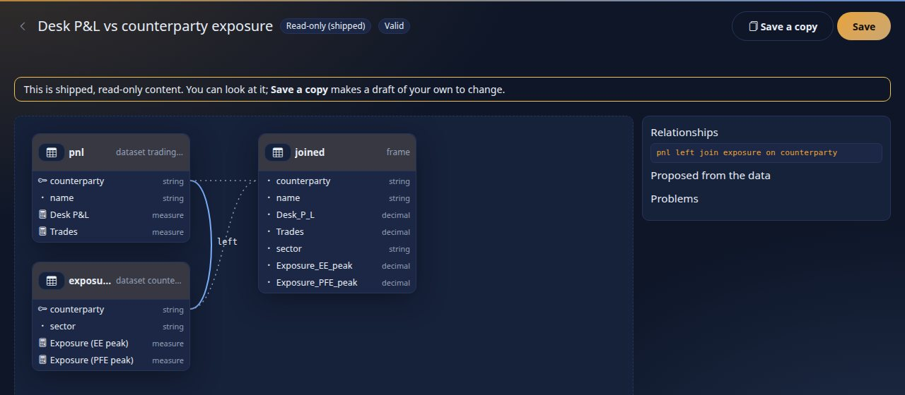

<!--
  Project Drishti · Any data. Any domain. One grammar.

  Copyright (c) 2026 Ashutosh Sinha <ajsinha@gmail.com>.
  All rights reserved.

  PROPRIETARY AND CONFIDENTIAL.

  This file is the confidential and proprietary property of Ashutosh Sinha.
  Unauthorised copying, use, modification, distribution or disclosure of this
  file, via any medium, is strictly prohibited except with the express prior
  written permission of the copyright holder.

  See the LICENSE file in the root of this repository for the full terms.
-->
# Datasets: the YAML, the expression language and the security rules

Reference for the **dataset** of Drishti Rūpaka (BI), as built in phase 2 (live tables, section 7.1, are phase 5). For the walk-through see [tutorial 10](../tutorials/10-first-bi-report.md) (chapters 1 to 9, and 18 for a live table); for the pages that show a dataset see [BI_GUIDE.md](BI_GUIDE.md) sections 13 and 16; for datasets built from other datasets (joined in YAML, or made by a Python Transform) see
[section 11](#11-composed-and-derived-datasets); for the design see [RUPAKA.md](../architecture/RUPAKA.md) sections 6 and 7, "20.2 Phase 2, as built" and "20.10 Several datasets, as built"; for the HTTP API see
[API_GUIDE.md](API_GUIDE.md#datasets-and-the-query-engine-apiv1bi-phase-2); for the settings see
[CONFIGURATION.md](../admin/CONFIGURATION.md#drishtibiquery--the-dataset-query-engine-phase-2).

A dataset is a YAML document: the **model** reports sit on. Tables come from pack kinds through connectors (by their logical names), relationships
join them, measures compute over them, row rules and masks decide who sees what. It is **stored** as a BI item of kind `dataset` (a draft in a
workspace, published with review like any item) or **shipped** as `config/bi/datasets/<id>.dataset.yaml` (read-only, watched live). Nothing in it
is executed: it is parsed, validated, compiled to SQL with **bound values**, and run by the embedded DuckDB.

Contents: [1](#1-the-file) the file · [2](#2-tables-and-columns) tables and columns · [3](#3-relationships-and-how-queries-join) relationships ·
[4](#4-measures-and-the-expression-language) measures and expressions (4.1: time intelligence, 4.2: Python measures) · [5](#5-hierarchies) hierarchies · [6](#6-security-row-rules-and-masks) security ·
[7](#7-modes-layers-and-rollups) modes, layers and rollups (7.2: scheduled refresh) · [8](#8-the-query) the query · [9](#9-problems-and-drs-codes) problems and codes ·
[10](#10-what-is-not-built) what is not built (live tables: [7.1](#71-live-tables-phase-5)) · [11](#11-composed-and-derived-datasets) composed and derived datasets

## 1. The file

```yaml
rachana: 1                  # language version (1)
dataset: trading-risk       # the model's name: letters, digits, . _ - (up to 64)
version: 1                  # your own version number
title: ...                  # catalogue fields (BI_GUIDE.md): title, description, owner, tags, endorsement, audience
description: ...
sample: true                # sample content: hidden from business users when sample packs are (drishti.packs.samples)
engine: duckdb              # the only engine built
tables: { ... }             # section 2
relationships: [ ... ]      # section 3
measures: { ... }           # section 4
hierarchies: { ... }        # section 5
security: { rows: [...], masked: [...] }   # section 6
rollups: [ ... ]            # section 7
refresh: "daily 06:00"      # when the layers are rebuilt on their own: a schedule or after-load (section 7.2)
layout: { ... }             # where the Model view draws each table (written by the diagram; the language ignores it)
from: { ... }               # a composed dataset: other datasets asked as the reader, instead of tables (section 11.1)
join: [ ... ]               #   ... and how their answers are joined
derived: { ... }            # a derived dataset: a Python Transform that returns the table (section 11.2)
columns: { ... }            #   ... and the columns it returns, typed
```

Unknown top-level keys are a warning. Five complete, commented examples ship in `config/bi/datasets/`: `trades-basic` (one table), `trading-risk` (five tables across three packs, a row rule, masks, a rollup) and `trading-cashflows` (nested arrays as tables), which the tutorial reads in chapters 2 to 5, and the live `live-trading` and `live-exposure` (section 7.1, tutorial chapter 18).

## 2. Tables and columns

```yaml
tables:
  trades:                                   # the table's name: letters, digits, underscore (it is written in expressions)
    source:
      connector: trading-store              # a connector by its LOGICAL name (config/connectors/<name>.yaml); empty: whichever serves the kind
      kind: trade                           # the pack kind
      each: legs                            # optional: one row per element of this array in each document (below)
    mode: cached                            # cached (default) | direct | live  (section 7; live: 7.1)
    refresh:
      on-load: true                         # rebuild the date when a data-load signal for the kind arrives (default true)
      schedule: "0 */15 * * *"              # rebuild this table on a schedule (section 7.2); a five-field cron, or any schedule of section 7.2
    columns:
      tradeId:   { type: string, key: true }
      desk:      string                     # shorthand for { type: string } with the path equal to the name
      cpty:      { path: counterparty.id, type: string }    # a path into the document; "$." in front is allowed and dropped
      notional:  { type: decimal, format: amount0 }
      mtmK:      { type: decimal, expr: "mtm / 1000" }       # calculated column (below)
```

* **Types:** `string`, `integer`, `decimal`, `boolean`, `date`, `timestamp`. A value that cannot be cast to its type is null (never an error).
* **Every table also has** `id` (the entity's id) and `businessDate` (the date the row is for); do not declare them. A table with `each` also has
  `index` (the element's position from 0), and its `id` is the **parent** entity's id, which is how it joins to the parent. A **live** table also has `updateSeq` and `updatedAt`
  (section 7.1); the five names are reserved (`DRS-9010`).
* **`each`:** the trade's `legs` or `schedule` array becomes a table with one row per element; column paths are relative to the element. It is always built by
  reading the documents (an array cannot come from promoted columns) once per business date.
* **Calculated column:** a row-level expression over the table's own stored columns (section 4); it may not aggregate, use measures or the user, or use another
  calculated column. It is computed at query time.
* **`format`** is a format name of the pack, used for display only. **`key`** marks a column others join to (informational; relationships name columns explicitly).
* A table may have no columns (`columns: {}`): it then has `id` and `businessDate` only, which is enough for a lookup joined on id.

**Reading the data** goes through the same connectors as the rest of Drishti ([CONNECTOR_DEVELOPER_GUIDE.md](../connectors/CONNECTOR_DEVELOPER_GUIDE.md#bulk-reads-for-bi-scan-and-sqltarget)):
if the connector can **scan** every declared path as a column (the paths it promotes in `layout.<kind>.columns`) the table is built from column batches and no
document is parsed; if it cannot, the engine reads documents one by one (at most `drishti.bi.query.record-read-max`) and the answer says so in its warnings. *Promote
the columns a dataset uses* in the connector's layout: the tables of the samples that read documents are the reference kinds of the demo lake, which promote none.

## 3. Relationships and how queries join

```yaml
relationships:
  - { from: trades.desk, to: desks.id, cardinality: many-to-one }      # from = the MANY side, to = the ONE side
  - { from: trades.nettingSet, to: netting_sets.id, cardinality: many-to-one, direction: single, active: true }
```

`cardinality` is `many-to-one` (default), `one-to-many`, `one-to-one` or `many-to-many`; `direction` `single` or `both`; `active` true or false. Both columns must exist and have
the same type. **Built:** a query joins along **active** relationships, in the many-to-one direction (and either way for one-to-one), `LEFT JOIN`ed from the table the
measures aggregate (the *base*), so a measure is never counted twice. A query with **no measure** (a list of values) may also join one-to-many and answers distinct rows.
**Refused (`DRS-9020`):** measures that aggregate two tables no many-to-one path connects, and a field whose table cannot be reached from the measures' table without repeating rows.
`direction: both` and many-to-many are stored; a query still joins as written (many-to-many warns). Inactive relationships are skipped and cannot yet be
turned on by a measure.

## 4. Measures and the expression language

```yaml
measures:
  Notional:   { expr: "sum(trades.notional)", format: amount0, description: "..." }
  MTM:        "sum(trades.mtm)"                                   # shorthand: just the expression
  MTM per 1m: { expr: "ratio(sum(trades.mtm), sum(trades.notional)) * 1000000" }
  Share:      { expr: "[MTM] / [Notional]" }                      # [Name] uses another measure
  Open MTM:   { expr: "sum(trades.mtm, trades.status == 'Live')" } # a condition inside the aggregate
  Vol:        { python: desk-pnl-volatility, inputs: [trades.pnl1d], by: [trades.desk] }   # a PYTHON measure: run by the console's runner, shown by a python visual (4.2)
```

The expression language is **Rachana-EL's syntax** (operators, literals, `?:`, text in `'...'` or `"..."`) **extended with aggregation**. It is closed and side-effect free;
it compiles to SQL, it is never evaluated as code. Names: `table.column`, `table.column.part` (a date part), `[Measure name]`, `user.<attribute>` (row rules only),
and in a calculated column a bare column of its own table.

| Aggregates | Meaning |
|---|---|
| `sum(x)`, `avg(x)`, `min(x)`, `max(x)` | over the rows of the group; null rows are ignored (SQL) |
| `count(table)` or `count(x)` | rows, or non-null values of `x` |
| `distinct(x)` | number of different values |
| `ratio(a, b)` | `a / b` as a double, null when `b` is 0; `a` and `b` are aggregate expressions |
| `percentile(x, p)` | the `p`-quantile (0 to 1, a literal) with interpolation |
| second argument | `sum(x, condition)`: only rows where the condition is true (`FILTER (WHERE ...)`) |

| Row functions and operators | |
|---|---|
| `+ - * / %`, comparisons `== = != < <= > >=`, `&& \|\| !` and `and or not`, `x in (a, b)`, `x not in (...)`, `c ? a : b` | `/` is always a floating-point division and null on a zero divisor |
| `abs`, `round(x[, n])`, `coalesce(a, b, ...)`, `upper`, `lower`, `length`, `contains(text, part)`, `startsWith`, `if(c, a, b)` | |
| `year(d)`, `quarter`, `month`, `day`, and the field form `table.dateColumn.year` (also `quarter`, `month`, `day`, `week`) | date parts of a `date` or `timestamp` column |

A measure must aggregate (a column outside an aggregate is an error), aggregates do not nest (except `ratio`'s two arguments), and measures may not refer to each other in a circle.
**Reserved, parsed and refused with `DRS-9013`:** `lag` and `rank` (window functions). Time intelligence and running totals are built: section 4.1.

Real compiled output (captured from the `trades-basic` sample by a BI author's `?explain=true`; the values are placeholders, never in the text):

```sql
SELECT "trade"."desk" AS "trade.desk", (sum("trade"."notional")) AS "Notional", (sum("trade"."mtm")) AS "MTM", (count(*)) AS "Trades",
       ((CAST((sum("trade"."mtm")) AS DOUBLE) / NULLIF((count(*)), 0))) AS "Average MTM per trade"
FROM (SELECT t.*, (CAST(t."mtm" AS DOUBLE) / NULLIF(?, 0)) AS "mtmInMillions"
      FROM (SELECT * FROM read_parquet(['.../columns/file_dataset_trades-basic/trade/date=2026-09-30/part.parquet'], union_by_name = true)) AS t) AS "trade"
GROUP BY "trade"."desk" ORDER BY "trade.desk" ASC LIMIT 100001
```

### 4.1 Time intelligence

A measure may be asked "since the start of the year", "this month so far", "the period before this one" or "running". The function wraps an **aggregate expression** and names a **date column** of a table (`date`
or `timestamp`; `businessDate` is one):

```yaml
measures:
  MTM ytd:      { expr: "ytd(sum(trades.mtm), trades.tradeDate)" }
  MTM mtd:      { expr: "mtd(sum(trades.mtm), trades.tradeDate)" }
  Trades qtd:   { expr: "qtd(count(trades), trades.tradeDate)" }
  MTM prior:    { expr: "prior_period(sum(trades.mtm), trades.tradeDate)" }
  MTM last year: { expr: "same_period_last_year(sum(trades.mtm), trades.tradeDate)" }
  MTM running:  { expr: "running(sum(trades.mtm), trades.tradeDate)" }
  Share of ytd: { expr: "ratio(sum(trades.mtm), ytd(sum(trades.mtm), trades.tradeDate))" }    # inside a ratio, or any expression with other measures
```

| Function | Rows it adds up | Business-day aware? |
|---|---|---|
| `ytd(agg, date)` | the date column from 1 January of the as-of date's year to the as-of date | no: the rows have the dates they have |
| `mtd(agg, date)` | from the 1st of the as-of date's month to the as-of date | no |
| `qtd(agg, date)` | from the first day of the as-of date's quarter to the as-of date | no |
| `prior_period(agg, date)` | the **same number of business days** immediately before the current period | yes: the pack's calendar (`drishti.business-date.calendar`, `USNY` unless changed) skips weekends and holidays |
| `same_period_last_year(agg, date)` | the current period shifted back one year; an end that falls on a weekend or a holiday last year is pulled **in** to the business days inside the window | yes |
| `running(agg, date)` | a running total of a `sum`, `count`, `min` or `max` along the date **field of the visual** | no |

**The as-of date** is the end of the query's dates (`dates.to`, so a report's date range or the business date picker), else their start, else the newest date the query read, else the current business date. The **current period**
of `prior_period` and `same_period_last_year` is the query's own dates (from the first to the as-of date), or the month to date when it names none. The windows are worked out in Java and **bound as parameters**; the SQL compares the
date column with two dates:

```
as-of 2026-07-07, dates from 2026-07-06            weekends only (WEEKENDS)             USNY (Independence Day, observed on Friday 3 July 2026)
ytd                                                2026-01-01 to 2026-07-07             2026-01-01 to 2026-07-07
mtd and qtd                                        2026-07-01 to 2026-07-07             2026-07-01 to 2026-07-07
prior_period  (2 business days: 6 and 7 July)      2026-07-02 to 2026-07-03             2026-07-01 to 2026-07-02
same_period_last_year  (Sun 6 July 2025 is not a business day: the window is Monday the 7th only)
                                                   2025-07-07 to 2025-07-07             2025-07-07 to 2025-07-07
```

Real compiled SQL (a test lake with one trade a weekday for a year; `Ytd` and `Mtd` by desk, as-of 2026-07-07; the four bound dates are 2026-01-01, 2026-07-07, 2026-07-01 and 2026-07-07) and its answer:

```sql
SELECT "trades"."desk" AS "trades.desk",
       (sum("trades"."mtm") FILTER (WHERE ("trades"."tradeDate" >= CAST(? AS DATE) AND "trades"."tradeDate" <= CAST(? AS DATE)))) AS "Ytd",
       (sum("trades"."mtm") FILTER (WHERE ("trades"."tradeDate" >= CAST(? AS DATE) AND "trades"."tradeDate" <= CAST(? AS DATE)))) AS "Mtd"
FROM (SELECT t.*, (CAST(t."mtm" AS DOUBLE) / NULLIF(?, 0)) AS "mtmK" FROM (SELECT * FROM read_parquet([...], union_by_name = true)) AS t) AS "trades"
GROUP BY "trades"."desk" ORDER BY "trades.desk" ASC LIMIT 100001
-->  DESK-A  2084.0  42.0      DESK-B  2341.0  148.0      DESK-C  2390.0  20.0
```

A running total is a window over the grouped rows, ordered by the date **field the visual groups by** and restarting for each combination of its other fields (a coarser part of the same date, `trades.tradeDate.year` beside
`trades.tradeDate.month`, restarts it each year). By day, 1 to 7 July 2026 (`fields: [trades.tradeDate]`, `measures: [Running]`):

```sql
SELECT "trades"."tradeDate" AS "trades.tradeDate", (sum(sum("trades"."mtm")) OVER (ORDER BY "trades"."tradeDate")) AS "Running"
FROM (...) AS "trades" WHERE ("trades"."tradeDate" BETWEEN CAST(? AS DATE) AND CAST(? AS DATE)) GROUP BY "trades"."tradeDate" ORDER BY "trades.tradeDate" ASC LIMIT 100001
-->  2026-07-01  69.0     2026-07-02  74.0     2026-07-03  116.0     2026-07-06  195.0     2026-07-07  210.0
```

**What it works on, and what it refuses.**

* The functions restrict **the rows the query reads**. With a snapshot lake (every business date holds the whole book) read one date and let the date column do the rest. With a table whose partitions hold only each day's rows,
  the query's dates must reach back to the start of the window (a report's `dates: { from: ... }`), or the earlier days are not there to add up.
* The first argument holds aggregates and nothing else of this family: no nested time function, no `[Measure]` reference. A time function may sit inside an expression with other measures (`ratio(...)`, `[A] - [B]`) but not inside an aggregate. The date is a column, not a date part.
* A **rollup** cannot hold a time measure (`DRS-9012`, as for a distinct count); the query runs on the columns layer.
* `running` takes one `sum`, `count`, `min` or `max` (an average, ratio, distinct count or percentile has no running total: `DRS-9011`), needs the date as a **field** of the query (`422 DRS-9020` otherwise), cannot be filtered on (`DRS-9020`), and a date masked for the reader is `403 DRS-9021`.
* Masks and row rules apply as for any measure; the as-of date is part of the cached result's key, so a new date is a new answer.

### 4.2 Python measures (phase 6)

A measure may be a **Python item** instead of an expression: `python:` names the item (catalogue id, shipped file name or title), `inputs` the columns its function reads and `by` the columns that
make a group, all `table.column` and all of **one table**:

```yaml
measures:
  Desk P&L volatility:
    python: desk-pnl-volatility       # config/bi/python/desk-pnl-volatility.python.yaml
    inputs: [trade.pnl1d]
    by: [trade.desk]                  # one number per desk
    description: Standard deviation of the one-day P&L per desk, computed in Python.
```

The SQL engine **cannot run it**: a query that names a Python measure is refused (`DRS-9013`), and the model says so as a warning when it is checked. A **python visual** shows it
(`wells: { values: [Desk P&L volatility] }`): the server hands the console the rows of `by` and `inputs` that this person may see, and the console's sandboxed runner (or the browser's Pyodide) calls the
item once per group. Checks: the item is named, `inputs` is not empty, every name is a column, all of one table (`DRS-9012`); `expr` and `python` together are `DRS-9010`. The dataset is checked
**without** looking the item up (an item can be published after the dataset), so a wrong item name appears when a report runs it (`DRS-9001`/`9070`). Reference: [PYTHON_BI.md](PYTHON_BI.md).

## 5. Hierarchies

```yaml
hierarchies:
  Trade date: [trades.tradeDate.year, trades.tradeDate.quarter, trades.tradeDate.month, trades.tradeDate]
  Desk and book: [desks.name, books.name]
```

An ordered list of levels, coarse to fine; each is `table.column` or `table.column.part` (a bare column name is accepted when it is in one table only). They are validated and
returned with the model for the designer and the viewer (phase 3) to drill with: a visual's `hierarchy:` drills down them ([REPORTS.md](REPORTS.md)); a query names the levels as ordinary fields.

## 6. Security: row rules and masks

```yaml
security:
  rows:
    - { role: desk-head, where: "trades.desk in user.desks" }
    - { role: risk,      where: "true" }
  masked: [counterpartyName, counterparties.name]
```

**Row rules** are evaluated **on the server, for each reader**, and added to every query as a predicate the query cannot remove.

* A reader gets the rows allowed by **any** rule whose `role` they hold (rules of one reader are OR-ed). A reader with **no matching rule gets no rows** and the answer
  says why. With server security off (`drishti.security.enabled: false`) rules are not applied.
* `where` is a row condition: no aggregates, no measures. It may use `user.name`, `user.roles`, `user.desk`, `user.desks` (the profile's desk split at `,` and `;`, so a head
  of two desks lists both) and `user.email`; used with `in`, a list attribute binds one parameter per value.
* **Fail closed.** A rule names tables, and the tables of the reader's rules are joined into **every** query they run. If the measures' table cannot reach a rule's
  table many-to-one, the question is refused (`DRS-9020`, the message names the rule's tables) rather than answered with other readers' data. In `trading-risk` a desk-head
  therefore cannot ask for exposure by counterparty: the netting sets do not reach trades.
* A table over a kind the reader may not open (their roles, or a pack not assigned to them) returns **no rows** for them, with a warning; a `direct` table is refused.

**Masked columns.** A column is masked for a reader when it is listed in `masked` (a bare name matches that column in any table, `table.column` names one) and the reader
**lacks the `raw` power**, or when Drishti's own list `drishti.security.redact` names the column's name or the last segment of its path (`counterpartyId`, `trader`, ...). Masks
are applied **before aggregation, column by column**, and the result is built so the mask cannot be probed:

| What | Result for a masked reader |
|---|---|
| a masked field (dimension) | the constant `•••` in every row, and it is **not grouped on**: its values cannot be told apart |
| a measure aggregating a masked column | `null` |
| a filter on a masked column, or a sort on it | refused, `403 DRS-9021` |
| a masked column used in a row rule | fine: rules run on the server before the mask |

Real output (the sample `trading-risk`, the same query, three readers; `Counterparties` is `distinct(trades.counterpartyId)`, a masked column; `rita` has `risk`, `hana` is a
desk-head whose profile desk is `DESK-FX`, `ann` is an `analyst` without `raw`):

```
rita  (risk)       desks.name = 'G10 and EM FX' ... 10 rows   MTM -15,759,419  Trades 84  Counterparties 17
hana  (desk-head)  desks.name = 'G10 and EM FX' ... 1 row    MTM -15,759,419  Trades 84  Counterparties 17
ann   (analyst)    10 rows, every MTM and Trades as rita sees them,  Counterparties = null  (masked: Counterparties)
ann asks for counterparties.name:   one row  '•••'  MTM 138,562,638  Trades 750     (not grouped: the 18 names cannot be told apart)
ann filters counterparties.name:    403 DRS-9021 'counterparties.name' is masked for you: it cannot be filtered on
```

## 7. Modes, layers and rollups

| `mode` | The table is | Built |
|---|---|---|
| `cached` (default) | typed Parquet, one file per **business date** in the BI store (`drishti.bi.query.store-dir`): the **columns layer** | read once per date from the connector, on the first query, and again when a data-load signal for the kind names the date |
| `direct` | the source's own SQL table; the compiled query runs in the source | needs a connector with a SQL target (the DuckDB and PostgreSQL connectors); every table of the query must be direct and in one store; `each` tables cannot be direct |
| `live` | the kind's current state, **kept in memory by the engine and updated by key as the source pushes changes**, with a retention window (section 7.1) | built in phase 5. With `drishti.bi.live.enabled: false` it falls back to a short-lived snapshot of the connector's state, kept for `drishti.bi.query.live-ttl` |

**The layers a query is answered from, smallest first:** a **rollup** that covers it, else the **columns layer**, else (direct tables) the **source**. The answer reports which
(`layer`, and `rollup`). Layout in the BI store: `columns/<dataset>/<table>/date=<yyyy-mm-dd>/part.parquet` with a `meta.json` (the table's signature, rows, how it was read, warnings),
`rollups/<dataset>/<name>/date=.../part.parquet`. A change of a table's connector, kind, array or columns changes its signature, and the layer is read again.

```yaml
rollups:
  - { name: by_desk_currency, table: trades, by: [desk, currency, assetClass], measures: [MTM, Notional, "P&L 1d", Trades, MTM per 1m notional] }
```

A rollup stores, per date and group, the **components** of its measures: sums, counts, minimums, maximums of expressions over stored columns of its table (`avg(x)` is stored as
`sum(x)` and `count(x)`); a measure built from them (a ratio of sums, a measure of measures) is answered by re-aggregating the components. A query is routed to a rollup when it
uses **one table**, only fields (and filters, and row-rule columns) among the rollup's `by` columns (and `businessDate`), and only measures whose components the rollup holds. Not
rollup material: `distinct`, `percentile`, a condition inside an aggregate, another table, a filter on a measure; validation says so (`DRS-9012`) when a rollup lists such a measure.
`"layer": "columns"` in a query forces the columns layer (the check that both give the same numbers is in the tests).

**When a layer is rebuilt:** a data-load signal (`POST /api/v1/packs/{pack}/loads`, [DATA_LOADS.md](DATA_LOADS.md)) with `status: ready` for a kind deletes that date's partitions of
every published dataset table that reads the kind, bumps the dataset's data generation (so cached results can no longer be served), and, with `eager-rebuild` on, reads the date again in the
background; **only that date, only those datasets**. Without a date in the query the **latest** date is used: the current business date when its layer exists, else the newest date the source
holds (the answer's `dates` says which).

### 7.2 Scheduled refresh

A dataset's layers are rebuilt when a data load arrives (above) and on demand (`POST /datasets/{id}/refresh`). `refresh:` says when they are rebuilt **on their own**:

```yaml
refresh: "business-days 06:30"          # the whole dataset (a mapping works too: refresh: { schedule: "business-days 06:30" })
tables:
  trades:
    refresh: { schedule: "0 */15 * * *" }     # or one table, on its own schedule
```

The words are the ones subscriptions use ([DISTRIBUTION.md](DISTRIBUTION.md)): `daily 06:00` (also written `daily at 06:00`), `weekdays 18:30`, **`business-days 07:30`** (the pack's holiday calendar: `drishti.business-date.calendar`), `weekly mon 07:00`,
`monthly last 18:00 business`, `hourly`, `cron <six fields>` or a bare **five-field cron** (`0 */15 * * *`), and **`after-load`** (optionally `after-load trade`): not a time but the data load that finished ready for a kind the dataset reads.
Times are in the business-date zone (`drishti.business-date.zone`). A schedule the server cannot read is `DRS-9010` at the path of the key (`refresh`, or `tables.<name>.refresh.schedule`).

**What a refresh does.** For the current business date (the date of the load for `after-load`) it clears that date's partitions of the cached tables (`live` and `direct` tables hold none), drops the dataset's cached results, and reads the columns layer and the
rollups again, **on the scheduler's own thread, so a failure is seen**: a connector that is not running, a source that fails, a layer that cannot be written. A dataset that reads a date the source holds no rows for refreshes with 0 rows.
Only **published** datasets (stored or shipped) are scheduled; a draft is not.

**When it fails.** The refresh is tried again with the shared retry policy (`drishti.retry.bi.*`, falling back to `drishti.retry.*`: 5 s, doubling, up to 5 minutes, 20 percent jitter): the dataset's state is `retrying` with the time of the next try, `failures` and the
error. After `drishti.bi.refresh.max-attempts` tries (4) it is `failed` and left until its next scheduled time; a failure that waiting cannot fix (refused credentials, a setting that is not set) waits the policy's longest interval between tries.

**What the dataset page shows.** The **Refresh** section lists the dataset and each scheduled table: the schedule, the status (`never` before the first run, `waiting` for an `after-load`, `running`, `ok`, `retrying`, `failed`, `invalid` for a schedule that does not read), the last refresh, the next one, rows, how long it took and the failures.


`GET /api/v1/bi/datasets/{id}/refresh` is the same state (any reader of the dataset). Real output (the scheduler looks every `drishti.bi.refresh.tick`, here 2 s; the dataset says `daily 06:00`; it is Sunday evening in New York, so the next run is Monday 06:00, which is 10:00 UTC),
first before a run, then the answer of `POST /datasets/{id}/refresh` (it runs in the background and says so at once), and four seconds later:

```
GET  /api/v1/bi/datasets/file:dataset:nv-demo/refresh
{"enabled": true, "scheduled": true, "zone": "America/New_York", "calendar": "USNY",
 "dataset": {"schedule": "daily 06:00", "status": "never", "trigger": "", "lastRun": null, "nextRun": "2026-10-12T10:00:00Z", "lastDurationMs": 0, "lastRows": 0, "lastDate": null,
             "tables": [], "failures": 0, "retryAt": null, "error": null, "runs": 0}, "tables": []}
POST /api/v1/bi/datasets/file:dataset:nv-demo/refresh
{"dataset": "file:dataset:nv-demo", "date": "2026-10-09", "refreshing": ["trade"], "state": {"schedule": "daily 06:00", "status": "running", "trigger": "manual (wes)", "lastRun": null, "nextRun": "2026-10-12T10:00:00Z", ...}}
GET  /api/v1/bi/datasets/file:dataset:nv-demo/refresh          (the demo lake holds 7 and 8 October, not the 9th: 0 rows)
{"enabled": true, "scheduled": true, ..., "dataset": {"schedule": "daily 06:00", "status": "ok", "trigger": "manual (wes)", "lastRun": "2026-10-11T22:44:35.251467762Z", "nextRun": "2026-10-12T10:00:00Z",
 "lastDurationMs": 4, "lastRows": 0, "lastDate": "2026-10-09", "tables": ["trade"], "failures": 0, "retryAt": null, "error": null, "runs": 1}, "tables": []}
```

**`after-load`.** A data-load signal with `status: ready` for a kind a table reads starts the refresh `drishti.bi.refresh.load-delay` (2 s) later, for the date loaded; the dataset then has the *tracked and retried* version of the rebuild, so the plain on-load rebuild
(background, untracked) leaves it alone. A schedule for one kind (`after-load trade`) ignores the others.

**The state is in memory.** After a restart a job shows `never` until it runs, and its next time is worked out again from the clock. Settings: `drishti.bi.refresh.*` ([CONFIGURATION.md](../admin/CONFIGURATION.md#drishtibirefresh--scheduled-dataset-refresh)). The refresh is audited (`bi-dataset-refresh`).
No new write endpoint: `POST .../refresh` is the one that existed and needs `bi-author` (and, for a personal token, the `bi:write` scope).

### 7.1 Live tables (phase 5)

A `mode: live` table is the **current state of a kind**, not a copy per business date. The engine reads the kind **once** when the table is first needed (the first query, or the first stream of a report over it), subscribes to
each entity through the same live machinery the terminal's live views use, and then **applies every change to its in-memory table by key**: a new id is inserted, a known id replaces its row, a deletion removes it. Reports and
boards over it redraw as it changes ([REPORTS.md](REPORTS.md#13-live-visuals-and-perspective-phase-5), [BOARDS.md](BOARDS.md)). The sample is [config/bi/datasets/live-trading.dataset.yaml](../../config/bi/datasets/live-trading.dataset.yaml):

```yaml
tables:
  trade:
    source:
      kind: trade               # no connector named: whichever running connector serves trades and can push them
    mode: live
    live:                       # retention: the most rows it holds (and, optionally, `age:` how long a row may go without changing, below)
      rows: 5000
    columns:
      tradeId: { type: string, key: true }
      desk:    string
      mtm:     { type: decimal, format: signed0 }
```

**Where the changes come from.** The connector's `subscribe` for each entity: the demo source ticks its live samples; the Kafka and Redis connectors (and any connector that implements `subscribe`) feed the table the way they feed a live view. `connector:` names
a connector by its logical name when a stream that keeps no state ticks what a store serves (a Kafka connector in `ticks` mode: the entities are listed and read from the store, the changes come from Kafka); empty means the router's choice, as for a live view.
The table follows at most `drishti.bi.live.follow-max` (2,000) entities and says so when it stops there. A connector that **cannot push** is read again every `drishti.bi.live.resync` (30 s): the table still follows it, a row whose values did not change is skipped,
and the table's state says `pushes: false`.

**Incremental, and what that means.** The *table* is maintained incrementally: a batch of changes (merged per entity, every `drishti.bi.live.batch`, 100 ms) is written in **one transaction** with the retention, so a query never sees half a batch, and a row whose declared
columns did not change does not move the table's counters (a source that republishes the same values costs nothing downstream). The *measures* are **recomputed** by the engine over the table on each query, as every measure is: with the table in memory that is a few
milliseconds at 10,000 rows. The engine does **not** keep running totals by group that a change adjusts; that is not built (heavy continuous aggregation belongs in a producer, [LIVE_BI.md](../architecture/LIVE_BI.md)).

**Retention.** `live: { rows, age }` (both optional). `rows` bounds the table: past it the rows changed longest ago go first (`drishti.bi.live.max-rows`, 50,000, is the ceiling whatever a dataset asks). `age` drops rows that have not changed for that long (`90s`, `15m`, `2h`,
`1d` or ISO `PT15M`); it is applied with every batch and on every resync, so a quiet table forgets too. Whatever leaves (evicted, or deleted by the source) starts a new **epoch** of the table; a client that holds rows (a Perspective grid) reads them again.

**Two columns every live table has**, queryable like any other and never declared:

| Column | Type | Meaning |
|---|---|---|
| `updateSeq` | integer | a counter that grows with each row that changes: "what changed since *n*" is `updateSeq > n` |
| `updatedAt` | timestamp | when the row last changed (UTC) |

**Row rules and masks apply on every update.** The table holds the source's rows and knows no reader. Every query, whenever it is asked, is compiled with the asker's row rules as predicates it cannot remove and their masks as `•••` (or null for a measure);
the stream that tells a browser the table changed carries **no data**. Two readers of one table, one with a desk rule and one without `raw`, are each answered as themselves after every update (`LiveTablesTest`, `BiLiveApiTest`).

**How a live table is doing.** `GET /api/v1/bi/datasets/{id}/layers` and the dataset page's Layers table show, per live table, `state` (`starting`, `live`, `stale`, `failed`, `closed`), `rows`, entities followed and how many push, and the time of the last change; the engine page
(`GET /api/v1/bi/engine`, bi-admin) counts live tables and rows. A real answer, a minute after the first query, with the demo source (`tick-ms: 200` here; its default is 400) changing 360 of the 750 trades in every batch:

```json
{"table": "trade", "kind": "trade", "state": "live", "rows": 750, "entities": 750, "subscribed": 750, "pushes": true, "seq": 38239, "epoch": 0, "generation": 109, "lastUpdate": "2026-10-11T13:17:39.331718015Z", "lastSeen": "2026-10-11T13:17:39.737547667Z", "startedAt": "2026-10-11T13:16:41.653443716Z", "applied": 38239, "skipped": 8, "evicted": 0, "deleted": 0, "error": null}
```


`stale` means the feed pushes but has delivered nothing for `drishti.bi.live.stale-after` (30 s); `failed` means the first read failed and there are no rows (the queries answer a warning with the reason, or `DRS-9026` when no running connector serves the kind).

**A table nobody uses is closed.** A live table that has not been queried or streamed for `drishti.bi.live.idle-close` (10 minutes) is closed and its subscriptions are given back; the next use starts it again. A dataset edited so that a live table's definition changed
gets a new table.

**What cannot be live:** a table over an array (`each`): it follows whole entities (`DRS-9050`). A live table cannot be a `direct` table's neighbour in one query (the same rule as for cached tables).

**Limits and settings:** `drishti.bi.live.*` in [CONFIGURATION.md](../admin/CONFIGURATION.md#drishtibilive--streaming-bi-phase-5).

## 8. The query

`POST /api/v1/bi/datasets/{id}/query` with the body of [API_GUIDE.md](API_GUIDE.md#datasets-and-the-query-engine-apiv1bi-phase-2): `fields`, `measures`, `filters` (`eq ne in not-in lt le gt ge between contains
starts-with is-null not-null`; a filter whose field is a measure name filters the aggregate), `dates` (`from`, `to`; one date or a range, at most 400 days, at most 31 not-yet-built dates read per query),
`orderBy`, `limit`, `layer` (`auto`, `columns`, `rollup`). Every name is checked against the model and quoted; **every value is a bound parameter**; a value of the wrong type for its column is refused
(`DRS-9020`), never cast into SQL. Limits and their codes are in [CONFIGURATION.md](../admin/CONFIGURATION.md#drishtibiquery--the-dataset-query-engine-phase-2).

## 9. Problems and DRS codes

Validation never throws: it returns every problem with its code and the path of the key (`POST /api/v1/bi/datasets/validate`, the dataset page, and the check on publish, which refuses an invalid dataset).

| Code | Meaning |
|---|---|
| `DRS-9010` | the YAML or a structure is not valid (unknown type, mode or cardinality, a bad name, a missing `source.kind`, a `refresh` schedule the server cannot read) |
| `DRS-9011` | an expression does not parse, names something the model lacks, misuses an aggregate, uses an unknown function, refers to measures in a circle |
| `DRS-9012` | a relationship, hierarchy, masked column, row rule or rollup points at a table or column that does not exist (or a rollup holds a measure it cannot) |
| `DRS-9013` | a reserved feature (the window functions `lag` and `rank`) or a Python measure named in a query: parsed, **not built** for SQL (a python visual shows a Python measure: 4.2). Time intelligence (`ytd`, `mtd`, `qtd`, `prior_period`, `same_period_last_year`, `running`) is built (4.1): a wrong shape is `DRS-9011`, a rollup listing one `DRS-9012` |
| `DRS-9014` | a composed dataset names a source, column, measure or join key that does not exist, joins keys of different types, or leaves a source unjoined (11.1) |
| `DRS-9015` | a warning: a join repeats rows (many-to-many, or the unique source on the wrong end), so the measures of the repeated side add up too high (11.1) |
| `DRS-9016` | a dataset reads itself, directly or through the datasets it is composed of or derived from (11.1) |
| `DRS-9017` | a derived dataset names no Transform or no inputs, declares a column it cannot have, or (a warning) does not know its columns yet (11.2) |
| `DRS-9020` | a query names a field, measure, operator, value or date the dataset cannot take, or cannot be joined |
| `DRS-9021` | a query filters on, or sorts by, a column masked for the caller, reads a `direct` table of a kind they may not open, or joins a composed dataset on a column a source masks for them (11.3) |
| `DRS-9022` / `9023` | the answer is over the row limit / the byte limit |
| `DRS-9024` | the query ran past its time limit and was cancelled |
| `DRS-9025` | too many queries at once (server or user) |
| `DRS-9026` | a table's connector is not running, or is not a SQL store for a `direct` table |
| `DRS-9027` | the engine failed on the compiled query (the message says how) |
| `DRS-9050` | a live table cannot be kept: it is over an array (`each`) or its `live:` block is wrong (a query over a live table whose kind no running connector serves answers `DRS-9026`) |
| `DRS-9051` | too many live streams are open for the server or the person (`drishti.bi.live.max-streams`, `max-streams-per-user`), HTTP 429 |

## 10. What is not built

Marked so nothing is mistaken for working: the **window functions** `lag` and `rank` (time intelligence and `running` are built: 4.1); a Python measure **inside a query** (a python visual runs it: 4.2);
the **state of a refresh across a restart** (it is in memory: 7.2); a refresh of **an earlier date** than the current business date (a schedule refreshes today; a load refreshes the date it names); **queries whose measures aggregate several unrelated fact tables**;
**filter direction `both`** and **many-to-many** semantics, and **inactive relationships used by a measure**; **running totals by group that a change adjusts** (live tables are maintained incrementally, measures are recomputed over them: 7.1), **history of a live table** (it holds current state with retention, not every update), **live tables over arrays** (`each`), **live tables in `direct` queries**;
the **BI store as a configured connector** (a folder today; S3 by mounting it); **other engines** than DuckDB (the interface exists); **Delta native deletes/updates** are honoured only as far as the Delta connector
honours them (the engine reads through the connector, not the files); **classification tags** and **per-entry export rules**. (Lineage and impact analysis are phase 4: [BI_GOVERNANCE.md](BI_GOVERNANCE.md).) Reports, the designer and the Model view (a dataset's tables and relationships as a diagram, with the `layout:` key) are built in phase 3: [REPORTS.md](REPORTS.md), [BI_GUIDE.md](BI_GUIDE.md) sections 14 to 16.

**Not built for composed and derived datasets (11):** joins other than on equal columns (no range or expression joins) and other than `inner`, `left` and `full`; a filter of a visual **pushed down into the sources** (a filter on the joined table is applied after the join, the sources are asked for their whole answer, within `compose-source-max-rows`); rollups and relationships on a composed dataset (it has one table); a Transform result **shared between readers** (it is kept per reader); a Transform that is **run in the browser** (server only); a derived dataset's `refresh:` that **re-runs the Transform for every reader in advance** (it drops what was kept; the next reader runs it); **Source** Python items (a table from a Python-only source, [RUPAKA.md section 13.1](../architecture/RUPAKA.md)).

## 11. Composed and derived datasets

A dataset does not have to be read from a connector. It may be **built from other datasets**, asked a question each *as the person reading*, and joined: a **composed** dataset joins them in YAML (11.1), a **derived** dataset hands the answers to a Python Transform that returns the table (11.2). Either way the result is an ordinary dataset with one table and measures of its own, so reports, alerts, subscriptions, refresh, Analyse and governance use it as they use any other. The design is [RUPAKA.md section 20.10](../architecture/RUPAKA.md); the sample, built both ways, is *Desk P&L vs counterparty exposure* (11.5).

Why not one dataset with both facts? Because the facts live in different models with different rules: in `trading-risk` a desk-head's row rule is on trades, so exposure by counterparty (netting sets, which do not reach trades) is refused for them (3). A composed dataset keeps each source's own rules and joins what each lets the reader see.

### 11.1 Composed datasets: `from:` and `join:`

```yaml
rachana: 1
dataset: desk-pnl-vs-exposure
from:                                   # a question put to another dataset, as the reader, for each alias
  pnl:
    dataset: trading-risk               # a catalogue id, a file name or the dataset's name
    by: ["counterparties.id as counterparty", "counterparties.name as name"]     # grouping columns; "as" names the column of the joined table
    measures: ["P&L 1d as Desk P&L", Trades]                                     # measures of that dataset ("as" renames)
    key: [counterparty]                 # optional: the columns that identify one row (the rest are attributes of them)
    filters: [{ field: trades.status, op: in, values: [Live] }]                  # optional: conditions of a report filter's form
  exposure:
    dataset: counterparty-exposure
    by: ["counterparties.id as counterparty", "counterparties.sector as sector"]
    measures: [Exposure (EE peak), Exposure (PFE peak)]
    key: [counterparty]
join:
  - { left: pnl, right: exposure, on: [counterparty], type: left }               # inner (default), left or full
measures:                               # the dataset's own measures, over the joined columns
  P&L per exposure: "[Desk P&L] / [Exposure (EE peak)]"
```

| Key | Meaning |
|---|---|
| `from.<alias>.dataset` | the source: a catalogue id (`file:dataset:trading-risk`), a shipped file's name or the dataset's own name. It may itself be composed or derived |
| `by` | the columns the answer is grouped by (`table.column`, `table.column.part`), each optionally `... as name`; the name is the column of the joined table (default: the last part of the field) |
| `fields` | instead of `by` and `measures`: a list of columns, one row each (no grouping); used when a Transform or a join needs the rows themselves |
| `measures` | measures of the source, each optionally `... as name`; each becomes a column of the joined table and a measure of this dataset (`sum` of the column, so it adds up over the joined rows) |
| `key` | optional: the frame names of the columns that identify one row of the answer. The fan-out check (below) otherwise takes every grouping column together |
| `filters` | extra conditions on the source, `{ field, op, values }` as in a report filter |
| `join[].left`, `right` | aliases; the joins are written in order and each starts from a source already joined |
| `join[].on` | the columns to join on: `name` (the same on both sides) or `"left = right"` when the names differ. Join keys must be columns, not measures, and of one type |
| `join[].type` | `inner`, `left` (every row of the left source) or `full`. A key named the same on both sides appears once in the joined table (the coalesce of both) |
| `measures` (own) | expressions over the joined table's measures: `[Desk P&L] / [Exposure (EE peak)]` is the ratio of the two sums, at whatever grain the visual groups by |

**What the engine does.** For each query of the dataset it asks every source, as the reader, the question `by` + `measures` + `filters` states (with the query's business dates), stages the answers in the engine and joins them; the dataset's measures, a visual's fields, filters and sorts then run over the joined table, which is called `joined`. A source answer is cut at `drishti.bi.transform.compose-source-max-rows` (`DRS-9022`); the sources run one after another and each counts as a query for the reader's own limit. Real compiled output (the sample, by sector; each `"bi_frame_n_<alias>"` is a source's answer, staged):

```sql
SELECT "joined"."sector" AS "joined.sector", (sum("joined"."Desk_P_L")) AS "Desk P&L", (sum("joined"."Exposure_EE_peak")) AS "Exposure (EE peak)",
       ((CAST((sum("joined"."Desk_P_L")) AS DOUBLE) / NULLIF((sum("joined"."Exposure_EE_peak")), 0))) AS "P&L per exposure"
FROM (SELECT CAST(COALESCE("pnl"."counterparty", "exposure"."counterparty") AS VARCHAR) AS "counterparty", CAST("pnl"."name" AS VARCHAR) AS "name",
             CAST("pnl"."Desk P&L" AS DOUBLE) AS "Desk_P_L", CAST("pnl"."Trades" AS DOUBLE) AS "Trades", CAST("exposure"."sector" AS VARCHAR) AS "sector",
             CAST("exposure"."Exposure (EE peak)" AS DOUBLE) AS "Exposure_EE_peak", CAST("exposure"."Exposure (PFE peak)" AS DOUBLE) AS "Exposure_PFE_peak"
      FROM "bi_frame_3_pnl" AS "pnl" LEFT JOIN "bi_frame_4_exposure" AS "exposure" ON "pnl"."counterparty" = "exposure"."counterparty") AS "joined"
GROUP BY "joined"."sector" ORDER BY "joined.sector" ASC LIMIT 3
```

The joined table's columns have the names of the frame with anything that is not a letter, digit or underscore replaced (`Desk P&L` is the column `Desk_P_L`; the measure keeps its name). **Every source measure is a `sum` over the joined rows**: at the grain the sources were grouped to it is the source's number, at a coarser grain it adds the rows up. That is right for additive measures (a P&L, an exposure, a count) and wrong for a ratio or an average: leave those out and write the ratio as a measure of the composed dataset over the additive ones (`P&L per exposure` above), which is computed from the sums.

**Checks** (the dataset page, `POST /datasets/validate`, and publish). Real output of the check on mistakes:

| Mistake | Problem |
|---|---|
| a source dataset that does not exist | `error DRS-9014 from.other.dataset: no dataset 'no-such-dataset' (a catalogue id, a file name such as trades-basic, or the dataset's name)` |
| a measure the source does not have | `error DRS-9014 from.pnl.measures[0]: dataset 'trading-risk' has no measure 'P&L tomorrow' (measures: MTM, Notional, P&L 1d, ...)` |
| join keys of different types | `error DRS-9014 join[0].on: the key 'day' of 'pnl' is date but 'day' of 'exposure' is string: both sides of a join are of one type` |
| a source nobody joins, a join of a source twice, a join naming a column the frame lacks, a key that is a measure | `error DRS-9014` naming the path |
| a column of the same name in two sources that is not a join key | `error DRS-9014 from.exposure: the column 'day' is in 'pnl' and in 'exposure' and is not a join key: rename one with as` |
| a join that repeats rows | `warning DRS-9015 join[0]: many-to-many: neither 'pnl' nor 'exposure' has one row per counterparty, so every row matches several and the measures of both repeat; ...` |
| a dataset that reads itself, through any depth | `error DRS-9016` with the loop, on every dataset in it |
| a source that has errors of its own | `error DRS-9014 ... source dataset 'x' has errors, so nothing can be built from it: <its first error>` |
| `tables:`, `relationships:` or `rollups:` beside `from:` | `error DRS-9010` (a composed dataset has one table, built at query time) |

**The fan-out warning** (`DRS-9015`) matters because a join that matches several rows on one side repeats the other side's measures, and a sum over them overstates. A source with one row per join key (its grouping columns, or its `key`, are all in the join's `on`) is *unique*: unique on the right is the ordinary lookup, unique on both is one-to-one, and neither is warned. Unique on the left only (one-to-many) warns that the left's measures repeat; unique on neither warns many-to-many. The fix is to add the missing columns to the join, to group a source by the key alone, or to declare the `key:` when the other grouping columns are attributes of it (the sample does: a counterparty's name and sector are attributes of its id).

### 11.2 Derived datasets: a Python Transform

```yaml
rachana: 1
dataset: desk-pnl-vs-exposure-py
derived:
  transform: pnl-vs-exposure            # a Python item with interface: transform (catalogue id, file name or title)
  inputs:                               # the frames the Transform receives, in this order; each is a question as above
    pnl:      { dataset: trading-risk, by: ["counterparties.id as counterparty", "counterparties.name as name"], measures: ["P&L 1d as Desk P&L", Trades] }
    exposure: { dataset: counterparty-exposure, by: ["counterparties.id as counterparty", "counterparties.sector as sector"], measures: [Exposure (EE peak), Exposure (PFE peak)] }
  params: { floor: 1.0 }                # overrides the item's own params
columns:                                # optional: what the Transform returns, typed (a contract); left out, the columns of the last good result are kept
  counterparty: string
  desk_pnl: decimal
  ee_peak: decimal
  pnl_per_exposure: decimal
measures:
  P&L per exposure: { expr: "ratio(sum(result.desk_pnl), sum(result.ee_peak))" }
```

The dataset has one table, `result`, whose rows are the frame the Transform returns. Its measures are YAML over it as in any dataset (`sum(result.desk_pnl)`); a column of the frame is a field (`result.counterparty`). The Python side is in [PYTHON_BI.md section 13](PYTHON_BI.md#13-transforms-a-table-in-a-table-out).

* **The inputs are masked frames.** Each input is asked as the reader (11.1) and handed to the Transform as a pandas DataFrame in the order written, so the Transform only ever sees what the reader may see, and a column masked for them arrives null. The columns of an input are named as in 11.1 (`as`, else the last part of the field); a measure's column carries its (renamed) name.
* **The columns.** Declared (`columns:`, name to type: `string integer decimal boolean date timestamp`): a contract; if the frame lacks a declared column the run is refused with `DRS-9075`, and a declared column is cast to its type. Not declared: the dataset has no columns until the Transform has run once; the dataset page then says so (`DRS-9017`, a warning) and **Run the Transform now** (`POST /datasets/{id}/transform/run`, authors) runs it, types the columns from the frame (`int` is `integer`, `float` or decimal is `decimal`, `bool` is `boolean`, dates and timestamps likewise, everything else `string`) and keeps them; reports can then use the fields. Column names must be letters, digits and underscore.
* **Cached per reader and version of the inputs.** The frame is kept (a Parquet file in the BI store) for the reader it was made for, until `drishti.bi.transform.cache-ttl` (30 minutes) passes or an input changes: a source dataset republished, a source's layers rebuilt by a data load, the Transform item or the dataset's `params` changed, another business date asked. A second reader has other rows and masks, so the Transform runs again for them. The `engine` counters (`GET /api/v1/bi/engine`) show `transforms: {runs, cacheHits, failures, kept}`. Real output of the run on the sample, twice (the second answers from what was kept):

```
POST /api/v1/bi/datasets/file:dataset:desk-pnl-vs-exposure-py/transform/run     (as an author who may read every row)
{"dataset": "file:dataset:desk-pnl-vs-exposure-py", "rows": 18, "cached": false, "millis": 218,
 "columns": [{"name": "counterparty", "type": "string"}, {"name": "name", "type": "string"}, {"name": "sector", "type": "string"}, {"name": "desk_pnl", "type": "decimal"},
             {"name": "trades", "type": "integer"}, {"name": "ee_peak", "type": "decimal"}, {"name": "pfe_peak", "type": "decimal"}, {"name": "pnl_per_exposure", "type": "decimal"}, {"name": "exposure_rank", "type": "decimal"}]}
(again)   {"cached": true, "millis": 0, "rows": 18}
```

* **Limits.** `drishti.bi.transform.*`: rows in (`max-input-rows`), rows and bytes out (`max-rows`, `max-bytes`), time (`timeout`, and the item's own `timeout`), runs at once (`max-concurrent`), the wait for a place (`queue-wait`). Over a limit is `DRS-9072`; no runner is `DRS-9074`; an exception in the code is `DRS-9071`; the sandbox's refusals are `DRS-9073`; a frame that lacks a declared column, or inputs that do not match the item's `inputs`, is `DRS-9075`. The code runs in the same sandbox as every Python item (no network, a scratch folder, CPU, memory and output limits: [PYTHON_BI.md section 7](PYTHON_BI.md#7-the-sandbox-exactly)); the server starts the console's runner for it (`drishti.bi.transform.python`, `runner`).
* **Refresh.** A derived dataset has no layers to rebuild. A schedule or `after-load` in `refresh:` (7.2) follows its sources' loads and drops what was kept for it, so the next reader's Transform runs on fresh inputs; without a schedule the version of the inputs does the same on the first query after a load.

### 11.3 Who sees what

* **Each source is asked as the reader**, with *its own* row rules, masks and entitlements, inside its own query, **before** the join. A desk-head's rule on trades cuts the trades first; an analyst's masked name arrives masked. Nothing a source hides reaches the joined table or the Transform. Real output of the sample for three readers (rita holds `risk`, hana is a desk-head of one desk, ann is an analyst without the raw power):

```
rita  18 counterparties   Desk P&L 2,671,113   Exposure (EE peak) 1,447,544,943   first row: Aldershot Pension Trust  946,326  98,882,895
hana  17 counterparties   Desk P&L 1,060,102   Exposure (EE peak) 1,356,300,321   first row: Aldershot Pension Trust  611,721  98,882,895   (her desk's trades only; exposure has no rule)
ann   18 counterparties   Desk P&L 2,671,113   Exposure (EE peak) 1,447,544,943   first row: •••  (joined.name is masked: the answer says masked: [joined.name])
```

* **What a source masked is masked here.** A column or measure a source masks for the reader is masked in the joined table (a dimension reads `•••` and is not grouped on, a measure and every measure of this dataset made from it is null, and the answer's `masked` lists them); a filter or a sort on one is `403 DRS-9021`.
* **A join on a masked key is refused.** A masked column holds one constant, so joining on it would match every row to every row. `403 DRS-9021` says so and names the source. Real refusal (a dataset that joins on the counterparty *name*, for an analyst):

```
DRS-9021 the join key 'name' (counterparties.name of source 'pnl' in 'join-on-name') is masked for you: a join on a masked column would match every row to every row, so it is refused
```

  The sample therefore joins on the counterparty's **id** (`counterparties.id`), which is not masked, and shows the name as a masked attribute. Choose the key that way.
* **The composed dataset's own `security:`** (row rules over the joined columns, `masked:`) is applied on top, as for any dataset; it is rarely needed, because the sources already did it.
* **Entitlements.** A source over a kind the reader may not open has no rows for them (a warning, as in 6); the composed dataset's page never asks a connector itself.
* **Result cache.** The result of a query is cached per reader as any result is, keyed also by the version of every source (their text, their layers' generation, theirs in turn), so a reloaded source never serves a stale composed answer.

### 11.4 Lineage, impact and the Model view

* **Impact analysis.** A change to a source dataset is set against the composed and derived datasets built from it as it is against reports: removing `Exposure (EE peak)` from `counterparty-exposure` makes publishing it a breaking change (`DRS-9040`) that names `desk-pnl-vs-exposure` ("measure Exposure (EE peak) (source 'exposure' of desk-pnl-vs-exposure)"), published and in drafts. A report names its datasets for the same purpose (REPORTS.md section 16). Lineage (`GET /bi/items/{id}/lineage`) shows a composed dataset's sources as its upstream, with what it takes of each, and shows it below each source.
* **The Model view** (`/bi/m/<dataset>`) draws a composed dataset as its sources (each with the columns it is grouped by and its measures, the join keys marked), the joins as labelled lines between the key columns, and the joined table they feed; a derived dataset adds a box for the Transform. The relationship form and proposals are for tables and are hidden. The dataset page lists the sources under **Built from other datasets**, with **Run the Transform now** for a derived one.



### 11.5 The samples

| File | What |
|---|---|
| `config/bi/datasets/counterparty-exposure.dataset.yaml` | the second dataset: netting sets by counterparty, no row rule, names masked |
| `config/bi/datasets/desk-pnl-vs-exposure.dataset.yaml` | **composed**: P&L from `trading-risk` and exposure from `counterparty-exposure`, joined on the counterparty id |
| `config/bi/python/pnl-vs-exposure.python.yaml` + `config/bi/datasets/desk-pnl-vs-exposure-py.dataset.yaml` | **derived**: the same table made by a Python Transform |
| `config/bi/reports/pnl-vs-exposure.report.yaml` | a report over the composed dataset with a slicer and a donut that read the second dataset (REPORTS.md section 16) |
| `config/bi/notebooks/pnl-vs-exposure-pandas.notebook.yaml` | the join done by hand in pandas over two masked extracts (ANALYSE.md section 2) |

All are `sample: true`. The composed and the derived dataset give the same table; a test compares both with an independent join of the two source datasets (`test_bi_multi_dataset_browser.py`). Tutorials 10 and 14 walk through them.
