<!--
  Project Drishti · Any data. Any domain. One grammar.

  Copyright (c) 2026 Ashutosh Sinha <ajsinha@gmail.com>.
  All rights reserved.

  PROPRIETARY AND CONFIDENTIAL.

  This file is the confidential and proprietary property of Ashutosh Sinha.
  Unauthorised copying, use, modification, distribution or disclosure of this
  file, via any medium, is strictly prohibited except with the express prior
  written permission of the copyright holder.

  See the LICENSE file in the root of this repository for the full terms.
-->
# Data guide: getting data into Drishti

Getting data into Drishti and keeping it current, for the people who load it: **telling Drishti a batch has landed** (section 1:
one call from your ETL, the Data loads page, expectations and late data), **the data formats** (section 2: JSON Lines is the standard;
Arrow to the browser where it pays), **reading the lake you already have** (section 3: Databricks Delta Lake or Apache Iceberg, by
configuration), **external data** (section 4: every public source of every pack, its licence and its refresh script, with worked
examples), and **a pack from a schema** (section 5: JSON Schema files or a folder of JSON Lines in, a pack out); and taking data out, **the Data view** (section 6: every dataset, a simple selection, a day downloaded as `.jsonl.gz`); and
**the data inbox** (section 7: drop files in a folder with a `.ready` marker, and they are loaded into the lake by themselves).

Connecting a store is [CONNECTORS.md](../connectors/CONNECTORS.md) and [CONNECTOR_FILES.md](../connectors/CONNECTOR_FILES.md); the
shape of each command's data is its [contract](../contracts/packs/README.md); how the data layer is built (live updates, history
queries, the Iceberg engine, reactive connectors, the content store, the database) is [DATA_ARCHITECTURE.md](../architecture/DATA_ARCHITECTURE.md).
Each section keeps its own numbering (section 1's "section 4" is *4. The API reference* inside section 1).

## Contents

1. [Telling Drishti new data has landed](#1-telling-drishti-new-data-has-landed)
    - [1. Why: what the signal is for](#1-why-what-the-signal-is-for)
    - [2. Concepts](#2-concepts)
    - [3. Your first load in five minutes](#3-your-first-load-in-five-minutes)
    - [4. The API reference](#4-the-api-reference)
    - [5. The command line reference](#5-the-command-line-reference)
    - [6. Configuration reference](#6-configuration-reference)
    - [7. What happens, step by step](#7-what-happens-step-by-step)
    - [8. Expectations and late data](#8-expectations-and-late-data)
    - [9. The Data loads page](#9-the-data-loads-page)
    - [10. Permissions](#10-permissions)
    - [11. Recipes](#11-recipes)
    - [12. Troubleshooting](#12-troubleshooting)
    - [13. FAQ](#13-faq)
2. [Data formats: JSON Lines is the standard](#2-data-formats-json-lines-is-the-standard)
    - [1. The rule](#1-the-rule)
    - [2. The row forms](#2-the-row-forms)
    - [3. Reading: JSONL first, JSON still, CSV deprecated](#3-reading-jsonl-first-json-still-csv-deprecated)
    - [4. Going out: JSON Lines beside every export](#4-going-out-json-lines-beside-every-export)
    - [5. What stays as it is, and the guard](#5-what-stays-as-it-is-and-the-guard)
    - [6. Arrow to the browser, where it pays](#6-arrow-to-the-browser-where-it-pays)
    - [7. Archives: zip and tarballs](#7-archives-zip-and-tarballs)
3. [Using Drishti with Databricks Delta Lake or Apache Iceberg](#3-using-drishti-with-databricks-delta-lake-or-apache-iceberg)
    - [1. No code, only configuration](#1-no-code-only-configuration)
    - [2. Databricks Delta Lake: `plugin: delta`](#2-databricks-delta-lake-plugin-delta)
    - [3. Apache Iceberg: `plugin: iceberg`](#3-apache-iceberg-plugin-iceberg)
    - [4. Choosing](#4-choosing)
    - [5. When a change is needed](#5-when-a-change-is-needed)
    - [6. Connector files, one per case](#6-connector-files-one-per-case)
4. [External data: where it comes from and how to refresh it](#4-external-data-where-it-comes-from-and-how-to-refresh-it): its own guide, [EXTERNAL_DATA.md](EXTERNAL_DATA.md)
5. [Schema to pack: generate a pack from JSON Schema](#5-schema-to-pack-generate-a-pack-from-json-schema)
    - [Quick start](#quick-start)
    - [The rules, one by one](#the-rules-one-by-one)
    - [Annotations: `x-drishti-*`](#annotations-x-drishti-)
    - [What is read from a schema](#what-is-read-from-a-schema)
    - [Samples and tests: real, example, synthetic](#samples-and-tests-real-example-synthetic)
    - [The New pack page, step by step](#the-new-pack-page-step-by-step)
    - [The command line](#the-command-line)
    - [The pack that comes out](#the-pack-that-comes-out)
    - [Limits and settings](#limits-and-settings)
    - [Troubleshooting](#troubleshooting)
    - [Not yet, and what this leaves for later](#not-yet-and-what-this-leaves-for-later)
    - [Appendix: A deep trading JSON](#appendix-a-deep-trading-json)
6. [The Data view: download a dataset](#6-the-data-view-download-a-dataset)
    - [1. What a dataset is](#1-what-a-dataset-is)
    - [2. The selection](#2-the-selection)
    - [3. How the rows are read: pushdown and streaming](#3-how-the-rows-are-read-pushdown-and-streaming)
    - [4. Entitlements, masks, internal-only data and the audit](#4-entitlements-masks-internal-only-data-and-the-audit)
    - [5. The API](#5-the-api)
    - [6. The command line](#6-the-command-line)
    - [7. Settings](#7-settings)
7. [The data inbox: drop files and they load](#7-the-data-inbox-drop-files-and-they-load)
    - [1. Turning it on](#1-turning-it-on)
    - [2. Dropping files](#2-dropping-files)
    - [3. Routing: which table a file goes to](#3-routing-which-table-a-file-goes-to)
    - [4. What one cycle does](#4-what-one-cycle-does)
    - [5. Where to look](#5-where-to-look)
    - [6. Failures, Retry and duplicates](#6-failures-retry-and-duplicates)
    - [7. Settings and the API](#7-settings-and-the-api)
    - [8. The Inbox screen: Admin → Data loads → Inbox](#8-the-inbox-screen-admin--data-loads--inbox)

## 1. Telling Drishti new data has landed

Drishti reads data **where it lives**. It does not ingest, transform or schedule anything: loading the lake, the files or the database
is the job of your own ETL (or of a pipeline engine such as DishtaYantra). What only Drishti can do is **act on the data once it is
there**. One small signal, "this batch has landed", makes Drishti refresh what it caches, check the data is really readable, evaluate the
alert rules on it, and tell the right people. Expectations then flag a batch that has *not* landed in time.

Related: [API_GUIDE.md](API_GUIDE.md) (every endpoint, the error codes), [CLI_GUIDE.md](CLI_GUIDE.md) (the `drishti.py` program),
[CONFIGURATION.md](../admin/CONFIGURATION.md) (every setting), [PACK_DEVELOPER_GUIDE.md](PACK_DEVELOPER_GUIDE.md#part-v-domain-packs-the-packs-that-ship-turning-them-on-who-sees-which) (what a pack is),
[OPERATIONALISING.md](OPERATIONALISING.md) (shipping packs and data to servers).

### 1. Why: what the signal is for

Without the signal Drishti finds out about new data by accident: the next person to open a view after a connector's cache expires.
Everything that should happen **because a batch landed** (a risk limit alert, an email to the desk, the check that the lake has
yesterday's date) then happens late or not at all, and nobody notices a batch that never came.

With the signal, the same four things happen every time, in order, and each leaves a result you can read:

| You want | Drishti does |
|---|---|
| views and date lists to include the new data now | drops the caches of the connectors that serve the kind and of the derived connectors built from it (the same thing Admin → Caches does): for a Delta connector its memory and disk caches and id map files; grouped pages kept on disk are rebuilt from the new data at once, the old pages serving meanwhile. Without the signal a Delta table's new version is seen within `refresh-seconds` (10 s) and grouped pages rebuild within `version-check` (10 s); the caches are keyed by table version, so nothing stale is served either way |
| to know the data is really readable | counts the kind's entities on that business date and records `verified` or `not-found` |
| alerts on the new numbers | evaluates every alert rule on the kind for that date, as each rule's owner may see it |
| alerts on numbers, and subscriptions, that follow loads | an alert on a BI measure or a Sutra field whose trigger is `after-load` (and every "no data" alert), a board tile that notifies after loads, and a subscription with the schedule `after-load`, look `load-delay` (5 s) after a load that finished ready, once the BI layers have rebuilt ([BI_GUIDE.md](BI_GUIDE.md#43-when-it-looks-the-trigger)) |
| the right people told | one inbox notice (and the bell) each, and an email through the outbox if the pack asks for it |
| to know when a batch did **not** come | an expectation per kind (`trade by 19:00 America/New_York`); a scheduler flags it late on Health and tells the same people |

**What this is not.** Drishti will not copy, parse, transform or schedule your data. `drishti.py data ingest`, `data ingest --watch` and
`pack make` exist to stage data for a demo, a small team or a proof of concept; they are not a production ETL (see
[OPERATIONALISING.md](OPERATIONALISING.md) and [DEMO_DATA.md](../connectors/DEMO_DATA.md)). In production your ETL loads the store and, as its
last step, makes the one call this guide describes.

### 2. Concepts

**A load** is one announcement: *this pack's kind landed (or failed) for this business date*. It carries optional facts (rows, rejected,
source, batch id, a note) and Drishti adds what it did about it. Loads are kept per pack (the newest `drishti.loads.keep`, 2,000 by default)
and are what the [Data loads page](#9-the-data-loads-page) lists.

**Status.** `ready` says the data is in place and Drishti should act. `failed` says the batch did not land: Drishti records it, tells the
people, and does nothing else. A later `ready` for the same kind and date replaces a `failed`, and a later `failed` after a `ready` is
recorded as such (the date is then *failed* until a new `ready` arrives).

**Idempotent.** The key of a load is **pack, kind, business date and batch id**. Announcing the same key with the same status, rows and
rejected again is a no-op: the same record is returned (`200`, `duplicate: true`) and nothing runs twice, so a retried job is safe. The same key
with a *different* outcome is a new record (`attempt` 2, 3, ...). A `ready` for a kind and date that already has a `ready` is marked a
**reload**.

**Verified.** After a `ready` load, Drishti counts the kind's entities on that business date, through the same connectors every view uses.
`verified` means at least one was found; `not-found` means none (a wrong root, a date folder that was not written, a cache that
could not be refreshed); `skipped` means the check did not apply (a failed load). With a *dated* connector (Delta, the File connector's date
folders, a dated SQL source) this proves the date is there. A connector that holds no dates can only show the kind has entities.

**Expectations.** Per pack, per kind: *by when* the load is due each business day, in which time zone and by which business-day calendar.
They come from the pack's own `loads:` section and the administrator's override file. (Where the pack reads its data is separate: it is set in connector files, `config/connectors/<name>.yaml`, see [CONNECTOR_FILES.md](../connectors/CONNECTOR_FILES.md).)

**Late.** An expectation whose deadline has passed with no `ready` load is **late** (today) or **missing** (an earlier business day in the
look-back window). It is flagged once: a notice to the people the pack names, and a line on Admin → Health (`data late: my-bank/trade
2026-10-06`). It clears when the load lands.

```
  your ETL                       Drishti                                      people
  --------                       -------                                      ------
  copy / load data  ----------.
  (lake, files, SQL)           |
                               v
  POST /packs/{pack}/loads  -> record  (idempotent per pack+kind+date+batch)
        status=ready            |
                                +--> refresh   drop the caches of the kind's connectors
                                +--> verify    entities of the kind on that date?  verified | not-found
                                +--> alerts    evaluate the kind's alert rules on that date
                                +--> smoke     open N sample entities (optional)
                                +--> notices   inbox + bell (+ email) to the pack's roles/users ---> "trade for 2026-10-06
                                |                                                                    loaded: 48,213 rows,
        status=failed  ---------+--> record + notices only                                           12 rejected; 3 alerts fired"
                                |
  scheduler (every minute) -----+--> deadline passed, nothing ready?  ->  LATE  ->  Health + notice
                                +--> a ready load lands               ->  cleared
```

### 3. Your first load in five minutes

The walk-through, with real output and pictures, is [tutorial 7 · Load data daily](../tutorials/07-load-data-daily.md): say when you expect data (step 1), announce a load from the command line (step 2), a failed
batch (step 3), the same through the API (step 4), the history and what is due (step 5) and an alert for a missing day (step 6). In short: **announce** a batch when your ETL has written it,

```
$ drishti-console/.venv/bin/python tools/drishti.py data landed --pack market-risk --kind stress-scenario --date 2026-10-16 --rows 8 --batch eod-20261016-1
stress-scenario for 2026-10-16 loaded: 8 rows; 0 alerts fired
  load mvczs759-1  status ready  verified verified  attempt 1
  record  ok      recorded
  refresh ok      caches dropped: file, risk-store
  verify  ok      8 stress-scenario entities on 2026-10-16
  alerts  ok      0 alerts fired
  smoke   skipped not asked for (loads.smoke is 0)
  notices ok      1 person told
```

(On the quick-start server, the demo lakes' last business day; `DRISHTI_SERVER` and `DRISHTI_TOKEN` name the server and an
administrator's token. Run it again and the line under `load` ends `(already announced: nothing ran again)`.)

or `POST /api/v1/packs/{pack}/loads` ([section 4](#4-the-api-reference)); Drishti then records it, refreshes the caches, verifies that the rows are readable, checks alerts, runs a smoke test and tells people
([section 7](#7-what-happens-step-by-step)). Reading the history is `data loads` ([section 5](#5-the-command-line-reference)); the expectations that make late data visible are [section 8](#8-expectations-and-late-data).

**No ETL yet? Load a file from the browser.** For a pack whose kind is read by a File connector (as Build -> New pack makes it from data
files), **Admin -> Packs -> the pack -> Load data** takes one JSON array or JSON Lines file of any size, streams it to the server
(`POST /api/v1/admin/packs/{pack}/data?kind=K&date=YYYY-MM-DD`, token scope `packs:admin`, up to `drishti.loads.upload-max-mb`), writes it
under its business date (or the day you choose, for a snapshot kind: `ingest: {snapshot: true}`), checks every row against the pack's Sutras
(types with no Sutra, fields no Sutra shows), and then announces the load exactly as above, so the refresh, verify, alerts, smoke and notices
run and the pages built from that kind (a `derived` connector's pages per value) are rebuilt. The worked example is
[A deep trading JSON](#appendix-a-deep-trading-json).

### 4. The API reference

All paths are under `/api/v1`. Every call needs the caller from the bearer token (or `X-Drishti-User` when sign-in is off).

#### 4.1 `POST /packs/{pack}/loads`: announce a load

Who: an administrator, or a personal API token with the `loads:write` scope whose user's roles open the kind. Success: `201` for a new
record, `200` with `"duplicate": true` for an announcement seen before. In a Drishti\*net cluster a new `ready` load is passed on once to
every other live member (PO-5): the answer then carries `forwardedTo` (the members' ids).

Request body (JSON):

| Field | Type | Required | Default | Rules |
|---|---|---|---|---|
| `kind` | string | yes | | a kind the pack owns (`DRS-5012` otherwise); at most 100 characters |
| `businessDate` | string `yyyy-MM-dd` | yes, or `asOf` | | the business date the batch is for; not in the future (in the server's business-date zone); weekends and holidays are accepted as given |
| `asOf` | string `yyyy-MM-dd` | alias | | used when `businessDate` is absent |
| `status` | `ready` or `failed` | no | `ready` | anything else is `DRS-5001` |
| `rows` | integer >= 0 | no | unknown | shown in the notice and the history |
| `rejected` | integer >= 0 | no | unknown | rows your ETL rejected |
| `source` | string | no | none | the job or system name; at most 200 characters |
| `batchId` | string | no | none | part of the idempotency key; letters, digits and `. _ : / # @ -` and spaces, at most 100 characters |
| `note` | string | no | none | for a failed load, why; at most 1,000 characters; shown in the notice |

Response body: the record, plus `summary` and `duplicate`.

| Field | Type | Meaning |
|---|---|---|
| `id` | string | the load's id (use it in `GET /packs/{pack}/loads/{id}`) |
| `pack`, `kind`, `businessDate`, `status`, `rows`, `rejected`, `source`, `batchId`, `note` | | what you sent (absent when you did not send it) |
| `receivedAt` | instant | when the server received it |
| `receivedBy` | string | the user the request was made as |
| `attempt` | integer | 1 for the first outcome announced for the key, 2 for the next different one, ... |
| `reload` | boolean | a `ready` load of this kind and date was already recorded |
| `verified` | string | `verified`, `not-found` or `skipped` |
| `entities` | integer | entities of the kind found on the date (capped at `drishti.loads.verify-limit`; a count at the cap means "or more") |
| `alerts` | integer | alerts fired by the evaluation |
| `notices` | integer | people told |
| `steps` | array | `{name, status, detail, ms}` per step; status is `ok`, `warn`, `failed` or `skipped` (section 7) |
| `durationMs` | integer | how long the steps took |
| `done` | boolean | false only while the steps are still running |
| `summary` | string | the one line used in the notice |
| `duplicate` | boolean | true when this announcement had been seen before and nothing ran again |

**Idempotency rules.** Key = pack + kind + `businessDate` + `batchId` (empty when absent). Same key and same `status`, `rows` and `rejected` as
the newest record of that key: duplicate. Anything else: a new record. Without a `batchId`, send the same body twice and it is a duplicate; send
different `rows` and it is a reload.

**Errors** (problem JSON: `type`, `title`, `status`, `detail` starting with the code, `instance`, `code`):

| Status | Code | When | Example body |
|---|---|---|---|
| 400 | `DRS-5001` | `businessDate`/`asOf` missing, `status` not ready/failed, negative counts, an over-long field, a bad `batchId`, invalid JSON | `{"type":"about:blank","title":"bad request","status":400,"detail":"DRS-5001 businessDate (or asOf) is required, as yyyy-MM-dd","instance":"/api/v1/packs/market-risk/loads","code":"DRS-5001"}` |
| 400 | `DRS-4003` | the date is not `yyyy-MM-dd` or is in the future | `{"type":"about:blank","title":"bad business date","status":400,"detail":"DRS-4003 cannot read business date '05/10/2026' (use yyyy-MM-dd)","instance":"/api/v1/packs/market-risk/loads","code":"DRS-4003"}` |
| 401 | `DRS-5010` | no or an unknown bearer token | `{"title":"unauthenticated","status":401,"code":"DRS-5010","detail":"DRS-5010 missing bearer token"}` |
| 403 | `DRS-5002` | not an administrator and no `loads:write` token; a token without the scope; the token's user may not open the kind | `{"title":"forbidden","status":403,"code":"DRS-5002","detail":"this token lacks the scope loads:write"}` |
| 404 | `DRS-5011` | no loaded pack with that name (also for a pack none of whose kinds the caller may open: the two look the same) | `{"type":"about:blank","title":"load pack not found","status":404,"detail":"DRS-5011 no loaded pack named 'nope'","instance":"/api/v1/packs/nope/loads","code":"DRS-5011"}` |
| 422 | `DRS-5012` | the pack has no such kind | `{"type":"about:blank","title":"load kind unknown","status":422,"detail":"DRS-5012 pack 'market-risk' has no kind 'nope'; its kinds are [stress-scenario, stress-result, frtb-sensitivity, pnl-explain, trade-valuation, position, portfolio, pnl-vector, scenario-set, risk-hierarchy]","instance":"/api/v1/packs/market-risk/loads","code":"DRS-5012"}` |

A `ready` load that was recorded but could not be verified is **not** an error: it is `201` with `"verified": "not-found"` and a `warn`
`verify` step, so your job can decide (the CLI exits 1). For example (the shape; a dated connector with no data for the date). On the
demo lakes this does not happen for a date before the first business day: the check counts the kind's ids from the connectors' listing,
which is the newest one, so `2026-10-05` (before the lakes begin) also reads `8 stress-scenario entities on 2026-10-05`, a known limit:

```json
{"status":"ready","verified":"not-found","entities":0,"alerts":0,"notices":1,
 "steps":[{"name":"record","status":"ok","detail":"recorded","ms":0},
          {"name":"refresh","status":"ok","detail":"caches dropped: risk-store","ms":2},
          {"name":"verify","status":"warn","detail":"no stress-scenario entities found on 2026-10-05; check the connector's root, dates and caches","ms":4},
          {"name":"alerts","status":"skipped","detail":"the data is not readable for 2026-10-05, so no rule was evaluated","ms":0},
          {"name":"smoke","status":"skipped","detail":"not asked for (loads.smoke is 0)","ms":0},
          {"name":"notices","status":"ok","detail":"1 person told","ms":0}],
 "summary":"var for 2026-10-05 loaded: 1,200 rows; NOT FOUND in the data"}
```

#### 4.2 Reading

| Method | Path | Who | Answer |
|---|---|---|---|
| `GET` | `/packs/{pack}/loads?kind=&date=&status=&limit=` | an administrator, or a user whose roles open a kind of the pack (only loads of kinds they may open are listed) | `{pack, kinds, loads: [record ...]}`, newest first; `limit` 1-1000, default 100 |
| `GET` | `/packs/{pack}/loads/{id}` | as above | one record; `404 DRS-5011` when there is none |
| `GET` | `/packs/{pack}/loads/expectations` | as above | `{pack, now, origin, config, expectations: [{pack, kind, businessDate, by, zone, deadline, state, loadId, landedAt}]}` |
| `GET` | `/admin/loads/{pack}`, `/admin/loads/{pack}/{id}`, `/admin/loads/{pack}/expectations` | an administrator | the same three, for the console |
| `GET` | `/admin/health` | an administrator | adds `dataLate: [{pack, kind, businessDate, state, by, line}]`; the status is `DEGRADED` while it is not empty |

A token with only the default `read` scope may call every `GET` above (as the user it stands for).

#### 4.3 The expectation settings (administrators; never open to a token)

| Method | Path | Does |
|---|---|---|
| `GET` | `/admin/loads/{pack}/config` | the settings in force: `{pack, origin, config: {notify: {roles, users, email}, smoke, expect: {kind: {by, zone, calendar}}}, kinds}`; `origin` is `pack`, `override` or `default` |
| `PUT` | `/admin/loads/{pack}/config` | saves the whole override (`DRS-5001` with every problem when it is invalid; `DRS-5012` for an unknown kind); audited as `data-load-config-changed` |
| `DELETE` | `/admin/loads/{pack}/config` | removes the override; the pack's own `loads:` section applies again; audited as `data-load-config-reset` |

### 5. The command line reference

`tools/drishti.py` (see [CLI_GUIDE.md](CLI_GUIDE.md) for installing it and the connection options `--server`, `--token-file`, `--user`,
`--timeout`, and the `DRISHTI_SERVER` / `DRISHTI_TOKEN` / `DRISHTI_USER` environment). The token is never printed.

#### `data landed`

```
drishti.py data landed --pack P --kind K --date D [--status ready|failed] [--rows N] [--rejected N]
                       [--batch ID] [--source S] [--note TEXT] [--json]
```

| Option | Meaning |
|---|---|
| `--pack P` | the pack that owns the kind (required) |
| `--kind K` | the kind that landed (required) |
| `--date D` | the business date, `yyyy-MM-dd`, or `today` / `yesterday` (this machine's calendar day; use the date itself when your batch date differs) (required) |
| `--status` | `ready` (default) or `failed` |
| `--rows N`, `--rejected N` | counts |
| `--batch ID` | the batch id; makes retries idempotent |
| `--source S` | job or system name |
| `--note TEXT` | a note; for a failed load, why |
| `--json` | print the server's answer as JSON |

Exit codes: `0` recorded (and, for `ready`, verified); `1` a `ready` load is **not verified**, or the server refused it (an `ApiError` line
with the code and a hint); `2` usage (a bad `--date`, a missing option).

#### `data loads`

```
drishti.py data loads --pack P [--kind K] [--date D] [--status ready|failed] [--limit N] [--expectations] [--json]
```

Lists the history (default 30), optionally filtered; `--expectations` also prints what is due and its state; `--json` prints
`{pack, kinds, loads, expectations?}`. Exit `0` unless the call fails.

### 6. Configuration reference

#### 6.1 In the pack (`pack.yaml`)

```yaml
loads:
  notify:
    roles: [risk-ops, desk-head]     # everyone with one of these roles who may open the kind is told
    users: [ada]                     # and these users
    email: true                      # also queue an email (needs the collaboration email channel)
  smoke: 3                           # open this many sample entities after each ready load; 0 = off
  expect:                            # per kind, when its load is due each business day
    trade:  { by: "19:00", zone: America/New_York, calendar: USNY }
    curve:  { by: "07:30", zone: Europe/London,    calendar: GBLO }
    var:    { by: "23:59" }          # zone and calendar default to the server's business-date zone and calendar
```

| Key | Type | Default | Meaning |
|---|---|---|---|
| `notify.roles`, `notify.users` | lists of strings | the roles in `drishti.loads.default-notify-roles` (`admin`) when both are empty | who is told. A person is told only while they are enabled and may open the kind |
| `notify.email` | boolean | `false` | also an email per person through the outbox, if they have an address, did not turn the `load` event off (Settings, Notifications) and the email channel is on |
| `smoke` | integer | `0` | sample entities opened after a ready load (at most `drishti.loads.smoke-max`, 20) |
| `expect.<kind>.by` | `HH:mm` | | the local time of day the load is due |
| `expect.<kind>.zone` | time zone id | the server's business-date zone | the zone of `by` |
| `expect.<kind>.calendar` | calendar spec | the server's calendar | the business-day calendar (`USNY`, `GBLO`, `USNY+GBLO`, ...): no expectation is made for a day that is not a business day |

#### 6.2 The administrator's override

Admin → Packs → *Data loads* → **Expectations settings** (or `PUT /admin/loads/{pack}/config`) writes `<drishti.loads.dir>/config/<pack>.yaml`
(by default `./data/loads/config/<pack>.yaml`). The pack's own files are never touched, so redeploying the pack keeps the override. The
override replaces the pack's sections **whole**: a saved `expect` replaces the pack's `expect`, a saved `notify` replaces its `notify`. A section
the override leaves out stays as the pack has it. **Reset** deletes the file.

```yaml
# <loads dir>/config/my-bank.yaml
notify:
  roles: [risk-ops]
  users: []
  email: true
smoke: 2
expect:
  trade: {by: '19:00', zone: America/New_York, calendar: USNY}
  curve: {by: '07:30', zone: Europe/London, calendar: GBLO}
```

#### 6.3 Server settings (`drishti.loads.*`)

Also listed in [CONFIGURATION.md](../admin/CONFIGURATION.md#drishtiloads--data-loads-a-batch-landed).

Every setting of this part, with its type, default, environment variable, meaning and whether a change needs a restart, is in the one configuration document: [CONFIGURATION.md, `drishti.loads`](../admin/CONFIGURATION.md#drishtiloads) (also at Help → Configuration in the console).

### 7. What happens, step by step

#### On `ready`

| Step | What it does | Result and how it shows |
|---|---|---|
| `record` | writes the announcement to the history (once per key) | always `ok`; the detail says `recorded`, `recorded as attempt N` or `recorded as a reload of an earlier ready load` |
| `refresh` | calls `purgeCaches()` on every connector that serves the kind, and drops the engine's layout caches: the same machinery as Admin → Caches, scoped to the kind. A connector refreshed less than `drishti.loads.refresh-window` (5 s) ago, or being refreshed, is not purged again: the signal joins one more refresh at the end of the window, and the connector only looks for its newest table version now, so the steps below still see the new data. A backfill of 60 dates refreshes each connector once or twice, not 60 times | `ok` with the connectors named (`caches dropped: …`, and `merged with a refresh moments ago: … (their caches are dropped once more in N s)`); `failed` with the error if a purge threw |
| `verify` | lists the kind's entities on the business date through the router and counts them | `ok` with the count; `warn` when none were found (`verified` becomes `not-found`) or when some sources could not answer (they are named); `failed` if the read threw |
| `alerts` | evaluates every enabled alert rule whose entity is of this kind against the entity **on that business date**, for every user, each as that user may see the data (field masks apply). A rule's remembered state is cleared first, so a condition that holds on the date fires once | `ok`: `N alerts fired`; `skipped` when the data is not readable for the date |
| `smoke` | opens the first N entities of the verify listing as views on that date (N = the pack's `smoke`) | `ok`: `opened 2 of 2 sample entities`; `failed` names the first failures; `skipped` when `smoke` is 0 |
| `late` | clears the late-data flag of this kind and date, if there was one | present only when a flag was cleared |
| `notices` | one inbox row and a bell each for the people the pack names, and an email when `notify.email` is on | `ok`: `N people told`; `skipped`: nobody with those roles may open the kind |

After the steps, the **BI layers** that read the kind are brought up to date for the business date. A table whose stored partition for
the date was built from the data its connector holds now (the connector can say its data version: Delta, Iceberg and the others with
`dataVersion`) is left alone, so a signal that repeats a load changes nothing. Otherwise the date's partition is invalidated (its metadata
removed; a build writes a new file and a page reading the old one finishes on it) and, when a page has read that date, rebuilt in the
background (a date nobody has read is built when a page asks for it, not by every signal of a backfill): one rebuild
running per table and at most one waiting per date, two tables' rebuilds at once in the whole server, and a waiting one runs only if the
data changed since the one before it. A partition is built by one build at a time (on demand by a page, in the background, or as a
table's latest), and an invalidation never deletes a build's files. A dataset that refreshes `after-load` gets one refresh running and one
waiting with every signalled date, each date once, and skips a date whose layers hold the data held now. So a burst of thousands of
signals for the same data (QA3B-07) reads each date at most once more and the server settles when the burst ends.

The notice text is the `summary`: `trade for 2026-10-06 loaded: 48,213 rows, 12 rejected; 3 alerts fired` (a reload says `reloaded`; a
not-found says `; NOT FOUND in the data`). A notice holds only counts and names, never a data value, and a reader sees it only while their
roles open the kind. Opening it goes to the Data loads page for administrators.

#### On `failed`

`record` (always), `late` (skipped: a failed load does not clear a late flag) and `notices` (`var load for 2026-10-05 FAILED: copy stopped: disk
full`). Nothing is refreshed, verified or evaluated: the data is not there. The date shows **failed** in the expectations until a `ready` arrives.

Every announcement is also written to the audit log (`data-load-ready` or `data-load-failed`, with the kind, date, batch, the verified state,
alerts and people told); a token write is audited as `token-write` as well.

### 8. Expectations and late data

Every `check-interval` the scheduler looks, for each expected kind, at **today** (when it is a business day of the kind's calendar, in the
kind's zone) and at the previous `lookback-days` business days:

| State | Meaning |
|---|---|
| `pending` | today, and the deadline has not passed |
| `on-time` | a `ready` load arrived by the deadline |
| `landed-late` | a `ready` load arrived, after the deadline |
| `late` | today, the deadline has passed, nothing `ready` yet |
| `missing` | an earlier business day in the window, nothing `ready` ever landed |
| `failed` | the newest announcement for the date says `failed` |

`late` and `missing` are flagged **once**: a `load-late` notice to the people the pack names (`trade for 2026-10-06 is LATE: expected by 19:00
America/New_York`) and a line on Admin → Health that makes the overall status `DEGRADED`. The flag is persisted, so a restart does not tell
again, and it clears when a `ready` load lands (or the date leaves the window). Holidays and weekends of the kind's calendar have no expectation.
The check uses an injected clock in tests; in production it is the server's clock in the kind's own zone.


### 9. The Data loads page

> **Where to find it.** Admin menu → **Data loads** (`/admin/loads`) shows every loaded pack at a glance: today's
> expectations (on time, late, missing) and its latest loads, with a banner when something needs attention. **Open** on
> a pack (or the **Data loads** button on its row in Admin → Packs) goes to that pack's page with the full history,
> each load's steps and the expectation settings.

Admin → Packs → **Data loads** on a loaded pack's row (`/admin/packs/{pack}/loads`; administrators only).


* **Expectations** lists each expected kind for today and the look-back days with its deadline, state (`on-time`, `landed-late`, `late`,
  `missing`, `pending`, `failed`; every state has its word, colour is only a hint) and when it landed.
* **History** lists the loads, newest first: received (and by whom), kind and date, status (`reload`, `attempt N` badges), rows and rejected,
  source and batch, verified (and the count), alerts fired, people told, and the steps. Filters (kind, status, date) are a plain form that works
  without scripts; the tables also sort, filter and page.
* **Steps** opens a load's results, each with its own status and time.


* **Expectations settings** edits the override (roles, users, email, smoke, one row per expected kind) and can reset it to the pack's own.
* **Announce a load** tells Drishti a batch landed when no ETL can (a load re-run by hand, a test): kind (the pack's), business
  date, status, and optionally rows, batch id and note. It makes the same `POST /api/v1/packs/{pack}/loads` an ETL makes, as you, with
  `source: console`, and is audited as `load-announced` besides the load's own record. From a terminal the same is
  `drishti.py data landed --pack P --kind K --date D`.


Keyboard: `/` focuses the kind filter, `e` opens the settings, `Esc` closes the dialog; every control is reachable by Tab and has a label.
Phone width: the page fits without sideways scrolling (the tables scroll inside their own frame) and controls are touch sized. It follows the
light, dark and high-contrast themes.


### 10. Permissions

| Caller | May announce a load | May read loads | May change the expectation settings |
|---|---|---|---|
| administrator (session or token) | yes (a token needs `loads:write`) | yes | yes (never with a token) |
| personal API token with `loads:write` | yes, **only for packs whose kinds the token's user's roles open**, and only for kinds they may open | yes | no |
| personal API token with the default `read` scope | no (`403`: *this token lacks the scope loads:write*) | the loads of kinds its user may open | no |
| any other user | no | the loads of kinds they may open | no |

A scope is a door, not a right: the call is checked against the roles the token's user holds **now**. Every announcement by a token is audited
(`token-write`, with the token's id, never its secret) and so is each refusal (`token-denied`).

**An ETL job's least-privilege token.** Make a role that opens only what the job loads, a user that holds it, and a token with only
`loads:write`, which must expire (`drishti.security.token-write-max-days`, 90 by default):

```
# 1. a role that opens only the kinds the job loads
curl -X PUT $S/api/v1/admin/role-definitions/risk-etl -H "Authorization: Bearer $ADMIN" -H 'Content-Type: application/json' \
     -d '{"description":"risk ETL: announces loads","kinds":["stress-scenario","stress-result"]}'
# 2. a user that holds it (a service account; no human uses its password)
curl -X POST $S/api/v1/admin/users -H "Authorization: Bearer $ADMIN" -H 'Content-Type: application/json' \
     -d '{"username":"risk-etl","roles":["risk-etl"],"password":"a-long-random-password"}'
# 3. sign in as that user (or use My account -> API tokens) and create the token with only the load scope
curl -X POST $S/api/v1/me/tokens -H "Authorization: Bearer $RISK_ETL_SESSION" -H 'Content-Type: application/json' \
     -d '{"name":"nightly-risk-etl","days":90,"scopes":["loads:write"]}'
# -> {"secret":"drk_...", ...}   shown once: put it in your scheduler's secret store, as DRISHTI_TOKEN
```

The same token announces `stress-scenario` and `stress-result` and nothing else: a call for another kind is `403`, for a pack it cannot reach `404 DRS-5011`,
and it cannot change expectations, users, tokens or packs.

### 11. Recipes

All of them end the same way: **after the data is committed**, one call. Put it in the job's success path, never before the copy finishes.

#### 11.1 curl

```bash
curl -fsS -X POST "$DRISHTI/api/v1/packs/my-bank/loads" \
  -H "Authorization: Bearer $DRISHTI_TOKEN" -H 'Content-Type: application/json' \
  -d "{\"kind\":\"trade\",\"businessDate\":\"$BIZ_DATE\",\"rows\":$ROWS,\"rejected\":$REJECTED,\"source\":\"eod-copy\",\"batchId\":\"$RUN_ID\"}"
```

`-f` makes a refusal a non-zero exit; a retry with the same `RUN_ID` is a no-op.

#### 11.2 Python (`requests`)

```python
import os, requests

def announce(pack, kind, date, rows=None, rejected=None, batch=None, status="ready", note=None):
    body = {"kind": kind, "businessDate": date, "status": status}
    body.update({k: v for k, v in (("rows", rows), ("rejected", rejected), ("batchId", batch), ("note", note)) if v is not None})
    r = requests.post(f"{os.environ['DRISHTI']}/api/v1/packs/{pack}/loads", json=body, timeout=60,
                      headers={"Authorization": f"Bearer {os.environ['DRISHTI_TOKEN']}"})
    r.raise_for_status()                       # 4xx: the body has the DRS code and what to fix
    load = r.json()
    if status == "ready" and load["verified"] != "verified":
        raise RuntimeError(f"landed but not readable: {load['summary']}")
    return load
```

#### 11.3 Airflow

The announcement is the last task of the DAG; `trigger_rule` makes the failure announcement run when the load fails.

```python
from airflow.decorators import dag, task
from airflow.utils.trigger_rule import TriggerRule
import pendulum

@dag(schedule="0 18 * * 1-5", start_date=pendulum.datetime(2026, 1, 1, tz="America/New_York"), catchup=False)
def eod_trades():
    @task
    def load_trades(ds=None):
        ...                                     # your copy / COPY INTO / spark job; return the counts
        return {"rows": 48213, "rejected": 12}

    @task
    def announce_landed(counts, ds=None, run_id=None):
        from drishti_loads import announce        # the helper of 11.2
        announce("my-bank", "trade", ds, counts["rows"], counts["rejected"], batch=run_id, source="airflow:eod_trades")

    @task(trigger_rule=TriggerRule.ONE_FAILED)
    def announce_failed(ds=None, run_id=None):
        from drishti_loads import announce
        announce("my-bank", "trade", ds, batch=run_id, status="failed", note="eod_trades failed; see Airflow", source="airflow:eod_trades")

    c = load_trades()
    announce_landed(c)
    c >> announce_failed()

eod_trades()
```

Or, with the CLI on the worker: `BashOperator(bash_command="python /opt/drishti/tools/drishti.py data landed --pack my-bank --kind trade --date {{ ds }} --batch {{ run_id }}")`
(`DRISHTI_SERVER` and `DRISHTI_TOKEN` come from the worker's environment or an Airflow connection; the task fails when the data is not verified).

#### 11.4 cron or a shell script after a copy

```bash
#!/bin/bash
set -euo pipefail
DATE=$(date +%F)
rsync -a --delete "/exports/trades/$DATE/" "/mnt/lake/trade/date=$DATE/"        # your copy
ROWS=$(cat "/exports/trades/$DATE/_rows")
if python /opt/drishti/tools/drishti.py data landed --pack my-bank --kind trade --date "$DATE" --rows "$ROWS" \
      --batch "eod-$DATE" --source "cron:$(hostname)"; then
  :                                                                              # landed, verified, people told
else
  echo "landed but not verified (exit $?): check the connector's root and dates" >&2
fi
# in a trap on error:  drishti.py data landed ... --status failed --note "copy failed on $(hostname)"
```

```
15 18 * * 1-5  DRISHTI_SERVER=https://drishti.example.com DRISHTI_TOKEN=$(cat /etc/drishti/etl.token) /opt/etl/eod_trades.sh
```

#### 11.5 DishtaYantra

DishtaYantra (the author's pipeline engine, a separate project) is the natural ETL for an EOD batch (its
`docs/BATCH_FILE_PROCESSING.md` and `docs/HEADLESS_AND_ORCHESTRATION.md`). The extension point is **the end of the batch**, after its sinks
have committed; two ways to use it, neither changing DishtaYantra:

**(a) A headless batch job plus a final step (recommended).** `python -m core.dag.headless_runner --job eod_job.json --summary out/summary.json`
runs the DAGs to completion, drains every publisher and the write-ahead log, writes the summary (per DAG: `completed_by`, `published`,
`drained`, ...) and exits `0` on success and `1` when incomplete or on error. The scheduler (or the job's wrapper) then makes the one call:

```bash
python -m core.dag.headless_runner --job eod_job.json --summary out/summary.json
status=$?
ROWS=$(python - <<'EOF'
import json; s = json.load(open("out/summary.json"))
dags = s.get("dags", s)                       # check the shape of your summary file once
print(sum(int(d.get("published", 0)) for d in (dags.values() if isinstance(dags, dict) else dags)))
EOF
)
if [ $status -eq 0 ]; then
  python /opt/drishti/tools/drishti.py data landed --pack my-bank --kind trade --date "$BIZ_DATE" --rows "$ROWS" --batch "$JOB_ID" --source dishtayantra
else
  python /opt/drishti/tools/drishti.py data landed --pack my-bank --kind trade --date "$BIZ_DATE" --status failed --batch "$JOB_ID" --note "headless job exited $status"
fi
```

**(b) A final `delegate://` sink as a hook.** A DishtaYantra publisher can be your own class
(`delegate_module`, `delegate_class`, `delegate_config`; the contract is a constructor taking `name` and `config`, and `publish(data)`; see its
`docs/TUTORIAL_delegate_connectors.md`). Give the DAG a last node that emits one *batch complete* marker record **after** the real sink has
committed, and route only that marker to this class:

```python
# drishti_landed_sink.py  (ordinary Python; imports nothing from DishtaYantra)
import json, urllib.request

class DrishtiLandedSink:
    def __init__(self, name, config):
        self.url = config["drishti"].rstrip("/") + f"/api/v1/packs/{config['pack']}/loads"
        self.token = config["token"]
        self.kind = config["kind"]

    def publish(self, data):                         # one marker record: {"businessDate": "...", "rows": N, "rejected": N, "batchId": "..."}
        body = {"kind": self.kind, "businessDate": data["businessDate"], "rows": data.get("rows"), "rejected": data.get("rejected"),
                "batchId": data.get("batchId"), "source": "dishtayantra"}
        req = urllib.request.Request(self.url, data=json.dumps({k: v for k, v in body.items() if v is not None}).encode(), method="POST",
                                     headers={"Content-Type": "application/json", "Authorization": "Bearer " + self.token})
        with urllib.request.urlopen(req, timeout=60) as r:       # raise, do not swallow: a refused announcement must be seen
            r.read()
```

Because the call is idempotent per batch id, DishtaYantra's replays and retries cannot announce a batch twice.

### 12. Troubleshooting

| You see | Cause | What to do |
|---|---|---|
| `403 ... this token lacks the scope loads:write` | the token was made with the default `read` scope | make a token with `scopes: ["loads:write"]` (My account → API tokens, tick *loads:write*) |
| `403 ... may not open trade data` | the token's user has no role that opens the kind | give the service user a role that opens it (section 10) |
| `403 ... only an administrator, or a personal API token with the loads:write scope` | a session of a non-administrator | use a token, or an administrator |
| `404 DRS-5011 no loaded pack named ...` | wrong pack name, the pack is not loaded or switched off, or the caller can open none of its kinds | `GET /api/v1/packs` for the names; Admin → Packs |
| `422 DRS-5012 pack ... has no kind ...` | a typo, or the kind belongs to another pack | the message lists the pack's kinds |
| `400 DRS-4003 ... is in the future` | the business date is after today in the server's zone | send the date the data is *for* |
| `"verified": "not-found"` / CLI exit 1 | the connector cannot read that date: wrong root, the date folder or partition is not written yet, a stale cache on another server | check Admin → Connectors → the connector → Test connection (or `drishti.py connector test NAME`); on a multi-server setup announce on every server (section 13) |
| `refresh ... no connector serves trade` | the kind is served by no connector of this server | the connector that serves the kind is not configured on this server: Admin → Packs → Data source marks it *not configured* (the kind answers `DRS-1011`); create its file in Admin → Connectors |
| `alerts ... skipped` | the data is not readable for the date (see `verify`) | fix verify first |
| `notices ... no one to tell` | nobody with the named roles may open the kind, or the roles/users are misspelt | Expectations settings; the roles must exist and open the kind |
| a load is `late` although it landed | the load was announced for another business date, another kind, or `failed` was announced last | History: the dates and the newest status per kind and date |
| `data late` stays on Health | nothing `ready` landed for that date, or the date is still inside the look-back window | announce the load; or let it leave the window (`lookback-days`) |
| no email arrives | `notify.email` is off, the email channel is off, the person has no address, turned the `load` event off, or hit the hourly cap | Admin → Collaboration (outbox, dead letters); the person's Settings → Notifications |
| the settings page says *settings from the defaults* | no `loads:` section in the pack and no override | add one in the pack, or save the settings |

### 13. FAQ

**Why does Drishti not ingest the data itself?** Because it is the other half of a system you already have. Your ETL knows when a batch is
complete and correct; Drishti knows who needs to hear about it and what the data means. Keeping them separate means a Drishti restart can
never lose a load, and your ETL can change engine without touching Drishti. `data ingest`, `--watch` and `pack make` are for staging, small
setups and proofs of concept.

**Can I announce the same batch again?** Yes: the same pack, kind, date and batch id with the same outcome is a no-op (`duplicate: true`).
Use that for retries. To *replace* a batch, announce it again with a new batch id (or different counts): it is recorded as a reload and the
steps run again.

**How do I backfill many dates?** One call per kind and date, oldest first, from a loop. A backfill is a load like any other, so each date
refreshes caches, verifies and evaluates alerts, and tells the people the pack names: expect one notice per date (pass `--note backfill`
so the history says why). To keep a large backfill quiet, set `notify.users` to a service user for its duration in the Expectations settings, and
reset it afterwards.

**What about holidays and weekends?** An expectation is only made for a business day of the kind's calendar (`calendar`, e.g. `USNY` or
`GBLO`), so a bank holiday is never "late". A load you announce for a weekend or holiday date is accepted as given.

**Several kinds land together.** Announce each kind: the history, expectations and notices are per kind.

**Several Drishti servers read the same lake.** Each server caches on its own. In a Drishti\*net cluster, announce on any one
member: a `ready` load is passed on once to every other live member (signed, as you; the answer lists them in `forwardedTo`), each runs
its own refresh, and a member that received it from a peer never passes it on again (decision PO-5). A member that does not answer is
named in the server's log: announce on it by hand. Without a cluster, announce on each server (the call is cheap and idempotent).

**Does the signal change any data?** No. It drops caches, reads, evaluates and notifies. The alert evaluation does store the alerts it fires,
in the owners' alert history, as it would when the data ticked.

**What if the announcement call itself fails?** Your job should retry with the same batch id and, if it still fails, alert you: the data is
there, Drishti simply has not been told. Until it is, expectations will (rightly) flag the load as late.

## 2. Data formats: JSON Lines is the standard

**JSON Lines (JSONL) is Drishti's data format**: one JSON object per line, UTF-8, in a `.jsonl` file (`.jsonl.gz` where
the repository gzips large files). Every generator writes it, every loader reads it, and every export and download offers it. This
page says what that means for data coming in, data going out, and the files Drishti keeps.

### 1. The rule

- **One JSON object per line.** No array around the lines, no commas between them, no blank lines needed (a blank line is skipped).
  A document may be as deep as it likes, as long as it stays on its line.
- **UTF-8**, with or without gzip (`.jsonl.gz`).
- **Generating and loading are separate steps.** A generator writes JSONL; a loader puts it into a store. `tools/packgen/trades/make_trades.py`
  is the model: it writes `trades-<date>.jsonl.gz`, then `lake build` loads them. Running a loader never rewrites a pack's samples,
  its Sutra tests or the sample feed.

### 2. The row forms

| Form | One line is | Written by | Read by |
|---|---|---|---|
| **Document** | one entity, as its source holds it: `{"TRADE_ID": "1000015", "LEGS": [...], ...}` | `make_trades.py`, `bulk_trades.py`, `comswap_synth.py`, `note_synth.py`, every pack's `samples/<kind>.jsonl` | `lake build`, `build_demo_lakes.py`, `ingest_jsonl.py`, the file connector, the demo connector |
| **Loader row** | `{"domain", "kind", "id", "date", "doc", "columns"}`: a document (`doc`, as JSON text) of a kind on a business date, with the fields its pack promotes | `make_data.py --jsonl`, `bulk_trades.py --jsonl` | the Java loaders (PostgreSQL, Cassandra, Iceberg, DuckDB, Redis, MongoDB, Aerospike, the file connector's `JsonlLoader`) |
| **Lake row** | `{"domain", "kind", "table", "id", "date", "doc"}`: the same, naming the Delta table (`trade_endur`) | `make_data.py --lake`, `samplegen/lake.py`, the pack generators' `--lake` | `tools/samplegen/load_rows.py` |
| **Sutra test case** | `{"case": "<name>", "document": {...}}` | every generator of Sutra tests (`tests/<sutra>/cases.jsonl`, beside `expect.yaml`) | `sutra test`; the older one-`.json`-a-case folders still read, with a warning |
| **Catalogue entry** | `{"kind", "id", "title", "subtitle"}` | every pack generator (`samples/catalog.jsonl`; the `catalog.json` array of earlier releases is still read) | the demo connector, the pack tools |
| **Staged lake row** | `{"id", "doc", "columns"}` | `lake build`'s staging (`<lake>/_drishti-lake/staging`), the official results' publishers | Drishti's Java lake writer (`LakeWriter`; the earlier `[id, doc, columns]` array a line still read) |
| **Seal** | `{"key", "count", "hash"}` | the collaboration file store (`<collab dir>/seals.jsonl`) | the same store (the tab-separated `seals.log` of earlier releases still read, never rewritten) |

A **restatement** is a second file of lake rows (`<name>-restated.jsonl`): its rows replace the rows of the same id on their date, as a
second commit, so *known at* shows the correction.

Where the generators put their output:

| Generator | Output |
|---|---|
| `tools/packgen/banking/make_data.py` | `config/packs/<pack>/samples/<kind>.jsonl`; `--lake ROOT`: `<ROOT>/../build/lake-rows/banking-history.jsonl` and `banking-restated.jsonl`, then loaded (`--no-load` stops there); `--jsonl FILE`: loader rows |
| `tools/samplegen/bulk_trades.py` | `<data>/build/bulk/<system>/trades-<date>.jsonl.gz`, then `lake build` (`--no-lake` stops there) |
| `tools/packgen/trades/make_trades.py` | `<data>/build/trades/<system>/trades-<date>.jsonl.gz`, then `lake build` with `--lake` |
| `tools/realdata/normalise.py` | `tools/realdata/dataset/*.jsonl` (a country, group, series or Factbook profile a line) and the `meta.json` manifest |
| the sample feed | `<data>/feeds/fixing.jsonl` (one fixing series a line: `FIX SOFR-HISTORY`) |

### 3. Reading: JSONL first, JSON still, CSV deprecated

The readers keep what they accept: the file connector reads `<kind>.jsonl` (dated `<yyyy-MM-dd>/<kind>.jsonl`) and one file per
entity (`<kind>/<id>.json`); `lake build`, `build_demo_lakes.py`, `data ingest` and the Java loaders read JSON Lines and JSON arrays
(gzipped or not), and `lake build`, `build_demo_lakes.py`, `load_rows.py`, `convert` and the parallel lake loader read them inside a
`.zip`, `.tar.gz`, `.tgz` or `.tar` archive too ([section 7](#7-archives-zip-and-tarballs)); the demo connector reads
`samples/<kind>.jsonl` and the older `samples/<kind>/<id>.json`.

**CSV input is deprecated** and will be removed in a later release. Today only the file connector reads CSV (a feed file
`<kind>/<id>.csv`, served as `{"rows": [...]}`): each such file logs one warning and is named in **Admin → Health**
(`UP (CSV input is deprecated: fixing/X.csv (convert to JSON Lines: drishti.py convert))`) until it is gone.

**`drishti.py convert FILE [--out X.jsonl]`** turns CSV, a JSON array (or one object) or a folder of per-entity `.json` files into
JSON Lines ([CLI_GUIDE.md](CLI_GUIDE.md#convert-csv-a-json-array-or-a-folder-of-json-files-into-json-lines)):

```bash
drishti-console/.venv/bin/python tools/drishti.py convert trades.csv                    # trades.jsonl, a line per row
drishti-console/.venv/bin/python tools/drishti.py convert data/feeds/fixing/SOFR-HISTORY.csv --rows-document --out data/feeds/fixing.jsonl
drishti-console/.venv/bin/python tools/drishti.py convert data/feeds/settlement          # settlement.jsonl, the file name as "id"
```

### 4. Going out: JSON Lines beside every export

Every export and download offers JSON Lines beside the formats it already has: **CSV, Excel, PDF and PNG all stay**, and CSV downloads
are a normal option (the deprecation is for data coming in). A JSONL download is **one row a line, keyed by the same column names
as the CSV's header**, values typed (numbers stay numbers, an empty cell is `null`), with no byte-order mark and no spreadsheet escaping.

| Where | JSON Lines |
|---|---|
| Server API | `GET /api/v1/search/jsonl`; `POST /api/v1/bi/sql` `format: jsonl`; `GET /bi/runs/{id}/result?format=jsonl`, `POST /bi/runs/{id}/export {format: jsonl}`; `POST /api/v1/export/jsonl` (reports, visuals, views); statements `format: jsonl`; subscriptions `format: jsonl` (attached); scheduled reports `format: jsonl` (a webhook gets `application/jsonl`, a folder a `.jsonl` file); `exposure/scope/profile?format=jsonl`, `exposure/captures/{id}/jsonl`, `var/captures/{id}/jsonl`. The media type is `application/jsonl`; a cluster forwards `/search/jsonl` as it does `/search/csv` |
| Console | the **E** export of a table's chart, Pivot, BI runs, a BI report's Export bar, the statement editor, a view's Export menu, a panel's **{}** icon, the history page's **E** menu, search and form results, the exposure explorer (profile and captures), the VaR explorer (the path and captures), the Subscribe form's *Send as* and the scheduled report's *Format*; routes `/export/search.jsonl`, `/export/grid.jsonl`, `/export/compare/...jsonl`, `/export/<kind>/<id>/<panel>.jsonl`, `/export/history/...jsonl`, `/dist/bi/<id>.jsonl`, `/dist/view/<kind>/<id>.jsonl` |
| Command line | `drishti.py history ... --jsonl`, `drishti.py exposure profile ... --jsonl`, `bi runs result --format jsonl`, `bi runs export --format jsonl`, `bi sql --format jsonl`, `bi statement file --format jsonl` |

The compliance export's files are `.jsonl` (they were JSON Lines named `.ndjson`).

**Official results.** VaR and exposure keep publishing their official end-of-day results to Delta (`risk-results/var-official`,
`exposure-official`, `exposure-official-cpty`), and each published date is also written as JSON Lines beside them:
`<root>/risk-results/jsonl/<table>/<date>/<table>-v<table version>.jsonl`, one row a line, one file per commit (a restatement is a new
file). The setting is `drishti.var.official.jsonl` and `drishti.ccr.exposure.official.jsonl`, on by default
([CONFIGURATION.md](../admin/CONFIGURATION.md)). In the content store the row lists are JSON Lines too: `var/official/<date>-membership-v<n>.jsonl`
and `exposure/official/<date>-trades-v<n>.jsonl` (a header line, then a row a line). Records written as `.json` keep their `.json`
and are read as they are: the store is append-only, nothing is rewritten. A single record or capture stays one JSON document.

### 5. What stays as it is, and the guard

Not data, so not JSONL, and they stay as they are: manifests (`testdata.yaml`, `MANIFEST.json`, `meta.json`), application state files,
map GeoJSON, run reports, and storage internals (Delta and Iceberg Parquet, the BI store, the hot files, Arrow between the server
and Python). `tools/iceberg/fixtures.py` writes real Iceberg tables on purpose: it tests the Iceberg reader itself. Human-facing
files stay too: the pack translation sheet (`pack i18n export`, CSV), and every CSV, Excel, PDF and PNG download.

The drill guards the rule: `tools/test_generators_write_jsonl.py` runs the cheap generators into a temporary folder and checks every
data file they write is JSON Lines, and reads the source of every generator for a Delta, Parquet or CSV writer or a `.json`, `.csv`,
`.tsv`, `.parquet` or `.ndjson` data file; its allow-list holds the non-data names above (`MANIFEST.json`, `meta.json`,
`cache-index.json`, `trackers.json`, `expect.yaml` …) and the loaders. `tools/test_exports_offer_jsonl.py` checks that every export
entry point (server, console route, UI menu, command line) offers JSON Lines.

### 6. Arrow to the browser, where it pays

JSON Lines is the data standard (above); **Apache Arrow** is the in-memory and wire format where it pays:
it reaches the browser too, for the answers it was measured to win on, and nowhere else.

**Where Arrow is used.**

| Path | Arrow | Since |
|---|---|---|
| Java to the Python compute workers | Arrow IPC files, memory-mapped | built ([PYTHON_COMPUTE.md](../architecture/PYTHON_COMPUTE.md)) |
| BI answers to the console's Python, Explore and Perspective-era clients | `?format=arrow` on `POST /bi/reports/{id}/query` and `POST /bi/mq`: the raw rows | 2.1 |
| **Any JSON answer of the two endpoints below, to any client that asks** | `Accept: application/vnd.apache.arrow.stream`: the JSON answer itself, its table as the record batch, the rest in the schema's metadata | built |
| **The VaR explorer's contribution tables by position and by trade, in the browser** | read with Arrow JS (vendored) into typed columns | built |
| **Any program: Python, Java, JDBC tools, any Arrow Flight client** | Arrow Flight on its own port: kinds, models, pivot views, VaR vectors, the in-memory lake, streams ([FLIGHT_GUIDE.md](FLIGHT_GUIDE.md)) | built |

**Where it deliberately is not.** The **VaR hot files** stay Drishti's own layout (float32 position rows in hierarchy order, memory-mapped,
float64 node totals): summing vectors runs near the machine's memory bandwidth, which Arrow's framing would not improve. **The lake** stays
Parquet (Delta or Iceberg), Arrow's partner on disk. **Shard partials** between servers stay raw vectors of doubles. **Entity pages and
small answers** stay JSON. And the measurements below kept three browser payloads on JSON: **the BI grid**, **the VaR P&L path** and **the
search page**.

**How it works.** The server's `ArrowAnswers` writes the stream from a JSON answer with the official Apache Arrow Java library
(`ArrowIpcWriter`, the same library as the compute workers' exchange and Arrow Flight):

- the answer's table is the record batch: `rows` named by `columns` (`{"shape": "rows"}`), or a list of objects (`{"shape": "records"}`,
  with `absent` naming the keys some objects leave out, so the rebuilt object leaves them out too);
- everything else in the answer (`columns`, `meta`, `totals`, `var`, `sumComponent`, notes...) is JSON in the schema's metadata,
  `drishti.answer`; `drishti.table` says where the table goes back;
- cells are text, 64-bit integers, doubles or booleans, with nulls; text that repeats (at most half as many distinct values as cells,
  16 cells or more: desks, books, currencies, dates) is a **dictionary** column, each value once and 4-byte indices;
- an answer holding anything else (an object or a list in a cell, a column mixing text and numbers, a NaN, a key both null and left out)
  is sent as JSON, with `200`: the caller reads the `Content-Type`.

The console passes the server's Arrow through unchanged and writes no Arrow of its own: when the server answers JSON (an answer given in
time by a BI run, a table Arrow is not written with) the browser gets that JSON, which `drishtiFetchTable` reads as well. A Python
program reads Drishti's data through Arrow Flight ([FLIGHT_GUIDE.md](FLIGHT_GUIDE.md)). In the browser, **`drishtiFetchTable(url, opts)`** (`/static/js/drishti-table.js`) asks with
`Accept: application/vnd.apache.arrow.stream, application/json;q=0.9` when the page loaded Arrow JS and `application/json` otherwise,
and returns one column-oriented table whichever format came back: `names`, `length`, `column(name)` (a `Float64Array` for numbers, NaN
for a null; an array for text), `value(name, i)` (the cell as JSON has it), `answer()` (the whole JSON answer, equal cell for cell). Types:
a 64-bit integer becomes a Number when every value of its column is within 2^53 and text past it (JSON would round it); a decimal becomes
exact text; a date `YYYY-MM-DD`; a timestamp ISO text, with `Z` when the column has a time zone and without when it has none. `?tables=json`
in a page's address makes it ask JSON, to compare or to rule Arrow out of a problem. Arrow JS is **Apache Arrow JS 21.1.0**, vendored
(`/static/vendor/apache-arrow/21.1.0/`, 178,919 bytes, 47,797 gzip; [VENDOR.md](../../drishti-console/web/static/vendor/VENDOR.md)),
loaded only by the VaR explorer; nothing comes from a CDN.

**Measured** (2026-10-30; one machine, Chromium through Playwright, a scratch server and console on free ports; bytes as the console sends
them (it does not compress) and gzip -6 as a proxy in front of it would; parse is the median of 7 in the page: `JSON.parse` against reading
the stream and rebuilding the answer; click-to-painted the median of 5 after a warm one, from the click to every row in the page):

| Payload | Rows | JSON bytes (gzip) | Arrow bytes (gzip) | Parse JSON / Arrow | Click-to-painted JSON / Arrow | Kept |
|---|---:|---:|---:|---:|---:|---|
| VaR contributions of a desk **by trade** | 1,281 | 631,873 (96,318) | **244,304 (81,628)**, −61% (−15%) | 0.6 / 1.9 ms | 199 / **168 ms** | **Arrow** |
| VaR contributions of a desk **by position** | 1,173 | 692,324 (87,571) | **243,392 (69,496)**, −65% (−21%) | 0.9 / 3.1 ms | 182 / 227 ms (the run's noise: ±30 ms) | **Arrow** |
| VaR contributions by child (a desk's books) | 3 | 1,081 (463) | 2,304 (933) | 0 / 0.2 ms | 59 ms | JSON |
| VaR P&L path, the bank | 509 points | 21,607 (5,791) | 22,032 (7,312) | 0.1 / 0.4 ms | 132 ms | JSON |
| VaR P&L path, a desk | 509 points | 21,846 (5,733) | 22,360 (7,241) | 0 / 0.2 ms | 46 ms | JSON |
| VaR paths of a node's children (fetched ahead) | 2 scopes | 43,350 (11,427) | 44,608 (14,435) | 0 / 0.6 ms | (ahead of the click) | JSON |
| BI grid, a table visual, 5,000 trades × 9 columns | 5,000 | 536,160 (122,953) | 344,280 (112,656), −36% (−8%) | 1.0 / 2.1 ms | 874 / 1,324 ms | JSON |
| BI grid, 50,000 trades × 9 columns (json-max-rows raised for the test) | 50,000 | 5,355,611 (1,216,777) | 3,394,184 (1,048,434), −37% (−14%) | 9.5 / 12.7 ms | 5,981 / 5,559 ms | JSON |
| Search, `TRD limit 1000` (the most one search returns): the page as HTML, and its rows as JSON and as Arrow | 1,000 | HTML page 680,347 (66,836); rows as JSON 124,174 (21,152) | 73,752 (18,312) | | page 542 ms | HTML |

What the numbers say. **The contribution tables by position and by trade** are mostly numbers (component, incremental and marginal VaR,
quantities, PVs) with repeated text (books, currencies, products): Arrow carries them in 35 to 39% of the bytes, the fetch through the
console took 59 to 61 ms against 81 to 91 ms, and the page paints in the same time (the parse costs 1 to 2 ms more, the table's DOM
dominates). Over a bank's network, where 400 KB more is tens of milliseconds, that is the win, so they are Arrow. **The P&L path** is 509
numbers and their 509 dates with the answer around them (histogram, worst 25, a page of ranked rows) in JSON: Arrow is no smaller and its
gzip is larger; it stays JSON. **The BI grid** is wide text (trade ids, desks, books, products, currencies, dates) and V8's `JSON.parse`
is very fast: with dictionaries Arrow is 36% smaller raw but only 8 to 14% gzip, parses slower, and the page (a run's answer converted on
the console, Arrow JS loaded) painted no sooner, slower at 5,000 rows; the paint of tens of thousands of rows is the DOM's, whatever the
format. It stays JSON (the report page was wired to Arrow on trial for the measurement, and the wiring removed); BI's `Accept` answer stays
for API clients that read Arrow. **Search** draws its results on the server as HTML (at most 1,000 rows a search): no table reaches the
browser as data, so there is nothing for Arrow to carry. The measurement says where the weight is: the 1,000-row page is 680 KB of HTML,
while its rows would be 124 KB as JSON and 74 KB as Arrow (gzip 21 and 18 KB). The saving is in drawing the table in the browser, not in
the format; that belongs with the client-side renderer, where Arrow can carry the rows.

Re-measure, one file at a time, from `drishti-console` (each starts its own scratch stack; the results are printed and added to the
file named):

```bash
DRISHTI_ARROW_BENCH=1 DRISHTI_ARROW_BENCH_OUT=/tmp/arrow-bench.json pytest -s tests/test_arrow_bench_var_browser.py   # VaR and search
DRISHTI_ARROW_BENCH=1 DRISHTI_ARROW_BENCH_ROWS=50000 pytest -s tests/test_arrow_bench_bi_browser.py                 # the BI grids
```

Equality is tested in `drishti-server` `ArrowAnswersTest`, `tests/test_arrow_answer.py` (the console, negotiation and
fallback) and `tests/test_arrow_browser.py` (the explorer drawn the same from Arrow and from JSON, without Arrow JS, on a phone, no other
host asked).

### 7. Archives: zip and tarballs

Every loader reads JSON Lines inside an archive the way it reads the files themselves: **`.zip`, `.tar.gz`, `.tgz` and `.tar`**.
The archive is read in place (nothing is unpacked to disk), from a local folder or from `s3://`, named on its own, picked up from a
folder, or matched by a glob (`/landing/2026-10-28/*.zip`) beside plain `.jsonl`, `.jsonl.gz` and `.jsonl.zst` files.

| Loader | What an archive becomes |
|---|---|
| `drishti.py lake build` (both engines) | rows of the one table the build writes |
| The parallel lake loader (`LakeLoad`, [TOOLS.md section 4.13](TOOLS.md#413-the-parallel-lake-loader)) | rows of the one table configured, or, with `datasets:`, one table per dataset |
| `tools/samplegen/load_rows.py` | lake rows; each folder is a table and its rows must name it |
| `tools/build_demo_lakes.py --endur-dir` / `--source-dir` | one archive per business date, `YYYY-MM-DD.zip` (or `.tar.gz`, `.tgz`, `.tar`), without folders |
| `drishti.py convert` | one `.jsonl` file, or one per folder ([CLI_GUIDE.md](CLI_GUIDE.md#convert-csv-a-json-array-or-a-folder-of-json-files-into-json-lines)) |

**One rule for every loader.** The Python loaders (`tools/lake/archives.py`) and the Java loader (`Archives` in `drishti-lakeload`)
implement the rule below, and both test suites run the same cases on the same archives (`tools/lake/testdata/archives`, with their
expected outcomes in `expected.json`; `make_fixtures.py` beside them writes them).

**Members.**

- A member named `*.jsonl`, `*.ndjson` or `*.json`, plain or compressed (`.gz`, `.zst`), is JSON Lines. A dataset's members are read in
  name order (character by character), whatever order the archive stores them in, so "the last one read" of an id means the same in
  every loader.
- Any other file (`README.txt`, `notes.md`, a bare `data.gz`) is skipped, and the load says so (a note per file). Hidden files (a name
  part starting with `.`, such as `.DS_Store`) and the `__MACOSX/` folder some zip tools add are skipped too.
- Folder entries and a leading `./` (what `tar -C dir .` writes) are ignored; `\` in a zip written on Windows reads as `/`.
- A `.zst` member needs the `zstandard` Python package in the Python loaders; the Java loader always reads it.

**Datasets: no folders, or one level of them.**

| The archive holds | It is |
|---|---|
| JSON Lines and no folders: `trade.tar.gz` → `a.jsonl`, `b.jsonl.gz` | **one dataset named after the archive** (`trade.tar.gz`, `trade.tgz`, `trade.zip`, `trade.tar` → `trade`); `--dataset NAME` (`source.dataset`) gives it another name |
| Folders one level deep: `bundle.zip` → `trade/t1.jsonl`, `trade/t2.jsonl.gz`, `position/p1.jsonl` | **one dataset per folder**, named after it (`trade`, `position`), each folder's JSON Lines its rows |
| JSON Lines both loose and in folders | refused: a mixed archive (put every file in a folder, or none) |
| A file deeper than one folder (`trade/2026/t.jsonl`) | refused: folders are datasets, exactly one level deep |
| A folder whose name cannot name a table (letters, digits, `.`, `_`, `-`; not starting with `.`, `_` or `-`) | refused |
| A folder no configured dataset matches | refused, every such folder listed (`folders mystery, other match no configured dataset (position, trade)`): no table is ever created because a folder happened to be there |
| No JSON Lines member at all | refused |

A loose file that is not JSON Lines beside the folders (a `readme.txt`) is only skipped; a folder holding no JSON Lines is no dataset
(noted). `--dataset` names the dataset of an archive without folders; given for an archive with folders, it is refused.

Which datasets are configured depends on the loader: a loader that writes one table (`lake build`, the parallel loader without
`datasets:`) takes an archive without folders whatever its name, and an archive with folders only when its one folder is that table's
name; the parallel loader with `datasets:` takes the datasets it lists; `load_rows.py` takes each folder as the table its rows name.

**Checked before anything is committed, then a commit per dataset.** Every archive of the run is listed and checked against the rule
and the guards below before a row is read. With several datasets, every dataset is then read and checked (its rows parsed, its rejects
counted against `rejects.max-pct`) before the first commit: a dataset that would fail stops the run and no dataset is loaded
(`source.archive.validate: structure` checks the listing only, and loads the datasets one after another). Then each dataset is loaded
into its own table, in name order, and the run reports each one:

```
datasets: 2
  position             3 rows  1 file  version 0  (ok)
  trade                4 rows  2 files  versions 0 to 1  (ok)
```

The parallel loader commits each business date of a dataset as one commit (TOOLS.md section 4.13), so a dataset spanning two dates
makes two versions; `load_rows.py` writes each table in as few commits as its layout allows (one for a table whose dates each fit in
one file) and prints `…/fixture/trade: 4 entities x 2 business days; 4 rows
from 2 files, version 0`.

**Guards.**

| Guard | Refused |
|---|---|
| Zip-slip | a member name that is absolute (`/etc/x`, `C:\x`) or has a `..` part; nothing is read |
| Links and devices | a symbolic or hard link, a device or a FIFO member |
| Encrypted members | a password-protected zip member |
| Nested archives | an archive inside the archive (`trade/more.zip`): archives are read one level deep; unpack it first |
| Entries | more than `max-members` entries (default 100,000) |
| Declared size (zip bombs) | entries whose declared sizes add up to more than `max-mb` (default 102,400 MB) or more than `max-ratio` (default 200) times the archive's own size (1 MB is always allowed); checked from the listing, before any row is read |
| Expanded size (zip bombs) | while reading, the bytes the archive expands to and, apart, the JSON Lines text of its compressed members, each held to the same two caps: reading stops the moment one is passed (`… expands past its cap … a zip bomb? Reading stopped`) |

The caps' defaults come from `DRISHTI_ARCHIVE_MAX_MB`, `DRISHTI_ARCHIVE_MAX_RATIO` and `DRISHTI_ARCHIVE_MAX_MEMBERS`
([CONFIGURATION.md](../admin/CONFIGURATION.md)) for every loader; the parallel loader also takes `source.archive.max-mb`, `max-ratio`
and `max-members` in its load file.

**Examples.**

```bash
# a day's trades as one archive, into the one table lake build writes
drishti-console/.venv/bin/python tools/drishti.py lake build --from /landing/2026-10-28/trades.tar.gz \
    --pack config/packs/trading --connector trade-endur --key TRADE_ID --as-of 2026-10-28 --lake data/delta

# an archive of lake rows, a folder per table
drishti-console/.venv/bin/python tools/samplegen/load_rows.py --rows /landing/bank-history.zip --root data/delta

# what is inside, as JSON Lines: bundle/trade.jsonl and bundle/position.jsonl
drishti-console/.venv/bin/python tools/drishti.py convert bundle.zip
```

The parallel loader with a folder per dataset (each folder a table `<lake>/<domain>/<folder>`):

```yaml
source:
  files: s3://landing/2026-10-28/bundle.tar.gz
  storage-options: {region: us-east-1}
  id: id
  date: BUSINESS_DATE
  archive: {max-ratio: 100}
target:
  lake: s3://bank-lake/delta
  domain: trading
datasets:
  trade: {}                               # trading/trade
  position:
    source: {id: POSITION_ID}             # a dataset's own keys over the file's
    rejects: {max-pct: 1}
```

## 3. Using Drishti with Databricks Delta Lake or Apache Iceberg

Your lake is already there: Databricks writes Delta tables, or Spark, Trino, Snowflake or Databricks write Iceberg tables. This page
says how Drishti reads them, which plugin to choose, and what to do when a table does not fit. The details are in the connector guides,
linked at each step: [DELTA_CONNECTOR.md](../connectors/DELTA_CONNECTOR.md), [ICEBERG_CONNECTOR.md](../connectors/ICEBERG_CONNECTOR.md)
and [CLUSTER_DEPLOYMENT.md](../architecture/CLUSTER_DEPLOYMENT.md#appendix-b-drishti-on-aws-ecs-efs-and-s3).

### 0. Describe the lake once

Each lake is one file, `config/lakes/<lake>.yaml`: where it is (a folder, `s3://`, `mem://`), how to reach it, and every table in it
(path, partitions after `business_date`, promoted columns, vectors, id, date, replace or append). The loader, the data inbox, `lake
build`, the demo lakes and the Delta and Iceberg connectors all refer to it by name, so a table is described in one place:
[LAKE_GUIDE.md](LAKE_GUIDE.md).

### 1. No code, only configuration

What Drishti needs is the table's **shape**, not the product that wrote it. It reads Delta and Iceberg with its own readers (Delta
Kernel and drishti-iceberg, inside the server), so **no Databricks cluster, Spark or warehouse is needed to read**: the server reads the
table's files from storage. A table in the shape below is one connector file away.

**The shape**, for Delta and Iceberg alike: one row per entity per business day.

| Column | Content |
|---|---|
| `id` | the entity's id (`MX-20000001`), string |
| `doc` | the whole record as JSON text: what a view shows |
| `business_date` | the business day, a date; the partition |
| promoted columns | the fields people search by (`TRADE_ID`, `PRODUCT_TYPE`, `COUNTERPARTY` …), holding exactly the document's values; named in the connector's `layout.<kind>.columns` |

Each day sorted by `id` in files of disjoint id ranges, with small row groups, reads fastest
([DELTA_CONNECTOR.md section 3](../connectors/DELTA_CONNECTOR.md#3-what-is-on-disk),
[ICEBERG_CONNECTOR.md section 3](../connectors/ICEBERG_CONNECTOR.md#3-what-is-stored)).

### 2. Databricks Delta Lake: `plugin: delta`

- **Where.** `root` is the folder above the domain: `s3://bucket/prefix` (the default `native` engine), or `abfs://…` (Azure) and
  `gs://…` (Google Cloud) with `engine: hadoop` ([section 16](../connectors/DELTA_CONNECTOR.md#16-engines-native-and-hadoop)). The
  table is `<root>/<domain>/<kind>`, or `table.<kind>` names its folder.
- **Credentials.** S3: `s3.access-key`/`s3.secret-key` as `${ENV}` references, or the AWS default chain (an instance or task role).
  Azure and Google Cloud: Hadoop's own keys through `hadoop.<key>`. A private CA: `tls.*`
  ([Security](../connectors/DELTA_CONNECTOR.md#security-tls-and-credentials)).
- **Writing the shape from Databricks.** The Spark job and the table properties are in
  [section 5](../connectors/DELTA_CONNECTOR.md#5-writing-the-lake). On Databricks, `OPTIMIZE … ZORDER BY (id)` or liquid clustering on
  `id` keeps each day in id order.
- **Deletion vectors.** Rows Databricks deletes in place are read correctly, but a table carrying deletion vectors is searched through
  its documents (slower) until `OPTIMIZE` rewrites the files ([section 12](../connectors/DELTA_CONNECTOR.md#12-limits-and-trade-offs)).
- **Unity Catalog.** Drishti reads Delta **by storage path**, not through Unity Catalog: point `root` at the table's location and give
  the server read access to that storage. External tables are the simplest. See the next section.

#### With or without Unity Catalog

| | Without Unity (today, the default) | With Unity (opt-in per connector; not built) |
|---|---|---|
| How the table is found | its storage path (`root`, `domain`, `table.<kind>`) | its name, `catalog.schema.table` |
| Credentials | storage credentials the server holds (keys, a role) | Unity Catalog's temporary credentials (credential vending) |
| Permissions | the storage's | Unity Catalog's grants |
| Use it when | there is no Databricks or Unity Catalog, or the tables are external tables whose storage Drishti may read | the tables are UC-managed, or the bank grants no direct storage access |

**Iceberg through Unity Catalog's REST catalog works today** (section 3). The table's shape is the same either way.

### 3. Apache Iceberg: `plugin: iceberg`

- **Path-based tables** (`catalog: hadoop`, the default): `root` is a folder or `s3://…`; the table is `<root>/<domain>/<kind>`.
- **REST catalogs** (`catalog: rest`, `uri`, `warehouse`, `credential` or `token`): Apache Polaris, Snowflake Open Catalog, AWS Glue's
  Iceberg REST endpoint, Databricks Unity Catalog, Nessie, Lakekeeper, Gravitino. A catalog that vends credentials supplies each table's
  own (`vended-credentials: true`, the default) ([section 4](../connectors/ICEBERG_CONNECTOR.md#4-catalogs-path-based-tables-and-rest-catalogs)).
- **AWS Glue and S3 Tables** through their REST endpoints with SigV4 signing: built, **not yet run on AWS** (no account was
  available; the product owner runs `deploy/aws/iceberg/check-glue.sh`)
  ([section 19](../connectors/ICEBERG_CONNECTOR.md#19-aws-glue-s3-tables-and-the-iam-they-need),
  [CLUSTER_DEPLOYMENT.md › Drishti on AWS: ECS, EFS and S3, section 22](../architecture/CLUSTER_DEPLOYMENT.md#22-iceberg-on-aws)).
- Tables written by Spark, Databricks, Trino or Snowflake are read the same way, in the same shape.
- **Format version 3** (deletion vectors, new types) is **not supported**: such a table is refused by name, never read wrongly. Write
  format version 2.

### 4. Choosing

Delta is the default everywhere (every pack's connector files read Delta). Iceberg is a configuration switch: the same connector
file with `plugin: iceberg`. On the same rows both give the same answers; VaR and exposure are equal to the cent
([VAR_GUIDE.md section 29.3](VAR_GUIDE.md#293-how-the-lake-tools-and-the-delta-plugin-carry-a-vector); the switch on the demo
data, step by step: [tutorial 29](../tutorials/29-var-on-iceberg.md)). Choose what your lake already is.

### 5. When a change is needed

- **A plain table without a `doc` column.** For now a small job writes a Drishti-shaped copy beside it, for example in Spark:

  ```python
  from pyspark.sql import functions as F
  src = spark.read.table("risk.trades_plain").where("business_date = '2026-09-30'")
  shaped = src.select(F.col("TRADE_ID").cast("string").alias("id"),
                      F.to_json(F.struct(*src.columns)).alias("doc"),
                      F.col("business_date").cast("date"),
                      "TRADE_ID", "PRODUCT_TYPE", "COUNTERPARTY", "PORTFOLIO")      # the promoted columns
  (shaped.repartitionByRange(4, "id").sortWithinPartitions("id")
         .write.format("delta").mode("overwrite").option("replaceWhere", "business_date = '2026-09-30'")
         .partitionBy("business_date").save("s3://risk-lake/delta/trading/trade"))
  ```

  Reading plain tables directly, driven by per-table configuration, is planned.
- **Delta through Unity Catalog's credential vending:** opt-in, not built (above).
- **Iceberg format version 3:** later.

### 6. Connector files, one per case

Each is a file in `config/connectors/` (the file name is the connector's name; [CONNECTOR_FILES.md](../connectors/CONNECTOR_FILES.md)).

**Delta on S3** (`trade-endur.yaml`):

```yaml
plugin: delta
kinds: [trade]
settings:
  root: s3://risk-lake/delta            # the table: s3://risk-lake/delta/trading/trade_endur
  domain: trading
  table.trade: trade_endur
  s3.region: eu-west-2                  # no keys: the AWS default chain (instance or task role)
  layout.trade.columns: TRADE_ID,PRODUCT_TYPE,COUNTERPARTY,PORTFOLIO,TRADE_STATUS
```

**Delta on Azure** (ADLS Gen2):

```yaml
plugin: delta
kinds: [trade]
settings:
  root: abfs://lake@riskstorage.dfs.core.windows.net/delta
  engine: hadoop                        # abfs:// needs the hadoop engine
  domain: trading
  hadoop.fs.azure.account.key.riskstorage.dfs.core.windows.net: ${AZURE_STORAGE_KEY}
  layout.trade.columns: TRADE_ID,PRODUCT_TYPE,COUNTERPARTY,PORTFOLIO,TRADE_STATUS
```

**Iceberg through Unity Catalog's REST catalog:**

```yaml
plugin: iceberg
kinds: [trade]
settings:
  catalog: rest
  uri: https://<workspace>.cloud.databricks.com/api/2.1/unity-catalog/iceberg-rest   # your workspace's Iceberg REST path
  warehouse: risk_catalog               # the Unity catalog
  token: ${DATABRICKS_TOKEN}
  domain: trading                       # the schema (the REST namespace)
  layout.trade.columns: TRADE_ID,PRODUCT_TYPE,COUNTERPARTY,PORTFOLIO,TRADE_STATUS
```

**Iceberg on AWS Glue** (its REST endpoint; built, not yet run on AWS):

```yaml
plugin: iceberg
kinds: [pnl-vector]
settings:
  catalog: rest
  uri: https://glue.eu-west-2.amazonaws.com/iceberg
  warehouse: "123456789012"             # the account id: the Glue catalog
  domain: risk                          # the Glue database
  catalog.rest.sigv4-enabled: "true"
  catalog.rest.signing-name: glue
  catalog.rest.signing-region: eu-west-2
  s3.region: eu-west-2
```

Check a file before it serves anyone: `drishti.py connector test <file>` tries it on the real source and says what failed, in words.
Every setting: [DELTA_CONNECTOR.md section 14](../connectors/DELTA_CONNECTOR.md#14-settings),
[ICEBERG_CONNECTOR.md section 15](../connectors/ICEBERG_CONNECTOR.md#15-settings).

## 4. External data: where it comes from and how to refresh it

Every external source of every pack (World Bank, IMF, UNDP, CIA Factbook, Yahoo Finance, Google News, ECB, US Treasury, NY Fed, SEC
EDGAR, Wikidata, Nasdaq Trader, GLEIF), where it comes from, its licence, which pack and kinds it feeds, and its standalone refresh script
(`.sh` and `.ps1`) with examples, is its own guide: **[EXTERNAL_DATA.md](EXTERNAL_DATA.md)** (Help → External data).

## 5. Schema to pack: generate a pack from JSON Schema

You have **JSON Schema files** (one per kind of thing you hold: trades, counterparties, books ...), and perhaps a **folder of JSON Lines**
with real documents. Drishti turns them into a **pack**: a screen (Sutra) per kind, with the right labels, formats, links and help text,
tests, and a bundle you can deploy. It does it two ways with the same rules:

- **The page**: **Build → New pack** (`/build/pack/new`). Five steps, a preview of every Sutra, a download or a deploy.
- **The command line**: `drishti.py sutra design --schema ...` and `drishti.py pack make --schema ...` ([CLI guide](CLI_GUIDE.md)).

```text
schemas (JSON Schema, JSON or YAML)  +  JSON Lines (optional)
        │  plan: kind, key, links, labels, match column, date, strip, mnemonic          (this guide: "The rules")
        ▼
sample documents: real ones first, then the schema's examples, then synthetic ones
        │  the server's auto-designer drafts a Sutra from each group of samples
        ▼
the draft is labelled from the schema (titles, descriptions, formats, links, strip)
        ▼
pack folder: pack.yaml, sutras/, tests/, samples/, config/about.yaml, README.md   →  bundle (.tar.gz + .sha256)  →  deploy
```

> **Real data wins.** A schema says what a document *may* be; real documents say what it *is*. Where both are given the key must be unique in
> the data, the business date is found in the data, a field the schema does not know is reported, and every Sutra is tested on real
> documents. The schema then adds what data cannot: names, descriptions, units, links, enumerations and the shape of variants.

### Quick start

The example schemas of this guide are in `docs/guides/examples/schemas/`: `trade`, `counterparty`, `book` and `instrument`, with small JSON
Lines files under `data/`.

```bash
# schemas alone: samples are synthetic, every Sutra is checked, one folder comes out
python3 tools/drishti.py pack make --schema docs/guides/examples/schemas --name desk-pack --yes

# schemas plus real documents: real samples win, the schemas add labels, descriptions and links
python3 tools/drishti.py pack make --schema docs/guides/examples/schemas docs/guides/examples/schemas/data --name desk-pack --store files --yes
```

Or open **Build → New pack**, choose the four schema files and the `data` folder, and press Next five times.

### The rules, one by one

Every decision below is made by `drishti-console/core/schemakit/plan.py`, shown with its reason in the page's cards and in the command
line's summary, and can be changed there (page) or with a flag or an annotation (anywhere).

#### The kind

The **kind** is the name of the thing a document describes (`trade`). In this order:

1. `x-drishti-kind` at the top of the schema;
2. the schema's `title`, when it is at most three words (`"Netting Set"` becomes `netting-set`; `"TradeConfirmation"` becomes `trade-confirmation`);
3. the last segment of the schema's `$id` (`https://example.com/schemas/ledger-entry.json` becomes `ledger-entry`);
4. the file name (`my-thing.schema.json` becomes `my-thing`).

Kinds are letters, digits and `. _ -` (up to 64). Two schemas that give the same kind get `-2`, and a warning. A JSON Lines file with no schema becomes
a kind named after its file (`trades.jsonl` is first matched to a schema kind: `trade`, `trades` and `Trades` all fit).

> A kind belongs to one pack. If the server already runs a pack that defines the kind, the page says so (step 2) and refuses to go on (step 3)
> until you rename it, unless the new pack **is** that pack (a new version keeps its own kinds and mnemonics).

#### The key

The key is the field whose value names one document (`tradeId`). It becomes the id in the title and in the pick lists.

1. A property with `x-drishti-role: key` (or `x-drishti-key: true`).
2. Otherwise the candidates are the top-level string or integer properties named `id`, `_id`, `*Id`, `*_id`, `*Key`, `uuid`, or with `format: uuid`, in any case (`TRADE_ID`, `COUNTERPARTY_UEN`, `trade_ref` too); an integer id is a label, never an amount, a strip figure or a total;
   **required** ones first, and, when real documents are given, only those that are **unique** in them.
3. Of the candidates, in order: one named `id`; one named `<kind>Id` or `<kind>_id`; one named after what such a document usually is (`TRADE_ID`, `dealId`, `contractId`, before a `TRANSACTION_ID` that changes on every amendment); the **only** one that does not refer to another kind of the batch.
4. If several remain, the key is **ambiguous**: the first is used, a warning names them all, the page marks the card amber and the command line
   **asks** (when it runs in a terminal; `--yes` takes the first). Choose with `x-drishti-role: key`, `--key kind=FIELD`, or the card.
5. No candidate at all: no key. The page will not go on; `pack make` stops and says `--key`.

#### Links

A link makes a field a way to open another kind (the *Linked entities* panel; `link()` in the details). A field is a link when:

- it has `x-drishti-link: <kind>` (or the card says so), or
- it is a string (or an array of strings) named `<kind>Id`, `<kind>_id`, `<kind>Ids`, `<kind>Key`, `<kind>Ref` ... where `<kind>` (singular or plural, or the
  kind's name before you renamed it) is **another kind of the batch**, or is named exactly like one (`book`, `counterparty`), or
- real documents are given and **at least 90% of its distinct values (three or more) are keys of another kind**.

Links go into `pack.yaml` under `graph.fields`. **A link field name means one kind everywhere**: if another loaded pack uses `bookId` for a different
kind the server refuses to start, so the page and the command line warn when the same name is used twice for different kinds in one pack.

#### Labels, panel titles and descriptions

| Where | From |
|---|---|
| A field's label | `x-drishti-label`, else `title`, else the name made readable (`tradeDate` → *Trade date*, `counterparty_id` → *Counterparty ID*, `TRADE_ID` → *Trade ID*, `BUY_SELL_CODE` → *Buy sell code*, `mtm` → *MTM*, `dv01` → *DV01*), plus ` (unit)` from `x-drishti-unit` |
| A panel's title (a table, a group) | the title of the array or object field (`legs` with `"title": "Legs"`) |
| The Sutra's `description` | the kind's description, or the variant's |
| *About this page*, the sentence | the kind's `description`: `${$.tradeId}: A bilateral derivative trade ...` (it is a template over the document) |
| *About this page*, the glossary | every field the Sutra shows: `title` as the term, `description` as the meaning, `x-drishti-unit`, `x-drishti-values` for the meaning of each enum value |

A field with no description gets `TODO: what this field means.` so the pack's coverage check (`DRS-2045` to `2047`) names it. Fix it in the schema and
generate again: the schema stays the one source of the words.

#### Formats

| Schema | Format in the Sutra |
|---|---|
| `x-drishti-format: <name>` | that named format, always (`money` is `amount2`, `percent` is `pct2`; any name from the [Sutra guide](SUTRA_DEVELOPER_GUIDE.md) such as `signed0`, `compact`, `bp1`) |
| `format: date`, `date-time` | `date` |
| number between 0 and 1 (`minimum`/`maximum`), or unit `%` | `pct2` |
| other numbers | a guess from the name (`pnl`, `mtm`, `delta` → `signed0`; `price`, `rate`, `amount`, `notional` → `amount2`; else `amount0`); integers `amount0` except years, versions and counts |

Only the first three **override** the auto-designer's own choice (which looks at the values); a guess from the name does not.

#### Enumerations and statuses

A property with `enum` is a **dimension** (a category). One whose name is `status`, `state`, `stage`, `phase` or `lifecycle` is a **status**: first in the strip, coloured by
the status tone. Every enumerated top-level field is also listed as a **dropdown control suggestion** in the plan and in `MANIFEST.json`
(`controls`): *a hook for the controls feature, nothing is written to a Sutra for it yet* (see [Not yet](#not-yet-and-what-this-leaves-for-later)).
`x-drishti-control: radio|dropdown|text` records another suggestion.

#### Arrays, nested objects and maps

The auto-designer decides the panel kinds from the shape of the samples; the schema makes sure the samples have that shape:

- an **array of objects** (`legs`) gets 2 or 3 rows in every sample, so it becomes a **table**, a ladder or tabs by the inference rules ([Panel kinds](RACHANA_REFERENCE.md#panels-the-twenty-two-kinds-and-developing-a-new-one));
- a **nested object** (`terms`) becomes a group of fields; its numbers can reach the strip (`terms.spread`);
- a **map of numbers** (`additionalProperties: {type: number}`, a curve by tenor) gets keys from `propertyNames.enum` or `x-drishti-keys`, else the tenors
  `1M 3M 6M 1Y 2Y 5Y 10Y`, so it can become a curve or bars;
- an **array of numbers** gets three values.

#### The strip

The strip is the row of figures across the top of a view. Up to six (`--strip N`, the page's *Figures in the strip*):

1. the first **status** field;
2. numbers, most important first: **required and described** first, then required, then described, then the rest; ties by how shallow the field is, then schema order;
3. one required **date**.

A property can say `x-drishti-strip: true` (always in) or `false` (never), and `x-drishti-importance: N` adds to its weight. References, years and
versions are not figures. The first figure is emphasised.

#### Splitting a kind into several Sutras

**One Sutra per variant or per value**, each with its own `match.where` and its own samples, plus a catch-all `<kind>-default` at priority 1 (a document
of a value you did not think of still opens). With real data the catch-all is made **only when some rows have no value** in the split column (the card
says how many); when every row has a type, N types make exactly N Sutras, each named after its type (`comswap`, `cash`) and designed from its own
type's rows. The card lists them, "5 types → 5 Sutras", with each type's row count, the rare ones too (every row of every file is counted, not a
sample). A column named like a type (`PRODUCT_TYPE`, `productType`, `recordType`, `assetClass`) with 2 to 40 values is chosen by itself; a second
split column is under *Advanced* and warns of the cross product.

- **`oneOf` / `anyOf` of objects with a discriminator**: the `discriminator.propertyName` (OpenAPI style), `x-drishti-discriminator`, or a property
  every branch fixes to a different `const` (or one-value `enum`), preferring `type`, `kind`, `productType`, `category`. One Sutra per branch
  (`instrument-bond`, `instrument-equity`), each tested on documents of its own branch (a bond has a `coupon` and no `ticker`).
- **A match column**: a property with `x-drishti-match: true`, or the one you choose on the card (*Split into Sutras by*, with the number of Sutras it makes) or with
  `--match`. One Sutra per enum value, or per value found in the data. Two columns make the cross product (up to 40).
- Otherwise **one Sutra** per kind, named `<kind>-default`.

A match column with many values makes many Sutras: the page refuses more than `builder.pack_max_sutras` (200).

#### The business date

Used to partition real data by day (a dated store). From `x-drishti-role: date`; else a date field named like a business date (`businessDate`, `asOf`,
`reportingDate`, `date`, `valuationDate`, `tradeDate`); else the one required date field. With several candidates and none named like a date the card asks.

Real documents with **no business-date field** (an export of the book as it is now: trade, start and maturity dates, none of them the day of the
data) are a **snapshot**: the card's *Business date* says *The day it is loaded (snapshot)*, the pack writes `ingest: {key: TRADE_ID, snapshot: true}`,
and every load is stored under the business date of the day it is loaded, so yesterday's book stays as it was. Choose a date field on the card
(or `--date kind=FIELD`) to file each document under its own date instead; `--as-of 2026-10-16` loads a snapshot under another day. Schemas
alone with no date: no dated store, the pack serves its samples.

#### Mnemonic, connectors and the pack

The **mnemonic** (`TRD <GO>`) is the initials of a multi-word kind or its first three letters, made unique within the batch and **against the packs already on
the server**. **Connectors**: a pack names its sources by a **logical connector name** only, never by a host or a path; those are the connector's own settings on the
server. A kind with real, dated data gets a `file` or `delta` connector named `<pack>-store` (change it per kind); a kind without data needs none and serves its samples.
The generated `pack.yaml` **names** its connectors and **suggests** their definitions, as [CONNECTOR_FILES.md](../connectors/CONNECTOR_FILES.md) describes:

```yaml
connectors: [desk-pack-store]            # the logical names the pack reads through
routes: {trade: desk-pack-store}         # which connector answers each kind
connector-templates:                     # the connection settings, as the pack's suggestion
  desk-pack-store:
    plugin: delta
    settings: {root: "${DRISHTI_DELTA_ROOT:${drishti.data.dir:./data}/delta}", domain: desk-pack, ...}
```

At the server's first start with the pack on, it writes the suggestion to `config/connectors/desk-pack-store.yaml` once and never overwrites it; from
then on the site edits that file (or Admin → Connectors), several packs may name the same connector, and the pack never carries a host, a path or a
credential of the site's. The same holds for `pack make` and `drishti.py pack new --lake`.

#### What is reported rather than decided

Unresolved `$ref`s (open object, warning), a schema file that is not JSON or YAML (named, others carry on), kinds with the same name, an ambiguous key, a link to a kind that is not in the batch,
fields in real documents that the schema does not describe, fields with no description, Sutras tested on synthetic samples only.

### Annotations: `x-drishti-*`

Put these on a property (or the top of the schema). Both spellings work: `"x-drishti-role": "key"` and `"x-drishti": {"role": "key"}` (the form `sutra shape`
already writes). Unknown ones are ignored.

| Annotation | On | Meaning |
|---|---|---|
| `x-drishti-kind` | top | the kind's name |
| `x-drishti-role` | property | `key` (the id), `date` (the business date), `match` (a split column) |
| `x-drishti-key` | property | `true`: the key |
| `x-drishti-link` | property | the kind this field refers to |
| `x-drishti-match` | property | `true`: split the kind by this field's values |
| `x-drishti-discriminator` | `oneOf` | the property that tells the branches apart |
| `x-drishti-label` | property | the label (overrides `title`) |
| `x-drishti-unit` | property | the unit, shown in the label and the glossary (`USD`, `bp`, `%`) |
| `x-drishti-format` | property | a named Sutra format, always applied (`money`, `percent`, `amount2`, `signed0` ...) |
| `x-drishti-hidden` | property | `true`: leave it out of the Sutra and the glossary |
| `x-drishti-strip` | property | `true` always in the strip, `false` never |
| `x-drishti-importance` | property | an integer added to the field's weight when ordering the strip |
| `x-drishti-keys` | map | the keys of a numeric map in synthetic samples (`["1M", "3M", "1Y"]`) |
| `x-drishti-values` | enum | `{value: meaning}` for the glossary |
| `x-drishti-control` | enum | the suggested control: `dropdown`, `radio` or `text` |

Example (the example `trade` schema, shortened):

```json
{
  "title": "Trade",
  "description": "A bilateral derivative trade between the bank and a counterparty, booked in one book.",
  "required": ["tradeId", "counterpartyId", "bookId", "status", "notional", "currency", "tradeDate"],
  "properties": {
    "tradeId":        {"type": "string", "description": "The trade identifier."},
    "counterpartyId": {"type": "string", "description": "The counterparty the trade is with."},
    "status":         {"type": "string", "enum": ["PENDING", "LIVE", "MATURED", "CANCELLED"]},
    "productType":    {"type": "string", "enum": ["IRS", "FXS", "FUT"], "x-drishti-match": true},
    "notional":       {"$ref": "#/$defs/money", "title": "Notional", "x-drishti-unit": "USD"},
    "curve":          {"type": "object", "additionalProperties": {"type": "number"}, "x-drishti-keys": ["1M", "3M", "1Y", "5Y"]}
  }
}
```

### What is read from a schema

| Keyword | Used for |
|---|---|
| `title`, `description`, `$id` | kind, labels, descriptions, About text |
| `type` (also a list with `"null"`), `format`, `pattern`, `minimum`, `maximum`, `minLength` | types, formats, valid synthetic values |
| `properties`, `required` | the fields; what is required |
| `$ref` to `#/$defs/x`, `#/definitions/x`, `#`, another file of the batch (by file name or `$id`) | followed; a recursive `$ref` stops at an open object |
| `allOf` | merged (properties and requirements added) |
| `oneOf`, `anyOf` | objects: variants (above); `[X, null]`: X; consts: an enum; other mixes: the first branch |
| `enum`, `const` | enumerations, discriminators, synthetic values |
| `items`, `prefixItems` (first) | the rows of an array |
| `additionalProperties`, `patternProperties`, `propertyNames.enum` | maps |
| `examples`, `example`, `default` | synthetic values; whole-document `examples` become tests |
| `discriminator.propertyName` | the branch discriminator |
| `if/then`, `not`, `dependentSchemas`, `unevaluatedProperties`, remote `$ref` | ignored (a remote `$ref` is a warning) |

### Samples and tests: real, example, synthetic

Each Sutra has its own samples, in this order, up to the count you choose (5 by default):

1. **Real** documents of that Sutra (those matching its `where`), spread over the key. Prefix `sample-N.json`.
2. The schema's own whole-document `examples` that match it. Prefix `sample-example-N.json`.
3. **Synthetic** documents made from the schema, only to make up the count (always at least two for a Sutra with no real match). `sample-synthetic-N.json`.

Synthetic documents are **deterministic** (the same schema gives the same documents), valid against the schema's types, enums, ranges, patterns
(`^[A-Z]{3}$` gives `ABC`) and formats, and their keys and links **agree across the kinds** (`TRA-0001` links to `COU-0001`, which exists in the pack's `samples/`), so the preview's links
resolve. A variant's samples carry only that variant's fields. They are **marked synthetic** everywhere: in the file name, in the page's list and preview, in the pack's
`README.md`, in `MANIFEST.json` (`syntheticSutras`) and in the catalogue's subtitle. They prove a Sutra renders; they say nothing about your data.

Each Sutra's `tests/<sutra>/expect.yaml` is `noErrors: true`, plus `nonEmpty: [details]` for a specific Sutra.

### The New pack page, step by step

Open **Build → New pack**. It needs the **author** power to download and an administrator to deploy; anyone can plan and preview. The steps are buttons you can also press;
you cannot leave a step that would fail (the message says why).

#### 1. Sources

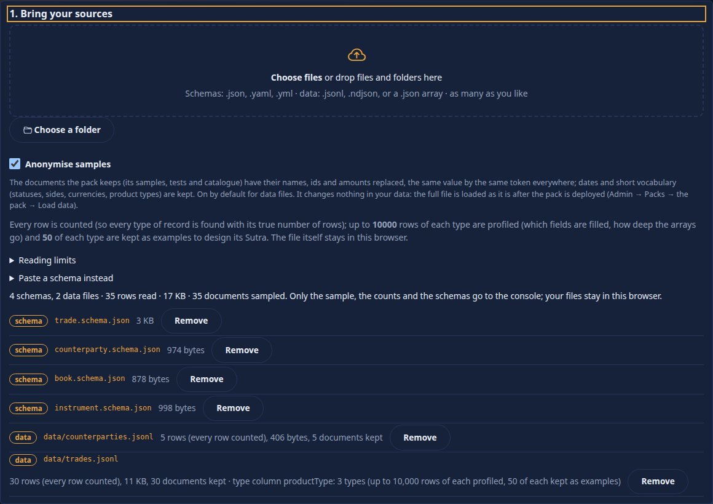

Choose or drop files and folders: schemas (`.json`, `.yaml`, `.yml`) and data (`.jsonl`, `.ndjson`, or a `.json` array). A `.json` file that has `$schema`, or `properties`
with a `type`, or `$defs`, is taken as a schema, any other as data. **The files are read in your browser.** A JSON Lines file is streamed a line at a time and a
**reservoir sample** (200 documents, same file same sample) is kept; the page shows each file's progress, rows, size and bad lines, and the totals. Only the schemas, the
sample and the counts are sent: **never the whole folder**. *Reading limits* sets the rows per file, the MB per file and the sample size (up to the console's ceilings); a file
stopped at a cap says so. *Paste a schema instead* takes text. **Resume a draft** appears when you have one.

#### 2. Kinds

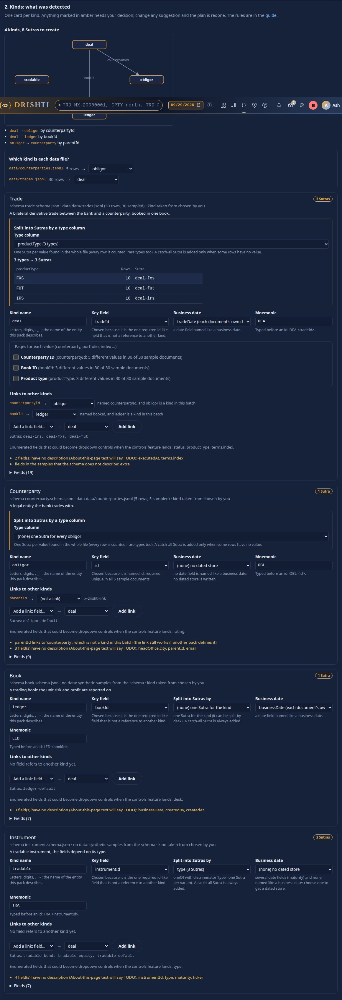

A graph of the kinds and their links, the data files with the kind each was matched to (change it), and **one card per kind**:

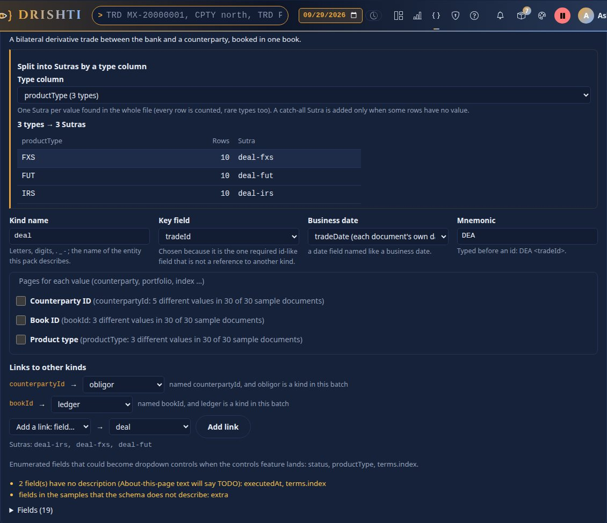

*Kind name* (rename it), *Key field* (with why, amber when ambiguous), *Split into Sutras by* (the match column, each with the number of Sutras it makes), *Business date field*,
*Mnemonic*, *Links to other kinds* (change a target, remove one, add one), the Sutra names, the enumerated fields offered as dropdown controls, the card's warnings and every field
with its label, type, format and description. Every change redoes the plan. A kind the server already defines in another pack is flagged:

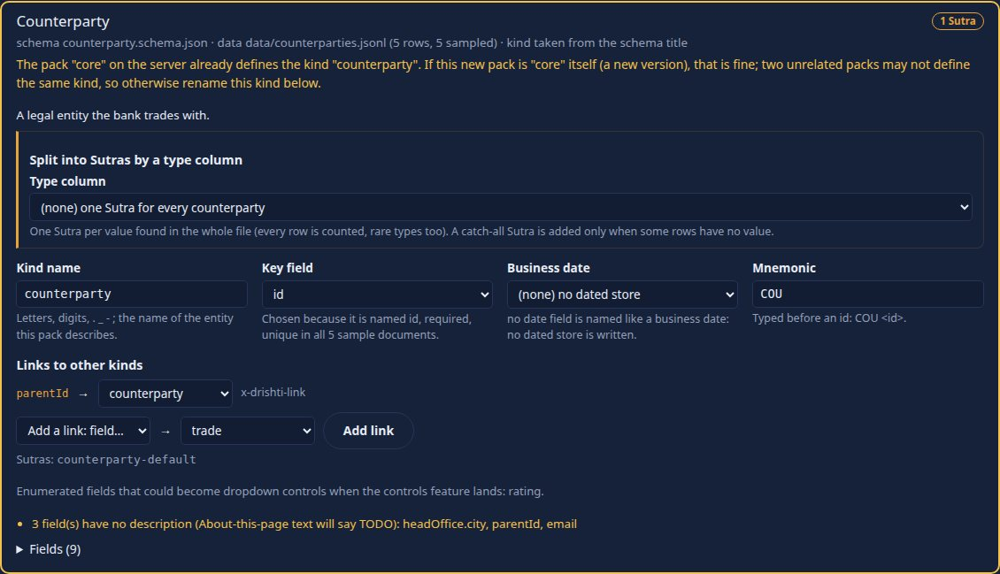

#### 3. Pack

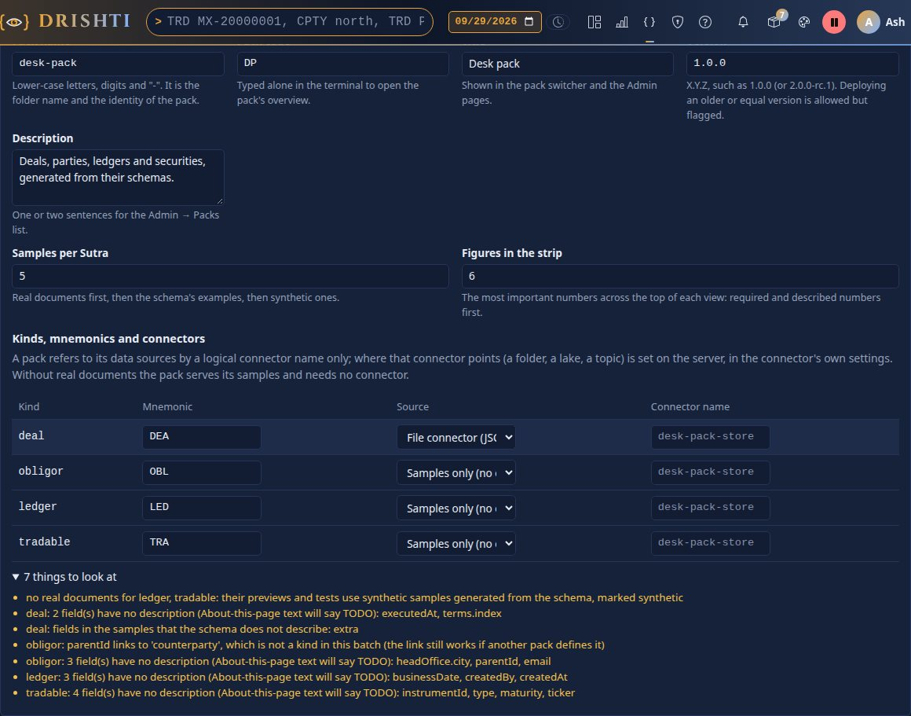

Name (letters, digits, `-`), code, title, version, description. *Samples per Sutra* and *Figures in the strip*. A table of the kinds with their **mnemonic** (checked against the
packs on the server), the **source** (samples only, the File connector, or a Delta lake) and the **logical connector name**. A pack name that exists says that deploying makes a new version.

#### 4. Preview

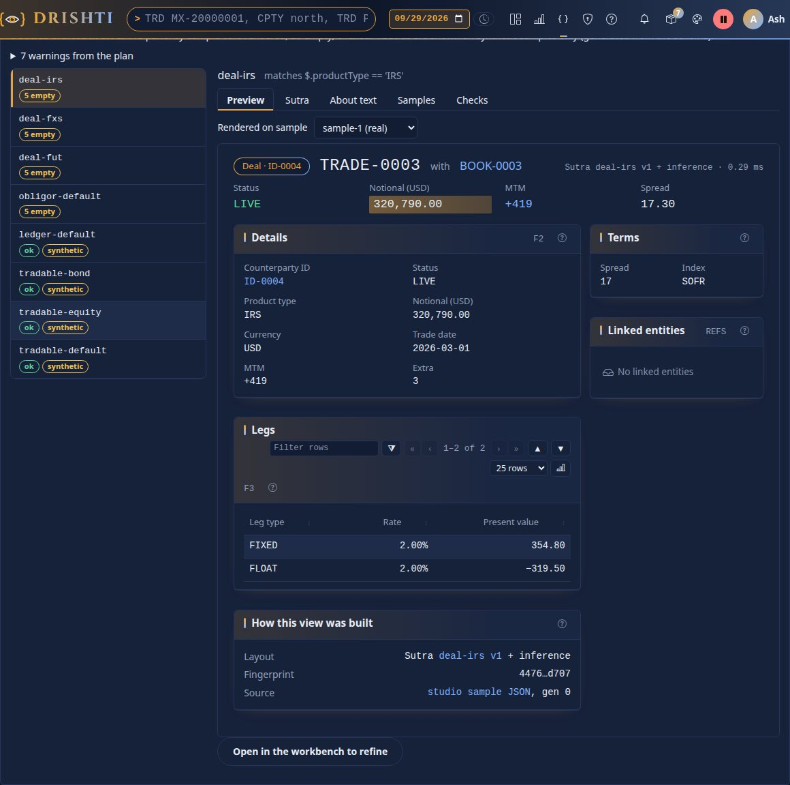

The server drafts every Sutra as a **background job** (one request per Sutra, a few at once): a progress bar, **Cancel**, and the Sutras drafted so far are kept when you cancel. Then a list of the Sutras
with badges (*ok*, empty or failed cells, *synthetic*) and, for the one you choose, five tabs: **Preview** (the server's own rendering on a sample you pick, real, example or synthetic), **Sutra** (the
YAML), **About text** (what the *About this page* drawer will say, TODO entries marked), **Samples** (each labelled by source) and **Checks** (every panel against every sample). *Open in the workbench to refine* makes a design with
the Sutra and its samples and gives you the link; the preview does not change when you edit there, so refine and then copy the YAML into the pack, or edit the schema and generate again.

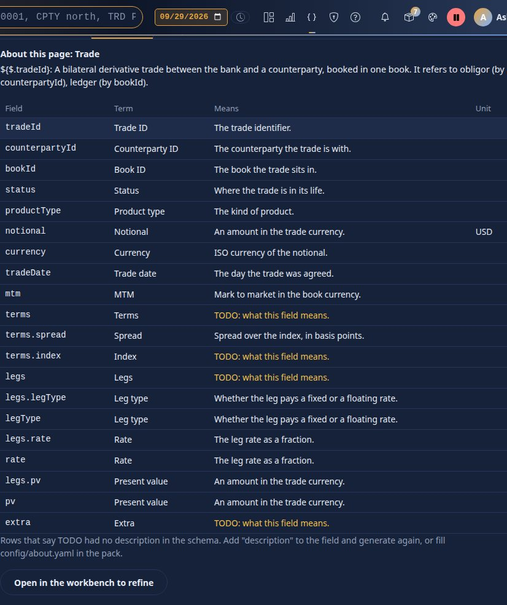

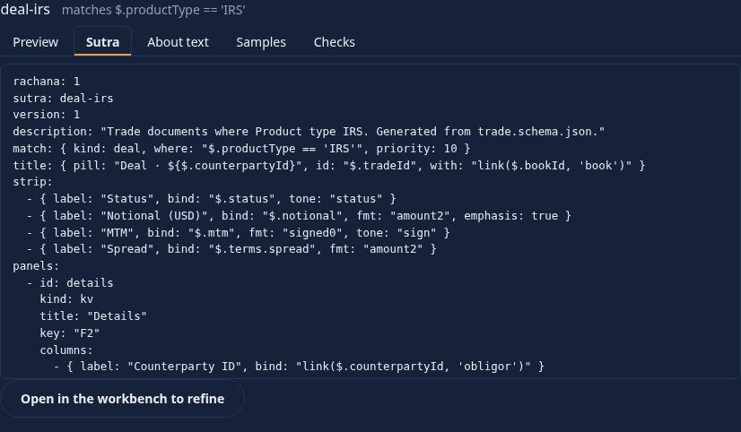

#### 5. Output

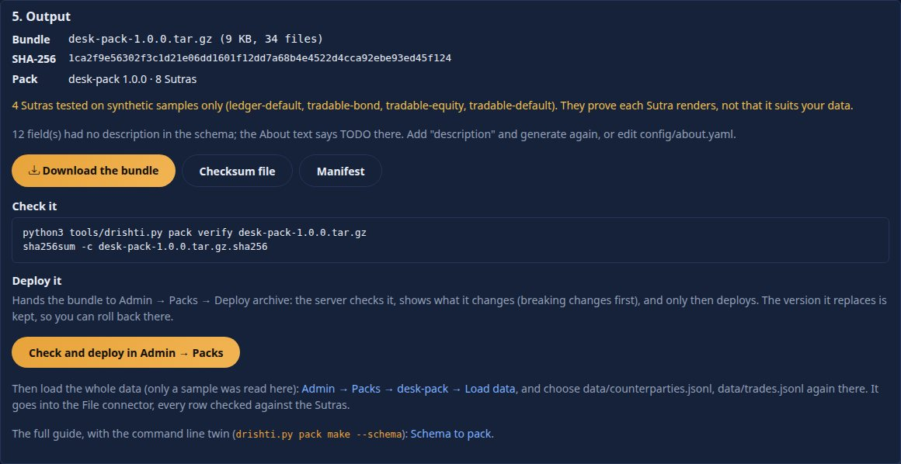

The **bundle** (`<name>-<version>.tar.gz`, with `.sha256` and the manifest) in **exactly the format of `drishti.py pack bundle`**: verify it with `drishti.py pack verify`. Anything synthetic or without a
description is listed. **Deploy** hands the bundle to Admin → Packs → Deploy archive:

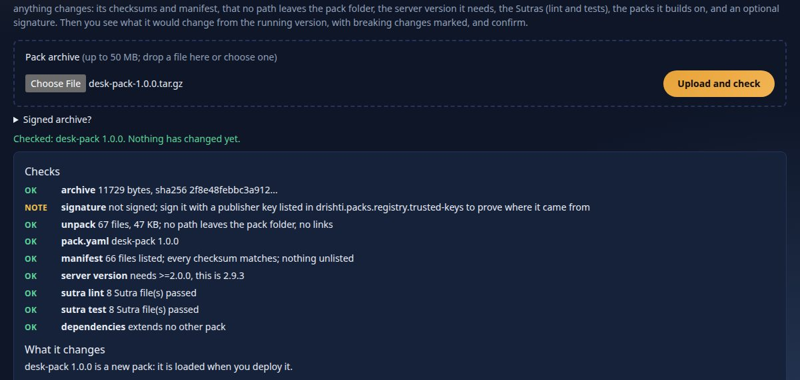

The server checks the archive (checksums, `pack.yaml`, server version, `sutra lint` and `sutra test`), shows what changes (breaking changes first, which you must acknowledge), and only on your
confirmation deploys. The version it replaces is kept: **roll back** there ([OPERATIONALISING §17](OPERATIONALISING.md#17-deploy-from-admin--packs-connectors-history-and-roll-back)).

#### Drafts, keyboard, phone, themes

**Save draft** keeps the state (the schemas, your choices, the file names and counts, not the data) as a design named `New pack: <name>` in *My designs*; it is saved when you move between steps and resumed from the
page. Data files are chosen again after a resume. Every control is a native button, field or select: Tab through, Enter or Space to press; the Sutra list takes Up and Down, the tabs Left and Right. In the light and dark themes colours come from the console's tokens
and every state has a word as well as a colour. At phone width the columns stack and every control is 44 px:

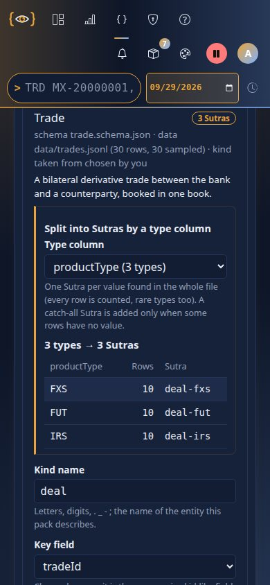

### The command line

`sutra design --schema` and `pack make --schema` (see [CLI guide](CLI_GUIDE.md#sutra-design---schema-and-pack-make---schema)) run the same rules.

| Option | Meaning |
|---|---|
| `--schema FILE\|DIR ...` | the schemas; a folder takes its `*.schema.json` / `*.schema.yaml`, else every `.json` / `.yaml` in it. A `.jsonl` file or folder written after it is data |
| `INPUT ...` | JSON Lines files or folders (`pack make`; for `sutra design`, the positional paths) |
| `--kind K` | rename the kind of **one** schema (several: use `x-drishti-kind`) |
| `--key`, `--date`, `--match` | `FIELD` for every kind or `kind=FIELD,kind2=FIELD2` (`--match` as `kind=a,b;kind2=c`); `--match none` makes one Sutra per kind |
| `--mnemonic` | `kind=MN,kind2=M2` |
| `--count N` / `--samples N` | samples per Sutra (`sutra design` / `pack make`), default 5 |
| `--strip N` | figures in the strip, default 6 |
| `--store delta\|files`, `--connector NAME`, `--code`, `--description`, `--title`, `--version`, `--out`, `--force` | as in `pack make` |
| `--yes` | never ask which field is the key |

#### One Sutra, printed

```text
$ python3 tools/drishti.py sutra design --schema docs/guides/examples/schemas/instrument.schema.json --yes
instrument: key instrumentId (named <kind>Id, required); date (none); match type; 3 Sutra(s); synthetic samples
  warning: no real documents for instrument: their previews and tests use synthetic samples generated from the schema, marked synthetic
  warning: instrument: 4 field(s) have no description (About-this-page text will say TODO): instrumentId, type, maturity, ticker
drafting 3 Sutra(s) with one `sutra design --each` run ...
```

stdout is the Sutras, one after another, separated by `---`. The first (`instrument-bond`, one of three, for the `BOND` branch of the `oneOf`):

```yaml
rachana: 1
sutra: instrument-bond
version: 1
description: "Instrument documents where Type BOND. Generated from instrument.schema.json."
match: { kind: instrument, where: "$.type == 'BOND'", priority: 10 }
title: { pill: "Instrument · ${$.type}", id: "$.instrumentId" }
strip:
  - { label: "Coupon", bind: "$.coupon", fmt: "pct2", emphasis: true }
panels:
  - id: details
    kind: kv
    title: "Details"
    key: "F2"
    columns:
      - { label: "Name", bind: "$.name" }
      - { label: "Type", bind: "$.type" }
      - { label: "Coupon", bind: "$.coupon", fmt: "pct2" }
      - { label: "Maturity", bind: "$.maturity", fmt: "date" }
  - id: built
    kind: provenance
    title: "How this view was built"
  - id: coupon
    kind: metric
    title: "Coupon"
    area: right
    value: "$.coupon"
    fmt: "pct4"
  ...
```

Its strip holds the bond's own figure (`coupon`, formatted `pct2` because the schema says so); the equity branch has `dividendYield` and `ticker` and no `coupon`. With
`--out DIR` the Sutras are written under `DIR/<kind>/` and their samples under `DIR/tests/<sutra>/`, and `sutra lint` runs on the result.

#### A whole pack, schemas and real documents

```text
$ python3 tools/drishti.py pack make --schema docs/guides/examples/schemas docs/guides/examples/schemas/data \
      --name desk-pack --store files --yes
book: key bookId (named <kind>Id, required); date businessDate; match (none); 1 Sutra(s); synthetic samples
counterparty: key id (named id, required, unique in all 5 sample documents); date (none); match (none); 1 Sutra(s); links parentId->counterparty; real samples: 5
instrument: key instrumentId (named <kind>Id, required); date (none); match type; 3 Sutra(s); synthetic samples
trade: key tradeId (named <kind>Id, required, unique in all 30 sample documents); date tradeDate; match productType; 3 Sutra(s); links counterpartyId->counterparty, bookId->book; real samples: 30
  warning: no real documents for book, instrument: their previews and tests use synthetic samples generated from the schema, marked synthetic
  warning: book: 3 field(s) have no description (About-this-page text will say TODO): businessDate, createdBy, createdAt
  warning: counterparty: 3 field(s) have no description (About-this-page text will say TODO): headOffice.city, parentId, email
  warning: instrument: 4 field(s) have no description (About-this-page text will say TODO): instrumentId, type, maturity, ticker
  warning: trade: 2 field(s) have no description (About-this-page text will say TODO): executedAt, terms.index
  warning: trade: fields in the samples that the schema does not describe: extra
drafting 8 Sutra(s) with one `sutra design --each` run ...
  trade 2026-03-01: 10 rows -> data/build/desk-pack-1.0.0/data/files/desk-pack/2026-03-01/trade.jsonl
  trade 2026-03-02: 10 rows -> data/build/desk-pack-1.0.0/data/files/desk-pack/2026-03-02/trade.jsonl
  trade 2026-03-03: 10 rows -> data/build/desk-pack-1.0.0/data/files/desk-pack/2026-03-03/trade.jsonl
kind                business date        rows
trade               2026-03-01             10
trade               2026-03-02             10
trade               2026-03-03             10
total rows: 30

== pack check
== desk-pack: sutra lint: exit 0
== desk-pack: sutra test: exit 0

== pack bundle
bundled desk-pack 1.0.0: 66 files
  data/build/desk-pack-1.0.0/bundle/desk-pack-1.0.0.tar.gz
  sha256 6c9a2b925676f946740e95b870056731199217acb2dbf73e4a2297a89559d643

== pack verify
verify data/build/desk-pack-1.0.0/bundle/desk-pack-1.0.0.tar.gz: desk-pack 1.0.0
  checksums ok
  schema    ok
  server    ok
  sutra     ok
verified

pack make: data/build/desk-pack-1.0.0
  8 Sutra(s) for 4 kind(s) (4 tested on synthetic samples only); pack check passed, pack verify passed
next: read data/build/desk-pack-1.0.0/README.txt, then  DRISHTI_JAR=<exec jar> DRISHTI_PORT=18480 data/build/desk-pack-1.0.0/run-server.sh
```

The trade's three Sutras are its three `productType` values (`trade-irs`, `trade-fxs`, `trade-fut`); the instrument's are `instrument-bond`,
`instrument-equity` (the `oneOf` variants) and `instrument-default`. The example schemas and their JSON Lines are camel case
(`tradeId`, `productType`): the rules read any naming, and the same run on UPPER_SNAKE schemas (`TRADE_ID`, `PRODUCT_TYPE`, as the shipped
packs write them) finds the same keys, dates, matches and links.

`trade` and `counterparty` had real documents (30 and 5), so their Sutras were tested on those; `book` and `instrument` had none, so they were tested on synthetic samples, and the run
says so. The `extra` field of `trades.jsonl` is not in the schema: it is reported, shown in the Sutra and given a `TODO` glossary entry. Exit codes are those of `pack make`: 0, 1
(made but a check failed), 2 (usage: no key, a missing file, the folder exists without `--force`).


### The pack that comes out

The folder is the one `pack make` writes ([CLI guide](CLI_GUIDE.md#quickest-path-pack-make)): `README.txt`, `pack/<name>/`, `data/` (only when real, dated documents were given), `bundle/`, `config/`,
`run-server.sh`, `run-server.ps1`, `MANIFEST.json`. In the pack:

```text
pack/desk-pack/
├── pack.yaml                 kinds, mnemonics, columns, graph.fields (the links); connectors (the names), connector-templates (their suggested settings), routes and ingest when real dated data was given
├── sutras/<kind>/<sutra>.v1.sutra.yaml
├── tests/<sutra>/            sample-N.json / sample-example-N.json / sample-synthetic-N.json and expect.yaml
├── samples/                  documents per kind and catalog.jsonl, so the pack opens before any data source
├── config/about.yaml         About this page: a sentence per kind, a glossary entry per shown field
└── README.md                 what was generated, which Sutras are synthetic, next steps
```

`pack.yaml` (the start; real output):

```yaml
# Generated by drishti schemakit (section 5); now yours to edit.
# book: key $.bookId, business date $.businessDate
# counterparty: key $.id
# instrument: key $.instrumentId
# trade: key $.tradeId, business date $.tradeDate
pack: desk-pack
version: 1.0.0
code: DP
title: Desk pack
description: 'Generated from schemas: Book, Counterparty, Instrument, Trade.'
kinds:
- book
- counterparty
- instrument
- trade
sutras: sutras
samples: samples
mnemonics:
  BOO:
    kind: book
    label: Book
  COU:
    kind: counterparty
    label: Counterparty
  INS:
    kind: instrument
    label: Instrument
  TRA:
```

`config/about.yaml` (the start; real output), the words coming from the schema's descriptions and `TODO` where there were none:

```yaml
about: 1
kinds:
  book:
    title: Book
    about: '${$.bookId}: A trading book: the unit risk and profit are reported on.'
    glossary:
      bookId:
        term: Book ID
        means: Book code.
      desk:
        term: Desk
        means: The desk the book belongs to.
      tradeCount:
        term: Trade count
        means: Number of live trades.
      dv01:
        term: DV01
        means: Rate sensitivity per basis point.
      businessDate:
        term: Business date
        means: 'TODO: what this field means.'
      createdBy:
        term: Created by
        means: 'TODO: what this field means.'
      createdAt:
        term: Created at
        means: 'TODO: what this field means.'
```

`MANIFEST.json` records, per kind, the key and why, the date, the match fields, the number of Sutras and the links (with why); `controls` (the dropdown suggestions), `syntheticSutras`, the
warnings, the bundle's checksum and `checks` (`packCheck`, `packVerify`).


### Limits and settings

| Setting | Default | |
|---|---|---|
| `builder.pack_sample_docs` | 200 | documents kept per data file and sent |
| `builder.pack_read_max_rows`, `builder.pack_read_max_mb` | 500000, 1024 | the most the page may be told to read per file |
| `builder.pack_max_files`, `builder.pack_max_docs`, `builder.pack_max_schema_kb`, `builder.pack_max_sutras` | 200, 5000, 512, 200 | refused with `413 DRS-5005` |
| `builder.pack_jobs_per_user`, `builder.pack_job_ttl_min`, `builder.pack_draft_concurrency` | 3, 60, 4 | preview jobs |
| `builder.tools_dir` | `../tools` | where `packbundle.py` is |
| `builder.pack_profile_rows_per_type` | 10000 | rows of each type profiled (fields filled, array sizes); every row is still counted |
| `builder.pack_design_samples_per_type` | 50 | documents of each type kept, varied in shape, to design that type's Sutra |
| `builder.pack_load_max_mb`, `drishti.loads.upload-max-mb` | 2048, 2048 | the largest file **Load data** streams on (console), and takes (server) |

All are in [CONFIGURATION.md](../admin/CONFIGURATION.md).

### Troubleshooting

| You see | Meaning |
|---|---|
| *Another pack on the server already defines the kind* | rename the kind on its card, or name the pack as the one that defines it (a new version) |
| *no key could be chosen* | no field looks like an id: mark one with `x-drishti-role: key`, `--key`, or the card |
| a card in amber, *ambiguous key* | several fields look like ids; choose |
| *no date field ... no dated store* | none named like a business date; choose one on the card to get a dated store |
| *no real documents ... synthetic* | no data was given for that kind; the Sutra is tested on documents made from the schema |
| *fields in the samples that the schema does not describe* | the schema is behind the data; they appear in the Sutra with a `TODO` entry |
| *$ref points at a schema that is not in this batch* | add that file to the batch |
| a Sutra *refused by the server* | the Sutra tab shows the located problems; usually a field name that is not a valid path |
| *501 packbundle.py is not available* | the console cannot find `tools/` (`builder.tools_dir`); the page still plans and previews |
| *429 DRS-5005* | too many preview jobs running: cancel one |
| *N types → N + 1 Sutras* on the card | some rows have no type; the extra one is the catch-all and the card says how many rows it is for |
| a field shown as *TODO* everywhere | blank in every row read (only `""` or spaces): it is hidden; a field that is blank in some rows is shown where it has a value |
| Load data: *types with no Sutra* | rows whose type the pack was not built with; they are stored, and open with the catch-all if there is one: make the pack again from a file that has them |
| *DRS-1001 no source holds deals-counterparty/...* right after a load | the pages per value are rebuilt by the load; if they are not, check the load result's steps say the pack's `-pages` connector was refreshed |

### Not yet, and what this leaves for later

- **Controls.** Enumerated fields are listed as dropdown suggestions (plan and `MANIFEST.json`); the design of controls is in progress (RUPAKA, the BI design note, section 8, has none yet), so nothing is written to a Sutra.
- **Editing the generated Sutras in place.** Open one in the workbench to refine it; to keep the schema as the source, change the schema and generate again (`pack regenerate` merges later changes).

### Appendix: A deep trading JSON

A trading system's export is often **one large JSON array** with no schema: each element a deal, its legs inside it, each leg's cash flows
inside the leg, each cash flow's resets inside that, events beside the legs, names in `UPPER_SNAKE`, blanks written as `""`, and no field
that says which day the file describes. Several products share the file and one column (`PRODUCT_TYPE`) tells them apart. This appendix
takes such a file from nothing to a deployed pack with its data, every step in the browser, with the command line and the YAML beside it.

Every value here is **synthetic** (`tools/packgen/comswap_synth.py`: counterparties `CPTY-ALPHA` ..., traders *Trader A* ..., portfolios
`PF-ENERGY-01` ...). Never put a real export's values in a pack, a test, a sample or a screenshot: **Anonymise samples** (below) exists for that.

```bash
# a whole book in one file: 5,000 deals of five types (ComSwap, ComFut, Cash, Commodity and a rare CallNot), about 66 MB
# --array writes the export's own shape, one pretty-printed JSON array, as a booking system does (the steps below upload it as it comes)
python3 tools/packgen/comswap_synth.py --mix --deals 5000 --array --out deals.json
# without --array: JSON Lines, one deal a line (every generator's output, section 2)
python3 tools/packgen/comswap_synth.py --mix --deals 5000 --out deals.jsonl
# small ones are committed: docs/guides/examples/comswap/book-sample.jsonl (40 mixed) and comswap-sample.jsonl (40 swaps)
# another deep shape, four levels, camelCase: a structured note (coupon periods, observations, fixings), one a line
python3 tools/packgen/note_synth.py --notes 30 --out notes.jsonl
```

One deal, shortened:

```json
{ "TRADE_ID": 100004, "TRANSACTION_ID": 700000021, "TRADE_STATUS": "Amended", "PRODUCT_TYPE": "ComSwap",
  "PRODUCT_SUB_TYPE": "Fixed float swap", "COUNTERPARTY": "CPTY-PRAIRIE", "PORTFOLIO": "PF-ENERGY-01", "LEGAL_ENTITY": "LE-SOUTH",
  "TRADE_DATE": "2026-02-17", "START_DATE": "2026-05-01", "MATURITY_DATE": "2027-10-31", "QUANTITY": 180000, "PRECIOUS_METAL_FLAG": "",
  "LEGS": [
    { "LEG_ID": 1, "LEG_TYPE": "Fixed", "NOTIONAL": 10000, "CASH_FLOWS": [ { "FLOW_ID": 5000099, "PAYMENT_DATE": "2026-06-05", "RESETS": [] } ] },
    { "LEG_ID": 2, "LEG_TYPE": "Float", "INDEX": { "NAME": "IDX-NATGAS-TTF", "GROUP": "Energy" },
      "CASH_FLOWS": [ { "FLOW_ID": 5000119, "PAYMENT_DATE": "2026-08-05",
                        "RESETS": [ { "RESET_ID": 1, "RESET_DATE": "2026-07-01", "ACCRUAL_START_DATE": "", "RATE": "31.8669" } ] } ] } ],
  "EVENTS": [ { "EVENT_ID": 9000011, "LEG_ID": 1, "EVENT_TYPE": "Reset", "EVENT_DATE": "2026-06-05", "AMOUNT": 142210.64 } ] }
```

#### 1. Read the file (Build → New pack, step 1)

Choose `deals.json` with **Choose files**. The page streams it: one document in memory at a time, whatever its size, and nothing is
uploaded. **Every row is counted** for the columns that could tell record types apart, up to `builder.pack_profile_rows_per_type` rows of
each type are profiled (how often each field has a value, digits written as text, the size of every array at every depth), and
`builder.pack_design_samples_per_type` documents of each type are kept, chosen for variety (with and without events, one leg and two, fixed
and floating). Measured: 66 MB / 5,000 deals in 0.5 s; 2 GB / 500,000 rows in about 20 s with about 110 MB in the page, flat.

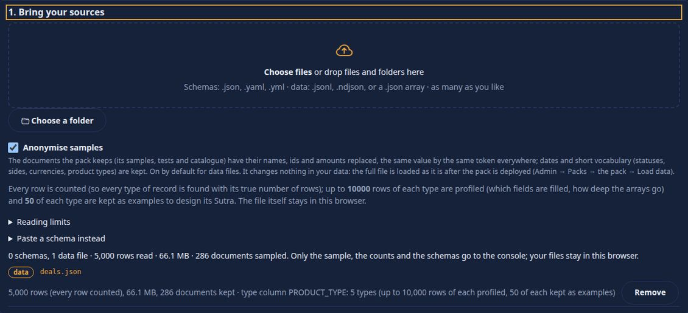

**Anonymise samples** is on by default for data files: before anything leaves the browser's sample, names and ids are replaced the same way
everywhere (`CPTY-0007`), digits by other digits of the same length, amounts scaled; dates and short vocabularies (`Buy`, `Float`) are kept, so
the design is the same. Turn it off only for data you may share.

#### 2. The card (step 2)

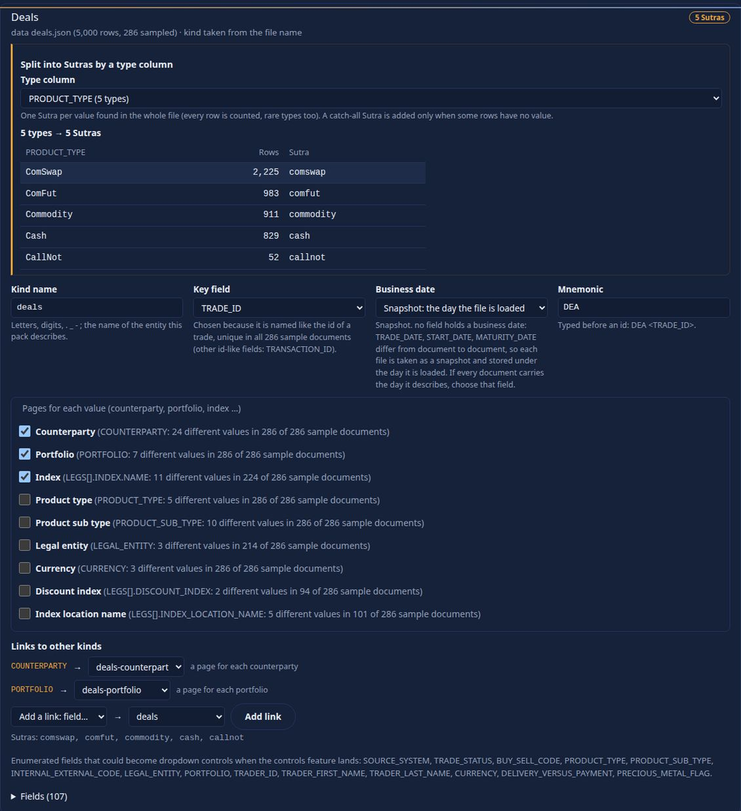

You should see, without choosing anything:

- **Split into Sutras by a type column**: `PRODUCT_TYPE (5 types)`, and the list *5 types → 5 Sutras*: `ComSwap 2,225 → comswap` ...
  `CallNot 52 → callnot`. The rare type is there with its true count, because every row was counted. No catch-all: every row has a type
  (a file where some rows have none gets a sixth, `deals-default`, and the card says for how many rows).
- **Key field** `TRADE_ID`, *named like the id of a trade, unique in all documents (other id-like fields: TRANSACTION_ID)*. An integer id is
  an id: never summed, never a strip figure.
- **Business date**: *Snapshot: the day the file is loaded*. `TRADE_DATE`, `START_DATE` and `MATURITY_DATE` differ from deal to deal, so none
  is the day of the file. Choose one if every document does carry its own day.
- **Pages for each value**: *Counterparty*, *Portfolio* and *Index* (`LEGS[].INDEX.NAME`, found inside the legs) are ticked; each becomes a
  kind of its own, built by the server from the deals (no extra feed), linked both ways: a deal's counterparty opens the counterparty's page,
  which lists its deals.
- **Fields**: `UPPER_SNAKE` read as words (*Trade status*, *Buy sell code*); a field that is blank in every row (`PRECIOUS_METAL_FLAG` above)
  is hidden rather than shown empty; a field filled in a few rows shows its *Filled* share.

The same plan from the command line, where every choice above has a flag:

```bash
python3 tools/drishti.py pack make deals.json --name book --kind deals --store files --yes
#   deals: key TRADE_ID (named like the id of a trade, unique in all 5000 sample documents (other id-like fields: TRANSACTION_ID));
#   date (none); match PRODUCT_TYPE; 5 Sutra(s); links COUNTERPARTY->deals-counterparty, PORTFOLIO->deals-portfolio
#   deals-counterparty / deals-portfolio / deals-index: key id (the value the documents share); links dealsIds->deals
#   deals 2026-10-16: 5000 rows -> data/build/book-1.0.0/data/files/book/2026-10-16/deals.jsonl   (the day: today's business date)
#   pack make: data/build/book-1.0.0   8 Sutra(s) for 4 kind(s); pack check passed, pack verify passed
# --match COL          another type column
# --key TRADE_ID       --date FIELD (instead of a snapshot)       --as-of 2026-10-16 (the day a snapshot is stored under)
# --related none       no pages per value; --related COUNTERPARTY,PORTFOLIO for these only
# --no-anonymise       keep the samples as they are
```

#### 3. Pack, preview, deploy (steps 3 to 5)

Name the pack `book` and press Next. The preview drafts the five Sutras and the three page kinds against the server and checks each one.

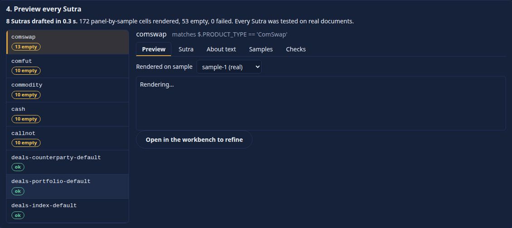

Step 5 downloads the pack or **deploys it** (Admin → Packs, with its checks). What comes out, in `pack.yaml` (shortened):

```yaml
pack: book
kinds: [deals, deals-counterparty, deals-portfolio, deals-index]
connectors: [book-pages, book-store]
routes: {deals: book-store, deals-counterparty: book-pages, deals-portfolio: book-pages, deals-index: book-pages}
ingest:
  deals: {key: TRADE_ID, snapshot: true}       # no business-date field: stored under the day it is loaded
connector-templates:
  book-store:                                  # the File connector the data goes into
    plugin: file
    kinds: [deals]
    settings:
      root: ${DRISHTI_FILES_ROOT:${drishti.data.dir:./data}/files}
      domain: book
      layout:
        deals:
          columns: [TRADE_STATUS, BUY_SELL_CODE, QUANTITY, PRODUCT_SUB_TYPE, COUNTERPARTY, PORTFOLIO, START_DATE, TRADE_ID, ...]
          title: [PRODUCT_TYPE, COUNTERPARTY, PORTFOLIO]
  book-pages:                                  # the pages per value, built from the deals
    plugin: derived
    kinds: [deals-counterparty, deals-index, deals-portfolio]
    settings:
      deals-counterparty:
        from: deals
        group-by: $.COUNTERPARTY
        fields: {count: count, totalQuantity: sum $.QUANTITY, portfolios: distinct $.PORTFOLIO}
      deals-index:
        from: deals
        group-by: first($.LEGS[?@.INDEX.NAME != '']).INDEX.NAME
graph:
  fields:
    COUNTERPARTY: {kind: deals-counterparty, label: Counterparty}
    PORTFOLIO: {kind: deals-portfolio, label: Portfolio}
```

`layout.deals.title` puts the type, counterparty and portfolio after the id in the search title, so typing `CPTY-PRAIRIE` in the command bar
offers that counterparty's deals as well as its page. The pack also carries `sutras/deals/{comswap,comfut,commodity,cash,callnot}.v1.sutra.yaml`,
one Sutra for each page kind, anonymised samples and tests, and `config/bi/` (section 7).

#### 4. Load the data (Admin → Packs → book → Load data)

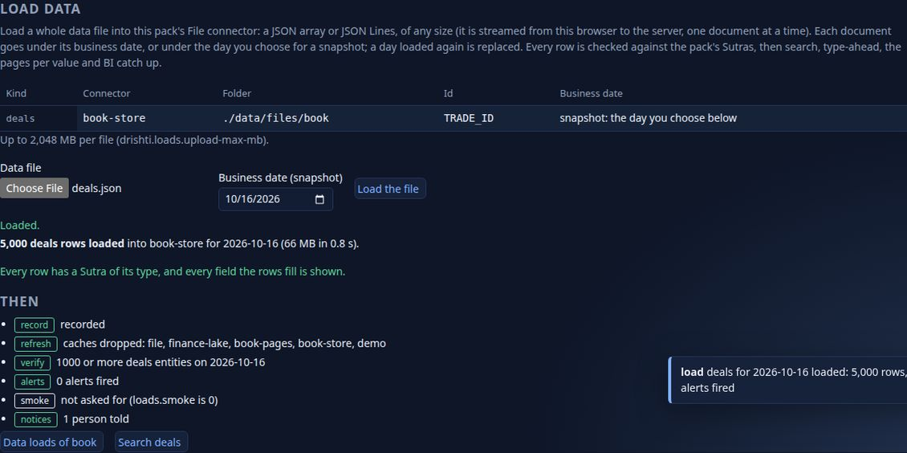

Choose the same `deals.json` and press **Load the file**. It is streamed from the browser to the server (never held in memory on the way,
up to `drishti.loads.upload-max-mb`), written into `book-store` under the business date (a snapshot: today's, or the day you choose; a day
loaded again is replaced), and **every row is checked** against the pack's Sutras: *types with no Sutra* (a product the pack was not built
with) and *fields no Sutra shows* are listed with their counts. Then the load is announced like any other data load
([Data loads](#1-telling-drishti-new-data-has-landed)): caches are dropped (the pages per value are rebuilt from the new deals), the day is verified, alerts and
subscriptions run. 5,000 deals take about a second.

The same from a script, or offline:

```bash
# over REST, with a token that has packs:admin (a JSON array or JSON Lines)
curl -sS -X POST "http://HOST:18480/api/v1/admin/packs/book/data?kind=deals&date=2026-10-16" \
     -H "Authorization: Bearer $DRISHTI_TOKEN" -H "Content-Type: application/json" --data-binary @deals.json
# offline, into the File connector's folder (JSON Lines: what comswap_synth.py writes without --array)
python3 tools/drishti.py data ingest --from deals.jsonl --pack data/build/book-1.0.0/pack/book --store files --root /path/to/files --as-of 2026-10-16
```

#### 5. A deal

Type `DEA 100004 <GO>` (or the counterparty's name, and pick the deal).

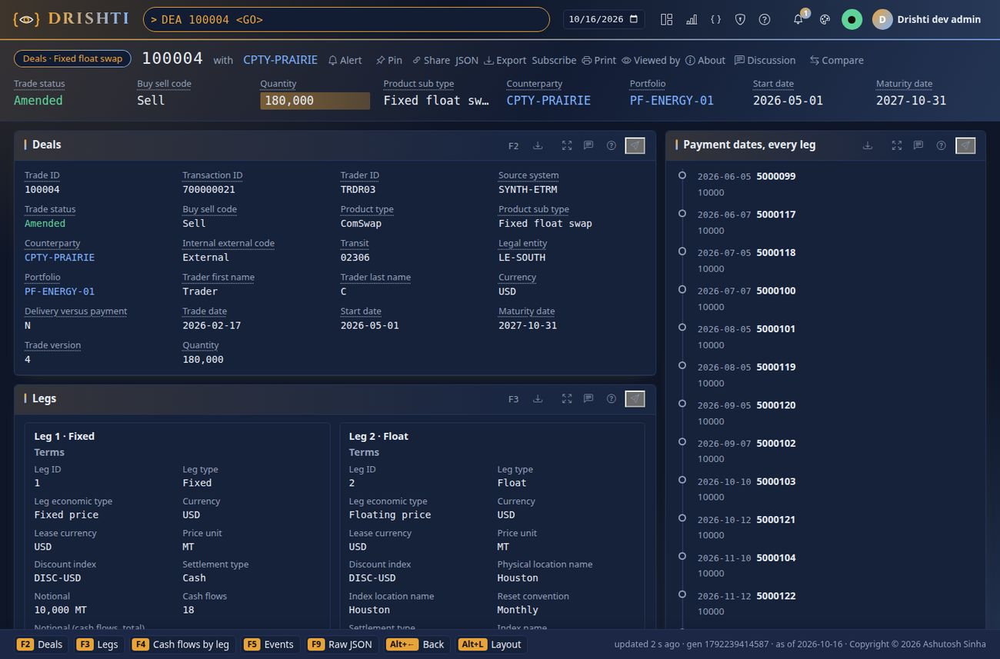

- the **strip**: status, side, quantity, sub type, counterparty and portfolio (links), start and maturity;
- **Deals** (F2): every field the deal fills, blanks left out;
- **Legs** (F3): a few legs **side by side**, each with its own terms (a fixed leg's price, a floating leg's index and reset convention);
- **Cash flows by leg** (F4): a tab per leg, each schedule a row wide, drilling down level by level (below);
- **Events** (F5): the deal's resets, payments and the like, or *No events* when it has none;
- on the right, the **payment dates of every leg** as one timeline (`flatten($.LEGS[*].CASH_FLOWS)`), and the other deals of the same counterparty.

A ComFut, a Cash payment and a CallNot open with their own Sutras: the same arrangement made from their own fields (a cash deal has no legs
panel because it has no legs).

#### 6. Drill down: leg → cash flow → resets

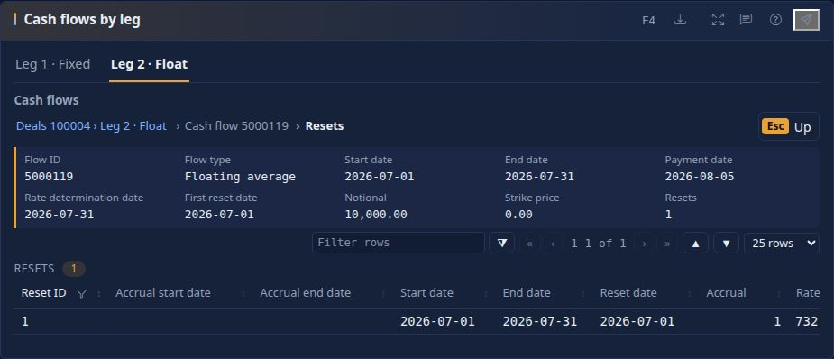

In **Cash flows by leg**, choose *Leg 2 · Float*, then a cash flow's link (`5000119 1 ▸`: one reset). The breadcrumb reads *Deals 100004 ›
Leg 2 · Float › Cash flow 5000119 › Resets*, the cash flow's values sit above as a ticket, and its resets fill the table with their count.
Keyboard: ↑ ↓ to a row, Enter or → to open, **Esc**, Backspace or ← to go up (the row you came from stays selected); the browser's Back goes
up too, and the address keeps the level and the tab, so a copied link opens this very table of resets. The Sutra behind it (shortened):

```yaml
  - id: legs-cash-flows
    kind: tabs
    title: Cash flows by leg
    each: "$.LEGS"
    tabTitle: "'Leg ' + @.LEG_ID + ' · ' + @.LEG_TYPE"
    panels:
      - id: legs-cash-flows-rows
        kind: table
        title: Cash flows
        rows: "@.CASH_FLOWS"
        crumb: "'Cash flow ' + @.FLOW_ID"
        root: "'Deals ' + $.TRADE_ID + ' › ' + 'Leg ' + @.LEG_ID + ' · ' + @.LEG_TYPE"
        empty: "No cash flows"
        columns:
          - { label: "Payment date", bind: "@.PAYMENT_DATE", fmt: "date" }
          - { label: "Notional", bind: "@.NOTIONAL", fmt: "amount2", total: true }
          - { label: "Resets", bind: "size(@.RESETS)", fmt: "amount0" }
        levels:
          - rows: "@.RESETS"
            title: "Resets"
            crumb: "'Reset ' + @.RESET_ID"
            columns:
              - { label: "Reset date", bind: "@.RESET_DATE", fmt: "date" }
              - { label: "Rate", bind: "@.RATE", fmt: "price4" }
```

Nothing in it is about trades: any array whose elements hold arrays is drawn this way, to any depth (the structured note of
`note_synth.py` drills *coupon period → observations → fixings*). `levels`, `crumb`, `root` and `empty` are in the
[Rachana reference](RACHANA_REFERENCE.md#levels-drill-down-level-by-level).

#### 7. A counterparty, the phone, and BI

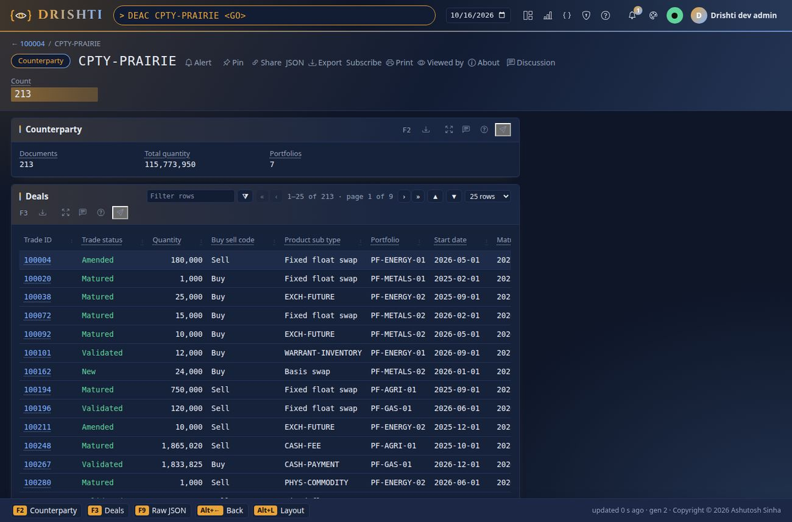

The counterparty link opens `DEAC CPTY-PRAIRIE`: how many deals, the total quantity, how many portfolios, and every deal (filter, sort, page;
each id opens the deal). On a phone the same deal stacks: the strip in two columns, panels one under another, the function keys along the
bottom, nothing wider than the screen.

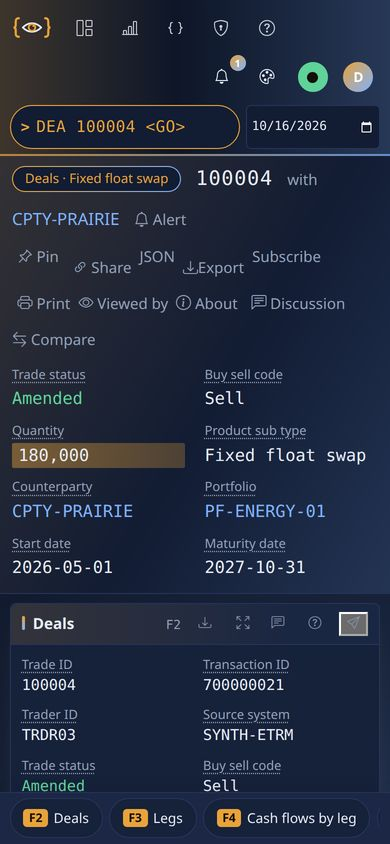

For analysis the pack ships a **BI model** with a table for every level, each row carrying the keys above it, so a cash flow can be counted by
its deal's counterparty or its leg's index:

```yaml
# config/bi/models/book-deals.model.yaml (shortened)
model: book-deals
datasets:
  deals: {dataset: book-deals-deals, role: dimension}
  legs: {dataset: book-deals-legs, role: fact}              # each: LEGS
  cash_flows: {dataset: book-deals-cash-flows, role: fact}  # each: LEGS[].CASH_FLOWS, with ^.LEG_ID
  resets: {dataset: book-deals-resets, role: fact}          # each: LEGS[].CASH_FLOWS[].RESETS, with ^.FLOW_ID and ^^.LEG_ID
  events: {dataset: book-deals-events, role: fact}
relationships:
  - {from: legs.id, to: deals.id}
  - {from: cash_flows.id, to: deals.id}
measures:
  Leg notional: {expr: sum(legs.NOTIONAL), format: amount0}
  Cash flows: {expr: count(cash_flows)}
```

```bash
python3 tools/drishti.py bi mq --model book-deals@1 --select deals.PRODUCT_TYPE --measures "Deals documents,Cash flows,Resets" --server http://HOST:18480 --token-file my-token.txt
```

#### What is still short of a trading terminal

The deal screen is generic, so it is not a product-specific one (a swap's pricing and risk screen, a description page per security): there is
no valuation, no curve or fixing history beside a floating leg, no side-by-side comparison of two deals, and the timeline shows dates and
amounts but not a cash-flow ladder netted by date. Those need a quant engine or a hand-written Sutra on top of the generated one.

## 6. The Data view: download a dataset

Taking data **out** of Drishti, a dataset and a day at a time: `DATA <GO>` (Views → Data, `/data`), the API under `/api/v1/data` and
`drishti.py data get`. It is download only: rows are never shown in a grid. The screen itself, panel by panel, is in
[USER_GUIDE.md (The Data view)](USER_GUIDE.md#the-data-view).

### 1. What a dataset is

A dataset is a **stored kind** of a loaded pack that a connector serves (`trade-valuation`, `trade`, `netting-set`); computed kinds (VaR, EE
and PFE, the what-ifs) hold no rows and are not listed. For each the view shows:

| Fact | Where it comes from |
|---|---|
| source | the connector that serves the kind now, and the table its data contract names (`storage.table`) |
| format | the connector's plugin: Delta, Iceberg, JSON Lines (the file connector), Database (JDBC), DuckDB ... |
| dates held | every business date the kind's sources hold (the Delta log, Iceberg snapshots, the file layout); *not dated* for a source of current rows only |
| columns | the data contract's fields; a kind without a contract: the source's columns, else the fields of a few of its entities |
| internal only | the kind is in `drishti.data-view.internal-only` (the IMF, Yahoo and news-headline kinds, [EXTERNAL_DATA.md](EXTERNAL_DATA.md)) |

### 2. The selection

A selection is the **columns** (all by default) and any number of **filter lines**, every line joined by AND. It is deliberately not SQL:
no joins, no grouping, no expressions. A line is written the same way on the screen's address, in the API and in the CLI:

| Line | Operator | Meaning |
|---|---|---|
| `DESK = DESK-COMM` | equals | the value is exactly this |
| `STATUS != DEAD` | not equals | anything else (a row without the value does not match) |
| `PRODUCT_TYPE in ComSwap,ComFut` | one of | any of the values, separated by commas (OR within one attribute) |
| `NAME contains bank` | contains | the text holds it, ignoring case |
| `PORTFOLIO starts BOOK-COMM` | starts with | the text begins with it, ignoring case |
| `MTM > 1000000` | greater than | numbers compare as numbers, everything else (dates included) as text |
| `PNL_1D < 0` | less than | as above |
| `DV01 between 1 and 5` | between | both ends included (`1,5` works too) |
| `NETTING_SET is empty` | is empty | no value, or an empty text |
| `COUNTERPARTY is not empty` | is not empty | any value |

The words work too (`equals`, `not equals`, `one of`, `starts with`, `greater than`, `less than`); a value may be quoted
(`DESK = "DESK COMM"`). A line that cannot be read is refused before any row is read (`400 DRS-5001`, saying how to write it), as is a
column the dataset does not have. At most 50 lines.

The selection is read back two ways, both for reference only: in plain words (*From trade-valuation on 2026-09-30: 9 columns, rows where DESK
is DESK-COMM, PRODUCT_TYPE is one of ComSwap or ComFut, and MTM is greater than 1000000.*) and as a SQL-like line:

```sql
SELECT TRADE_ID, PRODUCT_TYPE, PORTFOLIO, DESK, COUNTERPARTY, NOTIONAL, MTM, PNL_1D, VALUATION_DATE
FROM trade-valuation  -- 2026-09-30
WHERE DESK = 'DESK-COMM' AND PRODUCT_TYPE IN ('ComSwap', 'ComFut') AND MTM > 1000000
```

### 3. How the rows are read: pushdown and streaming

The rows are **streamed** from the connector to the file, never held whole in memory, on the server or in the console:

- **Pushed down.** When the kind has one source and that source keeps every column the selection reads as a column (Delta Lake and Iceberg
  tables with promoted columns, DuckDB, JSON Lines files with column reads), only those columns are read for the date, and the
  comparisons (`=`, `!=`, one of, `>`, `<`, between) go to the connector's column read, which drops the rows that fail them before they
  reach Drishti. A connector holds one date's chosen columns while it reads them; the rows go out in batches of
  `drishti.data-view.batch-rows`.
- **Filtered while streaming.** Otherwise (a union of sources, a field nested in a record, a source without column reads, or a caller with
  masks) the documents of the date are read in one pass and each is checked as it goes by. A source that cannot read a day in one pass is
  listed and read 500 entities at a time (at most `drishti.data-view.list-limit`).

Either way every row is checked against every line, so the answer is the same. The count before the download reads the day without the
pushdown, to give both numbers (*412 of 12,076 on the date*); it stops at `drishti.data-view.count-budget` (60 s) and then says *at least*.
The size is estimated by compressing the selected rows as the download will (the first 4 MB, the ratio applied to the rest).

### 4. Entitlements, masks, internal-only data and the audit

- **Entitlements.** Only datasets the person may open are listed or read: their role opens the kind, the pack is on for them, and the
  command is on (Admin → Commands); an edition or lens that hides the kind's command hides the dataset. The same rules as every other screen.
- **Masks.** A column masked for the person (`drishti.security.redact`, a role without `raw`) is left out of the column list and out of
  every download, even when a shared link names it; a filter line on it is refused (`403 DRS-5002`: filtering would tell its values). Masks
  deeper in a record apply too, so a masked person's rows are always read as documents with the masks applied.
- **Internal only.** A dataset whose source's terms restrict reuse is marked *internal only* in the list. It is refused for download
  (`403 DRS-5002`, the facts still shown) where the edition says `internal-only-data: off` (the four editions ship so) or the server says
  `drishti.data-view.internal-only-download: false`. The full Drishti, for internal use, downloads them.
- **Audit.** Every download writes one audit record when it ends: actor, action `data.download`, the dataset, and `date=...; columns=...;
  where=...; rows=N; complete` (or `incomplete` when the stream broke off). Admin → Audit lists them.

### 5. The API

All under `/api/v1`, for any signed-in person (a personal token too); the edition's `DATA` word and `drishti.data-view.enabled` switch it off
(`404 DRS-4023`, `403 DRS-5002`).

| Method | Path | Answer |
|---|---|---|
| `GET` | `/data` | `{internalOnlyRefused, datasets[{kind, pack, code, title, description, class, connector, format, table, dated, columnCount, internalOnly, refused, dates, first, last}]}` |
| `GET` | `/data/{kind}` | the facts as above with `grain`, `key`, `columns[{name, type, description}]` (less the masked), `masked` (how many left out) and `dates` (every date held) |
| `GET` | `/data/{kind}/count?date=&columns=&where=` | `{date, columns, lines, words, sql, pushdown, rows, total, complete, bytes, gzipBytes, read}` |
| `GET` | `/data/{kind}/rows?date=&columns=&where=` | the rows as `application/gzip`, `<kind>_<date>.jsonl.gz`; `X-Drishti-Selection` carries the selection in words |

`date` is `yyyy-MM-dd` and must be one the dataset holds (`400 DRS-4003` names the range); without it, the latest. `columns` is
comma-separated (or repeated); `where` is repeated, one line each. Example:

```bash
curl -H "Authorization: Bearer $DRISHTI_TOKEN" -o trade-valuation_2026-09-30.jsonl.gz \
  "http://localhost:8080/api/v1/data/trade-valuation/rows?date=2026-09-30&columns=TRADE_ID,DESK,MTM&where=DESK%20%3D%20DESK-COMM&where=MTM%20%3E%201000000"
zcat trade-valuation_2026-09-30.jsonl.gz | head -2
{"TRADE_ID":"1000417","DESK":"DESK-COMM","MTM":1250340}
{"TRADE_ID":"1000431","DESK":"DESK-COMM","MTM":2004112}
```

### 6. The command line

`drishti.py data get` does the same from a terminal ([CLI_GUIDE.md](CLI_GUIDE.md#data-get-a-dataset-as-jsonlgz-the-data-view)):

```bash
python3 tools/drishti.py data get                                     # the datasets you may download
python3 tools/drishti.py data get trade-valuation --date 2026-09-30 \
    --columns TRADE_ID,PRODUCT_TYPE,DESK,MTM --where "DESK = DESK-COMM" --where "MTM > 1000000" --count
python3 tools/drishti.py data get trade-valuation --date 2026-09-30 \
    --columns TRADE_ID,PRODUCT_TYPE,DESK,MTM --where "DESK = DESK-COMM" --where "MTM > 1000000" -o tval.jsonl.gz
```

### 7. Settings

| Setting | Default | What it does |
|---|---|---|
| `drishti.data-view.enabled` | `true` | the API on or off (the edition feature `data` presets it) |
| `drishti.data-view.internal-only` | the IMF, Yahoo and news-headline kinds | the datasets marked internal only |
| `drishti.data-view.internal-only-download` | `true` | `false` refuses them (the edition feature `internal-only-data: off` presets it) |
| `drishti.data-view.count-budget` | `PT60S` | the longest a row count reads before answering *at least* |
| `drishti.data-view.batch-rows` | `8192` | rows a column read hands over at a time |
| `drishti.data-view.list-limit` | `200000` | most entities read from a source that cannot read a day in one pass |
| `drishti.data-view.read-budget` | `PT30S` | one listing, or one chunk of 500 entities, from such a source |
| console `features.data` | `true` | the page, the menu item and the word in the console |
| console `data_view.*` | 30, 90, 300 s | how long the console waits for the list, a count, and between two parts of a download |

Every setting is also in [CONFIGURATION.md](../admin/CONFIGURATION.md).

## 7. The data inbox: drop files and they load

Put JSON Lines files (or archives of them) in one folder, add a `.ready` file beside each when it is complete, and the server loads them
into the lake by itself, every ten minutes: the parallel lake loader writes them (one commit per business date), the files move to an
outbox with a report, and the pack's connectors, checks, alerts and notices run as for any [data-load signal](#1-telling-drishti-new-data-has-landed).
The design, with every decision, is [DATALOAD_INBOX.md](../architecture/DATALOAD_INBOX.md); the hands-on walk-through, every step in
the UI, on the command line and in YAML, is [tutorial 36](../tutorials/36-load-files-with-the-data-inbox.md).

### 1. Turning it on

The inbox is an engine, off as shipped: **Admin → Engines → Data inbox**, or `drishti.py server engines on dataload --reason "..."`, or
`enabled: true` in `config/engines/dataload.yaml` (`DRISHTI_DATALOAD_ENABLED=true`). In a cluster turn it on, with `owner: true`, on one
node (the folder lock keeps a second runner out anyway). The folders are made under the data folder, `<data>/dataload` (`dir`):

| Folder | Holds |
|---|---|
| `inbox/` | the files you drop, their `.ready` markers, `ready.all` |
| `inprocess/<run>/` | the files a run has claimed, while they load (a run id is its start time and node: `20261103T150000Z-drishti-main`) |
| `outbox/<day>/<run>/` | each loaded file, its `.ready`, its report `<file>.loaded.json`, and the loader's files under `loads/` |
| `failed/<day>/<run>/` | a file that could not be loaded, its `.ready` and `<file>.failed.json` with the reason |
| `ledger/` | one line per step of every file (`ledger-<yyyy-MM>.jsonl`), kept for ever |

Keep the folders on one file system (a move is then an atomic rename). Outbox and failed day folders older than `keep-outbox-days` (30)
are deleted; the ledger stays.

### 2. Dropping files

1. Copy the data file into `inbox/`: `.jsonl`, `.ndjson` or `.json` (JSON Lines), plain, `.gz` or `.zst`, or an archive `.zip`, `.tar`,
   `.tar.gz`, `.tgz` ([section 2.7](#7-archives-zip-and-tarballs)).
2. When it is complete, create an empty `<file>.ready` beside it. A file without its marker is never touched.
3. Or create one `ready.all`: every data file in the inbox is ready for the next cycle, with or without its own marker; `ready.all`
   then moves to that run's outbox folder, so it applies once.

A file (and its marker) must also be unchanged for `stable-seconds` (30) before it is taken. Names starting with a dot are never looked
at; a link, a folder or a name the loader does not read goes to `failed/` once marked ready.

```bash
cp /landing/trades-endur-2026-11-03.jsonl.gz data/dataload/inbox/
touch data/dataload/inbox/trades-endur-2026-11-03.jsonl.gz.ready
```

The `.ready` file may stay empty, or say (YAML or JSON) how to load this one file, over the rules:

```yaml
pack: trading               # the pack and kind (routing, section 3)
kind: trade
connector: trade-endur      # the pack's Delta connector whose table is written
business-date: 2026-11-03   # every row's business date (else each row's date field)
date-field: COB_DATE        # the field holding each row's date
sha256: 9f86d081884c7d659a2feaa0c55ad015a3bf4f1b2b0b822cd15d6c15b0f00a08   # checked before loading: a file cut short is refused
rows: 48213                 # the documents the file holds: checked by the loader before anything is written
mode: replace               # each business date the file holds replaces that date's rows (the only mode)
```

### 3. Routing: which table a file goes to

A file goes where its `.ready` says; else where the **first rule** in `config/dataload.yaml` (`rules-file`) whose `match` fits its name
says. The rule names the pack and kind; the loader takes the table, its layout, its id and its date field from the pack. A file that no
rule matches and whose marker names no pack and kind goes to `failed/`: **never guessed**. The rules are read again every cycle.

```yaml
dataload:
  rules:
    - match: "trades-endur-*.jsonl.gz"     # a glob on the file name
      pack: trading
      kind: trade
      connector: trade-endur               # the table that connector reads (trading/trade_endur)
      date-from: name                      # the YYYY-MM-DD in the name is every row's business date
    - match: "scenario-pv-*.jsonl.gz"
      pack: market-risk
      kind: scenario-pv
      date-field: BUSINESS_DATE            # date-from: field (the default): each row's date field
  unmatched: fail
```

A file of *lake rows* or *loader rows* ([section 2.2](#2-the-row-forms)) is refused with the reason: the parallel loader reads
documents and has no reader for those forms. Load lake rows with `tools/samplegen/load_rows.py` and loader rows with the store's own loader,
or drop the documents themselves.

Every key of a rule: `match`, `pack`, `kind`, and optionally `connector`, `table`, `date-from` (`field` or `name`), `date-field`,
`key` (the id field), `lake` (over `drishti.dataload.lake`), `format` (`delta` or `iceberg`). The shipped file lists them, with the
examples above commented out.

### 4. What one cycle does

Every `interval` (10 minutes), on the owner node:

1. **Skipped** when busy protection says the server is short of memory or disk, or while an earlier run still loads (runs never
   overlap): the cycle is recorded as *skipped: run 20261103T150000Z-drishti-main still loading (12 min)*.
2. **The whole ready batch** (every ready, stable file at that moment, oldest first) is moved at once into `inprocess/<run>/`. Files that
   become ready during the run wait for the next cycle. `max-files` and `max-gb` (off by default) bound one run when set.
3. **The same file again** (the same SHA-256 as a file loaded before) goes straight to the outbox, *already loaded in run …*, and is not
   loaded again. A changed file with the same name is loaded (its dates replaced).
4. **Loaded**: the files of one table go to one loader run, one table after another. The loader is the parallel lake loader
   ([TOOLS.md section 4.13](TOOLS.md#413-the-parallel-lake-loader)), started as a separate Java process with its own heap
   (`loader-heap`, 4g), so a large or broken file never takes the server's memory. Each business date is one commit.
5. **Moved** with the marker and the report into `outbox/<day>/<run>/`.
6. **Told**: one data-load signal per pack, kind and business date, as `POST /api/v1/packs/{pack}/loads` makes it; the load is on
   Admin → Data loads with *inbox:* and its files, made by `dataload`. In a cluster the signal is passed on to every other live member,
   as an announcement is ([section 1](#1-telling-drishti-new-data-has-landed)), made as the owner node (`node:<id>`), so every member
   refreshes its own caches and engines.

A server stopped in the middle finishes the run at its next cycle: files only claimed go back to the inbox, a load that had committed is
completed (never loaded twice), files not yet moved are moved, signals not yet sent are sent.

### 5. Where to look

```bash
drishti.py dataload status        # the files waiting and why, the failures with their reasons, the last cycles, the lock, the next cycle
drishti.py dataload run           # Load now (or: skipped, a run still loads)
```

- The report of a file: `outbox/<day>/<run>/<file>.loaded.json` (the route, the table, each date's version and rows, the loader's
  summary) or `failed/<day>/<run>/<file>.failed.json` (the reason in words).
- The loader's own output: `outbox/<day>/<run>/loads/load-<n>.log` and `.summary.json`.
- Every step of every file: `ledger/ledger-<yyyy-MM>.jsonl`.
- The data loads it made: Admin → Data loads.
- All of it at a glance: Admin → Data loads → Inbox ([section 7.8](#8-the-inbox-screen-admin--data-loads--inbox)).

### 6. Failures, Retry and duplicates

| Case | What happens |
|---|---|
| Rows rejected within `reject-max-percent` (0) | loaded with rejects (listed in the report) |
| More rejects, or the loader fails | nothing committed for that file; to `failed/` with the loader's reason. When several files of one table were loaded together, each is loaded again alone, so only the bad one fails |
| The table locked by another load | back to the inbox; tried again next cycle; after three cycles a notice in the status |
| The load runs past `load-timeout` (2h) | stopped; its files go back to the inbox |
| `sha256` or `rows` in the `.ready` do not match | `failed/` before anything is written |
| No rule, an unknown pack or kind, a link, a name the loader does not read, a file of lake rows or loader rows | `failed/` with the reason |

**Retry** puts a failed file and its marker back in the inbox (an empty marker when it had none): `drishti.py dataload retry <file>`;
the next cycle, or Load now, loads it. Fix the file or the rules first.

### 7. Settings and the API

The inbox's settings are in `config/engines/dataload.yaml` (`drishti.dataload.*`: `owner`, `dir`, `interval`, `stable-seconds`,
`max-files`, `max-gb`, `loader-heap`, `load-timeout`, `reject-max-percent`, `reload-duplicates`, `keep-outbox-days`, `lake`,
`rules-file`, `nice`), the rules in `config/dataload.yaml`; every key is in [CONFIGURATION.md](../admin/CONFIGURATION.md). The API is
for administrators ([API_GUIDE.md](API_GUIDE.md)): `GET /api/v1/admin/dataload` (status), `POST /api/v1/admin/dataload/run` (Load now),
`POST /api/v1/admin/dataload/retry` with `{"file": "<name>"}`; a personal token needs `loads:write` for those two. `GET /api/v1/admin/dataload/report?path=<path>` returns a
report the status names (a `.loaded.json`, `.failed.json`, a loader's summary or rejects, under `outbox/` or `failed/` only).

### 8. The Inbox screen: Admin → Data loads → Inbox

**Admin → Data loads → Inbox** (`/admin/loads/inbox`; the tab is there while the inbox's engine runs on some server, with the number of
failed files on it) is the inbox's status board. Its columns follow a file's way through the folders, so the hand-shake is learnt by
looking: is anything stuck, what is next, did it load. Every count, size, time and duration on it is written by the server
(`GET /api/v1/admin/dataload`, built by `InboxStatus` in `drishti-dataload`); the page only places them, and redraws itself from the
server every 5 seconds while a run loads and every 30 seconds when quiet (not while the browser tab is hidden). Times are the server's,
in its zone.

| Part | What it shows | Where it comes from |
|---|---|---|
| The top line | the inbox on or off on this server, the owner node, the lock (free, or held by a node and run, with its heartbeat's age), the next cycle and how long until it | the schedule, `drishti.dataload.owner`, `inbox.lock` |
| **Load now** | starts a cycle; while a run loads the answer is *Load now: skipped: run … still loading (23 min). Nothing was started; the waiting files stay in the inbox for the next cycle.* | `POST /api/v1/admin/dataload/run` |
| **Waiting** (`inbox/`) | each file with its size and state: *ready* (its marker, stable), *ready via ready.all*, *not yet stable* (changed n s ago), *no marker* (never taken without one), *ready, next run* (past `max-files`/`max-gb`), *refused* (a link, a folder, a name the loader does not read); the rule that will route it (*rule 1 → trading / trade · trade-endur · 2026-11-03 from the name*) or, before it fails, *no rule matches this name*; `ready.all` and since when | a look at `inbox/` as a cycle makes it, and the rules read as a cycle reads them (nothing is moved) |
| **Loading** (`inprocess/<run>/`) | the run (its id, start, running time, files and size, when `load-timeout` stops a load), then its tables one after another: *committed 1 of 2 · trading / trade* with its time, files, each date's version, rows and rejects, *loading 2 of 2* while the loader writes, *waiting* for a table not yet started; the loader's heap | the lock and the run's plan `inprocess/<run>/load-plan.json`, rewritten at each table's start and end (also kept in `outbox/<day>/<run>/loads/`) |
| **Last cycles** (`outbox/`) | today's cycles of this server, newest first: *loaded* (files, tables, dates, rows, rejects, time, versions), *nothing ready*, *duplicate*, *n failed*, *skipped* (with the run still loading), the run *loading* now; the count of skipped cycles | the cycles this server ran (the full history is the ledger and the Loads tab) |
| **Failures** | each failed file with its run, time, pack and kind, the reason in words, the rejected rows, a link to its `.failed.json`, and **Retry** | `failed/<day>/<run>/<file>.failed.json`; Retry is `POST /api/v1/admin/dataload/retry` |
| **Duplicates today** | each file dropped again, the run that skipped it and the run that loaded it before | the ledger's `duplicate` lines of today |
| **Routing rules in effect** (read-only) | each rule's number, glob, pack and kind, table and business date, then *unmatched: fail* | `config/dataload.yaml`, read again every cycle |
| **Settings** | every setting in one line, and the folders of today's outbox, failed files and the ledger | `config/engines/dataload.yaml` |

On a phone the columns stack and each is a row that opens (Loading open while a run loads); controls are 44 px. The page is gone with
the engine: while the inbox runs on no server, `/admin/loads/inbox` answers 404 and the tab is not shown. The command line shows the same
status: `drishti.py dataload status`.
