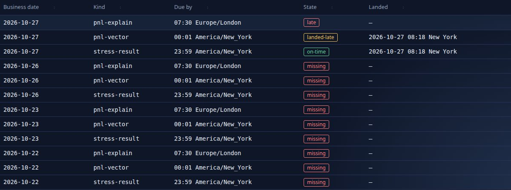
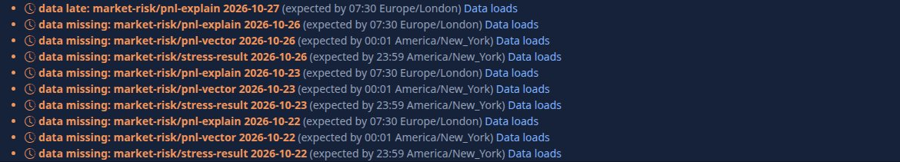
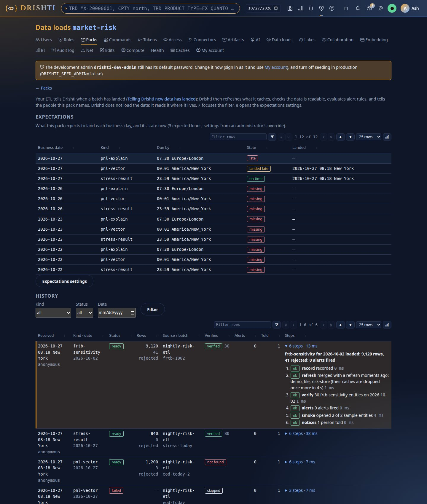
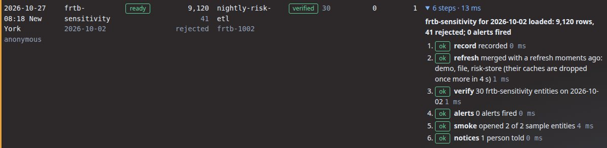
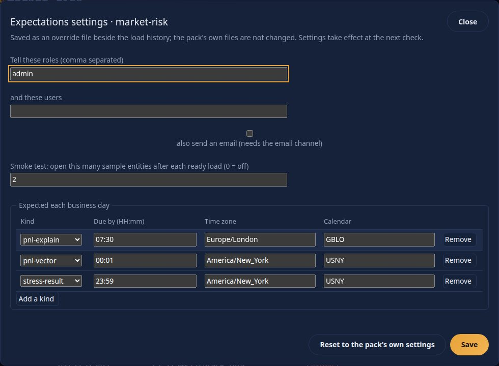
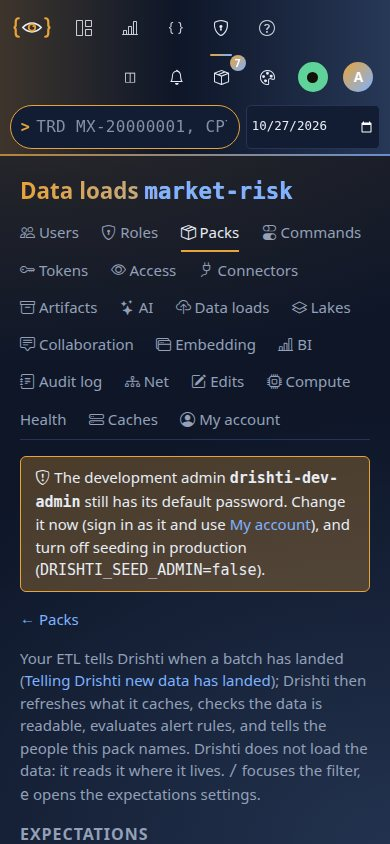

<!--
  Project Drishti · Any data. Any domain. One grammar.

  Copyright (c) 2026 Ashutosh Sinha <ajsinha@gmail.com>.
  All rights reserved.

  PROPRIETARY AND CONFIDENTIAL.

  This file is the confidential and proprietary property of Ashutosh Sinha.
  Unauthorised copying, use, modification, distribution or disclosure of this
  file, via any medium, is strictly prohibited except with the express prior
  written permission of the copyright holder.

  See the LICENSE file in the root of this repository for the full terms.
-->
# Data guide: getting data into Drishti

Getting data into Drishti and keeping it current, for the people who load it: **telling Drishti a batch has landed** (section 1:
one call from your ETL, the Data loads page, expectations and late data), **the data formats** (section 2: JSON Lines is the standard;
Arrow to the browser where it pays), **reading the lake you already have** (section 3: Databricks Delta Lake or Apache Iceberg, by
configuration), **external data** (section 4: every public source of every pack, its licence and its refresh script, with worked
examples), and **a pack from a schema** (section 5: JSON Schema files or a folder of JSON Lines in, a pack out).

Connecting a store is [CONNECTORS.md](../connectors/CONNECTORS.md) and [CONNECTOR_FILES.md](../connectors/CONNECTOR_FILES.md); the
shape of each command's data is its [contract](../contracts/packs/README.md); how the data layer is built (live updates, history
queries, the Iceberg engine, reactive connectors, the content store, the database) is [DATA_ARCHITECTURE.md](../architecture/DATA_ARCHITECTURE.md).
Each section keeps its own numbering (section 1's "section 4" is *4. The API reference* inside section 1).

## Contents

1. [Telling Drishti new data has landed](#1-telling-drishti-new-data-has-landed)
    - [Contents](#contents-1)
    - [1. Why: what the signal is for](#1-why-what-the-signal-is-for)
    - [2. Concepts](#2-concepts)
    - [3. Your first load in five minutes](#3-your-first-load-in-five-minutes)
    - [4. The API reference](#4-the-api-reference)
    - [5. The command line reference](#5-the-command-line-reference)
    - [6. Configuration reference](#6-configuration-reference)
    - [7. What happens, step by step](#7-what-happens-step-by-step)
    - [8. Expectations and late data](#8-expectations-and-late-data)
    - [9. The Data loads page](#9-the-data-loads-page)
    - [10. Permissions](#10-permissions)
    - [11. Recipes](#11-recipes)
    - [12. Troubleshooting](#12-troubleshooting)
    - [13. FAQ](#13-faq)
2. [Data formats: JSON Lines is the standard](#2-data-formats-json-lines-is-the-standard)
    - [1. The rule](#1-the-rule)
    - [2. The row forms](#2-the-row-forms)
    - [3. Reading: JSONL first, JSON still, CSV deprecated](#3-reading-jsonl-first-json-still-csv-deprecated)
    - [4. Going out: JSON Lines beside every export](#4-going-out-json-lines-beside-every-export)
    - [5. What stays as it is, and the guard](#5-what-stays-as-it-is-and-the-guard)
    - [6. Arrow to the browser, where it pays](#6-arrow-to-the-browser-where-it-pays)
3. [Using Drishti with Databricks Delta Lake or Apache Iceberg](#3-using-drishti-with-databricks-delta-lake-or-apache-iceberg)
    - [1. No code, only configuration](#1-no-code-only-configuration)
    - [2. Databricks Delta Lake: `plugin: delta`](#2-databricks-delta-lake-plugin-delta)
    - [3. Apache Iceberg: `plugin: iceberg`](#3-apache-iceberg-plugin-iceberg)
    - [4. Choosing](#4-choosing)
    - [5. When a change is needed](#5-when-a-change-is-needed)
    - [6. Connector files, one per case](#6-connector-files-one-per-case)
4. [External data: where it comes from and how to refresh it](#4-external-data-where-it-comes-from-and-how-to-refresh-it)
    - [Every external source at a glance](#every-external-source-at-a-glance)
    - [The scripts](#the-scripts)
    - [Worked examples](#worked-examples)
    - [The internal-only rule](#the-internal-only-rule)
    - [How external data reaches the server](#how-external-data-reaches-the-server)
    - [world-economy](#world-economy)
    - [news-and-markets](#news-and-markets)
    - [market-data](#market-data)
    - [us-equities](#us-equities)
    - [gleif](#gleif)
    - [funds](#funds)
    - [What every refresh does](#what-every-refresh-does)
    - [Adding a source](#adding-a-source)
    - [Not covered](#not-covered)
    - [Tests](#tests)
5. [Schema to pack: generate a pack from JSON Schema](#5-schema-to-pack-generate-a-pack-from-json-schema)
    - [Quick start](#quick-start)
    - [The rules, one by one](#the-rules-one-by-one)
    - [Annotations: `x-drishti-*`](#annotations-x-drishti-)
    - [What is read from a schema](#what-is-read-from-a-schema)
    - [Samples and tests: real, example, synthetic](#samples-and-tests-real-example-synthetic)
    - [The New pack page, step by step](#the-new-pack-page-step-by-step)
    - [The command line](#the-command-line)
    - [The pack that comes out](#the-pack-that-comes-out)
    - [Limits and settings](#limits-and-settings)
    - [Troubleshooting](#troubleshooting)
    - [Not yet, and what this leaves for later](#not-yet-and-what-this-leaves-for-later)
    - [Appendix: A deep trading JSON](#appendix-a-deep-trading-json)

## 1. Telling Drishti new data has landed

Drishti reads data **where it lives**. It does not ingest, transform or schedule anything: loading the lake, the files or the database
is the job of your own ETL (or of a pipeline engine such as DishtaYantra). What only Drishti can do is **act on the data once it is
there**. One small signal, "this batch has landed", makes Drishti refresh what it caches, check the data is really readable, evaluate the
alert rules on it, and tell the right people. Expectations then flag a batch that has *not* landed in time.

### Contents

1. [Why: what the signal is for](#1-why-what-the-signal-is-for)
2. [Concepts: a load, its status, verified, expectations, late](#2-concepts)
3. [Your first load in five minutes](#3-your-first-load-in-five-minutes)
4. [The API reference](#4-the-api-reference)
5. [The command line reference](#5-the-command-line-reference)
6. [Configuration reference](#6-configuration-reference)
7. [What happens, step by step](#7-what-happens-step-by-step)
8. [Expectations and late data](#8-expectations-and-late-data)
9. [The Data loads page](#9-the-data-loads-page)
10. [Permissions: who may announce a load](#10-permissions)
11. [Recipes: curl, Python, Airflow, cron, DishtaYantra](#11-recipes)
12. [Troubleshooting](#12-troubleshooting)
13. [FAQ](#13-faq)

Related: [API_GUIDE.md](API_GUIDE.md) (every endpoint, the error codes), [CLI_GUIDE.md](CLI_GUIDE.md) (the `drishti.py` program),
[CONFIGURATION.md](../admin/CONFIGURATION.md) (every setting), [PACK_DEVELOPER_GUIDE.md](PACK_DEVELOPER_GUIDE.md#part-v-domain-packs-the-packs-that-ship-turning-them-on-who-sees-which) (what a pack is),
[OPERATIONALISING.md](OPERATIONALISING.md) (shipping packs and data to servers).

### 1. Why: what the signal is for

Without the signal Drishti finds out about new data by accident: the next person to open a view after a connector's cache expires.
Everything that should happen **because a batch landed** (a risk limit alert, an email to the desk, the check that the lake has
yesterday's date) then happens late or not at all, and nobody notices a batch that never came.

With the signal, the same four things happen every time, in order, and each leaves a result you can read:

| You want | Drishti does |
|---|---|
| views and date lists to include the new data now | drops the caches of the connectors that serve the kind and of the derived connectors built from it (the same thing Admin → Caches does): for a Delta connector its memory and disk caches and id map files; grouped pages kept on disk are rebuilt from the new data at once, the old pages serving meanwhile. Without the signal a Delta table's new version is seen within `refresh-seconds` (10 s) and grouped pages rebuild within `version-check` (10 s); the caches are keyed by table version, so nothing stale is served either way |
| to know the data is really readable | counts the kind's entities on that business date and records `verified` or `not-found` |
| alerts on the new numbers | evaluates every alert rule on the kind for that date, as each rule's owner may see it |
| alerts on numbers, and subscriptions, that follow loads | an alert on a BI measure or a Sutra field whose trigger is `after-load` (and every "no data" alert), a board tile that notifies after loads, and a subscription with the schedule `after-load`, look `load-delay` (5 s) after a load that finished ready, once the BI layers have rebuilt ([DISTRIBUTION.md](DISTRIBUTION.md#43-when-it-looks-the-trigger)) |
| the right people told | one inbox notice (and the bell) each, and an email through the outbox if the pack asks for it |
| to know when a batch did **not** come | an expectation per kind (`trade by 19:00 America/New_York`); a scheduler flags it late on Health and tells the same people |

**What this is not.** Drishti will not copy, parse, transform or schedule your data. `drishti.py data ingest`, `data ingest --watch` and
`pack make` exist to stage data for a demo, a small team or a proof of concept; they are not a production ETL (see
[OPERATIONALISING.md](OPERATIONALISING.md) and [DEMO_DATA.md](../connectors/DEMO_DATA.md)). In production your ETL loads the store and, as its
last step, makes the one call this guide describes.

### 2. Concepts

**A load** is one announcement: *this pack's kind landed (or failed) for this business date*. It carries optional facts (rows, rejected,
source, batch id, a note) and Drishti adds what it did about it. Loads are kept per pack (the newest `drishti.loads.keep`, 2,000 by default)
and are what the [Data loads page](#9-the-data-loads-page) lists.

**Status.** `ready` says the data is in place and Drishti should act. `failed` says the batch did not land: Drishti records it, tells the
people, and does nothing else. A later `ready` for the same kind and date replaces a `failed`, and a later `failed` after a `ready` is
recorded as such (the date is then *failed* until a new `ready` arrives).

**Idempotent.** The key of a load is **pack, kind, business date and batch id**. Announcing the same key with the same status, rows and
rejected again is a no-op: the same record is returned (`200`, `duplicate: true`) and nothing runs twice, so a retried job is safe. The same key
with a *different* outcome is a new record (`attempt` 2, 3, ...). A `ready` for a kind and date that already has a `ready` is marked a
**reload**.

**Verified.** After a `ready` load, Drishti counts the kind's entities on that business date, through the same connectors every view uses.
`verified` means at least one was found; `not-found` means none (a wrong root, a date folder that was not written, a cache that
could not be refreshed); `skipped` means the check did not apply (a failed load). With a *dated* connector (Delta, the File connector's date
folders, a dated SQL source) this proves the date is there. A connector that holds no dates can only show the kind has entities.

**Expectations.** Per pack, per kind: *by when* the load is due each business day, in which time zone and by which business-day calendar.
They come from the pack's own `loads:` section and the administrator's override file. (Where the pack reads its data is separate: it is set in connector files, `config/connectors/<name>.yaml`, see [CONNECTOR_FILES.md](../connectors/CONNECTOR_FILES.md).)

**Late.** An expectation whose deadline has passed with no `ready` load is **late** (today) or **missing** (an earlier business day in the
look-back window). It is flagged once: a notice to the people the pack names, and a line on Admin → Health (`data late: my-bank/trade
2026-10-06`). It clears when the load lands.

```
  your ETL                       Drishti                                      people
  --------                       -------                                      ------
  copy / load data  ----------.
  (lake, files, SQL)           |
                               v
  POST /packs/{pack}/loads  -> record  (idempotent per pack+kind+date+batch)
        status=ready            |
                                +--> refresh   drop the caches of the kind's connectors
                                +--> verify    entities of the kind on that date?  verified | not-found
                                +--> alerts    evaluate the kind's alert rules on that date
                                +--> smoke     open N sample entities (optional)
                                +--> notices   inbox + bell (+ email) to the pack's roles/users ---> "trade for 2026-10-06
                                |                                                                    loaded: 48,213 rows,
        status=failed  ---------+--> record + notices only                                           12 rejected; 3 alerts fired"
                                |
  scheduler (every minute) -----+--> deadline passed, nothing ready?  ->  LATE  ->  Health + notice
                                +--> a ready load lands               ->  cleared
```

### 3. Your first load in five minutes

The walk-through, with real output and pictures, is [tutorial 7 · Load data daily](../tutorials/07-load-data-daily.md): say when you expect data (step 1), announce a load from the command line (step 2), a failed
batch (step 3), the same through the API (step 4), the history and what is due (step 5) and an alert for a missing day (step 6). In short: **announce** a batch when your ETL has written it,

```
$ drishti-console/.venv/bin/python tools/drishti.py data landed --pack market-risk --kind stress-scenario --date 2026-10-16 --rows 8 --batch eod-20261016-1
stress-scenario for 2026-10-16 loaded: 8 rows; 0 alerts fired
  load mvczs759-1  status ready  verified verified  attempt 1
  record  ok      recorded
  refresh ok      caches dropped: file, risk-store
  verify  ok      8 stress-scenario entities on 2026-10-16
  alerts  ok      0 alerts fired
  smoke   skipped not asked for (loads.smoke is 0)
  notices ok      1 person told
```

(On the quick-start server, the demo lakes' last business day; `DRISHTI_SERVER` and `DRISHTI_TOKEN` name the server and an
administrator's token. Run it again and the line under `load` ends `(already announced: nothing ran again)`.)

or `POST /api/v1/packs/{pack}/loads` ([section 4](#4-the-api-reference)); Drishti then records it, refreshes the caches, verifies that the rows are readable, checks alerts, runs a smoke test and tells people
([section 7](#7-what-happens-step-by-step)). Reading the history is `data loads` ([section 5](#5-the-command-line-reference)); the expectations that make late data visible are [section 8](#8-expectations-and-late-data).

**No ETL yet? Load a file from the browser.** For a pack whose kind is read by a File connector (as Build -> New pack makes it from data
files), **Admin -> Packs -> the pack -> Load data** takes one JSON array or JSON Lines file of any size, streams it to the server
(`POST /api/v1/admin/packs/{pack}/data?kind=K&date=YYYY-MM-DD`, token scope `packs:admin`, up to `drishti.loads.upload-max-mb`), writes it
under its business date (or the day you choose, for a snapshot kind: `ingest: {snapshot: true}`), checks every row against the pack's Sutras
(types with no Sutra, fields no Sutra shows), and then announces the load exactly as above, so the refresh, verify, alerts, smoke and notices
run and the pages built from that kind (a `derived` connector's pages per value) are rebuilt. The worked example is
[A deep trading JSON](#appendix-a-deep-trading-json).

### 4. The API reference

All paths are under `/api/v1`. Every call needs the caller from the bearer token (or `X-Drishti-User` when sign-in is off).

#### 4.1 `POST /packs/{pack}/loads`: announce a load

Who: an administrator, or a personal API token with the `loads:write` scope whose user's roles open the kind. Success: `201` for a new
record, `200` with `"duplicate": true` for an announcement seen before. In a Drishti\*net cluster a new `ready` load is passed on once to
every other live member (2.9.7, PO-5): the answer then carries `forwardedTo` (the members' ids).

Request body (JSON):

| Field | Type | Required | Default | Rules |
|---|---|---|---|---|
| `kind` | string | yes | | a kind the pack owns (`DRS-5012` otherwise); at most 100 characters |
| `businessDate` | string `yyyy-MM-dd` | yes, or `asOf` | | the business date the batch is for; not in the future (in the server's business-date zone); weekends and holidays are accepted as given |
| `asOf` | string `yyyy-MM-dd` | alias | | used when `businessDate` is absent |
| `status` | `ready` or `failed` | no | `ready` | anything else is `DRS-5001` |
| `rows` | integer >= 0 | no | unknown | shown in the notice and the history |
| `rejected` | integer >= 0 | no | unknown | rows your ETL rejected |
| `source` | string | no | none | the job or system name; at most 200 characters |
| `batchId` | string | no | none | part of the idempotency key; letters, digits and `. _ : / # @ -` and spaces, at most 100 characters |
| `note` | string | no | none | for a failed load, why; at most 1,000 characters; shown in the notice |

Response body: the record, plus `summary` and `duplicate`.

| Field | Type | Meaning |
|---|---|---|
| `id` | string | the load's id (use it in `GET /packs/{pack}/loads/{id}`) |
| `pack`, `kind`, `businessDate`, `status`, `rows`, `rejected`, `source`, `batchId`, `note` | | what you sent (absent when you did not send it) |
| `receivedAt` | instant | when the server received it |
| `receivedBy` | string | the user the request was made as |
| `attempt` | integer | 1 for the first outcome announced for the key, 2 for the next different one, ... |
| `reload` | boolean | a `ready` load of this kind and date was already recorded |
| `verified` | string | `verified`, `not-found` or `skipped` |
| `entities` | integer | entities of the kind found on the date (capped at `drishti.loads.verify-limit`; a count at the cap means "or more") |
| `alerts` | integer | alerts fired by the evaluation |
| `notices` | integer | people told |
| `steps` | array | `{name, status, detail, ms}` per step; status is `ok`, `warn`, `failed` or `skipped` (section 7) |
| `durationMs` | integer | how long the steps took |
| `done` | boolean | false only while the steps are still running |
| `summary` | string | the one line used in the notice |
| `duplicate` | boolean | true when this announcement had been seen before and nothing ran again |

**Idempotency rules.** Key = pack + kind + `businessDate` + `batchId` (empty when absent). Same key and same `status`, `rows` and `rejected` as
the newest record of that key: duplicate. Anything else: a new record. Without a `batchId`, send the same body twice and it is a duplicate; send
different `rows` and it is a reload.

**Errors** (problem JSON: `type`, `title`, `status`, `detail` starting with the code, `instance`, `code`):

| Status | Code | When | Example body |
|---|---|---|---|
| 400 | `DRS-5001` | `businessDate`/`asOf` missing, `status` not ready/failed, negative counts, an over-long field, a bad `batchId`, invalid JSON | `{"type":"about:blank","title":"bad request","status":400,"detail":"DRS-5001 businessDate (or asOf) is required, as yyyy-MM-dd","instance":"/api/v1/packs/market-risk/loads","code":"DRS-5001"}` |
| 400 | `DRS-4003` | the date is not `yyyy-MM-dd` or is in the future | `{"type":"about:blank","title":"bad business date","status":400,"detail":"DRS-4003 cannot read business date '05/10/2026' (use yyyy-MM-dd)","instance":"/api/v1/packs/market-risk/loads","code":"DRS-4003"}` |
| 401 | `DRS-5010` | no or an unknown bearer token | `{"title":"unauthenticated","status":401,"code":"DRS-5010","detail":"DRS-5010 missing bearer token"}` |
| 403 | `DRS-5002` | not an administrator and no `loads:write` token; a token without the scope; the token's user may not open the kind | `{"title":"forbidden","status":403,"code":"DRS-5002","detail":"this token lacks the scope loads:write"}` |
| 404 | `DRS-5011` | no loaded pack with that name (also for a pack none of whose kinds the caller may open: the two look the same) | `{"type":"about:blank","title":"load pack not found","status":404,"detail":"DRS-5011 no loaded pack named 'nope'","instance":"/api/v1/packs/nope/loads","code":"DRS-5011"}` |
| 422 | `DRS-5012` | the pack has no such kind | `{"type":"about:blank","title":"load kind unknown","status":422,"detail":"DRS-5012 pack 'market-risk' has no kind 'nope'; its kinds are [stress-scenario, stress-result, frtb-sensitivity, pnl-explain, trade-valuation, position, portfolio, pnl-vector, scenario-set, risk-hierarchy]","instance":"/api/v1/packs/market-risk/loads","code":"DRS-5012"}` |

A `ready` load that was recorded but could not be verified is **not** an error: it is `201` with `"verified": "not-found"` and a `warn`
`verify` step, so your job can decide (the CLI exits 1). For example (the shape; a dated connector with no data for the date). On the
demo lakes this does not happen for a date before the first business day: the check counts the kind's ids from the connectors' listing,
which is the newest one, so `2026-10-05` (before the lakes begin) also reads `8 stress-scenario entities on 2026-10-05`, a known limit of 2.3.0:

```json
{"status":"ready","verified":"not-found","entities":0,"alerts":0,"notices":1,
 "steps":[{"name":"record","status":"ok","detail":"recorded","ms":0},
          {"name":"refresh","status":"ok","detail":"caches dropped: risk-store","ms":2},
          {"name":"verify","status":"warn","detail":"no stress-scenario entities found on 2026-10-05; check the connector's root, dates and caches","ms":4},
          {"name":"alerts","status":"skipped","detail":"the data is not readable for 2026-10-05, so no rule was evaluated","ms":0},
          {"name":"smoke","status":"skipped","detail":"not asked for (loads.smoke is 0)","ms":0},
          {"name":"notices","status":"ok","detail":"1 person told","ms":0}],
 "summary":"var for 2026-10-05 loaded: 1,200 rows; NOT FOUND in the data"}
```

#### 4.2 Reading

| Method | Path | Who | Answer |
|---|---|---|---|
| `GET` | `/packs/{pack}/loads?kind=&date=&status=&limit=` | an administrator, or a user whose roles open a kind of the pack (only loads of kinds they may open are listed) | `{pack, kinds, loads: [record ...]}`, newest first; `limit` 1-1000, default 100 |
| `GET` | `/packs/{pack}/loads/{id}` | as above | one record; `404 DRS-5011` when there is none |
| `GET` | `/packs/{pack}/loads/expectations` | as above | `{pack, now, origin, config, expectations: [{pack, kind, businessDate, by, zone, deadline, state, loadId, landedAt}]}` |
| `GET` | `/admin/loads/{pack}`, `/admin/loads/{pack}/{id}`, `/admin/loads/{pack}/expectations` | an administrator | the same three, for the console |
| `GET` | `/admin/health` | an administrator | adds `dataLate: [{pack, kind, businessDate, state, by, line}]`; the status is `DEGRADED` while it is not empty |

A token with only the default `read` scope may call every `GET` above (as the user it stands for).

#### 4.3 The expectation settings (administrators; never open to a token)

| Method | Path | Does |
|---|---|---|
| `GET` | `/admin/loads/{pack}/config` | the settings in force: `{pack, origin, config: {notify: {roles, users, email}, smoke, expect: {kind: {by, zone, calendar}}}, kinds}`; `origin` is `pack`, `override` or `default` |
| `PUT` | `/admin/loads/{pack}/config` | saves the whole override (`DRS-5001` with every problem when it is invalid; `DRS-5012` for an unknown kind); audited as `data-load-config-changed` |
| `DELETE` | `/admin/loads/{pack}/config` | removes the override; the pack's own `loads:` section applies again; audited as `data-load-config-reset` |

### 5. The command line reference

`tools/drishti.py` (see [CLI_GUIDE.md](CLI_GUIDE.md) for installing it and the connection options `--server`, `--token-file`, `--user`,
`--timeout`, and the `DRISHTI_SERVER` / `DRISHTI_TOKEN` / `DRISHTI_USER` environment). The token is never printed.

#### `data landed`

```
drishti.py data landed --pack P --kind K --date D [--status ready|failed] [--rows N] [--rejected N]
                       [--batch ID] [--source S] [--note TEXT] [--json]
```

| Option | Meaning |
|---|---|
| `--pack P` | the pack that owns the kind (required) |
| `--kind K` | the kind that landed (required) |
| `--date D` | the business date, `yyyy-MM-dd`, or `today` / `yesterday` (this machine's calendar day; use the date itself when your batch date differs) (required) |
| `--status` | `ready` (default) or `failed` |
| `--rows N`, `--rejected N` | counts |
| `--batch ID` | the batch id; makes retries idempotent |
| `--source S` | job or system name |
| `--note TEXT` | a note; for a failed load, why |
| `--json` | print the server's answer as JSON |

Exit codes: `0` recorded (and, for `ready`, verified); `1` a `ready` load is **not verified**, or the server refused it (an `ApiError` line
with the code and a hint); `2` usage (a bad `--date`, a missing option).

#### `data loads`

```
drishti.py data loads --pack P [--kind K] [--date D] [--status ready|failed] [--limit N] [--expectations] [--json]
```

Lists the history (default 30), optionally filtered; `--expectations` also prints what is due and its state; `--json` prints
`{pack, kinds, loads, expectations?}`. Exit `0` unless the call fails.

### 6. Configuration reference

#### 6.1 In the pack (`pack.yaml`)

```yaml
loads:
  notify:
    roles: [risk-ops, desk-head]     # everyone with one of these roles who may open the kind is told
    users: [ada]                     # and these users
    email: true                      # also queue an email (needs the collaboration email channel)
  smoke: 3                           # open this many sample entities after each ready load; 0 = off
  expect:                            # per kind, when its load is due each business day
    trade:  { by: "19:00", zone: America/New_York, calendar: USNY }
    curve:  { by: "07:30", zone: Europe/London,    calendar: GBLO }
    var:    { by: "23:59" }          # zone and calendar default to the server's business-date zone and calendar
```

| Key | Type | Default | Meaning |
|---|---|---|---|
| `notify.roles`, `notify.users` | lists of strings | the roles in `drishti.loads.default-notify-roles` (`admin`) when both are empty | who is told. A person is told only while they are enabled and may open the kind |
| `notify.email` | boolean | `false` | also an email per person through the outbox, if they have an address, did not turn the `load` event off (Settings, Notifications) and the email channel is on |
| `smoke` | integer | `0` | sample entities opened after a ready load (at most `drishti.loads.smoke-max`, 20) |
| `expect.<kind>.by` | `HH:mm` | | the local time of day the load is due |
| `expect.<kind>.zone` | time zone id | the server's business-date zone | the zone of `by` |
| `expect.<kind>.calendar` | calendar spec | the server's calendar | the business-day calendar (`USNY`, `GBLO`, `USNY+GBLO`, ...): no expectation is made for a day that is not a business day |

#### 6.2 The administrator's override

Admin → Packs → *Data loads* → **Expectations settings** (or `PUT /admin/loads/{pack}/config`) writes `<drishti.loads.dir>/config/<pack>.yaml`
(by default `./data/loads/config/<pack>.yaml`). The pack's own files are never touched, so redeploying the pack keeps the override. The
override replaces the pack's sections **whole**: a saved `expect` replaces the pack's `expect`, a saved `notify` replaces its `notify`. A section
the override leaves out stays as the pack has it. **Reset** deletes the file.

```yaml
# <loads dir>/config/my-bank.yaml
notify:
  roles: [risk-ops]
  users: []
  email: true
smoke: 2
expect:
  trade: {by: '19:00', zone: America/New_York, calendar: USNY}
  curve: {by: '07:30', zone: Europe/London, calendar: GBLO}
```

#### 6.3 Server settings (`drishti.loads.*`)

Also listed in [CONFIGURATION.md](../admin/CONFIGURATION.md#drishtiloads--data-loads-a-batch-landed).

| Setting | Default | Meaning |
|---|---|---|
| `drishti.loads.dir` (`DRISHTI_LOADS_DIR`) | `./data/loads` | the history per pack (`<pack>.json`) and the overrides (`config/<pack>.yaml`) |
| `drishti.loads.keep` | `2000` | loads kept per pack |
| `drishti.loads.scheduler` | `true` | `false` turns the late-data check off (the API and the page still work) |
| `drishti.loads.check-interval` | `60s` | how often expectations are checked |
| `drishti.loads.verify-limit` | `1000` | most entities counted when verifying |
| `drishti.loads.verify-timeout` | `20s` | how long the verify, alerts and smoke steps may each wait for the data |
| `drishti.loads.lookback-days` | `3` | business days before today still checked for missing data |
| `drishti.loads.default-notify-roles` | `[admin]` | told when a pack names no one |
| `drishti.loads.smoke-max` | `20` | most sample entities a pack may ask to be opened |
| `drishti.loads.refresh-window` | `5s` | signals within this time of a connector's last refresh are merged into one more refresh at the end of the window (at most one runs and one waits per connector); `0s` refreshes on every signal |
| `drishti.security.token-scopes` (`loads:write`) | declared | what the `loads:write` token scope opens: `POST /api/v1/packs/*/loads` |

### 7. What happens, step by step

#### On `ready`

| Step | What it does | Result and how it shows |
|---|---|---|
| `record` | writes the announcement to the history (once per key) | always `ok`; the detail says `recorded`, `recorded as attempt N` or `recorded as a reload of an earlier ready load` |
| `refresh` | calls `purgeCaches()` on every connector that serves the kind, and drops the engine's layout caches: the same machinery as Admin → Caches, scoped to the kind. A connector refreshed less than `drishti.loads.refresh-window` (5 s) ago, or being refreshed, is not purged again: the signal joins one more refresh at the end of the window, and the connector only looks for its newest table version now, so the steps below still see the new data. A backfill of 60 dates refreshes each connector once or twice, not 60 times | `ok` with the connectors named (`caches dropped: …`, and `merged with a refresh moments ago: … (their caches are dropped once more in N s)`); `failed` with the error if a purge threw |
| `verify` | lists the kind's entities on the business date through the router and counts them | `ok` with the count; `warn` when none were found (`verified` becomes `not-found`) or when some sources could not answer (they are named); `failed` if the read threw |
| `alerts` | evaluates every enabled alert rule whose entity is of this kind against the entity **on that business date**, for every user, each as that user may see the data (field masks apply). A rule's remembered state is cleared first, so a condition that holds on the date fires once | `ok`: `N alerts fired`; `skipped` when the data is not readable for the date |
| `smoke` | opens the first N entities of the verify listing as views on that date (N = the pack's `smoke`) | `ok`: `opened 2 of 2 sample entities`; `failed` names the first failures; `skipped` when `smoke` is 0 |
| `late` | clears the late-data flag of this kind and date, if there was one | present only when a flag was cleared |
| `notices` | one inbox row and a bell each for the people the pack names, and an email when `notify.email` is on | `ok`: `N people told`; `skipped`: nobody with those roles may open the kind |

After the steps, the **BI layers** that read the kind are brought up to date for the business date. A table whose stored partition for
the date was built from the data its connector holds now (the connector can say its data version: Delta, Iceberg and the others with
`dataVersion`) is left alone, so a signal that repeats a load changes nothing. Otherwise the date's partition is invalidated (its metadata
removed; a build writes a new file and a page reading the old one finishes on it) and, when a page has read that date, rebuilt in the
background (a date nobody has read is built when a page asks for it, not by every signal of a backfill): one rebuild
running per table and at most one waiting per date, two tables' rebuilds at once in the whole server, and a waiting one runs only if the
data changed since the one before it. A partition is built by one build at a time (on demand by a page, in the background, or as a
table's latest), and an invalidation never deletes a build's files. A dataset that refreshes `after-load` gets one refresh running and one
waiting with every signalled date, each date once, and skips a date whose layers hold the data held now. So a burst of thousands of
signals for the same data (QA3B-07) reads each date at most once more and the server settles when the burst ends.

The notice text is the `summary`: `trade for 2026-10-06 loaded: 48,213 rows, 12 rejected; 3 alerts fired` (a reload says `reloaded`; a
not-found says `; NOT FOUND in the data`). A notice holds only counts and names, never a data value, and a reader sees it only while their
roles open the kind. Opening it goes to the Data loads page for administrators.

#### On `failed`

`record` (always), `late` (skipped: a failed load does not clear a late flag) and `notices` (`var load for 2026-10-05 FAILED: copy stopped: disk
full`). Nothing is refreshed, verified or evaluated: the data is not there. The date shows **failed** in the expectations until a `ready` arrives.

Every announcement is also written to the audit log (`data-load-ready` or `data-load-failed`, with the kind, date, batch, the verified state,
alerts and people told); a token write is audited as `token-write` as well.

### 8. Expectations and late data

Every `check-interval` the scheduler looks, for each expected kind, at **today** (when it is a business day of the kind's calendar, in the
kind's zone) and at the previous `lookback-days` business days:

| State | Meaning |
|---|---|
| `pending` | today, and the deadline has not passed |
| `on-time` | a `ready` load arrived by the deadline |
| `landed-late` | a `ready` load arrived, after the deadline |
| `late` | today, the deadline has passed, nothing `ready` yet |
| `missing` | an earlier business day in the window, nothing `ready` ever landed |
| `failed` | the newest announcement for the date says `failed` |

`late` and `missing` are flagged **once**: a `load-late` notice to the people the pack names (`trade for 2026-10-06 is LATE: expected by 19:00
America/New_York`) and a line on Admin → Health that makes the overall status `DEGRADED`. The flag is persisted, so a restart does not tell
again, and it clears when a `ready` load lands (or the date leaves the window). Holidays and weekends of the kind's calendar have no expectation.
The check uses an injected clock in tests; in production it is the server's clock in the kind's own zone.





### 9. The Data loads page

> **Where to find it.** Admin menu → **Data loads** (`/admin/loads`) shows every loaded pack at a glance: today's
> expectations (on time, late, missing) and its latest loads, with a banner when something needs attention. **Open** on
> a pack (or the **Data loads** button on its row in Admin → Packs) goes to that pack's page with the full history,
> each load's steps and the expectation settings.

Admin → Packs → **Data loads** on a loaded pack's row (`/admin/packs/{pack}/loads`; administrators only).



* **Expectations** lists each expected kind for today and the look-back days with its deadline, state (`on-time`, `landed-late`, `late`,
  `missing`, `pending`, `failed`; every state has its word, colour is only a hint) and when it landed.
* **History** lists the loads, newest first: received (and by whom), kind and date, status (`reload`, `attempt N` badges), rows and rejected,
  source and batch, verified (and the count), alerts fired, people told, and the steps. Filters (kind, status, date) are a plain form that works
  without scripts; the tables also sort, filter and page.
* **Steps** opens a load's results, each with its own status and time.



* **Expectations settings** edits the override (roles, users, email, smoke, one row per expected kind) and can reset it to the pack's own.
* **Announce a load** (2.9.7) tells Drishti a batch landed when no ETL can (a load re-run by hand, a test): kind (the pack's), business
  date, status, and optionally rows, batch id and note. It makes the same `POST /api/v1/packs/{pack}/loads` an ETL makes, as you, with
  `source: console`, and is audited as `load-announced` besides the load's own record. From a terminal the same is
  `drishti.py data landed --pack P --kind K --date D`.



Keyboard: `/` focuses the kind filter, `e` opens the settings, `Esc` closes the dialog; every control is reachable by Tab and has a label.
Phone width: the page fits without sideways scrolling (the tables scroll inside their own frame) and controls are touch sized. It follows the
light, dark and high-contrast themes.



### 10. Permissions

| Caller | May announce a load | May read loads | May change the expectation settings |
|---|---|---|---|
| administrator (session or token) | yes (a token needs `loads:write`) | yes | yes (never with a token) |
| personal API token with `loads:write` | yes, **only for packs whose kinds the token's user's roles open**, and only for kinds they may open | yes | no |
| personal API token with the default `read` scope | no (`403`: *this token lacks the scope loads:write*) | the loads of kinds its user may open | no |
| any other user | no | the loads of kinds they may open | no |

A scope is a door, not a right: the call is checked against the roles the token's user holds **now**. Every announcement by a token is audited
(`token-write`, with the token's id, never its secret) and so is each refusal (`token-denied`).

**An ETL job's least-privilege token.** Make a role that opens only what the job loads, a user that holds it, and a token with only
`loads:write`, which must expire (`drishti.security.token-write-max-days`, 90 by default):

```
# 1. a role that opens only the kinds the job loads
curl -X PUT $S/api/v1/admin/role-definitions/risk-etl -H "Authorization: Bearer $ADMIN" -H 'Content-Type: application/json' \
     -d '{"description":"risk ETL: announces loads","kinds":["stress-scenario","stress-result"]}'
# 2. a user that holds it (a service account; no human uses its password)
curl -X POST $S/api/v1/admin/users -H "Authorization: Bearer $ADMIN" -H 'Content-Type: application/json' \
     -d '{"username":"risk-etl","roles":["risk-etl"],"password":"a-long-random-password"}'
# 3. sign in as that user (or use My account -> API tokens) and create the token with only the load scope
curl -X POST $S/api/v1/me/tokens -H "Authorization: Bearer $RISK_ETL_SESSION" -H 'Content-Type: application/json' \
     -d '{"name":"nightly-risk-etl","days":90,"scopes":["loads:write"]}'
# -> {"secret":"drk_...", ...}   shown once: put it in your scheduler's secret store, as DRISHTI_TOKEN
```

The same token announces `stress-scenario` and `stress-result` and nothing else: a call for another kind is `403`, for a pack it cannot reach `404 DRS-5011`,
and it cannot change expectations, users, tokens or packs.

### 11. Recipes

All of them end the same way: **after the data is committed**, one call. Put it in the job's success path, never before the copy finishes.

#### 11.1 curl

```bash
curl -fsS -X POST "$DRISHTI/api/v1/packs/my-bank/loads" \
  -H "Authorization: Bearer $DRISHTI_TOKEN" -H 'Content-Type: application/json' \
  -d "{\"kind\":\"trade\",\"businessDate\":\"$BIZ_DATE\",\"rows\":$ROWS,\"rejected\":$REJECTED,\"source\":\"eod-copy\",\"batchId\":\"$RUN_ID\"}"
```

`-f` makes a refusal a non-zero exit; a retry with the same `RUN_ID` is a no-op.

#### 11.2 Python (`requests`)

```python
import os, requests

def announce(pack, kind, date, rows=None, rejected=None, batch=None, status="ready", note=None):
    body = {"kind": kind, "businessDate": date, "status": status}
    body.update({k: v for k, v in (("rows", rows), ("rejected", rejected), ("batchId", batch), ("note", note)) if v is not None})
    r = requests.post(f"{os.environ['DRISHTI']}/api/v1/packs/{pack}/loads", json=body, timeout=60,
                      headers={"Authorization": f"Bearer {os.environ['DRISHTI_TOKEN']}"})
    r.raise_for_status()                       # 4xx: the body has the DRS code and what to fix
    load = r.json()
    if status == "ready" and load["verified"] != "verified":
        raise RuntimeError(f"landed but not readable: {load['summary']}")
    return load
```

#### 11.3 Airflow

The announcement is the last task of the DAG; `trigger_rule` makes the failure announcement run when the load fails.

```python
from airflow.decorators import dag, task
from airflow.utils.trigger_rule import TriggerRule
import pendulum

@dag(schedule="0 18 * * 1-5", start_date=pendulum.datetime(2026, 1, 1, tz="America/New_York"), catchup=False)
def eod_trades():
    @task
    def load_trades(ds=None):
        ...                                     # your copy / COPY INTO / spark job; return the counts
        return {"rows": 48213, "rejected": 12}

    @task
    def announce_landed(counts, ds=None, run_id=None):
        from drishti_loads import announce        # the helper of 11.2
        announce("my-bank", "trade", ds, counts["rows"], counts["rejected"], batch=run_id, source="airflow:eod_trades")

    @task(trigger_rule=TriggerRule.ONE_FAILED)
    def announce_failed(ds=None, run_id=None):
        from drishti_loads import announce
        announce("my-bank", "trade", ds, batch=run_id, status="failed", note="eod_trades failed; see Airflow", source="airflow:eod_trades")

    c = load_trades()
    announce_landed(c)
    c >> announce_failed()

eod_trades()
```

Or, with the CLI on the worker: `BashOperator(bash_command="python /opt/drishti/tools/drishti.py data landed --pack my-bank --kind trade --date {{ ds }} --batch {{ run_id }}")`
(`DRISHTI_SERVER` and `DRISHTI_TOKEN` come from the worker's environment or an Airflow connection; the task fails when the data is not verified).

#### 11.4 cron or a shell script after a copy

```bash
#!/bin/bash
set -euo pipefail
DATE=$(date +%F)
rsync -a --delete "/exports/trades/$DATE/" "/mnt/lake/trade/date=$DATE/"        # your copy
ROWS=$(cat "/exports/trades/$DATE/_rows")
if python /opt/drishti/tools/drishti.py data landed --pack my-bank --kind trade --date "$DATE" --rows "$ROWS" \
      --batch "eod-$DATE" --source "cron:$(hostname)"; then
  :                                                                              # landed, verified, people told
else
  echo "landed but not verified (exit $?): check the connector's root and dates" >&2
fi
# in a trap on error:  drishti.py data landed ... --status failed --note "copy failed on $(hostname)"
```

```
15 18 * * 1-5  DRISHTI_SERVER=https://drishti.example.com DRISHTI_TOKEN=$(cat /etc/drishti/etl.token) /opt/etl/eod_trades.sh
```

#### 11.5 DishtaYantra

DishtaYantra (the author's pipeline engine, a separate project) is the natural ETL for an EOD batch (its
`docs/BATCH_FILE_PROCESSING.md` and `docs/HEADLESS_AND_ORCHESTRATION.md`). The extension point is **the end of the batch**, after its sinks
have committed; two ways to use it, neither changing DishtaYantra:

**(a) A headless batch job plus a final step (recommended).** `python -m core.dag.headless_runner --job eod_job.json --summary out/summary.json`
runs the DAGs to completion, drains every publisher and the write-ahead log, writes the summary (per DAG: `completed_by`, `published`,
`drained`, ...) and exits `0` on success and `1` when incomplete or on error. The scheduler (or the job's wrapper) then makes the one call:

```bash
python -m core.dag.headless_runner --job eod_job.json --summary out/summary.json
status=$?
ROWS=$(python - <<'EOF'
import json; s = json.load(open("out/summary.json"))
dags = s.get("dags", s)                       # check the shape of your summary file once
print(sum(int(d.get("published", 0)) for d in (dags.values() if isinstance(dags, dict) else dags)))
EOF
)
if [ $status -eq 0 ]; then
  python /opt/drishti/tools/drishti.py data landed --pack my-bank --kind trade --date "$BIZ_DATE" --rows "$ROWS" --batch "$JOB_ID" --source dishtayantra
else
  python /opt/drishti/tools/drishti.py data landed --pack my-bank --kind trade --date "$BIZ_DATE" --status failed --batch "$JOB_ID" --note "headless job exited $status"
fi
```

**(b) A final `delegate://` sink as a hook.** A DishtaYantra publisher can be your own class
(`delegate_module`, `delegate_class`, `delegate_config`; the contract is a constructor taking `name` and `config`, and `publish(data)`; see its
`docs/TUTORIAL_delegate_connectors.md`). Give the DAG a last node that emits one *batch complete* marker record **after** the real sink has
committed, and route only that marker to this class:

```python
# drishti_landed_sink.py  (ordinary Python; imports nothing from DishtaYantra)
import json, urllib.request

class DrishtiLandedSink:
    def __init__(self, name, config):
        self.url = config["drishti"].rstrip("/") + f"/api/v1/packs/{config['pack']}/loads"
        self.token = config["token"]
        self.kind = config["kind"]

    def publish(self, data):                         # one marker record: {"businessDate": "...", "rows": N, "rejected": N, "batchId": "..."}
        body = {"kind": self.kind, "businessDate": data["businessDate"], "rows": data.get("rows"), "rejected": data.get("rejected"),
                "batchId": data.get("batchId"), "source": "dishtayantra"}
        req = urllib.request.Request(self.url, data=json.dumps({k: v for k, v in body.items() if v is not None}).encode(), method="POST",
                                     headers={"Content-Type": "application/json", "Authorization": "Bearer " + self.token})
        with urllib.request.urlopen(req, timeout=60) as r:       # raise, do not swallow: a refused announcement must be seen
            r.read()
```

Because the call is idempotent per batch id, DishtaYantra's replays and retries cannot announce a batch twice.

### 12. Troubleshooting

| You see | Cause | What to do |
|---|---|---|
| `403 ... this token lacks the scope loads:write` | the token was made with the default `read` scope | make a token with `scopes: ["loads:write"]` (My account → API tokens, tick *loads:write*) |
| `403 ... may not open trade data` | the token's user has no role that opens the kind | give the service user a role that opens it (section 10) |
| `403 ... only an administrator, or a personal API token with the loads:write scope` | a session of a non-administrator | use a token, or an administrator |
| `404 DRS-5011 no loaded pack named ...` | wrong pack name, the pack is not loaded or switched off, or the caller can open none of its kinds | `GET /api/v1/packs` for the names; Admin → Packs |
| `422 DRS-5012 pack ... has no kind ...` | a typo, or the kind belongs to another pack | the message lists the pack's kinds |
| `400 DRS-4003 ... is in the future` | the business date is after today in the server's zone | send the date the data is *for* |
| `"verified": "not-found"` / CLI exit 1 | the connector cannot read that date: wrong root, the date folder or partition is not written yet, a stale cache on another server | check Admin → Connectors → the connector → Test connection (or `drishti.py connector test NAME`); on a multi-server setup announce on every server (section 13) |
| `refresh ... no connector serves trade` | the kind is served by no connector of this server | the connector that serves the kind is not configured on this server: Admin → Packs → Data source marks it *not configured* (the kind answers `DRS-1011`); create its file in Admin → Connectors |
| `alerts ... skipped` | the data is not readable for the date (see `verify`) | fix verify first |
| `notices ... no one to tell` | nobody with the named roles may open the kind, or the roles/users are misspelt | Expectations settings; the roles must exist and open the kind |
| a load is `late` although it landed | the load was announced for another business date, another kind, or `failed` was announced last | History: the dates and the newest status per kind and date |
| `data late` stays on Health | nothing `ready` landed for that date, or the date is still inside the look-back window | announce the load; or let it leave the window (`lookback-days`) |
| no email arrives | `notify.email` is off, the email channel is off, the person has no address, turned the `load` event off, or hit the hourly cap | Admin → Collaboration (outbox, dead letters); the person's Settings → Notifications |
| the settings page says *settings from the defaults* | no `loads:` section in the pack and no override | add one in the pack, or save the settings |

### 13. FAQ

**Why does Drishti not ingest the data itself?** Because it is the other half of a system you already have. Your ETL knows when a batch is
complete and correct; Drishti knows who needs to hear about it and what the data means. Keeping them separate means a Drishti restart can
never lose a load, and your ETL can change engine without touching Drishti. `data ingest`, `--watch` and `pack make` are for staging, small
setups and proofs of concept.

**Can I announce the same batch again?** Yes: the same pack, kind, date and batch id with the same outcome is a no-op (`duplicate: true`).
Use that for retries. To *replace* a batch, announce it again with a new batch id (or different counts): it is recorded as a reload and the
steps run again.

**How do I backfill many dates?** One call per kind and date, oldest first, from a loop. A backfill is a load like any other, so each date
refreshes caches, verifies and evaluates alerts, and tells the people the pack names: expect one notice per date (pass `--note backfill`
so the history says why). To keep a large backfill quiet, set `notify.users` to a service user for its duration in the Expectations settings, and
reset it afterwards.

**What about holidays and weekends?** An expectation is only made for a business day of the kind's calendar (`calendar`, e.g. `USNY` or
`GBLO`), so a bank holiday is never "late". A load you announce for a weekend or holiday date is accepted as given.

**Several kinds land together.** Announce each kind: the history, expectations and notices are per kind.

**Several Drishti servers read the same lake.** Each server caches on its own. Since 2.9.7, in a Drishti\*net cluster, announce on any one
member: a `ready` load is passed on once to every other live member (signed, as you; the answer lists them in `forwardedTo`), each runs
its own refresh, and a member that received it from a peer never passes it on again (decision PO-5). A member that does not answer is
named in the server's log: announce on it by hand. Without a cluster, announce on each server (the call is cheap and idempotent).

**Does the signal change any data?** No. It drops caches, reads, evaluates and notifies. The alert evaluation does store the alerts it fires,
in the owners' alert history, as it would when the data ticked.

**What if the announcement call itself fails?** Your job should retry with the same batch id and, if it still fails, alert you: the data is
there, Drishti simply has not been told. Until it is, expectations will (rightly) flag the load as late.

## 2. Data formats: JSON Lines is the standard

Since 2.9.4, **JSON Lines (JSONL) is Drishti's data format**: one JSON object per line, UTF-8, in a `.jsonl` file (`.jsonl.gz` where
the repository gzips large files). Every generator writes it, every loader reads it, and every export and download offers it. This
page says what that means for data coming in, data going out, and the files Drishti keeps.

### 1. The rule

- **One JSON object per line.** No array around the lines, no commas between them, no blank lines needed (a blank line is skipped).
  A document may be as deep as it likes, as long as it stays on its line.
- **UTF-8**, with or without gzip (`.jsonl.gz`).
- **Generating and loading are separate steps.** A generator writes JSONL; a loader puts it into a store. `tools/packgen/trades/make_trades.py`
  is the model: it writes `trades-<date>.jsonl.gz`, then `lake build` loads them. Running a loader never rewrites a pack's samples,
  its Sutra tests or the sample feed.

### 2. The row forms

| Form | One line is | Written by | Read by |
|---|---|---|---|
| **Document** | one entity, as its source holds it: `{"TRADE_ID": "1000015", "LEGS": [...], ...}` | `make_trades.py`, `bulk_trades.py`, `comswap_synth.py`, `note_synth.py`, every pack's `samples/<kind>.jsonl` | `lake build`, `build_demo_lakes.py`, `ingest_jsonl.py`, the file connector, the demo connector |
| **Loader row** | `{"domain", "kind", "id", "date", "doc", "columns"}`: a document (`doc`, as JSON text) of a kind on a business date, with the fields its pack promotes | `make_data.py --jsonl`, `bulk_trades.py --jsonl` | the Java loaders (PostgreSQL, Cassandra, Iceberg, DuckDB, Redis, MongoDB, Aerospike, the file connector's `JsonlLoader`) |
| **Lake row** | `{"domain", "kind", "table", "id", "date", "doc"}`: the same, naming the Delta table (`trade_endur`) | `make_data.py --lake`, `samplegen/lake.py`, the pack generators' `--lake` | `tools/samplegen/load_rows.py` |
| **Sutra test case** | `{"case": "<name>", "document": {...}}` | every generator of Sutra tests (`tests/<sutra>/cases.jsonl`, beside `expect.yaml`) | `sutra test`; the older one-`.json`-a-case folders still read in 2.9.4, with a warning |
| **Catalogue entry** | `{"kind", "id", "title", "subtitle"}` | every pack generator (`samples/catalog.jsonl`; the `catalog.json` array of earlier releases is still read) | the demo connector, the pack tools |
| **Staged lake row** | `{"id", "doc", "columns"}` | `lake build`'s staging (`<lake>/_drishti-lake/staging`), the official results' publishers | Drishti's Java lake writer (`LakeWriter`; the earlier `[id, doc, columns]` array a line still read) |
| **Seal** | `{"key", "count", "hash"}` | the collaboration file store (`<collab dir>/seals.jsonl`) | the same store (the tab-separated `seals.log` of earlier releases still read, never rewritten) |

A **restatement** is a second file of lake rows (`<name>-restated.jsonl`): its rows replace the rows of the same id on their date, as a
second commit, so *known at* shows the correction.

Where the generators put their output:

| Generator | Output |
|---|---|
| `tools/packgen/banking/make_data.py` | `config/packs/<pack>/samples/<kind>.jsonl`; `--lake ROOT`: `<ROOT>/../build/lake-rows/banking-history.jsonl` and `banking-restated.jsonl`, then loaded (`--no-load` stops there); `--jsonl FILE`: loader rows |
| `tools/samplegen/bulk_trades.py` | `<data>/build/bulk/<system>/trades-<date>.jsonl.gz`, then `lake build` (`--no-lake` stops there) |
| `tools/packgen/trades/make_trades.py` | `<data>/build/trades/<system>/trades-<date>.jsonl.gz`, then `lake build` with `--lake` |
| `tools/realdata/normalise.py` | `tools/realdata/dataset/*.jsonl` (a country, group, series or Factbook profile a line) and the `meta.json` manifest |
| the sample feed | `<data>/feeds/fixing.jsonl` (one fixing series a line: `FIX SOFR-HISTORY`) |

### 3. Reading: JSONL first, JSON still, CSV deprecated

The readers keep what they accept: the file connector reads `<kind>.jsonl` (dated `<yyyy-MM-dd>/<kind>.jsonl`) and one file per
entity (`<kind>/<id>.json`); `lake build`, `build_demo_lakes.py`, `data ingest` and the Java loaders read JSON Lines and JSON arrays
(gzipped or not); the demo connector reads `samples/<kind>.jsonl` and the older `samples/<kind>/<id>.json`.

**CSV input is deprecated** and will be removed in a later release. Today only the file connector reads CSV (a feed file
`<kind>/<id>.csv`, served as `{"rows": [...]}`): each such file logs one warning and is named in **Admin → Health**
(`UP (CSV input is deprecated: fixing/X.csv (convert to JSON Lines: drishti.py convert))`) until it is gone.

**`drishti.py convert FILE [--out X.jsonl]`** turns CSV, a JSON array (or one object) or a folder of per-entity `.json` files into
JSON Lines ([CLI_GUIDE.md](CLI_GUIDE.md#convert-csv-a-json-array-or-a-folder-of-json-files-into-json-lines)):

```bash
drishti-console/.venv/bin/python tools/drishti.py convert trades.csv                    # trades.jsonl, a line per row
drishti-console/.venv/bin/python tools/drishti.py convert data/feeds/fixing/SOFR-HISTORY.csv --rows-document --out data/feeds/fixing.jsonl
drishti-console/.venv/bin/python tools/drishti.py convert data/feeds/settlement          # settlement.jsonl, the file name as "id"
```

### 4. Going out: JSON Lines beside every export

Every export and download offers JSON Lines beside the formats it already has: **CSV, Excel, PDF and PNG all stay**, and CSV downloads
are a normal option (the deprecation is for data coming in). A JSONL download is **one row a line, keyed by the same column names
as the CSV's header**, values typed (numbers stay numbers, an empty cell is `null`), with no byte-order mark and no spreadsheet escaping.

| Where | JSON Lines |
|---|---|
| Server API | `GET /api/v1/search/jsonl`; `POST /api/v1/bi/sql` `format: jsonl`; `GET /bi/runs/{id}/result?format=jsonl`, `POST /bi/runs/{id}/export {format: jsonl}`; `POST /api/v1/export/jsonl` (reports, visuals, views); statements `format: jsonl`; subscriptions `format: jsonl` (attached); scheduled reports `format: jsonl` (a webhook gets `application/jsonl`, a folder a `.jsonl` file); `exposure/scope/profile?format=jsonl`, `exposure/captures/{id}/jsonl`, `var/captures/{id}/jsonl`. The media type is `application/jsonl`; a cluster forwards `/search/jsonl` as it does `/search/csv` |
| Console | the **E** export of a table's chart, the Pivot tab, BI runs, a BI report's Export bar, the statement editor, a view's Export menu, a panel's **{}** icon, the history page's **E** menu, search and form results, the exposure explorer (profile and captures), the VaR explorer (the path and captures), the Subscribe form's *Send as* and the scheduled report's *Format*; routes `/export/search.jsonl`, `/export/grid.jsonl`, `/export/compare/...jsonl`, `/export/<kind>/<id>/<panel>.jsonl`, `/export/history/...jsonl`, `/dist/bi/<id>.jsonl`, `/dist/view/<kind>/<id>.jsonl` |
| Command line | `drishti.py history ... --jsonl`, `drishti.py exposure profile ... --jsonl`, `bi runs result --format jsonl`, `bi runs export --format jsonl`, `bi sql --format jsonl`, `bi statement file --format jsonl` |

The compliance export's files are `.jsonl` (they were JSON Lines named `.ndjson`).

**Official results.** VaR and exposure keep publishing their official end-of-day results to Delta (`risk-results/var-official`,
`exposure-official`, `exposure-official-cpty`), and each published date is also written as JSON Lines beside them:
`<root>/risk-results/jsonl/<table>/<date>/<table>-v<table version>.jsonl`, one row a line, one file per commit (a restatement is a new
file). The setting is `drishti.var.official.jsonl` and `drishti.ccr.exposure.official.jsonl`, on by default
([CONFIGURATION.md](../admin/CONFIGURATION.md)). In the content store the row lists are JSON Lines too: `var/official/<date>-membership-v<n>.jsonl`
and `exposure/official/<date>-trades-v<n>.jsonl` (a header line, then a row a line). Records written before 2.9.4 keep their `.json`
and are read as they are: the store is append-only, nothing is rewritten. A single record or capture stays one JSON document.

### 5. What stays as it is, and the guard

Not data, so not JSONL, and they stay as they are: manifests (`testdata.yaml`, `MANIFEST.json`, `meta.json`), application state files,
map GeoJSON, run reports, and storage internals (Delta and Iceberg Parquet, the BI store, the hot files, Arrow between the server
and Python). `tools/iceberg/fixtures.py` writes real Iceberg tables on purpose: it tests the Iceberg reader itself. Human-facing
files stay too: the pack translation sheet (`pack i18n export`, CSV), and every CSV, Excel, PDF and PNG download.

The drill guards the rule: `tools/test_generators_write_jsonl.py` runs the cheap generators into a temporary folder and checks every
data file they write is JSON Lines, and reads the source of every generator for a Delta, Parquet or CSV writer or a `.json`, `.csv`,
`.tsv`, `.parquet` or `.ndjson` data file; its allow-list holds the non-data names above (`MANIFEST.json`, `meta.json`,
`cache-index.json`, `trackers.json`, `expect.yaml` …) and the loaders. `tools/test_exports_offer_jsonl.py` checks that every export
entry point (server, console route, UI menu, command line) offers JSON Lines.

### 6. Arrow to the browser, where it pays

JSON Lines is the data standard (above); **Apache Arrow** is the in-memory and wire format where it pays. Since 2.9.7 (implementation
plan, 2.9.7 row 0) it reaches the browser too, for the answers it was measured to win on, and nowhere else.

**Where Arrow is used.**

| Path | Arrow | Since |
|---|---|---|
| Java to the Python compute workers | Arrow IPC files, memory-mapped | before 2.9.7 ([PYTHON_COMPUTE.md](../architecture/PYTHON_COMPUTE.md)) |
| BI answers to the console's Python, Explore and Perspective-era clients | `?format=arrow` on `POST /bi/reports/{id}/query` and `POST /bi/mq`: the raw rows | 2.1 |
| **Any JSON answer of the two endpoints below, to any client that asks** | `Accept: application/vnd.apache.arrow.stream`: the JSON answer itself, its table as the record batch, the rest in the schema's metadata | **2.9.7** |
| **The VaR explorer's contribution tables by position and by trade, in the browser** | read with Arrow JS (vendored) into typed columns | **2.9.7** |

**Where it deliberately is not.** The **VaR hot files** stay Drishti's own layout (float32 position rows in hierarchy order, memory-mapped,
float64 node totals): summing vectors runs near the machine's memory bandwidth, which Arrow's framing would not improve. **The lake** stays
Parquet (Delta or Iceberg), Arrow's partner on disk. **Shard partials** between servers stay raw vectors of doubles. **Entity pages and
small answers** stay JSON. And the measurements below kept three browser payloads on JSON: **the BI grid**, **the VaR P&L path** and **the
search page**.

**How it works.** The server's `ArrowAnswers` (Java, beside `ArrowIpcWriter`, which writes the stream from Arrow's own message definitions)
and the console's `core/arrow_answer.py` (pyarrow) write the same stream from a JSON answer:

- the answer's table is the record batch: `rows` named by `columns` (`{"shape": "rows"}`), or a list of objects (`{"shape": "records"}`,
  with `absent` naming the keys some objects leave out, so the rebuilt object leaves them out too);
- everything else in the answer (`columns`, `meta`, `totals`, `var`, `sumComponent`, notes...) is JSON in the schema's metadata,
  `drishti.answer`; `drishti.table` says where the table goes back;
- cells are text, 64-bit integers, doubles or booleans, with nulls; text that repeats (at most half as many distinct values as cells,
  16 cells or more: desks, books, currencies, dates) is a **dictionary** column, each value once and 4-byte indices;
- an answer holding anything else (an object or a list in a cell, a column mixing text and numbers, a NaN, a key both null and left out)
  is sent as JSON, with `200`: the caller reads the `Content-Type`.

The console passes the server's Arrow through unchanged; when the server answered JSON (an answer given in time by a BI run, an older
server) it writes the Arrow itself. In the browser, **`drishtiFetchTable(url, opts)`** (`/static/js/drishti-table.js`) asks with
`Accept: application/vnd.apache.arrow.stream, application/json;q=0.9` when the page loaded Arrow JS and `application/json` otherwise,
and returns one column-oriented table whichever format came back: `names`, `length`, `column(name)` (a `Float64Array` for numbers, NaN
for a null; an array for text), `value(name, i)` (the cell as JSON has it), `answer()` (the whole JSON answer, equal cell for cell). Types:
a 64-bit integer becomes a Number when every value of its column is within 2^53 and text past it (JSON would round it); a decimal becomes
exact text; a date `YYYY-MM-DD`; a timestamp ISO text, with `Z` when the column has a time zone and without when it has none. `?tables=json`
in a page's address makes it ask JSON, to compare or to rule Arrow out of a problem. Arrow JS is **Apache Arrow JS 21.1.0**, vendored
(`/static/vendor/apache-arrow/21.1.0/`, 178,919 bytes, 47,797 gzip; [VENDOR.md](../../drishti-console/web/static/vendor/VENDOR.md)),
loaded only by the VaR explorer; nothing comes from a CDN.

**Measured** (2026-10-30; one machine, Chromium through Playwright, a scratch server and console on free ports; bytes as the console sends
them (it does not compress) and gzip -6 as a proxy in front of it would; parse is the median of 7 in the page: `JSON.parse` against reading
the stream and rebuilding the answer; click-to-painted the median of 5 after a warm one, from the click to every row in the page):

| Payload | Rows | JSON bytes (gzip) | Arrow bytes (gzip) | Parse JSON / Arrow | Click-to-painted JSON / Arrow | Kept |
|---|---:|---:|---:|---:|---:|---|
| VaR contributions of a desk **by trade** | 1,281 | 631,873 (96,318) | **244,304 (81,628)**, −61% (−15%) | 0.6 / 1.9 ms | 199 / **168 ms** | **Arrow** |
| VaR contributions of a desk **by position** | 1,173 | 692,324 (87,571) | **243,392 (69,496)**, −65% (−21%) | 0.9 / 3.1 ms | 182 / 227 ms (the run's noise: ±30 ms) | **Arrow** |
| VaR contributions by child (a desk's books) | 3 | 1,081 (463) | 2,304 (933) | 0 / 0.2 ms | 59 ms | JSON |
| VaR P&L path, the bank | 509 points | 21,607 (5,791) | 22,032 (7,312) | 0.1 / 0.4 ms | 132 ms | JSON |
| VaR P&L path, a desk | 509 points | 21,846 (5,733) | 22,360 (7,241) | 0 / 0.2 ms | 46 ms | JSON |
| VaR paths of a node's children (fetched ahead) | 2 scopes | 43,350 (11,427) | 44,608 (14,435) | 0 / 0.6 ms | (ahead of the click) | JSON |
| BI grid, a table visual, 5,000 trades × 9 columns | 5,000 | 536,160 (122,953) | 344,280 (112,656), −36% (−8%) | 1.0 / 2.1 ms | 874 / 1,324 ms | JSON |
| BI grid, 50,000 trades × 9 columns (json-max-rows raised for the test) | 50,000 | 5,355,611 (1,216,777) | 3,394,184 (1,048,434), −37% (−14%) | 9.5 / 12.7 ms | 5,981 / 5,559 ms | JSON |
| Search, `TRD limit 1000` (the most one search returns): the page as HTML, and its rows as JSON and as Arrow | 1,000 | HTML page 680,347 (66,836); rows as JSON 124,174 (21,152) | 73,752 (18,312) | | page 542 ms | HTML |

What the numbers say. **The contribution tables by position and by trade** are mostly numbers (component, incremental and marginal VaR,
quantities, PVs) with repeated text (books, currencies, products): Arrow carries them in 35 to 39% of the bytes, the fetch through the
console took 59 to 61 ms against 81 to 91 ms, and the page paints in the same time (the parse costs 1 to 2 ms more, the table's DOM
dominates). Over a bank's network, where 400 KB more is tens of milliseconds, that is the win, so they are Arrow. **The P&L path** is 509
numbers and their 509 dates with the answer around them (histogram, worst 25, a page of ranked rows) in JSON: Arrow is no smaller and its
gzip is larger; it stays JSON. **The BI grid** is wide text (trade ids, desks, books, products, currencies, dates) and V8's `JSON.parse`
is very fast: with dictionaries Arrow is 36% smaller raw but only 8 to 14% gzip, parses slower, and the page (a run's answer converted on
the console, Arrow JS loaded) painted no sooner, slower at 5,000 rows; the paint of tens of thousands of rows is the DOM's, whatever the
format. It stays JSON (the report page was wired to Arrow on trial for the measurement, and the wiring removed); BI's `Accept` answer stays
for API clients that read Arrow. **Search** draws its results on the server as HTML (at most 1,000 rows a search): no table reaches the
browser as data, so there is nothing for Arrow to carry. The measurement says where the weight is: the 1,000-row page is 680 KB of HTML,
while its rows would be 124 KB as JSON and 74 KB as Arrow (gzip 21 and 18 KB). The saving is in drawing the table in the browser, not in
the format; that belongs with the client-side renderer (implementation plan, 2.9.7 row 2), where Arrow can carry the rows.

Re-measure, one file at a time, from `drishti-console` (each starts its own scratch stack; the results are printed and added to the
file named):

```bash
DRISHTI_ARROW_BENCH=1 DRISHTI_ARROW_BENCH_OUT=/tmp/arrow-bench.json pytest -s tests/test_arrow_bench_var_browser.py   # VaR and search
DRISHTI_ARROW_BENCH=1 DRISHTI_ARROW_BENCH_ROWS=50000 pytest -s tests/test_arrow_bench_bi_browser.py                 # the BI grids
```

Equality is tested in `drishti-server` `ArrowAnswersTest`, `tests/test_arrow_answer.py` (the console, negotiation and
fallback) and `tests/test_arrow_browser.py` (the explorer drawn the same from Arrow and from JSON, without Arrow JS, on a phone, no other
host asked).

## 3. Using Drishti with Databricks Delta Lake or Apache Iceberg

Your lake is already there: Databricks writes Delta tables, or Spark, Trino, Snowflake or Databricks write Iceberg tables. This page
says how Drishti reads them, which plugin to choose, and what to do when a table does not fit. The details are in the connector guides,
linked at each step: [DELTA_CONNECTOR.md](../connectors/DELTA_CONNECTOR.md), [ICEBERG_CONNECTOR.md](../connectors/ICEBERG_CONNECTOR.md)
and [CLUSTER_DEPLOYMENT.md](../admin/CLUSTER_DEPLOYMENT.md#2-drishti-on-aws-ecs-efs-and-s3).

### 1. No code, only configuration

What Drishti needs is the table's **shape**, not the product that wrote it. It reads Delta and Iceberg with its own readers (Delta
Kernel and drishti-iceberg, inside the server), so **no Databricks cluster, Spark or warehouse is needed to read**: the server reads the
table's files from storage. A table in the shape below is one connector file away.

**The shape**, for Delta and Iceberg alike: one row per entity per business day.

| Column | Content |
|---|---|
| `id` | the entity's id (`MX-20000001`), string |
| `doc` | the whole record as JSON text: what a view shows |
| `business_date` | the business day, a date; the partition |
| promoted columns | the fields people search by (`TRADE_ID`, `PRODUCT_TYPE`, `COUNTERPARTY` …), holding exactly the document's values; named in the connector's `layout.<kind>.columns` |

Each day sorted by `id` in files of disjoint id ranges, with small row groups, reads fastest
([DELTA_CONNECTOR.md section 3](../connectors/DELTA_CONNECTOR.md#3-what-is-on-disk),
[ICEBERG_CONNECTOR.md section 3](../connectors/ICEBERG_CONNECTOR.md#3-what-is-stored)).

### 2. Databricks Delta Lake: `plugin: delta`

- **Where.** `root` is the folder above the domain: `s3://bucket/prefix` (the default `native` engine), or `abfs://…` (Azure) and
  `gs://…` (Google Cloud) with `engine: hadoop` ([section 16](../connectors/DELTA_CONNECTOR.md#16-engines-native-and-hadoop)). The
  table is `<root>/<domain>/<kind>`, or `table.<kind>` names its folder.
- **Credentials.** S3: `s3.access-key`/`s3.secret-key` as `${ENV}` references, or the AWS default chain (an instance or task role).
  Azure and Google Cloud: Hadoop's own keys through `hadoop.<key>`. A private CA: `tls.*`
  ([Security](../connectors/DELTA_CONNECTOR.md#security-tls-and-credentials)).
- **Writing the shape from Databricks.** The Spark job and the table properties are in
  [section 5](../connectors/DELTA_CONNECTOR.md#5-writing-the-lake). On Databricks, `OPTIMIZE … ZORDER BY (id)` or liquid clustering on
  `id` keeps each day in id order.
- **Deletion vectors.** Rows Databricks deletes in place are read correctly, but a table carrying deletion vectors is searched through
  its documents (slower) until `OPTIMIZE` rewrites the files ([section 12](../connectors/DELTA_CONNECTOR.md#12-limits-and-trade-offs)).
- **Unity Catalog.** Drishti reads Delta **by storage path**, not through Unity Catalog: point `root` at the table's location and give
  the server read access to that storage. External tables are the simplest. See the next section.

#### With or without Unity Catalog

| | Without Unity (today, the default) | With Unity (**2.9.6**, opt-in per connector; not built) |
|---|---|---|
| How the table is found | its storage path (`root`, `domain`, `table.<kind>`) | its name, `catalog.schema.table` |
| Credentials | storage credentials the server holds (keys, a role) | Unity Catalog's temporary credentials (credential vending) |
| Permissions | the storage's | Unity Catalog's grants |
| Use it when | there is no Databricks or Unity Catalog, or the tables are external tables whose storage Drishti may read | the tables are UC-managed, or the bank grants no direct storage access |

**Iceberg through Unity Catalog's REST catalog works today** (section 3). The table's shape is the same either way.

### 3. Apache Iceberg: `plugin: iceberg`

- **Path-based tables** (`catalog: hadoop`, the default): `root` is a folder or `s3://…`; the table is `<root>/<domain>/<kind>`.
- **REST catalogs** (`catalog: rest`, `uri`, `warehouse`, `credential` or `token`): Apache Polaris, Snowflake Open Catalog, AWS Glue's
  Iceberg REST endpoint, Databricks Unity Catalog, Nessie, Lakekeeper, Gravitino. A catalog that vends credentials supplies each table's
  own (`vended-credentials: true`, the default) ([section 4](../connectors/ICEBERG_CONNECTOR.md#4-catalogs-path-based-tables-and-rest-catalogs)).
- **AWS Glue and S3 Tables** through their REST endpoints with SigV4 signing: built in 2.9.5, **not yet run on AWS** (no account was
  available; the product owner runs `deploy/aws/iceberg/check-glue.sh`)
  ([section 19](../connectors/ICEBERG_CONNECTOR.md#19-aws-glue-s3-tables-and-the-iam-they-need-295),
  [CLUSTER_DEPLOYMENT.md › Drishti on AWS: ECS, EFS and S3, section 22](../admin/CLUSTER_DEPLOYMENT.md#22-iceberg-on-aws-295)).
- Tables written by Spark, Databricks, Trino or Snowflake are read the same way, in the same shape.
- **Format version 3** (deletion vectors, new types) is **not supported**: such a table is refused by name, never read wrongly. Write
  format version 2.

### 4. Choosing

Delta is the default everywhere (every pack's connector files read Delta). Iceberg is a configuration switch: the same connector
file with `plugin: iceberg`. On the same rows both give the same answers; VaR and exposure are equal to the cent
([VAR_GUIDE.md section 29.3](VAR_GUIDE.md#293-how-the-lake-tools-and-the-delta-plugin-carry-a-vector-as-built); the switch on the demo
data, step by step: [tutorial 29](../tutorials/29-var-on-iceberg.md)). Choose what your lake already is.

### 5. When a change is needed

- **A plain table without a `doc` column.** For now a small job writes a Drishti-shaped copy beside it, for example in Spark:

  ```python
  from pyspark.sql import functions as F
  src = spark.read.table("risk.trades_plain").where("business_date = '2026-09-30'")
  shaped = src.select(F.col("TRADE_ID").cast("string").alias("id"),
                      F.to_json(F.struct(*src.columns)).alias("doc"),
                      F.col("business_date").cast("date"),
                      "TRADE_ID", "PRODUCT_TYPE", "COUNTERPARTY", "PORTFOLIO")      # the promoted columns
  (shaped.repartitionByRange(4, "id").sortWithinPartitions("id")
         .write.format("delta").mode("overwrite").option("replaceWhere", "business_date = '2026-09-30'")
         .partitionBy("business_date").save("s3://risk-lake/delta/trading/trade"))
  ```

  **2.9.6** adds reading plain tables directly, driven by per-table configuration (planned).
- **Delta through Unity Catalog's credential vending:** 2.9.6, opt-in (above).
- **Iceberg format version 3:** later.

### 6. Connector files, one per case

Each is a file in `config/connectors/` (the file name is the connector's name; [CONNECTOR_FILES.md](../connectors/CONNECTOR_FILES.md)).

**Delta on S3** (`trade-endur.yaml`):

```yaml
plugin: delta
kinds: [trade]
settings:
  root: s3://risk-lake/delta            # the table: s3://risk-lake/delta/trading/trade_endur
  domain: trading
  table.trade: trade_endur
  s3.region: eu-west-2                  # no keys: the AWS default chain (instance or task role)
  layout.trade.columns: TRADE_ID,PRODUCT_TYPE,COUNTERPARTY,PORTFOLIO,TRADE_STATUS
```

**Delta on Azure** (ADLS Gen2):

```yaml
plugin: delta
kinds: [trade]
settings:
  root: abfs://lake@riskstorage.dfs.core.windows.net/delta
  engine: hadoop                        # abfs:// needs the hadoop engine
  domain: trading
  hadoop.fs.azure.account.key.riskstorage.dfs.core.windows.net: ${AZURE_STORAGE_KEY}
  layout.trade.columns: TRADE_ID,PRODUCT_TYPE,COUNTERPARTY,PORTFOLIO,TRADE_STATUS
```

**Iceberg through Unity Catalog's REST catalog:**

```yaml
plugin: iceberg
kinds: [trade]
settings:
  catalog: rest
  uri: https://<workspace>.cloud.databricks.com/api/2.1/unity-catalog/iceberg-rest   # your workspace's Iceberg REST path
  warehouse: risk_catalog               # the Unity catalog
  token: ${DATABRICKS_TOKEN}
  domain: trading                       # the schema (the REST namespace)
  layout.trade.columns: TRADE_ID,PRODUCT_TYPE,COUNTERPARTY,PORTFOLIO,TRADE_STATUS
```

**Iceberg on AWS Glue** (its REST endpoint; built, not yet run on AWS):

```yaml
plugin: iceberg
kinds: [pnl-vector]
settings:
  catalog: rest
  uri: https://glue.eu-west-2.amazonaws.com/iceberg
  warehouse: "123456789012"             # the account id: the Glue catalog
  domain: risk                          # the Glue database
  catalog.rest.sigv4-enabled: "true"
  catalog.rest.signing-name: glue
  catalog.rest.signing-region: eu-west-2
  s3.region: eu-west-2
```

Check a file before it serves anyone: `drishti.py connector test <file>` tries it on the real source and says what failed, in words.
Every setting: [DELTA_CONNECTOR.md section 14](../connectors/DELTA_CONNECTOR.md#14-settings),
[ICEBERG_CONNECTOR.md section 15](../connectors/ICEBERG_CONNECTOR.md#15-settings).

## 4. External data: where it comes from and how to refresh it

Most of what Drishti ships is **synthetic** test data (fictitious banks, trades and risk, written by generators) or is **computed** by
Drishti's engines when asked (VaR, exposure, groupings, correlations, beta). A few packs carry **external data** instead: published data
fetched from a public source. This page lists every external source of every pack, where it comes from, its licence, whether it may
leave the organisation, the script that refreshes it, what that script writes and where, how to check the result and how to work
offline, with worked examples on Linux and on Windows.

Each pack's own guide says, kind by kind, where its data comes from (its *Data retrieval* section) and gives the data contract of every
kind (*Data contracts*); this section is the one place for the external sources themselves.

!!! warning "Internal use only: IMF data and Yahoo prices"
    Two kinds of external data are for **internal demonstrations only**: the **IMF World Economic Outlook** figures in the
    world-economy pack (the IMF's terms need its permission for commercial reuse) and anything from **Yahoo Finance** (quotes and
    price history: Yahoo's terms forbid redistribution), together with the **Google News** headlines (they belong to their publishers).
    The scripts never write them into a committed folder unless you pass `--internal-ok`. Raise it with the owner before any client
    or external use, or rebuild without them (`world_economy.py refresh --no-imf`; leave the Yahoo connectors off).

### Every external source at a glance

| Pack | `SOURCE` | Where it comes from | Licence | Use |
|---|---|---|---|---|
| world-economy | `worldbank` | World Bank WDI and WGI, `https://api.worldbank.org/v2` | CC BY 4.0 | committable, with attribution |
| world-economy | `imf` | IMF World Economic Outlook, DataMapper, `https://www.imf.org/external/datamapper/api/v1` | IMF terms: reuse with attribution, commercial reuse needs the IMF's permission | IMF data: **internal only** |
| world-economy | `undp` | UNDP Human Development Index, `https://hdr.undp.org/data-center/documentation-and-downloads` | CC BY 3.0 IGO | committable, with attribution |
| world-economy | `factbook` | CIA World Factbook, the factbook.json mirror at a pinned commit, `https://github.com/factbook/factbook.json` | public domain (mirror CC0 1.0) | committable |
| news-and-markets | `quote` | Yahoo Finance quotes and daily history, through the yfinance connector, `https://finance.yahoo.com` | Yahoo terms: no redistribution | Yahoo prices: **internal only** |
| news-and-markets | `news` | Google News RSS headlines, through the news connector, `https://news.google.com/rss` | headlines belong to their publishers | Google News: **internal only** |
| market-data | `ecb-fx` | ECB euro reference FX rates, `https://www.ecb.europa.eu/stats/eurofxref/eurofxref-hist.zip` | ECB: free reuse with the source acknowledged | committable, with attribution |
| market-data | `us-treasury` | US Treasury daily par yield curve, `https://home.treasury.gov/resource-center/data-chart-center/interest-rates` | public domain (US Government work) | committable |
| market-data | `sofr` | SOFR, Federal Reserve Bank of New York, `https://markets.newyorkfed.org/api/rates/secured/sofr` | NY Fed terms of use: reuse with attribution | committable, with attribution |
| market-data | `estr` | Euro short-term rate, ECB, `https://data-api.ecb.europa.eu/service/data/EST` | ECB: free reuse with the source acknowledged | committable, with attribution |
| us-equities | `wikidata` | Wikidata: company facts (headquarters, founded, website, LEI) and the date a member joined its index, `https://query.wikidata.org/sparql` | CC0 1.0 | committable |
| us-equities | `trackers` | SEC Form N-PORT of SPY, QQQ and DIA: the S&P 500, Nasdaq-100 and Dow members (read from the funds cache, no download) | public domain (US Government work) | committable |
| us-equities | `nasdaq` | Nasdaq Trader symbol directory, `https://www.nasdaqtrader.com/dynamic/SymDir/` | public symbol directory files | committable |
| us-equities | `sec` | SEC EDGAR: tickers, submissions, XBRL company facts, `https://data.sec.gov` | public domain (US Government work); EDGAR fair access policy | committable |
| us-equities | `gleif` | GLEIF LEI records, `https://api.gleif.org/api/v1` | CC0 1.0 | committable |
| us-equities | `prices` | Yahoo Finance daily prices, through the us-equities-prices connector | Yahoo terms: no redistribution | Yahoo prices: **internal only** |
| gleif | `golden` | GLEIF golden copy, level 2: relationship records and reporting exceptions, `https://goldencopy.gleif.org` | CC0 1.0 (attribution appreciated) | committable |
| gleif | `api` | GLEIF LEI API: LEI records, legal forms, countries, LEI issuers, `https://api.gleif.org/api/v1` | CC0 1.0 | committable |
| gleif | `mapping` | GLEIF mapping files: BIC, ISIN, MIC, OpenCorporates to LEI, `https://mapping.gleif.org` | CC0 1.0 | committable |
| gleif | `golden-lei` | GLEIF golden copy, level 1 bulk file, for full-country pulls (never by default) | CC0 1.0 | data folder only (its size, not its licence) |
| funds | `tickers` | SEC ticker files: fund share classes and listed trusts, `https://www.sec.gov/files/company_tickers_mf.json`, `company_tickers_exchange.json` | public domain (US Government work) | committable |
| funds | `nasdaq` | Nasdaq Trader symbol directory (which tickers are ETFs), `https://www.nasdaqtrader.com/dynamic/SymDir/` | public symbol directory files | committable |
| funds | `nport` | SEC Form N-PORT data sets (holdings, derivatives, counterparties, flows, monthly returns; about 450 MB a quarter), `https://www.sec.gov/data-research/sec-markets-data/form-n-port-data-sets` | public domain (US Government work); SEC fair access policy | committable (the downloads stay in the data folder) |
| funds | `ncen` | SEC Form N-CEN data sets (ETF facts, service providers, authorised participants), `https://www.sec.gov/data-research/sec-markets-data/form-n-cen-data-sets` | public domain (US Government work) | committable |
| funds | `rr` | SEC mutual fund prospectus risk/return summary data sets (expense ratio, turnover, calendar-year returns), `https://www.sec.gov/data-research/sec-markets-data/mutual-fund-prospectus-riskreturn-summary-data-sets` | public domain (US Government work) | committable |
| funds | `gleif` | GLEIF golden copy level 2: fund relationships (managed by, sub-fund of, feeder to), `https://goldencopy.gleif.org` | CC0 1.0 | committable |

A new pack built on external data adds its rows here and a section of its own below (the funds pack, SEC N-PORT and N-CEN, came
this way). The market-data pack's committed samples and test data are synthetic: its official sources are optional and
always go to the data folder. Every other pack (core, trading, market-risk, counterparty-risk, compute-demo) holds synthetic or
computed data only, and has no external source.

### The scripts

Each pack built on external data has **its own refresh script** in `tools/publicdata/`, with a shell wrapper beside it and a
PowerShell wrapper in `tools/windows/`. There is no single script for every pack, on purpose: each pack's sources, licences and
output are its own.

| Pack | Script | Linux and macOS | Windows |
|---|---|---|---|
| `world-economy` | `tools/publicdata/world_economy.py` | `tools/publicdata/world-economy.sh` | `tools\windows\publicdata-world-economy.ps1` |
| `news-and-markets` | `tools/publicdata/news_and_markets.py` | `tools/publicdata/news-and-markets.sh` | `tools\windows\publicdata-news-and-markets.ps1` |
| `market-data` | `tools/publicdata/official_market_data.py` | `tools/publicdata/market-data.sh` | `tools\windows\publicdata-market-data.ps1` |
| `us-equities` | `tools/publicdata/us_equities.py` | `tools/publicdata/us-equities.sh` | `tools\windows\publicdata-us-equities.ps1` |
| `gleif` | `tools/publicdata/gleif.py` | `tools/publicdata/gleif.sh` | `tools\windows\publicdata-gleif.ps1` |
| `funds` | `tools/publicdata/funds.py` | `tools/publicdata/funds.sh` | `tools\windows\publicdata-funds.ps1` |

Every script has the same commands and the same options. `--help` on the script, on `status` and on `refresh` prints its worked
examples and its wrappers:

```bash
python3 tools/publicdata/<script>.py status                 # each source: licence, use, last refreshed, cached size (offline)
python3 tools/publicdata/<script>.py refresh --dry-run      # what would be fetched and written; changes nothing
python3 tools/publicdata/<script>.py refresh [SOURCE ...]   # fetch, normalise, write, then the pack's own check
python3 tools/publicdata/<script>.py refresh --help         # the options, the sources, what --scope takes, the examples
```

| Option | Meaning |
|---|---|
| `SOURCE ...` | only these sources of the pack (default: all of them except those marked "never by default") |
| `--years N` / `--since YEAR` | how much history: the last N years, or from YEAR |
| `--scope A,B` | widen the source: more indicators, tickers, pairs (each source says what, in `refresh --help`) |
| `--out DIR` | where to write (default: below) |
| `--internal-ok` | allow internal-only data into a committed folder of the repository (internal demos only) |
| `--cache DIR` | the download cache (default `<data>/publicdata/cache/<pack>`) |
| `--max-age HOURS` | reuse a cached download younger than this (default 24); older files are fetched again |
| `--offline` | use the cache only, fetch nothing (a rebuild on a machine without internet) |
| `--pause S` | seconds between requests (default 0.4) |
| `--no-check` | skip the pack's check after writing |

`<data>` is the configurable data folder: `DRISHTI_DATA_DIR`, else `data/` in the Drishti folder (git-ignored). Exit codes: 0 done,
2 done with some downloads failed or a check problem, 1 nothing written, 3 refused (the reason is printed in words).

The scripts are plain Python (the standard library and PyYAML, which the console's environment has); no other program is
downloaded or run. The wrappers use the console's environment (`drishti-console/.venv`, made by `tools/windows/start-console.ps1` on
Windows), else `python3` (`DRISHTI_PYTHON` or `python` on Windows), and pass every argument on unchanged.

### Worked examples

The output below is real, from a fresh clone (the paths are shortened to `~/drishti`). `status` and `refresh --dry-run` change
nothing and need no network: run them first, always.

#### status: what the pack holds, offline

```console
$ tools/publicdata/world-economy.sh status
SOURCE     LICENCE                                           USE            LAST REFRESHED  CACHED
worldbank  CC BY 4.0                                         committable    never           -
imf        IMF terms: attribution; no commercial reuse with  internal only  never           -
undp       CC BY 3.0 IGO                                     committable    never           -
factbook   Public domain; the factbook.json mirror is CC0 1  committable    never           -

pack world-economy: writes the committed dataset and pack with --internal-ok; else <data>/publicdata/world-economy
cache ~/drishti/data/publicdata/cache/world-economy
manifest ~/drishti/data/publicdata/world-economy/manifest.json
internal only: imf: the IMF's terms allow reuse with attribution, but commercial reuse needs the IMF's permission; the owner kept it for internal demos only (2026-10-10)
```

```console
$ python3 tools/publicdata/news_and_markets.py status
committed snapshot quote: snapshot-2026-10-18.jsonl.gz, 20 documents, 130.6 KB
committed snapshot news: snapshot-2026-10-18.jsonl.gz, 71 documents, 141.4 KB
SOURCE  LICENCE                                           USE            LAST REFRESHED  CACHED
quote   Yahoo terms of service: personal use, no redistr  internal only  never           -
news    Headlines and links belong to their publishers    internal only  never           -

pack news-and-markets: writes data/testdata with --internal-ok; else <data>/publicdata/news-and-markets/testdata
cache ~/drishti/data/publicdata/cache/news-and-markets
manifest ~/drishti/data/publicdata/news-and-markets/manifest.json
internal only: quote: Yahoo's terms forbid redistributing its prices; kept as a dated demo snapshot only
internal only: news: the headlines belong to their publishers; shown for demonstration only
```

```console
$ python3 tools/publicdata/official_market_data.py status
SOURCE       LICENCE                                       USE          LAST REFRESHED  CACHED
ecb-fx       ECB: free reuse with the source acknowledged  committable  never           -
us-treasury  Public domain (US Government work)            committable  never           -
sofr         NY Fed terms of use: reuse with attribution   committable  never           -
estr         ECB: free reuse with the source acknowledged  committable  never           -

pack market-data: writes <data>/publicdata/market-data (fx-spot.jsonl, ir-curve.jsonl, rate-fixing.jsonl)
cache ~/drishti/data/publicdata/cache/market-data
manifest ~/drishti/data/publicdata/market-data/manifest.json
```

```console
$ python3 tools/publicdata/us_equities.py status
committed pack: 586 companies, data retrieved 2026-10-24
SOURCE    LICENCE                                           USE            LAST REFRESHED  CACHED
wikidata  CC0 1.0                                           committable    never           -
trackers  Public domain (U.S. Government work)              committable    never           -
nasdaq    Public symbol directory files (Nasdaq Trader)     committable    never           -
sec       Public domain (U.S. Government work); EDGAR fair  committable    never           -
gleif     CC0 1.0                                           committable    never           -
prices    Yahoo terms of service: personal use, no redistr  internal only  never           -

pack us-equities: writes config/packs/us-equities; a widened build <data>/publicdata/us-equities/packs/us-equities; prices <data>/publicdata/us-equities/prices
cache ~/drishti/data/publicdata/cache/us-equities
manifest ~/drishti/data/publicdata/us-equities/manifest.json
internal only: prices: Yahoo's terms forbid redistributing its prices; the pack ships none and keeps the connector off (internal demos only)
```

```console
$ python3 tools/publicdata/gleif.py status
committed pack: 9937 entities, golden copy of 2026-10-25
SOURCE      LICENCE                                           USE          LAST REFRESHED  CACHED
golden      CC0 1.0 (attribution appreciated)                 committable  never           -
api         CC0 1.0 (attribution appreciated)                 committable  never           -
mapping     CC0 1.0 (the BIC file with SWIFT, the ISIN file   committable  never           -
golden-lei  CC0 1.0 (attribution appreciated)                 committable  never           -

pack gleif: writes config/packs/gleif; a widened build <data>/publicdata/gleif/packs/gleif
cache ~/drishti/data/publicdata/cache/gleif
manifest ~/drishti/data/publicdata/gleif/manifest.json
```

"LAST REFRESHED never" and "CACHED -" mean this machine has not refreshed yet: the committed data (the first lines, where a pack
has them) is what the pack serves.

#### refresh --dry-run: what a refresh would do, changing nothing

```console
$ python3 tools/publicdata/world_economy.py refresh --dry-run
note: the build carries IMF data (the IMF's terms allow reuse with attribution, but commercial reuse needs the IMF's permission; the owner kept it for internal demos only (2026-10-10)), so it goes to the data folder; --internal-ok refreshes the committed pack
dry run: world-economy, sources worldbank, imf, undp, factbook, years 2015-2025
  worldbank (CC BY 4.0; committable): 51 request(s), cache ~/drishti/data/publicdata/cache/world-economy (empty)
    https://api.worldbank.org/v2/country?format=json&per_page=400
    https://api.worldbank.org/v2/country/all/indicator/NY.GDP.MKTP.CD?format=json&date=2015:2025&per_page=20000
    https://api.worldbank.org/v2/country/all/indicator/NY.GDP.PCAP.CD?format=json&date=2015:2025&per_page=20000
  imf (IMF terms: attribution; no commercial reuse without permission; internal only): 9 request(s), cache ~/drishti/data/publicdata/cache/world-economy
    https://www.imf.org/external/datamapper/api/v1/indicators
    https://www.imf.org/external/datamapper/api/v1/BCA_NGDPD
    https://www.imf.org/external/datamapper/api/v1/GGXCNL_NGDP
  undp (CC BY 3.0 IGO; committable): 1 request(s), cache ~/drishti/data/publicdata/cache/world-economy (empty)
    https://hdr.undp.org/sites/default/files/2025_HDR/HDR25_Composite_indices_complete_time_series.csv
  factbook (Public domain; the factbook.json mirror is CC0 1.0; committable): 3 request(s), cache ~/drishti/data/publicdata/cache/world-economy (empty)
    https://api.github.com/repos/factbook/factbook.json/commits/master
    https://api.github.com/repos/factbook/factbook.json/git/trees/<sha>?recursive=1
    https://raw.githubusercontent.com/factbook/factbook.json/<sha>/<region>/<gec>.json (about 260 files)
  then: normalise -> ~/drishti/data/publicdata/world-economy; run the pack generator; then its --check
```

```console
$ python3 tools/publicdata/official_market_data.py refresh --dry-run
dry run: market-data -> ~/drishti/data/publicdata/market-data
  ecb-fx (ECB: free reuse with the source acknowledged): fx-spot.jsonl from 2025-10-26; https://www.ecb.europa.eu/stats/eurofxref/eurofxref-hist.zip
  us-treasury (Public domain (US Government work)): ir-curve.jsonl from 2025-10-26; https://home.treasury.gov/resource-center/data-chart-center/interest-rates/daily-treasury-rates.csv/2025/all?type=daily_treasury_yield_curve
  sofr (NY Fed terms of use: reuse with attribution): rate-fixing.jsonl from 2025-10-26; https://markets.newyorkfed.org/api/rates/secured/sofr/search.json?startDate=2025-10-26&endDate=2026-10-26
  estr (ECB: free reuse with the source acknowledged): rate-fixing.jsonl from 2025-10-26; https://data-api.ecb.europa.eu/service/data/EST/B.EU000A2X2A25.WT?startPeriod=2025-10-26&format=csvdata
```

```console
$ python3 tools/publicdata/us_equities.py refresh --dry-run
dry run: us-equities, sources wikidata, nasdaq, sec, gleif
  wikidata (CC0 1.0; committable): 4 request(s), cache ~/drishti/data/publicdata/cache/us-equities
    https://query.wikidata.org/sparql (current members of DJIA, Q180816)
    https://query.wikidata.org/sparql (current members of NDX, Q507306)
    https://query.wikidata.org/sparql (current members of SP500, Q242345)
  nasdaq (Public symbol directory files (Nasdaq Trader); committable): 2 request(s), cache ~/drishti/data/publicdata/cache/us-equities
    https://www.nasdaqtrader.com/dynamic/SymDir/nasdaqlisted.txt
    https://www.nasdaqtrader.com/dynamic/SymDir/otherlisted.txt
  sec (Public domain (U.S. Government work); EDGAR fair access policy; committable): 3 request(s), cache ~/drishti/data/publicdata/cache/us-equities
    https://www.sec.gov/files/company_tickers_exchange.json
    https://data.sec.gov/submissions/CIK##########.json (about 500 companies, 20 filings each)
    https://data.sec.gov/api/xbrl/companyfacts/CIK##########.json (9 concepts, 10 years)
  gleif (CC0 1.0; committable): 1 request(s), cache ~/drishti/data/publicdata/cache/us-equities
    https://api.gleif.org/api/v1/lei-records/<LEI> (or ?filter[entity.legalName]=<name>), one a company
  then: make.py -> the committed pack (config/packs/us-equities); then make.py --check
```

```console
$ python3 tools/publicdata/gleif.py refresh --dry-run
dry run: gleif, sources golden, api, mapping
  golden (CC0 1.0 (attribution appreciated); committable): 3 request(s) or file(s), cache ~/drishti/data/publicdata/cache/gleif
    https://goldencopy.gleif.org/api/v2/golden-copies/publishes/latest
    rr full file, csv (about 24 MB zipped)
    repex full file, csv (about 62 MB zipped)
  api (CC0 1.0 (attribution appreciated); committable): 2 request(s) or file(s), cache ~/drishti/data/publicdata/cache/gleif
    https://api.gleif.org/api/v1/lei-records?filter[lei]=<200 LEIs> (one request per 200 entities; the count is known once the golden copy is reduced)
    https://api.gleif.org/api/v1/entity-legal-forms, /countries, /lei-issuers (paged, about 20 requests)
  mapping (CC0 1.0 (the BIC file with SWIFT, the ISIN file with ANNA); committable): 4 request(s) or file(s), cache ~/drishti/data/publicdata/cache/gleif
    https://mapping.gleif.org/api/v2/bic-lei/latest
    https://mapping.gleif.org/api/v2/isin-lei/latest
    https://mapping.gleif.org/api/v2/mic-lei/latest
    https://mapping.gleif.org/api/v2/oc-lei/latest
  then: make.py -> the committed pack (config/packs/gleif); then make.py --check
```

The news-and-markets dry run lists the twenty `QUOTE-` ids and the 71 `NEWS-` ids it would capture (91 calls, at least 2 seconds apart),
and says that the snapshot goes to `<data>/publicdata/news-and-markets/testdata` unless you pass `--internal-ok`.

#### refresh SOURCE: one source at a time

```bash
python3 tools/publicdata/official_market_data.py refresh estr               # the euro short-term rate only: one request, a few seconds
python3 tools/publicdata/world_economy.py refresh worldbank undp            # the openly licensed sources only, into the data folder
python3 tools/publicdata/us_equities.py refresh sec --offline               # rebuild the SEC part from the download cache
python3 tools/publicdata/gleif.py refresh mapping                           # the BIC, ISIN, MIC and OpenCorporates files again
```

The habit: `status`, then `refresh --dry-run`, then `refresh` with the sources you need.

A refresh prints each step (fetch, normalise, write, check) and ends with what it wrote; its manifest
(`<data>/publicdata/<pack>/manifest.json`) keeps the last 20 runs, and `status` then shows `LAST REFRESHED` and `CACHED`.

#### On Windows

The same commands through the PowerShell wrappers, from the Drishti folder; the output is the same, with Windows paths:

```powershell
.\tools\windows\publicdata-world-economy.ps1 status
.\tools\windows\publicdata-world-economy.ps1 refresh --dry-run
.\tools\windows\publicdata-market-data.ps1 refresh estr
.\tools\windows\publicdata-market-data.ps1 refresh --years 2
.\tools\windows\publicdata-news-and-markets.ps1 refresh --server http://localhost:18080
.\tools\windows\publicdata-us-equities.ps1 refresh --dry-run
.\tools\windows\publicdata-us-equities.ps1 refresh --scope TSLA,FILINGS:40
.\tools\windows\publicdata-gleif.ps1 status
.\tools\windows\publicdata-gleif.ps1 refresh --scope NAME:allianz,CAP:200
```

Set `$env:DRISHTI_DATA_DIR` to put the cache and the builds elsewhere. `Get-Help .\tools\windows\publicdata-gleif.ps1 -Examples`
shows each wrapper's examples. Nothing but Python is needed: no `.exe` is downloaded or run.

### The internal-only rule

A source whose terms do not allow redistribution is never written into a committed folder of the repository unless you pass
`--internal-ok`; without it the script either writes to the data folder (when you did not give `--out`, and it says so) or refuses
(when `--out` names a committed folder), and explains why in words:

```text
refused: .../config/packs/world-economy is a committed folder of the repository, and these sources may not be redistributed:
  - IMF World Economic Outlook (DataMapper): the IMF's terms allow reuse with attribution, but commercial reuse needs the IMF's permission; ...
Write them to the data folder instead (leave out --out, or point it outside the repository), or pass --internal-ok
if the result stays inside your organisation (internal demos only).
```

The committed world-economy pack carries the IMF forecasts, and the committed news-and-markets snapshot carries Yahoo and Google
News data: both were the owner's choice for internal demos ([the world-economy data in detail](#the-world-economy-data-in-detail), `data/testdata/README.md`). The
us-equities pack ships **no** prices: its Yahoo price connector is off as shipped. Before any external or client use, rebuild without
them (`world_economy.py refresh --no-imf`) or get permission.

### How external data reaches the server

1. **The refresh script** fetches into its download cache and writes the pack's data: for us-equities and gleif one gzipped JSON
   Lines snapshot per kind, `data/testdata/<pack>/<kind>/snapshot-<date>.jsonl.gz`, listed in `data/testdata/testdata.yaml`; for
   world-economy the normalised dataset (`tools/realdata/dataset/`) and the pack's samples; for news-and-markets the snapshot in
   `data/testdata/news-and-markets/`; for market-data JSON Lines files in the data folder.
2. **The lake.** `python3 tools/drishti.py lake demo` (or `python3 tools/build_demo_lakes.py`) reads `data/testdata/testdata.yaml`
   and writes every dataset into `<data>/delta/<domain>/<kind>/`. The market-data files go in with `tools/ingest_jsonl.py` (below).
3. **The server** reads each kind through the pack's Delta connector (`us-equities-store`, `gleif-store`, `macro-store`,
   `civic-store`, `news-store`, `market-store`), never through the demo connector. Restart it, or let it pick the tables up at its
   next refresh.

**Checking.** The script runs the pack's own check after writing (`make.py --check` for us-equities and gleif, the pack generator's
`--check` for world-economy, the snapshot read back for news-and-markets, the document checks for market-data). Then
`python3 tools/contracts.py check` compares every kind's data contract with the data, and in the console `USEQ <GO>`, `LEI <GO>`,
`ECON <GO>`, `QUOTE <GO>` or `FX <GO>` lists the kind.

**Offline.** Everything committed works without a network: the demo machine never fetches. A refresh on a machine without internet
uses the download cache only (`--offline`; copy the cache folder from a machine that has one). The live connectors that reach the
internet (news, yfinance, us-equities-prices, the public-data feeds) are off as shipped and never start on a machine configured
offline (`drishti.offline.plugins`).

### world-economy

**Sources:** `worldbank` (World Bank WDI and WGI, CC BY 4.0), `imf` (IMF WEO, **internal only**), `undp` (UNDP HDI, CC BY 3.0 IGO),
`factbook` (CIA World Factbook, public domain). The regional figures of `region-economy` are typed into the generator by hand from US
Census Bureau and BEA figures (illustrative, rounded): there is no fetch for them.

`tools/publicdata/world_economy.py` wraps `tools/realdata/` (see [the world-economy data in detail](#the-world-economy-data-in-detail)): the fetcher's downloads go
through the shared client into the same cache layout, then the normaliser, the pack generator
(`tools/packgen/world/make.py`) and its `--check` run as `realdata.py all` would.

```bash
python3 tools/publicdata/world_economy.py status
python3 tools/publicdata/world_economy.py refresh --dry-run
python3 tools/publicdata/world_economy.py refresh                    # a full build in <data>/publicdata/world-economy
python3 tools/publicdata/world_economy.py refresh --internal-ok      # refresh the committed dataset, pack, glossary, tests and guide tables
python3 tools/publicdata/world_economy.py refresh --no-imf           # no IMF data at all; always the data folder
python3 tools/publicdata/world_economy.py refresh --internal-ok --offline --cache ~/.cache/drishti-realdata   # rebuild from an older realdata cache
```

Where it writes:

- With `--internal-ok` (and no widening): the committed `tools/realdata/dataset/`, `config/packs/world-economy/`,
  `tools/packgen/world/about.yaml` and the generated tables of this page's world-economy section (`tools/realdata/realdata.py docs`). Commit the result.
- Otherwise: `<data>/publicdata/world-economy/` with `sources.yaml` (what this build used), `dataset/`, `packs/world-economy/`
  and `about/`. Serve that pack with `DRISHTI_PACKS_DIR` or copy what you need.

**Widening.** `--since 2000` or `--years 25` fetches a longer window; `--scope` adds indicators:

```bash
python3 tools/publicdata/world_economy.py refresh worldbank --since 2000 --scope SP.DYN.LE00.IN:social,EN.GHG.ALL.PC.CE.AR5
python3 tools/publicdata/world_economy.py refresh imf --scope GGXWDG_NGDP:fiscal
```

A scope item is a World Bank indicator code (it has dots) or an IMF WEO code, optionally `:group` (economy, labour, fiscal,
social, governance; default economy). The name, unit and definition come from the source's own metadata. A widened build
always goes to the data folder. To widen the committed pack, add the indicator to `tools/realdata/sources.yaml` (one line, with
its name, unit and definition) and run `refresh --internal-ok`.

**Check it:** the refresh runs `tools/packgen/world/make.py --check`; `ECON IND <GO>` opens India's economy, `FCST <GO>` the IMF
forecasts. **Offline:** `refresh --offline` rebuilds from the cache.

#### The world-economy data in detail

(This was REAL_DATA.md.) The `world-economy` pack carries **published public data**, not samples: about 213 economies and 216 countries from the World Bank, the IMF, UNDP and
the CIA World Factbook. Every number is a published value (a percentage stays a percentage, as the source states it) and every text is as the source publishes it (HTML
removed). It is not marked `sample: true`. (It was two packs, `economics` and `politics-society`, until they were merged into `world-economy`;
the two halves keep their names below.)

The data is fetched and normalised by a repeatable tool, `tools/realdata/`, and committed to git as a small normalised dataset (`tools/realdata/dataset/`, 2.4 MB) plus the
generated pack documents. The raw downloads are cached outside the repository and are never committed.

> **Licence note: IMF data is for internal demonstration only.** The IMF World Economic Outlook data in this pack (the `economic-forecast` documents, and the
> `debt` and `net_lending` series that feed each economy's debt ratio and fiscal position) is kept for **internal demos only**. The IMF's terms allow reuse with
> attribution but require its **permission for commercial use** (copyright@imf.org). Before the pack is shown to a client, shipped, sold or used commercially,
> either obtain that permission or build without the IMF: `python3 tools/realdata/realdata.py write --no-imf` (see [Building without the IMF](#building-without-the-imf)).
> The World Bank (CC BY 4.0), UNDP (CC BY 3.0 IGO) and CIA Factbook (public domain) data needs only attribution.


##### Sources, licences and attribution

<!-- realdata:begin sources -->
| Source | Dataset and vintage | Licence | Terms |
|---|---|---|---|
| World Bank, World Development Indicators | World Development Indicators (updated 2026-10-08) | CC BY 4.0 | https://datacatalog.worldbank.org/public-licenses#cc-by |
| World Bank, Worldwide Governance Indicators | Worldwide Governance Indicators (updated 2026-09-25) | CC BY 4.0 | https://datacatalog.worldbank.org/public-licenses#cc-by |
| International Monetary Fund, World Economic Outlook (DataMapper) | World Economic Outlook (April 2026 edition) | IMF Copyright and Terms of Use: reuse with attribution; commercial reuse needs the IMF's permission | https://www.imf.org/en/About/copyright-and-terms |
| UNDP, Human Development Report: composite indices time series | Human Development Index time series (2025 report) | CC BY 3.0 IGO | https://creativecommons.org/licenses/by/3.0/igo/ |
| CIA, The World Factbook (factbook.json mirror, CC0) | The World Factbook (mirror commit 144d6977b2) | Public domain (U.S. Government work); the factbook.json mirror is CC0 1.0 | https://github.com/factbook/factbook.json/blob/master/LICENSE.md |
<!-- realdata:end sources -->

Attribution text (also in [THIRD-PARTY-NOTICES.md](../../THIRD-PARTY-NOTICES.md), and in each document's *Data source and licence* panel):

- The World Bank: World Development Indicators (CC BY 4.0). The World Bank: Worldwide Governance Indicators (CC BY 4.0).
- Source: International Monetary Fund, World Economic Outlook database, https://www.imf.org/external/datamapper. The packs transform the data (units, rounding to six
  significant digits, joins with other sources); the IMF's terms ask that material changes be stated, which this guide and the panel do.
- UNDP, Human Development Report 2025 data (CC BY 3.0 IGO).
- Central Intelligence Agency, The World Factbook (public domain). The Factbook is read through the CC0 `factbook.json` mirror, pinned to a commit (recorded in each
  document's dataset line), because the CIA site offers no stable download of the whole book.

Caveats to read before reusing the data. **IMF:** the terms allow downloading, copying and derivative works with attribution, but ask for permission before *commercial*
reuse and prohibit bulk automated downloads without permission; the tool makes one request per series (eight in all) with a pause, and the data is shown here for a
demonstration. Ask copyright@imf.org before any commercial use. **UNDP:** the HDR data page states CC BY 3.0 IGO; check the page before redistribution. **World Bank:** each
indicator also has its own upstream source (for example SIPRI for military spending, the Inter-Parliamentary Union for women in parliament, ILO for labour data) that WDI
credits; the *About this series* panel shows the World Bank code to look it up.

##### What is in the pack

| Half of world-economy | Kind | Mnemonic | Documents | One document is |
|---|---|---|---|---|
| economics | `economy` | `ECON` | 213 | a country: GDP, growth, inflation, unemployment, debt, current account, sectors, links to its region, income group, labour market, fiscal position, IMF forecast and 16 indicators |
| economics | `macro-indicator` | `MACRO` | 3,119 | one headline statistic of one country: history 2015 to the latest year, rank among countries, definition |
| economics | `economic-forecast` | `FCST` | 192 | the IMF WEO series 2015 to 2031 (growth, inflation, unemployment, current account, debt, net lending, GDP), outturn and projections |
| economics | `labour-market` | `LABR` | 185 | unemployment, participation, youth and female labour, jobs and output by sector |
| economics | `fiscal-position` | `FISC` | 192 | IMF debt and net lending, World Bank revenue, expense, military spending |
| economics | `country-group` | `ECG` | 12 | a World Bank region, income group or the world, computed from its member economies when asked (since 2.9.2, [PACK_DEVELOPER_GUIDE.md](PACK_DEVELOPER_GUIDE.md#part-vii-groupings-and-analytics-computed)): output, growth, inflation and its largest economies |
| economics | `region-economy` | `REGE` | 59 | a state or territory (ISO 3166-2, `AU-NSW`, `US-CA`) with population and GDP: an **illustrative sample, rounded from public figures, not for reporting** (`tools/realdata/dataset/regions.json`, not fetched), behind the BI sample report *Region economics* |
| politics | `jurisdiction` | `JUR` | 216 | a country: government type, capital, legislature seats by party, indicators, links to office holders, elections, parties and region |
| politics | `office-holder` | `OFFC` | 430 | the chief of state and head of government as the Factbook publishes them |
| politics | `election` | `ELEC` | 378 | the most recent lower-chamber, upper-chamber and executive election: system, term, seats by party, next election |
| politics | `party` | `PARTY` | 282 | a party that won seats in the lower chamber at the most recent election, with the chamber's full result |
| politics | `region` | `REGN` | 7 | a World Bank region: countries, population, life expectancy, government types |
| politics | `social-indicator` | `SOCI` | 4,297 | one social or governance statistic of one country with a regional comparison |

Removed because no open, global dataset backs them: central-bank decisions, trade flows (bilateral), price baskets, opinion polls, bills and candidates. The old
fictional polities (Valdoria, Kestria) and the invented economies are gone.

Identifiers use the ISO 3166 alpha-3 code: `ECON-IND`, `MACRO-BRA-GDP-GROWTH`, `FCST-JPN-WEO`, `LABR-NGA`, `FISC-USA`, `ECG-SAS`, `JUR-USA`, `OFFC-JPN-HOG`,
`ELEC-BRA-LOW`, `PARTY-IND-01`, `REGN-SSF`, `SOCI-NGA-WGI-LAW`. The link graph is: country ↔ region ↔ income group ↔ indicators ↔ forecast, labour and fiscal documents, and
(politics) jurisdiction ↔ region, office holders, elections, parties, indicators.


###### Provenance in every document

Each document has a `provenance` object (shown by the *Data source and licence* panel) and the same four facts in `_meta`:

<!-- realdata:begin provenance -->
```json
"provenance": {"source": "International Monetary Fund, World Economic Outlook (DataMapper)", "dataset": "World Economic Outlook (April 2026 edition)",
  "retrievedAt": "2026-10-10", "licence": "IMF Copyright and Terms of Use: reuse with attribution; commercial reuse needs the IMF's permission",
  "attribution": "Source: International Monetary Fund, World Economic Outlook database, https://www.imf.org/external/datamapper.",
  "url": "https://www.imf.org/external/datamapper"}
```
<!-- realdata:end provenance -->


##### Coverage

Years: World Bank and UNDP series 2015 to 2025 (a series shows the years the source has; the latest year differs by country and indicator), IMF series 2015 to 2031.
Countries are the 217 economies the World Bank lists as countries or territories (Channel Islands has no Factbook profile, so 216 jurisdictions and 213 economies with
output data). Examples of how many countries have data: GDP 213, real growth 212, inflation 190, unemployment 187, government debt (IMF) 190, Gini 151, HDI 193, rule of
law 207, CO2 per capita 203, reserves 177. A missing value is simply absent from the series: nothing is estimated or filled in. Rankings count only countries whose latest
value is from 2022 or later.

Size: the world-economy pack is about 19 MB (its economics half 6.9 MB, its politics half 12.1 MB) and the normalised dataset 2.4 MB (21.4 MB of text in all, under the 25 MB limit; git compresses it to
about a fifth). Sample documents are written without indentation (`compact_json` in the pack generator) to keep it small.

###### More countries and groups

The same Sutras serve every country: the United States and Nigeria below, Brazil's government, and the World Bank's South Asia group with its largest economies.


##### Indicators

###### Economy, labour and fiscal (world-economy pack, economics half)

<!-- realdata:begin indicators-economics -->
| Key | Indicator | Unit | Source and code | Countries with data |
|---|---|---|---|---|
| `gdp` | GDP, current prices | USD bn | World Bank WDI `NY.GDP.MKTP.CD` | 213 |
| `gdp_pc` | GDP per capita, current prices | USD | World Bank WDI `NY.GDP.PCAP.CD` | 213 |
| `gdp_growth` | Real GDP growth | % a year | World Bank WDI `NY.GDP.MKTP.KD.ZG` | 212 |
| `inflation` | Inflation, consumer prices | % a year | World Bank WDI `FP.CPI.TOTL.ZG` | 190 |
| `unemployment` | Unemployment rate | % of labour force | World Bank WDI `SL.UEM.TOTL.ZS` | 187 |
| `population` | Population | millions | World Bank WDI `SP.POP.TOTL` | 217 |
| `current_account` | Current account balance | % of GDP | World Bank WDI `BN.CAB.XOKA.GD.ZS` | 192 |
| `reserves` | Total reserves incl. gold | USD bn | World Bank WDI `FI.RES.TOTL.CD` | 177 |
| `trade` | Trade | % of GDP | World Bank WDI `NE.TRD.GNFS.ZS` | 188 |
| `exports` | Exports of goods and services | % of GDP | World Bank WDI `NE.EXP.GNFS.ZS` | 188 |
| `imports` | Imports of goods and services | % of GDP | World Bank WDI `NE.IMP.GNFS.ZS` | 188 |
| `fdi` | Foreign direct investment, net inflows | % of GDP | World Bank WDI `BX.KLT.DINV.WD.GD.ZS` | 200 |
| `co2` | CO2 emissions per capita | t CO2e | World Bank WDI `EN.GHG.CO2.PC.CE.AR5` | 203 |
| `real_interest` | Real interest rate | % a year | World Bank WDI `FR.INR.RINR` | 136 |
| `agriculture` | Agriculture, value added | % of GDP | World Bank WDI `NV.AGR.TOTL.ZS` | 202 |
| `industry` | Industry, value added | % of GDP | World Bank WDI `NV.IND.TOTL.ZS` | 205 |
| `services` | Services, value added | % of GDP | World Bank WDI `NV.SRV.TOTL.ZS` | 204 |
| `lfp` | Labour force participation rate | % of population 15+ | World Bank WDI `SL.TLF.CACT.ZS` | 187 |
| `youth_unemployment` | Youth unemployment rate | % of labour force 15-24 | World Bank WDI `SL.UEM.1524.ZS` | 187 |
| `employment_ratio` | Employment to population ratio | % of population 15+ | World Bank WDI `SL.EMP.TOTL.SP.ZS` | 187 |
| `female_lfp` | Female labour force participation rate | % of women 15+ | World Bank WDI `SL.TLF.CACT.FE.ZS` | 187 |
| `vulnerable` | Vulnerable employment | % of employment | World Bank WDI `SL.EMP.VULN.ZS` | 187 |
| `emp_agriculture` | Employment in agriculture | % of employment | World Bank WDI `SL.AGR.EMPL.ZS` | 187 |
| `emp_industry` | Employment in industry | % of employment | World Bank WDI `SL.IND.EMPL.ZS` | 187 |
| `emp_services` | Employment in services | % of employment | World Bank WDI `SL.SRV.EMPL.ZS` | 187 |
| `debt` | General government gross debt | % of GDP | IMF WEO `GGXWDG_NGDP` | 190 |
| `net_lending` | General government net lending/borrowing | % of GDP | IMF WEO `GGXCNL_NGDP` | 193 |
| `tax_revenue` | Tax revenue | % of GDP | World Bank WDI `GC.TAX.TOTL.GD.ZS` | 150 |
| `revenue` | Revenue, excluding grants | % of GDP | World Bank WDI `GC.REV.XGRT.GD.ZS` | 150 |
| `expense` | Expense | % of GDP | World Bank WDI `GC.XPN.TOTL.GD.ZS` | 150 |
| `military` | Military expenditure | % of GDP | World Bank WDI `MS.MIL.XPND.GD.ZS` | 159 |
<!-- realdata:end indicators-economics -->

###### Society and governance (world-economy pack, politics half)

<!-- realdata:begin indicators-society -->
| Key | Indicator | Unit | Source and code | Countries with data |
|---|---|---|---|---|
| `life_expectancy` | Life expectancy at birth | years | World Bank WDI `SP.DYN.LE00.IN` | 217 |
| `hdi` | Human Development Index | index 0-1 | UNDP HDR `hdi` | 193 |
| `fertility` | Fertility rate | births per woman | World Bank WDI `SP.DYN.TFRT.IN` | 217 |
| `infant_mortality` | Infant mortality rate | per 1,000 live births | World Bank WDI `SP.DYN.IMRT.IN` | 196 |
| `under5_mortality` | Under-5 mortality rate | per 1,000 live births | World Bank WDI `SH.DYN.MORT` | 196 |
| `urban` | Urban population | % of population | World Bank WDI `SP.URB.TOTL.IN.ZS` | 217 |
| `pop_growth` | Population growth | % a year | World Bank WDI `SP.POP.GROW` | 217 |
| `gini` | Gini index | index 0-100 | World Bank WDI `SI.POV.GINI` | 151 |
| `poverty` | Extreme poverty headcount | % of population | World Bank WDI `SI.POV.DDAY` | 151 |
| `literacy` | Adult literacy rate | % of people 15+ | World Bank WDI `SE.ADT.LITR.ZS` | 119 |
| `secondary_enrolment` | Secondary school enrolment | % gross | World Bank WDI `SE.SEC.ENRR` | 191 |
| `internet` | Individuals using the Internet | % of population | World Bank WDI `IT.NET.USER.ZS` | 208 |
| `electricity` | Access to electricity | % of population | World Bank WDI `EG.ELC.ACCS.ZS` | 215 |
| `health_spend` | Current health expenditure | % of GDP | World Bank WDI `SH.XPD.CHEX.GD.ZS` | 193 |
| `education_spend` | Government expenditure on education | % of GDP | World Bank WDI `SE.XPD.TOTL.GD.ZS` | 190 |
| `women_parliament` | Women in national parliament | % of seats | World Bank WDI `SG.GEN.PARL.ZS` | 193 |
| `wgi_voice` | Voice and accountability | index -2.5 to 2.5 | World Bank WGI `GOV_WGI_VA.EST` | 207 |
| `wgi_stability` | Political stability and absence of violence | index -2.5 to 2.5 | World Bank WGI `GOV_WGI_PV.EST` | 207 |
| `wgi_effectiveness` | Government effectiveness | index -2.5 to 2.5 | World Bank WGI `GOV_WGI_GE.EST` | 205 |
| `wgi_regulatory` | Regulatory quality | index -2.5 to 2.5 | World Bank WGI `GOV_WGI_RQ.EST` | 205 |
| `wgi_law` | Rule of law | index -2.5 to 2.5 | World Bank WGI `GOV_WGI_RL.EST` | 207 |
| `wgi_corruption` | Control of corruption | index -2.5 to 2.5 | World Bank WGI `GOV_WGI_CC.EST` | 207 |
<!-- realdata:end indicators-society -->

The definitions and units are in each pack's *About this page* glossary (`config/about.yaml`, from `tools/packgen/*/about.yaml`, which `tools/realdata/about.py` generates) and in each macro or social indicator's
*About this series* panel. World Governance Indicators are estimates from about -2.5 (weak) to 2.5 (strong).


`FORM world-economy economy` searches the real data (the picture was taken when the economics half was a pack of its own, `FORM economics`): the form above finds six economies larger than USD 100 bn growing above 6% (Ethiopia, India, Ireland, Kazakhstan,
Uzbekistan, Viet Nam in the April 2026 data).

##### The tool: `tools/realdata/`

```
python3 tools/realdata/realdata.py fetch     [--cache DIR] [--refresh] [--pause S]   download the raw data (network)
python3 tools/realdata/realdata.py normalise [--cache DIR]                           raw cache -> tools/realdata/dataset/*.jsonl (and meta.json)
python3 tools/realdata/realdata.py about                                              sources.yaml + about/*.kinds.yaml -> tools/packgen/*/about.yaml
python3 tools/realdata/realdata.py write                                              dataset -> the pack, its glossary and its Sutra tests
python3 tools/realdata/realdata.py tests                                              the pack's Sutra tests only (config/packs/*/tests)
python3 tools/realdata/realdata.py docs                                               the generated tables of this guide
python3 tools/realdata/realdata.py all       [--cache DIR] [--refresh]                fetch, normalise, about, write, docs: everything committed
python3 tools/realdata/realdata.py check     [--cache DIR]                           fail if anything committed differs from what `all` would write
```

`all` from the cached raw data regenerates **everything committed for the pack** byte for byte: the normalised dataset, the glossary source
(`tools/packgen/*/about.yaml`), the pack (`pack.yaml`, Sutras, samples, guides, help, `config/about.yaml`), the Sutra tests (`tests/`) and the tables of this guide
between its `<!-- realdata:begin ... -->` markers (sources, the two indicator tables with their country counts, the provenance example). Only `config/formats.yaml` is kept by hand.
`check` fails on any drift: it re-derives the dataset from the cache (skipped, with a note, when there is no cache), runs the generator (`tools/packgen/world/make.py`) with `--check` (pack, glossary and
tests) and compares the guide tables. A run on the committed state prints:

```
$ python3 tools/realdata/realdata.py check
dataset: no raw cache at /home/ci/.cache/drishti-realdata, not re-derived     (with a cache: nothing)
world-economy: <n> files up to date
```

###### Building without the IMF

```
python3 tools/realdata/realdata.py all --no-imf [--out DIR]     # fetch (never the IMF), normalise, write the pack
python3 tools/realdata/realdata.py write --no-imf               # from the committed dataset, filtered
python3 tools/realdata/realdata.py check --no-imf               # the --no-imf packs are what the tool would write
```

`--no-imf` builds a World Bank, UNDP and Factbook pack set: the IMF is not contacted, the `economic-forecast` kind and its 192 documents are gone, the IMF `debt` and
`net_lending` series are gone (so an economy has no `debtToGdp` and no `outlook` link), the `fiscal-position` kind keeps only the World Bank revenue, expense and military
shares (`debt`, `balance` and the two paths are removed), and the glossary, FORM, examples, guide and provenance never name the IMF as a source. The politics half
never used IMF data and is unchanged. The one remaining word is the World Bank's definition of *Total reserves* ("... reserve position in the IMF ..."), which describes the
reserves, not IMF data. The committed dataset, glossary, tests and this guide are never touched: the pack goes to `--out` (default `~/.cache/drishti-realdata/no-imf/packs`) and a
`--no-imf` dataset to `~/.cache/drishti-realdata/no-imf/dataset`; copy the `world-economy` directory into `config/packs/` of the build you ship.

| File | Role |
|---|---|
| `sources.yaml` | the sources (name, API, licence, attribution) and every indicator (code, unit, scale, definition); edit this to add an indicator |
| `fetch.py` | the downloader: one request per World Bank indicator, per IMF series and per Factbook file, a pause between requests, retries, files already cached are kept |
| `normalise.py` | pure parsing functions (World Bank, IMF, UNDP, Factbook) and the run that writes `dataset/*.jsonl` (one country, group, series or Factbook profile a line) and the `meta.json` manifest |
| `build_docs.py` | the document builders the pack generator calls (`economics()`, `politics()`, one per half); `Data(no_imf=True)` drops the IMF |
| `about.py`, `about/*.kinds.yaml` | the glossary source: the vocabulary comes from `sources.yaml`, the per-kind and per-field text from `about/<pack>.kinds.yaml` (edit there, not in `tools/packgen/*/about.yaml`) |
| `pack_tests.py`, `pack_tests.yaml` | the pack's Sutra tests: which documents ship as tests, what each expects, the help-coverage ratchet |
| `doc_snippets.py` | the generated tables of this guide |
| `packrun.py` | what the pack generator runs: glossary, pack and tests, written or (`--check`) compared |
| `tests/` | `test_normalise.py` against small recorded fixtures (`tests/fixtures/`), `test_build_docs.py` against the committed dataset, `test_pipeline.py` (reproducibility, drift, `--no-imf`); no network |

The cache defaults to `~/.cache/drishti-realdata` (outside the repository; use `--cache` to move it). A full fetch is about 50 World Bank calls, 8 IMF calls, one UNDP file and
about 260 Factbook files, and takes 10 to 20 minutes at the default pause; the World Bank API is sometimes slow. Run it rarely and with the default pause.

###### Refreshing

The everyday way is the pack's own refresh script, `tools/publicdata/world_economy.py` (status, dry run, `--years`, `--scope`,
the internal-only rule for the IMF data, Windows wrappers): see [section 4](#4-external-data-where-it-comes-from-and-how-to-refresh-it). It runs the commands below for you.

```
python3 tools/realdata/realdata.py all --refresh      # download again, normalise, regenerate glossary, packs, tests and guide tables
python3 tools/realdata/realdata.py check              # clean when everything committed matches
python3 tools/packgen/world/make.py --check           # clean when the pack matches the dataset
python3 tools/packgen/politics/make.py --check
python3 tools/drishti.py pack check config/packs/world-economy config/packs/world-economy
python3 -m pytest tools/realdata/tests
```

Review the diff of `tools/realdata/dataset/` (that is the change in the world), and update the vintage notes if a source changed its format. The UNDP file name carries
the report year (the `csv:` address under `undp:` in `sources.yaml`): move it when a new HDR is published. The Factbook mirror is pinned to the commit that was current when fetched; a
refresh pins the newest.

How the Factbook is read: *Government type*, *Capital*, *Independence*, *Executive branch* (chief of state, head of government, how chosen, last and next election),
*Legislative branch* (the lower and upper chamber: seats, system, term, parties elected and seats per party), *Political parties*, *Area*, *Languages*, *Religions* and the
*Exchange rates* currency code. A Factbook profile is matched to a World Bank country by its Internet country code (the ISO 3166 alpha-2 code, with a few exceptions) and then by
name; unmatched profiles are listed in `meta.json` (`factbookUnmatched`: dependencies and uninhabited territories the World Bank does not list). Texts such as office holders
(`President Droupadi MURMU (since 25 July 2022)`) are shown as published: the tool splits off only the *since* date, it does not parse names.

##### Generated outputs stay consistent

`tools/packgen/world/make.py` (joining the halves `tools/packgen/economics/make.py` and `tools/packgen/politics/make.py`) writes `pack.yaml`, the Sutras, `samples/`, `guides/`, `config/help.yaml` and `config/about.yaml`;
`--check` fails if any differs. They also write `config/about.yaml`'s source and the pack `tests/` (see `about.py` and `pack_tests.py`). Only `config/formats.yaml` (the `pc1` and `pc2` formats that add a `%` sign to values already in percent) is kept by hand. The
pack tests are one to five real countries per kind (India, the United States, Brazil, Nigeria, Japan) with `expect.yaml` (`noErrors`, `nonEmpty`, help coverage 100%); which ones is in `tools/realdata/pack_tests.yaml`.

```
$ python3 tools/drishti.py pack check config/packs/world-economy config/packs/world-economy
== economics: sutra lint: exit 0
== economics: sutra test: exit 0
     economy: help coverage 8/8 (100%)
     ...
== world-economy: sutra lint: exit 0
== world-economy: sutra test: exit 0
```


The pictures are made by `tools/docs/shots/realdata.py` (`drishti-console/.venv/bin/python tools/docs/screenshots.py --guide realdata`) on a server started with
`DRISHTI_PACKS=world-economy`.

### news-and-markets

**Sources:** `quote` (Yahoo Finance quotes and daily history, **internal only**) and `news` (Google News RSS headlines, **internal
only**). The topics and listed companies are hand-written reference data (`config/packs/news-and-markets/tools/make_samples.py`).

`tools/publicdata/news_and_markets.py` wraps `tools/testdata/capture_market.py` (also `drishti.py testdata capture-market`): the
documents come through Drishti's own live connectors, so they have exactly the shape the Sutras read. It starts a scratch server
from the built jar (`mvn -q -DskipTests package` first), or uses `--server URL`. Both sources are internal only.

```bash
python3 tools/publicdata/news_and_markets.py status                  # also shows the committed snapshot
python3 tools/publicdata/news_and_markets.py refresh --dry-run
python3 tools/publicdata/news_and_markets.py refresh                 # a snapshot in <data>/publicdata/news-and-markets/testdata
python3 tools/publicdata/news_and_markets.py refresh --internal-ok   # replace the committed snapshot in data/testdata
python3 tools/drishti.py lake demo                                   # then rebuild the demo lake from it
```

- `--years N` / `--since YEAR` choose the quote history: the smallest range the connector accepts that covers it (1y, 2y, 5y,
  10y, else max).
- `--scope TSLA,NVDA,NEWS-Tesla` adds tickers (quotes) and news ids to the pack's twenty companies and fifteen topics.
- `--delay` (at least 2 seconds), `--server`, `--jar`, `--port`, `--token-file` pass through to the capture.
- The check reads the snapshot back: ids unique and sorted, every document stamped as a snapshot.
- There is no download cache here (the server fetches); a failed call is retried after 5, 10, 20 and 40 seconds, and a rerun
  replaces the snapshot.

**Check it:** `QUOTE QUOTE-AAPL <GO>` shows the captured quote with its snapshot stamp. **Offline:** the committed snapshot is what the
demo serves; the live `news` and `yfinance` connectors are off as shipped.

### market-data

**Sources:** `ecb-fx` (ECB euro reference rates), `us-treasury` (the par yield curve), `sofr` (New York Fed), `estr` (ECB); all
openly licensed with attribution. The pack's committed samples and test data are synthetic (`tools/testdata/make_testdata.py`); these
official sources are optional. FRED (the `fred-feed` connector) needs a personal API key and is left to the live connector.

`tools/publicdata/official_market_data.py` captures the official sources the pack's feed connectors read live
(`ecb-fx-feed`, `us-treasury-feed`, `nyfed-sofr-feed`, `ecb-estr-feed`; off by default), so the data works offline. The pack's
committed samples are synthetic and generated, and are never overwritten: the output always goes to the data folder or to a
folder outside the repository.

```bash
python3 tools/publicdata/official_market_data.py refresh                       # a year of history into <data>/publicdata/market-data
python3 tools/publicdata/official_market_data.py refresh ecb-fx --years 5 --scope USDMXN,EURSEK
python3 tools/publicdata/official_market_data.py refresh us-treasury sofr --since 2020
```

It writes one file a kind, in the pack's own shapes (UPPER_SNAKE): `fx-spot.jsonl` (`FX-EURUSD` and eleven more pairs, crosses
through EUR, with daily `HISTORY`), `ir-curve.jsonl` (`CRV-USD-UST-PAR`: the latest par curve and the 2Y, 10Y and 30Y history)
and `rate-fixing.jsonl` (`FIX-SOFR`, `FIX-ESTR`, newest fixing first). A rerun of one source keeps the other sources' documents
in the same file. Every document carries `PROVENANCE` (source, URL, licence, retrieval time). Load them into the lake:

```bash
uv run --with deltalake --with pyarrow --with pyyaml python tools/ingest_jsonl.py --from data/publicdata/market-data \
    --domain market --key fx-spot=PAIR,ir-curve=CURVE_ID,rate-fixing=INDEX_ID --date AS_OF --lake data/delta
```

**Check it:** the script checks every document it wrote; after loading, `FIX FIX-SOFR <GO>` shows the fixing history. **Offline:**
`refresh --offline` rebuilds the files from the cache.

### us-equities

**Sources:** `trackers` (the index members: the stocks the tracking ETFs SPY, QQQ and DIA report in their newest Form N-PORT, read
from the funds pack's download cache, so refresh `funds` first; public domain), `wikidata` (headquarters, founded, website, LEI and
the date a member joined its index, CC0), `nasdaq` (the listing market), `sec` (companies, SIC codes, filings, financial facts; public
domain), `gleif` (each company's LEI, CC0), and `prices` (Yahoo Finance daily prices, **internal only**, never part of a default
refresh).

**Why the tracking ETFs.** Index providers' constituent lists are proprietary. A fund that tracks an index must report every holding
to the SEC, so its equity holdings are the index's members on its report date (each index page names the fund, the date and the
filing). Until 2.9.3 the members came from Wikidata, whose lists were out of date: its S&P 500 lacked Exxon Mobil, BlackRock and
about 80 others and still listed 44 former members. A company Wikidata still lists but no tracking ETF holds stays in the pack, in no
index; a holding the SEC no longer lists (taken private or merged since the report) is named in the index page's note.

`tools/publicdata/us_equities.py` wraps the pack's generator, `tools/packgen/us_equities/fetch.py` (the network) and `make.py`
(the build, offline): a refresh of the committed pack writes exactly what `make.py` writes, then runs `make.py --check`. The four
company sources are openly licensed, so a plain refresh rebuilds the committed data. SEC EDGAR gets the
User-Agent it asks for, `Drishti research ajsinha@gmail.com` (set `DRISHTI_SEC_USER_AGENT` to your own), and fewer than 8 requests a
second (its limit is 10); GLEIF and Wikidata about one a second.

**Where the refresh writes.** The documents follow the standard data pattern: one gzipped JSON Lines snapshot per kind,
`data/testdata/us-equities/<kind>/snapshot-<date>.jsonl.gz`, listed in `data/testdata/testdata.yaml`; the pack's `samples/` folder keeps
only a few reference documents and its guide and README are rebuilt. The server reads the data from the demo lake through the pack's
Delta connector `us-equities-store`, never through the demo connector, so after a refresh rebuild the lake:
`python3 tools/drishti.py lake demo` (or `python3 tools/build_demo_lakes.py`).

```bash
python3 tools/publicdata/us_equities.py status                           # also the committed pack's companies and retrieval date
python3 tools/publicdata/us_equities.py refresh --dry-run
python3 tools/publicdata/us_equities.py refresh                          # the committed pack (about 1,100 SEC and 500 GLEIF calls)
python3 tools/publicdata/us_equities.py refresh --offline                # rebuild the committed pack from the cache only
python3 tools/publicdata/us_equities.py refresh --scope TSLA,CIK:1326380,FILINGS:40,YEARS:15
                                                                         # a widened build in <data>/publicdata/us-equities
python3 tools/publicdata/us_equities.py refresh prices --server http://localhost:18080 --scope AAPL,MSFT
                                                                         # internal only: a price snapshot in the data folder
```

- **The cache** (`<data>/publicdata/cache/us-equities`, or `--cache`) holds what `fetch.py` keeps: the Wikidata query results,
  the Nasdaq files, the SEC ticker file, each company's submissions (metadata of the recent filings) and its XBRL facts reduced
  to the annual values of the pack's concepts, and the GLEIF records. A file stays until it is removed, so a broken run resumes;
  `--max-age HOURS` fetches files older than that again (the old one is put back if the new fetch fails). Every file is in
  `cache-index.json` (URL, time, sha256, size).
- **`--scope`** widens the build (comma separated): a ticker (`TSLA`) or `CIK:<n>` adds a company (listed under a `SCOPE`
  membership, "Added with --scope (not an index)"); `INDEX:<CODE>=<Wikidata QID>[=<name>]` adds an index's current members
  (the QID of the index item in Wikidata); `FILINGS:<n>` keeps more recent filings a company (default 20);
  `YEARS:<n>` or `--years N` more fiscal years (default 10); `CONCEPT:<NAME>=<tag>[|<tag>...][@<unit>][@instant]` another
  annual XBRL concept (`CONCEPT:CASH=CashAndCashEquivalentsAtCarryingValue@USD@instant`).
- **A widened build goes to the data folder**: `<data>/publicdata/us-equities/packs/us-equities`, a whole pack (the hand-written
  manifest, Sutras and help copied, the reference samples and guide generated), with its snapshot beside it in
  `<data>/publicdata/us-equities/testdata/us-equities/<kind>/`, checked with `make.py --check --pack`. Its cache is
  `scoped/<hash>` inside the cache, seeded from the plain cache less what the scope changes (submissions for `FILINGS`, facts for
  `YEARS` and `CONCEPT`, the Wikidata members for `INDEX`). `--into-pack` writes a widened build over the committed pack, on
  purpose only; without it `--out config/packs/us-equities` with a scope is refused.
- **Prices are internal only.** The pack ships no prices; the `prices` source reads `price-history/PX-<ticker>` through the
  pack's `us-equities-prices` connector of a running server where you switched it on (`DRISHTI_US_EQUITIES_PRICES_ENABLED=true`,
  `--server`, `--token-file`, `--delay` at least 2 s, `--limit N`). It is never part of a default refresh and writes
  `<data>/publicdata/us-equities/prices/price-history/snapshot-<date>.jsonl.gz`, each document stamped as a snapshot; into a
  committed folder only with `--internal-ok`. Each ticker is cached under `prices/` in the cache, so `--offline` rebuilds it.

**Check it:** `make.py --check` (run by the refresh; without a cache it checks the committed snapshot); `USEQ AAPL <GO>` opens a
company. **Offline:** `refresh --offline`.

### gleif

**Sources:** `golden` (the golden copy's level 2 files), `api` (the LEI API), `mapping` (the BIC, ISIN, MIC and OpenCorporates
mapping files), and `golden-lei` (the level 1 bulk file, for full-country pulls into the data folder only). Everything GLEIF publishes
is CC0 1.0.

`tools/publicdata/gleif.py` wraps the pack's generator, `tools/packgen/gleif/fetch.py` (the network) and `make.py` (the build,
offline): a refresh of the committed pack writes exactly what `make.py` writes, then runs `make.py --check`, and an offline refresh
from an unchanged cache reproduces the committed data byte for byte. Everything GLEIF publishes is CC0 1.0 (attribution
appreciated). GLEIF gets the User-Agent `Drishti research ajsinha@gmail.com` (set `DRISHTI_GLEIF_USER_AGENT` to your own) and at
most one API call a second (GLEIF allows 60 a minute).

**Where the refresh writes.** As for us-equities: one snapshot per kind, `data/testdata/gleif/<kind>/snapshot-<date>.jsonl.gz`,
listed in `data/testdata/testdata.yaml`, served from the demo lake by the pack's Delta connector `gleif-store` (never the demo
connector); `samples/` keeps a few reference documents. Rebuild the lake after a refresh: `python3 tools/drishti.py lake demo`.

```bash
python3 tools/publicdata/gleif.py status                           # also the committed pack's entities and golden-copy date
python3 tools/publicdata/gleif.py refresh --dry-run                # the universe today, the downloads; changes nothing
python3 tools/publicdata/gleif.py refresh                          # the committed pack: ~90 MB of golden copy and mapping files, ~70 API calls
python3 tools/publicdata/gleif.py refresh --offline                # rebuild the committed pack from the cache only
python3 tools/publicdata/gleif.py refresh --scope GROUP:784F5XWPLTWKTBV3E584,CAP:600
                                                                   # Goldman Sachs' whole group, in <data>/publicdata/gleif
python3 tools/publicdata/gleif.py refresh golden golden-lei api mapping --scope COUNTRY:LU --since 2025
                                                                   # every Luxembourg entity updated since 2025, from the bulk file
```

- **The sources.** `golden`: the golden copy's level 2 files, the relationship records (`rr`, about 24 MB zipped) and the
  reporting exceptions (`repex`, about 62 MB), downloaded whole and reduced into `reduced/` (the consolidation relationships;
  the exceptions of the pack's entities). `api`: the LEI record of every entity of the pack, 200 a request (`filter[lei]`), and
  the code lists (entity legal forms, countries, LEI issuers). `mapping`: the BIC, ISIN, MIC and OpenCorporates mapping files
  (the ISIN file is about 33 MB zipped), reduced to the pack's entities. `golden-lei`: the level 1 bulk file (about 480 MB
  zipped), only for `COUNTRY:` pulls into the data folder; never part of a default refresh, never into the committed pack.
- **The universe.** The seeds are the us-equities companies with an LEI (from that pack's committed snapshot,
  `data/testdata/us-equities/us-company/`) and the banks,
  insurers, asset managers and market infrastructures pinned in `fetch.py` (`SEEDS`, LEIs resolved once by legal name). Each
  seed brings its ownership group: its ultimate parent and every entity it consolidates, level by level, at most 50 a group
  (`GROUP_CAP`; a group page says when GLEIF has more).
- **The cache** (`<data>/publicdata/cache/gleif`, or `--cache`) keeps every download as served (`golden/`, `mapping/`,
  `api/records/` batches) and the reductions (`reduced/`); a file stays until removed, so a broken run resumes, and only LEIs
  not yet cached are asked for. `--max-age HOURS` fetches the golden copy, mapping files and code lists again when older (the old
  one is put back if the new fetch fails). Every download is in `cache-index.json`.
- **`--scope`** widens the build (comma separated): `LEI:<lei>` or `GROUP:<lei>` adds that entity's group; `COUNTRY:<XX>` the
  entities with a legal address in the country (the LEI API, at most `--max-pages` pages of 200, default 10; every one with
  `golden-lei`); `NAME:<text>` what GLEIF's full-text search finds (one page of 200); `TICKERS-FROM:us-equities` the us-equities
  companies of the widened us-equities build's snapshot in the data folder when there is one (or
  `TICKERS-FROM:<a us-company .jsonl or .jsonl.gz>`);
  `CAP:<n>` up to n entities a group. `--years N` / `--since YEAR` keep only the `COUNTRY:` and `NAME:` entities whose LEI record
  was updated in that period.
- **A widened build goes to the data folder**: `<data>/publicdata/gleif/packs/gleif`, a whole pack (the hand-written manifest,
  Sutras and help copied, reference samples and guide generated), with its snapshot in `<data>/publicdata/gleif/testdata/gleif/`,
  checked with `make.py --check --pack`. `--into-pack` writes it over the
  committed pack, on purpose only (never with `golden-lei`); without it `--out config/packs/gleif` with a scope is refused.

**Check it:** `make.py --check` (run by the refresh); `LEI 8I5DZWZKVSZI1NUHU748 <GO>` opens an entity, `LEIG ALL <GO>` every group.
**Offline:** `refresh --offline` reproduces the committed data from the cache byte for byte.

### funds

**Sources:** `tickers` (the SEC's fund share class and listed-company ticker files), `nasdaq` (the Nasdaq Trader symbol directory:
which tickers are ETFs), `nport` (the newest quarter of the SEC's Form N-PORT data sets), `ncen` (the newest four quarters of the Form
N-CEN data sets), `rr` (the newest four quarters of the prospectus risk/return summary data sets) and `gleif` (GLEIF's level 2
relationship records, reused from the gleif pack's cache when it has them). The SEC's data sets are U.S. public domain; GLEIF's are
CC0 1.0.

`tools/publicdata/funds.py` downloads the data sets into its cache and runs the pack's generator, `tools/packgen/funds/make.py` (the
build, offline: it streams the N-PORT tables once and keeps the 200 largest funds and ETFs by net assets that have a ticker), then
`make.py --check`. SEC requests use exactly the us-equities pack's User-Agent setting (`DRISHTI_SEC_USER_AGENT`, else
`tools/packgen/us_equities/fetch.py`'s default) and one request at a time.

**The downloads are large** (an N-PORT quarter is about 450 MB, four quarters of risk/return summaries about 200 MB, N-CEN 6 to 16 MB
a quarter) and stay in `<data>/publicdata/cache/funds`, never in git; a file younger than `--max-age` hours (a week by default) is
reused. **Where the refresh writes:** the committed snapshot, gzipped JSON Lines under `data/testdata/funds/<kind>/` (the fund kind
in parts of about 1.2 MB, 5.5 MB in all), listed in `data/testdata/testdata.yaml` and served from the demo lake by the pack's Delta
connector `funds-store`; `samples/`, the README, the guide and the glossary (`config/about.yaml`) of `config/packs/funds`. Rebuild
the lake after a refresh: `python3 tools/drishti.py lake demo`.

```bash
python3 tools/publicdata/funds.py status                           # the committed funds, each source's licence, last refresh and cache size
python3 tools/publicdata/funds.py refresh --dry-run                # the quarters and files a refresh would fetch; changes nothing
python3 tools/publicdata/funds.py refresh                          # the committed pack: about 700 MB of downloads, then make.py and --check
python3 tools/publicdata/funds.py refresh --offline                # rebuild the committed pack from the downloads only
python3 tools/publicdata/funds.py refresh ncen rr --since 2025     # every quarter of the census and the summaries since 2025
python3 tools/publicdata/funds.py refresh --scope FUNDS:300,HOLDINGS:1000
                                                                   # the 300 largest, 1,000 holdings a fund, in <data>/publicdata/funds
```

On Windows: `.\tools\windows\publicdata-funds.ps1 status`, `.\tools\windows\publicdata-funds.ps1 refresh --dry-run`,
`.\tools\windows\publicdata-funds.ps1 refresh`; on Linux and macOS `tools/publicdata/funds.sh` takes the same arguments.

- **The 200.** Every fund's newest N-PORT report in the quarter (amendments win over the report they amend), ranked by net assets;
  a fund needs a ticker (a share class in `company_tickers_mf.json`, or, for a unit investment trust such as SPY or DIA, its
  listed ticker in `company_tickers_exchange.json`). Money market funds file Form N-MFP, not N-PORT, so they are not among them.
- **The holdings.** A fund keeps its 600 largest holdings by value (every S&P 500 fund whole) and the totals of the rest; the
  reverse look-through (`HELD`) counts every holding. The index tab's weights are computed from SEC data (shares outstanding times
  the price the filings imply) because index weights are proprietary.
- **`--scope`** widens the build: `FUNDS:<n>` the n largest funds, `HOLDINGS:<n>` the holdings kept a fund. A widened build goes to
  `<data>/publicdata/funds` (`packs/funds` and `testdata/funds`); `--into-pack` writes it over the committed pack, on purpose only.

**Check it:** `make.py --check` (run by the refresh); `FUND QQQ <GO>` opens a fund, `HELD AAPL <GO>` the funds holding Apple.
**Offline:** `refresh --offline` rebuilds the committed data from the downloads; without them `make.py --check` checks the committed
snapshot against what it derives. The guide is [PACK_DEVELOPER_GUIDE.md](PACK_DEVELOPER_GUIDE.md#part-vi-the-funds-and-etfs-pack) (Part III: where the data comes from).

### What every refresh does

Each source is a small plug-in class (`pdbase.Source`): **fetch** (download into the cache), **normalise** (parse what was
cached, count the rows), **write** (the pack's files). The shared library `tools/publicdata/pdbase.py` gives every script:

- **Polite HTTP**: a `User-Agent` naming Drishti and a contact, at least `--pause` seconds between requests, retries after 2, 4
  and 8 seconds (or the server's `Retry-After`) on 429, 5xx and network errors; a 404 is not retried.
- **A download cache** under `<data>/publicdata/cache/<pack>/`: the raw files exactly as served, plus `cache-index.json`
  (URL, fetched time, sha256, size of each). A file younger than `--max-age` is reused, and the index is saved every 25
  downloads, so a run that breaks **resumes** where it stopped. A file asked for with another URL (a wider `--years`) is fetched again.
- **A manifest** per pack, `<data>/publicdata/<pack>/manifest.json` (and a copy in `--out` when that is outside the
  repository): each source's title, URL, licence, use, fetched time and row counts; the files written with their sha256 and size;
  the last 20 runs. `status` reads it.
- **Idempotent writes**: the same cache gives the same bytes. A refresh of the committed world-economy pack from an unchanged
  cache is a no-op in git.
- **The pack's check** after writing (skip with `--no-check`).
- **The same help**: `pdbase.parser` gives every script the same options, and every subcommand's `--help` ends with the script's
  worked examples (its docstring's) and its two wrappers.

### Adding a source

A source is a class with its licence and three steps. Here is SONIA from the Bank of England, added to
`official_market_data.py` (the Bank's statistics may be reused with acknowledgement):

```python
class Sonia(MarketSource):
    name, title, kind = "sonia", "Sterling Overnight Index Average (Bank of England)", "rate-fixing"
    url = "https://www.bankofengland.co.uk/markets/sonia-benchmark"
    licence, licence_url = "Bank of England: reuse with acknowledgement", "https://www.bankofengland.co.uk/legal"
    cache_prefixes = ("sonia/",)
    CSV = ("https://www.bankofengland.co.uk/boeapps/database/_iadb-fromshowcolumns.asp?csv.x=yes&SeriesCodes=IUDSOIA"
           "&Datefrom={d:%d/%b/%Y}&Dateto=now&CSVF=TN&UsingCodes=Y")

    def plan(self, run):
        return [self.CSV.format(d=self.first(run))]

    def fetch(self, run):                      # the shared client: User-Agent, pause, retries, cache
        run.http.get(self.plan(run)[0], run.cache.folder / "sonia" / "sonia.csv", accept="text/csv")

    def normalise(self, run):                  # a pure parser, tested against a recorded response
        rows = csv.reader(io.StringIO((run.cache.folder / "sonia" / "sonia.csv").read_text()))
        obs = [(datetime.strptime(d, "%d %b %Y").date().isoformat(), float(v), None) for d, v in list(rows)[1:]]
        doc = fixing_doc("FIX-SONIA", "Sterling Overnight Index Average", "Bank of England", "GBP", obs, self, self.plan(run)[0], B.now())
        self.docs = [doc] if doc else []
        return {"rows": len(obs), "documents": len(self.docs)}

SOURCES = [EcbFx(), UsTreasury(), Sofr(), Estr(), Sonia()]
```

Then:

1. Record a trimmed real response in `tools/publicdata/tests/fixtures/` and test the parser in
   `tools/publicdata/tests/test_publicdata.py` (no network in tests).
2. If its terms forbid redistribution, set `use = B.INTERNAL` and `why_internal = "..."` in words: the guard does the rest.
3. If `--scope` can widen it, set `scope_help` and read `run.scope` in `fetch`/`normalise`.
4. Add a row to the table at the top of this section, an entry to `tools/packgen/common/data_retrieval.yaml` (so the pack guide's
   *Data retrieval* section names it) and an entry to the CHANGELOG.

**A new pack** gets a new script: copy `official_market_data.py`, keep `pdbase.parser`, `pdbase.status` and the guard, set
`PACK`, its sources and where it writes; add its pack to `pdbase.WRAPPERS`, its `.sh` and `tools/windows/publicdata-<pack>.ps1`
wrappers, its rows and section in this section, and its sources to `data_retrieval.yaml`.
`tools/publicdata/tests/test_scripts.py` fails until all of these are there.

### Not covered

- **Genomics** reference facts (`tools/packgen/genomics/reference.py`: gene coordinates, UniProt accessions, dbSNP ids) are
  typed in by hand from public references; there is no fetcher to wrap. A script would query Ensembl and UniProt.
- **Region maps** (`tools/maps/build_regions.py`, Natural Earth, public domain) are console assets, not a pack; that tool
  keeps its own download.
- **FRED** (the market-data pack's `fred-feed`) needs a personal API key and FRED's terms limit redistribution of some
  series; it is left to the live connector.

### Tests

```bash
python -m pytest -q tools/publicdata/tests                            # no network: recorded responses, the help, the wrappers, status offline
DRISHTI_LIVE_FETCH=1 python -m pytest -q tools/publicdata/tests -k live   # one live fetch (the ECB's euro short-term rate)
```

## 5. Schema to pack: generate a pack from JSON Schema

You have **JSON Schema files** (one per kind of thing you hold: trades, counterparties, books ...), and perhaps a **folder of JSON Lines**
with real documents. Drishti turns them into a **pack**: a screen (Sutra) per kind, with the right labels, formats, links and help text,
tests, and a bundle you can deploy. It does it two ways with the same rules:

- **The page**: **Build → New pack** (`/build/pack/new`). Five steps, a preview of every Sutra, a download or a deploy.
- **The command line**: `drishti.py sutra design --schema ...` and `drishti.py pack make --schema ...` ([CLI guide](CLI_GUIDE.md)).

```text
schemas (JSON Schema, JSON or YAML)  +  JSON Lines (optional)
        │  plan: kind, key, links, labels, match column, date, strip, mnemonic          (this guide: "The rules")
        ▼
sample documents: real ones first, then the schema's examples, then synthetic ones
        │  the server's auto-designer drafts a Sutra from each group of samples
        ▼
the draft is labelled from the schema (titles, descriptions, formats, links, strip)
        ▼
pack folder: pack.yaml, sutras/, tests/, samples/, config/about.yaml, README.md   →  bundle (.tar.gz + .sha256)  →  deploy
```

> **Real data wins.** A schema says what a document *may* be; real documents say what it *is*. Where both are given the key must be unique in
> the data, the business date is found in the data, a field the schema does not know is reported, and every Sutra is tested on real
> documents. The schema then adds what data cannot: names, descriptions, units, links, enumerations and the shape of variants.

### Quick start

The example schemas of this guide are in `docs/guides/examples/schemas/`: `trade`, `counterparty`, `book` and `instrument`, with small JSON
Lines files under `data/`.

```bash
# schemas alone: samples are synthetic, every Sutra is checked, one folder comes out
python3 tools/drishti.py pack make --schema docs/guides/examples/schemas --name desk-pack --yes

# schemas plus real documents: real samples win, the schemas add labels, descriptions and links
python3 tools/drishti.py pack make --schema docs/guides/examples/schemas docs/guides/examples/schemas/data --name desk-pack --store files --yes
```

Or open **Build → New pack**, choose the four schema files and the `data` folder, and press Next five times.

### The rules, one by one

Every decision below is made by `drishti-console/core/schemakit/plan.py`, shown with its reason in the page's cards and in the command
line's summary, and can be changed there (page) or with a flag or an annotation (anywhere).

#### The kind

The **kind** is the name of the thing a document describes (`trade`). In this order:

1. `x-drishti-kind` at the top of the schema;
2. the schema's `title`, when it is at most three words (`"Netting Set"` becomes `netting-set`; `"TradeConfirmation"` becomes `trade-confirmation`);
3. the last segment of the schema's `$id` (`https://example.com/schemas/ledger-entry.json` becomes `ledger-entry`);
4. the file name (`my-thing.schema.json` becomes `my-thing`).

Kinds are letters, digits and `. _ -` (up to 64). Two schemas that give the same kind get `-2`, and a warning. A JSON Lines file with no schema becomes
a kind named after its file (`trades.jsonl` is first matched to a schema kind: `trade`, `trades` and `Trades` all fit).

> A kind belongs to one pack. If the server already runs a pack that defines the kind, the page says so (step 2) and refuses to go on (step 3)
> until you rename it, unless the new pack **is** that pack (a new version keeps its own kinds and mnemonics).

#### The key

The key is the field whose value names one document (`tradeId`). It becomes the id in the title and in the pick lists.

1. A property with `x-drishti-role: key` (or `x-drishti-key: true`).
2. Otherwise the candidates are the top-level string or integer properties named `id`, `_id`, `*Id`, `*_id`, `*Key`, `uuid`, or with `format: uuid`, in any case (`TRADE_ID`, `COUNTERPARTY_UEN`, `trade_ref` too); an integer id is a label, never an amount, a strip figure or a total;
   **required** ones first, and, when real documents are given, only those that are **unique** in them.
3. Of the candidates, in order: one named `id`; one named `<kind>Id` or `<kind>_id`; one named after what such a document usually is (`TRADE_ID`, `dealId`, `contractId`, before a `TRANSACTION_ID` that changes on every amendment); the **only** one that does not refer to another kind of the batch.
4. If several remain, the key is **ambiguous**: the first is used, a warning names them all, the page marks the card amber and the command line
   **asks** (when it runs in a terminal; `--yes` takes the first). Choose with `x-drishti-role: key`, `--key kind=FIELD`, or the card.
5. No candidate at all: no key. The page will not go on; `pack make` stops and says `--key`.

#### Links

A link makes a field a way to open another kind (the *Linked entities* panel; `link()` in the details). A field is a link when:

- it has `x-drishti-link: <kind>` (or the card says so), or
- it is a string (or an array of strings) named `<kind>Id`, `<kind>_id`, `<kind>Ids`, `<kind>Key`, `<kind>Ref` ... where `<kind>` (singular or plural, or the
  kind's name before you renamed it) is **another kind of the batch**, or is named exactly like one (`book`, `counterparty`), or
- real documents are given and **at least 90% of its distinct values (three or more) are keys of another kind**.

Links go into `pack.yaml` under `graph.fields`. **A link field name means one kind everywhere**: if another loaded pack uses `bookId` for a different
kind the server refuses to start, so the page and the command line warn when the same name is used twice for different kinds in one pack.

#### Labels, panel titles and descriptions

| Where | From |
|---|---|
| A field's label | `x-drishti-label`, else `title`, else the name made readable (`tradeDate` → *Trade date*, `counterparty_id` → *Counterparty ID*, `TRADE_ID` → *Trade ID*, `BUY_SELL_CODE` → *Buy sell code*, `mtm` → *MTM*, `dv01` → *DV01*), plus ` (unit)` from `x-drishti-unit` |
| A panel's title (a table, a group) | the title of the array or object field (`legs` with `"title": "Legs"`) |
| The Sutra's `description` | the kind's description, or the variant's |
| *About this page*, the sentence | the kind's `description`: `${$.tradeId}: A bilateral derivative trade ...` (it is a template over the document) |
| *About this page*, the glossary | every field the Sutra shows: `title` as the term, `description` as the meaning, `x-drishti-unit`, `x-drishti-values` for the meaning of each enum value |

A field with no description gets `TODO: what this field means.` so the pack's coverage check (`DRS-2045` to `2047`) names it. Fix it in the schema and
generate again: the schema stays the one source of the words.

#### Formats

| Schema | Format in the Sutra |
|---|---|
| `x-drishti-format: <name>` | that named format, always (`money` is `amount2`, `percent` is `pct2`; any name from the [Sutra guide](SUTRA_DEVELOPER_GUIDE.md) such as `signed0`, `compact`, `bp1`) |
| `format: date`, `date-time` | `date` |
| number between 0 and 1 (`minimum`/`maximum`), or unit `%` | `pct2` |
| other numbers | a guess from the name (`pnl`, `mtm`, `delta` → `signed0`; `price`, `rate`, `amount`, `notional` → `amount2`; else `amount0`); integers `amount0` except years, versions and counts |

Only the first three **override** the auto-designer's own choice (which looks at the values); a guess from the name does not.

#### Enumerations and statuses

A property with `enum` is a **dimension** (a category). One whose name is `status`, `state`, `stage`, `phase` or `lifecycle` is a **status**: first in the strip, coloured by
the status tone. Every enumerated top-level field is also listed as a **dropdown control suggestion** in the plan and in `MANIFEST.json`
(`controls`): *a hook for the controls feature, nothing is written to a Sutra for it yet* (see [Not yet](#not-yet-and-what-this-leaves-for-later)).
`x-drishti-control: radio|dropdown|text` records another suggestion.

#### Arrays, nested objects and maps

The auto-designer decides the panel kinds from the shape of the samples; the schema makes sure the samples have that shape:

- an **array of objects** (`legs`) gets 2 or 3 rows in every sample, so it becomes a **table**, a ladder or tabs by the inference rules ([Panel kinds](PANELS.md));
- a **nested object** (`terms`) becomes a group of fields; its numbers can reach the strip (`terms.spread`);
- a **map of numbers** (`additionalProperties: {type: number}`, a curve by tenor) gets keys from `propertyNames.enum` or `x-drishti-keys`, else the tenors
  `1M 3M 6M 1Y 2Y 5Y 10Y`, so it can become a curve or bars;
- an **array of numbers** gets three values.

#### The strip

The strip is the row of figures across the top of a view. Up to six (`--strip N`, the page's *Figures in the strip*):

1. the first **status** field;
2. numbers, most important first: **required and described** first, then required, then described, then the rest; ties by how shallow the field is, then schema order;
3. one required **date**.

A property can say `x-drishti-strip: true` (always in) or `false` (never), and `x-drishti-importance: N` adds to its weight. References, years and
versions are not figures. The first figure is emphasised.

#### Splitting a kind into several Sutras

**One Sutra per variant or per value**, each with its own `match.where` and its own samples, plus a catch-all `<kind>-default` at priority 1 (a document
of a value you did not think of still opens). With real data the catch-all is made **only when some rows have no value** in the split column (the card
says how many); when every row has a type, N types make exactly N Sutras, each named after its type (`comswap`, `cash`) and designed from its own
type's rows. The card lists them, "5 types → 5 Sutras", with each type's row count, the rare ones too (every row of every file is counted, not a
sample). A column named like a type (`PRODUCT_TYPE`, `productType`, `recordType`, `assetClass`) with 2 to 40 values is chosen by itself; a second
split column is under *Advanced* and warns of the cross product.

- **`oneOf` / `anyOf` of objects with a discriminator**: the `discriminator.propertyName` (OpenAPI style), `x-drishti-discriminator`, or a property
  every branch fixes to a different `const` (or one-value `enum`), preferring `type`, `kind`, `productType`, `category`. One Sutra per branch
  (`instrument-bond`, `instrument-equity`), each tested on documents of its own branch (a bond has a `coupon` and no `ticker`).
- **A match column**: a property with `x-drishti-match: true`, or the one you choose on the card (*Split into Sutras by*, with the number of Sutras it makes) or with
  `--match`. One Sutra per enum value, or per value found in the data. Two columns make the cross product (up to 40).
- Otherwise **one Sutra** per kind, named `<kind>-default`.

A match column with many values makes many Sutras: the page refuses more than `builder.pack_max_sutras` (200).

#### The business date

Used to partition real data by day (a dated store). From `x-drishti-role: date`; else a date field named like a business date (`businessDate`, `asOf`,
`reportingDate`, `date`, `valuationDate`, `tradeDate`); else the one required date field. With several candidates and none named like a date the card asks.

Real documents with **no business-date field** (an export of the book as it is now: trade, start and maturity dates, none of them the day of the
data) are a **snapshot**: the card's *Business date* says *The day it is loaded (snapshot)*, the pack writes `ingest: {key: TRADE_ID, snapshot: true}`,
and every load is stored under the business date of the day it is loaded, so yesterday's book stays as it was. Choose a date field on the card
(or `--date kind=FIELD`) to file each document under its own date instead; `--as-of 2026-10-16` loads a snapshot under another day. Schemas
alone with no date: no dated store, the pack serves its samples.

#### Mnemonic, connectors and the pack

The **mnemonic** (`TRD <GO>`) is the initials of a multi-word kind or its first three letters, made unique within the batch and **against the packs already on
the server**. **Connectors**: a pack names its sources by a **logical connector name** only, never by a host or a path; those are the connector's own settings on the
server. A kind with real, dated data gets a `file` or `delta` connector named `<pack>-store` (change it per kind); a kind without data needs none and serves its samples.
The generated `pack.yaml` **names** its connectors and **suggests** their definitions, as [CONNECTOR_FILES.md](../connectors/CONNECTOR_FILES.md) describes:

```yaml
connectors: [desk-pack-store]            # the logical names the pack reads through
routes: {trade: desk-pack-store}         # which connector answers each kind
connector-templates:                     # the connection settings, as the pack's suggestion
  desk-pack-store:
    plugin: delta
    settings: {root: "${DRISHTI_DELTA_ROOT:${drishti.data.dir:./data}/delta}", domain: desk-pack, ...}
```

At the server's first start with the pack on, it writes the suggestion to `config/connectors/desk-pack-store.yaml` once and never overwrites it; from
then on the site edits that file (or Admin → Connectors), several packs may name the same connector, and the pack never carries a host, a path or a
credential of the site's. The same holds for `pack make` and `drishti.py pack new --lake`.

#### What is reported rather than decided

Unresolved `$ref`s (open object, warning), a schema file that is not JSON or YAML (named, others carry on), kinds with the same name, an ambiguous key, a link to a kind that is not in the batch,
fields in real documents that the schema does not describe, fields with no description, Sutras tested on synthetic samples only.

### Annotations: `x-drishti-*`

Put these on a property (or the top of the schema). Both spellings work: `"x-drishti-role": "key"` and `"x-drishti": {"role": "key"}` (the form `sutra shape`
already writes). Unknown ones are ignored.

| Annotation | On | Meaning |
|---|---|---|
| `x-drishti-kind` | top | the kind's name |
| `x-drishti-role` | property | `key` (the id), `date` (the business date), `match` (a split column) |
| `x-drishti-key` | property | `true`: the key |
| `x-drishti-link` | property | the kind this field refers to |
| `x-drishti-match` | property | `true`: split the kind by this field's values |
| `x-drishti-discriminator` | `oneOf` | the property that tells the branches apart |
| `x-drishti-label` | property | the label (overrides `title`) |
| `x-drishti-unit` | property | the unit, shown in the label and the glossary (`USD`, `bp`, `%`) |
| `x-drishti-format` | property | a named Sutra format, always applied (`money`, `percent`, `amount2`, `signed0` ...) |
| `x-drishti-hidden` | property | `true`: leave it out of the Sutra and the glossary |
| `x-drishti-strip` | property | `true` always in the strip, `false` never |
| `x-drishti-importance` | property | an integer added to the field's weight when ordering the strip |
| `x-drishti-keys` | map | the keys of a numeric map in synthetic samples (`["1M", "3M", "1Y"]`) |
| `x-drishti-values` | enum | `{value: meaning}` for the glossary |
| `x-drishti-control` | enum | the suggested control: `dropdown`, `radio` or `text` |

Example (the example `trade` schema, shortened):

```json
{
  "title": "Trade",
  "description": "A bilateral derivative trade between the bank and a counterparty, booked in one book.",
  "required": ["tradeId", "counterpartyId", "bookId", "status", "notional", "currency", "tradeDate"],
  "properties": {
    "tradeId":        {"type": "string", "description": "The trade identifier."},
    "counterpartyId": {"type": "string", "description": "The counterparty the trade is with."},
    "status":         {"type": "string", "enum": ["PENDING", "LIVE", "MATURED", "CANCELLED"]},
    "productType":    {"type": "string", "enum": ["IRS", "FXS", "FUT"], "x-drishti-match": true},
    "notional":       {"$ref": "#/$defs/money", "title": "Notional", "x-drishti-unit": "USD"},
    "curve":          {"type": "object", "additionalProperties": {"type": "number"}, "x-drishti-keys": ["1M", "3M", "1Y", "5Y"]}
  }
}
```

### What is read from a schema

| Keyword | Used for |
|---|---|
| `title`, `description`, `$id` | kind, labels, descriptions, About text |
| `type` (also a list with `"null"`), `format`, `pattern`, `minimum`, `maximum`, `minLength` | types, formats, valid synthetic values |
| `properties`, `required` | the fields; what is required |
| `$ref` to `#/$defs/x`, `#/definitions/x`, `#`, another file of the batch (by file name or `$id`) | followed; a recursive `$ref` stops at an open object |
| `allOf` | merged (properties and requirements added) |
| `oneOf`, `anyOf` | objects: variants (above); `[X, null]`: X; consts: an enum; other mixes: the first branch |
| `enum`, `const` | enumerations, discriminators, synthetic values |
| `items`, `prefixItems` (first) | the rows of an array |
| `additionalProperties`, `patternProperties`, `propertyNames.enum` | maps |
| `examples`, `example`, `default` | synthetic values; whole-document `examples` become tests |
| `discriminator.propertyName` | the branch discriminator |
| `if/then`, `not`, `dependentSchemas`, `unevaluatedProperties`, remote `$ref` | ignored (a remote `$ref` is a warning) |

### Samples and tests: real, example, synthetic

Each Sutra has its own samples, in this order, up to the count you choose (5 by default):

1. **Real** documents of that Sutra (those matching its `where`), spread over the key. Prefix `sample-N.json`.
2. The schema's own whole-document `examples` that match it. Prefix `sample-example-N.json`.
3. **Synthetic** documents made from the schema, only to make up the count (always at least two for a Sutra with no real match). `sample-synthetic-N.json`.

Synthetic documents are **deterministic** (the same schema gives the same documents), valid against the schema's types, enums, ranges, patterns
(`^[A-Z]{3}$` gives `ABC`) and formats, and their keys and links **agree across the kinds** (`TRA-0001` links to `COU-0001`, which exists in the pack's `samples/`), so the preview's links
resolve. A variant's samples carry only that variant's fields. They are **marked synthetic** everywhere: in the file name, in the page's list and preview, in the pack's
`README.md`, in `MANIFEST.json` (`syntheticSutras`) and in the catalogue's subtitle. They prove a Sutra renders; they say nothing about your data.

Each Sutra's `tests/<sutra>/expect.yaml` is `noErrors: true`, plus `nonEmpty: [details]` for a specific Sutra.

### The New pack page, step by step

Open **Build → New pack**. It needs the **author** power to download and an administrator to deploy; anyone can plan and preview. The steps are buttons you can also press;
you cannot leave a step that would fail (the message says why).

#### 1. Sources


Choose or drop files and folders: schemas (`.json`, `.yaml`, `.yml`) and data (`.jsonl`, `.ndjson`, or a `.json` array). A `.json` file that has `$schema`, or `properties`
with a `type`, or `$defs`, is taken as a schema, any other as data. **The files are read in your browser.** A JSON Lines file is streamed a line at a time and a
**reservoir sample** (200 documents, same file same sample) is kept; the page shows each file's progress, rows, size and bad lines, and the totals. Only the schemas, the
sample and the counts are sent: **never the whole folder**. *Reading limits* sets the rows per file, the MB per file and the sample size (up to the console's ceilings); a file
stopped at a cap says so. *Paste a schema instead* takes text. **Resume a draft** appears when you have one.

#### 2. Kinds


A graph of the kinds and their links, the data files with the kind each was matched to (change it), and **one card per kind**:


*Kind name* (rename it), *Key field* (with why, amber when ambiguous), *Split into Sutras by* (the match column, each with the number of Sutras it makes), *Business date field*,
*Mnemonic*, *Links to other kinds* (change a target, remove one, add one), the Sutra names, the enumerated fields offered as dropdown controls, the card's warnings and every field
with its label, type, format and description. Every change redoes the plan. A kind the server already defines in another pack is flagged:


#### 3. Pack


Name (letters, digits, `-`), code, title, version, description. *Samples per Sutra* and *Figures in the strip*. A table of the kinds with their **mnemonic** (checked against the
packs on the server), the **source** (samples only, the File connector, or a Delta lake) and the **logical connector name**. A pack name that exists says that deploying makes a new version.

#### 4. Preview


The server drafts every Sutra as a **background job** (one request per Sutra, a few at once): a progress bar, **Cancel**, and the Sutras drafted so far are kept when you cancel. Then a list of the Sutras
with badges (*ok*, empty or failed cells, *synthetic*) and, for the one you choose, five tabs: **Preview** (the server's own rendering on a sample you pick, real, example or synthetic), **Sutra** (the
YAML), **About text** (what the *About this page* drawer will say, TODO entries marked), **Samples** (each labelled by source) and **Checks** (every panel against every sample). *Open in the workbench to refine* makes a design with
the Sutra and its samples and gives you the link; the preview does not change when you edit there, so refine and then copy the YAML into the pack, or edit the schema and generate again.


#### 5. Output


The **bundle** (`<name>-<version>.tar.gz`, with `.sha256` and the manifest) in **exactly the format of `drishti.py pack bundle`**: verify it with `drishti.py pack verify`. Anything synthetic or without a
description is listed. **Deploy** hands the bundle to Admin → Packs → Deploy archive:


The server checks the archive (checksums, `pack.yaml`, server version, `sutra lint` and `sutra test`), shows what changes (breaking changes first, which you must acknowledge), and only on your
confirmation deploys. The version it replaces is kept: **roll back** there ([OPERATIONALISING §17](OPERATIONALISING.md#17-deploy-from-admin--packs-connectors-history-and-roll-back)).

#### Drafts, keyboard, phone, themes

**Save draft** keeps the state (the schemas, your choices, the file names and counts, not the data) as a design named `New pack: <name>` in *My designs*; it is saved when you move between steps and resumed from the
page. Data files are chosen again after a resume. Every control is a native button, field or select: Tab through, Enter or Space to press; the Sutra list takes Up and Down, the tabs Left and Right. In the light and dark themes colours come from the console's tokens
and every state has a word as well as a colour. At phone width the columns stack and every control is 44 px:


### The command line

`sutra design --schema` and `pack make --schema` (see [CLI guide](CLI_GUIDE.md#sutra-design---schema-and-pack-make---schema)) run the same rules.

| Option | Meaning |
|---|---|
| `--schema FILE\|DIR ...` | the schemas; a folder takes its `*.schema.json` / `*.schema.yaml`, else every `.json` / `.yaml` in it. A `.jsonl` file or folder written after it is data |
| `INPUT ...` | JSON Lines files or folders (`pack make`; for `sutra design`, the positional paths) |
| `--kind K` | rename the kind of **one** schema (several: use `x-drishti-kind`) |
| `--key`, `--date`, `--match` | `FIELD` for every kind or `kind=FIELD,kind2=FIELD2` (`--match` as `kind=a,b;kind2=c`); `--match none` makes one Sutra per kind |
| `--mnemonic` | `kind=MN,kind2=M2` |
| `--count N` / `--samples N` | samples per Sutra (`sutra design` / `pack make`), default 5 |
| `--strip N` | figures in the strip, default 6 |
| `--store delta\|files`, `--connector NAME`, `--code`, `--description`, `--title`, `--version`, `--out`, `--force` | as in `pack make` |
| `--yes` | never ask which field is the key |

#### One Sutra, printed

```text
$ python3 tools/drishti.py sutra design --schema docs/guides/examples/schemas/instrument.schema.json --yes
instrument: key instrumentId (named <kind>Id, required); date (none); match type; 3 Sutra(s); synthetic samples
  warning: no real documents for instrument: their previews and tests use synthetic samples generated from the schema, marked synthetic
  warning: instrument: 4 field(s) have no description (About-this-page text will say TODO): instrumentId, type, maturity, ticker
drafting 3 Sutra(s) with one `sutra design --each` run ...
```

stdout is the Sutras, one after another, separated by `---`. The first (`instrument-bond`, one of three, for the `BOND` branch of the `oneOf`):

```yaml
rachana: 1
sutra: instrument-bond
version: 1
description: "Instrument documents where Type BOND. Generated from instrument.schema.json."
match: { kind: instrument, where: "$.type == 'BOND'", priority: 10 }
title: { pill: "Instrument · ${$.type}", id: "$.instrumentId" }
strip:
  - { label: "Coupon", bind: "$.coupon", fmt: "pct2", emphasis: true }
panels:
  - id: details
    kind: kv
    title: "Details"
    key: "F2"
    columns:
      - { label: "Name", bind: "$.name" }
      - { label: "Type", bind: "$.type" }
      - { label: "Coupon", bind: "$.coupon", fmt: "pct2" }
      - { label: "Maturity", bind: "$.maturity", fmt: "date" }
  - id: built
    kind: provenance
    title: "How this view was built"
  - id: coupon
    kind: metric
    title: "Coupon"
    area: right
    value: "$.coupon"
    fmt: "pct4"
  ...
```

Its strip holds the bond's own figure (`coupon`, formatted `pct2` because the schema says so); the equity branch has `dividendYield` and `ticker` and no `coupon`. With
`--out DIR` the Sutras are written under `DIR/<kind>/` and their samples under `DIR/tests/<sutra>/`, and `sutra lint` runs on the result.

#### A whole pack, schemas and real documents

```text
$ python3 tools/drishti.py pack make --schema docs/guides/examples/schemas docs/guides/examples/schemas/data \
      --name desk-pack --store files --yes
book: key bookId (named <kind>Id, required); date businessDate; match (none); 1 Sutra(s); synthetic samples
counterparty: key id (named id, required, unique in all 5 sample documents); date (none); match (none); 1 Sutra(s); links parentId->counterparty; real samples: 5
instrument: key instrumentId (named <kind>Id, required); date (none); match type; 3 Sutra(s); synthetic samples
trade: key tradeId (named <kind>Id, required, unique in all 30 sample documents); date tradeDate; match productType; 3 Sutra(s); links counterpartyId->counterparty, bookId->book; real samples: 30
  warning: no real documents for book, instrument: their previews and tests use synthetic samples generated from the schema, marked synthetic
  warning: book: 3 field(s) have no description (About-this-page text will say TODO): businessDate, createdBy, createdAt
  warning: counterparty: 3 field(s) have no description (About-this-page text will say TODO): headOffice.city, parentId, email
  warning: instrument: 4 field(s) have no description (About-this-page text will say TODO): instrumentId, type, maturity, ticker
  warning: trade: 2 field(s) have no description (About-this-page text will say TODO): executedAt, terms.index
  warning: trade: fields in the samples that the schema does not describe: extra
drafting 8 Sutra(s) with one `sutra design --each` run ...
  trade 2026-03-01: 10 rows -> data/build/desk-pack-1.0.0/data/files/desk-pack/2026-03-01/trade.jsonl
  trade 2026-03-02: 10 rows -> data/build/desk-pack-1.0.0/data/files/desk-pack/2026-03-02/trade.jsonl
  trade 2026-03-03: 10 rows -> data/build/desk-pack-1.0.0/data/files/desk-pack/2026-03-03/trade.jsonl
kind                business date        rows
trade               2026-03-01             10
trade               2026-03-02             10
trade               2026-03-03             10
total rows: 30

== pack check
== desk-pack: sutra lint: exit 0
== desk-pack: sutra test: exit 0

== pack bundle
bundled desk-pack 1.0.0: 66 files
  data/build/desk-pack-1.0.0/bundle/desk-pack-1.0.0.tar.gz
  sha256 6c9a2b925676f946740e95b870056731199217acb2dbf73e4a2297a89559d643

== pack verify
verify data/build/desk-pack-1.0.0/bundle/desk-pack-1.0.0.tar.gz: desk-pack 1.0.0
  checksums ok
  schema    ok
  server    ok
  sutra     ok
verified

pack make: data/build/desk-pack-1.0.0
  8 Sutra(s) for 4 kind(s) (4 tested on synthetic samples only); pack check passed, pack verify passed
next: read data/build/desk-pack-1.0.0/README.txt, then  DRISHTI_JAR=<exec jar> DRISHTI_PORT=18480 data/build/desk-pack-1.0.0/run-server.sh
```

The trade's three Sutras are its three `productType` values (`trade-irs`, `trade-fxs`, `trade-fut`); the instrument's are `instrument-bond`,
`instrument-equity` (the `oneOf` variants) and `instrument-default`. The example schemas and their JSON Lines are camel case
(`tradeId`, `productType`): the rules read any naming, and the same run on UPPER_SNAKE schemas (`TRADE_ID`, `PRODUCT_TYPE`, as the shipped
packs write them) finds the same keys, dates, matches and links.

`trade` and `counterparty` had real documents (30 and 5), so their Sutras were tested on those; `book` and `instrument` had none, so they were tested on synthetic samples, and the run
says so. The `extra` field of `trades.jsonl` is not in the schema: it is reported, shown in the Sutra and given a `TODO` glossary entry. Exit codes are those of `pack make`: 0, 1
(made but a check failed), 2 (usage: no key, a missing file, the folder exists without `--force`).


### The pack that comes out

The folder is the one `pack make` writes ([CLI guide](CLI_GUIDE.md#quickest-path-pack-make)): `README.txt`, `pack/<name>/`, `data/` (only when real, dated documents were given), `bundle/`, `config/`,
`run-server.sh`, `run-server.ps1`, `MANIFEST.json`. In the pack:

```text
pack/desk-pack/
├── pack.yaml                 kinds, mnemonics, columns, graph.fields (the links); connectors (the names), connector-templates (their suggested settings), routes and ingest when real dated data was given
├── sutras/<kind>/<sutra>.v1.sutra.yaml
├── tests/<sutra>/            sample-N.json / sample-example-N.json / sample-synthetic-N.json and expect.yaml
├── samples/                  documents per kind and catalog.jsonl, so the pack opens before any data source
├── config/about.yaml         About this page: a sentence per kind, a glossary entry per shown field
└── README.md                 what was generated, which Sutras are synthetic, next steps
```

`pack.yaml` (the start; real output):

```yaml
# Generated by drishti schemakit (section 5); now yours to edit.
# book: key $.bookId, business date $.businessDate
# counterparty: key $.id
# instrument: key $.instrumentId
# trade: key $.tradeId, business date $.tradeDate
pack: desk-pack
version: 1.0.0
code: DP
title: Desk pack
description: 'Generated from schemas: Book, Counterparty, Instrument, Trade.'
kinds:
- book
- counterparty
- instrument
- trade
sutras: sutras
samples: samples
mnemonics:
  BOO:
    kind: book
    label: Book
  COU:
    kind: counterparty
    label: Counterparty
  INS:
    kind: instrument
    label: Instrument
  TRA:
```

`config/about.yaml` (the start; real output), the words coming from the schema's descriptions and `TODO` where there were none:

```yaml
about: 1
kinds:
  book:
    title: Book
    about: '${$.bookId}: A trading book: the unit risk and profit are reported on.'
    glossary:
      bookId:
        term: Book ID
        means: Book code.
      desk:
        term: Desk
        means: The desk the book belongs to.
      tradeCount:
        term: Trade count
        means: Number of live trades.
      dv01:
        term: DV01
        means: Rate sensitivity per basis point.
      businessDate:
        term: Business date
        means: 'TODO: what this field means.'
      createdBy:
        term: Created by
        means: 'TODO: what this field means.'
      createdAt:
        term: Created at
        means: 'TODO: what this field means.'
```

`MANIFEST.json` records, per kind, the key and why, the date, the match fields, the number of Sutras and the links (with why); `controls` (the dropdown suggestions), `syntheticSutras`, the
warnings, the bundle's checksum and `checks` (`packCheck`, `packVerify`).


### Limits and settings

| Setting | Default | |
|---|---|---|
| `builder.pack_sample_docs` | 200 | documents kept per data file and sent |
| `builder.pack_read_max_rows`, `builder.pack_read_max_mb` | 500000, 1024 | the most the page may be told to read per file |
| `builder.pack_max_files`, `builder.pack_max_docs`, `builder.pack_max_schema_kb`, `builder.pack_max_sutras` | 200, 5000, 512, 200 | refused with `413 DRS-5005` |
| `builder.pack_jobs_per_user`, `builder.pack_job_ttl_min`, `builder.pack_draft_concurrency` | 3, 60, 4 | preview jobs |
| `builder.tools_dir` | `../tools` | where `packbundle.py` is |
| `builder.pack_profile_rows_per_type` | 10000 | rows of each type profiled (fields filled, array sizes); every row is still counted |
| `builder.pack_design_samples_per_type` | 50 | documents of each type kept, varied in shape, to design that type's Sutra |
| `builder.pack_load_max_mb`, `drishti.loads.upload-max-mb` | 2048, 2048 | the largest file **Load data** streams on (console), and takes (server) |

All are in [CONFIGURATION.md](../admin/CONFIGURATION.md).

### Troubleshooting

| You see | Meaning |
|---|---|
| *Another pack on the server already defines the kind* | rename the kind on its card, or name the pack as the one that defines it (a new version) |
| *no key could be chosen* | no field looks like an id: mark one with `x-drishti-role: key`, `--key`, or the card |
| a card in amber, *ambiguous key* | several fields look like ids; choose |
| *no date field ... no dated store* | none named like a business date; choose one on the card to get a dated store |
| *no real documents ... synthetic* | no data was given for that kind; the Sutra is tested on documents made from the schema |
| *fields in the samples that the schema does not describe* | the schema is behind the data; they appear in the Sutra with a `TODO` entry |
| *$ref points at a schema that is not in this batch* | add that file to the batch |
| a Sutra *refused by the server* | the Sutra tab shows the located problems; usually a field name that is not a valid path |
| *501 packbundle.py is not available* | the console cannot find `tools/` (`builder.tools_dir`); the page still plans and previews |
| *429 DRS-5005* | too many preview jobs running: cancel one |
| *N types → N + 1 Sutras* on the card | some rows have no type; the extra one is the catch-all and the card says how many rows it is for |
| a field shown as *TODO* everywhere | blank in every row read (only `""` or spaces): it is hidden; a field that is blank in some rows is shown where it has a value |
| Load data: *types with no Sutra* | rows whose type the pack was not built with; they are stored, and open with the catch-all if there is one: make the pack again from a file that has them |
| *DRS-1001 no source holds deals-counterparty/...* right after a load | the pages per value are rebuilt by the load; if they are not, check the load result's steps say the pack's `-pages` connector was refreshed |

### Not yet, and what this leaves for later

- **Controls.** Enumerated fields are listed as dropdown suggestions (plan and `MANIFEST.json`); the design of controls is in progress (RUPAKA, the BI design note, section 8, has none yet), so nothing is written to a Sutra.
- **Editing the generated Sutras in place.** Open one in the workbench to refine it; to keep the schema as the source, change the schema and generate again (`pack regenerate` merges later changes).

### Appendix: A deep trading JSON

A trading system's export is often **one large JSON array** with no schema: each element a deal, its legs inside it, each leg's cash flows
inside the leg, each cash flow's resets inside that, events beside the legs, names in `UPPER_SNAKE`, blanks written as `""`, and no field
that says which day the file describes. Several products share the file and one column (`PRODUCT_TYPE`) tells them apart. This appendix
takes such a file from nothing to a deployed pack with its data, every step in the browser, with the command line and the YAML beside it.

Every value here is **synthetic** (`tools/packgen/comswap_synth.py`: counterparties `CPTY-ALPHA` ..., traders *Trader A* ..., portfolios
`PF-ENERGY-01` ...). Never put a real export's values in a pack, a test, a sample or a screenshot: **Anonymise samples** (below) exists for that.

```bash
# a whole book in one file: 5,000 deals of five types (ComSwap, ComFut, Cash, Commodity and a rare CallNot), about 66 MB
# --array writes the export's own shape, one pretty-printed JSON array, as a booking system does (the steps below upload it as it comes)
python3 tools/packgen/comswap_synth.py --mix --deals 5000 --array --out deals.json
# without --array: JSON Lines, one deal a line (every generator's output, section 2)
python3 tools/packgen/comswap_synth.py --mix --deals 5000 --out deals.jsonl
# small ones are committed: docs/guides/examples/comswap/book-sample.jsonl (40 mixed) and comswap-sample.jsonl (40 swaps)
# another deep shape, four levels, camelCase: a structured note (coupon periods, observations, fixings), one a line
python3 tools/packgen/note_synth.py --notes 30 --out notes.jsonl
```

One deal, shortened:

```json
{ "TRADE_ID": 100004, "TRANSACTION_ID": 700000021, "TRADE_STATUS": "Amended", "PRODUCT_TYPE": "ComSwap",
  "PRODUCT_SUB_TYPE": "Fixed float swap", "COUNTERPARTY": "CPTY-PRAIRIE", "PORTFOLIO": "PF-ENERGY-01", "LEGAL_ENTITY": "LE-SOUTH",
  "TRADE_DATE": "2026-02-17", "START_DATE": "2026-05-01", "MATURITY_DATE": "2027-10-31", "QUANTITY": 180000, "PRECIOUS_METAL_FLAG": "",
  "LEGS": [
    { "LEG_ID": 1, "LEG_TYPE": "Fixed", "NOTIONAL": 10000, "CASH_FLOWS": [ { "FLOW_ID": 5000099, "PAYMENT_DATE": "2026-06-05", "RESETS": [] } ] },
    { "LEG_ID": 2, "LEG_TYPE": "Float", "INDEX": { "NAME": "IDX-NATGAS-TTF", "GROUP": "Energy" },
      "CASH_FLOWS": [ { "FLOW_ID": 5000119, "PAYMENT_DATE": "2026-08-05",
                        "RESETS": [ { "RESET_ID": 1, "RESET_DATE": "2026-07-01", "ACCRUAL_START_DATE": "", "RATE": "31.8669" } ] } ] } ],
  "EVENTS": [ { "EVENT_ID": 9000011, "LEG_ID": 1, "EVENT_TYPE": "Reset", "EVENT_DATE": "2026-06-05", "AMOUNT": 142210.64 } ] }
```

#### 1. Read the file (Build → New pack, step 1)

Choose `deals.json` with **Choose files**. The page streams it: one document in memory at a time, whatever its size, and nothing is
uploaded. **Every row is counted** for the columns that could tell record types apart, up to `builder.pack_profile_rows_per_type` rows of
each type are profiled (how often each field has a value, digits written as text, the size of every array at every depth), and
`builder.pack_design_samples_per_type` documents of each type are kept, chosen for variety (with and without events, one leg and two, fixed
and floating). Measured: 66 MB / 5,000 deals in 0.5 s; 2 GB / 500,000 rows in about 20 s with about 110 MB in the page, flat.


**Anonymise samples** is on by default for data files: before anything leaves the browser's sample, names and ids are replaced the same way
everywhere (`CPTY-0007`), digits by other digits of the same length, amounts scaled; dates and short vocabularies (`Buy`, `Float`) are kept, so
the design is the same. Turn it off only for data you may share.

#### 2. The card (step 2)


You should see, without choosing anything:

- **Split into Sutras by a type column**: `PRODUCT_TYPE (5 types)`, and the list *5 types → 5 Sutras*: `ComSwap 2,225 → comswap` ...
  `CallNot 52 → callnot`. The rare type is there with its true count, because every row was counted. No catch-all: every row has a type
  (a file where some rows have none gets a sixth, `deals-default`, and the card says for how many rows).
- **Key field** `TRADE_ID`, *named like the id of a trade, unique in all documents (other id-like fields: TRANSACTION_ID)*. An integer id is
  an id: never summed, never a strip figure.
- **Business date**: *Snapshot: the day the file is loaded*. `TRADE_DATE`, `START_DATE` and `MATURITY_DATE` differ from deal to deal, so none
  is the day of the file. Choose one if every document does carry its own day.
- **Pages for each value**: *Counterparty*, *Portfolio* and *Index* (`LEGS[].INDEX.NAME`, found inside the legs) are ticked; each becomes a
  kind of its own, built by the server from the deals (no extra feed), linked both ways: a deal's counterparty opens the counterparty's page,
  which lists its deals.
- **Fields**: `UPPER_SNAKE` read as words (*Trade status*, *Buy sell code*); a field that is blank in every row (`PRECIOUS_METAL_FLAG` above)
  is hidden rather than shown empty; a field filled in a few rows shows its *Filled* share.

The same plan from the command line, where every choice above has a flag:

```bash
python3 tools/drishti.py pack make deals.json --name book --kind deals --store files --yes
#   deals: key TRADE_ID (named like the id of a trade, unique in all 5000 sample documents (other id-like fields: TRANSACTION_ID));
#   date (none); match PRODUCT_TYPE; 5 Sutra(s); links COUNTERPARTY->deals-counterparty, PORTFOLIO->deals-portfolio
#   deals-counterparty / deals-portfolio / deals-index: key id (the value the documents share); links dealsIds->deals
#   deals 2026-10-16: 5000 rows -> data/build/book-1.0.0/data/files/book/2026-10-16/deals.jsonl   (the day: today's business date)
#   pack make: data/build/book-1.0.0   8 Sutra(s) for 4 kind(s); pack check passed, pack verify passed
# --match COL          another type column
# --key TRADE_ID       --date FIELD (instead of a snapshot)       --as-of 2026-10-16 (the day a snapshot is stored under)
# --related none       no pages per value; --related COUNTERPARTY,PORTFOLIO for these only
# --no-anonymise       keep the samples as they are
```

#### 3. Pack, preview, deploy (steps 3 to 5)

Name the pack `book` and press Next. The preview drafts the five Sutras and the three page kinds against the server and checks each one.


Step 5 downloads the pack or **deploys it** (Admin → Packs, with its checks). What comes out, in `pack.yaml` (shortened):

```yaml
pack: book
kinds: [deals, deals-counterparty, deals-portfolio, deals-index]
connectors: [book-pages, book-store]
routes: {deals: book-store, deals-counterparty: book-pages, deals-portfolio: book-pages, deals-index: book-pages}
ingest:
  deals: {key: TRADE_ID, snapshot: true}       # no business-date field: stored under the day it is loaded
connector-templates:
  book-store:                                  # the File connector the data goes into
    plugin: file
    kinds: [deals]
    settings:
      root: ${DRISHTI_FILES_ROOT:${drishti.data.dir:./data}/files}
      domain: book
      layout:
        deals:
          columns: [TRADE_STATUS, BUY_SELL_CODE, QUANTITY, PRODUCT_SUB_TYPE, COUNTERPARTY, PORTFOLIO, START_DATE, TRADE_ID, ...]
          title: [PRODUCT_TYPE, COUNTERPARTY, PORTFOLIO]
  book-pages:                                  # the pages per value, built from the deals
    plugin: derived
    kinds: [deals-counterparty, deals-index, deals-portfolio]
    settings:
      deals-counterparty:
        from: deals
        group-by: $.COUNTERPARTY
        fields: {count: count, totalQuantity: sum $.QUANTITY, portfolios: distinct $.PORTFOLIO}
      deals-index:
        from: deals
        group-by: first($.LEGS[?@.INDEX.NAME != '']).INDEX.NAME
graph:
  fields:
    COUNTERPARTY: {kind: deals-counterparty, label: Counterparty}
    PORTFOLIO: {kind: deals-portfolio, label: Portfolio}
```

`layout.deals.title` puts the type, counterparty and portfolio after the id in the search title, so typing `CPTY-PRAIRIE` in the command bar
offers that counterparty's deals as well as its page. The pack also carries `sutras/deals/{comswap,comfut,commodity,cash,callnot}.v1.sutra.yaml`,
one Sutra for each page kind, anonymised samples and tests, and `config/bi/` (section 7).

#### 4. Load the data (Admin → Packs → book → Load data)


Choose the same `deals.json` and press **Load the file**. It is streamed from the browser to the server (never held in memory on the way,
up to `drishti.loads.upload-max-mb`), written into `book-store` under the business date (a snapshot: today's, or the day you choose; a day
loaded again is replaced), and **every row is checked** against the pack's Sutras: *types with no Sutra* (a product the pack was not built
with) and *fields no Sutra shows* are listed with their counts. Then the load is announced like any other data load
([Data loads](#1-telling-drishti-new-data-has-landed)): caches are dropped (the pages per value are rebuilt from the new deals), the day is verified, alerts and
subscriptions run. 5,000 deals take about a second.

The same from a script, or offline:

```bash
# over REST, with a token that has packs:admin (a JSON array or JSON Lines)
curl -sS -X POST "http://HOST:18480/api/v1/admin/packs/book/data?kind=deals&date=2026-10-16" \
     -H "Authorization: Bearer $DRISHTI_TOKEN" -H "Content-Type: application/json" --data-binary @deals.json
# offline, into the File connector's folder (JSON Lines: what comswap_synth.py writes without --array)
python3 tools/drishti.py data ingest --from deals.jsonl --pack data/build/book-1.0.0/pack/book --store files --root /path/to/files --as-of 2026-10-16
```

#### 5. A deal

Type `DEA 100004 <GO>` (or the counterparty's name, and pick the deal).


- the **strip**: status, side, quantity, sub type, counterparty and portfolio (links), start and maturity;
- **Deals** (F2): every field the deal fills, blanks left out;
- **Legs** (F3): a few legs **side by side**, each with its own terms (a fixed leg's price, a floating leg's index and reset convention);
- **Cash flows by leg** (F4): a tab per leg, each schedule a row wide, drilling down level by level (below);
- **Events** (F5): the deal's resets, payments and the like, or *No events* when it has none;
- on the right, the **payment dates of every leg** as one timeline (`flatten($.LEGS[*].CASH_FLOWS)`), and the other deals of the same counterparty.

A ComFut, a Cash payment and a CallNot open with their own Sutras: the same arrangement made from their own fields (a cash deal has no legs
panel because it has no legs).

#### 6. Drill down: leg → cash flow → resets


In **Cash flows by leg**, choose *Leg 2 · Float*, then a cash flow's link (`5000119 1 ▸`: one reset). The breadcrumb reads *Deals 100004 ›
Leg 2 · Float › Cash flow 5000119 › Resets*, the cash flow's values sit above as a ticket, and its resets fill the table with their count.
Keyboard: ↑ ↓ to a row, Enter or → to open, **Esc**, Backspace or ← to go up (the row you came from stays selected); the browser's Back goes
up too, and the address keeps the level and the tab, so a copied link opens this very table of resets. The Sutra behind it (shortened):

```yaml
  - id: legs-cash-flows
    kind: tabs
    title: Cash flows by leg
    each: "$.LEGS"
    tabTitle: "'Leg ' + @.LEG_ID + ' · ' + @.LEG_TYPE"
    panels:
      - id: legs-cash-flows-rows
        kind: table
        title: Cash flows
        rows: "@.CASH_FLOWS"
        crumb: "'Cash flow ' + @.FLOW_ID"
        root: "'Deals ' + $.TRADE_ID + ' › ' + 'Leg ' + @.LEG_ID + ' · ' + @.LEG_TYPE"
        empty: "No cash flows"
        columns:
          - { label: "Payment date", bind: "@.PAYMENT_DATE", fmt: "date" }
          - { label: "Notional", bind: "@.NOTIONAL", fmt: "amount2", total: true }
          - { label: "Resets", bind: "size(@.RESETS)", fmt: "amount0" }
        levels:
          - rows: "@.RESETS"
            title: "Resets"
            crumb: "'Reset ' + @.RESET_ID"
            columns:
              - { label: "Reset date", bind: "@.RESET_DATE", fmt: "date" }
              - { label: "Rate", bind: "@.RATE", fmt: "price4" }
```

Nothing in it is about trades: any array whose elements hold arrays is drawn this way, to any depth (the structured note of
`note_synth.py` drills *coupon period → observations → fixings*). `levels`, `crumb`, `root` and `empty` are in the
[Rachana reference](RACHANA_REFERENCE.md#levels-drill-down-level-by-level).

#### 7. A counterparty, the phone, and BI


The counterparty link opens `DEAC CPTY-PRAIRIE`: how many deals, the total quantity, how many portfolios, and every deal (filter, sort, page;
each id opens the deal). On a phone the same deal stacks: the strip in two columns, panels one under another, the function keys along the
bottom, nothing wider than the screen.


For analysis the pack ships a **BI model** with a table for every level, each row carrying the keys above it, so a cash flow can be counted by
its deal's counterparty or its leg's index:

```yaml
# config/bi/models/book-deals.model.yaml (shortened)
model: book-deals
datasets:
  deals: {dataset: book-deals-deals, role: dimension}
  legs: {dataset: book-deals-legs, role: fact}              # each: LEGS
  cash_flows: {dataset: book-deals-cash-flows, role: fact}  # each: LEGS[].CASH_FLOWS, with ^.LEG_ID
  resets: {dataset: book-deals-resets, role: fact}          # each: LEGS[].CASH_FLOWS[].RESETS, with ^.FLOW_ID and ^^.LEG_ID
  events: {dataset: book-deals-events, role: fact}
relationships:
  - {from: legs.id, to: deals.id}
  - {from: cash_flows.id, to: deals.id}
measures:
  Leg notional: {expr: sum(legs.NOTIONAL), format: amount0}
  Cash flows: {expr: count(cash_flows)}
```

```bash
python3 tools/drishti.py bi mq --model book-deals@1 --select deals.PRODUCT_TYPE --measures "Deals documents,Cash flows,Resets" --server http://HOST:18480 --token-file my-token.txt
```

#### What is still short of a trading terminal

The deal screen is generic, so it is not a product-specific one (a swap's pricing and risk screen, a description page per security): there is
no valuation, no curve or fixing history beside a floating leg, no side-by-side comparison of two deals, and the timeline shows dates and
amounts but not a cash-flow ladder netted by date. Those need a quant engine or a hand-written Sutra on top of the generated one.
