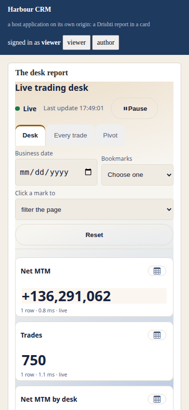
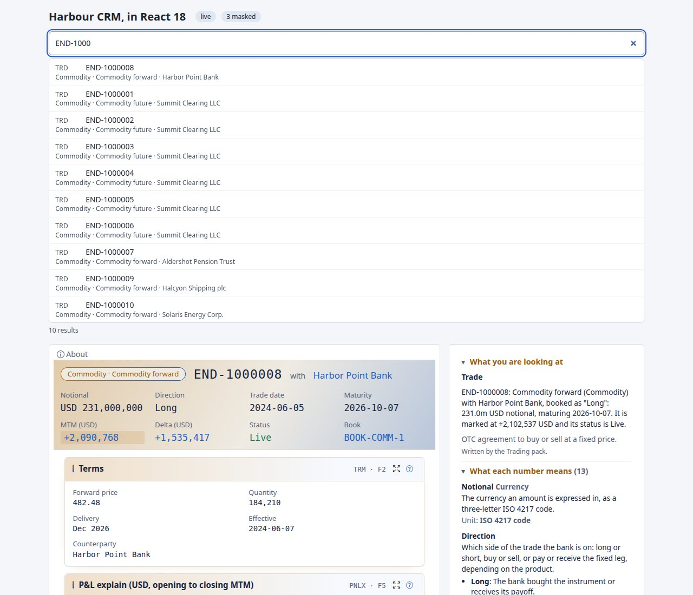

<!--
  Project Drishti · Any data. Any domain. One grammar.

  Copyright (c) 2026 Ashutosh Sinha <ajsinha@gmail.com>.
  All rights reserved.

  PROPRIETARY AND CONFIDENTIAL.

  This file is the confidential and proprietary property of Ashutosh Sinha.
  Unauthorised copying, use, modification, distribution or disclosure of this
  file, via any medium, is strictly prohibited except with the express prior
  written permission of the copyright holder.

  See the LICENSE file in the root of this repository for the full terms.
-->
# Drishti Elements: developer guide

Drishti Elements put Drishti's live views and BI reports inside **your own web application** as Web Components with a Shadow DOM and **no iframes**: your layout, your theme tokens, your keyboard focus, one network connection for the whole page, and your user signed in as themselves, with every
masked field masked. There are five elements, one library, and one contract for tokens.

| Element | Shows |
|---|---|
| `<drishti-view kind="trade" entity="MX-20000001">` | a live view of one entity: header, key figures, every panel, as the console draws them |
| `<drishti-panel kind="trade" entity="MX-20000001" panel="legs">` | **one panel** of a view, in a card of your own |
| `<drishti-report report="file:report:trades-overview">` | a published **BI report**, one page of it or one visual of it, with its slicers, cross-filter and live updates |
| `<drishti-about kind="trade" entity="MX-20000001">` | the **About this page** layers of a view (where each number comes from, the masks and rules that applied to this reader) in a panel of your own |
| `<drishti-search>` | **search across Drishti** from your page: a box and the entities that match, masked for the signed-in user |

This is the developer's reference and cookbook. The design and its history are in [architecture/ELEMENTS.md](../architecture/ELEMENTS.md) and [ADR-021](../architecture/adr/021-embedding-is-html-over-the-wire.md); the administrator's side (registering a host application) is [Admin → Embedding](USER_GUIDE.md) and
[API_GUIDE.md](API_GUIDE.md#embedding-views-in-another-web-application); the settings are in [CONFIGURATION.md](../admin/CONFIGURATION.md).

## Contents

1. [Five minutes: a static page](#five-minutes-a-static-page)
2. [How a user gets in: the token exchange](#how-a-user-gets-in-the-token-exchange)
3. [Loading the library: versions, SRI and npm](#loading-the-library-versions-sri-and-npm)
4. [Policy: what your page's CSP needs](#policy-what-your-pages-csp-needs)
5. [The elements, one by one](#the-elements-one-by-one)
6. [`<drishti-report>`](#drishti-report)
7. [`<drishti-about>` and `<drishti-search>`](#drishti-about-and-drishti-search)
8. [React, Angular and Vue sample pages](#react-angular-and-vue-sample-pages)
9. [Theming and sizing](#theming-and-sizing)
10. [Cookbook](#cookbook)
11. [Troubleshooting by code](#troubleshooting-by-code)

## Five minutes: a static page

1. **Switch embedding on** (it is off by default): the server needs `drishti.embed.enabled=true` and `drishti.security.enabled=true`, and the console `embed.enabled=true` ([CONFIGURATION.md](../admin/CONFIGURATION.md#console-embed--the-consoles-side-of-embedded-views)).
2. **Register your application** in *Admin → Embedding* (or `POST /api/v1/admin/embed/apps`): an id, its **exact origins** (`https://crm.bank.example`, no path), how it signs in (a client secret shown **once**, a public key, or both), the **scopes** it may use (`embed:view` for views and panels,
   `embed:about` for the About text and `<drishti-about>`, `embed:report` for BI reports, `embed:search` for `<drishti-search>`) and the **kinds and reports** it may show (`trade`, `counterparty`, `report:<id>`, `report:*`; empty: everything the user's roles open).
3. **Give your page a token provider** that asks *your own backend* for a token (section 2), and add the one script line and an element:

```html
<script type="module" src="https://drishti.bank.example/embed/v1/elements/1.4.2/drishti-elements.js" crossorigin="anonymous"></script>
<script type="module">
  DrishtiElements.configure({
    tokenProvider: async () => {                      // your backend, not Drishti: it holds your client secret
      const r = await fetch('/api/drishti-token', { cache: 'no-store' });
      const b = await r.json();
      return { token: b.token, expiresAt: Date.now() + b.expiresIn * 1000 };
    }
  });
</script>

<drishti-view kind="trade" entity="MX-20000001" theme="light"></drishti-view>
```

That is all of it. `server` defaults to the origin the module was loaded from (the console), and several elements on a page share one connection. A working host application with its own sign-in, search box and a report page is `tools/elements-demo` in the repository
(`python3 tools/elements-demo/server.py --help`).

## How a user gets in: the token exchange

Drishti never sees your user's password and your page never sees your secret. Your **backend** exchanges *its* credentials and *who the user is* for a **short-lived, read-only embed token** at the Drishti server (RFC 8693, `POST /api/v1/embed/token`), and hands the token to the page. The server checks the token
on **every call** (signature, audience, expiry, the application, the user, the origin, the scope and kind or report, the rates) and then acts as that user, with their roles as they are now and with every field mask applied whatever their roles say.

The request your backend makes (form encoded; client authentication by `Authorization: Basic base64(id:secret)` or by a signed client assertion):

```
POST /api/v1/embed/token
grant_type=urn:ietf:params:oauth:grant-type:token-exchange
subject_token=<an assertion your backend signs about the user, or the user's OIDC ID token>
subject_token_type=urn:ietf:params:oauth:token-type:jwt        (or ...:id_token)
audience=https://drishti.bank.example                           (the console's public URL)
scope=embed:report                                              (within the application's own scopes)
```

and the answer is `{"access_token": "<JWT>", "token_type": "Bearer", "expires_in": 300, "scope": "embed:report"}`. The field-by-field reference, the claims and the refusals are in [API_GUIDE.md](API_GUIDE.md#embedding-views-in-another-web-application).
The backend of the demo host (Python, no library but the standard one, the user's assertion signed with RS256) is `tools/elements-demo/server.py`, the `mint` method; the same exchange in other languages:

```javascript
// Node (an Express route; fetch is built in)
app.get('/api/drishti-token', async (req, res) => {
  const user = req.session.user;                       // who is signed in to YOUR application
  const now = Math.floor(Date.now() / 1000);
  const assertion = signJwt({ iss: 'crm', sub: user, aud: DRISHTI + '/api/v1/embed/token', iat: now, exp: now + 60, jti: crypto.randomUUID() }, MY_PRIVATE_KEY);
  const r = await fetch(DRISHTI + '/api/v1/embed/token', {
    method: 'POST', headers: { Authorization: 'Basic ' + Buffer.from('crm:' + SECRET).toString('base64'), 'Content-Type': 'application/x-www-form-urlencoded' },
    body: new URLSearchParams({ grant_type: 'urn:ietf:params:oauth:grant-type:token-exchange', subject_token: assertion,
      subject_token_type: 'urn:ietf:params:oauth:token-type:jwt', audience: CONSOLE, scope: 'embed:report' }) });
  const t = await r.json();
  res.json({ token: t.access_token, expiresIn: t.expires_in });
});
```

```java
// Java (Spring MVC; java.net.http; signJwt is your JWT library's call)
@GetMapping("/api/drishti-token")
Map<String, Object> token(Principal who) throws Exception {
    long now = Instant.now().getEpochSecond();
    String assertion = signJwt(Map.of("iss", "crm", "sub", who.getName(), "aud", drishti + "/api/v1/embed/token", "iat", now, "exp", now + 60, "jti", UUID.randomUUID().toString()));
    String form = "grant_type=" + enc("urn:ietf:params:oauth:grant-type:token-exchange") + "&subject_token=" + enc(assertion)
        + "&subject_token_type=" + enc("urn:ietf:params:oauth:token-type:jwt") + "&audience=" + enc(console) + "&scope=embed%3Areport";
    HttpResponse<String> r = http.send(HttpRequest.newBuilder(URI.create(drishti + "/api/v1/embed/token"))
        .header("Authorization", "Basic " + Base64.getEncoder().encodeToString(("crm:" + secret).getBytes()))
        .header("Content-Type", "application/x-www-form-urlencoded").POST(BodyPublishers.ofString(form)).build(), BodyHandlers.ofString());
    JsonNode t = json.readTree(r.body());
    return Map.of("token", t.get("access_token").asText(), "expiresIn", t.get("expires_in").asInt());
}
```

A token lives five minutes by default (the application's own setting, never more than `drishti.embed.token-max-seconds`). The library asks your provider again **60 seconds before it ends** (40 % of its life when that is shorter) and once more after a `401`; an open live stream is given the fresh token in place, so
nothing redraws. If the provider fails or there is none, the elements tell you with `drishti:token-needed` and wait.

## Loading the library: versions, SRI and npm

The console serves the library at an **exact semantic version**, immutably, and publishes the SHA-384 of every file:

| URL | What |
|---|---|
| `/embed/v1/elements/1.4.2/drishti-elements.js` | the entry (imports `./m/<name>.js`, which are served beside it) |
| `/embed/v1/elements/1.4.2/integrity.json` | `{"name", "version", "api", "files": {"drishti-elements.js": {"integrity": "sha384-…", "bytes": 2500}, "m/report.js": …}}` |
| `/embed/v1/elements/1/…`, `/embed/v1/elements/1.1/…` | `302` to the exact version (for a host that accepts updates; SRI needs the exact one) |
| `/embed/v1/drishti-elements.js` | the console's current library, revalidated on each load (a host that follows the console) |

A version this console does not hold is `410 DRS-8006` (the answer says which one it serves): after a console upgrade, a page pinned to the old version tells you to move the pin, and a version always names **the same bytes**. Put the entry's `integrity` on the script line, and, because a module's own imports are not
covered by it, pin the rest with an import map's `integrity` (Chrome 127 and later) listing the `m/…` files of `integrity.json`.

**npm.** `@drishti/elements` is the same files (`drishti-console/web/elements/package/`, made by `python3 tools/elements_package.py`; publishing is the release build's `npm publish`): `import '@drishti/elements'` defines the elements, `types/index.d.ts` declares them and their events, `types/react.d.ts` adds the React `JSX.IntrinsicElements`.
From `node_modules` the module's own origin is not the console, so **set `server`**: `DrishtiElements.configure({ server: 'https://drishti.bank.example', tokenProvider })`. The sheets, the icon font and the chart code are fetched from that console, so they always match the data it serves.

```ts
import '@drishti/elements';
import type { DrishtiReport, ReportFilterChangedDetail } from '@drishti/elements';

const rep = document.querySelector('drishti-report')!;            // typed: HTMLElementTagNameMap knows the tag
rep.addEventListener('drishti:filter-changed', (e) => console.log(e.detail.selections));   // typed: HTMLElementEventMap knows the event
```

**Two contracts, both semver.** The **element API** (this guide's tables: attributes, properties, methods, events and their `detail`) changes only in a major version of the library. The **embed API** (`/embed/v1`) changes additively within `v1`; a major is announced with `Deprecation` and `Sunset`
headers (the console's `embed.lifecycle`), served beside its successor for two releases, and then `410 DRS-8006`. The element sends `Drishti-Embed-Api: 1.0` and the console answers in the newest compatible shape.

## Policy: what your page's CSP needs

The elements are written for a **strict host policy**: no inline script or style, no `frame-src`. A page that names the console in three directives works:

```
Content-Security-Policy: default-src 'self'; script-src 'self' https://drishti.bank.example; style-src 'self'; font-src https://drishti.bank.example;
  connect-src 'self' https://drishti.bank.example; img-src 'self' data:; object-src 'none'; base-uri 'none'
```

The element's style sheets are adopted (`adoptedStyleSheets`), the icon font is added through the `FontFace` API, the charts are drawn on a canvas, a report's DOM is built with `createElement` and `textContent`, and markup a view receives is rebuilt from an allow-list before it is inserted. A host that enforces **Trusted Types** adds
`require-trusted-types-for 'script'; trusted-types drishti-elements` and nothing else (the one policy the library creates). A report's `image` visual loads its `src` as your `img-src` allows. The demo host runs under exactly this policy and its tests assert that no violation is reported and no report reaches its `report-uri`.

## The elements, one by one

Every attribute is reflected to a property of the same name in camelCase (`as-of` is `asOf`). Events are `CustomEvent`s on the element, `bubbles: true, composed: true`, named `drishti:<name>`. This reference is **generated** from `drishti-console/core/element_api.py`, the same source as the TypeScript declarations,
and a test checks it against the elements, so it cannot drift.

#### `<drishti-view>`

A live Drishti view of one entity.

| Attribute | Type | Meaning |
|---|---|---|
| `server` | `string` | the console's base URL; default: the origin the module was loaded from. Elements sharing a `server` share one connection |
| `kind` | `string` | an entity kind (`trade`, `counterparty`, ...); required |
| `entity` | `string` | the entity id; change it to show another entity (reloads in place); required |
| `as-of` | `string` | `live` (default) or a business date `YYYY-MM-DD` (a past date is a static snapshot) |
| `known-at` | `string` | an ISO instant: bitemporal "as known at" |
| `theme` | `string` | `inherit`, or a Drishti theme: `terminal`, `light` (default), `blue`, `green`, `wallstreet`, `crimson`, `crimson-dark` |
| `density` | `'compact' | 'comfortable'` | row padding of tables |
| `header` | `'full' | 'strip' | 'none'` | title and strip, strip only, or panels only (default `full`; `none` for `<drishti-panel>`) |
| `panels` | `string` | comma-separated panel ids to show (default all) |
| `live` | `'auto' | 'off'` | `off` loads once and never subscribes |
| `label` | `string` | the element's accessible name (`role="region"`); default the view's title |
| `controls` | `string` | the Sutra's controls as `legs=2&when=2026-10-01..2026-12-31` (the `ctl.` prefix is optional) |

| Property | Type | Meaning |
|---|---|---|
| `tokenProvider` | `() => string | { token: string; expiresAt?: number } | Promise<string | { token: string; expiresAt?: number }>` | set on any element: one provider per page (also `DrishtiElements.configure({tokenProvider})`) |
| `state` (read-only) | `'idle' | 'loading' | 'live' | 'static' | 'reconnecting' | 'paused' | 'deleted' | 'error'` | the state machine |
| `view` (read-only) | `{ ref: { kind: string; id: string }; title: unknown; generation: number; provenance: unknown; panels: { id: string; kind: string; title: string }[] } | null` | once loaded |
| `lastError` (read-only) | `{ code: string; status: number; detail: string } | null` | the last error |
| `controls` | `string` | the controls' values now |

| Method | Effect |
|---|---|
| `refresh()` | fetch the view again (same entity), keep the subscription, swap what changed |
| `reload()` | full reload: cancel in-flight requests, drop the subscription, fetch, subscribe |
| `pause()` | give the subscription back (the element also does this itself when hidden) |
| `resume()` | take it again |

| Event (`drishti:`) | `detail` | When |
|---|---|---|
| `controls` | `{ query: string; changed: string[] }` | a reader changed a control |
| `error` | `{ code: string; status: number; detail: string; fatal?: boolean; retryInMs?: number }` | a DRS code; `fatal: false` while the element retries by itself or a single visual failed |
| `loaded` | `{ ref: { kind: string; id: string }; generation: number; title: unknown; live: boolean }` | a view was loaded and painted |
| `masked` | `{ count?: number; panels?: string[]; columns?: string[] }` | what the user is shown has masked fields (a view: count and panels; a report: the columns) |
| `navigate` | `{ kind: string; id: string; href: string; panel?: string; source: 'link' | 'chart' | 'graph' }` | **cancellable**: the user activated a linked entity; not cancelled, the element shows it in place |
| `paint` | `{ ref: { kind: string; id: string }; generation: number }` | the shadow root was rebuilt |
| `state` | `{ state: string; previous: string }` | every state change (drives a host's own live indicator) |
| `tick` | `{ generation: number; seq?: number; latencyMs?: number; changed?: { strip: number[]; panels: string[] }; at?: string }` | live data was applied |
| `token-needed` | `{ reason: 'missing' | 'refused' | 'provider-failed' }` | no token provider, the token was refused twice, or the provider threw: sign the user in again and set `tokenProvider` |

#### `<drishti-panel>`

One panel of a view: `<drishti-view>` with the `panel` attribute and the header off.

| Attribute | Type | Meaning |
|---|---|---|
| `panel` | `string` | the panel id to show (the same as `panels="<id>"`); required |

| Property | Type | Meaning |
|---|---|---|
| `panel` | `string` | the attribute of the same name |

#### `<drishti-report>`

A published BI report, or one page or visual of it, with its slicers, cross-filter and live updates.

| Attribute | Type | Meaning |
|---|---|---|
| `server` | `string` | the console's base URL; default: the origin the module was loaded from |
| `report` | `string` | the id of a **published** report, e.g. `file:report:trades-overview`; required. The host application's `kinds` must list `report:<id>` or `report:*` |
| `page` | `string` | the page to show first (default: the first page that is not a drill-through target) |
| `visual` | `string` | show only this visual (its page is found for you): a card, a chart or a table in a card of the host's own |
| `filters` | `string` | initial filters as JSON: `{"slicers": {"<slicer id>": ["FX"]}, "dates": "2026-10-09", "selections": [{"visual": "by-desk", "field": "trade.DESK", "values": ["FX"]}], "mode": "highlight"}` |
| `chrome` | `'full' | 'bare'` | `full` (default): title, page tabs, business date, bookmarks, filter chips, live bar. `bare`: the visuals only (the default when `visual` is set) |
| `theme` | `string` | as `<drishti-view>` |
| `live` | `'auto' | 'off'` | `off` draws once and never follows the report's live tables |
| `label` | `string` | the element's accessible name |

| Property | Type | Meaning |
|---|---|---|
| `tokenProvider` | `() => string | { token: string; expiresAt?: number } | Promise<string | { token: string; expiresAt?: number }>` | as `<drishti-view>` |
| `state` (read-only) | `'idle' | 'loading' | 'live' | 'static' | 'stale' | 'failed' | 'reconnecting' | 'paused' | 'error'` | the state machine |
| `page` | `string` | the page shown (assign to change it) |
| `filters` | `{ page?: string; slicers?: Record<string, unknown>; dates?: string | { from?: string; to?: string } | null; selections?: { visual: string; field: string; values: unknown[] }[]; carry?: unknown[]; mode?: 'filter' | 'highlight' }` | the filters in force; assign the same shape to set them (anything left out is cleared) |
| `lastError` (read-only) | `{ code: string; status: number; detail: string } | null` | the last error |

| Method | Effect |
|---|---|
| `reload()` | full reload: fetch the report again and redraw |
| `refresh()` | ask every visual again, quietly |
| `selectPage(id` | show another page (its filters are cleared, as when a reader clicks the tab) |
| `clearFilters()` | clear slicers, selections and the date (the Reset button) |
| `pause()` | give the live stream back |
| `resume()` | take it again |

| Event (`drishti:`) | `detail` | When |
|---|---|---|
| `error` | `{ code: string; status: number; detail: string; fatal?: boolean; retryInMs?: number }` | a DRS code; `fatal: false` while the element retries by itself or a single visual failed |
| `filter-changed` | `{ page: string; slicers: Record<string, unknown>; dates: unknown; selections: { visual: string; field: string; values: unknown[] }[]; carry: unknown[]; mode: string; source: 'user' | 'api' }` | a reader (or the host, `source: 'api'`) changed a slicer, a selection, the date or the page |
| `loaded` | `{ report: string; title: string; page: string; visuals: string[]; live: boolean }` | the report was drawn (every visual of the first page has answered or failed) |
| `masked` | `{ count?: number; panels?: string[]; columns?: string[] }` | what the user is shown has masked fields (a view: count and panels; a report: the columns) |
| `page-changed` | `{ page: string; title: string; visuals: string[]; phone: boolean }` | a page was drawn (first draw, a tab, `selectPage`, or a swap to or from the phone layout) |
| `state` | `{ state: string; previous: string }` | every state change (drives a host's own live indicator) |
| `tick` | `{ generation: number; seq?: number; latencyMs?: number; changed?: { strip: number[]; panels: string[] }; at?: string }` | live data was applied |
| `token-needed` | `{ reason: 'missing' | 'refused' | 'provider-failed' }` | no token provider, the token was refused twice, or the provider threw: sign the user in again and set `tokenProvider` |


#### `<drishti-about>`

The "About this page" layers of one view (sources, lineage, the masks and rules that applied to this reader) in a panel of the host's own.

| Attribute | Type | Meaning |
|---|---|---|
| `server` | `string` | the console's base URL; default: the origin the module was loaded from |
| `kind` | `string` | an entity kind (`trade`, `counterparty`, ...); required |
| `entity` | `string` | the entity id; change it to show another entity's About; required |
| `theme` | `string` | as `<drishti-view>` |
| `label` | `string` | the element's accessible name (default `About this page`) |

| Property | Type | Meaning |
|---|---|---|
| `tokenProvider` | `() => string | { token: string; expiresAt?: number } | Promise<string | { token: string; expiresAt?: number }>` | as `<drishti-view>` (the application's scopes must include `embed:about`) |
| `state` (read-only) | `'idle' | 'loading' | 'loaded' | 'error'` | the state machine |
| `lastError` (read-only) | `{ code: string; status: number; detail: string } | null` | the last error |

| Method | Effect |
|---|---|
| `reload()` | ask the console for the About body again |

| Event (`drishti:`) | `detail` | When |
|---|---|---|
| `error` | `{ code: string; status: number; detail: string; fatal?: boolean; retryInMs?: number }` | a DRS code; `fatal: false` while the element retries by itself or a single visual failed |
| `loaded` | `{ kind: string; entity: string }` | the About body was drawn |
| `state` | `{ state: string; previous: string }` | every state change (drives a host's own live indicator) |
| `token-needed` | `{ reason: 'missing' | 'refused' | 'provider-failed' }` | no token provider, the token was refused twice, or the provider threw: sign the user in again and set `tokenProvider` |

#### `<drishti-search>`

Search across Drishti from a host page: a box and the entities that match, masked for the signed-in user.

| Attribute | Type | Meaning |
|---|---|---|
| `server` | `string` | the console's base URL; default: the origin the module was loaded from |
| `theme` | `string` | as `<drishti-view>` |
| `placeholder` | `string` | the box's placeholder (default `Search`) |
| `label` | `string` | the box's accessible name (default the placeholder) |
| `limit` | `number` | most results asked for (1 to 50, default 10; the server caps it at `drishti.embed.search.max-results`) |
| `min-chars` | `number` | shortest query searched (default 2) |
| `delay` | `number` | milliseconds of quiet after the last key before a search is made (default 250) |
| `target` | `string` | a CSS selector of a `<drishti-view>` or `<drishti-panel>`: picking a result points it at that entity (unless `drishti:select` is cancelled) |

| Property | Type | Meaning |
|---|---|---|
| `tokenProvider` | `() => string | { token: string; expiresAt?: number } | Promise<string | { token: string; expiresAt?: number }>` | as `<drishti-view>` (the application's scopes must include `embed:search`) |
| `value` | `string` | the text in the box (assign to search for it) |
| `results` (read-only) | `{ type: string; kind: string; id: string; mnemonic: string; title: string; subtitle: string }[]` | the results now shown |
| `state` (read-only) | `'idle' | 'loading' | 'error'` | the state machine |
| `lastError` (read-only) | `{ code: string; status: number; detail: string } | null` | the last error |

| Method | Effect |
|---|---|
| `search(q?` | search now (the box shows `q`); resolves with the results |
| `clear(box?` | empty the list, and the box unless `box` is false |

| Event (`drishti:`) | `detail` | When |
|---|---|---|
| `error` | `{ code: string; status: number; detail: string; fatal?: boolean; retryInMs?: number }` | a DRS code; `fatal: false` while the element retries by itself or a single visual failed |
| `results` | `{ query: string; results: { kind: string; id: string; mnemonic: string; title: string; subtitle: string }[] }` | a search answered |
| `select` | `{ kind: string; id: string; mnemonic: string; title: string; type: string }` | **cancellable**: the user picked a result; not cancelled, the `target` view (if any) is pointed at it |
| `state` | `{ state: string; previous: string }` | every state change (drives a host's own live indicator) |
| `token-needed` | `{ reason: 'missing' | 'refused' | 'provider-failed' }` | no token provider, the token was refused twice, or the provider threw: sign the user in again and set `tokenProvider` |


**The token provider** (all elements; one per page): `DrishtiElements.configure({ server, tokenProvider })` or `element.tokenProvider = fn`. **`DrishtiElements`** also has `resolve(text)` (a typed command such as `TRD MX-20000001` to `{ref: {kind, id}}`, for your own search box), `invalidateToken()` (your user changed: the next call asks the
provider again), `connections()` (how many live connections the page holds: one per console) and `version`.

## `<drishti-report>`

A **published** report, one **page** of it or one **visual** of it, in a Shadow DOM, drawn with the console viewer's own code. What is in it: the page tabs, the slicers, the business date, bookmarks, *click a mark to filter or highlight*, **cross-filtering** between the visuals, *show as a table*, and, for a report over a live table, a live
bar and redraws as the data ticks (each tick asks the visuals again, as the person looking, so their row rules and masks apply to every update). What is not: drill down and through, *Alert me*, *Show the rows behind this visual*, Export and Subscribe. A 2.1 `perspective-*` visual is drawn as in the viewer, Drishti's own grid of the server's answer (since 2.3.0 no BI page, and no element, loads WebAssembly).
The design is [ELEMENTS.md section 18](../architecture/ELEMENTS.md#18-drishti-report-a-published-report-in-another-web-application).

```html
<drishti-report id="rep" report="file:report:live-trading-desk"
  filters='{"selections":[{"visual":"by-desk","field":"trade.DESK","values":["DESK-RATES"]}]}'></drishti-report>
<drishti-report report="file:report:live-trading-desk" visual="by-desk" chrome="bare"></drishti-report>
```

**`filters`** is the initial state as JSON (and the property reads and sets the same shape): `slicers` (a slicer visual's id to the values it selects, or `{from, to}` for a range), `dates` (`"2026-10-09"` or `{from, to}`: the business date), `selections` (the marks "clicked": `{visual, field, values}`), `carry` (values carried by a drill-through) and `mode` (`filter` or
`highlight`). Anything left out is cleared. Assigning it does what a click would: the visuals ask again, and `drishti:filter-changed` comes back with `source: "api"`.

**`chrome`**: `full` (default) shows the title, page tabs, business date, bookmarks, the filter chips, Reset and the live bar; `bare` shows the visuals only. With `visual` set the element is that one visual, found on whichever page holds it, in a card, and the chrome is off.

**What the host hears** (captured from a real page, the demo host with the *Live trading desk* report; the last two are the report telling its host which columns it masked and what a click selected):

```
page-changed rep  {"page":"desk","title":"Desk","visuals":["trades","notional","mtm","losses","pnl","by-desk","rolling","movers","latest"],"phone":false}
loaded       rep  {"title":"Live trading desk","page":"desk"}
masked       rep  {"columns":["trade.trader"]}
filter-changed rep {"page":"desk","slicers":{},"dates":null,"selections":[{"visual":"by-desk","field":"trade.DESK","values":["DESK-RATES"]}],"carry":[],"mode":"filter","source":"user"}
```

**Masks.** An embedded report **always masks**: `drishti.security.redact` fields and the dataset's masked columns read `•••` whatever the user's roles, so a user with the raw power sees real names in the console and `•••` in your page. `drishti:masked` lists the columns.

**Which reports a host may show.** The host application's **kinds and reports** list (Admin → Embedding): `report:file:report:live-trading-desk` allows one report, `report:*` every report; a host whose list holds only entity kinds may show none; an empty list means everything the user's roles open. Only a **published**
report is embedded. A refusal is `DRS-8005` (`drishti:error`, `fatal: true`, the element shows the code).

**On a phone.** The element measures **its own width**: at 640 px or narrower it draws the report's `layouts.phone` for the page when the report has one ([REPORTS.md section 14](REPORTS.md#14-phone-and-tablet-layouts)), else the automatic single column, and swaps back as it grows, with no reload. `drishti:page-changed` carries `phone: true` when the arranged page is on screen.



## `<drishti-about>` and `<drishti-search>`

Two small elements for a host page that has its own layout around a view.

**`<drishti-about>`** is the *About this page* body of a view without the view: where each number comes from (the sources, the lineage, the layers), what is masked for **this** reader and why, and the rules that applied. It asks the console for the same body the console's own drawer shows (`GET /embed/v1/views/{kind}/{id}/about`), draws it sanitised in a Shadow DOM and
opens its links in a new tab on the console. The application needs the scope `embed:about`. Point it at the same entity as a view and put it where your page has room:

```html
<drishti-view id="v" kind="trade" entity="MX-20000001"></drishti-view>
<drishti-about kind="trade" entity="MX-20000001" label="Where these numbers come from"></drishti-about>
```

**`<drishti-search>`** is a search box and a short list of what matches, the console's own type-ahead for the signed-in user: kinds they may not open are left out, fields masked for them (and, because it is an embed call, every field `drishti.security.redact` names) are neither shown nor matched, and the list is cut to the kinds
the host application may show. The application needs the scope **`embed:search`**; the call is `GET /embed/v1/search?q=` (`GET /api/v1/embed/search` on the server), it reads and writes nothing, and it is rate-limited per user and application (`drishti.embed.limits.searches-per-user-per-minute`, default 30 a minute, on top of the call rates; `DRS-8004`
with `Retry-After`). A query shorter than `drishti.embed.search.min-chars` (2) is not searched; at most `drishti.embed.search.max-results` (10) results come back. Results are 44 px targets and everything is drawn as text. Picking one fires the cancellable `drishti:select`; with `target="#v"` the element also points that
`<drishti-view>` at the pick:

```html
<drishti-search placeholder="Find a trade or counterparty" target="#v"></drishti-search>
<drishti-view id="v" kind="trade" entity="MX-20000001"></drishti-view>
<script type="module">
  document.querySelector('drishti-search').addEventListener('drishti:select', (e) => {
    // e.detail = { kind: 'trade', id: 'MX-20000001', mnemonic: 'TRD', title: 'MX-20000001', type: 'entity' }
    e.preventDefault();                       // take it over yourself instead of letting `target` follow
    openInMyApp(e.detail.kind, e.detail.id);
  });
</script>
```

## React, Angular and Vue sample pages

`docs/guides/examples/embed/` holds one host page for each framework, each embedding `<drishti-search>`, `<drishti-view>`, `<drishti-about>` and `<drishti-report>`, wired the way that framework wires custom elements: **React 18** (`createElement`, events bound with a ref, the same in JSX), **Vue 3** (the runtime-only build and render functions, so no
`eval`), **Angular 18** (a standalone component with `CUSTOM_ELEMENTS_SCHEMA`, zoneless). They share `host.js` (the token provider) and `sample.css`, and run against the elements demo host (`tools/elements-demo/server.py`), which serves them at `/samples/<framework>/` under a strict policy (script-src `'self'` and the console, no inline script).

The framework builds are **not in the repository**. `bash docs/guides/examples/embed/fetch-vendor.sh` downloads the pinned versions once (React 18.3.1 UMD, Vue 3.5.43 runtime build, Angular 18.2.14 ES modules, RxJS 7.8.2, tslib 2.8.1; all MIT) into `docs/guides/examples/embed/vendor/` (ignored by git), and the pages load them from there: no CDN, offline afterwards. React 19 has no UMD build; with a bundler the JSX is the one shown in the
comments. Angular has no UMD build either, so its page uses an import map and Angular's JIT compiler, which needs `'unsafe-eval'` and an inline import map: the demo host relaxes its policy for `/samples/angular/` only. A real Angular application is compiled ahead of time (`ng build`) and needs neither; the component is the same.

Events with a colon (`drishti:select`) are bound with `addEventListener` in all three, because Vue and Angular read the colon in a template; the samples bind in `onMounted` / `ngAfterViewInit` / a ref effect. `tests/test_embed_frameworks_browser.py` loads the React and Vue pages (and the Angular one) in Chromium against a real server and checks that each draws the view, the report and the About body, that a search pick changes the view, and that the policy reports no violation;
it skips when the vendor folder is not there. The React page, drawn in Chromium against a real server:



## Theming and sizing

**Custom properties.** The element's sheets read the console's design tokens, which inherit through the shadow boundary: set them on the element or any ancestor.

| Property | Meaning |
|---|---|
| `--d-bg`, `--d-bg-2`, `--d-surface`, `--d-surface-2` | backgrounds: page, alternate, panel, panel header |
| `--d-ink`, `--d-muted`, `--d-faint` | text: main, secondary, hints |
| `--d-border`, `--d-radius`, `--d-shadow` | frame |
| `--d-link`, `--d-accent`, `--d-accent-strong`, `--d-accent-tint`, `--d-on-accent` | links, emphasis |
| `--d-pos`, `--d-neg`, `--d-ok`, `--d-warn`, `--d-bad` | tones (gains, losses, status); charts take their palette from these |
| `--d-font-sans`, `--d-font-mono` | fonts (the host's fonts work: the element loads none but its icon font) |

`theme="inherit"` uses your values with `light` as the fallback; `terminal`, `light`, `blue`, `green`, `wallstreet`, `crimson` and `crimson-dark` are the console's own. Parts for spacing and borders without reaching into the shadow root: `::part(header)`, `::part(strip)`, `::part(grid)`, `::part(panel)` (views) and
`::part(report)`, `::part(tabs)`, `::part(chips)`, `::part(grid)` (reports).

**Sizing.** Every element is `display: block`, as wide as its container, as tall as its content; give it a width the way you give any block one (a grid cell, a flex item with `min-width: 0`). It is a **size container**: the console's width breakpoints (760 px, 640 px and others) apply to **its own width**, not the page's, so an element in a 360 px
sidebar of a wide page uses the phone layout, and tables scroll inside their panel and never widen your page.

## Cookbook

**Master and detail: a list drives `entity`.** Set the attribute; the element reloads in place and cancels the request it was making.

```js
list.addEventListener('click', (e) => { main.setAttribute('entity', e.target.dataset.id); });
```

**Keep navigation in your application.** A linked entity inside a view fires a cancellable `drishti:navigate`; cancel it and take the user where you like, or let it through and the element shows the entity in place.

```js
main.addEventListener('drishti:navigate', (e) => { e.preventDefault(); router.go('/trades/' + e.detail.id); });
```

**Your own search box.** `DrishtiElements.resolve('TRD MX-20000001')` returns `{ref: {kind, id}}` for a typed command; set `kind` and `entity` from it.

**A live indicator of your own.** `drishti:state` fires on every change (`loading`, `live`, `reconnecting`, `paused`, `error`, and for a report `stale` or `failed`): bind it to your page's own badge. `drishti:tick` says a live update was applied.

**Two elements side by side, one connection.** Elements with the same `server` share one stream; `DrishtiElements.connections()` is `1` however many there are. (A test puts twenty elements on ten entities on one page: one channel stream.)

**A past business date.** `<drishti-view as-of="2026-10-09">` loads a static snapshot (the console's own as-of rule); `as-of="live"` goes back.

**A dark host.** `theme="inherit"` and your own `--d-bg`, `--d-surface`, `--d-ink` on an ancestor, or `theme="crimson-dark"`.

**One panel in a card.** `<drishti-panel kind="trade" entity="MX-20000001" panel="legs">`: the header is off unless you ask for `header="strip"`.

**A report in a card, driven by your filters.** Set `filters` when your own control changes; the visuals ask again:

```js
deskPicker.addEventListener('change', () => {
  rep.filters = { selections: [{ visual: 'by-desk', field: 'trade.DESK', values: [deskPicker.value] }] };
});
rep.addEventListener('drishti:filter-changed', (e) => { if (e.detail.source === 'user') { deskPicker.value = (e.detail.selections[0] || { values: [''] }).values[0]; } });
```

**React.** Elements are plain DOM: set attributes in JSX, bind events with a ref (React 19 passes properties to custom elements; for events use `addEventListener`):

```jsx
function DeskReport({ onFilter }) {
  const ref = useRef(null);
  useEffect(() => { const el = ref.current; el.addEventListener('drishti:filter-changed', onFilter); return () => el.removeEventListener('drishti:filter-changed', onFilter); }, [onFilter]);
  return <drishti-report ref={ref} report="file:report:live-trading-desk" theme="light" />;
}
```

**Angular** (add `CUSTOM_ELEMENTS_SCHEMA` to the module or component). Angular reads a colon in an event binding as a target (`window:resize`), so bind these events with `addEventListener`:

```ts
@ViewChild('rep', { static: true }) rep!: ElementRef<HTMLElement>;
ngAfterViewInit() { this.rep.nativeElement.addEventListener('drishti:filter-changed', (e) => this.onFilter(e as CustomEvent)); }
// template: <drishti-report #rep report="file:report:live-trading-desk"></drishti-report>
```

**Vue 3**: `app.config.compilerOptions.isCustomElement = (t) => t.startsWith('drishti-')`, then `<drishti-report report="file:report:live-trading-desk" @drishti:filter-changed="onFilter" />`. *These recipes follow the frameworks' documented custom-element support; the [sample pages](#react-angular-and-vue-sample-pages) run all three in Drishti's own browser tests.*

**Testing a page that embeds Drishti.** The elements have **open** shadow roots, so a test reaches inside: Playwright's CSS selectors pierce them (`page.locator('#rep [data-visual="trades"] .bi-card-value')`), and `await expect(el).toHaveAttribute('data-state', 'live')` waits for the state machine. A report sets `data-ready="yes"` on itself when its first page has drawn.
`tests/test_embed_report_browser.py` is a complete example: a host on its own origin under a strict policy against a real server.

## Troubleshooting by code

The element puts the code in `drishti:error` (`detail.code`, `status`, `detail`, `fatal`) and shows it in the element when it has nothing else to show. The full list is in [TROUBLESHOOTING.md](TROUBLESHOOTING.md); the ones an embedder meets:

| Code | Meaning | What to do |
|---|---|---|
| `DRS-8001` (401) | the embed token is missing, forged, expired or for another audience | check your provider returns a fresh token and the token request's `audience` is the console's public URL; a stream ends with this after `embed.token_grace_seconds` without a renewal |
| `DRS-8002` (403) | this origin is not one of the host application's | register the exact origin (scheme, host, port) in Admin → Embedding; `null` and wildcards are refused unless `drishti.embed.allow-wildcard-origins` |
| `DRS-8003` (403) | the host application is unknown or disabled | it was disabled or deleted in Admin → Embedding |
| `DRS-8004` (429) | over the embed call rate, or the console holds `embed.max_streams` streams | the answer carries `Retry-After`; raise the application's rates or `embed.max_streams` |
| `DRS-8005` (400, or 403 for an unpublished report) | the application may not show this kind or this report | add the kind, `report:<id>` or `report:*` to the application's list; publish the report |
| `DRS-8006` (410) | a version or API major this console no longer serves | pin the version the answer names, or upgrade the element |
| `DRS-5002` (403) | a path the embed scope does not open (for example the report's authoring paths), or a scope the application was not given | give the application the scope (`embed:report` for a report); an embed token never writes |
| `DRS-5010` (401) | the user behind the token is disabled or gone | sign the user in again; tokens are checked against the user on every call |
| `DRS-9001` (404) | no such report for this user (the id is wrong, or it is not in a workspace they can read) | check the id (`file:report:<name>` for shipped content) and that the user may open it in the console |
| `DRS-9031` / `DRS-9034` (422) | the report has errors and cannot be drawn | open it in the designer; the answer names the first error |

Nothing at all (the element stays in `loading`, with no event): the token provider never answered. Open the browser's network tab: the first request is to *your* backend. `window.DrishtiElements.connections()` and `element.state` / `element.lastError` say what the element thinks.
